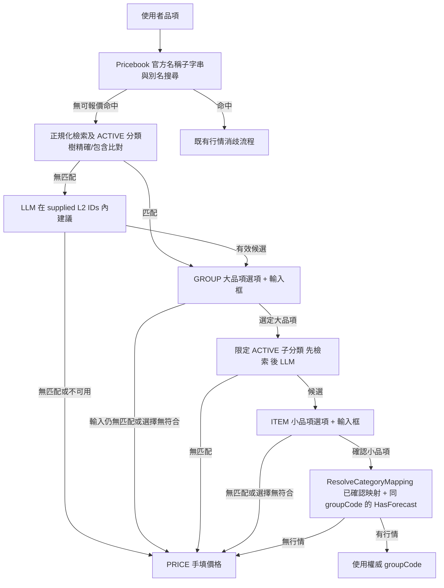
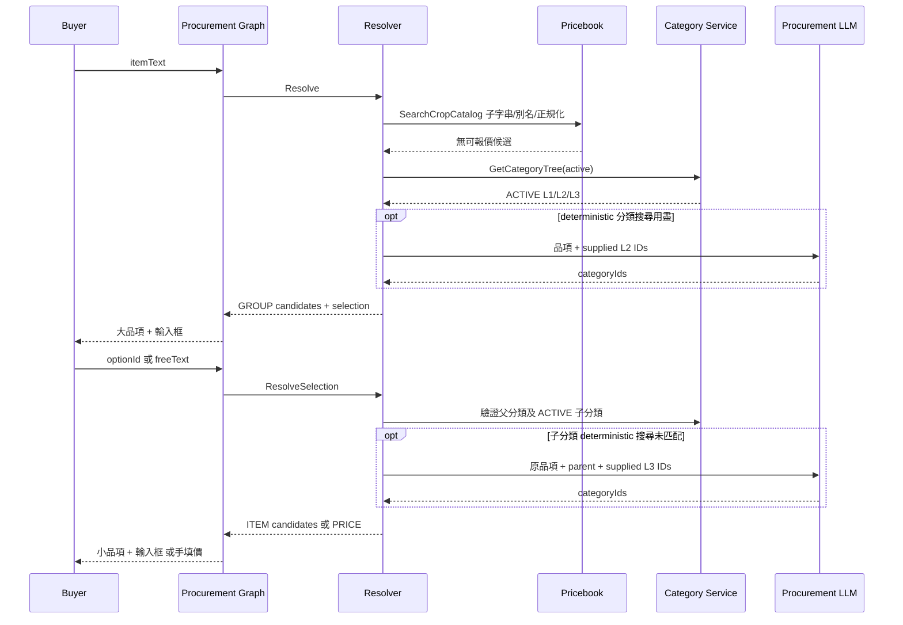

# 採購品項檢索用盡後的分類選擇

日期：2026-09-13。依使用者本輪確認的「檢索用盡才用 LLM、大品項 → 小品項、各層無法匹配則手填價格」實作；沿用既有採購 interrupt / resume。

修訂（2026-10-28）：部分被 `2026-10-27-general-ecommerce-scope-cut.md`（D1、D2）取代。決策 1 的 Pricebook 搜尋、決策 5 的行情映射與行情驗證、各處的 Pricebook 查詢都已刪除；品項只解析到平台分類樹。分類樹檢索加 LLM 建議的順序與逾時界限沿用。

## 決策與資料權威

1. 既有 Pricebook 搜尋（含服務端官方名稱子字串／種子別名檢索）優先；額外做文字正規化查詢，再依商品服務 ACTIVE 三層分類樹做精確、名稱包含檢索。全部未匹配才讓既有 `llmprovider.Procurement` 建議分類。
2. 分類樹 L2 是大品項（例如豬肉），L3 是小品項（例如五花肉）。先回 GROUP 選項與輸入框；使用者選定大品項後，僅在其 ACTIVE 子分類中取得小品項建議，再回 ITEM 選項與輸入框。即使只有一個候選仍交由使用者確認。
3. LLM 每次續答最多一次、每次 5 秒硬逾時；整個 resume 12 秒上限，不建立新 client、不重試、不產生價格。LLM 只能回 supplied taxonomy IDs；後端驗證存在、ACTIVE、層级、父子關係、去重與上限，拒絕任何虛構候選。
4. GROUP / ITEM 的每次補充輸入，都先重新查詢 Pricebook 名稱／別名及正規化文字，再以分類樹比對原文字與檢索出的官方名稱，全部未匹配才使用 LLM。輸入框產生的候選即使只有一個，也留在原階段等待點選確認；更正文字以內部 queryText 保存，下一層沿用更正後的查詢。使用者回覆無法匹配、分類／模型暫時不可用、LLM 無有效候選時進 PRICE 手填價格；保留原品項及已確認分類。
5. 分類成功不等於可報價。小品項確認後使用既有 `ResolveCategoryMapping(categoryId)`，僅採用 `resolved` 的權威 groupCode；再以映射標籤查詢行情，驗證相同 groupCode 的 `HasForecast`。`unmapped`／`ambiguous` 不以同名搜尋推定映射，L3 不自動綁定 crop code；沒映射或行情時保留分類並手填價。

## 流程

## 契約與實作位置

HTTP 與 Proto 沿用既有採購 turn/resume RPC、既有 optionId/freeText 與 interrupt JSON；不增加 RPC、不改 DB schema、不增加環境變數。Snapshot additive 新增 `openConfirmation.question`（既有 ClarifyQuestion 型別），由後端依 pending interrupt 重建，讓重新整理能恢復正確階段與 opaque optionId；不公開 internal workflow ID。僅在內部持久化 interrupt JSON 可選新增 `selection`（stage、queryText、parentCategoryId、parentLabel、categoryId、label）及選項的 categoryId/categoryLevel，JSON camelCase；這些不新增為公開 API 欄位。stage 為內部 bounded wizard discriminator，非新增跨服務 CodeMeta code。

- `procurement/domain/crop_selection.go`：分類階段與已確認分類；既有 domain option/interrupt 由 graph 整合修改。
- `procurement/usecase/crop_disambiguation.go`、`crop_category_*.go`：查詢順序、真實分類 whitelist、stage resume、LLM adapter。
- `procurement/usecase/di.go`：使用已註冊的 category client 及 Procurement provider。
- 既有 graph/resume/question 與 Web 採購 UI：保留 pending、兩層 free text、手填價與分類顯示。

錯誤處理：既有 Pricebook 網路錯誤沿用原本錯誤，不固化成無匹配；分類補救階段的 taxonomy / LLM 失敗降級 PRICE。失效／越父層 optionId 不採用。原有交易、權限及行情取價規則維持。

驗證：fake Pricebook/category/LLM 測試 retrieval ordering、豬五花、兩層選擇、無匹配／停用／逾時、虛構或跨層 ID、HasForecast、taxonomy ID 與行情 code 分離；graph / frontend 另驗序列化與 resume。本地測試不代表部署或線上證據。

## 續答與還原

`AgentRunOpenConfirmation.question = 4` 為 additive typed Proto 欄位，Gateway DTO 使用既有 `ClarifyQuestionFromProto`。既有 client 可忽略；新版 Web 在缺少此欄位時保留舊版還原行為。

Resume 的選項白名單、GROUP/ITEM 才允許 freeText、互斥欄位與手填價完整性皆在 T0 消耗 interrupt 之前驗證。LLM / 分類查詢在交易外執行。ADK interrupt 採 re-entry、各階段有獨立持久化 workflow ID，JSON hydration 後仍可辨識答案；只有完成解析才進 controller。每次 resume 重新讀取最新 immutable revision 與 history，保留數量、單位、預算、城市，不沿用最初階段的空 baseline。

手填描述與原品項經正規化後相同時，保留最深層已確認的 CategoryID 與 Label；小品項無匹配或跳過時，保留先前確認的大品項。若使用者修改描述或原品項不存在，仍接受描述與價格，但清除舊分類 ID／標籤，避免更換商品後錯用原分類。以上皆不寫入 Pricebook Code。`PricebookQueryCodes` 仍只由 CROP/GROUP 決定；taxonomy metadata 不會取得市場價格權限。

部署相容：先部署可相容舊 snapshot 的 Web，再部署 ai-service 與 Gateway（新增欄位），避免新分類中斷由舊前端還原成 legacy 選項。舊 interrupt 缺少 selection / workflowInterruptId 時，沿用原有價格候選與舊 workflow ID。新 pending 分類中斷產生後，不可單獨回滾至不認識 category 選項的後端版本；應先完成中斷或前向修正。此變更不執行部署。

分類樹 wire 驗證：product-service 的 `CategoryNode.status` 回傳 CodeMeta `CommonStatus.ACTIVE.value()`（9004），請求的 `status="active"` 是查詢別名，兩者不可混用。Go runtime 由既有 CodeMeta 來源生成 CommonStatus 後比對 Value；父子 ID 按 protobuf 的數字字串精確驗證。

Pricebook 查詢沒有分頁／總筆數，也沒有宣告最大 limit。保留初次 10 筆成本；全滿且無可用行情時擴查至 1000 筆，`HasForecast` 篩選後才限制顯示 10 個選項。擴查仍全滿時不宣稱檢索用盡、不啟動 LLM，可沿用確定性分類建議，否則進手填價。補充輸入的分類檢索亦採同樣上限，且不以行情可用性提前中止分類檢索；選定分類後，權威映射的 groupCode 行情驗證也套用擴查，避免第 11 筆才是有效行情。

## 本地驗證紀錄

- `services/ai-service`、`gateway`、`pkg` 的 `go test ./...` 與 `go vet ./...` 通過。
- 真實 Postgres 整合測試 `TestGraphStageDispatch_Integration_Postgres_*` 通過：完整 production dispatch 的 GROUP → ITEM → PRICE → 完成、各階段重建 runner、錯誤答案不消耗中斷、重送冪等，以及舊 handoff session 升級後續答。測試中的分類／抽取／模型使用固定替身；不是線上模型成效證據。
- Proto 經專案生成腳本同步 Go／Java；`buf build api/proto`、numeric proto lint、Java proto Maven build 通過。Gateway Swagger JSON/YAML 已本機生成並確認 `openConfirmation.question`。本機原有 swag binary 不支援 Go 1.27 語法，以相同 swag v1.16.4 使用專案 Go 1.27.1 重建後通過，未改 dependency 或 Makefile。
- Web 完整 151 個 Storybook stories、41 個 session hook tests、70 個 Node checks、`storybook:typecheck` 通過；已檢查桌面與 320px 深色／放大字級預覽。
- 後端實作在隔離 worktree，PR 以最新 `dev` 為基底；推送後的 CI 結果由 PR checks 追蹤。此紀錄不宣稱後端 DEV／正式部署或線上 LLM 測試完成。Web 相容欄位已於 DEV 的 `0e377e7a` 版本提供；這不等於後端分類流程已上線。
