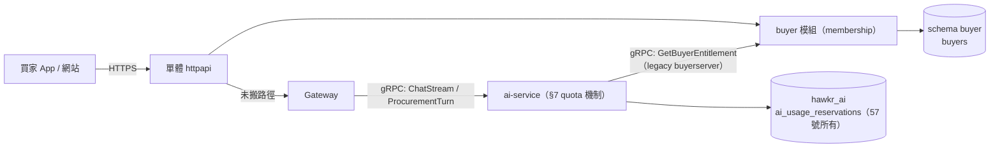
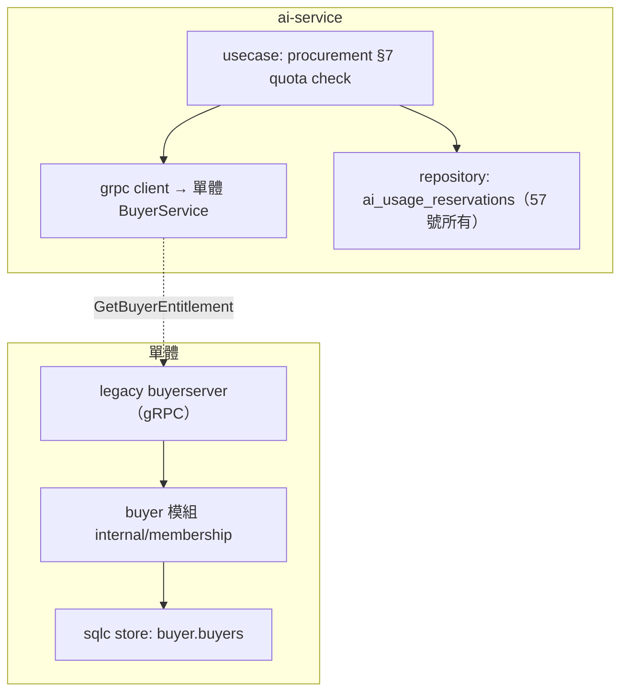
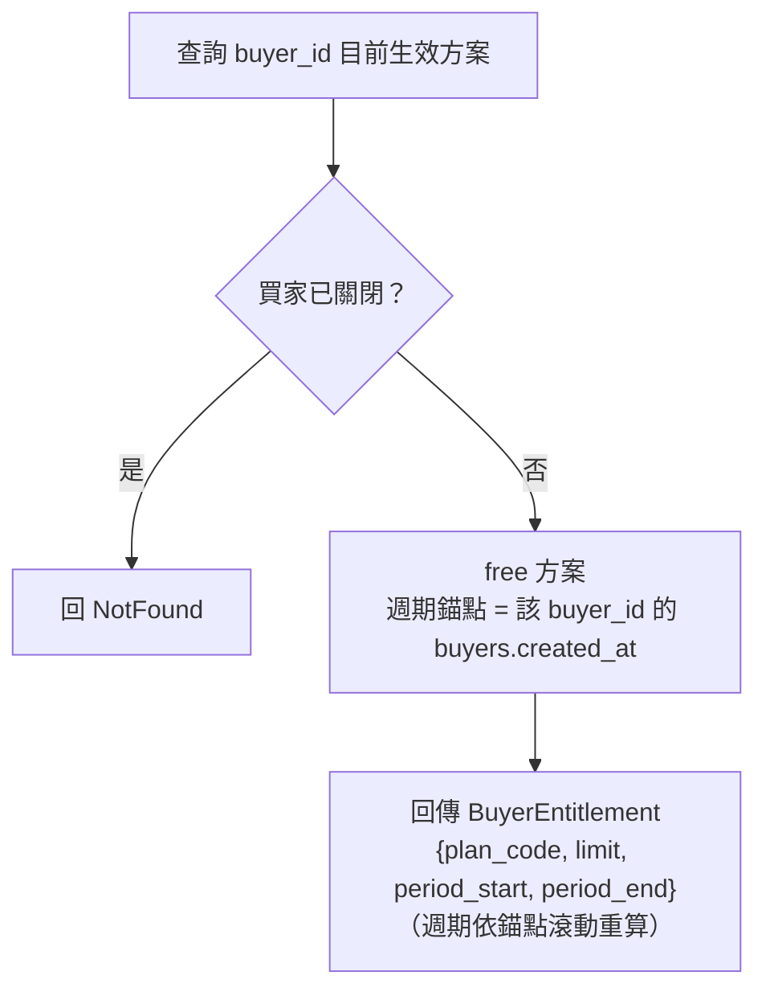
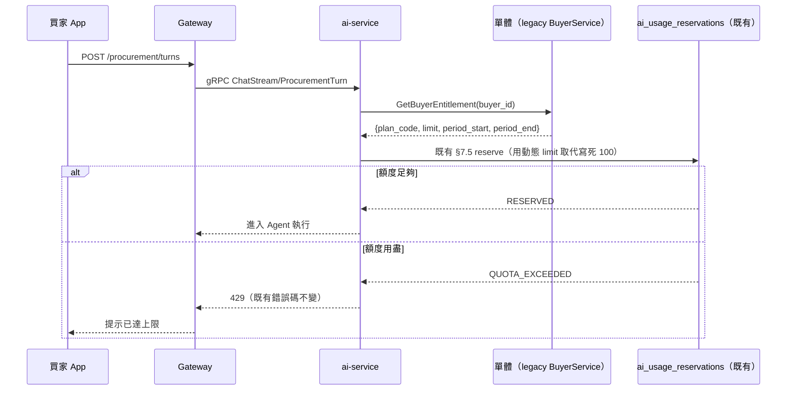

# 買家會員分級與 Agent 額度方案（Buyer Membership & Entitlement）detailed-design

---

## 0. 文件元資訊 (Metadata)

| 項目 | 值 |
|---|---|
| 維護者 | Will |
| 對應程式碼 | `backend/internal/modules/buyer/internal/membership/membership.go`（單體 buyer 模組）、`backend/internal/legacy/buyerserver/server.go`（給 ai-service 的 `GetBuyerEntitlement`）、`services/ai-service/internal/client/buyer/adapter.go`、`services/ai-service/internal/procurement/usecase/turn.go` |
| 相關 ADR | [2026-09-18-buyer-membership-entitlement-model](/docs/adr/2026-09-18-buyer-membership-entitlement-model.md) |
| 相關 doc | [57-Hawkr 幫找 Agent Runtime（Agent Runtime）detailed-design](./57-agent-runtime-detailed-design.md) §7（本設計的消費端） |

---

## 1. 概述與目標 (Overview & Goals)

### 1.1 文件定位

本文件描述買家會員分級（目前只有預設的免費額度）的「額度模型」：買家目前生效權益的判定，以及 `ai-service` 取得動態額度上限的契約。不涵蓋方案模型、訂閱計費（PayUni 定期定額串接）、網站購買流程與 Admin 操作介面，見 §1.4；方案模型（方案表、價格、指派）在步驟 11g 刪除，計費設計開工時再建。

### 1.2 服務一句話定位

單體 buyer 模組的 `internal/membership`，是「買家目前生效方案」的權威來源（source of truth），供 `ai-service` 查詢額度上限；`ai-service` 的用量計量機制（§7）不由本模組負責，額度上限與週期起訖則一律向本模組動態查詢。

### 1.3 設計目標 (Goals) 與 非目標 (Non-Goals)

| 類型 | 項目 |
|---|---|
| Goal | 每個買家的額度是 buyer 模組的具名常數（`free`、每月 100 次），`ai-service` 經 `GetBuyerEntitlement` 動態查詢；沒有方案表，也沒有後台調整或指派方案的路徑。 |
| Goal | `ai-service` 的 57 號 §7 reserve-commit-release 機制不受影響，只有額度上限與週期起訖改由本模組提供。 |
| Non-Goal | **不**做真的收費／扣款。 |
| Non-Goal | **不**做網站上的方案選購頁面。 |
| Non-Goal | **不**提供買家查詢自己額度的對外端點。 |
| Non-Goal | **不**做額度以外的功能差異化——三個等級的 Agent 能力完全相同，不做 per-tier 模型路由或功能旗標。 |
| Non-Goal | **不**做單次加購額度包（Top-up）；方案一律週期性。 |

### 1.4 與其他設計書／服務的關係

- **57 號《Hawkr 幫找 Agent Runtime》§7** 是本設計的消費端與機制來源（reserve/commit/release、`ai_usage_reservations` 表）。額度上限與週期起訖由本書 §5.1 的錨點滾動規則決定，計量軸是 `buyer_id`。
- **網站訂閱購買流程**、**Admin 操作介面** 是本書 API 的前端消費者，各自另開設計。
- 產品規劃脈絡（分級定義、業務規則白話版、時程總覽）見對應的產品規格書；本文件只涵蓋工程架構。

---

## 2. 範圍與情境 (Context & Scope)

### 2.1 系統情境圖 (C4 Context)

### 2.2 邊界與責任

| | 涵蓋 (In-scope) | 不涵蓋 (Out-of-scope，由誰負責) |
|---|---|---|
| buyer 模組 | 買家目前生效權益的判定（預設額度常數） | 真實扣款、購買 UI（不做） |
| ai-service | 額度用量計量（reserve/commit/release，57 號所有）、經 legacy `GetBuyerEntitlement` 取得動態上限 | 方案定義與異動 → buyer 模組 |

### 2.3 角色與身份模型

- **BUYER**：一般買家；目前沒有對外查詢自己額度的端點（見 §6.1）。
- **ADMIN**：沒有方案相關的入口（`BuyerAdminService` 只剩 `GetBuyerStats`）。
- **系統內部**：`ai-service` 以 gRPC 呼叫單體的 legacy `BuyerService.GetBuyerEntitlement`，帶入的 `buyer_id` 必須是 `ai-service` 自己已解析出的買家 id（`buyerIDFromContext` 慣例），不可信任任何外部可控欄位（principal 與業務 domain ID 必須分開）。

---

## 3. 約束與前提 (Constraints & Assumptions)

| 類型 | 項目 |
|---|---|
| 技術約束 | 額度是 buyer 模組 `internal/membership` 的具名常數（`DefaultPlanCode`、`DefaultMonthlyAnswerLimit`）；schema 走單體模組的 Atlas desired state；金額以新台幣整數元表示，禁止浮點。 |
| 既有系統約束 | `ai_usage_reservations`／§7 reserve-commit-release 是 57 號的機制，本書**不修改它**，只提供 limit／period 來源；`account_id` 是登入 principal，`buyer_id` 是業務身份，兩者不可互換（沿用 57 號 §2 慣例）。會員分級／額度計量軸是 **`buyer_id`**。一個帳號一生只有一個買家（建帳的 transaction 內建立，只隨帳號刪除關閉，見 [ADR 2026-09-30-account-created-provisions-buyer](/docs/adr/2026-09-30-account-created-provisions-buyer.md)），所以權益實際上跟著帳號；刪除帳號後重新註冊是新帳號、新買家，從 free 重新起算。 |
| 契約約束 | 本模組的對外契約不提供跨版本相容窗口；契約異動一律直接替換，不保留舊欄位／舊語意。 |
| **假設 (Assumptions)** | `ai-service` 對 `GetBuyerEntitlement` 的呼叫頻率＝每次 agent turn 一次，量級與 `/procurement/turns` 相同 → **QPS 上升到需要快取時才觸發 §9.2 重新評估**，不預先加快取。 |

---

## 4. 架構 (Architecture)

### 4.1 解法總綱 (Solution Strategy)

切成三層職責：(1) buyer 模組持有買家的有效權益（預設常數與額度週期），是低頻寫、低頻讀的 control plane；(2) `ai-service` 持有用量 ledger，是高頻讀寫路徑；(3) 兩者透過 legacy gRPC `GetBuyerEntitlement`（單體的 `internal/legacy/buyerserver`）橋接——`ai-service` 在 57 號 §7.5 reserve 步驟之前，同步呼叫它取得「目前方案的額度上限＋週期起訖」，以該值執行 reserve 判斷。

「這個買家是什麼會員方案」是買家的屬性；因為一個帳號一生只有一個買家，兩者一一對應。選型理由見[相關 ADR](/docs/adr/2026-09-18-buyer-membership-entitlement-model.md)。

### 4.2 元件視圖 (C4 Component)

| 模組/package | 責任 | 依賴 |
|---|---|---|
| buyer 模組 `internal/membership` | 權益計算（固定 free 方案與具名常數額度，額度週期依錨點逐月滾動） | sqlc store |
| `ai-service/internal/procurement` | 57 號 §7.5 reserve 之前呼叫 `GetBuyerEntitlement` 取得動態 limit | `internal/client/buyer` grpc client |

### 4.3 部署拓撲與 Port

membership 是單體 buyer 模組的一部分，沒有獨立進程或 port；`GetBuyerEntitlement` 由單體的 legacy BuyerService 提供。

### 4.4 命名／契約規約

- `plan_code` 目前只有 `free`（`membership.DefaultPlanCode`）；回應形狀保留，計費設計開工時再決定值域。
- ai-service 呼叫的 legacy gRPC 是 `GetBuyerEntitlement`。

### 4.5 實作位置

| 位置 | 責任 |
|---|---|
| `backend/api/proto/buyer/buyer.proto` | legacy `GetBuyerEntitlement`（ai-service 搬進單體前的契約） |
| `backend/internal/modules/buyer/internal/membership/` | 權益計算（含錨點滾動）與預設額度常數 |
| `backend/internal/modules/buyer/db/` | buyer schema 的 desired state 與 migration（歷史 `*_buyer_membership_plan_seeds.sql` 是常數額度的來源值，`*_drop_buyer_membership_plans.sql` 刪表） |
| `backend/internal/legacy/buyerserver/server.go` | `GetBuyerEntitlement` 的 legacy handler |
| `services/ai-service/internal/client/buyer/adapter.go` | 呼叫 `GetBuyerEntitlement` 的 grpc client |
| `services/ai-service/internal/procurement/usecase/turn.go` | reserve 前取動態 limit |

---

## 5. 資料設計 (Data Design)

### 5.1 資料模型

欄位與約束的唯一來源是 `backend/internal/modules/buyer/db/schema.sql`；本節只說明語意。

> 權益不落地：沒有方案表（步驟 11g 刪除 `membership_plans`），也沒有指派方案的寫入路徑，由 `Entitlement` 在查詢時以常數 `free`／100 次與買家的錨點計算。要讓買家有不同方案，需要新的設計（含儲存、價格與購買流程），不是恢復舊表。

**不變式**：

- 每個買家的有效權益固定是 `free` 方案，`monthly_answer_limit` 是常數 `DefaultMonthlyAnswerLimit`（值與歷史 seed 的 free 列相同，改值要改程式並發布）。
- 週期錨點＝**該買家 stint 的 `buyers.created_at`**（買家在建帳的 transaction 內建立，所以等於建帳時間）。已關閉（CLOSED）的買家查詢權益回 NotFound。
- 權益不落地：每次查詢由 `Entitlement` 依 `buyers.created_at` 與當下時間計算，沒有狀態需要遷移或過期標記。
- **週期公式（錨點滾動）**：以 `buyers.created_at` 為錨點逐月滾動至涵蓋 `NOW()` 的那一格。`period_end` = `period_start` 下個月同一天（calendar-month anchored）。月底邊界 clamp 規則：若 `period_start` 的日期在下個月不存在（例如 1/31 起算，2 月無 31 日），`period_end` 取該月最後一天（1/31 → 2/28 或 2/29）；次一週期從該 clamp 後的日期繼續算，**不回補漂移**（不保留原始錨點日，也不追蹤累積誤差）。

**生效方案判定邏輯**：

### 5.2 索引與查詢模式

| 索引 | 用途 |
|---|---|
| `buyers` PK | 以 `buyer_id` 讀取錨點（`created_at`）與狀態 |

### 5.3 序號／排序／一致性

無 seqId 需求（非即時串流資料）；權益不落地，沒有需要排序或一致性保護的寫入。

### 5.4 Schema 演進與遷移

- buyer 的表定義在模組的 `db/schema.sql`（desired state），migration 由 `atlas migrate diff` 產生；會員方案表已由 `*_drop_buyer_membership_plans.sql` 刪除。
- schema 變更一律走 Atlas，不得直接對遠端 DB 下 DDL。

---

## 6. API 與介面契約 (API & Interface Contracts)

### 6.1 後台 API（Connect）

沒有會員相關的後台 API：`ListMembershipPlans`、`UpdateMembershipPlan` 與 `MembershipPlan` 訊息在步驟 11g 刪除（`BuyerAdminService` 只剩 `GetBuyerStats`）。也沒有查詢單一買家方案的後台 API，沒有買家查詢自己額度的對外端點。

### 6.2 legacy gRPC（給 ai-service）

ai-service 搬進單體前，以 legacy `BuyerService.GetBuyerEntitlement`（`backend/api/proto/buyer/buyer.proto`，由單體的 `internal/legacy/buyerserver` 提供）取得額度：

| RPC | 呼叫者 | 語意 |
|---|---|---|
| `GetBuyerEntitlement` | `ai-service` | 以 `buyer_id` 查目前生效方案，回傳 `plan_code`／`monthly_answer_limit`／`period_start`／`period_end`。回 free 方案與依 `buyers.created_at` 錨點算出的週期；買家已關閉時回錯誤 |

契約規約（legacy 慣例）：
- 數值與 ID 欄位（`buyer_id`／`monthly_answer_limit`）是 `string`。
- Response 帶 `int32 code` ＋ `string message` envelope；`code != 0` 時其餘欄位為零值。
- 時間欄位是 RFC3339 UTC 字串。

### 6.3 非同步事件 (MQ)

N/A——本模組不發 MQ 事件。

### 6.4 即時通道 (WS/SSE)

N/A——無新增 WS/SSE；既有 `/turns/stream` 的 `quota` 子物件欄位形狀不變，只是內容數值來源改變。

---

## 7. 執行時視圖 (Runtime View)

### 7.1 主要場景（happy path）

(a) 買家發起 agent turn：`ai-service` 在 57 號 §7.5 reserve 步驟前，先同步呼叫 `GetBuyerEntitlement(buyer_id)` 取得目前 `limit`／`period`（`buyer_id` 由 `buyerIDFromContext` 解析），再用該值執行 reserve 判斷；57 號的其餘機制（`pg_advisory_xact_lock`、RESERVED→COMMITTED、TTL 隱式釋放）不受影響。

### 7.2 時序圖

**Agent turn 額度檢查（新增一步）**

### 7.3 失效與重試

| 呼叫 | 逾時 | 重試 | 失敗時行為 |
|---|---|---|---|
| `ai-service → GetBuyerEntitlement` | 沿用 `pkg/` 的內部 gRPC client 逾時設定 | 不重試（使用者即時互動路徑，重試只會拖長等待） | **fail-closed**：拒絕該次 agent turn，回傳系統忙碌訊息 |

### 7.4 並發與順序

- `ai-service` 端沿用 57 號 §7.5 的 `pg_advisory_xact_lock`，本模組不改動它。
- buyer 模組端：權益只讀不寫，沒有並發寫入問題。

### 7.5 連線／狀態生命週期

N/A——無 WS/長連線/工作流；權益不落地，沒有狀態機。

---

## 8. 跨切面關注點 (Crosscutting Concerns)

### 8.1 安全與授權

- 後台 API 走單體 httpapi 的管理員授權，不新發明權限。
- `ai-service → GetBuyerEntitlement` 的內部 gRPC 呼叫走既有內部服務網路信任邊界，機器對機器不需額外使用者身份驗證；但傳入的 `buyer_id` 必須是 `ai-service` 已解析出的買家 id（既有 `buyerIDFromContext`），不可信任外部可控欄位。

### 8.2 可觀測性 (Observability)

- 沒有專屬的 metric；§9.2 需要評估快取時，再加 `GetBuyerEntitlement` 的延遲量測。

### 8.3 錯誤處理與降級 (Failure Modes & Degradation)

| 依賴 | 不可用時行為 |
|---|---|
| 單體不可用 | `ai-service` 額度查詢 fail-closed，agent turn 一律拒絕 |
| `ai-service` 不可用 | 不影響 buyer 模組，權益計算不依賴 `ai-service` |

### 8.4 一致性與冪等

權益只讀不寫，沒有寫入路徑。

### 8.5 設定與機密

無 secret；`ai-service` 的 buyer gRPC client 目標位址指向單體的 legacy BuyerService。

---

## 9. 品質需求與 NFR (Quality Requirements / SLO)

### 9.1 SLO / SLI

| 指標 (SLI) | 目標 (SLO) | 量測點 |
|---|---|---|
| `GetBuyerEntitlement` P95 延遲 | < 50ms | 內部 gRPC client 端量測 |

### 9.2 容量與規模 (Capacity & Scaling)

呼叫量與 `/procurement/turns` 同量級（每次 agent turn 一次）。**Scaling 觸發條件**：當「每次 turn 一次同步 RPC」成為延遲瓶頸（`GetBuyerEntitlement` P95 超過 §9.1 的 50ms 目標）時，才在 `ai-service` 端評估短 TTL 快取（例如 60 秒）；在那之前不加快取。

### 9.3 效能預算

新增的內部 RPC 呼叫（目標 <50ms）相對於 LLM 生成時間（數百 ms 至數秒）可忽略不計，不影響既有端到端延遲預算。

---

## 10. 設計理由

方案比較、被否決的選項與取捨理由見 [2026-09-18-buyer-membership-entitlement-model](/docs/adr/2026-09-18-buyer-membership-entitlement-model.md)（資料歸屬服務、週期公式、fail-closed、計量軸、admin CRUD 範圍）。本節不複述理由。

---

## 11. 風險與技術債 (Risks & Tech Debt)

### 11.1 已知風險與技術債

| 項目 | 嚴重度 | 影響 | 緩解 / 追蹤 |
|---|---|---|---|
| 單體是 agent quota 查詢路徑上的依賴 | 中 | fail-closed 設計下，單體掛掉會連帶讓 agent 全面不可用 | 流量上升時觸發 §9.2 的快取評估 |
| 刪除帳號後重新註冊，會員權益歸零 | 低 | 新帳號是新買家，從 free 起算 | 帳號刪除是不可逆的（`accountdeletion`），本模組不另做補償 |

---

## 12. 部署與維運 (Deployment & Operations)

### 12.1 環境與設定

membership 不引入任何 env var。

### 12.2 遷移步驟

- 結構變更一律走 Atlas migration（§5.4）。
- 額度是 placeholder 常數；正式開放方案前由營運定案，定案後依計費設計建立方案模型。

### 12.3 健康檢查與優雅關閉

N/A——沿用單體與 ai-service 既有的健康檢查，本模組不引入獨立進程。

### 12.4 Runbook

額外影響範圍：單體不可用時 agent 會一併不可用（§8.3 fail-closed）。

---

## 13. 測試策略 (Test Strategy)

| 層級 | 覆蓋 | 關鍵場景 |
|---|---|---|
| unit | buyer 模組 `internal/membership` | 週期錨點計算與月底 clamp |
| unit | `ai-service` | mock `GetBuyerEntitlement` 回傳不同 limit，驗證 57 號 §7 reserve/commit/release 正確套用該 limit |
| integration | testcontainers | 預設額度常數與週期（`TestDefaultEntitlementQuota`、`TestEntitlementIsFreePlanWithRollingPeriod`） |
| integration | 跨服務 | `ai-service` 呼叫 `GetBuyerEntitlement` 逾時／失敗時的 fail-closed 行為 |

---

## 14. 術語表 (Glossary)

| 術語 | 定義 |
|---|---|
| 錨點滾動週期 | 以買家自己的錨點（`buyers.created_at`）起算、逐月推進的額度計算週期：每月同一天、月底 clamp（§5.1）。它是**買家個人**錨點（不同買家各自不同天），與「全平台日曆月固定重置」不是同一件事，不要混淆 |
| `GetBuyerEntitlement` | `ai-service` 向單體的 legacy BuyerService 查詢買家目前方案額度上限與週期起訖的內部 gRPC |
