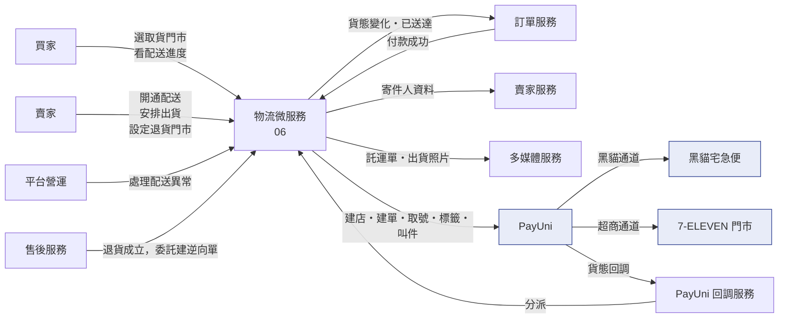
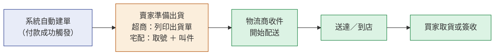
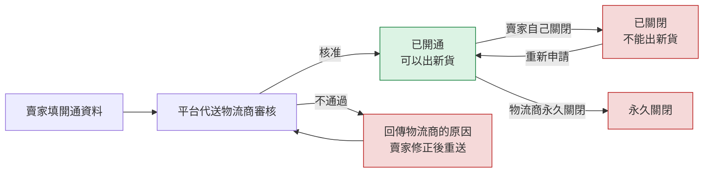
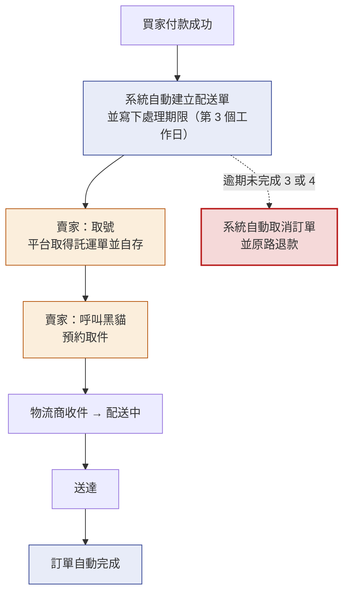
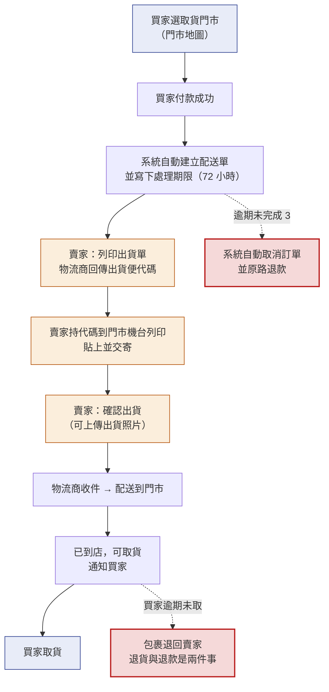
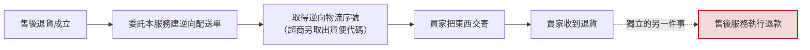
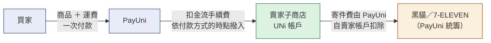
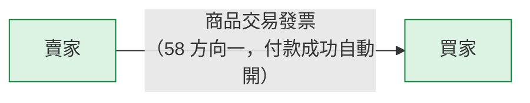
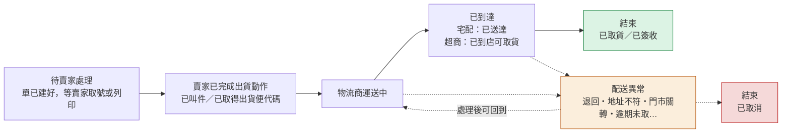

# 06 · 物流微服務（基本設計）

> **這是外部設計。** 實作契約（DDL／proto／端點簽章／狀態機轉移邊／陷阱）在
> [詳細設計書 06](../詳細設計書/06-物流微服務（Shipping%20Service）詳細設計書.md)。
> 本書不重複那些內容，每一節指向對應章節。

> **本書的範圍是「平台原本就在跑的那兩種配送方式」**：黑貓宅急便與 7-11 店到店。
> 跨配送方式共用的骨架（四個正交維度、三條資金線、共通業務規則）在
> [65 物流履約平台基本設計書](65-物流履約平台（Fulfillment%20Platform）基本設計書.md)。

---

## 0. 這個服務解決什麼問題

**平台自己不送貨，但買家付錢之後總得有人把東西送到。** 這個服務是平台與物流商之間的**唯一閘道**：
它把「一筆已付款的訂單」變成「一張物流商認得的配送單」，然後把物流商回報的貨態翻譯回訂單看得懂的進度。

它同時解決三個具體問題：

| 問題 | 這個服務怎麼處理 |
|---|---|
| 賣家不會也不該自己去對接物流商 | 賣家只在平台上按「安排出貨」；建店、建單、取號、標籤、貨態全部由本服務代為處理 |
| 買家想知道「我的東西到哪了」 | 本服務持有每張配送單的當前貨態，並在狀態變化時通知訂單與買家 |
| 賣家收了錢卻不出貨 | 建單時就寫下**處理期限**，逾期由系統自動取消並原路退款 |

**不做會怎樣**：每個賣家各自去跟物流商簽約與對接（絕大多數賣家做不到）；
或由訂單服務自己打物流商 API——那會讓「訂單狀態」與「物流狀態」在同一個地方互相污染，
而物流商回報的貨態有跳號、有亂序、有重複，混進訂單狀態機就再也分不出是誰造成的。

## 1. 誰在用，跟誰互動

| 角色 | 在這裡做什麼 |
|---|---|
| **買家** | 下單時選取貨門市（超商）；查看配送進度 |
| **賣家** | 開通配送方式；安排出貨（列印出貨單／取號／叫件／確認出貨）；設定退貨門市；查看自己訂單的物流追蹤 |
| **平台營運（ADM）** | 看配送異常清單；處理卡住的配送單 |

**上下游**

| 對象 | 關係 | 為什麼需要 |
|---|---|---|
| **訂單服務** | 付款成功時通知本服務建單；本服務的貨態變化回推訂單進度 | 訂單不自己打物流商，本服務不自己改訂單狀態 |
| **售後服務** | 退貨成立時委託本服務建立**逆向**配送單 | 退貨物流與正向物流是同一組物流商能力，但角色對調 |
| **賣家服務** | 提供寄件人資料與賣家的物流商商店代號 | 建單需要寄件人 |
| **多媒體服務** | 宅配託運單存放、出貨照片 | 標籤與照片是證據，不能只存在物流商那側 |
| **PayUni** | **黑貓與 7-11 店到店共同的建店與物流單通道** | 平台是代理商，賣家是合作商店 |
| **PayUni 回調服務** | 統一接收物流商回調後再分派給本服務 | 回調入口只有一個，去重與驗簽在那裡先做一次 |

## 2. 核心模型：一張配送單，兩個方向，三個里程碑

**配送單是訂單的附屬物，不是訂單。** 一筆訂單對應一張正向配送單；
退貨成立時**另外**建一張逆向配送單，兩張單各自有自己的貨態。

| 概念 | 是什麼 | 誰給的 |
|---|---|---|
| **配送單** | 平台內部的一張單，記錄這筆訂單要怎麼送、送到哪、現在到哪了 | 平台 |
| **物流序號** | 物流商認得的單號，建單成功後由物流商回傳 | 物流商 |
| **出貨便代碼** | 超商店到店專用：賣家拿這組代碼到門市的機台列印出貨單 | 物流商（回調帶回） |
| **託運單** | 宅配專用：賣家印出來貼在箱子上的那張紙 | 物流商（我方下載後自存） |

**兩個方向**

| 方向 | 寄件人 | 收件人 | 誰觸發 |
|---|---|---|---|
| **正向**（出貨） | 賣家 | 買家 | 付款成功後系統自動建單 |
| **逆向**（退貨） | **買家** | **賣家** | 售後退貨成立後委託建單 |

⚠️ **逆向不是「把正向反過來跑」，是一張新的單**：角色對調、門市換成賣家的退貨門市、
單號另外編。把它做成同一張單的狀態回退，會讓「這箱東西現在在誰手上」變得無法回答。

**三個里程碑**（賣家視角的實際工作）

🔴 **第一個里程碑是自動的，第二個要賣家動手，第三個之後平台只是旁觀者。**
這條界線決定了「卡住的時候該催誰」：卡在第二格催賣家（並且有處理期限在跑），
卡在第三格之後只能查物流商。

## 3. 賣家要先開通

**沒開通的賣家一張單都建不出來。** 開通的實際內容是「在物流商那邊成為一家有寄件資格的商店」，
帳號由物流商管理，平台只是代送申請。

| 要開通的 | 賣家要填什麼 | 特別之處 |
|---|---|---|
| **黑貓宅急便** | 寄件地址（含郵遞區號） | 🔴 **地址開通後鎖定**，之後變更要走物流商客服 |
| **7-11 店到店** | 寄件人姓名與電話 ＋ **退貨門市** | **常溫與冷凍各自開通**（是兩個獨立的資格） |

🔴 **「不能出新貨」不等於「不能處理舊單退件」**，這是本服務最容易做錯的一格。
賣家在平台上關閉某種配送方式，表達的是**他現在不想用這個方式出貨**；
但已經成立的訂單，買家的退件權是當時契約給的，不因為賣家之後關掉而消失。
⇒ **出新貨要看當下意願（必須開通且啟用），處理舊單退件只看當時有沒有資料**。

⚠️ 退貨門市屬於**賣家的物流設定**，不是賣家資料。它決定買家退貨時要把東西送到哪一家門市。

## 4. 主要業務流程

### 4.1 黑貓宅急便：從付款到送達

1. 買家付款成功 → 系統**自動**建立配送單（賣家不必按任何按鈕）
2. 系統同時寫下**處理期限**：第 3 個工作日結束前，賣家必須完成出貨動作
3. 賣家在賣家端按「取號」→ 平台向物流商取得託運單並存下來 → 賣家印出來貼上
4. 賣家按「呼叫黑貓」→ 平台向物流商預約取件（可指定是否需要聯絡、是否需要台車、備註）
5. 物流商收件 → 配送中 → 送達
6. 送達後訂單自動完成；買家可在訂單頁看到每一個貨態時間點

**這一條的四個「誰」**（[65 §26 的比較題](65-物流履約平台（Fulfillment%20Platform）基本設計書.md)）：

| 問題 | 答案 |
|---|---|
| 誰收買家的款？ | **賣家**（款項進賣家自己的 PayUni 子商店） |
| 誰配送？ | 黑貓宅急便（我方**經 PayUni** 叫件，不直接對接黑貓） |
| 誰開發票給買家？ | **賣家** |
| 誰可以叫件？ | **賣家**（在賣家端按「呼叫黑貓」）。平台不代賣家叫件，因為叫件等於承諾貨已備妥 |
| 退款怎麼走？ | 走售後服務的既有退款鏈，**原路退回**；退貨的實體回收另外建一張逆向配送單（§4.3） |

### 4.2 7-11 店到店：從付款到取貨

1. 買家在購物車／結帳時**自己選取貨門市**（開一張門市地圖，選完帶回門市代碼）
2. 買家付款成功 → 系統**自動**建立配送單，並寫下處理期限（建單後 72 小時）
3. 賣家按「列印出貨單」→ 平台觸發物流商處理 → 物流商回傳**出貨便代碼**（三段）
4. 賣家持代碼到任一門市的機台列印出貨單 → 貼上 → 交寄
5. 賣家在賣家端按「確認出貨」（可同時上傳出貨照片）→ 訂單進入配送中
6. 物流商收件 → 配送到指定門市 → **到店可取貨**（通知買家）→ 買家取貨

**這一條的四個「誰」**：

| 問題 | 答案 |
|---|---|
| 誰收買家的款？ | **賣家**（進賣家子商店）。🔴 **平台一律「取貨不付款」**，不支援到店付現 |
| 誰選門市？ | **買家**（取貨門市）。賣家只選**退貨門市**，那是開通時設定的另一件事 |
| 誰產生物流單？ | **系統**，在付款成功時自動建。賣家不需要、也不能自己建 |
| 誰確認出貨？ | **賣家**。列印出貨單只代表「代碼拿到了」，真正的出貨是賣家交寄後按「確認出貨」 |

⚠️ **「列印出貨單」與「確認出貨」是兩個動作，不要合併**：中間隔著賣家跑一趟門市。
把它們合成一步，系統會在賣家還沒交寄時就告訴買家「已出貨」。

### 4.3 退貨物流（逆向）

退貨成立後，由售後服務**委託**本服務建立逆向配送單。角色對調：

| | 正向 | 逆向 |
|---|---|---|
| 寄件人 | 賣家 | **買家** |
| 收件人 | 買家 | **賣家的退貨聯絡人** |
| 超商門市 | 買家選的取貨門市 | **賣家開通時設定的退貨門市** |

🔴 **退貨與退款是兩件事。** 逆向配送單走到底只代表「東西回到賣家手上」；
錢什麼時候退、退多少，是售後服務依退款規則決定的。
本服務**不因為逆向配送單完成就去改金流**。

⚠️ **逆向建單不檢查賣家現在有沒有開通**（§3 那條紅字）：買家的退件權來自當時的訂單契約。

### 4.4 賣家逾期未處理 → 系統自動取消並退款

這是本服務唯一會**主動讓訂單消失**的流程，所以它的規則刻意寫得很死。

| 配送方式 | 處理期限 | 什麼算「已處理」 |
|---|---|---|
| 7-11 店到店 | 建單後 **72 小時** | 出貨便代碼已取得（列印成功） |
| 黑貓宅急便 | **第 3 個工作日結束前**（會跳過假日） | 已成功呼叫黑貓 |

- 賣家一完成處理動作，期限立刻清空，買家端的倒數同時消失。
- 逾期則由系統自動取消訂單並**原路退款**（跨服務的完整取消鏈在
  [09 售後服務](../詳細設計書/09-售後微服務（AfterSales%20Service）詳細設計書.md)）。

⚠️ **期限的權威在配送單上，訂單上那一份是快照**。兩邊不一致時以配送單為準。

## 5. 錢與發票怎麼走

### 5.1 買家付款（線 A）

🔴 **平台不在這條線上。** 這兩種配送方式的三件事都不經過平台：
- 買家的錢**直接進賣家自己的 PayUni 子商店**（平台只是代理商）
- **寄件費由 PayUni 從賣家帳戶扣**，平台不代墊、不代收、不向賣家收費
- 賣家帳戶餘額什麼時候撥到賣家銀行帳戶，是賣家與 PayUni 之間的事

⇒ **本書沒有「平台向賣家收物流費」這條線，也沒有「平台與物流商結算」這條線**
這不是漏寫，是這兩種方式的實際情形。

### 5.2 發票

| 問題 | 答案 |
|---|---|
| 誰對買家開票？ | **賣家**（走 [58 號](58-電子發票服務（Invoice%20Service）基本設計書.md) 的方向一，付款成功即開） |
| 平台對賣家開票嗎？ | **不開**。平台沒有向賣家收取任何物流相關費用 |
| 賣家對平台開票嗎？ | **不開** |
| 退款時誰處理發票？ | **賣家**（同月作廢、跨月折讓，判準在 58 號） |
| 只退運費時？ | 賣家對買家開折讓，金額是運費部分 |

## 6. 一張配送單會經歷什麼

**用業務語言講，一張正向配送單有五個階段**（完整貨態值域與轉移規則在
[06 詳設 §2.1](../詳細設計書/06-物流微服務（Shipping%20Service）詳細設計書.md)）：

🔴 **三條關於階段的硬規則**（做錯的症狀都是靜默的）：

1. **不得倒退回「待處理」**。物流商一旦推進到運送中或異常，就不會再回頭說「還沒出貨」；
   收到這種回報視為錯誤推送，必須擋下來，否則會污染下游的訂單進度。
2. **物流商會跳號**。可能直接從「待處理」跳到「運送中」，中間的里程碑不一定收得到——
   所以進度顯示不能假設每一格都會經過。
3. **「已到店」不是終點**，「已取貨」才是。買家逾期未取會退回，而**退回不等於退款**。

## 7. 出事的時候會怎麼樣

| 情況 | 處置 |
|---|---|
| 建單失敗（寄件人資料不全、地址郵遞區號不符） | 不建立配送單，回傳物流商的原始原因給賣家修正；訂單停在待出貨 |
| 貨態回報漏收 | 有兩條補救路：買家或賣家按「查看物流」時**即時向物流商查一次**；另有排程定期補收 |
| 同一則回報收到兩次 | 兩層去重（回調入口一層、本服務再一層），重複的直接忽略 |
| 賣家逾期未出貨 | 系統自動取消訂單並原路退款（§4.4） |
| 配送異常（退回、地址不符、門市關轉） | 通知賣家並顯示物流商的原始原因；門市關轉處理後可以回到配送中 |
| 買家逾期未取（超商） | 包裹退回賣家；**退貨與退款是分開的兩件事** |
| 收件人姓名含空白或符號 | 🔴 建單當下就會被物流商拒絕 ⇒ 在源頭就驗，不是等建單失敗才發現 |
| 賣家關閉了配送方式，但舊單要退貨 | 照樣可以建逆向單（§3 紅字） |

⚠️ **「物流商接受了我的請求」不等於「事情成了」**：
列印請求被接受 ≠ 代碼已回來；叫件成功 ≠ 司機已到。
每一個外部呼叫都要區分「已送出」與「已完成」兩種狀態，否則畫面會比現實樂觀。

## 8. 頁面地圖

> 前端四個 repo：`hawkr-website`（買家 Web 與賣家 Web 同一 repo，賣家在 `seller-center` 路由前綴下）、
> `hawkr-admin`、`hawkr_buyer`、`hawkr_seller`。

### 買家
| 畫面 | 解決什麼 |
|---|---|
| 購物車的運送方式選擇 | 選黑貓或超商取貨；選超商時要選門市 |
| 門市地圖 | 從物流商的門市地圖選一家，選完帶回平台 |
| 訂單追蹤與配送進度 | 看目前貨態與每一個時間點 |

### 賣家
| 畫面 | 解決什麼 |
|---|---|
| 物流與退貨設定 | 開通黑貓／超商、設定退貨門市、啟用或關閉某方式 |
| 訂單管理的安排出貨 | 列印出貨單／取號／呼叫黑貓／確認出貨（可批次） |
| 物流追蹤 | 查自己訂單的即時貨態 |
| 出貨異常 | 看卡住的配送單與物流商原因 |

### 營運
| 畫面 | 解決什麼 |
|---|---|
| 異常訂單管理的配送分頁 | 看所有配送異常，逐筆處理 |

## 9. 這個設計刻意不做的事

- ❌ **不支援貨到付款**：一律「取貨不付款」。代收會引入代收款的撥款、對帳與退款三套額外邏輯
- ❌ **不代賣家叫件**：叫件等於承諾貨已備妥，那是賣家的決定
- ❌ **不直接接收物流商回調**：回調統一由一個服務接，去重與驗簽只做一次
- ❌ **不管理訂單狀態**：本服務發出貨態事件，由訂單服務自己決定怎麼推進
- ❌ **不因為逆向配送完成就退款**：退貨與退款是兩件事
- ❌ **不在本服務算折扣或優惠**：運費由本服務算，商品金額不是本服務的事

## 10. 已知的外部相依

| 相依 | 卡在哪 | 沒解決會怎樣 |
|---|---|---|
| 賣家在物流商的開通審核 | PayUni（部分品類需人工） | 賣家看得到「待審核」，但建不出單 |
| 黑貓寄件地址開通後鎖定 | PayUni 客服 | 賣家搬家要走客服，平台端改不了 |
| 物流商貨態回調的到達率 | PayUni | 漏收會讓進度停住 ⇒ 必須有即時查詢與排程補收兩條路 |
| 收件人姓名格式限制 | 物流商規則 | 含空白或符號一律建單失敗 ⇒ 在源頭驗 |
