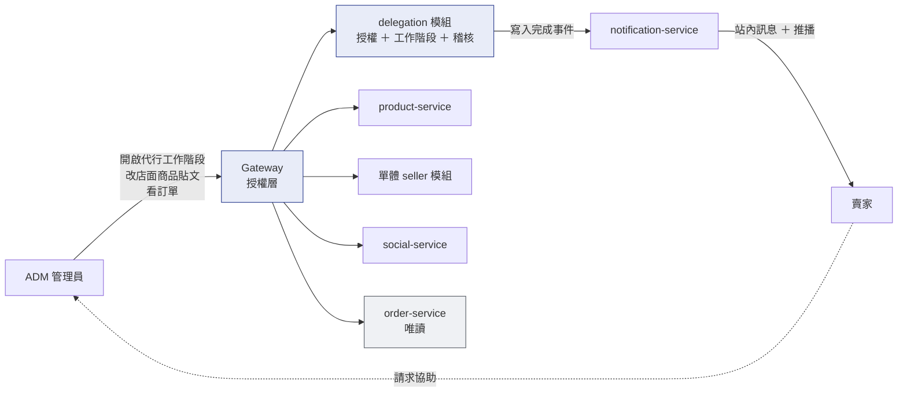
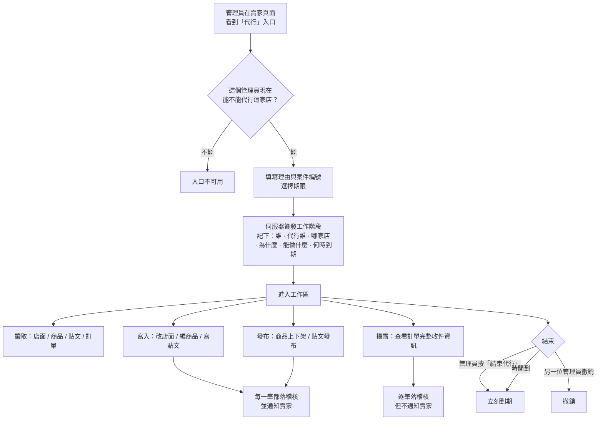
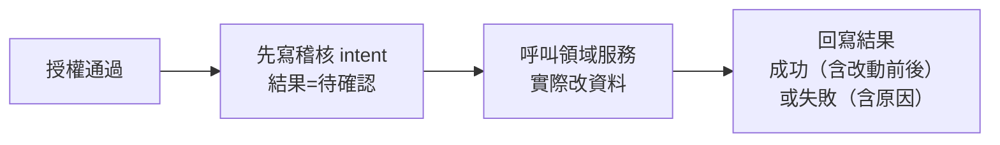
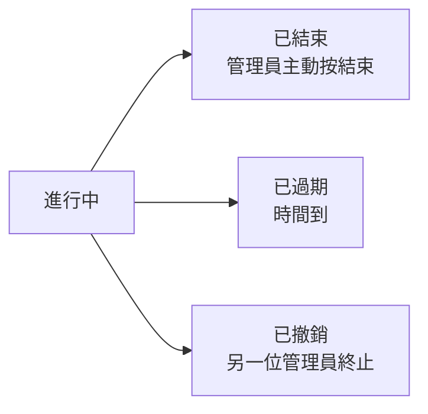

# 56 · ADM 代行營運（基本設計）

> **這是外部設計。** 實作契約（DDL／proto／端點簽章／capability 列舉／狀態機轉移邊／boot 斷言／實作陷阱）在
> [詳細設計書 56](../詳細設計書/56-ADM%20代行營運（Delegated%20Operations）詳細設計書.md)。
> 本書不重複那些內容，每一節指向對應章節。

---

## 0. 這個服務解決什麼問題

**平台客服常常需要「替賣家把事情做掉」。** 賣家不會操作、人在忙、或系統出了狀況——最後都變成客服在電話另一頭一步一步教，或者請賣家把帳號密碼給客服。

後者是真正的問題：**一旦客服拿到賣家的身分，他就什麼都能做**——包括出貨、取消訂單、退款。而事後查資料庫，那些操作全部記在賣家名下，「誰做的」永遠問不出答案。

本功能讓管理員**保持自己的身分**去操作指定店家：能改店面、商品、貼文，能看訂單；**不能出貨、不能退款、不能碰金流與身分認證**。每一筆寫入都留下「誰、對誰、為什麼、改了什麼」。

⚠️ **這不是「切換身分」也不是「登入賣家帳號」。** 管理員全程帶自己的憑證，下游看到的操作者始終是管理員本人 —— 這是整個設計的第一原則，也是所有對外文案禁用「切換身分」措辭的原因。

**不做會怎樣**：客服繼續要密碼（或平台繼續無法支援賣家）⇒ 賣家帳號被共用 ⇒ 出事時分不清是賣家自己做的還是平台做的 ⇒ 爭議無法裁決。

規模：9 個能力、10 個主要場景、四個領域服務（product／seller／social／order）。

---

## 1. 誰在用，跟誰互動

| 角色 | 他要達成什麼 |
|---|---|
| **ADM 管理員** | 替賣家把事情做掉，而且不必拿到賣家身分；出事時自己也說得清楚做了什麼 |
| **賣家** | 得到協助，同時**知道平台動過自己的店**（寫入完成後收到站內訊息與推播） |
| **另一位管理員** | 發現有人代行不當時，能立刻把那個工作階段撤銷掉 |

**四個領域服務都是既有的**：代行不複製第二套 Seller Center，讀寫一律走賣家原本的那些 RPC，只是多帶一個「這是代行」的語境。

---

## 2. 核心模型：四個不能混用的身分

**這是本功能最容易出錯的地方** —— 混用其中任兩個，直接造成授權漏洞或稽核失真。

| 概念 | 是誰 | 前端可否指定 |
|---|---|---|
| **Actor 操作者** | 目前登入的 ADM 管理員本人 | ❌ 只能由伺服器 session 取得 |
| **Subject 被代行者** | 被代行的賣家帳號 | ❌ |
| **Target Store 目標店家** | 該賣家的現任店鋪 | 網址上會帶，但**只用於交叉比對，不作為授權依據** |
| **Operation Session 工作階段** | 一次有理由、有範圍、有期限、可撤銷的授權 | ❌ 憑證由伺服器簽發 |

**三件必須知道的事實**：

1. **ADM 帳號不在賣家帳號那張表裡。** 兩者是獨立的表、獨立的 ID 空間，可能撞號 ⇒ 稽核必須有三個誠實命名的獨立欄位，不能用一個 `operator_id` 再靠類型欄位分辨。
2. **「管理員」不涵蓋「賣家」。** 系統的權限判定上兩者互不相容 ⇒ 代行**不可能**靠「管理員帶著自己的 token 直接打賣家路由」實現。這是本功能必須走獨立通道的根本原因。
3. **工作階段憑證是憑證，不是識別碼。** 單獨持有它就能操作目標店家 ⇒ 不得落 log、不得進 Sentry、不得存明文；明文只在兌換成功的回應交給購物站 BFF，不得出現在一般工作區查詢回應。這與「要配 token 才有意義」的一般識別碼判準不同。

> 四個概念的完整定義、ID 來源與 ID space 見詳細設計書 §2.3。

---

## 3. 為什麼不直接發一把賣家鑰匙

最省事的做法是「簽一枚賣家 token 給管理員用」。**本案明確否決**，兩個理由各自獨立成立：

| 面向 | 問題 |
|---|---|
| **能力過寬** | 賣家 token 一簽出，承載的是完整的賣家身分 ⇒ 12 個賣家能力**全部授予**，包含出貨、物流、售後、取消退款。代行的禁區在這條路上**沒有任何機械手段可以縮回來**，只剩「前端不要點」 |
| **稽核失真** | 換發賣家憑證後，一切寫入記的都是賣家 ⇒「誰做的」在資料層**永久無解**，而那正是代行功能存在的唯一風險控制點 |

所以定版形狀是：**管理員全程只帶自己的憑證。「代行誰」由伺服器持有的工作階段回答，「能做什麼」由授權層回答，「是不是真的被授權」由領域服務再驗一次。**

### 禁區靠三層鎖，不是靠「按鈕不要畫」

| 層 | 怎麼保證 |
|---|---|
| **畫面層** | 訂單頁根本不渲染出貨相關的按鈕（**不是 disabled**） |
| **路由層** | 服務啟動時做四道斷言，違反直接 panic 起不來 —— 不靠紀律 |
| **授權層** | 能力是**封閉列舉**，9 個裡沒有任何一個代表履約；領域服務的履約 RPC **連接收代行語境的欄位都沒有**，是編譯期而非執行期的保證 |

**任一層單獨失效都不會開門。** 禁區包含：備貨出貨、取消退款、金流財務、身分認證。

> 三道牆的完整分析、四道 boot 斷言、禁字清單與禁區機器名的差別見詳細設計書 §4.1 與 §8.1。

---

## 4. 一次代行從頭到尾

**每一次請求都要通過六道檢查**（不是只在建立時檢查一次）：憑證有效 → 工作階段未終止未過期 → 網址上的店家與工作階段記的一致 → 這個能力有被授權 → 授權沒有被撤回 → 這筆資源真的屬於目標店家。任一不成立就 fail-closed。

⚠️ **失效是靜默的**：前端在契約不符時會拒絕進入工作區或鎖死寫入，而**後端自己看起來是 200 成功** —— 沒有 5xx、沒有錯誤 log、沒有 Sentry 事件。所以「後端測試全綠」「部署成功」都不能證明這個功能可用，驗收必須走真實瀏覽器路徑。

> 六道檢查的述詞、業務碼對應與拒絕路徑的稽核形狀見詳細設計書 §7.1.4 與 §8.1。

### 一個會影響理解的架構事實：兩個網域各持一半憑證

代行的畫面橫跨**兩個網域**：ADM 後台的網域，與購物站的網域（工作區實際上長得像 Seller Center，所以它在後者）。

| 網域 | 持有什麼 | 負責哪些動作 |
|---|---|---|
| **ADM 後台** | 管理員的登入憑證 | 判定能不能代行、建立工作階段、撤銷、查稽核 |
| **購物站** | 工作階段憑證 | 工作區裡的所有讀寫、狀態輪詢 |

**兩者互相讀不到對方的憑證**（瀏覽器層級的隔離），而且**瀏覽器永遠打不到後端** —— 中間都隔著各自的伺服器端轉發。

⇒ 建立工作階段時只簽發**單次、60 秒**的兌換碼與安全摘要，不產生工作階段憑證。ADM 以自己的管理員身分按 session ID 讀取摘要並對帳，通過後把兌換碼帶到另一個網域；購物站兌換時才產生隨機工作階段憑證，且只有購物站收到明文。憑證**不能出現在網址上**。

**為什麼這件事寫進基本設計書**：它解釋了為什麼工作區「看起來像 Seller Center 卻是 ADM 功能」，也解釋了為什麼代行的網址不在 `/admin` 底下。不知道這件事的人會以為是路由設計錯了。

> 兌換碼的單次語意、CAS 述詞與六個防護條件見詳細設計書 §4.5「憑證跨 host 傳遞」與 §6.2.2。

---

## 5. 稽核怎麼保證不漏記

稽核寫在單體的 delegation schema，而現階段實際的改動仍由舊領域服務寫入各自的資料庫 —— **物理上不可能同一個交易**。A10 將編排搬進單體時重新檢查交易邊界。

所以不寫一個做不出來的「同交易」規格，改成兩階段：

**不變式是「不可漏記」** ——「任何改動之前必定已經有一列稽核」，這比同交易更強。

⚠️ **「待確認」不是待清理的垃圾，它本身就是稽核事實**（「曾嘗試、結果未確認」）。查詢時如實顯示、不計入成功數 ⇒ 不需要任何補償任務去掃它。

**稽核記什麼**：誰、對誰、哪家店、用了什麼能力、理由與案件編號、改動前後的差異、資源版本、以及一組追查用的識別碼。

> 兩階段的失敗組合、冪等處理與「為什麼不需要補償任務」見詳細設計書 §8.4。

---

## 6. 賣家怎麼知道平台動過他的店

寫入完成後發站內訊息與 App 推播給賣家。

**這件事的可靠性有保證**：稽核確認成功時在同一個 transaction 發出 `DelegationOperationCompleted`，同步訂閱者排入可靠派送 job。所以不會有「改了但通知掉了」。

⚠️ **但覆蓋率沒有保證，這是刻意的**：確認畫面上有一個「通知賣家」的勾選框，操作者可以不勾。而**查看訂單完整收件資訊恆為不通知**（那是逐筆的 PII 揭露，通知賣家沒有意義且會造成騷擾）。

⇒ 保證的是「**要發的那些一定發得出去**」，不是「每次代行賣家都會知道」。這兩者是不同的宣稱。

**本期只有站內訊息，沒有 Email** —— 不是漏掉的需求，是**平台目前沒有任何寄信能力**（全 repo 對 smtp／sendgrid／mailgun 等零命中，通知服務只有站內信與推播兩條路）。不要在實作時自己接一套 SMTP 進來。

> 通知的模板、事件契約與派送器的租約要求見詳細設計書 §4.1 支柱四與 §7.2。

---

## 7. 工作階段會經歷什麼

**兩種期限同時生效**：

| 期限 | 長度 | 意義 |
|---|---|---|
| **硬到期** | 30 分鐘 | 從簽發起算，**一經核發永不變動**（禁止用「還在操作就延長」的做法） |
| **閒置到期** | 15 分鐘 | 沒有操作超過這段時間就失效 |

⚠️ **禁止「還在操作就自動延長」**：那會讓一個持續操作中的工作階段無限延長，等於把期限這個風控參數取消掉 —— 而期限正是「撤銷之外唯一不依賴人的兜底」。

**曝險窗口的誠實記帳**：最壞情況（操作者持續操作）是 **30 分鐘**。閒置到期只把「無人操作」時的窗口收回 15 分鐘，**不能寫成「有閒置到期所以更安全」**。

**沒有排程器**。「已過期」不是被某個 job 改出來的狀態，而是**讀取時推導**的 —— 資料庫只存兩個持久狀態。這是本功能能完全避開「狀態同步 job」這類技術債的關鍵。

**工作階段記錄永不硬刪**，終止一律軟終止，保留可查詢的紀錄。

> 完整狀態值域、推導述詞與「結束＝立刻到期而不是第三個狀態」的實作見詳細設計書 §5.1 與 §7.5。

---

## 8. 一個例外：貼文排程發布

管理員可以替賣家排一篇之後才發布的貼文。**那篇貼文會在工作階段早就結束之後才真的發出去。**

這是本功能唯一「效力超出工作階段生命週期」的動作 —— 因為排程的語意就是如此。稽核在建立排程的當下就記好了（誰排的、排在什麼時候），實際發布由排程 worker 執行。

> 排程 worker 的搶佔要求與失敗處理見詳細設計書 §7.6。

---

## 9. 畫面地圖

代行的畫面全部在 **`hawkr-admin`**。⚠️ 詳細設計書 56 是**後端規格**，畫面的版面與元件契約在 admin repo 自己的測試裡。

| 路由 | 這一頁解決什麼 |
|---|---|
| `/admin/merchants` · `/admin/merchants/[id]` | 賣家列表與詳情 —— **代行的入口在這裡**，按下去先問「這個管理員現在能不能代行這家店」 |
| `/admin/delegated-operations` | 工作階段列表：現在有誰正在代行誰、什麼時候到期 |
| `/admin/delegated-operations/[sessionId]` | 單一工作階段的詳情與**工作區**：在這裡改店面、商品、貼文，看訂單 |
| `/admin/delegated-operations/audit-logs` | 稽核紀錄查詢：誰在什麼時候對哪家店做了什麼 |
| `/admin/anomalies` | 異常處理 —— 可從這裡把案件交接成一次代行 |

**本期渲染但不可操作的七個賣家模組**（庫存／優惠券／客戶管理／客戶訊息／數據分析等）：選單照常出現，點進去顯示「不在本次代行授權範圍」。**這是刻意的** —— 與禁區（根本不渲染）長得不一樣，因為它們不是禁區，只是本期未開放。

> 端點清單、能力對應與前端契約測試的檔案位置見詳細設計書 §4.5 與 §6.1。

---

## 10. 這個設計刻意不做的事

| 不做 | 為什麼 |
|---|---|
| **換發賣家 token／impersonation** | 能力縮不回來 ＋ 稽核永久失真（§3） |
| **用 iframe 嵌入 Seller Center，或複製第二套** | 代行走賣家原本的 RPC，不做第二套 UI |
| **讓代行取得任何履約能力** | 取號、託運單、叫件、確認出貨、取消物流、訂單取消與退款 —— **永不出現在能力列舉中** |
| **為到期新增排程器或前端心跳** | 兩種到期都是讀取時推導，活動時間戳的順延併進本來就要做的那次查詢 |
| **補償任務／對帳 job／漂移偵測** | 唯一例外是通知的 outbox，它有明確的可靠性理由 |
| **硬刪工作階段記錄** | 一律軟終止，保留可查詢的紀錄 |
| **寄 Email** | 平台目前沒有任何寄信能力，這是外部前提不是待補項 |
| **代操作優惠券／客戶管理／客戶訊息／庫存／數據分析等七項** | 各有獨立的否決理由（見 §11），不是「太貴所以沒做」 |
| **觸及不在本 repo 的 marketing 與 inventory** | 別團隊 |

---

## 11. 已知的外部相依與未來路線

| 項目 | 狀態 |
|---|---|
| **Email 通知通道** | 等平台具備寄信能力（外部前提，不由本案推動） |
| **既有 admin 路由逐條宣告能力** | 機制已建好，剩下的是 405 條路由級別的逐條判定；觸發條件：dev 連續運行 30 天無事故，或出現第一起需要事後追責的誤操作 |
| **代行範圍擴及其他賣家機能** | 七項各有要先推翻的理由：庫存（服務不在本 repo）／數據分析（等於放寬統計 RPC）／優惠券（發錯券由誰收拾未定）／客戶管理（批次 PII 揭露的稽核形狀未定）／客戶訊息（沒有真正的唯讀，讀取會讓買家看到已讀） |
| **賣家否認曾提出請求的爭議機制** | 等出現第一起爭議案例；需要新的通知類別與賣家端端點，兩個 App 都要發版 |

> 每一項的完整觸發條件與屆時要動的地方見詳細設計書 §11.3。
