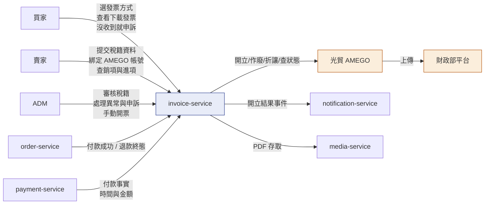
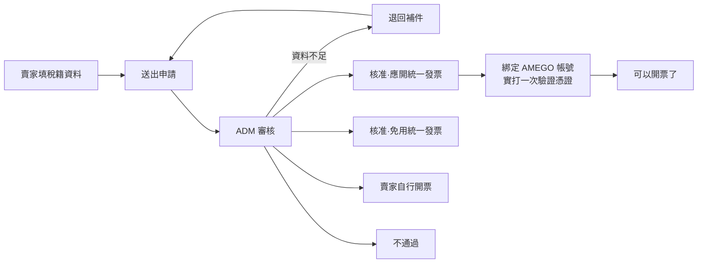
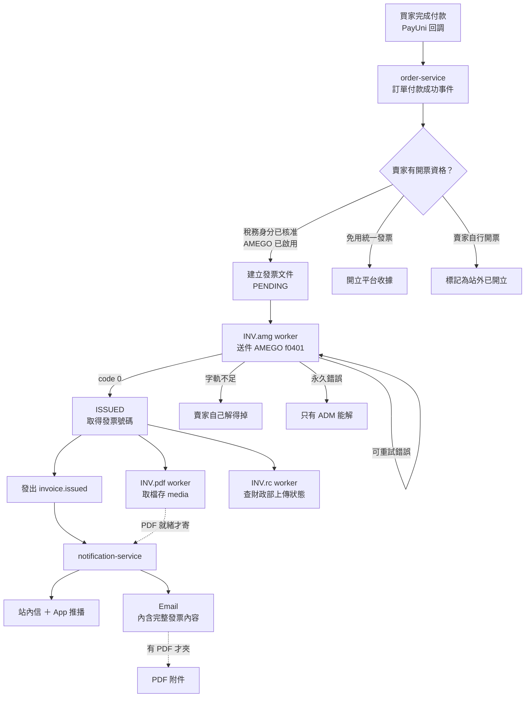
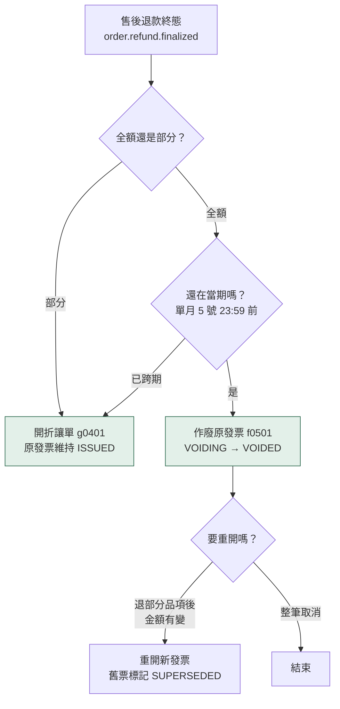
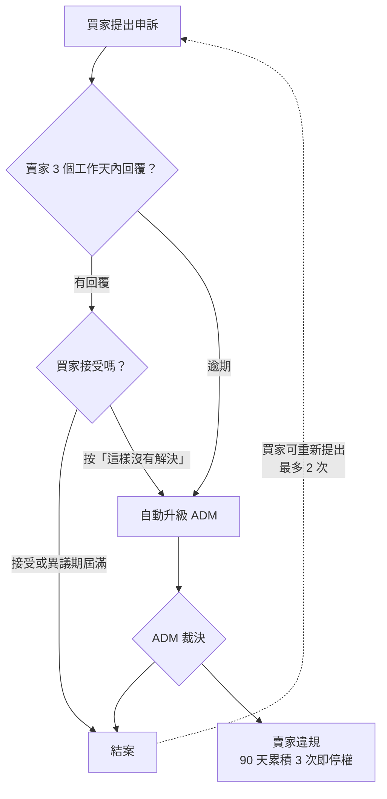
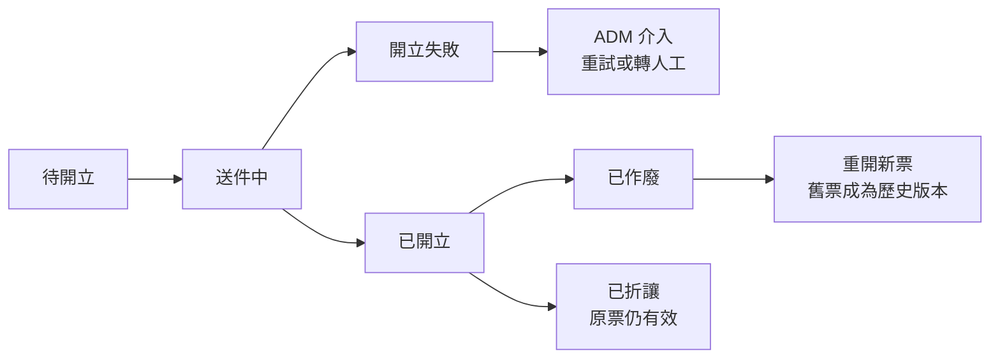

# 58 · 電子發票（基本設計）

> **這是外部設計。** 實作契約（DDL／proto／端點簽章／狀態機轉移邊／陷阱）在
> [詳細設計書 58](../詳細設計書/58-電子發票服務（Invoice%20Service）詳細設計書.md) 與
> [58A 前端實作規格](../詳細設計書/58A-電子發票前端實作規格.md)。
> 本書不重複那些內容，每一節指向對應章節。

## 0. 這個服務解決什麼問題

**在台灣賣東西的人有開統一發票的法定義務，而那件事對個別賣家太難。** 要開電子發票得先向國稅局申請稅籍與字軌、再串接一家加值服務中心（本平台用**光貿 AMEGO**）、還要處理作廢、折讓、上傳期限、關帳日。一個在平台上賣菜的小農做不到這些。

本服務讓平台**代為串接**，賣家只需要提供稅籍資料並綁定自己的 AMEGO 帳號，開票／作廢／折讓／通知全部自動發生。

⚠️ **發票人始終是賣家，不是平台。** 平台是代送件的人，不是開立人 —— 這是整個設計的第一原則，也是所有對外文案禁用「平台開立」措辭的原因（例外只有平台以自己名義開給賣家／買家／第三方的那三種，見 §2）。

**不做會怎樣**：賣家各自去串接（多數做不到）⇒ 買家拿不到發票 ⇒ 客訴與檢舉 ⇒ 賣家漏開發票的稅務風險最終回到平台的信譽。

規模：72 支端點 ＋ 4 條子路由、34 個畫面（買家 9／賣家 12／ADM 13）、19 張資料表。

---

## 1. 誰在用，跟誰互動

| 角色 | 他要達成什麼 | 主要畫面 |
|---|---|---|
| **買家** | 結帳時決定發票怎麼開；事後看得到、下載得了；沒收到有地方申訴 | B01／B02（結帳）· B09／B05（發票中心）· B07（申訴） |
| **賣家** | 取得開票資格 → 之後不必再管；出事時看得到原因；收到平台開給他的進項憑證 | S02／S03（資格）· S12／S11（發票中心）· S08（異常）· S09／S10（申訴回覆） |
| **ADM** | 審核賣家資格；處理卡住的票；裁決申訴；以平台名義手動開票 | A02／A03（審核）· A05／A06（異常）· A07／A08（申訴）· A11（手動開票） |

**四個外部相依**：光貿 AMEGO（開票）、財政部平台（AMEGO 代為上傳）、order／payment（付款與退款事實）、notification／media（通知與檔案）。

---

## 2. 四個開票方向

| 方向 | 開立人 | 買受人 | 觸發 | 有訂單 | Phase 1 |
|---|---|---|---|---|---|
| **一 · 商品交易** | 賣家（自己的統編與 AMEGO 帳號） | 買家 | 訂單付款成功 | ✅ | **自動線** |
| **二 · 平台服務費** | 平台 | 賣家 | 佣金／手續費結算 | ❌ | ADM 手動 |
| **三 · 訂閱費** | 平台 | 買家 | 訂閱週期 | ❌ | ADM 手動 |
| **四 · 對外收費** | 平台 | 非平台會員（第三方廠商） | 無系統事件可觸發 | ❌ | **只能手動** |

**方向二的賣家是收發票的人**，那張票是他的進項憑證、要拿去報稅 —— 所以賣家的發票中心必須同時裝「我開的」與「我收的」，兩者是不同的法律角色（銷項可作廢可折讓，進項唯讀）。

🔴 **方向二／三／四沒有訂單。** 這條約束貫穿整個設計：`order_no` 不是必填鍵、發票詳情頁必須以文件為主鍵、通知的深連結一律用 `document_id`。照「發票掛在訂單底下」施工，這三個方向會做出填不出參數的死路。

> 模型定義見詳細設計書 §2.3；`invoice_issuers` 與 `recipient_type` 的 DDL 見 §5.1.1／§5.1.5。

---

## 3. 賣家要先取得開票資格

**開票不是賣家一註冊就有的能力。** 他得先通過稅務身分審核，並綁定自己的 AMEGO 帳號。這條路走完之前，他的訂單走的是別的分支（見 §4 的決策點）。

**三種核准結果對應三條完全不同的開票路徑**（這是本服務最容易被誤解的地方 —— 它們不是同一條線的不同狀態）：

| 核准結果 | 賣家的訂單會發生什麼 | 畫面 |
|---|---|---|
| **應開統一發票** | 平台代送件開電子發票（§4 的主線） | S02 → S03 綁 AMEGO |
| **免用統一發票** | 平台開**收據**（不是發票），法源是小規模營業人由稽徵機關按查定銷售額課稅 | S05 收據授權 |
| **賣家自行開票** | 平台不開票，賣家在站外自己開，事後回報號碼 | S04 責任條款 · S07 回報 |

⚠️ **免用統一發票不是「延後開票」也不是「開票失敗」**，是完全不同的一條線。把它混進發票狀態機是設計上的第一類錯誤。

綁定 AMEGO 帳號是第二道關卡：賣家把自己的統編與 AppKey 填進 S03，系統會**實際打一次光貿驗證憑證**才啟用。憑證失效時有巡檢會提前發現 —— 法定 48 小時的開票期限裡，那個提前量就是能不能救回來的差別。

> 完整狀態機與轉移邊見詳細設計書 §7.3；稅籍資料表見 §5.1.2。

---

## 4. 開票主鏈（方向一，自動）

**為什麼是付款成功就開票，不等售後結束**

1. 稅法上買賣業的開立時限取「收款」與「發貨」的**較早者**，延後到售後結束必然晚於發貨
2. 每個賣家在 PayUni 是**獨立商店**，付款當下已請款 —— 「錢還沒到賣家帳戶」不成立
3. AMEGO **單月 5 號關帳、9 號字軌過期**，延後會在每期末產生一批開不出票的訂單

開錯的部分由售後終態自動作廢或折讓收斂，賣家零操作。

⚠️ **`INV.pdf` 是獨立 worker，不在開票的同步路徑上** ⇒ 有 PDF 的發票，通知必須等它完成才寄，否則會送出沒有附件的信。

> 逐步流程見詳細設計書 §7.1.2；含逾時分支與查詢對帳的完整時序見 §7.2.1；租約與 worker 名冊見 §7.0。

---

## 5. 售後退款怎麼影響已開的發票

發票開出去之後訂單才退款，是**必然會發生**的事 —— 因為開票時點是付款成功（§4），而退款可能在幾天後。所以這條路是設計的一部分，不是例外處理。

**賣家零操作** —— 這條鏈全自動。這正是「付款成功就開票」這個決定成立的前提：開錯的部分由售後終態自動收斂，不需要人去判斷該作廢還是折讓。

⚠️ **作廢與折讓不可互換**：作廢是「這張票不存在了」，折讓是「這張票還在，但金額往下修」。跨期只能折讓，因為財政部已經收走那一期的申報資料。

> 完整時序（含亂序處理：退款事件早於付款事件抵達）見詳細設計書 §7.2.2 與 §7.2.5。

---

## 6. 買家沒收到發票怎麼辦

平台承諾買家一定拿得到發票，所以要有一條**買家發起、賣家必須回應、逾期有後果**的管道。

**賣家最常見的結案手段是「重新寄送通知」** —— 多數申訴的真因是通知沒送達，而不是發票沒開。所以那顆按鈕**連停權賣家都保留**：鎖住它，賣家回覆得了申訴卻解決不了問題，SLA 照樣逾期。

**逾期有真實後果**：`VIOLATION_CONFIRMED` 會計入賣家違規，90 天內累積 3 次即停權。

> 申訴狀態機 7 值與轉移邊見詳細設計書 §7.3；SLA 與升級規則見 §6.1.16。

---

## 7. 一張憑證會經歷什麼

**作廢與折讓的分水嶺是關帳日**：當期（單月 5 號 23:59 前）可作廢，跨期只能開折讓單。這不是取捨，是 AMEGO 的硬限制 —— 財政部已經收走那一期的申報資料。

**折讓不改變原發票**：它是另一張憑證（折讓單），原發票維持「已開立」。所以一張訂單可能同時存在原發票與多張折讓單，**前端必須全部渲染**，不能只顯示最後一筆。

**「我方的憑證狀態」與「財政部收到了沒有」是兩件事**：後者由第三方決定何時成立，我方只能查詢不能驅動。買家在畫面上看到的是前者。

> 完整狀態值域（11 值）、七台狀態機的轉移邊與觸發者、以及「動作成功」與「狀態已變更」之間的時間差怎麼承載，見詳細設計書 §7.3 與 §5.1.5。

---

## 8. 三端頁面地圖

### 買家（hawkr-website，前綴 `/account`）

| 路由 | 畫面 | 這一頁解決什麼 |
|---|---|---|
| `/account/invoices` | B09 發票中心 | 跨訂單看到所有發票，含「開立人」欄位 —— 方向一是賣家、方向三是平台 |
| `/account/invoices/[documentId]` | B05 文件詳情 | 內嵌 PDF 預覽、下載、重新寄送通知 |
| `/account/invoice-profiles` | B08 常用發票資料 | 載具與抬頭的偏好設定（與 B09 是不同的東西） |
| `/checkout`（頁內） | B01 發票卡 · B02 方式選擇 | 結帳時決定這張發票怎麼開 |
| `/account/orders/[orderNo]`（頁內） | B04 發票區 · B06 改資料 · B07 申訴 | 訂單脈絡下的發票入口 |
| `/checkout/success｜submitted｜fail` | B03 付款完成頁 | 付款後立刻知道發票狀態 |

### 賣家（seller-center，前綴 `/seller-center/invoices`）

| 路由 | 畫面 | 這一頁解決什麼 |
|---|---|---|
| `/invoices` | S01 總覽 | 稅籍、AMEGO 連線、近期發票的健康狀態 |
| `/invoices/documents?tab=issued` | S12 銷項 | 我開給買家的發票，可作廢可折讓 |
| `/invoices/documents?tab=received` | S12 進項 | **平台開給我的發票**，唯讀，可匯出給會計 |
| `/invoices/[documentId]` | S11 發票詳情 | 銷項／進項同頁；進項不顯示作廢與折讓 |
| `/invoices/tax-status` | S02 稅務身分 | 申請與進度（停權賣家仍可用） |
| `/invoices/amego` | S03 串接精靈 | 綁定自己的 AMEGO 帳號 |
| `/invoices/self-issue-terms` · `/receipt-authorization` | S04 · S05 | 自行開票責任條款、收據授權 |
| `/invoices/jobs/[jobId]` | S08 異常詳情 | 開票失敗時怎麼辦 |
| `/invoices/appeals[/...]` | S09 · S10 | 買家申訴的列表與回覆（停權賣家仍可用） |
| `/seller-center/orders/[orderNo]`（頁內） | S07 訂單發票卡 | **停權賣家回報自行開票的唯一落點** |

### ADM（hawkr-admin，前綴 `/admin/invoices`）

| 路由 | 畫面 | 這一頁解決什麼 |
|---|---|---|
| `/invoices/issuances/new` | A11 手動開立 | **方向二／三／四在 Phase 1 的唯一入口** |
| `/invoices/documents[/[documentId]]` | A12 · A13 | 全平台查詢；A13 是唯一能下載 PDF 的頁，開啟即寫一筆存取稽核 |
| `/invoices` | A01 營運總覽 | 今天有多少票沒開出去 |
| `/invoices/tax-reviews[/[storeId]]` | A02 · A03 | 賣家稅務身分審核 |
| `/invoices/provider-accounts[/[storeId]]` | A04 | AMEGO 帳戶治理：健康檢查／停用／重新啟用／撤銷 |
| `/invoices/jobs[/[jobId]]` | A05 · A06 | 開票工作佇列；含雙人解鎖與代錄賣家自行開票結果 |
| `/invoices/complaints[/[complaintId]]` | A07 · A08 | 買家申訴裁決 |
| `/invoices/audit-logs` | A10 | 稽核紀錄 |

> 端點編號、消費檔案路徑、capability 與停權裁決見詳細設計書 §D.1；每個畫面的版面、四態、A11y 與照抄對象見 58A。

---

## 9. 憑證怎麼交到收件人手上

| 管道 | 內容 | 適用 |
|---|---|---|
| **站內信 ＋ App 推播** | 開立通知，點進去到發票詳情頁 | 平台會員（買家／賣家） |
| **Email** | **信件本文即完整發票內容**；有 PDF 則夾帶附件 | 全部四個方向 |
| **發票中心頁面** | 隨時查看、下載、重新寄送 | 平台會員 |

**為什麼 Email 夾帶而不放連結**

發票依法保存 5 年，而連結的有效性繫於我方系統 —— 改路由、換網域、服務下線，任何一項都會讓 5 年前寄出的信變成死連結。方向四的第三方廠商更沒有帳號可登入。**夾帶把發票交到對方手上，之後不再依賴我方任何東西。**

**載具發票沒有 PDF**：AMEGO 在中獎前對載具發票回 `code 53`，我方拿不到檔案。所以規則是**有 PDF 就夾帶，沒有就寄純內容信** —— 這對載具發票不是降級，載具的本意就是「歸戶到載具，不給紙本」。

⚠️ **平台不代買家配載具**：買家沒有主動選手機條碼或自然人憑證時，一律開**無載具發票**，發票留在他的帳戶。這類發票**有 PDF**，看得到、下載得了、通知信也夾帶得了；代價是中獎要自己對。這是「沒設定載具就是自行保管」的正常語意，而發票中心就是他的保管處。

**Phase 1 的 Email 不會真的寄出**：只做寄信介面與一個把整封信寫進 log 的實作，Phase 2 才接雲端供應商。組裝鏈（收件人解析／模板／內容／附件／紀錄）全部是真的，只有最後一步不送出。

> 介面定義、log 欄位與遮罩規則見詳細設計書 §12.1.2(F)；通知模板 13 列與深連結見 §6.3.9 與 §D.4。

---

## 10. 這個設計刻意不做的事

| 不做 | 為什麼 |
|---|---|
| 申請 Hawkr 專屬會員載具 | 那是對財政部的申請案、時程未知，且中獎通知與歸戶責任會落到平台 |
| **代買家配載具**（拿他的手機／email 去開第三方載具） | 買家不是那個平台的會員 ⇒ 載具他找不到、中獎無人通知，而且會**失去 PDF**。需求書「預設會員載具」的意圖是「買家用會員身分就看得到自己的發票」，那個意圖由**發票中心**滿足，比載具更完整 |
| 修改付款、訂單或出貨狀態 | 發票是憑證編排，不是業務狀態機。發票異常不擋出貨 |
| 對外開放任何 `/public/*` 發票端點 | 發票含統編、載具、買受人資訊，開一支即憑空造一個 PII 出口 |
| 補償任務 ／ 對帳 job ／ 漂移偵測 | 正確性由原寫入路徑在同一交易維護 |
| App 端的發票畫面 | App 本期凍結，先用 web 驗證業務邏輯。**後端契約必須 client-agnostic**，將來補回時不用改 |

---

## 11. 已知的外部相依

| 項目 | 狀態 |
|---|---|
| 平台向賣家收費的項目與週期 | 待業務定案；不阻擋 Phase 1（方向二先走 ADM 手動） |
| 雲端 email 供應商選型 | Phase 2 才需要；Phase 1 走 log 實作 |
