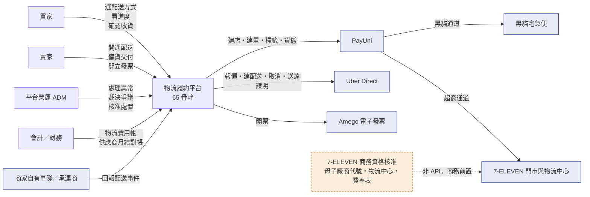
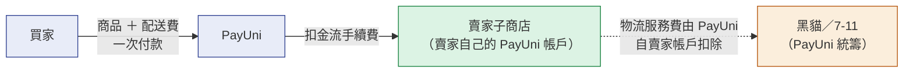
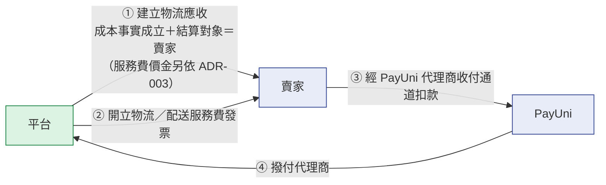
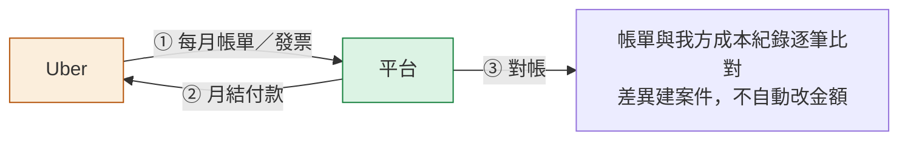
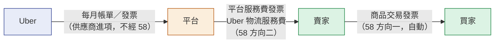
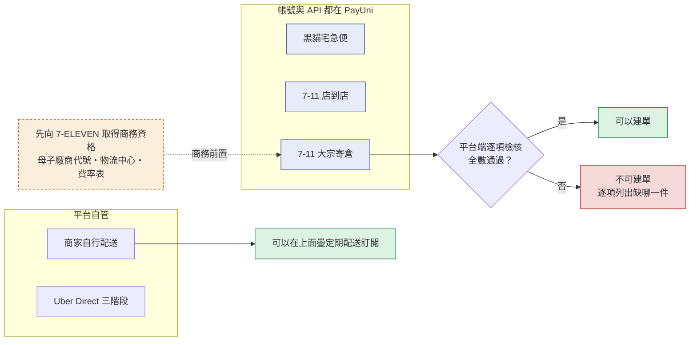
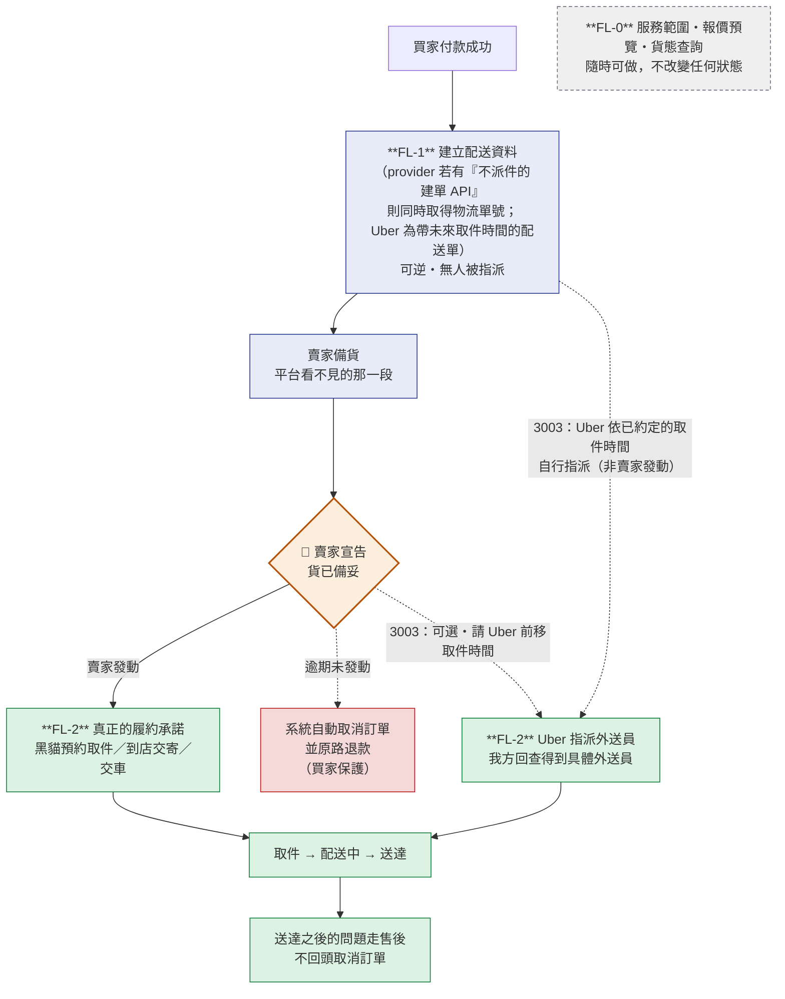
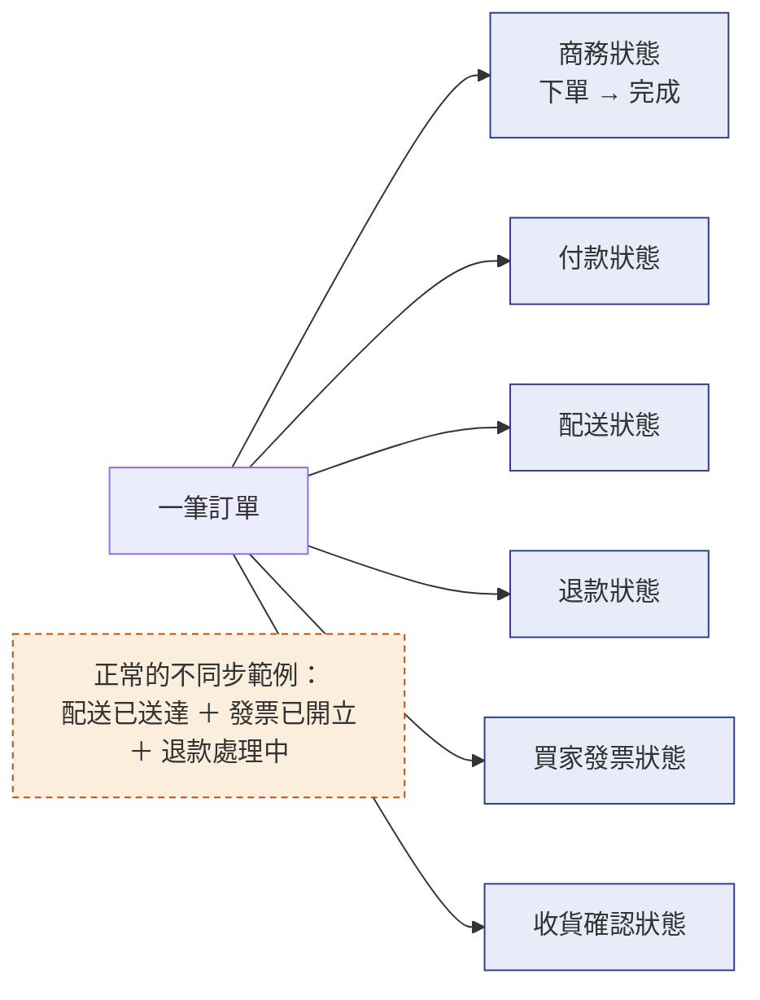
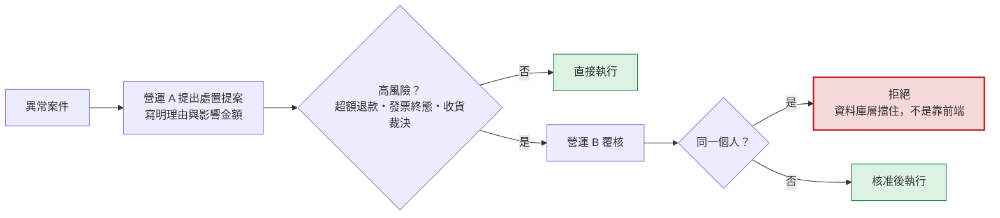

# 65 · 物流履約平台（基本設計）

> **這是外部設計。** 實作契約（DDL／proto／端點簽章／狀態機轉移邊／陷阱）在
> [詳細設計書 65](../詳細設計書/65-物流履約平台（Fulfillment%20Platform）詳細設計書.md)，
> 畫面在 [65A 前端實作規格](../詳細設計書/65A-物流履約前端實作規格.md)。
> 本書不重複那些內容，每一節指向對應章節。

> 🔴 **本書是共用骨架，不是五種配送方式的合集。** 每一種配送方式有自己的基本設計書
> （[06](06-物流微服務（Shipping%20Service）基本設計書.md)／[66](66-Uber%20Direct%20即時配送整合基本設計書.md)／[67](67-定期配送訂閱（Subscription%20Delivery）基本設計書.md)／[68](68-7-ELEVEN%20大宗寄倉（B2C）基本設計書.md)／[69](69-商家自有出貨（Merchant%20Self-Delivery）基本設計書.md)），
> 本書只回答「它們**共用**的那一層是什麼」。想知道某一種方式怎麼走，去那一本，不要在這裡找。

---

## 0. 這個平台解決什麼問題

**現在平台只能用一種方式把東西送到買家手上，而賣的東西不只一種。**
生鮮有溫層、有時效；有些賣家有自己的車隊；有些商品適合每週固定送一次；
有些賣家想一次把大量包裹交到超商物流中心。這些需求現在**沒有任何一條路可以走**。

更根本的問題是**現在的系統用一個欄位推導整個世界**：配送方式一決定，
收款主體、發票開立人、出貨流程、退款責任全部跟著被決定。
只要新增一種配送方式，這條推導鏈就會在四個地方同時出錯——
而其中大部分錯誤是**靜默的**（前端把非黑貓一律當成超商取貨、結帳時遇到不認識的配送方式直接跳過不顯示、
也不留任何紀錄）。

本平台把這件事拆開：**配送方式、收款主體、發票開立人、履約模式是四件獨立的事**，
由後端在訂單成立當下各自記錄快照，不再互相推導。

**不做會怎樣**：每新增一種配送方式，就多一套狀態碼、多一個回調落點、多一份運費邏輯、
多一個撥款判斷——而它們共用同一張訂單。四種方式各自實作的終點是四份互相矛盾的真相，
而矛盾的症狀是「某些訂單的某些畫面顯示錯誤，沒有人知道為什麼」。

## 1. 誰在用，跟誰互動

| 角色 | 在這裡做什麼 |
|---|---|
| **買家** | 在購物車選配送方式；看配送進度；確認收貨；有問題時回報 |
| **賣家** | 開通配送方式；備貨與交付；開立發票；查看自己的物流費用 |
| **平台營運（ADM）** | 處理異常案件；裁決爭議；核准處置提案；對帳 |
| **會計／財務** | 物流費用帳與供應商月結對帳；平台對賣家收費的發票 |

**外部系統**

> ⚠️ **「API 通道」與「商務對象」是兩件事，這張表刻意分成兩欄。**
> 把它們混為一談，會讓人以為每個商務對象都要各自對接一套 API——實際上超商與宅配物流全部經 PayUni。

| 系統 | 角色 | 我方走哪條 API 通道 | 我方的邊界 |
|---|---|---|---|
| **PayUni** | 金流；**同時是黑貓、7-11 店到店與 7-11 大宗寄倉三者共同的建店與物流單通道**；另提供代理商對合作商店的收付通道 | **直接呼叫**（代理商 API） | 既有配送方式的賣家帳號**由 PayUni 管理**，地址鎖定、變更走客服 |
| **Uber Direct** | 即時配送 | **直接呼叫**（平台持有憑證） | **平台統一串接**（一個帳號、集中計費）；賣家只設定門市與備貨資料，**永遠拿不到憑證** |
| **Amego** | 電子發票 | **直接呼叫**（經 invoice-service） | 只在 invoice-service 呼叫；本平台**擴充 58 號的既有鏈路，不另起一套** |
| **7-ELEVEN（統一超商）** | 🔴 **商務資格與代碼核准，不是 API 供應商** | **我方不直接呼叫**——大宗寄倉的建店、建單、標籤、貨態**全部經 PayUni** | 要向 7-ELEVEN 取得的是**商務條件**：商家資格核准、母子廠商代號／退貨代碼、指定物流中心與進退貨時段、常溫／冷凍規範、正式費率表、理賠與個資條款 |
| **商家自有車隊／承運商** | 商家自送 | **無我方出站呼叫**（對方打我方的商家 API） | 透過**對外的商家 API**回報事件；平台驗簽、去重、順序合併 |



## 2. 核心模型：一個欄位不能決定四件事

🔴 **這是整份設計的地基。** 訂單成立當下，後端把**四件互相獨立的事**各記一份快照，
之後任何人要知道「這筆訂單的錢誰收、票誰開」，都是**讀快照**而不是從配送方式推導。

| 維度 | 回答什麼 | 值的意思 |
|---|---|---|
| **配送方式** | 用哪一種方式、哪一家送 | 黑貓宅急便／7-11 店到店／Uber 即時配送／7-11 大宗寄倉／商家自送 |
| **履約模式** | **誰負責把貨送到** | 平台安排的物流通道履約／賣家自行履約 |
| **商流模式** | **這筆錢誰收、誰對買家開票**（決定整條帳務軸） | 賣家直營／平台受託代銷 |
| **收款模式** | **款項實際經過誰的手** | 賣家子商店／平台代理商戶／物流商代收／外部預付 |
| **買家發票模式** | **誰對買家開票** | 賣家對買家／平台對買家 |

另有兩個版本欄（政策版本、受託代銷附約版本），作用是**事後重算時知道當時套的是哪一版規則**。
六個快照欄的完整定義與值域在 [65 詳設 §5.1](../詳細設計書/65-物流履約平台（Fulfillment%20Platform）詳細設計書.md)，
值域的唯一來源是 [CodeMeta 業務類型碼](../代碼管理（CodeMeta）/業務類型碼.md)。

⚠️ **「收款模式」與「買家發票模式」被綁在一起，不是兩個自由選項**：
**收款主體必須與開票人一致**，否則收款證據與開票證據對不起來，稅務上無法解釋。
這條綁定在資料庫層強制，不是靠程式自律。

### 2.1 目前五種配送方式各自落在哪一格

🔴 **2026-09-11 客戶決策後的定版。** 讀這張表之前先讀下一節的紅字。

| 配送方式 | 履約模式 | 商流模式 | 收款模式 | 買家發票 | 本 | 平台向賣家收物流費 |
|---|---|---|---|---|---|---|
| 黑貓宅急便 | 平台物流履約 | 賣家直營 | 賣家子商店 | 賣家開 | [06](06-物流微服務（Shipping%20Service）基本設計書.md) | 無（PayUni 直接從賣家帳戶扣） |
| 7-11 店到店 | 平台物流履約 | 賣家直營 | 賣家子商店 | 賣家開 | [06](06-物流微服務（Shipping%20Service）基本設計書.md) | 無（同上） |
| **Uber 即時配送** | 平台物流履約 | **賣家直營** | **賣家子商店** | **賣家開** | [66](66-Uber%20Direct%20即時配送整合基本設計書.md) | 🔴 **有**——這是唯一一條 |
| 7-11 大宗寄倉 | 平台物流履約 | 賣家直營 | 物流商代收 或 外部預付 | 賣家開 | [68](68-7-ELEVEN%20大宗寄倉（B2C）基本設計書.md) | 無（同上） |
| 商家自送 | 賣家自行履約 | 賣家直營 | 賣家子商店 | 賣家開 | [69](69-商家自有出貨（Merchant%20Self-Delivery）基本設計書.md) | 無（賣家自己的配送成本） |
| 定期配送訂閱（疊在商家自送上） | 賣家自行履約 | 賣家直營 | 賣家子商店 | 賣家開（每期一張） | [67](67-定期配送訂閱（Subscription%20Delivery）基本設計書.md) | 無 |

🔴 **「平台受託代銷／平台代理商戶收款／平台對買家開票」這一組值目前沒有任何配送方式採用。**
它們留在值域裡，但**沒有任何寫入路徑**。這不是「還沒做」，是 2026-09-11 客戶決策的結果（見 §2.2）。

### 2.2 🔴 Uber 商流已由客戶正式修正（2026-09-11）

**修正前**（原需求書 v1.4 與本組設計書 2026-09-11 之前的版本）：

```
Uber 訂單 ＝ 平台受託代銷
買家 → 平台代理商戶（一次收商品款＋物流費）
平台 → 買家開發票
賣家 → 平台開貨款發票（進項）
平台 → 賣家撥款（扣 1% 撥款指示費）
```

**修正後（現行 Target Business Model）**：

```
買家 → PayUni → 賣家子商店（一次付款，含商品與 Uber 配送費）
賣家 → 買家開發票
平台 → 賣家 建立 Uber 物流服務費應收，經 PayUni 代理商收付通道收取
平台 → 賣家 開立物流／配送服務費發票
平台 ↔ Uber 另一條完全獨立的月結與對帳
```

**修正的理由（客戶裁決，不再送回詢問）**：**使用 Uber 配送不改變商品買賣主體。**
商品的銷售人始終是賣家，買家買的是賣家的商品；Uber 只是把貨送到的方式。
一筆訂單因為換了配送方式就整張變成「平台賣給買家」，在商務與稅務上都站不住。

> **架構決策紀錄**：完整的選項評估、決定與後果見
> [65 稽核附錄 `ADR-002`](../詳細設計書/65-物流履約平台（Fulfillment%20Platform）詳細設計書.md)；
> 這個修正衍生的 **`ADR-003`～`ADR-008` 已全部 CLOSED（2026-09-11）**：
> 收費時點＝送達完成（**指配送服務費的價金，不含 provider 成本回收**，見 §5.2）／額外成本依**責任成因**歸屬／收款手續費由賣家負擔／
> 金額語意分離／免運補貼歸屬／實支實付與雙向 true-up。
> 🔴 **物流商業面已無待決策事項**；§13 剩下的只有**外部會計／稅務科目**與**外部實證**兩類。

⚠️ **這個修正與本平台既有的事實一致，不是新的例外**：在 PayUni 帳上，
每個賣家都是以自己名義註冊的獨立合作商店，買家付款帶的是**賣家自己的商店代號**，
平台只是代理商——這筆錢從一開始就掛在賣家名下
（[58 詳設](../詳細設計書/58-電子發票服務（Invoice%20Service）詳細設計書.md) 的開票時點論證 M1 逐字記載此事實）。
修正後的模型讓 Uber 與其餘四種方式**走同一條帳務軸**，而不是自己一條。

**這個修正帶走了什麼**：平台帳本、撥款佇列、撥款資格逐條檢查、1% 撥款指示費、
受託代銷附約——這五樣都只服務「平台受託代銷」那條軸，而現在**沒有任何配送方式走那條軸**。
🔴 **它們不需要為此改一行程式就已經是安全的**：撥款資格的第一道軸守門就是「商流模式是否為平台受託代銷」，
不是的一律回「不適用」⇒ 沒有任何訂單會進入撥款判斷。
這些章節的去留是施工範圍問題，不是安全問題，登記在 [65 詳設 §11](../詳細設計書/65-物流履約平台（Fulfillment%20Platform）詳細設計書.md)。

## 3. 三條互相獨立的資金線

🔴 **本節是本書最重要的一節。** 以下三條線**不是同一筆錢的三個階段**，
它們的當事人、金額、時點、憑證全都不同。把任兩條畫成同一條，就會做出「買家退款自動退賣家物流費」
這種錯誤——而那是三條線被混為一談的典型症狀。

### 線 A · 買家付款（每一種配送方式都有）



- **買家只付款一次**，金額含商品與配送費；**平台不在這條線上**。
- 例外只有一種：**7-11 大宗寄倉**的款項可能由物流商在交付時代收，或在平台之外已預付
  （見 [68](68-7-ELEVEN%20大宗寄倉（B2C）基本設計書.md)）。
- 黑貓／7-11 的物流服務費由 PayUni **直接從賣家帳戶扣**，平台不經手、也不代墊。

### 線 B · 平台向賣家收物流服務費（🔴 目前只有 Uber）



- 🔴 **這不是買家的第二次付款。** 這是 **平台 ↔ 賣家** 之間的企業對企業物流服務費。
- 平台收費的**同時對賣家開立發票**（客戶已確認）。那張票是賣家的進項憑證，
  在 [58 號](58-電子發票服務（Invoice%20Service）基本設計書.md) 的四個開票方向裡屬**方向二 · 平台服務費**
  （開立人＝平台、買受人＝賣家、無訂單），**不是新的開票方向**。
- 使用的是 PayUni **代理商對合作商店的收付通道**（用途類別「物流」）。
  該通道的技術細節（金額、正負向、加密、重試、次日實際入帳、查詢與對帳狀態）屬詳細設計，
  基本設計只表達業務用途。
- ✅ **配送服務費（價金）的收費時點已定案：配送送達完成**（客戶 2026-09-11 裁決，ADR-003）。
- 🔴 **但「服務費收不收」與「應收成不成立」是兩層。** 平台已經替賣家付出去的 **provider 成本**，
  只要**成本事實成立（`provider cost incurred`）且結算對象是賣家**就要成立物流應收，**與有沒有送達無關**。
  兩層的完整分工見 §5.2。
- ✅ **收款通道手續費由賣家負擔**（ADR-005）⇒ 送出金額含手續費加回。

### 線 C · 平台與物流商結算（🔴 目前只有 Uber）



- 平台自己持有 **Uber 集中計費帳戶**，因此這是一條**平台對供應商**的獨立資金線，
  與買家付款、與線 B 的代理商收付**都不是同一筆交易**。
- 帳單上可能包含配送費、取消費、等待費、退回費與各種調整。
  🔴 **這些不得回寫買家已確認的配送費，也不得修改賣家的商品本金。**
- 其餘四種配送方式**沒有這條線**：黑貓／7-11 的費用由 PayUni 從賣家帳戶扣，平台不是付款方。

### 三條線的對照（避免混用的速查）

| | 線 A 買家付款 | 線 B 平台向賣家收物流費 | 線 C 平台與物流商結算 |
|---|---|---|---|
| **當事人** | 買家 → 賣家 | 平台 → 賣家 | Uber → 平台 |
| **金額依據** | 訂單金額（商品＋配送費） | Uber 物流服務費 | Uber 月帳單 |
| **時點** | 結帳當下 | 🔴 **兩層**：服務費（價金）＝**送達完成**（ADR-003）；provider 成本回收 ＝ **成本事實成立**（`provider cost incurred` ＋ 結算對象＝賣家） | 每月 |
| **憑證** | 賣家對買家的發票 | 平台對賣家的發票 | Uber 的帳單／發票 |
| **哪些方式有** | 全部五種 | 🔴 只有 Uber | 🔴 只有 Uber |

## 4. 誰對誰開票

發票不是一件事，是**三種不同的法律關係**。本平台**不另建發票系統**，
全部接 [58 號電子發票服務](58-電子發票服務（Invoice%20Service）基本設計書.md) 的既有四個開票方向。



| 問題 | 答案 |
|---|---|
| 誰對買家開票？ | **賣家**，每一種配送方式都一樣 |
| 誰對賣家開票？ | **平台**，只在向賣家收 Uber 物流服務費時（58 方向二） |
| 賣家要不要對平台開票？ | 🔴 **不用**。那是受託代銷模型才需要的進項憑證，而該模型已無人採用（§2.2） |
| 物流商的帳單給誰？ | Uber 給**平台**（線 C）；黑貓／7-11 的費用由 PayUni 從**賣家**帳戶扣，不產生給平台的帳單 |
| 退款／折讓由誰開？ | 誰開的原票，誰處理它的作廢或折讓。買家退款 ⇒ 賣家處理；平台對賣家的物流費退回 ⇒ 平台處理 |
| 只退物流費時誰處理？ | 看退的是**哪一條線的物流費**：退買家付的配送費 ⇒ 賣家對買家折讓；退平台向賣家收的物流服務費 ⇒ 平台對賣家折讓。**兩者不連動**（§5.2） |

⚠️ **跨月只能折讓不能作廢**：關帳日是分水嶺，這條規則適用於上面每一種方向。
判準與作業細節在 [58 號](58-電子發票服務（Invoice%20Service）基本設計書.md)。

## 5. 收款、收費、撥款、結算是四件事，不是一件

🔴 **本節存在的唯一理由是：這四個詞在口語裡會被混用，而它們在本平台是四條不同的路。**

| # | 概念 | 是什麼 | 現況 |
|---|---|---|---|
| 1 | **買家付款** | 買家把錢付出去 | 一律進賣家子商店（大宗寄倉另有代收／預付） |
| 2 | **賣家收款** | 錢進到賣家的 PayUni 帳戶 | 由 PayUni 依付款方式的時點撥入賣家帳戶，**平台不經手** |
| 3 | **平台對賣家收費** | 平台向賣家收物流服務費 | 🔴 只有 Uber（線 B） |
| 4 | **平台對賣家撥款** | 平台把代收的款項撥付給賣家 | 🔴 **目前不存在**——沒有任何配送方式由平台代收（§2.2） |
| 5 | **物流商成本** | 我方應付物流商的錢 | 只有 Uber 是平台的成本；其餘是賣家的成本 |
| 6 | **物流商月結與對帳** | 與物流商的帳單逐筆比對 | 只有 Uber（線 C） |

⚠️ **第 2 項最容易被誤讀成第 4 項**。「PayUni 把錢撥進賣家帳戶」是 PayUni 與賣家之間的事，
平台既不發起也不攔截；把它寫成「平台撥款給賣家」，會讓人以為平台有撥款責任與撥款風險。

### 5.2 退款、取消與三條線的關係

🔴 **三條線各自獨立，退一條不等於退另外兩條。**

| 發生什麼 | 線 A 買家付款 | 線 B 平台向賣家收物流費 | 線 C 平台與物流商 |
|---|---|---|---|
| 買家取消、還沒建立配送 | 全額退款 | 未建立應收 ⇒ 無事 | 無成本 |
| 已建立配送才取消 | 依售後規則退款 | ✅ **不收配送服務費（價金）**——未送達，`ADR-003`。🔴 **但 provider 已發生的成本另計**：成本事實成立且結算對象是賣家 ⇒ **成立物流應收**（分層見下方） | 物流商可能收取消費 ⇒ 🔴 **依責任成因歸屬（`ADR-004`），不是一律平台吸收** |
| 配送失敗、履約中止 | 🔴 **依責任成因分流**：買家原因 ⇒ **不向 Buyer 退款**（訂單進「配送失敗未退款」終態，見 §8）；賣家／平台／物流商原因 ⇒ **向 Buyer 全額退款**；🔴 **成因未判定 ⇒ 暫不決定**——既不向 Buyer 退款，也不套用「不退款」政策，訂單停在配送異常等裁決 | ✅ **不收配送服務費（價金）**——未送達。🔴 **但 provider 成本照樣要回收**：成本事實成立且結算對象是賣家 ⇒ **成立物流應收**（分層見下方） | 可能產生取消費或退回費 ⇒ 🔴 **同上依成因歸屬**；成因未判定時**落「責任未判定」等裁決**，不記入任何一方 |
| 只退配送費（商品照收） | 賣家對買家折讓配送費 | ✅ **照收、不連動**（已送達） | 不受影響 |

⚠️ **第一列的前提在 Uber 即時配送（3003）不成立**：它在**付款當下就已向 Uber 建立配送單**（那仍是 `FL-1`，
見 §7），「還沒建立配送」這個狀態幾乎不存在 ⇒ 3003 的買家取消一律走第二列。
🔴 **取消前必須先回查物流商**，判斷這次取消會不會產生費用；`FL-1` 階段取消通常還沒有已確認的正常去程運費，
但 🔴 **不得寫成絕對 0**——最終 provider 成本一律以物流商的帳單／退費證據收斂。

🔴 **「收費時點」與「應收成立時點」是兩層，不是同一件事**

| 層 | 問的問題 | 判準 | 依據 |
|---|---|---|---|
| **價金層**：平台向賣家收多少**配送服務費** | 這趟服務有沒有達成？ | **送達完成才收** | `ADR-003`（客戶 2026-09-11 裁決，**不變**） |
| **成本回收層**：平台已經替賣家付出去的 **provider 成本**由誰承擔 | 成本有沒有真的發生？結算對象是誰？ | 🔴 **成本事實成立（`provider cost incurred`）AND 結算對象＝賣家** ⇒ 成立物流應收 | `ADR-004`（依責任成因歸屬） |

⚠️ **兩層合起來才是完整的線 B。** 只留價金層的話，每一筆**買家原因的配送失敗**都會變成
「平台吸收物流商成本、而賣家分文不付」——那正是線 B 存在的理由（平台每替賣家叫一次車就虧一次，
而帳上看不出來）。
🔴 **這不是推翻 `ADR-003`**：`ADR-003` 回答的是「**服務費（價金）**什麼時候收」，
它沒有、也不可能回答「**已經花掉的 provider 成本**怎麼收回來」——後者是 `ADR-004` 的射程。
⚠️ 這個分層與 §13 的 `ADR-003` ／ `ADR-004` 分層是**同一個**，不是新規則。

✅ **上表已於 2026-09-11 由客戶裁決填實**（ADR-003 送達完成收費 ＋ ADR-004 額外成本依成因歸屬）。
🔴 **仍然不得自行假設**「買家退款 ＝ 賣家免收物流費 ＝ 物流商退我方費用」——
三者沒有天然等價關係，上表每一格都是逐格裁決的結果，不是從任一格推導出來的。

## 6. 賣家要先開通，而每種方式的開通長得不一樣

| 要開通的東西 | 開通形式 | 誰管帳號 | 細節在 |
|---|---|---|---|
| 黑貓宅急便 | 填寄件地址 → 地址驗證 → 送出申請 | **PayUni**（地址開通後鎖定，變更走客服） | [06](06-物流微服務（Shipping%20Service）基本設計書.md) |
| 7-11 店到店 | 填寄件人 ＋ 選退貨門市 → **常溫／冷凍各自開通** | PayUni | [06](06-物流微服務（Shipping%20Service）基本設計書.md) |
| 7-11 大宗寄倉 | 先取得商務資格與代碼 → 送建店資料 → 等核准 → 常溫／冷凍各自開通 → 平台端逐項檢核全數通過 | PayUni | [68](68-7-ELEVEN%20大宗寄倉（B2C）基本設計書.md) |
| 商家自行配送 | 設備貨時間、溫層、服務區域、交付證明 | **平台** | [69](69-商家自有出貨（Merchant%20Self-Delivery）基本設計書.md) |
| Uber Direct | 三階段：門市地址格式檢查 → 實測配送 → 正式啟用 | **平台**（賣家看得到狀態，拿不到憑證） | [66](66-Uber%20Direct%20即時配送整合基本設計書.md) |
| 定期配送訂閱 | 不是一種配送方式：先開通商家自送 → 發布訂閱方案 → 買家首次訂閱時完成付款授權 | 賣家自己 | [67](67-定期配送訂閱（Subscription%20Delivery）基本設計書.md) |

> 🔴 **三種超商／宅配方式的帳號與 API 都在 PayUni**，差別只在 PayUni 的服務產品代碼不同。
> 「7-ELEVEN」這個名字在開通流程裡出現，指的是**要向統一超商取得的商務資格**，
> **不是另一套要對接的 API**。



## 7. 跨配送方式共通的業務規則

### 🔴 Provider 憲法：Provider 不定義 Domain，Domain 定義 Provider Adapter

**一句話**：**新增任何一種配送方式，預設不得改變訂單、付款、履約與售後的核心流程。**
物流商的 API 長什麼樣，是 adapter 要吸收的問題，不是平台要遷就它的理由。

```
Provider does not define Domain.
Domain defines Provider Adapter.
```

**為什麼要把這句話寫成規則**：本平台已經發生過一次反向。當時把 Uber 的 `Create Delivery` 讀成
「一次呼叫就派車」，於是設計順著那個形狀，把「建立配送資料」與「實體履約承諾」塌縮成同一個動作
並掛在付款成功上——而那一步同時刪掉了**賣家宣告貨已備妥**這一格，連帶關掉了買家的
「不出貨就退錢」保護。沒有任何一份文件決定過要這樣做，它是**照著 provider 的形狀把平台的流程改掉**的結果。
⚠️ **這種改寫是靜默的**：每一份文件單獨看都自洽，只有把五種配送方式並排才看得出來有一種不一樣。
⚠️ **後來查證發現「一次呼叫就派車」這個前提本身就不成立**：`Create Delivery` 帶**未來的取件時間**時，
建單當下沒有任何外送員被指派（見下一節）。🔴 **但教訓不因此失效**——真正的錯誤是**刪掉賣家宣告備妥那一格**，
不是「呼叫了物流商的哪一支 API」。

🔴 **但反過來也要小心：不要為了「看起來一致」去改既有 provider 的流程。**
黑貓與 7-11 在付款成功當下就向物流商建單並取得物流單號，**那是既有且正確的業務流程**——
它沒有讓任何車輛出動，是不折不扣的 `FL-1`。
⚠️ 本節要統一的是**誰有權發動 `FL-2`**，**不是**要求每個 provider 的 `FL-1` 長得一樣。
**把「一致」誤解成「`FL-1` 也要一致」，會去修一個沒有壞的東西。**

**三條規則**

| # | 規則 | 判準（可機械執行） |
|---|---|---|
| **憲-1** | **核心 lifecycle 由 Domain 定義，provider 只實作 adapter** | 這個改動如果**單獨提出來**（不提某個 provider 的名字），還站得住嗎？站不住 ⇒ 它是在遷就 provider，不是在改善流程 |
| **憲-2** | 🔴 **會產生實體履約承諾的動作（`FL-2`），預設由賣家在「貨已備妥」之後發動，平台不代勞** | 問「**我方是否已經觀察到**物流商為這筆單指派了真實的實體資源（外送員／取件預約／實體交寄）」。是 ⇒ 它是 `FL-2`。⚠️ **不是問「有沒有呼叫物流商 API」**——付款後向物流商建單取號不會讓任何人出車，那是 `FL-1`。⚠️ **也不是問「物流商內部在想什麼」**——判準只能錨在我方看得到的事實 |
| **憲-3** | **要偏離憲-1／憲-2，四件證據缺一不可** | 見下表。**四件不齊，不得為該 provider 建立特殊 lifecycle** |

**憲-3 的四件證據**（登記為 [65 詳設的 ADR](../詳細設計書/65-物流履約平台（Fulfillment%20Platform）詳細設計書.md)，並在該 provider 的基本設計書「刻意不做的事」旁列出）

| 要件 | 內容 | 不合格的樣子 |
|---|---|---|
| **① Provider limitation** | 物流商**客觀上做不到**平台要求的形狀，具體寫出是哪一個 API／哪一條契約限制 | 「它的 API 比較適合這樣用」——那是方便，不是限制 |
| **② 官方或契約證據** | 官方文件逐字、書面答覆或正式契約條款。🔴 **拿不到就標 `EXTERNAL_VERIFICATION_REQUIRED`，不得用推測補上** | 「應該是這樣」「我們試過像是」 |
| **③ 明文登記的偏離** | 一條 ADR，寫清楚偏離哪一格、偏離成什麼、誰批准 | 只在某一節的內文寫一句話——那不會被下一輪 review 讀到 |
| **④ 影響評估** | 這個偏離關掉了哪些既有保護（買家保護／賣家決定權／責任歸屬／退款出口），以及用什麼補上 | 只寫「不影響其他 provider」 |

⚠️ **「provider 有某個能力」不是讓所有 provider 都要支援它的理由**，反向也一樣：
Uber 有真正的取消 API、有送達照片、有即時報價，其餘四種沒有——這是 **capability 的差異**，
由 adapter 的 capability 宣告承載（[65 詳設 §4.4.1b](../詳細設計書/65-物流履約平台（Fulfillment%20Platform）詳細設計書.md)），
**不是 lifecycle 的差異**。兩者混談就會從「這家多一個按鈕」滑到「這家整條流程不一樣」。

### 履約動作的三個層級：`FL-0` ／ `FL-1` ／ `FL-2`

> 🔴 **本表口語上叫 L0／L1／L2，但書面一律寫 `FL-N`（Fulfillment Layer）。**
> 理由：`L0/L1/L2` 在本組文件裡已經是**三個不相干的東西**——
> 商家自送的成熟度分級（[69](69-商家自有出貨（Merchant%20Self-Delivery）基本設計書.md)）、
> MQ 的兩層去重、帳本不變式 `INV-L1`／`INV-L2`。裸寫 `L2` 會指到其中任何一個。

| 層 | 定義 | 可逆嗎 | 物流商開始安排實體資源了嗎 | 例子 |
|---|---|---|---|---|
| **`FL-0`** | **純讀取／能力查詢**。不寫我方狀態，也不建立任何物流商側的資料 | — | ❌ | 服務範圍查詢｜報價預覽｜貨態查詢｜承載檢查 |
| **`FL-1`** | **物流商側的單據／預約已經存在，但我方尚未觀察到任何實體資源被指派**。可以只寫本地資料，**也可以呼叫物流商建立「還沒派件」的物流資料**（取得物流單號／標籤／識別碼） | ✅ | ❌ | 付款後向物流商建單並取得物流單號｜**帶未來取件時間的 Uber `Create Delivery`（已建立一張未來取件的配送單，沒有任何外送員被指派）**｜取號／列印託運單｜取得出貨便代碼｜報價快照｜本地配送單 |
| **`FL-2`** | 🔴 **真正的實體履約承諾**。**我方已經觀察到**物流商為這筆單安排了**真實的取件／派車／實體資源**，且多半開始計費 | ❌（只能**申請**取消，且可能有取消費） | ✅ | 呼叫黑貓預約取件｜實體到店交寄｜**Uber 指派外送員**（我方回查得到具體的外送員）｜大宗寄倉交車 |

🔴 **`FL-1` 與 `FL-2` 的判準不是「有沒有碰物流商的 API」，而是：**

```
我方是否已經觀察到物流商為這筆單指派了真實的實體資源？
```

🔴 **判準必須錨在「我方觀察得到的事實」，不得推論物流商內部在做什麼。**
「我們認為它應該已經開始排線了」不是 `FL-2`，「我們認為它還沒開始」也不是 `FL-1`——
兩者都是猜測，而猜測會在物流商改變內部行為的那一天靜默地錯掉。
⚠️ 這條同時擋住兩個方向的錯誤：把一張**還沒有人接**的未來取件單當成已經派車（會誤禁付款後建單），
以及把**已經指派外送員**的狀態當成還沒開始（會誤以為取消不用錢）。

⚠️ **這一條 2026-09-13 修正過一次，而修正前的版本會讓人做出錯的東西。**
修正前寫的是「`FL-1` ＝ 只寫本地資料」，那不符合平台現行流程：
**黑貓與 7-11 店到店在付款成功當下就會呼叫物流商建單並取得物流單號**（見下表第 2 欄），
那一步既不是「只寫本地」，也沒有任何車輛因此出動 —— 它是**道道地地的 `FL-1`**。
🔴 **判準寫錯的後果是把既有正確的流程判成違規**，然後去「修」一個沒有壞的東西。



**五種配送方式在這三層上是一致的**（這正是「它是共通規則不是黑貓特例」的證據）

| 配送方式 | 付款後**自動**做的 `FL-1` | 賣家自己做的 `FL-1` | 🔴 `FL-2` 是哪一步（**預設**由賣家發動） | 期限的「已處理」判定 |
|---|---|---|---|---|
| 黑貓宅急便 | **建本地配送單 ＋ 向物流商建單、取得物流單號**（`FL-1`：沒有車輛因此出動） | **取號**（取得託運單並列印） | 按「**呼叫黑貓**」⇒ 向物流商**預約取件** | 已呼叫黑貓（＝`FL-2`） |
| 7-11 店到店 | **建本地配送單 ＋ 向物流商建單、取得物流單號**（同上） | **取得出貨便代碼**（列印出貨單） | **實體到店交寄**（線下；平台事後以「確認出貨」記錄） | 已取得出貨便代碼（＝`FL-1`，見下方紅字） |
| **Uber 即時配送** | **建本地配送單 ＋ 向 Uber 建立「未來取件」的配送單**（`FL-1`：沒有任何外送員被指派） | —（不需要標籤） | 🔴 **Uber 依已約定的取件時間指派外送員**——**不是賣家發動**（唯一的例外，理由見下方紅字） | **賣家已宣告備妥**（`REPORT_READY`） |
| 7-11 大宗寄倉 | 建本地列 | 批次與標籤 | **交車／交倉** | 依 68 |
| 商家自送 | 寫待處理並通知商家 | — | **接單並實際出車** | 依 69 |

🔴 **五種方式真正共用的是「什麼時候才算產生實體履約承諾」，不是第 2 欄的形狀。**
第 2 欄**本來就長得不一樣**，而那個不一樣是 provider 的客觀差異，不是誰做錯了：

| 為什麼第 2 欄不一樣 | |
|---|---|
| 3001／3002 | 物流商**有**一支「只建立物流資料、不派件」的 API ⇒ 付款後就可以呼叫它拿到物流單號，而**不會有任何人出車** |
| **3003 Uber** | **同樣有。** `Create Delivery` 帶**未來的取件時間**時，建立的是一張「到那個時間才去取件」的配送單：官方逐字說明外送員會在該時間前後抵達，而**建單當下沒有任何外送員被指派**（我方回查外送員為空）⇒ 它與 3001／3002 同層，都是 `FL-1` |
| 3004／3005 | 沒有這樣一支 API（或根本沒有物流商 API）⇒ 付款後只建本地列 |

⚠️ **所以 3001／3002／3003 的第 2 欄現在是同一件事**：付款後向物流商建立一張**還沒有人出車**的單，
差別只在拿回來的東西不同（3001／3002 拿到物流單號，3003 拿到一張未來取件的配送單）。
🔴 **不要把它反過來讀成「所有 provider 的 `FL-1` 都必須長得一樣」**——3004／3005 的第 2 欄只建本地列，
而 3001／3002 付款後建單取號是**既有且正確的業務流程，本節不得動它**。

🔴 **本節統一的是「產生實體履約承諾之前，賣家必須有機會表達意見」，不是要求 `FL-1` 長得一樣。**

🔴 **最後一欄刻意不一致，而那個不一致是有理由的：**
「已處理」判定的是**賣家做完平台看得見的最後一步**，而各 provider 的可觀測邊界不同——
7-11 店到店的 `FL-2` 是**線下的實體交寄**，平台端零可觀測性 ⇒ 只能拿它前面那個 `FL-1`（取得出貨便代碼）當判定。
⚠️ **不要把這個不一致讀成「已處理＝`FL-1` 也可以」**：
凡是**賣家發動、而平台又觀測得到**的 `FL-2`（3001），判定就必須錨在 `FL-2`，
否則賣家取了號卻不叫車，期限已被清空而貨永遠不會動。
🔴 **3003 是第三種情形**：它的 `FL-2` 不由賣家發動（見上一段），賣家能做的最後一步就是
**宣告備妥（`REPORT_READY`）** ⇒ 判定只能錨在它。這裡**沒有**「取了號卻不叫車」的逃逸空間，
因為取件時間在付款當下就已經與物流商約定好了——賣家不備貨的後果不是「貨不會動」，
而是**外送員準時到了卻拿不到貨**，所以 3003 的期限要守的是備貨本身。

⚠️ 這張表比較的是**業務語意上誰做了承諾**，不是「有沒有一支 API 被呼叫」。
⚠️ **「建單」與「取號」是兩件事，不要混用這兩個詞**：付款後的是**建單**（取得物流單號），
賣家按的是**取號／列印**（取得可交寄的託運單或出貨便代碼）。兩者都呼叫物流商、都是 `FL-1`。

⚠️ **`FL-2` 之後才有「誰付取消費」這個問題。** `FL-2` 之後取消要看物流商肯不肯、以及誰付取消費
（見本節下表與 [66 §6.2](66-Uber%20Direct%20即時配送整合基本設計書.md)）。
⚠️ **但 `FL-1` 階段的取消不必然等於「刪一列我方資料」**：只要 `FL-1` 已經在物流商側建了單
（3001／3002／3003 都會），取消就要**同時撤掉物流商那一張單**，而不是只清我方的列。
🔴 **`FL-1` 階段取消通常還沒有已確認的正常去程運費，但不得寫成「一定 0 元」**——
最終成本一律以物流商的帳單／退費證據收斂。

🔴 **3003 的「賣家宣告備妥」之後會發生什麼**（其餘四種沒有這一段）

取件時間在**付款當下就已經與 Uber 約定**，所以賣家宣告備妥不是「發動」而是「回報」：

| 情形 | 平台做什麼 |
|---|---|
| 賣家**準時或延後**備妥 | 不動取件約定，物流商照**原時間**來取件 |
| 賣家**提早**備妥 | **請物流商把取件時間前移**（唯一的自動路徑）⇒ 貨更早上路、買家更早收到 |
| 前移**失敗**（逾時／被拒／物流商已過可編輯窗） | 🔴 **保留原配送單與原取件時間**，有界重試 ＋ 通知營運。買家的預計送達不變、**不退款**、**不建第二張單** |

🔴 **前移失敗一律不得升級成「取消後重建」。** 那會同時製造兩個風險：原單可能沒有真的被取消
（變成兩台車去同一個地方），以及取消本身可能產生費用——而這兩件事都是為了「早一點取件」這個
**非必要**的好處去換的。
⚠️ 「取消後重建」只在**確有業務需要、且已確認原配送單真的取消**時由人工使用，**不是自動 fallback**。

### 五本都適用的規則表

🔴 **以下每一條都是「五本都適用」的規則。各本不得各寫一份，也不得自行放寬。**

| 規則 | 內容 | 為什麼 |
|---|---|---|
| **退貨 ≠ 退款** | 貨退回來、賣家領回、買家拿到錢是**三件獨立的事**；物流狀態不得自行改動金流 | 反過來做的後果是「東西還沒退回來錢已經退了」或「貨退回來了買家一直沒收到錢」，兩者都無法事後修 |
| **收貨 Gate 不接受單方回報** | 只有**買家確認收貨**或**營運裁決**能通過收貨確認；賣家或商家自稱送達一律不能 | 沒有第三方證據的「已送達」等於自己說自己送到了 |
| **對帳差異不自動改金額** | 任何對不起來的數字都建案件由人處理 | 自動對齊等於把錯誤消音，而金額的錯誤會變成真實損失 |
| **不可用要說明原因** | 某個配送方式不能用時，選項**仍然存在**並顯示可信原因，不得憑空消失 | 憑空消失的選項讓買家與客服都無法判斷發生什麼事 |
| **不自動改配送方式** | 某方式不可用時停下來，**不 fallback 到別的方式** | 同一筆訂單兩張物流單、或買家收到與他選擇不同的服務 |
| **配送方式恆定** | 訂單成立後不得換配送方式 | 換了之後運費、承載檢查、責任歸屬全部失效 |
| 🔴 **付款成功只做 `FL-1`** | 付款成功後系統自動做的事**止於 `FL-1`**（可含向物流商建單取號）；🔴 **不得**在這一步產生**實體履約承諾**（派車／預約取件／交倉） | 付款代表「買家的錢到了」，不代表「賣家的貨備好了」。把兩件事綁在一起，等於平台替賣家做了一個它看不到的判斷 |
| 🔴 **`FL-2` 的觸發權屬於賣家** | 真正的履約承諾由賣家在宣告「貨已備妥」之後發動；平台不代勞，也不用排程兜底代為發動。🔴 **唯一豁免：Uber 即時配送（3003）**——它的 `FL-2`（物流商指派外送員）由物流商依**付款當下就已約定的取件時間**自行發動，賣家能做的是**宣告備妥（`REPORT_READY`）**並（可選）請物流商前移取件時間。⚠️ **這個豁免的射程只有 3003**，其餘四種一字不動 | 叫件等於承諾貨已備妥，那是賣家的決定（[06](06-物流微服務（Shipping%20Service）基本設計書.md)）。平台代發 ⇒ 司機白跑、賣家被計費、而賣家從頭到尾沒有表達過意見。⚠️ **3003 的豁免不是放寬這條規則**：賣家的決定權沒有消失，只是改由「備妥宣告」承載——取件時間是買家在結帳當下就看到並接受的服務承諾，它在付款那一刻就定下來了，賣家沒有「不發動」這個選項可以被平台代勞 |
| 🔴 **每一種配送方式都必須有賣家處理期限** | 賣家在期限內**未完成該 provider 的期限動作** ⇒ 系統自動取消訂單並原路退款。🔴 **「期限動作」逐 provider 定，見上表「期限的『已處理』判定」欄**——3001 ＝ 發動 `FL-2`（呼叫黑貓）；3002 ＝ 取得出貨便代碼；🔴 **3003 ＝ `REPORT_READY`（宣告備妥）**，因為它的 `FL-2` 不由賣家發動。⚠️ **不得把這條規則綁死在 `FL-2` 這個動作上**：綁死之後，`FL-2` 非賣家發動的 provider（3003）永遠觸發不到這條規則，期限保護就對它失效了。**期限長度逐 provider 定，但「有沒有期限」不是選項** | 這是買家的「不出貨就退錢」保護。少了它，訂單會停在「已付款、等賣家」而**沒有任何出口**，且是靜默的——沒有人會收到通知，買家只能自己發現 |
| 🔴 **兜底排程不得跨越 `FL-1` → `FL-2`** | 偵測「該建的本地單沒建出來」的兜底機制，只能補做 `FL-1`；**不得**代替賣家發動 `FL-2`，也不得把「賣家還沒發動」讀成「系統出錯」 | 兩者的症狀在資料上長得一樣（訂單已付款、還沒有履約承諾），而處置相反：一個要補做，一個要等人。判錯的後果是**平台繞過賣家叫車**，或**賣家還在備貨而訂單已被自動取消** |
| **費率是快照不是常數** | 費率變動時，既有單一律沿用當時的費率 | 改一次費率就改掉歷史帳 |
| 🔴 **買家配送費 ≠ 物流實際成本 ≠ 平台向賣家收的費用** | 這是**三個獨立的金額**，不得互相推導 | 賣家免運時買家配送費是 0，而物流成本照樣發生 ⇒ 若把「向賣家收多少」綁成「買家付多少」，平台會默默吸收成本而沒有人決定過（Uber 的三個案例見 [66 §4.4](66-Uber%20Direct%20即時配送整合基本設計書.md)） |
| 🔴 **免運不等於免成本** | 「免運」只代表**不向買家收配送費**，它不說明成本由誰吸收 | ✅ **三型態已定案（ADR-007）**：**賣家主辦** ⇒ 成本仍由賣家負擔（平台不因買家端免運而吸收）；**平台主辦** ⇒ 平台明確補貼的部分由平台負擔、賣家只負擔扣除補貼後的部分；**雙方共同** ⇒ 🔴 **`seller_subsidy` 與 `platform_subsidy` 必須分別記錄，不得只留單一 `shipping_fee`**。⚠️ **不得從「買家付了 0」反推負擔者**（三型態的買家配送費都可能是 0 而答案不同）|
| 🔴 **物流成本採實支實付** | 賣家最終要負擔的基礎是**物流商實際成本**，不是買家配送費、不是結帳報價、也不是初始暫估 | ✅ **已定案（ADR-008）**：先依暫估建立應收，月結取得實際成本後**實際 > 暫估 ⇒ 補收；實際 < 暫估 ⇒ 退還／沖減**；再扣平台補貼、再加減責任歸屬調整。🔴 **收款通道手續費獨立追蹤，不併入物流商成本** |
| 🔴 **報價／預估金額 ≠ 實際成本** | 結帳當下鎖定給買家看的價，與物流商月結帳單上的實際金額是兩件事 | 帳單上還會有取消費、等待費、退回費與供應商調整 ⇒ 對帳要比的是**實際值**，而實際值不得用預估值冒充 |
| 🔴 **額外成本依責任成因歸屬，不依費用名稱** | 取消費／等待費／退回費／供應商調整一律先問**是誰造成的**，再決定誰負擔 | ✅ **已定案（ADR-004）**：**賣家原因** ⇒ 賣家負擔實際成本（平台不吸收）；**買家原因** ⇒ 仍歸屬「賣家物流成本」，🔴 **平台不得直接向買家建立第二次追加付款**；**平台／系統原因** ⇒ 平台負擔且**不得向賣家收取**；**物流商原因** ⇒ **不得自動向賣家收**，先進爭議／對帳；🔴 **責任未判定** ⇒ **暫不決定**，不向任何一方記帳、不記任何一方的失誤，先進案件等裁決。⚠️ 判準是**成因**不是費用名稱——同一個「取消費」不同成因下歸屬不同結果。🔴 **「責任未判定」是第五個正式值，不是「物流商原因」的別名**——把判不出來的案子塞進「物流商原因」，等於在沒有證據的情況下做了一個判定，而那個值本來的意思是「**確實是物流商造成的**」 |
| 🔴 **責任成因 ≠ 結算對象 ≠ 失誤歸屬** | 一次配送失敗要分開回答**三個問題**：①**是誰造成的**（責任成因，五值）②**平台墊出去的物流成本最後跟誰結算**（結算對象）③**哪一方的營運失誤要被記一筆**。三者各有自己的載體，🔴 **不得互相推導** | 🔴 **「買家原因」這一格三者刻意不一致，而那個不一致是對的**：責任在**買家**、成本跟**賣家**結算（買家原因仍歸屬賣家物流成本，見下一列）、而**賣家沒有失誤**。把三者當成同一件事，會得出兩種錯誤結論之一——「既然跟賣家收錢，那就是賣家的錯」（賣家被冤枉、履約評價被汙染），或「既然賣家沒錯，那平台自己吸收」（平台每替賣家叫一次車就虧一次）。⚠️ **失誤歸屬一律只讀責任成因**，🔴 **不得**從「有沒有向賣家收錢」反推 |
| 🔴 **責任歸屬調整 ≠ 平台補貼** | 兩者都可能讓賣家少付，但**理由與帳務性質不同**，必須分別記錄 | 補貼是**平台主動的行銷決定**（事前、與活動綁）；責任歸屬調整是**事後的成因判定結果**（與活動無關）⇒ 混記之後無法回答「這個月平台的行銷成本是多少」與「這個月我方造成了多少物流損失」 |
| 🔴 **收款通道手續費與物流商成本必須分帳** | 兩者對到不同對象、不同憑證、不同對帳來源 | ✅ **已定案（ADR-005）**：手續費由**賣家負擔**，🔴 **但不得併入物流商成本記成一個數字**（那會讓「Uber 到底收多少」永遠對不起來）。⚠️ **費率不得寫成商業常數**——一律以實際查詢值記帳 |
| **買家看不到內部詞彙** | 「母子代號」「物流中心驗退」「進倉批次」這類詞不得出現在買家畫面 | 判準不是會不會洩漏，是**買家對這些詞沒有可執行的動作**，顯示它只製造客服工單 |

⚠️ **實作階段必辦（本設計階段不施作）**：責任成因的第五個值「**責任未判定**」
（`RESPONSIBILITY_UNRESOLVED`）要在 [CodeMeta 業務類型碼](../代碼管理（CodeMeta）/業務類型碼.md)
的 `ResponsibilityCause` 新增，並**同時修正既有值的說明**——現行說明寫「判定原料不足時一律落物流商原因」，
🔴 **那句話已被本節取代**：證據不足本身就是一個值，不是任何一個責任方。
🔴 **本書不列碼值**，值域的唯一來源是 CodeMeta。

🔴 **上表四條 `FL` 規則套到 Uber 即時配送（3003）時指到哪一步**——規則本身一條都沒有放寬，
變的只是「它在 3003 上指的是哪個動作」。

| 規則 | 3003 的具體所指 |
|---|---|
| **付款成功只做 `FL-1`** | 付款後自動做的是「建本地配送單 ＋ 向物流商建立**帶未來取件時間**的配送單」。🔴 **它仍然是 `FL-1`**：建單當下沒有任何外送員被指派，沒有實體資源被安排，也沒有人因此出車 |
| **`FL-2` 的觸發權屬於賣家** | 🔴 **3003 顯式豁免**：`FL-2`（物流商指派外送員）的發動者是物流商的排程，不是賣家。賣家的決定權改由 **`REPORT_READY`（宣告備妥）** 承載。⚠️ 射程只有 3003 |
| **每一種配送方式都必須有賣家處理期限** | 期限照舊存在，🔴 **錨點是 `REPORT_READY`**，不是「已發動派車」。期限要守的是**備貨本身**——因為取件時間已經定下來，賣家沒備好貨的後果是外送員白跑 |
| **兜底排程不得跨越 `FL-1` → `FL-2`** | 照舊。⚠️ 但 3003 的 `FL-1` **現在包含向物流商建立配送單** ⇒ 兜底排程「補做 `FL-1`」的範圍也包含它。🔴 仍然**不得**代替賣家做 `REPORT_READY`，也**不得**去催物流商提早指派外送員 |

## 8. 一筆訂單同時有好幾個狀態，它們互不取代

一張訂單至少同時有：
**商務狀態**（下單到**結案**）、**付款狀態**、**配送狀態**、**退款狀態**、
**買家發票狀態**、**收貨確認狀態**。

⚠️ 這不是把一個狀態切成幾份，而是**它們本來就會不同步**——
配送已送達、發票已開立、但退款正在處理，這是正常狀態不是異常。



🔴 **商務狀態的終點不只有「完成」。** 除了正常完成、取消與退款結案，還有一個
**「配送失敗未退款」**終態：實體配送沒有成功，而**責任已判定為買家可歸責**
（不在場／無法聯繫／拒收／提供錯誤地址／未依約配合等，且有可指認的履約證據）
⇒ 依政策**不向 Buyer 退款**，訂單就此**財務結案並具備撥款資格**。

它與既有三個終態都不一樣，借用任何一個都會做錯事：

| 不能借用 | 為什麼 |
|---|---|
| **已送達／已完成** | 買家**沒有**拿到貨。借用它會產生「買家已正常收貨」的語意 ⇒ 收貨確認、評價資格、正常售後資格全部被錯誤打開 |
| **已取消** | 訂單**沒有**被取消；而且取消結案不撥款，借用它等於賣家白做一趟 |
| **已退款** | 這個終態**不觸發任何退款** |

🔴 **它也不代表賣家履約失敗**——責任在買家，賣家該拿的錢照拿，**不得記入賣家的履約失誤**。
🔴 **責任未判定時不得進入這個終態**：訂單停在配送異常等裁決，既不退款也不結案（fail-closed）；
賣家的申訴與買家的申訴都走異常案件管道，不是退貨退款案。
⚠️ **它必須是 provider-neutral 的**：不得命名成某一家物流商專屬的狀態，也不得逼其他物流商套用 Uber 的生命週期。

⚠️ **實作階段必辦（本設計階段不施作）**：這個終態要在
[CodeMeta 業務狀態碼](../代碼管理（CodeMeta）/業務狀態碼.md) 的訂單狀態新增一個值，
走生成鏈與前端拷貝同步。🔴 **本書不列狀態值**——值、編碼理由與合法轉換邊在
[65 詳設 §7.1](../詳細設計書/65-物流履約平台（Fulfillment%20Platform）詳細設計書.md)。

**另外兩條軸不掛在訂單上**，它們是獨立的：

| 軸 | 掛在哪 | 哪一種方式有 |
|---|---|---|
| **交倉批次** | 賣家的一次交車，**不掛訂單** | 只有 7-11 大宗寄倉（[68](68-7-ELEVEN%20大宗寄倉（B2C）基本設計書.md)） |
| **訂閱契約與週期** | 兩層，週期扣款成功才具體化成訂單 | 只有定期配送（[67](67-定期配送訂閱（Subscription%20Delivery）基本設計書.md)） |
| **平台對賣家的物流費應收** | 掛在配送單上，不是訂單的狀態 | 只有 Uber（[66](66-Uber%20Direct%20即時配送整合基本設計書.md)） |

各軸的完整狀態值與轉換規則在 [65 詳設 §7.1](../詳細設計書/65-物流履約平台（Fulfillment%20Platform）詳細設計書.md)。

## 9. 平台營運的工作台

異常不是散落在各處，而是收斂成**一條工作佇列**：每張案件有領域、現況、SLA、影響金額、負責人、目前阻擋。

| 案件欄位 | 為什麼要有它 |
|---|---|
| **領域** | 決定派給誰（配送／金流／發票／對帳） |
| **現況** | 在哪一格卡住，不是「處理中」這種沒有資訊的字 |
| **SLA** | 逾時要能被排序出來，而不是等人想起來 |
| **影響金額** | 決定優先序，也決定要不要走雙人覆核 |
| **負責人** | 一張案件同時只有一個人負責 |
| **目前阻擋** | 卡在外部（等物流商／等賣家）還是卡在我方 |

高風險的處置（超額退款、發票終態、收貨裁決）**必須第二個人核准才能執行**：



🔴 **這個雙人覆核機制平台已經有了**——[電子發票服務（58 號）](58-電子發票服務（Invoice%20Service）基本設計書.md)
已在生產環境使用，連「同一個人不能既是提出者又是核准者」都是資料庫層的約束，不是前端擋。
**本平台沿用它，不另建一套。**

## 10. 憑證與證據怎麼保存

證據的保存期限**由爭議窗口決定，不由物流商決定**——這是本節唯一的原則。

| 證據 | 誰產生 | 對方那側留多久 | 我方怎麼做 |
|---|---|---|---|
| **配送驗證碼** | Uber | — | 隨事件收下即存 |
| **配送照片** | Uber | 🔴 **只有 7 天** | **必須主動抓回自存**——爭議窗口比 7 天長 |
| **簽名** | Uber | 30 天 | 同上，主動抓回 |
| **大宗寄倉標籤** | PayUni | 依契約 | 加密、短期連結、授權下載、稽核軌跡 |
| **交接與驗收紀錄** | 我方 | — | 封箱數、清單校驗值、雙方簽收參照 |
| **商家自送交付證明** | 賣家或商家 | — | 照片／簽收人／驗證碼，**它的用途是給營運裁決用，不是通過收貨 Gate 用** |

⚠️ **「對方還留著」不能當作我方不用存的理由**：對方的保留期是**他們的營運參數**，
隨時可能改，而爭議發生時我們拿不出證據就是我們的問題。

- 所有媒體**只存物件鍵，不存完整網址**——網址會過期、會換網域，存了就會在某天全部失效
- 敏感證據（收件人地址、電話、取件驗證碼）**不落一般紀錄**：
  取件驗證碼單獨持有即可領貨，它是**憑證不是個資**，判準不同

## 11. 三端頁面地圖（骨架層）

> 前端只有**四個 repo**：`hawkr-website`（買家 Web **與**賣家 Web 在同一個 repo，賣家在 `seller-center` 路由前綴底下）、
> `hawkr-admin`（營運）、`hawkr_buyer`、`hawkr_seller`。
> 🔴 **`seller-center` 是路由前綴，不是 repo 名。**

本節只列**跨配送方式共用**的畫面；每種方式專屬的畫面在各自那一本。

| 端 | 共用畫面 |
|---|---|
| **買家** | 購物車的運送方式選擇｜結帳的承載檢查與費用｜訂單追蹤與配送進度｜確認收貨與「商品有問題」｜發票頁 |
| **賣家** | 物流與退貨設定｜訂單管理與履約進度｜取消與責任提醒 |
| **營運** | 物流與財務控制台總覽｜異常工作佇列｜案件詳情與事件時間線｜處置提案與雙人覆核｜節假日設定 |

完整的畫面清單、路由與檔案對照在 [65A](../詳細設計書/65A-物流履約前端實作規格.md)。

## 12. 這個設計刻意不做的事

- ❌ **不拆單、不多趟**：一筆訂單就是一個取件點、一個送達點、一次承載檢查
- ❌ **不自動改配送方式**：某方式不可用就停下來說明原因，不 fallback
- ❌ **不接受單方回報就放行收貨**
- ❌ **不在應用程式裡放對帳排程**：資料完整性的監測走維運查詢，不進產品程式碼
- ❌ **不另建發票系統**：接 58 號既有的四個開票方向
- ❌ **不另建雙人覆核機制**：沿用 58 號既有的
- ❌ **不把時程寫進設計書**（會過期且誤導）

## 13. 已知的外部相依與待決策事項

| 相依／待決 | 卡在哪 | 沒解決會怎樣 |
|---|---|---|
| ~~Uber 物流服務費的收費時點~~（`ADR-003`） | — | ✅ **已裁決（2026-09-11）：送達完成** ⇒ **配送服務費（價金）**未送達不收，不需要事後退還流程。🔴 **但這一格只管價金**：平台已經替賣家墊出去的 **provider 成本**，只要**成本事實成立且結算對象是賣家**就要成立物流應收（那是 `ADR-004` 的射程，分層見 §5.2）。⚠️ **不得**把本格讀成「未送達就什麼都不收」——那會讓每一筆買家原因的配送失敗都由平台自己吸收 |
| ~~Uber 額外成本（取消費／等待費／退回費／供應商調整）的負擔方~~（`ADR-004`） | — | ✅ **已裁決（2026-09-11）：依責任成因歸屬，四種成因四種結果**（見 §7 共通規則）。⚠️ 與 `ADR-003` 分層：**配送服務費（價金）**未送達不收；**額外成本**照成因歸屬 ⇒ 「未送達」本身不是免除額外成本的理由。🔴 **逐筆記錄成因並進對帳**，成因待證時落「**責任未判定**」進案件等裁決、不得先向賣家收 |
| ~~代理商收付通道手續費的經濟負擔方~~（`ADR-005`） | — | ✅ **已裁決（2026-09-11）：由賣家負擔**（Uber 配送是賣家使用的物流服務，平台不應因替賣家收款而長期吸收第三方成本）。🔴 **但必須與物流商成本分帳**，且 🔴 **費率不得寫成商業常數**——精確費率／扣費時點／gross-net 方向／是否另扣一律以實際查詢值記帳（外部實證見下列） |
| ~~實際成本與暫估的差額怎麼處理~~（`ADR-008`／原 `UP-15`） | — | ✅ **已定案（2026-09-11）：雙向都是義務不是選項**。實際 > 暫估 ⇒ 補收（🔴 **必須逐筆可追溯到 provider 的調整紀錄**，無依據不得補收）；實際 < 暫估 ⇒ **退還或下期沖抵**（🔴 **不得默默留在平台**）。賣家貸記**永久可追蹤／不得無故過期／不得因賣家後續無交易就消失／平台最終仍欠賣家該金額**。🔴 **一律不得回頭改買家端**（買家配送費／訂單總額／商品本金） |
| 🔴 **平台對賣家開立物流費發票的正式會計科目與稅務科目** | 法務／會計師 | ✅ **開票的業務關係已確定**（平台收 Uber 物流費時同時開立物流／配送服務費發票）；未確認的**只有科目**與特殊稅務處理的正式做法。🔴 **不要把整個「平台→賣家開票」列為未決**。未確認前不得自動開立 |
| ~~平台主辦免運／補貼的成本歸屬~~ | — | ✅ **已定案（2026-09-11，ADR-007）**：三型態的負擔方見 §7 共通規則。🔴 **剩下的是實作缺口不是決策缺口**——運費負擔方值域沒有平台值、也沒有 `seller_subsidy`／`platform_subsidy` 兩欄，屬另一波（[66 §9.3 第 2 項](66-Uber%20Direct%20即時配送整合基本設計書.md)） |
| 🔴 **物流商帳單與收款通道的真實行為**（**非決策，是外部實證**）：statement／adjustment 的真實欄位（決定成因判得出來多少）、精確費率與扣費公式、能否反向退費、下期沖抵的形式 | 官方文件 ＋ sandbox ＋ 正式契約 | ✅ **商業規則已全部定案**（ADR-004／005／008），這裡缺的只有實證。🔴 **拿不到實證時的行為也已定**：成因分不出來 ⇒ 落「**責任未判定**」進案件等裁決。🔴 **不是**塞進「物流商原因」（那個值的意思是「確實是物流商造成的」，把判不出來的案子放進去等於做了一個沒有證據的判定），也**不是**「先不記帳」（它是一個有名字的待決狀態，停太久要有人知道）；手續費一律用**實際金額**記帳（**不得用預估值冒充**）；賣家貸記的四條保證不因技術路徑而變（[66 §9.2](66-Uber%20Direct%20即時配送整合基本設計書.md)） |
| 🔴 **「配送失敗不向 Buyer 退款」的正式對外文案**（**非決策，是法律查證**） | 法務／消保法 | ✅ **政策本身已定**（依責任成因，見 §5.2／§8）。缺的是**正式條款措辭與揭露位置**：消保法下的不退款條款怎麼寫、結帳頁的簡短揭露文字、網頁政策頁的正式條文，以及「商品退回**賣家**而非平台處置」在我方情境的表達（🔴 與多數業界參考不同，不可照抄）。⚠️ **不阻塞**架構與實作；🔴 **阻塞** production 啟用「不向 Buyer 退款」與正式對外文案上線 |
| **賣家開票時點與稅別** | 會計師／稅務顧問 | 影響每期／每筆開票的合法性 |
| **PayUni 憑證形式（大宗寄倉）** | PayUni 書面答覆 | 開通流程無法定案 |
| **Uber 台灣的 Direct API 可用性**（🔴 **非 Type B 決策**——要靠外部實證取得，不是選一個答案） | Uber 台灣窗口 ＋ sandbox 實測 | 🔴 服務在台灣存在有證據，但**能不能用 API 串接沒有任何官方依據** |
| **7-11 大宗寄倉正式契約與代碼對照** | 7-ELEVEN | 缺母子廠商代號與物流中心就無法建店，**即使 PayUni 那側都通了** |

⚠️ 這些**不是「之後再補」的註記**，而是功能開關能不能打開的明確條件。
每一項在 [65 詳設 §3.5](../詳細設計書/65-物流履約平台（Fulfillment%20Platform）詳細設計書.md) 都寫了「拿不到時系統怎麼擋住自己」。
