# 66 · Uber Direct 即時配送整合（基本設計）

> **這是外部設計。** 實作契約（DDL／proto／端點簽章／狀態機轉移邊／陷阱）在
> [詳細設計書 66](../詳細設計書/66-Uber%20Direct%20即時配送整合詳細設計書.md)，
> 共用骨架在 [65 基本設計書](65-物流履約平台（Fulfillment%20Platform）基本設計書.md)，
> 畫面在 [65A 前端實作規格](../詳細設計書/65A-物流履約前端實作規格.md)。

> 🔴 **架構決策紀錄**：[65 稽核附錄 `ADR-002`](../詳細設計書/65-物流履約平台（Fulfillment%20Platform）詳細設計書.md)（Uber 商流改為賣家直營）；衍生的 **`ADR-003`～`ADR-008` 全部 CLOSED**（收費時點／額外成本依責任成因歸屬／收款手續費由賣家負擔／金額語意分離／免運補貼歸屬／實支實付與雙向 true-up）。🔴 **本書已無任何「要選哪個方向」的 business decision pending**；§9 剩下**外部查證（EV）**與實作缺口，
> §10 另有**法律查證（LV）**；而 §9.4 的時間參數已有一組 **V1 可調整預設值**（全部 configurable，見 §9.4 F）。

> 🔴 **2026-09-11 商流修正**：本書的 Uber 商流已由客戶正式修正為
> **賣家直營 ＋ 賣家子商店收款 ＋ 賣家對買家開票 ＋ 平台向賣家收 Uber 物流服務費**。
> 修正前的「平台受託代銷／平台代理商戶收款／平台對買家開票／平台撥款給賣家」**已被否決，
> 不得再作為 Uber 的目標商業模式**。前後對照見 §2.1。

> 🔴 **Design Closure：付款當下建單，取件時間用凍結快照。**
> 付款成功後平台**立即**向 Uber 建立配送，並帶上**報價當下就凍結的取件時間**——
> Uber 依那個時間安排外送員，平台不必猜賣家幾分鐘後會好，賣家也不必等平台叫車。
> ⇒ 賣家的動作因此是**宣告備妥**（按「可以取件了」）而**不是派車**：它不建單、不多叫一台車，
> 只表示「貨可以被取走了」；若明顯早於約定取件時間，平台再向 Uber **前移取件窗**。
> 🔴 **賣家處理期限仍然存在**（買家的「不出貨就退錢」保護），但它現在量的是「賣家宣告備妥了沒」，
> 而且逾期時**必須先向 Uber 取消配送、確認取消成立，才退款**。
> 🔴 **「賣家按鈕才向 Uber 建單」的兩段式建單已被取代**，連同它衍生的「派車當下重新報價」
> ——取件時間與運費都是報價當下凍結的那一份，建單當下沒有第二次報價。
> 依據見 [65 §7 Provider 憲法](65-物流履約平台（Fulfillment%20Platform）基本設計書.md)。
> ⚠️ 本書內所有「賣家發動派車才建配送」的敘述皆已改寫；讀到舊措辭請視為未回灌，回報而不要照做。

---

## 0. 這個功能解決什麼問題

**生鮮最怕等。** 平台既有的兩種配送方式最快也是隔日到：黑貓要等司機路線、超商要等賣家跑一趟門市再轉運。
對「今天中午想吃的魚」這種需求，隔日到等於沒有這個商品。

Uber Direct 讓賣家把**自己店面的現貨**在一兩小時內送到買家手上：
平台向 Uber 取得即時報價 → 買家看到真實運費並付款 → **平台立即向 Uber 建立配送（帶凍結的取件時間）**
→ 賣家備妥後按「可以取件了」 → 外送員到店取件 → 直送買家。

🔴 **第四步不能省，但它不是「叫車」。** 付款成功時平台就已經向 Uber 建好配送，
帶的是**報價當下凍結的取件時間**（由賣家的備貨時長推算出來的一個絕對時間）。
賣家按「可以取件了」是**宣告備妥**：它讓平台知道貨真的好了（處理期限的時鐘就此停止），
並在賣家提早備妥時把取件窗往前移。
⚠️ **這一格與黑貓的「呼叫黑貓」、7-11 的「到店交寄」不是同一格**——那兩種按下去才會產生物流單，
Uber 的單在那之前就存在了。**動作語意不同，所以不共用同一個名字**
（[65 §7 Provider 憲法](65-物流履約平台（Fulfillment%20Platform）基本設計書.md)）。

它同時要解決三個附帶問題：

| 問題 | 怎麼處理 |
|---|---|
| 即時配送的運費**每一筆都不一樣**（距離、時段、需求） | 不用級距費率表，**每次結帳都向 Uber 即時報價**，報價有效期內付款 |
| 外送員不看溫層、不管材積 | 由平台在**買家選配送方式的當下**就做整單承載檢查（重量、體積、單邊長、件數、禁運品、溫層） |
| 賣家不該碰第三方憑證 | **平台統一串接**（一個帳號、平台持有憑證、集中計費），賣家只設定門市與可接單時段 |
| 外送員到店時貨還沒好 | 🔴 **取件時間在報價當下就凍結並送給 Uber**（由賣家設定的備貨時長推出來），Uber 依那個時間排人。賣家提早備妥就前移取件窗；外送員將到而貨還沒好則發**高優先提醒**並留痕，不是靜靜讓他空等 |

**不做會怎樣**：即時配送的需求會被推去「商家自送」，而絕大多數賣家沒有車隊；
或是讓賣家各自去接 Uber——那需要每個賣家自己簽約、自己持有憑證、自己承擔費率談判，
對小農與小店來說等於不可能。

**不解決什麼**：不做冷藏與冷凍（🔴 **不是保守，是 Uber 的介面根本沒有溫層欄位**，
我方無法要求對方保證溫度）；不拆單、不多趟；不做代購（外送員不代買）；
Uber 不可用時**不自動改走別的配送方式**。

## 1. 誰在用，跟誰互動

| 角色 | 在這裡做什麼 |
|---|---|
| **買家** | 在購物車看到「即時配送」選項與真實運費；付款；看配送進度；收貨 |
| **賣家** | 申請啟用（三階段）；設定取件門市與可接單時段；備貨交件（備妥後宣告「可以取件了」）；必要時取消；查看送達證明 |
| **平台** | 持有 Uber 憑證與集中計費帳戶；報價、建配送、取消、抓送達證明；向賣家收 Uber 物流服務費並開票；與 Uber 月結對帳 |
| **Uber** | 派外送員、執行配送、回報貨態與送達證明、每月出帳單 |
| **平台營運（ADM）** | 處理建單失敗、貨態不明、爭議裁決、對帳差異 |
| **會計／財務** | Uber 月帳單對帳；平台對賣家的物流費發票 |

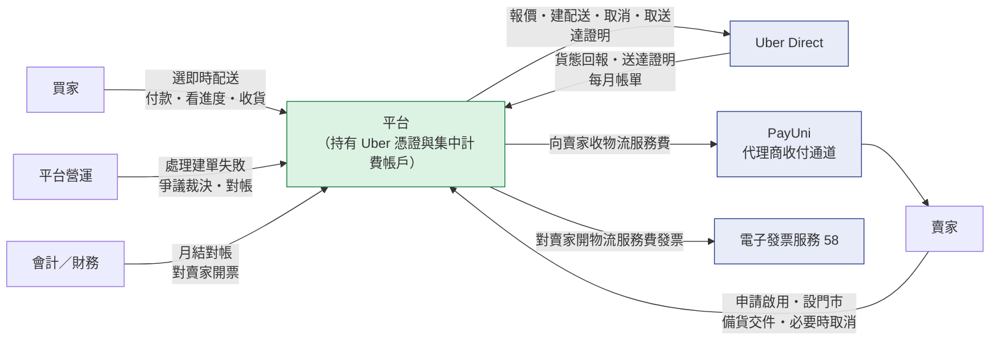

🔴 **賣家與 Uber 之間沒有任何直接關係**：賣家不簽約、不持憑證、不收帳單。
賣家對 Uber 這件事唯一感受到的是**平台向他收一筆物流服務費**（§4 線 B）。

## 2. 核心模型：一次配送，三條互相獨立的資金線

### 2.1 🔴 商流修正對照（2026-09-11 客戶正式決策）

| | 修正前（已否決） | 修正後（現行目標模型） |
|---|---|---|
| 買家付款收款方 | **平台代理商戶** | 🔴 **賣家子商店** |
| 買家付幾次 | 一次 | 一次（不變） |
| 商流模式 | 平台受託代銷 | 🔴 **賣家直營** |
| 誰對買家開票 | **平台** | 🔴 **賣家** |
| 賣家對平台開票 | 有（貨款進項憑證） | 🔴 **無** |
| 平台撥款給賣家 | 有（撥款資格逐條檢查 ＋ 1% 撥款指示費） | 🔴 **無**（平台沒代收，就沒有款可撥） |
| 平台向賣家收 Uber 物流費 | 無（內含在撥款淨額裡對沖） | 🔴 **有**，且平台同時對賣家開票 |
| 平台與 Uber 的關係 | 供應商（不變） | 供應商（不變） |

**修正的理由（客戶裁決，不再送回詢問）**：
**商品的銷售主體始終是「賣家 → 買家」，使用 Uber 配送不改變這件事。**
一筆訂單因為換了配送方式就整張變成「平台賣給買家」，在商務與稅務上都站不住。

⚠️ **修正後的模型與平台在 PayUni 的實際帳務一致**：每個賣家都是以自己名義註冊的獨立合作商店，
買家付款帶的是賣家自己的商店代號，平台只是代理商——這筆錢從一開始就掛在賣家名下。

### 2.2 錢分成三條線，各自獨立

🔴 **本節是本書最重要的一節，三條線禁止畫成同一條。**

| | 線 A 買家付款 | 線 B 平台向賣家收物流費 | 線 C 平台與 Uber |
|---|---|---|---|
| **當事人** | 買家 → 賣家 | 平台 → 賣家 | Uber → 平台 |
| **金額** | 商品 ＋ **買家配送費**（賣家免運時為 0） | **賣家物流服務費**（🔴 **不等於**買家配送費，§2.3） | **Uber 實際成本**（🔴 **不等於**報價，§4.3） |
| **時點** | 結帳當下 | ✅ **送達完成**（客戶 2026-09-11 裁決，ADR-003） | 每月 |
| **管道** | PayUni 一般收款 | PayUni 代理商收付通道（用途類別「物流」） | 平台的 Uber 集中計費帳戶 |
| **憑證** | 賣家對買家的發票 | **平台對賣家的發票** | Uber 的帳單／發票 |
| **是不是買家的第二次付款** | — | 🔴 **不是**。這是平台與賣家之間的企業對企業服務費 | 🔴 **不是** |

⚠️ **最常見的誤解是把線 B 當成「從買家那筆錢裡扣掉」**。不是：
買家的錢在線 A 就全數進了賣家帳戶；線 B 是平台之後另外向賣家收的一筆款，
有自己的金額、自己的時點、自己的發票，**也可能因為業務規則而不成立**（例如配送取消）。

### 2.3 🔴 十個金額維度，不是一個「運費」

**這是本書第二重要的一節，而它最容易被壓縮掉。**
「運費」這個詞在 Uber 這條路上同時指十件不同的事，它們**各自獨立追蹤、不得互相推導**：

| # | 金額 | 是什麼 | 誰決定 | 什麼時候知道 |
|---|---|---|---|---|
| 1 | **買家配送費**（buyer shipping charge） | 買家在結帳時**實際被收**的配送費 | 賣家的運費設定與免運政策 | 結帳當下（付款後不補收） |
| 2 | **物流商實際成本**（provider actual cost） | Uber **最終實際向平台收**的配送成本 | Uber 的月帳單 | 🔴 **月結時**才確定 |
| 3 | **賣家物流服務費**（seller logistics charge） | 平台**最終向賣家收**的物流服務費 | 平台的計費政策（基礎見 §2.5 的公式） | 應收成立於**送達完成**（ADR-003）；**最終金額**於月結對帳後確定（ADR-008） |
| 4 | **賣家補貼**（seller subsidy） | 賣家自己主辦的免運／折抵所吸收的金額 | 賣家的促銷設定 | 活動設定當下 |
| 5 | **平台補貼**（platform subsidy） | 平台主辦的免運／補貼活動所吸收的金額 | 平台的促銷政策 | 活動設定當下 |
| 6 | **責任歸屬調整**（responsibility adjustment） | 額外成本（取消／等待／退回等）依**責任成因**歸屬後的加減 | ✅ **成因判定**（ADR-004：賣家／買家／平台系統／provider，外加「**尚未判定**」共五類） | 事件發生並**判定完成**後。🔴 **尚未判定期間不做任何加減** |
| 7 | **對帳調整**（reconciliation adjustment） | 月結發現**實際成本與暫估不同**時的補收／退還 | ✅ **實際 > 暫估 ⇒ 補收；實際 < 暫估 ⇒ 退還或沖減**（ADR-008，兩個方向都是義務） | 對帳後 |
| 8 | **收款通道手續費**（PayUni collection fee） | 平台用代理商收付通道向賣家收款時，該通道**實際產生**的手續費 | ✅ **由賣家負擔**（ADR-005） | 扣款執行後。🔴 **仍必須與第 2 項分帳**（`120` 對 Uber 帳單、`1.2` 對 PayUni 紀錄）；帳上存**實際發生金額**，🔴 **不得用預估值（含 1%）冒充** |
| 9 | **估計物流商成本**（estimated provider cost） | 送達當下用來建立應收的**暫估**金額 | 平台（依當時可得資料） | 送達當下。🔴 **它不是最終值** |
| 10 | **賣家物流貸記**（seller logistics credit） | 多收之後應退還／沖減賣家的金額 | 對帳結果 | 對帳後。🔴 **永久可追蹤、不得過期、不得因賣家無後續交易而消失** |

🔴 **核心不變式（本書最重要的一條業務規則）**：

> **買家被收多少配送費，不等於 Uber 的實際成本，也不直接決定賣家最終要負擔多少。**

**⇒ 明文禁止的三種推導**：

| 禁止 | 為什麼 |
|---|---|
| `賣家物流服務費 = 買家配送費` | 賣家免運時買家配送費是 **0**，而 Uber 的成本照樣發生（§4.4 Case B） |
| `物流商實際成本 = 報價金額` | 報價是**結帳當下鎖定給買家看的價**；月帳單上還會有取消費、等待費、退回費、供應商調整（§4.3） |
| `買家配送費 = 0 ⇒ 平台吸收成本` | 🔴 **免運不等於免成本**。誰吸收要看**是誰主辦的免運**（§2.4），不能從「買家沒付」推導 |
| `賣家最終物流負擔 = 暫估／報價金額` | 🔴 **實支實付**（ADR-008）：基礎是 **Uber 實際成本**，暫估只是先行金額，月結後要補收或退還差額（§2.5） |
| 把**收款通道手續費**併進物流商成本 | 兩種不同來源的成本。混在一起之後，「Uber 收我多少」與「PayUni 收我多少」再也分不開，對帳無從進行 |

⚠️ **這十個金額必須能各自獨立存在**：賣家物流服務費的應收要能在「買家配送費為 0」時照樣成立；
而收款通道手續費、平台補貼、對帳調整三者又各是獨立的加減項。
把它們壓縮回單一的 `shipping_fee` 語意，上面三種錯誤推導**全部會自己長回來**。

### 2.4 🔴 免運：買家沒付，不代表沒有人付

**「免運」只代表「不向買家收配送費」，它不說明成本由誰吸收。**

平台既有的運費負擔方模型只有兩個值——**買方**或**賣方**
（`orders.shipping_fee_payer`；20 號結帳模組 §4.7 逐字「無條件免運＝**賣家無條件負擔該 SKU 運費**」）
⇒ **既有的免運一律是賣家主辦、賣家負擔**，這與本節的原則一致，不是新規則。

✅ **三種型態已於 2026-09-11 由客戶定案（ADR-007），不再是待決策。**

| 免運型態 | 買家配送費 | Uber 實際成本 | `seller_subsidy` | `platform_subsidy` | 賣家最終負擔 |
|---|---|---|---|---|---|
| **不免運** | 照收 | 照發生 | 0 | 0 | 全額（＝ Uber 實際成本） |
| **賣家主辦免運** | **0** | **照發生** | **＝買家原應付的配送費** | 0 | 🔴 **仍然是全額**——賣家只是選擇不向買家收 |
| **平台主辦免運／補貼** | **0** | **照發生** | 0 | **＝平台明確補貼的金額** | **Uber 實際成本 − 平台補貼** |
| **雙方共同補貼** | **0** 或部分 | 照發生 | 賣家那一份 | 平台那一份 | **Uber 實際成本 − 平台補貼** |

🔴 **共同補貼時必須分別記錄 `seller_subsidy` 與 `platform_subsidy`，不得只留單一 `shipping_fee`。**
兩者的會計意義不同：平台補貼是平台的促銷成本、賣家補貼是賣家的促銷成本，
合成一個數字之後**再也拆不回來**，而月結對帳與各自的損益都需要它們分開。

⚠️ **`buyer_shipping_charge = 0` 永遠推導不出成本負擔者**（三種型態的買家配送費都可能是 0，而答案不同）
⇒ 成本負擔者由**促銷／運費補貼政策**明確決定並記錄。

🔴 **現況的資料模型還表達不出來，這是實作缺口不是決策缺口**：
`orders.shipping_fee_payer` 的值域只有買方與賣方（**沒有平台**），也沒有承載兩個補貼金額的欄位。
⇒ **決策已定（本節），缺的是落地**：要新增平台側的負擔方表達 ＋ `seller_subsidy`／`platform_subsidy` 兩欄。
⚠️ 那會連帶影響運費計算、結帳金額快照、帳務科目與對帳 ⇒ 屬另一波的實作範圍（本波是文件層，零程式變更）。
**在落地之前，平台主辦補貼只能人工處理，不得用賣家主辦免運的路徑冒充。**

### 2.5 🔴 賣家最終物流負擔的公式（實支實付，ADR-008）

**核心商業原則：Uber 物流採實支實付。** 賣家最終要負擔的基礎是 **Uber 實際成本**，
**不是**買家配送費、**不是**結帳報價、**也不是**初始暫估值。

```
賣家最終物流負擔（Seller Logistics Liability）
   ＝ Uber 實際成本（provider actual cost）
   ＋ 賣家負擔的收款通道實際手續費（ADR-005）
   − 平台補貼（platform subsidy，ADR-007）
   ± 責任歸屬調整（responsibility adjustment，ADR-004）
   ± 對帳調整（reconciliation adjustment，ADR-008）
```

⚠️ **實際公式以物流商／收款通道的真實資料為準**——本式是**概念層的維度分解**，
各項取值來源屬 Uber Scoped Review 的查證範圍。
🔴 **但「這幾項必須各自獨立」已定案，不得壓回單一 `shipping_fee`。**

⚠️ **賣家自己的補貼不出現在這條公式裡**：賣家主辦免運是「他選擇不向買家收」，
成本仍然由他負擔 ⇒ `seller_subsidy` 影響的是**買家付多少**（線 A），不影響他要付給平台多少（線 B）。

✅ **收款通道手續費由賣家負擔（ADR-005）⇒ 它是公式的第二項。**
🔴 **但仍必須與 Uber 實際成本分帳**——兩者要對到不同的對象，
合成之後兩邊都對不起來、而且拆不回來。
⚠️ 手續費一律以收款通道回傳的**實際金額**記帳，**不得用預估值（含 1%）冒充**。

**暫估 → 實際的收斂（ADR-008）**

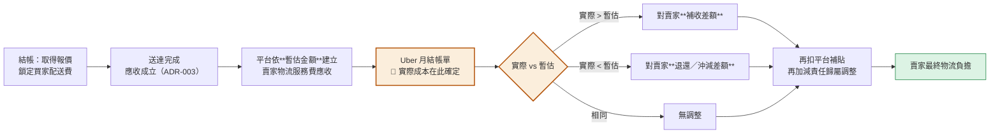

🔴 **「暫估」不是「最終」**：平台在送達當下就建立應收（不必等帳單，否則賣家幾週後才知道要付多少），
但那個金額是**先行值**；月結對帳後**必然**要有一次差額結算。
✅ **差額結算與責任歸屬兩者現在都定了**：差額走補收／退還（ADR-008），
額外成本走**四種責任成因**歸屬（ADR-004，見 §2.6）。
🔴 **各類費用一律逐筆記錄並進對帳**，這條與責任方是誰無關。

### 2.6 🔴 額外成本算誰的：**依責任成因，不依費用名稱**（ADR-004）

**取消費、等待費、退回費、供應商調整——這些名稱不決定誰付錢。**
同一個「取消費」可能來自賣家沒備貨、買家不在場、我方系統重複建單、或 Uber 自己派不出人，
**四種情形的正解相反**，而帳單上它們都叫 cancellation fee。

| 責任成因 | 典型情形 | **誰負擔** |
|---|---|---|
| **賣家原因** | 賣家主動取消／商品未備妥造成等待／🆕 **逾期未宣告備妥，由系統代為取消**／取件資訊錯誤／地址或聯絡資訊錯誤／要求改派／要求退回／操作造成額外配送 | 🔴 **賣家**（平台不吸收） |
| **買家原因** | 買家主動取消／無法聯絡／不在場造成等待／要求改址／拒收／造成退回 | 🔴 **仍先歸賣家的物流成本**；🔴 **平台不得直接向買家二次收款** |
| **平台／系統原因** | 平台程式錯誤重複建配送／自動化錯誤造成取消／系統錯誤導致重新派送／平台給錯資訊造成額外費用 | 🔴 **平台**（不得轉嫁賣家） |
| **物流商原因** | Uber 系統問題／外送員問題／provider 自身錯誤／不合理調整 | 🔴 **不得自動向賣家收**；先進**爭議與對帳**。撤銷 ⇒ 雙方都不收；確認成立且查出責任屬賣家或買家 ⇒ 回到本表歸屬 |
| 🆕 **尚未判定** | 證據不足以指認上面任何一方：provider 只說「沒送到」而沒有更多事實、缺交付嘗試或聯繫紀錄、我方與 provider 的事實對不起來 | 🔴 **暫不歸屬任何一方**：不向賣家收、不記任何一方的失敗、**也不決定要不要退買家的錢**。訂單停在「配送異常」，由營運裁決後才回到上面四列 |

🔴 **「逾期未宣告備妥、由系統代為取消」歸賣家原因，而它是新流程才出現的成本。**
曾經有一個版本是「賣家按鈕才建單」，那時賣家逾時的當下 Uber 側還沒有單，取消不花錢；
**現在單在付款當下就建到 Uber 了**，逾時取消**一定會真的打到 Uber**，可能產生取消費。
⚠️ 責任成因看的是「**誰讓這件事發生**」，**不看是誰按下取消鍵**——按的是系統，原因是賣家沒有備貨。

🔴 **「尚未判定」不是「物流商原因」的同義詞。** 兩者的處置看起來像（都不向賣家收），但意思相反：
物流商原因是**已經判定**責任在 Uber；尚未判定是**還沒有人知道責任在誰**。
把「分不出來」塞進物流商原因，等於在沒有證據的情況下做了一個判定，而且那個判定還是對外部廠商的指控。
⚠️ **物流商回報「無法送達／已退回」本身不是責任判定**——它只描述「沒有完成交付」，
不能直接推導成買家原因，也不能直接推導成物流商原因。

#### 🔴 買家原因為什麼不向買家收（最容易做錯的一格）

平台提供的是**賣家使用的物流服務**——線 B 是「平台 ↔ 賣家」的關係，**買家不是當事人**。
平台若直接向買家二次扣款，等於繞過賣家、在「賣家 ↔ 買家」的契約之外對買家收錢，
而那個契約不是平台的。

```
平台 ↔ 賣家（線 B）  買家原因造成的 Uber 成本 ⇒ 歸賣家的物流成本
賣家 ↔ 買家（另一層）賣家依自己的交易條款決定：向買家收回／自行吸收／走退款規則
```

🔴 **第二層是賣家的規則，平台不得代行。**

⚠️ **這一格之所以最容易讀反，是因為三件事被壓成了一個問題。它們是三條獨立的軸**：

| 軸 | 問的是 | 買家原因這一格的答案 |
|---|---|---|
| **責任** | 誰讓配送失敗的 | **買家** |
| **成本結算對象** | 這筆 Uber 成本最後走哪一條結算鏈 | **賣家**（線 B，平台↔賣家的既有關係） |
| **營運考核** | 哪一方被記一次履約失敗 | 🔴 **不記賣家**（責任在買家） |

🔴 **三者同時成立，不矛盾**：成本結算對象講的是「這筆錢走哪條線收」，**不是**「誰有錯」。
⚠️ **考核只能看責任那一軸**，🔴 **不得改用「有沒有向賣家收這筆成本」來推導**——
在買家原因這一格，那兩者刻意不一致，而那個不一致正是考核被汙染的唯一入口。

#### 🔴 平台補貼 ≠ 平台造成的成本

| | 平台補貼 | 平台原因造成的成本 |
|---|---|---|
| 性質 | **商業促銷** | **系統錯誤的成本責任** |
| 會計語意 | 行銷費用 | 損失／賠付 |
| 營運分析 | 活動成效 | 事故成本 |

合成同一個數字之後，「這個月平台花了 5 萬」就分不出是辦活動還是系統出錯。**兩者各自獨立記錄。**

⚠️ **與「未送達不收配送服務費」不衝突**：那講的是**服務的價金**（沒送到就沒有服務），
本節講的是**已經發生的額外成本**。⇒ 未送達的訂單：**不收配送服務費，但額外成本依本表歸屬**。

## 3. 主要業務流程

### 3.1 買家：從選配送方式到收貨

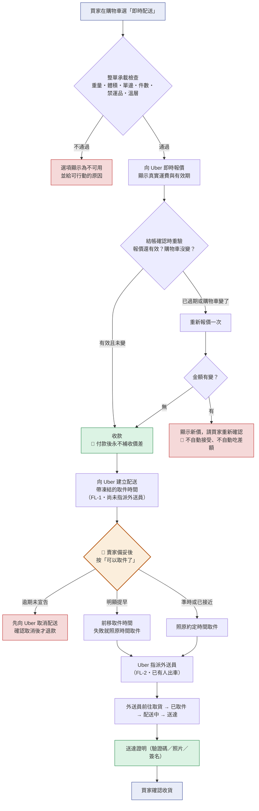

⚠️ **買家在付款之後會經歷一段「等賣家」的時間**，那不是異常。買家端要能看到現在卡在哪一格
（賣家備貨中／外送員已指派／前往取件中），而不是一路顯示「運送中」——那會讓買家在賣家還在裝箱時就開始找客服。
🔴 **「配送已建立」不等於「外送員已出發」**：單在付款當下就建好了，但 Uber 是依約定取件時間才排人
⇒ 買家端**不得**把「已建立配送」顯示成「外送員前往取件中」。

🔴 **「付款後永不補收」是這條流程的核心承諾**，它決定了三個看起來瑣碎的設計：
- 報價**在報價階段**就要檢查剩餘有效期，不是等到按下付款才發現過期
- 報價與購物車綁定；購物車改了就是另一筆報價
- 金額有變**一定要問買家**：自動接受新價等於補收（違約），自動用舊價等於平台無上限吃差額

⚠️ **選項不可用時仍然顯示，只是標成不可用並附原因**。
原因分兩類：**買家可以自己處理的**（超重、超材積、地址無法解析、不在服務範圍、含禁運品類、冷藏冷凍不支援）
說清楚讓他調整；**我方或 Uber 的問題**（尚未開通、設定缺失、報價失敗）一律對外顯示「此配送方式暫不可用」，
不揭露是哪個環節壞了——買家對那個資訊沒有可行動性，而它會把 Uber 的故障變成平台的信譽問題。

### 3.2 賣家：從申請啟用到交件

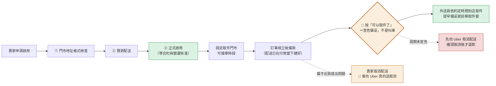

賣家在這條流程裡有**四件事**：申請啟用、設定取件門市與可接單時段（以及備貨時長）、
🔴 **備妥後宣告「可以取件了」**、必要時取消。

🔴 **「可以取件了」是宣告備妥，不是叫車。** 配送在買家付款的當下就已經建到 Uber，
帶的是報價時凍結的取件時間；賣家按下去**不會建單、不會多叫一台車**。它做兩件事：
告訴平台貨真的好了（處理期限的時鐘就此停止），以及在賣家**明顯提早**時讓平台向 Uber 前移取件窗。
⚠️ **這與黑貓的「呼叫黑貓」、7-11 的「到店交寄」不是同一格**——那兩種按下去才會產生物流單，
Uber 的單在那之前就存在了。**動作語意不同，所以不共用同一個名字。**

⚠️ **前移取件窗失敗不是錯誤，也不會升級成取消**：保留原本的配送與原本的取件時間，
外送員照原約定時間到店。買家的預計送達時間不變、不退款、不會出現第二筆配送。

🔴 **賣家不宣告也不能一直等下去**：每一筆 Uber 訂單都有**處理期限**，逾期由系統
**先向 Uber 取消配送、確認取消成立之後**，才取消訂單並原路退款
（[65 §7 共通規則](65-物流履約平台（Fulfillment%20Platform）基本設計書.md)「每一種配送方式都必須有賣家處理期限」）。
這是買家的保護，不是對賣家的懲罰——沒有它，買家的錢會停在一筆永遠不會出貨的訂單上而沒有人知道。
🔴 **順序不可顛倒**：先退款再取消配送，會出現「錢已經退給買家、而 Uber 的車照樣來取貨」。
⚠️ **期限與相關時間參數見 §9.4。**

⚠️ **取消是唯一會真的打到 Uber 的賣家動作**（其他配送方式的取消只寫本地狀態）。
因為外送員可能已經在路上，取消可能產生取消費（線 C），所以取消前要先告知賣家責任。
🔴 **新流程下「取消不花錢」的窗口小得多**：付款那一刻 Uber 側就已經有單，
所以**每一次取消都要先問 Uber 現在到哪一步**（還沒指派外送員／已指派／已取件），
據此決定畫面文案與責任歸屬。
⚠️ **只有在確認 Uber 尚未產生費用時才可以說「不會有取消費」，而那要查過才知道，不是預設。**

### 3.3 平台：一筆配送的三段

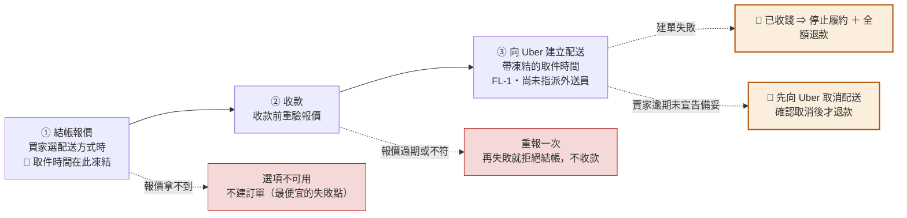

🔴 **三段講的是「平台要做完的事」，賣家的「宣告備妥」不在這三段裡。**
報價、收款、建單——這三件做完，平台對這筆配送的建置責任就結束了。
賣家按「可以取件了」是**履約期間的一個賣家動作**（§3.2），它不建單、不是平台流程的第四段；
把它畫進來，會讓人以為平台還在等一個 API 才算完成。

🔴 **①的重點是「取件時間在報價當下就定下來了」。** 報價時就依賣家設定的備貨時長算出
「這筆單大約什麼時候可以被取走」，並把那個**絕對時間**凍結起來；②重驗報價、③建單，
用的都是**同一份凍結值**。
⚠️ **不得在建單當下重算**——重算會讓「買家看到的預計送達」與「Uber 拿到的取件時間」對不起來。

🔴 **②→③ 中間不是原子的**：收款與向 Uber 建單是兩個不同系統的兩件事，中間可能斷。
「已收錢但沒有配送」這個狀態**必須有出口**，那個出口就是「停止履約 ＋ 全額退款」。
沒有它，錢會停在系統裡而沒有人知道。
⚠️ **建單結果不明時不得重送**——可能已經建成功，重建等於兩趟車、重複計費（§6.1）。

🔴 **③之後才是「隔著一段人的時間」**——賣家可能十分鐘備好，也可能拖到隔夜。
這段時間**不是異常**，它需要的不是補償機制，而是兩樣東西：

| 需要什麼 | 為什麼 |
|---|---|
| **一個期限**（賣家處理期限） | 沒有期限 ⇒ 訂單可以永遠停在這裡，而買家的錢已經付了，**而且 Uber 那邊還掛著一張單**。參數見 §9.4 |
| **一條前移取件窗的路** | 賣家比預期早備好時，不該讓買家白等到凍結的那個時間 ⇒ 向 Uber 前移取件時間。🔴 **失敗就照原時間取件，不取消、不重建** |

⚠️ **不要把「賣家還沒宣告備妥」當成「系統出錯」**。兩者在資料上長得像（訂單已付款、還沒有人來取件），
而處置相反：一個要等人、一個要補做。判錯的後果是**賣家還在備貨而訂單已被自動取消**，
或**真的漏建的單沒有人補**。兜底機制只能補做③，🔴 **不得代替賣家宣告備妥**
（[65 §7 共通規則](65-物流履約平台（Fulfillment%20Platform）基本設計書.md)）。

### 3.4 跨服務時序（主流程）

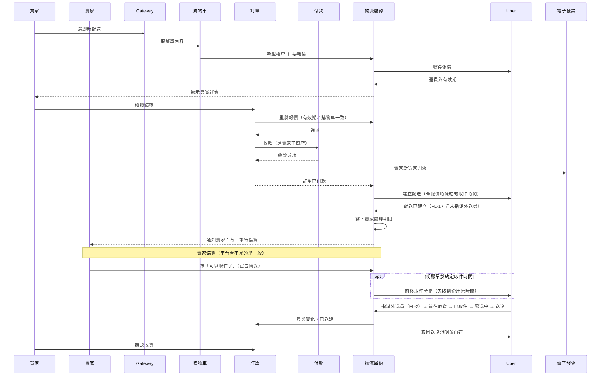

⚠️ **圖上沒有「平台撥款」這一步**，因為錢從來沒經過平台（§2.1）。
**線 B 與線 C 不在這張圖上**——它們不是這筆訂單的步驟，是另外兩條資金線（§4）。

🔴 **圖上「建立配送」緊接在「訂單已付款」下面，不在賣家那一段。** 這是本書最容易被寫回舊版的一格：
建單是平台在付款當下就做完的事，賣家的「可以取件了」只是**宣告備妥**，不會產生第二張單。
**它也不能由排程代按**——排程判斷得出「時間到了」，判斷不出「貨備好了」。

⚠️ **「前移取件時間」那一步是條件式的**：沒有明顯提早就不呼叫 Uber，讓它照原約定時間來。
無論走哪一條，🔴 **買家在結帳時看到並付掉的配送費都不會變**（§2.3 十個金額維度的第 1 維），
🔴 **也不會在建單當下重新報價**——取件時間與運費都是報價當下凍結的那一份。

### 3.5 買家在結帳時多決定兩件事：怎麼交付、有沒有配送指示

> 🔴 **本節是 2026-09-13 Design Closure 補上的。** 這兩件事在需求書裡都被明文指定過，
> 但四本設計書一字未承接——**沒有人否決過它們，它們只是消失了**。

#### 交付方式（handoff）

即時配送送到的是買家家門口，而「怎麼算送到」不只一種。買家在結帳時選一種：

| 交付方式 | 買家的意思 | 送達證據 |
|---|---|---|
| **本人親自簽收** | 我會在家開門 | 簽名（可能另有照片） |
| **驗證碼交付** | 交給我本人，並核對一組碼 | 驗證碼核對紀錄 |
| **指定放置** | 放門口／管理室，不必等我 | **照片** |

🔴 **驗證碼預設遮罩顯示**（例如 `••21`），只在接近交付的階段才允許買家揭露全碼，
並同時說明「只交給實際外送的夥伴」。理由：那組碼**單獨持有就能領走貨**，它是**憑證不是個資**，
判準與遮罩規則都與一般個資不同（[65 §10](65-物流履約平台（Fulfillment%20Platform）基本設計書.md)）。

⚠️ **選了「指定放置」就必須拿得到照片**，否則爭議時我方沒有任何證據——
而生鮮放在門口的爭議本來就比一般商品多。

> ✅ **2026-09-14 更新：官方值域已取得，三種業務語意全部可以對應得上。**
> 原本的 `EXTERNAL_VERIFICATION_REQUIRED` 解除（詳設 66 §6.5／`UP-23`）。
>
> | 業務語意 | Uber 側的組合 |
> |---|---|
> | 本人親自簽收 | 門口碰面 ＋ 要求簽名 |
> | 驗證碼交付 | 門口碰面 ＋ 要求驗證碼 |
> | 指定放置 | 放門口（**官方會自動要求照片**） |
>
> 🔴 **但有一條硬互斥要讓買家知道**：**「指定放置」不能同時要求簽名或驗證碼**——
> 官方直接拒絕這種組合。⇒ 結帳 UI 的三選一**本來就互斥**，這一點是相容的；
> **但不得出現「指定放置 ＋ 要驗證碼」這種加購式的選項**。
>
> ✅ **驗證碼的來源已確認，且比原先假設的更好**：碼由 Uber 產生，
> **會回傳在我方建單的回應裡** ⇒ 🔴 **我方拿得到全碼，買家端的遮罩顯示與揭露流程是可實作的**，
> 不必依賴 Uber 的簡訊。⚠️ **而且不能只依賴 Uber 簡訊**：那封簡訊寄到買家在 Uber 側的號碼，
> 號碼一旦有問題，**我方 App 是買家唯一的取碼管道**，拿不到碼的後果是**收不到貨並轉入返程**。
>
> ⚠️ **仍未確認的只剩一項**：台灣業務文件提到驗證碼可以「指定為收件人電話末四碼」，
> 官方現行契約**沒有這個選項**（只有「由 Uber 產生」）⇒ 若產品想要「末四碼」那種好記的碼，
> 那是一個**尚未確認存在的能力**，不得先寫進文案。

#### 買家配送指示（Buyer Delivery Instruction）

一個**選填**欄位，買家寫給**外送員**看的：「請勿按門鈴」「交給管理室」「電鈴壞了請打電話」。

🔴 **它是獨立的一欄，不得用既有任何一個欄位冒充。** 四者的收件人完全不同：

| 欄位 | 誰寫 | 給誰看 | 例子 |
|---|---|---|---|
| **地址補充** | 買家 | 地理編碼與外送員找路 | A 棟 12 樓 1203 室 |
| 🆕 **買家配送指示** | 買家 | **外送員** | 請勿按門鈴，交給管理室即可 |
| **訂單備註** | 買家 | **賣家**（交易溝通） | 麻煩幫我多放一個保冷劑 |
| **取件說明** | **賣家** | 外送員（到店取件時） | 走側門，跟櫃檯說取 Uber 單 |

⚠️ **現況是四者裡最糟的一種狀態**：買家把配送指示寫在「訂單備註」裡，以為外送員看得到，
而那一欄是給賣家的，**外送員永遠看不到**。這不是少一個功能，是一個會讓買家誤以為已經交代過的陷阱。

**規則**

| # | 規則 |
|---|---|
| 1 | **選填**。沒填就是沒有指示，不得用其他欄位的內容自動填入 |
| 2 | **付款時定版**，之後該筆配送不再改變。理由同地址與交付方式：**配送在付款當下就已經送到 Uber**，之後才改，外送員手上拿到的是舊的 |
| 3 | 🔴 **付款後買家不得修改收件地址、交付方式、配送指示，也不得自行取消訂單**。要改只能走客服，由營運判斷 |
| 4 | 🔴 **只把外送員需要的內容送給 Uber**。訂單備註（給賣家的）**一律不送**——那裡面可能有與配送無關的交易溝通 |
| 5 | 賣家與營運看得到這一欄（處理爭議需要），買家在訂單詳情看得到自己填的內容 |

### 3.6 賣家的 Uber 設定：開通之後還可以調整

賣家開通 Uber 之後，下列各項**隨時可以改**，也可以**整個暫停**：

| 設定 | 意思 | 改了之後 |
|---|---|---|
| **開啟／暫停** | 這家店現在接不接 Uber 單 | 暫停 ⇒ 新的結帳看不到 Uber 選項；**已付款的訂單不受影響，照樣要出貨** |
| **取件門市** | 外送員去哪裡取貨 | 只影響之後成立的訂單 |
| 🆕 **可接單時段** | 這家店願意接 Uber 單的時間（例如 11:00–19:00） | 時段外 ⇒ 結帳時 Uber 選項顯示為不可用並說明原因 |
| 🆕 **備貨時長** | 這家店從訂單成立到「貨可以被取走」通常要多久 | 只影響之後成立的訂單；已付款訂單用**下單當時的快照**。🔴 **它決定的是我方在報價當下凍結、並送給 Uber 的取件時間**，不是一個賣家事後可以改掉的倒數。允許範圍與預設值見 §9.4 F |
| ⚠️ ~~取件前置緩衝~~ | 🔴 **本波不提供** | 🔴 **也不承諾之後會提供。** 「賣家宣告備妥之後外送員多久到店」是**物流商側**的參數，其官方語意仍待查證（§9.2 第 8 項）。⚠️ **不要與上一列的「備貨時長」混為一談**——備貨時長講的是賣家要多久，取件前置緩衝講的是 Uber 要多久 |

🔴 **「可接單時段」不等於「店面營業時間」。** 一家店可以早上九點開門、但只願意在 11:00–19:00 接即時配送單
（人手、備貨節奏、外送尖峰都會影響）。**兩者是兩個獨立設定**，不得互相推導。
⚠️ **但方向是單向的**：店休息時 Uber 一定不可用——不得出現「店已打烊而 Uber 仍可下單」。

🔴 **`UP-24` 關閉之前，賣家在 Uber 上的能力就是下表五項，沒有第六項。**
（⚠️ 其中四項是**上表的設定**，第五項「按『可以取件了』」是**動作**不是設定，所以上表沒有它。）

| 已確定的賣家能力 | 狀態 |
|---|---|
| Uber 啟用／暫停 | ✅ 已定案 |
| 取件門市 | ✅ 已定案 |
| 可接單時段 | ✅ 已定案 |
| 備貨時長 | ✅ 已定案；允許範圍與預設值見 §9.4 F |
| 按「可以取件了」宣告備妥 | ✅ 已定案 |
| ~~取件前置緩衝~~ | 🔴 **未定案，且本波不得寫進任何產品／UX 文件當成既有功能**（§9.2 第 8 項） |

⚠️ **為什麼連「先寫上去、之後再調」都不行**：產品與 UX 文件一旦把它畫成賣家設定項，
它就會進入畫面稿、進入賣家教學、進入驗收清單——而我方**連它存不存在都還沒確認**。
🔴 **撤回一個已經承諾的設定項，比一開始不承諾貴得多。**

🔴 **所有變更一律只影響「之後」**：已經成立並付款的訂單，用的是**下單當時的設定快照**。
賣家把可接單時段從 11:00–19:00 改成 11:00–17:00，不會讓昨天那筆已付款的訂單跟著變
——那會讓買家看到的預計送達時間在付款後被改掉。

⚠️ **賣家的正常開通與調整不得依賴營運手動改資料庫。** 賣家自己有一組可用的畫面與入口；
營運能看、能診斷、能停用某個賣家，但**那是治理手段不是開通路徑**。

## 4. 錢怎麼流：三張完全分開的圖

### 4.1 線 A · 買家付款

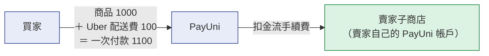

- **買家只付款一次**，金額含商品與 Uber 配送費。
- 款項**直接進賣家子商店**，平台不代收。
- 🔴 買家付的那筆配送費**不是平台向賣家收費的依據**，也**不是 Uber 實際成本**（§2.3）。
  三者可能相同也可能完全不同，取決於賣家的免運政策與 Uber 的實際計費。
- 🔴 **賣家主辦免運時這條線上的配送費是 0，而後面兩條線照走**（§4.4 Case B）。

### 4.2 線 B · 平台向賣家收 Uber 物流服務費

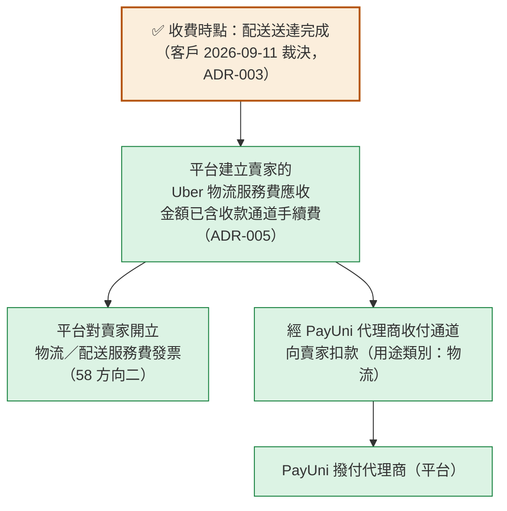

以箭頭形式看當事人：

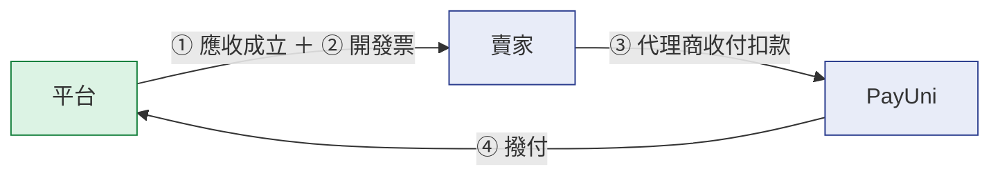

| 要素 | 內容 |
|---|---|
| **業務性質** | 平台提供「代為安排即時配送」的服務，向賣家收服務費。**企業對企業**，不是買家的付款 |
| **收款管道** | PayUni 的**代理商對合作商店收付通道**，用途類別「物流」。技術細節（金額欄、正負向、加密、重試、次日實際入帳、查詢與對帳）屬 [66 詳設](../詳細設計書/66-Uber%20Direct%20即時配送整合詳細設計書.md) 與 Uber Scoped Review |
| **發票** | 🔴 **平台對賣家開立**，屬 [58 號](58-電子發票服務（Invoice%20Service）基本設計書.md) 的**方向二 · 平台服務費**（開立人＝平台、買受人＝賣家、無訂單）。**不是新的開票方向** |
| **收費時點** | ✅ **配送送達完成時**（客戶 2026-09-11 裁決，ADR-003）。⇒ 取消與履約失敗**不成立這筆「配送服務費」的應收**。🔴 **但那只講價金**：Uber 已經發生的取消費／等待費／退回費是另一種錢，依責任成因歸屬（§2.6）——該歸賣家的一樣要向賣家結算，**不會因為「沒送到」就消失** |
| **手續費負擔方** | ✅ **由賣家負擔**（ADR-005）。理由：Uber 配送是賣家使用的物流服務，平台不應因**替賣家收款**而長期吸收該筆第三方成本。🔴 **但精確費率、扣費時點、gross／net 方向、是否另扣，一律待 Uber Scoped Review 依官方文件／sandbox／正式契約查證** ⇒ **不得把「1%」寫成商業常數** |
| **金額怎麼算** | ✅ **實支實付（ADR-008）**：`賣家最終物流負擔 ＝ Uber 實際成本 − 平台補貼 ± 責任歸屬調整`（§2.5）。送達當下先依**暫估**建立應收，月結取得實際成本後**補收或退還差額**。 |
| **收款通道手續費** | ✅ 由賣家負擔，**是公式的一項**；🔴 **但必須與 Uber 實際成本分帳**（兩者對到不同對象）。⚠️ 帳上一律存**實際發生金額**，**不得用預估值（含 1%）冒充** |

### 4.3 線 C · 平台與 Uber 的月結

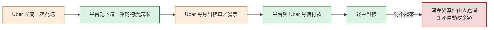

🔴 **結帳當下的報價不是最終成本。** 報價是「鎖定給買家看的價」，
而**實際成本要到月帳單才確定**——中間可能出現取消費、等待費、退回費、供應商調整、帳單調整。
⇒ **不得把報價金額永久當成實際成本**（§2.3 禁止推導第 2 條）。兩者的關係是：

```
結帳：取得報價 → 鎖定買家配送費（付款後不補收）
  ↓
履約：配送發生 → 送達完成（ADR-003）
  ↓
平台依**暫估金額**建立「賣家物流服務費應收」（不必等帳單）
  ↓
月結：Uber 出帳單 → 🔴 實際成本在此確定
  ↓
對帳：實際成本 vs 暫估
   ├ 實際 > 暫估 ⇒ ✅ 對賣家**補收差額**
   ├ 實際 < 暫估 ⇒ ✅ 對賣家**退還／沖減差額**
   └ 相同       ⇒ 無調整
  ↓
再扣平台補貼、再加減責任歸屬調整 → 賣家最終物流負擔
```

✅ **差額結算的機制已定案（ADR-008）**：補收／退還兩個方向都成立，不是「留給以後」。
🔴 **留給 Uber Scoped Review 的只剩「每一種特殊費用由誰負擔」**——
取消費／等待費／退回費，以及按成因分類的供應商調整（賣家行為／買家行為／平台或系統錯誤）。
那是一張**責任矩陣**（按四種成因認定，✅ 已由 ADR-004 定案，見 §2.6），與差額機制是正交的兩件事。

帳單上可能出現的項目：配送費、**取消費**、**等待費**、**退回費**、各種調整。

🔴 **這些都不得回寫買家已確認的配送費，也不得修改賣家的商品本金。**
理由很直接：買家已經付完款、發票已經開了；Uber 事後多收我方 30 元，
不是買家的責任，也不是賣家商品價格的一部分。
✅ **誰負擔已定案（`ADR-004`，2026-09-11）：依責任成因歸屬，不依費用名稱**——
賣家原因 ⇒ 賣家負擔實際成本；買家原因 ⇒ 仍歸屬「賣家物流成本」，🔴 **平台不得直接向買家建立第二次追加付款**；
平台／系統原因 ⇒ 平台負擔且**不得向賣家收取**；物流商原因 ⇒ **不得自動向賣家收**，先進爭議／對帳（§2.6）。
🔴 **它從來不是技術推導**，但現在也**不再是待決事項**——待的只有「帳單欄位能不能判出成因」這個**外部實證**（§9.2）。

### 4.4 🔴 驗收案例：同一張 Money Flow，四種不同的錢

**這些案例存在的理由是：它們的「買家配送費」不同，而「誰負擔 Uber 成本」的答案也不同。**
任何把十個金額壓縮成一個的設計，在這些案例上會**至少答錯一個**。
⚠️ **A／B／C 驗的是免運與補貼（`ADR-007`）**；**D 驗的是實際成本與暫估的差額（`ADR-008`）**；
**責任成因的四種歸屬（`ADR-004`）另見 §2.6 的對照表**。

以商品 1000 元、Uber 實際成本 120 元為例：

| | 買家配送費 | Uber 實際成本 | `seller_subsidy` | `platform_subsidy` | 賣家最終負擔 | 誰最終吸收 120 |
|---|---:|---:|---:|---:|---:|---|
| **Case A · 正常收運費** | **120** | 120 | 0 | 0 | **120** | **賣家**（他從買家收到 120，再付給平台 120） |
| **Case B · 賣家主辦免運** | **0** | 120 | **120** | 0 | **120** | 🔴 **仍然是賣家**（他選擇不向買家收，但成本照付） |
| **Case C · 平台主辦補貼** | **0** | 120 | 0 | **120** | **0** | **平台** |
| **Case D · 雙方共同補貼** | **0** | 120 | **50** | **70** | **50** | 賣家 50 ＋ 平台 70 |

⚠️ **Case D 不是「Case B 與 C 的中間」，它是第四種要獨立記錄的情形**：
`seller_subsidy` 與 `platform_subsidy` 必須各記一筆，合成單一數字之後再也拆不回來（§2.4）。

#### Case A：正常收運費

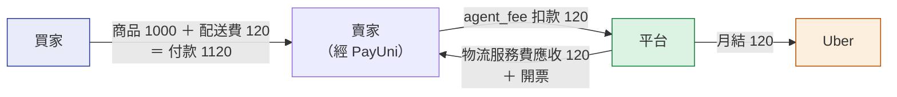

⇒ 賣家收 120、付 120，**淨零**；平台收 120、付 120，**淨零**（扣掉收款通道手續費，見 ADR-005）。

#### Case B：賣家主辦免運（🔴 本節的重點）

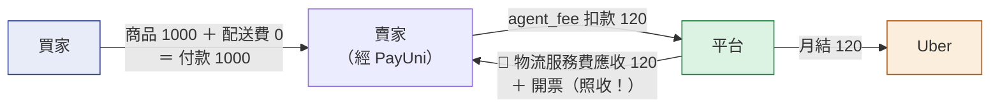

⇒ 賣家收 0、付 120，**淨 −120**——那就是他辦免運活動的成本，**和平台無關**。
🔴 **「買家免運」只代表賣家選擇不向買家收配送費**，它不代表 Uber 免費配送，
也不代表平台吸收 Uber 成本。
⚠️ **這個案例是判別「設計有沒有做對」的那一個**：若實作把賣家物流服務費綁成買家配送費，
這裡會變成應收 0 ⇒ **平台默默吸收了 120，而沒有任何人決定過這件事**。

#### Case C：平台主辦補貼

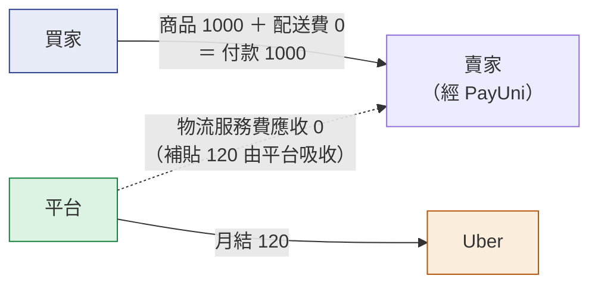

⇒ 賣家收 0、付 0；平台付 120，**淨 −120**——那是平台的促銷成本。
✅ **成本歸屬已定案（ADR-007）**：平台補貼的部分由平台負擔，賣家只負擔扣除補貼後的部分。
🔴 **但現況的資料模型還表達不出來**（§2.4）：運費負擔方沒有「平台」這個值，
也沒有承載兩個補貼金額的欄位 ⇒ **落地之前 Case C 只能人工處理，不得用 Case B 的路徑冒充它**
——兩者的買家配送費都是 0，而正解相反。

#### Case D：雙方共同補貼

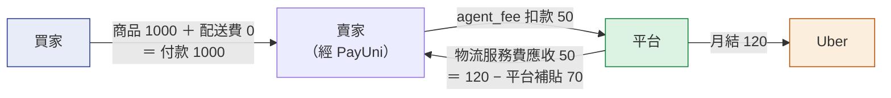

⇒ 賣家淨 −50（他的 `seller_subsidy`）；平台淨 −70（它的 `platform_subsidy`）；Uber 收到 120。
🔴 **兩個補貼要各記一筆**，否則事後無法回答「這次活動平台花了多少、賣家花了多少」。

#### 為什麼 B 與 C 不能靠「買家配送費」分辨

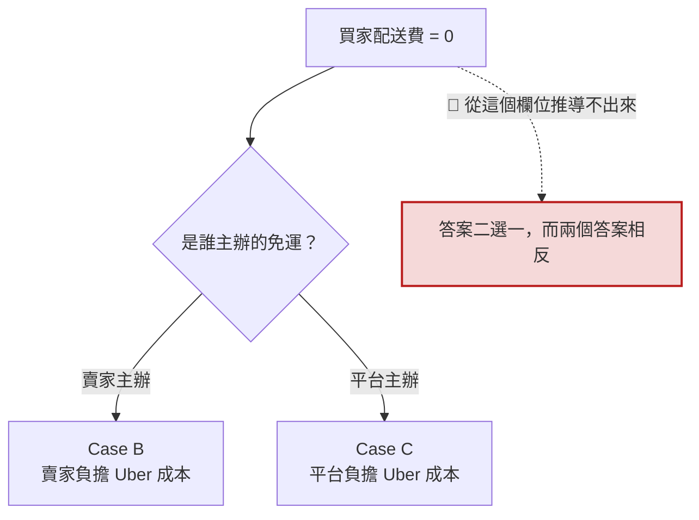

⇒ **成本負擔者必須由促銷／運費補貼政策明確決定並記錄**，不是從金額反推。

## 5. 發票怎麼流

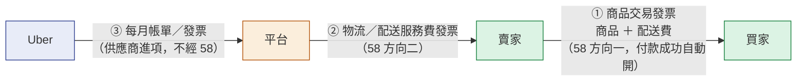

| 問題 | 答案 |
|---|---|
| 誰對買家開票？ | 🔴 **賣家**（修正前是平台，已否決） |
| 開票金額含不含 Uber 配送費？ | **含**。買家付的是一筆訂單款，發票就是那筆訂單 |
| 誰對賣家開票？ | 🔴 **平台**，開的是 Uber 物流服務費（58 方向二） |
| 賣家要不要對平台開票？ | 🔴 **不用**。那是受託代銷模型才需要的貨款進項憑證，該模型已否決 |
| Uber 的帳單給誰？ | **平台**（平台持有集中計費帳戶） |
| 買家退款時誰處理發票？ | **賣家**（同月作廢、跨月折讓，判準在 58 號） |
| 平台退還賣家物流服務費時誰處理？ | **平台**（對自己開的那張票作廢或折讓） |
| 只退配送費時誰處理？ | **賣家**對買家開折讓。🔴 **這與平台向賣家收的物流服務費不連動**（§6.2） |

✅ **開票的業務關係已確定**（平台向賣家收 Uber 物流費時，同時開立「**Uber 配送服務費／物流服務費**」發票）。
⚠️ **仍待法務／會計確認的只有三件**：正式**會計科目**、**稅務科目**、以及如有特殊稅務處理時的正式做法（§9.2）。
🔴 **不要把整個「平台 → 賣家開票」列為未決**——未決的是科目，不是關係。本書不創造會計政策。

### 5.1 結算與對帳流程（Settlement / Reconciliation）

🔴 **這一節把「暫估 → 實際 → 差額」與「平台 ↔ Uber 月結」接成一條，它們是同一條鏈的兩端。**

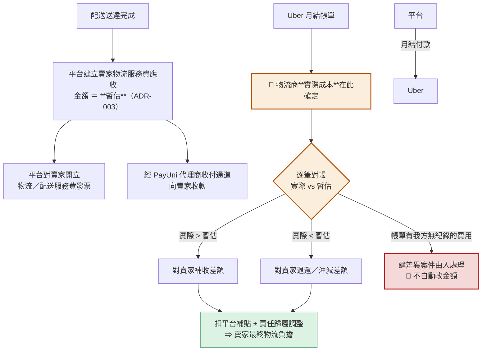

| 問題 | 答案 |
|---|---|
| 賣家什麼時候知道要付多少？ | **送達當下**就看得到暫估金額；月結對帳後可能有一次差額 |
| 差額怎麼處理？ | ✅ **實際 > 暫估 ⇒ 補收；實際 < 暫估 ⇒ 退還／沖減**（ADR-008） |
| 帳單上有我方沒有紀錄的費用？ | 🔴 **建差異案件由人處理，不自動改金額、不自動補列** |
| 取消費／等待費／退回費由誰負擔？ | ✅ **依責任成因判定，不依費用名稱**（§2.6，ADR-004） |
| 收款通道手續費呢？ | ✅ **由賣家負擔**（ADR-005）；🔴 **但必須與物流商成本分帳**，且以實際金額記帳 |

### 5.2 🔴 差額結算（true-up）：兩個方向都是義務

| 情形 | 例 | 處置 | 硬規則 |
|---|---|---|---|
| **實際 > 暫估** | 暫估 120、實際 128 | **賣家追加應收 8**，平台向賣家補收 | 🔴 **不得默默由平台吸收** |
| **實際 < 暫估** | 暫估 120、實際 115 | **賣家貸記 5**，應退還或沖減 | 🔴 **不得吞掉、不得當平台利潤** |

🔴 **少收要補、多收必須還——這是財務不變式，不是流程偏好。**

**賣家物流貸記的四條最低保證**（若支付工具沒有簡單的反向退費能力，可用抵扣下一筆物流應收的形式）：

| # | 保證 | 為什麼 |
|---|---|---|
| 1 | **永久可追蹤** | 抵扣是形式，債務不是 |
| 2 | 🔴 **不得無故過期** | 過期等於平台單方免除自己的債務 |
| 3 | 🔴 **不得因賣家後續無交易就消失** | 沒有下一筆可抵扣不代表不用還 |
| 4 | **平台最終仍欠賣家該金額** | 抵扣不成立時要有現金返還的路 |

⚠️ **用哪一支支付介面、能否反向退費、是否走下期沖抵、最終現金返還流程**
⇒ **技術設計**留給 Uber Scoped Review。🔴 **商業原則已定：多收就必須還。**

#### 🔴 對帳不得改買家端（本書最硬的一條）

物流商的實際調整**不得修改**：

```
❌ 買家配送費
❌ 買家訂單總額
❌ 買家的商品本金
```

**為什麼**：買家已確認的結帳金額是**另一條資金線（線 A）**，它在付款那一刻就結清了。
只有**原本的買家退款／折讓業務事件**才能改動買家的財務結果。
🔴 **provider 對帳不是 buyer repricing。**

## 6. 出事的時候會怎麼樣

### 6.1 配送本身的失敗

| 情況 | 處置 |
|---|---|
| 報價拿不到 | 選項顯示不可用並給原因；**不建訂單**（最便宜的失敗點） |
| 結帳時報價已過期 | 重報一次；金額有變就請買家重新確認；再失敗即拒絕結帳，**不收款** |
| 🔴 **賣家逾期未宣告備妥**（`processing_deadline` 到期） | 🔴 **先向 Uber 取消配送、確認取消成立，才取消訂單並向 Buyer 全額退款**。⚠️ **順序不可顛倒**——配送在付款當下就已存在，先退款會出現「錢退了而車照樣來」。責任成因＝**賣家原因** ⇒ 因此產生的取消費依 §2.6 歸屬。參數見 §9.4 |
| 🔴 **賣家比約定取件時間晚備妥**（外送員已到或將到，貨還沒好） | **不重新報價、不重建配送**——取件時間是報價當下凍結的值。🔴 對賣家發**高優先提醒**、給營運一個訊號並留痕；因此產生的等待費依 §2.6 歸屬。⚠️ 這一列不是系統失敗，是新流程的常態風險 |
| **付款後建立配送時，外部事實**已讓這筆配送做不成（Uber 現在確認該地址不可服務、該門市已被 Uber 停權、法規禁運資格改變、Uber 技術上無法服務） | 不建配送；比照下一列走「停止履約 ＋ 全額退款」，並明確告訴賣家是哪一項 |
| 🔴 賣家在宣告備妥之前**改過自己的設定**（已暫停 Uber、改了取件門市、現在不在可接單時段） | **配送照常進行。** 🔴 **不得因此取消、不得因此退款**——這筆訂單在成立時就已接受，履約義務已經成立，而且配送在付款當下就已經建到 Uber 了。一律使用**下單當時的設定快照** |
| 建立配送失敗（確定性失敗；發生在付款之後） | 🔴 **停止履約 ＋ 向 Buyer 全額退款**。⚠️ **理由要走責任軸**：這一格的成因是**平台／系統原因**或**物流商原因**，而那兩者的退款政策本來就是全額退（§6.2）——不是因為「建單失敗一律退款」這條獨立規則 |
| 建立配送結果不明（逾時／連線中斷） | 進入「結果不明」，由系統定期回查 Uber：查到有單就接回正常流程，確認沒有就走上一列。🔴 **不重送**——可能已經建成功，重建＝兩趟車、重複計費 |
| 🆕 **Uber 久未取件**（過了約定取件時間仍沒有人來） | 先告警並持續回查；到硬期限仍未取件 ⇒ 🔴 **先向 Uber 取消、確認終局，才向 Buyer 全額退款**（成因＝**物流商原因**）。參數見 §9.4 F |
| 🆕 **買家原因導致送不到**（不在場／無法聯繫／拒收／地址或交付資訊錯誤） | 走履約失敗鏈並**判定責任成因**。確認為**買家原因**且有可指認的履約證據（交付嘗試／聯繫紀錄／等待）⇒ 🔴 **不向 Buyer 退款**（§6.2）；證據不足 ⇒ **尚未判定**，訂單停在「配送異常」等營運裁決，**不預設任何方向** |
| 地址無法解析成結構化欄位 | 選項不可用並告知買家補充完整地址（Uber 需要結構化地址，我方只有一行字串） |
| Uber 回報「退回」 | 🔴 **在正向配送裡這是失敗不是送達**，走履約失敗鏈。⚠️ **但「退回完成」本身不決定退不退款**——它只說明貨去了哪裡（回到賣家手上）。退款與否一律先判**責任成因**（§6.2）：買家原因 ⇒ 🔴 **不向 Buyer 退款**；其餘 ⇒ 向 Buyer 全額退款 |
| 貨態回報漏收 | 定期回查 Uber 當前狀態並收斂，不依賴回報一定送到 |
| 收到 Uber 沒見過的貨態值 | 原值照存、**我方貨態不動**、計數並建案件——不猜測對應到哪一格 |
| 送達證明抓不回來 | Uber 那側只留 7 天 ⇒ 送達後幾分鐘內就主動抓回自存；抓不到要有人知道 |
| Uber 服務中斷 | 選項保留並顯示可信原因；🔴 **不自動改走其他配送方式** |

⚠️ **「停止履約並向 Buyer 全額退款」在「不是買家造成的」那些情形下是產品承諾**，不是可選的補償手段：
買家在結帳頁看到的文案就是這句話。
🔴 **但它不是無條件的**：買家自己造成送不到（不在場、無法聯繫、拒收、給錯地址）時，
政策是**不向 Buyer 退款**（§6.2），而且那一格必須先有可指認的履約證據才成立。
⚠️ **結帳頁的揭露文案必須與這件事一致**——不得只寫「送不到就全額退款」而不提買家責任（§10）。

🔴 **上表的「外部事實」與「賣家自己改過設定」是兩列，而它們曾經是同一列——
合併的那個版本會讓「賣家改個設定」變成「退買家的錢」。**

修正前那一列把**四個原因混在一起**：地址不可服務、門市被停用、超出可接單時段 ⇒ 一律退款。
其中兩個是**賣家自己的設定**，而 §3.6 早就寫著「所有變更一律只影響之後」「已付款的訂單不受影響，照樣要出貨」
——**同一本書的兩節直接對撞**，而那一列因為用的是「不符合資格」這種資格語言，
在歷次 review 都沒被看出來它其實在講賣家設定。

**判準（一句話）**

```
這件事是「賣家自己後來改的」，還是「外面的世界變了」？
```

| | 例子 | 對已付款訂單 |
|---|---|---|
| **賣家自己改的**（新訂單受理政策） | 暫停 Uber｜換取件門市｜改可接單時段 | 🔴 **完全不影響**。它只決定「**新的**買家能不能選 Uber」 |
| **外面的世界變了**（外部營運事實） | Uber 停權該門市｜Uber 現在說這個地址不能送｜法規把品項列入禁運｜Uber 服務中斷 | ✅ 可以擋下來並退款——那是**真的做不成**，不是賣家改了主意 |

⚠️ **兩者的錯誤原因必須不同**，不得共用一句「目前無法配送」：
前者根本不該發生（賣家會看到一個他不理解的拒絕），後者要讓賣家知道是外部問題、不是他的錯。

🔴 **特別注意一種「延遲發生」的形式**：把這筆單擋著不處理、狀態不動，看起來沒有退款——
但它會停在「等賣家」那一格，然後被**處理期限**在幾小時後取消配送並退款。
**沒有任何一行字寫著「退款」，而結果一模一樣。**
⚠️ 新流程下它還多一個代價：Uber 那邊的單**已經存在**，所以「什麼都不做」還會實際產生一次取消。

### 6.2 🔴 取消與退款：三條線各自算，不連動

**這是本書最容易做錯的一節。** 以下三件事**沒有天然等價關係**：

```
買家拿回多少錢  ≠  平台要不要向賣家收物流服務費  ≠  Uber 要不要向平台收費
```

✅ **全部已定案**（ADR-003 送達完成收價金、ADR-004 額外成本依責任成因）。
🔴 **讀這張表要分兩欄看**：「配送服務費（價金）」與「Uber 額外成本」是**兩種錢**。

| 發生什麼 | 線 A 買家 | 線 B：配送服務費（價金） | 線 B／C：Uber 額外成本 |
|---|---|---|---|
| 取消時**向 Uber 建單尚未完成**（付款到建單之間的空窗，或建單確定失敗） | 依既有取消規則退款 | ✅ 應收尚未成立 ⇒ 無事 | **無成本**——Uber 側還沒有任何東西存在。🔴 **這一列在新流程下幾乎是空集合**：建單緊接在付款之後，這個窗口只有數秒 |
| 建立配送後、Uber **尚未指派外送員**時取消 | 依售後規則退款 | ✅ **不成立**（未送達） | 🔴 **只能推論「尚無已確認的正常運費」，不得寫成絕對 0**；是否產生取消費或其他調整一律以 Uber 的帳單／退費證據收斂 ⇒ 有成本就**依責任成因歸屬**（§2.6）。⚠️ **新流程下這是主要路徑之一** |
| **外送員已指派或已在路上**時取消 | 依售後規則退款 | ✅ **不成立**（未送達） | **很可能有取消費** ⇒ **依責任成因歸屬**。⚠️ 賣家逾期未宣告備妥而由系統取消，多半落在這一列或上一列 |
| 建單失敗、履約中止 | 向 Buyer 全額退款（成因屬平台／系統或物流商） | ✅ **不成立**（配送沒發生） | 通常無成本；若有，多屬**平台／系統原因 ⇒ 平台負擔** |
| Uber 退回（配送失敗） | 🔴 **依責任成因**：買家原因 ⇒ **不向 Buyer 退款**；其餘 ⇒ 向 Buyer 全額退款；尚未判定 ⇒ 暫不決定 | ✅ **不成立**（未送達） | 有退回費 ⇒ **依責任成因歸屬** |
| 只退商品、配送已完成 | 退商品款，配送費不退 | ✅ **照收**（已送達） | 照付 |
| 只退配送費（例如嚴重遲到的補償） | 賣家對買家折讓配送費 | ✅ **照收，不連動** | 依成因（遲到多屬 provider 原因 ⇒ 先進爭議） |
| 買家不在場造成等待 | 不影響 | 不影響 | 🔴 **仍歸賣家的物流成本**；**平台不得向買家二次收款**（§2.6） |
| 平台重複建配送 | 不影響 | 不影響 | 🔴 **平台負擔，不得轉嫁賣家**（§2.6） |
| 🆕 **買家原因導致送不到**（不在場／無法聯繫／拒收／給錯地址，且有可指認的履約證據） | 🔴 **不向 Buyer 退款**：商品款與買家配送費都不退回 Buyer；訂單進入「**配送失敗未退款**」的獨立終態 | ✅ **不成立**（未送達） | 有取消／等待／退回費 ⇒ **仍歸賣家的物流成本**（§2.6）；🔴 **不得向買家二次收款** |
| 🆕 **責任成因尚未判定** | 🔴 **暫不決定**：既不退款、也不套用不退款，訂單停在「配送異常」 | 暫不成立 | 🔴 **暫不向賣家結算**，等營運裁決 |

🔴 **「取消」在這張表裡指的是訂單取消，發動者是賣家或系統，不是買家。**
買家付款成功之後**沒有自行取消訂單的入口**，這是平台既有的共通規則，Uber 不例外
（[65 §7](65-物流履約平台（Fulfillment%20Platform）基本設計書.md)）。
⚠️ **不要因為 Uber 有真正的取消 API 就在買家端開一個取消按鈕**——
「物流商技術上能取消」與「買家業務上可以取消」是兩件事。

🔴 **前三列的比重，在「付款當下就建單」之後整個翻轉。**
曾經有一個版本是「賣家按鈕才向 Uber 建單」，那時「Uber 側什麼都沒有」是每一筆訂單都會經過的階段，
取消不花錢；**現在不是了**：付款那一刻 Uber 就有單，第一列縮回只剩建單那幾秒的空窗，
**第 2、3 列（配送已存在、可能有取消費）才是主要路徑**。
🔴 **因此「取消不用錢」不得再寫進任何賣家文案或 UX**——每一次取消都要先查 Uber 現在到哪一步，
查過才知道會不會有費用。
⚠️ **賣家逾期未宣告備妥**這個新的常態取消來源，正好落在第 2、3 列（§6.1）。

🔴 **第 2～5 列曾寫「平台吸收」，那是被 ADR-004 取代的單一責任方答案。**
⚠️ 「未送達不收」指的是**價金**，不是「取消費沒人付」。

🔴 **上表講的是「配送服務費」（服務的價金）**：應收只在**送達完成**那一刻成立
⇒ 所有「沒送到」的情境自然不收該筆價金。

🔴 **但 Uber 已經發生的額外成本是另一回事，它依責任成因歸屬（§2.6）**：
未送達的訂單**不收配送服務費，額外成本仍有人負擔**——賣家原因歸賣家、
買家原因仍歸賣家的物流成本、平台或系統原因歸平台、provider 原因先進爭議。
⚠️ **兩種錢不要混談**：上表的「不收」指價金，不是指「取消費沒人付」。

#### 🔴 第三種錢：買家拿不拿得回錢

**「有沒有送到」不決定退不退款，決定的是責任成因。**

| 責任成因 | 向 Buyer 退款 |
|---|---|
| **買家原因** | 🔴 **不向 Buyer 退款**（商品款與買家配送費都不退回 Buyer） |
| 賣家原因 | 🔴 **向 Buyer 全額退款**（商品款 ＋ 買家配送費） |
| 物流商原因 | 🔴 **向 Buyer 全額退款** |
| 平台／系統原因 | 🔴 **向 Buyer 全額退款** |
| **尚未判定** | 🔴 **暫不決定**——既不退款，也不套用不退款 |

🔴 **只有兩個答案：全額退，或完全不退。** 不得出現「商品款另外算」「配送費單獨不退」
「先退款再從裡面扣物流成本」這類第三種拆分——那會把一個責任判定變成一場金額談判，
而買家看到的是一個他無法驗算的數字。

🔴 **「不向 Buyer 退款」不是無條件的。** 它要先有**可指認的履約證據**：交付嘗試、聯繫紀錄、等待事實。
沒有證據就是**尚未判定**，不是買家原因。
⚠️ **物流商說「無法送達／已退回」不等於買家原因**——那句話只描述「沒送到」，不是責任判定。
把它直接當成買家原因，等於讓外部廠商的一行狀態碼決定要不要退買家的錢。

🔴 **「退回完成」不是退款的觸發條件。** 貨退回賣家手上只解決一件事：東西在哪裡。
退不退款是另一條線，由責任成因決定——買家原因的訂單即使貨已經退回賣家，**仍然不向 Buyer 退款**。

⚠️ **不向 Buyer 退款的訂單有自己的結案狀態**：它**不是**「已完成」、**不是**「已取消」、**不是**「已退款」，
而是一個獨立的終態（配送失敗未退款）。它對買家顯示「配送失敗」並附政策說明與**客服申訴管道**，
🔴 **不產生「買家已正常收貨」的語意**（不算收貨確認、不因此取得評價資格）。
🔴 **那個客服管道不改變責任判定、也不改變退款結果**：會修改責任歸屬或退款資格的覆核
一律在責任判定階段完成，終態成立之後沒有回頭的路
⇒ 🔴 **不得**把它寫成「責任判定申訴」，那個名稱會讓買家等一個不會發生的翻案。
而賣家那一側的**款項照常結算**——貨已經出去了、錢也收了，這筆訂單在財務上是結案的。
🔴 **它也不算賣家的履約失敗**（責任在買家，§2.6），不得計入賣家的履約 KPI。
⚠️ **實作階段必辦（本設計階段不施作）**：這個終態要走共享代碼值的生成鏈，並同步所有讀取它的地方
（賣家分頁／買家分頁／營運畫面／統計／自動完成排程／評價資格／收貨確認），見 §9.3。

🔴 **兩個方向都要擋**：
- **不得寫成「買家退款 ⇒ 自動退還賣家的物流服務費」**：貨已送到、應收已成立，
  買家退商品款是線 A 的事；把它連動到線 B 等於平台吸收已發生的物流成本。
- **不得因為 Uber 向平台收了取消費就自動去向賣家多收**：
  🔴 **必須先判責任成因**（`ADR-004`）。物流商原因或成因待證 ⇒ **先進爭議／對帳，不自動向賣家收**；
  平台或系統原因 ⇒ **平台負擔且不得轉嫁賣家**；只有**確認屬賣家原因**時才向賣家歸屬，且歸屬的是**實際成本**。

⚠️ **賣家原因的取消另有一條配套防線**（不是用計費擋）：
賣家反覆備不出貨導致取消時，除了成本歸屬，還用**賣家能力權限層**處理
（取消率超標就停用該賣家的即時配送啟用）。🔴 **兩者並存不互相取代**——
計費解決「這一筆的成本誰付」，權限層解決「要不要讓他繼續用」。這條防線的門檻值屬另一波。

### 6.3 🔴 退貨：現況不支援，本波才解除

**平台的售後政策是「原方式退」**（用哪種方式送出去，就用哪種方式退回來）。
而 Uber 的逆向配送**現況是明文拒絕的**：買家或賣家對 Uber 訂單發起退貨退款時，
後端直接回「此配送方式暫不支援退貨退款」，需走客服處理。

| 面向 | 現況 | 本波要做到 |
|---|---|---|
| 買家發起 Uber 訂單退貨 | 🔴 **後端明文拒絕**，走客服 | 支援逆向配送（外送員從買家取件送回賣家） |
| 逆向的貨態 | 無 | 與正向共用同一組貨態，但**方向與意義不同** |
| 🔴 一個容易做錯的地方 | — | Uber 回報的「退回」在**正向**配送裡是**失敗**（退不退款看責任成因，§6.2），在**逆向**配送裡才是「退貨送達」。**同一個字在兩個方向意思相反** |

⚠️ **解除拒絕的順序有陷阱**：若先把「拒絕退貨」的關卡拿掉、逆向配送鏈卻還沒做完，
結果是**退貨申請進得來但走不完**——買家送出申請後卡在系統裡，比直接拒絕更糟。
⇒ 順序必須是「逆向鏈可用」先於「解除拒絕」。

🔴 **而且整組要排在「開燈」之前（2026-09-13 R3 定版）**：

```
逆向／售後 lifecycle 完成並驗證
   ↓
解除「暫不支援退貨退款」的擋門
   ↓
才允許 Uber 選項對買家開啟
```

**依據**：Product Owner 已明確裁決「**逆向 lifecycle 沒完成，不得正式啟用 Uber**」，且從未改判。
⚠️ 本書先前的施工順序寫的是「先開燈、之後再解除擋門」——**那與上述裁決相反，已更正**。
🔴 **不得由舊的施工順序反向覆蓋 Product Owner 的裁決。**

### 6.4 對帳差異

| 情況 | 處置 |
|---|---|
| Uber 月帳單的筆數與我方紀錄對不起來 | 建差異案件由人處理；**不自動改金額、不自動補列** |
| 帳單上有我方沒有紀錄的費用 | 同上。可能是我方漏記，也可能是對方錯帳，**兩種都要人看** |
| 已向賣家收費，但事後 Uber 退回該筆費用 | 平台對賣家開折讓退還；🔴 **這是一次獨立的處置，不是原扣款的自動反向** |

## 7. 頁面地圖

### 買家
| 畫面 | 解決什麼 |
|---|---|
| 購物車的運送方式選擇 | 看到「即時配送」選項、真實運費、不可用時的原因 |
| 結帳的報價與承載檢查 | 確認運費與有效期；金額變動時重新確認 |
| 🆕 **結帳的交付方式選擇與配送指示輸入** | 選本人簽收／驗證碼／指定放置；選填給外送員的配送指示（§3.5） |
| 訂單追蹤與配送進度 | 🔴 **看得出現在卡在哪一格**：賣家備貨中／外送員已指派／前往取件中／配送中／已送達，以及預計送達時間。⚠️ **這是兩條軸**（賣家備好了沒 × Uber 走到哪），不是一條線性進度條 |
| 🆕 **配送失敗的結果頁** | 看得到為什麼失敗、責任判定的結果、退款與否，以及**客服申訴管道**（§6.2、§10）。🔴 **那個管道不改變責任判定與退款結果**，不得寫成「責任判定申訴」 |
| 確認收貨 | 看送達證明並確認。🔴 **配送失敗未退款的訂單不走這一頁**（沒有收貨這件事） |

🔴 **訂單追蹤頁必須能表達「已付款、賣家備貨中」這一格**，而且**不得因為「配送已建立」就顯示成「運送中」**——
單在付款當下就建好了，但外送員是依約定取件時間才來。
把它顯示成「運送中」會讓買家在賣家還在裝箱時就開始找客服。
⚠️ **這一頁不得出現「取消訂單」**——買家付款後沒有這個動作（§6.2）。

### 賣家
| 畫面 | 解決什麼 |
|---|---|
| **啟用三階段檢查清單**（新建） | 看自己卡在哪一階段、缺什麼 |
| 物流與退貨設定 | 設定取件門市、🆕 **可接單時段**；🆕 **暫停／重新啟用** |
| 訂單管理的履約進度 | 備貨、🔴 **按「可以取件了」宣告備妥**、看外送員狀態與**約定取件時間**、必要時取消 |
| 🆕 **備貨倒數** | 看到這筆單最晚什麼時候要宣告備妥，逾期會被取消；🔴 **同時要看得到 Uber 約定的取件時間**——兩個時間不同，只顯示一個會讓賣家誤判（§9.4 B2） |
| 整單承載快照與報價政策快照 | 事後查「當時為什麼算這個運費」 |
| 送達證明 | 爭議時看照片與簽收 |

🔴 **「可以取件了」是本波賣家端最重要的一顆按鈕，但它不是叫車鍵。** 配送早就建好了；
它做的是宣告備妥（停掉處理期限的時鐘），以及在明顯提早時讓平台前移取件窗。
⚠️ **它必須在正常狀態下就可以按**，而且**按下去之後不能讓賣家以為車才剛被叫**——
文案要能表達「外送員已排定在某個時間到店」。

### 營運
| 畫面 | 解決什麼 |
|---|---|
| 異常工作佇列 | 建單失敗、結果不明、送達證明缺漏 |
| 案件詳情與事件時間線 | 把回報、回查、狀態轉換合成一條時間軸 |
| 對帳差異 | Uber 月帳單與我方紀錄的差異 |

完整畫面與檔案對照在 [65A](../詳細設計書/65A-物流履約前端實作規格.md)。

## 8. 這個設計刻意不做的事

- ❌ **不做冷藏與冷凍**：Uber 的介面沒有溫層欄位，我方無法要求對方保證溫度
- ❌ **不拆單、不多趟**：一筆訂單一個取件點、一個送達點
- ❌ **不 fallback 到其他配送方式**：Uber 不可用就顯示不可用，不偷偷改成別的
- ❌ **不讓賣家碰 Uber 憑證**
- ❌ **付款後不補收價差**
- ❌ **不代購**（外送員不代買商品）
- ❌ 🔴 **不代賣家宣告備妥**：「可以取件了」一律由賣家自己按，平台與排程都不代按（§3.2、[65 §7](65-物流履約平台（Fulfillment%20Platform）基本設計書.md)）。⚠️ **建單是平台的事、宣告備妥是賣家的事**，兩者不得互相代行
- ❌ 🔴 **不自動改走「預約配送」**：Uber 另有預約型的配送能力，本波**不使用**；即時配送做不到就顯示不可用，**不自動降級成另一種配送型態**（同上面「不 fallback」那一條）
- ❌ 🔴 **不在建單當下重新報價**：取件時間與運費都是報價當下凍結的那一份（§3.3）
- ❌ 🔴 **不自動「取消後重建」一筆配送**：那等於兩趟車、兩次計費；真有必要時由營運在確認原配送已取消之後人工處理
- ❌ 🔴 **不開買家的訂單取消入口**：買家付款後不能自行取消，Uber 不例外（§6.2）
- ❌ **不把訂單備註當成配送指示送給 Uber**（§3.5）
- ❌ **不把 Uber 的事後費用回寫買家訂單或賣家商品本金**
- ❌ **不把十個金額壓縮成單一「運費」語意**（§2.3）
- ❌ **不從「買家配送費為 0」推導成本負擔者**（§2.4）
- ❌ **不把報價金額當成物流商實際成本**（§4.3）
- ❌ **不得依費用名稱決定負擔方**（§2.6：一律依責任成因）
- ❌ **不得向買家二次收取買家原因造成的物流成本**（§2.6）
- ❌ **不得把平台原因造成的成本轉嫁賣家**（§2.6）
- ❌ **不得把「1%」寫成商業常數**（ADR-005：一律用實際金額）
- ❌ **不得因 reconciliation 而修改買家端金額**（§5.2）

## 9. 仍未決的事項 —— 🔴 **外部查證（EV）與實作缺口**

> ✅ **2026-09-11 全部 CLOSED，不得再送回裁決**：
> Uber 商流（ADR-002）／收費時點＝送達完成（ADR-003）／
> **額外成本依責任成因歸屬**（ADR-004）／**收款通道手續費由賣家負擔**（ADR-005）／
> 金額語意分離（ADR-006）／免運補貼歸屬（ADR-007）／
> **實支實付 ＋ 雙向 true-up ＋ 賣家貸記義務**（ADR-008）／平台對賣家開票的業務關係（§5）。
>
> 🔴 **§9.1／§9.2 一件都不是「選一個答案」**——它們要靠外部專業意見或外部實測取得答案。
> **不要把它們寫成 Pending Decision**，那會讓人以為有人拍板就能往下走。
>
> 🔴 **§9.4 已不再是 Pending Decision**：履約時鐘的模型早已定版，而它的時間參數現在有一組
> **V1 可調整預設值**——全部 configurable、可依 sandbox 與正式營運資料調整 ⇒ 它們**不阻塞設計與實作**。
> ⚠️ **那些預設值不是 Uber 的官方 SLA**，不得在任何文件寫成「Uber 保證多久」。
>
> 🔴 **§10 的法律查證（`LV-01`～`LV-04`）是另一類東西**：它**不阻塞**架構與實作，
> 但**阻塞**「不向 Buyer 退款」這條政策的正式啟用與對外法律文案上線。
> **不得把它與 §9.1／§9.2 的外部查證混在一起計數，也不得把它寫成 Product Decision。**

### 9.1 External Verification · 會計／稅務

| # | 要取得什麼 | 向誰 | fail-closed |
|---|---|---|---|
| 1 | 平台對賣家開立 Uber 物流服務費的**正式會計科目** | 會計師 | 🔴 **開票的業務關係已確定**（§5），未確認的只有科目。未確認前不得自動開立 |
| 2 | **正式稅務科目** | 稅務顧問 | 同上 |
| 3 | **對帳補收／退還對應的正式發票／折讓操作形式** | 會計師 ＋ 稅務顧問 | 補收與退還的**商業義務已定**（§5.2）；未確認的是**憑證的法律形式**。未確認前以案件方式人工處理，不自動產生憑證 |
| 4 | 發票**品項怎麼表達**（合為一項，或拆「物流服務費 ＋ 代收手續費」） | 會計師 | ADR-005 定案由賣家負擔手續費後才出現的問題；影響稅務科目 |

### 9.2 External Verification · 物流商／收款通道實證

| # | 要取得什麼 | 怎麼取得 | fail-closed |
|---|---|---|---|
| 1 | **Uber 台灣 Direct API／契約的真實能力** | Uber 台灣窗口書面確認 ＋ sandbox 實測 | 🔴 服務在台灣存在有證據，但**能不能用 API 串接沒有任何官方依據** ⇒ 拿不到就整條擋在啟用前 |
| 2 | **Uber statement／adjustment 的真實欄位**（取消費／等待費／返程費在帳單上的正式欄位名與對帳鍵） | 真實帳單樣本 | 決定「責任成因」判得出來多少（ADR-004 的判定原料）。🔴 **分不出成因的那些落「尚未判定」，不得塞進「provider 原因」**（§2.6） |
| 3 | **收款通道的真實費率與扣費公式**（精確費率／扣費時點／gross-net 方向／是否另扣） | 官方文件 ＋ sandbox ＋ 正式契約 | 🔴 **不得把「1%」寫成商業常數**（ADR-005）；一律以查詢回傳的**實際金額**記帳 |
| 4 | **收款通道查詢／結算的實際行為**（能否反向退費、下期沖抵形式） | sandbox 實測 | 決定賣家貸記走哪一條技術路徑（§5.2 的四條保證不因路徑而變） |
| 5 | **地址結構化解析成功率** | 真實 dev 訂單地址樣本實測 | 解析率太低等於大量買家看不到選項 ⇒ 低於門檻不上線 |
| 6 | 🆕 **交付方式（handoff）與送達證明的官方欄位與值域**（§3.5） | 官方文件 ＋ sandbox 實測 | 🔴 **未確認前只能用業務語意描述，不得把猜測的官方值域寫進契約**。⚠️ 本書曾宣稱「送達一定至少有一種送達證明」，而官方文件顯示送達證明**需要在建單時明確要求**（opt-in）⇒ 不得依賴 Uber 帳號的預設行為 |
| 7 | 🆕 **買家配送指示送出後外送員實際看得到嗎**（§3.5） | sandbox 實測 ＋ 官方確認 | 送了但外送員看不到 ⇒ 那個欄位對買家是假承諾，寧可不提供也不要提供一個沒用的 |
| 🆕 8 | **取件前置緩衝的官方語意**——物流商對「賣家宣告備妥之後多久到店」這個參數是怎麼定義的？ | 官方文件 ＋ 書面確認 ＋ sandbox | 🔴 **官方文件從未定義這個欄位**（實查零命中）⇒ **本波不提供這個賣家設定**（§3.6）。⚠️ **它與我方送給 Uber 的「取件時間」是兩件事**：後者是官方明載的欄位，我方送的是**報價當下凍結的絕對時間**，不是一個緩衝量。**不阻塞實作** |
| 🆕 9 | **前移取件時間之後，Uber 多久重新安排取件** | sandbox 實測 ＋ 官方確認 | 決定「賣家提早備妥」這條路實際能省下多少時間。⚠️ 拿不到答案**不阻塞實作**——前移失敗一律沿用原約定時間（§3.2） |
| 🆕 10 | **外送員棄單後 Uber 重新媒合最長多久、會不會自行放棄** | sandbox 實測 ＋ 官方確認 | 決定 `provider_pickup_hard_deadline` 該設多少（§9.4 F）。⚠️ **不阻塞實作**——預設值先上，依實際資料調整 |
| 🆕 11 | **建單後、取件前取消是否仍可能產生費用** | 真實帳單樣本 ＋ 官方確認 | 🔴 決定 §6.2 第 2 列能不能對賣家說「不會有取消費」。**在拿到答案之前一律不得承諾零費用** |
| 🆕 12 | **帳號層的同時承載上限**（同時可以有多少筆進行中的配送） | 書面確認 | 決定尖峰時要不要在結帳端節流。⚠️ **不阻塞實作** |

### 9.3 Implementation Gaps（已定案、尚未實作 —— 🔴 **不是 Pending Decision**）

| # | 缺口 | 對應決策 | 缺什麼 |
|---|---|---|---|
| 1 | **十個金額維度的資料模型** | ADR-006 | 要能各自獨立存在；🔴 **不得壓回單一 `shipping_fee`** |
| 2 | **補貼的資料表達** | ADR-007 | `orders.shipping_fee_payer` 值域只有買方／賣方（**無平台值**），也沒有 `seller_subsidy`／`platform_subsidy` 兩欄 ⇒ 落地前平台主辦補貼只能人工處理，**不得用賣家主辦免運的路徑冒充** |
| 3 | **責任成因的判定與留痕** | ADR-004 | 至少要分得出賣家／買家／平台系統／provider **四類，外加「尚未判定」共五類**並留痕。🔴 **「尚未判定」必須是一個真正的值**，不得用「先落 provider 原因」代替（§2.6）。⚠️ **實作階段必辦（本設計階段不施作）**：共享代碼值走 CodeMeta 生成鏈，不得在程式碼裡硬編 |
| 4 | **暫估／實際／差額三值 ＋ 賣家貸記的承載** | ADR-008 | 只存一個「金額」欄做不到 true-up；貸記要永久可追蹤 |
| 5 | **帳本與對帳的落點** | ADR-004／008 | 額外成本與對帳調整要逐筆入帳並可對到 provider 帳單 |
| 6 | **收款通道整合** | ADR-005 | 實際手續費的取得與記帳（用實際值不用預估值） |
| 7 | **發票調整** | §5／§9.1 | 補收的追加憑證與退還的折讓文件，等會計形式確認後才能自動化 |
| 8 | 🆕 **「配送失敗未退款」的訂單終態** | §6.2 | 需要一個**獨立的訂單終態**（不是已完成／已取消／已退款），且它**可以撥款**、**不產生收貨確認語意**、**不取得評價資格**、**不計入賣家履約失敗**。⚠️ **實作階段必辦（本設計階段不施作）**：狀態值走 CodeMeta 生成鏈，並同步每一個讀它的地方（賣家分頁／買家分頁／營運畫面／統計／自動完成排程／售後資格）。🔴 **撥款走既有那一條路，不得另開第二條** |
| 9 | 🆕 **「尚未判定」期間的案件載體與 aging** | §2.6 | 沿用既有的履約異常案件機制，🔴 **不另建第二套爭議平台**；停留超過門檻要有人知道 |
| 10 | 🆕 **凍結的取件時間與備貨時長快照** | §3.3／§9.4 | 報價當下要把兩個值凍結下來並在建單時原樣使用。⚠️ **實作階段必辦（本設計階段不施作）** |
| 11 | 🆕 **主動回查與兩個逾時排程** | §9.4 F | 重新媒合期間 Uber 完全不發回報 ⇒ 回查是**必要手段不是增強**；另需「賣家處理期限」與「物流商取件硬期限」兩支排程。⚠️ **實作階段必辦（本設計階段不施作）** |
| 12 | 🆕 **對外揭露的落點** | §10 | 公開政策頁、結帳揭露、賣家後台說明三處都要有。⚠️ **實作階段必辦（本設計階段不施作）** |

### 9.4 🔴 履約時鐘：模型已定版，參數有一組 V1 可調整預設值

> **模型與 ownership 由 Product Owner 裁決**（`P-1` 期限長度／`P-3` 由誰設定，兩個 Product Decision 都 **CLOSED**），
> 剩下的是**純數值參數**，而它們現在有 V1 預設值（F）。
> 🔴 **Product Decision 與 Numeric Configuration Parameter 不是同一類東西，本節不把它們混為一談。**

#### A. 公式（`PO-R7-02`）

```
processing_deadline  =  付款時間  +  備貨時長快照  +  平台寬容期
```

🔴 **用的是快照不是即時值**：`備貨時長快照` 是**下單當時**凍結的賣家備貨時長。
賣家事後把備貨時長調長，不會讓一筆已經逾期的訂單起死回生（理由見 C）。

#### B. 三段語意必須分開（🔴 中間那一格不是取消點）

```
付款時間
   │
   │  備貨時長（賣家的正常履約時間）
   ▼
備貨時長到期               ← 🔴 到期「不取消訂單」
   │
   │  平台寬容期（純買家保護的容忍量）
   ▼
processing_deadline        ← 🔴 唯一的強制取消點
   │
   │  仍未宣告備妥
   ▼
先向 Uber 取消配送 → 確認取消成立 → 取消訂單 → 向 Buyer 全額退款
```

| 時點 | 允許做什麼 | 🔴 不得做什麼 |
|---|---|---|
| **備貨時長到期** | 賣家逾期標記／賣家 warning／operational alert | 🔴 **不得取消訂單**、不得退款 |
| **`processing_deadline` 到期** | 🔴 **取消配送 → 確認終局 → 取消訂單 ＋ 向 Buyer 全額退款** | 🔴 **不得先退款再取消配送**（錢退了而車照樣來） |

⚠️ **把兩者混成一個時點，等於把「提醒賣家」升級成「沒收這筆訂單」**。

#### B2. 🔴 還有第二個時鐘，它量的是 Uber 而不是賣家

**兩個時鐘的起點不同，刻意不合併**：

| 時鐘 | 從哪裡起算 | 量什麼 | 到期怎麼辦 |
|---|---|---|---|
| **賣家履約時鐘** | **付款時間** | 賣家備好貨了沒 | 到 `processing_deadline` ⇒ 取消配送並向 Buyer 全額退款（成因＝**賣家原因**） |
| **物流商取件時鐘** | **約定的取件時間**（報價當下凍結的絕對時間） | Uber 把貨取走了沒 | 先告警；到硬期限仍未取件 ⇒ 取消並向 Buyer 全額退款（成因＝**物流商原因**） |

🔴 **兩個時鐘會交叉，那不是 bug。** 外送員可能在賣家還沒備好之前就到店（凍結的取件時間到了而賣家慢了），
也可能賣家早就備好而 Uber 還沒派人：

| 交叉情形 | 處置 |
|---|---|
| **外送員將到／已到，賣家尚未備妥** | 🔴 對賣家發**高優先提醒** ＋ 給營運一個訊號，**不取消**；因此產生的等待費依 §2.6 歸**賣家原因** |
| **賣家已備妥，Uber 遲遲不來** | 由物流商取件時鐘負責（告警 → 硬期限），🔴 **不歸賣家** |

⚠️ **不得把兩個時鐘合併成一個「總期限」**——合併之後「賣家慢了」與「Uber 沒派人」會得到同一種處置，
而它們的責任成因相反、退款與成本歸屬也相反。

⚠️ **外送員棄單、Uber 正在重新媒合時完全不發回報**：狀態看起來沒變，實際上已經沒有人負責這趟
⇒ 🔴 **主動回查是唯一看得見它的手段**，不是可選的增強。

#### C. 誰設什麼（`PO-R7-01`；原 `P-3` 由此 **CLOSED**）

| 角色 | 設定 | 🔴 不得設定 |
|---|---|---|
| **賣家** | **備貨時長**——「已付款的 Uber 訂單通常要多久才備得好、可以被取走」 | 🔴 **`processing_deadline`**（它是推導值，不是輸入值） |
| **平台** | **平台寬容期**，並依 A 的公式推導 `processing_deadline`；以及物流商取件時鐘的告警與硬期限（F） | — |

🔴 **賣家改備貨時長只影響之後成立的訂單**；已付款訂單用**報價／付款當下凍結的快照**
（詳見 [66 詳設](../詳細設計書/66-Uber%20Direct%20即時配送整合詳細設計書.md)）。
⚠️ 否則賣家可以用「把備貨時長調長」規避自己已經逾期的訂單，**買家保護被賣家單方面關掉**。
🔴 **同一份快照同時被兩個地方讀**：一是送給 Uber 的取件時間（報價當下凍結的絕對時間），
二是 `processing_deadline` 的中間項。**兩者起算點不同，但用的是同一個備貨時長**——
改了其中一個的取值來源，另一個會跟著錯。

#### D. 原 `P-1`／`P-3` 的狀態

| 原項目 | 新狀態 | 理由 |
|---|---|---|
| **`P-3`「全平台固定還是賣家自訂」** | ✅ **CLOSED** | 已裁決：**賣家設備貨時長，平台推導 `processing_deadline`** |
| **`P-1`「期限長度」** | ✅ **不再是獨立的 Product Decision** | 已被 A 的公式取代。長度不再是一個要「決定」的東西，而是三個量相加的結果 |

🔴 **`P-1` 不得繼續被列為 OPEN Product Decision。** 它殘留的只有**數值**，而數值已有 V1 預設（F）。

#### E. `service_hours` 不影響已付款訂單的時鐘（維持 2026-09-13 裁決，**本輪不重開**）

**`可接單時段` 的定義是「賣家願意接受**新** Uber 訂單的時間」**，
🔴 **不是已接受訂單的履約時鐘開關**。

⇒ **已付款訂單的備貨時鐘與寬容期時鐘都正常持續，不因進入不可接單時段而暫停。**
⚠️ 訂單 18:50 成立、可接單時段 11:00–19:00 ⇒ 兩個時鐘照常走，賣家仍須在期限內宣告備妥；
**不得**因為「現在 19:05、已經不在可接單時段」就把時鐘停掉，**也不得因此拒絕履約**（§6.1）。

⚠️ **但結帳當下要多看一件事。** 既然取件時間在報價當下就凍結、而且會直接送給 Uber，
結帳的可用性判斷就不能只問「現在還在營業嗎」，而要問
🔴 **「這筆單約定的取件時間，落不落在賣家可接單時段內」**，以及 `processing_deadline` 會不會越過收班。
近收班時若系統已知賣家來不及在時段內完成備貨與交件 ⇒ **結帳就顯示不可用**，
而不是先收錢、再讓它在幾十分鐘後逾時取消。
⚠️ 這與上一段不衝突：**結帳前**看時段（決定能不能接），**付款後**不看時段（時鐘照常走）。

🔴 **不得重新引入舊的 `P-2`**（「時鐘要不要在不可接單時段外暫停」）——它已於 2026-09-13 正式否決。
⚠️ **若未來產品要新增「店休日曆」「臨時歇業」「暫停履約」這類能力，那是獨立的政策，
必須另行裁決，不得從 `可接單時段` 自動推導出來。**

#### F. V1 參數：六個可調整的預設值

🔴 **全部 configurable**，可依 sandbox 與正式營運資料調整；**沒有任何一個是 Uber 的官方 SLA**。

| 參數 | V1 預設 | 量什麼 |
|---|---|---|
| **備貨時長預設值** | **15 分鐘** | 賣家未自訂時，從付款到「貨可以被取走」的預設時長 |
| **平台寬容期** | **15 分鐘** | 備貨時長到期之後、強制取消之前的買家保護容忍量 |
| **回查間隔** | **5 分鐘** | 主動向 Uber 回查這筆配送現況的頻率 |
| **取件逾時告警** | **10 分鐘** | 過了約定取件時間多久仍沒人來取 ⇒ 告警並通知 |
| **取件硬期限** | **30 分鐘** | 過了約定取件時間多久仍沒人來取 ⇒ 取消並向 Buyer 全額退款 |
| **取消確認收斂窗** | **10 分鐘** | 向 Uber 送出取消之後，用來確認「真的取消了」的回查窗 |

⚠️ **只有「回查間隔」有外部背書**——Uber 台灣的指南建議每隔 5 或 10 分鐘回查一次。
🔴 **那是建議不是 SLA**；其餘五個都是我方訂的營運起點。

**為什麼是這幾個數字**（它們不是推導出來的，是**可調整的營運起點**）：

| # | 理由 |
|---|---|
| 1 | 即時配送賣的是**店裡的現貨**，備貨動作是「裝袋、封箱、貼單」⇒ 單位是**分鐘**，不是天 |
| 2 | 買家對即時配送的期待是**今天吃到**；期限拉長等於讓買家在一筆即時配送上等一個下午 |
| 3 | 上線後會有真實資料（賣家實際備貨時間分布、Uber 實際取件延遲、重新媒合發生率）⇒ **這些值本來就要調**，所以它們是設定而不是常數 |

🔴 **「可調整」是這組值成立的前提，不是附註。** 一個永遠不會被調整的 configurable 等於常數
⇒ 每一個值都必須有對應的觀測（H）。

#### F2. 附註：這些數字為什麼是「訂的」而不是「查到的」

窮盡搜尋的結果：**全平台沒有任何可引用的 authority**
（「有 authority」＝有一個可指認的來源說明這個數字是誰定的、為什麼是這個值）：
既有兩個賣家出貨期限（`72` 小時、3 工作日）都是程式裡的**裸字面常數**、沒有來源說明；
env／k8s values 零命中；物流商側只有更寬鬆且性質不同的數字（7-11 C2C 的 D+6、黑貓費用表沒有出貨期限）；
「賣家輸入分鐘數」的既有 UI／config convention 也不存在。

🔴 **兩個看起來像 authority、其實不是的東西**：

| 看起來像 authority | 為什麼不是 |
|---|---|
| `prep_sla_minutes DEFAULT 15`（`V13` migration） | **DB default 不是 Product authority**（2026-09-13 已確認屬 implementation drift）。⚠️ 它與報價有效期的 15 分鐘**數字相同但來源完全不同**，特別容易被誤讀成有依據——**上表的 15 分鐘是本節訂的，不是從它繼承的** |
| 69 號的 `accept_sla_minutes`（預設 `30`） | 該表的**出處欄逐字寫「本書指派」** ⇒ 同樣沒有 authority；且純文件零實作 |

🔴 **`ORDER_SHIPMENT_BACKSTOP_GRACE_MINUTES = 30` 不是本案的寬容期**——它量的是「該建的本地單建出來了沒」，
而平台寬容期量的是「賣家宣告備妥了沒」。[65 §0.1.2](../詳細設計書/65-物流履約平台（Fulfillment%20Platform）詳細設計書.md) 已明文警告兩者不得混用。

⇒ **結論不是「不能填」，而是「填的人要為它負責，而且它必須可調、必須被觀測」**。

#### G. 為什麼不能沿用既有的 72 小時／3 工作日

| # | 事實 |
|---|---|
| 1 | 🔴 **那兩個數字本身沒有來源可以推導**（見 F2）⇒ **沿用等於把一個沒有依據的數字再複製一次** |
| 2 | **營運形態完全不同**。那兩種都要賣家離開店面（跑門市／等司機路線），所以期限以「天」為單位；即時配送賣的是**店裡的現貨**，買家的期待是「今天吃到」。用 72 小時等於讓買家可能等三天才收到一筆「即時配送」 |
| 3 | **買家對「即時配送」的等待容忍度與那兩種完全不同**——它賣的是「今天吃到」 |

#### H. 參數落地之後的行為

| 面 | 規則 |
|---|---|
| **功能開關** | ✅ **時間參數不再是開燈的前置條件**（V1 有預設值）。開燈的前置條件是 §9.2 第 1 項（Uber 台灣 Direct API 的書面可用性與費率）、§6.3 的逆向鏈順序，以及 §10 的法律查證 |
| **賣家前端** | 備貨倒數依 `processing_deadline` 顯示真實時間；🔴 **同時要顯示 Uber 約定的取件時間**——兩個時間不同，只顯示一個會讓賣家誤判（B2、[65A §4.3](../詳細設計書/65A-物流履約前端實作規格.md)） |
| **調整** | 🔴 **這六個值必須能在不改程式的情況下調整**，而且調整**只影響之後成立的訂單**（已付款訂單用快照） |
| **觀測** | 🔴 **每一個值都要有對應的觀測**：賣家實際備貨時長分布、逾期率、Uber 實際取件延遲分布、重新媒合發生率、取消確認收斂失敗率。**沒有觀測就沒有調整的依據** |

⚠️ **「可調整」不代表可以隨手改**：改動會影響已在營運的賣家與買家期待
⇒ 調整要有依據（觀測資料）並留痕，不是設定檔改一個數字就算。

## 10. 對外揭露與法律邊界

**「買家自己造成送不到就不退款」是一條買家會質疑的政策**，所以它不能只活在設計書裡。
三個落點缺一不可：

| 落點 | 要寫什麼 |
|---|---|
| **網頁公開政策頁** | 四件事：① 配送失敗政策 ② 買家在即時配送裡的責任（在場、可聯繫、地址正確、必要時提供驗證碼或配合交付） ③ 不退款規則與它的**適用條件** ④ **責任判定尚未定案期間**（訂單仍停在責任判定階段）對判定有爭議要怎麼提出，以及**判定定案之後只剩不改判定的客服申訴管道**。🔴 **這兩件事必須分開寫**：前者可能改變責任判定與退款結果，後者**不會** ⇒ 混為一談會讓買家在定案之後仍以為可以翻案 |
| **結帳頁** | 🔴 在「即時配送」選項**附近**就要有一句簡短揭露 ＋ 政策連結。**不得只放在頁尾**——買家是在選配送方式的那一刻承擔這個責任的，不是在讀網站底部的時候 |
| **賣家後台／賣家條款** | 明確寫明：**買家原因造成的配送失敗不算賣家的履約失敗**。⚠️ 但那一筆的 Uber 成本仍歸賣家的物流成本（§2.6）——🔴 **兩件事必須同時寫**，只寫其中一件都會造成誤解 |

🔴 **揭露與政策必須一致。** 結帳頁寫「送不到就全額退款」而政策頁寫「買家原因不退款」，
在爭議發生時前者會勝出——買家看到的是結帳頁那一句。
⚠️ **實作階段必辦（本設計階段不施作）**：三個落點的文案與連結要一起上線，不得只做其中一個。

### 10.1 🔴 法律查證（`LV`）：不阻塞實作，阻塞上線

台灣消費者保護法對「不退款」這類條款有其要求，而**本書不撰寫最終法律條款全文**。

| # | 要確認什麼 | 向誰 |
|---|---|---|
| **LV-01** | 「買家原因造成配送失敗 ⇒ 不向 Buyer 退款」這條規則在消保法下的**合法措辭與適用邊界** | 法務／外部律師 |
| **LV-02** | **結帳頁揭露**的文字（要多明確、要不要另外勾選同意） | 法務 |
| **LV-03** | **網頁政策頁**的正式條文 | 法務 |
| **LV-04** | 「商品視為由買家放棄」在我方情境怎麼表達——🔴 **我方的商品是退回賣家、不是由平台處置**，與外送業界常見的條款不同，**不得照抄** | 法務 |

**射程（寫清楚，避免被誤讀成什麼都不能做）**：

| | 阻不阻塞 |
|---|---|
| 架構設計、資料模型、狀態機、一般實作 | 🔴 **不阻塞**。照本書做 |
| **正式啟用「不向 Buyer 退款」這條政策** | 🔴 **阻塞**。條款定案之前，買家原因的案件一律走**尚未判定 → 營運裁決**，不得自動套用不退款 |
| **對外法律文案上線**（政策頁／結帳揭露／賣家條款） | 🔴 **阻塞** |

🔴 **`LV` 不是 Product Decision，也不要與 §9.2 的外部查證混在一起計數。**
外部查證問的是「Uber 到底能做什麼」，法律查證問的是「這樣寫在台灣合不合法」——
兩者的窗口、證據形式、完成判準都不同，混在一起會讓兩邊都看起來只差一件事。
