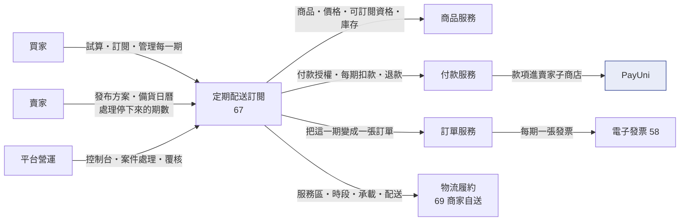
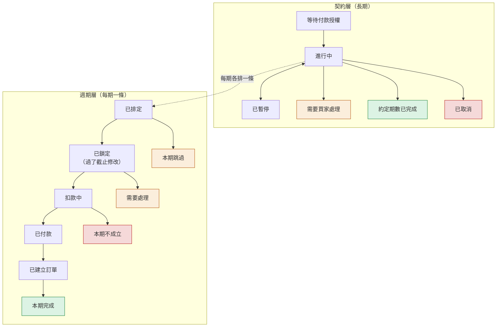
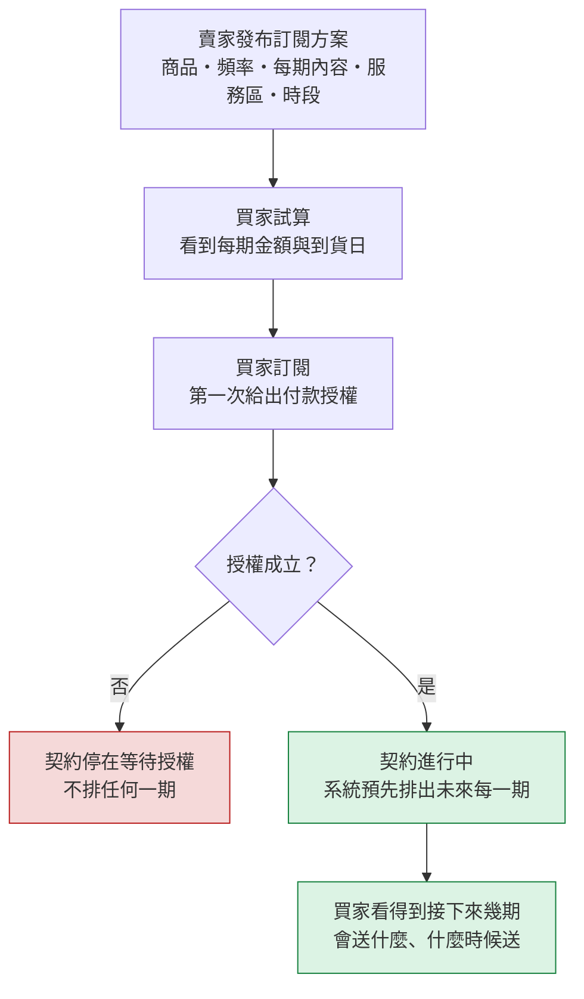
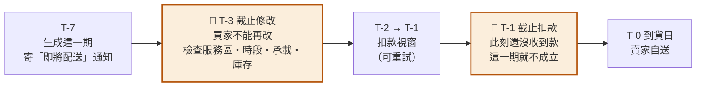
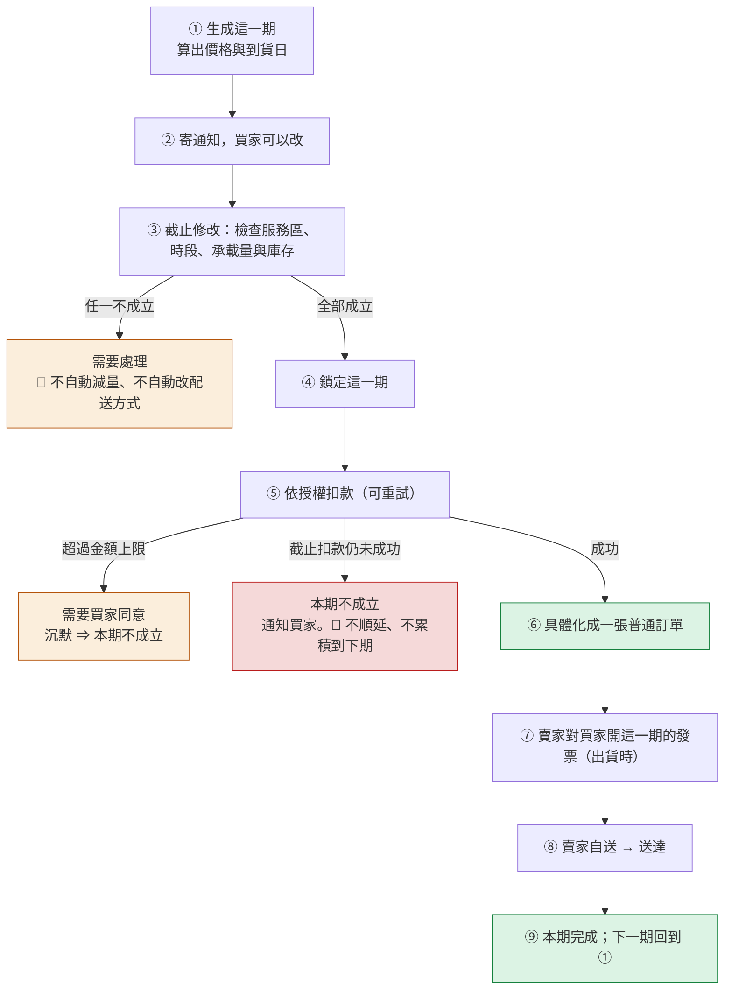
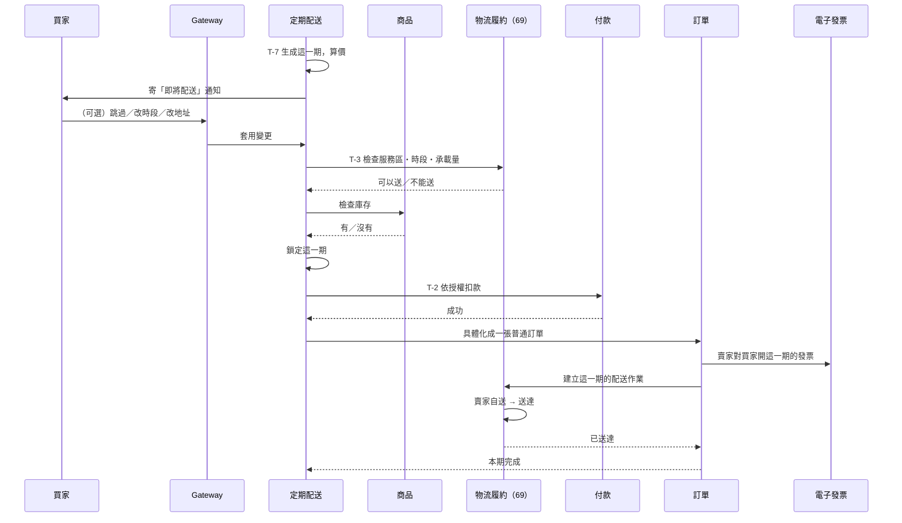
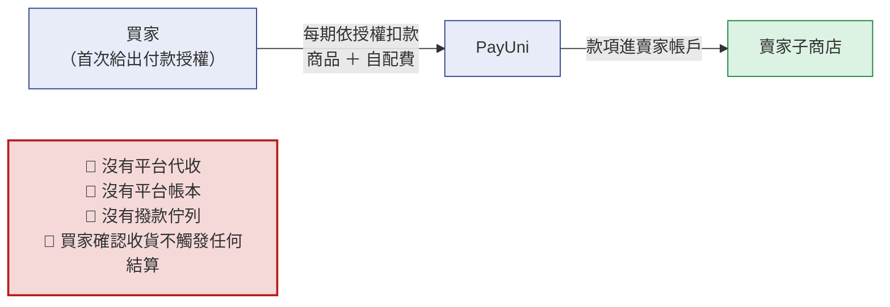
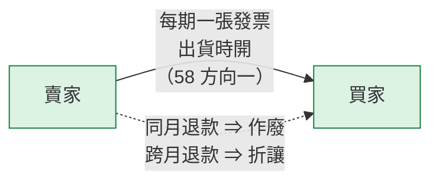

# 67 · 定期配送訂閱（基本設計）

> **這是外部設計。** 實作契約（DDL／proto／端點簽章／狀態機轉移邊／陷阱）在
> [詳細設計書 67](../詳細設計書/67-定期配送訂閱（Subscription%20Delivery）詳細設計書.md)，
> 共用骨架在 [65 基本設計書](65-物流履約平台（Fulfillment%20Platform）基本設計書.md)，
> 配送能力在 [69 商家自有出貨基本設計書](69-商家自有出貨（Merchant%20Self-Delivery）基本設計書.md)，
> 畫面在 [65A 前端實作規格](../詳細設計書/65A-物流履約前端實作規格.md)。

---

## 0. 這個功能解決什麼問題

**生鮮是重複購買的商品，但平台只支援一次一次地買。** 每週要一箱菜的買家，
現在得每週自己下一次單、選一次時段、付一次款；賣家也無法預估下週要備多少貨。

定期配送訂閱讓這件事變成一份契約：買家訂一次，系統**每期各走一次完整的履約**——
獨立的價格、獨立的扣款、獨立的訂單、獨立的發票、獨立的配送。

| 問題 | 怎麼處理 |
|---|---|
| 買家每次都要重複操作 | 一次訂閱，系統預先排出未來每一期，買家只在想改的時候才動手 |
| 賣家無法預估備貨量 | 每期在**到貨前幾天**就鎖定內容，賣家看得到未來的備貨日曆 |
| 自動扣款讓買家不安 | 買家第一次就給出**精確的授權**（金額上限、頻率、收款對象、怎麼取消），超過上限一律停下來問 |

**不做會怎樣**：重複購買的需求只能靠買家自己記得，而生鮮的複購率是這類平台的主要營收來源；
或由賣家私下用 LINE 收單並手動請款——那等於平台看不到交易、買家沒有保障。

**不解決什麼**：不做跨賣家的定期購物車；不做自動替換商品或 AI 預測改數量；
不做一次預收無限期款項、儲值金、禮物訂閱、家庭共享；
🔴 **不支援黑貓、7-11 或即時配送**——只有商家自送（§2.2）。

## 1. 誰在用，跟誰互動

| 角色 | 在這裡做什麼 |
|---|---|
| **買家** | 看方案、試算、訂閱（第一次給出付款授權）；之後管理每一期（跳過、暫停、恢復、改地址或時段、取消未來期數） |
| **賣家** | 發布訂閱方案（商品、頻率、每期內容、可服務區域與時段）；看備貨日曆；處理停下來等處理的那幾期 |
| **平台營運（ADM）** | 看整體控制台；處理扣款失敗、排程漏跑、訂單建不出來這類案件；高風險處置走雙人覆核 |

**上下游**

| 對象 | 在這條流程裡負責什麼 |
|---|---|
| **商品服務** | 商品與價格的權威；可訂閱資格；庫存扣減 |
| **付款服務** | 買家的付款授權、每期扣款、退款 |
| **訂單服務** | 把「已鎖定且已扣款的一期」具體化成一張普通訂單 |
| **物流履約（69 商家自送）** | 賣家的服務區域、可配送時段、每日承載量、配送作業與交付證明 |
| **電子發票服務（58）** | 每期由賣家對買家開票；跨月退款走折讓 |
| **PayUni** | 收款通道（款項進賣家子商店） |

🔴 **圖上沒有平台撥款、沒有平台帳本、沒有結算**。錢從頭到尾收進賣家、發票也是賣家開的
（§4）。那不是漏畫，是規格。

## 2. 核心模型

### 2.1 兩層：契約管授權，週期管履約

🔴 **訂閱不是「把同一張訂單複製四次」。** 它是兩層：

| 層 | 是什麼 | 管什麼 |
|---|---|---|
| **契約** | 買家與賣家之間的一份長期約定 | 訂什麼、多久一次、總共幾期、**付款授權與它的上限**、怎麼取消 |
| **週期** | 契約底下的一期 | 這一期送什麼、什麼時候送、這一期的價格、這一期的扣款、這一期的訂單與發票 |

🔴 **兩層的狀態不得互相冒充**：付款失敗、配送失敗、退款是**週期**的事，
不能塞進契約狀態。契約只回答「這份約還在不在、還能不能排下一期」。

⚠️ **同名不同義**：契約的「已取消」與週期的「本期不成立」都是結束，但意思完全不同——
前者之後不再有新的一期，後者只是這一期沒發生，下一期照排。

### 2.2 🔴 為什麼只有商家自送能開定期配送

這是**硬約束不是預設值**。買家在訂閱裡選不到黑貓、7-11 或即時配送。

| 理由 | 說明 |
|---|---|
| **每期要在鎖單時就確定「這一期送得到」** | 商家自送的服務區域、可配送時段、每日承載量都是**平台自己持有的資料**，可以在到貨前幾天就檢查。第三方物流通道在那個時點什麼都查不到 |
| **固定到貨日與固定時段是訂閱的產品承諾** | 第三方通道只能給「大約幾天」，給不了「每週三下午」 |
| **每期是獨立的一次履約** | 第三方通道的取號與建單都在出貨當下才發生，無法在截止修改時預檢 |

四層同時防守（**缺一層就會被繞過**）：資料庫約束、服務層的三個收斂點、
對外契約一律拒絕其他配送方式、前端不提供選項且無障礙樹裡也不得出現。

⚠️ **前端隱藏不等於政策**。只在畫面上不顯示，任何人新增一個入口就繞過了。

### 2.3 買家的付款授權是「精確授權」，不是「空白授權」

買家第一次訂閱時給出的授權包含四件事，**缺一件就不是有效同意**：

| 要素 | 內容 |
|---|---|
| **金額上限** | 三個上限：商品金額、配送費、當期總額。🔴 **預設值就是首期的對應金額（容忍 0）**，不是無限大 |
| **頻率** | 每週／每兩週／每四週或每月 |
| **收款對象** | 賣家（不是平台） |
| **怎麼取消** | 取消的方式與生效範圍要在同意當下就講清楚 |

🔴 **超過任一上限就停下來等買家同意，不暗扣、不不足額出貨、不事後補價。**
**沉默不等於同意**：買家沒回應到截止扣款，這一期就是不成立。

## 3. 主要業務流程

### 3.1 訂閱一份契約

⚠️ **方案發布前賣家要先過前置檢核**：有沒有開通商家自送、服務區與時段有沒有設、
承載量有沒有設、備貨前置時間有沒有填、三個金額上限有沒有值。缺一項就不能發布——
不然買家訂得下去而每一期都會停下來等處理。

### 3.2 每一期怎麼走（本書的核心流程）

一期有**五個時間點**，其中兩個是截止：

🔴 **兩個截止是兩件事，名字不能共用一個。**
「停止修改」與「開始收款」之間必須留出重試視窗——把它們設在同一天，重試視窗長度就是負的，
第一次扣款失敗就再也沒有第二次機會。

**九個步驟**：

🔴 **扣款成功之前，這一期只是一筆預定，不是訂單。**
這條界線決定很多事：在此之前它不在訂單列表裡、不佔庫存的最終扣減、不能退貨也不用開發票。

⚠️ **「具體化成普通訂單」是刻意的設計**：這一期一旦成為訂單，
售後、退款、發票、物流全部沿用平台既有的那一套，**不建平行的訂單系統**。

### 3.3 買家可以改什麼、什麼時候不能改

| 動作 | 什麼時候可以 | 生效範圍 |
|---|---|---|
| 跳過某一期 | 該期的**截止修改前** | 只有那一期 |
| 改到貨日或時段 | 同上 | 只有那一期 |
| 改配送地址 | 同上 | 那一期之後（或依契約設定） |
| 改品項或數量 | 同上，且不得超出方案允許的範圍 | 只有那一期 |
| 暫停契約 | 隨時 | 已鎖定的那一期照走，未鎖定的不再排 |
| 恢復契約 | 隨時 | 從下一個可排的期開始 |
| 取消未來期數 | 隨時 | 🔴 **只影響尚未鎖單的期**；已鎖單並扣款的那一期照走 |

🔴 **「取消」不會把已經扣款的那一期收回來。** 那一期已經是一張訂單，
要退款走售後的退款鏈，不是靠取消契約。

### 3.4 跨服務時序（一期的主線）

## 4. 錢與發票怎麼走

### 4.1 買家付款（只有線 A）

- **每期各扣一次款**，款項**直接進賣家子商店**。
- 配送由賣家自己做，**配送費也是賣家收的**——平台不向賣家收任何物流費。
- 🔴 **本書沒有「平台向賣家收物流費」（線 B），也沒有「平台與物流商結算」（線 C）**。
  這兩條線只有 Uber 有（[66](66-Uber%20Direct%20即時配送整合基本設計書.md)）。
- 🔴 **平台不發起也不攔截撥款**。PayUni 什麼時候把賣家帳戶的餘額撥給賣家，
  是賣家與 PayUni 之間的事，平台只在對帳時觀測。

### 4.2 發票

| 問題 | 答案 |
|---|---|
| 每期誰開票？ | **賣家**，一期一張 |
| 什麼時候開？ | **出貨時**（⚠️ 法遵確認未完成前不得產生會觸發開票的期，§8） |
| 可以只在最初開一張「未來所有期數」的發票嗎？ | 🔴 **不可以**。每期獨立開票，發票要連回那一期 |
| 平台對賣家開票嗎？ | **不開**。平台沒有向賣家收取任何物流費（配送是賣家自己做的） |
| 賣家對平台開票嗎？ | **不開** |
| 存在平台撥款嗎？ | 🔴 **不存在**（§4.1） |
| 誰承擔配送？ | **賣家自己**（商家自送） |
| 跨月要退錢怎麼辦？ | **只能折讓不能作廢**——發票是賣家開的，而且已經跨過關帳日 |

⚠️ **鮮食不適用七日解除權**：這件事要**逐商品、在交易前**用清楚易懂的文句告知，
不得用一句概括排除，而且不影響瑕疵擔保、錯誤商品、未送達等責任。
告知的文本要納入買家同意的存證範圍。

## 5. 出事的時候會怎麼樣

| 情況 | 處置 |
|---|---|
| 某一期扣款失敗 | 截止扣款前有限次數重試；仍失敗就是**這一期不成立**，通知買家。🔴 **不順延、不累積到下一期一起扣** |
| 扣款結果不明（逾時） | 🔴 **等待銀行結果不是失敗**：不得把逾時當失敗另建一筆扣款，要先查結果 |
| 當期金額超過授權上限（漲價或配送費變動） | 停下來等買家同意；**沉默不等於同意**，逾期就是這一期不成立 |
| 排程漏跑而且已經超過容忍時間 | **先轉成異常案件，不無條件補扣**——遲到很久的自動扣款對買家是驚嚇不是服務 |
| 商品缺貨 | 依約定順序處理（補、換、跳過）；🔴 **沒有買家事前逐項同意的等價商品就不替換** |
| 賣家關掉自送、改了服務區域，或當期沒有容量 | 這一期停下來等處理，🔴 **系統不自動改成別的配送方式** |
| **錢已經扣了、訂單卻建不出來** | 退款並建立對帳案件。🔴 **這是本流程最需要被看見的一種失敗**——買家已經付錢，而系統裡沒有一張對應的訂單 |
| 買家的付款授權即將到期（換卡） | 提前通知買家更新；沒更新則之後的期無法扣款 |
| 賣家自稱送達 | 🔴 **不能單獨通過收貨確認**（商家自送的共通規則，見 [69](69-商家自有出貨（Merchant%20Self-Delivery）基本設計書.md)） |
| 買家要退某一期的貨 | 那一期**已經是一張普通訂單** ⇒ 走平台既有的售後退貨鏈，退貨方式限定與原出貨方式相同（商家自送）。🔴 **商家自送的逆向不是一條獨立的貨態鏈**，是一個需要營運介入的異常（見 [69](69-商家自有出貨（Merchant%20Self-Delivery）基本設計書.md)） |
| 跨月才要退錢 | 只能折讓，不能作廢 |

⚠️ **庫存在本波沒有「硬保留」**：截止修改時會檢查庫存並在本地登記，
但商品服務沒有提供預留能力 ⇒ **有可能到扣款時貨已經被別人買走**。
容量（賣家的每日承載量）則是真的保留。這個差異對買家的體感不同，
營運要能分辨「因為沒貨停下來」與「因為沒車位停下來」。

## 6. 頁面地圖

### 買家
| 畫面 | 解決什麼 |
|---|---|
| 商品頁的定期配送分頁 | 看方案、頻率、每期內容、試算 |
| 訂閱設定 | 第一次訂閱：選頻率、到貨日與時段、給出付款授權 |
| **我的定期配送** | 看契約與未來每一期；跳過、暫停、恢復、改地址或時段、取消未來期數 |
| 任務卡 | 有一期需要我處理（同意漲價、缺貨處理、更新付款方式） |

> 🔴 新的路由是獨立的（`/account/recurring-deliveries` 與對應的 App 路由），
> **不沿用既有的「我的訂閱」商家關注列表**——那是完全不同的東西（見 §7）。

### 賣家
| 畫面 | 解決什麼 |
|---|---|
| 訂閱方案設定 | 建立與發布方案；看前置檢核缺哪一項 |
| **備貨日曆** | 未來幾週每天要備多少、送哪些 |
| 例外處理 | 哪幾期停下來了、為什麼 |

### 營運
| 畫面 | 解決什麼 |
|---|---|
| 控制台篩選 | 按賣家、狀態、卡住原因篩出需要處理的期 |
| 處置提案與雙人覆核 | 高風險處置（沿用 58 號既有機制） |

完整畫面與檔案對照在 [65A](../詳細設計書/65A-物流履約前端實作規格.md)。

## 7. 這個設計刻意不做的事

- ❌ **不支援第三方物流**：只有商家自送（§2.2）
- ❌ **不沿用既有的「關注店家」與「補貨通知」**：那是三個不同的東西，資料不遷移、API 不共用
- ❌ **不做跨賣家的定期購物車**：一份契約只屬於一位賣家
- ❌ **不自動替換商品、不自動改數量、不自動加購**
- ❌ **不做一次預收無限期款項**（整期預付在遞延收入與未履約退款設計完成前不得開啟）
- ❌ **不做儲值金、禮物訂閱、家庭共享**
- ❌ **沒有平台帳本、沒有撥款、沒有結算**（§4.1）
- ❌ **不把付款失敗或配送失敗塞進契約狀態**（§2.1）

## 8. 已知的外部相依與待決策事項

| 相依／待決 | 類型 | 卡在哪 | 沒解決會怎樣 |
|---|---|---|---|
| **每期開票時點與稅別的法遵確認** | 法規／會計 | 會計師／稅務顧問 | 🔴 確認前**不得產生會觸發開票的期**（擋在建約與生成，不是「產生了但不開票」） |
| **「持續配送」（不限次數）要不要進本波** | 產品範圍 | 需求書自相矛盾（一處列為本波包含、一處排到後續） | 目前姿態是資料模型兩者都支援、發布時預設拒絕不限次數的方案，由開關控制 ⇒ 裁決結果無論哪一邊都不必改結構 |
| **賣家續期收款的費率與撥入時點** | 業務／契約 | PayUni 正式契約 | 對帳的欄位語意無法定案 |
| **庫存硬保留** | 技術 | 商品服務沒有預留能力 | 本波接受「扣款時可能已無貨」，由「需要處理」流程接住（§5） |
| **鮮食不適用七日解除權的告知文本** | 法規 | 法務 | 告知文句必須逐商品、交易前呈現並存證 |

⚠️ 這些**不是「之後再補」的註記**，而是功能開關能不能打開的明確條件。
每一項在 [67 詳設 §3](../詳細設計書/67-定期配送訂閱（Subscription%20Delivery）詳細設計書.md) 都寫了「拿不到時系統怎麼擋住自己」。
