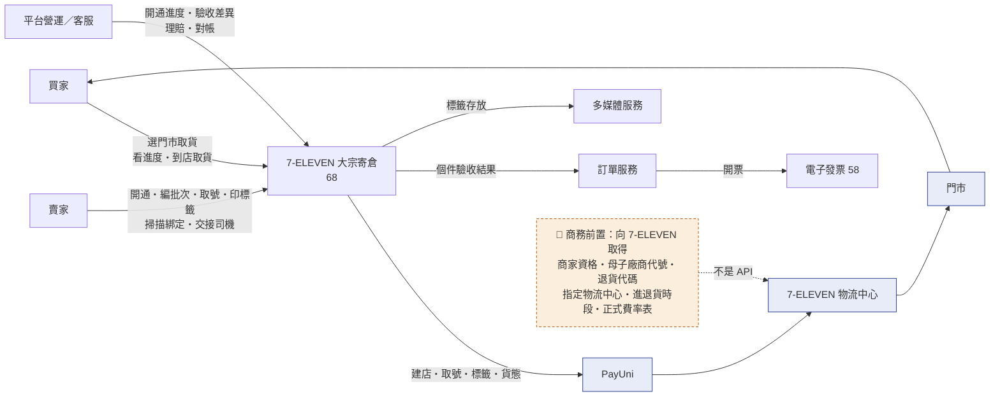
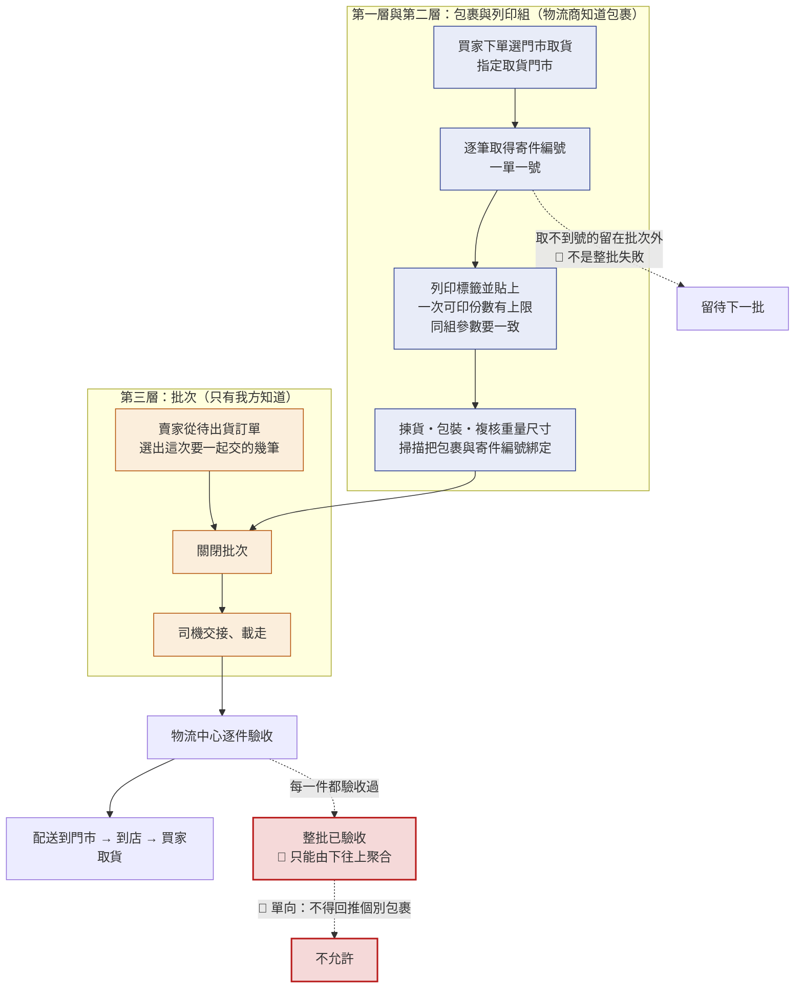
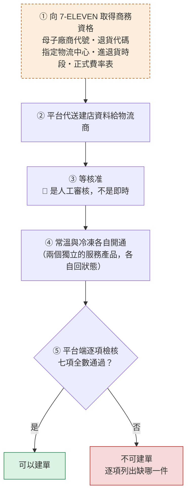
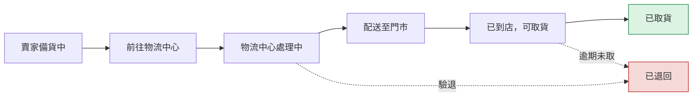
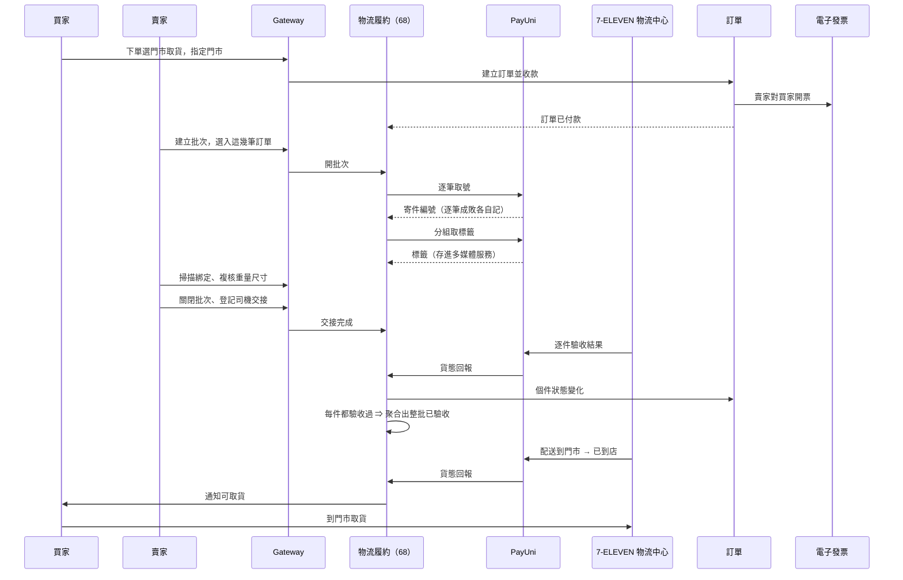
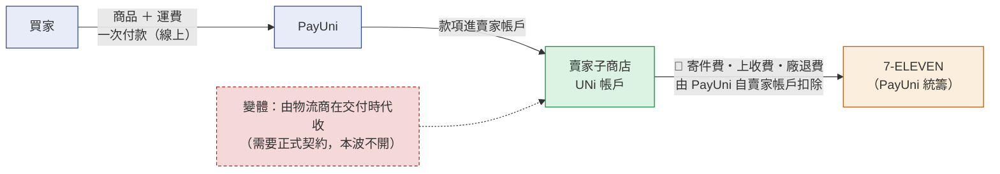
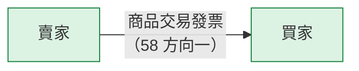

# 68 · 7-ELEVEN 大宗寄倉（基本設計）

> **這是外部設計。** 實作契約（DDL／proto／端點簽章／狀態機轉移邊／陷阱）在
> [詳細設計書 68](../詳細設計書/68-7-ELEVEN%20大宗寄倉（B2C）詳細設計書.md)，
> 共用骨架在 [65 基本設計書](65-物流履約平台（Fulfillment%20Platform）基本設計書.md)，
> 畫面在 [65A 前端實作規格](../詳細設計書/65A-物流履約前端實作規格.md)。

> ⚠️ **名字先講清楚：這個模式叫 B2C，而 7-11 超商物流一共三種，不要混。**
>
> | 超商物流 | `LgsType` | 我方 `ShippingType` | 我方 `ShippingMethod` | 現況 |
> |---|---|---|---|---|
> | **店到店（交貨便）** | `C2C` | `CVS_C2C(3651)` | `3002` | ✅ **已實作**（[06 基設](06-物流微服務（Shipping%20Service）基本設計書.md)） |
> | **大宗寄倉** | **`B2C`** | `CVS_B2C(3653)` | `3004` | 🔴 **本書的對象，未實作** |
> | 超商退貨便 | `C2B` | — | — | 逆向，`3002` 開通時的 provider 副作用 |
>
> 🔴 **「B2C」講的是最後一哩：物流中心 → 門市 → **消費者**取貨。** 而「大宗」講的是賣家那一側
> 一次把一批包裹交到物流中心。兩件事同屬這一個模式，**不是兩個模式**。
> ⚠️ **不要把它改叫 B2C**：PayUni 的 `LgsType` 值域只有 `B2C`／`C2C`／`HOME`／`C2B`，**沒有 B2C**
> ——我方模式名若叫 B2C，線上值仍得送 `B2C`，那才是真正的混淆來源。
>
> 🔴 **買家端一律只顯示「7-ELEVEN 門市取貨」**——「大宗寄倉」「母子代號」「物流中心」「B2C」「批次」
> 都是賣家與營運的詞彙，不得出現在買家畫面（§2.4）。

---

## 0. 這個功能解決什麼問題

**賣家出貨量一大，既有的超商店到店就撐不住了。**
店到店是「一件一件拿到門市交寄」：一天十件還可以，一天兩百件就是一個人整天在跑超商。

大宗寄倉把這件事反過來：賣家**一次把一批包裹交到指定的物流中心**，
由物流中心分流配送到各個門市，買家照樣到門市取貨。

| 問題 | 怎麼處理 |
|---|---|
| 出貨量大時逐件交寄不可行 | 賣家把一批訂單編成一個**批次**，一次交車 |
| 一批幾百件，其中幾件取不到號 | 🔴 **逐筆取號**，取不到的那幾筆留在批次外，**不是整批失敗** |
| 交出去之後不知道物流中心到底收了幾件 | 物流中心**逐件驗收**，驗收結果逐件回到訂單；件數對不起來就建差異案件 |
| 冷凍與常溫的作業規則完全不同 | 常溫與冷凍是**兩個獨立的開通資格**，費率、進貨時段、退貨方式都不一樣 |

**不做會怎樣**：有量的賣家留不住——他們會去別的平台，或是乾脆把訂單導到站外；
而平台上的生鮮賣家一旦做起來，第一個撞到的天花板就是出貨作業。

**不解決什麼**：不做寄倉存貨（這是「一次交一批包裹」不是「把貨寄放在倉庫慢慢賣」）；
不支援冷藏（只有常溫與冷凍）；不做一張訂單拆多件；不做當日交倉；
🔴 **不與店到店互為備援**（§2.4）。

## 1. 誰在用，跟誰互動

| 角色 | 在這裡做什麼 |
|---|---|
| **買家** | 下單時選「7-ELEVEN 門市取貨」並指定門市；看取貨進度；到店取貨 |
| **賣家** | 申請開通（含商務前置）；編批次、取號、印標籤、掃描綁定、關批次、交接給司機；處理驗退與退貨 |
| **平台營運／客服（ADM）** | 看開通卡在哪；處理驗收差異、理賠受理、對帳差異 |
| **會計／財務** | 每日對帳；費用帳核對 |

**上下游**

| 對象 | 關係 |
|---|---|
| **PayUni** | 建店、取號、標籤、貨態**全部經 PayUni** |
| **7-ELEVEN（統一超商）** | 🔴 **商務資格與代碼核准，不是 API 供應商**——我方與 7-ELEVEN 之間沒有任何技術連線 |
| **訂單服務** | 個件的驗收結果回到訂單進度 |
| **多媒體服務** | 標籤存放（加密、短期連結、授權下載、稽核軌跡） |
| **電子發票服務（58）** | 賣家對買家開票 |

🔴 **司機交接文件只帶最低資訊**：批次號、件數、封箱數、清單校驗值、賣家聯絡窗口。
**不得出現買家姓名、電話、地址或訂單金額**——那份文件會離開我方系統。

## 2. 核心模型

### 2.1 三層：包裹、列印組、批次

🔴 **混在一起是這條流程最貴的錯誤。**

| 層 | 是什麼 | 物流商知不知道 |
|---|---|---|
| **包裹** | 一筆訂單一件，有自己的寄件編號 | ✅ **知道**（那個編號是物流商給的） |
| **列印組** | 一次列印標籤的分組（有份數上限，且同一組的參數要一致） | 知道那一次呼叫，**不知道「組」這個概念** |
| **批次** | 賣家一次交車的單位 | 🔴 **只有我方知道**，物流商那側沒有對應的東西 |

⚠️ **因此批次的狀態永遠不可能由物流商的回報直接推進**：
它只能由 ①我方的操作（開／關／交接登記）②個件狀態的**聚合**驅動。

🔴 **批次不是訂單。** 批次是賣家為了「一次交一車貨」而做的**內部編組**：
它不進訂單的讀取模型，買家在訂單上看不到它，也不該拿批次的狀態去描述任何一筆訂單。

🔴 **賣家交接完成 ≠ 物流中心已驗收。** 「東西離開賣家」與「物流中心確認收到」中間會掉件、會驗退。
不得因為整批出車就把每一件顯示成「物流中心已收件」；
反過來，「整批已驗收」只能由「每一件都驗收過」**聚合**得出，而且這個方向是**單向的**。

### 2.2 與店到店（既有 7-11 取貨）的差異

| 面向 | 店到店（既有） | 大宗寄倉（本書） |
|---|---|---|
| 賣家怎麼交寄 | 到任一門市，一件一件交 | 一次一批交到**指定物流中心** |
| 出貨憑證 | 出貨便代碼 → 門市機台列印 | **標籤由平台取得**，賣家自己印並貼 |
| 交運單位 | 一件 | **批次**（我方自己的概念） |
| 物流中心驗收 | 無此步驟 | 🔴 **逐件驗收**，會驗退 |
| 買家看到的 | 7-ELEVEN 門市取貨 | **同樣是**「7-ELEVEN 門市取貨」 |
| 開通資格 | 常溫／冷凍各自開通 | 常溫／冷凍各自開通 ＋ **商務前置** |
| 逆向（退貨） | 買家到門市退，走退貨便 | 常溫可走門市退貨；🔴 **冷凍不支援門市退貨** |

🔴 **後端是完全分開的兩條路**（不同的配送方式代碼、不同的物流商服務產品），
而且：

| 規則 | 內容 |
|---|---|
| **排他性** | 🔴 開通大宗寄倉後，同一個賣家帳號**不得再用門市交寄** |
| **不互為備援** | 🔴 大宗寄倉中斷時**保留選項並顯示可信原因**，不得自動改走店到店 |
| **為什麼不互為備援** | 互為備援會造成「同一筆訂單兩張物流單」，而運費與理賠都掛在寄件編號上 |

⚠️ **排他性要落在資料層不是畫面上**。只寫在文件裡的話，下一個人加一個新入口就繞過了。

### 2.3 開通是七項檢核全部通過，不是一個開關

🔴 **三條關於開通的特別規則**：

1. **建店資料送出後改不了**——沒有更新、也沒有重新送審的路 ⇒ **送出前要二次確認**。
2. **核准結果由物流商主動推播，我方查不回來** ⇒ 推播漏收的賣家會卡在
   「以為開通了、卻建不出單」，必須有**人工查證的路**，而且要看得到「有幾個賣家從沒收到過通知」。
3. **「收件成功」不等於「開通完成」**：送出建店資料得到成功回應只代表對方收到了；
   實際核准是每週固定時間彙整的人工作業，冷凍另需物流中心測標。

### 2.4 買家看不到的詞

| 概念 | 買家看到 | 賣家／營運看到 |
|---|---|---|
| 配送方式 | **「7-ELEVEN 門市取貨」** | 7-11 大宗寄倉 |
| 交倉 | 「賣家已出貨」 | 交倉／進倉批次 |
| 物流中心驗收 | 「配送中」 | 物流中心驗收通過／驗退 |
| 廠商代號 | **不顯示** | 母子廠商代號 |
| 模式名稱 | **不顯示**（只說「門市取貨」） | 大宗寄倉 B2C（我方）／PayUni 那側叫 B2C |

🔴 **判準不是「會不會洩漏」，是買家對這些詞沒有可執行的動作**——顯示它只製造客服工單。

## 3. 主要業務流程

### 3.1 賣家備貨到交倉的八步

1. 賣家開通大宗寄倉（§2.3）
2. 買家下單時選「7-ELEVEN 門市取貨」並指定取貨門市
3. 賣家從待出貨的訂單裡**選出這次要一起交的那幾筆**，建立一個**批次**
4. **逐筆**向物流商取得寄件編號（一單一號）；取不到的那幾筆留在批次外
5. **列印標籤**並貼上；一次能印的份數有上限，大批次要分幾次印
6. 揀貨、包裝、複核重量與尺寸，**掃描把包裹與寄件編號綁在一起**
7. 關閉批次 → 司機來**交接**、載走
8. **物流中心逐件驗收** → 配送到門市 → 到店 → 買家取貨

**這一條的四個「誰」**：

| 問題 | 答案 |
|---|---|
| 誰入倉？ | **賣家**把一批包裹交給司機 → 司機載到**7-ELEVEN 物流中心** → 物流中心**逐件驗收**。🔴 「賣家交接完成」與「物流中心已驗收」是兩件事（§2.1） |
| 誰管理批次？ | 🔴 **只有平台**。批次是我方自己的概念，物流商那側沒有對應物 ⇒ 批次狀態**永遠不可能由物流商的回報推進**（§2.1） |
| 誰收款？ | **賣家**。本波走「取貨不付款」＝買家在平台上已線上付款、款項進賣家帳戶（§4.1） |
| 物流商怎麼對帳？ | **每日分層對帳**：寄件編號↔貨態、交付件數↔驗收件數、費用／退貨／理賠、結算↔銀行。🔴 對不起來一律**建差異案件由人處理，不自動改金額**（§4.3） |

### 3.2 買家看到的六個階段

🔴 **「前往物流中心」不等於「物流中心已收件」**——中間隔著驗收，而驗收會失敗。

### 3.3 跨服務時序（一批貨的主線）

## 4. 錢與發票怎麼走

### 4.1 買家付款（線 A，有一個變體）

**收款模式有兩種，本波只開一種**：

| 收款模式 | 意思 | 本波 |
|---|---|---|
| **外部預付** | 買家在平台上已完成線上付款，取貨時**不付款** | ✅ **本波預設**（既有店到店已經這樣跑） |
| **物流商代收** | 由物流商在交付時代收貨款 | 🔴 **需要正式契約，本波不開**（值域裡有，但沒有寫入路徑） |

🔴 **代收是互斥的**：金流通道與物流商**絕不同時收**。
⚠️ 採「取貨不付款」時，送給物流商的金額欄位裝的是**商品價值（供理賠認定）**，
不是應收金額——這兩件事共用一個欄位，是本流程最容易寫錯的一格。

**物流費用由誰付**：

| 費用 | 誰付 | 何時扣 |
|---|---|---|
| 常溫／冷凍寄件費 | **賣家**（由 PayUni 從賣家帳戶扣） | 驗收成功後 |
| 冷凍到府上收費 | **賣家** | 物流驗收後（不論驗收成敗） |
| 退貨／廠退費 | **賣家** | 收到退件貨態後 |

🔴 **平台不在這些費用線上**：平台不代墊、不代收、也**不向賣家收取任何物流服務費**。
⇒ **本書沒有「平台向賣家收物流費」（線 B），也沒有「平台與物流商結算」（線 C）**——
那兩條只有 Uber 有（[66](66-Uber%20Direct%20即時配送整合基本設計書.md)）。

⚠️ **費率依正式費率表，本波不猜數字**。費率是**快照不是常數**：
改版時既有的單一律沿用當時的費率，否則改一次費率就改掉歷史帳。

### 4.2 發票

| 問題 | 答案 |
|---|---|
| 誰對買家開票？ | **賣家** |
| 平台對賣家開票嗎？ | **不開**（平台沒向賣家收費） |
| 賣家對平台開票嗎？ | **不開** |
| 物流商的費用帳給誰？ | 🔴 **給賣家**（從賣家的金流帳戶直接扣），不給平台 |
| 誰對誰負責理賠？ | 依物流商契約條款審核，**有金額上限** |
| 退款時誰處理發票？ | **賣家**（同月作廢、跨月折讓） |

### 4.3 對帳

**每日對帳分層做**，因為出問題的層次不同、負責的人也不同：

| 層 | 對什麼 | 對不起來時 |
|---|---|---|
| 寄件編號 ↔ 貨態 | 我方有紀錄的每一件，物流商是不是也有 | 建差異案件 |
| 批次「交了幾件」↔「驗收幾件」 | 交接登記的件數與驗收件數 | 🔴 **建差異案件，不以人工改數字消音** |
| 費用、退貨、理賠 | 費用帳與物流商帳單 | 同上 |
| 結算 ↔ 銀行 | 金流入帳 | 同上 |

🔴 **不自動改金額、不自動補列**。自動對齊等於把錯誤消音，而金額的錯誤會變成真實損失。
🔴 **不建常駐的漂移掃描程式**：對帳是「有具體外部呼叫要做的那幾筆」的作業，
不是把整個資料庫掃一遍找不一致。

## 5. 出事的時候會怎麼樣

| 情況 | 處置 |
|---|---|
| 取號結果不明（不知道到底成功沒有） | 🔴 **先去查既有結果，不得直接再取一次**——重取會生出第二個包裹，而運費與理賠都掛在寄件編號上 |
| 某幾筆取不到號 | 留在批次外，**批次照關**；不是整批失敗 |
| 物流中心驗退（驗收不通過） | 該件退回賣家，批次不因此結案；🔴 **退貨與退款是分開的兩件事** |
| 交出去的件數與驗收件數對不起來 | 建差異案件，**不以人工改數字消音** |
| 買家逾期未取 | 包裹退回；同樣地，**退貨與退款是分開的兩件事** |
| 包裹遺失或毀損 | 走理賠；賠付**依契約條款審核，並有上限** |
| **冷凍商品要退貨** | 🔴 **物流商公開的退貨作業只支援常溫** ⇒ 冷凍逆向走客服與商家責任流程：買家端**不顯示門市退貨入口**、不產生逆向物流單、**不自動退款**、不猜測領回日期，改為自動建客服案件並排到物流商的固定回收日 |
| 賣家的開通結果通知漏收 | 賣家會卡在「以為開通了、卻建不出單」，而且系統查不回來 ⇒ 必須有人工查證的路，並且要看得到「有幾個賣家從沒收到過通知」 |
| 物流商中斷服務 | **保留「7-ELEVEN 門市取貨」這個選項**並顯示可信的原因；🔴 **不得自行改走店到店** |
| 標籤取不到或取到一半 | 分組重取；標籤是可稽核的資產（加密、短期連結、授權下載、留痕） |

⚠️ **冷凍逆向不是「另一條流程」，是「沒有物流的流程」**。
把它寫成留白，賣家與客服就會各自發明做法；本書把它落成一條可執行的降級路徑。

## 6. 頁面地圖

### 買家
| 畫面 | 解決什麼 |
|---|---|
| 購物車的運送方式選擇 ＋ 門市地圖 | 選「7-ELEVEN 門市取貨」並指定門市 |
| **門市取貨進度**（新建） | 看六個階段（§3.2） |

### 賣家
| 畫面 | 解決什麼 |
|---|---|
| 物流設定的大宗寄倉開通 | 送建店資料；看七項檢核缺哪一項 |
| **批次／掃描／標籤／交倉**（新建） | 編批次、逐筆取號、分組印標籤、掃描綁定、關批次、登記交接 |
| 出貨異常 | 驗退、取號失敗、退回 |

### 營運
| 畫面 | 解決什麼 |
|---|---|
| **批次與對帳差異**（新建） | 看交付與驗收的差異、費用帳差異 |
| 異常工作佇列 | 開通卡住、驗退、理賠受理 |
| 案件詳情與事件時間線 | 把回報與狀態轉換合成一條時間軸 |

完整畫面與檔案對照在 [65A](../詳細設計書/65A-物流履約前端實作規格.md)。

## 7. 這個設計刻意不做的事

- ❌ **不建寄倉存貨模型**：這是「一次交一批包裹」不是「把貨寄放在倉庫」
- ❌ **不支援冷藏**（只有常溫與冷凍）
- ❌ **不做一張訂單拆多件**（一訂單＝一包裹＝一寄件編號）
- ❌ **不做當日交倉**
- ❌ **不與店到店互為備援**，也不允許同一賣家同時使用兩者
- ❌ **不把批次狀態拿去描述訂單**
- ❌ **不從整批結果回推個別包裹**
- ❌ **沒有平台撥款、沒有平台帳本**（§4.1）
- ❌ **不建常駐的資料漂移掃描程式**
- ❌ **不把費率寫成程式常數**（費率是快照）

## 8. 已知的外部相依與待決策事項

| 相依／待決 | 類型 | 卡在哪 | 沒解決會怎樣 |
|---|---|---|---|
| 🔴 **`LgsType.java` 的 javadoc 與實際用法相反** | 技術（本波不改 code） | 需要改 production source | `payuni-java-client/.../LgsType.java` 的註解逐字寫 `B2C`＝「超商取貨（**店到店**）」、`C2C`＝「超商寄件」，而**實際用法是 `C2C`＝店到店**（`CvsShipmentStrategy.LGS_TYPE_C2C`／`OnboardingService.CVS_LGS_TYPE`／`StoreMapService.FIXED_LGS_TYPE` 三處全用 `C2C`），且 PayUni 官方總覽也寫 `B2C`＝大宗寄倉。🔴 **照那份註解施工會把本模式的 `LgsType` 送錯值**，而送錯 PayUni 直接退。⇒ 註解要修，但那是 code 變更，本波只登記 |
| **7-11 正式契約與代碼對照** | 商務 | 7-ELEVEN | 🔴 缺母子廠商代號與物流中心就**無法建店**，即使金流通道那側都通了 |
| **正式費率表** | 商務 | 7-ELEVEN／PayUni | 🔴 **本波不 seed 真實金額**——猜一個數字上線等於對賣家收錯錢 |
| **建店送件的憑證形式** | 技術契約 | PayUni 書面答覆 | 代理商能不能代賣家送建店資料未確認，兩種分支的前端做法完全不同 ⇒ 未確認前整條擋住 |
| **物流商代收模式** | 商務 | 正式契約 | 值域裡有這個選項但沒有寫入路徑，本波只走「取貨不付款」 |
| **冷凍逆向的商業責任歸屬** | 業務 | 待裁決 | 冷凍退貨的運費與損失由誰負擔沒有規則（§5 那一列只定義了系統行為，不是責任歸屬） |

⚠️ 這些**不是「之後再補」的註記**，而是功能開關能不能打開的明確條件。
每一項在 [68 詳設 §3](../詳細設計書/68-7-ELEVEN%20大宗寄倉（B2C）詳細設計書.md) 都寫了「拿不到時系統怎麼擋住自己」。
