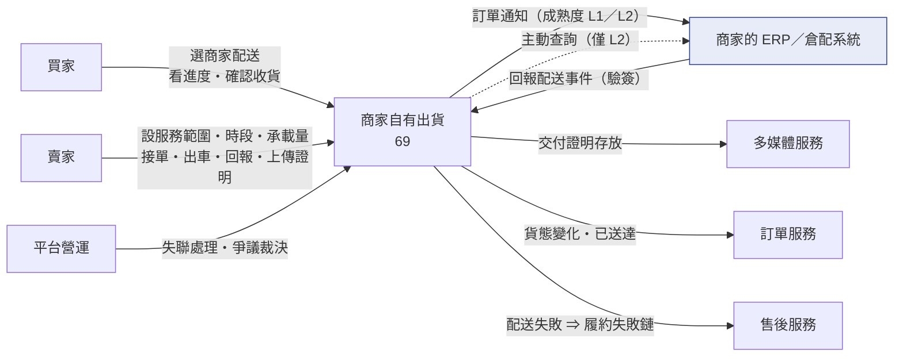
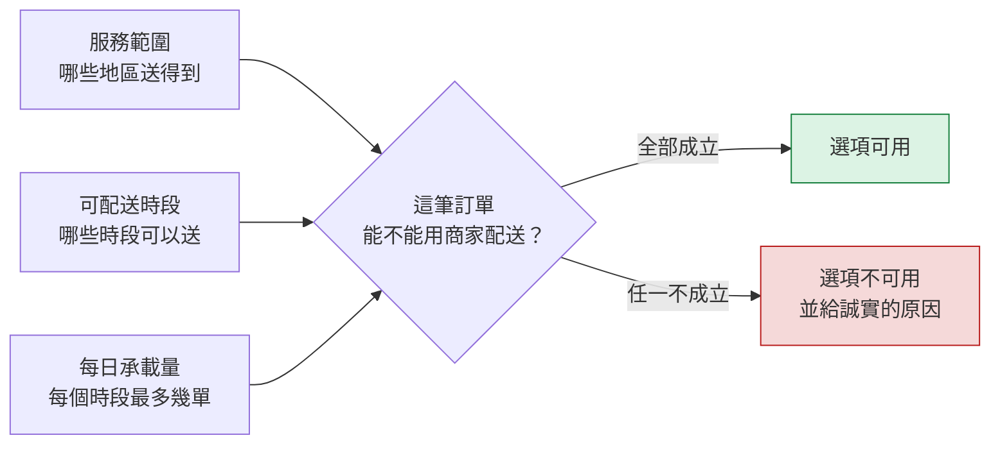
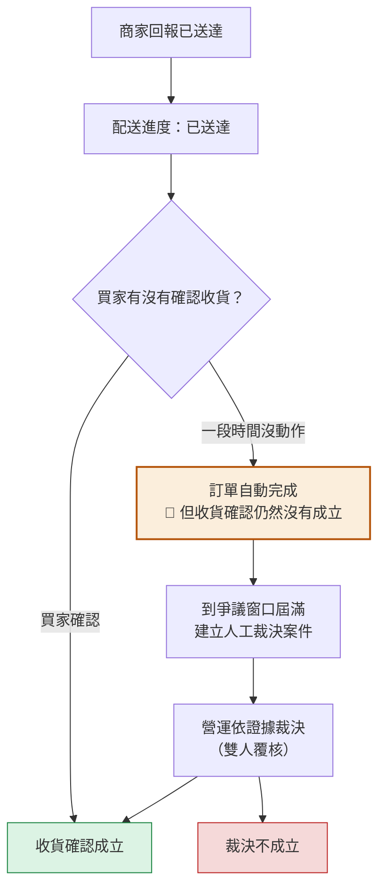
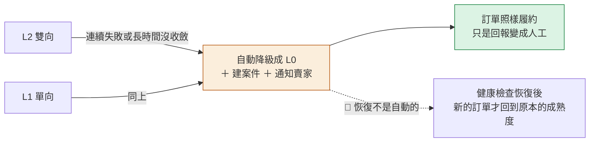
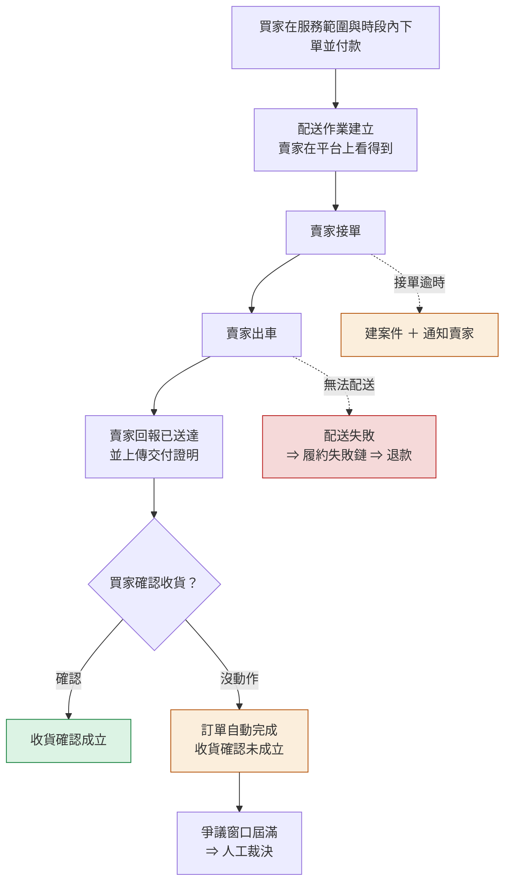
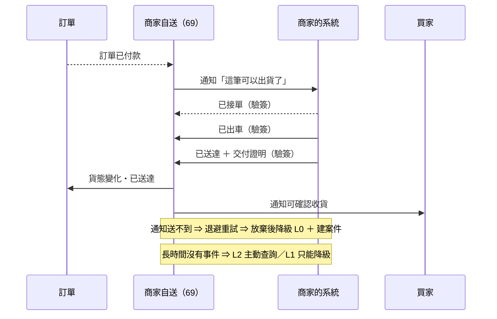
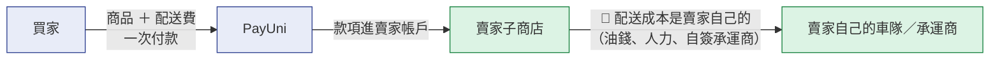

# 69 · 商家自有出貨（基本設計）

> **這是外部設計。** 實作契約（DDL／proto／端點簽章／狀態機轉移邊／陷阱）在
> [詳細設計書 69](../詳細設計書/69-商家自有出貨（Merchant%20Self-Delivery）詳細設計書.md)，
> 共用骨架在 [65 基本設計書](65-物流履約平台（Fulfillment%20Platform）基本設計書.md)，
> 畫面在 [65A 前端實作規格](../詳細設計書/65A-物流履約前端實作規格.md)。

---

## 0. 這個功能解決什麼問題

**有些賣家本來就有自己的車。** 在地小農每天早上自己開車送附近幾條街；
中型商家有自簽的承運商與自己的倉配系統。對他們來說，
被迫走第三方物流通道是**多付一次運費、多等一天、還拿不到自己想要的服務**。

商家自有出貨讓賣家用自己的配送能力履約：平台負責四件事，其餘不介入。

| 平台負責 | 說明 |
|---|---|
| ① 把訂單交到商家手上 | 賣家在平台上看得到要送哪幾筆，或由平台主動通知商家的系統 |
| ② 接收商家的回報 | 手動（賣家在平台上按）或自動（商家系統回報事件） |
| ③ 把回報翻譯成平台的貨態 | 讓買家與訂單看到一致的進度 |
| ④ 🔴 **在證據不足時不讓錢出去** | 賣家自稱送達**不能單獨通過收貨確認**（§2.3） |

**不做會怎樣**：有配送能力的賣家會覺得平台在扯後腿——他明明下午就能送到，
系統卻逼他交給隔日到的物流商；或者他乾脆在站外交易，平台看不到也保障不了買家。

**不解決什麼**：不做承運商整合（商家自己找誰送是商家的事）；
不做路線最佳化、車隊管理、司機 App；不做一張訂單拆多趟。

🔴 **本書與帳務軸正交**：它**不決定**誰開發票、錢收給誰。
同一套自送能力會被 [67 定期配送](67-定期配送訂閱（Subscription%20Delivery）基本設計書.md) 引用，
也是 [66 Uber](66-Uber%20Direct%20即時配送整合基本設計書.md) 不可用時賣家的替代方案——
**但本書任何一節都不得寫「因為是商家自送所以…撥款／發票…」**。

## 1. 誰在用，跟誰互動

| 角色 | 在這裡做什麼 |
|---|---|
| **買家** | 在購物車看到「商家配送」選項（要在服務範圍與時段內）；看配送進度；**確認收貨**（這一步是關鍵） |
| **賣家** | 設定服務範圍、可配送時段、每日承載量、計價方式；接單、出車、回報送達、上傳交付證明；整合系統的申請與金鑰管理 |
| **商家的系統（ERP／倉配）** | 接收平台的訂單通知；回報配送事件；（成熟度較高時）回答平台的查詢 |
| **平台營運（ADM）** | 處理商家失聯、接單逾時、交付證明缺漏；**收貨爭議的人工裁決** |

## 2. 核心模型

### 2.1 三種成熟度：從「什麼都沒有」到「系統對接」

🔴 **平台不要求賣家先有系統。** 同一套能力分三級，賣家從哪一級開始都可以。

| 能力 | L0 手動 | L1 單向回報 | L2 雙向 |
|---|:---:|:---:|:---:|
| 賣家在平台上手動推進貨態 | ✅ 唯一途徑 | ✅（降級時的退路） | ✅ |
| 平台主動通知商家系統 | 🚫 | ✅ | ✅ |
| 商家系統回報事件（驗簽、去重、順序合併） | 🚫 | ✅ | ✅ |
| 平台主動查詢商家系統 | 🚫 | 🚫 **對方沒有查詢介面** | ✅ |
| 取消需商家確認 | 🚫（直接生效） | ✅ | ✅ |
| 交付證明 | ✅ 賣家上傳 | ✅ 商家帶 | ✅ |

🔴 **三級的「撥款與收貨證據要求完全相同」。**
成熟度只影響「誰按下那個按鈕」與「多快知道」，**不影響證據的信任等級**——
因為就算是 L2 的「承運商事件」，在本架構裡仍然是**商家自己轉述的**：
我方與承運商之間沒有任何直接通道。

⚠️ **L1 沒有查詢介面這一格不是留白**：它決定商家失聯時 L1 只有一條路
（**降級成 L0 ＋ 建案件**），不能寫成「查詢後收斂」。

### 2.2 賣家的配送能力由三件事描述

- **服務範圍**與**時段**由賣家自己設定；**承載量**避免賣家在同一個時段接超過自己送得完的單。
- 🔴 **不可用時要給誠實的原因**（不在服務範圍／該時段已滿／該時段不營業），
  **不得只靠前端隱藏選項來實施政策**。
- 這三件事也是 [67 定期配送](67-定期配送訂閱（Subscription%20Delivery）基本設計書.md) 判定
  「這一期送不送得到」的唯一依據——所以它們**只在本書定義一次**。

### 2.3 🔴 收貨 Gate：賣家自稱送達不算數

**這是本書的核心規則。** 商家自送沒有第三方證據，所以「誰說貨到了」這件事必須有明確答案。

| 證據 | 能不能**單獨**通過收貨確認 | 為什麼 |
|---|:---:|---|
| 賣家或商家回報「已送達」 | 🔴 **不能** | 自己說自己送到了 |
| 交付證明（照片／簽收人／驗證碼） | 🔴 **不能** | 照片可以是任何一箱東西；它的價值是**給營運裁決用**，不是給 Gate 用 |
| 驗簽通過的商家事件 | 🔴 **不能** | 驗簽證明的是「訊息真的來自這個商家」，不是「貨真的到了」 |
| 承運商事件（L2） | 🔴 **不能** | 仍然是商家轉述的 |
| **買家確認收貨** | ✅ | — |
| **營運人工裁決** | ✅ | 依不可變證據裁決，走雙人覆核 |

🔴 **「訂單自動完成」與「收貨確認成立」是兩件事，兩個時鐘。**
訂單自動完成只是不讓訂單無限期掛著；它**不產生收貨確認**，
所以任何以收貨確認為前提的下游動作都不會因為自動完成而被觸發。

⚠️ **交付證明缺漏不改變狀態**（那是軟性窗口），但它會讓爭議裁決時缺證據
⇒ 逾時要**通知賣家**，而不是只記一個數字。

### 2.4 商家整合壞掉時，降級而不是壞掉

🔴 **降級是自動的，恢復不是。** 已經降級期間產生的配送作業**不會自動切回去**
（它們身上帶的是當時的成熟度快照）。
⚠️ 這條要寫進維運手冊，否則營運會以為「恢復了怎麼還在人工」。

⚠️ **我方系統暫時有問題時，對商家要回失敗讓他重送**，
**不得回成功假裝收到**——那會讓那一則事件永遠消失。

## 3. 主要業務流程

### 3.1 一筆訂單從付款到收貨（L0 手動）

### 3.2 商家系統對接（L1／L2）

🔴 **三件事一定要做，否則商家的回報不可信或會被重複套用**：
**驗簽**（這則訊息真的來自這個商家）、**去重**（同一則事件收兩次只算一次）、
**順序合併**（晚到的舊事件不得覆蓋新狀態）。

⚠️ **對外的商家介面是一份公開契約**：它要版本化，
而且平台**不為個別商家寫程式**——商家照契約接上來就能用。

### 3.3 取消

| 成熟度 | 取消怎麼運作 |
|---|---|
| L0 | 直接生效（沒有對方系統要通知） |
| L1／L2 | 🔴 **需要商家確認**——車可能已經在路上了 |

## 4. 錢與發票怎麼走

🔴 **本書是履約層，帳務軸由引用它的商流決定**（§0）。
以**目前每一種用法**來說，答案都一樣：

| 問題 | 答案 |
|---|---|
| 誰配送？ | **賣家自己**（自有車隊或自簽承運商） |
| 誰決定服務範圍？ | **賣家**（§2.2），平台只依它判定選項可不可用 |
| 誰收運費？ | **賣家**——買家付的配送費和商品款一起進賣家帳戶 |
| 平台向賣家收物流費嗎？ | 🔴 **不收**。這是賣家自己的配送成本，平台沒有提供物流服務 |
| 平台與物流商結算嗎？ | 🔴 **沒有這條線**。平台與賣家的承運商之間沒有任何關係 |
| 交付證明從哪來？ | 賣家或商家上傳（照片／簽收人／驗證碼）；🔴 它的用途是**爭議裁決**，不是通過收貨 Gate |
| 誰對買家開票？ | **賣家** |
| 定期配送疊在上面時有什麼不同？ | 一樣——每期都是賣家收款、賣家開票（見 [67](67-定期配送訂閱（Subscription%20Delivery）基本設計書.md)） |
| Uber 不可用時改用商家自送呢？ | 🔴 **系統不會自動改**（共通規則）。買家重新選擇的話，那就是一筆商家自送的訂單，錢與票都照本節 |

⚠️ **這一節之所以短，是因為它真的就這麼短。**
商家自送沒有第三方物流商、沒有代收、沒有代墊 ⇒
[65 §3](65-物流履約平台（Fulfillment%20Platform）基本設計書.md) 的線 B 與線 C **都不存在**。
把別的配送方式的帳務推論套過來（特別是 Uber 那條的「平台向賣家收物流費」），是本書最容易被誤讀的地方。

## 5. 出事的時候會怎麼樣

| 情況 | 處置 |
|---|---|
| 平台通知送不到商家系統 | 退避重試若干次；放棄後**降級成 L0 ＋ 建案件 ＋ 通知賣家** |
| 商家回報的事件晚到或亂序 | 依序號判斷，落進收件記錄但**不套用**，不得覆蓋較新的狀態 |
| 商家回報重複 | 回傳既有結果（同一則只算一次） |
| 商家長時間沒有任何事件 | L2 主動查詢後收斂；🔴 **L1 只能降級 ＋ 建案件**（對方沒有查詢介面） |
| 商家接單逾時 | 建案件 ＋ 通知賣家；⚠️ 接單時限與訂單本身的處理期限是兩個東西，不能互相覆蓋 |
| 商家拒單或無法配送 | 配送失敗 → 走**履約失敗鏈** → 售後退款 |
| **賣家自稱送達但買家說沒收到** | 🔴 走爭議：以交付證明為材料，由營運裁決（雙人覆核）。**不接受單方回報放行**（§2.3） |
| 交付證明沒上傳 | **不改變狀態**（軟性窗口），但要通知賣家；逾時會讓裁決缺證據 |
| 商家的簽章連續失敗 | 建案件（可能是金鑰換了，也可能有人在嘗試偽造） |
| 商家要換金鑰 | 有重疊窗口，舊金鑰在窗口內仍可用；窗口有上限（曝險時間） |
| **買家要退貨** | 🔴 **商家自送的逆向不是一條獨立的貨態鏈**，是一個**需要營運介入的異常**：本書的三種成熟度**都沒有**「商家回報退貨進度」的能力，退貨走平台既有的售後流程 ＋ 商家與買家自行約定取回。退貨方式限定與原出貨方式相同（平台政策「原方式退」） |
| 我方資料庫暫時不可用 | 對商家**回失敗讓他重送**，🔴 **不回成功假裝收到** |

## 6. 頁面地圖

### 買家
| 畫面 | 解決什麼 |
|---|---|
| 購物車的運送方式選擇 | 看到「商家配送」與可選時段；不可用時看到誠實的原因 |
| 訂單追蹤 | 看配送進度與交付證明 |
| 確認收貨 | 🔴 這一步是收貨 Gate 的正門 |

### 賣家
| 畫面 | 解決什麼 |
|---|---|
| **服務範圍與承載設定**（新建） | 設服務地區、可配送時段、每日承載量、計價方式 |
| 日常履約 | 接單、出車、回報送達、上傳交付證明 |
| 商家整合設定 | 申請對接、管理金鑰、看健康狀態與是否被降級 |
| 出貨異常 | 接單逾時、配送失敗、爭議 |

### 營運
| 畫面 | 解決什麼 |
|---|---|
| 異常工作佇列 | 商家失聯、接單逾時、簽章失敗、交付證明缺漏 |
| **收貨人工裁決**（新建，沿用 58 號雙人覆核） | 依證據裁決收貨是否成立 |

完整畫面與檔案對照在 [65A](../詳細設計書/65A-物流履約前端實作規格.md)。

## 7. 這個設計刻意不做的事

- ❌ **不做承運商整合**：平台不與黑貓／新竹／宅配通等直接介接。商家自己找誰送是商家的事
- ❌ **不做路線最佳化、車隊管理、司機 App**
- ❌ **不做一張訂單拆多趟**
- ❌ **不為個別商家寫程式**：對外是一份公開且版本化的契約
- ❌ **不接受單方回報通過收貨 Gate**（§2.3）
- ❌ **不因為配送是自送就放寬證據要求**
- ❌ **不在本書決定帳務走向**（§0／§4）
- ❌ **不自動恢復成熟度**（§2.4）
- ❌ **動態報價預設關閉**：即時報價會落在結帳的熱路徑上，一個第三方逾時會拖慢每一次結帳
  ⇒ 介面形狀先定好，逐商家由營運開啟

## 8. 已知的外部相依與待決策事項

| 相依／待決 | 類型 | 卡在哪 | 沒解決會怎樣 |
|---|---|---|---|
| **收貨爭議裁決的營運端** | 產品／營運 | 裁決畫面與流程是本書的上線前置 | 🔴 缺了就會產生**只進不出**的爭議案件——貨態走到底、收貨確認永遠不成立、也沒有人能裁決 |
| **接單時限與訂單處理期限的關係** | 業務 | 待對齊 | 兩個時鐘各自跑會出現「商家還在時限內，訂單已經被自動取消」 |
| **無法配送的責任歸屬** | 業務 | 待裁決 | 商家無法配送時的損失由誰負擔沒有規則（系統行為已定：走履約失敗鏈退款） |
| **動態報價要不要對哪些商家開** | 產品 | 逐商家由營運決定 | 預設關閉，不影響上線 |

⚠️ 這些**不是「之後再補」的註記**，而是功能開關能不能打開的明確條件。
每一項在 [69 詳設 §3](../詳細設計書/69-商家自有出貨（Merchant%20Self-Delivery）詳細設計書.md) 都寫了「拿不到時系統怎麼擋住自己」。
