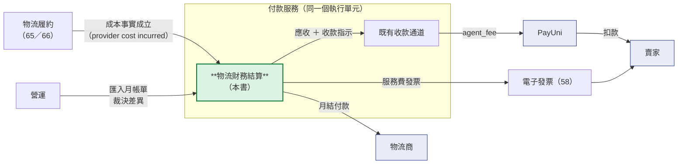
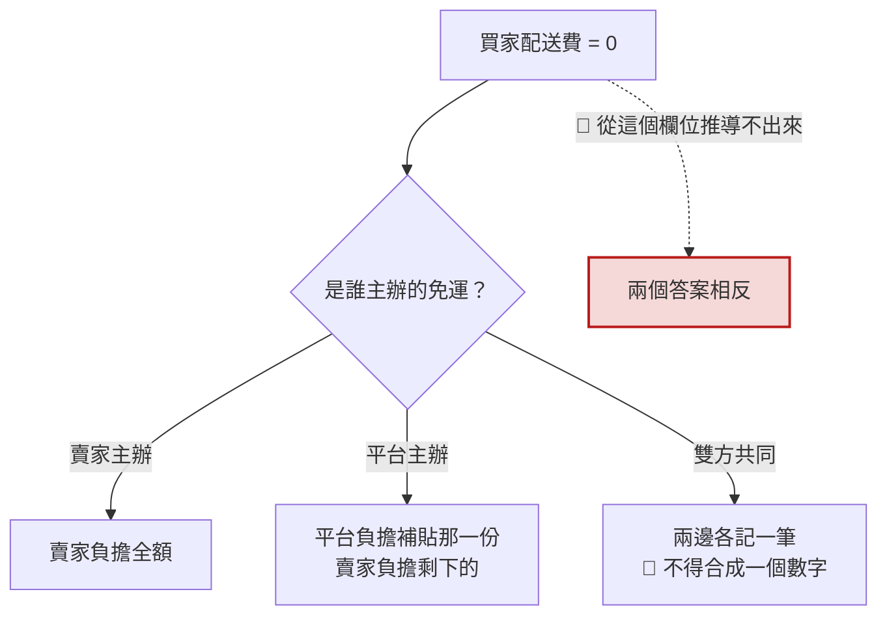
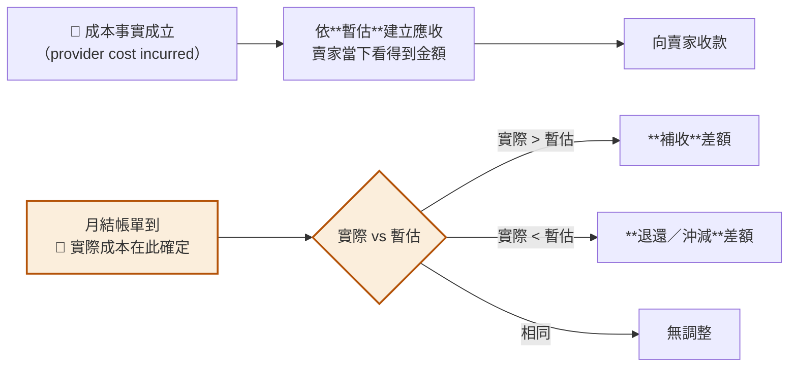
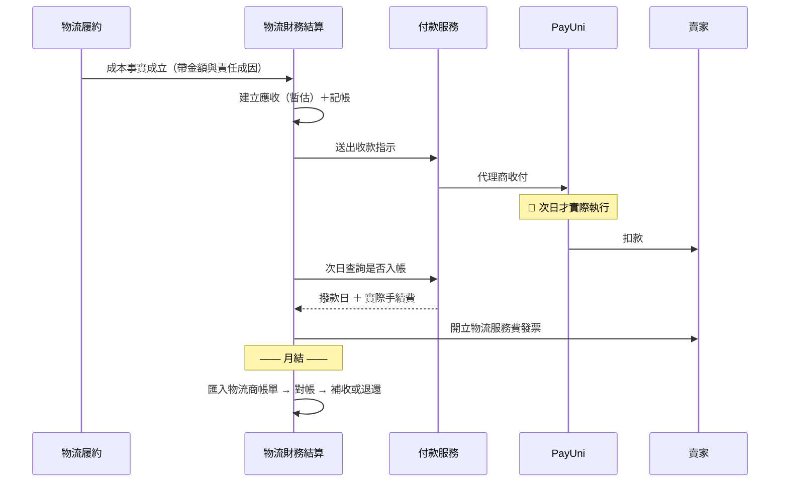
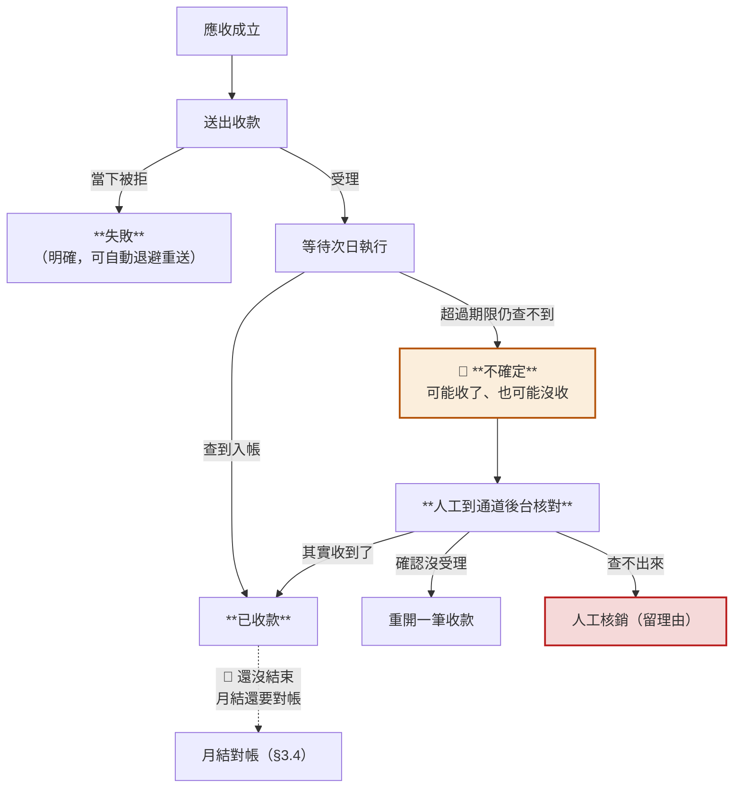
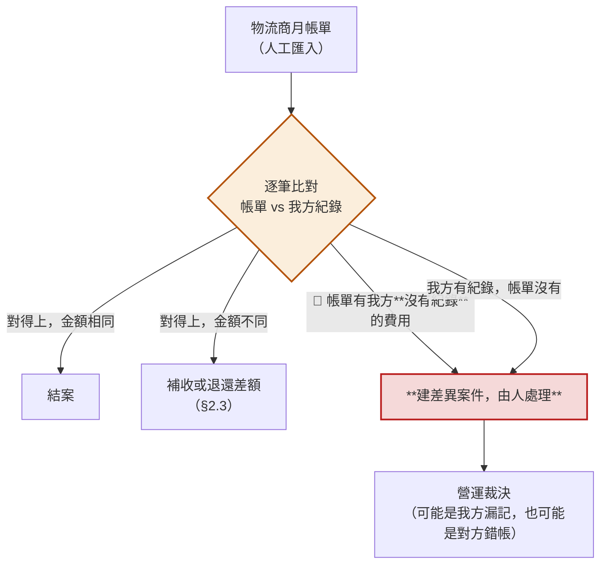
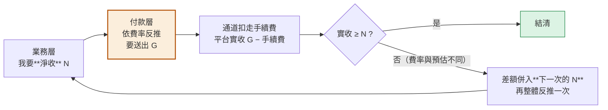

# 70 · 物流財務結算（Logistics Settlement & Receivable）基本設計

> **這是外部設計。** 實作契約（DDL／狀態機／`agent_fee` 呼叫契約／分錄表／端點簽章）在
> [詳細設計書 70](../詳細設計書/70-物流財務結算（Logistics%20Settlement%20%26%20Receivable）詳細設計書.md)，
> 共用骨架在 [65 基本設計書](65-物流履約平台（Fulfillment%20Platform）基本設計書.md)。

> 🔴 **架構決策紀錄**：[65 稽核附錄 `ADR-009`～`ADR-014`](../詳細設計書/65-物流履約平台（Fulfillment%20Platform）詳細設計書.md)
> （domain ownership／帳本載體／手續費機制／inbound 介面／逆向分類器／建單冪等），全部 **CLOSED**。

> ⚠️ **provider 中立**：Uber（`3003`）是第一個，但 `3004` 大宗寄倉、`3005` 商家自送未來走同一條。
> **書名與表名一律不含 provider 名。**

> 🔴 **Runtime Owner ＝ `payment-service` ／ Logistics Finance module**
> （架構裁決 `DEC-20260912-184025`，2026-09-12）。
> **本書是外部設計（業務面），不是 service design**——它描述的業務問題與流程不因為
> 「由哪個服務執行」而改變。上一版預期由一個獨立的「結算」服務承擔，
> 該服務已依裁決刪除、domain 原樣併入付款服務。**業務設計沒有被推翻。**
> 技術落點見 [詳細設計書 70](../詳細設計書/70-物流財務結算（Logistics%20Settlement%20%26%20Receivable）詳細設計書.md) 的檔頭 banner 與 §1.1。

---

## 0. 這個功能解決什麼問題

**平台夾在中間，先墊了物流商的錢。**

Uber 商流在 2026-09-11 改成**賣家直營**之後（`ADR-002`），買家的錢**從頭到尾沒有經過平台**——
直接進賣家的 PayUni 子商店。但**叫車的是平台**（賣家不碰 Uber 憑證），所以：

```
Uber 跟「平台」收錢   ←  因為帳號是平台的
而那是「賣家」的物流成本  ←  因為配送是賣家在賣東西
```

⇒ 平台必須**把墊出去的錢向賣家收回來**，並且**跟 Uber 對帳**。這本書就是在設計這兩件事。

**不做會怎樣**：平台每替賣家叫一次車就虧一次，而**帳上看不出來**——
因為沒有任何一張表記錄「賣家欠平台多少」。既有 13 個帳本科目裡
**一個「應收」都沒有**（兩個 PAYABLE 都是「平台欠別人」），
65 號逐字寫著「平台今天沒有『**向賣家收取一筆已經花掉的錢**』的能力」。

**不解決什麼**：不碰買家付款與退款（那是線 A，賣家自己的事）；不做平台撥款
（`SELLER_DIRECT` 下平台沒代收，沒有款可撥）；不做物流履約本身（那是 65／66）。

## 1. 誰在用，跟誰互動

| 角色 | 在這裡做什麼 |
|---|---|
| **賣家** | 收到物流費帳單、被扣款、看暫估與實際的差額、看貸記餘額、收平台開的發票 |
| **平台** | 建立應收、經 PayUni 向賣家收款、與物流商月結對帳、補收或退還差額、對賣家開票 |
| **物流商**（Uber…） | 執行配送、每月出帳單 |
| **PayUni** | 代理商收付通道（平台向賣家收款的管道） |
| **平台營運（ADM）** | 處理收款失敗與不確定、匯入物流商帳單、裁決差異案件 |
| **會計／財務** | 帳本、對帳、憑證 |



🔴 **本書與撥款軸完全不相交**：線 B 是平台向賣家「**收**」，撥款是平台向賣家「**付**」——
方向相反、載體不同、**不得共用任何一條路徑**。

⚠️ **「配送失敗但不退款」那一類訂單（訂單終態 `DELIVERY_FAILED_NO_REFUND`，定義在
[65 基本設計書](65-物流履約平台（Fulfillment%20Platform）基本設計書.md)／
[66 基本設計書](66-Uber%20Direct%20即時配送整合基本設計書.md)）在本書的行為，
寫成否定保證比較不會被做錯**：

- 🔴 **本書不因為它做任何特別的事**：不沖銷應收、不減免、不退還、不改買家端任何金額。
  那一趟的物流成本**已經發生**、結算對象是賣家 ⇒ **照常成立應收**（§2.1 的 trigger）。
- 🔴 **原訂單款怎麼結算給賣家，不在本書射程內**——那是訂單／撥款軸的事（65／66）。
  **本書不得因此開出第二條撥款路徑**，上面那句「與撥款軸完全不相交」原樣成立。

## 2. 核心模型

### 2.1 三條線，本書只管兩條

> ⚠️ **三條線的完整業務敘述（含 Uber 專屬的商流背景與四個驗收案例）在**
> [66 基本設計書 §2](66-Uber%20Direct%20即時配送整合基本設計書.md)**。**
> 本節只保留「本書管哪兩條」所需的最小對照——**不要在兩本之間同步這張表**，
> 要改就改 66 那一份。

| | 線 A 買家付款 | 線 B 平台收物流費 | 線 C 平台與物流商 |
|---|---|---|---|
| **當事人** | 買家 → 賣家 | **平台 → 賣家** | 物流商 → 平台 |
| **本書管嗎** | ❌ | ✅ | ✅ |
| **金額** | 商品 ＋ 買家配送費 | **賣家物流服務費** | **物流商實際成本** |
| **時點** | 結帳當下 | **成本事實成立**（見下方分層） | 每月 |
| **管道** | PayUni 一般收款 | PayUni **代理商收付**（`agent_fee`） | 平台的集中計費帳戶 |
| **憑證** | 賣家對買家的發票 | **平台對賣家的發票** | 物流商的帳單 |

🔴 **「收費時點」與「應收成立時點」是兩層，不是同一件事。**

| 層 | 問的是什麼 | 答案 |
|---|---|---|
| **價金層** | 平台向賣家收的**物流服務費**，以什麼時點計費 | 配送送達完成（`ADR-003`，2026-09-11 客戶裁決） |
| **成本回收層**（本書這一格） | 平台**已經替賣家付出去的錢**，什麼時候變成帳上看得見的債權 | 🔴 **`provider cost incurred` AND 結算對象 ＝ 賣家** |

⇒ **應收成立的 trigger ＝「成本事實成立」且「結算對象是賣家」，與有沒有送達無關。**
不論這趟配送最後是送達、取消還是退回，只要物流商已經對平台計費，就一律成立正常的應收。

🔴 **不得**把 trigger 寫成「送達完成」「責任成因 ＝ 賣家」「過錯方 ＝ 賣家」
或「經濟責任 ＝ 賣家」——前者漏掉整類「未送達但已計費」的單，後三者混淆了責任與結算對象（§2.5）。

⚠️ **這不是推翻 `ADR-003`**：正常送達的情形下，兩層給出的是同一個時點，價金層的裁決原樣成立；
本書補的是它沒有射程的那一類——**配送失敗但物流商已經計費**。那些筆的錢確實花掉了，
正是 §0 逐字說的「向賣家收取一筆**已經花掉的錢**」，而 §7 也已經寫著
「物流履約發出**成本事實**，不持有應收」——那句話說的就是成本事實，不是送達事實。

### 2.2 🔴 為什麼「買家付多少」決定不了「賣家付多少」

**這是本書存在的理由，也是最容易做錯的一格。**

以商品 1000、物流商實際成本 120 為例：

| | 買家配送費 | 賣家最終負擔 | 誰吸收 120 |
|---|---:|---:|---|
| **正常收運費** | 120 | **120** | 賣家（收 120、付 120；另負擔收款通道手續費，見 §4.2） |
| **賣家主辦免運** | **0** | 🔴 **仍然是 120** | **賣家**（他選擇不向買家收，成本照付） |
| **平台主辦補貼** | **0** | **＝ 實際成本 − 平台補貼** | **平台**（促銷成本） |
| **雙方共同補貼** | **0** | 50 | 賣家 50 ＋ 平台 70（**兩邊各記一筆**） |



⇒ **成本負擔者由促銷政策明確記錄，不是從金額反推。**
把「賣家要付多少」綁成「買家付多少」，第二列會變成收 0 ⇒ **平台默默吸收，而沒有人決定過**。

### 2.3 暫估 → 實際：兩次才知道最終金額

🔴 **物流商的帳單要到月結才出來**，而賣家不能等一個月才知道自己要付多少。



| 情形 | 處置 | 硬規則 |
|---|---|---|
| 實際 > 暫估 | 向賣家補收差額 | 🔴 **不得默默由平台吸收** |
| 實際 < 暫估 | 賣家**貸記**，應退還或沖減 | 🔴 **不得吞掉、不得當平台利潤** |

**少收要補、多收必須還——這是財務不變式，不是流程偏好**（`ADR-008`）。

🔴 **一趟配送只有一筆應收。** 同一趟之後才冒出來的等待費、取消費、附加費、事後調整，
**一律不建第二筆應收**，而是走月結對帳（§3.4）→ true-up 回**同一筆**。

| 問題 | 答案 |
|---|---|
| 為什麼不建第二筆 | 同一趟出現兩筆金額，賣家帳單上就是兩列看不出關係的數字；收款、貸記、對帳三處各自去猜它們是不是同一趟 ⇒ **對不起帳的入口** |
| **逆向配送（退回）**算不算第二筆 | ✅ **算，而且是天然的另一筆**——它在物流商那邊有**自己的配送單號**，本來就是另一趟。🔴 **不需要在應收上加任何「費用型別」欄位來區分去程與返程** |
| 帳單上那些費用名稱去哪裡 | 留在**帳單明細**那一層。同一趟的所有明細**加總**成該趟的實際成本，再 true-up 同一筆應收（§2.5「名稱不決定誰付錢」的同一個道理） |

🔴 **對帳調整不是第二條收款路徑**：對帳產生的調整（true-up／對帳更正／責任成因重分類／
事後會計調整）只修正**既有那一筆應收**的金額與帳務，**不自己變成一張可以獨立收款的單**——
不替它建狀態機、不建收款工作程式、不開「營運手動建立調整單並向賣家收款」的入口、
不做獨立的收款重試與卡單指標。
**凡是「物流商已經產生成本、要向賣家收回來」⇒ 一律走應收，收款引擎只有一套。**

🔴 **對帳不得改買家端**：買家配送費、訂單總額、商品本金**三者都不得被本書的任何路徑寫入**。
買家已確認的金額在付款那一刻就結清了，**物流商對帳不是 buyer repricing**。

### 2.4 賣家貸記的四條保證

平台多收了就是欠賣家。抵扣只是形式，債務不是。

| # | 保證 | 為什麼 |
|---|---|---|
| 1 | **永久可追蹤** | 抵扣是形式，債務不是 |
| 2 | 🔴 **不得無故過期** | 過期等於平台單方免除自己的債務 |
| 3 | 🔴 **不得因賣家後續無交易就消失** | 沒有下一筆可抵扣不代表不用還 |
| 4 | **最終仍有現金返還的路** | 抵扣不成立時 |

### 2.5 額外成本算誰的：依**責任成因**，不依費用名稱

取消費、等待費、退回費——**名稱不決定誰付錢**。同一筆「取消費」可能來自不同的成因，
而每一種的正解不同（`ADR-004`）：

| 責任成因 | 誰負擔 |
|---|---|
| **賣家原因**（沒備貨、資訊錯誤、主動取消） | 🔴 賣家 |
| **買家原因**（不在場、拒收、要求改址） | 🔴 **仍先歸賣家的物流成本**；平台**不得**向買家二次收款 |
| **平台／系統原因**（重複建單、自動化錯誤） | 🔴 平台，**不得轉嫁賣家** |
| **物流商原因** | 🔴 **不得自動向賣家收**，先進爭議與對帳 |
| 🔴 **判定未決**（`RESPONSIBILITY_UNRESOLVED`） | 🔴 **尚未決定**——先不建立賣家應收，進例外案件等裁決 |

🔴 **判定原料不足 ⇒ 落「判定未決」，不是落「物流商原因」。**
把「不知道是誰」記成「物流商原因」，等於**在沒有證據的情況下做了一個判定**——
「物流商原因」的語意是「**確實是物流商造成的**」，不是「查不出來」。
fail-closed 的正解就是**判定未決這個值本身**。

⚠️ **判定未決期間，以下全部「尚未決定」，不得預設任一方向**：不建立賣家應收、
不記賣家履約 KPI、不決定結算對象，也**不得**反過來推論成「那就先算平台吸收」。

🔴 **載體沿用既有的例外案件機制**（`fulfillment_exception_cases` ＋
`fulfillment_case_resolutions`，見 65／66），**不另造爭議平台或第二套案件引擎**。
停留超過時限要有 aging 指標，否則會變成沒有人看的抽屜。

✅ **碼表側已定案並落地（2026-09-17），本項不再是待辦。** 值域全文見
[代碼管理（CodeMeta）· 業務類型碼](../代碼管理（CodeMeta）/業務類型碼.md)。

> 🔴 **Current authority ——「未判定」與「責任成因」是兩個碼表，不是同一個碼表的兩個值：**
>
> | | 責任成因 | 未判定狀態 |
> |---|---|---|
> | 碼表 | **`ResponsibilityCause`** | **`FulfillmentExceptionCategory`** |
> | 值域 | 🔴 **刻意只有四個 resolved 值**：`BUYER_CAUSED`／`SELLER_CAUSED`／`PROVIDER_CAUSED`／`PLATFORM_CAUSED` | 含 **`RESPONSIBILITY_UNRESOLVED`**（案件分類） |
> | 落在哪一欄 | `logistics_receivables.responsibility_cause`／`logistics_adjustments.responsibility_cause` | `fulfillment_exception_cases.category` |
> | 未判定時 | 🔴 **`responsibility_cause` 留 NULL** | `category = RESPONSIBILITY_UNRESOLVED` |
>
> ⇒ **`RESPONSIBILITY_UNRESOLVED` 不進 `responsibility_cause` 欄**；
> **不需要**擴 `ResponsibilityCause`、**不需要**為此改 `bearerOf`、
> **不需要**把 `varchar(20)` 加寬來塞這個值。
>
> ✅ description 側也已完成：舊的「判定原料不足時一律落 `PROVIDER_CAUSED`（先進爭議）」
> fail-closed **已於 2026-09-17 廢除**。
>
> ---
>
> ### 📜 Historical design exploration（⚠️ **此方案已否決 / superseded，不得施工**）
>
> 本書早期把「未判定」規劃成 **`ResponsibilityCause` 的第五個值**，並列出 WP2A 不做它的三個理由。
> 🔴 **該方案已被後續正式設計與實作推翻**——保留以下三點只是為了記錄推導，
> **它們現在是「為什麼不該加第五值」的理由，不是「什麼時候要加」的前置清單**：
>
> ① `N16` 的 `responsibility_cause` 值域只有 4 個 resolved 值（36 §3.3 逐字「第 5 個值不會出現在本事件」）。
> ② `ResponsibilityRules.bearerOf` 是**沒有 default 的 switch**（刻意 fail-loud）⇒
> 加第 5 值會讓 payment-service **編譯失敗**，並逼出一個沒有答案的問題「判定未決時的 `Bearer` 是誰」
> ——🔴 **而正解是這個問題不該存在**：未判定時根本不該有成因，`responsibility_cause` 留 NULL 即可。
> ③ `logistics_adjustments.responsibility_cause` 是 `varchar(20)`，而該值有 **25 字元**；
> `LogisticsSchemaContractTest` 對拍 `ResponsibilityCause.values()` **全部** ⇒ 一加就紅。
>
> 🔴 **原文「⇒ 本項留給 66／WP4」已刪除**——它不是任何波次的待辦，
> 因為這個方案本身已經被否決。

#### 三件事不是同一件：誰造成的 ≠ 誰結算 ≠ 誰被記 KPI

| 軸 | 問的是什麼 | 載體 |
|---|---|---|
| **A · 責任成因** | 誰造成這次履約失敗 | `ResponsibilityCause`（**四個 resolved 值**）；「還沒判定」由案件分類 `FulfillmentExceptionCategory` 承載，不在本 enum |
| **B · 結算對象** | 這筆已經花掉的物流成本，最後走哪一條既有結算鏈 | 既有的「負擔方」（**推導值，不落庫**） |
| **C · KPI 歸屬** | 哪一方的營運 KPI 被記一次失敗 | 🔴 錨在**責任成因**，不看結算對象 |

🔴 **「買家原因」這一格，三者同時成立而且不矛盾**：
**責任成因 ＝ 買家** ＋ **結算對象 ＝ 賣家** ＋ **賣家 KPI 不記失敗**。

⚠️ 這一格最容易被直覺讀反，所以理由要寫出來：「結算對象」表達的是
**這筆成本最終算誰的帳**，**不是**責任方。買家不是這兩條線的當事人
（§6「買家端沒有任何畫面」），平台也不得向買家二次收款 ⇒ 成本只能落在賣家那條既有結算鏈上，
而**那不代表賣家做錯了什麼**。

🔴 **KPI 不得改讀結算對象**：賣家履約 KPI 的輸入必須是**責任成因**，
**明令禁止**改讀「有沒有賣家物流應收」或「負擔方是不是賣家」——
兩者在「買家原因」這一格上**刻意不一致**，那個不一致就是 KPI 被汙染的唯一入口。
⚠️ 誠實標註：賣家履約 KPI 系統今天還不存在 ⇒ 這是**對未來的約束**，不是對現況的描述。

## 3. 主要業務流程

### 3.1 一筆配送的財務生命週期



### 3.2 收款失敗怎麼辦

🔴 **收款通道有一個結構性的限制：送出之後，「還沒到期」與「失敗了」長得一模一樣。**



🔴 **「不確定」這一格不自動重送。** 通道**不保證去重**，重送可能扣兩次，
而事後**用通道的查詢 API 也分不出有幾筆** ⇒ 必須由人看。

⚠️ **「失敗」可以自動重送**，因為它是送出當下就被拒——**不存在「可能已經扣了」的窗口**。
兩者的差別是**有沒有不確定窗口**，不是失敗嚴不嚴重。

### 3.3 賣家長期欠款

| 帳齡（自**最後一筆交易**起算） | 動作 |
|---|---|
| D+3 | 通知賣家 |
| D+7 | 進營運工作佇列 |
| D+14 | 🔴 **停用其「即時配送」啟用**（不是停用整個賣家帳號） |

⚠️ **3／7／14 是本書提出的起始值，不是既有規則** ⇒ 上線後以實際帳齡分布校準。**這一格需要營運拍板**（§8 未列它，因為它不需要外部專業意見，是內部政策）。

🔴 **觸發條件不是「有餘額」**：手續費**併入下一筆收取**的機制（§4.2）會讓**正常交易的賣家餘額永遠不為零**（約 1 元），
用「有餘額」當條件會停用每一個健康賣家。判準必須同時看**金額超過結轉容許上限**與**已無新交易**。

🔴 **停用走能力權限層、不走計費**：計費解決「這一筆誰付」，權限層解決「要不要讓他繼續用」。

### 3.4 月結對帳與差異裁決（線 C）

**物流商的帳單一個月來一次，而我方每一趟都記過暫估。** 這一節是兩者對起來的流程。



| 情況 | 處置 | 硬規則 |
|---|---|---|
| 金額相同 | 結案 | — |
| 金額不同 | 補收或退還差額 | 走 §2.3 的雙向 true-up |
| **帳單有我方沒有紀錄的費用** | **建差異案件由人處理** | 🔴 **不自動改金額、不自動補列** |
| 我方有紀錄、帳單沒有 | 同上 | 同上 |

🔴 **為什麼不自動補列**：對不起來有**兩種**可能——我方漏記，或對方錯帳。
**兩種的處置相反**，而系統分不出來。自動補列等於預設「對方永遠是對的」，
那會讓物流商的錯帳直接變成賣家的帳單。

⚠️ **帳單是人工匯入的，不是自動抓的**：物流商是否提供對帳 API **沒有證據**（§8 第 3 項）
⇒ **沒有來源就不建自動排程**。這是設計，不是暫代方案。

## 4. 錢怎麼記帳

### 4.1 既有帳本缺的那一半

平台既有的帳本是為「**平台代收買家的錢、再撥款給賣家**」設計的
⇒ 13 個科目全部圍繞「平台欠賣家多少」。而新商流**平台沒有代收**，需要的是相反方向：

| | 既有帳本 | 本書要補的 |
|---|---|---|
| 方向 | 平台**欠**賣家（payable） | 🔴 賣家**欠**平台（**receivable**） |
| 場景 | 代收貨款後撥款 | 代墊物流成本後收回 |
| 現況 | 13 個科目 | 🔴 **一個應收科目都沒有** |

⇒ 新增五個科目（賣家物流應收／平台物流服務費收入／收款通道手續費／賣家物流貸記／平台自有現金）。

### 4.2 收款通道手續費：業務層只說淨額，換算由付款層負責

通道會從撥款裡扣一筆手續費，**由賣家負擔**（`ADR-005`）。但契約同時禁止把費率寫成常數。

🔴 **解法是分層**：業務層只說「我要淨收多少」，**由付款層依通道費率反推要送出多少**。



✅ **業務規則裡不會出現費率**——費率是**通道的技術參數**，住在付款層的設定裡，可依合約調整。
✅ 賣家被扣的金額 ＝ 物流成本 ＋ 該筆的通道手續費 ⇒ 符合「手續費由賣家負擔」。

🔴 **為什麼不能「先收本金、事後再收手續費」**（這個做法看似更簡單，但是錯的）：
**第二筆收款本身又會產生手續費**，於是要為手續費再收一次手續費——
**這是一個永遠收不完的遞迴**，而且尾數會小到**低於通道的最小可送金額**，
最後那一塊變成平台的永久損失。⚠️ 差額併入**下一次的目標金額**再整體反推，
與「為手續費單獨收一次」**不是同一件事**——前者不遞迴。

⚠️ 代價：賣家銀行帳上看到的扣款**大於**帳單上的物流成本（差額是手續費）
⇒ **帳單必須把兩者分開列**，否則賣家對不起帳。

## 5. 發票怎麼流


| 問題 | 答案 |
|---|---|
| 誰對賣家開票？ | **平台**，開的是物流服務費（58 號的**方向二 · 平台服務費**） |
| 這是新的開票方向嗎？ | 🔴 **不是**。58 號的模型已經容納「平台 → 賣家」，缺的是觸發與費用來源 |
| 補收／退還怎麼開？ | 需連到正式憑證；**形式待會計確認**（§7） |
| 買家退款會影響它嗎？ | 🔴 **不會**。應收的成立條件是「**成本已發生**且結算對象是賣家」（§2.1），與買家那一條線的金流無關——三軸分離（§2.5） |
| 發票上要拆成幾個品項？ | ⚠️ **待會計確認**：合為一項「物流服務費」，或拆成「物流服務費 ＋ 代收手續費」兩項。🔴 **資料層已經分開記帳**（§4.1 五個科目），拆不拆只影響**發票怎麼印**（§8 第 7 項） |

## 6. 頁面地圖

### 賣家

| 畫面 | 解決什麼 |
|---|---|
| **物流費帳單**（新建） | 這個月被收了多少、為什麼是這個數字 |
| **物流費歷程**（新建） | 每一筆的狀態與時間；🔴 等待次日執行時要顯示「銀行次日執行」而非「處理中」——後者會讓賣家以為卡住了 |

🔴 **帳單必須逐項列出組成**，否則賣家會算出與我方不同的數字（見 §4.2）：

| 列 | 內容 |
|---|---|
| 本期物流成本 | 這個月的配送成本 |
| − 平台補貼 | 平台主辦的活動（§2.2） |
| ＋ 前期收款殘差 | 上一期預估與實際的差（§4.2；**可能是負的**） |
| **＝ 本期應收（淨額）** | 平台要**淨收**的金額 |
| ＋ 通道手續費 | 🔴 **由賣家負擔** |
| **＝ 實際扣款金額** | 🔴 **賣家銀行帳上看到的是這個數字**，不是上面的應收 |

### 營運（ADM）

| 畫面 | 解決什麼 |
|---|---|
| **收款異常佇列**（新建） | 處理「失敗」與「不確定」兩類（§3.2）；🔴 不確定那一類要附**通道單號**供人到後台核對 |
| **帳單匯入與對帳**（新建） | 匯入物流商月帳單、看差異案件（§3.4） |
| **賣家帳戶**（新建） | 賣家欠平台多少、平台欠賣家多少；🔴 **兩個餘額分開顯示，不得合成淨額**——合成之後「永久可追蹤」（§2.4 第 1 條）就失效了 |

⚠️ **買家端沒有任何畫面**：線 B 與線 C 都是平台與賣家／物流商之間的事，**買家不是當事人**。

## 7. 誰擁有什麼（責任邊界）

🔴 **每一份財務事實只能有一個權威**，兩個服務都認為自己是權威的結果是對不起帳。

| 財務事實 | 擁有者 | 一句話理由 |
|---|---|---|
| **物流成本事實**（暫估、責任成因） | 物流履約 | 只有它知道「這趟配送發生了什麼」 |
| **賣家應收與貸記** | **付款**（物流財務） | 賣家層級的債權，跨越單筆配送 |
| **收款執行** | **付款**（既有通道） | 所有通道呼叫收斂於此 |
| **物流商帳單與對帳** | **付款**（物流財務） | 跨筆聚合 |
| **憑證** | 電子發票 | 既有能力 |
| **買家端金額** | 訂單 | 🔴 且對帳**一律不得回寫** |

**界線一句話**：「這趟成本 120」是**事實**；「賣家因此欠平台 120」是**債權**。
🔴 **物流履約發出成本事實，不持有應收。**

🔴 **「物流財務」與「收款執行」落在同一個服務裡，但它們不是同一件事。**
2026-09-12 的架構裁決把物流財務併進**付款服務**（原本規劃的獨立「結算」服務已取消）。
好處是「記下賣家欠多少」與「真的去收這筆錢」可以一次做完，中間不會有做了一半的窗口。

⚠️ **代價也要說清楚**：買家結帳、退款這些**最不能出事的流程**，現在和物流對帳住在同一個地方。
對帳是月結、量大、可以慢；結帳是即時、不能慢。**兩者互相拖累的風險是這次合併換來的**，
技術上的擋法寫在詳細設計 §6.2 與 65 號 `ADR-009`。

🔴 **誠實標註：這個擁有者今天還沒有任何一行可執行的程式。**
資料表定義已經進版控，但業務邏輯一行都還沒寫。
⇒ **它仍然是本設計最大的一筆成本**，而且它**不產生任何使用者看得到的價值**
——正因如此最容易在排程時被壓縮，而壓縮的後果是線 B 整條沒有擁有者。
（上一版還要額外「把服務建起來」，那一項已隨合併消失；剩下的是把邏輯寫出來。）

## 8. 仍未決的事項 —— 只剩外部查證

> 🔴 **以下都不是「選一個答案」**，要靠外部專業意見或實測取得。
> **缺席時本設計都已有明確的擋法**，不是「之後再決定」。

| # | 要取得什麼 | 向誰 | 缺席時怎麼擋 |
|---|---|---|---|
| 1 | 物流服務費的**正式會計與稅務科目** | 會計師／稅務顧問 | 開票關係已確定，**未確認前不自動開立**，人工處理 |
| 2 | 補收／退還的**正式憑證形式** | 會計師 | 商業義務已定，憑證形式未定 ⇒ 以案件人工處理 |
| 3 | 物流商**帳單／對帳 API 是否存在** | 物流商 | 🔴 **已設計成人工匯入**，不依賴 API |
| 4 | 帳單上**能不能判出責任成因** | 真實帳單樣本 | 🔴 判不出的落「**判定未決**」進例外案件等裁決（§2.5），**不得**塞進「物流商原因」 |
| 5 | 收款通道**餘額不足時的行為** | 通道商 | 🔴 **不假設負餘額存在**；雙軌設計已涵蓋失敗與不確定兩種 |
| 6 | 通道**反向沖銷的實際成本** | 通道商 | 貸記**優先抵扣**、現金返還為後備；🔴 **不得因成本而拒絕返還** |
| 7 | **發票品項要不要拆**（物流服務費／代收手續費） | 會計師 | 🔴 **只影響列印呈現**——資料層已分五個科目記帳，兩種印法都支援 |
| 🔴 **8** | **通道的正式費率、進位規則、費率的計算基準、有沒有最低／最高收費** | 通道商（正式合約） | 🔴 **這是目前唯一擋住「自動收款」的一項**：付款層要靠它反推送出額，缺了就算不出來⇒ **未取得前自動收款停用**（改為人工處理）。⚠️ **但它不擋設計與開發**——帳務、狀態、對帳都可以先做完，缺的只是「可以自動送出」這個開關 |

## 9. 這個設計刻意不做的事

- ❌ **不碰買家付款與退款**（線 A 是賣家與買家之間的事）
- ❌ **不做平台撥款**（沒有代收就沒有款可撥）
- ❌ **不從「買家配送費為 0」推導成本負擔者**
- ❌ **不把暫估當最終金額**
- ❌ **不因對帳而修改買家端任何金額**
- ❌ **不讓收款的不確定狀態自動重送**（通道不保證去重）
- ❌ **不讓業務規則知道通道費率**（費率是付款層的技術參數，可依合約調整）
- ❌ **不先收本金、事後再單獨收手續費**（🔴 第二筆本身又產生手續費 ⇒ 永遠收不完的遞迴，§4.2）
- ❌ **不為對帳調整另建第二套收款引擎**（調整只修正既有那一筆應收，收款路徑只有一條，§2.3）
- ❌ **不在同一趟配送上建第二筆應收**（後來的等待費／取消費／附加費走 true-up，§2.3）
- ❌ **不在應收上放「費用型別」欄位**（費用名稱留在帳單明細層，§2.3／§2.5）
- ❌ **不在責任成因判不出來時硬做一個判定**（落「判定未決」，§2.5）
- ❌ **不自動沖銷任何一方的餘額**（兩個方向都是債務）
- ❌ **不把「賣家欠平台」與「平台欠賣家」合成一個淨額**（合成之後 §2.4 第 1 條「永久可追蹤」就失效了，而兩者可以同時存在：這期欠、上期多收）
- ❌ **不做自動比對排程**（帳單人工匯入，無 API 來源就不造排程）
