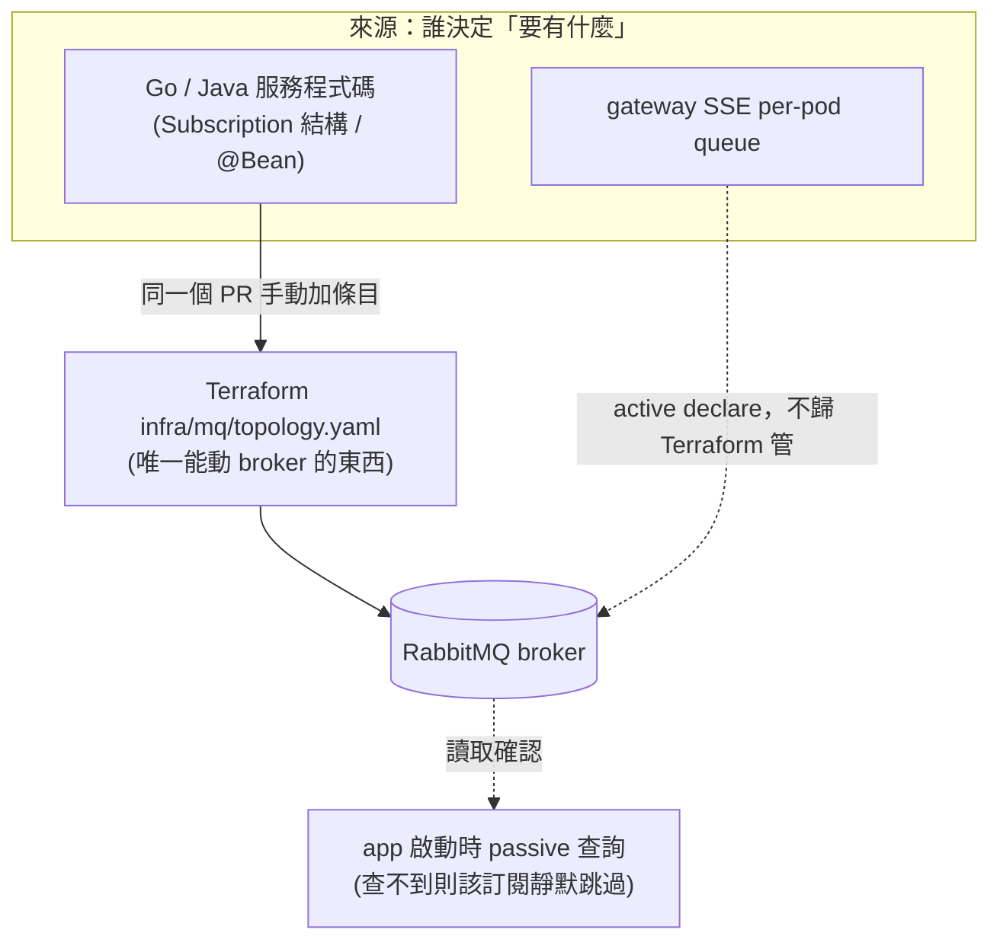

# MQ Topology 管理（Terraform）

> 現況（作品集轉 public 步驟 2，D7）：公司時期的部署環境設定已刪除——`infra/mq/envs/{dev,prod}`、`mq-topology.yml` 等部署 workflow、`monitoring/` 的 prod exporter 與 `prod-infra.json`、image-gateway 的 dev／production 環境與 custom domain、website／admin 的 `wrangler.jsonc` env 區塊。下文提到這些的部署、plan／apply 與環境操作段落是公司時期的歷史紀錄，不是現行流程；部署設定等選定 demo 部署目標時重寫。

RabbitMQ 的 exchange / queue / binding 現在怎麼新增、修改、刪除。

> 操作速查：`infra/mq/README.md`
> 本檔為 topology 佈建的最終權威。
> 決策紀錄：wiki backend-payuni `decisions/2026-07-24-mq-topology-terraform-centralization`
> 相關：[Prod RabbitMQ 3-Node Cluster](Prod%20RabbitMQ%203-Node%20Cluster.md)、事件契約 SSOT
> [36 MQ 與事件總覽](../詳細設計書/36-MQ%20與事件總覽（MQ%20%26%20Event%20Catalog）.md)、流程
> [MQ 與事件管理規範](../開發規範/MQ%20與事件管理規範.md)

## 背景

2026-07 之前，topology 由 ~20 個服務各自在啟動時 auto-declare（Go `pkg/mq` 的
`ResilientConsumer`、Java Spring 的 `@Bean Declarables`），沒有集中定義。後果是
dev/prod 反覆不一致：queue args 不可變更、跨環境的手動 ops 漏跑（issue #1625：
6 條 prod queue 靜默 406 五天）、程式碼刪掉訂閱後 broker 仍殘留 binding 無人清。

現在收斂成「單一定義，dev/prod 都由它經 CI/CD 部署」。

## 核心規則

**應用程式不能再建立 topology，只能查詢它是否存在。**

開了 passive 開關之後，Go / Java 服務啟動時走的是 `QueueDeclarePassive` /
`ExchangeDeclarePassive`——查得到就開始消費，查不到就跳過該筆訂閱（服務不會掛，
但那條訂閱靜默失效）。真正建立資源的只有 `infra/mq/` 的 `terraform apply`。

| 開關 | 位置 | 作用 |
|---|---|---|
| `MQ_PASSIVE_DECLARE=true` | `k8s/values/overlays/<env>/common.yaml` | Go：`pkg/mq/resilient.go` 的 `passiveDeclare()` 開關與 `connectAndConsume` 內的 declare 分支改走 passive（**錨用符號名不用行號**——原記的 `:106,214-223` 已漂到無關的程式碼） |
| `SPRING_RABBITMQ_DYNAMIC=false` | `k8s/values/overlays/<env>/java-common.yaml` | Java：關掉 `RabbitAdmin` 自動宣告 |

**舊規則已作廢**：「每個 `@RabbitListener` 必須有 `@Bean Queue`/`Binding`、服務必須能在全新
RabbitMQ 上自行啟動」不再成立。`@Bean` 保留為**意圖宣告**（讓人看得出這個服務想消費什麼），
不再實際佈建；由應用程式自建 topology 現在是**明令禁止**。

### 失效時看得到什麼（唯一線索）

查不到 queue 時服務**不會 crash、訊息不會進 DLQ**（連 queue 本身都不存在），那條訂閱就是靜默失效。

- **Go**：在**每次連線／reconnect 的當下**印一行
  `[MQ][ERROR] skipping queue X (NOT consumed)`，之後全程無聲。錯過那一瞬間就沒有第二次機會。
- **Java**：行為待坐實，**不要假設同樣靜默**。
- **特例（反而看得見）**：某服務**全部** subscription 都查不到 queue 時，會回
  `no consumable subscriptions` 並進 reconnect 迴圈——這種會持續刷 log。

## 展開規則（policy → 資源）

`topology/topology.yaml` 是人維護的**宣告式**清單，實際送給 broker 的攤平資源由展開
規則產生（269 條宣告 → 556 條資源）。**這一節是展開規則的權威出處**：規則在兩處各自
實作——`infra/mq/tools/expand.py`（Python，供 CI 的 drift 比對與單元測試）與
`infra/mq/topology/main.tf` 的 `locals`（HCL，供 Terraform 真正佈建）。兩邊不一致時
以本節為準；一致性由容器 e2e（`terraform plan` 必須 no-op）把關。

`retry:` 與 `dlq:` **互斥**，同時宣告會被 `validate.py` 與 `expand.py` 擋下。
`{queue}.retry`／`{queue}.dlq`／DLX binding 全部由展開自動產生——**不要手寫這些衍生資源**
（唯一合法的手寫例外：共用 DLQ 的**目的地** queue、以及少數自建 retry queue，它們是
`topology.yaml` 內既有的裸條目；改之前先看清楚你動的那條屬於哪一種）。

**條目格式**（完整寫法見 `infra/mq/README.md` §新增/修改queue）：

```yaml
exchanges:
  - name: <exchange>          # 只有 name + type 兩個欄位
    type: topic
queues:
  - name: <queue>
    bindings:
      - { exchange: <exchange>, key: <routing.key> }
    retry: { max_attempts: 3 }              # Go 框架重試（與 dlq: 互斥）
    # dlq: { via: <X>.dlx, queue: <共用DLQ>, routing_key: <rk> }   # broker 原生死信，Java 為主
```

### 1. 裸 queue（無 policy）

只產出 queue 本身與它自己的 bindings，不衍生任何東西。共用 DLQ 的目的地
（`aftersales.events.dlq`、`payment.rescue.refund.dlq`、`dlq.product.import.*`）都是這種
條目——**它們不會被任何 policy 自動生成，必須自己列一條**。

### 2. `retry: {max_attempts: N}`（Go retry 框架）

給 `pkg/mq` 在 `MaxRetries > 0` 時用的形狀，一條宣告展開成 6 類資源：

| 產出 | 內容 |
|---|---|
| exchange | `{Q}.retry`，**fanout** — 毒訊息的重試不會扇出到共用同一 routing key 的其他 queue |
| binding | `{Q}.retry` → `Q`，routing key 空字串 |
| exchange | `{Q}.dlx`，**fanout** |
| queue | `{Q}.dlq` |
| binding | `{Q}.dlx` → `{Q}.dlq`，routing key 空字串（fanout 唯一出口）|
| queue arguments | `x-dead-letter-exchange` = `{Q}.dlx`。**沒有** `x-dead-letter-routing-key` |

**`{Q}.dlx` 是只綁 `{Q}.dlq` 的 fanout**，與 `{Q}.retry` 同形、理由相同：fanout 不看
routing key，所以「死信跑進別人的 DLQ」在構造上不可能發生，不是靠約定。DLX 的名字由
**queue** 推導，所以一條 queue 綁幾個 exchange、幾條 routing key 都與死信路由無關，
也不需要事先宣告任何 `.dlx`。不變式由 `test_expand.py` 的 `TestDLQIsolationInvariants` 守住。

dead-letter 參數由展開注入，**不要手寫進 `arguments:`**（`validate.py` 會擋）。手寫等於
替同一個值開第二個真相來源，而且改了也不會生效。

Go 端正常失敗路徑是自己 republish 到 `.retry`、不靠 broker；但重試耗盡後「直投 `{Q}.dlq`
失敗」時會 `Nack(requeue=false)` 把訊息交回 broker（`resilient.go` 的
`handleHandlerError`），那條 fallback 需要 base queue 掛著 DLX 才不會丟訊息。

⚠️ **Go 側 `Subscription.MaxRetries > 0` 的 queue，topology 條目就必須帶 `retry:`**。
framework 會 passive 檢查 `{queue}.retry` exchange 是否存在（`resilient.go` 的 `ExchangeDeclarePassive(RetryExchangeOf(...))`），
而該 exchange **只由 `retry:` policy 展開產生**。只寫 `- name:` 不帶 `retry:` 的後果是
**本機驗證綠、CI 綠、上線整條 subscription 被 skip**——`mq-consumer-registration-check.py`
只驗「queue 名有登記」與「retry queue 有人消費」兩件事，**不驗 code 的 `MaxRetries`
↔ topology 的 `retry:` 這層耦合**。

### 3. `dlq: {via: X.dlx}`（broker 原生 dead-letter，Java 服務為主）

注入 queue arguments：`via` → `x-dead-letter-exchange`，`routing_key`（選填）→
`x-dead-letter-routing-key`。再依 `queue` 欄位分兩種：

- **未指定 `dlq.queue`**：產出 `{Q}.dlq` 與 binding `X.dlx` → `{Q}.dlq`
  （routing key = `{Q}.dlq` 全名）。此時 **`routing_key` 必須是 `{Q}.dlq`**，否則死信
  帶著原 routing key 進 `X.dlx`、沒有 binding 命中就靜默丟棄（`validate.py` 會擋）。
- **指定 `dlq.queue`（共用 DLQ）**：**不產出**任何 queue 或 binding，該 queue 必須以
  上面第 1 種裸條目自己存在（具名 DLX 的還要自帶 `X.dlx` → 自己的 binding）

⚠️ **這條路徑維持共用 DLX，不改成 per-queue fanout**。Java 服務用 Spring 的
`RabbitAdmin` **主動宣告** queue 並在 `QueueBuilder` 裡硬寫
`x-dead-letter-exchange`／`x-dead-letter-routing-key`（例：`RabbitMqConfig.java`）。
Terraform 若把 args 改成別的值，Spring 啟動時 declare 會撞
`406 PRECONDITION_FAILED - inequivalent arg`，整個服務起不來。要改這半邊，
必須與 Java 端同批修改。Go 那半沒有這個約束，因為它在 dev／prod 走
`MQ_PASSIVE_DECLARE=true`，passive declare 只驗存在、不驗 args。

`via: ''`（空字串）是合法值，代表 RabbitMQ 的 **default（無名）exchange**——它靠
routing key 直接比對 queue 名稱來路由，不需要具名 DLX 也不需要 binding。5 條
product-import queue 是這個形狀，來自活的 definitions export，**不是漏填**。

### 4. `args_json: true`

`arguments` 含非 string 值（例如 `x-message-ttl: 10000`）的 queue 走 Terraform 的
`arguments_json` 而非 `arguments`——provider 的 `arguments` 是 `map[string]string`，
數字型參數只能走 JSON 那條。目前 6 條。

### 進 Terraform 前的閘門

`infra/mq/tools/validate.py`（CI 的 `validate` job，gate 住 `terraform` job）擋的是
plan 看不出來的那一類錯誤：未宣告的 exchange / DLX（→ apply 404 + partial apply）、
policy 子物件的拼字（→ 靜默不注入 args → 死信靜默丟棄）、以及畸形 YAML。
`test_expand.py` 另外把真實 `topology.yaml` 的展開數量 pin 住，抓 `expand.py` 的 drift。

## 兩種來源，一個出口



### 1. 程式碼宣告的服務（多數情況）

6 個 Go 服務（buyer / crm / im / notification / seller / social，即使用
`pkg/mq.ResilientConsumer` 者）＋ 10 個 Java 服務。改 code 的同一個 PR 裡要手動
把對應條目加進 `infra/mq/topology/topology.yaml`（宣告式寫法見下方「新增 / 修改 queue」）。

`notification-service` 一度是例外——它的 queue 由 `notification_templates` 資料表的
`queue_name` 欄位決定，人工維護的 `topology.json` 追不上，只好靠產生器重放 migration
自動同步。2026-07-25 改成「每個來源 exchange 一條 queue、queue 清單寫在程式碼」之後，
那層耦合消失，它現在跟其他服務一樣走這條路徑；細節見下方「notification-service 的
queue 粒度」。

### 2. gateway 的 SSE queue（例外，不歸 Terraform 管）

`gateway.sse.<pod-hostname>`，per-pod、auto-delete、隨 pod 生滅，本質上就是要動態建立的
東西。走 `gateway/internal/mq/consumer.go` 自己的 active declare，跟 `pkg/mq` 無關，
不受 passive 開關影響。`check_unmanaged.py` 的 `IGNORED_QUEUE_PREFIXES` 明確排除它。

## 日常操作

### 新增 / 修改 queue（程式碼宣告的服務）

1. 改服務的 `Subscription{}` / `@Bean`，**同一個 PR** 裡加 `topology/topology.yaml` 條目
   （宣告式寫法見上方「展開規則」的條目格式）。**漏了＝上線即靜默失效**，比舊時代的
   「啟動失敗」更難發現。
2. PR → `.github/workflows/mq-topology.yml` 對 dev + prod **各跑一次** `terraform plan`。
   ⚠️ **輸出在該 run 的 Step Summary，不是 PR 留言**——要自己點進去讀。
3. Deploy (K8s) 透過 `workflow_call` 呼叫 MQ Topology，指定本次 branch 對應的單一環境，plan／destructive gate／apply 成功才 rollout。每次部署都重新斷言 topology；MQ Topology 不再獨立監聽 push，避免兩個 apply owner。PR plan、nightly 雙環境 drift 與人工 apply 維持不變。拓撲失敗會阻止部署並進入 deploy failure 通知；不得在 topology 未完成時先啟動新增 consumer。

4. Review → merge 到 `dev`（push `dev` → CI 自動 apply dev）→ promote `main`
   （push `main` → CI 自動 apply prod）
5. 服務 rollout 時 passive 查到資源存在，正常消費

**CI 是唯一 apply 路徑**：**禁止本機對 dev/prod 跑 `terraform apply`**（本機只能跑下方的唯讀驗證）。

### apply 完成後訂閱不會自癒

服務**只在啟動／reconnect 時 declare**，先前被 skip 掉的 subscription 不會自己恢復；
而純 topology 的 PR 也不會重啟任何 pod。所以 apply 之後要自己確認：

```bash
# 該 queue 的 consumers 必須 ≥ 1
kubectl exec -it <rabbitmq-pod> -- rabbitmqctl list_queues name consumers | grep <queue>
```

仍為 0 就 `kubectl rollout restart deployment/<service>`。這是**讓純配置生效**，
不是繞過 CI/CD 部署 code（沒有 image 變更）。

### 本地唯讀驗證（push 前跑）

⚠️ 兩條命令的 **cwd 不同**：

```bash
# 1) topology 靜態驗證 + 展開單元測試（cwd = infra/mq/tools）
#    首次需 python3 -m pip install -r infra/mq/tools/requirements.txt
(cd infra/mq/tools && python3 validate.py --topology ../topology/topology.yaml \
  && python3 -m unittest discover -p 'test_*.py')

# 2) consumer 登記雙向檢查（cwd = repo root）
python3 scripts/mq-consumer-registration-check.py
```

第 2 支做雙向比對：Go 用到的 queue 名都要登記、帶 `retry:` 的都要有人消費。它比對的是
**字串字面值**——queue 名要出現在 `pkg/mq/exchanges.go` 常數或 `.go` 字面值裡才算被消費。

### 新增 / 修改通知 template

寫 Atlas migration 改 `notification_templates`，**這樣就好**——不需要動 topology。

queue 是「每個來源 exchange 一條」且以 `#` 綁定，所以只要該 exchange 已經在
`notificationQueueByExchange`（`worker/consumer.go`）裡，新 template 用什麼 routing key
都會被收到。只有引進**全新的來源 exchange** 才需要同時加 map 條目與 topology 條目，
而那種情況會被建置期測試擋下（見下方）。

### 刪除 queue

🔴 **順序：先把「不再訂閱」的 code 部署上去，才 apply 刪除。**

反過來做＝把 queue 從一個還連著的 consumer 底下抽掉。服務**不會 crash**，而是走完
下面這條鏈（`pkg/mq/resilient.go`，行號可自行覆核）：

| # | 發生什麼 | 位置 |
|---|---|---|
| 1 | queue 消失 ⇒ 該訂閱的 deliveries channel 關閉，`for msg := range msgs` 跳出 | `:313`→`:322` |
| 2 | `Run` 收到 `delivery channel closed for queue X` 而返回 ⇒ **整個 consumer 重連** | `:344`→`:189` |
| 3 | 重連時逐筆 `QueueDeclarePassive`，被刪那筆拿到 404 | `:233` |
| 4 | 該筆被跳過，**其餘訂閱正常恢復**（declare 走 per-subscription disposable channel） | `:488`／`:217-222` |

結果：與「新增時漏登記 topology」完全同一個失效模式，只是從刪除方向來的——
**服務健康、`/metrics` 正常、其他訂閱都在跑，只有那一條永遠不再消費**。
唯一線索是重連當下那行 `skipping queue X (NOT consumed)`。

1. 移除 code 裡的訂閱 ＋ 從 `topology.yaml` 移除條目 → **同一個 PR**
2. merge → 等 **deploy 完成**（服務確實跑到不再訂閱的版本，用內容定址 tag 對帳）
3. 確認該 queue `consumers = 0`（命令見上方「apply 完成後訂閱不會自癒」）
4. 才 dispatch `allow_destructive=true`

⚠️ **步驟 2 的 push 會讓本 workflow 變紅，那是正常的。** push `dev`/`main` 會依
`paths: infra/mq/**` 自動觸發 apply 模式，plan 算出 destroy，Destructive gate `exit 1`
（見下方）。**不要去「修」那個紅**——gate 正在做它該做的事，它就是在等你走完步驟 3
再手動 dispatch。跨環境 promote 尤其容易誤判：dev 早就 apply 過了，promote 到 `main`
時才輪到 prod 算 destroy，紅燈會在**看似無關的那次 promote** 上出現。

把條目從 `topology.yaml` 移除（template 則是在 migration 裡 DELETE 該筆 row，
產生器輸出會自然少掉）。`terraform plan` 會算出 `destroy`，**Destructive gate 會擋下**，
不會自動 apply。**改 queue 的 `arguments` 也算 destructive**——plan 會顯示
`must be replaced`，而 replace ＝ **先刪後建**，queue 內未消費的訊息一起消失。
人工審查 plan 後，用 `workflow_dispatch` 帶 `allow_destructive=true` 重跑，挑低峰時段。

🔴 **命令必帶 `--ref`，且 ref 與 env 對齊**：

```bash
gh workflow run mq-topology.yml --ref dev  -f env=dev  -f allow_destructive=true
gh workflow run mq-topology.yml --ref main -f env=prod -f allow_destructive=true
```

workflow 的 `actions/checkout` **沒有 `ref:`**（用觸發 ref，而 gh／UI 的預設是 `main`），
`decide` job 也**不驗 ref ↔ env 是否對齊**。所以**從 `main` 派 `env=dev` 會拿 main 版
topology 去覆蓋 dev、把 dev-only 的 queue 全部 destroy**——而 `allow_destructive=true`
正好關掉了唯一會擋住它的 gate。同模式事故：2026-07-13 dispatch 未帶 ref 打到 prod。

⚠️ Destructive gate 只在 apply 模式（push 到 `dev`/`main`、或 `workflow_dispatch`）跑。
PR 階段是 plan 模式，只把 plan 貼進 step summary，**含 destroy 也不會讓 CI 變紅**——
要自己讀 plan summary，別靠綠燈。

### 有人手動在 broker 上建了東西

Terraform 不知道它存在，不會主動處理。每天台北時間 04:20 的 nightly drift job 用
`check_unmanaged.py` 掃一次，抓出「broker 上有、但不在 `topology.yaml`（CI 用 `expand.py`
即時展開後）裡」的資源並報錯。
這是**事後補漏**不是即時阻擋，且目前只查 queue/exchange，不查 binding。

## notification-service 的 queue 粒度

這個服務的 queue 一度切到「每個通知型別一條」：77 筆 template 開出 64 條主 queue
（`aftersales.events` 一個 exchange 就 37 條），連同 dlq/retry 佔用 132 queue + 94
exchange——是當時全 cluster 51% 的 queue、77% 的 exchange。

那個粒度買不到它宣稱的故障隔離：所有 queue 都由同一個服務、同一條 connection、同一個
channel 消費，而 head-of-line blocking 早就被 `pkg/mq` 的 ack+republish 重試機制在**訊息
層級**解掉了。它真正的代價是 `queue_name` 這個無約束欄位讓「新增一筆資料」隱含「必須
佈建一條 queue」——#1795 就是這樣發生的。

2026-07-25 改為**每個來源 exchange 一條 queue**（13 條），對照表在
`services/notification-service/internal/worker/consumer.go` 的 `notificationQueueByExchange`：

- **綁定用 `#`**：template 用到還沒被綁過的 routing key 也收得到，這是「新增 template =
  零基建變更」成立的必要條件。收到沒有 template 的事件會在查表未命中後直接 ack，
  **不解析 payload**，成本極低。單一 exchange 若日後太吵，可單獨收緊為字面綁定——
  per-exchange 可逆，不影響資料表設計。
- **dispatch 依 `(exchange, routing_key)`**：買家版/賣家版原本是兩條 queue 各收一份同樣的
  訊息，現在合併成一次投遞、查表回傳兩筆 template，handler 迴圈處理。行為等價，投遞量減半。
- **`queue_name` 欄位已完全移除**（2026-07-26，三階段退場）：Phase A 停止寫入與 API 曝露
  （`notification.proto` field 3 改 `reserved`）、Phase B `DROP COLUMN` + index、Phase C
  admin 前端移除表單欄位。dev/prod 皆已生效。

### 建置期防線

`worker/consumer_test.go` 的 `TestNotificationQueuesExistInTerraformTopology` 直接讀
`infra/mq/topology/topology.yaml`，逐條核對 `notificationQueueByExchange` 裡每個
exchange 是否宣告為 `topic`、對應的 queue 是否存在、該 queue 是否帶
`retry: {max_attempts: 3}` policy、以及 exchange→queue 的 `#` binding 是否存在。

`.dlq` 佇列、`.retry` 與 `.dlx` 兩個 fanout exchange、dead-letter 參數、retry/DLQ 兩條 binding 不再逐一
斷言——`retry:` policy 的存在即保證這五項會被展開產生，該保證由
`infra/mq/tools/test_expand.py` 的 policy-expansion 與 DLQ 隔離不變式單元測試、round-trip
等價驗證、以及 classic/quorum 兩種 queue type 皆已容器驗證過的 `terraform plan` no-op
共同守住。

**這是取代舊 codegen 的機制，而且更根本**：codegen 是「自動同步」，這是「不同步就編不過」。
passive declare 對缺 queue 完全不會報錯（訂閱根本不存在、也不進 DLQ），這個測試是唯一
能讓它在上線前現形的地方。

另外 `worker/di.go` 除了 template 驅動的訂閱，還手動 append 了兩個靜態訂閱
（`buyerDeletedSubscription` / `accountDeletedSubscription`，個資法清除用）。它們有自己的
queue，跟上面 13 條無關，改動時一樣要同步 `topology.yaml`。

## 環境現況

| 能力 | Local（OrbStack） | dev | prod |
|---|---|---|---|
| app 啟動時能建立 queue/exchange | **能**（不設 passive flag，仍由 app 自建） | 不能（passive，只能查） | 不能（passive，只能查） |
| topology 的實際 ownership | app 自建 | Terraform 單一來源 | Terraform 單一來源 |

本機因此**跑不到** Terraform 那條路徑，只能跑上面「本地唯讀驗證」的兩支腳本。

dev 已於 2026-07-25 切換完成並驗證（17 筆 Go 靜態訂閱 + notification 動態 template +
Java 服務，queue consumer 數皆 ≥1）。

prod 同日切換完成（PR #1814 → promote #1815），21 服務全數部署並驗證：consumer
98→98 零減少、全服務 log 零 passive/AMQP 錯誤。切換前對當時仍在服務的舊單機 broker
做過唯讀 pre-flight，確認 `topology.json` 的 159 queues / 72 exchanges 零缺口，才敢在
cutover 之前就先開——這讓維護窗只剩「切 Endpoints + 重啟」一個變因。
**「單一 ownership」現已在兩個環境都成立。**

⚠️ **驗證這類遷移要比 consumer 總數，不要比 queue 總數。** cutover 時 prod 的 queue 數是
**287 → 159**，那不是缺漏：舊單機 broker 上有 128 條 notification 粒度重構前的孤兒 queue
（0 訊息 0 consumer，從未進 `topology.json`），新 cluster 刻意沒有它們。詳細判準見
[Prod RabbitMQ 3-Node Cluster](./Prod%20RabbitMQ%203-Node%20Cluster.md) 的 cutover 驗證步驟。
（本段原記為「287→287 零消失」，與該 runbook 矛盾，2026-07-26 訂正——照錯的版本驗證會把
預期的 queue 數下降誤判成掉資源，反而可能觸發不必要的 rollback。）

## 已知缺口

- **登記 gate 只掃 Go**：`.github/workflows/static-gates.yml` 的「MQ consumer ↔ topology 登記一致性」step 對 Go 的 queue 名
  ↔ `topology.yaml` 做雙向檢查，**Java consumer 漏登記沒有任何 CI 攔得住**——review 必須人工查。
- **新增 consumer 的 PR 沒有機制強制同步 `topology.yaml`**（Java 側尤其）：passive declare 下，
  broker 上不存在的 queue 會 404、該筆 subscription 靜默失效——不會進 DLQ，因為連 queue 本身都不存在。
  2026-07-25 的 issue #1795 就是這樣踩的：`crm.aftersales.refund.completed` 這條新 queue 因為
  晚於 topology 快照匯出才 merge，退款事件在 dev 完全沒進 crm-service。
- **required status check 只有一項，而且只護 `dev`**：repo ruleset `core-gates`
  （`enforcement: active`、`bypass_actors: []`）只作用於 `refs/heads/dev`，required check 僅
  「靜態檢查總表」一項——上一條的 Go 登記 gate 正是 `static-gates.yml` 這支 job 裡的一個 step，
  所以它紅了確實擋得住 merge 進 `dev`。但**其餘 workflow 紅了不擋 Merge 按鈕**，`mq-topology.yml`
  的 plan job 也不在 required 清單內；**`main` 沒有任何 ruleset**。要讓更多 gate 有約束力，
  得在 repo settings 把對應 job 加進 `core-gates` 的 required status checks。
  查證：`gh api repos/<org>/backend-payuni/rulesets`。⚠️ `gh api .../branches/dev/protection`
  回 404 是舊式 branch protection API 的預期結果，**不是**「沒有保護」的證據。
- **drift 偵測不查 binding**：`check_unmanaged.py` 只比對 queue/exchange，手動加的野 binding
  兩邊都抓不到。
- **`MQ_DISCORD_WEBHOOK_URL` 未設定**：drift 目前只反映在 CI job 失敗，沒有主動推播。

## 緊急後門

CI 全掛時可用 `rabbitmqadmin` 手動操作，但事後必須補回 `topology/topology.yaml`，並確認
下一次 nightly drift 歸零。

`topology.json`（checked-in 的攤平 JSON）已於 2026-07-26 隨 CI 遷移到 `topology.yaml`
一起移除。若需要從 broker 現況重建宣告式 YAML（例如上面這種手動操作後的補救），走：
broker definitions export → `infra/mq/tools/definitions_to_topology.py` →
`infra/mq/tools/fold.py` → `topology.yaml`。

## 名詞

- **passive declare**：AMQP 的 `QueueDeclarePassive` / `ExchangeDeclarePassive`，查詢資源
  是否存在，不存在就回錯誤，**不會嘗試建立**。跟一般 declare（不存在就建）相反。
- **DLX / DLQ**：dead-letter exchange / queue。訊息重試耗盡後的去處，命名規則
  `{exchange}.dlx` / `{queue}.dlq`，由 `pkg/mq` 框架在 `MaxRetries > 0` 時自動宣告。
- **retry exchange**：`{queue}.retry`，per-queue 的 fanout exchange。handler 失敗時
  重新發布到這裡，讓毒訊息的重試不會扇出到共用同一 routing key 的其他 queue。
