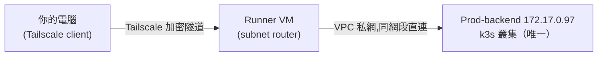

# Tailscale VPN 連線 Prod 機器指南

> 現況（作品集轉 public 步驟 2，D7）：公司時期的部署環境設定已刪除，`monitoring/` 的 prod exporter 與 `prod-infra.json` 都已不在 repo。下文提到它們的段落是公司時期的歷史紀錄，不是現行設定。

## 文件資訊

| 項目 | 值 |
|---|---|
| 狀態 | active |
| 版本 | v1.0 |
| 維護者 | Will |
| 最後審閱日 | 2026-07-10 |
| 相關文件 | 系統架構與資料流向.md、系統監控架構（Monitoring）.md |

## 概覽

Prod-backend / Prod-infra 已在 2026-07-10 把 SSH、DB、k8s API 這些管理用途的 port 對公網關閉，只留客戶流量用的 80/443。**之後要連 prod 機器（SSH 進去查、連 DB、跑 kubectl）一律透過 Tailscale**，不能再用公網 IP + 密碼直接連。

> `kubectl` 只對 **Prod-backend（`172.17.0.97`）**——那是 prod 唯一的 k3s 叢集。
>
> 🔴 **Prod-infra（`192.0.2.115`）已整台停機除役**（Zeabur `vmStatus: STOPPED`）。它連不上是正常的，不是網路或 Tailscale 的問題。原本的監控 exporter 角色已遷為 Monitoring VM（`203.0.113.10`）上的容器。



Runner VM 是唯一的 subnet router，advertise 整個私網 CIDR `172.17.0.0/18`。Prod-backend / Prod-infra 本身**沒有裝** Tailscale client——因為所有 VM 本來就在同一個扁平 VPC，Runner VM 天生連得到，只要它幫忙轉發就夠了，不用逐台裝。

---

## 第一部分：加入 tailnet

### 1. 跟 Will 要邀請

Tailscale 是邀請制，先跟 Will 要邀請連結（他在 [Tailscale admin console](https://login.tailscale.com/admin/users) 加你）。免費版限 3 人，加人前先確認額度還夠。

### 2. 安裝 Tailscale

- **Mac**：`brew install --cask tailscale`，或 [tailscale.com/download](https://tailscale.com/download)
- **Windows / Linux**：官網下載安裝檔；Linux 也可 `curl -fsSL https://tailscale.com/install.sh | sh`

### 3. 登入

```bash
tailscale up
```

跳出的網址用瀏覽器打開，登入 Will 邀請你的帳號、按 Connect 授權這台裝置。`tailscale status` 應該會看到自己跟 Runner VM 都在列表裡。

---

## 第二部分：連線範例

| 機器 | 私網 IP | 用途 |
|---|---|---|
| Prod-backend | `172.17.0.97` | **prod 唯一的 k3s 叢集**（v1.32.4，namespace `hawkr`）：k8s API、SSH |
| ~~Prod-infra~~ | ~~`192.0.2.115`~~ | 🔴 **已停機除役**。exporter 遷至 Monitoring VM 容器（`hawkr-prod-postgres-exporter`／`hawkr-prod-sql-exporter`）；Redis 遷至 `203.0.113.11`、RabbitMQ 改 3-node cluster（皆 2026-08-01）；k3s 於 2026-08-02 移除 |

```bash
# SSH 進 Prod-backend（帳密另外跟 Will 要，不寫在這份文件）
ssh root@172.17.0.97

# kubectl 直接打 prod API（API server 在 Prod-backend；Prod-infra 沒有 k8s，別打過去）
kubectl --kubeconfig ~/.kube/prod-config get pods -n hawkr

# SSH 進 Prod-infra 看 exporter（這台只有 docker，沒有 kubectl）
```

---

## 架構決策：為什麼選 Tailscale

| 選項 | 為什麼沒選 |
|---|---|
| 阿里云 VPN 網關 | 要另外起 VPN Gateway 資源 + 設定，比 subnet router 重 |
| 自架 WireGuard | 要自己管憑證/金鑰輪替，維運成本高於免費版 Tailscale |
| Bastion + SSH ProxyJump | 每次連線都要跳板，且只解 SSH，DB/k8s API 存取仍需另外處理 |
| **Tailscale subnet router**（選用） | 免費（3 人內）、單一節點（Runner VM）就能涵蓋整個 VPC，不用碰 Prod 機器本身、ACL 管理集中在一個 console |

---

## 已知風險與待辦

| 項目 | 嚴重度 | 說明 / 緩解 |
|---|---|---|
| ~~iptables 規則是 runtime 狀態，未持久化~~ | ✅ 已解決 | 2026-09-05 覆核：`netfilter-persistent` 已 `enabled`，`/etc/iptables/rules.v4`／`rules.v6` 存在，且存檔內含管理面 `--dports 22,6443,10250` 的 DROP 規則。**改規則後必須 `netfilter-persistent save`**，否則重開機仍會回退成存檔版本。⚠️ Prod-backend 自 2026-04-20 開機至今未重開機，持久化路徑尚未經過真實重開機驗證 |
| Tailscale coordination server 是第三方（SaaS） | 中 | 只有 P2P 資料走 WireGuard 直連，control plane 經過 Tailscale 自己的伺服器；在意的話可評估自架 headscale |
| 免費版 3 人上限 | 低 | 加第 4 人需升級 paid tier |
| 🔴 **踩坑**：`tailscale up` 即使帶 `--accept-dns=false`，仍可能把 `tailscale0` 介面註冊成 systemd-resolved 的 `+DefaultRoute`（但不掛任何 DNS server），導致該機器 DNS 查詢間歇性、最終 100% 失敗 | 高 | 只在 Runner VM 上發生過一次（GitHub self-hosted runner 因此全部掉 offline，CI 卡住不推版）。**修法**：`resolvectl revert tailscale0`，重測 DNS 解析穩定後即恢復。這是 runtime-only 修復，tailscaled 重啟/重新協商可能再犯，之後遇到同症狀（該機器所有對外服務忽然連不上，但直接打 IP 正常）先查 DNS |

---

## 疑難排解

**連不上 172.17.0.97？**（`192.0.2.115` 已停機，連不上是預期的）
1. `tailscale status` 確認自己跟 Runner VM 都顯示在線
2. `tailscale ping 172.17.0.97` 測路由是否通
3. 去 admin console 確認 subnet route 有被 approve

**這台機器（尤其是 Runner VM 這類本身也要對外連線的機器）所有服務忽然連不上，但用 IP 直接打（不經 DNS）正常？**
→ 見上方「已知風險」的 DNS 踩坑，先跑 `resolvectl status <tailscale介面>` 確認是不是又被標成 `+DefaultRoute`，是的話 `resolvectl revert <該介面>`。

---

## 變更紀錄

| 日期 | 版本 | 變更 | 作者 |
|---|---|---|---|
| 2026-07-10 | v1.0 | 初版：Runner VM 當 subnet router，Prod-backend/Prod-infra 收回公網 SSH/DB/k8s API | Will |
