# 系統架構與資料流向

> 現況（作品集轉 public 步驟 2，D7）：公司時期的部署環境設定已刪除，`monitoring/` 的 prod exporter 與 `prod-infra.json` 都已不在 repo。下文提到它們的段落是公司時期的歷史紀錄，不是現行設定。

> **用途**：Hawkr 整體系統的網路拓撲、部署架構與資料流向的單一真相來源（SSOT）。由上而下分層（C4 model：Context → Container → Component），讀者可依需求停在對應深度。
> **最後核實**：2026-07-13（依當時 `k8s/`、ingress、Cloudflare 設定與實際 code；媒體儲存段落依 [49 號設計書（多媒體儲存與圖片服務／Cloudflare R2 & Image Gateway）](../詳細設計書/49-多媒體儲存與圖片服務（Cloudflare%20R2%20%26%20Image%20Gateway）詳細設計書.md) 同步）
> **維護**：架構異動時更新本頁並更新「最後核實」日期。本頁與既有 `基礎建設/` 各專題文件互補（CDN、監控、CI/CD 細節見各自頁，本頁負責「全貌與串接」）。
>
> **資料來源 / 核實**（各段可信度不一，依此判斷信任度）：
> - §2 邊緣 / §3 部署 / 資料層拓撲：**live cluster endpoint + `docker ps` + DNS 實查**（2026-06-28；§3 Redis/RabbitMQ/PostgreSQL 段落 2026-08-01 重核，PostgreSQL 修正為 PlanetScale——原文寫 Alibaba RDS 已是遷移後的舊資訊）— 信任高
> - §4 服務清單：`k8s/values`（`serviceType`）；**RabbitMQ exchange：prod broker live 核**；gRPC 呼叫圖：`services/*/internal/client` code 靜態讀（**非 live trace**，可能有遺漏）
> - §4 gateway 內部 / §5 資料流：gateway 與各服務 code trace
> - §6 觀測 / CI/CD：既有 `基礎建設/` 專題文件 + `docker ps` 確認容器存在

**章節**：§1 系統概覽（Context）｜§2 網路 / 邊緣層拓撲｜§3 部署拓撲（Container）｜§4 應用層架構（Component）｜§5 資料流向｜§6 橫切關注｜§7 環境對照表｜§8 相關文件

---

## 1. 系統概覽（Context）

Hawkr 是生鮮電商平台，由 **5 個前端 / App 介面**對接**單一後端閘道（Gateway）**，閘道後方是 Go / Java 微服務群、訊息佇列與資料層，並串接多個第三方服務（金流、物流、OAuth、物件儲存）。

### 對外角色與依賴

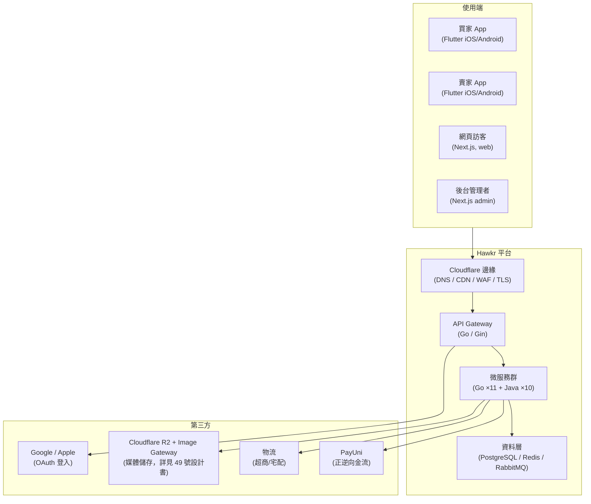

### 環境與網域對照

| 環境 | 用途 | 前端網域 | 後端網域（API / WS） | App VM（k3s） |
|---|---|---|---|---|
| **prod** | 生產 | `example.com` / `www`、admin（皆 CF Workers） | `api.example.com` | `198.51.100.10` |
| **dev** | 開發 / 測試 | `web-dev.example.com` | `test-api.example.com` | `203.0.113.20` |
| **local** | 本機開發 | `localhost:3000` | `test-api.example.com`（直連） | — |

> 三環境的「瀏覽器→API」連線路徑因內容封鎖器議題而不同，詳見 §2「三環境連線路徑」。

---

## 2. 網路 / 邊緣層拓撲

所有對外流量都先進 **Cloudflare 邊緣**（DNS 代理 / CDN / WAF / DDoS / TLS 終結），再回源到各自的 origin。

### 2.1 DNS 與 Cloudflare

- **註冊商**：GoDaddy；**權威 DNS 已委派 Cloudflare**（NS：`dante.ns.cloudflare.com` / `penny.ns.cloudflare.com`），zone = `example.com`。
- **代理模式**：對外子網域皆 orange-cloud（A 記錄 Proxied），流量經 Cloudflare Edge。
- **TLS**：**Full (Strict)** + Cloudflare Origin Certificate（15 年）；邊緣對使用者用 CF 憑證，CF 對 origin 用 Origin Cert 驗證。
- **WAF / Rate Limit**：Cloudflare Managed + OWASP Core Ruleset；速率限制 API 100 req/min、登入 5 req/min、驗證碼 3 req/min。
- **快取**：線上實際只有三條 cache rule（admin 動態路徑 bypass、圖片副檔名 zone-wide 長快取、一條寫壞從未生效的 well-known bypass）。
  **API 沒有明確的 bypass 規則**，是靠 CF 預設不快取非可快取型別。
  逐條內容、已知缺陷與重建指令見 `k8s/external-services/cloudflare/cache-rules.md`（SSOT）。
- **Zone 配置 SSOT**：Ruleset 與 DNS 不由 CI 部署，快照與稽核在 `k8s/external-services/cloudflare/`
  （治理規則見《Cloudflare Worker 與 Serverless 部署治理規範》§5）。

### 2.2 子網域對照

| 子網域 | Origin / 指向 | 說明 |
|---|---|---|
| `example.com` / `www` | Cloudflare Workers（OpenNext；詳見 53 號設計書） | 買家與賣家網頁（C 端），已從 VM Docker 遷移至 Workers |
| `api.example.com` | prod App VM Traefik → gateway:9900 | 生產 REST + **WebSocket（wss）** |
| `test-api.example.com` | dev App VM Traefik → gateway:9900 | 開發 REST + WebSocket |
| `web-dev.example.com` | Cloudflare Workers（OpenNext；詳見 53 號設計書） | 部署版 dev 網頁 |
| `cdn.example.com` | **已退役（2026-08-07）**：DNS CNAME 記錄已刪除（權威 NS 實查無解析；原值留檔 `.claude/tmp/dns-cleanup-20260807/cdn-record-before.json` 可回建）。退役順序依 10 檔 §27 走完：① 五個 repo 停止組出本網域、prod HTML 實測零 cdn ② OSS bucket 側停用（origin 直打 403）③ 才刪 DNS。⚠️ 刪除後短期內 `https://cdn.example.com/...` 可能仍回 200，那是 CF 邊緣快取（實測 `cf-cache-status: HIT`、`age` 約 2.5 天）與遞迴解析器的 DNS 快取，不代表記錄還在。| 儲存已遷 R2、`public/defaults/{seller_cover,seller_logo,buyer_avatar}.png` 三檔在 R2 prod/dev bucket 皆 sha256 一致（2026-08-06 實測）。前端已於 backend#2283 停止組出本網域（殘留命中全為「入站 allowlist / 歷史值還原」路徑），刪 DNS 前仍須依 10 檔 §27：先降級觀察 → 確認 OSS bucket 側停用 → 才刪 DNS，原值留檔。見 49 號設計書 §12.2 步驟 8 |
| `media.example.com` | Image Gateway Worker（Cloudflare Workers，R2 binding） | 公開圖片唯一出口（`/i/{preset}/{objectKey}`，詳見 49 號設計書） |
| `dev.example.com` | **退役中**：CNAME → `web-dev.example.com`（proxied；2026-07-30 由原 Zeabur 目標 `tpe0.cname.zeabur-dns.com` 降級改指）＋ CF Redirect Rule **301 → `web-dev`**（保留 path＋query） | 已不再有流量進 Zeabur。降級後一度所有路徑回 CF 522（`web-dev` 是 Workers custom domain 的 `AAAA 100::` 黑洞、Worker routes 未綁 `dev.`），已於同日以 Redirect Rule 消除，現行為＝301 轉址（`-L` 追下去 200）。五個 repo 已 grep 確認無任何引用。**尚未刪 DNS**：需先有 Zeabur 帳號的人把網域從 Zeabur 專案移除（該 hostname 仍在被 Zeabur 的 acme-challenge 探測），否則網域釋出後可被他人在 Zeabur 綁走；DNS 刪除時一併刪掉該 Redirect Rule。步驟與 301/302 取捨實測見 `k8s/external-services/cloudflare/README.md` 與 `redirect-rules.md`（backend#2024） |

### 2.3 Cloudflare Workers

部分網域由 Cloudflare Workers 處理（同一 CF 帳號 zone）：

| Worker | Route | 用途 |
|---|---|---|
| `api-first-party-proxy` | `example.com/api/v1/*`、`www.../api/v1/*`、`web-dev.../api/v1/*` | **第一方同源反代**：把網頁同源 `/api/v1/*` 轉發到對應 gateway（prod→`api`、dev→`test-api`），規避內容封鎖器把 `api.` 子網域當第三方擋下。host-aware 單一 Worker 同時服務 prod + dev。 |
| ~~`hawkr-router`~~ | — | **已退役（2026-07-28，#1907）**：`/sitemap*` 反攔截了網頁 Worker 原生的 sitemap、`/s/*` 為零引用死功能 |
| `hawkr-apple-pay-domain` | `example.com/.well-known/*`、`api.../.well-known/*`、`test-api.../.well-known/*` | Apple Pay 網域驗證檔（2026-07-30 實測三條 route） |
| `hawkr-admin-prod` / `-dev` | admin 網域 | 後台 admin（OpenNext on Workers，非 VM） |
| 買家與賣家網頁（web，OpenNext） | `example.com`、`www.`、`web-dev.example.com`（頁面路由） | **買家與賣家網頁 SSR/ISR**：Next.js on Cloudflare Workers（`@opennextjs/cloudflare`），純 ISR + R2 incremental cache + DO tag/queue/purge；已從 VM Docker 遷移（詳見 53 號設計書） |
| `workers/image-gateway` | `media.example.com/*` | 公開圖片唯一出口：preset 白名單→R2 binding 取原檔→Images binding 轉換（詳見 49 號設計書） |

> Workers 免費方案上限 10 萬 req/天（全帳號共用，目前用量 ~3% 餘裕大）。

### 2.4 三環境「瀏覽器 → API」連線路徑（重要）

因內容封鎖器會擋跨子網域的 `api.` 請求，prod 已改為**同源第一方反代**；三環境路徑如下：

| 環境 | 瀏覽器實際打 | 路徑 |
|---|---|---|
| **prod** | `example.com/api/v1/*`（同源） | → CF → Worker `api-first-party-proxy` → `api.example.com` → Traefik → gateway |
| **部署版 dev** | `web-dev.example.com/api/v1/*`（同源） | → CF → 同一 Worker → `test-api.example.com` → gateway |
| **本機 dev** | `localhost:3000/api/*`（同源） | website 的 route 代行，轉到本機單體 `localhost:8080`；不經 Worker |

> 現況：本機與 Playwright 都走同源反代，沒有部署版 dev；上表 prod 與部署版 dev 兩列是公司時期的部署。App（買賣家）打本機單體。

> **單體接手入口之後（遷移計畫 A2，2026-09-27）**：上表與 §2.3 是公司時期的部署。入口改成單體之後，第一方反代要轉兩個前綴到單體：`/api/connect/*` 去掉前綴轉到單體的根目錄（Connect 的 `/{service}/{method}`），`/api/v1/*` 原樣轉送（還沒搬進單體的 REST 由單體轉給 gateway）。web 的登入由 Clerk 處理，瀏覽器的請求以 `Authorization: Bearer` 帶 Clerk 的 session token；Clerk 的 `__session` cookie 落在網頁的 host，同源的導覽（例如發票 PDF 的下載）靠它（ADR `backend/docs/adr/2026-09-27-identity-clerk.md`）。網頁這一側的對應在 `website/lib/connect/transport.ts`（`FIRST_PARTY_CONNECT_PATH`）；本機開發與 Playwright 由 `website/app/api/connect`、`app/api/v1` 的 route 代行。部署設定還沒建，隨部署階段一起做。

### 2.5 邊緣拓撲圖

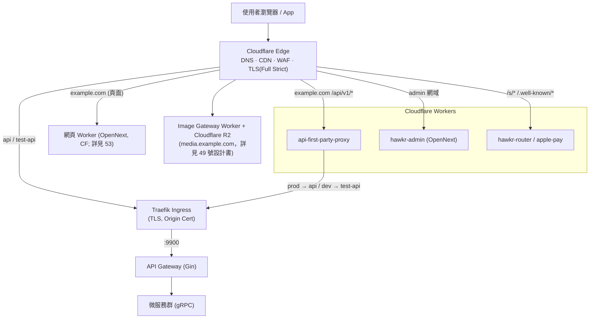

---

## 3. 部署拓撲（Container）

系統跑在 **3 類運算環境**：Cloudflare Workers（邊緣 + 網頁/admin SSR）、VM（監控 + dev 資料層）、k3s 叢集（後端微服務），加上 **dev Infra VM**（dev Redis + RabbitMQ + PostgreSQL）、**prod 專用資料層主機**（Redis 獨立主機、RabbitMQ 3-node cluster）、**集中監控 VM**、**PlanetScale**（PostgreSQL）與 **Cloudflare R2**（媒體儲存，詳見 49 號設計書）。**k3s 叢集每個環境各一套、各只有一個節點**（prod = Prod App VM／Prod-backend、dev = Dev App VM）。買家與賣家網頁（web）已從 VM Docker 遷移至 Cloudflare Workers（OpenNext，詳見 53 號設計書）。

### 3.1 什麼跑在哪

| 元件 | 執行環境 | 說明 |
|---|---|---|
| 買家與賣家網頁（web） | **Cloudflare Workers**（OpenNext；prod `example.com` / dev `web-dev.example.com`）| 已從 VM Docker（`next start`）遷移至 Workers；純 ISR + R2 incremental cache + DO，詳見 53 號設計書 |
| 後台 admin | **Cloudflare Workers**（OpenNext）| 已從 VM/Docker 遷移至 Workers |
| API Gateway + 微服務 ×21 | **k3s 叢集**（App VM）| Traefik ingress → gateway:9900 → gRPC 內部服務（ClusterIP） |
| PostgreSQL | dev：Dev-infra VM `203.0.113.10` ／ prod：**PlanetScale（`db.example.com`，見 #1772）** | 各服務獨立 DB（`hawkr_account`、`hawkr_order`…）；prod 走內建 PgBouncer pooler（6432），migration 才用 direct 5432 |
| Redis | dev：`203.0.113.10` ／ prod：**獨立主機 `203.0.113.11`**（2026-08-01 起，公網 + iptables 限來源） | **dev / prod 各自獨立** |
| RabbitMQ | dev：`203.0.113.10` ／ prod：**3-node cluster（`198.51.100.98/99/100`）** | **dev / prod 各自獨立**；舊單機 `192.0.2.115` 上的 broker 已於 2026-08-01 刪除，rollback 到單機的路徑已失效（見 `Prod RabbitMQ 3-Node Cluster.md`） |
| 監控（LGTM + OTel）| **集中監控 VM `203.0.113.10`**（docker-compose）| OTel Collector / Prometheus / Loki / Tempo / Grafana / AlertManager（dev + prod 共推） |
| 媒體儲存 | **Cloudflare R2**（`hawkr-media` bucket，S3 相容 API；詳見 49 號設計書） | 公開讀取經 Image Gateway Worker → `media.example.com` |

### 3.2 VM / 主機清單

| 主機 | IP | 角色 |
|---|---|---|
| Prod App VM（Prod-backend） | `198.51.100.10`（私網為 `172.17.0.97`，依 `k8s/values/overlays/prod/gateway.yaml` 與 `k8s/external-services/networkpolicy.yaml` 的 prod node IP 對照推得，非直接實測） | **prod 唯一的 k3s 叢集**（v1.32.4，namespace `hawkr`），接 Cloudflare 流量，21 微服務；prod 的 `kubectl` 一律對這台 |
| Dev App VM | `203.0.113.20` | k3s 叢集（dev/stage） |
| 監控 / Dev-infra VM | `203.0.113.10` | LGTM 監控棧、Discord 告警 gateway、dev PostgreSQL / Redis / RabbitMQ（**買家與賣家網頁已遷 CF Workers，不再跑於此台**）|
| ~~Prod-infra VM~~ | ~~`203.0.113.50`（私 `192.0.2.115`）~~ | 🔴 **已停機除役**（Zeabur `vmStatus: STOPPED`）。exporter 角色遷為 Monitoring VM 上的容器（`hawkr-prod-postgres-exporter`／`hawkr-prod-sql-exporter`），Prometheus 無任何指向 `192.0.2.115` 的 target。Redis 遷至 `203.0.113.11`、RabbitMQ 改 3-node cluster（皆 2026-08-01）；k3s 於 2026-08-02 移除 |
| Prod Redis VM | `203.0.113.11` | **prod：Redis**（獨立主機，公網 + iptables 只放行 App VM 來源） |
| CI Runner / Admin | `198.51.100.40` | GitHub Actions self-hosted runner |

### 3.3 叢集內部

- **Ingress**：Traefik（`className: traefik`），僅 gateway 對外（`api`/`test-api` → gateway:9900，TLS 終結用 Origin Cert）；其餘 20 個微服務皆內部 ClusterIP、無對外 ingress。
- **NetworkPolicy**：`deny-cross-namespace`——Ingress 白名單限同 namespace（`hawkr`）pod + kube-system(Traefik)，Egress 不限。
- **部署策略**：預設**零停機 rolling update**（`maxUnavailable=0` / `maxSurge=1`）、preStop sleep 5s + 30s grace；**但 chart 的 `strategy` 區塊（含 `type`）可被逐服務覆寫**（`k8s/charts/hawkr-service/templates/deployment.yaml`），目前只有 `im-service` 不吃預設，覆寫成 `maxUnavailable=1 / maxSurge=0`（有狀態、連線不可分裂，`k8s/values/im-service.yaml`）。**prod 預設 `replicas: 1`**（`k8s/values/overlays/prod/common.yaml:4`），只有 5 支被 per-service overlay 覆寫成 **2 ＋ PDB**：`cart` / `gateway` / `order` / `payment` / `payuni-webhook`（`k8s/values/overlays/prod/*.yaml`）。**全叢集無 HPA** ⇒ 副本數只由這幾個檔案的 PR 改變。判定排程搶佔緊急度時以此為準，見[多副本排程搶佔規範 §〇](../開發規範/多副本排程搶佔規範.md)。
  - ⚠️ **上面那條「rolling update 期間有兩個 pod」對某一類排程不是誤差而是資料損毀。** 候選集合每輪重算、沒有搶佔閘門的 **level-triggered reconcile**（規範新增的[第四種形狀，§七](../開發規範/多副本排程搶佔規範.md#七第四種形狀level-triggered-reconcile候選集合每輪重算)）正確性完全建立在「同時只有一個寫者」上，因此 `replicas: 1` **必須**配 `strategy.type: Recreate`，而且要有 CI 斷言守著。從本節連過去審排程時，先確認手上那支屬於哪一種形狀——六步搶佔判準對 level-triggered 沒有對象。
- **外部依賴接法**：Redis/RabbitMQ/dev-PostgreSQL 走 k8s `ExternalName` Service + 手填 Endpoints 映射到 Infra VM；prod PostgreSQL 是例外，直接以 `DB_HOST` env 連 PlanetScale，不經 ExternalName。

### 3.4 部署拓撲圖

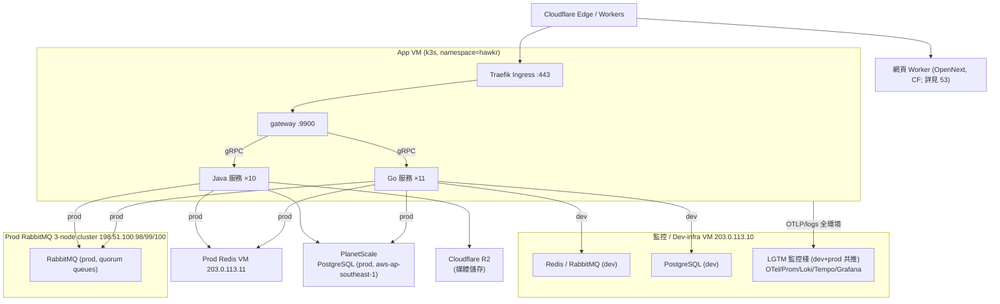

### 3.5 已知風險 / SPOF（集中表）

| 嚴重 | 風險 | 說明 | 狀態 / 緩解 |
|---|---|---|---|
| 🟠 | **`203.0.113.10` 單點（監控 + dev 資料層）** | 同台跑 全環境 LGTM 監控 + Discord 告警 + dev 資料層（PostgreSQL / Redis / RabbitMQ）。掛 → **兩環境觀測失明 + dev 全停**（prod 網頁已遷 CF Workers，不再受此台影響）| **買家與賣家網頁已完成 web→CF Workers 遷移移出此台**（原 🔴 prod 網頁下線風險已消除）；監控 / dev 資料層仍為單點，待拆分 |
| 🟠 | 監控集中單點 | dev/prod LGTM 同在 `203.0.113.10`；掛了兩環境一起失明 | 網頁遷 CF 後此台負載已降，監控拆分仍待規劃 |
| 🟠 | **media 孤兒檔洩漏** | `media.deleted/replaced` 事件未接線 + 刪商品不清媒體引用 → OSS 孤兒檔累積（見 §5 註） | latent bug，待修（接事件 or 同步清引用） |
| 🟡 | `seller.deleted` fail-silent | best-effort 非同步；RabbitMQ 故障時靜默 no-op → 已刪賣家商品不下架，只 WARN 無告警 | 選配硬化（MQ init 失敗應 fail-fast） |
| 🟡 | 同步下架 stub | `ForceOffShelfAllByMerchant` gRPC 仍 no-op stub（清理全靠事件） | 待補同步路徑 |
| ✅ | （已隔離）prod Redis/RabbitMQ | prod Redis 在 `203.0.113.11`、RabbitMQ 在 `198.51.100.98/99/100`（皆與 dev `203.0.113.10` 分開），無 dev 壓測波及 prod | 已隔離 |

---

## 4. 應用層架構（Component）

### 4.1 API Gateway（Go / Gin）

唯一對外入口，負責認證、限流、REST → gRPC 轉送、WebSocket 代理與統一回應格式。

**Middleware chain（全域，依序）**

| # | Middleware | 職責 |
|---|---|---|
| 1 | `Recovery` | panic 復原 → 500 |
| 2 | `Tracing` | OTel span、trace_id 生成 |
| 3 | `TraceLogger` | trace_id/span_id 注入 zap log |
| 4 | `HTTPMetrics` | Prometheus（請求數 / 延遲） |
| 5 | `Logger` | access log（敏感欄位遮蔽） |
| 6 | `CORS` | allowlist（env `CORS_ALLOWED_ORIGINS`） |
| 7 | `CSRF` | cookie 認證的變更請求需 Origin + X-Requested-With |
| 8 | `RateLimiter` | per-IP 100 req/s、burst 200 |

> 路由組再按需加掛 `JWTAuth`（強制）/ `OptionalJWTAuth` / `ChatWSAuth`。

**REST → gRPC 轉送**：handler 包裝模式（非 codegen 反向代理）。HTTP handler → 注入的 gRPC client → 轉成 `Envelope`。gRPC client interceptor 鏈：`AuthMetadata → EnvelopeGuard → CircuitBreaker`。

**認證 / Session / Cookie**
- **JWT**（App / Bearer）：HS256，claims = `AccountID / AccountType(位掩碼 1=buyer,2=seller,3=both) / LoginRole`。
- **Session cookie**（Web）：HTTPS 無 Domain → `__Host-hk_session`（HttpOnly / SameSite=Lax / Secure / Path=/）。Redis 查 session 800ms timeout，失敗降級 **L1 cache（stale-if-error，grace ~30s）** 保住登入。
- **X-Active-Role**：只有舊 REST、SSE、AI chat 與 chat ws-ticket 送的工作區提示；Connect 不送也不讀（ADR `2026-10-07-connect-without-perspective`）。單體入口把它連同帳號的角色推導成 `X-Login-Role`（提示 SELLER 而且帳號有賣家角色時是賣家，其他情況是買家，管理員沒有）再轉給舊 gateway，client 自己送的 `X-Login-Role`、`X-Active-Role` 一律不轉出。

**統一回應格式（Envelope）**：`{ code, message, messageZh?, data?, traceId? }`，定義於 `gateway/internal/response/response.go`。成功 `code=0 / message="success"`；業務碼錯誤帶 4 位 `code` + `messageZh`。

### 4.2 微服務清單與職責

**Gateway（Go）+ 6 個 Go 服務 + 10 個 Java 服務 + 單體**。帳號、買家、賣家、內容等能力在單體 `backend/cmd/hawkr` 的模組（`internal/modules/`），不在下表。

| 服務 | 語言 | 職責 |
|---|---|---|
| **gateway** | Go | REST→gRPC 路由、認證、限流、WS 代理、SSE |
| im-service | Go | 即時通訊、訊息投遞、在線狀態 |
| notification-service | Go | 推播、FCM token、通知偏好、模板 fan-out |
| social-service | Go | Post / Comment / Like / Forum |
| review-service | Go | 商品評論、評分、統計 |
| crm-service | Go | 客群標籤、促銷活動（多租戶） |
| ai-service | Go | 圖像增強 / 去背 / 放大 / 壓縮 |
| product-service | Java | 商品 CRUD、上架權限、收藏計數 |
| order-service | Java | 訂單生命週期（建立/取消/狀態） |
| payment-service | Java | 金流交易、付款狀態、PayUni 事件消費 |
| cart-service | Java | 購物車、訪客→會員合併、checkout 鎖 |
| coupon-service | Java | 優惠券領取/驗證/預留/扣減 |
| aftersales-service | Java | 售後、退貨退款、取消出貨 |
| shipping-service | Java | 物流貨態、超商/宅配出貨單 |
| media-service | Java | 媒體生命週期、上傳權限、Asset ID、Cloudflare R2 |
| payuni-webhook-service | Java | PayUni webhook 唯一入口（簽驗/解密/去重/可靠投遞） |
| product-import-service | Java | 商品批量匯入精靈（CSV） |

### 4.3 服務間通訊

**① gRPC（同步，來源：`services/*/internal/client` code，非 live trace）** — gateway 為 hub（呼叫全部服務與單體）；服務間以 **order-service 為最密集樞紐**：

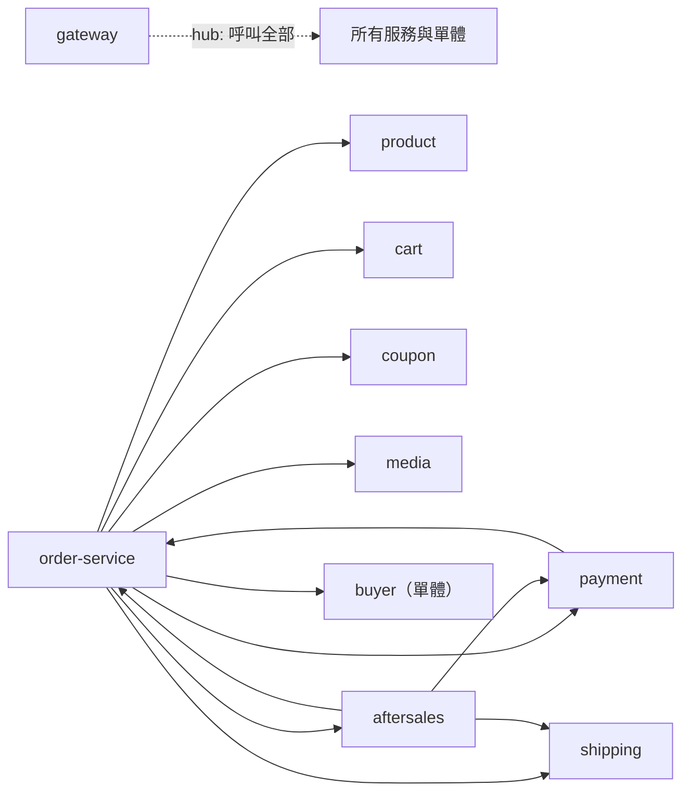

> 其他常見邊（account、buyer、seller 指單體模組）：social→{account,seller,buyer,product,review,im}；review→{order,buyer,media}。

**② RabbitMQ（非同步事件，✅ 2026-06-28 prod broker live 核）** — **15 個 domain exchange**（皆 topic + 各自 `.dlx` 死信）：`order / payment / shipping / notification / marketing / media / review / content / account / buyer / product / product.import / merchant / seller / im`。注意：`coupon` 只有 `.dlx`（券事件走 `marketing`）；code 定義的 `hawkr.delayed` 在 prod broker **未見專用 exchange**（待確認）。關鍵模式：

- **訂單金流鏈**：`payment.success` →(order 消費)→ `order.status=PAID`；`order.shipped/completed` →(marketing / buyer / im 消費)。
- **Fan-out**：`product.restock` → 單體 buyer 模組為每個訂閱者再發 `product.restock.target` → notification。
- **延遲事件**：付款逾時檢查（code `ExchangeDelayed`，x-delay）；prod broker 未見專用 exchange，實際機制待確認。
- **Gateway SSE**：gateway 建**每 pod 動態 queue** `gateway.sse.<hostname>`，綁 `comment.#`、`notification.inbox.new`、`notification.unread_changed`，auto-ack best-effort 推給連線中的 web 使用者。

---

## 5. 資料流向（Data Flows）

### 5.1 Web 請求（同源第一方反代）

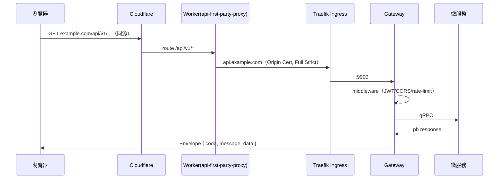

### 5.2 聊天 WebSocket（ws-ticket + HMAC 降級）

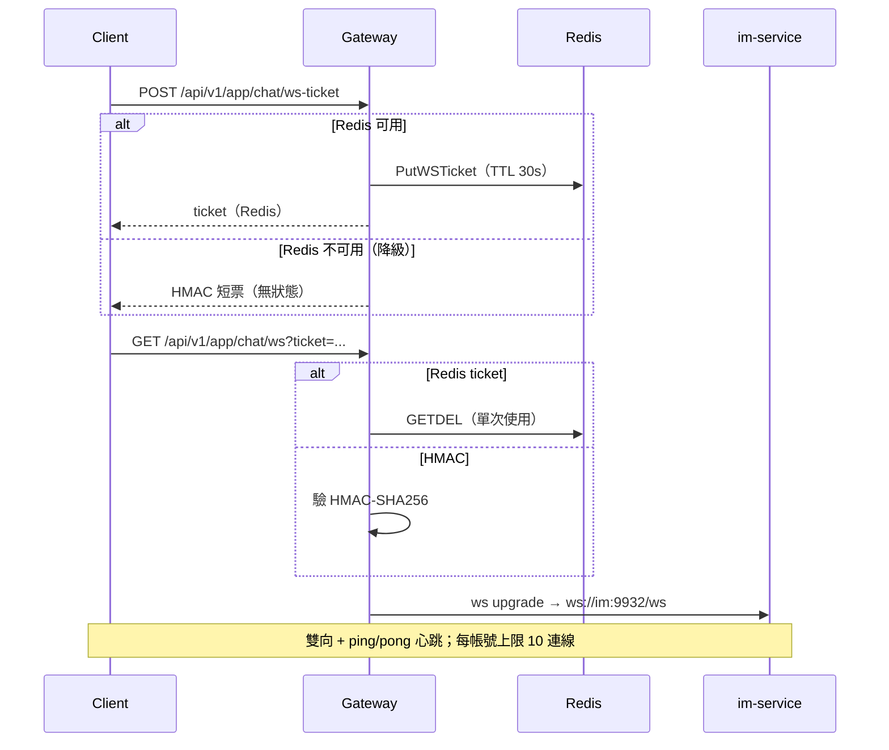

### 5.3 訂單建立

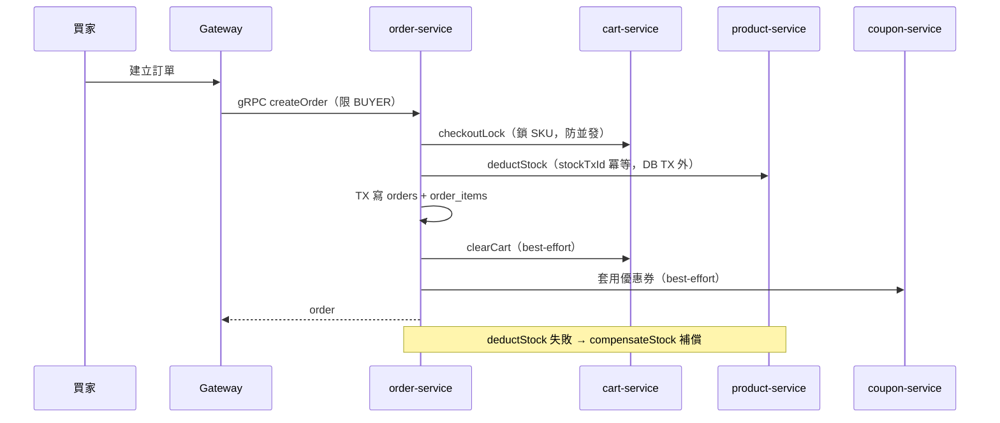

### 5.4 PayUni 金流 callback（Inbox / Outbox 可靠投遞）

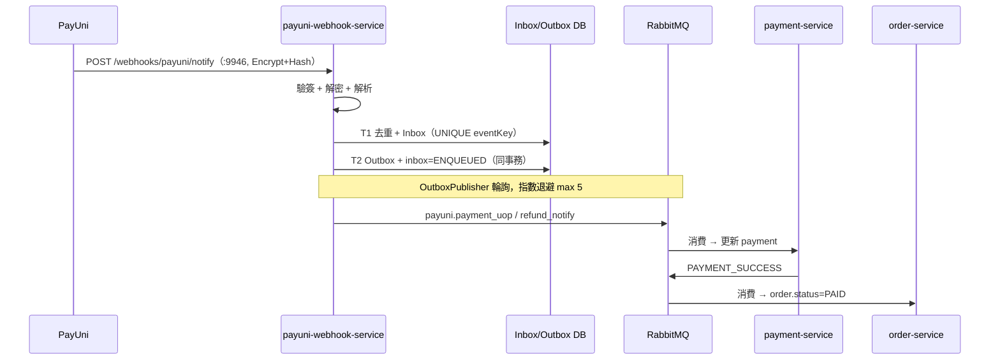

### 5.5 通知 fan-out（FCM + Web SSE）

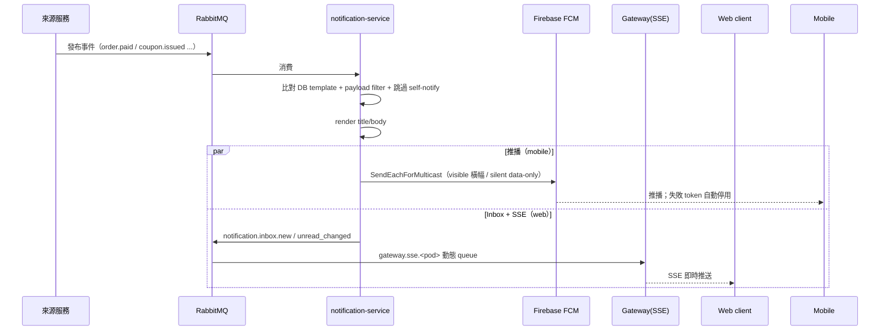

### 5.6 媒體上傳 + Image Gateway 讀取

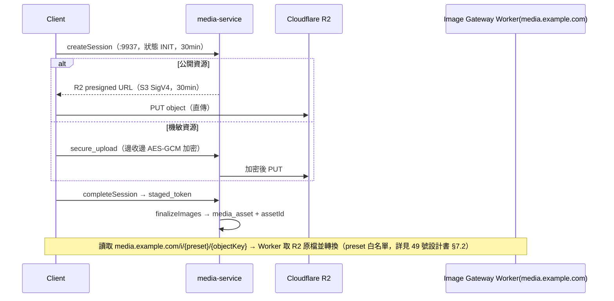

---

## 6. 橫切關注（Cross-cutting）

### 6.1 認證與授權

| 用戶端 | 憑證機制 | 角色 |
|---|---|---|
| 買 / 賣家 App | JWT（HS256，Bearer） | JWT `LoginRole` |
| Web（網頁） | Session cookie `__Host-hk_session` → Redis session（800ms + L1 stale-if-error） | 舊 REST／SSE 帶 `X-Active-Role` 提示，入口依提示與帳號的賣家角色推導 `X-Login-Role`，沒有提示是買家，伺服器不保存；Connect 不送不讀（ADR `2026-10-07-connect-without-perspective`） |
| 聊天 WS | ws-ticket（Redis GETDEL 單次 / TTL 30s）→ Redis 不可用降級 HMAC 短票 | 同上（ws-ticket 的 POST 帶 `X-Active-Role` 提示，視角寫進票） |
| Admin | （見 admin SSO，Google） | accountType 位掩碼 IsAdmin |

> 變更請求另有 `CSRF`（Origin + X-Requested-With）與 per-IP `RateLimiter`（gateway）+ Cloudflare 速率限制（雙層）。

### 6.2 可觀測性（LGTM + OpenTelemetry）

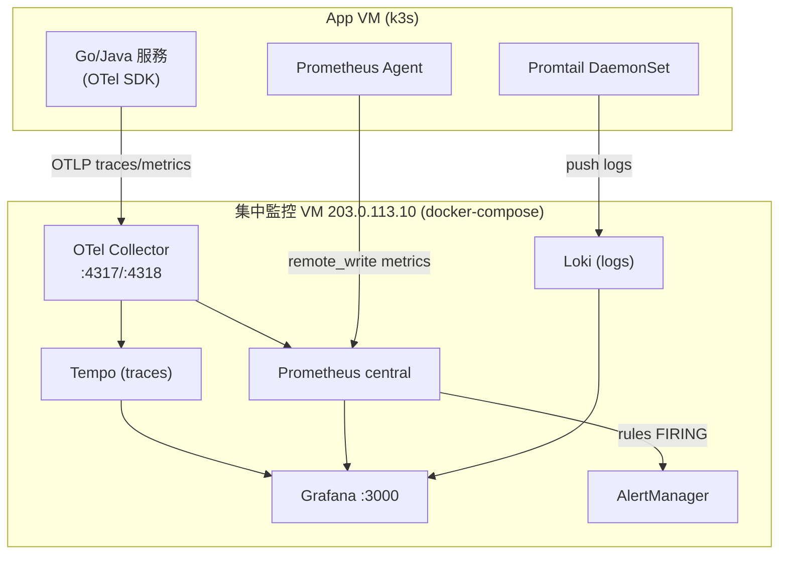

- **三支柱**：traces→Tempo、metrics→Prometheus、logs→Loki，Grafana 統一查詢。
- **Trace↔Log 互聯**：`trace_id`（W3C traceparent header + log JSON structured field）。
- **環境隔離**：label `env=dev/prod/monitoring` 貫穿全棧。
- **前端**：Sentry SaaS（org `hawkr-uw`，dev/prod 獨立 project）——網頁已接，admin Phase 2 已上；buyer/seller 待接。

### 6.3 CI/CD

GitHub Actions（self-hosted runner `198.51.100.40`）→ GHCR → Helm。後端 pipeline：

```
detect（Go/Java/Proto diff） → test（Go） → build（Java Maven Reactor + Go buildx）
  → push GHCR（matrix 並行，tag sha+latest） → migrate（atlas apply，Go 服務） → helm upgrade（Go 先 ~2-5s、Java 後 ~120s） → rollout 驗證
```

- **環境**：`main` → `KUBECONFIG_PROD`；`dev` → `KUBECONFIG_DEV`（新 push 取消舊 run）。
- **網頁 / admin 另有 pipeline**：網頁（web）與 admin 皆 → Cloudflare Workers（OpenNext / wrangler）；網頁快取分層與部署一致性詳見 53 號設計書。

### 6.4 安全

- **邊緣**：Cloudflare WAF（Managed + OWASP）、DDoS、TLS **Full (Strict)** + Origin Cert（15 年）、速率限制（API 100/min、登入 5/min）。
- **叢集**：`NetworkPolicy deny-cross-namespace`（僅同 ns + Traefik）；微服務無對外 ingress（ClusterIP）。
- **應用**：gateway per-IP 限流、JWT/HMAC secret、CSRF。
- **密鑰**：k8s Secret（`hawkr-r2`、`hawkr-google-oauth` 等；`hawkr-r2` 僅掛 media-service／product-import-service，詳見 49 號設計書 §8.5）；憑證 / 密碼不入本庫，見內部 runbook / `secrets/`。

### 6.5 告警

`Prometheus rules（service/infra/business）→ Alertmanager（label env 路由）→ Discord webhook`（prod 30min / dev 2h 重複；紅=FIRING、綠=RESOLVED）。另有 Discord slash bot（`/status` `/service` `/logs` `/errors` `/mq-*`）。
**缺口**：無 Email/SMS/on-call 排班。~~無外部 uptime 監控~~（2026-08-04 backend#2192 修正：**外部 uptime 已有** —— UptimeRobot 4 支 monitor 覆蓋 prod/dev 的 web + admin，見《系統監控架構（Monitoring）》§17.2）。**仍存在的盲點是另一個**：我方 canary（`hawkr-website/cloudflare/canary/`）連同告警發送全部跑在 Cloudflare 上，CF 外部 vantage 只掛 `workflow_dispatch` 非常態 → **CF 層自身故障時我方無告警**，此時只有 UptimeRobot 那層看得到。

---

## 7. 環境對照表

| 項目 | prod | dev | local |
|---|---|---|---|
| 網頁網域 | `example.com` / `www`（CF Workers） | `web-dev.example.com`（CF Workers） | `localhost:3000` |
| API 網域 | `api.example.com` | `test-api.example.com` | （直連 test-api） |
| 瀏覽器→API 路徑 | 同源 `/api/v1`→Worker→api | 同源 `/api/v1`→Worker→test-api | 直連 test-api（跨來源，同 site） |
| App VM（k3s） | `198.51.100.10` | `203.0.113.20` | — |
| Gateway | Traefik→gateway:9900 | 同 | 同（遠端） |
| PostgreSQL | PlanetScale（`aws-ap-southeast-1`） | Infra VM `203.0.113.10` | （連 dev） |
| Redis | **`203.0.113.11`** | `203.0.113.10`（dev-infra） | （連 dev） |
| RabbitMQ | **3-node cluster `198.51.100.98/99/100`** | `203.0.113.10`（dev-infra） | （連 dev） |
| Admin | Cloudflare Workers（OpenNext） | 同 | — |
| 前端 Sentry | prod project | dev project | — |

---

## 8. 相關文件（交叉連結）

| 主題 | 文件 |
|---|---|
| 邊緣 / DNS / TLS / WAF / 速率 | `基礎建設/Cloudflare CDN 與 DDoS 防護配置指南.md` |
| 觀測棧 / OTLP / 告警規則 | `基礎建設/系統監控架構（Monitoring）.md`、`監控架構完整教學 (Monitoring Architecture Guide).md` |
| CI/CD 細節 | `基礎建設/CI_CD 自動化部署（K8s + Helm）.md` |
| 告警 / Discord | `基礎建設/Discord 監控 Bot 設計書.md`、`Discord 告警通知設定指南.md` |
| 回應格式 | `開發規範/API 設計規範.md` |
| PayUni webhook | `詳細設計書/10-PayUni Webhook 服務詳細設計書.md` |
| 媒體儲存 / Image Gateway | `詳細設計書/49-多媒體儲存與圖片服務（Cloudflare R2 & Image Gateway）詳細設計書.md` |
| 網頁前端快取分層 / 版本一致性 | `詳細設計書/53-Web 前端快取架構與版本一致性（Web Frontend Cache & Deployment Consistency）詳細設計書.md` |


