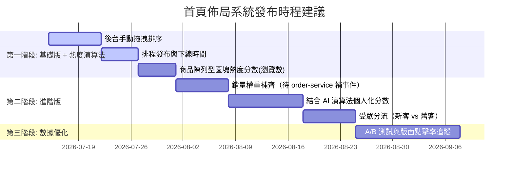

# 首頁動態區塊排序與營運干預系統：產品提案（PM 討論與決策專用）

## 1. 提案背景與商業痛點
目前平台首頁的版面區塊（例如 Banner、限時搶購、精選推薦）若為寫死或固定順序，會面臨以下商業運作痛點：
1. **行銷活動受限**：遇到特殊節慶（如中秋文旦、端午粽子）或颱風備貨期，營運無法在第一時間調整版面優先級，需依賴工程師修改代碼上線，錯失銷售良機。
2. **農產品生命週期短**：生鮮與農產品有嚴格的保鮮期與季節性，需要「高頻率且彈性」地銷貨（如某小農高麗菜盛產，需臨時將「盛產直銷區」置頂推廣）。
3. **轉換率無法最佳化**：沒有數據回饋，無法根據買家的點擊偏好動態調整區塊位置。

---

## 2. 產品目標 (Product Goals)
* **營運自主化**：提供後台界面，讓營運人員不需懂技術，就能「1 分鐘內」手動調整首頁所有版面區塊的排序。
* **數據與人為干預結合**：首頁由推薦算法負責個人化排序，同時允許營運人員「手動加權」或「強制置頂」特定區塊。
* **精準行銷**：支援區塊的「排程上/下線」與「受眾分流」（例如：新用戶看到新客專區，舊用戶看到回購推薦）。

---

## 3. 業界三大主流模式（請 PM 評估與決策）
為了讓 Hawkr 的農產品定位更鮮明，我們建議首頁可以結合以下三種模式的優勢。請 PM 評估我們現階段的商業重點：

| 模式名稱 | 首頁核心功能與排版 | 適合場景 / 商業優勢 | 運營成本 |
| :--- | :--- | :--- | :--- |
| **A. 產地直銷與小農故事流**  *(標竿：奧丁丁市集、CrowdFarming)* | • 產地地圖導覽 • 「小農專訪」與「耕作日誌」卡片 • 點擊進入獨立小農微店鋪 | **主打中高階、有機安心定位**。 建立強烈品牌信任，消費者願意為「故事與品質」支付溢價。 | **高**。 需要採訪小農、拍攝精美產地照與錄影。 |
| **B. 旬之味與訂閱箱流**  *(標竿：Farm to People、Riverford)* | • 「本週採收」動態清單 • 季節箱訂閱（單次/每週） • 食譜社群（買食材送食譜，或看食譜一鍵加購） | **主打高回購率、穩定家庭客群**。 解決生鮮損耗問題，農夫能預估產量。 | **中**。 需要定期更新當季食譜與蔬菜箱內容組合。 |
| **C. 社區團購與特惠折扣流**  *(標竿：美團優選、鄰鄉良食)* | • 依買家定位動態過濾商品 • 「特惠折扣」區塊 • 鄰里/社區團購拼單進度條 | **主打走量、清庫存、高敏捷銷售**。 能快速銷毀多餘產量，物流成本因集中配送而降低。 | **低**（平台端）。 但對供應鏈與在地團購點的營運要求較高。 |

### Hawkr 適配建議
根據目前平台已有的「精選小農」、「產地專區」等組件，建議 Hawkr **第一階段以模式 A（產地直銷故事流）為主軸，輔以模式 B 的「當季推薦」機制**。模式 C（社區團購）列入長期觀察，待配送網路成熟後再評估。

---

## 4. 前後台體驗願景 (User Experience)

### 前台買家體驗 (Buyer Web / App)
1. **流暢載入**：首頁區塊框架會立刻載入，具體產品隨後加載，不讓買家轉圈等待。
2. **地域安全感**：買家一進入會自動偵測地區（或提示輸入郵遞區號），首頁自動**隱藏**無法配送到該地區的小農區塊，避免買家選購完卻無法配送的挫折感。

### 後台營運體驗 (Admin Dashboard)
1. **拖拽排版 (Drag-and-Drop)**：營運可在後台列表，直接滑鼠拖動調整「優惠專區」、「蔬菜箱」、「精選小農」的相對順序。
2. **置頂設定 (Pin)**：可設定某個區塊「強制在第一位（例如首頁 Banner）」。
3. **加權設定 (Weight Boost)**：可為某個區塊加分（例如：演算法算出來它在第 5 位，但營運加了 50 分，它就被推到第 2 位）。此機制只對「商品陳列型」區塊有意義；「行銷/內容策展型」區塊（Banner、主打輪播、食譜靈感、推薦商家）本身沒有演算法分數，加權（或直接拖拽/置頂）是這類區塊唯一的排序手段。
4. **規則篩選器**：
   * **時間控制**：設定區塊於 `2026-07-20 00:00` 開始顯示，`2026-07-25 23:59` 自動消失（例如：中秋專區）。
   * **受眾控制**：設定特定區塊「僅新註冊用戶可見」。
5. **草稿與發佈流程 (Draft → Preview → Publish)**：
   * 營運在後台調整完排序後，版面進入「草稿」狀態，不會立刻影響買家看到的首頁。
   * 營運可點擊「預覽」按鈕，以買家視角檢視調整後的版面效果。
   * 確認無誤後，點擊「發佈」讓新版面正式上線。
   * 若發佈後發現問題，可一鍵「回滾」至上一個已發佈的版本。

## 5. 首頁區塊類型目錄 (Block Catalog)

以下為目前首頁已有的所有區塊，以及未來可擴充的區塊。營運人員在後台調整排序時，可操作的對象即為這些區塊：

### 現有區塊（已開發）

| 區塊名稱 | 說明 | 是否可排序 |
|---|---|---|
| 🔍 搜尋列 | 首頁頂部搜尋框與熱門搜尋詞 | ❌ 固定在最頂部 |
| 📂 分類導航 | 橫向分類標籤列（蔬菜、水果、海鮮…）與產地篩選 | ❌ 固定在搜尋列下方 |
| 🎠 主打輪播 | 商品輪播 + 社群貼文卡片組成的視覺焦點區 | ✅ |
| 🆕 新品上市 | 最新上架商品的橫向滑動列 | ✅ |
| 💰 優惠專區 | 正在特價中的商品列（依折扣幅度排序） | ✅ |
| 🌾 產地專區 | 標示產地的商品列 | ✅ |
| 👨🌾 推薦商家 | 精選小農 / 賣家卡片列 | ✅ |
| 🥬 蔬菜專區 | 依「蔬菜」關鍵字篩選的商品貨架 | ✅ |
| 🍎 水果專區 | 依「水果」關鍵字篩選的商品貨架 | ✅ |
| 🎋 季節 Banner | 當季主題促銷橫幅（目前為夏季水果季） | ✅ |
| 🦐 海鮮專區 | 依「海鮮」關鍵字篩選的商品貨架 | ✅ |
| 🥐 早餐專區 | 依「早餐」關鍵字篩選的商品貨架 | ✅ |
| 🍳 食譜靈感 | 當季食譜卡片格（有食譜資料時顯示） | ✅ |
| 🥩 肉品專區 | 依「肉品」關鍵字篩選的商品貨架 | ✅ |
| 🫙 職人加工 | 依「加工」關鍵字篩選的商品貨架 | ✅ |
| 🍽️ 週末餐桌 | 依「週末」關鍵字篩選的商品貨架 | ✅ |

### 未來可擴充區塊（尚未開發）

| 區塊名稱 | 說明 | 預計階段 |
|---|---|---|
| 📦 蔬菜箱訂閱 | 每週 / 每月蔬菜箱訂閱入口 | P2 |
| 🏷️ 優惠券領取 | 可領取優惠券展示區 | P2 |
| 🤖 為你推薦 | AI 個人化商品推薦（需 AI 服務支援） | P2 |

> **說明**：標記為「❌ 固定」的區塊（搜尋列、分類導航）不參與動態排序，永遠固定在首頁最上方。其餘標記為「✅」的區塊，營運人員可在後台自由調整其顯示順序、啟用/停用、以及上下線時間。

## 6. PM 待確認與對齊的產品規則 (Open Decisions)

為了讓團隊能準備首頁版面配置，請 PM 針對以下排版規則進行決策：

1. **區塊排序衝突時的防呆機制**：
   * *問題*：如果營運在後台手動將兩個區塊都設在置頂的「第 2 位」，系統應如何顯示？
   * *建議*：後台管理介面在儲存時應自動進行防呆驗證，不允許重複的位置；若真的發生衝突，預設以「更新時間最新」的區塊排在前面。
2. **首頁區塊的數量上限**：
   * *問題*：為了維持行動裝置的載入速度，是否需要限制首頁最多只顯示 N 個區塊？
   * *建議*：第一階段設定上限為 10-12 個區塊，避免首頁過長導致買家拉不到底部。
3. **預設首頁區塊組合 (Fallback Layout)**：
   * *問題*：當系統剛上線、或算法服務異常時，買家看到的預設首頁區塊順序為何？
   * *建議*：預設保底順序為：1. 主 Banner 區 -> 2. 商品類別入口 -> 3. 優惠專區 -> 4. 本週採收蔬菜箱 -> 5. 熱銷商品推薦。

---

## 7. 成功指標 (Success Metrics)

| 指標 | 定義 | 目標 |
|---|---|---|
| **營運效率** | 從「決定調整版面」到「買家看到新版面」的時間 | 從目前的「數天（需工程部署）」降到「5 分鐘內」 |
| **首頁點擊率 (CTR)** | 買家進入首頁後，點擊任一區塊進入商品頁的比率 | 上線後建立基準線，逐季追蹤 |
| **首頁跳出率** | 買家進入首頁後未點擊任何東西就離開的比率 | 上線後追蹤，目標逐步降低 |
| **區塊曝光深度** | 買家平均滑動到首頁第幾個區塊 | 追蹤以優化區塊數量上限 |

---

## 8. 階段發布計畫 (Phased Roadmap)

* **第一階段（上線目標：最快 2-3 週）**：不是純手動。「後台手動拖拽排序 + 置頂 + 時間排程」之外，商品陳列型區塊（新品、優惠、產地、各專區貨架，共 10 個）**同步就有簡單的熱度演算法**：用商品 7 日瀏覽數算熱度分數，跟營運手動加權融合排序（`FinalScore = 熱度分數 + 手動加權`）。這是業界冷啟動階段的標準做法（Amazon Best-Seller Rank、Shopee 熱銷榜同一套邏輯），不是等 AI 服務才有演算法。行銷/內容策展型區塊（Banner、主打輪播、食譜靈感、推薦商家）仍是純人工排序，這本來就該給營運策展空間。
* **第二階段**：先補銷量權重進熱度分數（需要 order-service 補一個帶商品明細的事件，目前只知道「哪張訂單完成」，不知道「訂單裡買了什麼」）；接著才是 AI 個人化 CTR 分數，取代熱度分數作為 `AlgoScore` 的來源，融合公式不變。
* **第三階段**：大流量後，開始對不同用戶展示不同版面（A/B Test），追蹤哪種排序的成交額 (GMV) 最高。
