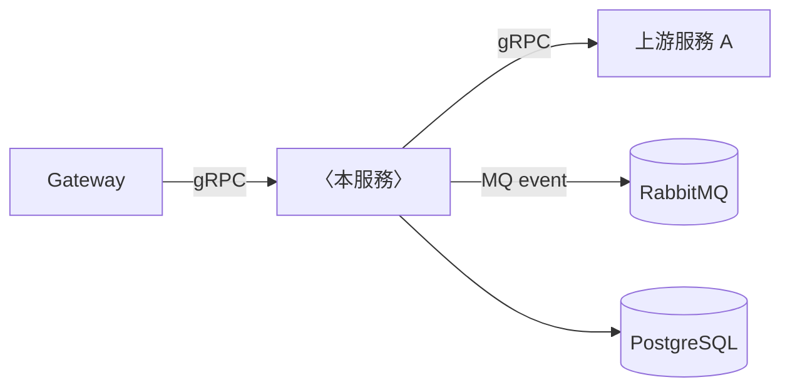
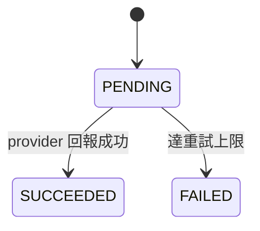
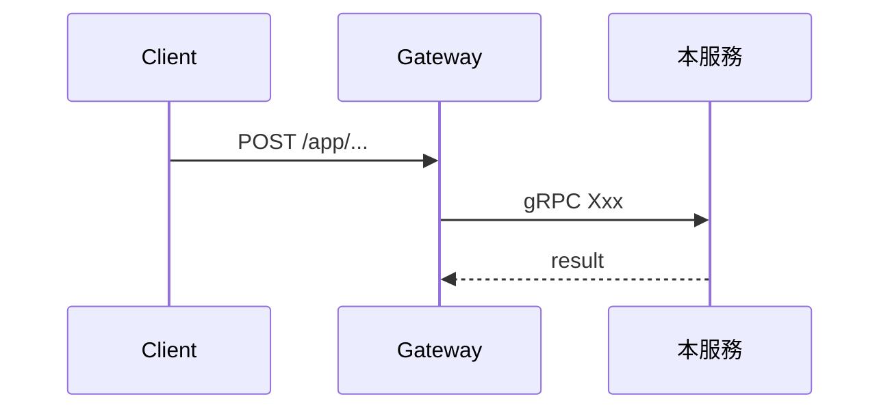

<!--
「後端服務／機能詳細設計書」標準範本。
複製本檔 → 改檔名為 `NN-<服務名>詳細設計書.md` → 逐章替換內容。

責任劃分的 SSOT：`docs/開發規範/設計文件治理規範.md`。
機械檢查：`python3 scripts/check-design-doc-purity.py`
-->

# 〈服務名〉詳細設計書（範本）

> **這份文件回答的唯一問題：`CURRENT HOW EXACTLY`。**
>
> 詳細設計書是 **Current Executable Specification** —— 它只描述**現在有效、
> 可直接拿來實作**的規格。一個沒跟過這個專案的實作者，照它施工就該做出對的東西。

> **怎麼用這份範本**
> - **章節骨架固定、不刪**：用不到的章節標 `> N/A（理由）` 而非刪除。骨架一致才能跨服務比較。
> - 每章開頭的 `> 引導` 區塊寫完請**刪掉**，只留實際內容。
> - 圖一律用 mermaid（C4 元件圖 / 時序圖 / 狀態圖）。
> - 語言繁中、team-facing，不留 AI 痕跡。

> **🔴 什麼不准寫進詳細設計書**
>
> 每一段動筆前先問兩件事：
>
> **① 這件事的真相住在哪裡？**
> - **住在 code／proto／schema／CI 設定裡** → 不要複述，給連結。目錄樹、檔案清單、
>   端點一覽、環境變數表、DDL 全文都屬此類；它們沒有 gate 守得住，寫進來就是排定時間腐爛。
> - **只住在人腦裡** → 這才是本文件的正文：必須恆真的不變式、外部強加的約束、
>   邊界、失敗語意、並發與冪等的保證。
>
> **② 這句話什麼時候會變成假的？**
> - 永遠不會（現在的契約） → 留在這裡
> - 會隨進度變假（做到哪了、誰在做、待某階段） → **Issue**
> - 已經是過去式（以前是 A、某某敘述已失效） → **git**（直接刪掉，只留現況）
> - 是一次性的判斷過程（那天查到什麼、命中幾筆、哪個 CI run） → **PR / review report**
> - 是「為什麼選這個設計、否決了什麼」 → **ADR**（`docs/adr/`），本文件只寫結論
>
> 逐字禁用清單（治理規範 §3.2）：`history`、`ADR`、`review evidence`、
> `progress tracking`、`Batch`／`WP`／輪次編號、`PR #`／`PM 裁決`／`Gate` 判定、
> `Changelog`／`變更紀錄`、`Roadmap`／`演進路線`、`Open Questions`／`未決問題`、
> 以及 `本輪`／`本波`／`下一輪`／`實作階段必辦`／`本設計階段不施作` 這類施工狀態。
>
> ⚠️ **規格改了就直接改成新的**。不要寫「原本是 A，現已改為 B」——
> git 已經保存 `A → B`，留一句考證等於要求每個讀者自己判斷哪句才算數。
>
> ⚠️ **遇到「尚未完成」先驗現況，不要直接開票**（治理規範 §7.1 truth-first）：
> 去看 code／DB／部署確認它**現在**還是不是真的 pending。仍 pending ⇒ 優先沿用既有
> issue、沒有才開新票，然後把進度敘述移除；已完成／已取代／已取消 ⇒ **不開票**，
> 直接把該節收斂成現在的規格。一律先開票會為早就做完的事建立大量假 issue。
>
> 驗收判準：**這份文件裡不應該有任何一句話，是可以用一支腳本從 repo 生成出來的，
> 也不應該有任何一句話，是在描述這份文件自己的演進。**

---

## 0. 文件元資訊 (Metadata)

> **放什麼**：**導航指標** —— 這份規格對應哪些 code、哪些上游權威、出事看哪裡。
> **何時可省略**：永不。
>
> 🔴 **不放 document lifecycle**：`draft`／`active`／`deprecated`／`superseded`、
> 最後審閱日、版本號**一律不寫**。那些描述的是「這份**文件**處於什麼階段」，
> 不是「這個**系統**現在怎麼運作」——而它們必然腐化（沒有人會回來改日期），
> 腐化之後反而讓讀者以為自己查過了。文件的生命週期由 git 與 PR 承擔。
>
> 判準：**這一列會不會因為「時間經過」而變成假的？** 會 ⇒ 它不屬於這裡。

| 項目 | 值 |
|---|---|
| 負責人 | 這份規格的 owner（要改契約找誰） |
| 對應程式碼 | 主要 package 路徑，例 `services/<svc>/internal/...`、`gateway/internal/handler/<x>.go` |
| 基本設計書 | 連結到對應的 `docs/基本設計書/NN-...`（業務意圖的權威） |
| 相關 ADR | `docs/adr/<...>`（設計理由與被否決方案的權威） |
| Runbook | `docs/runbooks/<...>`（故障處理 SOP） |

---

## 1. 範圍與責任邊界 (Scope & Responsibility)

> **放什麼**：這個服務**現在**負責什麼、不負責什麼、誰負責被排除的那部分。
> **何時可省略**：永不。
> ⚠️ 「為什麼需要這個服務」「Goal／Non-Goal」屬**基本設計書**，這裡只放一行指標。

### 1.1 文件定位
（一句話：本文件描述什麼、不涵蓋什麼。業務意圖見基本設計書 §0。）

### 1.2 責任邊界

| | 涵蓋 (In-scope) | 不涵蓋 (Out-of-scope，由誰負責) |
|---|---|---|
| 責任 | 例：訊息持久化、即時投遞 | 例：推播渲染 → notification-service |

### 1.3 身分與角色
（actor：buyer / seller / admin / system；身分怎麼來、用哪個鍵授權。
⚠️ 登入 principal（`account_id`）與營運鍵（`buyer_id` / `store_id`）不可互換。）

### 1.4 現行約束 (Constraints)

> 外部或平台**現在**強加的、設計必須遵守的限制。不是「我們當初決定」，
> 是「這件事現在做不到」。

| 類型 | 約束 |
|---|---|
| 技術 | 例：PK 依資料性質決定（PostgreSQL 設計規範 §二）；Go 服務 schema 走 Atlas；回應走統一 Envelope |
| 外部 | 例：PayUni `MerTradeNo` 10 分鐘內不得重用 |
| 既有系統 | 例：Redis 無 HA；k3s + Traefik |

---

## 2. 元件與部署拓撲 (Components & Deployment)

> **放什麼**：模組責任切分、對外 port、副本數對設計的影響。
> **何時可省略**：單一元件的小服務可只留責任表。

| 元件 | 責任 | 位置 |
|---|---|---|
| 例：`usecase.XxxService` | 業務編排、交易邊界 | `internal/usecase/` |

| 項目 | 值 |
|---|---|
| HTTP / gRPC port | 例：`9930` / `9931` |
| 副本數 | 例：`1`（多副本時排程搶佔的要求見 §11） |

---

## 3. 資料模型 (Data Model)

> **放什麼**：欄位**語意**、不變式、索引所服務的查詢、遷移現況。
> **何時可省略**：無狀態服務標 `N/A`。
> ⚠️ 不貼 DDL 全文（那是 migration 的輸入）；貼的是「這一欄代表什麼、什麼情況下為 NULL」。

### 3.1 表與欄位語意

| 表 | 欄位 | 語意 / 不變式 |
|---|---|---|
| 例：`shipments` | `provider_status` | provider 原樣回傳值；與平台語意狀態 `status` 分離，不得互相冒充 |

### 3.2 不變式 (Invariants)

> 必須**恆真**的條件，以及由誰保證（DB CHECK / 唯一鍵 / 應用層 CAS）。

| 不變式 | 由誰保證 |
|---|---|
| 例：同一 `subject_ref` 最多一筆未結案責任案件 | `uq_responsibility_open` 部分唯一索引 |

### 3.3 索引與查詢模式
（每個索引服務哪一條查詢；沒有對應查詢的索引要刪。）

### 3.4 Schema / Compatibility Contract

> **放什麼**：這個 schema **對外承諾的相容性規則** —— 誰可以不送哪個欄位、
> 舊值怎麼被處理、新舊並存期間雙方各自必須遵守什麼、舊欄位**在什麼條件成立時**才可移除。
> 🔴 **不放 rollout 進度**：「migration 做到哪一步」「哪個 PR 套用的」「窗口什麼時候關」
> 都是施工追蹤（→ Issue / PR）。這一節寫的是**規則**，不是**進度**。

| 契約 | 規則 |
|---|---|
| 例：`legacy_reason` 可為 NULL | 舊 client 不送此欄；server 必須接受並以 `UNSPECIFIED` 處理 |
| 例：讀路徑同時容忍 `X` 與 `Y` | **移除前置條件**：`X` 的所有 producer 皆已停用（可機械驗證） |

| 項目 | 值 |
|---|---|
| 現行 schema 來源 | 例 `db/schema/schema.sql`（Atlas）／`V{N}__*.sql`（Flyway） |

⚠️ expand-contract 的**收縮條件必須寫成可量測的述詞**，否則相容層會變成
「留著沒人敢刪」的技術債。

---

## 4. 介面契約 (Interface Contracts)

> **放什麼**：對外可見的契約與其語意。
> ⚠️ 欄位清單以 `api/proto/` 與 handler annotation 為權威，這裡寫**語意與約束**。

### 4.1 對外 REST（經 Gateway）

| Method | Path | Namespace | 用途 | 錯誤碼 |
|---|---|---|---|---|

### 4.2 gRPC（服務間）

| RPC | 呼叫方 | 用途 | deadline |
|---|---|---|---|

### 4.3 非同步事件 (MQ)

| routing key | 方向 | payload 關鍵欄位語意 | 失敗處置 |
|---|---|---|---|

（事件契約的權威：`docs/詳細設計書/36-MQ 與事件總覽（MQ & Event Catalog）.md`
＋ `infra/mq/topology/topology.yaml`。）

### 4.4 即時通道 (WS/SSE)
（訊息格式、心跳、重連語意。無則 `N/A`。）

---

## 5. 業務規則與驗證 (Business Rules & Validation)

> **放什麼**：判斷條件、邊界值、拒絕理由。這一章是實作者最常回來查的地方。

| # | 規則 | 條件 | 違反時 |
|---|---|---|---|
| BR-1 | 例：折讓金額不得超過原憑證未折讓餘額 | `amount <= remaining` | 回 `9xxx`，不建立 adjustment |

---

## 6. 狀態機 (State Machine)

> **放什麼**：完整值域 ＋ 每一條轉移邊的觸發者與前置條件。
> 🔴 每個狀態都必須答得出「**誰把它推走**」——答不出就是會卡死的狀態。

| from | to | 觸發者 | 前置條件（allowed-from） | 留痕 |
|---|---|---|---|---|

| 狀態 | 誰推進來 | 誰推走 | 停留過久誰會知道 |
|---|---|---|---|

---

## 7. Runtime 流程 (Runtime Flow)

> **放什麼**：主要場景的逐步時序，含跨服務呼叫與事件。

### 7.1 〈場景名〉

（逐步說明：每一步的前置條件、失敗時往哪走。）

---

## 8. 交易邊界、並發與鎖 (Transaction / Concurrency / Locking)

> **放什麼**：哪些寫入必須原子、用什麼鎖、CAS 的述詞是什麼。
> ⚠️ Java：`@Transactional` 不得 self-invocation（同 class `this.` 呼叫＝事務完全失效）。

| 邊界 | 涵蓋的寫入 | 機制 |
|---|---|---|
| 例：建立訂單 | `orders` ＋ `outbox_events` | 同一 DB transaction |

| 並發情境 | 保護機制 | CAS 述詞 |
|---|---|---|
| 例：兩個 pod 同時處理同一筆 | 樂觀鎖 | `UPDATE ... WHERE status = 'PENDING' AND version = ?` |

---

## 9. 冪等 (Idempotency)

> **放什麼**：重複觸發時的行為保證、去重鍵、去重視窗。

| 入口 | 去重鍵 | 重複時的行為 |
|---|---|---|
| 例：webhook | `MerTradeNo + Status` | 直接回 200，不重複寫入 |

---

## 10. 失敗、重試與逾時 (Failure / Retry / Timeout)

> **放什麼**：每一種失敗的**語意**與處置。
> 🔴 區分「讓問題不發生」與「讓問題被記錄」——只做到後者不算處理。

| 失敗情境 | 偵測 | 處置 | 最終狀態 |
|---|---|---|---|
| 例：provider 逾時 | gRPC deadline 3s | 退避重試 ×3 | 達上限進 DLQ |

| 呼叫對象 | deadline | 重試 | 斷路器 |
|---|---|---|---|

---

## 11. 排程與 Worker (Scheduler / Worker)

> **放什麼**：週期、批次大小、搶佔機制。
> 🔴 多副本下 claim 一律用 **lease**（帶時間欄），不得用永久旗標
> —— 見 `docs/開發規範/多副本排程搶佔規範.md`。

| Worker | 週期 | 候選述詞 | 租約長度 | 單筆最壞耗時 |
|---|---|---|---|---|

---

## 12. 安全與授權 (Security / Authorization)

| 端點 / RPC | 誰可以呼叫 | 判斷依據 |
|---|---|---|

（賣家面機能必須宣告 capability，見 `docs/開發規範/賣家能力權限層規範.md`。
`/public/*` 回應是 deny-by-default 白名單，PII 逐欄明列。）

---

## 13. 可觀測性契約 (Observability Contract)

| 項目 | 內容 |
|---|---|
| 關鍵 log event | 例：`XxxService.submit.failed` |
| 指標 | 例：`invoice_outbox_lag`（用量 ＋ 上限兩個 series） |
| 告警 | 例：積壓 > N 持續 M 分鐘 |
| SLO / SLI | 例：P95 < 1s；量測點：… |

🔴 告警的觀測窗要能答出「看不到的時候它輸出什麼」——
答案是「不吐 series」就是 fail-open，在最需要時會熄滅。

---

## 14. 設定與部署契約 (Configuration & Deployment Contract)

| env var | 語意 | 缺少時的行為 |
|---|---|---|

（secret 來源；`k8s/values/` 對應檔；健康檢查與優雅關閉的契約。）

**部署相容性契約**——寫的是「必須遵守什麼」，不是「現在做到哪」：

| 契約 | 規則 |
|---|---|
| 例：migration 與 code 的先後 | 新欄位必須先於讀它的 code 上線；欄位移除必須晚於最後一個寫入者下線 |
| 例：新舊 pod 並存期間 | 兩個版本必須能同時運作（禁止破壞性 DDL 與 code 同批） |

⚠️ 「這次 rollout 排在哪一步、誰先誰後部署」屬 PR 描述與 Issue，不寫在這裡。

---

## 15. 驗收與測試規格 (Acceptance / Test Specification)

> **放什麼**：可直接驗證的行為。每一條都要能指出「怎麼跑、看什麼算過」。

| # | 驗收行為 | 怎麼驗 | 通過判準 |
|---|---|---|---|
| AC-1 | 例：重複 webhook 不重複入帳 | 送兩次同一 payload | `payments` 只有一列；回應皆 200 |

| 層級 | 覆蓋 | 關鍵場景 |
|---|---|---|
| unit | usecase | |
| integration | repo + DB / MQ | |
| e2e | 端到端 | |

🔴 **陰性驗證不可省**：價值能用「只有 X 才會 Y」描述時，
「非 X 不會 Y」必須有獨立的驗收條目。

---

## 16. 術語表 (Glossary)

| 術語 | 定義 |
|---|---|
