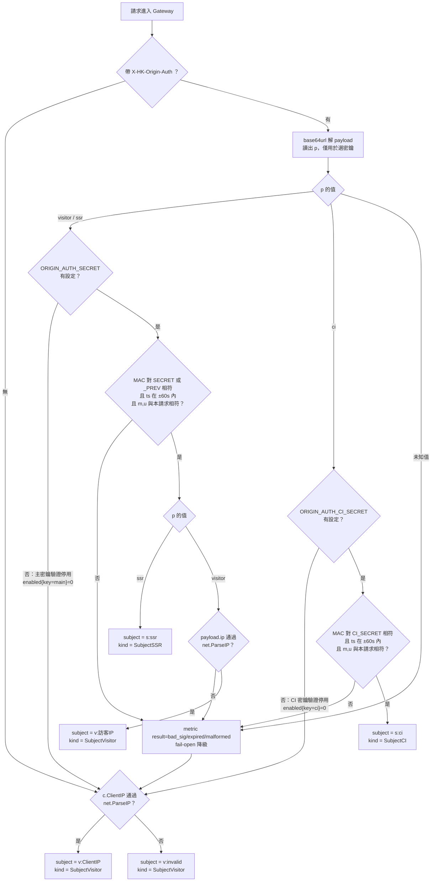
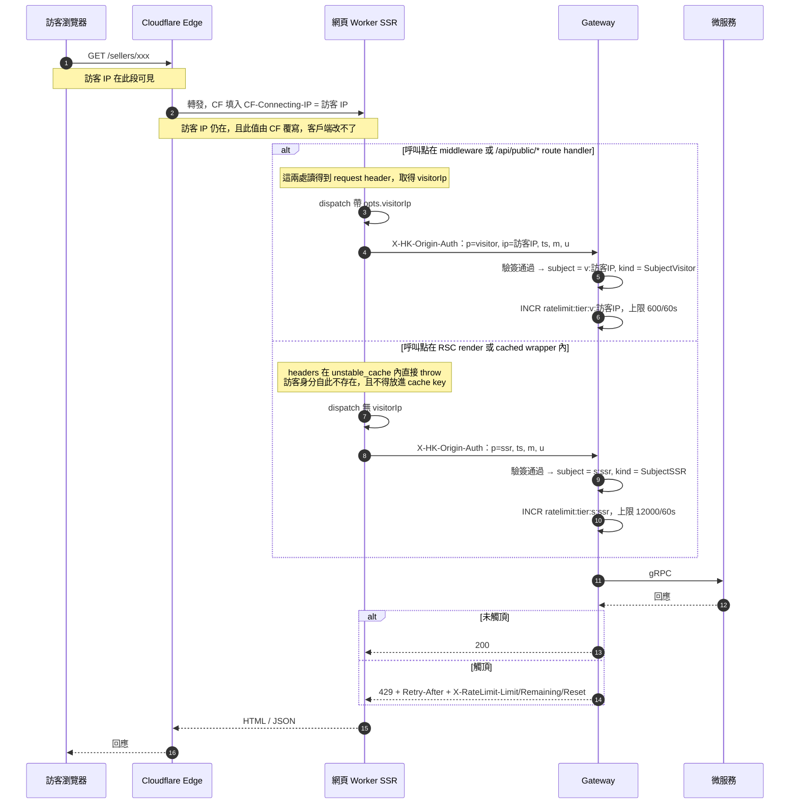

# Gateway 微服務詳細設計書

> **單體（遷移計畫 A2，2026-09-27 起）**：對外的入口移到單體（`internal/httpapi`）：認證（opaque session）、CORS、CSRF 與 Connect 的限流在單體，還沒搬的 REST、SSE 與 WebSocket 由單體轉給 gateway，gateway 信任單體帶的身分 header（契約見〈API 設計規範（Connect）〉§二）。本文件的 JWT 驗證、web session、CSRF、CORS、auth 路由與 demo 登入只描述舊的 gateway。

> 本文件描述 Gateway 的架構設計與開發指南。
> 具體的路由清單、port、環境變數等以 code 和 `.env.template` 為準。

---

## 1. 服務定位

Gateway 是 API 網關，位於客戶端與微服務之間：

| 功能 | 說明 |
|------|------|
| 統一入口 | 所有 API 的單一入口（HTTP REST，Port 9900） |
| 三 Namespace 路由 | `/public`（匿名）、`/app`（JWT）、`/admin`（管理員） |
| 身份驗證 | JWT 驗證（`JWTAuth` / `OptionalJWTAuth`） |
| 授權控制 | `requireSeller()`、`requireAdmin()` |
| 協議轉換 | REST → gRPC（每個後端服務有專屬 gRPC Client） |
| 限流 | 分層固定窗（Redis 跨 pod 共享），計數鍵為「限流身分（rate-limit subject）」而非來源 IP — 見 [§3.2](#32-ratelimiter限流) |
| 分佈式追蹤 | OpenTelemetry + x-trace-id / x-request-id |

---

## 2. 請求處理流程

```
Client Request
    │
    ▼
┌──────────────────────────────────────────────────────────────────────┐
│  全局中間件（按順序，以 internal/infrastructure/di.go newEngine 為準） │
│  Recovery → Tracing → TraceLogger → HTTPMetrics → CORS →             │
│  RateLimiter → CSRF → BodyGuard → Logger                             │
└─────────────────────┬────────────────────────────────────────────────┘
                      │
                      ▼
┌─────────────────────────────────────────────────┐
│  路由級中間件                                     │
│  JWTAuth / OptionalJWTAuth                       │
│  requireSeller() / requireAdmin()                │
└─────────────────────┬───────────────────────────┘
                      │
                      ▼
┌─────────────────────────────────────────────────┐
│  Handler                                         │
│  取 gRPC Client → 發送 gRPC 請求 → 回應 JSON     │
└─────────────────────┬───────────────────────────┘
                      │
                      ▼
              Envelope JSON 回應
              {"code": 0, "data": {...}}
```

---

## 3. 中間件設計

### 3.1 Tracing

**檔案**: `internal/middleware/tracing.go`

1. 從請求頭提取 W3C Trace Context
2. 建立 OTel Span
3. 生成 `x-trace-id`（OTel TraceID）、`x-request-id`（UUID v4）
4. 存入 Go context → gRPC `AuthMetadataInterceptor` 自動注入到下游

### 3.2 RateLimiter（限流）

**檔案**：`internal/middleware/ratelimit.go`、`internal/middleware/ratelimit_subject.go`

#### 3.2.1 概述

限流是 Gateway 唯一的「誰用了多少」判斷點，它回答兩個獨立的問題：

| 問題 | 現行答案 |
|---|---|
| 這個請求算在誰頭上？ | **限流身分（rate-limit subject）**，唯一問答點 `RateLimitSubject()` |
| 這個「誰」可以用多少？ | 依 `tier × SubjectKind` 分軸配額（§3.2.6） |

🔴 **配額鍵一律是限流身分，不是來源 IP。** 任何 per-IP 配額、封鎖或連線數上限都**必須**
經由 `RateLimitSubject()`——`c.ClientIP()` 不得直接當配額鍵：

- **不唯一**：網頁 SSR、admin BFF、CI runner 都是「一個位址代表無限多個真人」
- **不可信**：能直連 origin 的人可自填 `CF-Connecting-IP`

`429` 的 envelope `code` 恆為 `429`；AI 配額用 `4291`。兩者共用 HTTP 429，
**客戶端靠 envelope `code` 分辨**（詳見 §3.2.9）。

#### 3.2.3 分層（tier）

路由依敏感度分五層，分類集中在 `classifyTier()` 一處（`ratelimit.go`）：

| tier | 涵蓋 | 預設配額 |
|---|---|---|
| `tierExempt` | **會自動重連的**長連線（notification SSE、post comments SSE、IM WebSocket）、健康檢查、PayUni callback、view beacon | 不限流（middleware early-return） |
| `tierOTP` | `POST /api/v1/public/auth/otp/send` | 10 / 窗 |
| `tierStrict` | 登入 / refresh / OAuth / phone verify | 30 / 窗 |
| `tierModerate` | `/api/v1/public/*` 匿名讀取 | 見 §3.2.6 |
| `tierDefault` | 已認證 `/app` + `/admin`，以及未匹配路由（含 404） | 300 / 窗 |

窗長 `RATE_LIMIT_WINDOW_SECONDS`，預設 60 秒。計數走 Redis（跨 pod 共享），Redis 不可用時降級為有界的記憶體 limiter（degrade-open）。

##### AI 助手與採購助手路由的 tier 歸屬

🔴 **`/app/sellers/me/assistant/`、`/app/buyers/me/assistant/`、`/app/buyers/me/procurement/`
三棵路由不得以 prefix 掛進 `exemptPrefixes`。** 三棵樹共 **31** 條路由，其中真正的 SSE
串流只有 **13** 條，另外 **18** 條是短命的 unary／JSON／CRUD（`/turns` 同步版、product
autofill、session 查詢、snapshot、候選搜尋建立與輪詢、selection、answer、rewind、crop
消歧、報價批次三支、對話 CRUD 四支）。prefix 規則等於送給這 18 條每一條
「每個限流身分無上限」。

**豁免的條件是「會自動重連」，這三棵不符合**：`exemptExact` 存在是為了斷線後客戶端立刻
重撥的連線（通知 SSE、IM WebSocket），per-request 計數器會把一個邏輯 session 看成一場
風暴。AI 這三棵沒有任何消費端是這個形狀——網頁是一次性 `fetch`
（`lib/ai-chat/stream-client.ts`，無 `EventSource`、無 `Last-Event-ID`），buyer／seller
兩支 App 是單次 `dio.post(responseType: ResponseType.stream)`，非 200 直接 `addError` 後
關閉 controller，兩個 repo 都沒有註冊任何 retry interceptor（各自的
`ai_assistant_repository.dart`）。**一輪對話 ＝ 一個請求**，request counter 對它是正確的模型。

同一判準見 54 號 §11：`/public/app-version-gate` 同樣不列入豁免——**豁免等於開一個匿名
可無限打 DB 的端點**。這裡賭注更大，因為端點後面是**計費模型**不是一次 DB 讀取。

分類表在 `middleware/ratelimit_ai_routes_test.go` 的 `aiRouteTiers`，對**實際路由表**
（`router.SetupRoutes`）雙向比對：新掛一條 AI 端點卻沒分類、或表裡留著已刪除的路由，
CI 都會紅。這正是 prefix 規則在結構上做不到的事——prefix 底下新增路由會**靜默**繼承
「不限流」，沒有任何檔案需要被改。

⚠️ **`tierDefault` 不是成本控制，不要這樣讀它。** 它是「每個限流身分的**請求**計數」，
而限流身分是位址不是帳號（§3.2.4）。它限制的是**輪次頻率**；它不限制並發串流數、
model token、tool 呼叫次數或金額，而一個身分可以只花很少請求就同時掛著多條 120 秒串流。
**每帳號計量在 57 號 §7**（每帳號每月 100 次回答，`quota_account_id`，與 durable turn
結果同 transaction 扣次）；每輪上限是 `proxy.streamTurnDeadline`（120 秒，經 gRPC
deadline 傳到 ai-service）。

⚠️ **AI 串流沒有並發連線上限，一條都沒有。** `sse.HubConfig.MaxConnPerUser`（預設 3）
只約束通知／貼文留言那條 Hub 路徑；AI 助手與 `/turns/stream` 走
`proxy.ServeAIAssistantStream`，直接寫 `c.Writer`，不進 Hub、不佔位子。
⇒ 一個身分可以只花 3 個請求就同時掛著 3 條 120 秒串流。

⚠️ **表裡頻率最高的一條**：`GET .../requests/:id/candidate-searches/:runId` 被網頁以
**1.5 秒**輪詢整段候選搜尋（`features/procurement-assistant/useProcurementSession.ts`），
即每位搜尋中的買家約 40 req/min，對 300/60s 的桶。單一買家寬裕，**同一個對外位址有數位
買家同時搜尋則不寬裕**，而網頁的輪詢器把 429 當網路失敗處理（三次 backoff 後停下、改為
手動重試）。真的發生時可動的旋鈕是網頁的 `POLL_INTERVAL_MS` 與本側的 tier 配額——
**不是重開一個豁免**。


#### 3.2.4 限流身分（rate-limit subject）

```go
// internal/middleware/ratelimit_subject.go
type SubjectKind int

const (
    SubjectVisitor SubjectKind = iota // 一個真人
    SubjectSSR                        // 網頁 server 端渲染（含 ISR 背景 regenerate、build、暖機）
    SubjectCI                         // CI runner / E2E / smoke
)

// RateLimitSubject 回答「這個請求算在誰頭上」。
// 唯一問答點：任何 per-IP 配額／封鎖／連線數都必須經由它。
func RateLimitSubject(c *gin.Context) (subject string, kind SubjectKind)
```

`RateLimitSubject` 與 `SubjectKind` **必須 exported**：`package handler` 的兩個呼叫點（OTP 注入、SSE 連線數）在 middleware 之外。它也必須是**可獨立呼叫的純函式**——SSE 屬 `tierExempt`，限流 middleware 對它 early-return，SSE 的連線數上限不可能從 middleware 拿到結果。

**歸屬規則**：

| # | 條件 | subject | kind |
|---|---|---|---|
| 1 | 有效簽章，`p=visitor`，payload 的 `ip` 通過 `net.ParseIP` | `v:<訪客 IP>` | `SubjectVisitor` |
| 2 | 有效簽章，`p=ssr` | `s:ssr` | `SubjectSSR` |
| 3 | 有效簽章（CI 密鑰），`p=ci` | `s:ci` | `SubjectCI` |
| 4 | 其餘（無簽章／簽章無效／機制停用）；`c.ClientIP()` 亦須通過 `net.ParseIP`，失敗則為 `v:invalid` | `v:<ClientIP>` | `SubjectVisitor` |

**#1 與 #4 刻意同前綴 ⇒ 同一把 key**：一個真人做的事算在一個人頭上，不論他是瀏覽器直接打的、還是網頁／admin 代他打的。因此**這兩列必須共用同一個配額值**——`pkg/ratelimit/ratelimit.go` 的 limit 是 per-call 參數而 counter 是 per-key，同一把 key 餵兩個上限，低的那半會先擋人。

**為何前綴與 IP 格式驗證兩者缺一不可**：gin 對 `CF-Connecting-IP` 不做格式驗證。若 subject 無前綴，任何能直連 origin 的人送 `CF-Connecting-IP: s:ssr` 就把自己算進了 SSR 軸（該軸配額是訪客軸的 20 倍）。前綴加上格式驗證，讓「無簽章的請求」**永遠只能落在 `v:` 命名空間內**。

**兩把密鑰各自獨立判定，不是一個總開關**（見 §3.2.5「密鑰分層」）：`p` 決定該用哪一把密鑰驗證，主密鑰為空只停用 `p=visitor` / `p=ssr` 的驗證，CI 密鑰為空只停用 `p=ci` 的驗證，兩者互不影響。**secret 是人工建立的，最容易的失誤就是只做一半**——設計上必須讓「只設一把」是一個有定義、可觀測的狀態，而不是未定義行為。

> **在驗證前讀 `p` 是安全的**：`p` 此時只用來**選哪一把密鑰**，不授予任何東西。偽造 `p=ci` 去挑 CI 密鑰，MAC 照樣對不上而落入 fail-open。



#### 3.2.5 來源簽章 `X-HK-Origin-Auth`

自家的 server 端呼叫者（網頁 Worker、admin Worker、CI）用簽章宣告「我代表誰」。設計參照 `internal/middleware/chat_ws_ticket_hmac.go`，以及 [52 微服務間內部授權](52-微服務間內部授權（Internal%20Service%20Authorization）詳細設計書.md) 的 HMAC 慣例（canonical string 前綴、`_PREV` 輪替、時間窗）。

> **與內部授權（52 號）的分工**：`x-internal-service` 系列簽章回答「這是不是我方微服務發的呼叫」，用於**授權**；`X-HK-Origin-Auth` 回答「這個請求代表哪一個限流身分」，**不授予任何權限**。兩者密鑰不同、驗證點不同、失敗處置也相反——內部授權在 enforcing 模式 fail-closed，本簽章一律 fail-open。

```
Header: X-HK-Origin-Auth: <base64url(payload)>.<base64url(mac)>

payload = {"v":1,"p":"visitor|ssr|ci","ip":"<訪客 IP，僅 p=visitor 有值>",
           "ts":<unix seconds>,"m":"<METHOD>","u":"<path>"}
mac     = HMAC-SHA256(secret, "hkorigin1:" || base64url(payload))
```

| 決策 | 選擇 | 理由 |
|---|---|---|
| 密鑰 | 獨立 `ORIGIN_AUTH_SECRET`，**不**共用 `JWT_SECRET` | 不同用途要能獨立輪替；網頁 Worker 不該持有能簽 JWT 的密鑰 |
| 綁定 | `m`（method）+ `u`（path） | 防止簽章被挪去打別的 endpoint |
| 時效 | `ts` ±60 秒 | 與限流窗同量級 |
| nonce | **不做** | SSR 高頻，per-request nonce 存 Redis 不划算；重放的獲益僅止於「換一條配額軸」，已由綁 method+path 與 60 秒窗界定 |
| 輪替 | `ORIGIN_AUTH_SECRET_PREV` 同時接受 | 無縫輪替 |
| 驗證失敗 | **fail-open**：降級為 `SubjectVisitor` + metric + 告警 | 密鑰輪替窗口不該打掛網頁；降級後的行為＝沒有本設計時的行為 |
| 密鑰為空 | **完全停用簽章驗證** + gauge + critical 告警 | 見下 |

##### 空密鑰：停用驗證，不是「用空密鑰驗」，也不是「啟動失敗」

`chat_ws_ticket_hmac.go` 對空密鑰不特判，理由是 `JWT_SECRET` 在任何會做驗證的環境一定有設（`internal/config/config.go` 的 `Validate()` 確實只強制 `JWT_SECRET`）。**這個理由不能移植到新密鑰**：

- **若沿用「不特判」**：空密鑰下 `HMAC("", ·)` 人人算得出來 ⇒ 任何人可簽任意 `p`、把請求算到任意 `v:<受害者 IP>` ⇒ **定向鎖死他人登入**（auth-failure 軸刻意保留 `SubjectVisitor`）、**耗盡他人 OTP 配額**；而且這些簽章的 metric 是 `result="ok"`，**告警不會響**。
- **若改用 boot-time fail**：`k8s/scripts/create-secrets.sh` 在 CI 中**只被 `static-gates.yml` 的「SCRIPT_REVISION 必須遞增」step 做 gate 檢查**，**沒有任何 workflow 執行它**；secret 的實際建立是人工步驟（`k8s/SETUP.md` 的 scp ＋ ssh），dev 與 prod 各做一次。把 secret 變成啟動必要條件 ⇒ 沒先手動建好就部署＝**gateway CrashLoop**，而且會發生兩次：dev 一次，prod 一次由執行 `dev → main` 的同事觸發。

**定版作法**（**每把密鑰各自獨立判定**）：

```
主密鑰為空   ⇒ 只停用 p=visitor / p=ssr 的驗證
CI 密鑰為空  ⇒ 只停用 p=ci 的驗證
（停用 = 不解析、不驗證、不信任該類 X-HK-Origin-Auth）
              ⇒ 受影響的請求走 v:<ClientIP>，即沒有本設計時的行為
              ⇒ 啟動時 ERROR log ＋ gauge gateway_origin_auth_enabled{key="main|ci"} = 0
```

三個性質同時成立：**安全**（沒有任何簽章會被接受，不存在空密鑰提權）、**可部署**（不會 CrashLoop，對 secret 無順序依賴）、**可觀測**（gauge 直接回答「哪一把密鑰沒在運作」——**單一 gauge 答不出這件事，所以必須帶 `key` label**）。

##### 密鑰分層：CI 用獨立 secret

單一 secret 能簽**任意** `p` ⇒ 持有 CI secret 的人可以簽 `p=visitor` 並帶任意受害者 IP，取得上述定向阻斷能力，且 metric 為 `result="ok"`、告警不響。

| secret | 持有者 | 只接受的 `p` |
|---|---|---|
| `ORIGIN_AUTH_SECRET`（+ `_PREV`） | 網頁 Worker、admin Worker | `visitor`、`ssr` |
| `ORIGIN_AUTH_CI_SECRET` | GitHub Actions | **僅** `ci` |

理由與「不共用 `JWT_SECRET`」同一條：**暴露面不同的持有者不該共用密鑰**。GitHub Actions secret 的暴露面（fork PR、workflow 注入、第三方 action）與 CF Worker secret 完全不同。

**兩把密鑰的停用開關也是獨立的**：只設主密鑰 ⇒ 網頁／admin 的簽章生效、CI 簽章一律被忽略（CI 流量落 `v:<runner IP>`）；只設 CI 密鑰 ⇒ 反之。這正是人工建立 secret 最可能出現的中間狀態，設計上必須有定義且分別可觀測，見 §3.2.11 的 `key` label。

##### 網頁 SSR 一次請求的完整路徑

下圖的重點是**訪客身分在哪一段還在、哪一段沒了**：訪客 IP 只存在於「CF edge → Worker」那一跳的 header 上；一旦進入 RSC render（`unstable_cache` 內），`headers()` 會直接 throw（Next.js `E838`），訪客身分在應用層就不存在了。因此網頁不做環境偵測，改為**顯式傳遞 `visitorIp`**：拿得到就簽 `p=visitor`，拿不到就簽 `p=ssr`。



> ⚠️ 網頁端的簽章分支必須是 `typeof window === "undefined"`。否則網頁**瀏覽器端**的請求也會帶簽章，全部擠進同一個 subject，比沒有本設計更糟（含 OTP）。
> ⚠️ `visitorIp` **絕不可進 `unstable_cache` 的 keyParts**：那會讓 cache entry 依訪客分裂，等於廢掉快取。傳遞鏈只走「不經 cached wrapper」的呼叫點。

#### 3.2.6 分軸配額

subject 抽象在**所有 tier** 生效（key 一律 `ratelimit:{tier}:{subject}`）。配額**值**則只在必要處分 kind：

| tier × kind | 配額 | env |
|---|---|---|
| `tierModerate` × `SubjectVisitor`（直連與代打共用同一把 key） | **600/60s** | `RATE_LIMIT_MODERATE_PER_WINDOW` |
| `tierModerate` × `SubjectSSR` | **12000/60s**（200 req/s） | `RATE_LIMIT_MODERATE_SSR_PER_WINDOW` |
| `tierModerate` × `SubjectCI` | **300/60s** | `RATE_LIMIT_MODERATE_CI_PER_WINDOW` |
| 其餘組合（含 `tierStrict` / `tierDefault` / `tierOTP` × `SubjectCI`） | **該 tier 預設值** | — |

`limitFor(tier, kind)`：**只有 `tierModerate` 對三個 kind 各有值**，其餘 tier 不分 kind、一律落該 tier 預設。

🔴 **`tierStrict` / `tierDefault` / `tierOTP` 不設 CI 覆寫 env**：那幾個 tier 沒有 CI 生產者，
填任何數字都違反本節的「不得先猜一個數字上線」。不設 ＝ 落該 tier 預設。

##### `tierModerate × SubjectCI` = 300 的預算

| 項目 | 值 |
|---|---|
| 上限 | **300 / 60s** |
| 目標支撐 | **單一 E2E job**（今天的最壞情況） |
| 現況用量 | 尖峰 **84 req/min**（dev；prod 34），尖峰短促非持續高原 |
| 餘裕 | **3.5×**；若加第二台 `website-heavy` runner 推估 ≈105/min ⇒ 仍有 **2.9×** |

🔴 **本值成立的兩個前提，任一失效就必須重量**：

1. `concurrency: e2e-test-api-usage` 是**固定 group**（不含 ref）且 `cancel-in-progress: false`
   ⇒ 整個 repo 的 E2E job 同時只有一個。
   ⚠️ 它只約束 `e2e-test` 這一個 job，**不涵蓋** `build-and-deploy`（含 build 期 SSR 預抓）、
   `fast-test`、`lighthouse`；頂層 `concurrency` 只按 ref 分組。
2. `website-heavy` 標籤**只有一台 runner**，使 E2E 與 Build 被序列化。
   ⚠️ 這是**基礎設施性質不是宣告式保證**——加一台 runner 就會失效。

##### 誰要帶 `p=ci` 簽章（判準 + 可重跑枚舉，不維護靜態清單）

靜態清單一定會腐化，所以這裡定的是**判準**，清單只是「執行本判準當下的快照」。

**判準**：**在 GitHub Actions runner 中執行、且會對 dev 或 prod gateway 發 HTTP 請求**的腳本或 workflow step。

三個條件缺一不可，而它們各自都有一個常見誤判：

| 條件 | 常見誤判 |
|---|---|
| 在 runner 中**執行** | 只在 workflow 的**註解**裡被提到，就被當成 CI 腳本 |
| 真的發 **HTTP** | 腳本裡出現 gateway 網域字串，但那是註解／錯誤訊息，實際只跑 `kubectl` / `helm` |
| 打的不是 `tierExempt` 路由 | 只打 `/api/v1/health` 的探針——它零配額，簽了也沒有意義 |

**可重跑的枚舉命令**（後人自己重算，不要信下面的快照）：

```bash
# ① workflow 真正執行的腳本（排除註解行；grep -o 若不先排除註解會把註解裡的路徑也撈出來）
/usr/bin/grep -rnE '^[^#]*\b(bash|sh|\./)[^#]*\.sh' .github/workflows/*.yml \
  | /usr/bin/grep -vE ':[[:space:]]*#' | /usr/bin/grep -oE '[A-Za-z0-9_/.-]+\.sh' | sort -u
# ② ① 之中哪些真的發 HTTP（逐檔 grep curl/wget，而非 grep 網域字串——後者會命中註解）
#    for f in <①的結果>; do echo "$f $(/usr/bin/grep -cE '\b(curl|wget)\b' "$f")"; done
# ③ workflow 自己 inline 發的 HTTP
/usr/bin/grep -rnE '\bcurl\b' .github/workflows/*.yml | /usr/bin/grep -vE ':[[:space:]]*#'
```

⚠️ **執行本判準時的三個結論**（結論本身是規格，清單快照刻意不留）：

1. **`s:ci` 軸的實質生產者在 website repo**（`deploy.yml` 的 `e2e-test` job、build step 的
   SSR 預抓、post-deploy CF smoke 三處帶 `p=ci`）。backend repo 目前沒有任何「CI 執行且發
   HTTP 到非 exempt 路由」的腳本——它對 gateway 的 CI 流量只有 `/api/v1/health`（`tierExempt`，
   零配額）。⇒ `MODERATE_CI` 的尖峰**必須量自 website 側**。
2. **本地／人工執行的 smoke 腳本刻意不帶簽章**（`infra/smoke-checkout.sh`、
   `scripts/prod-smoke-test.sh`）：它們從開發者本機出去、代表一個真人，`v:<開發者 IP>`
   本來就是正確粒度；讓它們持有 CI secret 反而擴大暴露面（同 §3.2.5 密鑰分層的理由）。
3. 🔴 **未來新增打 gateway 的 CI 腳本／step，必須同時決定是否帶簽章。**
   **漏了不會有紅燈**——gateway 側抓不到「本來就該送而沒送」，只會讓該流量默默落回
   runner IP、與其他訪客共用 `v:` 軸配額。

##### `SubjectVisitor` = 600 的依據

`v:` 軸實際承載的是：① 瀏覽器直連的 API 呼叫 ② App 直連 ③ 網頁 middleware 代打（`/sellers/*` canonical lookup）④ 網頁 7 支 `/api/public/*` route handler 代打 ⑤ admin BFF 代打。**不含 page SSR**（它走 `s:ssr`）。

實測單訪客瀏覽器直連尖峰 25/分鐘，加上第 3–5 項的代打量，保守估上界約 **200/分鐘**。600 ＝ 3× 上界，符合《[硬上限依賴接入治理規範（配額與容量）](../開發規範/硬上限依賴接入治理規範（配額與容量）.md)》§6 step 1 的「供需差 < 3 倍即不合格」門檻；且對 NAT / CGNAT 後多真人共用一個 IP 留有餘裕（本值只放寬不收緊）。

##### `SubjectSSR` = 12000 的依據與預算數字

未截頂樣本回推的單訪客 SSR 需求為 156–221/分；目錄長滿並套用扇出修復後為 200–240/分。

```
需求 = 240/分/訪客 × 10 個並發重度瀏覽訪客 = 2,400/分
門檻 = 2,400 × 3 = 7,200/分
供給 = 12,000/分   ⇒ 供需差 5.0 倍 ✅
```

**預算表**（《硬上限依賴接入治理規範》要求，同步登記其 §5 依賴登記表）：

| 項目 | 值 |
|---|---|
| 上限 | 12,000 req / 60s ＝ 200 req/s |
| 目標支撐 | 10 個並發重度瀏覽訪客（目錄長滿後） |
| 現況用量 dev 尖峰 | 156–221/分 ＝ **1.3–1.8%** |
| 現況用量 prod 24h max | 31/分 ＝ 0.26%。⚠️ **此數字結構性無效、不得作為安全證據**：prod 當前「推薦賣家 1 個、商品 0 筆」，預抓根本沒東西可扇出 |
| 告警門檻 | 40%（4,800/分）⇒ 約 20–24 個並發訪客時通知 |
| 何時逼近 | 依上一列，並發重度訪客達 20 即觸發通知；達 50 觸頂 |
| 定位 | **失控保險絲，不是日常節流閥**。網頁是自家系統，日常量應遠低於此；觸及 200 req/s 代表網頁有失控迴圈 |

##### 配額值的落點（缺一即靜默失效）

| # | 位置 | 動作 |
|---|---|---|
| 1 | `gateway/internal/config/config.go` | 改 `RateLimitModeratePerWindow` 預設值 ＋ 新增**兩個**欄位（`MODERATE_SSR`／`MODERATE_CI`）與其 `GetEnvAsIntOrDefault` |
| 2 | `gateway/internal/infrastructure/di.go` | `RateLimitPolicy{...}` 是**字面**，**必須加新欄位** |
| 3 | `k8s/values/gateway.yaml` | 明文 `"120"` 改成 `"600"` ＋ 新增**兩個** key。**只改 config.go 預設值 ⇒ 600 永不生效** |
| 4 | `docker-compose-local.yml` | 新增**兩個** env |

> ⚠️ 第 2 項漏補**不是編譯錯，測試也照樣綠**：`pkg/ratelimit/ratelimit.go` 的 `Allow` 對 `limit <= 0` **直接 return true（放行）** ⇒ 該軸靜默無限放行。
> 防呆要涵蓋全部 **3 個** kind 配額欄位（`tierModerate` 的 Visitor／SSR／CI），且**不可**做成全域「limit ≤ 0 就 fail-closed」：`AuthFailurePerWindow: 0` 是既有契約，語意是「整條 auth-failure 軸關閉」，全域改掉會把那個開關變成「全部擋死」。

#### 3.2.7 auth-failure 軸的 kind 排除

`authFailureAxisApplies()` 目前依 tier 排除 `tierModerate`。本設計**再加一層依 kind 的排除**：

| kind | 在軸內？ | 理由 |
|---|---|---|
| `SubjectVisitor` | **是** | 涵蓋全部真人流量（瀏覽器直連 + App + 網頁代打）。把它排除，等於讓 `RATE_LIMIT_AUTH_FAILURE_PER_WINDOW=100` 這條防線整條失效 |
| `SubjectSSR` | 否 | 匿名讀取，不會產生「使用者驗證失敗」；計數只會讓一個共用軸替所有人背黑鍋 |
| `SubjectCI` | 否 | 自動化測試依設計會刻意打出 401 斷言 |

#### 3.2.8 subject 的全部套用點

🔴 **配額鍵有四個套用點，全部走 `RateLimitSubject()`，一個都不得回退成 `c.ClientIP()`**
（由 ruleguard `banClientIPForQuota` 守，見 §3.2.13）：

| # | 位置 | 現行鍵 |
|---|---|---|
| 1 | `gateway/internal/middleware/ratelimit.go` 分層配額 | `ratelimit:{tier}:{subject}` |
| 2 | 同檔 `authFailureKey()` 與其 gate / 計數 | `ratelimit:authfail:{subject}` |
| 3 | OTP 次數：`gateway/internal/handler/auth.go` 注入 → `gateway/internal/grpc/account_client.go` → `services/account-service/internal/grpc/handler.go` → `internal/usecase/otp.go` → `internal/infrastructure/otp_store.go` | `otp:subj:{subject}:{hour}` |
| 4 | SSE 連線數上限：`gateway/internal/handler/sse_stream.go` 填入 `conn.IP` → `gateway/internal/sse/hub.go` 的 `capKeyOf()` | per-subject 連線數 |
| 附 | 同檔 block log sampler `logBlocked()` | 取樣鍵 per-`(reason, subject)` |

第 3 項跨到 account-service 的 proto 欄位語意，見 §3.2.10。

**`logBlocked()` 必須同時輸出 `ip` 與 `subject` 兩欄**（取樣鍵用 subject 還不夠——那只影響印幾行，不影響印什麼）：

| 欄 | 內容 | 為何兩個都要 |
|---|---|---|
| `ip` | **保留**，仍是 `c.ClientIP()` 的真實對端 | 鑑識用：哪台機器在打 |
| `subject` | **新增**，`RateLimitSubject()` 的結果 | 歸因用：這些量算在誰的配額上 |
| `reason` / `xff` / `method` / `path` | 不變 | |

> ⚠️ **不可以把 subject 塞進既有的 `ip` 欄**。`v:...` / `s:ssr` / `s:ci` 不是 IP，欄名說謊會讓所有既有的 log 查詢在無聲中變成錯的——這正是本設計替 proto `client_ip` 改名（§3.2.10）所主張的同一條理由，不能在 log 這一側自打嘴巴。兩欄並存才同時答得出「誰在打」與「算誰頭上」，而這兩個答案在 SSR／CI／admin 代打的情境下本來就不同。

> ⚠️ `/api/v1/health` 因 `exemptExact` 而不計配額（canary cron 每 5 分鐘 ×3 打它），subject 改動後不得影響此行為。

#### 3.2.9 API 規格

限流不新增 endpoint，改變的是**所有 endpoint 觸頂時的回應**。

**429 回應**（envelope 形狀不變）：

```json
{"code": 429, "message": "rate limit exceeded", "traceId": "abc123"}
```

`message` 依觸發的軸而異：分層配額為 `rate limit exceeded`；auth-failure 軸為 `too many authentication failures`；SSE 連線數上限為 `sse connection cap reached`；WebSocket 連線數上限為 `too many concurrent chat connections`。

**新增回應 header**：

| Header | 值 | 說明 |
|---|---|---|
| `Retry-After` | **秒數**（非 HTTP-date） | 距本窗結束的秒數 |
| `X-RateLimit-Limit` | 本軸配額 | |
| `X-RateLimit-Remaining` | 本窗剩餘 | 觸頂時為 0 |
| `X-RateLimit-Reset` | unix 秒 | 本窗重置時刻 |

Gateway 共有**四處**會產生 429。前三處要補同一組 header（少補一處等於沒做），第四處**刻意不補**：

| # | 產生 429 的位置 | 經過限流 middleware？ | 補 header？ |
|---|---|---|---|
| 1 | `gateway/internal/middleware/ratelimit.go`（分層配額 / auth-failure） | 是 | ✅ |
| 2 | `gateway/internal/handler/sse_stream.go`（SSE 連線數上限） | **否**——SSE 屬 `tierExempt`，middleware 對它 early-return | ✅ |
| 3 | `gateway/internal/response/response.go` 的 `TooManyRequests()`（`handler/chat.go` 的 WS 連線數上限） | **否**——同上形狀 | ✅ |
| 4 | `gateway/internal/response/response.go` 的 `GrpcErr()` `ResourceExhausted` 分支，把上游業務配額映射成 429（envelope `code` 為上游業務碼，如 AI 配額 `4291`） | 否 | ❌ **刻意不補** |

**第 4 處為何不補**：那個 429 的額度是**上游微服務的業務配額**（AI 轉寫次數、並發 job 數…），Gateway 既不知道它的窗長也不知道它何時重置——硬補一個 `Retry-After` 只會產生一個**騙人的數字**，比沒有更糟（客戶端會照著它重試，然後再被拒一次）。要讓這條路徑帶回可信的重試資訊，得由上游在 gRPC 回應裡把重置時刻帶出來——現行 gRPC 契約沒有這個欄位，故本項維持不補。**客戶端要區分這個 429 與第 1 處的限流 429，讀 envelope `code`**（前者為上游業務碼如 `4291`，後者為 `429`）。

> ⚠️ **必須同時加 `Access-Control-Expose-Headers`**（`internal/middleware/cors.go` 目前完全沒有它）。`Retry-After` 不在 CORS safelist，跨源前端讀到的會恆為 `null`。這也是限流 middleware 掛在 CORS **之後**的原因：429 abort 仍帶著 CORS header。
> `pkg/authcontract` 的 boot gate 只驗 origins，新增 Expose-Headers 不需同步 `contract.json`。
> ⚠️ **唯一已知的前端消費者讀的是 SSE 那一個 429**，不是限流器產生的那個。只補 middleware 的話，本項對現有消費者零效果。

**`X-HK-Origin-Auth` 不進 Swagger `@Param`**：它是全域 middleware 讀取的 header、掛不到任何一支 handler 上，對 API 消費者也是誤導（他們簽不出來）。內部授權 header 亦無先例。它的歸宿是本設計書。

#### 3.2.10 account-service 的 OTP 欄位契約

OTP 次數的鍵是**限流身分**不是 client IP，`api/proto/account/account.proto` 的
`SendOtpRequest` 逐字為：

```protobuf
string rate_limit_subject = 2;  // 限流身分（v:<ip> / s:ssr / s:ci），非 IP
```

🔴 **欄名必須維持 `rate_limit_subject`。** 它承載的值可能是 `s:ssr` / `s:ci` 這類
非 IP 字串，改回 `client_ip` 之類的名字會讓下游依欄名推斷語意的人做錯事——
與 §3.2.8 要求 log 保留 `ip` / `subject` 兩欄是同一條理由。

本欄是 [§4.1 例外 #1](../開發規範/Java%20微服務開發規範.md)（Gateway 注入、前端不可控）
⇒ 可用原生型別，不受「數字一律 string」拘束。

直接讀寫這個 generated field 的呼叫點只有兩處：`gateway/internal/grpc/account_client.go`
與 `services/account-service/internal/grpc/handler.go`（Java 側零消費者）。

> `gateway/internal/handler/auth.go` 走的是自家 wrapper 的**位置參數**、不碰 proto 欄位名。

#### 3.2.11 可觀測性與告警

**Metric**：

| 名稱 | 型別 | label |
|---|---|---|
| `gateway_origin_auth_total` | counter | `result`（`ok` / `bad_sig` / `expired` / `malformed` / `absent`）、`env` |
| `gateway_origin_auth_enabled` | gauge | **`key`（`main` / `ci`）**、`env`（1 = 該把密鑰的驗證啟用，0 = 該把為空、其對應的 `p` 停用） |
| 既有限流 counter | counter | 新增 `subject_kind`（3 值）與 `tier` |

> ⚠️ **subject 本身絕不可當 label**：`v:<ip>` 基數無界。
> ⚠️ **`gateway_origin_auth_enabled` 必須帶 `key` label**：兩把密鑰各自獨立停用（§3.2.5），單一 series 答不出「是哪一把沒設」，而「只建了一把」正是人工步驟最可能的失誤形狀。
> 既有 12 條 query（`monitoring/prometheus/rules/service-alerts.yml` 3 條 ＋ Grafana `slo.json` 9 條）全部使用 `sum()` 無 `by` 或只 `by (job)`，新增 label 不會讓任何一條失效。

**告警**（落點 `monitoring/prometheus/rules/service-alerts.yml`）：

| 告警 | 條件 | 級別 |
|---|---|---|
| A：機制未啟用 | `gateway_origin_auth_enabled == 0`（**逐 series 判定，`key` 與 `env` 兩維各自成立各自告警**；告警訊息必須帶上是哪一把、哪一環境） | **critical** |
| B：簽章對不上 | `sum by (env)(rate(gateway_origin_auth_total{result=~"bad_sig\|expired\|malformed"}[5m])) / sum by (env)(rate(gateway_origin_auth_total{result!="absent"}[5m])) > 0.05` 持續 5 分鐘 | warning |

- **A 必須用 gauge，不能用 `rate(ok) == 0`**：後者在「從未成功過」時**不會觸發**（counter 沒有 series ⇒ 空向量 ⇒ 條件求值不成立），而「build 期沒注入 secret」正是這個情境。gauge 恆有值，這個洞不存在。
- **A 不可寫成 `min(...)` 或任何聚合掉 `key` 的形式**：那會讓「主密鑰有、CI 密鑰沒有」被另一把的 1 蓋掉——那正是本告警要抓的狀態。
- **B 的分母排除 `absent`**：絕大多數流量（瀏覽器、App）本來就不帶簽章，算進去會讓比率永遠觸發不了。
- 兩條都必須 `by (env)`，否則 dev 的成功會掩蓋 prod 的失效。

**為什麼失效模式必須抓得到**：選簽章而非明文 secret 的理由是「失效可量測」，那就必須真的量測。失效形狀是——secret 任一端沒更新／輪替沒對齊／build 期沒注入 ⇒ SSR 簽章全部失敗 ⇒ fail-open 降級回對端 IP ⇒ **回到全站 SSR 共用一把 key**，而服務正常回應、CI 全綠、頁面 200，沒有任何人會知道。

**另加配額使用率 gauge**（《硬上限依賴接入治理規範》三件套之一），供 `SubjectSSR` 軸的 40% 門檻告警使用。

**Log**：`logBlocked()` 新增 `subject` 欄（保留既有 `ip` 欄），見 §3.2.8。**metric 不能取代它**——metric 為了控制基數不帶 subject，所以「是哪一個 subject 被擋」只有 log 答得出來；這也是 §8 排查表能叫人去查 `subject` 欄的前提。

> ⚠️ `service-alerts.yml` 現有註解寫「沒有 client-IP label 所以只能抓量異常」——新增 `subject_kind` label 後該段描述要一併更新，否則文件騙人。

#### 3.2.12 信任邊界

簽章解決「自家 server 端呼叫者如何宣告身分」，但不解決「誰能繞過 Cloudflare 直接打
origin」。後者是網路層問題，需要三層各自獨立的收口——**三層的作用域互不重疊，缺一層
就有一條繞道**。

**經過 CF 的路徑本身是安全的**：Cloudflare edge 直接 **403**（`error code: 1000`）掉任何
帶 `cf-connecting-ip` 的入站請求，偽造值連 origin 都到不了（那是 CF 的行為，不是我方 WAF
規則）。所以 `c.ClientIP()` 可被偽造的破口**只剩 origin 直連**——這正是本節要收口的對象，
也是為什麼 §3.2.4 堅持「無簽章的請求永遠只能落在 `v:` 命名空間內」。

##### 第一層：Service 的 `loadBalancerSourceRanges`

只放行 Cloudflare 官方 IP 段，**IPv4 與 IPv6 兩份都要**。klipper-lb 的 `SRC_RANGES` env
使其有效且由 node 直接執行。配置在 `k8s/external-services/traefik/traefik-values.yaml`
（prod）與 `traefik-values-dev.yaml`（dev），皆在版控。

🔴 **不可改用 Traefik `IPAllowList` 或「Gateway 驗 socket peer」**：klipper-lb 的
`POSTROUTING -j MASQUERADE` 使所有請求的 peer 恆為 `10.42.0.1`，直連攻擊者與 CF 邊緣
在那一層長得一模一樣。**同一個機制也使 `SetTrustedProxies` 在本環境無鑑別力**
（peer 本來就落在 `10.0.0.0/8` 內）——實際擋住 XFF 的是 traefik 的覆寫行為。
⚠️ traefik 日後若設了 `forwardedHeaders.trustedIPs`，XFF 會被透傳而 `SetTrustedProxies`
擋不住，這是已知脆弱點。

⚠️ **helm 套用參數 dev 與 prod 不同，照抄會降版**：prod 用 `--reuse-values` 且**必帶
`--version`**（不帶會降版）；dev **不得用** `--reuse-values`，版本亦不同。兩者不可互抄。

⚠️ 該檔**手動套用、不走 CI**：PR merge 不會自動套到任一環境。這既是風險（版控與實際
狀態可能漂移）也是安全網。回退方式（改回 `0.0.0.0/0` 再 `helm upgrade`，同樣帶各環境
自己的參數）必須寫進 PR body。
⚠️ **覆核 CF IP 段完整性是第一步**：漏一段 ＝ 該段的 CF 邊緣打不進來 ＝ **部分地區全站不可達**。

##### 第二層：NetworkPolicy（涵蓋 NodePort）

`loadBalancerSourceRanges` **不涵蓋 NodePort**。`k8s/external-services/networkpolicy.yaml`
的 per-service ingress policy 只放行指定 pod 與 `ipBlock: 172.17.0.0/18`（VPC），
由 kube-router 在 FORWARD 執行 ⇒ NodePort 自公網不可達。

##### 第三層：`hostNetwork` pod 要在 host 防火牆收口

前兩層各有作用域邊界——`loadBalancerSourceRanges` 只作用在 Service，NetworkPolicy 只
作用在走 CNI 的 pod 流量——**兩者都管不到 `hostNetwork: true` 的 pod**：它直接在 node
的網路命名空間 bind port，既不經過 Service，kube-router 也不攔。

🔴 **新增任何 `hostNetwork` 工作負載，都必須另外在 host 防火牆收口（比照既有
22／6443／10250 那組規則，並 `netfilter-persistent save` 寫入 `/etc/iptables/rules.v4`）
——前兩層不會替你擋。**

#### 3.2.13 機械保證：ruleguard `banClientIPForQuota`

比照 `gateway/ruleguard/rules.go` 既有的 `banDirectJSON`，新增規則：**除 allowlist 外禁止呼叫 `c.ClientIP()`**。這是讓「單一問答點」這個抽象不會被下一個人繞過的唯一機械手段。

**allowlist（四處，各有理由）**：

| 位置 | 理由 |
|---|---|
| `gateway/internal/middleware/logger.go` | 鑑識用途，記錄要的就是真實對端 |
| `gateway/internal/middleware/tracing.go` | `http.client_ip` 是 OTel semconv 定義的屬性名，塞非 IP 會讓 span 說謊 |
| `gateway/internal/middleware/ratelimit_subject.go` | `RateLimitSubject` 自身 |
| `gateway/internal/middleware/ratelimit_test.go` | 該 helper 斷言 gin 層 IP 解析，與 subject 層正交 |

> ⚠️ `.golangci.yml` 對 `_test.go` 的豁免是 **source-scoped**，擋不住 ruleguard 對測試檔的檢查——必須在規則裡明確排除，否則新 gate 一上線就誤傷自家測試。

#### 3.2.14 一致性、交易與補償

- **限流狀態不是持久資料**。全部是 Redis 上帶 TTL 的計數器，窗一過即自然消失。沒有需要對帳的兩份真相，因此**不引入任何補償任務基礎設施**——不寫 reconciliation job、不寫 backfill CLI、不寫 drift detection、不建 `*_task` 表、不加 `@Scheduled` 巡檢（[後端服務責任邊界規範](../開發規範/後端服務責任邊界規範.md) §六）。
- **Redis 不可用時 degrade-open**：`pkg/ratelimit` 落回有界的記憶體 limiter。這是刻意選擇——限流是保護機制而非業務正確性機制，錯放比錯擋便宜。此性質不因 subject 抽象而改變。
- **簽章驗證 fail-open**，密鑰為空則整條停用。兩者的共同性質是：**任何失效都退回「沒有本設計時的行為」，並由告警大聲叫**，不會啟動失敗、不會靜默開後門。
- **key 前綴變更（`otp:ip:` → `otp:subj:`）不做資料搬遷**。舊 key 隨自身 TTL 過期即消失，一次性放行的成本（§3.2.8）遠低於寫一支搬遷腳本。
- **部署順序無耦合**：Gateway 端（本設計書）與呼叫端（網頁／admin／CI）可各自獨立上線。呼叫端先上 ⇒ Gateway 忽略未知 header；Gateway 先上 ⇒ 無簽章流量全走 `v:<ClientIP>`。任何中間狀態都不會壞。

#### 3.2.15 使用的 Enum 與代碼值

- 本設計**不新增任何 CodeMeta 碼值**。429 的 envelope `code` 沿用既有值。
- `SubjectKind` 是 Gateway 內部的 Go 型別、不跨服務、不出現在任何 API 或 MQ payload 上，因此**不進 CodeMeta**（CodeMeta 管的是共享代碼值）。
- 相關既有碼值：AI 配額 `4291` → 詳見 [代碼管理（CodeMeta）/錯誤碼.md](../代碼管理（CodeMeta）/錯誤碼.md)。它與限流 429 共用 HTTP status 但 envelope `code` 不同（`4291` vs `429`），分流責任在 `code`（見 §3.2.1）。

#### 3.2.16 設定落點與驗收

##### 密鑰與配額的落點（缺一即靜默失效）

🔴 `ORIGIN_AUTH_SECRET` 與 `ORIGIN_AUTH_CI_SECRET` **各自**都要走完 **6 格**：

```
.env.template → 本機 .env（不在 git，create-secrets.sh 從這裡讀值）
  → docker-compose-local.yml → k8s/values/gateway.yaml
  → k8s/scripts/create-secrets.sh
  → 部署後 k8s/scripts/check-secret-declarations.sh --live 驗證
```

⚠️ **`create-secrets.sh` 沒有任何 workflow 執行它**——CI 只對它做「`SCRIPT_REVISION`
必須遞增」的 gate 檢查。secret 的實際建立是**人工步驟**（`k8s/SETUP.md` 的 scp ＋ ssh），
dev 與 prod 各做一次。因為簽章驗證選的是「缺密鑰即停用」而非 boot fail，這個步驟
**不阻擋部署**；沒做的話該密鑰對應的簽章等於沒上線，由
`gateway_origin_auth_enabled{key=...} == 0` 的 critical 告警現形（§3.2.11 告警 A）。

⚠️ GitHub Actions 端的 `ORIGIN_AUTH_CI_SECRET` 由 `hawkr-website` 持有。
**這一項的失效沒有告警覆蓋**（gateway 側抓不到「本來就該送而沒送」），只能靠觸發
website 的 `e2e-test` job 後讀 gateway log 的 `subject` 欄確認——這也是 §3.2.8 要
`logBlocked()` 多輸出 `subject` 欄的實用理由之一。

##### 驗收：要驗 tier 組成，不只驗「有沒有出現」

`s:ci` 必須**在 `tierModerate` 有計數，且 `tierStrict` / `tierDefault` 為 0**。

⚠️ **若 strict / default 不為 0，代表前端測試改了設計**（不再用 `page.route` stub
`/app/*`），§3.2.6 的定值前提已變，**必須重量**。這個變化**沒有任何告警覆蓋**——
它源於前端測試改動而非後端，gateway 側看到的只是「某個 tier 多了流量」，
不會有人知道那代表一個假設失效了。

##### admin 的簽章載體：訪客 IP 進 payload，不送 `CF-Connecting-IP`

admin 前端沒有任何瀏覽器直打 Gateway 的路徑——`GATEWAY_BASE_URL` 只出現在 4 支
server route（`api/bff/[...path]`、`api/auth/admin-login`、`api/auth/admin-google`、
`api/auth/logout`），全部在 Worker 內執行 ⇒ **全部 admin → Gateway 流量都從單一 CF
Worker 出口位址送出**。

🔴 **四支 server route 都必須帶 `p=visitor` 簽章，訪客 IP 放進簽章 payload 的 `ip` 欄。**
沒有簽章時三把 key 會被全體管理員共用：

| 共用的 key | 影響 |
|---|---|
| `ratelimit:default:<worker 出口位址>`（`/api/v1/admin/*` → `tierDefault` 300/60s） | 全體管理員互擠同一份配額 |
| `ratelimit:strict:<同上>`（admin 登入 → `tierStrict` 30/60s） | **一個人打錯密碼就擠掉所有管理員的登入**——最容易先爆的一條 |
| `ratelimit:authfail:<同上>`（tier 無關） | 這把 key **跨應用**：admin Worker 與 website Worker 共用同一個出口位址，兩個應用互相影響 |

**為什麼走 payload 而不是 `CF-Connecting-IP`**：Worker 對 CF-proxied host 發 subrequest
時，自己設的 `CF-Connecting-IP` 會不會被 CF edge 覆寫或剝除是**未經驗證的假設**。
§3.2.5 的簽章 payload 本來就有 `ip` 欄、§3.2.4 歸屬規則 #1 也是**從 payload 讀** ⇒
走 payload 不依賴那個假設，也讓 admin 與網頁用同一種載體。

> ⚠️ **這裡沒有「防偽造」的收益，不要那樣寫**：不帶簽章時**本來就不可偽造**，有兩道
> 獨立的鎖（任一道單獨就擋死）——① Cloudflare edge 直接 **403** 掉任何帶
> `cf-connecting-ip` 的入站請求（`error code: 1000`，非我方 WAF）② BFF 用 header
> allowlist（12 個），不含 `cf-connecting-ip` / `x-forwarded-for`。本項的收益**只有粒度**。
> ⚠️ **四支要一起做**：只改 BFF 那一支，登入路徑仍是全體共用。
> 🔴 **簽章 header 不得加進 BFF 的轉發 allowlist**（`GENERIC_BFF_FORWARDED_HEADERS`）：
> 那份清單的語意是「**轉發瀏覽器送來的** header」，而簽章必須由 Worker **自己產生**。
> 加進去等於允許客戶端自帶簽章，直接打穿 §3.2.5 的整個信任模型。

### 3.3 CORS

**檔案**: `internal/middleware/cors.go`

```
Allow-Origin: <請求 Origin> 或 *
Allow-Methods: GET, POST, PUT, DELETE, PATCH, OPTIONS
Allow-Headers: Origin, Content-Type, Accept, Authorization, token, X-Account-Id
Allow-Credentials: true
Expose-Headers: Retry-After, X-RateLimit-Limit, X-RateLimit-Remaining, X-RateLimit-Reset
Max-Age: 86400
OPTIONS → 204
```

`Expose-Headers` 是 §3.2.9 的必要條件：`Retry-After` 不在 CORS safelist，缺了它跨源前端讀到的恆為 `null`。
CORS 掛在 RateLimiter **之前**是刻意的——429 abort 因此仍帶著 `Access-Control-Allow-Origin`，被擋的瀏覽器請求看到的是可讀的 429 而非誤導性的 CORS 錯誤；且 OPTIONS preflight 在 CORS 就短路（204），不會消耗預設層配額。

---

## 4. 權限控管

### 4.1 JWT Claims 結構

**檔案**: `internal/middleware/auth.go`

```go
type Claims struct {
    UserId     int64  `json:"userId"`
    UserIdAlt  int64  `json:"user_id"`     // snake_case 相容
    SellerId   int64  `json:"sellerId"`
    UserType   string `json:"userType"`
    Roles      int32  `json:"roles"`       // bitmask
    Role       string `json:"role"`        // 字串相容
    jwt.RegisteredClaims
}
```

### 4.2 Token 提取優先順序

1. `Authorization: Bearer <token>`（推薦）
2. `token` header
3. `?token=` query parameter

### 4.3 角色檢查

- `requireSeller()` — 檢查 `accountType` 是否為 SELLER(2) 或 SELLER_AND_BUYER(3)
- `requireAdmin()` — 檢查 `accountType` 是否為 ADMIN(4)
- `SkipRoleCheck` — 環境變數 `SKIP_ROLE_CHECK=true` 時跳過（測試用）

### 4.4 身分資訊傳遞

```
JWT Token
    │ parseToken()
    ▼
Claims: {userId, accountType, roles}
    │
    ├─→ HTTP Header: X-Account-Id, X-Account-Type
    │
    ├─→ Gin Context: accountId, accountType, roles
    │
    └─→ Go context → gRPC AuthMetadataInterceptor
              │
              ▼ gRPC outgoing metadata
         x-account-id, x-account-type, x-trace-id, x-request-id
```

---

## 5. 與後端服務通訊

### 5.1 gRPC Client（主要方式）

每個後端服務有專屬 gRPC Client，使用 `sync.Once` 保證單例：

```go
// 取得方式
client := grpc.GetOrderClient()
client := grpc.GetBuyerClient()
client := grpc.GetCrmClient()
// ...
```

**連線配置**:
```go
conn, err := grpc.NewClient(target,
    grpc.WithTransportCredentials(insecure.NewCredentials()),
    grpc.WithStatsHandler(interceptor.OTelClientStatsHandler()),
)
```

**gRPC metadata 自動注入**（`AuthMetadataInterceptor`）：

| Key | 來源 |
|-----|------|
| `x-account-id` | JWT Claims |
| `x-account-type` | JWT Claims |
| `x-trace-id` | OTel TraceID |
| `x-request-id` | UUID v4 |

Client 檔案位於 `gateway/internal/grpc/`，具體清單以該目錄的 `*_client.go` 為準。

### 5.2 HTTP 反向代理（少數場景）

**檔案**: `internal/proxy/reverse_proxy.go`

部分服務透過 HTTP proxy 轉發（路徑自動去掉 `/api/v1` 前綴）。具體清單以 `reverse_proxy.go` 中的 `services` map 為準。

---

## 6. 統一回應格式

**檔案**: `internal/response/response.go`

### 成功

```json
{"code": 0, "message": "success", "data": {...}}
```

### 分頁

```json
{"code": 0, "data": {"records": [...], "total": "100", "page": "1", "pageSize": "20"}}
```

### 錯誤

```json
{"code": 400, "message": "error description", "traceId": "abc123"}
```

### 回應輔助函數

| 函數 | 用途 |
|------|------|
| `OK(c, data)` | 成功 |
| `Page(c, records, total, page, pageSize)` | 分頁 |
| `BadRequest(c, msg)` | 400 |
| `Unauthorized(c)` | 401 |
| `NotFound(c, msg)` | 404 |
| `ServiceUnavailable(c, service)` | 503 |
| `GrpcResult(c, code, msg, data)` | 轉發 gRPC 回應 |
| `GrpcErr(c, service, err)` | gRPC error → HTTP error |

### 對接 gRPC 服務的錯誤處理規則（強制）

對接所有 Java 微服務（product / order / payment / shipping / aftersales / media / cart / coupon）時，gRPC 呼叫的 `err != nil` 分支**必須**使用 `response.GrpcErr(c, "<service>", err)`，由它依 gRPC status code 正確映射為 4xx/5xx 並透傳 message。

**禁止**：
- 手刻 `c.JSON(http.StatusServiceUnavailable, ...)` 把所有 gRPC 錯誤一律當成 503
- 使用 `response.ServiceUnavailable(c, ...)` 作為 gRPC 錯誤的預設處理
- 吞掉 `st.Message()`，回傳無意義的 `"xxx service unavailable"`

唯一例外：PayUni Webhook / Return 等需要回傳純文字給 PayUni 的 callback endpoint。

### gRPC Status → HTTP 映射

| gRPC Status | HTTP |
|:-----------:|:----:|
| Unauthenticated | 401 |
| PermissionDenied | 403 |
| NotFound | 404 |
| InvalidArgument | 400 |
| AlreadyExists | 409 |
| FailedPrecondition | 409 |
| 其他 | 503 |

---

## 7. 新增 API 開發指南

### 步驟 1: 定義路由常數

`internal/router/constants.go`：
```go
const (
    NewFeaturePath = "/new-features"
    NewFeatureID   = "/:id"
)
```

### 步驟 2: 建立 Handler

`internal/handler/new_feature.go`：
```go
func GetNewFeatureList(c *gin.Context) {
    client := grpc.GetNewFeatureClient()
    if client == nil {
        response.ServiceUnavailable(c, "new-feature")
        return
    }
    resp, err := client.GetList(c.Request.Context(), ...)
    if err != nil {
        response.GrpcErr(c, "new-feature", err)
        return
    }
    response.GrpcResult(c, resp.Code, resp.Message, resp.Data)
}
```

### 步驟 3: 註冊路由

`internal/router/routes_new_feature.go`：
```go
func registerNewFeatureRoutes(app *gin.RouterGroup) {
    features := app.Group(NewFeaturePath)
    features.Use(middleware.JWTAuth())
    {
        features.GET("", handler.GetNewFeatureList)
        features.POST("", handler.CreateNewFeature)
        features.GET(NewFeatureID, handler.GetNewFeatureByID)
    }
}
```

### 步驟 4: 在 routes.go 呼叫

```go
func SetupRoutes(r *gin.Engine) {
    // ...
    registerNewFeatureRoutes(app)
}
```

### Checklist

- [ ] 路由常數（`constants.go`）
- [ ] Handler（`handler/*.go`）
- [ ] 路由註冊（`routes_*.go`）
- [ ] 認證：JWTAuth / OptionalJWTAuth / 無
- [ ] 授權：requireSeller / requireAdmin / 無
- [ ] 回應用 `response.*` 函數
- [ ] gRPC Client 建立（如使用 gRPC）

---

## 8. 常見問題排查

| 狀態碼 | 原因 | 排查 |
|:------:|------|------|
| 401 | Token 缺失/過期/簽名錯 | 檢查 `Authorization` header，解碼 JWT 看 `exp` |
| 403 | 角色不符 | 確認 accountType 和 `requireSeller`/`requireAdmin` |
| 429 | 超過限流 | 讀回應的 `Retry-After`（秒數）決定重試時機，不要自己猜固定值；`X-RateLimit-Limit/Remaining/Reset` 說明是哪一軸觸頂。伺服器端查 gateway 的 `[RateLimit] request blocked` log，其 `reason` 欄區分「分層配額」與「auth-failure 軸」，`subject` 欄說明算在誰頭上（見 [§3.2](#32-ratelimiter限流)） |
| 424 | HTTP proxy 目標不可達（**前端面**路由）| `curl http://<service>:<port>/health`。<br>回 424 Failed Dependency 而不是 502 是刻意的：Cloudflare 會把 origin 的 5xx body 整個換成自己的 `text/plain` 錯誤頁，前端 `response.json()` 直接拋錯、拿不到 envelope（同 9280 的形狀）。判準與兩類消費者的差異見 `gateway/internal/proxy/reverse_proxy.go` 的 `UpstreamFailureStatus` |
| 502 | HTTP proxy 目標不可達（**第三方 webhook** 路由，目前僅 `POST /webhook/payuni/notify`）| 同上排查。⚠️ 這一條**刻意維持 5xx**：5xx 對 PayUni 是「等一下重送」、4xx 是「別再送了」，而 10 號設計書 §4.5.3／§4.5.5.D 的整套 webhook 失敗回收就是靠重送觸發的。由 `internal/router/proxy_failure_status_test.go` 逐條釘住 |
| 503 | gRPC Client nil 或呼叫失敗 | `nc -zv <host> <grpc-port>` |

**追蹤請求**：回應的 `x-trace-id` header 可在 Grafana Tempo 查詢完整鏈路。

---

## 9. 實時推播（SSE）

Gateway 同時是 **HTTP 反向代理**、**gRPC client**、**SSE 推播伺服器**（per-topic fan-out）
與 **RabbitMQ consumer**（per-pod broadcast queue）。它**不是** RabbitMQ producer——
Gateway 不發任何 MQ 事件。

### 9.1 模組

```
gateway/internal/sse/         通用 Hub + Stream + RingBuffer + Connection
gateway/internal/realtime/    Channel 註冊（comment / notification / seller workspace / seller lifecycle）
gateway/internal/mq/          MQ consumer（broadcast queue per pod）
```

### 9.2 endpoint

| Path | Auth | 訂閱 topic |
|---|---|---|
| `GET /api/v1/public/posts/{post_id}/comments/stream` | 匿名 | `comment:post:{id}` |
| `GET /api/v1/app/notifications/stream` | JWT（僅 web） | `notification:user:{收件匣身分}` |

🔴 **註冊的 channel 比 endpoint 多，那不是漏接。** `realtime` registry 有四個 channel，
其中 `SellerWorkspaceChannel` 與 `SellerLifecycleChannel` 是 **publish-only**——
它們不對應任何 SSE endpoint，事件解析出的 topic 併入 `notification:user:{...}`，
由上表第二條路徑送出。

🔴 **notification topic 的身分空間是收件匣身分，不是 JWT 的 `account_id`**：
買家為當前 `buyer_id`、賣家為當前 `store_id`，與 `GET /app/notifications` 同一個身分空間。
publish 側（`SellerWorkspaceChannel.ResolveTopic`）直接讀 payload 的 `sellerId`，
**不得反解析成 account_id**。

### 9.3 環境變數

| 變數 | 用途 |
|---|---|
| `RABBITMQ_URL` | Gateway 的 MQ 連線 |
| `SSE_HEARTBEAT_INTERVAL` / `SSE_RING_BUFFER_SIZE` / `SSE_RING_BUFFER_TTL` / `SSE_MAX_CONN_*` | SSE 參數，預設值見 41 號 §15 |

### 9.4 完整設計


詳見 [**41 Realtime SSE 推播平台**](41-Realtime%20SSE%20推播平台（Realtime%20SSE%20Push%20Platform）詳細設計書.md)：含 Hub 內部結構、Channel 註冊契約、Topic 命名規約、多 pod fan-out、Last-Event-ID replay、連線上限、新增第三 channel 的 SOP。
