# 產品微服務 (Product Service) 詳細設計書

---

> ⚠️ **錯誤處理慣例**：本設計書內所有 sequence diagram 之 gRPC client 呼叫，error path 統一依 [`Java gRPC 錯誤處理規範.md §7.2.1`](../開發規範/Java%20gRPC%20%E9%8C%AF%E8%AA%A4%E8%99%95%E7%90%86%E8%A6%8F%E7%AF%84.md#721-%E6%AC%8A%E5%A8%81%E6%99%82%E5%BA%8F%E5%9C%96%E6%89%80%E6%9C%89%E8%A8%AD%E8%A8%88%E6%9B%B8%E5%BC%95%E7%94%A8%E6%AD%A4%E5%9C%96%E4%B8%8D%E5%86%8D%E5%80%8B%E5%88%A5%E7%B9%AA%E8%A3%BD)。個別 diagram 僅繪製 happy path，error 分支不重複繪製。Client 禁止 `if (resp.code != 0) throw`、禁止 `throw new RuntimeException`，一律 `GrpcClientErrorTranslator.translate(e, XxxBusinessException::new)`。

## 1. 服務概述與責任邊界

### 1.1 服務職責

Product Service 是平台「商品資訊」的唯一管理者，負責商品的核心資料、規格（SKU）、庫存水位及展示邏輯。

**核心功能**：

- 商品 CRUD（Create / Read / Update / Soft Delete）
- 商品 SKU 與庫存管理（扣減 / 歸還 / 查詢）
- 商品分類管理（三層結構）
- 多媒體資源綁定編排（協調 Media Service 轉正 / 連結 / 解除圖片）
- 冪等性控制（防止重複建立商品）
- 運費計算代理（委派 Shipping Service）
- 高效能查詢（分頁、排序、Redis 快取）
- 商品檢索（關鍵字多 token 模糊比對、hashtag auto-complete；`searchable_text` + `pg_trgm`，見 §3.2 / §5.3.3 / §5.12）
- **商品認證申請與審核**（申請表為權威、政府 API 查驗、自動核准／ADM 人工審核、approved-only 公開投影；見 §3.10 / §7.5c 與 [19 號設計書](19-農業認證驗證%EF%BC%88Certification%20Verification%EF%BC%89詳細設計書.md)）

### 1.2 上游 / 下游依賴

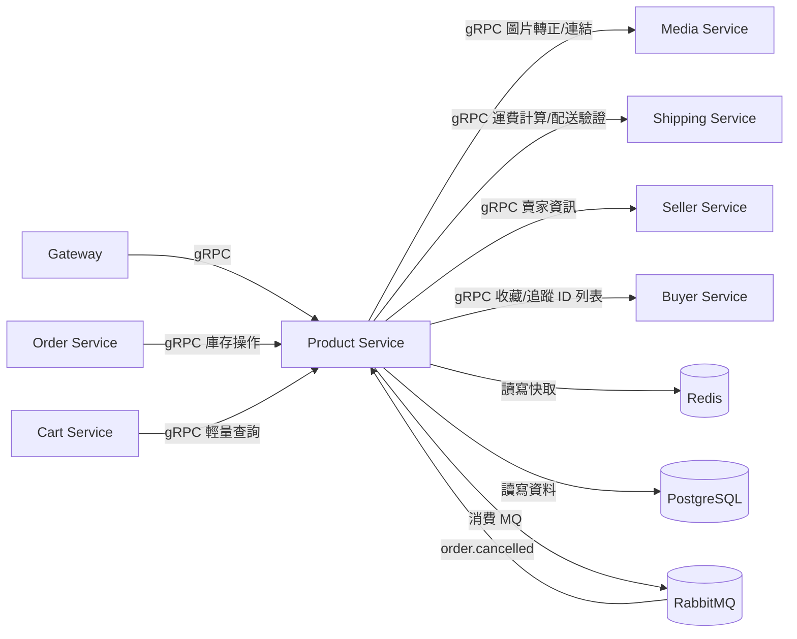

| 方向 | 協議 | 用途 |
|------|------|------|
| GW → PS | gRPC | 所有公開 / 賣家 / 管理員商品 API |
| PS → Media | gRPC | `FinalizeImages`：轉正 staged_token<br>`LinkImages` / `UnlinkImages`：建立 / 解除資產引用 |
| PS → Shipping | gRPC | `CalculateShippingOptions`：運費計算<br>`ValidateProductShipping`：SKU 配送方式驗證 |
| PS → Seller | gRPC | `BatchGetSellerMeta`：取得賣家名稱、Logo、city、district |
| PS → Buyer | gRPC | `ListFavoritedProductIds` / `ListSubscribedSellerIds`：取得使用者收藏 product_id / 追蹤 seller_id 列表（公開列表 `followed_product_only` / `followed_seller_only` filter 用，見 §5.3.4）。失敗時 product service 回 `FAILED_PRECONDITION`，gateway 翻成 503 |
| Order → PS | gRPC | `DeductStock` / `RestoreStock` / `GetStock`：庫存操作；`BatchGetProductForCheckout`：結帳鏈路批次查詢（接受 inactive，詳見 §5.5.2） |
| Cart → PS | gRPC | `GetProductSimple` / `BatchGetSkuCartInfo`：輕量查詢 |
| Order → PS | MQ | `order.cancelled`：訂單取消後非同步歸還庫存 |

### 1.3 非職責範圍

| 不負責 | 歸屬 |
|--------|------|
| 圖片上傳 / CDN 儲存 | Media Service（PS 僅編排轉正與引用） |
| 實際金流交易 | Order Service + Payment Service |
| 運費費率管理 | Shipping Service（PS 僅代理呼叫） |
| 賣家帳號管理 | Seller Service |
| 評論管理 | Review Service（PS 僅預留填充點） |

> **商品檢索屬本服務職責**：獨立的 search-service 已退役，`/api/v1/public/search/products` 與 `/api/v1/public/search/suggest` 由 Gateway（`SearchProductsViaES` / `GetSearchSuggestions`）轉呼叫 product-service `GetPublicProductList`，檢索基底為 `product.searchable_text` + `pg_trgm` GIN 索引（§3.2），多 token 規則見 §5.3.3；hashtag auto-complete 走 `SearchHashtags`（§5.12）。**無 Elasticsearch、無外部索引，也沒有索引同步流程**——寫入路徑同事務維護 `searchable_text` 就是唯一真實來源。原 search-service 專屬的 facet / highlight / score / `brand_id` 無任何前端消費者，隨服務一併退役（`/public/search/products` 實際只吃 `keyword` / `category_id` / `sort_by` / `sort_order` / 分頁）。

### 1.4 系統架構圖

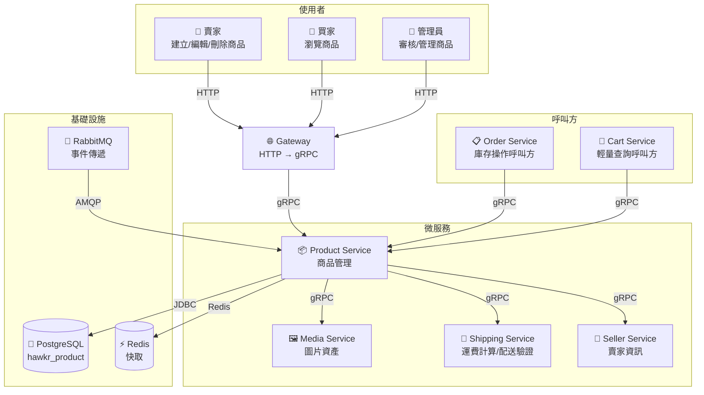

### 1.5 名詞定義

| 名詞 | 說明 |
|------|------|
| Product | 商品主體，包含名稱、描述、圖片集、認證、分類等 |
| SKU (Stock Keeping Unit) | 商品規格，每個 SKU 有獨立的價格、庫存、重量、包裝尺寸與配送方式 |
| Gallery | 商品圖片集（JSONB），結構 `[{asset_id, object_key}]` |
| Description | 商品描述（JSONB），支援圖文混排區塊（text / image） |
| Staged Token | Media Service 簽發的暫存上傳令牌，需 Finalize 轉為正式資產 |
| TSID | 時序分散式 ID，Product 主鍵格式（Node ID Base: 200） |
| Idempotency Key | 客戶端生成的 UUID，防止重複提交 |
| Stock Transaction | 庫存交易記錄，以 `(stock_tx_id, operation)` 複合主鍵確保冪等 |

### 1.6 角色邊界

| 角色 | 可執行操作 |
|------|-----------|
| 匿名 / 買家 | 瀏覽商品列表（僅 ACTIVE）、商品詳情（曾公開過的商品即可，見 §2.9）、相關商品、評分 |
| 賣家 (SELLER) | 建立 / 編輯 / 刪除商品、**上下架商品**、查看自己的商品列表（含非 ACTIVE）、運費計算 |
| 管理員 (ADMIN) | 查看任意商品詳情（不限狀態/擁有者）、更新商品狀態（審核）、清除快取 |
| Order Service | 庫存扣減 / 歸還 / 查詢（內部 gRPC，免權限） |
| Cart Service | 輕量查詢 SKU 資訊（內部 gRPC，免權限） |

---

## 2. 狀態模型與業務規則

### 2.1 商品狀態機 (ProductStatus)

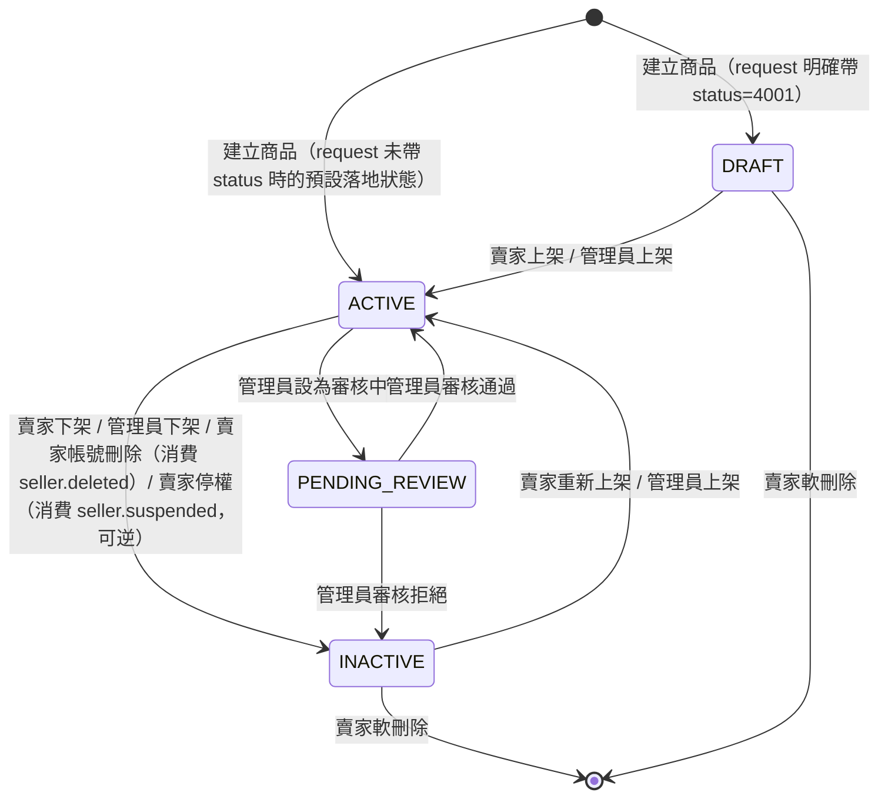

#### 賣家允許的狀態轉換（UpdateSellerProductStatus）

| 來源狀態 | 目標狀態 | 說明 |
|---------|---------|------|
| DRAFT (4001) | ACTIVE (4004) | 賣家上架（草稿→上架） |
| ACTIVE (4004) | INACTIVE (4003) | 賣家下架 |
| INACTIVE (4003) | ACTIVE (4004) | 賣家重新上架 |

**賣家禁止的操作**：
- 任何狀態 → PENDING_REVIEW (4002)：僅管理員可設定
- PENDING_REVIEW → 任何狀態：審核中的商品僅管理員可操作
- 任何狀態 → DRAFT (4001)：DRAFT 只能在 `CreateProduct` 當下由請求明確指定，商品建立後不可回退

| 狀態 | Code | Value | 公開列表 | 公開詳情 |
|------|------|-------|---------|---------|
| DRAFT | DRAFT | 4001 | 不出現 | 從未公開過 → 404；曾公開過 → 可看（§2.9） |
| PENDING_REVIEW | PENDING_REVIEW | 4002 | 不出現 | 同上 |
| INACTIVE | INACTIVE | 4003 | 不出現 | 同上（賣家下架的既售商品即屬此類，網址維持穩定） |
| ACTIVE | ACTIVE | 4004 | 出現 | 可看 |

> **`status` 管的是「能不能賣」，不是「能不能看」**：公開詳情的可見性由 §2.9 的 `ProductPublicationState` 判定，非 ACTIVE 不等於 404。公開**列表**則一律 `WHERE status = '4004'`，兩者判準不同。
>
> Enum 定義位於 `common-core`：`io.github.will413028.hawkr.common.utils.code.ProductStatus`

#### ACTIVE → INACTIVE 下架的四個觸發源

商品由 ACTIVE 下架為 INACTIVE 共有四個觸發源，前三者不可逆（由賣家/管理員後續自行重新上架），第四者為停權連動且**可逆**（解除停權自動還原）：

| # | 觸發源 | 路徑 | 可逆性 |
|---|--------|------|--------|
| 1 | 賣家主動下架 | `UpdateSellerProductStatus`（§5.10） | 賣家手動重新上架 |
| 2 | 管理員下架 | `UpdateProductStatus`（admin） | 管理員手動上架 |
| 3 | 賣家帳號刪除 | 消費 `seller.deleted` → `offShelfAllByMerchant`（§4.3.1） | 不可逆（帳號已刪） |
| 4 | **賣家停權** | 消費 `seller.suspended` → `offShelfForSuspension`（§5.10a，可逆快照） | **解除停權自動還原（§5.10a）** |

#### 賣家停權賣家不得轉 ACTIVE（收斂點 backstop）

商品狀態轉 ACTIVE 的收斂 transition（`UpdateSellerProductStatus` 上架、`CreateProduct` 以 ACTIVE 落地）**必須加一道賣家停權檢查**：讀 `SellerMeta.can_accept_orders`（gRPC，見 §5.10 步驟），停權賣家（`false`）不得把商品轉 ACTIVE。這是能力層 Gateway fail-open 窗口的**唯一不可逆殘留（產生公開商品）**兜底，屬單一收斂點防線（非逐路由 if），**任何重構不得移除或繞過**（見 46 號 §6.2）。

### 2.2 商品詳情存取權限

| 商品狀態 | 匿名 / 一般使用者 | 建立者（賣家） | 管理員 |
|---------|------------------|---------------|--------|
| ACTIVE (4004) | 可查看 | 可查看 | 可查看 |
| DRAFT (4001) | 從未公開過 → 404；曾公開過 → 可查看 | 可查看 | 可查看 |
| PENDING_REVIEW (4002) | 同上 | 可查看 | 可查看 |
| INACTIVE (4003) | 同上 | 可查看 | 可查看 |
| 賣家軟刪除商品（`deleted_at` 非空） | 404（`PRODUCT_REMOVED` / 3023） | 404 | 404 |
| 賣家帳號已刪除（`seller_deleted_at` 非空） | 404（`PRODUCT_REMOVED` / 3023） | 非 ACTIVE 者 404（帳號復活後舊商品對其隱形，44 §11） | 可查看（但不得轉 ACTIVE，見 §5.10） |

> **匿名列的判準是 `first_published_at`，不是 `status`**：`GetPublicProduct` 依 §2.9 的 `ProductPublicationState` 判定——`NEVER_PUBLISHED` / `REMOVED` 才是 404，`TEMPORARILY_UNAVAILABLE`（曾公開、目前下架）**回 200 並附完整內容**。這是刻意的：商品網址一旦對外散播（分享連結、搜尋引擎、社群貼文），下架不該讓它變成死連結。
>
> **安全設計**：不可查看時統一回傳 404，不回傳 403，避免洩漏商品存在。
>
> **建立者可查看 INACTIVE**：賣家必須能查看自己下架的商品，才能進行重新上架或編輯操作。

#### 2.2.1 自買標記（selfOwned）

`GetProduct`（App，已登入）Response 的 `ProductDetail` 額外回傳 `bool self_owned` 旗標，標示**當前請求者是否為商品 owner**（`storeId == product.store_id`）。

| RPC | self_owned 行為 |
|---|---|
| `GetProduct`（App，需 JWT） | 由請求解析出的 `storeId` 與 `product.store_id` 比對；賣家自己看自家商品為 `true` |
| `GetPublicProduct`（匿名） | **不填**（語意上無登入身份可比對；proto 預設值 `false`）。前端若已登入應改打 `GetProduct` |
| `GetProductForAdmin`（管理員） | 固定回 `false`（admin 端不展示此旗標；且 ADMIN/SELLER 屬不同 accountType，比對亦無意義） |

**前端使用情境**：商品詳情頁若 `selfOwned=true`，前端 disable「加入購物車 / 直接購買」按鈕，並顯示提示文案，避免使用者點擊後才在後端被擋。後端在加入購物車（`CART_SELF_ITEM_NOT_ALLOWED`/6006）、checkout validate / preview / 下單（`SELF_PURCHASE_NOT_ALLOWED`/4015）共**四個入口**都有阻擋，前端 disable 只是 UX 前置優化。

#### 2.2.2 商品圖片 gallery 結構與 assetId 可見性

商品詳情 Response 的既有圖片以結構化 `gallery` 陣列回傳（與商品列表 Response 對稱），每張圖片保留資產識別與可重用性：

| 欄位 | 說明 |
|---|---|
| `assetId` | media 資產識別值（對應 `product.gallery[].asset_id`），供賣家更新時 round-trip 保留既有圖。**內部識別碼，不對公開端外露** |
| `objectKey` | 媒體物件路徑（`public/` 前綴），前端據此組 preset URL（49 §4.4） |
| `url` | 完整顯示 URL（Gateway 由 `MEDIA_BASE_URL` + objectKey 組；49 §6.1） |

product-service 各 RPC（`GetProduct` / `GetProductForAdmin` / `GetPublicProduct`）一律回傳完整 `gallery`（含 `asset_id`）；**`assetId` 的對外可見性由 Gateway 序列化層依 endpoint / handler 決定**（比照 §2.2.1 selfOwned 的端別差異慣例）：

| Endpoint（Gateway handler） | gallery 形狀（Gateway DTO） | `description.blocks[]` 形狀（Gateway DTO） |
|---|---|---|
| `GET /app/products/:id`（賣家編輯詳情，`GetSellerProductDetail`） | `GalleryItem{assetId, objectKey, url}` | `DescriptionBlockResponse`（含 `assetId`） |
| `GET /admin/products/:id`（`GetAdminProductDetail`） | `GalleryItem{assetId, objectKey, url}` | `DescriptionBlockResponse`（含 `assetId`） |
| `GET /public/products/:id`（匿名商品詳情，`GetProductDetailByID`） | `PublicGalleryItem{objectKey, url}`——**只隱藏 `assetId`** | `PublicDescriptionBlock`（無 `assetId`，其餘欄位同上）——**只隱藏 `assetId`** |
| `GET /public/search/products`（匿名商品搜尋，`SearchProductsViaES`） | `PublicGalleryItem{objectKey, url}`——**只隱藏 `assetId`** | 不回傳 `description` |

商品描述區塊（`description.blocks[]` 的富文本內嵌圖）適用同一條界線，**且用同一種手法**：公開端另立 `PublicDescriptionBlock`（連同容器型別 `PublicProductDescription`），型別上就沒有 `assetId`，`objectKey` / `url` 保留。

> **為什麼界線劃在 `assetId` 而不含 `objectKey`**：兩者不是同一種東西。`assetId` 是 media 資產 TSID——內部識別碼，只有賣家編輯 round-trip 需要它；`objectKey` 是 `public/` 前綴的公開物件路徑，image Worker 本來就對任何人服務（49 §4.4）。而且**同一份回應的 `imageKeys[]` 早已列出全部 gallery objectKey**：清掉 gallery 那一份沒有隱藏任何資訊，只讓同一份 JSON 自相矛盾。代價卻是實質的——前端拿不到 key 就只能用 `url`（`/i/original/`）渲染，商品卡與搜尋結果整頁被迫載原圖；更嚴重的是**商品描述內嵌圖的 objectKey 不在 `imageKeys` 內**，清掉之後公開端永遠無法走 preset 壓縮，且沒有其他管道補回來。
>
> **公開端與賣家端是兩個 DTO，不是同一個 DTO 在執行期清欄位**：公開形狀由 `PublicGalleryItem` / `PublicDescriptionBlock` 承載，賣家 / Admin 形狀維持 `GalleryItem` / `DescriptionBlockResponse`。共用同一型別再於執行期清空欄位，會讓 swagger 宣告出一組公開端永不出現的欄位（前端照文件接就拿到 undefined），型別分離才使宣告等於實際輸出。**gallery 與描述區塊兩處都適用這條，沒有例外**——留一處走執行期清空，等於這條原則只寫在文件上。
>
> 公開 DTO（`PublicProductDetailItem`）以「內嵌賣家 DTO ＋ 外層同名欄位遮蔽」承載這個形狀差異（`encoding/json` 同名欄位取較淺層）。代價是新增區塊欄位時公開與賣家兩個型別都要加，由 `TestPublicDTOFieldParity`（欄位集合對拍）與 `TestGalleryAssetIDVisibility`（序列化後 key 計數）兩個測試守住。

> **隱藏綁定在公開 endpoint / handler，而非 RPC 名稱**：`GET /public/products/:id` 在賣家登入狀態下底層雖改走 `GetProduct`（見 §5.5 雙派發），Gateway handler（`convertToPublicProductDetail`）一律轉成上表的公開型別；公開搜尋於 `buildSearchResult` 同樣只組 `PublicGalleryItem`。故匿名 / 公開端在任何路徑都不會取得內部資產識別碼——**不是「記得清掉」，是型別上根本沒有那個欄位可填**。

**排序與識別**：`gallery` 無 per-image id，圖片順序即陣列順序，既有圖以 `assetId` 唯一識別。

**前端使用情境（賣家編輯）**：賣家在商品編輯頁僅調整既有圖片順序時，直接以既有圖 `assetId` 依目標順序重送，免去「下載 CDN 圖 → 重新上傳取 `stagedToken`」的迂迴（該迂迴在 CDN 未帶 CORS 標頭時會被瀏覽器封鎖，導致儲存失敗）。`PUT /app/products/:id` 的 `images` 陣列可混用既有圖 `{assetId}` 與新增圖 `{stagedToken}`：寫入端 `processImageUpdate` 依 `assetId` 從 `existingGallery` 找回既有圖並**保留其相對輸入順序**，新增圖（`stagedToken`）轉正後**附加於既有圖之後**。**賣家純重排既有圖順序**（本節主要動機情境）順序完全保真；惟目前寫入端將新增圖統一置於既有圖群組之後，尚不保證「新增圖精確插入既有圖之間」的交錯順序（既有寫入端行為侷限，另立 follow-up 處理）。

**相容性**：既有 `images: string[]` / `imageUrl` 欄位維持回傳不移除（依《API 設計規範》§十五：同版本僅新增欄位、不刪不改型別）。

### 2.3 軟刪除規則

- 僅允許 `DRAFT (4001)` 和 `INACTIVE (4003)` 狀態的商品刪除
- `ACTIVE (4004)` 必須先下架再刪除，避免影響進行中的訂單
- `PENDING_REVIEW (4002)` 不可刪除（審核中）
- 刪除方式：設定 `product.deleted_at = NOW()`（軟刪除）

> **下架與履行解耦（設計意圖）**：商品下架（`ACTIVE → INACTIVE`）**不檢查**該商品是否有進行中的訂單 / 出貨單，亦無任何跨服務履行狀態查詢。下架語意為「停止新訂單流入」，是賣家停售的合理動作；既有訂單與出貨單由 order / shipping 各自狀態機獨立推進，不受下架影響。訂單保護的門檻設於**刪除**（§2.3：ACTIVE 必須先下架再刪除）而非下架。product-service 不持有 OrderGrpcClient，下架僅改 `product.status` + 清快取 + hashtag 計數 + 補貨偵測，不寫任何 `shipments` / 訂單資料。

### 2.4 庫存管理規則

| 規則 | 說明 |
|------|------|
| 原子性 | 多 SKU 全部或全無，一個不足全部回滾 |
| 冪等性 | `(stock_tx_id, operation)` 複合主鍵防止重複操作 |
| SQL 原子條件 | `WHERE stock_qty >= #{quantity}`，庫存不足時 affected=0 |
| DB 約束 | `CHECK (stock_qty >= 0)` 防止庫存為負數 |
| 排序防死鎖 | 按 skuId 升序加鎖 |
| 快取清除 | 交易 commit 後（afterCommit 單一入口）清除受影響商品的 `prod:detail:{productId}` + 反查 owner 的 list bucket |

### 2.5 分類結構

支援三層分類架構（第一層 → 第二層 → 第三層）。**分類無審核機制，新增即生效。**

#### 2.5.1 狀態值

分類狀態使用 `CommonStatus` Enum，僅保留兩個值：

| Value | Label | 說明 |
|-------|-------|------|
| `9004` | ACTIVE | 正常使用中（新增分類預設值） |
| `9003` | INACTIVE | 軟刪除（仍佔用 `(name, parent_id)` unique index 位置） |

#### 2.5.2 角色可見性

| 場景 | 可見範圍 |
|------|---------|
| 公開分類 API（`/public/categories/*`） | 僅 ACTIVE |
| 公開商品 API（`/public/products/*`）所附帶的 `categoryName` | ACTIVE + INACTIVE 都顯示（避免商品掛軟刪除分類時前端破口） |
| 賣家分類樹 | 僅 ACTIVE |
| Admin 分類樹 | 預設僅 ACTIVE，加 `?include=deleted` 顯示軟刪除 |

#### 2.5.3 新增規則

- 賣家、Admin 皆可新增任何層級（L1 / L2 / L3）
- **同名同父自動套用**：若 `(parentId, name)` 已存在 ACTIVE 分類，直接回傳該 ID（HTTP 200，response 結構與新建一致，無 `wasReused` 旗標）
- 撞到 INACTIVE（軟刪除）同名同父：回 `CATEGORY_NAME_RESERVED` + 文案「名稱可能存在不合法字元，請檢查後再新增。如有其他問題請聯絡客服。」
- 不存在則 INSERT，`status` 預設 `9004 ACTIVE`

#### 2.5.4 修改規則（Admin 專屬）

| 對象 | 允許操作 | 備註 |
|------|---------|------|
| 分類本身 | **僅可改名**（`PATCH /admin/categories/:id`），不可改 `parent_id` | 改父類別會影響大量商品反正規化，禁止 |
| 商品的分類 | **批次更換**（`POST /admin/products/batch-change-category`），限 L3 → L3 | 必須**同步更新** `product.category` / `category_lv2` / `category_lv1` 三欄位 |

#### 2.5.5 軟刪除規則

- 刪除執行 `UPDATE category SET status='9003', deleted_at=NOW(), updated_at=NOW() WHERE id=?`
- 前置條件（**同時滿足**才能刪）：
  - 底下無商品（L1 看 `category_lv1`、L2 看 `category_lv2`、L3 看 `category`）
  - 底下無 ACTIVE 子分類
- 批次刪除：按拓樸排序執行（L3 → L2 → L1），任一筆失敗整批 rollback
- 還原：`POST /admin/categories/:id/restore`，若同名同父已存在 ACTIVE 或父分類已軟刪除則拒絕

### 2.6 冪等性規則

1. `idempotency_key` 為必填欄位，不傳回傳 400
2. 相同 `key` + 相同 `request_hash` = 返回先前結果（正常重試）
3. 相同 `key` + 不同 `request_hash` = 返回 409（請求內容不一致）
4. 不同 `key` = 視為新請求
5. `IN_PROGRESS` 狀態 = 返回 409（請求正在處理中）
6. `FAILED` 狀態 = 允許重試（刪除舊記錄重新插入）

### 2.7 快取策略

**快取服務**：`ProductCacheService`（Cache-Aside 模式）

| 快取對象 | Key Pattern | TTL | 使用方 |
|---------|-------------|-----|--------|
| 商品詳情 | `prod:detail:{product_id}:{onboarding_sig}` | 1 小時 | `GetPublicProduct`（僅在通過 §2.9 可見性判定後才讀寫；判定本身走 DB 不走快取） |
| 商品列表 | `prod:list:{owner_store_id}:{query_hash}:{list_onboarding_sig}` | 5 分鐘 | `GetProductList` |
| 分類表 | `cat:all` | 2 小時 | `CategoryService` 所有讀取操作 |
| ❌ 不快取 | — | — | `BatchGetProductForCheckout`（結帳鏈路即時 status / stock_qty，禁止走任何 Redis 快取，見 §5.5.2） |

- `query_hash` = MD5(categoryId + page + sort + status + keyword + viewer-aware filters) 取前 8 位；owner scope 由 key prefix 的 `owner_store_id` 隔離
- `onboarding_sig` = `SHA1(store_id + sorted_enabled_shipping_types)` 取前 8 位，從 `getSellerShippingConfig(storeId)` 結果計算（同一 seller toggle 後 sig 變動 → key 自然 miss，§2.7.2）
- `list_onboarding_sig` = 列表內所有 seller 的 `onboarding_sig` 排序後再 SHA1 取前 8 位（列表中任一 seller toggle 即 invalidate）
- `GetProduct`（含權限檢查版本）不使用快取，需即時判斷權限
- 清除機制：
  - `evictProductDetail(productId)`：以 pattern `prod:detail:{product_id}:*` wildcard 刪除（key 含 onboarding_sig 後綴，必須 pattern delete）
  - `evictProductList(storeId)`：透過 pattern `prod:list:{store_id}:*` 批量清除（只清「該 owner bucket」一個分桶）
  - `evictProductListForWrite(ownerStoreId)`：**所有商品寫入路徑的唯一列表失效入口**。同時清除 owner bucket（`prod:list:{ownerStoreId}:*`，對應 `GetSellerProducts` fallback 與賣家自管列表）**與公開聚合 bucket 0**（`prod:list:0:*`，對應 `/public/products?store_ids=...` 主列表與站內瀏覽 / 搜尋）。理由：公開主列表（含「依賣家篩選」）的 cache key ownerStoreId 恆為 0（Gateway 帶複數 `store_ids` → `query.ownerStoreId` 為 null → ownerId 落到 0），與賣家自身 bucket 分屬不同分桶；寫入只清 owner bucket 會漏掉公開列表，造成「新上架商品不出現 / 已下架商品仍顯示」最長至 `LIST_TTL` 的陳舊，並在 frontend 重抓時把舊資料回灌進 24h SSR 快取。**寫入路徑禁止各自手動拼 `evictProductList(ownerStoreId)` + `evictProductList(0L)`，一律走本 helper，杜絕漏清分桶。**
  - `evictAllProductLists()`：清除所有列表快取
  - `evict()`：清除分類表快取
- 快取失效觸發點（寫入路徑一律走 `evictProductListForWrite`）：
  - `createProduct()` / `updateProduct()` / `updateProductStatus()`（admin）/ `updateSellerProductStatus`（賣家上下架）/ `softDeleteProduct()` → 清除商品詳情 + `evictProductListForWrite(ownerId)`（owner bucket + 公開聚合 bucket 0）
  - `DeductStock` / `RestoreStock` / `OrderCancelledConsumer`（三條庫存寫路徑）→ 由 `StockService.cascadeProductStock` 內**單一 afterCommit hook** 收斂失效：commit 後一次清除受影響 `prod:detail:{productId}` + 反查 owner 後 `evictProductListForWriteBatch(owners)`（`stock_qty` 亦在 `ProductListItemDTO`，列表卡「售完 / 現貨」需與 detail 同步）。🔴 **必須在 afterCommit 才 evict**：事務內 evict 會讀到未提交狀態並把它回填進快取。三條路徑共用同一入口，**gRPC handler 不得二次清除**
  - 反正規化欄位 MQ 更新路徑（`SalesAccumulatedConsumer` 銷量 / `ReviewStatsService` 星等 + 評論數 / `FavoriteCountService` 收藏數）→ 清除 `prod:detail:{productId}` + 反查 owner 後 `evictProductListForWrite(ownerId)`（`salesCount` / `rating` / `reviewCount` / `favoriteCount` 皆出現在 `ProductListItemDTO`，只清 detail 會讓列表陳舊至 `LIST_TTL`）
  - **認證審核路徑**（`APPROVE` 人工＋系統自動 / `REJECT` / `REVOKE` / `WITHDRAW` / `SUPERSEDE`）→ 清除 `prod:detail:{productId}` + `evictProductListForWrite(storeId)`；ADM 批次跨多 owner 走 `evictProductListForWriteBatch`；SSR tag `product:<id>`。🔴 **這些路徑不經 `ProductService.updateProduct`，evict 不會自動觸發，必須顯式呼叫**；且**前提是同事務內已重建 approved-only 投影**（§7.5c），否則清快取只是讓它重讀同一份 stale JSONB（清了等於沒清）。詳見 [19 號 §13](19-農業認證驗證%EF%BC%88Certification%20Verification%EF%BC%89詳細設計書.md)
  - 任何 admin / 賣家對分類的寫入操作（新增 / 改名 / 軟刪除 / 還原 / 批次更換商品分類）→ 清除分類表快取 `cat:all`
- 外部清除 API：`PurgeProductCache`（scope: all / detail / list / category）

#### 2.7.2 `shipping_methods` 在 read path 的時效性處理（強制）

> **與 06 shipping `seller_shipment_settings.enabled` 的契約**：read path 為 SSOT，不依賴 shipping-service 主動通知。

`product.shipping_methods` JSONB 反正規化欄位（§3.2 / §5.13a）為**商品所支援的配送方式**快照，由 SKU 聯集寫入。**它不反映賣家當下的 onboarding `enabled` 狀態** — 賣家停用 7-11 onboarding 不會同步進 product 表。

因此**所有公開 read path** 回傳 `shipping_methods` 前，**必須**透過 `SellerShippingFilter`（common-core utility，跨 product / order 共用）對 `(store_id, shipping_methods)` 與當前 `getSellerShippingConfig` 結果取交集，剔除 dangling 方式。

涵蓋的 RPC 明列：
- `GetPublicProduct`（詳情，路由 `/api/v1/public/products/:id`）
- `GetProductList`（列表，路由 `/api/v1/public/products`、`/api/v1/public/sellers/:id/products`）
- `GetProductInfoByID`（brief，路由 `/api/v1/public/products/:id/brief`）
- `GetRelatedProducts`（路由 `/api/v1/public/products/:id/related`）

**實作位置（強制）**：
- `SellerShippingFilter`：`services/java/shared/common-core/src/main/java/io/github/will413028/hawkr/common/utils/shipping/SellerShippingFilter.java`（與既有 `ShippingAreaResolver` / `WeightConverter` 同 package）
- caller 改動：`services/java/product-service/src/main/java/io/github/will413028/hawkr/product/converter/ProductEntityConverter.java`（toDetailDTO / toListItemDTO）+ `ProductService.java`（`getPublicProduct` / `getProductList` / `getProductInfoByID` / `getRelatedProducts`）

**快取 key 加 onboarding 版本指紋**：
- 詳情 cache 重新設計為 `prod:detail:{product_id}:{onboarding_sig}`
- `onboarding_sig` = `SHA1(store_id + sorted_enabled_shipping_types)` 取前 8 位，從 `getSellerShippingConfig` 結果計算
- 賣家 toggle onboarding 後 `onboarding_sig` 自動變動 → 新 cache key 自然 miss → 下次讀路徑取交集後回填新 cache
- 同一商品舊 cache 隨 TTL 過期清除，不需主動 evict

**effective shipping_methods 計算（單一定義）**：
```
effective_shipping_methods(product) =
  product.shipping_methods JSONB
  ∩ { (m.shippingMethod, m.goodsType) | m ∈ getSellerShippingConfig(store_id), m.available == true }
```

匹配規則：product JSONB 的 `(type, temperature)` 對應 shipping config 的 `(shippingMethod, goodsType)`；宅配（TAQBIN）`goodsType` 為空，匹配時 temperature 不參與比對（只比 shippingMethod）；超商 `goodsType` 即 temperature。

**List path 批次策略（防 N+1）**：`GetProductList` 內所有商品先 `distinct store_id` 收集 seller 集合，per-request memoize `getSellerShippingConfig(storeId)` 結果（一筆 list 內每位 seller 最多打 1 次）。不引入新的 batch RPC（避免 proto 改動），靠 in-request map 即可。

**禁止**：
- 在 `product.shipping_methods` JSONB 直接寫入 onboarding 狀態（會與寫路徑 SKU 聚合衝突）
- shipping-service 對 product-service 發送任何 `onboarding.changed` MQ event（[《後端服務責任邊界規範》](../開發規範/後端服務責任邊界規範.md) 反例）
- 為 onboarding 變更建立 cache evict cross-service chain（讀路徑為 SSOT）

**例外**：賣家中心 `/app/products` / `/admin/products` 路徑回傳的 `shipping_methods` 不過濾 dangling — 該路徑為「賣家視角看自己上架商品」，需保留商品原始上架時的 capability snapshot。

#### 2.7.1 分類表快取設計

分類表資料量小（幾十～幾百筆），採用**整表快取**策略：

**快取結構**：`cat:all` → `Map<Long, CategoryEntity>` 的 JSON，TTL 2 小時

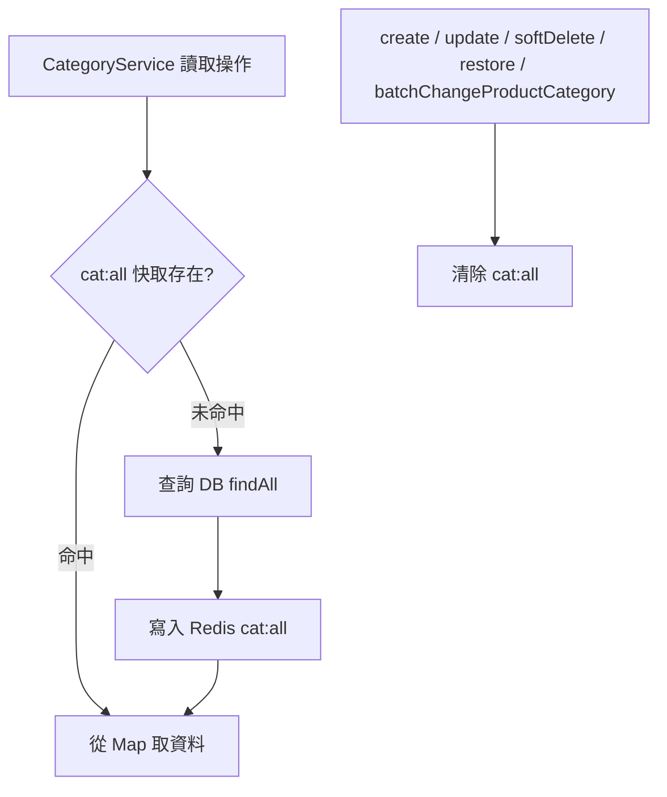

**覆蓋方法**：

| 方法 | DB 查詢 | 快取實作 |
|--------|--------|---------|
| `findById(id)` | `SELECT * FROM category WHERE id = ?` | `map.get(id)` |
| `findAll()` | `SELECT * FROM category` | `map.values()` |
| `findByStatus(status)` | `SELECT * FROM category WHERE status = ?` | `map.values().stream().filter(...)` |
| `findByParentId(parentId)` | `SELECT * FROM category WHERE parent_id = ?` | `map.values().stream().filter(...)` |
| `findTopCategories()` | `SELECT * FROM category WHERE parent_id IS NULL` | `map.values().stream().filter(...)` |
| `findActive()` | `SELECT * FROM category WHERE status = '9004'` | `map.values().stream().filter(active)` |

> 快取 map 仍包含 INACTIVE 分類，目的是讓商品詳情可反查軟刪除分類的名稱。ACTIVE / INACTIVE 過濾在使用時於記憶體做。

**清除時機**：
1. `createCategory()` / `updateCategory()` / `softDeleteCategory()` / `restoreCategory()` → `evict()`
2. `batchChangeProductCategory()`（admin 批次更換商品分類）→ `evict()`
3. 外部 API `PurgeProductCache(scope=category)` → `evict()`

**實作位置**：`CategoryCacheService`（新增），模式與 `ProductCacheService` 一致

#### 2.7.3 Redis 失聯時的降級行為（graceful degradation，強制）

> **契約**：商品 / 分類快取為**純效能優化**，DB 才是 source of truth。Redis 單點失聯（連線拒絕 / command timeout）時，**讀路徑必須降級回 DB（仍回 200）**，**禁止**讓 cache 例外 propagate 成 HTTP 500。此為 cache-aside 模式的必要韌性，與 coupon-service / cart-service 既有慣例一致。

**降級語意（依操作種類）**：

| 操作種類 | 涵蓋方法 | Redis 失聯時行為 |
|---|---|---|
| 讀取（read） | `getProductDetail` / `getProductList` / `getOriginsSummary` / `CategoryCacheService.getAllCategoryMap` | 視同 **cache miss** → caller 走 DB → 回 200（恢復後下次讀路徑自然回填 cache） |
| 寫回（cache write） | `cacheProductDetail` / `cacheProductList` / `cacheOriginsSummary` / `CategoryCacheService.getAllCategoryMap()` 內嵌寫回（非獨立方法） | `log.warn` 後**繼續**，不影響當次回應（資料已從 DB 取得） |
| 清除（evict） | `evictProductDetail` / `evictProductList` / `evictAllProductLists` / `CategoryCacheService.evict()` | `log.warn` 後**繼續**，不阻斷觸發清除的寫入業務（商品 / 分類 CRUD）；redis 失聯時快取本就不可達，恢復後由 TTL 自然收斂 |

**攔截範圍（強制）**：所有 Redis 操作必須攔截 `org.springframework.dao.DataAccessException`（Spring Data Redis 對 Lettuce 連線失敗 / `RedisCommandTimeoutException` 的統一翻譯型別），與既有 `JsonProcessingException`（壞快取 → 刪 key 視同 miss）並存；`JsonProcessingException` 分支內的 `delete` 為 best-effort（透過 `safeDelete(key)` helper 包裝 `redisTemplate.delete()` + catch `DataAccessException`，redis 同時失聯不得二次拋）。

> **降級延遲（強制配置）**：Redis 失聯（`docker pause` 類，TCP 仍存活但凍結）時，Lettuce 會等到 command timeout 才拋 `DataAccessException`。單次商品詳情請求會堆疊多個 redis 操作（詳情 GET/SET + 分類表 GET/SET ×3 層），若 command timeout 過長（原 5000ms），堆疊後超出 **Gateway 請求 deadline（10s）→ 回 503**，無法達成降級回 200。因此 product-service `application.yml` 同時設 `spring.data.redis.timeout: 500ms`（command timeout，涵蓋 `docker pause` 凍結連線）與 `spring.data.redis.connect-timeout: 500ms`（連線建立逾時，涵蓋 redis 節點被殺 / 連線拒絕 / 需重建連線的場景；Lettuce 預設約 10s，未設會撞 deadline）。商品 / 分類快取為純效能優化（DB 為 SSOT），與同叢集正常 redis 延遲（< 5ms）相比有大量餘裕，失聯時每個操作 500ms 內快速失敗 → 整體仍遠低於 10s deadline → 走 DB 回 200。正常運作（cache hit / miss）不受影響。兩者皆設短才能涵蓋所有失聯模式（凍結 + 連線重建）。

**讀路徑降級流程**：

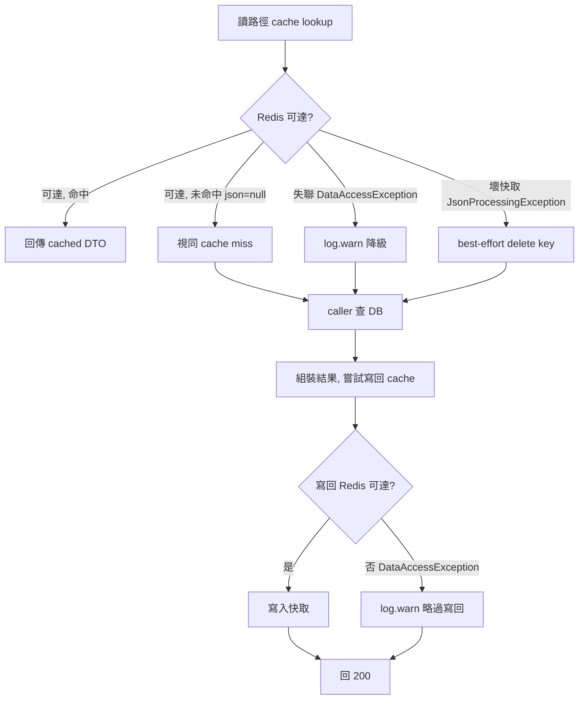

**認證驗證（GovCertificationService）降級**：該服務用 Redis 做政府 API 結果快取 + circuit breaker。Redis 失聯時 → 結果快取讀取視同 miss、circuit 視同未開；快取寫回失敗 log.warn 略過。

> 🔴 **商品 create / update / import-commit 等同步寫入路徑不得呼叫 `verify()`**。
> `verify()` 逾時／IO 例外會呼叫 `openCircuit()` 寫 `gov:cert:circuit:{type}`（TTL 60s、per-type、**Redis 全域共享**），使緊接著排出去的**背景查驗**落在 60 秒窗口內被短路成 `UNAVAILABLE` —— 同步路徑會把背景機制自己封死。
> ⇒ 同步階段**只讀 Redis 結構化查驗快取**（新前綴 `gov:certv2:{type}:{hash}`），**零外部呼叫**；未命中即落 `SUBMITTED(PENDING)` 並發事件排背景查驗。**商品建立永不被政府 API 影響，這是結構保證不是約定。**
> Redis 失聯時同步階段一律視同 miss ⇒ 全部走背景查驗，商品寫入不受阻。詳見 [19 號 §8.2](19-農業認證驗證%EF%BC%88Certification%20Verification%EF%BC%89詳細設計書.md)。

**實作位置（強制）**：

| 檔案 | 涵蓋方法 |
|---|---|
| `services/java/product-service/.../service/ProductCacheService.java` | `getProductDetail` / `getProductList` / `getOriginsSummary`（讀）、對應 `cache*`（寫回）、`evictProductDetail` / `evictProductList` / `evictProductListForWrite`（寫入路徑唯一失效入口，含公開 bucket 0）/ `evictAllProductLists`（清）、`safeDelete` helper |
| `services/java/product-service/.../service/CategoryCacheService.java` | `getAllCategoryMap`（讀 + 內嵌寫回）、`evict`（清）、`safeDelete` helper |
| `services/java/product-service/.../service/GovCertificationService.java` | `verify` / `verifyDetailed`（結果快取讀 + circuit 讀 + 結果快取寫回）。⚠️ 背景查驗路徑用獨立的長 timeout 並**繞過同步用 circuit** |
| `services/java/product-service/.../grpc/ProductGrpcService.java` | `PurgeProductCache`（admin 清快取 RPC）的 inline `keys/delete` 經 `safePurgeByPattern` helper 包裝，Redis 失聯時回 0 不 500 |

**不適用降級的用途（必須 fail-closed，禁止套用本節）**：

- **本服務內**：`IdempotencyService`（product-service 用 **DB** `idempotency_request` 表，非 Redis；其一致性由 DB 保證，與本節無關）、`BatchGetProductForCheckout` 結帳即時 status / stock_qty（§5.5.2 本就**禁止**走任何 Redis 快取）。
- **通則（散見其他服務，凡 Redis 即 SSOT 者）**：分散式鎖（common-core `DistributedLockService`）、冪等鍵（common-core `IdempotencyService`）、結帳鎖（cart-service `CheckoutService`）、session / ws_ticket / blacklist（gateway）。這些 Redis 為唯一真實來源，失聯時應如實失敗，不得降級。🔴 **若在 product-service 引入以 Redis 為 SSOT 的機制（鎖／冪等鍵／session），一律 fail-closed，不得套用本節的降級策略。**

### 2.8 特價（Sale Price）規則

商品 SKU 支援單一「特價」欄位，作為當前實際成交單價的覆寫值。

#### 2.8.1 欄位語意

| 概念 | 對應欄位 | 說明 |
|------|---------|------|
| 原價（list price） | `product_sku.price` | 始終存在，供前端 strike-through 顯示 |
| 特價（sale price） | `product_sku.sale_price` | 可選；非 NULL 即為當前生效特價 |
| 實際成交單價 | 衍生：`sale_price ?? price` | 不入庫；計算邏輯散見於下游服務 |

> **NULL 在線路上的表示分兩種，不可混用**：
> - **SKU 層**（`ProductSku.sale_price`、`SkuInfo.sale_price`）：無特價 → **空字串**。入站 `parseLongOrNull("")` 回 NULL，雙向對稱。
> - **商品層彙總**（`ProductDetail` / `ProductListItem` 的 `sale_price_min` / `sale_price_max`，以及 `price_min` / `price_max` / `list_price_min` / `list_price_max`）：無值 → **`"0"`**（走 `ProtoConversionUtils.formatAmount`）。入站 `ProductProtoConverter.parseLong` 把 `"0"` 讀回 NULL，同樣雙向對稱。
>
> 商品層之所以不用空字串：`product.go` / `seller_product.go` 的商品 DTO 這六個欄位都帶 `omitempty`，空字串會讓整個鍵從回應中消失；而 `favorite.go` 的六個對應欄位是 `int64`（`saved_items.go` 的 `priceMin` 同樣），鍵消失即讀成 0。改動即為對每個商品的破壞性契約變更，不是 null-handling 的口味問題。

#### 2.8.2 特價校驗

賣家於 `CreateProduct` / `UpdateProduct` 傳入 SKU `sale_price` 時：

- 允許 NULL（清空 = 撤回特價）
- 非 NULL 必須 `> 0`
- 非 NULL 必須 `< price`（特價必須低於原價，等於亦不允許）
- 不接受負數或字串

校驗失敗 → 回 `INVALID_ARGUMENT`，錯誤訊息明確指出違反哪一條。

#### 2.8.3 特價有效期

僅支援「**永久特價**」：賣家設定後一直生效，直到清空欄位即視為撤回。**不**支援限時特價（無 `start_at` / `end_at` 欄位）。

#### 2.8.4 商品列表排序語意

`/api/v1/public/products` 與 `GetProductList` RPC 支援 5 種排序，對應 [`ProductSort` CodeMeta](../代碼管理（CodeMeta）/業務類型碼.md#ProductSort)；不送 sort 視為 `LATEST`，非法值由 Gateway 回 HTTP 400。詳見 [35 設計書](35-商品列表排序與銷量反正規化（Product%20Sort%20%26%20Sales%20Count）詳細設計書.md)。

| Value | SQL ORDER BY | 對應 partial index |
|-------|------------|------------------|
| `LATEST` | `created_at DESC` | `idx_product_active_created_at` |
| `PRICE_ASC` | `price_min ASC NULLS LAST` | `idx_product_active_price_min` |
| `PRICE_DESC` | `price_max DESC NULLS LAST` | `idx_product_active_price_max` |
| `RATING` | `rating DESC NULLS LAST, created_at DESC` | `idx_product_active_rating` |
| `SALES` | `sales_count DESC, created_at DESC` | `idx_product_active_sales` |

「依價格排序」一律以「**實際成交單價**」為準（即 `effective_price`），對應 `product.price_min / price_max` 欄位。原價區間（`list_price_min / list_price_max`）僅供前端顯示用，不參與排序。

`hit_count`（多 token keyword 命中數）為條件式 ORDER BY 第一鍵：有 keyword 時參與（搜尋命中度優先），無 keyword 時不參與避免虛排。各 sort 鍵後補 `p.id DESC` 作 tie-breaker 確保 pagination 穩定。

#### 2.8.5 編輯狀態守門

`UpdateProduct` 接受編輯時，必須驗證商品狀態屬於 `DRAFT (4001)` 或 `INACTIVE (4003)`，否則拋 `ProductBusinessException(GrpcResponseCode.PRODUCT_EDIT_REQUIRES_INACTIVE, ...)`，回應業務碼 **3019**，訊息「商品需先下架後再編輯（目前狀態：%s）」（%s 帶入當下狀態 value）。

- 上下架狀態轉換走 `UpdateSellerProductStatus`（§5.10），**不受**本守門影響
- 此規則適用於 SKU 全部欄位（含 `sale_price`、`price`、`stock_qty`、運送方式等），不只針對特價

> 本守門為「商品編輯規則」整體政策，與「特價」是兩條並列的需求；落實在 `updateProduct` 入口統一處理。

#### 2.8.6 快照與下游服務

特價只存在於 Product Service 主表。下游服務（Cart / Order）於使用者操作當下取得「實際成交單價 + 原價」雙快照寫入自己資料表，後續不主動回查 Product；賣家事後改特價不影響購物車與訂單既有商品。

詳細快照欄位定義見：
- 購物車微服務設計書 §3 CartItem
- 訂單微服務設計書 §3 OrderItem

### 2.9 商品公開生命週期（ProductPublicationState）

商品有**兩條互相獨立的軸**，混為一談是本服務最容易做錯的地方：

| 軸 | 問題 | 由誰決定 |
|---|---|---|
| **銷售狀態**（`ProductStatus`） | 這個商品現在**能不能賣**？ | `product.status`，可反覆變動（上架 / 下架 / 審核） |
| **公開生命週期**（`ProductPublicationState`） | 這個商品的頁面**能不能給人看**？ | 由 `first_published_at`、`status`、兩個刪除欄位**推導**，不另存第二套可變狀態 |

Enum 定義見 [業務狀態碼 § ProductPublicationState](../代碼管理%EF%BC%88CodeMeta%EF%BC%89/業務狀態碼.md#ProductPublicationState)（`NEVER_PUBLISHED` / `PUBLIC` / `TEMPORARILY_UNAVAILABLE` / `REMOVED`）。

#### 2.9.1 `first_published_at`：不可變的「曾公開過」事實

- 型別 `TIMESTAMPTZ`，nullable；語意為**首次進入 ACTIVE 的時間**。`NULL` = 無法證明曾公開過。
- **一旦寫入永不改變**：下架、再上架、改價、改分類都不影響它。
- **寫入時機**：任何路徑把 `status` 落地為 `ACTIVE (4004)` 且當前值為 `NULL` 時寫入 `now()`。
- **雙層保證**：應用層由 `ProductPublicationPolicy.firstPublishedAtOnActivation(...)` 在 `CreateProduct`（converter 落地）、`UpdateProductStatus`（admin）、`UpdateSellerProductStatus`（賣家）三處計算；DB 層另有 `BEFORE INSERT OR UPDATE` trigger `set_product_first_published_at` 兜底。理由：product 另有 import 轉正、停權批次還原等 SQL 寫入路徑，**DB invariant 才能保證任何路徑都只寫一次、且後續 UPDATE 不得覆寫**。
- ⚠️ **`NULL` 不得被猜測補值**：把 INACTIVE 商品推測成「曾公開」會讓從未公開的草稿／審核未過商品洩漏出去。

#### 2.9.2 推導規則（`ProductPublicationPolicy.deriveState`）

依序判定，命中即返回：

| # | 條件 | 推導結果 |
|---|------|---------|
| 1 | `deleted_at` 或 `seller_deleted_at` 非空 | `REMOVED` |
| 2 | `first_published_at IS NULL` | `NEVER_PUBLISHED` |
| 3 | `status = ACTIVE (4004)` | `PUBLIC` |
| 4 | 其餘（曾公開、目前非 ACTIVE） | `TEMPORARILY_UNAVAILABLE` |

#### 2.9.3 公開可見性判定（`ProductPublicVisibilityPolicy.notFoundCode`）

`GetPublicProduct` 以 `findByIdIncludingDeleted`（**刻意含軟刪除列**）撈出商品後，先判可見性再走快取：

| 推導結果 | 公開詳情 | 錯誤碼 |
|---------|---------|--------|
| 查無此列 | 拒絕 | `PRODUCT_NOT_FOUND` |
| `NEVER_PUBLISHED` | 拒絕 | `PRODUCT_NOT_PUBLISHED`（3022） |
| `REMOVED` | 拒絕 | `PRODUCT_REMOVED`（3023） |
| `PUBLIC` | **回 200，完整內容** | — |
| `TEMPORARILY_UNAVAILABLE` | **回 200，完整內容** | — |

> **這是本節最容易被誤讀的一條**：曾公開過的商品被賣家下架後，`GET /api/v1/public/products/:id` **仍然回 200**，不是 404。動機是穩定網址——商品連結一旦散播出去（分享、搜尋引擎、社群貼文），下架不該讓它變死連結；能不能買由 `purchasable` 另外回答。撈列刻意含軟刪除，是為了讓「已刪除」與「不存在」能回不同的業務碼，而不是為了顯示它。
>
> 反過來，公開**列表**（`GetProductList` / `/public/search/products`）一律 `status = '4004'`，不受本節影響——下架商品不會回到列表裡。

#### 2.9.4 可購買判定（`purchasable`）

`ProductPublicationPolicy.isPurchasable` 三者同時成立才為 `true`：推導結果為 `PUBLIC`、`status = ACTIVE`、`stock_qty > 0`。前端據此決定「加入購物車 / 直接購買」是否可用；`TEMPORARILY_UNAVAILABLE` 的頁面應顯示「暫時無法購買」而非「找不到商品」。

#### 2.9.5 對外欄位

`ProductDetail.publication_state`（field 40）與 `ProductDetail.purchasable`（field 41）由 `ProductEntityConverter.toDetailDTO` 填充，三條詳情路徑（`GetProduct` / `GetPublicProduct` / `GetProductForAdmin`）共用同一 converter，值恆一致。

---

## 3. 資料庫設計

使用 PostgreSQL，DB 名稱 `hawkr_product`，Flyway 管理 migration。

### 3.1 分類表 category

| 欄位名 | 欄位邏輯名 | 資料型態 | Nullable | PK | Default | 備註 |
|--------|-----------|---------|----------|-----|---------|------|
| id | 分類ID | bigint | N | Y | GENERATED BY DEFAULT AS IDENTITY | 自增主鍵 |
| name | 分類名稱 | varchar(100) | N | | | |
| status | 分類狀態 | varchar(20) | N | | '9004' | CommonStatus（僅 9003 / 9004） |
| created_by | 建立者 | varchar(50) | N | | 'system' | |
| created_at | 建立時間 | TIMESTAMPTZ | N | | NOW() | MetaObjectHandler 自動填入 |
| parent_id | 父分類ID | bigint | Y | | null | FK → category(id)，支援三層 |
| updated_by | 更新者 | varchar(50) | Y | | null | |
| updated_at | 更新時間 | TIMESTAMPTZ | Y | | null | MetaObjectHandler 自動填入 |
| deleted_at | 軟刪除時間 | TIMESTAMPTZ | Y | | null | 軟刪除時與 `status='9003'` 同步寫入；還原時清空 |

**索引**：
- `idx_category_created_at`: (created_at)
- `idx_category_status`: (status)
- `uk_category_name_parent`: (name, COALESCE(parent_id, 0)) UNIQUE — 同一父分類下名稱不可重複（涵蓋所有 status，含軟刪除分類）

### 3.2 商品主表 product

| 欄位名 | 欄位邏輯名 | 資料型態 | Nullable | PK | Default | 備註 |
|--------|-----------|---------|----------|-----|---------|------|
| id | 商品ID | bigint | N | Y | | TSID（Node ID Base: 200） |
| name | 商品名稱 | varchar(255) | N | | | |
| rating | 商品評分（平均星等） | decimal(3,2) | Y | | null | 反正規化，消費 `review.created` / `review.hidden` MQ 事件，以 review-service 權威重算之商品層級平均星等 full-recompute 覆寫（見 §5.14a）；無評論時為 null（API 回 "0"）；業務寫入路徑禁止手動 set。亦為 `RATING` 排序依據（§4.6 / `idx_product_active_rating`） |
| status | 商品狀態 | varchar(4) | N | | '4004' | ProductStatus（4001~4004） |
| category | 第三層分類ID | bigint | N | | | FK → category(id) |
| category_lv2 | 第二層分類ID | bigint | N | | | 反正規化欄位，自動從 category.parent_id 填入 |
| category_lv1 | 第一層分類ID | bigint | N | | | 反正規化欄位，自動從 category_lv2.parent_id 填入 |
| cat_l1_name | 第一層分類名稱快照 | varchar(100) | Y | | null | 寫入時從 `category` 表 lookup；分類改名透過 §5.11 內部 async task cascade reflow；供 `searchable_text` 拼接 |
| cat_l2_name | 第二層分類名稱快照 | varchar(100) | Y | | null | 同 `cat_l1_name` |
| cat_l3_name | 第三層分類名稱快照 | varchar(100) | Y | | null | 同 `cat_l1_name`；等同 `product.category` 對應的 `category.name` |
| origin | 產地 | text | Y | | null | |
| description | 商品描述 | jsonb | Y | | null | 圖文混排，見 §3.6 |
| pure_description | 純文字描述 | text | Y | | null | 從 text block `runs[].text` + table cell `runs[].text`（含連結文字）+ 各 `image.alt` 萃取串接，去除 `style` 與圖片元資料；供 SEO/檢索/LLM 使用；應用層寫入時同事務維護（見 §3.6 萃取規則） |
| searchable_text | 檢索全文 | text | Y | | null | 彙整 `name` → 所有 hashtag **canonical name**（`hashtag.name`，非 `product_hashtag.display_name`）→ 所有 `product_sku.sku_name` → `cat_l1_name` + `cat_l2_name` + `cat_l3_name` → `pure_description`，以單一空格依序串接；`pg_trgm` GIN 索引基底；上限 8 KB，超出時只截 `pure_description` 尾段（拼接器 `SearchableTextBuilder`，規則見 [33 §3.4](33-商品%20Hashtag%20模組%EF%BC%88Product%20Hashtag%EF%BC%89詳細設計書.md)）；應用層同事務維護 |
| gallery | 照片集 | jsonb | Y | | '[]'::jsonb | `[{asset_id, object_key}]` |
| certifications | 商品認證（**approved-only 公開投影**） | jsonb | Y | | '[]'::jsonb | `[{name, certNo}]`，`name` 為 `CertificationType` value。**權威來源是 `product_certification_application`（見 §3.10 與 19 號設計書）**，本欄僅為由「當前所有 `APPROVED` 申請」重算出的反正規化投影，供公開讀路徑與 `certification_types` 篩選使用。**業務寫入路徑禁止直接 set**：一律由 `ProductCertificationApplicationService.rebuildProjection(productId)` 在改變 approved 集合的同一事務內重算（§7.5c） |
| price_min | 最低**實際售價** | bigint | Y | | null | 新台幣元，冗餘欄位。彙總自 SKU `effective_price`（有特價=sale_price，否則=price） |
| price_max | 最高**實際售價** | bigint | Y | | null | 新台幣元，冗餘欄位。彙總邏輯同 price_min |
| list_price_min | 最低**原價** | bigint | Y | | null | 新台幣元，冗餘欄位。彙總自 SKU `price`（不參考特價） |
| list_price_max | 最高**原價** | bigint | Y | | null | 新台幣元，冗餘欄位。彙總邏輯同 list_price_min |
| sale_price_min | 最低**特價** | bigint | Y | | null | 新台幣元，冗餘欄位。彙總自 SKU `sale_price`；若所有 SKU 皆無特價則為 null |
| sale_price_max | 最高**特價** | bigint | Y | | null | 新台幣元，冗餘欄位。彙總邏輯同 sale_price_min |
| sales_count | 累計銷量 | bigint | N | | 0 | 反正規化，由 `order.sales.accumulated` MQ 事件累計（付款成功時 +N quantity，退款不扣回）。維護路徑見 35 設計書，業務寫入路徑禁止手動 set |
| stock_qty | 即時庫存（總和） | bigint | N | | 0 | 反正規化，所有 SKU `product_sku.stock_qty` 加總。CreateProduct / UpdateProduct / DeductStock / RestoreStock 同事務維護（見 §5.1 / §5.2 / §5.8）；業務寫入路徑禁止手動 set |
| favorite_count | 收藏人次 | bigint | N | | 0 | 反正規化，消費 `buyer.favorite.added / buyer.favorite.removed` MQ 事件，同事務 ± 1（見 §5.14）；業務寫入路徑禁止手動 set |
| review_count | 評論數 | bigint | N | | 0 | 反正規化欄位，消費 `review.created` / `review.hidden` MQ 事件，以 review-service 權威重算之商品層級評論總數 full-recompute 覆寫（見 §5.14a）；CHECK >= 0；業務寫入路徑禁止手動 set |
| shipping_methods | 運送方式聯集 | jsonb | N | | '[]'::jsonb | 反正規化，所有 SKU `product_sku.shipping_method` 按 `(type, temperature)` 去重聯集；同組合下 `free_threshold` 取最低（最寬鬆）、`fee_payer` 取第一筆（穩定序 by sku.id ASC）。CreateProduct / UpdateProduct 同事務維護（見 §5.1 / §5.2 / §5.13a）；業務寫入路徑禁止手動 set |
| store_id | 賣家 store 代理鍵 | bigint | N | | | **擁有權欄位**（② re-key）；`findByIdAndStoreId` 等所有 owner 查詢以此為準。索引 `idx_product_store_id` / `idx_product_status_store_id` |
| first_published_at | 首次公開時間 | TIMESTAMPTZ | Y | | null | **不可變**；首次進入 ACTIVE 時寫入，之後任何 UPDATE 不得覆寫（DB trigger `set_product_first_published_at` 保證）。NULL = 無法證明曾公開過。`ProductPublicationState` 由此欄位 + `status` + 兩個刪除欄位推導，見 §2.9 |
| created_at | 建立時間 | TIMESTAMPTZ | N | | now() | |
| created_by | 建立者 | bigint | Y | | null | **audit only，非擁有權**（擁有權見 `store_id`） |
| updated_at | 更新時間 | TIMESTAMPTZ | Y | | null | DB 觸發器自動寫入 |
| updated_by | 更新者 | bigint | Y | | null | |
| deleted_at | 刪除時間 | TIMESTAMPTZ | Y | | null | 賣家軟刪除商品，查詢排除 IS NOT NULL |
| seller_deleted_at | 賣家帳號刪除時間 | TIMESTAMPTZ | Y | | null | 消費 `seller.deleted` 後由 `stampSellerDeletedByMerchant` 寫入；非空 = 賣家帳號已刪除，賣家端不顯示、公開端視為 `REMOVED`（§2.9），admin 仍可查看但不得重新上架 |

**索引**：
- `idx_product_category_lv2`: (category_lv2)
- `idx_product_category_lv1`: (category_lv1)
- `idx_product_query`: (status, category_lv2, created_at DESC)
- `idx_product_query_lv1`: (status, category_lv1, created_at DESC)
- `idx_product_price_sort`: (status, price_min, price_max) — `price_*` 語意為**實際售價區間**；列表排序預設依此索引，同時涵蓋 §5.3.4 `price_min_filter` / `price_max_filter`
- `idx_product_status_created_by`: (status, created_by) — `created_by` **僅供 audit**，🔴 **owner 查詢一律走下列 `store_id` 索引，不得用本索引做 owner lookup**
- `idx_product_store_id`: (store_id) / `idx_product_status_store_id`: (status, store_id) — 擁有權查詢（V8 建立、V9 隨欄位更名）
- `idx_product_origin_active`: `(origin) WHERE deleted_at IS NULL AND status = '4004' AND origin IS NOT NULL AND origin <> ''` — 加速 §5.13 產地聚合 GROUP BY；partial 條件中的 `'4004'` 對應 `ProductStatus.ACTIVE`，若 enum value 變更需同步更新此索引
- `idx_product_search_trgm`: `GIN (searchable_text gin_trgm_ops) WHERE deleted_at IS NULL` — 多 token OR 模糊檢索基底，查詢時 `status = '4004'` 由應用層 WHERE 補（公開檢索）
- `idx_product_certifications_gin`: `GIN (certifications jsonb_path_ops)` — 加速 §5.3.4 `certification_types` 篩選的 `jsonb_array_elements` EXISTS 子查詢（V2 migration 新增）
- **ProductSort partial index 群（35 設計書 §3.2）** — 5 個皆帶 `WHERE deleted_at IS NULL AND status = '4004'`：
  - `idx_product_active_created_at`: (created_at DESC) — `LATEST`
  - `idx_product_active_price_min`: (price_min ASC NULLS LAST) — `PRICE_ASC`
  - `idx_product_active_price_max`: (price_max DESC NULLS LAST) — `PRICE_DESC`
  - `idx_product_active_rating`: (rating DESC NULLS LAST, created_at DESC) — `RATING`
  - `idx_product_active_sales`: (sales_count DESC, created_at DESC) — `SALES`
- **反正規化欄位索引**：
  - `idx_product_active_favorite_count`: `(favorite_count DESC, created_at DESC) WHERE deleted_at IS NULL AND status = '4004'` — 預留收藏熱度排序；目前 ProductSort 未啟用此維度，欄位仍即時供應前端顯示
  - `idx_product_shipping_methods_gin`: `GIN (shipping_methods jsonb_path_ops)` — 預留依配送方式聯集篩選用；現階段僅前端讀取顯示

**Extension 需求**：本表索引依賴 `pg_trgm`，`V1__init_product_schema.sql` 開頭以 `CREATE EXTENSION IF NOT EXISTS pg_trgm;` 啟用（與 `content-service` 既有用法一致）。

### 3.3 商品 SKU 表 product_sku

| 欄位名 | 欄位邏輯名 | 資料型態 | Nullable | PK | Default | 備註 |
|--------|-----------|---------|----------|-----|---------|------|
| id | ID | bigserial | N | Y | | 自增主鍵（內部使用） |
| product_id | 商品ID | bigint | N | | | FK → product(id) |
| sku_name | SKU名稱 | varchar(100) | N | | | 如「大顆裝 1kg」 |
| weight | 重量 | decimal(10,3) | Y | | null | 搭配 unit |
| unit | 單位 | varchar(20) | N | | | WeightUnit Enum value |
| price | 原價 | bigint | N | | | 新台幣元。SKU 標示給買家看的「原價」（list price） |
| sale_price | 特價 | bigint | Y | | null | 新台幣元。NULL=無特價；非 NULL 時必須 `> 0` 且 `< price`。**實際成交單價** = `sale_price ?? price` |
| stock_qty | 庫存數量 | integer | N | | 0 | CHECK >= 0 |
| length_cm | 長 | decimal(10,2) | Y | | null | cm |
| width_cm | 寬 | decimal(10,2) | Y | | null | cm |
| height_cm | 高 | decimal(10,2) | Y | | null | cm |
| shipping_method | 運送方式 | jsonb | N | | '[]'::jsonb | `[{type, temperature, freeThreshold, feePayer}]` |
| created_at | 建立時間 | TIMESTAMPTZ | N | | now() | |
| updated_at | 更新時間 | TIMESTAMPTZ | Y | | null | DB 觸發器自動寫入 |

### 3.4 冪等性請求表 idempotency_request

| 欄位名 | 資料型態 | Nullable | 說明 |
|--------|---------|----------|------|
| key | varchar(64) | PK | 客戶端生成的 UUID |
| account_id | bigint | N | 操作者帳號 ID |
| endpoint | varchar(128) | N | 如 CreateProduct |
| status | varchar(20) | N | IdempotencyRequestStatus（8001~8003） |
| request_hash | varchar(64) | Y | SHA-256 雜湊值 |
| response_body | jsonb | Y | 成功後的回傳，用於重播 |
| created_at | TIMESTAMPTZ | N | Default NOW() |
| updated_at | TIMESTAMPTZ | Y | DB trigger 維護 |

### 3.5 庫存交易記錄表 stock_transaction

| 欄位名 | 欄位邏輯名 | 資料型態 | Nullable | PK | Default | 備註 |
|--------|-----------|---------|----------|-----|---------|------|
| stock_tx_id | 庫存交易ID | varchar(64) | N | Y（複合） | | Order Service 生成 |
| operation | 操作類型 | varchar(10) | N | Y（複合） | | StockTxPhase: DEDUCT / RESTORE |
| payload | 操作內容 | jsonb | N | | '[]'::jsonb | `[{sku_id, quantity}]` |
| status | 狀態 | varchar(10) | N | | '8912' | 存 [`StockTxStatus`](../代碼管理（CodeMeta）/內部技術碼.md#StockTxStatus) value（SUCCESS=8912）；本表記錄已 commit 的庫存操作，供 §5.8 RestoreStock 因果閘門反查同 stock_tx_id 是否有 DEDUCT |
| created_at | 建立時間 | TIMESTAMPTZ | N | | NOW() | |

**主鍵**：`PRIMARY KEY (stock_tx_id, operation)` — 確保同一筆交易的同一操作只執行一次。

**索引**：
- `idx_stock_tx_operation`: (operation)

#### 3.5.1 收藏計數事件去重表 favorite_count_event_dedup

| 欄位名 | 欄位邏輯名 | 資料型態 | Nullable | PK | Default | 備註 |
|--------|-----------|---------|----------|-----|---------|------|
| event_id | 事件 ID | uuid | N | Y | | 由 buyer-service publisher 生成（UUID v4 字串）。**Java entity 以 `String` 表示**，SQL 端透過 `#{eventId}::uuid` cast — MyBatis-Plus 對 `java.util.UUID` 無對應 typeHandler，採 String + cast 避免引入額外 typeHandler |
| event_type | 事件類型 | varchar(40) | N | | | `BUYER_FAVORITE_ADDED` / `BUYER_FAVORITE_REMOVED`，對應 `BuyerEventType` Enum（CodeMeta 內部技術碼）|
| product_id | 商品 ID | bigint | N | | | 目標商品 |
| consumed_at | 消費時間 | TIMESTAMPTZ | N | | now() | 用於排程清理 |

**主鍵**：`PRIMARY KEY (event_id)` — 同一筆 event 重複消費時 `INSERT ... ON CONFLICT DO NOTHING` 直接 NO-OP，無重複 ±1。

**索引**：
- `idx_favorite_dedup_consumed_at`: `(consumed_at)` — 排程清理用

**保留策略**：30 天，由 `FavoriteEventDedupCleanupJob` 排程清理（每日 02:00；見 §8.4）。

**冪等保證**：FavoriteCountConsumer 同事務內：
```sql
-- 1. 嘗試寫入 dedup（重複事件直接被吃掉）
INSERT INTO favorite_count_event_dedup(event_id, event_type, product_id)
  VALUES (?, ?, ?) ON CONFLICT DO NOTHING;
-- 2. 僅當 INSERT 真實寫入（rowsAffected = 1）時，才執行 ±1
UPDATE product SET favorite_count = favorite_count ± 1 WHERE id = ?;
```

一致性靠 row-lock UPDATE 配 INSERT 衝突檢測達成；**不得**引入 reconciliation job 或補償補回任務（[《後端服務責任邊界規範》](../開發規範/後端服務責任邊界規範.md)）。
- `idx_stock_tx_created_at`: (created_at)

### 3.6 商品描述結構 (description JSON Schema)

> **inline-run 內容模型**
> `text` block 的內容是「行內片段陣列 `runs`」，句中**任意文字**皆可獨立設定 **粗體 / 斜體 / 底線 / 顏色 / 連結**；`table` block（儲存格內亦為 `runs`）與 `list` block（條列項目內亦為 `runs`，有序 / 無序）同理。
> `version` 固定 `"1.0"`，**不得 bump**：app 端的 `coerceDescription` 只認 `"1.0"`，bump 會讓整包解析失敗（加法相容的欄位新增不需要 bump）。
> `content`（text）是 **legacy 唯讀欄位**：讀取端把 `content` 當「單一 run」承接，**寫入端一律輸出 `runs`**。

```json
{
  "version": "1.0",
  "blocks": [
    {
      "type": "text",
      "id": "1",
      "runs": [
        { "text": "新鮮直送 " },
        { "text": "限量特惠", "bold": true, "color": "#e53935" },
        { "text": "，詳見 " },
        { "text": "官方網站", "href": "https://example.com/farm" }
      ],
      "style": { "alignment": "center" }
    },
    {
      "type": "table",
      "id": "2",
      "table_json": "{\"withHeadings\":true,\"rows\":[[{\"runs\":[{\"text\":\"品名\"}]},{\"runs\":[{\"text\":\"產地\"}]}],[{\"runs\":[{\"text\":\"蘋果\"}]},{\"runs\":[{\"text\":\"日本\",\"bold\":true}]}]]}"
    },
    {
      "type": "list",
      "id": "3",
      "list_json": "{\"ordered\":false,\"items\":[{\"runs\":[{\"text\":\"產地直送\"}]},{\"runs\":[{\"text\":\"低溫配送，詳見\"},{\"text\":\"配送說明\",\"href\":\"https://example.com/shipping\"}]}]}"
    },
    {
      "type": "image",
      "id": "4",
      "asset_id": "9ce05bde-4508-4ba4-a075-5f10933e83f4",
      "object_key": "/products/xxx.jpg",
      "width": 300,
      "height": 200,
      "alt": "產地直送新鮮蔬菜"
    }
  ]
}
```

**Block 類型定義**：

| type | 必填欄位 | 選填欄位 | 說明 |
|------|---------|---------|------|
| text | id, runs | style | 文字區塊（`runs` 行內片段陣列） |
| table | id, table_json | — | 表格區塊（`table_json` 為 JSON 字串，後端 opaque） |
| list | id, list_json | — | 條列清單區塊（`list_json` 為 JSON 字串，後端 opaque；有序 / 無序，項目內為 `runs`） |
| image | id, asset_id, object_key | width, height, alt | 圖片區塊 |

> `content`（text，**legacy 唯讀**）：僅供讀取舊資料承接，新寫入禁用；backfill 完成後移除承接路徑。

**run 屬性**（text `runs[]` 每個片段；table cell `runs[]` 同）：

| 屬性 | 類型 | 說明 |
|-----|------|------|
| text | string | 片段純文字（必填；禁 HTML tag，見內容規則） |
| bold | bool | 行內粗體 |
| italic | bool | 行內斜體 |
| underline | bool | 行內底線 |
| color | string | 行內色碼 `#RRGGBB` |
| href | string | 行內連結（`http(s)://` 絕對 URL；空=非連結） |

**block `style` 屬性**（**段落級**，適用 text）：

| 屬性 | 類型 | 說明 |
|-----|------|------|
| fontSize | string | px 字串；**僅標題**用 `"26px"`（大標）/ `"20px"`（小標），一般段落不設（對齊 web `BLOCK_FONT_SIZES` 白名單） |
| fontWeight | number | `700`（**僅標題整塊粗體**用）/ 省略；段內粗體走 run `bold` |
| alignment | string | left / center / right |

> **段落級 vs run 級界線**：`fontSize`（標題大小）、`alignment`（對齊）為段落級（整塊）；`bold / italic / underline / color / href` 為 run 級（行內）。「整段粗體」＝該 block 每個 run `bold:true`；標題（fontSize 設值）維持 block `style.fontWeight: 700`（數字，非字串 "bold"）。

**table 結構**（`table_json` 字串內容，後端 opaque 儲存、僅長度 / 欄列數上限驗證）：

```json
{
  "withHeadings": true,
  "rows": [
    [ {"runs":[{"text":"品名"}]}, {"runs":[{"text":"產地"}]} ],
    [ {"runs":[{"text":"蘋果"}]}, {"runs":[{"text":"日本","bold":true}]} ]
  ]
}
```

- `withHeadings`：首列為標題列
- `rows`：二維陣列，每個 cell = `{ "runs": [...] }`（同 run 模型，可局部粗體 / 顏色 / 連結）
- **上限（貼上 / 匯入 / 後端寫入三處驗證）**：欄 ≤ **10**、列 ≤ **50**、單 cell 純文字 ≤ **200** 字、`table_json` 序列化 ≤ **20 KB**；超過截斷 + warning
- **合併儲存格（colspan / rowspan）不支援**：拆開正規化為獨立 cell（來源合併格內容落左上 cell，其餘補空 cell）

**list 結構**（`list_json` 字串內容，後端 opaque 儲存、僅長度 / 項目數上限驗證）：

```json
{
  "ordered": false,
  "items": [
    { "runs": [ {"text":"產地直送"} ] },
    { "runs": [ {"text":"低溫配送，詳見"}, {"text":"配送說明","href":"https://example.com/shipping"} ] }
  ]
}
```

- `ordered`：`true` = 有序清單（`<ol>`，帶序號）、`false` = 無序清單（`<ul>`，帶項目符號）
- `items`：一維陣列，每個 item = `{ "runs": [...] }`（同 run 模型，項目內可局部粗體 / 顏色 / 連結）
- **僅平坊清單**：巢狀清單（項目內再含子清單）**不支援**；貼上 / 匯入的巢狀結構攤平為單層 item（子項以獨立 item 承接）
- **上限（貼上 / 匯入 / 後端寫入三處驗證）**：項目數 ≤ **50**、單項純文字 ≤ **200** 字、`list_json` 序列化 ≤ **20 KB**；超過截斷 + warning
- **外部貼上**：web 編輯器（Editor.js `@editorjs/list`）支援自其他網頁 / 文件複製 `<ol>` / `<ul>` 直接貼上，經 `pasteConfig`（OL / UL / LI）自動轉為 `list` block，項目 HTML 經既有 `htmlToRuns` 轉為 `runs`（保留項目內粗體 / 連結），與手動建立走同一 `list_json` 契約

**§3.6.1 gRPC 契約（proto 擴充）**：新增 `InlineRun` message，`DescriptionBlock` 加 `runs` / `table_json` / `list_json`（`api/proto/product/product.proto`）：

```proto
message InlineRun {
  string text = 1;       // 片段純文字（禁 HTML tag）
  bool bold = 2;
  bool italic = 3;
  bool underline = 4;
  string color = 5;      // #RRGGBB，空=無
  string href = 6;       // http(s):// 絕對 URL，空=非連結
}

message DescriptionBlock {
  string type = 1;               // text / table / list / image
  string id = 2;
  string content = 3;            // legacy 唯讀（backfill 後改 reserved 3; reserved "content";）
  string style_json = 4;         // 段落級 style：{fontSize, fontWeight, alignment}
  // ... 既有 image 欄位 5~12 不變 ...
  repeated InlineRun runs = 13;  // 新：text block 行內 runs
  string table_json = 14;        // 新：table block（cells 內含 runs 的 JSON 字串）
  string list_json = 15;         // 新：list block（items 內含 runs 的 JSON 字串）
}
```

- field number：`runs = 13` / `table_json = 14` / `list_json = 15`（接續現有 `import_asset_id = 12`）
- 實作位置：`api/proto/product/product.proto` → `gen-go-proto.sh` → rsync `java-proto/src/main/proto/` → `mvn clean install`
- `content = 3`：backfill 完成、驗證無殘留後改 `reserved 3; reserved "content";`（禁 field number reuse）
- **JSON key 大小寫**：proto 檔用 snake（`table_json` / `list_json`），但 **JSONB 儲存 / HTTP body / 前端一律 camelCase**（`tableJson`、`listJson`、`objectKey`、`assetId`…，對齊既有 entity 欄位 + [《PostgreSQL 設計規範與最佳實踐》六、JSONB 使用規範](../開發規範/PostgreSQL%20設計規範與最佳實踐.md) 的 camelCase 規則）。本節 JSON sample 的 snake 標示僅為可讀性，實作以 camelCase 為準。`list_json` 內層 key（`ordered` / `items`）與 run 欄位 `text/bold/italic/underline/color/href` 皆單字，無大小寫差異

**run 正規化（canonical form，保 round-trip idempotent，對齊 §3.6.3）**：
- 相鄰且**樣式旗標完全相同**的 run 一律合併（`fromEditorData`(save) 與 import 轉換兩處套同一規則）
- `text` 為空字串的 run 一律丟棄
- 套用後 runs 為唯一正規形 → 存 N 次位元組穩定

**style_json 值格式**：`fontWeight` 用數字 `700`（標題整塊粗體）/ 省略（一般）；`fontSize` **僅標題**使用 px 字串 `"26px"`（大標）/ `"20px"`（小標），一般段落不設 fontSize（前端無自由字級選擇，對齊 web `BLOCK_FONT_SIZES`）。

**空值規則**：
- `table` block 的 `rows` 至少 1 列 1 欄；空表格（`rows` 為空陣列）→ 後端寫入拒絕 `INVALID_ARGUMENT`
- cell `runs` 可為空（渲染空白格，合法）
- `list` block 的 `items` 至少 1 項；空清單（`items` 為空陣列）→ 後端寫入拒絕 `INVALID_ARGUMENT`
- item `runs` 可為空（渲染空白項目，合法）
- `text` block `runs` 全空 → 該 block 於 save 前丟棄（不落盤空 block）

**標題內連結**：標題 block（`style.fontSize` 有值）的 run **允許**帶 `href`；`DescriptionTextExtractor` 照常納入其 `text`。

**儲存規則**：
- image：`asset_id` + `object_key` 由 FinalizeImages 回傳直接存；不存 `url`（GetProduct 動態組 CDN_BASE + object_key）；不存 `staged_token`
- table：`table_json` 原樣存入 JSONB（後端不解析內容，僅做長度 / 欄列數上限驗證）
- list：`list_json` 原樣存入 JSONB（後端不解析內容，僅做長度 / 項目數上限驗證）

**內容規則（run `text` / cell text / list item text）**：
- run `text` 必須純文字，**禁止 HTML tag**（任何匹配 `<\w[^>]*>` 的子字串）；格式與連結一律走**結構化欄位**（`bold` / `href` …），不得內嵌 HTML
- `href` 僅接受 `http://` / `https://` 開頭之絕對 URL；`javascript:` / `data:` 等其他 scheme 一律拒絕（XSS 防護）
- 驗證在 InputValidator（見 26-輸入驗證設計書）與 server-side 寫入路徑雙層攔截；違反回 `INVALID_DESCRIPTION_HTML_FORBIDDEN` / `INVALID_DESCRIPTION_HREF`（見 §4.4）
- 後端不做 HTML strip / 不解析 run 結構語意——由前端確保純文字結構

**`pure_description` 萃取規則**（供 §3.2 反正規化欄位 + 搜尋，`DescriptionTextExtractor`）：
- 按 `blocks` 陣列順序遍歷，逐一抽取：
  - `type=text` → 串接每個 run 的 `text`，trim 後納入（**連結文字一併納入**）
  - `type=table` → 依 row / cell 順序串接每個 cell 每個 run 的 `text`（**表格文字納入搜尋**）
  - `type=list` → 依 item 順序串接每個 item 每個 run 的 `text`（**清單文字納入搜尋**）
  - `type=image` → 若 `alt` 非空字串，取 `alt` trim 後納入
  - legacy `content`（若 `runs` 缺）→ 取 `content`（backfill 移除後此分支刪除）
- **每個片段（run text / cell / item）trim 後非空者，以單一空格串接**（同 `DescriptionTextExtractor.appendFragment` 行為；text / table / list 一致），最終整體 trim
- 上方 sample 萃取結果：`pure_description = "新鮮直送 限量特惠 ，詳見 官方網站 品名 產地 蘋果 日本 產地直送 低溫配送，詳見 配送說明 產地直送新鮮蔬菜"`

**§3.6.3 存檔 → 重載還原（round-trip）時序**：編輯器為唯一真實來源；save 產出 `{runs / table_json / list_json}` → 後端存 JSONB → 重開編輯時 `toEditorData` 還原為可編輯狀態，round-trip 必須 idempotent（存 N 次結果穩定）。外部貼上的 `<ol>` / `<ul>` 經 Editor.js `@editorjs/list` 轉為 `list` block 後亦走同一 round-trip。

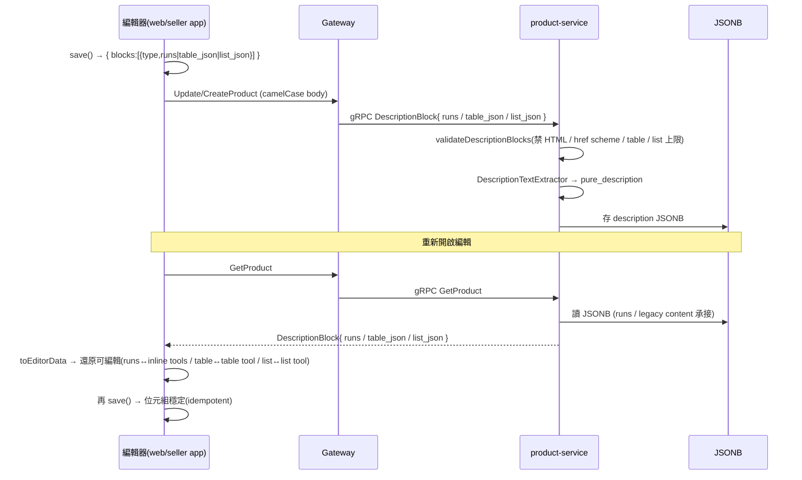

> **list / table block 的輸入驗證**：`runs[].text` 禁 HTML tag、`href` 僅 http(s)，由既有 `requireRunTextNoHtml` / `requireHrefHttpScheme` 承擔（26-輸入驗證設計書），**不新增 InputValidator primitive**。

### 3.10 商品認證申請與稽核表（本服務新增，SSOT 見 19 號）

本服務有兩張認證相關表，**完整欄位定義、索引、CHECK 約束、狀態機與 migration 皆以
[19 號《農業認證申請與審核》](19-農業認證驗證%EF%BC%88Certification%20Verification%EF%BC%89詳細設計書.md) §4 為唯一真實來源**，此處只登記存在與職責，不重複全文：

| 表 | PK 策略 | 職責 |
|---|---|---|
| `product_certification_application` | **TSID**（`IdType.INPUT`，Node ID Base 200） | 商品認證申請的**權威來源**。六狀態 FSM（SUBMITTED / APPROVED / REJECTED / WITHDRAWN / SUPERSEDED / REVOKED）；兩個 partial unique index 保證同 `(product_id, certification_type)` 至多一筆 `SUBMITTED` 與至多一筆 `APPROVED` |
| `product_certification_review_event` | **BIGSERIAL**（`IdType.AUTO`，內部表） | append-only 稽核事件（含自動核准，`actor_role='SYSTEM'`）。**禁止 UPDATE / DELETE** |

- Flyway：`V18__*.sql`（V1 凍結、append-only；本表建立與存量處理同一支）
- 與 `product.certifications` 的關係：申請表是權威，JSONB 欄位是 approved-only 投影（§3.2、§7.5c）
- 存量處理與 rolling deploy 窗口的誠實標註見 19 號 §15

### 3.7 ~ 3.9 Hashtag 模組

> **完整內容已移至 [33-商品 Hashtag 模組（Product Hashtag）詳細設計書.md](33-商品%20Hashtag%20模組%EF%BC%88Product%20Hashtag%EF%BC%89詳細設計書.md)**。

Product Service 內含 Hashtag 子模組，提供 hashtag 主表（`hashtag`）與商品關聯表（`product_hashtag`）、canonical/display 雙 normalize、`hashtag.product_count` counter 同事務 row-lock 維護、auto-complete 與熱門查詢 RPC。

| 主題 | 詳見 |
|------|------|
| Hashtag 主表 schema | 33 §2.1 |
| product_hashtag 關聯表 schema | 33 §2.2 |
| normalize / 字元規則 / 上限 | 33 §3 |
| `hashtag.product_count` counter 觸發場景與並發保護 | 33 §4 |
| RPC 規格（SearchHashtags / GetPopularHashtags） | 33 §5 |
| `searchable_text` 與 hashtag canonical 拼接規則 | 33 §3.4 |

---

## 4. 對外 / 對內介面定義

### 4.1 Gateway REST API

#### 4.1.1 Public Namespace（`/api/v1/public/*`，匿名可存取）

| HTTP 方法 | 路由 | 中間件 | Handler | gRPC 方法 | 說明 |
|----------|------|--------|---------|----------|------|
| GET | `/api/v1/public/products` | OptionalJWTAuth | GetProductList | GetProductList | 商品列表（強制 status=4004） |
| GET | `/api/v1/public/products/:id` | OptionalJWTAuth | GetProductDetailByID | GetPublicProduct / GetProduct | 商品詳情（匿名→快取；登入→權限檢查） |
| GET | `/api/v1/public/products/:id/brief` | OptionalJWTAuth | GetProductInfoByID | GetPublicProduct | 商品簡化資訊 |
| GET | `/api/v1/public/products/:id/reviews` | OptionalJWTAuth | GetProductReviews | — | 商品評論（預留） |
| GET | `/api/v1/public/products/:id/skus` | OptionalJWTAuth | ListSellerSkus | — | 商品 SKU 列表 |
| GET | `/api/v1/public/products/:id/rating` | OptionalJWTAuth | GetProductRating | GetPublicProduct | 商品評分 |
| GET | `/api/v1/public/products/:id/related` | OptionalJWTAuth | GetRelatedProducts | GetRelatedProducts | 相關商品（同分類，最多 8 筆） |
| GET | `/api/v1/public/categories` | OptionalJWTAuth | GetCategoryList | — | 分類列表（僅 ACTIVE） |
| GET | `/api/v1/public/categories/tree` | OptionalJWTAuth | GetCategoryTree | — | 分類樹三層（僅 ACTIVE） |
| GET | `/api/v1/public/categories/:id` | OptionalJWTAuth | GetCategoryByID | — | 單一分類（僅 ACTIVE，找不到回 404） |
| GET | `/api/v1/public/categories/:id/path` | OptionalJWTAuth | GetCategoryPath | — | 分類路徑（僅 ACTIVE） |
| GET | `/api/v1/public/categories/:id/children` | OptionalJWTAuth | GetCategoryChildren | — | 子分類（僅 ACTIVE） |
| GET | `/api/v1/public/banners` | OptionalJWTAuth | GetBannerList | — | 橫幅列表 |
| GET | `/api/v1/public/banners/version` | OptionalJWTAuth | CheckBannerVersion | — | 橫幅版本 |
| GET | `/api/v1/public/sellers/:id/products` | OptionalJWTAuth | GetSellerProducts | GetProductList | 指定賣家的商品列表 |
| GET | `/api/v1/public/hashtags` | OptionalJWTAuth | SearchHashtags | SearchHashtags | Hashtag auto-complete（query: `prefix`, `mode`, `limit`） |
| GET | `/api/v1/public/hashtags/popular` | OptionalJWTAuth | GetPopularHashtags | GetPopularHashtags | 日期區間熱門 hashtag 查詢（query: `startFrom`, `endTo`, `limit`；詳見 33 §5.2 / §6.2） |
| GET | `/api/v1/public/origins/summary` | OptionalJWTAuth | GetOriginsSummary | GetPublicOriginsSummary | 公開商品產地聚合（query: `category_id`, `limit`；詳見 §5.13） |
| GET | `/api/v1/public/seller-cities/summary` | OptionalJWTAuth | GetSellerCitiesSummary | GetPublicSellerCitiesSummary | 商家註冊所在地聚合（固定回 22 縣市；城市歸屬與列表 `seller_city_code` filter 共用 seller SSOT，`sellerCount` / `previewStoreIds` 再濾掉 0 件在架商品的店，見 §5.13c） |
| GET | `/api/v1/public/search/products` | OptionalJWTAuth | SearchProductsViaES | GetPublicProductList | 商品搜尋（query: `q`/`keyword`, `category_id`, `sort_by`, `sort_order`, `page`, `page_size`；search-service 退役後轉呼叫本服務，見 §1.3） |
| GET | `/api/v1/public/search/suggest` | OptionalJWTAuth | GetSearchSuggestions | GetPublicProductList | 搜尋建議（query: `q`/`prefix`, `limit`；取商品名稱去重，失敗降級回空陣列） |

> **`/api/v1/public/products` 與 `/api/v1/public/sellers/:id/products` 查詢參數擴充**：
> - `keyword`：多 token 空白分隔，**OR** 命中（規則見 02-§5.3.3）
> - `hashtags`：逗號分隔字串列表（如 `?hashtags=台南,有機`），server normalize 後精確匹配
> - `match`：`any` (default) / `all`，搭配 `hashtags`
> - 「點 hashtag → 商品列表」UX：前端組 `?hashtags=xxx&match=any`（單值即等同精確匹配）
> - `delivery_temp`：配送溫層篩選（逗號分隔 `ShippingTemperature.value`，如 `?delivery_temp=3201,3202`，命中任一即可，見 §5.3.4）
> - `price_min` / `price_max`：價格區間（新台幣元，數字字串；商品價格區間與篩選區間「重疊」即命中，見 §5.3.4）
> - `store_ids`：多賣家篩選（逗號分隔的賣家 `store_id`，如 `?store_ids=1001,1002`，與 `/sellers/:id/products` 的路徑單值語意不同；兩者並存時取交集）
> - `certification_types`：商品認證篩選（逗號分隔 `CertificationType.value`，如 `?certification_types=3701,3702`；比對 `certifications[].name`，命中任一即可，見 §5.3.4）
> - `seller_city_code`：**商家註冊所在地** ISO 3166-2:TW（如 `TW-TPE`），與 `store_ids` 並存時由 product-service 取交集。⚠️ 這是「賣家在哪」，**不是商品產地**——商品產地用 `origin`
> - `followed_product_only`：`true` 時僅回傳當前登入使用者**收藏**的商品（過濾 `favorites` 表）；**未登入回 401、已登入但無現任 buyer stint 回 403、buyer service 不可用回 503**（見 §5.3.4）
> - `followed_seller_only`：`true` 時僅回傳當前登入使用者**追蹤的賣家**所有商品（過濾 `seller_subscriptions` 表）；**未登入回 401、已登入但無現任 buyer stint 回 403、buyer service 不可用回 503**（見 §5.3.4）
> - 兩 filter 並存：結果為**交集**（追蹤賣家 ∩ 收藏商品）
> - `followed_seller_only=true` 與 `store_ids` 並存：在 service 層先取交集，交集為空 → 直接回空 list（不打 DB）
>
> **`/api/v1/public/hashtags` 查詢參數**：
> - `prefix`：用戶輸入文字（任意大小寫，server normalize 後查詢；空字串回空陣列）
> - `mode`：`prefix` (default) / `contain`
> - `limit`：default 10、max 50（超過視為 50）

#### 4.1.2 App Namespace（`/api/v1/app/*`，需 JWT 認證）

| HTTP 方法 | 路由 | 中間件 | Handler | gRPC 方法 | 說明 |
|----------|------|--------|---------|----------|------|
| GET | `/api/v1/app/products` | JWTAuth + SELLER | ListSellerProducts | GetProductList | 賣家商品列表（可選 status） |
| POST | `/api/v1/app/products` | JWTAuth + SELLER | CreateSellerProduct | CreateProduct | 建立商品 |
| GET | `/api/v1/app/products/:id` | JWTAuth + SELLER | GetSellerProductDetail | GetProduct | 賣家商品編輯詳情 |
| PUT | `/api/v1/app/products/:id` | JWTAuth + SELLER | UpdateSellerProduct | UpdateProduct | 更新商品 |
| DELETE | `/api/v1/app/products/:id` | JWTAuth + SELLER | DeleteSellerProduct | DeleteProduct | 賣家軟刪除商品 |
| GET | `/api/v1/app/products/:id/skus` | JWTAuth + SELLER | ListSellerSkus | — | 賣家 SKU 列表 |
| POST | `/api/v1/app/categories` | JWTAuth + SELLER | CreateCategory | CreateCategory | 賣家新增分類（任何層級，同名同父自動套用，預設 ACTIVE） |
| GET | `/api/v1/app/categories/tree` | JWTAuth + SELLER | GetSellerCategoryTree | GetCategoryTree | 賣家分類樹（僅 ACTIVE） |
| PUT | `/api/v1/app/products/:id/status` | JWTAuth + SELLER | UpdateSellerProductStatus | UpdateSellerProductStatus | 賣家上下架商品 |
| POST | `/api/v1/app/products/:id/reviews` | JWTAuth | CreateReviewByParam | — | 建立評論 |
| GET | `/api/v1/app/products/certifications/verify` | JWTAuth + SELLER | VerifyCertification | VerifyCertification | 驗證農業認證編號（query: `cert_no`, `type`）。**回應為結構化 `{validity, found, statusRaw, holderName, …}`，見 19 號 §9.4** |
| GET | `/api/v1/app/products/:product_id/certification_applications` | JWTAuth + SELLER(`CapProductManage`) | ListProductCertificationApplications | ListProductCertificationApplications | 查詢自己商品的認證申請（賣家狀態徽章資料來源，見 19 號 §9.1） |
| POST | `/api/v1/app/products/:product_id/certification_applications` | JWTAuth + SELLER(`CapProductManage`) | SubmitProductCertification | SubmitProductCertification | 單筆送出認證申請（見 19 號 §9.1） |
| POST | `/api/v1/app/products/:product_id/certification_applications/:application_id/withdraw` | JWTAuth + SELLER(`CapProductManage`) | WithdrawProductCertification | WithdrawProductCertification | 撤回待審申請（取消勾選走此路徑，不再靠全量取代移除） |
| GET | `/api/v1/app/hashtags` | JWTAuth + SELLER | SearchHashtagsForSeller | SearchHashtags | 賣家編輯時 hashtag auto-complete（與 public 同 RPC，獨立路由便於 rate limit 區分） |

> **賣家 `POST/PUT /api/v1/app/products(/:id)` 的認證回應欄位**：
> - `data.certificationWarnings: CertificationWarningOutput[]`（**無警告時回空陣列，不省略欄位**）——
>   列出本次**被剔除**（輸入非法，Gateway filter）或**被跳過**（併發衝突，product-service）的認證。
>   🔴 **必須有這個欄位**：那些筆**既不在 approved-only 投影、也不在申請表**，表單一 re-hydrate 就消失，
>   不回報等於靜默蒸發。proto 側為 `CreateProductResponse` / `UpdateProductResponse` 的 additive 欄位
>   `repeated CertificationWarning certification_warnings`。詳見
>   [19 號 §6.3.1 / §9.5](19-農業認證驗證%EF%BC%88Certification%20Verification%EF%BC%89詳細設計書.md)
> - 🔴 **「未提供」與「清空」的唯一區分手段，收斂點必須先判**：
>   `effectiveUpdate = update_certifications || !certifications.isEmpty()`；
>   `effectiveUpdate == false` ⇒ product-service **直接 return——不建申請、不 WITHDRAW、投影不動**。
>   **條件必須是「或」**：proto `bool update_certifications = 17` 的欄位註解明寫
>   「相容期：未設但 certifications 非空仍視為要更新」，現行 `ProductProtoConverter` 的閘門就是
>   `if (request.getUpdateCertifications() || request.getCertificationsCount() > 0)`——**沿用，不推翻**。
>   兩個方向都是零訊號失效：
>   **① 只看「有沒有帶欄位」** ⇒ 任何部分更新（舊 App、代行只改名稱、單欄位 client）都被判成
>   「所有 type 都沒送」⇒ 全部 `APPROVED` 轉 `WITHDRAWN`、投影清空、**法規標章消失**，
>   而 HTTP 200、稽核有列、`WITHDRAWN` 不發推播。
>   **② 只看旗標** ⇒ 舊 client 帶了認證但沒設旗標 ⇒ 直接 return ⇒ **賣家送出的認證靜默蒸發**。
>   Gateway 端 `UpdateCertifications: req.Certifications != nil`（`seller_product.go`）與代行的
>   `body.Certifications == nil` fallback，**既有且正確，不得改動**。
>   詳見 [19 號 §6.3.0](19-農業認證驗證%EF%BC%88Certification%20Verification%EF%BC%89詳細設計書.md)
>   （同模式先例：`update_hashtags`）
> - ⚠️ 認證的**輸入非法一律「剔除該筆」不回 400**，而剔除**必須在 handler 內以 filter 實作**——
>   `binding:` tag（含 `dive`）唯一出口是 `ShouldBindJSON` 失敗 → 400，與「剔除」是相反行為（19 號 §6.2.1）。
>   筆數上限用 `binding:"max=N"` 不受此限（擋 DoS 不是擋值域）。
>
> **賣家 `POST/PUT /api/v1/app/products(/:id)` 請求 body 擴充**：
> - `hashtags: string[]`：賣家輸入字串陣列（可含 `#`、空白、大小寫混雜，server 一律 normalize；上限 10 個）；UpdateProduct 時若不提供 = 維持現狀
> - 詳細欄位規則見 §3.9 與 26-輸入驗證設計書 §2.3 R9
>
> **賣家 `GET /api/v1/app/products` 查詢參數擴充**：同 public list，含 `keyword` 多 token 與 `hashtags` 精確篩選

##### 4.1.2.1 `/products/certifications/verify` `type` 參數規範

**契約**：query string `type` 為 `CertificationType.value()`（4 位數字字串）：

| value | code | label |
|---|---|---|
| `3701` | ORGANIC | 有機農產品 |
| `3702` | TAP | 產銷履歷 |
| `3703` | CAS | CAS 優良農產品 |
| `3704` | HACCP | HACCP 認證（暫不支援驗證） |
| `3705` | ISO | ISO 認證（暫不支援驗證） |
| `3706` | GMP | GMP 認證（暫不支援驗證） |

**強制規範**：
1. Gateway Swagger annotation `@Param type ... Enums(...)` 必須使用 **value**（`3701, 3702, 3703, 3704, 3705, 3706`），**禁止**使用 code（`ORGANIC, TAP, ...`）
2. product-service `verifyCertification` gRPC handler 已使用 `CertificationType.isValidValue(type)` 驗證，未知值回 `CERT_TYPE_INVALID`
3. 前端**必須**傳 value 字串，**禁止**傳 code 名稱
4. Description 文字說明可以保留 code 名稱以利人類閱讀，但必須同時標注 value（如 `(3701=有機農產品 ORGANIC)`）

⚠️ **Swagger annotation 若寫成 code（`Enums(ORGANIC, TAP, ...)`），前端會照著傳 `ORGANIC` 而 `CertificationType.isValidValue` 只認 value ⇒ 該端點永遠回 `CERT_TYPE_INVALID`**。契約 SSOT 是 gateway handler 的 annotation 註解（§16），`gateway/docs/` 是生成物、不入版控、不得手寫編輯。

#### 4.1.3 Admin Namespace（`/api/v1/admin/*`，需 ADMIN）

| HTTP 方法 | 路由 | Handler | gRPC 方法 | 說明 |
|----------|------|---------|----------|------|
| GET | `/api/v1/admin/products` | SearchAdminProducts | GetProductList | 管理員商品搜尋 |
| GET | `/api/v1/admin/products/:id` | GetAdminProductDetail | GetProductForAdmin | 管理員商品詳情（不限擁有者/狀態） |
| PUT | `/api/v1/admin/products/:id/status` | UpdateAdminProductStatus | UpdateProductStatus | 更新商品狀態（審核） |
| DELETE | `/api/v1/admin/products/cache` | PurgeProductCache | PurgeProductCache | 清除商品快取 |
| POST | `/api/v1/admin/products/batch-change-category` | BatchChangeProductCategory | BatchChangeProductCategoryForAdmin | 批次更換商品分類（限 L3→L3，連動更新 lv1/lv2） |
| GET | `/api/v1/admin/categories/tree` | GetAdminCategoryTree | GetCategoryTree | 分類樹（預設僅 ACTIVE，加 `?include=deleted` 顯示軟刪除） |
| GET | `/api/v1/admin/categories/:id/products` | ListProductsByCategory | ListProductsByCategoryForAdmin | 取分類底下所有商品（含分頁） |
| POST | `/api/v1/admin/categories` | CreateCategoryAdmin | CreateCategoryForAdmin | 管理員新增分類（任何層級，同名同父自動套用） |
| PATCH | `/api/v1/admin/categories/:id` | UpdateCategoryAdmin | UpdateCategoryForAdmin | 修改分類名稱（僅可改 name，不可改 parent_id） |
| DELETE | `/api/v1/admin/categories` | BatchSoftDeleteCategoryAdmin | BatchSoftDeleteCategoryForAdmin | 批次軟刪除（驗證底下無商品+無 ACTIVE 子分類） |
| POST | `/api/v1/admin/categories/:id/restore` | RestoreCategoryAdmin | RestoreCategoryForAdmin | 還原已軟刪除分類 |
| GET | `/api/v1/admin/product_certification_applications` | ListAdminProductCertifications | ListProductCertificationApplicationsForAdmin | 認證審核佇列（篩 status／certification_type／store_id／keyword／日期；分頁走 `response.Page`） |
| GET | `/api/v1/admin/product_certification_applications/:id` | GetAdminProductCertification | GetProductCertificationApplicationForAdmin | 申請詳情（含 `govVerifyPayload` 與 `currentApproved` ＝同 type 現行 approved；後者 proto 載體為 `ProductCertificationSummary`，19 號 §10.2） |
| GET | `/api/v1/admin/product_certification_applications/:id/audit_logs` | ListAdminProductCertificationAuditLogs | ListProductCertificationAuditLogsForAdmin | append-only 稽核事件 |
| POST | `/api/v1/admin/product_certification_applications/:id/approve` | ApproveAdminProductCertification | ApproveProductCertificationForAdmin | 核准（帶 `idempotencyKey` + `expectedVersion`） |
| POST | `/api/v1/admin/product_certification_applications/:id/reject` | RejectAdminProductCertification | RejectProductCertificationForAdmin | 駁回（`reasonCode` 必填） |
| POST | `/api/v1/admin/product_certification_applications/:id/revoke` | RevokeAdminProductCertification | RevokeProductCertificationForAdmin | 事後撤銷（`reasonCode` 必填；重建投影後標章從公開面消失） |
| POST | `/api/v1/admin/product_certification_applications/:id/reverify` | ReverifyAdminProductCertification | ReverifyProductCertificationForAdmin | 重新查驗（90s timeout、繞過同步斷路器；**只寫 `gov_verify_*`，不改 `status`**）。**必須是 POST**——有副作用（打外部 API＋寫 DB），且 §2 規範明訂 Action 用 `POST /{res}/{id}/{action}` |

> **Admin `GET /api/v1/admin/products` 查詢參數擴充**：同 public list，含 `keyword` 多 token、`hashtags` 精確篩選；同時支援以 `status` 過濾任意狀態（不限 ACTIVE）。
>
> **Admin 不單獨提供 hashtag 維護 endpoint**：hashtag 由賣家自由綁定，admin 若需強制清除某 hashtag 從所有商品（例如違禁字事後處理），目前以「不提供 admin RPC，必要時手動 SQL」為規範；未來若需 hashtag blocklist + admin CRUD（見 02 §A1 議題）再開新 RPC。

### 4.2 gRPC Proto 定義

Proto 檔案：`api/proto/product/product.proto`、`api/proto/category/category.proto`

#### 4.2.1 Product Service RPC（共 44 個）

| # | RPC | 呼叫方 | 說明 |
|---|-----|--------|------|
| 1 | `CreateProduct` | Gateway (Seller) | 建立商品（**支援 hashtags**） |
| 2 | `UpdateProduct` | Gateway (Seller) | 更新商品（**不含狀態變更**；**支援 hashtags**） |
| 3 | `GetProduct` | Gateway (Seller) | 取得商品詳情（含權限檢查、含 hashtag list） |
| 4 | `GetPublicProduct` | Gateway (Public) | 公開商品詳情（**曾公開過即可，非僅 ACTIVE**，見 §2.9；Redis 快取，含 hashtag list） |
| 5 | `GetProductList` | Gateway (All) | 商品列表（分頁、篩選；keyword 多 token OR、hashtag 精確篩選） |
| 6 | `GetProductForAdmin` | Gateway (Admin) | 管理員商品詳情（不限擁有者/狀態，含 hashtag list） |
| 7 | `UpdateProductStatus` | Gateway (Admin) | 管理員更新商品狀態（觸發 hashtag counter delta） |
| 8 | `UpdateSellerProductStatus` | Gateway (Seller) | 賣家上下架商品（含擁有者驗證+狀態轉換驗證；觸發 hashtag counter delta） |
| 9 | `PurgeProductCache` | Gateway (Admin) | 清除快取 |
| 10 | `DeductStock` | Order Service | 原子扣減庫存 |
| 11 | `RestoreStock` | Order Service | 原子歸還庫存（補償/取消） |
| 12 | `GetStock` | Order Service | 查詢 SKU 庫存 |
| 13 | `GetProductSimple` | Cart Service | SKU 簡化資訊（驗證 + 快照） |
| 14 | `BatchGetSkuCartInfo` | Cart Service | 批次 SKU 即時資訊（購物車列表）。**單階段 LEFT JOIN 拿 sku + product 一個 snapshot**；product missing 走 caller LOOKUP_FAILED，**禁止**回 silent `is_active=false`。詳見 §5.5.3 |
| 15 | `GetProductsByIDs` | Buyer Service（瀏覽紀錄 / favorites 列表 enrichment） | 批次查詢商品；支援 `include_inactive` flag（預設 false=僅 ACTIVE，true=含 INACTIVE/DRAFT/PENDING_REVIEW 但仍排除軟刪除）。詳見 §5.5.1 |
| 16 | `GetRelatedProducts` | Gateway (Public) | 相關商品（同分類為主，**hashtag 命中加權**，最多 8 筆） |
| 17 | `DeleteProduct` | Gateway (Seller) | 軟刪除商品（觸發 hashtag counter delta） |
| 18 | `CalculateShippingOptions` | Gateway (Seller) | 計算可用配送選項與運費 |
| 19 | `VerifyCertification` | Gateway (Seller) | 驗證農業認證編號（advisory，呼叫政府開放資料平台）。**以 `verifyDetailed()` 實作、回應為結構化，並有三道防線（見 19 號 §8.3.1／§8.4）** |
| 20 | `ListProductsByCategoryForAdmin` | Gateway (Admin) | 取分類底下所有商品（含分頁，依層級判斷 category / category_lv2 / category_lv1 欄位） |
| 21 | `BatchChangeProductCategoryForAdmin` | Gateway (Admin) | 批次更換商品分類，限 L3→L3，**強制連動更新 lv1/lv2 三欄位**；支援「productIds + targetCategoryId」與「sourceCategoryId + targetCategoryId」兩種輸入模式；觸發受影響商品 `searchable_text` reflow（async） |
| 22 | `SearchHashtags` | Gateway (Public/Seller) | Hashtag 自動補全（PREFIX/CONTAIN 兩種模式，僅回 `product_count > 0`，依熱門排序） |
| 23 | `GetPopularHashtags` | Gateway (Public) | 日期區間熱門 hashtag 查詢，依區間內 distinct ACTIVE 商品數降冪（詳見 33 §5.2） |
| 24 | `GetPublicOriginsSummary` | Gateway (Public) | 公開商品產地聚合：依當前 ACTIVE 商品 group by `origin` 回傳產地與商品數列表（詳見 §5.13） |
| 25 | `BatchGetProductForCheckout` | Order Service | 結帳鏈路專用批次商品查詢，**接受 inactive product 不拋例外**（含 status / is_active），回完整 weight / dimension / shipping_method 等結帳必要欄位。詳見 §5.5.2 |
| 26 | `GetPublicSellerCitiesSummary` | Gateway (Public) | 商家註冊所在地聚合：固定回 22 縣市；城市歸屬與列表 `seller_city_code` filter 共用 seller SSOT，`sellerCount` / `previewStoreIds` 只計「至少一件公開上架商品」的店（與 §5.13c 共用同一句聚合，見 `ProductSellerCitySummaryPolicy`） |
| 27 | `ValidateLeafCategoryInternal` | Product Import Service | **內部 RPC**：驗證 category_id 為合法葉節點，回傳 `cat_l1` / `cat_l2` 反正規化欄位。詳見 §9.1 |
| 28 | `CreateProductFromImportInternal` | Product Import Service | **內部 RPC**：commit 階段把暫存 `import_item` 轉正為 product + product_sku；與 `CreateProduct` 刻意分離以維持權限邊界與審計線索。詳見 §9.2 |
| 29 | `BatchCheckSellerProductNames` | Product Import Service | **內部 RPC**：批次偵測商品名稱是否與該賣家既有商品重複（CSV 解析與 `UpdateImportItem` 時呼叫）。詳見 §9.5 |
| 30 | `ValidateProductDraft` | Product Import Service | **內部 RPC**：商品上架完整檢核（雙時機點 validator），由 `ProductPublishValidator` 執行——CSV 路徑不得繞過任何上架規則。詳見 40 號 §4.3a |
| 31 | `GetProductsBriefInternal` | Product Import Service | **內部 RPC**：批次查 `(id, name, status, status_label, publication_state)` 供 import 端 hydrate。**底層刻意不濾 `deleted_at`**——已軟刪商品要回得出來並帶 `publication_state=4014`，否則與 RPC 失敗同形（#2819）。詳見 40 號 §4.3b |
| 32 | `BatchUpdateSellerProductStatus` | Gateway (Seller) | 批次上下架 |
| 33 | `BatchGetSellerProductsForDelegation` | Gateway (Admin 代行) | 代行工作區批次取商品快照 |
| 34 | `SubmitProductCertification` | Gateway (Seller) | 單筆送出商品認證申請。詳見 [19 號 §10](19-農業認證驗證%EF%BC%88Certification%20Verification%EF%BC%89詳細設計書.md) |
| 35 | `ListProductCertificationApplications` | Gateway (Seller) | 查詢自己商品的認證申請（含待審） |
| 36 | `WithdrawProductCertification` | Gateway (Seller) | 撤回待審申請 |
| 37 | `ListProductCertificationApplicationsForAdmin` | Gateway (Admin) | 認證審核佇列（角色分離：不得與賣家版共用 RPC 加 flag 分流） |
| 38 | `GetProductCertificationApplicationForAdmin` | Gateway (Admin) | 申請詳情（含 `GovVerifyResult` 與 `internal_note`；**賣家版不得映射這兩者**） |
| 39 | `ListProductCertificationAuditLogsForAdmin` | Gateway (Admin) | append-only 稽核事件列表 |
| 40 | `ApproveProductCertificationForAdmin` | Gateway (Admin) | 人工核准（① 舊 APPROVED → SUPERSEDED 必須在 ② 之前，見 19 號 §6.6） |
| 41 | `RejectProductCertificationForAdmin` | Gateway (Admin) | 駁回（`reason_code` 必填；之後同號碼重送 `requires_manual_review=true`，永不自動核准） |
| 42 | `RevokeProductCertificationForAdmin` | Gateway (Admin) | 事後撤銷（政府 API 只驗號碼存在、不驗歸屬，這是唯一治理手段） |
| 43 | `ReverifyProductCertificationForAdmin` | Gateway (Admin) | 重新查驗（migration 產生的 legacy 列**唯一**的查驗觸發方式——19 號 §8.3 明令禁止掃 PENDING 的排程） |
| 44 | `ListStoreIDsWithPublicProductsInternal` | Seller Service | **內部 RPC**：回「至少有一件公開上架商品」的 store_id 全集，供推薦賣家／marketplace rail 濾掉空店。與城市聚合共用同一句 `findPublicProductCountsByStore`，「什麼叫公開上架」只有一份定義。詳見 §5.13c |

#### 4.2.2 核心 Message 定義

**ProductSku**：

```protobuf
message ProductSku {
    string id = 1;              // SKU ID (BIGSERIAL)
    string sku_name = 2;        // SKU 名稱
    string weight = 3;          // 重量（數字字串）
    string unit = 4;            // WeightUnit Enum value
    string price = 5;           // 原價（list price，新台幣元）
    string stock_qty = 6;       // 庫存數量
    string length_cm = 7;       // 長（cm）
    string width_cm = 8;        // 寬（cm）
    string height_cm = 9;       // 高（cm）
    repeated ShippingMethod shipping_methods = 10;
    string sale_price = 11;     // 特價（新台幣元，空字串=無特價，須 < price 且 > 0）
}
```

> **欄位語意提醒**：`price` 為「**原價（list price）**」，`sale_price` 為「**特價（sale price）**」。實際成交單價需由呼叫方計算：非空 `sale_price` 優先，否則使用 `price`。

**ShippingMethod**（SKU 層級配送方式）：

```protobuf
message ShippingMethod {
    string type = 1;            // ShippingMethod Enum value
    string temperature = 2;     // ShippingTemperature Enum value
    string free_threshold = 3;  // 免運門檻（新台幣元）
    string fee_payer = 4;       // ShippingFeePayer Enum value
}
```

**StockOperationResponse**：

```protobuf
message StockOperationResponse {
    enum Status {
        SUCCESS = 0;
        INSUFFICIENT_STOCK = 1;
        ALREADY_APPLIED = 2;
        NOOP_NOT_FOUND = 3;     // 找不到 stock_tx_id 也視為成功
        SYSTEM_ERROR = 9;
    }
    Status status = 1;
    string message = 2;
    repeated InsufficientItem insufficient_items = 3;
}
```

**ProductSimpleInfo**（Cart Service 呼叫）：

```protobuf
message ProductSimpleInfo {
    string sku_id = 1;
    string store_id = 2;               // 賣家 store 代理鍵（= product.store_id）
    bool is_active = 3;
    string name = 4;
    string price = 5;                  // **實際成交單價**（有特價=sale_price，否則=list price）
    string max_limit = 6;              // = stock_qty
    string product_id = 7;
    string sku_name = 8;
    string image_object_key = 9;
    repeated string delivery_temps = 10;
    string list_price = 11;            // **原價快照**（永遠 = SKU.price，不參考特價）
}
```

> **快照雙寫原則**：Cart 在 `addItem` 取得本訊息後，必須把 `price`（實際成交單價）與 `list_price`（原價）**雙寫**至 `cart_item.added_unit_price` 與 `cart_item.added_list_price`。若 `price == list_price` 表示加入時無特價，前端可據此決定是否顯示 strike-through。

**ProductDetail 擴充欄位**：

```protobuf
message ProductDetail {
    // ... 既有欄位 1~29（reserved 30）...
    bool self_owned = 31;  // 當前登入者是否為商品建立者（GetProduct 才填，匿名/Admin 為 false）
    // price_min / price_max 語意為「實際售價區間」
    string list_price_min = 32;  // 原價區間最小值（彙總 SKU.price，給前端 strike-through 顯示用）
    string list_price_max = 33;  // 原價區間最大值
    string sale_price_min = 34;  // 特價區間最小值（彙總 SKU.sale_price；皆無特價時為 "0"，不是空字串）
    string sale_price_max = 35;  // 特價區間最大值
    repeated HashtagItem hashtags = 36;  // hashtag 列表，依 product_hashtag.position 升序；含 product_count（即時值，不走 detail cache）
}
```

語意與填寫規則詳見 §2.2.1 自買標記與 §2.8 特價規則；`hashtags` 規則見 §3.7–§3.9。

**ProductListItem 同步擴充**：與 ProductDetail 相同新增 `list_price_min/max`、`sale_price_min/max` 四個字串欄位；既有 `price_min / price_max` 語意改為「實際售價」；新增 `repeated HashtagItem hashtags`（同序）。

**ProductListItem.delivery_temp（field 28）**：與 `ProductDetail.delivery_temp` 對稱。將 SKU 層級的 `delivery_temp` 在 list pipeline 聚合（distinct union）成商品層級的配送溫層列表，供前端商品卡顯示溫層 badge：

```protobuf
message ProductListItem {
    // ... 既有欄位 1~27 ...
    reserved 17;
    reserved "delivery_temp";          // 舊「list 層級」設計已廢止；新欄位採用新編號 28，不重用 reserved 號
    repeated string delivery_temp = 28; // 所有 ACTIVE SKU 的 ShippingTemperature.value 聯集（如 ["3201","3202"]）
}
```

聚合來源：`product_sku WHERE product_id IN (<list ids>) GROUP BY product_id`；每筆 ProductListItem 取對應 product_id 的 distinct `delivery_temp` 集合。空集合（SKU 全無設定）回空陣列。

**ProductListItem.certifications（field 29）**：與 `ProductDetail.certifications`（field 9）對稱，供商品卡直接顯示認證 badge，免再逐筆打 `/public/products/{id}`。直接帶出 `product.certifications` JSONB（`[{name, certNo}]`），不做型別轉換。
> ⚠️ **`product.certifications` 是 approved-only 投影**（§3.2 / §3.10），因此商品卡與 PDP 只會出現**已核准**的認證；賣家自己的待審申請不在此欄，要走 `ListProductCertificationApplications`（§4.1.2）。

```protobuf
message ProductListItem {
    // ... 既有欄位 1~28 ...
    repeated Certification certifications = 29; // 認證列表（[{name, certNo}]，name 為 CertificationType value）
}
```

來源：list query 已 `SELECT p.*`，`certifications` 隨 entity 帶出，converter 直接映射；無額外查詢成本。

**ProductListItem 的反正規化欄位（field 30~32）**：承載賣家中心 / 公開列表對「庫存 / 收藏 / 免運」的顯示需求。三欄位皆從 product 表反正規化欄位（§3.2 `stock_qty` / `favorite_count` / `shipping_methods`）直接帶出，**無額外查詢**、**無 SKU JOIN**、**無跨服務 RPC**。

```protobuf
message ProductListItem {
    // ... 既有欄位 1~29 ...
    string stock_qty = 30;                       // 即時庫存（總和），對應 product.stock_qty；數字字串
    string favorite_count = 31;                  // 收藏人次，對應 product.favorite_count；數字字串
    repeated ShippingMethod shipping_methods = 32; // 運送方式聯集（每個 method×temperature 組合一筆），對應 product.shipping_methods JSONB
}
```

語意一致性：
- `stock_qty` = `SUM(product_sku.stock_qty WHERE product_id = p.id)`；寫入路徑見 §5.1 / §5.2 / §5.8（CRUD + 庫存原子操作同事務 cascade）。
- `favorite_count` = `COUNT(buyer-service.favorites WHERE product_id = p.id)`；寫入路徑見 §5.14（MQ 事件同事務 ±1）。
- `shipping_methods` = `DISTINCT (type, temperature)` 自所有 SKU `product_sku.shipping_method` JSONB；同組合下 `free_threshold` 取最低（最寬鬆，行銷友善）、`fee_payer` 取 SKU id ASC 順序第一筆；寫入路徑見 §5.1 / §5.2 / §5.13a。

**delivery_temp（field 28）派生規則**：`delivery_temp` 由 `product.shipping_methods` 反正規化欄位 derive（`distinct(temperature)`），**不得**從 `product_sku` 即時 GROUP BY —— list / detail 兩路徑必須共用同一個 source-of-truth。

**ProductDetail 反正規化欄位擴充（field 38~39）**：與 ProductListItem 對稱：

```protobuf
message ProductDetail {
    // ... 既有欄位 1~37 ...
    string stock_qty = 38;       // 即時庫存（總和），對應 product.stock_qty
    string favorite_count = 39;  // 收藏人次，對應 product.favorite_count
    // shipping_methods（field 28，既有）改為從 product.shipping_methods 反正規化欄位讀，不再從 SKU 聚合
}
```

**ProductDetail 公開生命週期欄位（field 40~41）**：詳見 §2.9；兩者皆為推導值，DB 不存。ProductListItem **無對應欄位**（公開列表本就只回 ACTIVE）。

```protobuf
message ProductDetail {
    // ... 既有欄位 1~39 ...
    string publication_state = 40;  // ProductPublicationState value（4011~4014），與 status 分離
    bool purchasable = 41;          // publication_state=PUBLIC 且 status=ACTIVE 且 stock_qty>0
}
```

實作契約：
- `ProductEntityConverter.toListItemDTO` / `toDetailDTO` 的 `shippingMethods` **直接讀** `productEntity.shippingMethods`，不得從 SKU JSONB 重新聚合。
- `deliveryTemp` 一律由 `product.shippingMethods` derive，不得從 SKU GROUP BY 取（見 §5.3.6）。

**SellerInfo 擴充（field 6 / 7）**：補 list 與 detail 通用的「賣家所在城市/區」獨立欄位（不取代既有合成 `address`）。

```protobuf
message SellerInfo {
    string store_id = 1;   // 賣家 store 代理鍵（= product.store_id）
    string name = 2;
    string rate = 3;
    string logo_key = 4;   // 商家 Logo objectKey（Gateway 依 MEDIA_BASE_URL 組 logoUrl；49 §6.6）
    string address = 5;    // 合成（city + district），與既有契約相容
    string city = 6;       // 城市（如「台北市」），由 Seller Service 提供，可空
    string district = 7;   // 區域（如「大安區」），由 Seller Service 提供，可空
}
```

list 路徑與 detail 路徑共用 `SellerInfoAssembler`（見 §5.3.5），確保兩處 city/district/address 組裝邏輯一致。

**SkuCartInfo**（`BatchGetSkuCartInfo` 回傳，購物車列表用）：

```protobuf
message SkuCartInfo {
    string stock_qty = 1;
    repeated string delivery_temps = 2;
    string price = 3;          // **實際成交單價**（有特價=sale_price，否則=list price）
    bool is_active = 4;
    string list_price = 5;     // **原價快照**（永遠 = SKU.price）
}
```

**ProductForCheckoutInfo**（`BatchGetProductForCheckout` 回傳，結帳鏈路用，**接受 inactive**）：

```protobuf
message BatchGetProductForCheckoutRequest {
    repeated string sku_ids = 1;
}

message BatchGetProductForCheckoutResponse {
    int32 code = 1;
    map<string, ProductForCheckoutInfo> data = 2;  // key = sku_id；查無此 sku 時 key 缺席，order-service 視為 LOOKUP_FAILED
}

message ProductForCheckoutInfo {
    string sku_id = 1;
    string product_id = 2;
    string store_id = 3;             // 賣家 store 代理鍵（= product.store_id）
    bool is_active = 4;              // product.status == ACTIVE 且 deleted_at IS NULL
    string price = 5;                // 實際成交單價（有特價=sale_price，否則=list price）
    string list_price = 6;           // 原價（永遠 = SKU.price）
    string sale_price = 7;           // 特價（無特價=空字串）
    string stock_qty = 8;            // 即時庫存
    string sku_name = 9;             // SKU 規格名稱
    string product_name = 10;        // 商品名稱（snapshot 備援用）
    string image_object_key = 11;
    string weight = 12;              // 重量（數字字串）
    string unit = 13;                // WeightUnit Enum value
    string length_cm = 14;
    string width_cm = 15;
    string height_cm = 16;
    repeated ShippingMethod shipping_methods = 17;  // SKU 層級配送方式 + 免運門檻 + fee_payer
    string temperature = 18;         // SKU 主要溫層（取 shipping_methods[0].temperature 或 ShippingTemperature value）
}
```

> 與 `GetPublicProduct` / `GetProductSimple` 的差異：
> - **不拋 `ProductNotFoundException`**：inactive / 軟刪除商品仍回傳完整資料，由 caller（order-service）判定可購買性
> - **欄位完整**：含 weight / dimension / shipping_method，order-service 直接用於材積 / 運費計算
> - **batch**：一次取多個 sku_id，避免 N+1 RPC

> 完整 Proto 定義（含 ProductDetail、ProductListItem、SellerInfo、ReviewPreview 等）請參閱 `api/proto/product/product.proto`。

**HashtagItem**（hashtag 條目，跨 RPC 共用）：

```protobuf
message HashtagItem {
    string name = 1;          // canonical 名稱（lower）；查詢與比對基準
    string display_name = 2;  // 顯示名稱（保留原大小寫）；auto-complete 場景填 ""，由前端決定顯示策略
    string product_count = 3; // 引用數量（hashtag.product_count 即時值，字串型別，符合 [《Java 微服務開發規範》§2.1](../開發規範/Java%20微服務開發規範.md)；見 33 §5.4）
}
```

**HashtagMatchMode / HashtagSearchMode**：

```protobuf
enum HashtagMatchMode {
    HASHTAG_MATCH_ANY = 0;  // 預設：命中任一 hashtag 即可（OR）
    HASHTAG_MATCH_ALL = 1;  // 必須全部命中（AND）
}

enum HashtagSearchMode {
    HASHTAG_SEARCH_PREFIX = 0;   // 前綴匹配（name LIKE 'prefix%'）
    HASHTAG_SEARCH_CONTAIN = 1;  // 包含匹配（trgm GIN，IG 風格）
}
```

**CreateProductRequest / UpdateProductRequest 擴充**：

```protobuf
message CreateProductRequest {
    // ... 既有欄位 ...
    repeated string hashtags = N;  // 賣家輸入字串陣列；server normalize 後寫入；上限 10 個（見 §3.9）
}

message UpdateProductRequest {
    // ... 既有欄位 ...
    repeated string hashtags = N;  // 提供時 = 全量取代（diff = 與當前綁定的差集）；省略時 = 不變更 hashtag
}
```

> 兩個 request 的 `hashtags` 接受任意大小寫與含/不含 `#` 的字串，server 一律 `canonical` + `display` 雙 normalize（見 §3.9）。校驗失敗回 §4.4 對應錯誤碼。
>
> `UpdateProductRequest.hashtags` 的「省略 vs 空陣列」語意：proto3 `repeated` 無法區分；**約定以 `OPTIONAL` 包裝**（`google.protobuf.BoolValue update_hashtags` 旗標，true=本次有更新；false/未設=維持現狀）。

**GetProductListRequest 擴充**：

```protobuf
message GetProductListRequest {
    repeated string category_id = 1;          // 分類 ID 多值聯集；空陣列/含"0"/空字串視為不篩選；支援第一/二/三層自動偵測 + 分組 OR（見 §5.3.1）
    string keyword = 2;                       // 多 token 空白分隔；server 拆分後 OR 命中（見 §5.3 搜尋規則）
    string store_id = 9;                      // 單一賣家頁面語意，用於 /sellers/:id/products；與 store_ids（field 15）並存時取交集
    repeated string hashtags = 10;            // 精確篩選；任意大小寫，server normalize 後比對 canonical
    HashtagMatchMode hashtag_match_mode = 11; // 預設 ANY

    // ===== server-side filter（field 12~17，見 §5.3.4） =====
    repeated string delivery_temp_filter = 12; // 配送溫層篩選；ShippingTemperature.value 列表；EXISTS 子查詢命中任一 SKU 即可
    string price_min_filter = 13;              // 價格下限（新台幣元，數字字串，空字串=不篩選）
    string price_max_filter = 14;              // 價格上限（新台幣元，數字字串，空字串=不篩選）
    repeated string store_ids = 15;            // 多賣家篩選；列表內任一賣家即可（IN）；與 field 9 並存時取交集
    bool followed_product_only = 16;           // 僅回登入者收藏的商品（favorites 表）；true 時必須 viewer_buyer_id > 0；buyer service 不可用時整個查詢失敗
    int64 viewer_buyer_id = 17;                // 當前登入觀看者的 buyer_id，由 gateway 解析後傳入（僅供 viewer-aware filter 使用，不影響 owner filter）
    bool followed_seller_only = 18;            // 僅回登入者追蹤的賣家所有商品（seller_subscriptions 表）；true 時必須 viewer_buyer_id > 0；buyer service 不可用時整個查詢失敗
    repeated string certification_types = 19;  // 商品認證篩選（CertificationType value，如 3701/3702）；比對 certifications[].name；命中任一即可（見 §5.3.4）
}
```

**設計原則**：
- `delivery_temp_filter` / `store_ids` / `certification_types` 為「列表內任一即可」（OR within field）
- 多個 filter 之間為 AND（與既有 category / keyword / hashtags 一致）
- `price_min_filter` 與 `price_max_filter` 為「商品價格區間與篩選區間重疊」判斷（見 §5.3.4 SQL）

**新增 Origins Summary Messages**：

```protobuf
message GetPublicOriginsSummaryRequest {
    string category_id = 1;   // 分類 ID（可空字串或 "0"=全部；支援第一/二/三層自動偵測，同 §5.3.1）
    int32 limit = 2;          // 上限（預設 50，最大 100；超過視為 100）
}

message GetPublicOriginsSummaryResponse {
    int32 code = 1;
    string message = 2;
    repeated OriginSummaryItem records = 3;
}

message OriginSummaryItem {
    string origin = 1;          // 產地字串（如「台灣」「日本」），永不為空
    string product_count = 2;   // 該產地下 ACTIVE 商品數（數字字串）
}
```

詳見 §5.13。

**SearchHashtagsRequest / SearchHashtagsResponse**：

```protobuf
message SearchHashtagsRequest {
    string prefix = 1;            // 用戶輸入文字（任意大小寫，server normalize 後查詢）
    HashtagSearchMode mode = 2;   // 預設 PREFIX
    int32 limit = 3;              // 預設 10，最大 50；超過視為 50
}

message SearchHashtagsResponse {
    repeated HashtagItem items = 1;  // 僅含 product_count > 0；display_name 為空字串（由前端自行決定顯示）
}
```

**GetPopularHashtagsRequest / GetPopularHashtagsResponse / PopularHashtagItem**：詳見 [33-商品 Hashtag 模組詳細設計書 §5.2.5](33-商品%20Hashtag%20模組%EF%BC%88Product%20Hashtag%EF%BC%89詳細設計書.md#525-proto-定義)

#### 4.2.3 CategoryService RPC（共 7 個）

Proto 檔案：`api/proto/category/category.proto`

| # | RPC | 呼叫方 | 說明 |
|---|-----|--------|------|
| 1 | `GetCategoryTree` | Gateway (Public/Seller/Admin) | 分類樹三層；依 `status_filter` 與 `include_deleted` 區分角色（Public/Seller 僅 ACTIVE；Admin 可加 `?include=deleted`） |
| 2 | `GetChildCategories` | Gateway (Public) | 子分類列表（僅 ACTIVE） |
| 3 | `CreateCategory` | Gateway (Seller/Admin) | 新增分類（任何層級，同名同父自動套用，回傳該 ID）；status 預設 ACTIVE |
| 4 | `CreateCategoryForAdmin` | Gateway (Admin) | Admin 新增（與 `CreateCategory` 同邏輯，獨立 RPC 區分角色驗證） |
| 5 | `UpdateCategoryForAdmin` | Gateway (Admin) | Admin 修改分類名稱（**僅可改 `name`，不可改 `parent_id`**） |
| 6 | `BatchSoftDeleteCategoryForAdmin` | Gateway (Admin) | 批次軟刪除（按拓樸排序執行，前置驗證底下無商品+無 ACTIVE 子分類，任一失敗整批 rollback） |
| 7 | `RestoreCategoryForAdmin` | Gateway (Admin) | 還原已軟刪除分類（同名同父已 ACTIVE 或父分類已軟刪除則拒絕） |

#### 4.2.4 跨服務 RPC 依賴

##### `Buyer Service → ListFavoritedProductIds` / `ListSubscribedSellerIds`

Product Service 為實作 viewer-aware filter（`followed_product_only` / `followed_seller_only`），需 buyer-service 提供「批次查詢使用者收藏 / 追蹤 id 列表」兩個專用 RPC。既有 `GetFavoriteList` / `GetSubscriptionList` 是分頁 + 完整 `FavoriteInfo` / `SubscriptionItem` 設計，作為 server-side filter 之用會引入冗餘負載；既有 `BatchCheckFavorites` 要求先有候選 ID 列表，亦不適用。

```protobuf
// api/proto/buyer/buyer.proto
service BuyerService {
    // ... 既有 RPC ...
    rpc ListFavoritedProductIds(ListFavoritedProductIdsRequest) returns (ListFavoritedProductIdsResponse);
    rpc ListSubscribedSellerIds(ListSubscribedSellerIdsRequest) returns (ListSubscribedSellerIdsResponse);
}

message ListFavoritedProductIdsRequest {
    int64 buyer_id = 1;
}

message ListFavoritedProductIdsResponse {
    int32 code = 1;
    string message = 2;
    repeated int64 product_ids = 3;  // 該買家所有收藏的 product_id，無序；無收藏回空陣列
}

message ListSubscribedSellerIdsRequest {
    int64 buyer_id = 1;
}

message ListSubscribedSellerIdsResponse {
    int32 code = 1;
    string message = 2;
    repeated int64 seller_ids = 3;   // 該買家所有追蹤的 seller_id，無序；無追蹤回空陣列
}
```

**SQL 來源（buyer-service 內部實作）**：

```sql
-- favorites
-- sqlc: ListFavoriteProductIDsByBuyerID
SELECT product_id FROM favorites WHERE buyer_id = :buyerId;

-- seller_subscriptions（回傳的 seller_ids 取自 store_id 欄）
-- sqlc: ListSubscribedSellerIDsByBuyerID
SELECT store_id FROM seller_subscriptions WHERE buyer_id = :buyerId;
```

**身分空間**：

buyer-service 全部 8 支 favorite/follow 讀寫 RPC（`GetFavoriteList` / `CheckFavorite` /
`BatchCheckFavorites` / `AddFavorite` / `RemoveFavorite` / `GetFavoriteCount` /
`ListFavoritedProductIds` / `ListSubscribedSellerIds`）的 request 欄位皆為 `buyer_id`，
由 **gateway** 的 `resolveBuyerID`（Redis 快取）解析後傳入。

`ListFavoritedProductIds` / `ListSubscribedSellerIds` 的呼叫方是 product-service，
不是 gateway 本身：product-service 手上的 `GetProductListRequest.viewer_buyer_id`
（field 17）由 gateway 在 `GetProductList` handler 內解析 JWT 注入的
`accountId` → `resolveBuyerID` 一次性得到，逐層往下傳到 buyer-service，buyer-service
不再對這兩支 RPC 做任何 account_id → buyer_id 的內部解析（只用
`GetCurrentByBuyerID` 驗證該 buyer_id 對應的 stint 仍有效）。

**契約細節**：
- 純讀，無副作用
- 不分頁（業務面：單一買家收藏上限 5000、追蹤賣家上限 1000；product service 於 §5.3.4 cap 處理）
- 內部 RPC 走 `x-internal-service` metadata 免權限驗證（§6.2）
- buyer-service Go 端走 sqlc：favorites `ListFavoriteProductIDsByBuyerID`；seller_subscriptions `ListSubscribedSellerIDsByBuyerID`（兩者皆吃 buyer_id，呼叫方已保證是 gateway 解析過的值）

**錯誤碼**：buyer-service 直接回 gRPC 標準（`INVALID_ARGUMENT` / `INTERNAL`）；product-service 收到任何非 OK 都翻成 `FAILED_PRECONDITION` 回 gateway → 503，不嘗試降級。

> **欄位型別說明**：本 RPC 為「buyer → 內部」呼叫，沿用 buyer.proto 既有的 `int64` 風格以避免擴大範圍。[《Java 微服務開發規範》§2.1 數字欄位](../開發規範/Java%20微服務開發規範.md)的例外清單第 3 項「純微服務間 gRPC 欄位」允許此例外。若未來 buyer.proto 進行全面 string 化重構，本 RPC 同步調整。

### 4.3 MQ 訊息定義

#### 4.3.1 消費（Consume）

| Exchange | Routing Key | Queue | Consumer | 說明 |
|----------|-------------|-------|----------|------|
| `hawkr.order` | `order.cancelled` | `product.order.cancelled` | `OrderCancelledConsumer` | 訂單取消 → 非同步歸還庫存 |
| `hawkr.buyer` | `buyer.favorite.added` | `product.buyer.favorite.added` | `FavoriteCountConsumer` | 買家收藏 → product.favorite_count + 1（見 §5.14） |
| `hawkr.buyer` | `buyer.favorite.removed` | `product.buyer.favorite.removed` | `FavoriteCountConsumer` | 買家取消收藏 → product.favorite_count - 1（見 §5.14） |
| `hawkr.seller` | `seller.deleted` | `product.seller.deleted` | `SellerDeletedConsumer` | 賣家帳號刪除 → 批次下架其名下 ACTIVE 商品（見下方消費邏輯） |
| `hawkr.seller` | `seller.suspended` | `product.seller.suspended` | `SellerSuspendedConsumer` | 賣家停權 → 批次下架其名下 ACTIVE 商品 + 寫可逆快照（見 §5.10a） |
| `hawkr.seller` | `seller.unsuspended` | `product.seller.unsuspended` | `SellerUnsuspendedConsumer` | 賣家解除停權 → 依快照精準還原（見 §5.10a） |
| `hawkr.review` | `review.created` | `product.review.stats` | `ReviewStatsConsumer` | 評價送出 → 覆寫 product.rating + review_count（見 §5.14a） |
| `hawkr.review` | `review.hidden` | `product.review.stats` | `ReviewStatsConsumer` | admin 隱藏評論 → 重算覆寫 product.rating + review_count（見 §5.14a） |
| `hawkr.product` | `product.certification.verify.requested` | `product.certification.verify` | `CertificationVerifyConsumer` | **本服務自己 publish、自己 consume**（新形狀）→ 打政府 API（**90s timeout**、繞過同步斷路器）→ 寫回 `gov_verify_*` → 條件成立時自動核准。詳見 [19 號 §8.3](19-農業認證驗證%EF%BC%88Certification%20Verification%EF%BC%89詳細設計書.md) |

**消費訊息格式**（`order.cancelled`）：

```json
{
  "orderNo": "ORD2026040100001",
  "stockTxId": "stock-tx-xxx",
  "items": [
    { "skuId": "12345", "quantity": "2" }
  ]
}
```

**消費訊息格式**（`buyer.favorite.added` / `buyer.favorite.removed`）：

```json
{
  "eventId": "550e8400-e29b-41d4-a716-446655440000",
  "eventType": "BUYER_FAVORITE_ADDED",
  "productId": "843856384063471760",
  "accountId": "2619961976",
  "occurredAt": "2026-06-03T08:30:00Z"
}
```

| 欄位 | 必填 | 說明 |
|------|------|------|
| `eventId` | Y | UUID v4，buyer-service publish 時生成；FavoriteCountConsumer 寫 `favorite_count_event_dedup` 用於冪等 |
| `eventType` | Y | `BUYER_FAVORITE_ADDED` / `BUYER_FAVORITE_REMOVED` |
| `productId` | Y | 目標商品 ID（數字字串） |
| `accountId` | Y | 操作者帳號 ID（數字字串）；僅作審計用，計數邏輯不依賴 |
| `occurredAt` | Y | 事件發生時間，ISO 8601 UTC |

**消費邏輯**：
- 解析 `stockTxId` 與 `items`，呼叫 `StockService.restoreStock()`
- 冪等保證：`restoreStock()` 內部以 `(stockTxId, RESTORE)` 複合鍵檢查，重複消費回傳 `ALREADY_APPLIED`
- 異常處理：透過 `MqErrorHandler.handleFailure()` 進入 DLQ

**收藏計數消費邏輯**（`buyer.favorite.added` / `buyer.favorite.removed`）：

詳見 §5.14 收藏計數同步消費（FavoriteCountConsumer），重點：
- 同事務內 `INSERT favorite_count_event_dedup ON CONFLICT DO NOTHING` + 條件式 `UPDATE product SET favorite_count = ± 1`
- 商品不存在 / 已軟刪除 → 寫 dedup + 忽略（避免 retry 風暴），記 WARN
- 異常 → DLQ（`product.buyer.favorite.added.dlq` / `product.buyer.favorite.removed.dlq`）

**賣家刪除下架消費邏輯**（`seller.deleted`，`SellerDeletedConsumer` → `SellerProductOffShelfService.offShelfAllByMerchant`）：

賣家自助刪除時 seller-service 只標記 `sellers.status='deleted'`，但商品 `status` 仍停在 ACTIVE，導致公開面向（列表 / 商品詳情 / 相關商品 / 產地彙總）洩漏已刪除賣家的商品。consumer 把該賣家名下 ACTIVE 商品下架為 INACTIVE，一次解決所有面向：
- `findProductIdsBySellerAndStatus(storeId, ACTIVE)` 取 id → `batchUpdateStatusByIds(ids, INACTIVE, storeId)`（同事務）
- 每筆 `hashtagService.adjustCountersForStatusChange(id, -1)` + `evictProductDetail(id)`；再 `evictProductListForWrite(storeId)`（owner bucket + 公開 bucket 0）
- **冪等**：只挑 ACTIVE 處理，重送選到 0 筆 → 0 副作用，無需 dedup 表
- payload 缺 `accountId` / `eventType` 不符 → 記 WARN + ACK（不重試）；DB 異常 → NACK 進 DLQ
- 為何用 `seller.deleted` 而非 `account.deleted`：見 [36 號 §3.6f](36-MQ%20與事件總覽（MQ%20%26%20Event%20Catalog）.md#36f-賣家領域seller-domain)
- 存量已刪賣家由 `seller-service/cmd/backfill-seller-deleted` 重發 `seller.deleted` 走同路徑回填

**賣家停權下架/還原消費邏輯**（`seller.suspended` / `seller.unsuspended`）：詳見 §5.10a。與 `seller.deleted` 的差異：停權下架**可逆**——`SellerSuspendedConsumer` 走 `offShelfForSuspension(storeId, suspensionId)`（非不可逆的 `offShelfAllByMerchant`），在同事務內把「本次因停權下架」的精確 ids 寫入 `product_suspension_snapshot`（scope=suspensionId）；解除時 `SellerUnsuspendedConsumer` 依快照以 `product.store_id` 精準還原。兩者共用底層 `batchUpdateStatusByIds`。

**DLQ 配置**：
- DLX Exchange: `hawkr.product.dlx`
- DLQ: `product.order.cancelled.dlq` / `product.buyer.favorite.added.dlq` / `product.buyer.favorite.removed.dlq` / `product.seller.deleted.dlq` / `product.seller.suspended.dlq` / `product.seller.unsuspended.dlq` / `product.certification.verify.dlq`

> 🔴 **`product.certification.verify` 必須在同一 PR 登記進 `infra/mq/topology/topology.yaml`**：服務端已 passive declare，**漏登記＝訂閱靜默失效（不 crash、不進 DLQ、無告警）**，唯一線索是連線當下印一行 `skipping queue X (NOT consumed)`。而 `static-gates.yml` 的「MQ consumer ↔ topology 登記一致性」**只掃 Go**，Java 側漏登記沒有任何 CI 擋得住。條目格式見 19 號 §12.2。

#### 4.3.2 發布（Publish）

| Exchange | Routing Key | Publisher | Payload | 觸發來源 |
|----------|-------------|-----------|---------|---------|
| `hawkr.product` | `product.restock` | `ProductEventPublisher.publishRestock` | `ProductRestockPayload`（§5.13b.3） | StockService `cascadeProductStock` reflow / UpdateSellerProductStatus / 管理員 UpdateProductStatus 任一觸發 0→可見補貨 transition（§5.10 / §5.13b） |
| `hawkr.product` | `product.certification.verify.requested` | `ProductEventPublisher.publishCertificationVerifyRequested` | `ProductCertificationVerifyRequestedPayload` | 申請以 `gov_verify_state=PENDING` 建立後（**afterCommit**）觸發背景查驗（19 號 §8.3） |
| `hawkr.product` | `product.certification.approved` | `ProductEventPublisher.publishCertificationApproved` | `ProductCertificationDecidedPayload` | 背景補課核准／人工核准（**同步快取命中即刻核准不發**，賣家當下已看到標章；19 號 §12.3） |
| `hawkr.product` | `product.certification.rejected` | `ProductEventPublisher.publishCertificationRejected` | `ProductCertificationDecidedPayload` | ADM 駁回（附 `publicReason`） |
| `hawkr.product` | `product.certification.revoked` | `ProductEventPublisher.publishCertificationRevoked` | `ProductCertificationDecidedPayload` | ADM 事後撤銷 |

> 🔴 通知類三個事件的 `sellerAccountId` **必須 fail-closed 解析**（`getSellerMetaOrThrow`，**不是** fail-open 的 `batchGetSellerMetas`——後者失敗回空 Map ⇒ 發出缺收件人的 payload，**通知靜默蒸發且 outbox 救不了**，因為事件已「成功」發出）。
> ⚠️ 通知端**不需動 topology**：`notification.product` 綁 `hawkr.product` key `'#'` 全收；同 exchange 另一個 binding 是 `buyer.product.restock` 的**精確 key** `product.restock`，新 routing key 不會誤打到買家端。`verify.requested` 也會被 `'#'` 收到，但 notification 對無 template 的 key 直接 ack 丟棄，不會進 DLQ。

**完整 MQ 設計**（exchange / queue / DLQ / consumer / idempotency / payload schema）見 [36 號 §3.6h 商品領域](36-MQ%20與事件總覽（MQ%20%26%20Event%20Catalog）.md)。


### 4.4 錯誤碼

| 場景 | Code | Message |
|------|------|---------|
| 商品不存在 | 404 | product not found |
| 公開詳情：商品從未公開過（§2.9） | 3022 | 商品從未公開 |
| 公開詳情：商品已刪除（§2.9） | 3023 | 商品已永久移除 |
| 非擁有者（越權刪除） | 404 | 商品不存在（防枚舉，回應與「商品不存在」一致，API 設計規範 §14.1） |
| 商品狀態不允許刪除 | 400 | 僅草稿或未上架的商品可刪除 |
| 狀態轉換不合法 | 400 | 不允許的狀態轉換: {from} → {to} |
| 審核中不可操作 | 400 | 審核中的商品僅管理員可操作 |
| 冪等鍵缺失 | 400 | idempotencyKey 為必填欄位 |
| 冪等衝突 | 409 | 請求內容不一致 / 請求正在處理中 |
| 庫存不足 | — | StockOperationResponse.INSUFFICIENT_STOCK |
| 無可用配送方式 | 4301 | 無符合條件的配送方式 |
| 認證申請不存在（或非本人商品） | 3025 | 認證申請不存在 |
| 認證申請版本衝突（已被裁決） | 3026 | 認證申請已被更新，請重新載入 |
| 認證申請非法狀態轉移 | 3027 | 認證申請狀態不允許此操作 |
| 駁回／撤銷缺 reasonCode | 3028 | 請填寫原因 |
| 同商品同認證類型已有待審申請（併發） | 3029 | 該認證類型已有待審申請 |

> 上表五個碼位於 Product 段 **3025 起**（3001–3024 連續無跳號）；Name 與文案以 [`錯誤碼.md`](../代碼管理%EF%BC%88CodeMeta%EF%BC%89/錯誤碼.md) 為唯一真實來源，**先改 `.md` 再 `generate.sh`，禁止直接改 `GrpcResponseCode.java`**。
> ⚠️ 既有的 `3001 CERT_NO_REQUIRED` 在 **HTTP 路徑不可達**（Gateway 進 gRPC 前就回 400）；輸入合法性由「剔除非法那一筆＋warn log」統一承接，該碼保持不可達，僅作 gRPC 縱深防禦（19 號 §11.3）。
> ⚠️ `3004`／`3005` 的涵蓋面包含 `RS != "OK"`（金鑰失效／配額用盡）與「編號自我校驗失敗」—— 這兩者**不得**被判成「認證不存在」（19 號 §8.4 三道防線）。
| 商品描述含 HTML | 3014 | 商品描述 不可包含 HTML 標籤 |
| 商品描述連結 scheme 不合法 | 3020 | 商品描述連結網址格式不支援（僅接受 http/https） |
| Hashtag 含不允許字元 | 3015 | hashtag 含不允許字元 |
| Hashtag 長度超出 | 3016 | hashtag 長度超出範圍（須 1–40 字元） |
| Hashtag 數量超出 | 3017 | hashtag 數量超出上限（最多 10 個） |
| Hashtag 規範化後為空 | 3018 | hashtag 經規範化後為空 |
| 商品需先下架後再編輯 | 3019 | 商品需先下架後再編輯（目前狀態：%s） |
| UpdateProduct 帶了不屬於本商品的 skuId（§5.2.3） | 3024 | SKU 不存在或不屬於此商品（skuId: %s） |

#### 4.4.1 業務碼透傳（必讀）

業務碼（4 位數，如 3014–3020、3024、4301）透過下列鏈路傳遞至前端：

```
ProductService throw ProductBusinessException(GrpcResponseCode.HASHTAG_INVALID_CHAR, msg)
    ↓
ProductGrpcService catch (ProductBusinessException) →
    onNext(response{ code = e.code(), message = e.getMessage() })
    （注意：e.responseCode() == INTERNAL_ERROR 時才包「圖片處理失敗:」前綴並降為 SERVICE_UNAVAILABLE，
     其他業務碼 e.code() 直接透傳；本設計避免 hashtag 錯誤碼被吃掉）
    ↓
Gateway gRPC client interceptor (EnvelopeGuardInterceptor)
    code 在 envelopeCodeToGRPC map（400/401/403/404/409/412/500/503/1303）→ 對應 grpc code，message 透傳
    code 不在 map（3014–3020 等業務碼）→ FailedPrecondition + message 加 "[NNNN] " 前綴
    ↓
Gateway HTTP handler 對 product service 寫入路徑（CreateProduct / UpdateProduct /
UpdateSellerProductStatus / DeleteProduct 等）必須使用 response.GrpcDomainErr：
    解析 "[NNNN]" 前綴 → envelope.code = NNNN（前端依此識別錯誤類型）
    HTTP status = 409、message = 不含前綴的原訊息
```

**前端錯誤識別契約**：HTTP 409 + `envelope.code` 為具體業務碼。**禁止以 HTTP status 區分錯誤類型**，請使用 envelope.code。讀取 endpoint（例如 GetPublicProduct）若失敗，HTTP 對應 grpc 標準（404/403/400/...），envelope.code 與 HTTP code 一致。

| 場景 | Code | Message |
|---|---|---|
| 商品描述含 HTML | 3014 | INVALID_DESCRIPTION_HTML_FORBIDDEN — 商品描述不可包含 HTML 標籤，請輸入純文字 |
| 商品描述連結 scheme 不合法 | 3020 | INVALID_DESCRIPTION_HREF — 商品描述連結網址格式不支援（僅接受 http/https） |
| Hashtag 含不允許字元 | 3015 | HASHTAG_INVALID_CHAR — hashtag 含不允許字元（僅接受中文/英文/數字） |
| Hashtag 長度超出 | 3016 | HASHTAG_LENGTH_EXCEEDED — hashtag 長度須為 1–40 字元 |
| Hashtag 數量超過上限 | 3017 | HASHTAG_COUNT_EXCEEDED — 每個商品最多 10 個 hashtag |
| Hashtag 規範化後為空 | 3018 | HASHTAG_EMPTY_AFTER_NORMALIZE — hashtag 經規範化後為空，請重新輸入 |
| 商品狀態不允許編輯（§2.8.5） | 3019 | PRODUCT_EDIT_REQUIRES_INACTIVE — 商品需先下架後再編輯（目前狀態：%s） |
| SKU 不屬於此商品（§5.2.3） | 3024 | PRODUCT_SKU_NOT_FOUND — SKU 不存在或不屬於此商品（skuId: %s） |

> hashtag 與 description / 編輯狀態守門 錯誤碼定義權威來源：[../代碼管理（CodeMeta）/錯誤碼.md](../代碼管理%EF%BC%88CodeMeta%EF%BC%89/錯誤碼.md)（Product 業務碼 3014–3020、3024）。InputValidator 套用清單見 [26-輸入驗證設計書 §3.2](./26-輸入驗證模組（Java%20InputValidator）詳細設計書.md)。

---

## 5. 業務流程詳細設計

### 5.1 建立商品 (CreateProduct)

整個方法由 `@Transactional` 管理事務（含 hashtag UPSERT、product_hashtag insert、counter delta，皆同事務）。

1. **冪等檢查**：`IdempotencyService.acquireLock`（使用 `ON CONFLICT DO NOTHING` 確保原子性）
2. **Hashtag 驗證**（見 §3.9）：對 `request.hashtags` 跑 canonical 與 display 雙 normalize；逐項檢核字元集、長度、總個數上限；違反回 §4.4 hashtag 錯誤碼
3. **Description 內容驗證**（見 §3.6）：text block `runs[].text`、table cell `runs[].text` 與 list item `runs[].text` 不得含 HTML tag（違反回 `INVALID_DESCRIPTION_HTML_FORBIDDEN`）；`runs[].href` 僅接受 `http(s)://` scheme（違反回 `INVALID_DESCRIPTION_HREF`）；table 欄 ≤ 10 / 列 ≤ 50 / `table_json` ≤ 20 KB、list 項目 ≤ 50 / 單項 ≤ 200 字 / `list_json` ≤ 20 KB（違反回 `INVALID_ARGUMENT`）
4. **建立商品主體**：INSERT product（TSID 主鍵），status 由後端自動設為 `ACTIVE (4004)`
5. **自動填入 `category_lv2`**：查詢 category 表取得第三層分類的 `parent_id`
6. **抓取分類名稱快照**：依 `category` / `category_lv2` / `category_lv1` 各 lookup `category.name`，記錄為 `cat_l3_name` / `cat_l2_name` / `cat_l1_name`
7. **轉正 gallery 圖片**：`MediaGrpcClient.finalizeImages(gallery_tokens)`（僅轉正，不建立引用）
8. **轉正 description 圖片**：`MediaGrpcClient.finalizeImages(desc_tokens)`（僅轉正，不建立引用）
9. **SKU Enum 驗證**：`CodeMetaValidator.requireValidCode(WeightUnit.class, unit, "unit")`
10. **SKU 配送方式驗證**：呼叫 Shipping Service `ValidateProductShipping` RPC
11. **SKU 特價驗證**（§2.8.2）：`sale_price` 若非 NULL → 必須 `> 0` 且 `< price`
12. **建立 SKU**：逐一 INSERT product_sku（含 `sale_price` 欄位）
13. **計算價格冗餘**：從 skus 算出
    - `price_min / price_max`：以 SKU 「實際成交單價」（`sale_price ?? price`）彙總
    - `list_price_min / list_price_max`：以 SKU `price` 彙總
    - `sale_price_min / sale_price_max`：以 SKU `sale_price` 彙總（皆 NULL 時整體 NULL）
14. **UPSERT hashtag 主表**：對每個 canonical name 執行 `INSERT INTO hashtag(name) VALUES(?) ON CONFLICT (name) DO UPDATE SET updated_at = now() RETURNING id`，取得 `hashtag_ids`
15. **建立 product_hashtag 關聯**：批次 INSERT `product_hashtag(product_id, hashtag_id, display_name, position)`，`position` 依 request 順序 0 起算
16. **計算 `pure_description`**：依 §3.6 萃取規則
17. **計算 `searchable_text`**：依 §3.9 拼接（name + 全部 hashtag canonical name + 全部 sku_name + cat_l1/l2/l3_name + pure_description），8 KB 上限截斷（僅 pure_description 可截）
17a. **計算反正規化欄位**（§3.2 / §5.13a）：
    - `stock_qty = SUM(sku.stock_qty)`
    - `shipping_methods` = 從所有 SKU `shipping_method` JSONB 依 (type, temperature) 聯集，同組合下 `free_threshold` 取 MIN、`fee_payer` 取 sku.id ASC 第一筆（聯集規則見 §5.13a）
    - `favorite_count` 維持 DEFAULT 0（新商品無收藏，由 §5.14 consumer 後續維護）
18. **更新商品**：UPDATE product（含 gallery、冗餘價格、`cat_l1_name` / `cat_l2_name` / `cat_l3_name`、`pure_description`、`searchable_text`、`stock_qty`、`shipping_methods`）— 業務資料落盤
19. **建立 Media 引用**：`linkGalleryImages(7101)` + `linkDescriptionImages(7102)`
20. **`hashtag.product_count` delta**：建立時 status 固定為 ACTIVE，對每個綁定 hashtag 執行 `UPDATE hashtag SET product_count = product_count + 1 WHERE id = ?`（行鎖序列化）
21. **標記冪等成功**：`IdempotencyService.markSucceeded`
22. **清除快取**：`prod:detail:{id}` + `prod:list:*`（list 全清；hashtag 列表頁也走 list cache key 設計）

#### 5.1.1 圖片生命週期與重試語意

- CreateProduct 接收 `images[].staged_token`（建立階段不得提供 asset_id/object_key）
- **正確順序**：FinalizeImages → 業務 DB 寫入 → LinkImages
  - `finalizeImages()` 僅轉正（staged_token → 正式 asset），不建立引用
  - 業務資料落盤後才呼叫 `linkImages` 建立 asset_reference
  - 內建 3 次重試（間隔 500ms）
  - **owner 驗證**：Media Service 從 staged_token 解析 account_id 驗證
- **為什麼不能先 Link 再寫 DB**：DB 回滾時 asset_reference 已存在 → GC 不清理 → 永久孤兒
- **容錯策略**：圖片處理失敗不影響商品建立（記錄 LOG）

**gallery 寫入規範**：固定寫入 `[{asset_id, object_key}]`，URL 由 Product 組合 CDN_BASE + object_key 回傳。

#### 5.1.2 Description 圖片處理

- description.blocks 中 image 類型區塊可帶 `staged_token`
- gallery 與 description 圖片分開處理，各自獨立呼叫 `finalizeImages`：
  - gallery：`ref_type = "PRODUCT"`
  - description：`ref_type = "PRODUCT_DESC"`
- Finalize 成功後替換 staged_token → asset_id + object_key

### 5.2 編輯商品 (UpdateProduct)

> 🔴 **`UpdateProduct` 不得寫 `status`**（`ProductEntityConverter.updateEntity()` 亦不得設定該欄）。賣家狀態變更一律走 `UpdateSellerProductStatus`（§5.10），管理員走 `UpdateProductStatus`。

整個方法由 `@Transactional` 管理事務（含 hashtag diff、product_hashtag CRUD、counter delta、searchable_text reflow，皆同事務）。

1. **冪等檢查**
2. **product_id 格式驗證**：必須為 TSID 數字字串，禁止 UUID 格式
3. **查詢並驗證權限**：`findByIdAndStoreId(productId, storeId)`；商品 owner 以 `product.store_id` 為準
4. **編輯狀態守門**（§2.8.5）：商品 `status` 必須為 `DRAFT (4001)` 或 `INACTIVE (4003)`，否則拋 `ProductBusinessException(GrpcResponseCode.PRODUCT_EDIT_REQUIRES_INACTIVE, ...)`，回應業務碼 3019。狀態轉換不走此路徑（見 §5.10），故無死循環。
5. **Hashtag 驗證（若 `update_hashtags` 旗標 = true）**：對 `request.hashtags` 跑 canonical + display 雙 normalize；字元/長度/上限校驗（見 §3.9）
6. **Description 內容驗證**：同 §5.1 步驟 3
7. **SKU Enum 驗證**：`CodeMetaValidator.validateCodeIfPresent(WeightUnit.class, unit, "unit")`
8. **SKU 配送方式驗證**：同建立商品
9. **SKU 特價驗證**（§2.8.2）：`sale_price` 若非 NULL → 必須 `> 0` 且 `< price`；NULL 視為清空（撤回特價）
10. **更新商品主體**：`ProductEntityConverter.updateEntity`（**忽略 status 欄位**）
11. **若 categoryId 變更**：同步更新 `category_lv2`、`category_lv1`、以及 `cat_l1_name` / `cat_l2_name` / `cat_l3_name` 快照（重新 lookup）
12. **Gallery 圖片差異比對**（見 5.2.1）
13. **Description 圖片差異比對**（見 5.2.2）
14. **SKU 更新**（見 5.2.3）
15. **計算價格冗餘**：含 `price_min/max`（以實際售價彙總）、`list_price_min/max`、`sale_price_min/max`
15a. **重算反正規化欄位**（§3.2 / §5.13a）：
    - `stock_qty = SUM(sku.stock_qty)`（依最終 SKU 集合，含新增 / 刪除後）
    - `shipping_methods` 依 §5.13a 重新聯集（同組合 free_threshold 取最低、fee_payer 取 sku.id ASC 第一筆）
    - `favorite_count` 不在 UpdateProduct 維護（由 §5.14 consumer 維護）
16. **Hashtag 集合 diff 與寫入（若 `update_hashtags = true`）**（見 §5.2.4）
17. **重算 `pure_description` 與 `searchable_text`**：依 §3.6 / §3.9 規則；hashtag 集合變動時須含最新 canonical names
18. **保存商品**：UPDATE product（含 cat_l*_name、pure_description、searchable_text、stock_qty、shipping_methods）
19. **標記冪等成功**
20. **清除快取**：`prod:detail:{id}` + `prod:list:*`

#### 5.2.1 Gallery 圖片差異比對

UpdateProduct 的 images 允許「混合清單」：保留（帶 asset_id）+ 新增（帶 staged_token）。

1. **FinalizeImages**：對新增的 staged_token 呼叫 `finalizeImages()` 僅轉正
2. 組合新 gallery（保留按原順序 + 新增追加）
3. **業務 DB 寫入**：UPDATE product
4. **LinkImages + UnlinkImages**：比對新舊 gallery
   - 新增 assetId → `linkImages(7101)`
   - 移除 assetId → `unlinkImages(7101)`

#### 5.2.2 Description 圖片差異比對

1. 收集舊 description 所有 image asset_id
2. 收集新 description 中保留的 asset_id 和新增的 staged_token
3. 計算要刪除的 asset_id（差集）
4. **UnlinkImages**：對被移除的 asset_id 呼叫 `unlinkImages(PRODUCT_DESC)`
5. **FinalizeImages**：對新增的 staged_token 呼叫 `finalizeImages(PRODUCT_DESC)`
6. 更新 description blocks 中的 asset_id / object_key，清除 staged_token

#### 5.2.3 SKU 更新邏輯

**前置驗證（fail-fast，在任何 SKU 寫入之前執行）**：

- request 內所有帶 `id` 的 SKU，其 `id` 必須存在於「本商品當前的 SKU 集合」（`SELECT * FROM product_sku WHERE product_id = ?`）
- 任一 `id` 查無 → **拒絕整個請求**，回 `PRODUCT_SKU_NOT_FOUND`（3024），不做任何 INSERT / UPDATE / DELETE
- 商品歸屬已在 §5.2 步驟 1 的 `findByIdAndStoreId` 驗過，所以此處守的不是越權而是資料完整性：靜默略過查無的 `id` 會讓它不進保留集合，下方的刪除步驟便把**全部**既有 SKU 判成「不在新清單」而實體刪除，同事務再以空集合把 `stock_qty` 重算成 0（賣家送一個打錯的 `id` 就能清空自己商品的全部規格，且 HTTP 仍為 200）

**主流程**：

- **更新**：帶 `id` → 取出對應的現有 SKU 並更新（前置驗證已保證必定命中）
- **新增**：無 `id`（含空字串）→ 插入新 SKU
- **刪除**：既有 SKU 不在本次保留 id 集合中 → 批量刪除
- **skus 為空清單或缺席 → no-op**（維持既有 SKU 原狀，不是「刪除所有 SKU」）。proto3 的 `repeated` 無法區分「欄位缺席」與「空陣列」，前端只改商品名稱時到 service 層就是一個空 List；且商品無 SKU 屬不可購買的破損狀態（CreateProduct 本就要求至少一個 SKU），「清空」不是合法操作

**價格冗餘欄位的一致性**：SKU 集合為空時，`price_min / price_max / list_price_min / list_price_max / sale_price_min / sale_price_max` 六欄一律寫入 `NULL`。這六欄在 entity 上以 `updateStrategy = IGNORED` 標註 —— ORM 預設策略會把 `null` 欄位排除在 `UPDATE` 的 `SET` 之外，導致「已無 SKU 的商品仍對外宣稱舊價格」，而同一批計算出的 `stock_qty`（原生數值 0）卻寫得進去，同一個事實在兩個欄位上得到相反結果。

#### 5.2.4 Hashtag 集合 diff 與寫入

僅在 `update_hashtags = true`（見 §4.2.2 UpdateProductRequest 約定）時執行，否則 hashtag 集合維持不變。

1. 取得當前綁定：`SELECT hashtag_id, name FROM product_hashtag JOIN hashtag ON ... WHERE product_id = ?` → `currentSet`
2. 對 `request.hashtags` 跑 normalize（canonical + display），去重後 → `targetCanonicals`
3. 對每個 `targetCanonicals` UPSERT hashtag 主表 → 取得 `targetHashtagIds`
4. 計算差集：
   - `removed = currentSet - targetHashtagIds`
   - `added = targetHashtagIds - currentSet`
   - `kept = currentSet ∩ targetHashtagIds`（display_name 與 position 可能變動，重新覆寫）
5. 執行 SQL：
   - `DELETE FROM product_hashtag WHERE product_id = ? AND hashtag_id IN (removed)`
   - `INSERT INTO product_hashtag(product_id, hashtag_id, display_name, position) VALUES ...`（針對 added）
   - `UPDATE product_hashtag SET display_name = ?, position = ? WHERE product_id = ? AND hashtag_id = ?`（針對 kept，僅在 display 或 position 變動時）
6. **counter delta**（僅當當前 product `status = '4004'`）：
   - `UPDATE hashtag SET product_count = product_count - 1 WHERE id IN (removed)`
   - `UPDATE hashtag SET product_count = product_count + 1 WHERE id IN (added)`
   - `kept` 不影響 counter
7. 回傳給 §5.2 主流程，用於後續 `searchable_text` 重算

> **注意**：若當前 status 非 ACTIVE（例如 DRAFT/INACTIVE 編輯狀態），步驟 6 跳過 — counter 僅算 ACTIVE 商品。狀態切回 ACTIVE 時由 §5.10 補加。

### 5.3 取得商品列表 (GetProductList)

- **效能禁令**：嚴禁 Join product_sku 表
- 直接從 product 表利用冗餘欄位分頁、關鍵字搜尋與價格排序
- **關鍵字搜尋**（多欄位多 token OR 模糊匹配，見 §5.3.3）：
  - 輸入 `keyword` 以空白拆分為 tokens（最多 5 個，超過截前 5）
  - 走 `searchable_text` 欄位 `pg_trgm` GIN 索引（`idx_product_search_trgm`）
  - 命中規則：tokens 之間 OR；單一商品命中 token 數越多排序越前（hit_count DESC）
- **Hashtag 精確篩選**（`hashtags` 參數）：
  - 接受任意大小寫字串陣列，server normalize 為 canonical 後比對
  - `hashtag_match_mode = ANY`（預設）：商品至少綁定其中一個 hashtag 即命中
  - `hashtag_match_mode = ALL`：商品必須綁定全部
  - 走 `product_hashtag(hashtag_id, product_id)` 索引精確 JOIN，**不**走 trgm
- **分類篩選支援三層 + 多值聯集**：`category_id` 為 `repeated string`，可同時傳入多個任意層級的分類 ID，後端對每個 id 自動偵測層級並組合成 `OR` 條件（聯集語意）
  - 空陣列、空字串、`"0"` 皆視為「不篩選分類」
  - 含 `"0"` 與其他 id 的混合（如 `1,0,5`）→ 過濾掉 `"0"`，等同 `1,5`
  - 去重；上限 **50** 個（超過回 `INVALID_ARGUMENT`）
  - 任一 id 不存在 → `INVALID_ARGUMENT`（不靜默忽略，避免前端 stale 選項殘留）
  - 偵測邏輯：查 category 表 `parent_id` 鏈，判斷 lv1/lv2/lv3，再按層級分組
  - lv1（`parent_id IS NULL`）→ `category_lv1 IN (<lv1_ids>)`
  - lv2（parent 的 `parent_id IS NULL`）→ `category_lv2 IN (<lv2_ids>)`
  - lv3（其他）→ `category IN (<lv3_ids>)`
  - 三組以 `OR` 串接（命中任一即可），天然支援「遞迴含子分類」(查 lv1=X 自動匹配其下所有 lv2/lv3 的商品)
  - 反正規化欄位：`product.category_lv1`（自動從 `category_lv2` 的 `parent_id` 填入）
  - Gateway 入口接受兩種 query string 形式（任擇其一，內部合併去重）：
    - CSV：`?category_id=1,5`
    - 重複 param：`?category_id=1&category_id=5`
- **狀態篩選由 API namespace / owner scope 判斷**：
  - 公開 API（`publicApi=true`）：強制 ACTIVE，填充商家資訊
  - 賣家 API（`ownerStoreId > 0`）：可選 status
  - 公開 API 篩選指定賣家：使用 `store_id` 欄位
- **分類名稱填充**：查詢後批量填充 `categoryName`
- **Hashtag 填充**：查詢後批量取每個商品的 hashtag list（依 `position` 升序），含 `display_name` 與 `product_count`
- 快取：Cache-Aside，TTL 5 分鐘；快取 key 含 `keyword + hashtags + match_mode + sort` 雜湊以避免穿透

#### 5.3.1 分類層級自動偵測流程（多值聯集）

```mermaid
flowchart TD
    A[收到 category_id list] --> A1[過濾掉 "0" 與空字串<br/>去重]
    A1 --> A2{list 為空?}
    A2 -->|是| C[不篩選分類]
    A2 -->|否| A3{size &gt; 50?}
    A3 -->|是| F1[回傳 INVALID_ARGUMENT]
    A3 -->|否| LOOP[逐一處理每個 id]
    LOOP --> D[查詢 category 表<br/>findById]
    D --> E{分類存在?}
    E -->|否| F[回傳 INVALID_ARGUMENT]
    E -->|是| G{parent_id == null?}
    G -->|是| H[歸入 lv1 group]
    G -->|否| I[查詢 parent 的<br/>parent_id]
    I --> J{parent 的<br/>parent_id == null?}
    J -->|是| K[歸入 lv2 group]
    J -->|否| L[歸入 lv3 group]
    H --> NEXT{還有未處理?}
    K --> NEXT
    L --> NEXT
    NEXT -->|是| LOOP
    NEXT -->|否| FINAL[WHERE category_lv1 IN lv1_ids<br/>OR category_lv2 IN lv2_ids<br/>OR category IN lv3_ids]
```

> **語意說明**：三組以 `OR` 串接，命中任一即可。lv1 命中天然包含其下所有 lv2/lv3 商品（反正規化欄位設計），故「遞迴含子分類」無須額外 query。

#### 5.3.2 category_lv1 反正規化填入

建立/更新商品時自動填入 `category_lv1`：

| 時機 | 邏輯 |
|------|------|
| `createProduct()` | `categoryLv2 = category.parent_id` → `categoryLv1 = categoryLv2.parent_id` |
| `updateProduct()` | 分類有變更時重新計算 `categoryLv1` |
| 既有資料回填 | `UPDATE product SET category_lv1 = (SELECT c2.parent_id FROM category c2 WHERE c2.id = product.category_lv2) WHERE category_lv1 IS NULL` |

#### 5.3.3 多 token 關鍵字搜尋規則

**輸入處理 pipeline**：

1. `keyword` trim
2. 以「任意連續 Unicode whitespace」拆分為 tokens
3. 對每個 token：trim、lower（ASCII），其餘字元（中文、全形）保留
4. 過濾規則（不符合者直接丟棄）：
   - 純中文 token：≥ 1 字元
   - 含 ASCII 字母/數字 token：≥ 2 字元
5. 去重（lower 後）
6. token 數上限 = 5；超過取前 5 個
7. 全部 token 被過濾後 → 視同無 keyword（不執行關鍵字 WHERE，僅其他條件生效）；不做 fallback、不容忍 typo

**SQL 模板**（OR 命中 + hit_count 排序）：

```sql
WITH q AS (
    SELECT
        p.*,
        (
            (CASE WHEN p.searchable_text ILIKE '%' || :t1 || '%' THEN 1 ELSE 0 END) +
            (CASE WHEN :t2 IS NOT NULL AND p.searchable_text ILIKE '%' || :t2 || '%' THEN 1 ELSE 0 END) +
            -- ... 動態展開至 token 數量 ...
            0
        ) AS hit_count
    FROM product p
    WHERE p.deleted_at IS NULL
      AND (:status IS NULL OR p.status = :status)
      AND (:category_filter)                                 -- 由 §5.3.1 偵測結果決定
      AND (
          p.searchable_text ILIKE '%' || :t1 || '%'
          OR (:t2 IS NOT NULL AND p.searchable_text ILIKE '%' || :t2 || '%')
          -- ... OR 串接至 token 數量 ...
      )
      AND (:hashtag_filter)                                  -- 見下方 hashtag clause
)
SELECT * FROM q
ORDER BY hit_count DESC, :user_sort                          -- :user_sort 預設 created_at DESC
LIMIT :size OFFSET :offset;
```

> **索引命中**：`searchable_text ILIKE '%token%'` 以 `gin_trgm_ops` GIN 索引處理（`idx_product_search_trgm`），無需 seq scan。

**Hashtag filter 子句**（`hashtag_match_mode` 對應）：

```sql
-- ANY（預設，OR）
EXISTS (
    SELECT 1 FROM product_hashtag ph
    JOIN hashtag h ON h.id = ph.hashtag_id
    WHERE ph.product_id = p.id AND h.name = ANY(:canonical_hashtags)
)

-- ALL（AND）
(SELECT COUNT(DISTINCT h.id) FROM product_hashtag ph
 JOIN hashtag h ON h.id = ph.hashtag_id
 WHERE ph.product_id = p.id AND h.name = ANY(:canonical_hashtags)
) = :hashtag_count
```

**排序規則**：

| 場景 | 排序 |
|------|------|
| 有 keyword | `hit_count DESC, user_sort` — `user_sort` 預設 `created_at DESC`，user 指定 `sort=price`/`sort=rating` 時覆寫第二層 |
| 無 keyword | 直接走 `user_sort` |

**「點 hashtag → 列表」對應**：客戶端送 `?hashtags=foo` 不附 `keyword`，直接走 hashtag filter + 預設排序，效能等同精確匹配（不走 trgm）。

#### 5.3.4 Server-side Filter 規格

新增 5 個 server-side filter，全部在 product service repository SQL 層處理，**禁止**在 service 層拉完整 list 後再 in-memory filter。

| Filter | Proto 欄位 | SQL 子句 | 索引依賴 |
|--------|-----------|---------|---------|
| 配送溫層 | `delivery_temp_filter` (repeated string) | `EXISTS (SELECT 1 FROM product_sku ps, jsonb_array_elements(ps.shipping_method) m WHERE ps.product_id = p.id AND m->>'temperature' IN (<list>))`（temperature 存於 `shipping_method` JSONB 陣列內） | `product_sku(product_id)` FK index 已足夠 |
| 價格區間（下限）| `price_min_filter` (string) | `AND p.price_max >= :priceMin` | **既有** `idx_product_price_sort (status, price_min, price_max)`，無需新增 |
| 價格區間（上限）| `price_max_filter` (string) | `AND p.price_min <= :priceMax` | 同上 |
| 多賣家篩選 | `store_ids` (repeated string) | `AND p.store_id IN (<list>)`（與單一 `store_id` 並存時取 AND）| `idx_product_status_store_id (status, store_id)`（V9 由 `idx_product_status_seller_account_id` 更名） |
| 追蹤商品 | `followed_product_only` (bool) | `AND p.id IN (<favoritedIds>)`（先呼 buyer service `ListFavoritedProductIds`） | `product` PK |
| 追蹤賣家 | `followed_seller_only` (bool) | 在 service 層解析為訂閱的 store 集合（先呼 buyer service `ListSubscribedSellerIds`，與既有 `store_ids` 取交集後傳入），SQL 走 `AND p.store_id IN (<list>)` | 重用 `idx_product_status_store_id`，無需新索引 |
| 商品認證 | `certification_types` (repeated string) | `AND (p.certifications @> jsonb_build_array(jsonb_build_object('name', :t1)) OR ... )`（每個型別一個 `@>` containment，OR 串接，命中任一即可）| **新增** `idx_product_certifications_gin GIN (certifications jsonb_path_ops)`（`@>` containment 可用此索引）|

**商品認證篩選語意（`certification_types`）**：

- `product.certifications` 為 `[{name, certNo}]` JSONB 陣列。其中 `name` 為 `CertificationType` 的 value（如 `3701`=有機、`3702`=產銷履歷）。
- 🔴 **`product.certifications` 是 approved-only 投影**（§3.2 / §3.10 / §7.5c），權威是 `product_certification_application`
  ⇒ **本 filter 只會命中「已核准」的認證**。待審（`SUBMITTED`）、被駁回（`REJECTED`）、已撤銷（`REVOKED`）、
  已被新號碼取代（`SUPERSEDED`）、賣家撤回（`WITHDRAWN`）的認證**一律不在投影內、篩不到**，這正是核心不變式
  「未經核准的認證不得出現在任何公開 surface」的落實。
- ⚠️ 因此**篩選結果的收斂時機取決於投影何時重建**：核准／撤銷／撤回不經 `updateProduct`，
  必須顯式走 `evictProductListForWrite(storeId)`（同時清賣家桶與 ownerId 恆為 0 的公開桶），否則
  `GET /public/products?certification_types=3702` 會 stale 到 `LIST_TTL` 到期（§2.7 / §7.5c）。
- 本 filter 將 `name` 視為**不透明字串**直接比對，**不**在後端做 `CertificationType` enum 轉換 / label 映射；型別碼 ↔ 顯示名的對應由前端負責（賣家 App、買家 web 各自持有對照常數）。
- 比對用 JSONB containment `@>`：每個要求的型別產生一個 `p.certifications @> jsonb_build_array(jsonb_build_object('name', #{t}))`，多型別之間 OR。用 `jsonb_build_*` 由 bound 參數安全組裝運算元（不字串拼接 JSON，避免值含特殊字元破壞 JSON 或注入）。`@>` 可命中 `idx_product_certifications_gin`。
- 多值為「命中任一即可」（OR within field）；與其他 filter 之間為 AND（與既有 filter 一致）。
- 本欄值域固定為 `CertificationType` 的 value，**不另立 `type` 欄位或 enum 轉換層**。

**價格區間語意（重要）**：採「商品價格區間與篩選區間有重疊」判斷，**非**「商品最低 / 最高皆落在區間內」。例如商品 price_min=100、price_max=500，篩選 200–300：商品價格區間 [100,500] 與篩選 [200,300] 有重疊 → 命中。SQL：

```sql
AND p.price_max >= :priceMin   -- 商品上限 ≥ 篩選下限
AND p.price_min <= :priceMax   -- 商品下限 ≤ 篩選上限
```

**`delivery_temp_filter` 合法值驗證**：入口必須走 `CodeMetaValidator.validate(ShippingTemperature.class, value, "delivery_temp")`；任何非法 value 直接 `INVALID_ARGUMENT`，**不**靜默忽略。

**`followed_product_only=true` / `followed_seller_only=true` 處理流程**（兩 filter 同 pattern）：

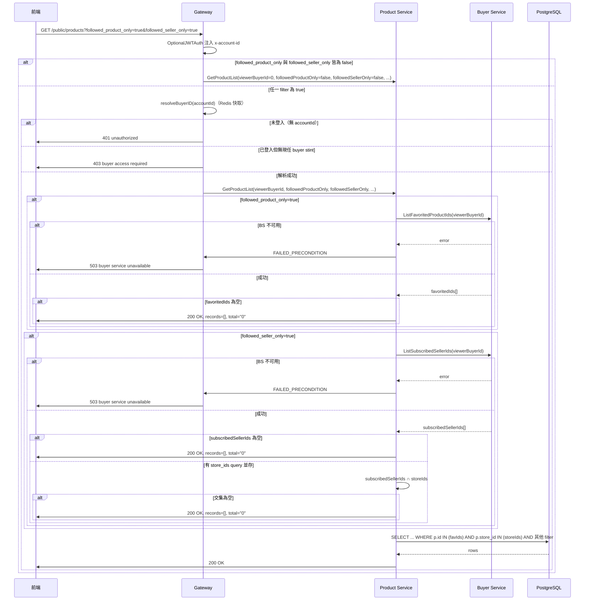

**failure modes 明確語意**：

| 情境 | 發生層 | HTTP |
|------|--------|------|
| `followed_*` 任一為 true 且未登入 | Gateway（`resolveBuyerID`） | 401 |
| `followed_*` 任一為 true 且已登入但無現任 buyer stint | Gateway（`resolveBuyerID`） | 403 |
| Buyer service RPC 失敗 / 不可用 | Product Service | 503 |
| `favoritedIds` 或 `subscribedSellerIds` 為空陣列 | 直接回空 list + total=0 | 200 |
| `followed_seller_only=true` ∩ `store_ids` 交集為空 | 直接回空 list + total=0 | 200 |
| `favoritedIds.size > 5000` | 取前 5000 + log warn | 200 |
| `subscribedSellerIds.size > 1000` | 取前 1000 + log warn | 200 |

**上限數值依據**：
- `favoritedIds` 5000：避免 IN list 過長導致 SQL planner 退化；實務單一買家收藏 < 數百，預留 10× 緩衝
- `subscribedSellerIds` 1000：實務單一買家追蹤賣家數 < 100，預留 10× 緩衝

**cache key 影響**：6 個 viewer-aware filter（含 followedSellerIds 解析後結果）全部納入 `ProductCacheService.buildCacheKey()` 雜湊，避免不同 filter 共享同 cache 而回錯資料。

**SQL 重用設計**：`followed_seller_only` 不另開 SQL 路徑，於 service 層解析為 `storeIds`，直接走既有 `AND p.store_id IN (<list>)` 子句與 `idx_product_status_store_id` 複合索引；零 schema 變動、零新索引。

#### 5.3.5 SellerInfoAssembler（list / detail 共用）

`SellerInfoAssembler` 是抽出的共用元件，負責把 `SellerMeta`（Seller Service gRPC response）轉成 `SellerInfoDTO`，list pipeline 與 detail buildSellerInfo 兩處共用：

| 輸入 | 輸出 |
|------|------|
| `Long accountId` | 必填 |
| `SellerMeta meta` （可 null）| 來自 batch 或單筆 RPC |
| 輸出 `SellerInfoDTO` | `sellerAccountId / name / logoUrl(CDN URL) / city / district / address (city+district)` |

實作位置：`services/java/product-service/src/main/java/io/github/will413028/hawkr/product/service/SellerInfoAssembler.java`。

list 與 detail 兩條路徑一律經 `SellerInfoAssembler` 組裝，**不得**各自拼裝 `SellerInfoDTO`。

#### 5.3.6 deliveryTemp 派生規則

🔴 **`deliveryTemp` 一律由 `product.shipping_methods` 反正規化欄位 derive，不得走 SQL GROUP BY pipeline**（那會讓 list 與 detail 兩條路徑各持一份 source-of-truth）。`product.shipping_methods` 在 CreateProduct / UpdateProduct 同事務內聚合寫入（§5.13a），list 查詢直接從 `product.*` 帶出，converter 內 `distinct(temperature)` 即得：

```java
// ProductEntityConverter.toListItemDTO / toDetailDTO：
List<String> deliveryTemp = entity.getShippingMethods().stream()
    .map(ShippingMethodItem::getTemperature)
    .distinct()
    .sorted()
    .toList();
```

detail / list / admin 三條路徑必須共用這一份映射規則。

### 5.4 取得商品詳情 (GetProduct)

- **不使用 Redis 快取**（需做權限檢查）
- 流程：查 DB → 權限檢查 → 查 SKU → 填充三層分類 + 賣家資訊 + 評論預覽 + **hashtag list** → 回傳
- **三層分類填充**：
  - lv3 = `product.category`，lv2 = `product.category_lv2`，lv1 = lv2 的 `parent_id`
  - 分類名稱不論 status（ACTIVE / INACTIVE）皆顯示，避免商品掛軟刪除分類時前端破口（見 §2.5.2）
- **賣家資訊**：`SellerInfo.store_id` = `product.store_id`（擁有權欄位，**非 `created_by`**），name / logo_key / address 透過 `SellerGrpcClient.getSellerMeta(storeId)` 取得
- **評論預覽**：預留 Review Service，目前回傳空陣列（最多 2 筆）
- **配送資訊**：`delivery_temp` 和 `shipping_methods` 為所有 SKU 的聯集聚合值
- **Hashtag list 填充**：
  - SQL：`SELECT h.name, ph.display_name, h.product_count FROM product_hashtag ph JOIN hashtag h ON h.id = ph.hashtag_id WHERE ph.product_id = ? ORDER BY ph.position ASC`
  - 一律即時查詢（GetProduct 本就不走快取），`product_count` 為 hashtag 主表當下值
  - 賣家自家編輯後立即可見變動

### 5.5 公開商品詳情 (GetPublicProduct)

供買家或匿名使用者瀏覽，**返回所有曾公開過且未刪除的商品**（`PUBLIC` 或 `TEMPORARILY_UNAVAILABLE`，判定規則見 §2.9），支援 Redis 快取。

流程首兩步在快取之前：先以 `findByIdIncludingDeleted` 撈列（刻意含軟刪除，才能把「已移除」與「不存在」分開回不同業務碼），再由 `ProductPublicVisibilityPolicy` 判定可見性——`NEVER_PUBLISHED` 回 3022、`REMOVED` 回 3023、查無列回 404。通過後才走 onboarding 指紋與 Cache-Aside。

#### Gateway 層聚合 `isFavorited`

與商品列表 API 相同模式，Gateway 在取得 Product Service 回應後，額外呼叫 Buyer Service 聚合收藏狀態：

- **已登入**（accountId > 0）：先以 `h.BuyerID.CurrentBuyerID(accountId)` 解析出現任 `buyer_id`，再呼叫 `Buyer.CheckFavorite(buyerId, productId)` 取得實際收藏狀態
- **未登入**（accountId == 0）：一律回傳 `false`
- **無現任 buyer stint**（`buyerid.ErrNoCurrentBuyer`）：與其他解析失敗同一條 skip path——debug log 後略過整個收藏聚合，`isFavorited` 留零值 `false`。這裡**不可**用會直接寫 403 回應的 `h.resolveBuyerID(c)`，否則 PDP 主回應會被聚合失敗打斷
- **錯誤降級**：Buyer Service 呼叫失敗時 debug log，`isFavorited` 回傳 `false`（不影響主流程）

| 項目 | GetProduct | GetPublicProduct |
|------|-----------|-----------------|
| 用途 | 賣家端 / 已登入 | 買家端 / 匿名 |
| 權限檢查 | 有（依 `status` + owner 比對） | 無（改依 §2.9 公開生命週期判定） |
| Redis 快取 | 不使用 | Cache-Aside，TTL 1 小時 |
| 非 ACTIVE 商品 | owner 可查看 DRAFT/PENDING/INACTIVE | **曾公開過者仍回 200**；從未公開回 3022 |
| 已刪除商品 | 404 | 404（業務碼 3023） |

**Gateway 路由整合**：`GET /api/v1/public/products/:id`
- **賣家身分且已登入** → `GetProduct`（權限檢查路徑，保留 owner preview，可看自己的 DRAFT / PENDING）
- **其餘一律**（匿名、已登入買家）→ `GetPublicProduct`（快取路徑）

> 登入買家**不走** `GetProduct`：那條路徑對非 owner 的非 ACTIVE 商品一律拒絕，會讓同一個 `TEMPORARILY_UNAVAILABLE` 商品「登出看得到、登入看不到」。公開 PDP 一律走 §2.9 的公開契約，登入與否不改變可見性。

**Hashtag list 處理**（GetPublicProduct 走快取）：

- `prod:detail:{id}` 快取 payload **包含 hashtag list**（`name + display_name + product_count`），TTL 1 小時
- 後果：buyer 看到的 `product_count` 最舊可達 1 小時前的值；行銷數字精度足夠
- 若需即時 `product_count`，由 buyer 端自行刷新（或前端在 hashtag chip 點擊時呼叫 `SearchHashtags(prefix=name, mode=PREFIX)` 取最新值）— 不在本服務責任範圍

### 5.5.1 批次商品查詢 (GetProductsByIDs) — `include_inactive` 與 favorites 殘魂列支援

`GetProductsByIDs` 供 buyer-service 在以下兩種路徑使用：

| 使用場景 | `include_inactive` 值 | 行為 |
|---------|----------------------|------|
| 買家瀏覽紀錄列表 | `false`（預設） | 維持原語意：僅回 ACTIVE 且未軟刪除；inactive / 已刪除商品 caller 端視為「消失」 |
| 買家收藏列表 enrichment（本節重點） | `true` | 回 ACTIVE + DRAFT + PENDING_REVIEW + INACTIVE（即所有未軟刪除商品）；軟刪除（`deleted_at IS NOT NULL`）一律不回 |

**Request proto**：

```protobuf
message GetProductsByIDsRequest {
    repeated string product_ids = 1;
    bool include_inactive = 2;  // proto3 預設 false，向後相容既有 caller
}
```

**Response 保持不變**：仍為 `repeated ProductListItem`，`ProductListItem.status`（欄位 4）攜帶 `ProductStatus.value`，由 caller 自行判讀。

#### Favorites 殘魂列（zombie favorites）處理策略

**問題定義**：買家收藏商品後，賣家將其下架（status → 4003）或軟刪除，favorites row 仍存在於 buyer-service DB（且應該存在 — 「曾經收藏」是使用者事實，不該被推刪）。但若 buyer-service 用 `include_inactive=false` 拉 enrichment，會：

- inactive 商品：完全拿不到 metadata → 卡片顯示空白
- 軟刪除商品：同上
- 使用者無從區分「無資料」與「商品已下架」，且點商品卡會 PDP 404

**採用策略：讀時拉取（Pull model）**：

| 層級 | 行為 |
|------|------|
| product-service | 提供 `include_inactive=true`，buyer-service 能拿到 inactive 商品的快照與 status |
| buyer-service `enrichWithProductInfo` | 用 `include_inactive=true` 拉；對拿不到的 productId（軟刪除）寫 `available=false, status_code=""`；對拿到的依 `status == "4004"` 寫 `available` 並帶 `status_code` |
| `FavoriteInfo` 對外契約 | 新增 `bool available = 13;` + `string status_code = 14;` 兩欄位 |
| 前端 `/account/favorites` | 不再啟發式隱藏殘魂列；`available=false` 渲染為 disabled 卡片 + 「商品已下架」標籤 + 不可點 + 保留移除按鈕 |
| 前端 `/products/{id}` 404 fallback | 既有 `ProductUnavailableView` 已實作（含「移除這筆收藏」按鈕），不變 |

🔴 **禁止**以 `product.status.changed` 事件驅動 buyer-service 刪除 `favorites` row：跨服務 drift cleanup 屬資料層動作，不寫進 application code（[後端服務責任邊界規範](../開發規範/後端服務責任邊界規範.md)）。商品下架後收藏仍保留，前端以 404 fallback 呈現。

#### 邊界情境

| 情境 | `available` | `status_code` | 快照欄位 |
|------|------------|--------------|---------|
| 商品 ACTIVE | `true` | `"4004"` | 完整 |
| 商品 INACTIVE（已下架） | `false` | `"4003"` | 完整 |
| 商品 DRAFT / PENDING_REVIEW | `false` | `"4001"` / `"4002"` | 完整 |
| 商品軟刪除 | `false` | `""` | 空（buyer-service 無 product 端 metadata，由 caller 自行 fallback `商品 #{productId}`） |
| product-service 暫時不可用（gRPC error） | `false`（zero value） | `""` | 空（既有 enrich 失敗降級邏輯：log warn 不 set） |
| 商品從 INACTIVE 重新上架為 ACTIVE | 下次讀列表自然恢復 `true` | `"4004"` | 完整 |

#### 不刪 row

favorites row 在任何情況下都不由系統自動刪除，僅使用者主動移除（既有 `RemoveFavorite` RPC）。即使商品已軟刪除，`RemoveFavorite` 仍能正常 DELETE row（buyer-service 純看 `buyer_id + product_id` 鍵）。

#### 既有 caller 影響

| Caller | 是否受影響 |
|--------|-----------|
| buyer-service `VisitUseCase.enrichWithProductInfo`（瀏覽紀錄） | 否 — 顯式傳 `include_inactive=false`，行為與既有完全一致 |
| buyer-service `FavoriteUseCase.Add` 觸發 `product.favorited` event | 否 — 僅取單筆即時資料用於 publish，邏輯上商品剛加入收藏應仍為 ACTIVE，繼續 `include_inactive=false` |
| Gateway / 其他 caller | 本 RPC 為內部 RPC，不經 Gateway 暴露 |

### 5.5.2 結帳鏈路批次商品查詢 (BatchGetProductForCheckout)

**呼叫方**：order-service `CheckoutService.resolveItems`，**唯一 caller**。

**用途**：checkout flow 取商品與 SKU 快照的唯一入口。契約要點：

- **inactive 商品不拋例外**：回完整資料 ＋ `is_active=false`，由 caller 判定要不要收進 `unavailable_items[]`。🔴 **不得**改成查無即拋 —— 那會讓下架商品永遠進不了 `unavailable_items[]`
- **batch**：一次取完整批 sku，結帳路徑**不得**逐 product_id 呼叫
- **欄位涵蓋結帳所需**：含 weight / dimension / shipping_method

**邏輯**：

1. **輸入驗證**：`sku_ids` 非空、長度 ≤ 100。
2. **批次查詢 product_sku**：`WHERE id IN (:skuIds)`（不過濾 status、不過濾 deleted_at）
3. **批次查詢 product**：依 sku 的 product_id `WHERE id IN (:productIds)`（不過濾 status、不過濾 deleted_at）
4. **組裝 ProductForCheckoutInfo**：
   - `is_active = (product.status == ACTIVE && product.deleted_at == null)`
   - `price = sku.sale_price.isNotBlank() ? sku.sale_price : sku.price`
   - 其餘欄位直接從 entity 映射
5. **回傳 `map<string, ProductForCheckoutInfo>`**：key = sku_id；**查無此 sku 時 key 缺席**（caller 透過 key 存在性判定 LOOKUP_FAILED）
6. **不快取**：結帳鏈路要即時 status / stock_qty，禁止走 Redis 商品詳情快取（`prod:detail:*`）

**權限**：内部 RPC（無 JWT），由 `GrpcAuthClientInterceptor` 注入 `x-internal-service` metadata，自動跳過 `requireAccountType()`（[52 號設計書《微服務間內部授權》](52-微服務間內部授權（Internal%20Service%20Authorization）詳細設計書.md)）。

**錯誤碼**：

| 場景 | 回傳 |
|---|---|
| `sku_ids` 空 / 超過 100 | `INVALID_ARGUMENT` |
| 部分 sku 查無 | 回傳 map 中 key 缺席，**整體仍 code=0**（由 caller 視為 LOOKUP_FAILED）|
| DB 查詢失敗 | `INTERNAL` |

🔴 **`GetPublicProduct` 不得加 `accept_inactive` 之類的 flag**：它是公開路徑（gateway 對外），該 flag 會把 inactive 商品洩漏給匿名使用者。inactive 語意只存在於本內部 RPC。

### 5.5.3 購物車批次 SKU 即時資訊 (BatchGetSkuCartInfo)

**呼叫方**：cart-service `CartService.getCart`，**唯一 caller**。

**用途**：GetCart 流程下沉一次拿 SKU 與其 product 即時 `is_active` + `stock_qty` + `delivery_temps` + `price`，供 cart-service 走 `ProductPurchasabilityRules.evaluate(...)` 判定 `purchasable` / `unavailable_reason`（[04 §5.2](./04-購物車微服務（Cart%20Service）詳細設計書.md)）。

**邏輯**（與 §5.5.2 對齊「missing → caller LOOKUP_FAILED」pattern）：

1. **輸入驗證**：`sku_ids` 非空、長度 ≤ 200
2. **單階段 LEFT JOIN 查詢**：
   ```sql
   SELECT s.id, s.product_id, s.stock_qty, s.price, s.sale_price, s.shipping_method,
          p.status, p.deleted_at
   FROM product_sku s
   LEFT JOIN product p ON p.id = s.product_id
   WHERE s.id IN (:skuIds)
   ```
   - **必須單一 query 拿一個 snapshot**：禁止「先查 SKU 再查 Product」兩階段 query，避免 PG READ COMMITTED 下兩 snapshot 不一致（並行 `UpdateProductStatus` / `DeductStock` race window）
   - **回傳 record projection**（[《Java 微服務開發規範》§9.2 Partial Projection 反模式禁令](../開發規範/Java%20微服務開發規範.md)）：不回 Entity 部分填充，定義 `SkuCartProjection(skuId, productId, stockQty, price, salePrice, shippingMethodJson, productStatus, productDeletedAt)`
3. **組裝 `SkuCartInfo`**：
   - `is_active = (productStatus == ACTIVE.value() && productDeletedAt == null)`
   - `price = sku.sale_price.isNotBlank() ? sku.sale_price : sku.price`（與 §5.5.2 對齊「effective price」）
   - `stock_qty / delivery_temps / list_price` 直接從 projection 取
4. **回傳 `map<string, SkuCartInfo>`**：key = sku_id
   - **SKU 找不到（不在 product_sku 表）**：key 缺席（caller 走 `skuInfo==null → LOOKUP_FAILED` 分支）
   - **SKU 找得到但 LEFT JOIN 後 product 欄位為 null（data integrity issue：sku.product_id 指向不存在 / 已 hard-delete 的 product）**：⚠️ **同樣 key 缺席**（從 response map 排除該 sku_id），並 log `WARN` 一筆含 `sku_id` / `product_id` / `event="batchGetSkuCartInfo.productOrphan"`
   - **嚴禁** `activeMap.getOrDefault(productId, false)` 這類 silent default → 會把 "product 找不到" 誤解成「商品已下架」回給買家假 `DELISTED`
5. **診斷 log**（強制）：
   - 對每個 `is_active == false` 或 `stock_qty <= 0` 的 SKU 補一筆 `INFO` log 含 `sku_id` / `product_id` / `productStatus` / `productDeletedAt` / `stockQty` / `event="batchGetSkuCartInfo.unpurchasable"`
   - 用途：當 buyer 反映「為什麼商品顯示下架/缺貨」時可事後對齊當時 DB 真值
6. **不快取**：cart 列表要即時 status / stock_qty，禁止走 Redis 商品詳情快取（`prod:detail:*`）；caller cart-service 也不快取 product status（[04 §5.2](./04-購物車微服務（Cart%20Service）詳細設計書.md)）

**權限**：内部 RPC，由 `GrpcAuthClientInterceptor` 注入 `x-internal-service` metadata 自動跳過 `requireAccountType()`（[52 號設計書《微服務間內部授權》](52-微服務間內部授權（Internal%20Service%20Authorization）詳細設計書.md)）。

**錯誤碼**：

| 場景 | 回傳 |
|---|---|
| `sku_ids` 空 / 超過 200 | `INVALID_ARGUMENT` |
| 部分 sku 查無 / product orphan | response map key 缺席，**整體仍 code=0**（由 caller 視為 LOOKUP_FAILED）|
| DB 查詢失敗 | `INTERNAL` |

**實作位置**：
- RPC handler：`services/java/product-service/src/main/java/io/github/will413028/hawkr/product/grpc/ProductGrpcService.java#batchGetSkuCartInfo`
- Projection：`services/java/product-service/src/main/java/io/github/will413028/hawkr/product/entity/projection/SkuCartProjection.java`
- Repository：`services/java/product-service/src/main/java/io/github/will413028/hawkr/product/repository/ProductSkuRepository.java#findCartInfoBySkuIds`
- Caller：`services/java/cart-service/src/main/java/io/github/will413028/hawkr/cart/grpc/client/ProductGrpcClient.java#batchGetSkuCartInfo` → `services/java/cart-service/src/main/java/io/github/will413028/hawkr/cart/grpc/CartGrpcService.java#getCart`

### 5.6 軟刪除商品 (DeleteProduct)

1. 驗證呼叫者為商品擁有者
2. 檢查狀態：僅允許 DRAFT / INACTIVE
3. 設定 `deleted_at = NOW()`
4. **hashtag counter delta**：若刪除前 `status = '4004' (ACTIVE)`，對該商品所有綁定的 hashtag 執行 `UPDATE hashtag SET product_count = product_count - 1 WHERE id IN (...)`（同事務）。本步驟之 §3.9 表格說明：DRAFT/INACTIVE 軟刪不影響 counter（因為它們本就不計入）
5. 清除快取（`prod:detail:{id}` + `prod:list:*`）

### 5.7 快取清除 (PurgeProductCache)

支援三種 scope：
- `all`：全部（詳情 + 列表）
- `detail`：特定商品詳情（需 product_id）
- `list`：列表快取（可選 account_id）

### 5.8 庫存操作（供 Order Service 呼叫）

| gRPC 方法 | 功能 | 冪等性 | 回傳狀態 |
|----------|------|--------|---------|
| `DeductStock` | 原子扣減庫存 | 透過 stock_tx_id | SUCCESS / INSUFFICIENT_STOCK / ALREADY_APPLIED / SYSTEM_ERROR |
| `RestoreStock` | 原子歸還庫存 | 透過 stock_tx_id | SUCCESS / NOOP_NOT_FOUND / ALREADY_APPLIED / SYSTEM_ERROR |
| `GetStock` | 查詢庫存 | N/A | 各 SKU 的 stock_qty |

**庫存不足結構化回傳**：`DeductStock` 回傳 `INSUFFICIENT_STOCK` 時，`insufficient_items` 含不足明細（sku_id, requested_qty, available_qty）。

**反正規化欄位 cascade**（§3.2 / §7.1）：`DeductStock` 與 `RestoreStock` 必須在同事務內更新 `product.stock_qty`。**SKU 層 `product_sku.stock_qty` 是庫存唯一真實來源**（有 `WHERE stock_qty >= :qty` 原子保護，永不為負）；`product.stock_qty` 是其反正規化聚合，**一律以全量重算對齊 SKU 真值，禁止增量 `±delta`**：

```sql
-- DeductStock 同事務：先扣 SKU（唯一真實來源），再全量重算 product
UPDATE product_sku SET stock_qty = stock_qty - :qty
  WHERE id = :sku_id AND stock_qty >= :qty;  -- 原子扣減，affected=0 → INSUFFICIENT_STOCK
UPDATE product SET stock_qty =
  (SELECT COALESCE(SUM(stock_qty), 0) FROM product_sku WHERE product_id = :product_id)
  WHERE id = :product_id;

-- RestoreStock 同事務：先補 SKU，再全量重算 product
UPDATE product_sku SET stock_qty = stock_qty + :qty WHERE id = :sku_id;
UPDATE product SET stock_qty =
  (SELECT COALESCE(SUM(stock_qty), 0) FROM product_sku WHERE product_id = :product_id)
  WHERE id = :product_id;
```

🔴 **`product.stock_qty` 一律全量重算，不得增量**（§3.2 一致性章節）：
- **結構上不可能為負**：重算值 = `SUM(非負 SKU)` ≥ 0，永不違反 `chk_product_stock_qty_nonneg`。增量 `product.stock_qty -= qty` 在反正規化值已漂移低於 SKU 真值時會被拉負 → `DataIntegrityViolationException` → 結帳 500。
- **自癒**：每次 deduct/restore 把 `product.stock_qty` 重新對齊 SKU，任何歷史漂移在下次庫存操作即收斂。
- **單一模型**：與 CreateProduct / UpdateProduct（§5.1 / §5.2 走 `ProductAggregateRules.aggregateStock`）統一為「`product.stock_qty` = `SUM(sku.stock_qty)`」，消除兩條維護路徑模型不一致。

**RestoreStock 因果閘門**（防 over-restore）：`RestoreStock` 在 mutate 前必須檢查同 `stock_tx_id` 是否有**已 commit 的 `DEDUCT`** 交易記錄（`stock_transaction` 表）。若無 → 回 `NOOP_NOT_FOUND` 直接返回，**不得補回從未扣減的庫存**。否則（如 `DeductStock` 因故 rollback、或 `INSUFFICIENT_STOCK` 從未扣減）補償會灌水 SKU 真值，餵大漂移並再觸發負值。

**多 row 場景死鎖避免**（[《後端服務責任邊界規範》](../開發規範/後端服務責任邊界規範.md)）：訂單含多個 product 時，按 `product_id ASC` 排序逐筆 UPDATE，並先處理所有 `product_sku` 再處理所有 `product`（兩階段，避免兩個事務互相 lock）。

**不引入 reconciliation**：寫入路徑（含上述全量重算）就是真實來源；不寫漂移偵測 job / backfill CLI。歷史殘留 drift 由 ops 直接 SQL `UPDATE product SET stock_qty = (SELECT COALESCE(SUM(stock_qty),0) FROM product_sku WHERE product_id = product.id)` 一次校正（一次性資料清整不入 codebase，[《後端服務責任邊界規範》](../開發規範/後端服務責任邊界規範.md)）。

### 5.9 運費計算 (CalculateShippingOptions)

**用途**：賣家建立/編輯商品時，根據包裝尺寸與重量計算可用配送選項與運費（預估值，固定本島→本島費率）。

**API 端點**：`POST /api/v1/app/shipping_quotes`（需 JWT）

**請求參數**：

| 欄位 | 型別 | 必填 | 說明 |
|------|------|------|------|
| `length` | string | Y | 包裝長度（cm） |
| `width` | string | Y | 包裝寬度（cm） |
| `height` | string | Y | 包裝高度（cm） |
| `weight` | string | Y | 重量值 |
| `weightUnit` | string | Y | WeightUnit: KG / CATTY / GRAM |

**回應參數**（`data` 內容）：

| 欄位 | 型別 | 說明 |
|------|------|------|
| `availableTemperatures` | array | 可配送溫層列表 |
| `availableTemperatures[].temperature` | string | 溫層 Enum value |
| `availableTemperatures[].displayName` | string | 溫層顯示名 |
| `shippingOptions` | array | 運送方式列表（method x temperature 組合） |
| `shippingOptions[].shippingMethod` | string | 配送方式 Enum value |
| `shippingOptions[].displayName` | string | 配送方式顯示名 |
| `shippingOptions[].temperature` | string | 溫層 Enum value |
| `shippingOptions[].fee` | string | 運費（TWD） |
| `shippingOptions[].estimatedDays` | string | 預計到貨天數 |
| `shippingOptions[].limits` | object | 尺寸/重量限制 |
| `shippingOptions[].limits.maxDimensionSum` | string | L+W+H 上限（cm） |
| `shippingOptions[].limits.maxLongestSide` | string | 最長邊上限（cm） |
| `shippingOptions[].limits.maxWeightGrams` | string | 重量上限（g） |
| `volumeSize` | string | 材積（L*W*H/27000） |
| `weightGrams` | string | 轉換後重量（g） |
| `dimensionSum` | string | L+W+H（cm） |
| `longestSide` | string | 最長邊（cm） |

**計算邏輯**：
- 運費計算由 Shipping Service 統一負責，Product Service 透過 gRPC `CalculateShippingOptions` 取得結果
- Product Service 呼叫方式：
  1. 轉換重量為公克（`WeightConverter.convertToGrams()`）
  2. 推導 `delivery_zone`（預設 `DOMESTIC`）
  3. 傳入 `store_id` — 只回傳賣家已開通的配送方式
  4. 呼叫 Shipping Service gRPC
  5. 映射回應為 Product Service Proto 格式
- 費率與限制由 Shipping Service DB 管理
- 所有溫層+配送方式均不符合限制時，回傳 code `4301`

### 5.10 賣家更新商品狀態 (UpdateSellerProductStatus)

**API 端點**：`PUT /api/v1/app/products/:id/status`（需 JWT + SELLER）

**請求參數**：

| 欄位 | 型別 | 必填 | 說明 |
|------|------|------|------|
| `status` | string | Y | 目標狀態碼（4003=下架, 4004=上架） |

**回應**：成功回傳更新後的 `ProductDetail`。

#### 5.10.1 Proto 定義

```protobuf
// 賣家更新商品狀態（含擁有者驗證 + 狀態轉換驗證）
rpc UpdateSellerProductStatus (UpdateSellerProductStatusRequest) returns (UpdateProductResponse);

message UpdateSellerProductStatusRequest {
    string product_id = 1;  // 商品 ID (TSID 數字字串)
    int64 account_id = 2;   // 賣家帳號 ID（Gateway JWT 注入）
    string status = 3;      // 目標狀態碼
}
```

> 回應複用現有 `UpdateProductResponse`（code + message + ProductDetail）。

#### 5.10.2 業務流程

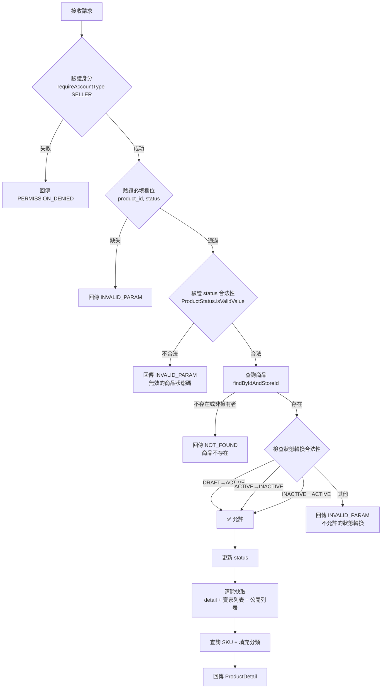

**詳細步驟**（整段由 `@Transactional` 包覆，含 hashtag counter delta）：

1. **授權驗證**：`GrpcAuthContext.requireAccountType(AccountType.SELLER)`
2. **必填欄位驗證**：`product_id`、`status` 不可為空
3. **狀態碼合法性**：`ProductStatus.isValidValue(status)`
4. **查詢商品並驗證擁有者**：`productRepository.findByIdAndStoreId(productId, storeId)`，不存在回傳 404
5. **狀態轉換合法性驗證**：

   | 來源狀態 | 允許目標 |
   |---------|---------|
   | DRAFT (4001) | ACTIVE (4004) |
   | ACTIVE (4004) | INACTIVE (4003) |
   | INACTIVE (4003) | ACTIVE (4004) |
   | PENDING_REVIEW (4002) | ❌ 全部禁止（回傳「審核中的商品僅管理員可操作」） |

5b. **賣家停權 backstop（目標狀態為 ACTIVE 時強制，§2.1）**：當轉換目標為 `ACTIVE (4004)`（`DRAFT→ACTIVE` 或 `INACTIVE→ACTIVE`）時，先呼叫 `SellerGrpcClient` 讀該賣家 `SellerMeta.can_accept_orders`；`false`（停權中）→ 擋下該轉換回業務碼「賣家停權中，無法上架商品」（不得轉 ACTIVE）。fail 策略 **fail-closed**（gRPC 失敗保守擋並回可重試錯誤）。此為能力層 fail-open 窗口的兜底收斂點（46 號 §6.2），`CreateProduct` 以 ACTIVE 落地時同樣套用。目標為 INACTIVE 的下架不檢查（收縮型操作，停權期間不需擋）。

6. **更新狀態**：`entity.setStatus(status)` → `productRepository.updateById(entity)`
7. **Hashtag counter delta**（依轉換方向）：
   - `DRAFT/INACTIVE → ACTIVE`（上架）：取該商品所有綁定的 hashtag_ids，執行 `UPDATE hashtag SET product_count = product_count + 1 WHERE id IN (...)`
   - `ACTIVE → INACTIVE`（下架）：執行 `UPDATE hashtag SET product_count = product_count - 1 WHERE id IN (...)`
   - 行鎖序列化；同事務內完成
8. **清除快取**：
   - `cacheService.evictProductDetail(productId)`
   - `cacheService.evictProductListForWrite(entity.getStoreId())`（賣家 bucket + 公開 bucket 0）
9. **組裝回應**：查詢 SKU、填充分類名稱、填充 hashtag list，回傳 `ProductDetail`

> **管理員 `UpdateProductStatus`（§4.2.1 #7）採同樣 counter delta 規則**：根據實際的 status 轉換方向（IN→ACTIVE 或 OUT→ACTIVE）執行對應 delta；對 PENDING_REVIEW 的進出不影響 counter（因為 PENDING_REVIEW 不算上架）。

#### 5.10.3 與管理員 UpdateProductStatus 的差異

| 項目 | UpdateSellerProductStatus（賣家） | UpdateProductStatus（管理員） |
|------|--------------------------------|----------------------------|
| 授權 | SELLER + 擁有者驗證 | ADMIN（不檢查擁有者） |
| 查詢 | `findByIdAndStoreId` | `findById` |
| 狀態轉換 | 僅允許 §2.1 定義的三種轉換 | 任意合法狀態碼 |
| PENDING_REVIEW | 完全禁止操作 | 可設定/取消 |

---

### 5.10a 賣家停權觸發下架與還原（可逆快照）

停權連動 saga 的 product 落地。與 §4.3.1 `seller.deleted`（不可逆）並列的**可逆**下架路徑：停權下架後，解除停權須精準還原「確實因本次停權而下架、且期間無其他變更」的商品。事件與 consumer 清單以 36 號 §3.6f 為 SSOT，整體 saga 概述見 32 號 §13.5、46 號 §5。

#### 5.10a.1 快照表 `product_suspension_snapshot`（product-service DB，Flyway V{N+1}）

```sql
CREATE TABLE product_suspension_snapshot (
  suspension_id  bigint      NOT NULL,   -- 停權 episode id（seller_suspensions.id，隨 seller.suspended payload 傳入）
  product_id     bigint      NOT NULL,   -- 本次因停權而下架（ACTIVE→INACTIVE）的商品
  created_at     timestamptz NOT NULL DEFAULT now(),
  PRIMARY KEY (suspension_id, product_id)
);
```

- PK `(suspension_id, product_id)` → upsert `ON CONFLICT DO NOTHING`，天然冪等（重送同一 suspensionId 挑同一批 ACTIVE ids）。
- 快照 scope 綁定 `suspension_id`，令解除只還原**本次**停權下架的商品（跨多次停權互不干擾）。

#### 5.10a.2 下架：`offShelfForSuspension(storeId, suspensionId)`

`SellerSuspendedConsumer` 消費 `seller.suspended` → 呼叫 `SellerProductOffShelfService.offShelfForSuspension`。**新增方法，與既有 `offShelfAllByMerchant`（`seller.deleted` 不可逆路徑）並存**，兩者共用底層 `batchUpdateStatusByIds`、`deleted` 路徑完全不動：

- 同一 `@Transactional` 內：`findProductIdsByStoreIdAndStatus(storeId, ACTIVE)` 取精確 ids →（額外）`INSERT product_suspension_snapshot (suspensionId, id) ON CONFLICT DO NOTHING` → `batchUpdateStatusByIds(ids, INACTIVE, storeId)` → 每筆 hashtag counter -1 + `evictProductDetail(id)` → `evictProductListForWrite(storeId)`（owner bucket + 公開 bucket 0）→ frontend revalidation。
- **冪等**：只挑 ACTIVE，重送選到 0 筆 → 0 副作用；快照 upsert 冪等。DB 異常 → NACK 進 DLQ（`product.seller.suspended.dlq`，同 `SellerDeletedConsumer` 錯誤處理）。

#### 5.10a.3 還原：`SellerUnsuspendedConsumer`（精準性 edge）

消費 `seller.unsuspended`（帶 suspensionId）→ 讀該 `suspension_id` 的快照，對每個 `product_id` **逐筆判定**：

| 快照商品當下狀態 | 動作 |
|---|---|
| 仍 INACTIVE、`store_id` 仍等於 `storeId` 且未軟刪除 | 翻回 ACTIVE（+ hashtag +1 + cache evict + revalidation，對稱下架） |
| 停權期間 admin 另手動下架/刪除 / 已非「因停權下架」預期態 | **跳過，記 log**（不覆蓋 admin 後續決定） |
| 商品已被刪（DRAFT/deleted） | 跳過 |

- 保證「只還原確實因本次停權下架、且期間無其他變更」的商品，**不會誤上架賣家本來就自行下架的商品**（快照精準對應，靠 `product.status` 而非 seller-status 過濾）。
- 處理完標記快照 consumed（或依 suspensionId 清理），避免重放重複還原。DB 異常 → NACK DLQ（`product.seller.unsuspended.dlq`）。

### 5.11 分類管理流程

#### 5.11.1 新增分類（自動套用）

`POST /api/v1/app/categories`（賣家）/ `POST /api/v1/admin/categories`（admin）共用同一邏輯：

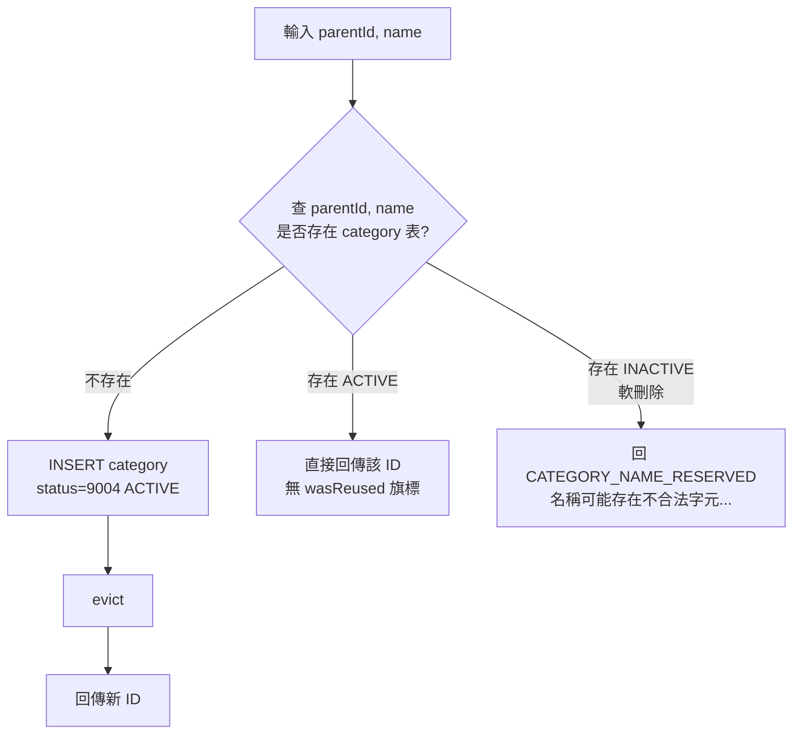

#### 5.11.2 軟刪除分類（批次）

`DELETE /api/v1/admin/categories`（body: `categoryIds: []`）：

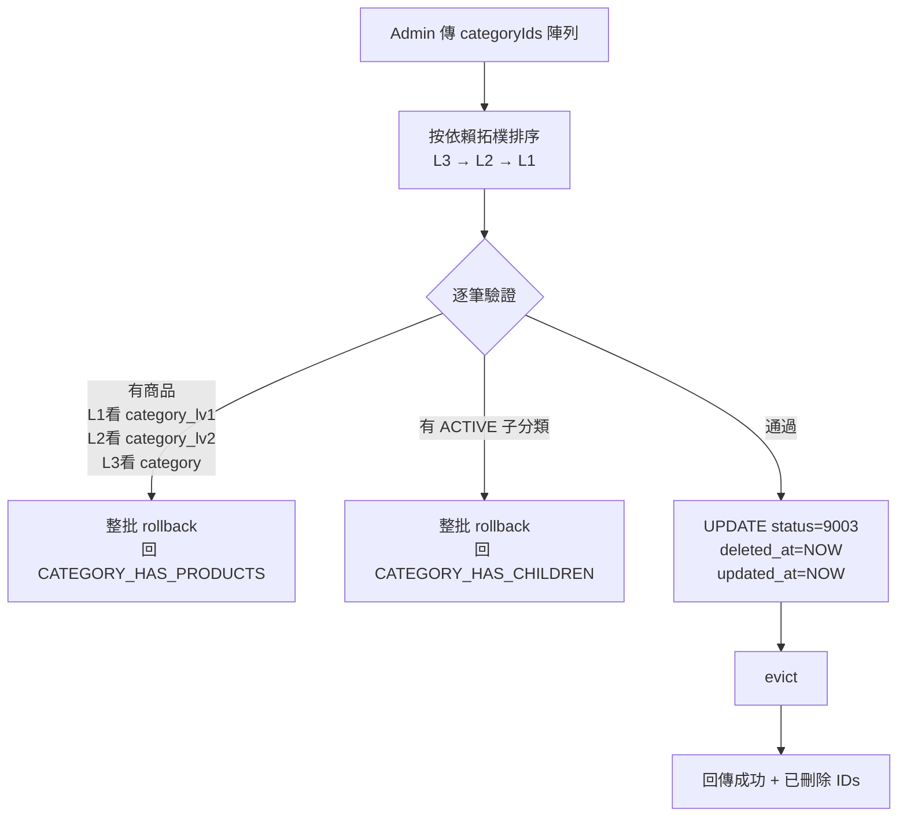

#### 5.11.3 還原分類

`POST /api/v1/admin/categories/:id/restore`：

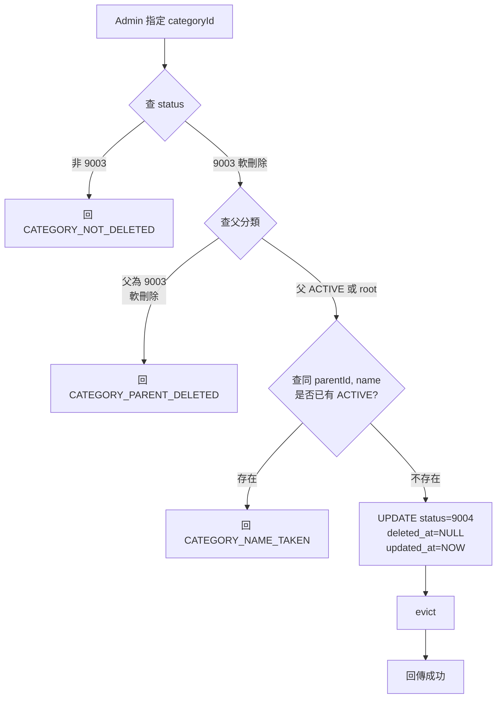

#### 5.11.4 批次更換商品分類（⚠️ 連動更新）

`POST /api/v1/admin/products/batch-change-category`：

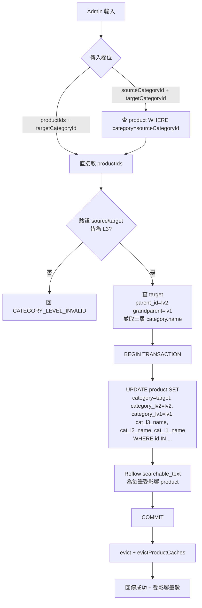

⚠️ **嚴禁只 UPDATE category 而漏 lv1/lv2 / cat_*_name / searchable_text**，否則商品列表分類過濾、買家商品詳情、檢索全文等所有依賴反正規化欄位的場景都會錯亂。

**Reflow 實作**：同事務內逐筆 reflow（呼叫 `ProductCascadeService.reflow(productIds, ...)`），不分批、不 async。後端職責邊界內的「寫入路徑寫對」原則：把資料寫對是寫入入口的責任，不引入額外補償基礎設施。

#### 5.11.5 Category 改名 cascade reflow

`UpdateCategoryForAdmin`（§4.2.3 #5）允許 Admin 修改 `category.name`。改名後，所有掛此分類的 product `cat_l*_name` 與 `searchable_text` 必須**同事務內**同步重算。

**流程**：

1. 同事務內：`UPDATE category SET name = ?, updated_at = NOW() WHERE id = ?`
2. 同事務內：依 category 層級取受影響 product id（走 `idx_product_category_lv1/lv2`/`idx_product_category` 索引）
   - 改 L1 → 影響所有 `category_lv1 = ?` 的 product
   - 改 L2 → 影響所有 `category_lv2 = ?` 的 product
   - 改 L3 → 影響所有 `category = ?` 的 product
3. 同事務內：對每筆 product 重算 `cat_l*_name` + `pure_description` + `searchable_text` 並 UPDATE（呼叫 `ProductCascadeService.reflow`）
4. evict 受影響商品的 `prod:detail:*` 與 `prod:list:*` 快取

🔴 **cascade reflow 一律同事務完成，不得引入 async runner 或 `reflow_task` 表**（[後端服務責任邊界規範](../開發規範/後端服務責任邊界規範.md)：補償任務基礎設施不在後端職責範圍內）。影響筆數 = 該 category 下的商品總數。

#### 5.12 SearchHashtags（hashtag auto-complete）

供前端 hashtag chip input 即時補全使用。

**流程**：

1. 接收 `prefix`、`mode`、`limit`
2. 對 `prefix` 跑 canonical normalize（同 §3.9）→ `canonical_prefix`
3. 若 `canonical_prefix` 空字串 → 回空陣列（不執行 SQL）
4. `limit` 限縮：< 1 視為 10，> 50 視為 50
5. 依 mode 執行 SQL：

   ```sql
   -- PREFIX 模式：走 idx_hashtag_name_pattern
   SELECT name, product_count
   FROM hashtag
   WHERE name LIKE :canonical_prefix || '%'
     AND product_count > 0
   ORDER BY product_count DESC, name ASC
   LIMIT :limit;

   -- CONTAIN 模式：走 idx_hashtag_name_trgm
   SELECT name, product_count
   FROM hashtag
   WHERE name ILIKE '%' || :canonical_prefix || '%'
     AND product_count > 0
   ORDER BY similarity(name, :canonical_prefix) DESC, product_count DESC, name ASC
   LIMIT :limit;
   ```

6. 組裝為 `repeated HashtagItem`：`name = name`、`display_name = ""`、`product_count = product_count`
7. 回傳

**快取**：本查詢**不走快取**（直接查 DB）。

**權限**：Public 與 Seller 皆可呼叫；無 account_id 過濾。

### 5.13 公開產地聚合 (GetPublicOriginsSummary)

**用途**：前端商品列表頁需要「依產地篩選」UI，本 RPC 提供當前 ACTIVE 商品的產地分布聚合（產地 → 商品數），供前端 build 篩選 chips / dropdown。

**請求參數**：

| 欄位 | 型別 | 預設 | 說明 |
|------|------|------|------|
| `category_id` | string | "0" / 空字串 | 分類 ID，支援第一/二/三層自動偵測（同 §5.3.1）；"0" 或空 = 全部分類 |
| `limit` | int32 | 50 | 上限 100，超過視為 100；最少 1 |

**業務流程**：

```mermaid
flowchart TD
    A[收到請求] --> B{category_id<br/>有效?}
    B -->|否或 "0"| C[不加分類條件]
    B -->|是| D[§5.3.1 自動偵測層級]
    C --> E[查 cache]
    D --> E
    E -->|hit| Z[回傳]
    E -->|miss| F[執行 SQL]
    F --> G[寫 cache TTL=5min]
    G --> Z
```

**SQL**：

```sql
SELECT origin, COUNT(*)::text AS product_count
FROM product
WHERE deleted_at IS NULL
  AND status = '4004'
  AND origin IS NOT NULL
  AND origin <> ''
  -- 動態分類條件（§5.3.1 偵測結果決定欄位）
  [AND category_lv1 = :cid | category_lv2 = :cid | category = :cid]
GROUP BY origin
ORDER BY COUNT(*) DESC, origin ASC
LIMIT :limit;
```

**索引**：`idx_product_origin_active` partial index `WHERE status='4004' AND origin IS NOT NULL AND origin <> ''`。

**排除規則**（明確契約）：
- `origin IS NULL` 或 `''` 不回（對前端 UI 無意義）
- 非 ACTIVE（status ≠ '4004'）不計入
- 已軟刪除（deleted_at IS NOT NULL）不計入

**快取**：cache key = `product:origins:summary:{categoryId|"all"}:{limit}`，TTL 5 分鐘；與 list cache 同層走 `ProductCacheService`。

**錯誤處理**：
- `category_id` 不存在 → `INVALID_ARGUMENT` → 400
- `limit` 超出 [1, 100] → clamp 到合法值（不報錯）

**回應範例**：

```json
{
  "code": 0,
  "message": "success",
  "data": {
    "records": [
      {"origin": "台灣", "productCount": "1245"},
      {"origin": "日本", "productCount": "320"},
      {"origin": "美國", "productCount": "85"}
    ]
  }
}
```

> **不分頁**：產地分類數量天然受限（< 100），不需 `page / pageSize`。前端拿到完整列表後 client-side 過濾即可。

### 5.13a 反正規化欄位聯集規則（stock_qty / shipping_methods）

本節定義 §3.2 `product.stock_qty` 與 `product.shipping_methods` 反正規化欄位的計算規則，供 CreateProduct（§5.1 step 17a）/ UpdateProduct（§5.2 step 15a）/ DeductStock-RestoreStock（§5.8）共用。

#### stock_qty 聚合

```java
long totalStock = skus.stream()
    .mapToLong(s -> s.getStockQty() != null ? s.getStockQty() : 0L)
    .sum();
product.setStockQty(totalStock);
```

語意：所有 SKU `stock_qty` 加總。不排除 DRAFT / INACTIVE SKU（SKU 本身無狀態維度），但實務上 SKU 與 product 共存共亡。

#### shipping_methods 聯集

來源：所有 SKU `product_sku.shipping_method` JSONB 陣列。

聯集規則：

| 鍵 | 規則 |
|---|---|
| 去重維度 | `(type, temperature)` — 同組合視為一筆 |
| `free_threshold` 衝突 | 取 **MIN**（最寬鬆，行銷友善）；NULL / 0 不參與計算 |
| `fee_payer` 衝突 | 取 **sku.id ASC 排序的第一筆**（穩定序，避免 reorder 造成抖動） |
| 排序 | 輸出按 `(type ASC, temperature ASC)` 排序，確保 detail / list 視覺一致 |

實作（Pseudo Java）：

```java
Map<String, ShippingMethodItem> merged = new LinkedHashMap<>();
List<ProductSkuEntity> sortedSkus = skus.stream()
    .sorted(Comparator.comparing(ProductSkuEntity::getId))
    .toList();
for (ProductSkuEntity sku : sortedSkus) {
    if (sku.getShippingMethod() == null) continue;
    for (ShippingMethodItem m : sku.getShippingMethod()) {
        String key = m.getType() + "|" + m.getTemperature();
        ShippingMethodItem existing = merged.get(key);
        if (existing == null) {
            merged.put(key, m.copy());  // 第一次出現的 fee_payer 勝出
        } else {
            // free_threshold 取 MIN（NULL / 0 視為「無門檻」，不參與）
            Long curr = existing.getFreeThreshold();
            Long inc  = m.getFreeThreshold();
            if (inc != null && inc > 0 && (curr == null || curr <= 0 || inc < curr)) {
                existing.setFreeThreshold(inc);
            }
        }
    }
}
List<ShippingMethodItem> result = merged.values().stream()
    .sorted(Comparator.comparing(ShippingMethodItem::getType)
                      .thenComparing(ShippingMethodItem::getTemperature))
    .toList();
product.setShippingMethods(result);
```

#### 工具類抽出位置

聚合邏輯抽到 `ProductAggregateRules` helper class（單一服務 helper，命名遵循 [《Java 微服務開發規範》§6 Enum 與禁止硬編碼](../開發規範/Java%20微服務開發規範.md)的 helper class 慣例），供 §5.1 / §5.2 共用，避免散落。

位置：`services/java/product-service/src/main/java/io/github/will413028/hawkr/product/service/helper/ProductAggregateRules.java`

簽名：

```java
public final class ProductAggregateRules {
    private ProductAggregateRules() {}
    public static long aggregateStock(List<ProductSkuEntity> skus) { ... }
    public static List<ShippingMethodItem> mergeShippingMethods(List<ProductSkuEntity> skus) { ... }
}
```

### 5.13b 補貨 transition 偵測與 product.restock event 發布

承接 §5.13a，本節定義 `product.stock_qty` 由 0 增加為 >0（補貨 transition）或商品從不可見變為可見（4003→4004 + stock>0）時，product-service 對外發布 `product.restock` event 的設計。Fan-out 由 buyer-service `restock_consumer` 處理（見 `docs/modules/buyer.md`），product-service 不持訂閱表也不知道訂閱者。

#### 5.13b.1 觸發條件

唯一強制三條件全成立才發 event：

| # | 條件 | 說明 |
|---|---|---|
| 1 | `oldStockQty = 0` AND `newStockQty > 0`（庫存路徑）<br/>OR `oldStatus != 4004` AND `newStatus = 4004` AND `newStockQty > 0`（上下架路徑） | 補貨可見 transition |
| 2 | `product.status = 4004 (ACTIVE)`（transition 後） | DRAFT/PENDING_REVIEW/INACTIVE 一律不發；不可見發 = UX 災難 |
| 3 | `product.deleted_at IS NULL` | 排除軟刪除 |

**重要**：只看 stock 0→>0 transition 不夠 — 商品從 DRAFT/INACTIVE 切到 ACTIVE 且當下 stock>0 對買家視角等同「商品出現了」，必須一起觸發。兩個觸發點同 detect 規則：

| 觸發點 | 路徑 | Detect 邏輯 |
|---|---|---|
| 庫存路徑 | `StockService.cascadeProductStock(...)`（§5.13a / §5.8） | reflow 前讀 `(stock_qty, status)` 用 record projection（§11.3 禁 partial Entity），reflow 後算 newStock；對每個 product 比較 |
| 上下架路徑 | `ProductService.updateSellerProductStatus`（§5.10）/ admin `UpdateProductStatus` | status 變更為 `4004` 且當下 `stock_qty > 0` 即發 event |

#### 5.13b.2 業務流程

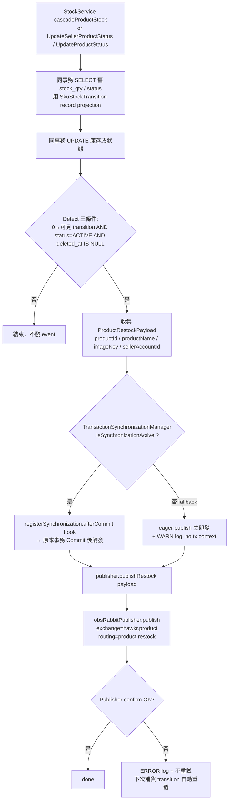

#### 5.13b.3 Payload 定義

`product.restock` event payload（Java POJO，由 publisher 序列化為 JSON）：

| 欄位 | 型別 | 必填 | 說明 |
|---|---|---|---|
| `eventId` | string (UUID v4) | Y | publisher 生成；consumer dedup 用 |
| `eventType` | string | Y | `PRODUCT_RESTOCK`（CodeMeta `內部技術碼.md` ProductEventType） |
| `productId` | string | Y | 商品 ID（數字字串） |
| `productName` | string | Y | 商品名快照（買家通知標題用，避免 consumer 跨服務 lookup） |
| `imageKey` | string | N | 首圖 objectKey 快照（原 `imageUrl`，MQ payload 圖片欄位一律帶 objectKey＋`*Key` 欄位名，49 號設計書 §6.3/§8.6；buyer notification banner 用，顯示 URL 由渲染端組出） |
| `sellerAccountId` | string | Y | 賣家帳號 ID（數字字串） |
| `occurredAt` | string (ISO 8601 UTC) | Y | event 發生時間 |

**快照欄位來源**（memory `feedback_snapshot_consistency`）：`productName` / `imageKey` 統一從 product-service `product` 表讀取（同事務 reflow 前 SELECT），避免 consumer 跨服務查詢、避免 producer / consumer 看到不同快照。

#### 5.13b.4 實作位置

| 位置 | 動作 |
|---|---|
| `services/java/product-service/src/main/java/io/github/will413028/hawkr/product/mq/ProductEventPublisher.java`（新增） | publisher class，注入 `obsRabbitPublisher`；提供 `publishRestock(payload)` 方法 |
| `services/java/product-service/src/main/java/io/github/will413028/hawkr/product/service/StockService.java` | `cascadeProductStock` 內 reflow 前後比較 `(oldStock, oldStatus)` vs `(newStock)`；detect transition 後收集 payload → `TransactionSynchronizationManager.registerSynchronization` afterCommit publish；無 tx context fallback eager publish + WARN |
| `services/java/product-service/src/main/java/io/github/will413028/hawkr/product/service/ProductService.java` | `updateSellerProductStatus` / `updateProductStatus`（admin） status 變更為 `4004` 後同樣 detect 規則 + afterCommit register publish |
| `services/java/shared/common-core/.../mq/MqConstants.java` | 新增 `EXCHANGE_PRODUCT = "hawkr.product"`、`ROUTING_KEY_PRODUCT_RESTOCK = "product.restock"` |
| `services/java/shared/common-core/.../utils/code/ProductEventType.java`（由 generate.sh 生成） | enum value `PRODUCT_RESTOCK` |

#### 5.13b.5 一致性 / 不引入清單

- **不引入 application-level outbox**（§22）— `TransactionSynchronizationManager.registerSynchronization` afterCommit 處理；isSynchronizationActive=false 時 eager publish + WARN；接受極端情況 commit 後 publish 失敗 → 該次補貨通知遺失 → 下次補貨 transition 自動補發（不引入 outbox 表 / outbox worker）
- **不在 publisher 端 fan-out / 不持訂閱表**（§22 服務責任邊界）— subscription 由 buyer-service own，product-service 發中性 event
- **不引入「query 訂閱數」做 cheap filter** — consumer 端空 query return 即可，cycle 浪費可接受；publisher 端不反向 query buyer-service
- **不引入防抖 window** — one-shot (NOTIFIED) 由 subscription owner 端 UNIQUE partial index 天然解決重複轟炸；本端不引入 5–10 分鐘 debounce 表
- **trigger 條件兩處一次到位** — 庫存 + 上下架兩條路徑同 detect 規則，禁分階段「先做庫存後做上下架」
- **partial projection 禁令**（§11.3） — reflow 前查 `(stock_qty, status, name, image)` 必須用 `record SkuStockTransition(Long productId, Integer oldStock, String oldStatus, String productName, String imageKey)` 而非 Entity；參考 [《Java 微服務開發規範》§9.2 Partial Projection 反模式禁令](../開發規範/Java%20微服務開發規範.md) 的教訓避免 NPE

### 5.13c 有公開上架商品的店家集合 (ListStoreIDsWithPublicProductsInternal)

**用途**：內部 RPC，回傳「至少有一件公開上架商品」的 `store_id` 全集。呼叫方為 seller-service 的推薦賣家用例（`GetRecommendedSellers`，同時餵 `/public/sellers/recommended` 與 `/public/marketplace` 的商家 rail），用來把 **0 件在架商品的空店排除在推薦名單外**。不對前端暴露、Gateway 無對應路由。

🔴 **過濾的 owner 是 seller-service，不是本服務**：推薦名單的兩條進榜路徑（近 30 天營收排名、最新核准賣家 fallback）都由 seller-service 擁有，商品條件只是其中一個述詞。把整份名單搬進 product-service 會讓「賣家可不可公開」的 SSOT 從 seller-service 漏出去。

**請求／回應**：

| 欄位 | 型別 | 說明 |
|------|------|------|
| （request 無欄位） | — | 全集查詢，無分頁、無篩選 |
| `store_ids` | repeated string | 數字字串（同 `seller.ListPublicStoresByCity`）。沒有公開商品的店**不出現** |

**SQL**：不另寫查詢，直接沿用 `ProductRepository.findPublicProductCountsByStore()`（全 repo 僅兩個消費點：本 RPC 的 `ProductService.listStoreIDsWithPublicProducts`，與城市聚合 `GetPublicSellerCitiesSummary` 的 `getPublicSellerCitiesSummary`），只取 `store_id`：

```sql
SELECT store_id, COUNT(*) AS product_count
FROM product
WHERE deleted_at IS NULL
  AND seller_deleted_at IS NULL
  AND status = '4004'
GROUP BY store_id;
```

`GROUP BY` 本身保證每列 `count >= 1`，故不另設門檻。**共用這一句是契約要求而非省事**：若另寫一句 SQL，「什麼叫公開上架」會出現第二份定義，之後城市聚合與推薦過濾會對同一家店給出相反答案，而且不會有任何測試變紅（`ProductServiceStoresWithPublicProductsTest` 因此同時斷言「呼叫了哪一支查詢」）。

**錯誤語意（呼叫端契約）**：

| 情況 | 回應 | 呼叫端行為 |
|------|------|-----------|
| 正常 | `code=0` + N 筆 | 濾掉不在集合內的店 |
| 全平台無公開商品 | `code=0` + 0 筆 | 濾掉**所有**店（這是答案，不是降級） |
| 查詢失敗 | 非零 code | **fail-open：完全不過濾**，維持加此過濾之前的行為 |

空集合與失敗必須可分辨：把例外降級成 `code=0` + 空 `store_ids`，會讓首頁商家 rail 整個消失且無任何訊號。seller-service 側對應以 `domain.PublicProductStores`（unknown / resolved-empty / resolved-N 三態，零值為 unknown）承載，並在 fallback 查詢把集合下推成 SQL 述詞——`LIMIT` 在述詞之後才套用，改在 Go 端過濾會讓推薦欄少掉剛好等於空店數量的卡片。

**快取**：無。兩個呼叫端的快取條件不同，結論一致：web SSR 以 `sellers:list` tag ＋ 900s TTL 快取整份推薦結果，此處再加一層只會讓失效路徑多一個要對齊的地方；買家 App 首頁（`hawkr_buyer/lib/features/home/presentation/marketplace_screen.dart` → `/public/marketplace?seller_limit=10`）**沒有這層 SSR 快取**，每次進頁都實打，所以它付的就是本 RPC 的原始成本——與城市聚合共用的同一句 `GROUP BY store_id` 聚合，不值得為它引入一個還要對齊失效的快取。

**前端快取失效**：此過濾讓 `sellers:list` 的**成員**（非排序）與商品公開狀態連動，而會改變成員的四類 mutation（建立即上架／刪除 ACTIVE 商品／上下架跨 ACTIVE／賣家批次下架）本來就共發 `seller:<id>`，展開含 `sellers:list`，失效面不需新增。詳見 [53 號 §4.3](53-Web%20前端快取架構與版本一致性%EF%BC%88Web%20Frontend%20Cache%20%26%20Deployment%20Consistency%EF%BC%89詳細設計書.md)。

### 5.14 收藏計數同步消費 (FavoriteCountConsumer)

**用途**：消費 buyer-service 發布的 `buyer.favorite.added` / `buyer.favorite.removed` MQ 事件，同事務維護 `product.favorite_count`，作為列表 / 詳情顯示「收藏人次」的唯一真實來源（§3.2）。

#### 5.14.1 觸發來源

| Routing Key | Producer | 對應 buyer-service 動作 |
|---|---|---|
| `buyer.favorite.added` | buyer-service `FavoriteUseCase.Add` | 新增收藏成功後 publish |
| `buyer.favorite.removed` | buyer-service `FavoriteUseCase.Remove` | 取消收藏成功後 publish |

詳細 publisher 設計見 `docs/modules/buyer.md`。

#### 5.14.2 業務流程

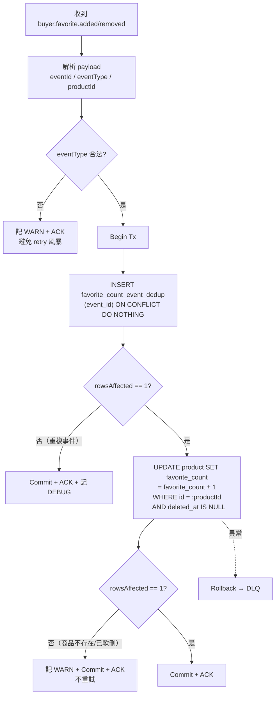

#### 5.14.3 冪等與一致性

| 場景 | 行為 |
|---|---|
| 重複 event（同 event_id） | dedup INSERT NO-OP → `favorite_count` 不變 → ACK |
| 商品不存在 / 已軟刪除 | dedup 仍寫入（避免 retry 風暴），`favorite_count` UPDATE rowsAffected = 0 → 記 WARN + ACK |
| `favorite_count = 0` 收到 removed 事件 | UPDATE 仍執行（DB 級無「不可為負」約束時可能變 -1）。對策：**加 CHECK 約束 `favorite_count >= 0`** + UPDATE WHERE 加 `AND favorite_count > 0`，rowsAffected = 0 → 記 WARN + ACK（不阻塞 consumer） |
| event publish 後 buyer 端 rollback | best-effort goroutine publish 屬非事務性發送；極少發生但仍可能造成漂移。對策：drift 屬 ops 層次處理（SQL 重算）；application 不引入 reconciliation job |

#### 5.14.4 異常與 DLQ

| 異常類型 | 處理 |
|---|---|
| Payload JSON parse 失敗 | 記 ERROR + DLQ |
| DB connection 中斷 | retry by listener（manual ACK 未送出） → 持續失敗則 DLQ |
| `INSERT dedup` 唯一鍵衝突以外的 DB error | Rollback → DLQ |

DLQ：`product.buyer.favorite.added.dlq` / `product.buyer.favorite.removed.dlq`（exchange `hawkr.product.dlx`）。

#### 5.14.5 實作位置

- Consumer：`services/java/product-service/src/main/java/io/github/will413028/hawkr/product/mq/FavoriteCountConsumer.java`（純 listener + payload 解析；**不**標 `@Transactional`）
- Service（事務邊界，獨立 class 避免 self-invocation）：`services/java/product-service/src/main/java/io/github/will413028/hawkr/product/service/FavoriteCountService.java` — `@Transactional public boolean applyCountUpdate(...)`，consumer 透過 DI 注入呼叫
- Repository：`FavoriteCountEventDedupRepository`（MyBatis-Plus）+ `ProductRepository.incrementFavoriteCount(productId, delta)` 原子 SQL
- RabbitMqConfig：**宣告 `hawkr.buyer` exchange**（topic，由本 consumer 端負責宣告）+ `product.buyer.favorite.added` / `product.buyer.favorite.removed` queue + binding；listener 用 `manualAckContainerFactory`（[《MQ 與事件管理規範》](../開發規範/MQ%20與事件管理規範.md)）。
  - 為何 consumer 端宣告 exchange：buyer-service publisher 透過 `pkg/mq.Publisher.Publish` 發訊息，內部不會 `ExchangeDeclare`；若雙方都不宣告，hawkr.buyer exchange 永遠不存在，首批 publish 會被 RabbitMQ silently drop（confirm 不會 fail，因為 confirm 只代表訊息進入 broker）。Consumer 啟動時宣告 queue 必須先存在綁定 exchange，因此 consumer 是合理的宣告端。
- **Cache invalidation**：`FavoriteCountService.applyCountUpdate` 內 UPDATE 成功後呼叫 `cacheService.evictProductDetail(productId)`。`StockService.deductStock` / `restoreStock` 的 product cascade（`cascadeProductStock`）走 **afterCommit 單一入口**：在該 `@Transactional` 方法內 `TransactionSynchronizationManager.registerSynchronization` 註冊 `afterCommit` callback，於**交易 commit 後**一次清除 detail + list；三條庫存寫路徑（DeductStock / RestoreStock gRPC + OrderCancelledConsumer）共用此入口，**gRPC handler 不得二次 evict**。無 active transaction（防禦路徑）時 fallback 直接 evict。這些反正規化欄位（`favorite_count` / `stock_qty`）**必須**反查 owner 後同步 evict **list cache**（owner bucket + 公開聚合 bucket 0）—— `favoriteCount` / `stockQty` 都出現在 `ProductListItemDTO`，只 evict detail 會讓列表卡陳舊至 `LIST_TTL`。

> ⚠️ **為何把 transactional 邏輯抽到獨立 Service**：Spring CGLIB `@Transactional` proxy 對 **self-invocation**（同 class 內呼叫）**失效**，且預設只 advise `public` method。若把 `@Transactional` 寫在 consumer 同 class 的 `protected` method 並由本 class 的 listener 呼叫，事務不會被正確開啟 — 結果是 dedup INSERT 與 product UPDATE 變成 2 個獨立的 implicit transaction，UPDATE 失敗時 dedup 已 commit 阻擋後續重試，造成計數永久漏失。本設計透過獨立 `FavoriteCountService` 注入消除此風險。

#### 5.14.6 列表 / 詳情讀取路徑

ProductListItem.favorite_count / ProductDetail.favorite_count 直接從 `product.favorite_count` 反正規化欄位讀；converter 內 `String.valueOf(entity.getFavoriteCount())`。**無跨服務 RPC、無 cache miss 風險**。

---

### 5.14a 評論聚合同步消費（ReviewStatsConsumer）

**用途**：消費 review-service 發布的 `review.created` / `review.hidden` MQ 事件，維護 `product.rating`（平均星等）與 `product.review_count`（評論數）兩個反正規化欄位，作為列表 / 詳情 / 排序顯示「商品評分」「評論數」的唯一真實來源。

#### 5.14a.1 觸發來源

| Routing Key | Producer | 對應 review-service 動作 |
|---|---|---|
| `review.created` | review-service `PublishReviewCreated` | 買家送出評價後 publish，payload 含商品層級 `productId` / `productAvgRating` / `productReviewCount` |
| `review.hidden` | review-service `PublishReviewHidden` | admin `HideReview` 隱藏評論後 publish，攜帶排除 hidden 列後重算之商品統計 |

兩事件商品統計皆由 review-service 於同流程內查 `order_item_reviews`（`deleted_at IS NULL AND hidden_at IS NULL`）權威重算，consumer 不自行計算。

#### 5.14a.2 業務流程

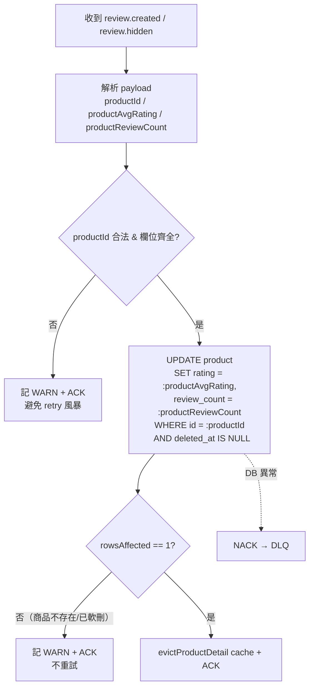

#### 5.14a.3 冪等與一致性（full-recompute 覆寫，**非**增量）

> ⚠️ 與 §5.14 收藏計數的關鍵差異：收藏是 **±1 增量**（非冪等 → 需 `favorite_count_event_dedup` 表去重）；評論聚合採 **full-recompute 覆寫**（event 帶 review-service 權威重算的當前快照，consumer 直接覆寫）→ **天然冪等，不需 dedup 表**。此設計與 seller-service `review_rating_consumer`（覆寫 `sellers.rating`）一致。

| 場景 | 行為 |
|---|---|
| 重複 event（同內容重送） | UPDATE 覆寫為相同值 → 結果不變 → ACK（冪等） |
| 商品不存在 / 已軟刪除 | UPDATE rowsAffected = 0 → 記 WARN + ACK，不重試 |
| event 亂序抵達（A:count=N 晚於 B:count=N+1） | last-writer-wins，可能短暫寫回較舊值；下一次 create / hide 事件再次 full-recompute 覆寫自癒。與 seller-service 同等暴露面，評論頻率低，可接受（不引入 version 欄位或 dedup） |
| 隱藏評論（review.hidden） | review-service 排除 hidden 列重算 → 商品 rating / review_count 同步下修 |
| 商品評論歸零（隱藏最後一筆） | consumer 寫 `review_count=0` 且 `rating=NULL`（**非 0.00**），與「從未評論」狀態一致 → converter null → API 回 `"0"`（避免兩種「無評論」狀態回不同字串） |

> 🔴 **發送端防 clobber**：review-service 發 `review.created` / `review.hidden` 前需查 seller + product 統計。**若任一統計查詢 error（非回 0，而是 DB 失敗）→ 跳過本次 publish**，不發出「假權威 0」。因 consumer 為 full-recompute 覆寫，帶 error 退化的 0 會把既有正確聚合清成 0。跳過後靠下一筆評論事件或 ops backfill 自癒。注意 `review.hidden` 的 count=0 是**合法值**（隱藏最後一筆），故以「查詢是否 error」而非「值是否為 0」決定跳過。

#### 5.14a.4 異常與 DLQ

| 異常類型 | 處理 |
|---|---|
| Payload JSON parse 失敗 / 缺 productId | 記 WARN + ACK（不可恢復，retry 無意義） |
| DB connection 中斷 / UPDATE 拋例外 | NACK → DLQ（`product.review.stats.dlq`，走 product 服務自有 DLX `hawkr.product.dlx`，與 favorite / sales / seller-deleted consumer 一致） |

> **單一寫入路徑**：`product.rating` / `product.review_count` 由 `ReviewStatsConsumer.onReviewStatsChanged`（消費 `review.created` + `review.hidden`）唯一寫入，**不存在**其他路徑直接寫這兩欄（業務寫入路徑禁止手動 set）。不引入 reconciliation / backfill 基礎設施（§22）。

**跨服務契約**：`review.created` / `review.hidden` 由 review-service 以**排除 `deleted_at` / `hidden_at` 後的權威統計**發出（payload 含 `productId` / `productAvgRating` / `productReviewCount`）；本服務 consumer **直接覆寫，不自行計算**。

**consumer 實作要求**：

- 單一 listener `ReviewStatsConsumer.onReviewStatsChanged` 同時 bind `review.created` 與 `review.hidden`；full-recompute 覆寫無需 dedup，單一 atomic UPDATE，**不**標 `@Transactional`
- Repository 用原子 SQL：`UPDATE product SET rating=?, review_count=? WHERE id=? AND deleted_at IS NULL`
- queue `product.review.stats`，DLQ 走 product 自有 DLX `hawkr.product.dlx`（與其他 product consumer 一致）；listener 用 `manualAckContainerFactory`（[《MQ 與事件管理規範》](../開發規範/MQ%20與事件管理規範.md)）
- 🔴 **cache invalidation 必須同時清 detail 與 list**：UPDATE 成功後 `evictProductDetail(productId)` ＋ 反查 owner 後 `evictProductListForWrite(ownerId)`（owner bucket ＋ 公開聚合 bucket 0）。`rating` / `reviewCount` 都出現在 `ProductListItemDTO`，只 evict detail 會讓列表卡陳舊至 `LIST_TTL`（與 `favorite_count` / `stock_qty` 同策略）

#### 5.14a.6 列表 / 詳情讀取路徑

ProductListItem.rating / review_count、ProductDetail.rating / review_count 直接從 `product.rating` / `product.review_count` 反正規化欄位讀（數字字串，符合 [《Java 微服務開發規範》§2 型別對應](../開發規範/Java%20微服務開發規範.md)，**維持 string，不改數字型別**）。**不得改用跨服務 RPC 即時讀**（那會造成列表 N+1）。

---

## 6. 時序圖總覽

### 6.1 建立商品流程

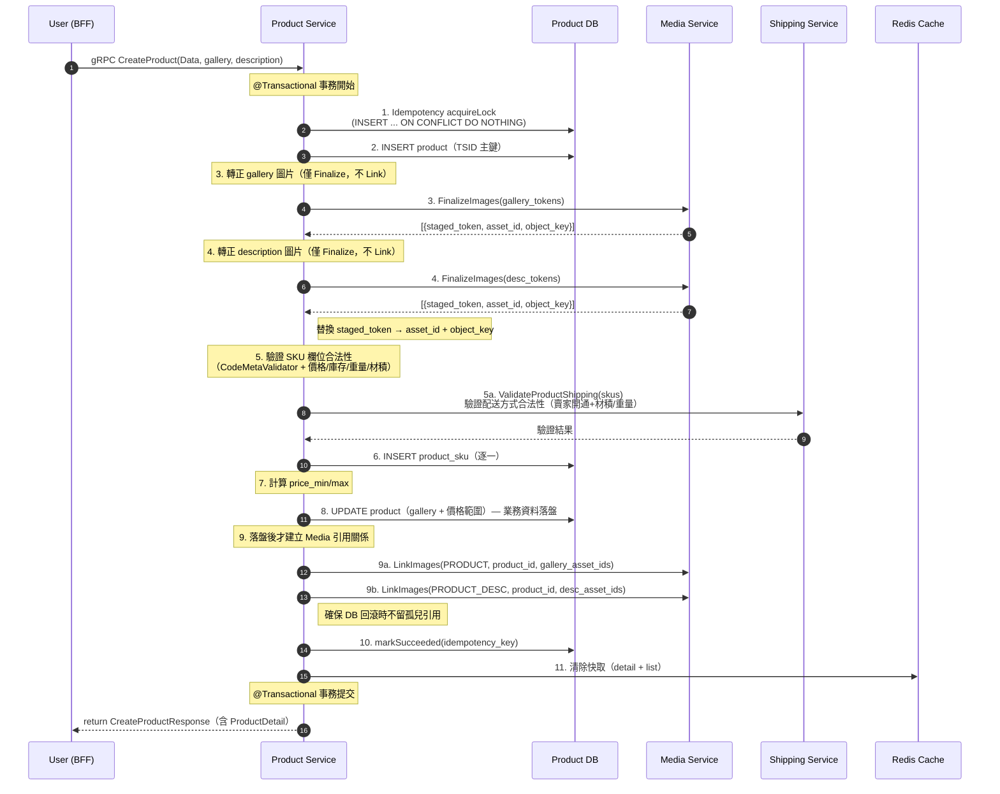

### 6.2 編輯商品流程

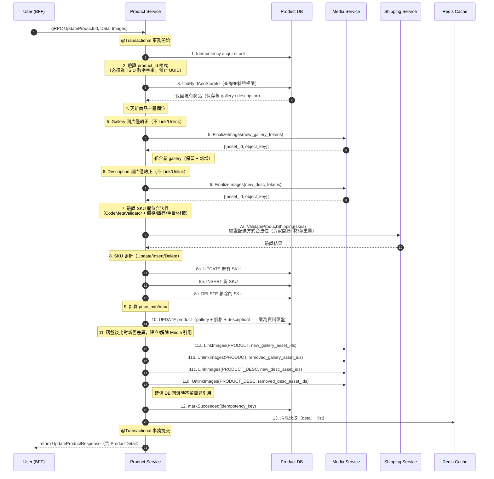

### 6.3 取得商品列表流程

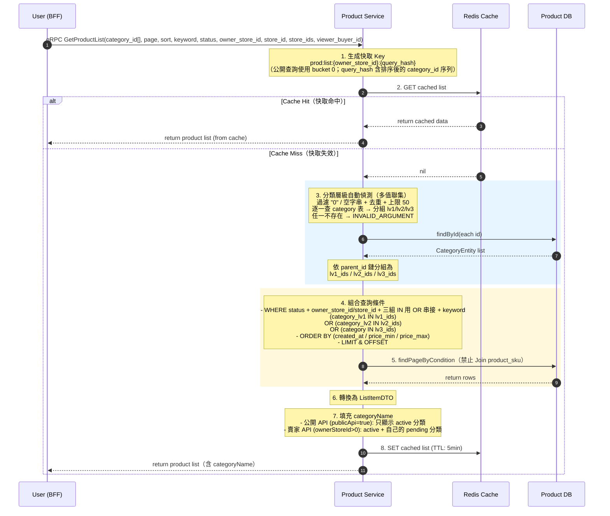

### 6.4 取得商品詳情流程（含權限檢查）

```mermaid
sequenceDiagram
    autonumber
    participant U as User (BFF)
    participant PS as Product Service
    participant DB as Product DB

    U->>PS: gRPC GetProduct(product_id, store_id)

    PS->>DB: 1. SELECT * FROM product WHERE id = ?<br/>（不使用快取，需做權限檢查）
    DB-->>PS: product row

    Note over PS: 2. 權限檢查<br/>- ACTIVE (4004): 任何人可查看<br/>- DRAFT (4001) / PENDING_REVIEW (4002) / INACTIVE (4003): 僅 owner (store_id)<br/>- 非 ACTIVE 且非 owner → 拋出 404

    PS->>DB: 3. 查詢商品 SKU (product_sku)
    DB-->>PS: sku rows

    Note over PS: 4. 轉換為 ProductDetailDTO

    Note over PS: 5. 填充三層分類 (lv1~lv3)<br/>lv3=product.category, lv2=product.category_lv2, lv1=lv2.parent_id<br/>- 建立者: getCategoryHierarchyForOwner(lv3Id, lv2Id, accountId)<br/>（active + 自己的 pending 分類）<br/>- 其他人: getActiveCategoryHierarchy(lv3Id, lv2Id)<br/>（僅 active 分類）

    Note over PS: 6. 填充賣家資訊 (seller)<br/>- gRPC 呼叫 Seller Service: getSellerMeta(store_id)<br/>- 取得 name/logo/address，降級為僅含 storeId

    Note over PS: 7. 填充評論預覽 (reviews)<br/>- 預留 Review Service，目前空陣列

    Note over PS: 8. 動態組合 URL<br/>（由 gRPC 層的 ProductProtoConverter 處理）<br/>- gallery[].url = CDN_BASE + object_key<br/>- description.blocks[image].url = CDN_BASE + object_key

    PS-->>U: GetProductResponse（含三層分類 + seller + reviews）
```

### 6.5 公開商品詳情（GetPublicProduct，含 Redis 快取 + Gateway 聚合 isFavorited）

```mermaid
sequenceDiagram
    participant GW as Gateway
    participant PS as ProductService
    participant BS as BuyerService
    participant Redis as Redis
    participant DB as PostgreSQL

    GW->>PS: gRPC GetPublicProduct(product_id)

    Note over PS: 1. 驗證 product_id 必填

    PS->>DB: SELECT * FROM product WHERE id = ?<br/>（findByIdIncludingDeleted，刻意含軟刪除列）
    DB-->>PS: ProductEntity（或空）

    Note over PS: 2. 推導 ProductPublicationState（§2.9）<br/>first_published_at + status + deleted_at + seller_deleted_at

    alt 查無此列
        PS-->>GW: GetProductResponse（code=404, "商品不存在"）
    else NEVER_PUBLISHED
        PS-->>GW: GetProductResponse（code=3022, "商品從未公開"）
    else REMOVED
        PS-->>GW: GetProductResponse（code=3023, "商品已永久移除"）
    else PUBLIC / TEMPORARILY_UNAVAILABLE
        Note over PS: 3. 取賣家 onboarding 快照，算 onboarding_sig（§2.7.2）

        PS->>Redis: GET prod:detail:{product_id}:{onboarding_sig}

        alt 快取命中
            Redis-->>PS: ProductDetailDTO (JSON)
            PS-->>GW: GetProductResponse（code=0, data=ProductDetail）
        else 快取未命中
            Redis-->>PS: null

            PS->>DB: SELECT * FROM product_sku WHERE product_id = ?
            DB-->>PS: List<ProductSkuEntity>

            Note over PS: 轉換為 ProductDetailDTO（含 publication_state / purchasable）<br/>+ 套用 onboarding filter 剔除賣家未啟用的 shipping methods<br/>+ 填充三層分類（不限分類 status，§2.5.2）<br/>+ 填充 seller（gRPC Seller Service: getSellerMeta(store_id)，降級為僅含 ID）<br/>+ 填充 reviews（預留 Review Service，空陣列）+ hashtags

            PS->>Redis: SET prod:detail:{product_id}:{onboarding_sig} {JSON} EX 3600
            Redis-->>PS: OK

            PS-->>GW: GetProductResponse（code=0, data=ProductDetail）
        end
    end

    Note over GW: Gateway 聚合 isFavorited

    alt 已登入（accountId > 0）
        GW->>GW: buyerid.Resolver.CurrentBuyerID(account_id)<br/>（Redis 快取 60s）
        alt 解析成功
            GW->>BS: gRPC CheckFavorite(buyer_id, product_id)
            BS-->>GW: favorited (bool)
            Note over GW: isFavorited = favorited
        else ErrNoCurrentBuyer / 其他錯誤
            Note over GW: debug log，略過聚合<br/>isFavorited = false（不阻斷 PDP）
        end
    else 未登入（accountId == 0）
        Note over GW: isFavorited = false
    end

    GW-->>GW: 組合 PublicProductDetailItem（含 isFavorited）回傳
```

### 6.6 賣家更新商品狀態（UpdateSellerProductStatus）

```mermaid
sequenceDiagram
    autonumber
    participant GW as Gateway
    participant PS as Product Service
    participant DB as Product DB
    participant R as Redis Cache

    GW->>PS: gRPC UpdateSellerProductStatus(product_id, store_id, status)

    Note over PS: 1. 授權驗證<br/>requireAccountType(SELLER)

    Note over PS: 2. 驗證必填欄位<br/>product_id, status

    Note over PS: 3. 驗證 status 合法性<br/>ProductStatus.isValidValue(status)

    PS->>DB: 4. SELECT * FROM product<br/>WHERE id = ? AND store_id = ? AND deleted_at IS NULL
    DB-->>PS: product row

    alt 商品不存在或非擁有者
        PS-->>GW: code=404, "商品不存在"
    else 商品存在
        Note over PS: 5. 檢查狀態轉換合法性<br/>DRAFT→ACTIVE ✅<br/>ACTIVE→INACTIVE ✅<br/>INACTIVE→ACTIVE ✅<br/>PENDING_REVIEW→任何 ❌<br/>其他 ❌

        alt 狀態轉換不合法
            PS-->>GW: code=400, "不允許的狀態轉換"
        else 狀態轉換合法
            PS->>DB: 6. UPDATE product SET status = ? WHERE id = ?
            DB-->>PS: OK

            PS->>R: 7. 清除快取<br/>evictProductDetail(productId)<br/>evictProductListForWrite(storeId)

            PS->>DB: 8. 查詢 SKU + 填充分類名稱
            DB-->>PS: SKU rows

            PS-->>GW: code=0, data=ProductDetail
        end
    end
```

---

## 7. 一致性、交易與補償設計

### 7.1 事務邊界

| 操作 | 事務範圍 | 補償策略 |
|------|---------|---------|
| CreateProduct | `@Transactional`（product + SKU + hashtag UPSERT + product_hashtag + counter delta + **product.stock_qty / shipping_methods cascade**（§5.13a） + 冪等記錄） | 圖片 Link 失敗不回滾 DB（記 LOG，best-effort） |
| CreateProductFromImportInternal（`ProductImportService.doCreate`，§9.3a） | `@Transactional`（product + SKU + hashtag + 反正規化 + **FinalizeImportAsset + LinkImages(gallery/desc)**） | **與 CreateProduct 不同：finalize / link 失敗讓例外傳播 → 全事務 rollback → import_item 標 COMMIT_FAILED**（import commit 不可逆且須符驗收「不得建出帶壞圖商品」；避免 finalize 成功但 link 失敗留下被孤兒 GC 回收的 media_asset） |
| UpdateProduct | `@Transactional`（product + SKU + hashtag diff + counter delta + **product.stock_qty / shipping_methods cascade 重算**（§5.13a） + 冪等記錄） | 圖片 Link/Unlink 失敗不回滾 DB |
| UpdateSellerProductStatus / UpdateProductStatus | `@Transactional`（product status 更新 + counter delta） | counter delta 與 status 同生共死 |
| DeleteProduct | `@Transactional`（軟刪 + counter delta） | 同上 |
| UpdateCategoryForAdmin | `@Transactional`（category.name 更新 + 受影響 product 之 cat_*_name + searchable_text） | 同事務 rollback；不分批、不 async |
| BatchChangeProductCategoryForAdmin | `@Transactional`（product 分類 + cat_*_name + searchable_text） | 同事務 rollback |
| DeductStock | `@Transactional`（stock_transaction + product_sku + **product.stock_qty cascade**（§5.8）） | 全部或全無，一個不足全部回滾 |
| RestoreStock | `@Transactional`（stock_transaction + product_sku + **product.stock_qty 全量重算 cascade**（§5.8）） | 冪等（ALREADY_APPLIED 不重複歸還）；**因果閘門**（NOOP_NOT_FOUND：同 stock_tx_id 無已 commit DEDUCT → 不補庫存，防 over-restore，§5.8） |
| FavoriteCountConsumer | `@Transactional`（favorite_count_event_dedup INSERT + product.favorite_count UPDATE）— 同事務內冪等寫入（§5.14） | dedup INSERT NO-OP → 跳過 UPDATE，記 DEBUG；商品不存在 → 寫 dedup 但 UPDATE rowsAffected=0，記 WARN 不重試 |

### 7.2 冪等性保證

| 場景 | 機制 |
|------|------|
| 商品建立/更新 | `idempotency_request` 表 + `ON CONFLICT DO NOTHING` |
| Hashtag UPSERT | `INSERT INTO hashtag(name) ON CONFLICT (name) DO UPDATE` 原子 |
| product_hashtag 寫入 | 複合主鍵 `(product_id, hashtag_id)` 防重 |
| Counter delta | 同事務內 row-lock UPDATE，rollback 時自動還原 |
| 庫存扣減/歸還 | `stock_transaction(stock_tx_id, operation)` 複合主鍵 |
| MQ 消費（order.cancelled） | StockService 內部冪等檢查（ALREADY_APPLIED） |
| MQ 消費（buyer.favorite.added/removed） | `favorite_count_event_dedup(event_id) PK` + `ON CONFLICT DO NOTHING`；重複 event NO-OP（§5.14） |

### 7.3 圖片資源生命週期一致性

- **設計原則**：先寫 DB 再 Link，保證 DB 回滾時不留孤兒引用
- **容錯（互動式 CreateProduct / UpdateProduct 路徑）**：Link 失敗 → best-effort 記 LOG 不回滾 → 前端看到破圖（使用者可察覺並重新上傳）
- **★ import commit 路徑例外（CreateProductFromImportInternal，§9.3a）**：Link 失敗**不走 best-effort**，改讓例外傳播 → DB rollback → item 標 COMMIT_FAILED。理由：import commit 不可逆、批次無人盯，best-effort 會讓 finalize 成功但 link 失敗的 media_asset 變孤兒，7 天後被 Media GC 連同 OSS 物件刪除 → 商品永久破圖。

### 7.4 Hashtag counter 一致性

- **單一寫入路徑**：所有觸發點（§3.9 表）均在同事務內以 row-lock UPDATE 維護；row-lock 避免多 hashtag 場景死鎖（按 hashtag.id ASC 序）
- **不引入 reconciliation job**：寫入路徑就是真實來源；後端職責邊界內不做「補償任務」基礎設施（[後端服務責任邊界規範](../開發規範/後端服務責任邊界規範.md)）。漂移修正屬維運 SQL，不進 application code

### 7.5a 反正規化欄位一致性（stock_qty / favorite_count / shipping_methods）

- **單一寫入路徑**：
  - `stock_qty` 由 CreateProduct / UpdateProduct（§5.1 / §5.2 step 17a / 15a）+ DeductStock / RestoreStock（§5.8）同事務維護
  - `favorite_count` 由 FavoriteCountConsumer（§5.14）同事務 ± 1，buyer publish 時生成 event_id 保冪等
  - `shipping_methods` 由 CreateProduct / UpdateProduct 同事務以 §5.13a 聚合規則重算
- **不引入 reconciliation job / drift detection / backfill CLI**：寫入路徑就是真實來源（[《後端服務責任邊界規範》](../開發規範/後端服務責任邊界規範.md)）
⚠️ `favorite_count` 的權威資料在 buyer-service 的 `favorites`，與 product-service 不同 DB；本欄只由 `FavoriteCountConsumer` 的事件推進，**不得**在 product-service 內建立跨 DB 查詢或同步機制。
- **不引入跨服務 reconciliation 排程**：偵測 drift 是 ops / observability 責任，不是 application code 責任（§22）

### 7.5b 補貨 transition event 發布一致性

承接 §5.13b，本節定義 `product.restock` event 發布的一致性與容錯規則。

- **單一發布路徑**：庫存路徑（`StockService.cascadeProductStock`）+ 上下架路徑（`UpdateSellerProductStatus` / 管理員 `UpdateProductStatus`）共用同一 detect 規則（§5.13b.1）；禁兩條路徑差異化條件
- **同事務 detect / 事務後 publish**：detect 在原始事務內完成（讀寫快照同事務），實際 publish 走 `TransactionSynchronizationManager.registerSynchronization` afterCommit；避免 commit rollback 後 event 已外發誤通知
- **不引入 outbox**（§22）— 接受極端 commit-then-publish-fail：該次補貨通知遺失 → 下次補貨 transition 自動補發。違反「精確一次」但符合 at-least-once（一次以上接受，零次容忍下次補回）
- **不引入 publisher 重試** — publish 失敗即 ERROR log；fan-out consumer 端有 dedup 表處理重複到達；publisher 端不引入 retry queue
- **無事務 context fallback**：`TransactionSynchronizationManager.isSynchronizationActive()=false` 時 eager publish + WARN log，避免事件遺失。常見 trigger：(a) 內部 helper 直接呼 cascadeProductStock 而無 `@Transactional` (b) `OrderCancelledConsumer.handle` 路徑下 spring tx context 已 commit
- **不主動 sweep / 不引入 drift detection** — publish 失敗導致個別 subscription 沒收到通知不開 reconciliation job 修正；屬可接受 trade-off

### 7.5c 認證投影一致性（certifications approved-only projection）

承接 §3.2 / §3.10，`product.certifications` 是**反正規化的 approved-only 投影**，
權威來源是 `product_certification_application`。完整規則見
[19 號 §7 / §16](19-農業認證驗證%EF%BC%88Certification%20Verification%EF%BC%89詳細設計書.md)，此處只記本服務的一致性契約：

- **單一寫入路徑**：投影只由 `ProductCertificationApplicationService.rebuildProjection(productId)` 產生
  ——由該商品**當前所有 `APPROVED` 申請**重算。**任何路徑不得再直接 `setCertifications` 寫投影**
  （原本的 W1 建立 / W2 更新 / W3・W4 代行 / W5 匯入五條路徑全部改呼叫收斂點）。
- **同事務內重建（強制）**：每一個改變 approved 集合的操作都必須在**同一 transaction** 內呼叫 `rebuildProjection`：
  `APPROVE`（人工＋系統）／`SUPERSEDE`／`WITHDRAW`（由 APPROVED 轉出）／`REVOKE`；
  `REJECT` 不改集合但為統一亦呼叫（冪等）。
  🔴 **漏了任一個 ⇒ 已撤銷／已盜用的標章繼續公開**，而清快取只是讓它重讀同一份未更新的 JSONB。
- **交易傳播**：收斂點是**獨立 `@Service` bean**（避免 `@Transactional` self-invocation ——
  寫成同 class 私有方法會讓 proxy 不攔截、事務完全失效，且**編譯與測試都不報錯**），
  但商品寫入路徑以 `Propagation.REQUIRED` **join 外層交易**，確保投影重建與商品寫入原子。
- **核准的兩步順序不可交換**：① 同 type 舊 `APPROVED` → `SUPERSEDED` 必須在 ② 本筆 → `APPROVED` **之前**。
  `uk_pca_active` 是 partial unique **index**，PostgreSQL 逐句即時檢查、無法 deferrable ⇒ 反序會瞬間出現兩列 `APPROVED`
  ⇒ 23505 ⇒ 整個交易 abort。而「舊 APPROVED 與新 SUBMITTED 並存」是換號流程的**主路徑**，不是邊角情境。
- 🔴 **`effectiveUpdate` 閘門**：收斂點的第一件事是判 `update_certifications || !certifications.isEmpty()`，為 false ⇒ 直接 return。proto3 的 repeated 分不出「空」與「未提供」，**這是唯一防線**。**條件寫錯的兩個方向都是零訊號**：只看有沒有帶欄位 ⇒ 部分更新清空全部 `APPROVED`；只看旗標 ⇒ 舊 client 的認證靜默蒸發。沿用 proto 註解的相容期語意與現行 `ProductProtoConverter` 閘門，不推翻（19 號 §6.3.0）。
- **失效順序**：commit → evict（`prod:detail` + `evictProductListForWrite`）→ 發 MQ（afterCommit）。
- **不引入 reconciliation job / drift detection / backfill CLI / outbox**
  （[《後端服務責任邊界規範》](../開發規範/後端服務責任邊界規範.md)）。
  🔴 **特別禁止**掃 `gov_verify_state='PENDING'` 的補課排程 —— 它同時踩「禁 reconciliation job」與
  「多副本排程搶佔」兩條規範。背景查驗的可靠性由 MQ 既有的 retry/DLQ 提供，人工補救由 ADM 的「重新查驗」提供。

### 7.5 Searchable_text 一致性

- **寫入路徑**：CreateProduct / UpdateProduct / UpdateSellerProductStatus / DeleteProduct / UpdateCategoryForAdmin / BatchChangeProductCategoryForAdmin 全在同事務內重算
- **不引入 backfill CLI / async reflow runner**：dev 階段由 ops SQL 處理；上線後寫入路徑單一，不需補償
- 🔴 **seed 必須帶 `searchable_text`**：`infra/seed-data/04-product.sql` 的 INSERT 要填此欄。`searchable_text` 為 NULL 的商品在關鍵字搜尋（`/public/products?keyword=` 與 `/public/search/products`）**完全查不到**，而查詢邏輯與 `idx_product_search_trgm` 都是對的 —— 症狀看起來像搜尋壞了，實際是資料缺值。
- 補值屬維運 SQL（依 `SearchableTextBuilder` 的拼接順序重算），**不得**在後端寫 backfill runner（§22 職責邊界）。

---

## 8. 環境配置

### 8.1 服務配置

| 項目 | 值 | 環境變數 |
|------|-----|---------|
| HTTP Port | 9912 | — |
| gRPC Port | 9913 | `GRPC_PORT` |
| TSID Node ID Base | 200 | — |
| DB 名稱 | hawkr_product | `DB_NAME` |
| Flyway | 啟用 | `FLYWAY_ENABLED` |
| 日誌級別 | INFO | `LOG_LEVEL` |

### 8.2 gRPC 依賴

| 目標服務 | 環境變數 | 預設 |
|---------|---------|------|
| Media Service | `MEDIA_SERVICE_HOST` / `MEDIA_SERVICE_GRPC_PORT` | 127.0.0.1:9937 |
| Seller Service | `SELLER_SERVICE_HOST` / `SELLER_SERVICE_GRPC_PORT` | 127.0.0.1:10020 |
| Shipping Service | `SHIPPING_SERVICE_HOST` / `SHIPPING_SERVICE_GRPC_PORT` | 127.0.0.1:9931 |

### 8.3 基礎設施

| 項目 | 環境變數 | 預設 |
|------|---------|------|
| PostgreSQL | `DB_HOST` / `DB_PORT` / `DB_USER` / `DB_PASSWORD` | 127.0.0.1:5432, dbadmin |
| Redis | `REDIS_HOST` / `REDIS_PORT` / `REDIS_PASSWORD` | 127.0.0.1:6379 |
| RabbitMQ | `RABBITMQ_HOST` / `RABBITMQ_PORT` / `RABBITMQ_USERNAME` / `RABBITMQ_PASSWORD` | 127.0.0.1:5672, guest/guest |

### 8.4 排程任務

| 排程 | 類別 | Cron | 開關 | 說明 |
|------|------|------|------|------|
| IdempotencyCleanupJob | `io.github.will413028.hawkr.product.scheduler.IdempotencyCleanupJob` | `0 0 2 * * ?`（每日 02:00） | `product.cleanup.idempotency.enabled`（預設 true） | 清理 24 小時前過期的冪等記錄 |
| FavoriteEventDedupCleanupJob | `io.github.will413028.hawkr.product.scheduler.FavoriteEventDedupCleanupJob` | `0 30 2 * * ?`（每日 02:30） | `product.cleanup.favorite-dedup.enabled`（預設 true） | 清理 30 天前的 `favorite_count_event_dedup` row（§3.5.1）|

- Cron 可由 `product.cleanup.idempotency.cron` / `product.cleanup.favorite-dedup.cron` 覆寫
- 日誌策略：無事不印；有刪除才記錄筆數；異常必記 ERROR

### 8.5 共用配置（來自 common-core AutoConfiguration）

| 配置 | 說明 |
|------|------|
| `CdnAutoConfiguration` | CDN base URL (`hawkr.cdn.base-url`) |
| `TsidConfiguration` | TSID 生成器（node-id-base: 200） |
| `MyBatisPlusAutoConfiguration` | 分頁 + MetaObjectHandler（created_at/updated_at） |
| `ObsAutoConfiguration` | OTel / Actuator / GrpcAuthClientInterceptor |

---

## 9. 商品匯入整合擴充

> 本章節定義 Product Service 為 [40 號設計書（商品匯入精靈服務）](40-商品匯入精靈服務（Product%20Import%20Service）詳細設計書.md)承擔的契約：內部驗證 RPC、內部轉正 RPC、`product` 表的 2 個審計欄位、以及 description 圖片的 Finalize 路徑。

### 9.1 內部 RPC：ValidateLeafCategoryInternal

**用途**：給商品匯入服務（與未來其他批次工具）在「商品建立前」驗證 `category_id` 是否為合法葉節點，並取回反正規化 `cat_l1/l2` 欄位，避免每筆 import row 在 commit 階段才知道分類錯誤。

**Proto**（新增到 `api/proto/product/product.proto`）：

```protobuf
rpc ValidateLeafCategoryInternal(ValidateLeafCategoryInternalRequest)
    returns (ValidateLeafCategoryInternalResponse);

message ValidateLeafCategoryInternalRequest {
    string category_id = 1;                  // 葉節點候選 id（數字字串）
}

message ValidateLeafCategoryInternalResponse {
    int32 code = 1;
    string message = 2;
    bool is_valid = 3;
    string cat_l3_id = 4;
    string cat_l3_name = 5;
    string cat_l2_id = 6;
    string cat_l2_name = 7;
    string cat_l1_id = 8;
    string cat_l1_name = 9;
    string invalid_reason = 10;              // NOT_FOUND / NOT_LEAF / DISABLED
}
```

**權限**：純內部 RPC，由 `x-internal-service` metadata 自動識別免身份驗證；Gateway 不暴露對應 REST。

**實作位置**：

- 新增 `ProductGrpcService.validateLeafCategoryInternal()` handler
- 重用既有 `CategoryService` 內 `getParentId()` 與 leaf 判定邏輯
- 不查詢任何使用者層級資料，純讀 category 表

**錯誤策略**：

- category_id 不存在 → `is_valid=false`, `invalid_reason=NOT_FOUND`（不拋 gRPC error，因為這是「驗證」場景，false 屬於正常回應）
- category_id 非葉節點 → `is_valid=false`, `invalid_reason=NOT_LEAF`
- 葉節點但 status=DISABLED → `is_valid=false`, `invalid_reason=DISABLED`

### 9.2 內部 RPC：CreateProductFromImportInternal

**用途**：給商品匯入服務在 commit 階段建立正式商品。與既有 `CreateProduct`（Gateway 對前端 APP）分離，以維持權限邊界與審計線索清晰。

**為何不重用 `CreateProduct`**：

| 議題 | `CreateProduct` | `CreateProductFromImportInternal` |
|------|----------------|-----------------------------------|
| Access | Gateway 對前端開放（賣家 JWT） | 內部 only（`x-internal-service`） |
| `store_id` 來源 | Gateway resolver 注入（現任 store surrogate） | Import Service 傳入（已驗證的賣家 store id） |
| 來源追溯欄位 | 無 | 帶 `import_job_id` / `import_item_id` |
| 圖片承載 | `staged_token`（30 min TTL JWT） | `import_asset_id`（無 TTL，UUID） |
| 描述圖 Finalize | `processDescriptionImages`（既有，by stagedToken） | `processDescriptionImportAssets`（§9.3 新方法，by import_asset_id） |

**Proto**（新增到 `api/proto/product/product.proto`）：

```protobuf
rpc CreateProductFromImportInternal(CreateProductFromImportInternalRequest)
    returns (CreateProductFromImportInternalResponse);

message CreateProductFromImportInternalRequest {
    string idempotency_key = 1;             // 由 Import 端組：import:{itemId}:rev:{revision}
    int64 store_id = 2;                     // 賣家 store 代理鍵（Import 服務上下文已驗證）
    string import_job_id = 3;               // 純記錄，寫入 product 表審計欄位
    string import_item_id = 4;              // 同上
    string name = 5;
    string category_id = 6;
    ProductDescription description = 7;
    repeated ProductImageImport images = 8;          // 用 import_asset_id 取代 staged_token
    string origin = 9;
    repeated Certification certifications = 10;
    string target_status = 11;              // ACTIVE | DRAFT | PENDING_REVIEW
    repeated ProductSkuImport skus = 12;    // 重用既有 SKU 結構，但畫面顯示無 sku_id
    repeated string hashtags = 13;
}

message ProductImageImport {
    string import_asset_id = 1;             // Media import_asset.id (UUID)
    int32 sort_order = 2;
}

message ProductSkuImport {
    string sku_name = 1;
    string price = 2;
    string sale_price = 3;
    string stock_qty = 4;
    string weight = 5;
    string unit = 6;
    string length_cm = 7;
    string width_cm = 8;
    string height_cm = 9;
    repeated ShippingMethod shipping_methods = 10;   // 重用既有
}

message CreateProductFromImportInternalResponse {
    int32 code = 1;
    string message = 2;
    string product_id = 3;                  // 數字字串
    string idempotency_status = 4;          // CREATED | DUPLICATED（與既有 IdempotencyService 對齊）
}
```

**Description 內嵌圖**：

`ProductDescription.blocks[]` 內 type=image 的 block 不再帶 `staged_token`，改帶**新欄位** `import_asset_id`（需在既有 `DescriptionBlock` proto message 新增 `string import_asset_id = N;`）。Product Service 內部判斷：

- 若 `staged_token` 非空 → 走既有 `processDescriptionImages`（finalizeImages by stagedToken）
- 若 `import_asset_id` 非空 → 走新 `processDescriptionImportAssets`（§9.3，finalize by import_asset_id）
- 兩者**同一個 block 互斥**，違反時拋 INVALID_ARGUMENT

### 9.3 新增內部方法：processDescriptionImportAssets

**位置**：`ProductService.java`，與既有 `processDescriptionImages`（[L1517](../../services/java/product-service/src/main/java/io/github/will413028/hawkr/product/service/ProductService.java#L1517)）並排。

**簽名**：

```java
private void processDescriptionImportAssets(Long productId,
                                             ProductEntity.ProductDescription description,
                                             Long storeId);
```

**邏輯（對齊既有 `processDescriptionImages`）**：

```
1. 過濾 description.blocks 內 type=image 且 import_asset_id 非空的 block
2. 逐一呼叫 Media FinalizeImportAsset(importAssetId, refType=PRODUCT_DESC, productId, storeId)
3. 回填 block.assetId / block.objectKey / block.url，清掉 import_asset_id
4. 建立 asset_reference (refType=PRODUCT_DESC, ref_id=productId) — 重用既有 linkDescriptionImages 路徑
5. 失敗策略：**與 §9.3a 一致（import commit 走 strict，不同於互動式 processDescriptionImages 的 best-effort）**。
   finalize 或 link 任一失敗 → 讓例外傳播 → doCreate 全事務 rollback → import_item 標 COMMIT_FAILED。
   finalize 成功但 link 失敗會留下被孤兒 GC 回收的 media_asset ⇒ 描述圖的 link 同樣不得吞例外。
```

**主圖類似**：原 `finalizeAndPersistImages`（gallery 主圖 finalize 路徑）需擴充：

```
- 若 ProductImage.staged_token 非空 → 走既有 FinalizeImages by stagedToken
- 若 ProductImage.import_asset_id 非空 → 走新 FinalizeImportAssets by import_asset_id
- 兩者互斥
```

### 9.3a Import 轉正資產生命週期（Finalize → DB 落盤 → **Link**，強制）

> 🔴 **import 轉正流程必須與 `CreateProduct`（§5.1）走同一條 `Finalize → 業務 DB 落盤 → Link` 契約**（Media 08 §4.1 step 4 防孤兒機制 / 08 §7.3 LinkImages 強制）。

**實作位置（實況）**：import 轉正的編排在 `ProductImportService.doCreate`（與 `CreateProduct` 嚴格分離，[《Java 微服務開發規範》§4.1 角色分離](../開發規範/Java%20微服務開發規範.md)），透過 `ProductImportAssetProcessor.processGallery` / `processDescription` 呼叫 Media `FinalizeImportAsset` 取得 `assetId / objectKey`。**finalize 與 link 兩步驟拆開**：finalize 只把 OSS object 搬到正式路徑 + 建 `media_asset`，**不建 `asset_reference`**。

**強制順序**（`doCreate` 內，`@Transactional`）：

```
1. processGallery       → 逐張 FinalizeImportAsset(refType=PRODUCT)，回填 GalleryItem{assetId, objectKey}
2. processDescription   → 逐張 FinalizeImportAsset(refType=PRODUCT_DESC)，回填 DescriptionBlock{assetId, objectKey}
3. UPDATE product       → 業務資料落盤（gallery / description / 反正規化欄位）
4. LinkImages(gallery)  → linkImages(galleryAssetIds, refType=PRODUCT,      refId=productId)   ★ 不可省
5. LinkImages(desc)     → linkImages(descAssetIds,    refType=PRODUCT_DESC, refId=productId)   ★ 不可省
```

> ⚠️ **缺第 4/5 步 = 圖片 7 天後 404**：`FinalizeImportAsset` 建立的 `media_asset` 若無對應 `asset_reference`，會被 Media `MediaGarbageCollectionJob` 孤兒清理（無引用且 `created_at` 超過 `media.gc.orphan-asset-days`，預設 7 天）**連 DB row + OSS 物件一起刪** → 正式商品 `images[]` 全數 404。

**錯誤處理**：link 失敗**一律讓例外傳播** → `@Transactional` 連同 product 寫入 rollback → import 路徑標 `COMMIT_FAILED` 由賣家 retry；互動式 `CreateProduct` / `UpdateProduct` 亦同（不得 catch + log 放行）。理由與媒體生命週期不變式一致（Media 08 §4.6.2）：吞掉 link 錯誤會 commit 出「`product.gallery` 指著 assetId、卻沒有 `asset_reference`」的列，7 天後被 GC 連同 R2 物件實體刪除；讓它 rollback 則只留下無人引用的資產，正好落在 GC 的孤兒回收範圍。

**collect helper 去重（[《Java 微服務開發規範》§15 重複實作防護](../開發規範/Java%20微服務開發規範.md)）**：`collectGalleryAssetIds` / `collectDescriptionAssetIds` / link 邏輯抽為共用元件 `ProductMediaReferenceLinker`（位置：`services/java/product-service/src/main/java/io/github/will413028/hawkr/product/service/helper/ProductMediaReferenceLinker.java`），由 `ProductService` 與 `ProductImportService` 共用，禁止複製。元件提供 `linkGallery(productId, gallery)` / `linkDescription(productId, description)`，內部封裝 collect + `MediaGrpcClient.linkImages`。**兩邊 caller 的失敗語意一致**：不吞例外，讓其傳播觸發 rollback。

```mermaid
sequenceDiagram
    participant IMP as ProductImportService.doCreate
    participant PROC as ProductImportAssetProcessor
    participant MS as Media Service
    participant PDB as Product DB

    Note over IMP: @Transactional
    IMP->>PROC: processGallery(importAssetIds)
    PROC->>MS: FinalizeImportAsset(refType=PRODUCT) ×N
    MS-->>PROC: {assetId, objectKey}  （正式路徑 public/product/{acc}/{date}/{uuid}）
    IMP->>PROC: processDescription(importAssetIds)
    PROC->>MS: FinalizeImportAsset(refType=PRODUCT_DESC) ×M
    MS-->>PROC: {assetId, objectKey}
    IMP->>PDB: UPDATE product（gallery / description / 反正規化）— 業務落盤
    alt finalize / link 全成功
        IMP->>MS: LinkImages(PRODUCT, productId, galleryAssetIds)   ★
        IMP->>MS: LinkImages(PRODUCT_DESC, productId, descAssetIds) ★
        Note over IMP,PDB: tx commit → item=COMMITTED
    else finalize 或 link 任一失敗
        MS-->>IMP: 例外（gRPC error）
        Note over IMP,PDB: 例外傳播 → @Transactional rollback（product 不落盤）
        IMP->>IMP: CommitItemService 捕捉 → import_item.status=COMMIT_FAILED（賣家可 retry）
    end
```

> COMMIT_FAILED 狀態流轉見 40 號設計書 §2.2 ImportItem 狀態機（COMMITTING → COMMIT_FAILED；賣家修正後可 RetryImportItemAssets / 重新 commit）。

### 9.4 product 表的 import 審計欄位

```sql
ALTER TABLE product
    ADD COLUMN import_job_id  BIGINT,
    ADD COLUMN import_item_id BIGINT;

CREATE INDEX idx_product_import_origin ON product (import_job_id, import_item_id)
    WHERE import_job_id IS NOT NULL;
```

| 欄位 | 說明 |
|------|------|
| `import_job_id` | NULLABLE — 一般賣家上架為 NULL；經 Import Service 轉正才寫入 |
| `import_item_id` | 同上；用於審計「這個正式商品從哪 CSV 來」 |

**寫入時機**：`CreateProductFromImportInternal` handler 內，與其他 product 欄位**同事務**寫入。一般 `CreateProduct` 寫 NULL。

### 9.5 內部 RPC：BatchCheckSellerProductNames

**用途**：給 Product Import Service 在 CSV 解析 + 賣家編輯時批次偵測商品名稱是否與賣家既有商品重複，協助 import 階段 UX「重名提示 / 確認允許」流程（見 [40 號 §5.2 / §5.5](../詳細設計書/40-商品匯入精靈服務（Product%20Import%20Service）詳細設計書.md)）。

**Proto**（新增到 `api/proto/product/product.proto`）：

```protobuf
rpc BatchCheckSellerProductNames(BatchCheckSellerProductNamesRequest)
    returns (BatchCheckSellerProductNamesResponse);

message BatchCheckSellerProductNamesRequest {
    int64 store_id = 1;                      // 賣家 store 代理鍵
    repeated string names = 2;                // 上限 500，超過拋 INVALID_ARGUMENT
}

message BatchCheckSellerProductNamesResponse {
    int32 code = 1;
    string message = 2;
    repeated ExistingProductByName existing = 3;  // 只回該賣家既有的 product；不存在不出現
}

message ExistingProductByName {
    string name = 1;
    string product_id = 2;                    // 第一筆碰到的 product.id（賣家可能 race 已有同名 N 筆，回任一）
    string status = 3;                        // 既有商品的 ProductStatus value
}
```

**權限**：純內部 RPC，由 `x-internal-service` metadata 自動識別免身份驗證；Gateway 不暴露對應 REST。

**實作流程**：

```
1. 校驗 names.size() ≤ 500，否則 INVALID_ARGUMENT
2. SELECT id, name, status FROM product
   WHERE store_id = :storeId AND deleted_at IS NULL AND name IN (?, ?, ...)
3. 對每個有命中的 name 建一筆 ExistingProductByName
4. 不命中的 name 不出現於回應
```

**索引**：依賴 `product.store_id` owner key 與 `name` 條件；目前 repository 使用 `store_id = #{storeId}`，不再以 audit 欄位 `created_by` 做賣家範圍查詢。

**Race 容忍**：本 RPC 僅做「偵測」，不會 SET FOR UPDATE 鎖商品。Import 端在 csv.parse 與 UpdateImportItem 時呼叫，commit 階段不再呼叫（極端 race 由 §40 §8.3a 容忍策略處理）。

### 9.6 對既有 IdempotencyService 的影響

無影響。新 RPC 使用既有 `IdempotencyService.acquireLock / markSucceeded / markFailed`，only 變動：

- `endpoint` 欄位寫 `CreateProductFromImportInternal`（區別於既有 `CreateProduct`）
- idempotency_key 格式由 Import 端組裝為 `import:{itemId}:rev:{revision}`

`IdempotencyService.acquireLock` 對 FAILED 記錄自動刪除以允許 retry，符合 Import revision 機制需求。

### 9.7 finalizeImages 回傳的配對契約（強制）

🔴 **`finalizeImages` 的回傳一律 by `staged_token` 配對，禁止用 array index**（`media.proto` 註解明文如此）。
`ProductService` 的 4 個處理點（`processImages` / `processImageUpdate` / `processDescriptionImages` / `processDescriptionImageUpdate`）都必須以
`Collectors.toMap(FinalizedImage::getStagedToken, f -> f, (a, b) -> a)` 建 mapping（merge function 保留第一個，避免 duplicate staged_token 觸發 `IllegalStateException`），
再依 staged_token 取轉正結果；gallery 組裝以 DTO 輸入順序 iterate（那才是 gallery 顯示位置的依據）。
⚠️ 依賴 index 配對只在「Media server 恰好循序處理且無 partial-success」時才碰巧正確 —— 那不是契約，server 改 `parallelStream` 或支援 partial-success 就會錯配圖片且無任何訊號。
`processDescriptionImportAssets` 與 `FinalizeImportAssets` 同理，改以 **import_asset_id** 配對。

---

## 附錄 A：本服務使用的 Enum

完整定義統一維護於 [代碼管理（CodeMeta）](../代碼管理%EF%BC%88CodeMeta%EF%BC%89/README.md)，以下僅列出本服務涉及的 Enum：

| Enum | 值 | 定義來源 |
|------|----|---------|
| ProductStatus | DRAFT / PENDING_REVIEW / INACTIVE / ACTIVE | [業務狀態碼](../代碼管理%EF%BC%88CodeMeta%EF%BC%89/業務狀態碼.md#ProductStatus) |
| ProductPublicationState | NEVER_PUBLISHED / PUBLIC / TEMPORARILY_UNAVAILABLE / REMOVED | [業務狀態碼](../代碼管理%EF%BC%88CodeMeta%EF%BC%89/業務狀態碼.md#ProductPublicationState) — 衍生值，不落 DB（§2.9） |
| WeightUnit | KG / CATTY / GRAM | [業務類型碼](../代碼管理%EF%BC%88CodeMeta%EF%BC%89/業務類型碼.md#WeightUnit) |
| IdempotencyRequestStatus | IN_PROGRESS / SUCCEEDED / FAILED | [內部技術碼](../代碼管理%EF%BC%88CodeMeta%EF%BC%89/內部技術碼.md#IdempotencyRequestStatus) |
| StockTxPhase | DEDUCT / RESTORE | [內部技術碼](../代碼管理%EF%BC%88CodeMeta%EF%BC%89/內部技術碼.md#StockTxPhase) |
| StockTxStatus | INIT / SUCCESS / FAILED / MANUAL_INTERVENTION | [內部技術碼](../代碼管理%EF%BC%88CodeMeta%EF%BC%89/內部技術碼.md#StockTxStatus) |
| CommonStatus | INACTIVE / ACTIVE | [業務狀態碼](../代碼管理%EF%BC%88CodeMeta%EF%BC%89/業務狀態碼.md#CommonStatus) |
| CertificationType | ORGANIC / TAP / CAS / HACCP / ISO / GMP（value 3701–3706） | [業務類型碼](../代碼管理%EF%BC%88CodeMeta%EF%BC%89/業務類型碼.md#CertificationType) |
| ProductCertificationStatus | 見 CodeMeta（六狀態 FSM） | [業務狀態碼](../代碼管理%EF%BC%88CodeMeta%EF%BC%89/業務狀態碼.md) — `product_certification_application.status`（§3.10 / 19 號 §5） |
| ProductCertificationSource | 見 CodeMeta | [業務類型碼](../代碼管理%EF%BC%88CodeMeta%EF%BC%89/業務類型碼.md) — `source` |
| ProductCertificationGovVerifyState | 見 CodeMeta | [業務類型碼](../代碼管理%EF%BC%88CodeMeta%EF%BC%89/業務類型碼.md) — `gov_verify_state` |
| ProductCertificationReviewAction | 見 CodeMeta | [業務類型碼](../代碼管理%EF%BC%88CodeMeta%EF%BC%89/業務類型碼.md) — `product_certification_review_event.action` |
| ProductCertificationRejectReason | 見 CodeMeta | [業務類型碼](../代碼管理%EF%BC%88CodeMeta%EF%BC%89/業務類型碼.md) — `reason_code` |
| HashtagMatchMode | ANY / ALL | proto 內定義（gRPC enum，不入 CodeMeta；無外露錯誤碼） |
| HashtagSearchMode | PREFIX / CONTAIN | proto 內定義（gRPC enum，不入 CodeMeta；無外露錯誤碼） |
| BuyerEventType | BUYER_FAVORITE_ADDED / BUYER_FAVORITE_REMOVED | [內部技術碼](../代碼管理%EF%BC%88CodeMeta%EF%BC%89/內部技術碼.md#BuyerEventType) — FavoriteCountConsumer 寫入 `favorite_count_event_dedup.event_type` 用（§5.14） |
| OrderEventType | ORDER_PAID / ORDER_CANCELLED / ORDER_SALES_ACCUMULATED ... | [內部技術碼](../代碼管理%EF%BC%88CodeMeta%EF%BC%89/內部技術碼.md#OrderEventType) — `OrderCancelledConsumer` / `SalesAccumulatedConsumer` 對應 |
| ProductEventType | PRODUCT_RESTOCK / PRODUCT_RESTOCK_TARGET ＋ 四個認證事件 | [內部技術碼](../代碼管理%EF%BC%88CodeMeta%EF%BC%89/內部技術碼.md) — `ProductEventPublisher` 發布用（§4.3.2） |
