# 訂單微服務（Order Service）詳細設計書

> ⚠️ **錯誤處理慣例**：本設計書內所有 sequence diagram 之 gRPC client 呼叫，error path 統一依 [`Java gRPC 錯誤處理規範.md §7.0`](../開發規範/Java%20gRPC%20%E9%8C%AF%E8%AA%A4%E8%99%95%E7%90%86%E8%A6%8F%E7%AF%84.md)（現行 envelope-code 約定，最高優先）。個別 diagram 僅繪製 happy path。**寫入型 RPC**（grant / create / refund 等）呼叫後**必須**檢查 `resp.getCode()`，非 `SUCCESS(0)` 時禁止用 `resp.getData()` 推進本地狀態機（失敗動作依 §7.0「有 / 無不可逆前置」分類）；查詢型 RPC 可不檢查。錯誤處理一律依 §7.0 的 envelope-code 約定。

## 1. 服務概述與責任邊界

### 1.1 核心目標

- 建立訂單並以資料庫交易維持庫存扣減的強一致性（庫存真實數量由 Product Service 原子完成；Order 端以補償與協調紀錄確保一致性）
- 被動接收支付 MQ 事件並更新訂單付款狀態（含超時與異常情境）
- 提供買家、賣家、後台（Admin）完整的查詢與操作 API
- 支付 MQ 更新必須以 Transaction ID 作為冪等鍵，避免重複訊息造成重複更新/重複入帳

> **退款/售後流程已遷至 AfterSales Service，詳見售後微服務設計書。** Order Service 不再持有退款申請/審核/選擇方式等業務邏輯，僅被動消費 AfterSales MQ 事件更新訂單狀態與資金流水。

### 1.2 結帳模組（Checkout Module）

Order Service 內部包含結帳模組（Checkout Module），位於 `checkout/` 子包，採用 Modular Monolith 架構。結帳模組負責「購物車 → 訂單」的轉換邏輯，提供 4 支結帳 API（Validate / ShippingFee / Preview / Confirm）。

結帳模組的完整設計規格請參閱：**[結帳模組（Checkout Module）詳細設計書](20-結帳模組（Checkout Module）詳細設計書.md)**

```
order-service/
  └─ src/main/java/io/github/will413028/hawkr/order/
      ├─ checkout/                       ← 結帳模組（詳見結帳設計書）
      │   ├─ CheckoutService.java
      │   ├─ CheckoutValidator.java
      │   └─ shipping/
      ├─ grpc/OrderGrpcService.java      // 既有 + Checkout RPC handler
      ├─ service/OrderService.java       // 既有建單邏輯
      └─ ...
```

### 1.3 技術棧

- 開發語言：Java 21
- 框架：Spring Boot 3.2+
- 通訊：gRPC（Protobuf v3）
- 消息中間件：RabbitMQ（Topic Exchange）
- 資料庫：PostgreSQL 15+
- 貨幣單位：TWD

### 1.4 主鍵策略（強制）

- 所有業務實體表主鍵使用 TSID（Time-Sorted ID，64-bit），型別為 BIGINT
- TSID 由應用層透過 `TsidUtil.generate()` 產生，不使用資料庫自增
- Entity 必須標註 `@TableId(type = IdType.INPUT)`
- Order Service 的 TSID node-id-base 為 300（範圍 300-399）

### 1.5 金額欄位規範（強制）

- 所有金額欄位：BIGINT
- 金額永遠整數（新台幣：元）
- 任何進入 DB 的金額在 Service 層都必須先整數化
- Protobuf 傳輸金額一律使用字串（例如 "1250"）

### 1.6 分散式一致性（強制原則）

- 庫存真實數量由 Product Service 的 product_spec.stock 管理
- Order Service 不得持有任何「真實庫存數量」表
- 下單流程採「先扣庫存 → 後建訂單 → 失敗補償」
- 禁止在 DB Transaction 內呼叫 gRPC（避免長事務占用 DB 連線/鎖）
- 庫存操作只允許：原子扣減（DeductStock）、原子歸還（RestoreStock）、查詢（GetStock）

---

## 2. 狀態模型與業務規則

### 2.1 訂單狀態（OrderStatus）

完整 Enum 定義詳見 [業務狀態碼](../代碼管理%EF%BC%88CodeMeta%EF%BC%89/業務狀態碼.md#OrderStatus)。

| 訂單狀態 | 觸發來源 | 說明 |
|---------|---------|------|
| 待付款（PENDING_PAYMENT） | 建單 | 庫存已扣減/鎖定完成，等待支付事件 |
| 已付款（PAID） | MQ: payment.success | — |
| 待出貨（PENDING_SHIPMENT） | PayUni 91/92/21 | — |
| 配送中（IN_TRANSIT） | PayUni 31 | — |
| 待取貨（WAITING_PICKUP） | PayUni 32 | 僅超商 |
| 物流異常（SHIPPING_ABNORMAL） | PayUni 33/43/44/46/51~56/81/82 | admin 端處理 |
| 已送達（DELIVERED） | PayUni 11 | 開始 60 小時自動完成倒數；買家於倒數期間發起 AfterSales case 或對被駁回 case 提申訴時暫停（[§5.8](#58-自動完成倒數的暫停與恢復)） |
| 已完成（COMPLETED） | 買家確認/自動 | — |
| 配送失敗未退款（DELIVERY_FAILED_NO_REFUND） | MQ: 履約責任判定**已 financially final** 且 ＝ `BUYER_CAUSED`（唯一入邊 35→54） | **配送失敗、不向買家退款的財務結案終態（不可逆）**：實體配送未成功、經履約責任判定為買家可歸責**且該判定已 financially final**，依 Product Policy `refund_to_buyer = 0`，訂單已財務結案且具備撥款資格。≠ 已送達(40) / ≠ 已完成(50) / ≠ 已取消(80)；語意邊界與下游讀者見下方兩節 |
| 部分退款（PARTIALLY_REFUNDED） | AfterSales 退款流程 | **已完成訂單的部分退款終態**：唯一進入轉移 = 50→60。進行中訂單（10~40）的部分退款**不改變訂單狀態**，僅累加 `refund_total_amount`（[§5.7.1](#571-退款狀態類事件既有)），物流與完成路徑照走 |
| 全額退款（FULLY_REFUNDED） | AfterSales 退款流程 | — |
| 已取消（CANCELLED） | 手動/超時 | — |

> **DB 存儲格式**：狀態值在資料庫中以 VARCHAR 字串存儲（如 `'0'`, `'10'`），Proto 回傳亦為字串格式。

#### DELIVERY_FAILED_NO_REFUND(54)：配送失敗未退款終態（強制）

> 本終態服務於**即時配送（3003）等會出現「商品已離開賣家、但買家端交付未完成」的履約通路**，是 provider-neutral 的訂單終態，**不得**命名或實作成任何單一物流商專屬狀態，也不得讓其他 provider 被迫套用某一家的 lifecycle。

**設計定義**

| 項 | 值 |
|---|---|
| Code | `DELIVERY_FAILED_NO_REFUND` |
| Value | `54` |
| Label | 配送失敗未退款（終態） |
| 語意 | 實體配送未成功，經履約責任判定為買家可歸責（`BUYER_CAUSED`）**且該判定已 financially final**，依 Product Policy `refund_to_buyer = 0`，訂單已完成財務結案並具備撥款資格 |
| 可逆性 | 🔴 **不可逆**（immutable financial terminal）——無出邊，見下方語意邊界 ① |

> 🔴 **值的 SSOT 在 CodeMeta**：`OrderStatus` 的完整值表見 [業務狀態碼](../代碼管理%EF%BC%88CodeMeta%EF%BC%89/業務狀態碼.md)。**禁止**直接改生成檔，也**禁止**在本書複製完整值表。

**號碼的語意約束**

`OrderStatus` 的 value band 編碼的是**終態的種類**：`50` ＝ 撥款結案、`60` / `70` ＝ 退款結案、`80` ＝ 取消結案。本終態是「**配送未成功、但 payout eligible 的財務結案**」⇒ 屬**撥款結案 band（50–59）**；`54` 同時表達「與 `50` 同族（可撥款）」與「不是正常完成」。

- 🔴 **不得改用 `55`**：`ShippingStatus` 已用 `55` ＝ `SELLER_NOT_PICKED`（賣家未取），而本終態是**買家可歸責**——**兩者責任方相反**，且本書的「物流狀態碼 → 訂單狀態推進」對照表把兩軸並排呈現，同號會讓讀者在最容易誤判的地方誤判。⚠️ `ShippingStatus` 的號碼慣例明訂「**新增值一律取三位數**」⇒ 它不會再占用兩位數 ⇒ `54` 永久安全。
- **相容性**：order-service 對 `OrderStatus` 的判斷全部是**集合成員判定**，無任何區間比較（`>=` / `<=` / `ordinal()`）⇒ 插入 `54` 不改變任何既有比較語意。🔴 **但每一份寫死的集合字面清單都必須逐一檢視**——那份清單就是下節「下游讀者逐項關閉」表，漏任一處**不會編譯錯、不會測試紅**。

**語意邊界（negative contract，十二條，缺一不可）**

| # | 語意 |
|---|---|
| ① | 是 Order **terminal**：🔴 **無出邊、不可逆**。明令不得新增 `54 → FULLY_REFUNDED(70)`、`54 → CANCELLED(80)`、任何會改變 `refund_to_buyer` 的 post-54 自動 reversal、賣家扣回（seller clawback）、買家欠款（buyer debt）、financial reversal engine，也不得為責任爭議新增第二道 payout hold。責任爭議一律在 **financially final 之前**收斂，見下節「唯一入邊、執行者與下游讀者」 |
| ② | **payout eligible**——撥款資格成立，走既有撥款鏈（§5.4「配送失敗未退款（54）的撥款觸發」） |
| ③ | **≠ `DELIVERED(40)`**：實體交付從未完成 |
| ④ | **≠ 正常 `COMPLETED(50)`**：不得在任何賣家／買家介面與「已完成（正常送達）」混為一談 |
| ⑤ | **≠ `CANCELLED(80)`**：訂單未被取消；商品已離開賣家 ⇒ **不歸還庫存**、不走取消鏈（§7.4 取消訂單流程），也不釋放已核銷優惠券 |
| ⑥ | `refund_to_buyer = 0`：商品款與買家運費**皆不退回買家** |
| ⑦ | **不觸發任何 Refund**：不建 `auto_refund_tasks`、不呼叫退款 RPC、不寫退款類 `financial_logs` |
| ⑧ | **不產生「買家已正常收貨」語意** |
| ⑨ | **不產生收貨確認（receipt confirmation）**：不寫 `confirmed_at` / `confirm_type` / `receipt_photo_keys`，不發 `order.receipt.confirmed` |
| ⑩ | **不因 status alone 取得正常 Delivered 評價資格**（`can_review` / `review_deadline` 的 `status=50` 前置**不擴充**至 `54`） |
| ⑪ | **不把賣家當 fault party**：責任由履約層的 `ResponsibilityCause` 另外表達，本狀態不承載責任判定 |
| ⑫ | **provider-neutral**：不得寫成某物流商專屬狀態 |

**另外三條同樣不得產生的語意（本書特有，來自既有路徑的相似外觀）**

- **不觸發任何發票作廢／折讓**：買家已付款、款項結算給賣家 ⇒ 依既有發票規則**維持原發票**。🔴 **不得**因狀態名含 `FAILED` 就推導出折讓或作廢（發票行為的主場不在本書，本書只約束「不要因為這個狀態而動它」）。
- **≠ `SHIPMENT_CREATE_TIMEOUT`（9103）路徑**：`order.shipment.creation_failed` 走的是「取消 ＋ 全額退款」（`CANCELLED(80)`），因為那是**平台／系統側建單失敗、商品從未離開賣家**。兩者外觀都像「配送沒成功」，語意完全相反，**不得合流**（見 §8.11）。
- **不計入賣家履約失敗 KPI**：買家可歸責的失敗不記賣家 fault。🔴 Seller KPI 的 fault 輸入**必須錨在履約層的 `ResponsibilityCause`**，**明令禁止**改讀「有沒有物流應收」或結算對象來推導——那兩者與責任歸屬只是相關，不是同一件事。

#### 狀態轉換規則

```
0(待付款) → 10(已付款) → 20(待出貨) → 30(配送中) → 40(已送達) → 50(已完成)
   │            │    ╲         │              │
   ├→ 80(取消)  │     ╲→ 30    ├→ 80(賣家取消) └→ 32(待取貨，僅超商)
   └→ 80(賣家取消)├→ 80(賣家取消)               └→ 35(物流異常)
                 │
                 ╰→ 10 可直接跳 30（宅配叫件 210 / 超商確認出貨 921）

35(物流異常) → 54(配送失敗未退款，終態)   ← 唯一入邊，見下方 ※ 與「唯一入邊、執行者與下游讀者」節

※ 賣家取消出貨：0(待付款)/10(已付款)/20(待出貨) → 80(取消)
※ 全額退款完成（FULL outcome）：10/20/30/32/35/40/50/60 → 70(全額退款)
   - 54 不在本列：它不取得正常 Delivered 售後資格，且為無出邊、不可逆的財務終態（無 54→70、無 54→80）
※ 部分退款完成（PARTIAL outcome）：
   - 進行中訂單 10/20/30/32/35/40 → 狀態不變，僅累加 refund_total_amount（物流/完成路徑照走，見 §5.7.1）
   - 已完成訂單 50 → 60(部分退款)；60 再次部分退款 → 維持 60，僅累加
   - 60 的唯一進入轉移 = 50→60，嚴禁 10~40 直接轉 60（吸收態會斷撥款/物流/完成鏈路）
   - 54 排除於 PARTIAL 累加之外（§5.7.1 的 CASE UPDATE 排除集含 '54'）——refund_to_buyer = 0 的訂單
     被累加 refund_total_amount 會靜默打破該保證
※ 配送失敗未退款（BUYER_CAUSED）：35 → 54(配送失敗未退款)
   - 唯一入邊 = 35→54；嚴禁自 40 / 50 / 70 / 80 進入（那些是已送達或已結案語意，不是配送失敗）
   - 前置條件（fail-closed）：該筆履約的責任判定已 financially final 且 = BUYER_CAUSED，
     即已不存在任何會改變 refund_to_buyer 的 pending review / dispute / resolution
   - 未 financially final（含 RESPONSIBILITY_UNRESOLVED、ADM review 未完成、resolution 未 final）
     一律停在 35，不得進入本終態，也不得預先套用 refund_to_buyer = 0
   - 54 無出邊、不可逆：嚴禁 54 → 70 / 54 → 80 / 任何 post-54 的財務 reversal
※ 終態：CANCELLED(80)、FULLY_REFUNDED(70)、DELIVERY_FAILED_NO_REFUND(54)
```

#### DELIVERY_FAILED_NO_REFUND(54) 的唯一入邊、執行者與下游讀者（強制）

**唯一入邊與前置條件（fail-closed）**

| 項 | 規則 |
|---|---|
| 入邊 | **只有 `SHIPPING_ABNORMAL(35) → DELIVERY_FAILED_NO_REFUND(54)`** |
| 禁止入邊 | 🔴 **不得**自 `DELIVERED(40)` / `COMPLETED(50)` / `FULLY_REFUNDED(70)` / `CANCELLED(80)` 進入 |
| 前置 | 該筆履約的責任判定**已 financially final 且 ＝ 買家可歸責（`BUYER_CAUSED`）**，且帶有可指認的 final decision reference（責任案件編號 ＋ resolution id） |
| financially final 的定義 | **該責任判定已不存在任何會改變 `refund_to_buyer` 的 pending review／dispute／resolution。** 🔴 **本書不重寫一份判定規則**——判定由三個同時成立的條件構成（責任案件已 `RESOLVED` ／ 其責任 resolution 已 `APPROVED` ／ 該案件上無 `AWAITING_REVIEW` 的 resolution 且同一 subject 無其他 `OPEN`／`IN_PROGRESS` 責任案件），權威定義在 [65 物流履約平台](65-物流履約平台%EF%BC%88Fulfillment%20Platform%EF%BC%89詳細設計書.md)；order-service 只消費它的結論（`fulfillment.responsibility.finalized`，見 [§5.7.3](#573-履約責任判定-final-結果消費fulfillmentresponsibilityfinalized35--54)） |
| 未 final | 責任判定未 financially final 期間（含 `RESPONSIBILITY_UNRESOLVED`、ADM review 未完成、resolution 未 final），訂單**停在 `35`（非終態）**：不向買家退款、**也尚未**套用 `refund_to_buyer = 0`、**不建立** `grant_payment_tasks`、不進 `54`、不進 `70`。退款與不退款**都尚未決定** |
| 出邊 | **無**（終態，🔴 **不可逆**） |
| CAS | allowed-from ＝ `{SHIPPING_ABNORMAL(35)}`；**不由物流貨態驅動**，故不進入本節上方「各推進目標的 allowed-from」那張貨態表 |

> 🔴 **`54` 是 immutable financial terminal**
>
> 本終態一旦進入即**不可逆**。🔴 **明令不得新增**：`54 → FULLY_REFUNDED(70)`、`54 → CANCELLED(80)`、任何會改變 `refund_to_buyer` 的 post-54 自動 reversal、賣家扣回（seller clawback）、買家欠款（buyer debt）、financial reversal engine、第二套補償帳（compensation ledger），以及**專為責任爭議新增的第二道 payout hold**。🔴 **不得擴張既有 AfterSales payout hold 去承擔一個新的責任爭議領域。**
>
> **責任爭議的收斂點在財務終態之前**：只有 financially final 才會發出責任判定 final 事件，也只有收到它才會做 `35 → 54` CAS 並在同交易建撥款任務（[§5.7.3](#573-履約責任判定-final-結果消費fulfillmentresponsibilityfinalized35--54)）。未 final 期間訂單停在 `35`、撥款任務**根本還不存在** ⇒ 「撥款跑贏申訴」這個 race 在本路徑**不成立**。
>
> **既有客服 goodwill 不受影響**：客服 goodwill coupon ／ 人工補償**仍可存在**，但它**不改 Order terminal、不改 refund entitlement、不走 `54 → 70`、不變成賣家扣回**。
>
> **未 final 期間的對外呈現**：訂單仍在 `35` ⇒ 落在買家／賣家列表的「配送中」tab（**不在任何終態桶**）。買家面只能顯示「配送未完成，正在確認處理結果」，🔴 **不得**顯示「最終不退款」／「最終已退款」／「訂單已取消」；賣家面只能顯示處理中。**只有 final `BUYER_CAUSED` 之後**，買家才會收到 no-refund 的最終結果。
>
> 🔴 **不得預先建造推測性的 reversal 子系統**：本終態不可逆是現行規格。若未來法規或政策要求可逆申訴窗，那是一次明確的 Design Amendment（會同時改變 financial finality、撥款時點、法律揭露與 payout hold），屆時依 [65 §3.4.1](65-物流履約平台%EF%BC%88Fulfillment%20Platform%EF%BC%89詳細設計書.md) 的結論落地。**先造一套「以防萬一」的 reversal 路徑，等於在沒有規格的情況下決定 refund entitlement。**

**誰執行這條邊（🔴 不得留成沒有執行者的狀態）**

本書既有設計已把 `35` 的兩條可能執行者**都封死**：admin **不提供**手動改 `order.status` 的端點（見下方「設計要點」的「不做人工改狀態端點」），且本書**不引入補推排程／孤兒訂單掃描**（「無 reconcile / backstop」）。⇒ `35 → 54` 只能由**事件驅動**，否則新終態是死碼。

| 項 | 內容 |
|---|---|
| 驅動來源 | 履約責任判定 **final** 結果事件 `fulfillment.responsibility.finalized`（exchange `hawkr.shipping`；producer ＝ **payment-service（Logistics Finance）**——責任案件與 resolution 兩張表由它擁有，事件與那兩筆寫入同交易）。本服務 queue ＝ `order.fulfillment.responsibility_finalized` |
| 契約 SSOT | [36 號 MQ catalog](./36-MQ%20與事件總覽（MQ%20%26%20Event%20Catalog）.md)（payload 欄位、DLQ、版本、冪等鍵）；責任語意與 finality 判定規則 SSOT ＝ [65 物流履約平台](65-物流履約平台%EF%BC%88Fulfillment%20Platform%EF%BC%89詳細設計書.md)。🔴 **本書不另定義第二份 payload** |
| order-service 動作 | `responsibilityCause` ＝ 買家可歸責 ⇒ 於**單一事務**內做 `35 → 54` CAS ＋ 建立撥款任務（§5.4「配送失敗未退款（54）的撥款觸發」、[§5.7.3](#573-履約責任判定-final-結果消費fulfillmentresponsibilityfinalized35--54)） |
| 其他判定值 | 非買家可歸責（賣家／物流商／平台／系統）⇒ 走既有全額退款路徑（`→ 70`）。🔴 `RESPONSIBILITY_UNRESOLVED` **不會出現在本事件**——未 final 就不發，訂單留在 `35` |
| 冪等 | 三層：L1 `eventId`（broker 重投同一 outbox row、同一份凍結 payload bytes）／L2 **guarded finalization transition**（producer 側只有 resolution `AWAITING_REVIEW → APPROVED` 且 case → `RESOLVED` 兩段 CAS 都成功的那一次交易才 INSERT outbox；commit 後的 retry 讀到已 final ⇒ rows=0 ⇒ 不會產生第二筆）／L3 CAS `WHERE status='35'`（consumer）。🔴 `affected=0` **不得**直接當成已處理收工，必須驗證既有終態（[§5.7.3](#573-履約責任判定-final-結果消費fulfillmentresponsibilityfinalized35--54)） |

**下游讀者逐項關閉（13 類，缺一即靜默出錯）**

新增一個 `OrderStatus` 值不是「加一個 enum 值」就結束；下表每一格都是一份**寫死的狀態集合**，漏掉任一格都不會編譯錯、不會測試紅。

| # | 讀者 | `54` 的行為 | 落點 |
|---|---|---|---|
| 1 | 撥款資格（payout eligibility） | ✅ **eligible**——同事務建 `grant_payment_tasks(PENDING)`，之後**完全沿用**既有 Worker ＋ payout hold 閘門 | §5.4 撥款觸發節、§8.8、§8.8.1 |
| 2 | 結算（本書等價物 ＝ 撥款任務 ＋ `financial_logs`） | 原訂單款**正常結算給賣家**。⚠️ 「賣家收到原訂單款」與「賣家承擔該次履約的物流成本」是**兩條不同的資金線**，不得混寫（物流成本側見 [70 物流財務結算](70-物流財務結算（Logistics%20Settlement%20%26%20Receivable）詳細設計書.md)） | §3.4、§3.11 |
| 3 | 賣家訂單 tab / Dashboard 狀態卡 | 歸入第三桶「**已結束**」（賣家無需再動作），🔴 **不得**被描述為「已完成（正常送達）」 | §2.1 賣家 tab 表、四桶規則 |
| 4 | 買家訂單 tab / status_counts rollup | 納入買家第三個 tab 的 status filter（否則訂單不在任何 tab、買家看不到）；🔴 **單筆狀態徽章必須顯示「配送失敗」**，不得沿用「已完成」／「已取消」 | §2.1 買家 tab 表、買家 Tab 筆數 Rollup |
| 5 | ADM 訂單呈現 | 顯示本終態 ＋ 履約責任判定結果 ＋ 其**責任案件／resolution 與 finality 狀態**（`35` 期間看得到「尚未 final」）。⚠️ admin 仍**不提供**手動改 `order.status`（既有裁決不放寬）——🔴 本終態不可逆，不存在「改回去」的操作 | §4.2 管理端 RPC |
| 6 | 評價資格（`can_review` / `review_deadline`） | 🔴 **不擴充**——`status=50` 前置維持原樣，`54` 不因 status alone 取得正常 Delivered 評價資格 | §4.2 `OrderSummaryView` / `OrderDetailView` |
| 7 | 收貨確認（`ConfirmReceipt`） | 🔴 **不可能也不得**被確認收貨：入口前置是 `status==DELIVERED(40)`，`54` 天然不符；不寫 `confirmed_at` / `confirm_type` / `receipt_photo_keys` | §5.4 |
| 8 | 售後資格 | 🔴 **不進入正常 Delivered 售後資格**。責任爭議一律在 **financially final 之前**於履約層的責任案件（exception case）收斂；🔴 進入 `54` 之後**不存在**任何會改變 refund entitlement 的管道（客服 goodwill 補償不算——它不改 Order terminal、不改 refund entitlement）。⚠️ 本書**不定義**售後資格，只需保證 `GetOrderForAfterSales` 正確帶出 `status`；資格語意的主場在 [09 售後微服務](09-售後微服務（AfterSales%20Service）詳細設計書.md) | §4.2 `GetOrderForAfterSales` |
| 9 | 發票行為 | 依既有發票規則處理（買家已付款、款項結算給賣家 ⇒ **不作廢、不折讓**）；🔴 **不得**因狀態名含 `FAILED` 而觸發任何發票動作 | 見上節 negative contract |
| 10 | 統計 / 聚合 | 計入「配送失敗」而非「已完成」；🔴 **會員卡累計消費／CRM 消費紀錄必須納入**——它是 `refund_to_buyer = 0` 的**成交**，不納入等於短計，而且是靜默的 | §4.2 `GetBuyerMerchantSummary` / `GetBuyerOrdersForSeller` |
| 11 | 自動完成排程（`AutoCompleteScheduler`） | 🔴 **不受理**——掃描述詞是 `status = '40'`，`54` 天然掃不到（刻意；本終態不經 `DELIVERED(40)`，無 60 小時倒數） | §5.4 `AutoCompleteScheduler` |
| 12 | 終態語意的**四類**手抄本 | `※ 終態`行、「非物流態」清單、§5.7.1 PARTIAL 的 `NOT IN` 排除集、賣家四桶的第三桶集合——**四類全部要含 `54`**。⚠️ **每一類在本書內可能有多份渲染**（tab 表、四桶 SSOT 規則、flowchart、sequenceDiagram、SQL 述詞表、proto 註解…），**「四」是類別數不是窮舉清單**；本書內屬於該類的全部渲染見落點欄逐一核對。本書明文放棄統一收斂點（見「賣家工作區 realtime emit 對齊矩陣」的裁決），故這四類只能逐份同步 | §2.1、§5.7.1 |
| 13 | CodeMeta 生成的四份前端拷貝 | 隨 `generate.sh --all` 同步。🔴 **前端的 tab 加總邏輯必須把 `54` 納入第三個 tab 的集合**——買家 rollup 回原始狀態筆數、加總在前端，漏掉即該 tab 靜默短計 | §2.1 買家 Tab 筆數 Rollup |

#### 物流推進守門單調前進與異常恢復

> 訂單物流段狀態（PAID→PENDING_SHIPMENT→IN_TRANSIT→WAITING_PICKUP→DELIVERED，與旁支 SHIPPING_ABNORMAL）由 `shipment.status.changed` / `shipment.delivered` 事件驅動推進。PayUni **出貨前允許跳號推進**（貨態可不經中間態直達終態，見 [06 §2.1 物流狀態機](./06-物流微服務（Shipping%20Service）詳細設計書.md)的「狀態轉移規則」表），且物流商可能**亂序 / 重送**貨態事件。因此訂單側推進守門**不得假設訂單已離開某個特定中間態**——否則第一個到達的貨態若為終態（如 shipment 直接 91→11 PICKED_UP、最先發 `shipment.delivered`），訂單將卡在 PAID 無法推進。

**守門原則（單調前進）**：推進到目標態 T 時，合法的當前狀態集合（CAS allowed-from）= **所有物流進度序位早於 T 的主線態** ∪ **異常態恢復**。

物流進度序位（主線）：

| 序位 | 訂單狀態 |
|---|---|
| 0 | PAID(10) |
| 1 | PENDING_SHIPMENT(20) |
| 2 | IN_TRANSIT(30) |
| 3 | WAITING_PICKUP(32) |
| 4 | DELIVERED(40) |

- **SHIPPING_ABNORMAL(35)** 為異常旁支（不在主線序位）。
- **非物流態**（PENDING_PAYMENT(0)、COMPLETED(50)、**DELIVERY_FAILED_NO_REFUND(54)**、PARTIALLY_REFUNDED(60)、FULLY_REFUNDED(70)、CANCELLED(80)）不在序位表 → 任何物流事件對其一律 no-op（**終態 / 起點自動保護**，遲到貨態事件不改寫已完成 / 已退款 / 已取消 / **已財務結案的配送失敗**訂單）。
  🔴 `DELIVERY_FAILED_NO_REFUND(54)` **必須列在本清單內**：它是財務已結案且已撥款的終態，若遲到的貨態事件（如 `31` / `32` / `11`）把它改寫回 `30` / `32` / `40`，會同時破壞終態語意與撥款結案語意，而且不會有任何錯誤訊號。

**各推進目標的 allowed-from**（由 helper `OrderShippingProgress` 依序位統一產生，取代各分支寫死清單）：

| 推進目標 | 觸發（PayUni 貨態） | allowed-from（當前狀態 CAS） |
|---|---|---|
| PENDING_SHIPMENT(20) | 91/92/21/920 | {PAID(10)} |
| IN_TRANSIT(30) | 31 / 210 / 921 | {PAID, PENDING_SHIPMENT, **SHIPPING_ABNORMAL**} |
| WAITING_PICKUP(32) | 32 | {PAID, PENDING_SHIPMENT, IN_TRANSIT, **SHIPPING_ABNORMAL**} |
| SHIPPING_ABNORMAL(35) | 33/43/44/46/51~56/81/82 | {PAID, PENDING_SHIPMENT, IN_TRANSIT, WAITING_PICKUP} |
| DELIVERED(40) | 11 | {PAID, PENDING_SHIPMENT, IN_TRANSIT, WAITING_PICKUP, **SHIPPING_ABNORMAL**} |

- **修復跳號 / 終態優先到達**：allowed-from 一律含 `PAID(10)`（物流進度序位 0），故訂單在 PAID 時無論第一個到達的貨態是中間態或終態，皆能推進到對應狀態，不再靜默卡在 PAID。
- **`DELIVERY_FAILED_NO_REFUND(54)` 不在本表**：它**不由物流貨態驅動**，而是由履約責任判定 **final** 結果事件（`fulfillment.responsibility.finalized`）驅動（allowed-from ＝ `{SHIPPING_ABNORMAL(35)}`，見上節）。本表只涵蓋貨態推進目標，**不得**把 `54` 加進任何一列的 allowed-from，也**不得**替它在貨態表新增一列。
- **異常恢復**：SHIPPING_ABNORMAL(35) 僅能恢復到序位 ≥ IN_TRANSIT 的目標（30/32/40），**不可恢復到 PENDING_SHIPMENT(20)**——異常必發生於已出貨後，回退待出貨無業務語意且會丟失物流進度。

**設計要點**：

- **helper 為守門唯一決定點**：`OrderShippingProgress.allowedFromFor(target)`（正常主線目標）/ `allowedFromForAbnormal()`（異常態目標）為 order-service 純函式 helper（`services/java/order-service/src/main/java/io/github/will413028/hawkr/order/util/OrderShippingProgress.java`，§8.5，不放 CodeMeta enum），依上表序位動態產生 allowed-from。`ShippingEventConsumer` 各推進分支的 CAS 一律取用 helper，**禁止在分支內再寫死允許清單**（寫死清單天生列不完跳號 / 亂序組合，正是本設計取代的缺陷）。
- **CAS 原子性不變**：`OrderRepository.updateStatusIfMatchAny` / `updateOrderDelivered` 的 `WHERE status IN (allowed)` 樂觀鎖 CAS 不變。因每個目標的 allowed-from 為「所有嚴格更低序位」（downward-closed），亂序 / 重送事件的反向 / 重複事件必落集合外 → rows=0 冪等 no-op，狀態收斂到最前進的主線態，**無倒退、無雙寫**。
- **競態語意（對稱可接受）**：物流商在異常與正常間反覆抖動時，「35 ⇄ 30/32」以最後一筆到達貨態為準，與 PayUni 端當下真實狀態一致，無資料一致性風險，不引入補償 / 排序基礎設施。
- **不做人工改狀態端點**：admin 不提供「手動改 order.status」動作 API；恢復一律由物流貨態事件驅動（維持 [29 號設計書](./29-Admin%20異常訂單管理%20API%20詳細設計書.md) 純查詢聚合層原則）。admin 對異常單介入僅限「acknowledge / ignore」標記（[06 §5.21](./06-物流微服務（Shipping%20Service）詳細設計書.md#521-配送異常賣家通知)），不改寫 order.status。
- **無 reconcile / backstop**：單調前進守門 + PAID 起點即為卡死問題的根治，訂單推進為單一寫入路徑（貨態事件驅動），不引入孤兒訂單掃描 / 補推排程等資料完整性監測基礎設施（見[後端服務責任邊界規範](../開發規範/後端服務責任邊界規範.md)）。

#### 物流狀態碼 → 訂單狀態推進規則

PayUni 物流貨態狀態碼定義詳見 `../第三方整合/PayUni 物流官方 API 總覽.md` §12。
自定義碼（3 位數）詳見 `06-物流微服務（Shipping Service）詳細設計書.md` **§2.1**。

| 碼 | 中文 | ShippingStatus code | 訂單狀態推進 |
|--------|------|-------------------|------------|
| 91 | 未處理 | UNPROCESSED | → 待出貨(20) |
| 92 | 處理中 | PROCESSING | → 待出貨(20) |
| 21 | 待出貨 | PENDING_SHIPMENT | → 待出貨(20) |
| **210** | **已叫件** | **TCAT_CALLED** | **→ 配送中(30)**（自定義碼） |
| **920** | **已取得交貨便代碼** | **CVS_CODE_RECEIVED** | **→ 待出貨(20)**（自定義碼） |
| **921** | **賣家確認出貨** | **SELLER_CONFIRMED** | **→ 配送中(30)**（自定義碼） |
| 31 | 配送中 | IN_TRANSIT | → 配送中(30)（含自 35 恢復，見上方「物流推進守門：單調前進 + 異常恢復」） |
| 32 | 待取貨 | WAITING_PICKUP | → 待取貨(32)（含自 35 恢復，見上方「物流推進守門：單調前進 + 異常恢復」） |
| 11 | 已取貨 | PICKED_UP | → 已送達(40) |
| 33 | 異常訂單 | ABNORMAL | → 物流異常(35) |
| 43 | 賠償訂單 | COMPENSATION | → 物流異常(35) |
| 44 | 包裹遺失 | PACKAGE_LOST | → 物流異常(35) |
| 46 | 包裹拋棄 | PACKAGE_ABANDONED | → 物流異常(35) |
| 51 | 一般退貨 | RETURN_GENERAL | → 物流異常(35) |
| 52 | 買家未取 | BUYER_NOT_PICKED | → 物流異常(35) |
| 53 | 廠退 | RETURN_TO_WAREHOUSE | → 物流異常(35) |
| 55 | 賣家未取 | SELLER_NOT_PICKED | → 物流異常(35) |
| 56 | 已轉宅配退回 | RETURN_BY_HOME_DELIVERY | → 物流異常(35) |
| 81 | 門市關轉 | STORE_TRANSFER | → 物流異常(35) |
| 82 | 待轉宅配退回 | PENDING_HOME_RETURN | → 物流異常(35) |
| 98 | 處理中(已接收) | PROCESSING_ACCEPTED | 不推進（僅更新 shipping_status） |
| 22 | 物流驗收 | LOGISTICS_CHECK | 不推進（僅更新 shipping_status） |
| 41 | 已取消 | CANCELLED | 不推進（人工 API 推進訂單取消） |

> 🔴 **本表只做狀態推進，不做責任判定（強制）**：`51 一般退貨` / `52 買家未取` / `53 廠退` / `55 賣家未取` / `56 已轉宅配退回` 等碼的中文標籤**看起來像責任歸屬，但它們不是**——那是物流商對「沒有完成交付」的描述，不是「誰該負責」的判斷。
> ⇒ 🔴 **嚴禁**由本表任何一列直接推導出責任判定（特別是「`52 買家未取` ⇒ 買家可歸責 ⇒ 不退款」這條捷徑）。責任判定由履約層依多種證據（provider 結果、交付嘗試紀錄、聯繫紀錄、賣家／平台事實）獨立收斂，證據不足時的正確落點是**未判定**、訂單停在 `35`，而**不是**先假設某一方。進入 `DELIVERY_FAILED_NO_REFUND(54)` 的唯一依據是那個獨立判定**已 financially final** 的結果，不是本表。
> ⚠️ 本表的碼是 **`ShippingStatus`**（配送軸），與 `OrderStatus`（訂單軸）是**不同命名空間**，不得互推。🔴 新終態的值**刻意錯開**為 `54`，正是為了避免與本表的 `55 賣家未取`（責任方相反）同號——見 §2.1「為什麼是 `54`」。

#### 買賣家訂單列表 Tab 分組

訂單列表 API 的 `status` 查詢參數支援**逗號分隔多值**（如 `status=10,20`），空值表示全部。

**買家**

| Tab | OrderStatus code | value |
|-----|-----------------|-------|
| 全部 | 不傳（空值） | — |
| 未付款 | PENDING_PAYMENT | 0 |
| 待出貨 | PAID, PENDING_SHIPMENT | 10, 20 |
| 配送中 | IN_TRANSIT, WAITING_PICKUP, SHIPPING_ABNORMAL, DELIVERED | 30, 32, 35, 40 |
| 已完成 | COMPLETED, DELIVERY_FAILED_NO_REFUND, PARTIALLY_REFUNDED, FULLY_REFUNDED, CANCELLED | 50, 54, 60, 70, 80 |

> 🔴 **`DELIVERY_FAILED_NO_REFUND(54)` 必須列入買家第三個 tab 的 status filter**——它是終態，不在前四個 tab 的任何集合內；漏列會讓該筆訂單**不在任何 tab**，買家只有切「全部」才看得到（而且不會有任何錯誤訊號）。
> ⚠️ **列入 filter ≠ 呈現成「已完成」**：該筆訂單的**單筆狀態徽章必須顯示「配送失敗」**，不得沿用「已完成」／「已取消」（語意邊界 ③④⑤）。本 tab 的集合早已含 `70` / `80`（都不是成交），（本 tab 的顯示名判準見下節賣家「第三桶的顯示名」段。）

**賣家**

| Tab | OrderStatus code | value |
|-----|-----------------|-------|
| 全部 | 不傳（空值） | — |
| 待出貨 | PAID, PENDING_SHIPMENT | 10, 20 |
| 配送中 | IN_TRANSIT, WAITING_PICKUP, SHIPPING_ABNORMAL, DELIVERED | 30, 32, 35, 40 |
| 已結束 | COMPLETED, DELIVERY_FAILED_NO_REFUND, PARTIALLY_REFUNDED, FULLY_REFUNDED, CANCELLED | 50, 54, 60, 70, 80 |

> ⚠️ 上表是訂單列表 API 的 **status filter（粗篩參數）**，**不等於**賣家工作台上方狀態卡的最終歸類。狀態卡 count 必須再疊加「售後覆蓋」，規則見下節 SSOT。
>
> ⚠️ 第三個 tab 的顯示名是「已結束」不是「已完成」（含 80 已取消、70 全額退款，非成交數），判準與理由見下節 SSOT 的「第三桶的顯示名」段。

#### 買家訂單 Tab 筆數 Rollup（SSOT，強制）

> 本節為買家訂單頁 `/account/orders` 各狀態 tab 筆數的**唯一真實來源**。前端**不得**再以多發 `GET /app/orders?page_size=1` 探測 `total` 的方式取得各 tab 筆數（N+1：一次頁面載入 7 發同端點請求）。

**API**：`GET /api/v1/app/orders/status_counts` → `GetMyOrderStatusCounts`（order-service 為唯一權威）。

**語意**：回傳當前買家（JWT `account_id`）各 `OrderStatus` 的**原始狀態筆數**（單條 `GROUP BY status`），**不做 tab 群組加總**——「待出貨 = 10+20」等分組由前端依上節買家 Tab 分組表自行加總。筆數為 0 的狀態省略；買家 0 訂單時 `counts=[]`、`total="0"`。🔴 **新增 `OrderStatus` 值時前端加總必須同批更新**：本 API 回原始狀態筆數、群組加總在前端 ⇒ 任何未被前端加進某個 tab 加總集合的狀態值（含 `DELIVERY_FAILED_NO_REFUND(54)`），會讓該 tab 數字**靜默短計**——後端不會報錯，前端也不會報錯。`total`（全部訂單數）由 order-service 對 long 原值加總後於 proto 回傳（構造上恆等於 counts 加總），Gateway 透傳不重算。

**一致性不變式（強制）**：本 rollup 的 WHERE 條件必須與買家訂單列表 query（`OrderRepository#findByUserIdAndStatus` / `countByUserIdAndStatus`）**完全一致**（`buyer_id = #{buyerId}`，無其他隱含條件），保證「tab 數字 = 切到該 tab 後列表 total」。任一方未來新增過濾條件時必須同步修改另一方並更新本節。

**賣家視角不走本 API（強制）**：`view=seller` / `view=selling` 一律 400 拒絕。賣家狀態卡/tab 數字的 SSOT 是下節「賣家工作台 Dashboard 狀態卡 Count 規則」（`SellerAppService.GetMyDashboard` 的 `order_status_counts` 四桶，含售後覆蓋與自買單排除）——若本 API 另回賣家原始 status 筆數，會與四桶卡片形成兩套對不上的數字（售後覆蓋差異），違反單一真相源。

**HTTP 回應**（envelope `data`）：

```json
{
  "counts": [
    { "status": "0", "count": "3" },
    { "status": "20", "count": "5" }
  ],
  "total": "8"
}
```

**實作位置**

| 層 | 檔案 | 動作 |
|---|---|---|
| proto | `api/proto/order/order.proto` | 新增 `GetMyOrderStatusCounts` RPC + `OrderStatusCount` message（見 §4.2 買家端 RPC） |
| order-service | `OrderRepository`（`GROUP BY status` projection query）+ `OrderService#getMyOrderStatusCounts` + `OrderGrpcService` | 新增；projection 依 [Java 微服務開發規範 §9](../開發規範/Java%20微服務開發規範.md) 回專用 record/DTO，不得部分填充 Entity |
| gateway | `router/routes_order.go`（靜態路徑**必須先於** `:order_no` 註冊，比照 `/admin/orders/abnormal` 先例）+ `handler/order.go` + `grpc/order_client.go` | 新增 `GET /app/orders/status_counts`；handler 解析 `view` query param：`seller`/`selling` 回 400（訊息指向 dashboard 四桶），其餘值（含缺省）一律走買家；Swagger 註解同步；handler test mock 同步 |
| 前端 | `hawkr-website`：`lib/hooks/useOrders.ts` `useOrderStatusCounts` | 7 發探測 → 1 發 rollup；賣家中心統計改吃 dashboard 四桶（見下節實作位置表既列前端項） |

**一致性聲明（[後端服務責任邊界規範](../開發規範/後端服務責任邊界規範.md)）**：純即時查詢（單條 `GROUP BY` 命中 `idx_orders_buyer_status` 複合索引），無資料持久化、不引入補償任務基礎設施。

#### 賣家工作台 Dashboard 狀態卡 Count 規則（SSOT，強制）

> 本節為賣家網站 `/seller-center/orders` 上方四張狀態卡（待出貨 / 配送中 / 已結束 / 售後處理）數字的**唯一真實來源**。前端**不得**再以 `/app/orders` 或 `/app/seller/after_sales` 本地重新分攤這四個數字。

**API**：`SellerAppService.GetMyDashboard` 回應的 `order_status_counts`（`backend/internal/httpapi/seller/dashboard.go` → `backend/cmd/hawkr/seller_dashboard.go` → order-service `GetSellerOrderStatusCounts`；order-service 為唯一權威，`aftersales_count` 亦由 order-service 一併回傳，單體僅透傳，不自行聚合售後）。

**四桶定義**：訂單生命週期三桶（`pending_shipment_count` / `in_progress_count` / `completed_count`）**互斥**，加總 = 賣家可見訂單生命週期總量。`aftersales_count` 是獨立的售後 case queue（單位 = case 數，**不與前三桶相加**）。

> **第三桶的顯示名是「已結束」，不是「已完成」（強制）**：它的語意是「賣家無需再動作」，成員含 `CANCELLED(80)` 與 `FULLY_REFUNDED(70)`，因此**不是成交數**。賣家面（web 狀態卡與 tab、App tab 與儀表板）一律顯示「已結束」；「已完成」是 CodeMeta `OrderStatus` 50 單一狀態的 Label，只在**按狀態逐一計數**的場景（代行工作區「賣家總覽」訂單卡）才成立——同一畫面兩種語意用同一個詞，賣家會把「已結束 75」誤讀成賣掉 75 筆——而第三桶通常以已取消為大宗。
> - order-service proto 的欄名是 `completed_count`，對外契約 `OrderStatusCounts`（`api/hawkr/seller/v1alpha1/seller.proto`）的欄名是 `closed_count`；兩者語意都以本節為準，命名不得反過來拿去推導顯示文字。
> - **顯示名 SSOT（程式碼，2 處）**：web `hawkr-website/features/seller-center/orders/orderTabs.ts` 的 `SELLER_ORDER_TAB_LABEL`（狀態卡、tab 徽章與 `TAB_DEFS` 共用）、App `hawkr_seller/lib/features/order/data/order_tab_mapper.dart` 的 `sellerOrderTabLabels`（訂單列表 tab bar 與儀表板「訂單進度」共用）。兩者皆與該桶的 status 集合放在同一個檔案，避免下一個人只看到集合、自行編一個名字。
> - **賣家可見的手抄本（4 處，不 import 上述常數，改顯示名時必須逐份同步）**——這一類是本規則最容易漏的地方，因為漏了不會編譯錯、不會測試紅，而它們同樣是賣家讀到的文字：
>   1. `hawkr-website/docs/seller-manual.md`（賣家操作說明書本體：操作流程與「統計卡（即分頁）」兩處）
>   2. `hawkr-website/docs/seller-manual/index.html`（同一份說明書的 HTML 排版本）
>   3. `hawkr-website/lib/content/seller-guide-data.ts`（`/seller-guide` 線上賣家手冊頁的結構化內容）
>   4. `hawkr-website/features/seller/landing/components/SellerShowcaseCarousel.tsx`（`/seller` 招商頁輪播文案，對外描述賣家訂單分頁）
> - **刻意例外（維持「已完成」，不在本規則管轄內）**：① 代行工作區訂單頁與「賣家總覽」的訂單卡（`features/delegated-operations/orders/display.ts` 的 `DELEGATED_ORDER_STAT_CARDS`）按 `OrderStatus` 逐一計數，50 就是 50；② 買家面 `/account/orders` 分頁（買家第三桶語意與賣家不同，見上方買家 tab rollup）；③ 單筆訂單的狀態徽章（逐狀態 Label，`OrderStatus` 50 = 已完成）。
> - **怎麼認出違反（可執行，兩支互補；規範與識別步驟必須成對存在，只有規範就只能靠「看起來對不對」）**：
>   - ① **字面值外洩（結構性，零噪音，須零命中）**——顯示名不得以字面值出現在 SSOT 以外的程式碼：
>     `cd ~/Git/hawkr-website && grep -rn '"已結束"' --include='*.ts' --include='*.tsx' features lib | grep -v 'orders/orderTabs.ts' | grep -v 'seller-center/coupons/'`（優惠券活動狀態是唯一已知的同名不同物件豁免）
>     `cd ~/Git/hawkr_seller && grep -rn "'已結束'" --include='*.dart' lib | grep -v order_tab_mapper`
>   - ② **手抄本漂移（逐行對讀，約 10 行）**——列出所有把訂單分頁組寫成有序列舉的行，凡屬賣家分頁組者第三個位置必須是「已結束」：
>     `cd ~/Git/hawkr-website && grep -rn 待出貨 --include='*.ts' --include='*.tsx' --include='*.md' --include='*.html' . | grep -v node_modules | grep -v '/\.next/' | grep 配送中`
>     ⚠️ 此支**不是**零噪音：命中會混入只列前兩桶的文案、逐狀態的狀態流表與買家面分頁；逐行判定是否適用即可。
>     ⚠️ 🔴 **不可改用「同一行含『已完成』」當判準**：正解的行本身就可能在括號說明裡出現「已完成」三字（例如「含已完成、退款與已取消」）⇒ 該判準會把正例判成違規，同時漏掉只寫前三桶的文案。**必須看第三個位置的詞。**

> **PENDING_PAYMENT(0) 不計入**：買家尚未付款的訂單不屬賣家工作台範疇（賣家 tab 無「未付款」分頁，見上方賣家 tab 表），三桶 SQL 的 status 集合（10–80）不含 0，故未付款訂單不在任何桶、不在加總內。

> **賣家自買單（self-purchase）排除（強制）**：同一帳號同時為買家與賣家的訂單（`buyer_id = store_id`）**不計入賣家工作台任何桶、不出現在賣家訂單列表**。此前提同時套用於 **dashboard 四桶 count** 與 **賣家訂單列表 `GetSellerOrders`**，確保「狀態卡數字 = 列表行數」（card == list）由後端單一保證，前端不再本地過濾。SQL 條件：所有賣家視圖 query 一律加 `AND buyer_id <> #{storeId}`。
> - 理由：賣家自買屬「以買家身分購買」，歸入買家訂單視圖（`/app/orders` 預設 buyer view）；賣家工作台只呈現「需要其履約出貨」的他人訂單。
> - 🔴 此規則為**賣家視圖唯一真實來源**：自買單排除由後端唯一保證，**前端不得再本地過濾**（兩邊各過濾一次，數字對不上時無法判斷哪一邊才對）。

每筆賣家訂單依「售後覆蓋優先 → order.status」**唯一**歸入一桶（售後覆蓋取該訂單 `overridesOrderLifecycle()=true` 的售後 case，即 status NOT IN {REJECTED(60), CANCELLED(70)}，canonical 定義見 [09 §2.1](./09-售後微服務（AfterSales%20Service）詳細設計書.md#售後-active--terminal-canonical-判定aftersalecasestatusrulesssot)）：

| 優先序 | 條件 | 歸入 |
|---|---|---|
| 1 | 該訂單有 **active 售後 case** | 從生命週期三桶**排除**（計入 `aftersales_count` queue） |
| 2 | 該訂單 latest 售後 case 為 **terminal-override**（CLOSED(50) / AUTO_COMPLETED_RETURN_PENDING_TIMEOUT(33)，無申訴） | completed |
| 3 | order.status ∈ {PAID(10), PENDING_SHIPMENT(20)} | pending |
| 4 | order.status ∈ {IN_TRANSIT(30), WAITING_PICKUP(32), SHIPPING_ABNORMAL(35), DELIVERED(40)} | in_progress |
| 5 | order.status ∈ {COMPLETED(50), **DELIVERY_FAILED_NO_REFUND(54)**, PARTIALLY_REFUNDED(60), FULLY_REFUNDED(70), CANCELLED(80)} | completed |

**售後覆蓋語意**（canonical 定義見 [09 §2.1 AfterSaleCaseStatusRules](./09-售後微服務（AfterSales%20Service）詳細設計書.md#21-售後單狀態機主流程)）：

- **active**（賣家工作台「售後處理中」）：`status NOT IN {AUTO_COMPLETED_RETURN_PENDING_TIMEOUT(33), CLOSED(50), REJECTED(60), CANCELLED(70), CANCELLED_BY_CONFIRM_RECEIPT(71)}` OR (`status=REJECTED(60)` AND 申訴中) OR (`status=33` AND 申訴中)。
  - **含 AUTO_COMPLETED_STORE_PICKUP_TIMEOUT(31) / AUTO_COMPLETED_CONFIRM_RECEIPT_TIMEOUT(32)** —— 此二者為「自動確認收貨」退款**中間態**（→ REFUND_PROCESSING(40) → CLOSED(50)），退款進行中，屬 active。**禁止**誤判為終態。
  - 此 active 定義**與既有 `countActiveCasesByOrder`（倒數恢復用）一致**，由 canonical helper 統一，不另立第二套。
- **terminal-override**（售後已結但訂單主狀態可能尚未到終態，需歸入第三桶「已結束」）：CLOSED(50) / AUTO_COMPLETED_RETURN_PENDING_TIMEOUT(33)（無申訴）。
- **不覆蓋**（訂單回 order.status 原分類）：REJECTED(60) / CANCELLED(70)（無申訴）—— 售後未成立，訂單回到自身生命週期。

`aftersales_count` = 該賣家 active 售後 **case** 數（與優先序 1 的 active 定義一致）。

**四桶歸類決策**

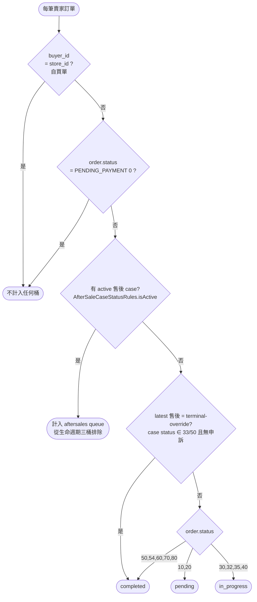

**互斥保證**：active 與 terminal-override 兩集合互斥（同一 case 不可能同時成立）；訂單先判售後覆蓋、後判 order.status，任一訂單僅落一桶。

🔴 **dashboard count 一律以 `order.status` 為準，不得引入 `shipping_status`（已出貨）維度**：黑貓叫件（`shipping_status=210/TCAT_CALLED`）、超商確認出貨（`921/SELLER_CONFIRMED`）之後，`ShippingEventConsumer` 就會把 `order.status` 由 10/20 推進至 `IN_TRANSIT(30)`（見[本節物流狀態碼 → 訂單狀態推進規則](#物流狀態碼--訂單狀態推進規則)）⇒ 以 `order.status` 為準即達穩態一致。MQ 推進前的秒級窗口由前端 `isTcatCalled` 樂觀更新呈現。加 `shipping_status` 特例會讓 dashboard 的桶與訂單列表的 status filter **脫節**——兩個數字對不上時無法判斷哪一邊才對。

**計算時序**

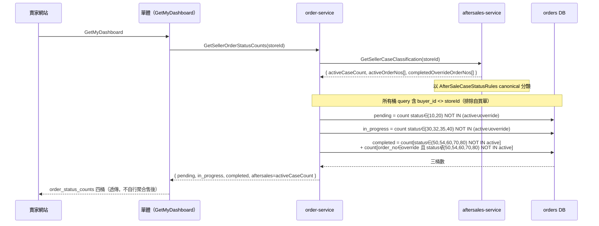

**count SQL 規則**（active / override orderNo set 由 aftersales 提供，集合小，`IN` / `NOT IN` 參數化；所有三桶 query 另含共同前提 `store_id = #{storeId} AND buyer_id <> #{storeId}` 排除自買單）：

| bucket | 規則 |
|---|---|
| pending_shipment_count | `status IN (10,20) AND buyer_id <> storeId AND order_no NOT IN (activeOrderNos ∪ completedOverrideOrderNos)` |
| in_progress_count | `status IN (30,32,35,40) AND buyer_id <> storeId AND order_no NOT IN (activeOrderNos ∪ completedOverrideOrderNos)` |
| completed_count | `[status IN (50,54,60,70,80) AND buyer_id <> storeId AND order_no NOT IN activeOrderNos]`<br>`+ [order_no IN completedOverrideOrderNos AND status NOT IN (50,54,60,70,80) AND buyer_id <> storeId AND order_no NOT IN activeOrderNos]` |
| aftersales_count | `= activeCaseCount`（aftersales 回；售後 case 以 store_id 聚合，自買售後 case 極罕見，不另特殊處理） |

> `completed` 第二段把「售後已結（**aftersale case status** 33/50，無申訴）但 **order.status** 尚未達 50/54/60/70/80」的訂單補入（如 coupon 補償結案 / 待寄回逾時關案，訂單主狀態仍停在 40）；`NOT IN activeOrderNos` 保證與 active 互斥；`status NOT IN (50,54,60,70,80)` 保證不與第一段重複計。（注意「33/50」指 case status，與 order.status 的 50=COMPLETED 為不同命名空間。）

**實作位置**

| 層 | 檔案 | 動作 |
|---|---|---|
| canonical helper | `common-core/.../utils/code/helper/AfterSaleCaseStatusRules.java` | 新增（集中 active / terminal-override 定義） |
| aftersales RPC | `api/proto/aftersales/aftersales.proto` + `aftersales/.../grpc/AfterSalesGrpcService.java` | 新增 `GetSellerCaseClassification` |
| order-service | `OrderService#getSellerOrderStatusCounts` + `OrderRepository` + `grpc/client/AfterSalesGrpcClient` | 重寫 count（四桶 + 售後覆蓋） |
| order-service（賣家視圖排除自買） | `OrderRepository`：`findByStoreIdAndStatus` / `countByStoreIdAndStatus`（列表）+ `countBySellerStatusExcludingOrders` / `countBySellerOrdersInStatus`（dashboard）4 個 query 加 `AND buyer_id <> #{storeId}` | 列表與 count 同步排除自買單，保證 card == list |
| 單體 | `backend/internal/httpapi/seller/dashboard.go`、`backend/cmd/hawkr/seller_dashboard.go` | 不自行呼叫 aftersales；`aftersales_count` 用 order-service 回值 |
| proto 註解 | `api/proto/order/order.proto` | 修正 `GetSellerOrderStatusCountsResponse` 四欄位註解 |
| 前端 | `hawkr-website`：`SellerOrdersPage.tsx` | 狀態卡四數字改信 dashboard 四 count（卸載本地 `lifecycleCounts` / `afterSaleCardTotal` 推算）；移除 `scopedOrders` 自買過濾（後端列表已排除自買單）。`sellerOrderTabFor`（含 `isTcatCalled` 秒級樂觀窗口 + 售後覆蓋）**保留**，僅供列表行歸位 — 與本節「為何不引入 shipping_status」段一致：count 由後端 order.status 權威，row 由前端樂觀呈現，秒級窗口差異為設計接受範圍 |

**一致性聲明（[後端服務責任邊界規範](../開發規範/後端服務責任邊界規範.md)）**：四桶 count 為**純即時查詢**（gRPC 同步聚合 orders 表 + aftersales `GetSellerCaseClassification`），**無資料持久化、不引入補償任務基礎設施**（無 reconciliation / backfill / reflow）。查詢結果反映呼叫當下 DB 狀態；售後與訂單主狀態之間的最終一致由既有 MQ 事件（`ShippingEventConsumer` 推進 order.status、`AfterSalesEventConsumer` 推進售後狀態）保證，dashboard 不另做對帳。

#### 狀態更新併發防護（強制）

所有訂單狀態更新**必須使用條件式 SQL**，在 WHERE 中檢查舊狀態，防止併發覆蓋：

```sql
-- 單一舊狀態（如取消訂單：僅 PENDING_PAYMENT → CANCELLED）
UPDATE orders SET status = #{newStatus} WHERE order_no = #{orderNo} AND status = #{expectedOldStatus}

-- 多種合法舊狀態（如退款：PAID/PREPARING/SHIPPED/IN_TRANSIT/DELIVERED/COMPLETED → FULLY_REFUNDED）
UPDATE orders SET status = #{newStatus} WHERE order_no = #{orderNo} AND status IN (#{s1}, #{s2}, ...)
```

**禁止**無條件的 `UPDATE orders SET status = #{status} WHERE order_no = #{orderNo}`。

返回 `affected rows = 0` 時，表示訂單狀態已被其他操作變更（如付款成功與取消同時發生），應記錄日誌並中止操作，不得強制覆蓋。

#### INV-3 對齊（禁止 updateById 全欄位覆蓋）

對齊 `06-物流微服務（Shipping Service）詳細設計書.md` §2.4 INV-3「併發場景下禁止使用 `updateById(entity)`」。`orders` 表所有併發 transition 必須走 mapper 自訂 SQL：每個 UPDATE **只動自己負責的欄位**，並在 WHERE 加上前置狀態樂觀鎖（INV-4：使用 `status IN (合法前置集合)` 形式）。

| 場景 | Mapper 方法 | 寫入欄位 | SQL（含 WHERE 樂觀鎖）|
|---|---|---|---|
| Coupon Reserve 成功回填 instance_id（by `OrderService.updateCouponInstanceId`） | `updateCouponInstanceIdIfAbsent(orderNo, instanceId)` | `coupon_instance_id`（不轉 status） | `SET coupon_instance_id=? WHERE order_no=? AND coupon_instance_id IS NULL` |

> 賣家發貨 PAID→PENDING_SHIPMENT 的同步入口（舊 `OrderService.shipOrder` / `ShipOrder` RPC）已由 Shipping Service 取代並移除；現行賣家出貨經 shipping-service（黑貓叫件 / 超商確認），order.status 由 `ShippingEventConsumer` 消費物流 webhook 推進（見[物流狀態碼 → 訂單狀態推進規則](#物流狀態碼--訂單狀態推進規則)）。

**禁止**：`orderRepository.updateById(orderEntity)`（全欄位覆蓋會把其他併發路徑剛寫入的欄位用 stale 值蓋回）。`updateById` 僅允許用於確保單寫者的 admin CRUD 場景；訂單一律走自訂 SQL。

返回 `affected rows = 0` 視為「狀態已被其他路徑搶先變更」，依現有併發防護規範處理（記錄日誌 + 拋業務例外或冪等 skip）。

**`grant_payment_tasks` mapper 規格**：`GrantPaymentWorker` 對任務表的 transition 同樣不得用 `updateById`，全部走 `GrantPaymentTaskRepository` 自訂 SQL，並寫 task value（見 §3.11）。

| 場景 | Mapper 方法 | 寫入欄位 | SQL（含 WHERE 樂觀鎖） |
|---|---|---|---|
| 撥款成功（PROCESSING→DONE） | `markGrantTaskDone(taskId)` | `status='20'`、`updated_at` | `SET status='20', updated_at=NOW() WHERE task_id=? AND status='10'` |
| 業務錯誤直接轉人工介入（PROCESSING→MANUAL_INTERVENTION） | `markGrantTaskManualIntervention(taskId, lastError)` | `status='40'`、`last_error`、`updated_at` | `SET status='40', last_error=?, updated_at=NOW() WHERE task_id=? AND status='10'` |
| 重試上限轉人工介入（PROCESSING→MANUAL_INTERVENTION + retry_count） | `markGrantTaskMaxRetryReached(taskId, retryCount, lastError)` | `status='40'`、`retry_count`、`last_error`、`updated_at` | `SET status='40', retry_count=?, last_error=?, updated_at=NOW() WHERE task_id=? AND status='10'` |
| 排程重試（PROCESSING→FAILED） | `markGrantTaskRetryScheduled(taskId, retryCount, nextRetryTime, lastError)` | `status='30'`、`retry_count`、`next_retry_time`、`last_error`、`updated_at` | `SET status='30', retry_count=?, next_retry_time=?, last_error=?, updated_at=NOW() WHERE task_id=? AND status='10'` |
| PayUni 主動撥款收斂（PROCESSING→PROVIDER_AUTO，GrantPayment 回應 `grant_outcome=PROVIDER_TOOK_OVER`，見 §3.11.2） | `markGrantTaskProviderAuto(taskId, lastError)` | `status='50'`、`last_error`、`updated_at` | `SET status='50', last_error=?, updated_at=NOW() WHERE task_id=? AND status='10'` |

WHERE 條件均要求 task 處於 `PROCESSING(10)`，避免：
- 多 Pod 同時 claim 後其中一個遲到完成、覆蓋已被 admin 重發回 `PENDING(0)` 的 task
- Admin 重發 API（[3.11 重發機制](#311-撥款指示任務表-grant_payment_tasks)）已將 `FAILED(30)` 重置為 `PENDING(0)` 後，遲到的 worker 路徑寫回 stale 終態

`affected rows = 0` 視為「task 已被他路徑變更」冪等 skip，記 INFO log 即可。

#### 賣家工作區 realtime emit 對齊矩陣（`seller.order.updated`，強制）

所有 `orders.status` commit 點，CAS `affected rows > 0` 後**必須**呼叫 `OrderEventPublisher.emitSellerOrderUpdated(...)` 補發 `seller.order.updated`（賣家工作區 realtime invalidation，gateway SSE 唯一 consumer，event 契約見 [36 §3.6i](./36-MQ%20與事件總覽（MQ%20%26%20Event%20Catalog）.md) / [41 §四之二](./41-Realtime%20SSE%20推播平台（Realtime%20SSE%20Push%20Platform）詳細設計書.md)）。

> 🔴 **本矩陣裁決「逐路徑掛 emit」，不得重構出統一收斂點**：status 變更分散在多個 entry（`OrderService` @Transactional／`PaymentEventHandler`／`ShippingEventConsumer`／`AfterSalesEventConsumer`／`OrderGrpcService`），各路徑的 CAS 前置條件、附帶欄位（`cancel_reason`／`shipment_no`／`shipping_status`／撥款任務／庫存歸還／優惠券釋放）與事務性皆不同，**沒有天然收斂點**。
>
> ⇒ **新增任何 `orders.status` commit 路徑時，必須回本矩陣補列並掛 emit。**
>
> `emitSellerOrderUpdated` 內建事務感知（`TransactionSynchronizationManager` active ⇒ `afterCommit`；否則 eager publish），caller 不需自行處理發送時機。realtime 為 best-effort：漏推由前端 `ready.bufferMiss` ＋ REST 全刷兜底（**非資料正確性路徑**）。

| # | 轉換 | Caller | source | 發送時機 |
|---|---|---|---|---|
| 1 | →PAID（付款成功） | `PaymentEventHandler` | `SRC_PAYUNI_WEBHOOK` | afterCommit |
| 2 | →CANCELLED（付款逾時/異常取消） | `PaymentEventHandler` | `SRC_SYSTEM` | afterCommit |
| 3 | 物流推進（→PENDING_SHIPMENT / IN_TRANSIT / WAITING_PICKUP / SHIPPING_ABNORMAL） | `ShippingEventConsumer`（聚合 emit，`newOrderStatus != null` 時發） | `SRC_SHIPPING_WEBHOOK` | eager |
| 4 | →DELIVERED（送達） | `ShippingEventConsumer` | `SRC_SHIPPING_WEBHOOK` | eager（**刻意在 `deliveredInTx` 短事務之外**，見 [§8.13 S3](#813-多副本排程搶佔語意scheduler-claim)） |
| 5 | 售後狀態推進（含 `refund.completed` PARTIAL：累加成功即 emit，**無論 status 是否變化**，§5.7.1） | `AfterSalesEventConsumer` | `SRC_AFTER_SALE` | eager（記帳事務 commit 後） |
| 6 | →CANCELLED（買家取消待付款） | `OrderService.cancelOrder`（buyer path） | `SRC_SYSTEM` | afterCommit |
| 7 | →COMPLETED（確認收貨 / 自動完成） | `OrderService.completeOrderInTx` | `SRC_SYSTEM` | afterCommit |
| 8 | **→CANCELLED（售後內部取消，`CancelOrderInternal` RPC）** | **`OrderGrpcService.cancelOrderInternal`** | `SRC_SYSTEM` | eager |
| 9 | **→DELIVERY_FAILED_NO_REFUND(54)（履約責任判定 financially final ＝ 買家可歸責，35→54）** | `fulfillment.responsibility.finalized` 的 consumer（§4.5 / [§5.7.3](#573-履約責任判定-final-結果消費fulfillmentresponsibilityfinalized35--54)） | `SRC_SYSTEM` | afterCommit（與 `35→54` CAS ＋ 建撥款任務同一事務 commit 後）。`ResponsibilityFinalizedTxHandler` 於 CAS `affected > 0` 之後呼叫 `emitSellerOrderUpdated(orderNo, SRC_SYSTEM, …)`；🔴 **`affected == 0` 必須走獨立分流驗證既有終態，不得逕行當成已處理** |

> **`previousStatus` 的語意**：#8 傳 `null`（其 CAS 是 `WHERE status IN ('0','10','20')` 多前置，與物流推進路徑一樣不精確回填）。前端以 `orderNo` invalidate 全刷 ⇒ `previousStatus` **僅供 debug 參考、不參與 SSE 路由**。
>
> 🔴 **order-service 沒有賣家手動發貨 RPC**：真實的賣家發貨 `PAID → PENDING_SHIPMENT` 一律走 #3 `ShippingEventConsumer`（物流 webhook）。不要為「賣家按了出貨」另開一支同步 RPC——那會造出第二條 status 推進路徑，而它與物流貨態的到達順序無法保證。

### 2.2 訂單明細狀態（OrderItemStatus）

| 狀態碼 (int) | Enum Name | 說明 |
|---|---|---|
| 0 | NORMAL | 正常 |
| 10 | REFUND_PROCESSING | 退款流程中（由 AfterSales Service 驅動） |
| 20 | REFUNDED_ORIGINAL | 已退款（原路） |
| 21 | REFUNDED_COUPON | 已退款（優惠券） |

### 2.4 編號生成機制

#### 訂單編號（OrderNo）

**格式**：`O{9位TSID取模}`（如 `O382716459`，共 10 字元）

| 步驟 | 說明 |
|------|------|
| 1 | 呼叫 `TsidUtil.generate()` 產生 64-bit TSID |
| 2 | 取 `TSID % 1_000_000_000`（9 位數字） |
| 3 | 前綴 `O` + 左補零至 9 位 → 固定 10 字元 |

**特性**：無 Redis 依賴，TSID 本身時間排序，碰撞由 DB `UNIQUE(order_no)` 約束捕獲後重新生成。

#### 物流編號（ShipmentNo）

**格式**：`S{9位TSID取模}`（如 `S291038475`，共 10 字元），生成方式同訂單編號。

#### 退款申請編號（RequestNo）

**格式**：`R{9位TSID取模}`（如 `R847261539`，共 10 字元），生成方式同訂單編號。

### 2.5 冪等原則（強制）

- MQ（payment.success）事件：以 transaction_id 作為冪等鍵（不可用 order_no 取代）
- 庫存操作：以 stock_tx_id 作為冪等鍵（同一筆扣庫存與補償必須沿用同一 stock_tx_id）
- 金流/退款落地：financial_logs 必須具備冪等唯一性，避免重試造成重複寫入

---

## 3. 資料庫設計

說明：下列表格為 Order Service 自身資料庫；庫存不在此服務保存。金額欄位全部 BIGINT 且永遠整數。

### 3.1 訂單主表 orders

| 欄位名稱 | 資料型態 | 必填 | 說明 |
|---|---|---|---|
| id | BIGINT | PK | TSID（由 TsidUtil.generate() 產生） |
| order_no | VARCHAR(64) | YES | 訂單編號，格式：O{9位TSID取模} |
| buyer_id | BIGINT | YES | 買家身份鍵（buyers.buyer_id surrogate，由 Gateway buyerid resolver 解析後傳入；非登入 account_id） |
| store_id | BIGINT | YES | 賣家身份鍵（sellers.store_id surrogate；非登入 account_id，亦與 `cvs_store_id` 超商門市代號無關） |
| total_original_amount | BIGINT | YES | 原始總金額 |
| total_actual_amount | BIGINT | YES | 實付總金額 |
| status | VARCHAR(4) | YES | Default: '0'（參照 OrderStatus） |
| payment_method | VARCHAR(30) | NO | 支付方式 code（建單時快照，付款成功時由 MQ 覆寫確認） |
| transaction_id | VARCHAR(128) | NO | 外部支付流水號（建單時快照，付款成功時由 MQ 覆寫確認） |
| checkout_id | VARCHAR(64) | NO | 購物車結帳批次 ID |
| mer_id | VARCHAR(30) | NO | PayUni 商家編號 |
| coupon_instance_id | VARCHAR(64) | NO | 使用的優惠券**實例** ID（已發放給買家的 coupon instance；非 template id）。空字串表示未使用。**不變式（強制）**：本欄位**禁止**在 createOrder 階段寫入；建單時必為 NULL，僅由 `OrderService.updateCouponInstanceId` 在 `CheckoutCouponGrpcClient.reserveCoupon` 成功後寫入正確 instanceId。違反此不變式將導致下游 consumeCoupon / releaseCoupon 對到錯誤 ID（templateId vs instanceId），進而資料污染。 |
| discount_amount | BIGINT | YES | 優惠券折扣金額，Default: 0 |
| refund_total_amount | BIGINT | YES | Default: 0。累計已完成退款金額（元）。由 `aftersales.refund.completed`（PARTIAL outcome）消費時於記帳事務內原子累加（[§5.7.1](#571-退款狀態類事件既有)）；`=0` 表示無已完成退款。用途 = 前端顯示 + `seller.order.updated` emit 判斷 + 50→60 CASE 轉移；**不作為撥款判準**（[§3.11.1](#3111-建立撥款任務一律-pending不預分流)）。<br>⚠️ **FULL_REFUND 路徑不維護本欄**：`applyFullRefund` 只做 status CAS→70，不累加金額，故 `status='70'` 的訂單本欄恆為 0。任何要顯示或加總退款金額的讀路徑**必須排除 70**，否則會顯示「金額 X／退回 0」的錯誤資訊；`findOrderAggregates` 對 70 淨額計 0、crm-service `RecordRefund` 改以 ledger 自身歷史反向淨額，都是同一個規避 |
| delivery_temp | VARCHAR(20) | NO | 配送溫層 Enum value |
| shipping_method | VARCHAR(30) | NO | 運送方式 Enum value |
| shipping_fee | BIGINT | YES | 運費，Default: 0 |
| shipping_fee_payer | VARCHAR(20) | NO | 運費負擔方 Enum value |
| shipping_area | VARCHAR(20) | NO | 配送區域 Enum value |
| sender_city | VARCHAR(20) | NO | 出貨城市（建單時從 Shipping Service 快照） |
| sender_district | VARCHAR(20) | NO | 出貨地區（建單時從 Shipping Service 快照） |
| recipient_name | VARCHAR(50) | YES | 收件人姓名（快照） |
| recipient_phone | VARCHAR(20) | YES | 收件人電話（快照） |
| shipping_address | VARCHAR(255) | NO | 收件地址 |
| shipping_note | VARCHAR(255) | NO | 配送備註 |
| order_remark | VARCHAR(500) | NO | 訂單備註（買家下單時留言給賣家，選填） |
| cvs_store_id | VARCHAR(20) | NO | 超商門市代號 |
| cvs_store_name | VARCHAR(100) | NO | 超商門市名稱（快照） |
| atm_bank_code | VARCHAR(10) | NO | ATM 銀行代碼 |
| atm_virtual_account | VARCHAR(30) | NO | ATM 虛擬帳號 |
| atm_expire_date | VARCHAR(30) | NO | ATM 繳費期限 |
| shipment_no | VARCHAR(64) | NO | 物流單號 |
| shipping_status | VARCHAR(4) | NO | 物流狀態 value（由 Shipping Service MQ 事件更新） |
| shipping_status_desc | VARCHAR(200) | NO | 物流狀態描述（由 Shipping Service MQ 事件快照寫入） |
| label_url | VARCHAR(512) | NO | 宅配託運單 PDF **objectKey**（欄名沿用舊名 `label_url`，值為 key；由 `ShippingEventConsumer` 取事件的 `label_key` 寫入，proto 出口為 `label_key`，Gateway 組 URL。僅賣家/管理員可見） |
| label_expire_at | TIMESTAMPTZ | NO | 宅配 PDF 下載期限 |
| partner_id | VARCHAR(10) | NO | 超商出貨便母代碼（僅賣家/管理員可見） |
| odno | VARCHAR(20) | NO | 超商出貨單編號（僅賣家/管理員可見） |
| validation_no | VARCHAR(10) | NO | 超商 C2C 驗證碼（僅賣家/管理員可見） |
| shipment_photo_keys | JSONB | NO | 出貨照片 objectKey 陣列（原 `shipment_photo_urls`，49 號設計書 §5.3；買家可見，由 Shipping `shipment.photo.updated` MQ 事件覆寫） |
| receipt_photo_keys | JSONB | NO | 買家確認收貨上傳照片 objectKey 陣列（原 `receipt_photo_urls`，49 號設計書 §5.3；雙方可見，於 ConfirmReceipt 內寫入） |
| confirmed_at | TIMESTAMPTZ | NO | 確認收貨時間 |
| confirm_type | VARCHAR(10) | NO | 確認方式：MANUAL / AUTO |
| payment_deadline | TIMESTAMPTZ | NO | 付款期限 |
| payment_attempts | SMALLINT | YES | Default: 0 |
| pay_time | TIMESTAMPTZ | NO | 付款時間 |
| ship_time | TIMESTAMPTZ | NO | 發貨時間 |
| dimension_sum | INTEGER | NO | 訂單最大 SKU 材積和 |
| auto_complete_at | TIMESTAMPTZ | NO | 自動完成時間（送達時 = `delivered_at` + 60 小時；倒數恢復時 += 累計暫停時長，詳見 [§5.8](#58-自動完成倒數的暫停與恢復)） |
| countdown_paused_at | TIMESTAMPTZ | NO | 倒數暫停時刻（NULL = 倒數中；NOT NULL = 已暫停，當前時刻不消耗倒數）。由 AfterSales MQ 事件觸發寫入/清空 |
| countdown_pause_count | SMALLINT | YES | Default: 0。累計暫停次數（觀測用，不影響邏輯） |
| processing_deadline | TIMESTAMPTZ | NO | 賣家處理期限快照（UTC），由 `shipment.created` 寫入、`shipment.processing.cleared` 清空。NULL = 未付款／已處理／已取消（Uber 亦有賣家處理期限，見 [09 §5.9.1](09-售後微服務（AfterSales%20Service）詳細設計書.md)）。權威來源在 `shipments.processing_deadline`（[09 §5.9](../詳細設計書/09-售後微服務（AfterSales%20Service）詳細設計書.md#59-賣家處理期限自動取消processing-deadline-auto-cancel)） |
| delivered_at | TIMESTAMPTZ | NO | 送達時間（供 AfterSales 60hr 時效驗證） |
| cancel_reason | VARCHAR(200) | NO | 取消原因 value（OrderCancelReason，91xx 系統 / 92xx 賣家；buyer 自願取消為 NULL）。詳見 [09 §5.9.11](../詳細設計書/09-售後微服務（AfterSales%20Service）詳細設計書.md#5911-codemeta) |
| cancel_remark | VARCHAR(500) | NO | 取消備註（賣家自填理由，僅 OTHER / SUGGEST_SPLIT 等需展示自填文字時使用） |
| cancel_by_role | VARCHAR(20) | NO | 取消者角色（OrderCancelByRole：SYSTEM / SELLER / BUYER）。前端依此 role + cancel_reason 渲染差異化文案 |
| need_refund_page | BOOLEAN | YES | Default: FALSE（ATM 退款等待買家前往 PayUni 頁面） |
| is_reviewed | BOOLEAN | YES | Default: FALSE（任一商品項目已評論即為 TRUE，由 review.created MQ 事件更新） |
| review | JSONB | NO | 訂單評論快照 `{rating, content, imageKeys, createdAt}`（key camelCase；`imageKeys` 為 objectKey 陣列，原 `imageUrls`，49 號設計書 §5.3；**NULL = 未評論**）。訂單層級單一，取該訂單最近一筆商品評論（most-recent-wins），來源 `review.created` MQ 事件；評論不可改/刪 → 凍結快照，見 §8.9 |
| created_at | TIMESTAMPTZ | YES | Default: NOW() |
| updated_at | TIMESTAMPTZ | NO | 由 DB trigger 自動維護 |
| commerce_model | VARCHAR(24) | YES | 政策快照：`SELLER_DIRECT` / `PLATFORM_CONSIGNMENT` |
| collection_model | VARCHAR(32) | YES | 政策快照：`SELLER_MERCHANT` / `PLATFORM_AGENT_MERCHANT` / `PROVIDER_COLLECTED` / `EXTERNAL_PREPAID` |
| fulfillment_mode | VARCHAR(24) | YES | 政策快照：`SELLER_MANAGED` / `PLATFORM_LOGISTICS` |
| invoice_model | VARCHAR(24) | YES | 政策快照：`SELLER_TO_BUYER` / `PLATFORM_TO_BUYER` |
| policy_version | VARCHAR(32) | YES | 政策快照的版本標記 |
| seller_borne_discount_amount | BIGINT | YES | 賣家負擔的折扣金額（費基計算用），Default: 0 |
| receipt_status | VARCHAR(24) | NO | **E 軸（收貨確認）狀態**：`PENDING` / `BUYER_CONFIRMED` / `AUTO_CONFIRMED` / `REVIEW_PENDING` / `ADMIN_CONFIRMED` / `ADMIN_REJECTED` / `DISPUTED`。`confirmed_at` / `confirm_type` 為附屬事實欄 |
| receipt_status_entered_at | TIMESTAMPTZ | NO | 進入當前 `receipt_status` 的時刻 |
| receipt_review_due_at | TIMESTAMPTZ | NO | 人工裁決期限（D+7），由 `ReceiptReviewDeadlineScheduler` 掃描 |

> 🔴 **政策快照的意義：訂單成立後，不因賣家後續修改物流／收款設定而改變既有訂單的履約、收款或結算語意。** 這七欄一律在建單時寫定，**不得**在訂單生命週期中被重寫。完整定義見 [65 §5.1／§5.7](65-物流履約平台%EF%BC%88Fulfillment%20Platform%EF%BC%89詳細設計書.md)，本書不重述。
>
> ⚠️ **第 5 個維度（provider）不在這六欄內**：`orders.shipping_method` 已經承載它。再開一欄 provider 就是製造第二個真相。

**政策與 E 軸的 DB 不變式（CHECK，一條都不得移除）：**

| 約束 | 不變式 |
|---|---|
| `chk_orders_policy_matrix` | `(commerce_model = 'PLATFORM_CONSIGNMENT') = (collection_model = 'PLATFORM_AGENT_MERCHANT')` — 代銷與平台代收必須成對 |
| `chk_orders_invoice_collection` | `(invoice_model = 'PLATFORM_TO_BUYER') = (collection_model = 'PLATFORM_AGENT_MERCHANT')` — **開票 issuer 必須與收款主體一致**，否則收款證據與開票證據不一致 |
| `chk_orders_fulfillment_mode_consistent` | `shipping_method IS DISTINCT FROM '3005' OR fulfillment_mode = 'SELLER_MANAGED'` — 🔴 **必須用 `IS DISTINCT FROM` 不是 `<>`**：`shipping_method` 可為 NULL，而 `NULL <> '3005'` 求值為 NULL ⇒ CHECK 放行，述詞的意圖（只有 3005 受限）就表達不出來 |
| `chk_orders_receipt_axis_present` | `delivered_at IS NULL OR receipt_status IS NOT NULL` — 🔴 **錨在「送達」這個事實，不是當下的 `orders.status`**：status 之後還會往 50/60/70 走，錨在 status 的 CHECK 會在後續轉移時變成假的；`delivered_at` 一旦寫入就不再變動 |
| `chk_orders_receipt_entered_pair` | `(receipt_status IS NULL) = (receipt_status_entered_at IS NULL)` — 兩個方向都會違反：status 有值而時戳 NULL、以及 status NULL 卻給了時戳 |

> ⚠️ **跨 DB 型別注意**：`orders.coupon_instance_id` 為 `VARCHAR(64)`，但 `hawkr_coupon.coupon_instances.instance_id` 為 `BIGINT`。此為**刻意設計** — Order DB 不對 Coupon DB 做 join，僅作為跨服務 reference。所有跨服務查詢一律走 gRPC（CouponService.GetInstance），不走 DB join。新增關聯查詢需求時，禁止繞過此規範。

> 🔴 **`V1__init_order.sql` 已凍結唯讀**（任何修改含空白都破壞 checksum）：schema 變更一律新增 `V{N+1}__{verb}_{target}.sql`（append-only、禁止跳號），本地 `./dev.sh restart order` 驗 Flyway log 後 push，由 CI/CD 自動 migrate。流程見 [DB Migration 相容性規範（expand-contract）](../開發規範/DB%20Migration%20相容性規範（expand-contract）.md) 與 [38-Flyway 自動同步與 DB 自動初始化](./38-Flyway%20自動同步與%20DB%20自動初始化（Flyway%20Auto%20Sync%20%26%20DB%20Auto%20Init）詳細設計書.md)。

索引建議：
- (buyer_id, status)
- (store_id, status)
- (created_at)
- (transaction_id)
- (checkout_id) WHERE checkout_id IS NOT NULL
- (payment_deadline) WHERE status = '0' AND payment_deadline IS NOT NULL
- (shipping_status) WHERE shipping_status IS NOT NULL
- (auto_complete_at) WHERE status = '40' AND auto_complete_at IS NOT NULL AND countdown_paused_at IS NULL（scheduler 僅掃倒數中的訂單）

### 3.2 訂單明細表 order_items

| 欄位名稱 | 資料型態 | 必填 | 說明 |
|---|---|---|---|
| id | BIGINT | PK | TSID |
| order_no | VARCHAR(64) | YES | FK → orders.order_no |
| product_id | BIGINT | NO | 商品 ID 快照 |
| product_name | VARCHAR(255) | NO | 商品名稱快照 |
| sku_id | BIGINT | YES | 可販售單位 ID |
| sku_name | VARCHAR(255) | YES | 規格名稱快照 |
| quantity | INT | YES | 數量 |
| list_price | BIGINT | YES | **原價快照**（永遠 = 下單時 SKU.price，與是否參與特價無關。給前端 strike-through 顯示用） |
| unit_price | BIGINT | YES | **實際成交單價快照**（無特價＝`list_price`；有特價＝當時 `sale_price`） |
| share_discount | BIGINT | YES | 分攤優惠額（基於 `unit_price × quantity` 比例分攤） |
| actual_pay_amount | BIGINT | YES | 實付金額（退款基準）= `unit_price × quantity − share_discount` |
| refund_status | VARCHAR(4) | YES | Default: '0' |
| image_object_key | VARCHAR(512) | NO | 商品圖片 objectKey 快照（下單時從 Product Service 複製） |
| created_at | TIMESTAMPTZ | YES | Default: NOW() |

唯一約束：`UNIQUE (order_no, sku_id)`

> 評論快照存於 **orders.review（訂單層級單一）**，非 order_items；詳見 §3.1 與 §8.9。

#### 3.2.1 金額欄位語意（特價支援）

| 欄位 | 語意 |
|---|---|
| `list_price` | 下單時的「**原價**」快照（永遠 ＝ 商品 SKU.price） |
| `unit_price` | 下單時的「**實際成交單價**」快照（有特價 ＝ `sale_price`，否則 ＝ `list_price`）。⚠️ **不要把它讀成「原價」**——原價是 `list_price` |
| `share_discount` | 該品項分攤的優惠券折扣 |
| `actual_pay_amount` | 該品項最終實付 |

**判定該品項是否參與特價**：`unit_price < list_price`，無需額外 boolean。

**計算公式**：
- `subtotal_per_item = unit_price × quantity`
- `share_discount = round(total_discount × subtotal_per_item / sum(subtotal_per_item))`，尾差歸入最後一筆
- `actual_pay_amount = unit_price × quantity − share_discount`

**退款基準**（AfterSales 側的計算依據，見 [09 號](09-售後微服務（AfterSales%20Service）詳細設計書.md)）：
- AfterSale 案件的 `refundableAmount` = **`orders.total_actual_amount`**（PayUni 實收，已含運費 − 折扣）
- `order_items.actual_pay_amount` 僅作為「該品項在訂單內的實付明細展示」（後台/前端對帳），**不直接參與退款金額計算**
- 對帳關係：`sum(order_items.actual_pay_amount) + shipping_fee（買方負擔時）= orders.total_actual_amount`

> 部分品項退款（單品退）的金額決策由 AfterSale 流程的 `refundAmount` 參數控管（`PlatformDecisionService.computeFinalAmount`），與 `actual_pay_amount` 數值僅做 reference 比對。

### 3.3 已停用的退款表（禁止使用）

🔴 **`refund_requests` 是 V1 遺留表，已停用**：表仍物理存在（V1 建立、未被後續 migration drop），但**禁止任何新程式碼讀寫它**。退款申請的 SSOT 在 [09 售後微服務](09-售後微服務（AfterSales%20Service）詳細設計書.md)的 `aftersale_cases` ＋ `refund_tasks`。

🔴 **`refund_execute_tasks` 已物理刪除**，不得重建。它曾帶有 `bank_code` / `bank_sub_code` / `bank_account_no` / `uid` 欄位但從未被接上任何寫入端或 Worker ⇒ **平台端的退款路徑不持有銀行帳號**，這是安全邊界的一部分（見 [05 §9.3](05-支付服務（Payment%20Service）詳細設計書.md)），重建它等於把那個邊界打開。

### 3.4 資金流水表 financial_logs（強制冪等）

| 欄位名稱 | 資料型態 | 必填 | 說明 |
|---|---|---|---|
| log_id | BIGINT | PK | TSID |
| source_ref_no | VARCHAR(64) | YES | order_no 或 case_no |
| type | VARCHAR(4) | YES | '1':收款 / '2':退款(原路) / '3':退款(優惠券) |
| amount | BIGINT | YES | 金額 |
| external_txn_id | VARCHAR(128) | YES | 收款=transaction_id；退款=refund_no；券=coupon_instance_id |
| created_at | TIMESTAMPTZ | YES | Default: NOW() |

冪等唯一性：`UNIQUE (type, external_txn_id)`。寫入若遇唯一衝突視為「已處理」不得報錯。

### 3.5 庫存交易協調表 stock_tx_records

| 欄位名稱 | 資料型態 | 必填 | 說明 |
|---|---|---|---|
| stock_tx_id | VARCHAR(64) | PK（複合） | UUID |
| order_no | VARCHAR(64) | NO | 建單成功後回填 |
| phase | VARCHAR(16) | PK（複合） | DEDUCT / RESTORE |
| status | VARCHAR(32) | YES | 存 [`StockTxStatus`](../代碼管理（CodeMeta）/內部技術碼.md#StockTxStatus) value：INIT(8911) / SUCCESS(8912) / FAILED(8913) / MANUAL_INTERVENTION(8914) / COMPENSATED(8915，DEDUCT 補償完成終態) |
| payload_snapshot | JSONB | YES | items 快照 |
| last_error | TEXT | NO | 最近一次錯誤 |
| retry_count | INT | YES | Default: 0 |
| next_retry_time | TIMESTAMPTZ | NO | 重試時間 |
| created_at | TIMESTAMPTZ | YES | Default: NOW() |
| updated_at | TIMESTAMPTZ | NO | 由 DB trigger 自動維護 |

### 3.6 支付事件冪等表 payment_event_dedup

| 欄位名稱 | 資料型態 | 必填 | 說明 |
|---|---|---|---|
| transaction_id | VARCHAR(128) | PK | 冪等鍵 |
| order_no | VARCHAR(64) | YES | 對應訂單 |
| event_type | VARCHAR(32) | YES | PAYMENT_SUCCESS |
| payload_hash | VARCHAR(64) | NO | SHA256 稽核用 |
| processed_time | TIMESTAMPTZ | YES | Default: NOW() |

資料保留：每日清理 processed_time < now() - 7 days。

### 3.7 自動退款任務表 auto_refund_tasks

| 欄位名稱 | 資料型態 | 必填 | 說明 |
|---|---|---|---|
| task_id | BIGINT | PK | TSID |
| order_no | VARCHAR(64) | YES | 訂單號 |
| transaction_id | VARCHAR(128) | YES | 付款交易號（冪等鍵） |
| amount | BIGINT | YES | 退款金額 |
| payment_method | VARCHAR(16) | NO | 付款方式（PaymentMethod dbValue） |
| status | VARCHAR(32) | YES | PENDING / AWAITING_BUYER_REFUND_PAGE / PROCESSING / DONE / FAILED / MANUAL_INTERVENTION |
| last_error | TEXT | NO | — |
| retry_count | INT | YES | Default: 0 |
| max_retry_count | INT | YES | Default: 10 |
| next_retry_time | TIMESTAMPTZ | NO | — |
| created_at | TIMESTAMPTZ | YES | Default: NOW() |
| updated_at | TIMESTAMPTZ | NO | — |

唯一約束：`UNIQUE (order_no, transaction_id)`

### 3.9 優惠券核銷任務表 coupon_consumption_tasks

| 欄位名稱 | 資料型態 | 必填 | 說明 |
|---|---|---|---|
| task_id | BIGINT | PK | TSID |
| order_no | VARCHAR(64) | YES | 訂單號 |
| coupon_instance_id | VARCHAR(64) | YES | 優惠券實例 ID |
| buyer_id | BIGINT | YES | 買家帳號 ID |
| status | VARCHAR(24) | YES | PENDING / PROCESSING / DONE / FAILED / MANUAL_INTERVENTION |
| last_error | TEXT | NO | — |
| retry_count | INT | YES | Default: 0 |
| max_retry_count | INT | YES | Default: 10 |
| next_retry_time | TIMESTAMPTZ | NO | — |
| created_at | TIMESTAMPTZ | YES | Default: NOW() |
| updated_at | TIMESTAMPTZ | NO | — |

唯一約束：`UNIQUE (order_no, coupon_instance_id)`

### 3.10 購物車清理任務表 cart_cleanup_retry_tasks

| 欄位名稱 | 資料型態 | 必填 | 說明 |
|---|---|---|---|
| task_id | BIGINT | PK | TSID |
| order_no | VARCHAR(64) | YES | 訂單號 |
| checkout_id | VARCHAR(64) | YES | 購物車結帳批次 ID |
| buyer_id | BIGINT | YES | 買家帳號 ID |
| status | VARCHAR(24) | YES | PENDING / PROCESSING / DONE / FAILED / MANUAL_INTERVENTION |
| last_error | TEXT | NO | — |
| retry_count | INT | YES | Default: 0 |
| max_retry_count | INT | YES | Default: 10 |
| next_retry_time | TIMESTAMPTZ | NO | — |
| created_at | TIMESTAMPTZ | YES | Default: NOW() |
| updated_at | TIMESTAMPTZ | NO | — |

唯一約束：`UNIQUE (order_no, checkout_id)`

### 3.11 撥款指示任務表 grant_payment_tasks

| 欄位名稱 | 資料型態 | 必填 | 說明 |
|---|---|---|---|
| task_id | BIGINT | PK | TSID |
| order_no | VARCHAR(64) | YES | 訂單號 |
| confirm_type | VARCHAR(10) | YES | MANUAL / AUTO |
| status | VARCHAR(24) | YES | `WorkerTaskStatus` value：`0`=PENDING / `10`=PROCESSING / `20`=DONE / `30`=FAILED / `40`=MANUAL_INTERVENTION / `50`=PROVIDER_AUTO（DB 與程式碼一律存 value，與 `auto_refund_tasks` / `coupon_consumption_tasks` / `cart_cleanup_retry_tasks` / `refund_tasks` 慣例一致） |
| last_error | TEXT | NO | — |
| retry_count | INT | YES | Default: 0 |
| max_retry_count | INT | YES | Default: 10 |
| next_retry_time | TIMESTAMPTZ | NO | — |
| created_at | TIMESTAMPTZ | YES | Default: NOW() |
| updated_at | TIMESTAMPTZ | NO | — |

唯一約束：`UNIQUE (order_no)`

> **撥款閉環斷點的處理**：`grant_payment_tasks` 是 Worker 任務表，屬 task 層允許有 `retry_count` / `next_retry_time`。撥款實際執行後 `granted_at` / `grant_status` / `grant_message` 落在 `payment_transactions`（由 Payment Service 寫）。若 PayUni 撥款失敗：
>
> 1. Payment Service 側寫入 `payment_transactions.grant_status / grant_message`（[收斂規範 §8.4](../開發規範/PayUni%20錯誤回應收斂規範.md)）
> 2. GrantPaymentWorker 既有 retry 機制自動重試幾次後 task → FAILED
> 3. 運營透過 Admin 異常清單（29-Admin 異常訂單管理 API）查到失敗 → 登入 PayUni 後台修正（儲值 / 調整設定）
> 4. **Admin 重發撥款 API**：`POST /api/v1/admin/orders/:order_no/retry_grant` — Order Service 重置 `grant_payment_tasks` 對應 row（status=PENDING, retry_count=0, next_retry_time=NOW()）讓既有 worker 重跑
>
> 為什麼撥款需要提供手動重發而付款/退款/物流等不需要：PayUni **撥款沒對應 webhook 回流機制**，是唯一沒有自動閉環的操作。其他操作運營在 PayUni 後台處理後 PayUni 會主動發 webhook 通知，但撥款不會。因此撥款必須提供系統層手動重發入口，否則狀態永遠卡在失敗。

#### 3.11.1 建立撥款任務：一律 PENDING（不預分流）

撥款任務有**兩個合法建立點**：`completeOrderInTx`（`40→50` CAS 成功後）與**配送失敗未退款終態的事務處理器**（`35→54` CAS 成功後，見 §5.4「配送失敗未退款（54）的撥款觸發」）。兩者建立撥款任務時**一律建 `PENDING(0)`、照現行流程發撥款指示**——不讀 `refund_total_amount`、不預判 `PROVIDER_AUTO`。

🔴 **不得在完成時依 `orders.refund_total_amount` 預分流**（例如「有退款就直接標 `PROVIDER_AUTO`、不發指示」）。PayUni 對曾發生退款（含部分退款）的交易會主動撥款、補發指示會被拒絕（`GRANT30023`；領域事實全文與成對分錄 / D+7 入帳規則見 [05 §5.6.1](./05-支付服務（Payment%20Service）詳細設計書.md#561-退款交易的-payuni-主動撥款領域事實撥款語意主場)，該節為撥款語意主場）。但「該交易是否已被 PayUni 接管」的**唯一權威是 PayUni 對撥款指示的實際回應**；以本地 `orders.refund_total_amount` 預判會**放棄這次權威確認機會**——本地累計與 PayUni 端狀態可能不一致（事件遲到、極端 race），預判錯 = 該撥的不撥、商家收不到款且系統無任何失敗訊號。故一律發送，由回應的結構化 outcome 決定收斂（§3.11.2）。

`orders.refund_total_amount` 欄位保留，用途 = **前端顯示 + `seller.order.updated` emit 判斷 + 50→60 CASE 轉移**（§5.7.1）；**不作為撥款判準**。

#### 3.11.2 撥款已由 PayUni 接管的收斂（Worker 韌性）

**`PROVIDER_AUTO(50)` 的唯一進入路徑**：GrantPayment gRPC **回應的結構化欄位 `grant_outcome = PROVIDER_TOOK_OVER`**（proto 欄位定義與判準見 [§4.3 撥款指示](#payment-service--撥款指示) / [05 §5.6.1](./05-支付服務（Payment%20Service）詳細設計書.md#561-退款交易的-payuni-主動撥款領域事實撥款語意主場)；payment-service 端判準 = 確定拒絕 + 存在已完成退款）。GrantPaymentWorker 收到此 outcome → `markGrantTaskProviderAuto`（PROCESSING→PROVIDER_AUTO，見 §2.1 mapper 矩陣）：PayUni 已接管撥款，**不再重試、不進 `MANUAL_INTERVENTION`**；帳務權威 = PayUni 端明細 + `payment_refunds` / `financial_logs`（`payment_transactions.granted_at` 刻意保持 NULL、**不建立對帳/巡檢機制**（見[後端服務責任邊界規範](../開發規範/後端服務責任邊界規範.md)），維運需要時以 `grant_query` 腳本人工核對）。

**禁止本地啟發式（強制）**：Worker **不得**以「gRPC error + `orders.refund_total_amount > 0`」自行推斷收斂——該啟發式會吞掉 `PENDING_CONFIRM` 對帳迴圈（模稜兩可失敗必須留給 payment 端下輪 `grant_query` 對帳把關）與無關業務拒絕（餘額/設定類錯誤誤收斂 = 該撥的不撥）。**凡 gRPC error / 其他失敗，一律維持既有路徑**：FAILED/retry → 上限轉 `MANUAL_INTERVENTION`；`PENDING_CONFIRM` 由 payment 端對帳迴圈收斂。

**競態覆蓋**：完成建 task（PENDING）後、發送前退款恰好完成 → PayUni 拒收指示 → payment-service 判定（確定拒絕 + `hasSucceededRefund`）回 `grant_outcome=PROVIDER_TOOK_OVER` → Worker 收斂。整條鏈路**不依賴 order 端預判**，權威確認落在 PayUni 回應處理點。

### 3.12 訂單事件發件匣 order_outbox（事件可靠投遞載體）

內部表（BIGSERIAL）。**本表是 order-service 的通用事件可靠投遞載體，承載的事件不只 `order.paid`**：

| 事件 | 進入 outbox 的時機 |
|---|---|
| `order.paid` | 付款成功事務內，與 `orders.status=10` 同事務 |
| `order.cancelled` | 取消事務內 |
| **`order.completed`** | **確認收貨／自動完成事務內，與 40→50 CAS 同事務**（[§5.4](#54-確認收貨與撥款confirmreceipt--autocomplete) 階段 1 步驟 4） |
| **`order.receipt.confirmed`** | 同上 |
| **`order.delivered`** | **物流送達事務內，與 `updateOrderDelivered` CAS 同事務**（`ShippingEventConsumer.deliveredInTx`） |
| **`order.sales.accumulated`** | **付款成功事務內，與 `order.paid` 同一個事務**（`PaymentEventHandler.handlePendingPaymentOrder`） |

🔴 **本服務的事件一律走 outbox，禁止 `afterCommit` 或事務外 best-effort 直發。** 事件遺失的後果是靜默且不可回復的：`order.paid` 沒送到 ⇒ Shipping 不建物流單 ⇒ 訂單永遠卡 `status=10`；`order.completed` 沒送到 ⇒ 訂單已完成、錢已撥，但買家沒收到通知、CRM 統計短少、物流單沒被標記收貨確認。投遞由 `OrderOutboxPublisherScheduler`（§8.10）輪詢負責。

⚠️ **這些事件的前置寫入都是永久的**（`order.delivered` 的 CAS allowed-from 不含 `DELIVERED` 自己；`order.sales.accumulated` 由 `payment_event_dedup` 擋住重投）⇒ 一旦 publish 失敗且無訊號，就是**永久遺失且零告警**。`OrderEventPublisher.publish` 吞掉所有例外，因此它**不可作為可靠投遞的載體**。

> 選型理由與被否決的替代方案（「補一支會傳遞失敗的 publish 變體」）見 [ADR 2026-09-18 order-outbox-over-failing-publish-variant](../adr/2026-09-18-order-outbox-over-failing-publish-variant.md)。

| 欄位 | 型態 | 必填 | 說明 |
|---|---|---|---|
| id | BIGSERIAL | PK | 自增 |
| aggregate_id | VARCHAR(64) | YES | order_no |
| event_type | VARCHAR(64) | YES | 事件型別 |
| exchange | VARCHAR(128) | YES | 目標 exchange |
| routing_key | VARCHAR(128) | YES | routing key |
| payload | TEXT | YES | 事件 JSON（核心欄位，發送時 best-effort 補 seller/buyer meta；meta 圖片欄位依 49 號設計書 §6.3 帶 objectKey＋`*Key` 欄位名，不帶完整 URL） |
| status | VARCHAR(16) | YES | `PENDING` / `SENT` / `FAILED` |
| retry_count | INT | YES | Default 0 |
| next_retry_at | TIMESTAMPTZ | NO | backoff 重試時間 |
| created_at | TIMESTAMPTZ | YES | Default NOW() |
| sent_at | TIMESTAMPTZ | NO | 發送完成時間 |

索引：`idx_order_outbox_dispatch (status, next_retry_at) WHERE status IN ('8221','8223')`

> 🔴 **候選述詞一律正面枚舉，禁用 `WHERE status <> '8222'`**：`<>` 寫法會讓 `DEAD`（`'8224'`）row 永久滯留候選集合、佔滿批次上限 ⇒ **整條 outbox starvation，單 pod 也會壞**。候選述詞與本索引必須同步，詳見 [§8.10](#810-orderoutboxpublisherscheduler事件可靠投遞)。
>
> 🚨 **`status` 存的是 CodeMeta value 不是 enum 名**：`'8221'`＝`OutboxEventStatus.PENDING`、`'8222'`＝`SENT`、`'8223'`＝`FAILED`、`'8224'`＝`DEAD`（SSOT＝[代碼管理（CodeMeta）／內部技術碼](../代碼管理（CodeMeta）/內部技術碼.md)；DB 註解見 `V3__add_order_outbox_and_shipment_backstop.sql`）。**寫成 `status IN ('PENDING',…)` 的述詞與部分索引一筆都撈不到 ⇒ 整條 outbox 靜默停擺**。另：`OutboxEventStatus` **沒有 `RETRYING`**，重試中的狀態就是 `FAILED('8223')`。

`orders` 表新增 Backstop（§8.11）重試追蹤欄位：

| 欄位 | 型態 | 說明 |
|---|---|---|
| shipment_create_attempts | SMALLINT NOT NULL DEFAULT 0 | 建單重試次數 |
| shipment_create_next_retry_at | TIMESTAMPTZ | 下次重試時間（backoff） |

部分索引：`idx_orders_shipment_backstop (pay_time) WHERE status='10' AND shipping_status IS NULL`（🔴 **索引述詞必須被掃描述詞「蘊含」，不是「逐字一致」**：掃描條件含 `pay_time < NOW()-grace`，而 `NOW()` 非 `IMMUTABLE`，**放進 index predicate 會讓 migration 直接失敗**。索引只放兩個常量條件即可被使用；⚠️ 兩者若不相容，部分索引會靜默不被使用，那是**無聲的效能退化**）

> Schema 變更走 `V3__add_order_outbox_and_shipment_backstop.sql`（V1 凍結，見 [38-Flyway 自動同步與 DB 自動初始化](./38-Flyway%20自動同步與%20DB%20自動初始化（Flyway%20Auto%20Sync%20%26%20DB%20Auto%20Init）詳細設計書.md)）。

---

## 4. 對外/對內介面定義

### 4.1 Gateway REST → gRPC 映射

| Gateway HTTP Endpoint | Method | 對應 gRPC 方法 | 說明 |
|----------------------|--------|---------------|------|
| `/api/v1/app/orders` | GET | `GetMyOrders` | 買家訂單列表 |
| `/api/v1/app/orders?view=seller` | GET | `GetSellerOrders` | 賣家訂單列表 |
| `/api/v1/app/orders/status_counts` | GET | `GetMyOrderStatusCounts` | 買家訂單各狀態筆數 rollup（僅買家；`view=seller` 回 400，賣家走 dashboard 四桶，見 §2.1） |
| `/api/v1/app/orders` | POST | `CreateOrder` | 建立訂單（買家） |
| `/api/v1/app/orders/:order_no` | GET | `GetOrder` | 訂單詳情（買家） |
| `/api/v1/app/orders/:order_no?view=seller` | GET | `GetSellerOrderDetail` | 訂單詳情（賣家） |
| `/api/v1/app/orders/:order_no/cancellations` | POST | `CancelOrder` | 取消訂單（買家） |
| `/api/v1/app/orders/:order_no/confirm_receipt` | POST | `ConfirmReceipt` | 確認收貨（買家） |
| `/api/v1/admin/orders` | GET | `SearchOrders` | 管理員訂單搜尋 |
| `/api/v1/admin/orders/:order_no` | GET | `GetAdminOrderDetail` | 管理員訂單詳情 |
| `/api/v1/app/checkout/validate` | POST | `CheckoutValidate` | 即時驗證 + 預設運費 Grid |
| `/api/v1/app/checkout/shipping_fee` | POST | `CheckoutShippingFee` | 配送區域運費精算 |
| `/api/v1/app/checkout/preview` | POST | `CheckoutPreview` | 結帳預覽 |
| `/api/v1/app/checkout/confirm` | POST | `CheckoutConfirm` | 確認結帳（建單） |

#### Gateway Handler DTO 透傳 provider_* 欄位

遵循[收斂規範 §7 Gateway 透傳規範](../開發規範/PayUni%20錯誤回應收斂規範.md)：

| DTO | 新增欄位 | 適用層 | 說明 |
|---|---|---|---|
| `OrderDetailResp` | `providerStatus` / `providerMessage` / `paymentMerId` | App（買家/賣家）+ Admin | provider 欄位依 order 狀態聚合（§4.3.1 聚合規則）；`paymentMerId` 為訂單對應 PayUni MerID，供 Web/Mobile Google Pay 重試時動態取得 tokenization 用的 gatewayMerchantId |
| `OrderSummaryResp`（列表）| `providerStatus` / `providerMessage` | App + Admin | 同上，批次聚合 |
| `AdminOrderDetailResp` | **完整** `providerStatus` / `providerMessage` + **撥款欄位** `grantStatus` / `grantMessage` / `grantedAt` | **僅 Admin** | 撥款欄位封閉規則；App DTO 嚴禁 |

envelope 結構不變（`{ code, message, traceId, data }`）；provider 欄位放 `data.*`；錯誤時 `envelope.message` 透傳微服務 `resp.Message`。Swagger 註解依 [Gateway Swagger 註解規範](../開發規範/Gateway%20Swagger%20註解規範.md) 同步。

**實作策略**：`OrderDetailView` proto 單一 message 保留所有欄位（含 grant_* 以供 Admin 使用）；**App handler DTO 映射層刻意省略 grant_* 欄位**（避免污染買家/賣家視圖）。Admin handler DTO 完整帶出。

#### Gateway 回應格式轉換（強制）

**分頁格式**：
```json
{
  "code": 0,
  "message": "success",
  "data": {
    "records": [...],
    "total": "50",
    "page": "1",
    "pageSize": "10"
  }
}
```

**時間格式**：gRPC Unix timestamp (ms) → HTTP ISO 8601 UTC（`"2024-02-14T16:00:00Z"`）。未設定時間回傳空字串。

### 4.2 gRPC Proto 定義

#### 共用訊息結構

```protobuf
syntax = "proto3";
package hawkr.order;

message PageRequest {
  string page = 1;
  string size = 2;
}

message PageMeta {
  string current_page = 1;
  string total_pages = 2;
  string total_items = 3;
}

message OrderSummaryView {
  string order_no = 1;
  string create_time = 2;
  string status = 3;
  string total_actual_amount = 4;
  string item_count = 5;
  repeated OrderItemView items = 6;
  string seller_name = 7;
  string seller_avatar_key = 8;       // 賣家頭像 objectKey（49 號設計書 §6.6：Gateway 組 sellerAvatarUrl）
  string seller_city = 9;
  string seller_district = 10;
  string store_id = 11;
  string store_code = 44;             // 賣家 canonical 短碼（sellers.store_code；聚合失敗為空字串）
  string shipping_method = 12;
  string delivery_temp = 13;
  string pickup_store_name = 14;
  string shipping_status = 15;
  string status_time = 16;
  string status_summary = 17;
  string recipient_name = 18;
  string shipping_address = 19;
  string buyer_id = 20;
  string buyer_nickname = 21;
  string buyer_avatar_key = 22;       // 買家頭像 objectKey（49 號設計書 §6.6：Gateway 組 buyerAvatarUrl）
  string label_key = 23;              // 宅配託運單 PDF objectKey（49 號設計書 §6.6：Gateway 組 labelUrl）
  string partner_id = 24;
  string odno = 25;
  string validation_no = 26;
  repeated string shipment_photo_keys = 27;  // objectKey 陣列，原 shipment_photo_urls（49 號設計書 §5.3）
  string label_expire_at = 28;        // 宅配託運單 PDF 下載期限
  string shipping_status_desc = 29;   // 物流狀態描述
  bool need_refund_page = 30;         // ATM 退款等待買家前往 PayUni 頁面
  bool is_reviewed = 31;              // 該訂單是否已有評論（任一商品已評即 true）
  string review_deadline = 32;        // 評論截止時間（confirmed_at + 30 天，ISO 8601 UTC，僅 status=50 時有值）
  bool can_review = 33;               // 是否可評論（status=50 且未超過評論截止時間；🔴 **刻意不含 `DELIVERY_FAILED_NO_REFUND(54)`**——配送失敗未退款不因 status alone 取得正常 Delivered 評價資格，見 §2.1）
  string auto_complete_at = 34;       // 送達後自動完成時間（ISO 8601 UTC，僅 status=40 時有值，§5.8）
  string provider_status = 35;        // 聚合 PayUni 原始狀態碼（收斂規範 §6.2；依 order status 取源）
  string provider_message = 36;       // 聚合 PayUni 原始訊息
  string processing_deadline = 37;    // 賣家處理期限（ISO 8601 UTC，§5.9）；空字串表示無期限／已處理／已取消
  string cancel_reason = 38;          // 取消原因 value（OrderCancelReason，僅 status=80 時有值；buyer 自願取消為空字串）
  string cancel_remark = 39;          // 取消備註（賣家自填，僅 OTHER / SUGGEST_SPLIT 場景需要時有值）
  string cancel_by_role = 40;         // 取消者角色 value（SYSTEM / SELLER / BUYER，僅 status=80 時有值）
  string countdown_paused_at = 41;    // 倒數暫停時刻（ISO 8601 UTC；空字串=倒數中，非空=已暫停，§5.8；新增）
  string payment_deadline = 42;       // 付款期限（ISO 8601 UTC，僅 status=0 時有值；建單時 = createdAt + payment-deadline-seconds，§8.5；買家列表「待付款倒數」卡片用，免再打詳情 API）
  string payment_method = 43;         // 付款方式 PaymentMethod value（CodeMeta 2001-2004；orders.payment_method 快照，未付款為空字串；admin 交易列表顯示用）
}

message OrderItemView {
  string sku_id = 1;
  string sku_name = 2;
  string quantity = 3;
  string image_key = 4;      // 商品圖片 objectKey 快照（49 號設計書 §6.6：Gateway 組 imageUrl）
  string id = 5;             // order_item TSID 數字字串
  string product_id = 6;     // 商品 ID（TSID 數字字串，快照）
  string product_name = 7;   // 商品名稱（快照）
  string list_price = 8;     // 原價快照（給前端 strike-through 顯示）
  string unit_price = 9;     // 實際成交單價快照
}

message OrderDetailView {
  string order_no = 1;
  string create_time = 2;
  string pay_time = 3;
  string ship_time = 4;
  string status = 5;
  string total_original_amount = 6;
  string total_actual_amount = 7;
  string shipment_no = 8;
  string transaction_id = 9;
  string buyer_id = 10;
  string store_id = 11;
  repeated OrderItemDetail items = 12;
  repeated RefundRequestView refund_history = 13;
  string delivery_temp = 14;
  string shipping_method = 15;
  string shipping_fee = 16;
  string shipping_fee_payer = 17;
  string recipient_name = 18;
  string recipient_phone = 19;
  string shipping_address = 20;
  string shipping_note = 21;
  string cvs_store_id = 22;
  string pickup_store_name = 23;
  string shipping_area = 24;
  string coupon_instance_id = 25;            // 訂單綁定的優惠券**實例** ID（非 template）
  string discount_amount = 26;
  string shipping_status = 27;
  string label_key = 28;                     // 宅配託運單 PDF objectKey（49 號設計書 §6.6：Gateway 組 labelUrl）
  string partner_id = 29;
  string odno = 30;
  string validation_no = 31;
  string payment_method = 32;
  string atm_bank_code = 33;
  string atm_virtual_account = 34;
  string atm_expire_date = 35;
  string seller_name = 36;
  string seller_avatar_key = 37;       // 賣家頭像 objectKey（49 號設計書 §6.6：Gateway 組 sellerAvatarUrl）
  string seller_city = 38;
  string seller_district = 39;
  string store_code = 63;              // 賣家 canonical 短碼（sellers.store_code；聚合失敗為空字串）
  string buyer_nickname = 40;
  string buyer_avatar_key = 41;        // 買家頭像 objectKey（49 號設計書 §6.6：Gateway 組 buyerAvatarUrl）
  string cancel_reason = 42;           // 取消原因
  string cancel_remark = 43;           // 取消備註
  repeated string shipment_photo_keys = 44; // 賣家出貨照片 objectKey 陣列（原 shipment_photo_urls，49 號設計書 §5.3；雙方可見，統一從 orders 快照取）
  string label_expire_at = 45;         // 宅配託運單 PDF 下載期限
  string shipping_status_desc = 46;    // 物流狀態描述
  bool need_refund_page = 47;          // ATM 退款等待買家前往 PayUni 頁面
  string order_remark = 48;
  bool is_reviewed = 49;               // 該訂單是否已有評論（任一商品已評即 true）
  repeated string receipt_photo_keys = 50; // 買家收貨照片 objectKey 陣列（原 receipt_photo_urls，49 號設計書 §5.3；雙方可見，於 ConfirmReceipt 寫入）
  string review_deadline = 51;              // 評論截止時間（confirmed_at + 30 天，ISO 8601 UTC，僅 status=50 時有值）
  bool can_review = 52;                     // 是否可評論（status=50 且未超過評論截止時間；🔴 刻意不含 `DELIVERY_FAILED_NO_REFUND(54)`，見 §2.1）
  string provider_status = 54;              // 聚合 PayUni 原始狀態碼（[收斂規範 §6.2](../開發規範/PayUni%20錯誤回應收斂規範.md)；依當下 order status 取源，見 §4.3 聚合邏輯）
  string provider_message = 55;             // 聚合 PayUni 原始訊息；空字串代表無異常或尚未涉及 PayUni
  string auto_complete_at = 53;             // 自動完成時間（ISO 8601 UTC，僅 status=40 時有值，§5.8）
  string processing_deadline = 56;          // 賣家處理期限（ISO 8601 UTC，§5.9）；空字串表示無期限／已處理／已取消
  string cancel_by_role = 57;               // 取消者角色 value（SYSTEM / SELLER / BUYER，僅 status=80 時有值，§5.3）
  string countdown_paused_at = 58;          // 倒數暫停時刻（ISO 8601 UTC；空字串=倒數中，非空=已暫停，§5.8；新增）
  string payment_deadline = 59;             // 付款期限（ISO 8601 UTC，僅 status=0 時有值；建單時 = createdAt + payment-deadline-seconds，§8.5；買家詳情頁顯示「待付款倒數」用）
  OrderReviewView review = 60;              // 訂單評論快照（訂單層級單一，取最近一筆商品評論；未評論時不設定 / null）
  string payment_mer_id = 61;              // 訂單對應 PayUni MerID（= orders.mer_id 直接暴露），供 Web/Mobile Google Pay 重試動態取得 tokenization gatewayMerchantId（§3.4.1 paymentMerId 決策邏輯）
  repeated AvailablePaymentMethod available_payment_methods = 62;  // 再次付款可用付款方式（依 total_actual_amount 算）。**僅 buyer 視角 + status=PENDING_PAYMENT 時填**，其他 caller（賣家/管理員/物流）與非 pending 狀態一律空清單。型別與規則同結帳預覽，見 §4.x 與 [20-結帳模組設計書 §3.4.1](../詳細設計書/20-結帳模組（Checkout%20Module）詳細設計書.md)
}

message OrderItemDetail {
  string id = 1;
  string sku_id = 2;
  string sku_name = 3;
  string quantity = 4;
  string unit_price = 5;            // 實際成交單價
  string actual_pay_amount = 6;
  string refund_status = 7;
  string share_discount = 8;
  string image_key = 9;             // 商品圖片 objectKey 快照（49 號設計書 §6.6：Gateway 組 imageUrl）
  string product_id = 10;           // 商品 ID（TSID 數字字串，快照）
  string product_name = 11;         // 商品名稱（快照）
  string list_price = 12;           // 原價快照（永遠 = 下單時 SKU.price）
}

// 訂單評論快照（訂單層級單一；取該訂單最近一筆商品評論，源自 review.created，凍結快照）
message OrderReviewView {
  string rating = 1;                // 評分 1-5（數字字串）
  string content = 2;               // 評論文字（可空）
  repeated string image_keys = 3;   // 評論附圖 objectKey（原 image_urls，49 號設計書 §5.3）
  string created_at = 4;            // 評論建立時間（ISO 8601 UTC）
}

message RefundRequestView {
  string request_no = 1;
  string order_item_id = 2;
  string status = 3;
  string refund_amount = 4;
  string reason = 5;
  string create_time = 6;
}
```

#### 買家端 RPC

```protobuf
rpc CreateOrder(CreateOrderRequest) returns (CreateOrderResponse);
rpc CancelOrder(CancelOrderRequest) returns (CancelOrderResponse);
rpc GetMyOrders(GetMyOrdersRequest) returns (GetMyOrdersResponse);
rpc GetMyOrderStatusCounts(GetMyOrderStatusCountsRequest) returns (GetMyOrderStatusCountsResponse);  // 買家訂單 tab 筆數 rollup，規則見 §2.1「買家訂單 Tab 筆數 Rollup（SSOT）」
rpc GetOrder(GetOrderRequest) returns (GetOrderResponse);
rpc ConfirmReceipt(ConfirmReceiptRequest) returns (ConfirmReceiptResponse);

message CreateOrderRequest {
  int64 buyer_id = 1;
  string store_id = 2;
  repeated CreateOrderItem items = 3;
  string total_original_amount = 4;
  string total_actual_amount = 5;
  string checkout_id = 6;
  string delivery_temp = 7;
  string shipping_method = 8;
  string shipping_fee = 9;
  string shipping_fee_payer = 10;
  string recipient_name = 11;
  string recipient_phone = 12;
  string shipping_address = 13;
  string shipping_note = 14;
  string cvs_store_id = 15;
  string cvs_store_name = 16;
  string shipping_area = 17;
  string mer_id = 18;
  string coupon_instance_id = 19;
  string discount_amount = 20;
}

message CreateOrderItem {
  string sku_id = 1;
  string sku_name = 2;
  string quantity = 3;
  string unit_price = 4;     // 實際成交單價
  string product_id = 5;     // 商品 ID（TSID 數字字串）
  string product_name = 6;   // 商品名稱（快照）
  string list_price = 7;     // 原價快照（永遠 = SKU.price）
}

message CreateOrderResponse { int32 code = 1; string message = 2; CreateOrderData data = 3; }
message CreateOrderData { string order_no = 1; }
message CancelOrderRequest { int64 buyer_id = 1; string order_no = 2; }
message CancelOrderResponse { int32 code = 1; string message = 2; bool success = 3; }
message GetMyOrdersRequest { int64 buyer_id = 1; string status_filter = 2; PageRequest page = 3; }
message GetMyOrdersResponse { int32 code = 1; string message = 2; repeated OrderSummaryView orders = 3; PageMeta meta = 4; }
message GetMyOrderStatusCountsRequest { int64 buyer_id = 1; }  // Gateway JWT 注入（[Java 微服務開發規範 §2](../開發規範/Java%20微服務開發規範.md) 型別對應例外：Gateway 注入的身分欄位）
message OrderStatusCount { string status = 1; string count = 2; }  // OrderStatus code / 筆數（皆數字字串）
message GetMyOrderStatusCountsResponse { int32 code = 1; string message = 2; repeated OrderStatusCount counts = 3; string total = 4; }  // 0 筆狀態省略；total = 全部訂單數（order-service 加總，數字字串，0 訂單回 "0"）
message GetOrderRequest { int64 buyer_id = 1; string order_no = 2; }
message GetOrderResponse { int32 code = 1; string message = 2; OrderDetailView data = 3; }
message ConfirmReceiptRequest {
  int64 buyer_id = 1;
  string order_no = 2;
  repeated string staged_tokens = 3; // 買家收貨照片 stagedToken（選填，由 media-service 預上傳產生）
}
message ConfirmReceiptResponse { int32 code = 1; string message = 2; bool success = 3; }
```

#### 賣家端 RPC

```protobuf
rpc GetSellerOrders(GetSellerOrdersRequest) returns (GetSellerOrdersResponse);
rpc GetSellerOrderDetail(GetSellerOrderDetailRequest) returns (GetSellerOrderDetailResponse);

message GetSellerOrdersRequest { int64 store_id = 1; string status_filter = 2; PageRequest page = 3; string buyer_id = 4; }
message GetSellerOrdersResponse { int32 code = 1; string message = 2; repeated OrderSummaryView orders = 3; PageMeta meta = 4; }
message GetSellerOrderDetailRequest { int64 store_id = 1; string order_no = 2; }
message GetSellerOrderDetailResponse { int32 code = 1; string message = 2; OrderDetailView data = 3; }
```

> **order-service 沒有賣家出貨 RPC**：賣家出貨由 shipping-service 承接（黑貓叫件 / 超商確認），
> order.status 的 PAID→PENDING_SHIPMENT 推進由 `ShippingEventConsumer` 消費物流事件完成（見 §2.1、§5.5）。
> `api/proto/order/order.proto` **無** `ShipOrder` 方法，也不得重新加入。

#### 管理端 RPC

```protobuf
rpc SearchOrders(SearchOrdersRequest) returns (SearchOrdersResponse);
rpc GetAdminOrderDetail(GetAdminOrderDetailRequest) returns (GetAdminOrderDetailResponse);

message SearchOrdersRequest { string order_no = 1; string buyer_id = 2; string store_id = 3; string status = 4; PageRequest page = 5; }
message SearchOrdersResponse { int32 code = 1; string message = 2; repeated OrderSummaryView orders = 3; PageMeta meta = 4; }
message GetAdminOrderDetailRequest { string order_no = 1; }
message GetAdminOrderDetailResponse { int32 code = 1; string message = 2; AdminOrderDetailData data = 3; }
message AdminOrderDetailData { OrderDetailView order_info = 1; repeated FinancialLogView logs = 2; }
message FinancialLogView { string type = 1; string amount = 2; string external_txn_id = 3; string create_time = 4; }
```

#### 服務間 RPC（Internal，不經 Gateway）

```protobuf
rpc GetOrderForPayment(GetOrderForPaymentRequest) returns (GetOrderForPaymentResponse);
rpc SnapshotPaymentInfo(SnapshotPaymentInfoRequest) returns (SnapshotPaymentInfoResponse);
rpc GetOrderForShipping(GetOrderForShippingRequest) returns (GetOrderForShippingResponse);
rpc GetOrderByShipTradeNo(GetOrderByShipTradeNoRequest) returns (GetOrderByShipTradeNoResponse);
rpc GetOrderForReview(GetOrderForReviewRequest) returns (GetOrderForReviewResponse);
rpc GetOrderForAfterSales(GetOrderForAfterSalesRequest) returns (GetOrderForAfterSalesResponse);
rpc CancelOrderInternal(CancelOrderInternalRequest) returns (CancelOrderInternalResponse);
rpc GetBuyerMerchantSummary(GetBuyerMerchantSummaryRequest) returns (GetBuyerMerchantSummaryResponse);  // 會員卡累計消費 + 累計退款；納入狀態 SSOT = OrderRepository.spendingRecordStatuses() = {50, 54, 60}（排除 70）。🔴 54（DELIVERY_FAILED_NO_REFUND）必須納入——它是 refund_to_buyer = 0 的成交，漏了會靜默短計累計消費，見 §2.1 下游讀者 #10
rpc GetBuyerOrdersForSeller(GetBuyerOrdersForSellerRequest) returns (GetBuyerOrdersForSellerResponse);  // 消費紀錄明細（買家會員卡 + 賣家 CRM 顧客消費紀錄共用）；納入狀態同上（含 54），逐筆帶 refund_amount
rpc GetSellerOrderStatusCounts(GetSellerOrderStatusCountsRequest) returns (GetSellerOrderStatusCountsResponse);  // 賣家工作台四桶 count，計算規則見 §2.1「賣家工作台 Dashboard 狀態卡 Count 規則（SSOT）」；含售後覆蓋，aftersales_count 由本 RPC 一併回傳
rpc GetTopSellersByRevenue(GetTopSellersByRevenueRequest) returns (GetTopSellersByRevenueResponse);

message GetOrderForPaymentRequest { string order_no = 1; }
message GetOrderForPaymentResponse { int32 code = 1; string message = 2; OrderPaymentInfo data = 3; }
message OrderPaymentInfo { string order_no = 1; string mer_id = 2; string amount = 3; string buyer_id = 4; string status = 5; string product_name = 6; }

message GetOrderForShippingRequest { string order_no = 1; int64 store_id = 2; }
message GetOrderForShippingResponse { int32 code = 1; string message = 2; OrderShippingInfo data = 3; }
message OrderShippingInfo {
  string order_no = 1; string status = 2; string store_id = 3; string buyer_id = 4;
  string total_actual_amount = 5; string recipient_name = 6; string recipient_phone = 7;
  string shipping_address = 8; string cvs_store_id = 9; string cvs_store_name = 10;
  string shipping_method = 11; string product_name = 12; string mer_id = 13;
  string delivery_temp = 14; string dimension_sum = 15;
}

message GetOrderByShipTradeNoRequest { string ship_trade_no = 1; }
message GetOrderByShipTradeNoResponse { int32 code = 1; string message = 2; OrderDetailView data = 3; }

message GetOrderForAfterSalesRequest { string order_no = 1; }
message GetOrderForAfterSalesResponse { int32 code = 1; string message = 2; OrderAfterSalesView data = 3; }
message OrderAfterSalesView {
  string order_no = 1; string buyer_id = 2; string store_id = 3;
  string status = 4; string total_actual_amount = 5; string shipping_fee = 6;
  string shipping_fee_payer = 7; string payment_method = 8; string transaction_id = 9;
  string delivered_at = 10; string shipping_method = 11; string delivery_temp = 12;
  string mer_id = 13; repeated OrderItemForAfterSales items = 14;
  repeated string shipment_photo_keys = 15;  // objectKey 陣列，原 shipment_photo_urls（49 號設計書 §5.3）
  string buyer_name = 16; string buyer_phone = 17; string buyer_city = 18;
  string buyer_district = 19; string buyer_address_detail = 20; string buyer_postal_code = 21;
}
message OrderItemForAfterSales {
  string id = 1; string sku_id = 2; string sku_name = 3; string quantity = 4;
  string unit_price = 5;       // 實際成交單價
  string actual_pay_amount = 6; string refund_status = 7;
  string image_object_key = 8;
  string list_price = 9;       // 原價快照
}
// 退款基準仍以 actual_pay_amount 為準，list_price 僅供 AfterSales 對買家展示原價時使用

message CancelOrderInternalRequest { string order_no = 1; string cancel_reason = 2; string cancel_remark = 3; string cancel_by_role = 4; }
message CancelOrderInternalResponse { int32 code = 1; string message = 2; }

// 賣家工作台四桶 count（計算規則見 §2.1「賣家工作台 Dashboard 狀態卡 Count 規則 SSOT」）
message GetSellerOrderStatusCountsRequest { int64 store_id = 1; }  // 賣家 store_id surrogate
message GetSellerOrderStatusCountsResponse {
    int32 code = 1; string message = 2;
    int64 pending_shipment_count = 3;  // 待出貨：order.status∈{10,20} 排除售後覆蓋
    int64 in_progress_count = 4;       // 配送中：order.status∈{30,32,35,40} 排除售後覆蓋
    int64 completed_count = 5;         // 已結束（含 80 已取消、70 全額退款、54 配送失敗未退款，非成交數）：order.status∈{50,54,60,70,80} + terminal-override 售後
    int64 aftersales_count = 6;        // 售後處理：active 售後 case 數（本服務聚合 aftersales GetSellerCaseClassification）
}
```

> count 欄位維持 `int64`（既有 wire 契約，與本服務其他 dashboard 數值欄位一致）。

### 4.2.1 GetOrder 付款方式可用性（再次付款 surface）

**背景**：付款方式選擇有兩個 surface — 結帳（[20-結帳模組 §3.4.1](../詳細設計書/20-結帳模組（Checkout%20Module）詳細設計書.md)）與**再次付款**（pending 訂單重付）。再次付款不走 CheckoutPreview，前端直接用 `GetOrder` 的訂單金額 + 重選付款方式 + 直接 `CreatePayment`。因此 `OrderDetailView.available_payment_methods`（field 62）必須在 `GetOrder` 回傳時填好，讓再次付款也能 gating（規則與結帳完全相同）。

**填充規則（per-caller enrich，禁止塞共用 converter）**：

| 條件 | `available_payment_methods` |
|---|---|
| `GetOrder`（買家視角）且 `status == PENDING_PAYMENT` | `PaymentMethodLimitRules.resolveAvailability(total_actual_amount)` |
| 其他狀態（已付 / 已取消 / …） | 空清單（非 pending 不能再 `CreatePayment`，回付款方式為噪音） |
| `GetSellerOrderDetail` / `GetAdminOrderDetail` / `GetOrderByShipTradeNo` 等非買家 caller | 空清單（賣家 / 管理員 / 物流不付款；避免污染共用 `OrderDetailView`） |

> **實作約束**：`OrderProtoConverter.toDetailView(...)` 為 5 個 caller 共用的 static 組裝方法，**禁止**把 availability 塞進去（會洩漏到賣家 / 管理員 / 物流回應）。比照既有 `OrderGrpcService.enrichProvider(...)` 的 per-caller `toBuilder().build()` pattern，新增 `enrichAvailablePaymentMethods(base, order)`，**僅在 `OrderGrpcService.getOrder`（買家路徑）呼叫**，內部再以 `status == PENDING_PAYMENT` 守門。

> **零元無需特例**：零元訂單建立即 PAID（[05 §2A.1](../詳細設計書/05-支付服務（Payment%20Service）詳細設計書.md)），永不停在 PENDING_PAYMENT，故再次付款 surface 天然碰不到零元空清單情境。

**影響檔案清單**：

| 檔案 | 變更 |
|------|------|
| `api/proto/order/order.proto` | `OrderDetailView` 加 `available_payment_methods = 62`（message `AvailablePaymentMethod` 由結帳模組共用，定義於同檔） |
| `services/java/order-service/.../grpc/OrderGrpcService.java` | 新增私有 `enrichAvailablePaymentMethods(OrderDetailView base, OrderEntity order)`（比照既有 `enrichProvider` pattern）；**僅在 `getOrder`（買家）路徑呼叫**，內部 `status == PENDING_PAYMENT` 守門，非 pending 回原 base |
| `services/java/order-service/.../grpc/converter/OrderProtoConverter.java` | **不改** `toDetailView`（5 caller 共用，禁止塞 availability） |
| `gateway/internal/handler/order.go` | `OrderDetailView` DTO 加 `availablePaymentMethods`（買家詳情；其他 caller 後端已保證空）+ Swagger |

### 4.3 依賴的外部 gRPC 服務

#### Product Service — 庫存操作

```protobuf
service ProductService {
  rpc DeductStock(DeductStockRequest) returns (StockOperationResponse);
  rpc RestoreStock(RestoreStockRequest) returns (StockOperationResponse);
  rpc GetStock(GetStockRequest) returns (GetStockResponse);
}
```

強制語義：DeductStock 原子扣減、RestoreStock 冪等補償、Product Service 保存 stock_tx_id 的套用紀錄。

#### Seller Service — 賣家地址查詢

```protobuf
rpc BatchGetSellerMeta(BatchGetSellerMetaRequest) returns (BatchGetSellerMetaResponse);
```

用途：取得 `zip_code`（運費路線推導）、`mer_id`（PayUni 商家編號）。

#### Buyer Service — 買家資訊查詢

```protobuf
rpc BatchGetBuyerDisplayByBuyerIDs(BatchGetBuyerDisplayByBuyerIDsRequest) returns (BatchGetBuyerDisplayByBuyerIDsResponse);
```

用途：以 stint-scoped `buyer_id` 取得賣家/管理員視角顯示的買家暱稱與頭像；response map key 是 `buyer_id`（`BuyerDisplay` 本身不帶該欄）。Soft 降級（失敗回空字串）。

🔴 **不得改用 `BatchGetBuyerMetaByBuyerIDs`**：那支底層帶
`deleted_at IS NULL`，是刻意的 PII 邊界，買家註銷後解不出來 ⇒ 賣家訂單列表的
買家名整片空白。Display 版讓已註銷的 stint 也解得出來，但只回墓碑字串
「已刪除帳號」、頭像清空，真名不離開單體 buyer 模組。詳見 `docs/modules/buyer.md`。

#### Payment Service — 撥款指示

```protobuf
rpc GrantPayment(GrantPaymentRequest) returns (GrantPaymentResponse);

message GrantPaymentResponse {
    // ...既有欄位不變...
    string grant_outcome = 100;  // GRANTED（撥款指示成功）/
                                 // PROVIDER_TOOK_OVER（PayUni 已接管撥款，退款交易，05 §5.6.1）
}
```

由 GrantPaymentWorker 非同步執行，確認收貨後觸發 PayUni 代理商撥款。

**`grant_outcome` 欄位**：結構化撥款結果訊號，值域 `GRANTED` / `PROVIDER_TOOK_OVER`；`PROVIDER_TOOK_OVER` 走**正常 gRPC 回應**（非 error），Worker 據此收斂 task 為 `PROVIDER_AUTO`（[§3.11.2](#3112-撥款已由-payuni-接管的收斂worker-韌性)）。純微服務間 gRPC、不經 Gateway 暴露，型別依 [Java 微服務開發規範 §2](../開發規範/Java%20微服務開發規範.md) 例外規則第 3 項。**Proto 同步流程**：修改唯一位置 `api/proto/payment/payment.proto` → `scripts/gen-go-proto.sh` → rsync 至 `java-proto` → `mvn clean install` → 兩端（payment-service / order-service）編譯驗證（見 [Proto 管理規範](../開發規範/Proto%20管理規範.md)）。

#### Payment Service — 聚合 PayUni provider 狀態

遵循[收斂規範 §6.3](../開發規範/PayUni%20錯誤回應收斂規範.md)，Order 組裝 `OrderDetailView / OrderSummaryView` 的 `provider_status` / `provider_message` 欄位時使用：

```protobuf
rpc BatchGetProviderStatusByOrderIds(BatchGetProviderStatusByOrderIdsRequest) returns (BatchGetProviderStatusByOrderIdsResponse);
rpc BatchGetRefundProviderStatusByOrderIds(BatchGetRefundProviderStatusByOrderIdsRequest) returns (BatchGetRefundProviderStatusResponse);
```

#### Shipping Service — 聚合物流 PayUni provider 狀態

```protobuf
rpc BatchGetProviderStatusByOrderIds(BatchGetProviderStatusByOrderIdsRequest) returns (BatchGetProviderStatusByOrderIdsResponse);
// 含 is_return 欄位，Order 查正向物流用 is_return=false
```

#### Shipping Service — 賣家 onboarding 狀態（結帳流程強制查）

```protobuf
rpc GetSellerShippingConfig(GetSellerShippingConfigRequest) returns (GetSellerShippingConfigResponse);
```

**用途**：`CheckoutService.validate / shippingFee / preview / confirm` 四個流程**強制**呼叫，作為「賣家當前已啟用配送方式」的唯一真實來源。

**fail-close 契約（強制，本次重點）**：

| 情境 | 處置 |
|---|---|
| RPC 正常返回 `code=0` + configs 列表 | 取 `available=true` 子集作為 sellerAvailableMethods |
| RPC 返回 `code!=0` | 立即拋 `SERVICE_UNAVAILABLE`（503）業務例外（不繼續、不 fail-open） |
| RPC throw（timeout / unavailable / 任何 StatusRuntimeException） | 同上，立即拋 `SERVICE_UNAVAILABLE` |

**禁止**：在 `CheckoutService.validate` 用 `try { ... } catch (Exception e) { log.warn(...); }` 後讓 `sellerAvailableMethods` 保持空集再進入後續 filter（會被 `if (!isEmpty())` guard 跳過 → 所有 dangling 配送方式回給前端）。

**兩個共用入口（強制，本次重點）**：

| 入口 | 簽章 | 職責 | caller |
|---|---|---|---|
| `filterAvailableShippingOptions` | `Set<String> resolveSellerAvailableMethods(long storeId)` 回傳 `{shippingMethod}:{goodsType}` 集合 | 用於**列表場景**（validate 回多個可用 option）的 filter set 計算；fail-close（RPC 失敗即拋 503） | `CheckoutService.validate` 取代既有 try/catch 區塊 |
| `requireSellerOnboarded` | `void requireSellerOnboarded(long storeId, String shippingMethodCode)` | 用於**單一已選 method 場景**：找對應 config，`available=false` 或無對應 entry → 拋 `SELLER_NOT_ONBOARDED`；**無視 shippingMethodCode 是否為超商**，不再因「7-11 不需要 sender postal code」短路 return 而跳過 enabled-check | `shippingFee` / `preview` / `confirm` 三個流程進入 `getSenderPostalCode` 前必須先 call |

兩入口共用 `getSellerShippingConfig` 的 fetch 邏輯（同一 request 內快取結果，避免重打）。

**`getSenderPostalCode` 拆分為純取 postal code 的方法**：超商 return `""`、非超商 return 對應 postal code；不再內含 enabled-check（避免名稱與職責 entangled）。

**實作位置**：兩個方法均放在 `services/java/order-service/src/main/java/io/github/will413028/hawkr/order/checkout/CheckoutService.java`（與既有 `getSenderPostalCode` 同 class）。跨服務需求出現前不上抽 common-core。

#### 4.3.1 聚合規則（依當下 order status 決定 provider 取源）

遵循[收斂規範 §6.2](../開發規範/PayUni%20錯誤回應收斂規範.md)：

| 當下 order 狀態類型 | providerStatus 取源 | 呼叫 |
|---|---|---|
| 付款相關（PENDING_PAYMENT / PAYMENT_FAILED / EXPIRED）| Payment 付款交易 | `Payment.BatchGetProviderStatusByOrderIds(orderIds)` |
| 退款相關（PARTIAL_REFUNDED / REFUND_FAILED 等）| Payment 最新退款 | `Payment.BatchGetRefundProviderStatusByOrderIds(orderIds)` |
| 物流相關（PENDING_SHIPMENT / SHIPPING / SHIPPING_FAILED）| Shipping 正向物流單 | `Shipping.BatchGetProviderStatusByOrderIds(orderIds, is_return=false)` |
| 成功終態（COMPLETED 等）| 空字串 | — |

**列表**：分頁結果（例：20 筆訂單），依各 order 的 status 分組，各呼一次對應的 batch RPC；禁止 N+1。
**詳情**：單筆 gRPC 查詢對應 RPC。
**部分失敗容忍**：batch RPC 整體失敗或超時 → provider 欄位回空字串，不阻擋主回應（規範 §6.3）。

**撥款欄位嚴禁出現在買家 / 賣家 App API**：`granted_at` / `grant_status` / `grant_message` 僅 Admin API 可帶（規範 §6.2 / §2.3）。Order 聚合層對買家/賣家開放的 API 不查撥款欄位。

### 4.4 MQ 發布事件（Order → 下游）

| Routing Key | Exchange | 業務時機 | 下游處理 |
|---|---|---|---|
| `order.paid` | `hawkr.order` | 付款成功（payment.success 消費後，經 `order_outbox` 可靠投遞，§3.12/§8.10） | Shipping 自動建物流單；Notification **僅買家**「訂單付款成功」推播（賣家的「買家已下單」推播綁 `shipment.created`，不綁本事件） |
| `order.sales.accumulated` | `hawkr.order` | 付款成功（**與 `order.paid` 同一事務寫 `order_outbox`**，§3.12/§8.10；🔴 不得改回 afterCommit best-effort） | Product 累計 `sales_count`（詳見 [35 設計書](35-商品列表排序與銷量反正規化（Product%20Sort%20%26%20Sales%20Count）詳細設計書.md)） |
| `order.shipment.create_requested` | `hawkr.order` | Backstop 重試建單（付款後逾寬限仍無物流單，§8.11） | Shipping 冪等 `createShipmentFromOrder` |
| `order.shipment.creation_failed` | `hawkr.order` | Backstop 重試上限仍無物流單（§8.11） | AfterSales 系統取消 + 退款（reason `SHIPMENT_CREATE_TIMEOUT` 9103） |
| `order.cancelled` | `hawkr.order` | 訂單取消（買家/超時/賣家） | Product 庫存歸還 |
| `order.receipt.confirmed` | `hawkr.order` | 確認收貨（手動/自動） | Shipping 標記 receipt_confirmed |
| `order.completed` | `hawkr.order` | 訂單完成 | 下游撥款等 |
| `order.delivered` | `hawkr.order` | 物流送達（**與 `updateOrderDelivered` CAS 同事務寫 `order_outbox`**，§3.12/§8.10；🔴 不得改回事務外 best-effort 直發） | Notification 推播（未來） |

| `order.fulfillment.failed` | `hawkr.order` | 履約失敗（配送未成功） | 履約責任判定鏈路 |
| `order.receipt.disputed` | `hawkr.order` | 收貨確認進入爭議（E 軸 `DISPUTED`） | 人工裁決流程 |

> 完整 producer / consumer / payload class / DLQ / idempotency 設計見
> [36-MQ 與事件總覽 §3.1 訂單領域](./36-MQ%20與事件總覽（MQ%20%26%20Event%20Catalog）.md#31-訂單領域order-domain)。

🔴 **payload record 必須標 `@JsonIgnoreProperties(ignoreUnknown = true)`**（`OrderPaidPayload` / `OrderCompletedPayload` / `OrderReceiptConfirmedPayload` 等所有從 `order_outbox` 反序列化的 payload）。

| 沒有它會怎樣 | 為什麼隱蔽 |
|---|---|
| rollback 到舊版本後，`order_outbox` 裡由新版寫入、帶著新 key 的 PENDING row 會在反序列化時 `UnrecognizedPropertyException` ⇒ 重試到上限 ⇒ **整批進 DEAD**，那些事件永遠不會送出 | Jackson 對 record 預設**嚴格**（只要 row 帶了本版沒宣告的 key 就炸）；而問題只在 rollback 當下才出現，正常滾動更新時完全看不到 |

⇒ **新增 payload 欄位的那個 release，必須確認前一個 release 的同一支 payload 已經帶著這個註解**。

### 4.5 MQ 消費事件（下游 → Order）

#### Payment Service 事件

| Routing Key | 業務語意 | order-service 處理 |
|---|---|---|
| `payment.success` | 付款成功 | 推進訂單為 PAID，啟動下游流程 |
| `payment.failed` | 付款失敗 | 記錄失敗原因 |
| `payment.expired` | 交易逾期 | 標記訂單過期 |
| `payment.closed` | 交易關閉 | 標記訂單關閉 |
| `payment.conflict` | 狀態衝突 | 異常告警（不推進狀態） |
| `refund.succeeded` | 退款成功 | log only（AfterSales Service 接管主流程） |
| `refund.failed` | 退款失敗 | log only |

> 完整 queue / DLQ / idempotency 設計見
> [36-MQ 與事件總覽 §3.2 支付領域](./36-MQ%20與事件總覽（MQ%20%26%20Event%20Catalog）.md#32-支付領域payment-domain)。

#### Shipping Service 事件

| Routing Key | 業務語意 | order-service 處理 |
|---|---|---|
| `shipment.created` | 物流單建立 | 寫入 `orders.processing_deadline`（見 §5.9） |
| `shipment.label.updated` | 超商出貨便代碼回填 | 更新訂單顯示用代碼 |
| `shipment.photo.updated` | 出貨照片更新 | 更新訂單照片欄位 |
| `shipment.status.changed` | 物流狀態變更 | 推進訂單狀態 |
| `shipment.delivered` | 物流送達 | 推進至 DELIVERED |
| `shipment.processing.cleared` | 賣家完成處理（取號/叫件） | 清空 `orders.processing_deadline`（見 §5.9） |

> 完整 queue / DLQ / idempotency 設計見
> [36-MQ 與事件總覽 §3.3 物流領域](./36-MQ%20與事件總覽（MQ%20%26%20Event%20Catalog）.md#33-物流領域shipping-domain)。

#### AfterSales Service 事件

| Routing Key | 業務語意 | order-service 處理 |
|---|---|---|
| `aftersales.refund.completed` | 退款完成 | 依 payload `refundOutcome`（必填、null/未知值/`REJECT_APPEAL` fail-loud 進 DLQ，由 `AfterSalePlatformDecisionOutcome` enum 對齊）：`FULL_REFUND` → `FULLY_REFUNDED(70)`；`PARTIAL_REFUND` → **不改進行中訂單狀態**（10~40 保持原狀態，記帳事務內原子累加 `refund_total_amount`；僅 `COMPLETED(50)` → `PARTIALLY_REFUNDED(60)`）。同一 handler 於記帳事務 **commit 後**（post-commit）**嘗試恢復倒數**（§5.7.1 / §5.8，ORD-02 雙 queue 收斂）；對齊 [09 §5.4.4 / 36 §3.4](./09-售後微服務（AfterSales%20Service）詳細設計書.md) SSOT |
| `aftersales.cancel.completed` | 取消完成 | 補記 financial_log |
| `aftersales.refund.awaiting_buyer_page` | ATM 退款等待買家 | `need_refund_page=TRUE` |
| `aftersales.case.applied` | 買家發起 case | **暫停**自動完成倒數（§5.8） |
| `aftersales.appeal.submitted` | 買家提申訴 | **暫停**倒數（§5.8） |
| `aftersales.case.auto_escalated` | 賣家逾時 AUTO_ESCALATE 備援 | **暫停**倒數（§5.8） |
| `aftersales.case.rejected` | 賣家手動駁回 | **嘗試恢復**倒數（§5.8） |
| `aftersales.case.auto_rejected` | 賣家逾時 AUTO_REJECT 預設 | **嘗試恢復**倒數（§5.8） |
| `aftersales.case.cancelled_by_buyer` | 買家自取消 case | **嘗試恢復**倒數（§5.8） |
| `aftersales.case.coupon_compensated` | 賣家補償優惠券 case CLOSED | **嘗試恢復**倒數（§5.8） |
| `aftersales.platform_decision.made` | admin 仲裁完成 | **嘗試恢復**倒數（§5.8） |

> 完整 queue / DLQ / idempotency 設計見
> [36-MQ 與事件總覽 §3.4 售後領域](./36-MQ%20與事件總覽（MQ%20%26%20Event%20Catalog）.md#34-售後領域aftersales-domain)。

#### 履約責任判定 final 結果事件（`fulfillment.responsibility.finalized`）

即時配送（3003）等通路可能出現「商品已離開賣家、但買家端交付未完成」。此時訂單停在 `SHIPPING_ABNORMAL(35)`，**必須**等履約層的責任判定 **financially final** 之後，才決定財務去向。order-service 消費本事件，是 `DELIVERY_FAILED_NO_REFUND(54)` 的**唯一執行者**（見 §2.1「DELIVERY_FAILED_NO_REFUND(54) 的唯一入邊、執行者與下游讀者」）。

| 項 | 值 |
|---|---|
| Routing key | `fulfillment.responsibility.finalized`（`{domain}.{action}.{result}`，與既有 `fulfillment.*` 事件族同族） |
| Exchange / DLX | exchange ＝ `hawkr.shipping`（既有）；**本服務 DLX ＝ `hawkr.order.dlx`** —— DLX 跟著 **consumer 服務**走，不是跟著 exchange 走（contract SSOT ＝ 36 號，見下方「契約 SSOT」列） |
| Producer | **payment-service（Logistics Finance）**——責任案件（`fulfillment_exception_cases`）與 resolution（`fulfillment_case_resolutions`）兩張表由它擁有，事件必須與那兩筆寫入**同交易**，故 producer 不可能是 shipping-service |
| 本服務 queue / DLQ | `order.fulfillment.responsibility_finalized` ／ `order.fulfillment.responsibility_finalized.dlq`（經 **`hawkr.order.dlx`**） |
| Event version | `v1` |
| 契約 SSOT | [36-MQ 與事件總覽](./36-MQ%20與事件總覽（MQ%20%26%20Event%20Catalog）.md)——payload 欄位、DLQ、版本與冪等鍵以該書為準。🔴 **本書不另定義第二份 payload** |

> **語意為什麼是 `finalized` 而不是 `resolved`**：`resolved` 只表示「有人做了一次判定」，而本 consumer 需要的是「**已不再有任何會改變 `refund_to_buyer` 的 pending review**」。用 `resolved` 這個名字，consumer 會在判定仍可能被推翻時就把訂單推進不可逆終態並建撥款任務。

| `responsibilityCause`（本事件只會帶 resolved 值） | order-service 處理 |
|---|---|
| **買家可歸責**（`BUYER_CAUSED`） | 單一事務內：`35 → DELIVERY_FAILED_NO_REFUND(54)` CAS ＋ `INSERT grant_payment_tasks(PENDING)`（見 §5.4「配送失敗未退款（54）的撥款觸發」）。🔴 **不觸發任何退款** |
| **非買家可歸責**（賣家 / 物流商 / 平台 / 系統） | 走既有全額退款路徑（AfterSales 主導 → `aftersales.refund.completed` FULL → `FULLY_REFUNDED(70)`），order-service **不另開分支** |

> 🔴 **`RESPONSIBILITY_UNRESOLVED` 不會出現在本事件**——未 financially final 就不發。未 final 期間訂單停在 `35`（deliberate financial hold），退款與不退款**都尚未決定**，且**不建立**撥款任務。payload 另帶 `financiallyFinal`（恆為 `true`）正是為了讓 consumer 的契約測試**能斷言它**，而不是靠「這個 routing key 應該只在 final 時發」的紀律；本 consumer 對 `financiallyFinal ≠ true` 一律 fail-loud。
> 🔴 **本訂閱由五個面共同成立**：consumer 註冊、`infra/mq/topology/topology.yaml` 條目、`MqConstants` 常數、36 號 catalog 登記，以及 producer 端 `outbox_events.exchange` 的投遞目標。
>
> - **漏登記 topology ＝ 訂閱靜默失效**（服務端是 passive declare：不 crash、不進 DLQ，只在連線／reconnect 當下印一行 skip）。
> - **exchange 欄若為空或被投到錯的 exchange**：該 exchange 存在、routing key 無 binding ⇒ **unroutable，沒有任何 consumer 收到、也不會有錯誤訊息**。⇒ 前四面全綠、consumer 仍一則訊息都收不到。publisher 因此**一律讀該列持久化的 `exchange` 欄**，不從 routing key 或 event type 推導，**空白即 fail-closed 標 FAILED、不得 fallback**（contract 見 36 §3.3.1「Outbox persisted exchange」）。
>
> 本 consumer 是 `54` 的唯一執行者 ⇒ 五面任一面不成立，該終態就沒有人推得進去。
> **冪等**：三層鍵與 `affected=0` 的處置見 [§5.7.3](#573-履約責任判定-final-結果消費fulfillmentresponsibilityfinalized35--54)。

#### Review Service 事件

| Routing Key | 業務語意 | order-service 處理 |
|---|---|---|
| `review.created` | 買家提交商品評論（per order_item） | ① 標記 `orders.is_reviewed=TRUE`（任一品項已評即 true）；② 反正規化**訂單層級**評論快照寫入 `orders.review`（JSONB，most-recent-wins，取最近一筆商品評論）。詳見 §6.1 |

> 完整 queue / DLQ / idempotency 設計見
> [36-MQ 與事件總覽 §3.1 訂單領域](./36-MQ%20與事件總覽（MQ%20%26%20Event%20Catalog）.md#31-訂單領域order-domain)（review.created 列於訂單領域消費表）。

#### Seller Service 事件

| Routing Key | 業務語意 | order-service 處理 |
|---|---|---|
| `seller.suspended` | 賣家停權 | `SellerSuspendedConsumer` 批次取消該賣家全部 PENDING_PAYMENT(0) 訂單（見 §5.1a.2）|

> 完整 queue / DLQ / idempotency 設計見
> [36-MQ 與事件總覽 §3.6f 賣家領域](./36-MQ%20與事件總覽（MQ%20%26%20Event%20Catalog）.md#36f-賣家領域seller-domain)。

### 4.6 錯誤碼表

| Error Code | Enum Name | Message | 說明 |
|---|---|---|---|
| 0 | SUCCESS | 成功 | — |
| 400 | INVALID_PARAM | 參數無效 | — |
| 404 | NOT_FOUND | 資源不存在 | 含越權防枚舉：buyer / seller 存取**非自己**的訂單時回應與「訂單不存在」一致（[API 設計規範 §14.1](../開發規範/API%20設計規範.md)） |
| 4001 | INSUFFICIENT_STOCK | 商品不可購買 | 回傳 `data.unavailable_items[]`（含 DELISTED / OUT_OF_STOCK / INSUFFICIENT_STOCK / LOOKUP_FAILED 四 reason，見 20-checkout §3.5 + §4.14） |
| 4002 | INVALID_STATUS | 無效狀態 | — |
| 4003 | FORBIDDEN | 無權操作 | 僅角色 / 狀態類無權。🔴 **ownership 越權一律回 404**（防枚舉，[API 設計規範 §14.1](../開發規範/API%20設計規範.md)），不得用 403 區分 |
| 4004 | ORDER_NOT_FOUND | 訂單不存在 | — |
| 4006 | CHECKOUT_EXPIRED | 結帳已過期 | checkout_id TTL 過期或已使用（同 checkout_id 重送時，原子 GET+DEL snapshot 後拋此碼） |
| 4091 | CHECKOUT_PRICE_CHANGED | （依變動類型組合） | Preview → Confirm 間金額變動 |
| 4092 | ORDER_ALREADY_CREATED | 您已有未付款訂單：%s | CartService.CheckoutLock 失敗時，反查 buyer 是否已有 PENDING_PAYMENT 訂單包含當前 sku；有則回此碼（含 orderNo），引導前端帶買家前往付款 |
| 9241 | SELLER_SUSPENDED_PRODUCT_UNAVAILABLE | 賣家停權中，商品暫停販售 | CheckoutValidate 收斂點偵測到該賣家 `can_accept_orders=false` 時回此碼（賣家停權業務碼，雙端同號生成，見 46 號 §7、§5.1a.1；完整定義以 CodeMeta `錯誤碼.md` 為權威）|
| 5000 | ORDER_SYSTEM_ERROR | 訂單系統錯誤 | — |

### 4.7 冪等設計總覽

| 操作 | 冪等鍵 | 機制 |
|------|--------|------|
| payment.success 消費 | transaction_id | payment_event_dedup PK |
| financial_logs 寫入 | (type, external_txn_id) | UNIQUE 約束 |
| 庫存 Deduct/Restore | stock_tx_id | Product Service 內部記錄 |
| checkout_id 建單 | checkout_id | orders WHERE checkout_id = ? |
| 物流單建立 | orderNo | WHERE shipment_no IS NULL |
| 撥款任務 | order_no | grant_payment_tasks UNIQUE(order_no) |

---

## 5. 業務流程詳細設計

### 5.1 下單（CreateOrder）

先落地 stock_tx_records(INIT) → 扣庫存 → 建單 → 失敗補償。

#### 運費來源說明

CreateOrder 中的運費相關欄位由結帳模組 CheckoutConfirm 流程在後端計算後傳入。Order Service 信任 CheckoutConfirm 傳入的運費結果，不重新計算。

#### 流程步驟（強制）

1. 驗證請求參數（recipient_name/phone 必填，宅配需 shipping_address，店到店需 cvs_store_id/cvs_store_name）
2. **checkout_id 冪等檢查**（若非空）：`SELECT * FROM orders WHERE checkout_id = ? AND status != '80'（CANCELLED） LIMIT 1`，找到則直接回傳
3. items 依 sku_id 升冪排序（避免 deadlock）
4. **購物車結帳鎖定**（若 checkout_id 非空）：CartService.CheckoutLock
   - **鎖定失敗時的分流**（強制，§5.1.2）：
     - 反查 buyer 是否已有 PENDING_PAYMENT 訂單，其 order_items 包含當前任一 sku
     - 有 → 拋 `ORDER_ALREADY_CREATED(4092)` 含最新 orderNo（含於 message）
     - 沒有 → 拋 `CHECKOUT_LOCK_FAILED(6005)`（cart-service 原始錯誤碼）
   - **嚴禁**將鎖定失敗一律壓成通用 `CONFLICT(409)`，否則前端無法分辨「已下單未付款」與「真併發衝突」
5. 生成 stock_tx_id（UUID）
6. 落地協調紀錄：INSERT stock_tx_records(phase=DEDUCT, status=INIT)
7. 呼叫 ProductService.DeductStock（不得在 DB TX 內）
   - INSUFFICIENT_STOCK / SYSTEM_ERROR → stock_tx_records=FAILED + CheckoutUnlock + 回傳錯誤
8. DB Transaction：Insert orders（含 payment_deadline=NOW()+24h）+ order_items + Update stock_tx_records=SUCCESS
9. **購物車清理（建單即清）**：RemoveItemsByCheckoutId + CartCleanupRetryTask
10. DB TX 失敗時：RestoreStock + CheckoutUnlock

#### 5.1.2 CartService.CheckoutLock 失敗分流（強制）

**背景**：CheckoutService.confirm 的 Redis snapshot 採 `getAndDelete` 原子操作（[`CheckoutService.confirm`](../../services/java/order-service/src/main/java/io/github/will413028/hawkr/order/checkout/CheckoutService.java)），**同 checkout_id 重送會在此步驟即被 `CHECKOUT_EXPIRED(4006)` 攔下，根本不會走到 cart lock**。

CheckoutLock 失敗的真實觸發情境為「**新 checkout_id + cart_item 仍被舊 checkout_id LOCKED**」：

- 前一輪 confirm 建單成功，但 `RemoveItemsByCheckoutId` 失敗（best-effort），cart_item 殘留 LOCKED
- 前一輪 confirm 失敗在 lock 之後（扣庫存失敗等），catch 區的 `CheckoutUnlock` 也失敗
- buyer 重新 preview 取得新 checkout_id，confirm 嘗試 lock 同 sku → cart_item.checkout_id 對不上 → 失敗

**強制分流邏輯**（OrderService.createOrder lock 失敗路徑）：

```
lockResult = CartService.CheckoutLock(buyer, checkoutId, skuIds)
if (lockResult != 0) {
    existingOrder = OrderRepository.findLatestPendingPaymentByBuyerAndSkus(buyer, skuIds)
    if (existingOrder != null) {
        throw OrderBusinessException(ORDER_ALREADY_CREATED, existingOrder.orderNo)
    }
    throw OrderBusinessException(CHECKOUT_LOCK_FAILED)  // 真併發 / 殘留 LOCKED
}
```

**反查 SQL**：

```sql
SELECT o.* FROM orders o
JOIN order_items oi ON o.order_no = oi.order_no
WHERE o.buyer_id = ?
  AND o.status = '0'  -- PENDING_PAYMENT
  AND oi.sku_id IN (?)
ORDER BY o.created_at DESC
LIMIT 1
```

**前端處理**：收到 4092 時解析 message 取 orderNo，顯示「您已有未付款訂單，前往付款」CTA，**不再**用通用「資源衝突」訊息混淆使用者。

#### 5.1.1 StockOperationStatus 分流規範

`StockOperationResponse.status` 為 `StockOperationStatus.value()`（屬內部技術碼例外，code == value，皆為 `SUCCESS` / `INSUFFICIENT_STOCK` / `ALREADY_APPLIED` / `NOOP_NOT_FOUND` / `SYSTEM_ERROR`）。

**強制規範**：
1. **禁止**用 `case "SUCCESS"` 等字面字串 switch；**必須**先 `StockOperationStatus.fromValue(resp.getStatus())` 轉 enum 再 switch enum case
2. 未知值（不在 enum 範圍）必須走 default 分支處理為系統錯誤，補償 stock_tx_records 並拋例外
3. 雖然當前 enum 設計 code==value，字面比對目前運作正確，但未來若 value 改為數字（如統一改為 5601-5605）會立即靜默失效，所以**必須**走 enum 路線保護未來

**寫法（兩個 `createOrder` overload 的扣庫存分支都適用）**：

```java
StockOperationStatus opStatus;
try {
    opStatus = StockOperationStatus.fromValue(deductResponse.getStatus());
} catch (IllegalArgumentException e) {
    // 未知 status：視為系統錯誤
    stockTxRecordRepository.updateFailed(...);
    throw new RuntimeException("庫存扣減失敗（未知 status）: " + deductResponse.getStatus());
}
switch (opStatus) {
    case SUCCESS, ALREADY_APPLIED -> { /* 繼續 */ }
    case INSUFFICIENT_STOCK -> { /* 拋例外 */ }
    default -> { /* SYSTEM_ERROR / NOOP_NOT_FOUND 補償 */ }
}
```

### 5.1a 賣家停權相關流程（結帳收斂點 backstop + 未付款批次取消）

停權連動 saga 的 order 落地，分兩部分：收斂點阻斷「對停權賣家下新單」、consumer 批次取消「停權當下該賣家既有未付款單」。整體 saga 概述見 32 號 §13.5、46 號 §5/§6；事件以 36 號 §3.6f 為 SSOT。

#### 5.1a.1 CheckoutValidate 收斂點 backstop（首次接線 A5，fail-closed）

🔴 **商品下架擋不住「買家直接打 API 帶已知 SKU 對停權賣家結帳」**（§5.1a.2 只取消未付款單、product 下架只讓正常瀏覽看不到商品）⇒ 必須在結帳鏈的收斂點檢查賣家能力。

**防線**：`CheckoutValidate`（結帳鏈最前的驗證收斂點）逐 SKU 聚合賣家 → 呼叫 `BatchGetSellerMeta`（§4.2；order 側 `SellerGrpcClient.batchGetSellerMeta()` 是硬依賴、失敗拋例外，fail-closed）→ **讀 `getCanAcceptOrders()`**：任一賣家為 `false`（停權）⇒ 該賣家商品整組擋下，回業務碼 **9241**（`SELLER_SUSPENDED_PRODUCT_UNAVAILABLE`，§4.6）。

- 為何放 Validate 不放 Confirm：Validate 越早擋越省下游（庫存預佔 / 金流）；Confirm 可加為第二道，但主防線在 Validate（收斂點防線原則）。
- fail 策略 **fail-closed**（SellerMeta 查詢失敗保守擋單回可重試錯誤）——與 Gateway 能力層 guard 的 fail-open 形成非對稱互補（46 號 §4.3/§6.1）。此檢查與 product ACTIVE transition backstop（02 號 §5.10）是停權正確性兜底，**任何重構不得移除或繞過**。
- race（買家結帳中賣家同時被停權）：停權後的 Validate/Confirm 會被擋；窗口內最壞 = 一筆已 Confirm（已付款）訂單 → 視為既有訂單正常走出貨（賣家出貨能力在白名單），不影響資料正確性。

#### 5.1a.2 未付款批次取消（SellerSuspendedConsumer，複用 cancelExpiredOrderInTx）

`SellerSuspendedConsumer` 消費 `seller.suspended` → 新增 repository query `findPendingPaymentOrdersBySeller(sellerId)`（`status = 0` PENDING_PAYMENT）→ 逐筆走既有 `PaymentEventHandler.cancelExpiredOrderInTx(orderNo)`，**繼承全部既有防護**：悲觀鎖（SELECT FOR UPDATE）+ CAS 狀態推進 + 付款 SoT gate（`convergeIfAlreadyPaid`）+ `compensateAfterCancel`（釋放庫存/券）。

- **cancel 欄位**：`cancel_reason` = `OrderCancelReason.SELLER_SUSPENDED`（新值，91xx 系統觸發區；完整值以 CodeMeta `業務類型碼.md` 為權威，本文件不複製值表）；`cancel_by_role` = `SYSTEM`（系統自動批次，非 admin 逐筆）；寫入前照 §5.3.2 過 `CodeMetaValidator`。
- **cancel_reason 參數化**：既有 `cancelExpiredOrderInTx` 硬編 9101（PAYMENT_TIMEOUT）→ 需參數化 cancel_reason，令停權路徑傳入新值（同時保留付款逾時路徑原值）。
- **冪等**：每筆走 CAS，已付款/已取消跳過 → 重投整批安全（挑不到 PENDING_PAYMENT 則 0 副作用）。單筆失敗記錄續跑其餘；整批可重放。
- **in-flight 付款異常分支（§9.1 精神）**：停權當下某筆已送 PayUni、取消後才入帳——`cancelExpiredOrderInTx` 內建 `convergeIfAlreadyPaid`：取消前反查 Payment SoT，已付款則**不取消、收斂為已付款**（正常出貨鏈，出貨能力白名單）；若取消已成立後遲到付款 → 既有 `AutoRefundWorker`（§8.2）自動退款兜底。**零新增機制，全繼承**。
- 買家端收到通知「訂單因賣家停權已取消」（notification `order.cancelled.seller_suspended`，見 12 號 §7.10）。
- DLQ：consumer DB 異常 → NACK 進 DLQ（依 36 號 §3.6f）。

### 5.2 付款處理（payment.success 消費）

1. 解析 payload，`trade_no` 為冪等鍵
2. INSERT payment_event_dedup（PK 衝突 → 重複 → ACK）
3. SELECT orders FOR UPDATE
4. 分支：
   - PENDING_PAYMENT → PAID + financial_logs + 購物車清理任務 + 優惠券核銷任務 + **事務內讀 OrderItem group by productId** + **事務內 INSERT `order_outbox`（`order.paid`）＋ INSERT `order_outbox`（`order.sales.accumulated`）**（例外 A，§3.12）
   - CANCELLED → 落地 auto_refund_tasks（ATM → AWAITING_BUYER_REFUND_PAGE + need_refund_page=TRUE）
5. Commit → ACK。**事件投遞與本 consumer 解耦**，由 `OrderOutboxPublisherScheduler`（[§8.10](#810-orderoutboxpublisherscheduler事件可靠投遞)）輪詢 `order_outbox` 送出（order.paid → shipping 自動建單；order.sales.accumulated → product 累計銷量，見 [35 設計書](35-商品列表排序與銷量反正規化（Product%20Sort%20%26%20Sales%20Count）詳細設計書.md)）
   > 🔴 **`order.sales.accumulated` 必須與 `order.paid` 寫在同一個事務的 outbox，不得用 `afterCommit` best-effort 直發**（[§8.13](#813-多副本排程搶佔語意scheduler-claim)）。步驟 2 的 dedup INSERT 與本事務同生共死 ⇒ commit 後重投一律被擋 ⇒ best-effort 寫法下，一次 publish 失敗就是 `sales_count` **永久少算**。
   > **`salesItems` 為空時只記 warn、不寫該筆 outbox**（`order.paid` 照常寫），與舊行為一致；payload 序列化失敗則拋出讓整個事務 rollback（與 `order.paid` 同樣處置）。

其他 payment 事件處理：
- **payment.expired**：僅記錄日誌，不取消訂單（由 PaymentDeadlineScheduler 統一處理）
- **payment.failed**：遞增 payment_attempts，不取消訂單
- **payment.closed / payment.conflict**：記錄日誌

### 5.3 取消訂單（CancelOrder）

**前置**：僅 PENDING_PAYMENT 可取消（買家自願取消）；其他 cancel 路徑由 aftersales / scheduler 觸發見下表。

**階段 1（TX 內）**：SELECT FOR UPDATE → UPDATE status='80'（CANCELLED） + 寫 cancel_by_role + cancel_reason + cancel_remark + processing_deadline=NULL → **INSERT `order_outbox`（`order.cancelled`）** → Commit

**階段 2（TX 外，best-effort）**：
- **本階段不發任何 MQ 事件**：`order.cancelled` 在階段 1 的事務內寫 `order_outbox`（`OrderService.insertCancelledOutbox`），由 [§8.10](#810-orderoutboxpublisherscheduler事件可靠投遞) 投遞；Product Service 消費歸還庫存
- ClosePaymentByOrderNo
- CheckoutUnlock（若有 checkout_id）
- ReleaseCoupon（若有 coupon_instance_id）

#### 5.3.1 取消路徑與寫入規則（強制）

所有 cancel SQL 寫入 orders 時**必須**統一三個欄位（`cancel_reason` / `cancel_remark` / `cancel_by_role`），不允許任一路徑漏寫。

| 路徑 | 觸發者 | cancel_reason | cancel_by_role | cancel_remark |
|------|--------|--------------|----------------|---------------|
| Buyer 自願取消未付款訂單（[OrderService.cancelOrder](../../services/java/order-service/src/main/java/io/github/will413028/hawkr/order/service/OrderService.java)） | BUYER | NULL（買家不需要 reason）| `BUYER` | NULL |
| Payment expire 自動取消（[PaymentEventHandler.cancelExpiredOrderInTx](../../services/java/order-service/src/main/java/io/github/will413028/hawkr/order/mq/PaymentEventHandler.java)） | SYSTEM | `9101` (PAYMENT_TIMEOUT) | `SYSTEM` | NULL |
| Payment cancel 異常路徑（cancelOrderIfPending） | SYSTEM | `9101` (PAYMENT_TIMEOUT) | `SYSTEM` | NULL |
| Seller 取消（aftersales SellerCancel） | SELLER | 92xx（FORCE_MAJEURE / OUT_OF_STOCK / QUALITY_ISSUE / SUGGEST_SPLIT / OTHER） | `SELLER` | 賣家自填（OTHER 必填，其他選填） |
| 系統出貨逾時取消（aftersales `cancelShipmentBySystem`） | SYSTEM | `9102` (SHIPMENT_TIMEOUT) | `SYSTEM` | NULL |
| 賣家停權批次取消未付款單（`SellerSuspendedConsumer`，§5.1a.2） | SYSTEM | `SELLER_SUSPENDED`（value 見 CodeMeta `業務類型碼.md`，91xx 系統觸發區） | `SYSTEM` | NULL |

#### 5.3.2 寫入時 Validator 強制檢查

寫入 `cancel_reason` 與 `cancel_by_role` 前必須通過 `CodeMetaValidator.validate(...)`（[common-core/utils/code/CodeMetaValidator.java](../../services/java/shared/common-core/src/main/java/io/github/will413028/hawkr/common/utils/code/CodeMetaValidator.java)）：

```java
if (cancelReason != null) {
    CodeMetaValidator.validate(OrderCancelReason.class, cancelReason, "cancelReason");
}
CodeMetaValidator.validate(OrderCancelByRole.class, cancelByRole, "cancelByRole");
```

理由：阻止前端誤傳中文 label、阻止重命名時遺漏的 enum 字面值寫進 DB。

#### 5.3.3 前端文案對照（buyer 視角）

| status | cancelByRole | cancelReason | 範例文案 |
|--------|--------------|--------------|----------|
| 80 | BUYER | NULL | 您已取消此訂單 |
| 80 | SYSTEM | 9101 | 付款逾時自動取消，訂單已超過付款期限 |
| 80 | SYSTEM | 9102 | 出貨逾時自動取消，款項將自動返回 |
| 80 | SELLER | 9201 | 賣家取消・天災因素無法配送，已退款 NT$xxx |
| 80 | SELLER | 9202 | 賣家取消・備貨不足，已退款 NT$xxx |
| 80 | SELLER | 9203 | 賣家取消・商品品質問題，已退款 NT$xxx |
| 80 | SELLER | 9204 | 賣家取消・建議買家拆單出貨，已退款 NT$xxx |
| 80 | SELLER | 9299 | 賣家取消・{cancelRemark}，已退款 NT$xxx |

### 5.4 確認收貨與撥款（ConfirmReceipt + AutoComplete）

兩條路徑共用 `OrderService.completeOrder(orderNo, confirmType, receiptPhotoKeys)`。

**階段 0（買家手動路徑專屬，TX 前）**：
- 若 `staged_tokens` 非空，呼叫 `MediaGrpcClient.finalizeImages(stagedTokens, refType=ORDER_RECEIPT)` 取得 `assetId/objectKey` 清單
- objectKey 直接存入 `receipt_photo_keys`（不再組完整 URL；讀取端以 `MediaUrlProperties.buildUrl(objectKey)` 即時組出，49 號設計書 §5.1／§6.1）
- finalize 失敗 → 回 `INTERNAL`，message：`「收貨照片上傳失敗，請稍後再試」`，**不更新訂單狀態**（嚴格模式，安全為主）
- AutoComplete 路徑此階段跳過，`receipt_photo_keys` 保持 NULL

**階段 0.5（買家手動路徑專屬，TX 前；進行中售後 case 同步處置）**：

- 在確認訂單 `status==DELIVERED(40)` 之後、進入 TX（階段 1）之前，同步呼叫 `AfterSalesGrpcClient.cancelActiveCaseOnConfirmReceipt(orderNo, buyerId)` → aftersales `CancelActiveCaseOnConfirmReceipt` RPC（09 §2.1.1 / §8.2.1）。
- 依回傳 `result`：
  - **`BLOCKED`**（售後已進退貨 / 退款 / 申訴中）→ throw `AFTERSALE_CONFIRM_RECEIPT_BLOCKED`（9026），**不進 TX、訂單不完成**，買家見「訂單有進行中的退貨 / 退款 / 申訴售後案件，無法確認收貨」。
  - **`TERMINATED`**（售後待處理階段已 CAS 終結至 `CANCELLED_BY_CONFIRM_RECEIPT(71)`）/ **`NO_ACTIVE_CASE`** → 繼續階段 1。
  - **RPC 失敗 / 逾時** → **fail-closed**：throw 可重試錯誤，買家重試（不可 fail-open，否則撥款後才發現有退款中 case）。
- **AutoComplete 路徑採收斂點縱深防禦**：§5.8 倒數暫停 + 恢復前反查 `HasActiveCase` 已使 AUTO 路徑正常情況碰不到活躍 case；但為杜絕任何「漏 pause / 漏 resume 事件」殘留風險，`AutoCompleteScheduler` 於**完成當下**對每筆訂單再反查一次 `HasActiveCase(orderNo)`，回 true 則 skip 該筆（不完成、不撥款），不依賴階段 0.5 的同步 case 處置（那只作用於 MANUAL `ConfirmReceipt`）。此為收斂點防禦（`feedback_validation_at_convergence_point`），與 MANUAL 路徑的階段 0.5 互補。
- **冪等**：confirmReceipt 對已 `COMPLETED(50)` 訂單於入口即 return（不到階段 0.5），故買家連點兩次不會重複呼叫 RPC。

**階段 1（TX 內）**：
1. SELECT FOR UPDATE
2. UPDATE status: DELIVERED(40) → COMPLETED(50), confirmed_at=NOW(), confirm_type=?, receipt_photo_keys=?::jsonb
3. INSERT grant_payment_tasks(`PENDING(0)`) — **一律 PENDING、不預分流**（[§3.11.1](#3111-建立撥款任務一律-pending不預分流)）
4. **INSERT `order_outbox`（`order.completed`）＋ INSERT `order_outbox`（`order.receipt.confirmed`）** — **與步驟 2／3 同一事務**（規範例外 A，見 [§3.12](#312-訂單事件發件匣-order_outbox事件可靠投遞載體)）
5. Commit

**事務載體（強制）**：階段 1 **必須是獨立的 `@Service` 事務 bean**，由 `completeOrder` **跨 bean** 呼叫（比照 `PaymentEventHandler`）。🔴 **不得寫成同 class 內 `this.completeOrderInTx(...)`**——self-invocation 不經 Spring proxy ⇒ `@Transactional` **實際失效**，而失效是靜默的：方法名帶著 `InTx`、註解也在，但每一句 SQL 各自 auto-commit。

**不變式（明文強制）**：步驟 2 的 40→50 CAS、步驟 3 的 `INSERT grant_payment_tasks`、**步驟 4 的兩筆 `order_outbox` INSERT** 必須在**同一 DB 事務**內原子完成，任一失敗整體 rollback。否則會出現「訂單已完成但撥款任務不存在」的斷鏈，或「訂單已完成但事件永久遺失」。

**階段 2（TX 外，best-effort）**：
- 若有 receipt assets：`MediaGrpcClient.linkImages(refType=ORDER_RECEIPT, refId=order_no, assetIds)`，失敗只 log，不 rollback（媒體已轉正且 URL 已寫入，引用追蹤丟失只影響資源回收）
- **階段 2 不發任何事件**：`order.completed` 與 `order.receipt.confirmed` 在階段 1 的事務內寫 `order_outbox`，由 [§8.10](#810-orderoutboxpublisherscheduler事件可靠投遞) 的 dispatcher 投遞。
- GrantPaymentWorker 非同步撥款；回應 `grant_outcome=PROVIDER_TOOK_OVER` 時收斂 task 為 `PROVIDER_AUTO`（[§3.11.2](#3112-撥款已由-payuni-接管的收斂worker-韌性)）

#### 配送失敗未退款（54）的撥款觸發（第三條撥款任務建立路徑）

`DELIVERY_FAILED_NO_REFUND(54)` 是 **payout eligible 的終態**（🔴 **只在責任判定 financially final 且 ＝ `BUYER_CAUSED` 之後才會到達**，未 final 期間訂單停在 `35`、撥款任務根本不會被建立），但它**不經 `DELIVERED(40) → COMPLETED(50)`** ⇒ 上方階段 1 的步驟 3 對它永遠不會執行。若只新增狀態值而不新增建立路徑，結果是 `grant_payment_tasks` **根本沒有那一列**：Worker 撈不到、告警也不會響 ⇒ **賣家永遠拿不到這筆錢，而且完全靜默**。

**設計（🔴 不得開第二條撥款鏈）**

| 步驟 | 內容 |
|---|---|
| 1 | 新增一支與 `OrderCompletionTxHandler` **同形**的獨立 `@Service` 事務 bean，由 consumer 跨 bean 呼叫（避免 self-invocation 使 `@Transactional` 失效——與上方「事務載體」同一條教訓） |
| 2 | **同一個 DB 事務**內做兩件事：① `SHIPPING_ABNORMAL(35) → DELIVERY_FAILED_NO_REFUND(54)` 的 CAS ② **`affected > 0` 才** `INSERT grant_payment_tasks(PENDING(0))`（一律 PENDING、不預分流，[§3.11.1](#3111-建立撥款任務一律-pending不預分流)）。`affected = 0` 的處置見 [§5.7.3](#573-履約責任判定-final-結果消費fulfillmentresponsibilityfinalized35--54)——🔴 **不得**在 CAS 沒改到列的情況下建立撥款任務 |
| 3 | 之後**完全沿用**既有 `GrantPaymentWorker.processTask` → 撥款資格閘門（[§8.8.1](#881-撥款資格閘門payout-holdbackend3262)）→ `GrantPayment` gRPC |

- **不變式（強制）**：步驟 2 的 CAS 與 INSERT 必須在同一 DB 事務內原子完成，任一失敗整體 rollback——否則重演「訂單已結案但撥款任務不存在」的斷鏈事故型態（正是 `completeOrderInTx` 修過的那一種）。
- **兩條建立路徑天然互斥**：`grant_payment_tasks` 的 `UNIQUE (order_no)` 保證一訂單一任務；同一訂單不可能既走 `40→50` 又走 `35→54`（兩者的 CAS 前置互斥）。
- 🔴 **grant 發動點仍然只有一個**：本路徑**不新增**任何 `GrantPayment` 呼叫點。撥款資格閘門的**機制**沿用（同一支 `GrantPaymentWorker`、同一個 `getPayoutHold` 反查、同一條 fail-closed）——閘門掛在 Worker（執行點）而非建立點，正是為了「一處覆蓋全部完成路徑」。
- 🔴 **不得為本終態新增第二道 payout hold**：撥款任務**只在責任判定 financially final 之後**才建立（本節步驟 2 的 CAS 由 final 事件驅動），而 financially final 的定義就是「已不存在任何會改變 `refund_to_buyer` 的 pending review／dispute／resolution」⇒ 「撥款跑贏爭議」這個 race 在本路徑**不成立**。既有閘門的輸入是 aftersales case，對本終態**不會命中，那是正確行為不是缺口**。🔴 **不得**為責任爭議新增 responsibility-specific 的第二道 payout hold，也**不得擴張**既有 AfterSales payout hold 去承擔一個新的責任爭議領域（見 §2.1「`54` 是 immutable financial terminal」）。
- **不走 `ConfirmReceipt`**：本終態的入口前置與收貨確認無關（`ConfirmReceipt` 要求 `status==DELIVERED(40)`）⇒ **不寫** `confirmed_at` / `confirm_type` / `receipt_photo_keys`，**不發** `order.receipt.confirmed`（語意邊界 ⑦⑧⑨）。

> 🔴 **`grant_payment_tasks` 的合法建立點必須登記在 `scripts/check-payout-chain-single-writer.sh`**（與撥款**發動點** `PaymentGrpcClient.grantPayment` / `PaymentClient.grant` 同一支 gate）：**出現未登記的第三個建立點即 FAIL。**
>
> 「誰能建立撥款任務」一旦從一個答案變成多個答案而沒有東西在看，撥款鏈的單一寫入路徑就失去保證——那正是這道 gate 存在的理由。

#### AutoCompleteScheduler

| 參數 | 預設值 | 說明 |
|------|--------|------|
| auto-complete-hours | 60 | 送達後自動完成小時數（生鮮保鮮期短，60 小時兼顧買家檢視時效與撥款週期；與 [09 §3203 賣家處理期限 72h](../詳細設計書/09-售後微服務（AfterSales%20Service）詳細設計書.md#§59-賣家處理期限自動取消processing-deadline-auto-cancel) 為獨立計時，互不換算） |
| auto-complete-interval-ms | 3600000 | 掃描間隔（1 小時） |
| auto-complete-batch-size | 100 | 每批次處理數量 |

掃描查詢條件：`status = '40' AND auto_complete_at <= NOW() AND countdown_paused_at IS NULL`。`countdown_paused_at IS NOT NULL` 的訂單不會被 scheduler 取出，行為等同於倒數凍結。詳見 [§5.8](#58-自動完成倒數的暫停與恢復)。

> 🔴 **`DELIVERY_FAILED_NO_REFUND(54)` 不受理（刻意，不是漏掉）**：本終態不經 `DELIVERED(40)`、沒有 60 小時倒數、`auto_complete_at` 恆為 NULL ⇒ 述詞 `status = '40'` 天然掃不到它。🔴 **不得**為了「讓它也能自動完成」而放寬本述詞——那會把一個已經財務結案的終態再推一次，並重複建立撥款任務。

> **⚠️ 搶佔語意（`prod replicas=2`）**
> 本排程**有**有效前置閘門：`completeDeliveredOrderByStatus` 的 `WHERE order_no=? AND status='40'` CAS，兩個 pod 只有一個會拿到 `affected=1` ⇒ 跨 pod 重複完成不會發生。
>
> 🔴 **但「有搶佔」與「搶佔語意正確」是兩件事**：CAS 成功後 `status='50'`，**row 永久離開候選集合**（述詞是 `WHERE status='40'`）⇒ 這是《[多副本排程搶佔規範](../開發規範/多副本排程搶佔規範.md)》§二 第 4 步的**永久旗標**。⇒ `order.completed` 與 `order.receipt.confirmed` **必須在 `completeOrderInTx` 的同一個事務內寫 `order_outbox`**（[§3.12](#312-訂單事件發件匣-order_outbox事件可靠投遞載體)，規範例外 A），由 [§8.10](#810-orderoutboxpublisherscheduler事件可靠投遞) 的 dispatcher 保證至少一次送達。
>
> 🔴 **不得改成事務外 publish**：`OrderEventPublisher.publish` 吞掉所有例外（`catch (Exception e) { log.error(...); }`）⇒ publish 失敗**無訊號、無重試、無告警**。後果是「訂單已是 `COMPLETED`、錢照撥（撥款任務在 tx 內建立所以安全），但買家沒收到通知、CRM 銷售統計短少、物流單永遠沒被標記收貨確認」。
>
> 🔴 **也不得改走例外 B（把 publish 移到 CAS 之前）**：`order.completed` 的下游含 crm-service 的**銷售累計**，重複投遞會重複累加。
>
> ⚠️ **`OrderEventPublisher.publish` 吞例外這件事本身沒有被修掉**：走例外 A 的路徑不依賴它傳遞失敗，所以不受影響；但**任何未來想走例外 B 的 order-service 路徑，必須先新增會傳遞失敗的 publish 變體**（見 §8.13）。

> **收斂點 HasActiveCase 反查**：scheduler 取出每筆到期訂單後，**完成（`completeOrder`）前**先 gRPC 反查 AfterSales `HasActiveCase(orderNo)`；回 true（仍有活躍售後 case）則 skip 該筆並 log（不完成、不撥款），continue 下一筆。理由：`countdown_paused_at IS NULL` 只能擋「已正確 pause 的訂單」，無法擋「pause / resume 事件漏發或亂序」的殘留窗口；在完成當下對活躍 case 做最終一次反查，是擋掉所有此類情境的收斂點防禦。正常情況此反查恆為 false（倒數暫停已先攔下），僅作為縱深防禦兜底。

### 5.5 物流事件消費

#### shipment.created

`UPDATE orders SET shipment_no=?, ship_time=NOW(), shipping_status='91', label_url=?, processing_deadline=? WHERE order_no=? AND shipment_no IS NULL`

> 訂單狀態維持 PAID(10)，不推進。後續由物流狀態變更事件（isPendingShipment / isConfirmedShipment）推進。
>
> `processing_deadline` 來自 payload 的 `processingDeadline` 欄位（ISO 8601 UTC；空字串時寫 NULL）。<br/>🔴 **Order 端存的是「推導後的結果」，不是任何人直接設定的值。** 3003 的來源公式為 `payment_time + seller_prep_sla + platform_grace_period`——**賣家設的是 `prep_sla`，不是 `processing_deadline`**。<br/>🔴 **本欄是 snapshot，不得被回溯改寫**：賣家日後調整 `prep_sla` **只影響之後成立的訂單**；已付款訂單沿用付款／履約受理當下 snapshot 的 prep SLA。⚠️ 否則賣家可以用「把 prep SLA 調長」規避自己已經逾期的訂單，**買家保護被賣家單方面關掉**。<br/>🔴 **本欄與「物流商的約定取件時間」是兩個不同的時鐘，不得互推（強制）**：本欄（賣家硬處理期限）以**實際付款時間**起算；3003 送給物流商的取件時間讀的是**報價當下凍結的絕對時間 snapshot**，🔴 **禁止**在建單當下用 `payment_time + prep_sla` 或新的 `now` 重算。兩者刻意共用同一份 `prep_sla` snapshot、但**起算點不同**——這不是重複的時鐘，是兩件不同的事。<br/>⚠️ **`prep_sla` 到期不在本欄表達，也不觸發任何 Order 端動作**——它只觸發提醒／告警（09 §5.9.1）；**本欄承載的是唯一的強制取消點**，詳見 [§5.9](../詳細設計書/09-售後微服務（AfterSales%20Service）詳細設計書.md#59-賣家處理期限自動取消processing-deadline-auto-cancel)。

#### shipment.label.updated（超商出貨便代碼）

`UPDATE orders SET partner_id=?, odno=?, validation_no=? WHERE order_no=? AND partner_id IS NULL`

#### shipment.photo.updated

`UPDATE orders SET shipment_photo_keys = ?::jsonb WHERE order_no = ?`（覆蓋更新；objectKey 陣列，原 shipment_photo_urls，49 號設計書 §5.3）

> 此事件作為**買家視角詳情頁與買家列表頁**的快照來源。
> **賣家列表頁**為了即時性，不依賴此快照，改為由 Order Service 在 `GetSellerOrders` 透過 Shipping `GetShipmentsByOrderNos` batch RPC 即時查詢 — 詳見 §5.7。

#### shipment.status.changed

更新 shipping_status（含 labelUrl 同步），依 ShippingStatus 推進訂單狀態。

#### shipment.delivered

`UPDATE orders SET status='40', shipping_status='11', shipping_status_desc='已取貨', auto_complete_at=NOW()+60h, delivered_at=NOW(), countdown_paused_at=NULL WHERE order_no=? AND status IN ('20','30','32','35')`

> 60 小時 = `hawkr.order.auto-complete-hours`（[§5.4](#54-確認收貨與撥款confirmreceipt--autocomplete) 配置表）。`countdown_paused_at` 寫入時固定為 NULL（送達時倒數開始；若送達前已有 case 活躍，由 §5.8 暫停事件補寫）。

#### shipment.processing.cleared

`UPDATE orders SET processing_deadline=NULL WHERE order_no=? AND processing_deadline IS NOT NULL`

> 三種情境會觸發：CVS 取號 / 宅配叫件 / scheduler 偵測逾期（先發 cleared 再發 timeout，避免暫態）。`WHERE processing_deadline IS NOT NULL` 提供天然冪等。詳見 [09 §5.9.8](../詳細設計書/09-售後微服務（AfterSales%20Service）詳細設計書.md#598-order-端-processing_deadline-清空時機)。

#### 訂單取消時清 processing_deadline

任何 cancel 路徑（buyer/seller cancel / payment expire / aftersales 內部取消）的 cancel SQL 必須**同事務**清 `processing_deadline`：

- `cancelOrderWithReasonCas` SQL：`SET status='80', cancel_reason=?, cancel_remark=?, processing_deadline=NULL`
- `cancelOrderInternalCas` SQL：同上
- payment expire 路徑（`PaymentEventHandler.cancelExpiredOrderInTx`）：用 `cancelOrderByPaymentExpireCas` 推進狀態，緊接著呼叫 `clearProcessingDeadline(orderNo)`（同 @Transactional 內）

理由：已取消或狀態推進的訂單擁有「賣家處理期限」是反邏輯，與 [09 §5.9.10 前端曝露策略](../詳細設計書/09-售後微服務（AfterSales%20Service）詳細設計書.md#5910-前端曝露策略) 對齊。

### 5.6 出貨/收貨照片讀取來源規則

雙邊照片在不同視角的取數規則如下，務必遵守單一來源原則避免雙路徑歧義：

| 視角 | 端點 / 視圖 | `shipment_photo_keys` 來源 | `receipt_photo_keys` 來源 |
|------|-----------|---------------------------|--------------------------|
| 買家列表 | `GetMyOrders` / `OrderSummaryView` | **不顯示** | **不顯示** |
| 買家詳情 | `GetOrder` / `OrderDetailView` | `orders.shipment_photo_keys`（快照） | `orders.receipt_photo_keys`（快照） |
| 賣家列表 | `GetSellerOrders` / `OrderSummaryView` | **即時** Shipping `GetShipmentsByOrderNos` batch RPC（為了賣家剛上傳即可看到） | 不顯示 |
| 賣家詳情 | `GetSellerOrderDetail` / `OrderDetailView` | `orders.shipment_photo_keys`（快照） | `orders.receipt_photo_keys`（快照） |
| 管理員詳情 | `GetAdminOrderDetail` | `orders.shipment_photo_keys`（快照） | `orders.receipt_photo_keys`（快照） |

**理由**：
- 賣家列表頁是「賣家剛上傳照片立刻刷新」的高敏感場景，允許即時查 Shipping 換取一致性
- 其餘場景對延遲不敏感（買家不會在賣家上傳的瞬間刷新），走快照避免無謂的跨服務 RPC
- `OrderProtoConverter.toDetailView` 在賣家視角**一律從 `order.getShipmentPhotoKeys()` 快照取**（objectKey 陣列，49 號設計書 §5.3），不從 `shipment` 即時取
- MQ `shipment.photo.updated` 維持原樣，作為買家視角與賣家詳情頁的唯一寫入來源

### 5.7 AfterSales 事件消費

#### 5.7.1 退款/狀態類事件（既有）

```
aftersales.refund.completed（單一 handler，ORD-02 雙 queue 收斂）:

  ⚠️ fail-loud（入口守門，強制）：payload refund_amount 解析失敗、
     或 PARTIAL outcome 之退款金額 ≤ 0 → 拋例外走 MqErrorHandler → DLQ；
     禁止靜默吞 0——吞 0 會發生「翻狀態不記帳」（50→60 CASE 轉移照跑而累加 0）。

  [記帳事務 TX]
  依 refundOutcome 分流：
    FULL_REFUND    → CAS orders.status → FULLY_REFUNDED(70)
    PARTIAL_REFUND → 語意（實作必須用下方單一原子 UPDATE，禁止 SELECT 後分支）：
       10/20/30/32/35/40（進行中）→ status 不變，累加 refund_total_amount
                                     （物流推進 / 自動完成 / 確認收貨路徑照走）
       50（已完成）              → 50 → PARTIALLY_REFUNDED(60)
       60                        → status 維持 60，僅累加 refund_total_amount
  → need_refund_page=FALSE → INSERT financial_logs（照現行）
  [TX commit]

  → post-commit：emit seller.order.updated（PARTIAL 累加成功即發，
     **無論 post-state 是否變化**——進行中訂單的退款也需要賣家工作區
     invalidation，見 §2.1 emit 矩陣 #5）
  → post-commit：tryResume 倒數恢復（§5.8）。HasActiveCase gRPC 反查
     **不得在持有 orders 行鎖的記帳事務內執行**（跨服務同步呼叫入鎖內
     = 行鎖窗口綁 RPC 延遲）。本事件不再另經 order.aftersales.countdown
     queue（binding 已移除）。

  ⚠️ fail-safe（如實描述）：post-commit 的 tryResume 若 gRPC 失敗 →
     **靜默 skip**（記帳已 commit，不 rollback、無 MQ 重投保證），
     由 CountdownRecoveryWorker（§5.8.7，每日掃暫停 >7 天訂單）兜底恢復。

  ⚠️ 強制：PARTIAL 分支的「狀態判斷 + 累加」必須為單一原子 UPDATE（CASE 運算式）：
     UPDATE orders
     SET refund_total_amount = refund_total_amount + ?,
         status = CASE WHEN status='50' THEN '60' ELSE status END
     WHERE order_no = ? AND status NOT IN ('54','70','80')
     （🔴 '54' = DELIVERY_FAILED_NO_REFUND 必須在排除集內：它的保證是 refund_to_buyer = 0，
      若被 PARTIAL 事件累加 refund_total_amount，該保證會被靜默打破——不報錯、不轉紅）
     禁止先 SELECT 讀狀態再分支 UPDATE——TOCTOU：與 confirmReceipt 40→50 CAS
     並行時，讀到 40 後訂單已轉 50，帶舊狀態條件的 UPDATE affected=0，
     累加會靜默失敗。FULL→70 沿用既有 updateStatusIfMatchAny（多前置 CAS）。

aftersales.cancel.completed:
  補記 financial_log → need_refund_page=FALSE

aftersales.refund.awaiting_buyer_page:
  UPDATE orders SET need_refund_page = TRUE
```

#### 5.7.2 倒數暫停/恢復類事件

| Routing Key | 動作 | 備註 |
|------------|------|------|
| `aftersales.case.applied` | **暫停**倒數 | 買家發起新 case |
| `aftersales.appeal.submitted` | **暫停**倒數 | 買家對被駁回 case 提申訴 |
| `aftersales.case.auto_escalated` | **暫停**倒數 | 賣家逾時（AUTO_ESCALATE 備援策略） |
| `aftersales.case.rejected` | **嘗試恢復**倒數 | 賣家主動駁回 |
| `aftersales.case.auto_rejected` | **嘗試恢復**倒數 | 賣家逾時（AUTO_REJECT 預設策略） |
| `aftersales.case.cancelled_by_buyer` | **嘗試恢復**倒數 | 買家主動取消 case |
| `aftersales.case.coupon_compensated` | **嘗試恢復**倒數 | 賣家補償優惠券（case CLOSED） |
| `aftersales.platform_decision.made` | **嘗試恢復**倒數 | admin 仲裁完成 |
| `aftersales.refund.completed` | **嘗試恢復**倒數 | case CLOSED。**ORD-02 雙 queue 收斂**：本事件的恢復處理併入 `AfterSalesEventConsumer.onRefundCompleted` 同一 handler（§5.7.1：記帳事務 commit 後 post-commit 執行 tryResume；gRPC 失敗靜默 skip，由 §5.8.7 兜底），`order.aftersales.countdown` queue 已移除對本事件的 binding |

「嘗試恢復」必須 gRPC 反查 AfterSales `HasActiveCase(orderNo)` 確認沒有其他活躍 case 才放行（同訂單可能有並存 case）。完整流程詳見 [§5.8](#58-自動完成倒數的暫停與恢復)。

#### 5.7.3 履約責任判定 final 結果消費（`fulfillment.responsibility.finalized`，35 → 54）

> ⚠️ 本小節的 producer **不是 AfterSales**，而是 **payment-service（Logistics Finance）**——責任案件（`fulfillment_exception_cases`）與責任 resolution（`fulfillment_case_resolutions`）兩張表由它擁有，事件必須與那兩筆寫入**同一個交易**（producer 側 atomic boundary；責任語意與 finality 判定規則見 [65 物流履約平台](65-物流履約平台%EF%BC%88Fulfillment%20Platform%EF%BC%89詳細設計書.md)）。放在本節是因為它與 §5.7.1 共用「外部判定結果 → 改寫訂單財務去向」這條形狀，實作時屬**獨立 consumer**。

```
fulfillment.responsibility.finalized
  exchange : hawkr.shipping（本服務 DLX: hawkr.order.dlx）
  queue    : order.fulfillment.responsibility_finalized
  producer : payment-service（Logistics Finance）
  契約 SSOT : 36 號 MQ catalog（payload 欄位／版本／DLQ／冪等鍵）

  前置（由事件本身保證，consumer 仍要驗）：
    本事件只在責任判定 financially final 時發出
      ⇒ financiallyFinal 恆為 true
      ⇒ responsibilityCause ∈ {BUYER_CAUSED, SELLER_CAUSED, PROVIDER_CAUSED,
                               PLATFORM_CAUSED}
      ⇒ RESPONSIBILITY_UNRESOLVED 不會出現在本事件

  依判定結果分流：
    買家可歸責（BUYER_CAUSED）
      [單一事務 TX ── consumer 側 atomic boundary]
        ① CAS  : UPDATE orders SET status='54' WHERE order_no=? AND status='35'
        ② affected > 0 ⇒ INSERT grant_payment_tasks(PENDING(0))   ← 與 ① 同一事務，見 §5.4
      [TX commit]
      → post-commit：emit seller.order.updated（§2.1 emit 矩陣 #9）
      🔴 不觸發任何退款：不建 auto_refund_tasks、不呼叫退款 RPC、不寫退款類 financial_logs
      🔴 不寫 confirmed_at / confirm_type / receipt_photo_keys，不發 order.receipt.confirmed
      🔴 54 不可逆：本 handler 不得產生任何把訂單推離 54 的路徑

    非買家可歸責（SELLER / PROVIDER / PLATFORM CAUSED）
      → 不在本 handler 推進終態；走既有全額退款路徑
        （AfterSales 主導 → aftersales.refund.completed FULL → FULLY_REFUNDED(70)，§5.7.1）

  affected = 0（重送或競態）：idempotent no-op，但🔴 必須驗證既有終態，不得逕行 ACK 收工
    ├ 該訂單已是 54       ⇒ 正常重送：確認 grant_payment_tasks 已有該 order_no 的那一列
    │                       （UNIQUE(order_no) 保證至多一筆）後結束
    └ 該訂單為其他任何狀態 ⇒ 🔴 絕對不得建立第二筆撥款任務；
                            記 counter（告警可見）＋ 登記 exception case
                            （走履約層既有的責任案件機制，本書不新增第二套）後才結束。
                            🔴 不得靜默 ACK ── 這條路徑代表事件與既有終態不一致，必須有人看到

  冪等（三層，缺一層就會退化）：
    L1 broker 重投  : eventId
    L2 業務冪等     : guarded finalization transition（CAS 成功那一次才 INSERT outbox）
                      producer 側 resolution AWAITING_REVIEW→APPROVED ＋ case→RESOLVED
                      兩段 CAS 都成功的那一個交易才 INSERT outbox；commit 後的 retry
                      讀到已 final ⇒ rows=0 ⇒ 不會產生第二筆
                      🔴 outbox_events 沒有 idempotency_key 欄、也沒有對應 UNIQUE，
                         producer 側不存在以業務鍵做 INSERT 去重的機制，不得據此設計
    L3 consumer     : CAS 本身即冪等（WHERE status='35'）；
                      🔴 affected=0 不得因此跳過上面的既有終態驗證
    L3 通知去重     : 既有 (user_id, user_type, event_type, reference_id)；
                      🔴 reference_id 必須含 caseNo 或 resolutionId，
                         只填 order_no 會被 dedup index 靜默吞掉

  fail-loud：判定結果欄位缺漏 / 未知 responsibilityCause / financiallyFinal ≠ true
             → 拋例外走 MqErrorHandler → DLQ
             （比照 §5.7.1 refundOutcome 的守門，禁止靜默吞掉未知判定值——
              吞掉會讓訂單無聲停在 35，而 35 沒有任何排程或人工端點會把它推走）。
```

**本 consumer 成立需要五個面同時存在（缺一即整個終態變成死碼）：**

| 面 | 落點 |
|---|---|
| consumer 註冊 | `order-service` `mq/ResponsibilityFinalizedConsumer`（`manualAckContainerFactory`，手動 ACK） |
| 交易段 | `service/ResponsibilityFinalizedTxHandler.applyBuyerCausedFinality`——🔴 獨立 `@Service` 確保 `@Transactional` proxy 生效（與 `OrderCompletionTxHandler` 同一個理由；self-invocation 會讓事務靜默失效，而這裡失效的後果是「訂單進了無出邊的財務終態、撥款任務不存在」） |
| queue / DLQ | `config/RabbitMqConfig` 的 `orderFulfillmentResponsibilityFinalizedQueue` ＋ binding；DLX ＝ `hawkr.order.dlx`（跟著 consumer 服務走，不跟著來源 exchange） |
| `topology.yaml` | `order.fulfillment.responsibility_finalized`（帶 `dlq:`），`test_expand.py` 的 pin 同批對帳 |
| `MqConstants` ＋ 36 號 | `QUEUE_ORDER_FULFILLMENT_RESPONSIBILITY_FINALIZED` ＋ `ROUTING_KEY_*`／`EVENT_TYPE_*`；契約 SSOT 在 36 §3.3.1 |
| producer 端 `outbox_events.exchange` | payment-service 的 `outbox_events` 必須有 `exchange` 欄，且 publisher 讀該欄決定投遞目標（見下方） |

🔴 **碼值必須四份前端拷貝同批落地**（`generate.sh --all`：website／ADM／buyer／seller）。前端那一半不是可選的——買家 tab 的 status filter 是寫在前端的集合字面值，漏列會讓該筆訂單**不在任何 tab**，而後端不會報錯。

🔴 **第五面是 producer 端的前置，前四面沒有任何一項會因為它不成立而轉紅。** 本事件的 producer 是 payment-service 的 `outbox_events`：其 publisher **必須讀該列持久化的 `exchange` 欄**決定投遞目標（不 hardcode、不從 `routing_key` 或 `event_type` 推導），空白時 **fail-closed 標 FAILED、不得 fallback 回 `payment.events`**。

⚠️ **若投到了錯的 exchange**：該 exchange 存在、routing key 無 binding ⇒ **unroutable，沒有任何 consumer 收到、也不會有錯誤訊息**。consumer 註冊完成、queue 建好、常數與 catalog 都登記了，本 consumer 仍然一則訊息都收不到。contract（模型／值／fail-closed）見 **36 §3.3.1「Outbox persisted exchange」**；payment-service 端的 schema 與 rollout 順序見 [05 §3.5](05-支付服務（Payment%20Service）詳細設計書.md)。

**本 consumer 是 `54` 的唯一執行者**（admin 不提供改 status 的端點、本書不引入補推排程）⇒ 五面任一面漏了，`54` 就是一個沒有人推得進去的死狀態。

### 5.8 自動完成倒數的暫停與恢復

#### 5.8.1 設計目標

訂單送達後啟動 60 小時倒數。買家在這段期間發起 AfterSales case 或對被駁回 case 提申訴時，倒數**必須暫停**——否則買家明明在跟賣家或 admin 處理問題，60 小時卻照走，會讓訂單被自動完成、撥款發動，違反保護買家的本意。

#### 5.8.2 暫停語意（stopwatch 模式）

採用「累計暫停時長補回 deadline」的方式，**不改變前端讀取邏輯**：

```
暫停時：countdown_paused_at = NOW()        ← auto_complete_at 不變，但 scheduler 會跳過
恢復時：auto_complete_at = auto_complete_at + (NOW() - countdown_paused_at)
        countdown_paused_at = NULL
        countdown_pause_count++
```

前端只需要看兩個欄位：
- `countdown_paused_at IS NOT NULL` → 顯示「已暫停（處理售後中）」
- `countdown_paused_at IS NULL` → 從 `auto_complete_at` 倒數至 0

#### 5.8.3 暫停判定（任一活躍即暫停整單）

「活躍 case」定義 = `AfterSaleCaseStatusRules.isActive`（canonical，定義見 [09 §2.1 售後 active / terminal canonical 判定](../詳細設計書/09-售後微服務（AfterSales%20Service）詳細設計書.md#售後-active--terminal-canonical-判定aftersalecasestatusrulesssot)）：

| 維度 | 活躍判定 |
|------|---------|
| `aftersale_cases.status` | **NOT IN (AUTO_COMPLETED_RETURN_PENDING_TIMEOUT(33), CLOSED(50), REJECTED(60), CANCELLED(70), CANCELLED_BY_CONFIRM_RECEIPT(71))** |
| `aftersale_cases.appeal_state` | (status=REJECTED(60) AND APPEALED(10)) 或 (status=33 AND APPEALED(10)) 仍算活躍 |

> AUTO_COMPLETED_STORE_PICKUP_TIMEOUT(31) / AUTO_COMPLETED_CONFIRM_RECEIPT_TIMEOUT(32) 為退款中間態（→ 40 → 50），**屬活躍**，倒數維持暫停（款項未定，不可撥付）。

**整單為單位**：訂單可能有多張 case（不同 SKU 或先後申請），只要**任一**活躍即暫停整張訂單的倒數。

#### 5.8.4 處理流程

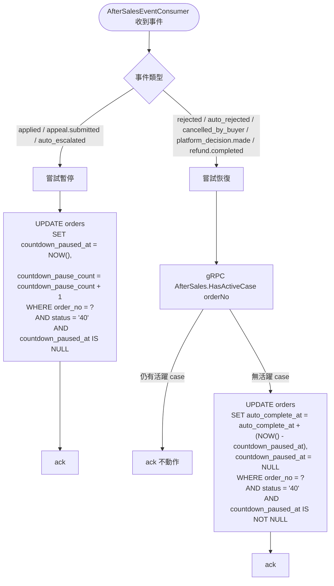

> **Consumer 拓撲（ORD-02 雙 queue 收斂）**：`aftersales.refund.completed` 的「嘗試恢復」由 `AfterSalesEventConsumer.onRefundCompleted`（queue `order.aftersales.refund.completed`）處理——記帳事務先 commit、**post-commit 再 tryResume**（HasActiveCase gRPC 不入記帳事務；失敗靜默 skip，由 §5.8.7 兜底），`order.aftersales.countdown` queue **不再 binding 本事件**；其餘暫停/恢復類事件維持由 `AfterSalesCountdownConsumer`（queue `order.aftersales.countdown`）處理。拓撲 SSOT 見 [36 §3.4](./36-MQ%20與事件總覽（MQ%20%26%20Event%20Catalog）.md#34-售後領域aftersales-domain)。

#### 5.8.5 時序圖

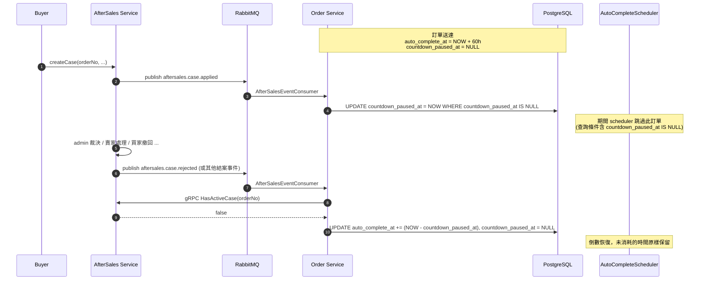

#### 5.8.6 冪等與並發

- **暫停冪等**：SQL 帶 `countdown_paused_at IS NULL` 條件；重複事件 affected=0，不影響已暫停狀態
- **恢復冪等**：SQL 帶 `countdown_paused_at IS NOT NULL` 條件；重複事件 affected=0
- **狀態守門**：所有 SQL 帶 `status = '40'`；非 DELIVERED 訂單跳過（COMPLETED / CANCELLED 等不再受影響）
- **多 case 並存**：恢復前必須反查 AfterSales `HasActiveCase` 確認真的可恢復；單看自家事件容易誤判

#### 5.8.7 事件遺失兜底

採用 daily 對帳 worker（`CountdownRecoveryWorker`）：每日掃描 `status = '40' AND countdown_paused_at IS NOT NULL AND countdown_paused_at < NOW() - 7 days` 的訂單，逐筆呼叫 AfterSales `HasActiveCase`；若已無活躍 case，補一次恢復操作。避免 MQ 事件遺失、或 §5.7.1 post-commit tryResume 靜默 skip（gRPC 失敗無重投保證）導致訂單永久卡暫停。

#### 5.8.8 新增 RPC：HasActiveCase

```protobuf
rpc HasActiveCase(HasActiveCaseRequest) returns (HasActiveCaseResponse);

message HasActiveCaseRequest {
    string order_no = 1;
}
message HasActiveCaseResponse {
    int32 code = 1;
    string message = 2;
    bool has_active = 3;  // AfterSaleCaseStatusRules.isActive：status NOT IN (33,50,60,70,71) OR (status=60 AND appeal_state=APPEALED) OR (status=33 AND appeal_state=APPEALED)
    int32 active_count = 4;  // 觀測用
}
```

實作於 AfterSales Service，內部 SQL（= 09 §4.4.1 `countActiveCasesByOrder`，canonical SSOT）：

```sql
SELECT COUNT(*) > 0
FROM aftersale_cases
WHERE order_no = ?
  AND (status NOT IN ('33','50','60','70','71')
       OR (status = '60' AND appeal_state = '10')
       OR (status = '33' AND appeal_state = '10'))
```

---

## 6. 訊息佇列設計

> 本服務涉及的 routing key 業務語意對應見 §4.4 / §4.5。
>
> 完整 producer / consumer / exchange / queue / DLQ / payload class / idempotency 設計見：
> - [36-MQ 與事件總覽 §3.1 訂單領域](./36-MQ%20與事件總覽（MQ%20%26%20Event%20Catalog）.md#31-訂單領域order-domain)（Order 發布 + Review/AfterSales/Shipping 消費入口）
> - [36-MQ 與事件總覽 §3.2 支付領域](./36-MQ%20與事件總覽（MQ%20%26%20Event%20Catalog）.md#32-支付領域payment-domain)（Payment 消費）
> - [36-MQ 與事件總覽 §3.3 物流領域](./36-MQ%20與事件總覽（MQ%20%26%20Event%20Catalog）.md#33-物流領域shipping-domain)（Shipping 消費）
> - [36-MQ 與事件總覽 §3.4 售後領域](./36-MQ%20與事件總覽（MQ%20%26%20Event%20Catalog）.md#34-售後領域aftersales-domain)（AfterSales 消費）

### 6.1 review.created 業務處理（Review → Order）

來自 Review Service（payload 含 `orderNo` / `orderItemId` / `rating` / `content` / `imageKeys`（objectKey 陣列，原 `imageUrls`，49 號設計書 §5.3） / `createdAt`）。order-service `ReviewEventConsumer.onReviewCreated` 於同一 consumer 內：
1. 校驗 `orderNo` 非空（空則 ACK 丟棄，不重試）
2. `UPDATE orders SET is_reviewed = TRUE WHERE order_no = ? AND is_reviewed = FALSE`（訂單層級已評標記，任一品項已評即 true）
3. 訂單層級評論快照（most-recent-wins）：`UPDATE orders SET review = ?::jsonb WHERE order_no = ? AND (review IS NULL OR (review->>'createdAt') < ?)`，僅當尚無快照或新評論較新時覆寫，確保訂單詳情顯示**該訂單最近一筆**商品評論（JSONB 內容 `{rating, content, imageKeys, createdAt}`）
4. 冪等：評論不可改/刪 → 重送同事件不覆寫（createdAt 未變新）；most-recent-wins 不受 MQ 到達順序影響

> **為何 order 存快照（而非讀取時呼叫 review-service）、為何訂單層級單一**：訂單詳情為高頻單筆讀取，反正規化避免讀取路徑跨服務耦合與延遲。前端「我的評價 / 商品評價」card 為**訂單層級單一評論**顯示，故 order 取該訂單最近一筆商品評論存於 `orders.review`。評論欄位（rating/content/imageKeys/createdAt）在本平台寫入後永不變更（review.proto 無 `UpdateReview` / `DeleteReview`），屬凍結快照，一致性保證見 §8.9。圖片欄位以 objectKey 為唯一真實來源（49 號設計書）。

### 6.2 評論快照功能 — 實作位置

| 層 | 檔案 | 變更 |
|---|---|---|
| review-service（Go，producer） | `pkg/mq/events.go` | `ReviewCreatedEvent` 擴充 `OrderItemID` / `Content` / `ImageURLs` / `CreatedAt` 欄位與構造子 |
| ↑ | `services/review-service/internal/usecase/event_publisher.go` | `ReviewEventPublisher` 介面簽章 |
| ↑ | `services/review-service/internal/mq/publisher.go` | `PublishReviewCreated` 實作 |
| ↑ | `services/review-service/internal/usecase/review_usecase.go` | `SubmitItemReview` 發佈呼叫點帶入新欄位 |
| Proto | `api/proto/order/order.proto` | 新增 `OrderReviewView`、`OrderDetailView.review`（訂單層級）；gen-go-proto + rsync + java-proto install |
| order-service（Java，consumer） | `src/main/resources/db/migration/V4__move_review_snapshot_to_order_level.sql` | `orders.review JSONB`（訂單層級單一快照；`order_items` 無 review 欄） |
| ↑ | `entity/OrderEntity.java` + `ReviewSnapshotTypeHandler` | 新增 `review` 欄位與 handler |
| ↑ | `repository/OrderRepository.java` | `updateOrderReview(orderNo, review, createdAt)`（most-recent-wins）|
| ↑ | `mq/ReviewEventConsumer.java` | 解析 payload，寫入訂單層級快照（most-recent-wins）|
| ↑ | `grpc/converter/OrderProtoConverter.java` | `orders.review` → `OrderDetailView.review`（OrderReviewView）|
| gateway（Go） | `internal/handler/order.go` | `OrderDetailResponse.review` 物件 + `convertOrderDetail` 映射 + Swagger 註解 |

---

## 7. 時序圖總覽

### 7.1 下單流程

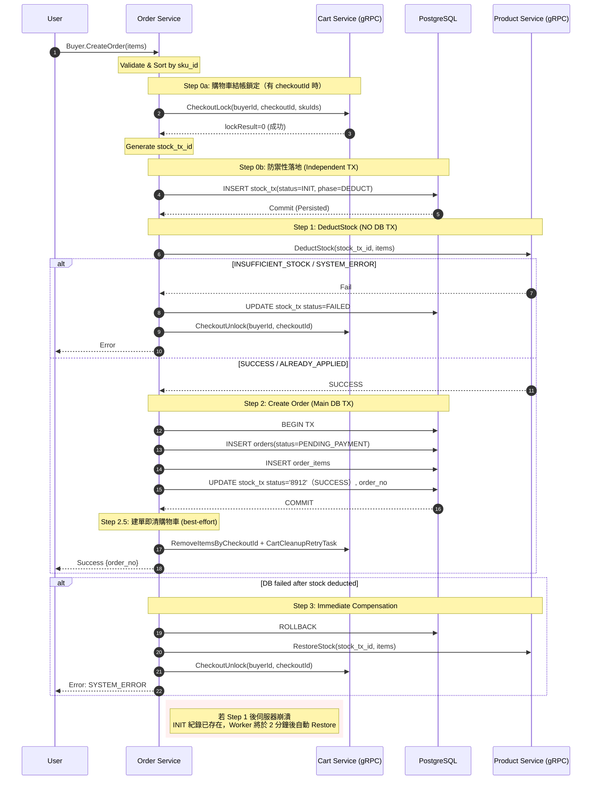

### 7.2 確認收貨 — 買家手動

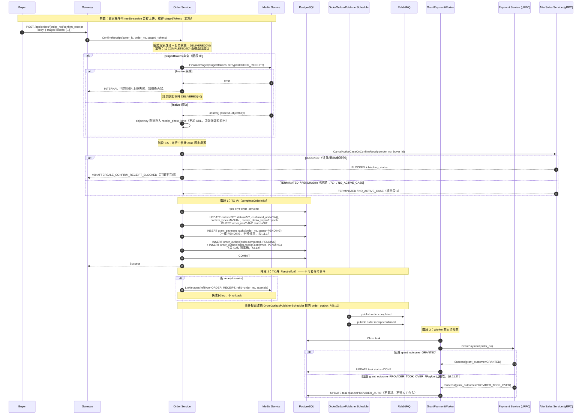

### 7.3 確認收貨 — 自動完成

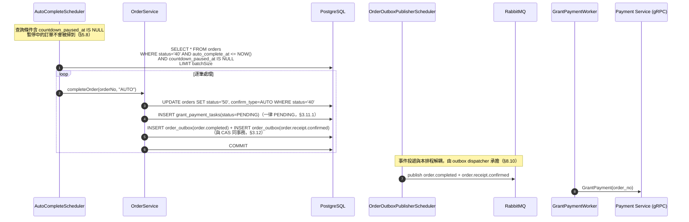

倒數的暫停與恢復另見 [§5.8.5 時序圖](#585-時序圖)。

### 7.4 取消訂單

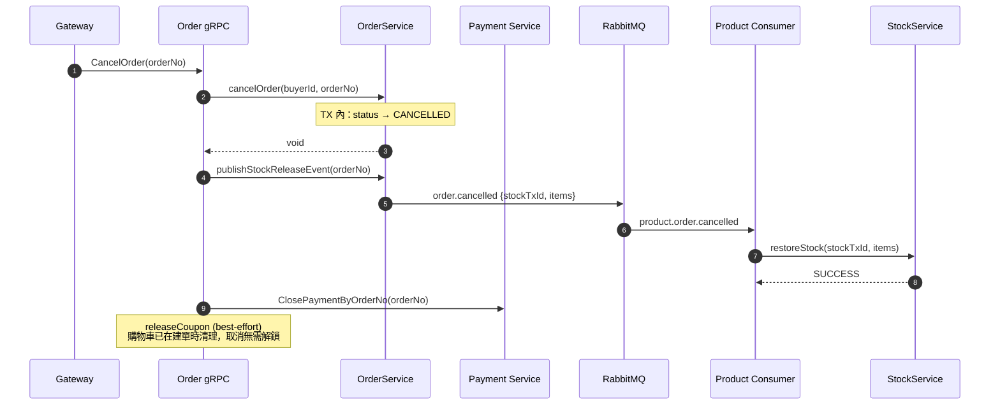

### 7.5 付款超時自動取消

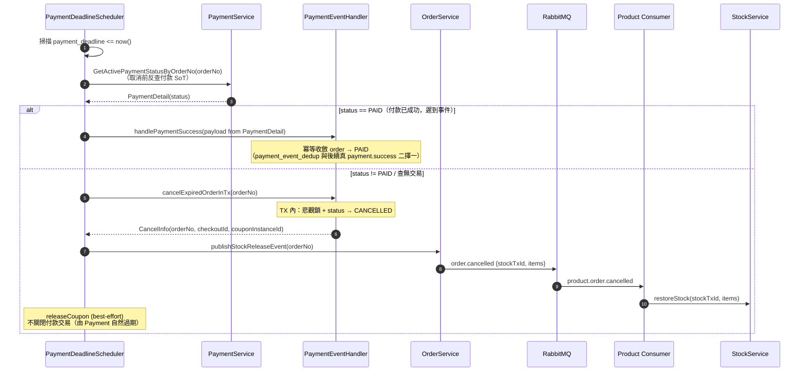

### 7.6 評論提交 → 訂單標記已評論 + 評論快照

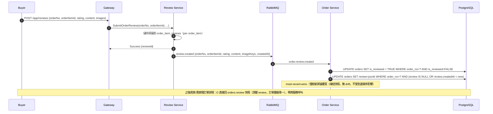

### 7.7 配送失敗未退款（買家可歸責）→ 責任 financially final → 財務結案 → 撥款

> 對應 §2.1「DELIVERY_FAILED_NO_REFUND(54) 的唯一入邊、執行者與下游讀者」、§5.4「配送失敗未退款（54）的撥款觸發」與 [§5.7.3](#573-履約責任判定-final-結果消費fulfillmentresponsibilityfinalized35--54)。
> 事件契約（routing key／exchange／queue／DLQ／payload／版本／冪等鍵）以 [36-MQ 與事件總覽](./36-MQ%20與事件總覽（MQ%20%26%20Event%20Catalog）.md) 為 SSOT；責任判定與 finality 判定規則以 [65 物流履約平台](65-物流履約平台%EF%BC%88Fulfillment%20Platform%EF%BC%89詳細設計書.md) 為 SSOT。

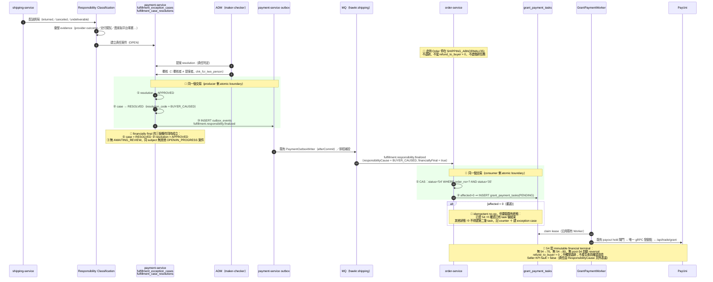

🔴 **這張圖要畫出來的關鍵點**
1. **review 在財務終態之前**——`35` 期間什麼財務結論都還沒下。
2. **兩個 atomic boundary**（producer 側三寫同交易／consumer 側 CAS＋建 task 同交易）。
3. **`affected = 0` 的正確處置**（驗既有終態，不得二次建 task、不得靜默 ACK）。
4. 🔴 **圖上沒有任何一條線從 `54` 回到退款**。

---

## 8. 一致性、交易與補償設計

### 8.1 StockCompensationWorker（庫存補償）

**掃描範圍 A（補償重試）**：`stock_tx_records WHERE phase='RESTORE' AND status='8913' AND next_retry_time <= now()`（`'8913'`＝`StockTxStatus.FAILED`）

**掃描範圍 B（庫存洩漏修補）**：`stock_tx_records WHERE phase='DEDUCT' AND status IN ('8911','8913') AND created_at < now() - 2 minutes`（`StockTxStatus.INIT` / `FAILED`）

**補償成功後的終態與冪等（一致性章節）**：補償 Worker 對掃描範圍 B 取得的 DEDUCT 記錄呼叫 `RestoreStock` 後：

| RestoreStock 回傳 | RESTORE 記錄 | DEDUCT 記錄終態 |
|---|---|---|
| `SUCCESS` / `ALREADY_APPLIED` | **冪等寫入** `INSERT ... ON CONFLICT (stock_tx_id, phase) DO NOTHING`（status=SUCCESS） | → `COMPENSATED`（8915） |
| `NOOP_NOT_FOUND`（從未扣減，§5.8 因果閘門） | 不寫 RESTORE 記錄（無庫存被還） | → `COMPENSATED`（8915） |
| 其他 / 例外 | `updateFailed`（retry_count + 1，指數退避） | 維持 `FAILED`，下輪重試 |

- **DEDUCT 終態必須是 `COMPENSATED`（8915），不得用 `FAILED`**：`FAILED` 正是掃描範圍 B 的選取條件，補償成功卻標回 `FAILED` 會被每輪重撈，配合「盲目 `INSERT` RESTORE 記錄」會造成 `stock_tx_records_pkey` DuplicateKey 重撈直到 retry 上限，變成假性的人工介入。
- **RESTORE 記錄一律冪等寫入**：同 `(stock_tx_id, phase)` 為複合 PK；同步補償路徑（`OrderService.compensateStock` / `writeFailedRestoreRecord`）與 Worker 補償路徑皆走 `ON CONFLICT DO NOTHING`，禁止盲 `INSERT`。
- **`RestoreStock` 因果閘門**：見 02 設計書 §5.8 — 補償一個從未 commit 的 DEDUCT（Bug A rollback / `INSUFFICIENT_STOCK`）會被 Product Service 以 `NOOP_NOT_FOUND` 擋下，不灌水 SKU。

停損：retry_count >= 10 → `MANUAL_INTERVENTION`（8914，DB 存 enum **value** `'8914'`，禁止寫字面字串 `'MANUAL_INTERVENTION'`，與其他 status 欄位型別一致）。

**多副本搶佔**：兩個掃描範圍各自在呼叫 `RestoreStock`（副作用）**之前**加一道 **lease CAS 閘門**，`affected=0` → skip 該筆。
- **租約欄 = 既有的 `stock_tx_records.next_retry_time`**（`V1__init_order_tables.sql`，已有索引），**零 migration**。
- **這是冷卻租約，不是「已補償」旗標**：`SET next_retry_time = now + 5min WHERE stock_tx_id=? AND phase=? AND <原候選述詞> AND (next_retry_time IS NULL OR next_retry_time <= NOW())`。租約到期未成功 → row 自動回到候選集合。
- **候選窗口寬度 = ∞**（兩個掃描範圍的時間條件都只有下界：`next_retry_time <= NOW()`、`created_at < NOW()-2min`）⇒ 任何租約長度都合格（[規範 §三](../開發規範/多副本排程搶佔規範.md)）。
- ⚠️ **`next_retry_time` 有兩個寫入者**：claim 寫 lease、失敗路徑（`updateFailed`）寫指數退避 backoff。**兩者不得互相覆蓋成更短的退避**——失敗路徑的 backoff 一律以後者為準。

**補償流程圖（掃描範圍 B）**：

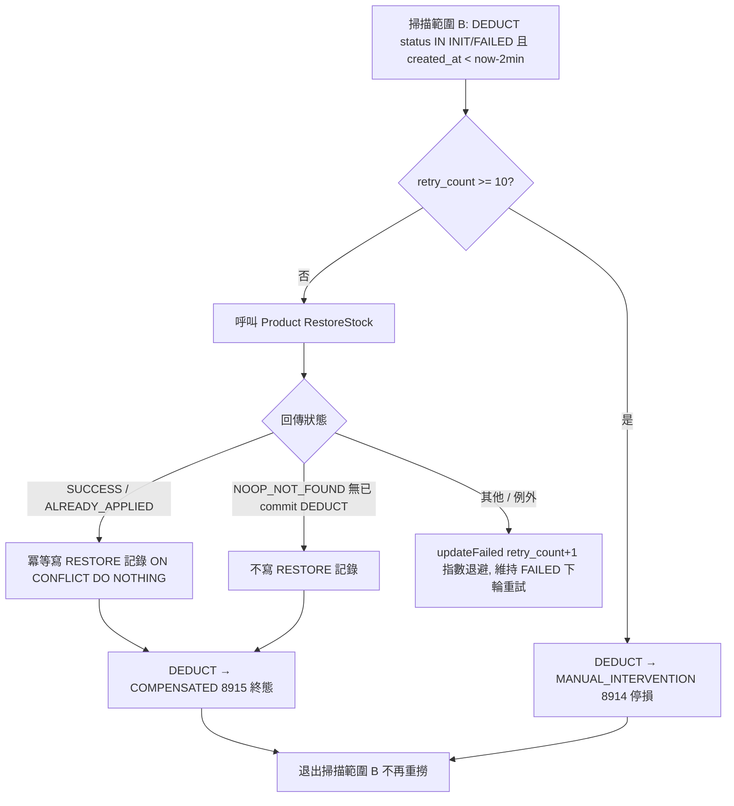

> COMPENSATED 為終態，`findPendingCompensation`（掃描範圍 B 僅選 INIT/FAILED）不再撈到 → 根除「補償成功標回 FAILED 被無限重撈 + 盲 INSERT RESTORE 撞 PK」的缺陷。

### 8.2 AutoRefundWorker（取消後收到付款的退款）

| 項目 | 說明 |
|------|------|
| 排程 | 每 30 秒 |
| 掃描 | `auto_refund_tasks WHERE status IN ('0','30','10') AND (next_retry_time IS NULL OR next_retry_time <= now())`（`WorkerTaskStatus` value：`'0'`=PENDING／`'30'`=FAILED／`'10'`=PROCESSING，經 `OrderConstants.TASK_STATUS_*` 取值）|
| 搶佔 | **lease CAS on `next_retry_time`**（見 [§8.13](#813-多副本排程搶佔語意scheduler-claim)）|

- 非 ATM → 呼叫 Payment Service CreateRefund
- ATM → AWAITING_BUYER_REFUND_PAGE + need_refund_page=TRUE

**★ CreateRefund envelope-code 失敗處理**：`PaymentGrpcClient.createRefund` 為**寫入型 RPC**，呼叫後必須檢查回應 envelope code（依《Java gRPC 錯誤處理規範》§7.0）。payment 在 PayUni 拒退（`RefundStatus.FAILED`）時回 `code=500 + data`（**非**拋 `StatusRuntimeException`），client wrapper 須據此拋例外。屬「**有不可逆前置**」情境（訂單已取消不可逆）：失敗時**禁止**關終態 `DONE`，由既有 `catch` 走 `updateFailed` → 重試（指數退避）→ 超過 `max_retry_count` 轉 `MANUAL_INTERVENTION`，payment 回報原話寫入 `last_error`。

> 原 bug：wrapper 忽略 envelope code 直接 `getData().getRefundNo()`，PayUni `FAILED`（`code=500`）退款被 `completeAutoRefund` 標 `DONE` 不再重試 → 買家錢未退、訂單卻顯示已退款。同一 wrapper 修復一併覆蓋 `PaymentEventHandler` 的 ATM 預建呼叫（§3.7）：envelope `code≠0` 改由 wrapper 拋例外、被既有 `catch` 記錄，不再靜默吞失敗。

### 8.3 PaymentDedupCleanupJob

每日清理 processed_time < now() - 7 days。

### 8.4 TaskCleanupJob

| 項目 | 說明 |
|------|------|
| 排程 | 每週日 02:00 |
| 保留天數 | 30 天 |
| 清理對象 | stock_tx_records（終態 status IN SUCCESS(8912) / COMPENSATED(8915) / MANUAL_INTERVENTION(8914)）, auto_refund_tasks, coupon_consumption_tasks, cart_cleanup_retry_tasks, grant_payment_tasks 中 status=**DONE/PROVIDER_AUTO(50)**（PROVIDER_AUTO 與 DONE 同等對待：`grant_payment_tasks` 是 worker 佇列非帳本，帳務權威在 `payment_transactions` / `financial_logs` 與 PayUni 端）。**grant_payment_tasks 排除 `MANUAL_INTERVENTION(40)`**：未解決工單不得自動刪除——row 一刪，Admin 重發撥款 API `retry_grant` 的入口跟著失效（該 API 依 `UNIQUE(order_no)` row 重置重跑，§3.11） |

### 8.5 PaymentDeadlineScheduler（付款超時取消）

| 項目 | 說明 |
|------|------|
| 排程 | 每 15 秒 |
| 掃描 | `orders WHERE status='0' AND payment_deadline < NOW()` |
| 批次 | 100 筆 |
| 對外暴露 | `OrderDetailView.payment_deadline`（詳情，§8.5）+ `OrderSummaryView.payment_deadline`（列表，免逐筆打詳情 API）（皆 ISO 8601 UTC，僅 status=0 時有值），買家詳情頁與列表「待付款倒數」卡片據此顯示倒數 |

**取消前反查付款 SoT（縱深防護）**：對每筆逾期訂單，在 `cancelExpiredOrderInTx` 取消**之前**（事務外）同步呼叫 payment `GetActivePaymentStatusByOrderNo(orderNo)`（[05 §5.12](../詳細設計書/05-支付服務（Payment%20Service）詳細設計書.md#512-getactivepaymentstatusbyorderno逾期取消前反查internal-only)）反查付款狀態，依結果分支：

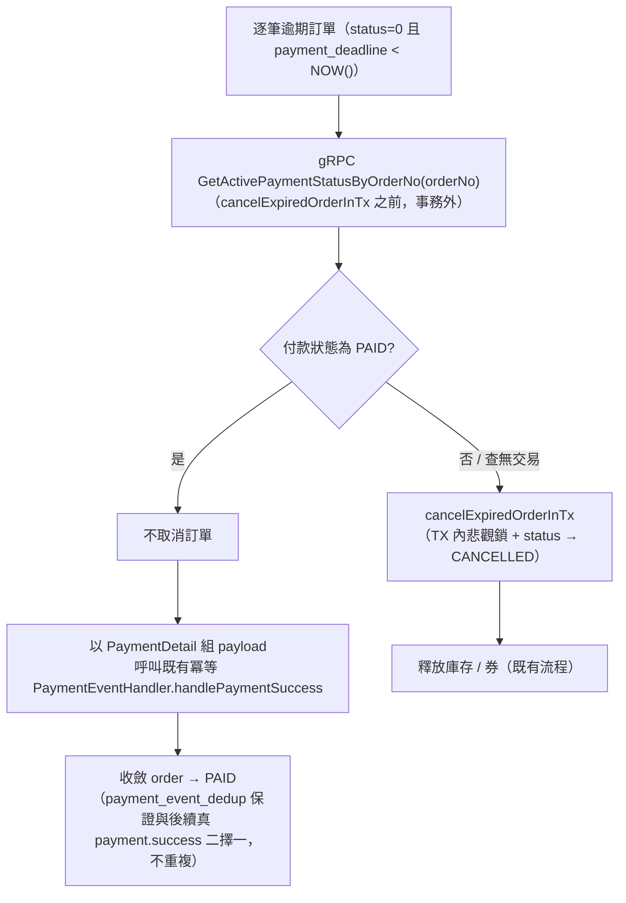

- **status == PAID**：**不取消**。以 RPC 回傳的 `PaymentDetail` 組 payload 呼叫既有冪等 `PaymentEventHandler.handlePaymentSuccess` 收斂 `order → PAID`（等同真實 `payment.success` 到達；`payment_event_dedup` 以 `transaction_id` 為鍵保證與後續真事件二擇一、不重複；行鎖序列化收斂與 CANCELLED 分支競態）。
- **status != PAID（或查無交易）**：照舊 `cancelExpiredOrderInTx` 取消並釋放庫存 / 券。

此 gate 是縱深防護：即便付款事件已 L1 outbox 化 + L2 publisher-confirm 投遞（見 05 §5.10），仍可能有事件 in-flight / outbox 尚未派送 / 罕見 DEAD 的殘餘窗口；取消前反查付款 SoT 消除「付款已成功卻被逾期取消」的資損。

**禁止在取消流程中呼叫 ClosePaymentByOrderNo**：保留交易 INIT 狀態讓遲到的 Webhook 有機會觸發退款補償。

**一致性定位（[後端服務責任邊界規範](../開發規範/後端服務責任邊界規範.md)）**：本 gate 是既有逾期取消動作在 **mutate 前逐單同步查 SoT 決定分支**（等同 CAS 前置 = 把寫入路徑寫對），**非** reconciliation / drift 偵測 job——無 task 表、無週期性比對掃描、無 runner，收斂路徑復用既有冪等 `handlePaymentSuccess`。符合[後端服務責任邊界規範 §七](../開發規範/後端服務責任邊界規範.md) 判準（目的為「業務正確性」而非「資料完整性監測」），與 §8.11 `ShipmentCreationBackstopScheduler`「業務 SLA 兜底」同屬合規類別。

### 8.6 CouponConsumptionWorker

每 45 秒掃描，呼叫 CouponService.consumeCoupon。冪等以 coupon_instance_id 為鍵。
**搶佔 = lease CAS on `next_retry_time`**（見 [§8.13](#813-多副本排程搶佔語意scheduler-claim)）。

### 8.7 CartCleanupRetryWorker

每 30 秒掃描，呼叫 CartService.RemoveItemsByCheckoutId。最終防線：Cart Service `UnlockExpiredItemsJob` 每 5 分鐘自動解鎖。
**搶佔 = lease CAS on `next_retry_time`**（見 [§8.13](#813-多副本排程搶佔語意scheduler-claim)）。
⚠️ cart 的 `UnlockExpiredItemsJob` **只救商品鎖，不清購物車項目本身** —— 它不能當作本 worker 卡死的兜底。

### 8.8 GrantPaymentWorker

每 30 秒掃描，呼叫 Payment Service GrantPayment RPC。冪等以 order_no 為鍵。
**搶佔 = lease CAS on `next_retry_time`**（見 [§8.13](#813-多副本排程搶佔語意scheduler-claim)）。

> ⚠️ **`resetForRetry` 的允許狀態集合必須涵蓋 claim 後的中間狀態。**
> Admin 人工重發撥款走 `resetForRetry`，其 `WHERE` 目前只收 `status IN (FAILED, MANUAL_INTERVENTION)`。claim 把 task 推進 `PROCESSING` 之後若 pod 崩潰，該筆**既不會被 worker 撈回（舊候選述詞不含 PROCESSING）、也不會被 admin 救回** —— 這是「設計書寫了有人工救濟、實際救濟路徑收不到那個狀態」的實例。
> ⇒ 🔴 **候選述詞必須含 `PROCESSING`**（lease 到期即自動回來），**且 `resetForRetry` 的允許集合也必須含 `PROCESSING`**——兩者缺一，人工救濟路徑就收不到那個狀態。

- **只處理 `PENDING(0)`（及既有 FAILED 重試排程）task**；`PROVIDER_AUTO(50)` 為終態純對帳記錄，Worker 不再撈取（[§3.11.2](#3112-撥款已由-payuni-接管的收斂worker-韌性)）
- **PayUni 接管收斂**：GrantPayment gRPC 回應 `grant_outcome=PROVIDER_TOOK_OVER`（正常回應非 error）→ task 收斂 `PROVIDER_AUTO(50)`，不重試、不進 `MANUAL_INTERVENTION`（[§3.11.2](#3112-撥款已由-payuni-接管的收斂worker-韌性)）。**禁止**以「gRPC error + `refund_total_amount>0`」本地啟發式收斂；凡 gRPC error 一律照既有 FAILED/retry → 上限轉 `MANUAL_INTERVENTION` 路徑

#### 8.8.1 撥款資格閘門（payout hold）

**問題**：售後 case 被駁回（`REJECTED(60)`）或待寄回逾時自動關案（`AUTO_COMPLETED_RETURN_PENDING_TIMEOUT(33)`）之後，`AfterSaleCaseStatusRules.isActive` 回 false ⇒ 倒數恢復、確認收貨不被擋 ⇒ 訂單完成、同事務建撥款任務、本 Worker **30 秒內撥出去**。但買家在 `aftersales.appeal.deadline-hours`（72h）內**仍可申訴**，Admin 裁決 `FULL_REFUND` 就會建退款——而**全 repo 沒有任何賣家扣回機制**，錢一旦撥出即為平台資損。

🔴 **倒數暫停擋不住這個窗口**：`AfterSalesCountdownConsumer → OrderCountdownService.pause` 的述詞是 `status = 40`；買家**主動**確認收貨的訂單在申訴發生前就已離開 `40` ⇒ `pause` 直接 skip。

**修法**：claim 之後、呼叫 `GrantPayment` 之前，同步反查 aftersales `GetOrderPayoutHold`。

| 情形 | 動作 |
|---|---|
| `hold=false` | 照既有流程撥款 |
| `hold=true` ＋ `hold_until` 有值（申訴窗未關） | `deferForPayoutHold(taskId, hold_until, reason)`：`PROCESSING → PENDING` ＋ 推 `next_retry_time`。**到期自動放行** |
| `hold=true` 無 `hold_until`（申訴審理中 / 退款處理中 / **在途申訴** `APPEAL_IN_FLIGHT`） | 同上，推 `hawkr.order.payout-hold-recheck-seconds`（預設 600） |
| 反查失敗 / 逾時 / 回非 0 code / 回應格式壞掉 / 未知 reason enum | **fail-closed** 視為無時間界 hold（`AfterSalesGrpcClient.getPayoutHold` 不拋例外）。⚠️ 這條不變式**必須有測試守著**：把它變異成 fail-open 時，若沒有專門的斷言，order-service 全部測試照樣綠 |

**設計決定與理由**：

- **閘門放在 Worker（執行點）不是建立點**：① 資格必須是**撥款當下**的狀態——建立時算好的會被「之後才提交的申訴」推翻；② **三條**結案路徑（買家確認收貨 / `AutoCompleteScheduler` / **配送失敗未退款 `35→54`**，見 [§5.4 配送失敗未退款（54）的撥款觸發](#配送失敗未退款54的撥款觸發第三條撥款任務建立路徑)）匯流於此，一處覆蓋三條；③ 任何把任務叫醒的路徑（admin `resetForRetry`、租約到期、pod 重啟）都會重新過閘。
- **不動 `retry_count`**：hold 是業務資格未到、不是失敗。動它會讓一筆申訴審理數天的訂單被推進 `MANUAL_INTERVENTION`，把「還不能撥」誤報成「撥款失敗」。
- **零 migration**：沿用 `next_retry_time` 既有的「排程時點」語意，候選述詞 `next_retry_time IS NULL OR <= NOW()` 本來就會把它擋在候選之外。
- 🔴 **反查必須帶 deadline，且要重算租約下界**：本呼叫落在 `GrantPaymentWorker` 的**租約窗口內**，而
  [§8.13](#813-多副本排程搶佔語意scheduler-claim) 的租約下界定義是「> 單筆最壞耗時，含該筆每一個外部呼叫的 deadline」。
  `AfterSalesGrpcClient.PAYOUT_HOLD_DEADLINE_SEC = 5` ⇒ 最壞耗時 `5 + 100（PayUni）= 105 < 120（CLAIM_LEASE_SEC）`，餘裕 15 秒。
  ⚠️ **這條不等式必須有機械斷言守著。**
  **往租約窗口裡加任何新的外部呼叫，都要回來重算這一條**——加一個沒有 deadline 的呼叫會讓下界變成無上界，兩個 pod 就可能同時撥同一筆款。
- 🔴 **TOCTOU 由持鎖順序關閉，不是由 grace 的長度**：`submitAppeal` 先鎖 case 再判資格、鎖持有到 commit；閘門放行前以 `FOR UPDATE SKIP LOCKED` 探測並重讀該列，探不到或重讀已變 ⇒ `APPEAL_IN_FLIGHT` fail-closed。完整推導與依賴盤點見 [09 §4.4.1 GetOrderPayoutHold](../詳細設計書/09-售後微服務（AfterSales%20Service）詳細設計書.md#getorderpayouthold-rpcbackend3262-新增)。**對本 Worker 的租約下界沒有影響**：`SKIP LOCKED` 不等待，仍受 `PAYOUT_HOLD_DEADLINE_SEC = 5` 上界拘束。
- **不會永久卡住賣家款項**：有時間界的 hold 到期自動放行。🔴 **hold 必須有時間界**：借用 `uk_aftersale_cases_active_order` 述詞而不設時間界的寫法，會讓「被駁回且買家不申訴」的訂單撥款**永久卡死**。
- **不改變既有業務裁決**：申訴窗不動、確認收貨語意不動、訂單完成時點不動。「還可能生出退款就不撥款」是既有政策（`AfterSaleCaseStatusRules.isActive` javadoc 逐字「訂單款項不可撥付」）。**可觀察副作用**：曾有售後 case 被駁回／自動關案的訂單，賣家收款延後至申訴窗結束；無售後 case 的訂單不受影響。

**觀測**：`hawkr_grant_payout_held_total{reason=NONE|ACTIVE_CASE|APPEAL_WINDOW_OPEN|APPEAL_IN_FLIGHT|LOOKUP_FAILED}`；告警 `GrantPayoutHoldLookupFailing` / `GrantPayoutHeldIndefinitely`（`monitoring/prometheus/rules/business-alerts.yml`，`payout-hold-alerts` group）。`APPEAL_WINDOW_OPEN` 刻意不告警——那是正確行為。

🔴 **本節的閘門是現行唯一的撥款資格閘門**：`settlement-service` 不存在，65 §7.7.1.3 的 `PayoutEligibility` 不在現行路徑上——不要把撥款資格的判定推遲給一個不存在的接手方。

### 8.9 評論快照一致性（orders.review）

**層級**：評論記錄為 **order_item（商品）層級**（review-service `order_item_reviews`，一品項一筆，為 SSOT）；訂單詳情「我的評價 / 商品評價」card 為**訂單層級單一**顯示，故 order 反正規化儲存**該訂單最近一筆**商品評論於 `orders.review`。

**單一寫入路徑**：`orders.review` 唯一寫入點為 `ReviewEventConsumer.onReviewCreated`（消費 `review.created`），most-recent-wins（`review IS NULL OR review.createdAt < newCreatedAt` 才覆寫），不受 MQ 到達順序影響。

**不引入補償任務基礎設施**：本平台評論**不可修改、不可刪除**（review.proto 無 `UpdateReview` / `DeleteReview` RPC），快照欄位寫入後永不變更 → 凍結快照，無 drift。因此：
- **不做** `review.updated` / `review.deleted` 事件維護
- **不做** reconciliation job / reflow runner / backfill CLI / drift 偵測（符合[後端服務責任邊界規範](../開發規範/後端服務責任邊界規範.md)）
- admin `HideReview`（內容審核隱藏）僅作用於公開商品評論頁，**不連動**訂單詳情（交易雙方私有視圖），故不需 hide 事件

**讀取路徑**：`GetOrder` / `GetSellerOrderDetail` 組裝 `OrderDetailView.review` 時直接讀本地 `orders.review`；`review IS NULL` 表訂單未評論（頂層 `review` 回 null）。

**既有資料**：若需補值，由開發者以維運 SQL 處理，**不寫進 application code**（見[後端服務責任邊界規範](../開發規範/後端服務責任邊界規範.md)）。

**圖片欄位**：`orders.review.imageKeys`、`orders.shipment_photo_keys`、`orders.receipt_photo_keys` 一律存 objectKey，以 objectKey 為唯一真實來源（49 號設計書）；顯示 URL 由讀取端以 `MediaUrlProperties.buildUrl(objectKey)` 即時組出，不落庫。

### 8.10 OrderOutboxPublisherScheduler（事件可靠投遞）

[後端服務責任邊界規範 §七 例外第 2 項](../開發規範/後端服務責任邊界規範.md)（Outbox 模式）：技術可靠性例外（DB commit 後保證 MQ event 發出），非資料清整。

| 項目 | 說明 |
|------|------|
| 排程 | fixedDelay 預設 5 秒（`ORDER_OUTBOX_PUBLISH_INTERVAL_MS`） |
| 掃描 | `order_outbox WHERE status IN ('8221','8223') AND (next_retry_at IS NULL OR next_retry_at<=NOW())`（`'8221'`＝`OutboxEventStatus.PENDING`、`'8223'`＝`FAILED`）|
| 搶佔 | **lease CAS on `next_retry_at`**（`claimForDispatch`），閘門在 `publish` **之前**；`affected=0` → skip 該筆 |
| 動作 | best-effort 補 seller/buyer meta（payload 形狀與原 afterCommit 等效，下游 IM/通知不受影響；meta 圖片欄位帶 objectKey＋`*Key` 欄位名，49 號設計書 §6.3）→ `obsRabbitPublisher.publish` → `markSent`（守衛 `AND status <> '8222'`，`'8222'`＝`OutboxEventStatus.SENT`）；失敗 `markFailedGuarded`（`retry_count++` + backoff）|

🔴 **業務狀態變更與 outbox 寫入必須同事務**（§3.12），由此保證事件至少一次送達。事務外 best-effort 發布在 MQ 短暫不可用時即永久遺失（環境隔離另見 [MQ Topology 管理（Terraform）](../基礎建設/MQ%20Topology%20管理（Terraform）.md)）。**目前承載六種事件**：`order.paid`（付款成功事務）、`order.cancelled`（取消事務）、`order.completed` ＋ `order.receipt.confirmed`（確認收貨／自動完成事務）、`order.delivered`（物流送達事務）、`order.sales.accumulated`（付款成功事務，與 `order.paid` 同一個）。清單與進入時機以 [§3.12](#312-訂單事件發件匣-order_outbox事件可靠投遞載體) 的表為準。

**派送時 enrich（dispatch-time enrich）**：`order.paid` / `order.completed` / **`order.delivered`** 三者的 payload 帶有**登入 `account_id`** 欄位（notification 路由用），而那需要 gRPC 反解（`buyer_id`／`store_id` → `account_id`）。**反解一律不在寫入事務內做**，改在 dispatcher 取出 outbox row、送出之前補上（`OrderOutboxPublisher.enrichPaid` / `enrichCompleted` / `enrichDelivered`）。

- **為什麼**：寫入事務是「狀態 CAS ＋ outbox INSERT」的**短事務**，把一次無 deadline 的 gRPC 放進去等於讓它無限期持有 `orders` 該列的 row lock（同 [規範 §四 出路 4 的硬性邊界](../開發規範/多副本排程搶佔規範.md)）。**core payload 只寫本地事實**（`buyer_id` 一律查自己 `orders` 記錄，不採信上游 payload 的同名欄位），`notifyBuyerAccountId` 以 `null` 佔位。
- **反解失敗帶 `0`**（notification 端 skip）而**不阻斷派送**：阻斷會讓整筆事件卡在 outbox 重試，代價高於一則路由不到的通知。與原 consumer 內直接反解的降級行為逐字相同。
- ⚠️ **enrich 必須保留 core 的 `eventId`**（跨 outbox 重試冪等鍵要穩定），不可在 enrich 時重新產生。

**多副本搶佔**：`prod replicas=2` 下兩個 pod 每 5 秒各撈同一批 PENDING row，**同一則事件會被 publish 兩次**。修法 = 在 `publish` 之前插一道 lease CAS：

```sql
UPDATE order_outbox
   SET next_retry_at = #{now} + interval '60 seconds'
 WHERE id = #{id}
   AND status IN ('8221','8223')                              -- 與候選述詞一致（PENDING / FAILED）
   AND (next_retry_at IS NULL OR next_retry_at <= #{now})     -- ← lease CAS
```

- **租約欄 = 既有的 `next_retry_at`**，零 migration。**這是冷卻租約不是「已派送」旗標**：pod 在 claim 與 publish 之間崩潰時，租約到期 row 自動回到候選集合、下一輪重送 ⇒ **at-least-once 契約不變**（換來的是「延後一個租約」的行為退化）。
- **租約 60 秒**，遠大於單筆工作的最壞耗時（publisher confirm timeout 3 秒級）。**候選窗口寬度 = ∞**（述詞無時間上界）⇒ 合格（[規範 §三](../開發規範/多副本排程搶佔規範.md)）。
- `markSent` / `markFailed` / `markDead` 一律改用**具名 `@Update` ＋ 明確守衛述詞**，不再用 `updateById` 全欄位覆蓋（避免與 claim 的寫入互相覆蓋）。

> ⚠️ **終態必須退出候選集合（單 pod 也會壞）**
> 舊候選述詞是 `status <> '8222'`（`OrderOutboxMapper.findDispatchable`），於是 **`DEAD`（`'8224'`）row 永久滯留**；累積到批次上限（`OrderOutboxPublisherScheduler.BATCH_SIZE = 50` 筆）之後每個 tick 都被 DEAD row 佔滿 ⇒ **整條 outbox starvation，`order.paid` 全面停止投遞**。
> **正解**：候選述詞改成**正面枚舉** `status IN ('8221','8223')`（`OutboxEventStatus.PENDING` / `FAILED` 的 value），`idx_order_outbox_dispatch` 部分索引同步 `DROP` + `CREATE` 成相同條件（走 `V{N+1}`，與 §8.11 的觀測欄合併為同一支 migration）。
> 🚨 **枚舉的是 CodeMeta value 不是 enum 名**（`'8221'/'8222'/'8223'/'8224'`）；寫成 `'PENDING'` 之類會讓述詞與部分索引雙雙零命中 ⇒ **outbox 靜默全停**。`OutboxEventStatus` **沒有 `RETRYING`**。
> **通則**：候選述詞一律正面列出「要處理的狀態」，**禁止用 `<>` / `NOT IN`** —— 新增終態時不會有人回頭改它（[規範 §六](../開發規範/多副本排程搶佔規範.md)）。

### 8.11 ShipmentCreationBackstopScheduler（付款後建單兜底）

**業務 SLA 兜底**（非 reconciliation/drift；等同 §8.5 對未付款訂單的逾期取消，符合[後端服務責任邊界規範](../開發規範/後端服務責任邊界規範.md)）：付款後超過寬限期仍無物流單者，先重試建單（容忍暫時性網路/PayUni 故障），超過重試上限仍失敗 → 系統取消 + 啟動退款。

| 項目 | 說明 |
|------|------|
| 排程 | fixedDelay 預設 5 分鐘（`ORDER_SHIPMENT_BACKSTOP_INTERVAL_MS`），開關 `ORDER_SHIPMENT_BACKSTOP_ENABLED` |
| 掃描 | `orders WHERE status='10' AND shipping_status IS NULL AND pay_time < NOW()-grace AND (shipment_create_next_retry_at IS NULL OR <=NOW())`。<br/>🔴 **述詞不得改用 `(shipment_no IS NULL OR shipment_no='')`**——`orders.shipment_no` 裝的是 **provider 側識別字**（§5.5 的回填 SQL 寫進去的是 payload 的 `ship_trade_no`），而 3003 在 `FL-1` 完成當下**還沒有** provider 側識別字 ⇒ 每一筆正常的 Uber 訂單都會恆久命中候選。逐 provider 對照見 §8.11.1 |
| 重試 | `attempts < max`：publish `order.shipment.create_requested`（Shipping 冪等建單）；`attempts++` / `next_retry_at=NOW()+backoff` |
| 取消 | `attempts >= max`：publish `order.shipment.creation_failed`（AfterSales 取消+退款，reason `SHIPMENT_CREATE_TIMEOUT` 9103，含 ATM 兩段式） |
| 終止 | `orders.shipping_status` 一旦**非 `NULL`**（＝ Shipping 已把 fulfillment lifecycle 投影回 Order）即移出掃描；取消後 `status≠10` 不再命中。<br/>🔴 **退出條件不是「`shipment_no` 回填」**：那會讓人以為要等到「拿到 provider 單號」，而 3003／3004 的退出點比它早得多。完整退出條件見 §8.11.1 的 Backstop Ownership Contract。 |
| 兩階段 | TX 內更新 attempts；TX 外 publish（事件不在事務內，避免 finally/事務交互） |

判定依據：`orders.shipping_status IS NULL` ⟺ **Shipping 尚未接手這筆訂單的 fulfillment lifecycle**（由 §5.5 的物流事件消費寫入，無需額外 gRPC）。<br/>🔴 **不得改寫成「`shipping_status IS NOT NULL` ⟺ `FL-1` 已完成」**——那句話對 `991`／`990` 是假的（§8.11.1 Case E／F）。

🔴 **2026-09-13 Design Closure：本排程的前提必須回灌，否則它會把一個已定案的業務規則整個繞過去。**

**舊前提**：「付款後就該有**物流商側的**物流單，沒有就是系統出錯」。

這個前提對 **3001／3002 成立**：它們在付款當下由 `createShipmentFromOrder()` 呼叫
PayUni `createHomeShipment`／`createCvsShipment` 取得物流單號（`FL-1`，見 §5.5 的回填 SQL）
⇒ **沒有物流單號確實代表出了錯**，本排程對它們的判斷是對的。

🔴 **但它對 3004 不成立，理由是 provider 的客觀差異**：3004 的逐筆取號（`/trade`）由**賣家**發動
⇒ 它在付款當下**只建立本地配送單**，物流商側的識別字要等賣家取號之後才存在。
⚠️ **這不是「新通路都只建本地列」的通則**，是這一個 provider 的分界。

⚠️ **3003（即時配送）不是這一類，不要把它歸進來**：
**物流商確實沒有一支「只建立物流資料、完全不安排履約」的建單 API**（這是 provider 的客觀事實，仍然成立），
而 3003 V1 的做法是**接受這一點**——在**付款當下**就送出 Create Delivery，並帶上**報價當下凍結的未來取件時間**。
⇒ 3003 在 `FL-1` 完成當下**已經取得** provider 側識別字。它之所以仍屬 `FL-1`，理由是**我方在該時點觀察不到外送員指派**，
🔴 **不是**「物流商還沒開始安排」——本書**不得**再寫「Create Delivery 就代表當場派車／開始計費」這類對 provider 內部行為的推測。
⚠️ 賣家在 3003 的動作是**宣告備妥**（`REPORT_READY`），它觸發的是**更新既有 Delivery 的取件時間**，
**不是建單、也不是派車**；`FL-2` 的 actor 是物流商依約定取件時間排程，**不是賣家**。
依據：[65 §7 Provider 憲法](../基本設計書/65-物流履約平台（Fulfillment%20Platform）基本設計書.md)
＋ [65 §4.4.1a `FL-N`](65-物流履約平台（Fulfillment%20Platform）詳細設計書.md)。

🔴 **本節不要求改動 3001／3002 的付款後建單流程**——那是既有且正確的業務流程。
要改的只有**候選述詞的錨點**：它目前錨在「有沒有物流商側的單號」，而那個錨對 3003 天生為空。

⚠️ **兩種情境在本排程眼中長得一模一樣，而處置相反**：

| 情境 | 資料上 | 正確處置 | 誤判的後果 |
|---|---|---|---|
| `FL-1` 真的沒建出來 | 訂單已付款、**`orders.shipping_status` 仍為 `NULL`**（沒有收到 `shipment.created`） | 重試補做**該 provider 的** `FL-1`；耗盡則放棄並取消退款 | 不補 ⇒ 賣家永遠看不到這筆單 |
| 賣家還沒發動 `FL-2` | 訂單已付款、**`orders.shipping_status = '91'`** | 🔴 **不歸本排程管**——由該通路的賣家處理期限（[09 §5.9](09-售後微服務（AfterSales%20Service）詳細設計書.md)）處理 | ① 重試會**替賣家發動 `FL-2`**，繞過「賣家決定」這條規則（⚠️ 此半**只對 3001／3002／3004 成立**——3003 的 `FL-2` 由物流商依約定取件時間排程、不由賣家發動） ② 放棄門檻到達時**把一筆正常訂單自動取消＋全額退款**，賣家連一次機會都沒有（**對所有 provider 都成立，含 3003**） |

**三條回灌要求（同一個修法的三半，只做其中一兩條會留下另一邊的洞）**

| # | 要求 |
|---|---|
| ① | **候選述詞錨在「該 provider 的 `FL-1` 有沒有完成」**，不得錨在任何**只有 `FL-2` 成功才會回填**的欄位。⚠️ 對 3001／3002／**3003**，`FL-1` 完成的證據都包含物流商側識別字（**不變**；3003 在付款當下送出 Create Delivery 即取得）；對 **3004**，`FL-1` 完成的證據是**本地配送單存在**，因為它的物流商側識別字要等賣家取號（`FL-2` 側）才有 |
| ② | 🔴 **重試動作只能補做 `FL-1`，不得發動 `FL-2`**——本排程發出的重建請求，下游必須止於**該 provider 的 `FL-1`**。⚠️ 對 3001／3002 那包含**重新呼叫 PayUni 建單取號**（本來就該補做的事）；對 **3003** 那包含**呼叫物流商 Create Delivery**——它是 3003 `FL-1` 的一部分，🔴 補做時必須**沿用同一份報價 snapshot 與同一個 idempotency key**，不得重算取件時間；對 **3004** 則止於建立本地配送單，因為它的 `FL-1` 只有那一步 |
| ③ | **「賣家還沒發動」不是本排程的候選**，它有自己的出口與自己的時鐘 |

🔴 **驗收必須雙向**：造一筆「`FL-1` 已建、賣家未發動」⇒ **不得**被本排程碰；
造一筆「`FL-1` 真的沒建出來」⇒ **仍須**被補做。
⚠️ **同一段程式碼同時是安全網與殺手，只從單一情境出發的修法會把另一邊弄壞。**

#### 8.11.1 🔴 Backstop Ownership Contract：候選述詞的欄位與語意

🔴 **`orders.shipment_no` 不是「有沒有物流單」的證據，不得拿來當候選述詞。** §5.5 的回填 SQL：

```sql
UPDATE orders SET shipment_no=?, ship_time=NOW(), shipping_status='91', label_url=?, processing_deadline=?
WHERE order_no=? AND shipment_no IS NULL
```

`shipment_no` 寫的是 `shipment.created` payload 的 **`ship_trade_no`**（provider 側識別字），
而同一則 payload 另有 `shipment_no`（我方本地配送單編號）**未被使用**。
⇒ **`orders.shipment_no` 是「provider 側識別字存在嗎」，不是「本地配送單存在嗎」。**

對 **3004** 而言，`FL-1` 完成當下**還沒有** provider 側識別字（逐筆取號由賣家發動，屬 `FL-2` 側）
⇒ 該欄為空是**正常狀態**，而舊述詞把它讀成「建單失敗」。
⚠️ **3003 不是這個反例**——它在付款當下送出 Create Delivery 即取得 provider 側識別字。改錨的決定**不因此動搖**：
述詞必須錨在「Shipping 有沒有把 lifecycle 投影回來」，而不是逐 provider 去猜哪一家在什麼時點才有識別字。

**判定欄位與判定語意**

```
候選 ⟺ orders.shipping_status IS NULL
```


**舊寫法（已作廢，不得再出現在任何設計文件）**：

```
❌ FL-1 completed  ⟺  orders.shipping_status IS NOT NULL
```

⚠️ **它對 `991`／`990` 是假的**：3004（7-11 大宗寄倉）的 `/trade` 逾時會寫 `CREATE_UNKNOWN(991)`
並以 `shipment.status.changed(991)` 投影回 Order（[06 §2.1 物流狀態機](06-物流微服務（Shipping%20Service）詳細設計書.md) 逐字：
`991` 落到 `onShipmentStatusChanged` 的最後一個 `else`，症狀是**只更新 `shipping_status`、訂單軸不動、也不報錯**）
⇒ 此時 `orders.shipping_status = '991'`，而該筆的 **`FL-1` 根本還沒確認成功**。
**「非 `NULL` ⇒ `FL-1` 已完成」在這一格直接為假。**

**新語意（定版）**

| `orders.shipping_status` | 語意 | generic Order backstop |
|---|---|---|
| `NULL` | **Order 尚未收到任何 Shipping 側的 fulfillment lifecycle 投影** ⇒ Shipping 還沒接手這筆訂單 | ✅ **仍然擁有 recovery**（候選 YES） |
| **非 `NULL`**（`91` / `990` / `991` / `992` / 或任何其他合法物流態） | **Shipping domain 已經明確接手 fulfillment lifecycle**——它可能是「已建單」、也可能是「建單結果未知／失敗，正由 Shipping 自己的 recovery 鏈收斂」 | ❌ **必須退出**（候選 NO） |

> 🔴 **Backstop Ownership Contract（provider-neutral，本節的最高層規則）**
>
> **Order 的 `ShipmentCreationBackstopScheduler` 只負責「Shipping 還沒有接手」的訂單。
> 一旦 Shipping 透過正式的 shipment lifecycle event 把 `shipping_status` 投影回 Order，
> generic Order backstop 必須退出，recovery 的所有權歸 Shipping（或 Shipping 指定的賣家／Admin 動作）。**
>
> ⚠️ **它要防的不是「多跑一次」，是兩條 recovery chain 對同一筆訂單同時動作**：
> Shipping 正在對 `991` 做 `/query` 回查收斂，而 Order 同時重新發 `order.shipment.create_requested`
> ⇒ **可能建出第二張物流單、重複計費**（逐字：
> 「`991` 期間**不得**建第二筆 `provider_shipments`；`/query` 回查無**不構成**重建理由」），
> 或在回查查到「其實建單成功」之前就先取消＋全額退款（65 §0.1.6 不等式 ⑥ 的症狀欄）。
>
> 🔴 **這條 contract 不逐 provider 分支，也不列舉狀態值。** 它只問一件事：
> **Shipping 有沒有把 lifecycle 投影回來。** 新增任何 provider、任何新狀態值，都不需要回來改本述詞。

🔴 **它為什麼仍然是 provider-aware 的**——不是因為 SQL 逐 provider 分支，而是因為
**`shipment.created` 只會在「該 provider 自己的 `FL-1` 完成」之後才發出**，而各 provider 的 `FL-1` 內容本來就不同：

| provider | 它的 `FL-1` 包含什麼 | `shipment.created` 何時發出 |
|---|---|---|
| 3001／3002 | 本地配送單 ＋ **向 PayUni 建單並取得物流單號** | PayUni 呼叫**成功之後** |
| 3003 | 本地配送單 ＋ **向物流商 Create Delivery 取得 delivery 識別字**（帶報價當下凍結的未來取件時間）。🔴 它仍屬 `FL-1`，理由是**我方觀察不到外送員指派**，不是「物流商還沒開始安排」 | Create Delivery 成功**之後** |
| **3004** 🆕 | **只有**本地配送單（`shipments` 列，`91 READY_TO_CREATE`）。🔴 **`/trade` 逐筆取號不屬 `FL-1`**——它由**賣家**發動，屬 `FL-2` 側 | **付款後本地列建立之後**（⚠️ **不要拿 3003 當類比**：3003 的 `FL-1` 含 provider 建單，3004 不含） |

🔴 **3004 那一列是 Case E／F 的前提，寫錯的後果與 Case C 同形**：
若施工者把 `/trade` 取號讀成 `FL-1`、因而把 `shipment.created` 延到取號成功才發，
則**每一筆 3004 訂單在賣家取號之前 `orders.shipping_status` 都是 `NULL`**
⇒ 全部落進兜底候選 ⇒ 在放棄門檻（付款後約 3 小時）被系統自動取消＋全額退款。
⚠️ **3004 的 `FL-1` 止於本地配送單**（[65 §7.1.2.1](65-物流履約平台（Fulfillment%20Platform）詳細設計書.md) `UNPROCESSED(91)` 的語意欄逐字「**`FL-1` 已完成、`FL-2` 尚未發動**」，適用欄＝`全`）。🔴 **不得**以「與 3003 同形」當理由——3003 的 `FL-1` **包含**向物流商建單，兩者只是「`91` 都代表 `FL-1` 已完成」，`FL-1` 的**內容**並不相同。

🔴 **這個性質由「誰會發出 `shipment.created`」保證，不是由「有沒有列」保證。**
（[06 §8.1 本地交易邊界](06-物流微服務（Shipping%20Service）詳細設計書.md) 逐字：
`@Transactional`：冪等檢查 → gRPC 查詢 → **PayUni 呼叫** → INSERT shipments → INSERT status_log → **MQ publish**，
整個建單流程在同一交易內。）

⚠️ **這裡有一個很容易寫錯的細節，寫錯會讓 Case A 的保護看起來比實際更牢固：**
PayUni 建單失敗時**不是「什麼都沒留下」**——shipping-service 會以**獨立短交易**
（`REQUIRES_NEW`，不受外層回滾影響）落下一筆 **`CREATE_FAILED(990)` 失敗殼**
（[06 §2.5 PayUni 物流欄位約束防護](06-物流微服務（Shipping%20Service）詳細設計書.md) 逐字：「落 `CREATE_FAILED` shell、`ship_trade_no` 為空」）。
⇒ **`shipments` 裡有列，只是那一列代表失敗。**

🔴 **所以 Case A 成立的真正理由是：失敗殼「不發 `shipment.created`」，因此 `orders.shipping_status` 維持 `NULL`。**
**不是**「沒有列」。
⚠️ **這個區別很重要**：若日後有人讓失敗殼也發出 `shipment.created`（或補一條帶 status 的事件），
Case A 會**靜默**失效——而「沒有列」那個說法會讓人以為還有另一道保護擋著，實際上沒有。
⇒ 這正是下方那條不變式要守的東西。

⚠️ **因此這是一條必須被明文守住的不變式，不是可以假設的現況**：

> 🔴 **任何 provider 都不得在自己的 `FL-1` 完成之前發出 `shipment.created`。**
> 違反它，本述詞會**靜默**失去對該 provider 的偵測能力（訂單看起來已建單，實際沒有）。

**六個 case（缺一不可，驗收必須逐項造出來）**

| Case | 情境 | `shipping_status` | candidate | backstop 做什麼 |
|---|---|---|---|---|
| **A** | **3001** PayUni `createHomeShipment` 失敗 | `NULL`（交易回滾，無事件） | ✅ **YES** | 補做該 provider 的 `FL-1`＝**重新呼叫 PayUni 建單取號**。重試耗盡 ⇒ 放棄並取消退款 |
| **B** | **3001** provider create 成功、賣家尚未 `callTcat` | `'91'` | ❌ **NO** | 🔴 **什麼都不做。** 賣家還沒發動 `FL-2` 不歸本排程管——它歸賣家出貨期限（[09 §5.9](09-售後微服務（AfterSales%20Service）詳細設計書.md)） |
| **C** | **3003** `FL-1` 成功（本地配送單 ＋ 物流商 Create Delivery 已建）、尚未進入 `FL-2`（我方尚未觀察到外送員指派），賣家亦尚未 `REPORT_READY` | `'91'` | ❌ **NO** | 🔴 **什麼都不做。** 這是即時配送每一筆訂單都會經過的正常階段 |
| **D** | **3003** `FL-1` 真的沒建出來 | `NULL` | ✅ **YES** | 補做該 provider 的 `FL-1`＝**建立本地配送單 ＋ 呼叫物流商 Create Delivery**。🔴 **補做時必須沿用同一份報價 snapshot 與同一個 idempotency key**（不得重算取件時間、不得建出第二筆 delivery）；建立結果不明時走該 provider 的結果回查收斂，**不得盲目重建**。⚠️ 本格**不得**寫成「只補本地列、絕對不得呼叫 Create Delivery」——那會讓 backstop 補出一張**沒有物流商單**的殼，永遠不會有人來取貨 |
| **E** 🆕 | **3004** `/trade` 逾時 ⇒ Shipping 寫 `CREATE_UNKNOWN(991)` ⇒ 發 `shipment.status.changed(991)` | `'991'`（⚠️ 即使該投影延遲未達，也仍是付款當下 `shipment.created` 寫下的 `'91'`——**兩種情況都非 `NULL`**） | ❌ **NO** | 🔴 **什麼都不做。** recovery 歸 Shipping 的 `ShipmentCreateUnknownRecheckScheduler` 以 `/query` 回查收斂：成功→`91`／確定失敗→`990`／超出回查窗→`41`＋人工。<br/>🔴 **絕對不得盲目重建**（`991` 期間不得建第二筆 `provider_shipments`，`/query` 回查無**不構成**重建理由） |
| **F** 🆕 | **3004** `991` 經 `/query` 判定確定失敗 ⇒ 轉 `CREATE_FAILED(990)`（狀態轉移 ⇒ 發 `shipment.status.changed(990)`） | `'990'` | ❌ **NO** | 🔴 **什麼都不做。** `990` 的 recovery 由 **Shipping／賣家／Admin** 擁有：賣家走 `POST /app/shipments/:order_no/resubmit`（補件重建），或 Admin 取消（→`41`＋退款鏈）。<br/>⚠️ **這裡的 `990` 與 Case A 的 `990` 不是同一件事**，見下方對照 |

⚠️ **B 與 D 在舊述詞下的結果是相反的錯**：舊述詞讓 C 變成 YES（正常 Uber 訂單被取消退款），
而若改成「本地列存在就算完成」則會讓 A 變成 NO——**因為失敗殼本身就是一筆列**（見上方紅字），3001 的 PayUni 失敗會被讀成「已完成」，永遠沒人補。
🔴 **兩個方向都要造出來測，只驗一邊必然放過另一邊。**

🔴 **Case A 的 `990` 與 Case F 的 `990` 是兩件不同的事，而 Ownership Contract 正好把它們分開**

| | Case A 的 `990` | Case F 的 `990` |
|---|---|---|
| 怎麼產生 | `FL-1` 當下 PayUni 建單失敗 ⇒ `persistFailedShipmentShell`（`REQUIRES_NEW`）落下失敗殼 | 既有 shipment 從 `991` 經 `/query` 判定失敗 ⇒ **狀態轉移** |
| 有沒有 lifecycle 事件投影回 Order | ❌ **沒有**（失敗殼**不發** `shipment.created`，也不是狀態轉移 ⇒ 不發 `shipment.status.changed`） | ✅ **有**（`shipment.status.changed(990)`） |
| `orders.shipping_status` | `NULL` | `'990'`（此前已是 `'91'`／`'991'`，同樣非 `NULL`） |
| candidate | ✅ **YES** | ❌ **NO** |
| 誰擁有 recovery | **Order backstop**（Shipping 從未接手過這筆） | **Shipping／賣家／Admin**（Shipping 早已接手） |

⚠️ **所以「看到 `990` 就退出」是錯的抽象，「看到 Shipping 投影就退出」才是對的抽象。**
前者會讓 Case A 永遠沒人補（買家付了錢、沒有物流單、沒有退款、沒有告警）；
後者對兩者都給出正確答案，**而且不需要在 SQL 裡列舉任何狀態值**。

🔴 **這條 contract 依賴一個必須被明文守住的前提**：

> **Shipping 對一筆訂單的「接手」與「第一次 lifecycle 投影」必須同時發生。**
> 具體表現為兩條，缺一即靜默失效：
> ① **不得在 `FL-1` 完成之前發出 `shipment.created`**——違反 ⇒ backstop 對該 provider 失去偵測能力（Case A／D 被誤判成 NO）；
> ② **失敗殼不得發出任何 lifecycle 事件**（`shipment.created` 與 `shipment.status.changed` 皆不得）——違反 ⇒ Case A 靜默失效。
> ⚠️ **反過來，Shipping 一旦已經接手（例如 3004 的 `'91'`），後續所有異常態（`991`／`990`／`992`）都必須照常投影**，
> 否則 Order 會以為「Shipping 還沒接手」而重新介入——那正是本 contract 要防的 chain collision。

🔴 **Case E 的投影機制**

`shipment.status.changed` 的 consumer 走 `OrderRepository.updateShippingStatus`／`updateShippingStatusAndLabel`，
兩支的 `WHERE` 子句**逐字都是** `WHERE order_no = #{orderNo}`——**沒有任何 `shipping_status` 守衛**。
javadoc 逐字：「PayUni 狀態碼**不遞增**（91→92→21→31），**不可用數值比較防併發**。**直接覆蓋更新**
（Shipping Service 已在 Java 層驗證轉移合法性）。」
⇒ **`shipping_status` 由 `NULL` 或 `'91'` 寫成 `'991'` 都是無條件成功的**，Case E 的投影不會被任何冪等守衛擋掉。

🔴 **不得為本事件加上「`shipping_status >= toStatus` 跳過」這類冪等守衛**：照那個守衛推理會得出「`NULL` 進不來、Case E 不成立」的相反結論，而 PayUni 狀態碼本來就不遞增。

🔴 **3004 還有第二道、更早的退出點（兩道都成立，不互相取代）**

3004 的 `/trade` 逐筆取號由**賣家**發動，
而 `shipments` 列在**付款後**就由既有建單鏈建出（`91`）並發 `shipment.created`
⇒ 進入 `991` 之前 `orders.shipping_status` **早已是 `'91'`**。
⇒ **3004 的 `991` 本來就不在 `shipping_status IS NULL` 的候選集裡**，
`991` 的投影只是讓「已退出」這件事在資料上更明顯，**不是退出本身的成因**。
⚠️ **這一點必須寫下來**：它同時回答了「`991` 會不會讓 §8.11.1 的述詞失效」——
不會，因為 3004 的 `991` 發生在 `FL-1` **之後**，述詞的失效條件是「在 Shipping 接手**之前**寫 `shipping_status`」。


**為什麼不新增欄位**

| 候選 | 判定 |
|---|---|
| **`orders.shipping_status IS NULL`**（採用） | 由 `shipment.created` 的同一句 UPDATE 寫入，**所有 provider 共用同一條路徑**；欄位可為 `NULL`（§3.1 的部分索引 `WHERE shipping_status IS NOT NULL` 即證），且只由 Shipping 的 MQ 事件寫 ⇒ **第一則事件之前必為 `NULL`**。<br/>🔴 本述詞需要的不變式**只有一條——「非 `NULL` 之後不會回到 `NULL`」**。<br/>⚠️ **不得寫成「單調前進、不回退」**：那與本節上方引的 javadoc 逐字衝突（「PayUni 狀態碼**不遞增**（91→92→21→31），**不可用數值比較防併發**」）。`shipping_status` 的**值**本來就不單調（`91→92→21→31`、`991→990`），照「單調前進」施工去加守衛，會把 Case F 的 `991→990` 投影擋掉 |
| 新增 `local_shipment_no`／`fulfillment_created_at` | ❌ **不需要**。它們承載的資訊與上一列**完全相同**，只是換一個名字；新增欄位要付 migration ＋ 回填 ＋ 兩處述詞同步的代價，而**不會多回答任何一個問題**。🔴 **不得為了抽象純度新增欄位** |
| 沿用 `orders.shipment_no` | ❌ 它是 provider 側識別字（見上） |

⚠️ **`shipping_status` 的語意負擔**：它是**「Shipping 側 fulfillment lifecycle 的投影」**，
本述詞讀的是**「有沒有投影」**（`NULL` vs 非 `NULL`），**不是**「投影的值代表成功還是失敗」。
🔴 **本節刻意不把它讀成「`FL-1` 已完成」**——`991`／`990` 就是「有投影但 `FL-1` 未成功」的反例（Case E／F）。
🔴 **若未來有任何路徑會在「Shipping 尚未接手」時就寫 `shipping_status`，本述詞立刻失效** ——
那時才是新增專屬欄位的時機，而不是現在。
⚠️ **不要因為名稱不完美就新增 `fulfillment_owned`／`shipping_workflow_started`／`local_shipment_no`**：
逐一檢查 Case A–F，**沒有任何一格是現欄位答不出來的** ⇒ 新欄位不會多回答任何一個問題，只多付 migration ＋ 回填 ＋ 兩處述詞同步的代價。

**多副本搶佔 —— 兩個分支各一道 lease 閘門**

| 分支 | 閘門（在 publish **之前**） | 租約欄 | 租約長度 |
|---|---|---|---|
| **重試**（`attempts < max`） | `bumpShipmentCreateAttempt` 加 lease CAS 述詞（新增第三參數 `now`）：`AND (shipment_create_next_retry_at IS NULL OR <= #{now})` | `orders.shipment_create_next_retry_at`（既有） | `backoffMinutes`（預設 30 分） |
| **放棄**（`attempts >= max`） | 新增 `claimShipmentBackstopGiveUp`，**同樣是 lease 不是永久旗標** | 同上 | **同 `backoffMinutes`** |

- **候選 SQL 只有下界**（`status='10' AND shipping_status IS NULL AND pay_time < graceCutoff`）⇒ **候選窗口寬度 = ∞**，兩個租約長度都合格。

> 🚨 **give-up 租約的上界不是由候選窗口決定的。**
> 🔴 **不得只用「候選窗口 = ∞ ⇒ 上界無條件成立」來決定 give-up 的租約長度**（那個上界是述詞層的，不是業務層的）。這個租約同時是
> **`publishShipmentCreationFailed` 靜默失敗後的救援窗口**：該 publish 走 `OrderEventPublisher.publish`，
> [**吞掉所有例外**](#publisher-失敗語意ordereventpublisher)，所以 claim 已寫入、事件卻沒送出去時呼叫端拿不到任何訊號，該訂單只能等租約到期才會再被掃到。
> ⇒ 取一個很長的值（例如 1440 分）就等於 **買家已付款、無物流單、無取消、無退款、無告警 24 小時**，而且落在金流路徑上。
> **上界取同一支排程的重試節奏 `backoffMinutes`** —— give-up 是這條鏈路的**終局救援**，
> 沒有理由比非終局的重試分支更慢 ⇒ 不變式 **`giveUpLease ≤ backoffMinutes`**。
> 實作上**共用同一個設定值**（不另立 `giveUpLeaseMinutes` 之類的旋鈕），讓不變式結構上恆成立。
> 重複的成本可接受：下游 `cancelShipmentBySystem` 冪等（`uk_seller_cancel_order_no`）。
> ⚠️ **只斷言「租約 = 某設定值、且是未來時間」的測試驗不到這條不變式**——上界必須單獨釘（對預設值斷言 `leaseMinutes ≤ backoffMinutes`）。
> 🚨 **租約基準取「claim 當下」，不是 tick 起點**（[規範 §三 第 6 點](../開發規範/多副本排程搶佔規範.md)）。
> 兩個分支寫進 DB 的到期時間都由 `DateTimeUtils.nowUtc().plusMinutes(backoffMinutes)` **在該筆的 claim 當下**求值，而不是 tick 開頭那個 `now`。
> 共用 tick 起點時，第 k 筆的**有效**租約 = `backoffMinutes − (前 k−1 筆的耗時)`，不變式退化成「**批次總耗時** < 租約」；取 claim 當下之後降為「**單筆**最壞耗時 < 租約」。
> - **候選述詞用的 `now` 維持 tick 起點**（同時也是 CAS 的上界）：那個方向讓可搶佔集合更小，是保守的。
> - ⚠️ **今天這支排程的判定式並不成立**：`BATCH_SIZE = 100`、單筆只有一次本地 MQ publish ⇒ `100 × 毫秒 ≪ 30 分`，共用 tick 起點也不會出事。**但那是參數巧合不是結構保證** —— 往這個迴圈裡加一次 gRPC（例如查快照組 payload）就會破，而且破的時候沒有任何錯誤訊息。
> - ⇒ **本項的價值在回歸保護，不在修 bug**。機械保證＝`ShipmentCreationBackstopSchedulerClaimTest.leaseBaselineIsTakenPerItemNotPerTick`（讓第一筆的副作用耗掉可觀測時間，斷言第二筆的租約**嚴格晚於**第一筆；共用 tick 起點時兩者完全相等 ⇒ 轉紅）。⚠️ 只斷言「租約是未來時間 / 租約 = now + backoff」的測試對這個缺陷**照樣綠**。

- 🚨 **give-up 分支的語意是「一個 `backoffMinutes` 之後再試」，不是「永久放棄」。** 這一點必須寫在這裡，因為方法名（`giveUp`）與直覺相反：若改成永久旗標，`order.shipment.creation_failed` 一旦 publish 失敗就**永久遺失**——訂單卡在 `PAID` 無物流單、無人取消、無人退款、無告警。
- **新增觀測欄 `orders.shipment_backstop_given_up_at`**（`V{N+1}`，與 §8.10 的 H1-DEAD 索引合併為同一支 migration）：
  - **它是觀測欄，不是租約欄、不進候選述詞** —— 純粹讓運維讀得出「這筆已經走到過 give-up」。
  - 對應 `sql_exporter` 指標與告警：`shipment_backstop_given_up_at IS NOT NULL AND status='10'` 的筆數持續 > 0 ⇒ 代表 give-up 已觸發但訂單仍未離開 `PAID`（取消／退款鏈路沒接上），需人工介入。
- **行為變化**：修完後 `shipment.creation.failed` 從「每 5 分鐘一次直到訂單離開 PAID」變成「每 `backoffMinutes`（預設 30 分）一次」。下游 `cancelShipmentBySystem` 本來就冪等（`uk_seller_cancel_order_no`），消費端無回歸。

> **殘留的 stuck 訂單**以一次性維運 SQL「推入」既有取消＋退款管線處理。🔴 **不得裸改 `status=80`**——那會跳過退款，而訂單的錢已經收了。不寫進 application code（見[後端服務責任邊界規範](../開發規範/後端服務責任邊界規範.md)）。

### 8.12 不符 60 語意的存量訂單如何清整

`60`（PARTIALLY_REFUNDED）的**唯一進入轉移是 `50 → 60`**（[§2.1](#21-訂單狀態orderstatus)）。若出現「進行中即被改為 `60`」的列（撥款任務從未建立、物流／完成鏈路已斷），處置方式是**一次性維運 SQL**：

- 依實際物流／收貨進度推進至完成（`50` 或 `60`）
- 補建 `grant_payment_tasks` 的 `PROVIDER_AUTO(50)` 記錄——PayUni 對曾退款的交易會主動撥款、補發指示會被拒絕（`GRANT30023`，見 §3.11.2）
- `refund_total_amount` 依 `financial_logs` 既有退款流水回填

🔴 **不得為此引入補償任務基礎設施**（reconciliation job／drift 偵測／backfill runner）：退款累計的唯一真實來源仍是 §5.7.1 的單一寫入路徑（[後端服務責任邊界規範](../開發規範/後端服務責任邊界規範.md)）。

### 8.13 多副本排程搶佔語意（Scheduler Claim）

**規範全文**：[開發規範／多副本排程搶佔規範](../開發規範/多副本排程搶佔規範.md)（判準、六步機械檢查、租約長度算式、例外 A/B 條件皆在該檔；本節只列 order-service 的逐支套用結果）。

**背景**：order-service 在 prod 被 per-service overlay 覆寫成 **`replicas: 2`**（prod 預設為 `1`；副本數是本規範的判定輸入且會變，查證方式見[規範 §〇](../開發規範/多副本排程搶佔規範.md)）。凡是「批次讀候選 → 逐筆做副作用」的排程，沒有搶佔就是同一件事做兩次。而**有搶佔也不夠**——搶佔若 stamp 的是「已處理」的永久旗標，pod 在 claim 與副作用之間崩潰時該筆**永久卡死、無錯誤、無告警**，等於把 at-least-once 換成 at-most-once。

**本服務一律採 CAS claim，不採 `FOR UPDATE SKIP LOCKED`**：批次讀方法沒有 `@Transactional`，SELECT 一回傳鎖就沒了；要讓它有效就得把 MQ publish 包進 DB 交易，違反 §1.6 的一致性原則。

#### 逐支套用結果

> **盤點範圍＝本服務全部 `@Scheduled` 方法**（grep 時注意扣除 javadoc 內的 `{@code @Scheduled}` 提及）。
> ⚠️ 🔴 **grep `@Scheduled` 不是排程的全集**：`PaymentDeadlineScheduler`（[§8.5](#85-paymentdeadlinescheduler付款超時取消)）以 `SchedulingConfigurer.addFixedDelayTask` 在 `configureTasks` 內註冊，**檔內沒有 `@Scheduled`**，那條 grep 掃不到它。它每 15 秒跑一輪、逐筆對逾期未付款訂單做副作用，**必須一併判定**，故已列入下表。
> 下表涵蓋**適用**的 9 支（10 列，`ShipmentCreationBackstopScheduler` 兩分支各一列）；另有 **3 支經六步判定為不適用**，逐支理由列在本節末的「判定為『不適用』的三支」。

| 排程 / Worker | 節 | 副作用 | 租約欄 | 租約長度 | 候選窗口 | migration |
|---|---|---|---|---|---|---|
| `OrderOutboxPublisherScheduler` | [§8.10](#810-orderoutboxpublisherscheduler事件可靠投遞) | publish `order_outbox` 承載的**六種**事件（清單見 [§3.12](#312-訂單事件發件匣-order_outbox事件可靠投遞載體)） | `order_outbox.next_retry_at`（既有） | 60 秒 | ∞ | 需要（H1-DEAD 索引 ＋ 下列觀測欄，合一支） |
| `ShipmentCreationBackstopScheduler`（重試分支） | [§8.11](#811-shipmentcreationbackstopscheduler付款後建單兜底) | publish `order.shipment.create_requested` | `orders.shipment_create_next_retry_at`（既有） | `backoffMinutes` | ∞ | 同上（僅觀測欄） |
| `ShipmentCreationBackstopScheduler`（放棄分支） | §8.11 | publish `order.shipment.creation_failed` | 同上 | **同 `backoffMinutes`**（上界綁定，見 §8.11 的 🚨） | ∞ | 同上 |
| `StockCompensationWorker`（兩個掃描範圍） | [§8.1](#81-stockcompensationworker庫存補償) | gRPC `RestoreStock` | `stock_tx_records.next_retry_time`（既有） | 5 分鐘 | ∞ | 否 |
| `AutoRefundWorker` | [§8.2](#82-autorefundworker取消後收到付款的退款) | gRPC `CreateRefund` | `auto_refund_tasks.next_retry_time`（既有） | **120 秒**（下界綁定，見下方註） | ∞ | 否 |
| `CartCleanupRetryWorker` | [§8.7](#87-cartcleanupretryworker) | gRPC `RemoveItemsByCheckoutId` | `cart_cleanup_retry_tasks.next_retry_time`（既有） | tick × 3 | ∞ | 否 |
| `GrantPaymentWorker` | [§8.8](#88-grantpaymentworker) | gRPC `GrantPayment` ＋ publish `payout.completed` | `grant_payment_tasks.next_retry_time`（既有） | **120 秒**（下界綁定，見下方註） | ∞ | 否 |
| `CouponConsumptionWorker` | [§8.6](#86-couponconsumptionworker) | gRPC `consumeCoupon` | `coupon_consumption_tasks.next_retry_time`（既有） | tick × 3 | ∞ | 否 |
| `AutoCompleteScheduler` | [§5.4](#54-確認收貨與撥款confirmreceipt--autocomplete) | publish `order.completed` ＋ `order.receipt_confirmed` | — **走例外 A（同 tx outbox）** | — | — | 否（沿用 `order_outbox`） |
| `PaymentDeadlineScheduler`（**非 `@Scheduled`**，`SchedulingConfigurer` 每 15 秒） | [§8.5](#85-paymentdeadlinescheduler付款超時取消) | 逐筆取消逾期未付款訂單；庫存歸還走**同 tx `order_outbox`**（`order.cancelled`），TX 外僅 best-effort `releaseCoupon`（失敗由 coupon `AutoReleaseJob` 兜底） | — **走例外 A（同 tx outbox）**；跨 pod 重複由 `PaymentEventHandler.cancelExpiredOrderInTx` 的悲觀鎖 ＋ status CAS 擋住（第二個 pod 拿到 `null` 直接跳過） | — | — | 否（沿用 `order_outbox`） |

> 五支 task worker（`auto_refund_tasks` / `cart_cleanup_retry_tasks` / `grant_payment_tasks` / `coupon_consumption_tasks`，及 aftersales 的 `refund_tasks`）**都已有 `next_retry_time` 欄與 `(status, next_retry_time)` 索引** ⇒ **零 migration、零新索引**。
>
> 🚩 **租約長度不是一律 `tick × 3`——下界會覆蓋它。**《[多副本排程搶佔規範](../開發規範/多副本排程搶佔規範.md)》§三第 5 步要求「租約長度 > 單筆工作的最壞耗時」，而 `CreateRefund` / `GrantPayment` 在 payment 端都是**同步打 PayUni**：
> - 這兩個呼叫點必須帶 `PaymentGrpcClient.PAYUNI_BACKED_DEADLINE_SEC = 100 秒`（推導：`PayUniHttpClient` OkHttp connect 30s ＋ write 30s ＋ read 30s ＝ 90 秒上界，加本地餘裕 10 秒；與 aftersales 側 `CREATE_REFUND_DEADLINE_SEC` 同一推導同一值）。加 deadline 之前，這兩支的「單筆最壞耗時」**無上界**，租約下界根本無從建立。
> - ⇒ 兩支租約取 **120 秒**（100 秒 deadline ＋ 20 秒餘裕），而非 `tick(30s) × 3 = 90 秒`。🔴 不變式 **`CLAIM_LEASE_SEC > PAYUNI_BACKED_DEADLINE_SEC`** 必須有機械斷言守著。
> - `CartCleanupRetryWorker`（90 秒）與 `CouponConsumptionWorker`（135 秒）維持 `tick × 3`：它們的下游是 cart / coupon 的**本地 DB 寫入**（毫秒級），呼叫點 deadline 取 10 秒即封頂。
> - `StockCompensationWorker` 同理（`restoreStock` 為 product 本地 DB，deadline 10 秒），租約取 5 分鐘。
> - 🚩 **deadline 要加就整支 client 一起加**：`ProductGrpcClient` 的 `restoreStock` / `deductStock` / `getStock` / `getPublicProduct` / `batchGetProductForCheckout` **五支都要有** `INTERNAL_READ_DEADLINE_SEC=10s`。只給排程路徑加而漏掉其餘，是同一支 client 上逐字同形的缺陷只修一半；其中 **`deductStock` 與 `batchGetProductForCheckout` 在結帳 hot path 上**，下游掛住即 gateway 執行緒無限期佔用，比排程掛住更早被使用者看見。失敗處理接得住 `DEADLINE_EXCEEDED`（`StatusRuntimeException` 的子類）：`OrderService.createOrder` 兩處扣庫存以 `catch (Exception)` 收斂成 `stock_tx_records` FAILED ＋ `SERVICE_UNAVAILABLE`，由 `StockCompensationWorker` 冪等歸還；`CheckoutService.resolveItems` 由上層 RPC catch-all 收斂。**deadline 只是讓「掛住」也走這條本來就存在的失敗路徑，不是新增分支。**
> - ⚠️ **加長租約不會拖慢正常重試**：失敗路徑寫的指數退避值與租約**寫同一欄**、且一定在 claim 之後執行，天然覆蓋租約值。租約只影響「pod 在 claim 與副作用之間崩潰」的救援延遲。

> 🚩 **租約長度是「每一筆」的，所以基準必須在迴圈內取。**
> 🔴 **`leaseUntil` 不得算在批次開始（tick 起點）。** 那樣第 k 筆的**有效**租約 = 租約長度 − (前 k−1 筆的耗時)，批次夠長就變成**負數**
> ⇒ **租約在持有者仍在工作時到期，另一個 pod 合法搶走同一筆** ⇒ 重複副作用。
> 量化：`StockCompensationWorker` 兩個迴圈合計 `20+20 筆 × 10 秒 deadline = 400 秒 > 300 秒租約`；
> `PendingPaymentReconcileScheduler` `batchSize=50 × 單筆最壞 90 秒 ≈ 75 分 ≫ 5 分租約`
> （且 `reconcileSingle` 內的 PayUni 查詢／rescue audit INSERT／管道 B 重複付款處理**三者皆無冪等鍵**）。
> **正解**：`leaseUntil` 一律在 **claim 當下**取 `DateTimeUtils.nowUtc()`。
> **候選述詞用的 `now` / `retryBefore` 維持 tick 起點**——那個方向讓候選集合更小，是保守的。
> ⚠️ **驗它的方式**：讓第一筆的副作用耗掉一段可觀測時間，斷言第二筆的租約**嚴格晚於**第一筆——共用 tick 起點時兩者會完全相等。

#### 判定為「不適用」的三支（必答，不得只列適用的）

上表 10 列涵蓋 **9 支**排程（`ShipmentCreationBackstopScheduler` 的重試／放棄兩分支各佔一列）；本服務其餘 **3 支**經[規範 §二](../開發規範/多副本排程搶佔規範.md)六步判定為不需要搶佔，逐支理由如下。**8 + 3 = 11 = 本服務 `@Scheduled` 方法總數**（計數依據見上方盤點範圍註）；上表第 9 支 `PaymentDeadlineScheduler` 走 `SchedulingConfigurer` 註冊、不帶 `@Scheduled`，不計入這個 11。

> 🔴 **判定為不適用的排程也必須列出理由**：只列適用的，讀者無法分辨「判過了不用改」與「漏掃了」（[規範 §五](../開發規範/多副本排程搶佔規範.md)）。

| 排程 | 位置 / 週期 | 形狀 | 判定 | 理由 |
|---|---|---|---|---|
| `CountdownRecoveryWorker.scan` | cron `0 0 3 * * ?`（UTC 每日） | 批次讀候選（`OrderRepository.scanStalledPausedOrders`）→ 逐筆**唯讀** gRPC `AfterSalesGrpcClient.hasActiveCase` → CAS `resumeCountdown` | **無需搶佔** | ① **CAS 是整段流程的最後一個動作**（`OrderCountdownService.tryResume`），它之前只有那一次**唯讀查詢**（無業務效果）⇒ pod 在中途崩潰＝**什麼都沒做**，隔天原樣重撈，**沒有可以卡死的窗口**。<br>② 跨 pod 重複由 CAS 自己的述詞擋住：`WHERE order_no=? AND status='40' AND countdown_paused_at IS NOT NULL` ⇒ 第二個 pod 拿到 `affected=0`，走 `resume.skip` 分支。<br>③ 重複的唯一成本是那次唯讀 gRPC 被打兩次，無副作用。 |
| `PaymentDedupCleanupJob.cleanup` | cron `0 0 3 * * ?` | **單句批次 DELETE**（`PaymentEventDedupRepository.deleteExpired`） | **不適用** | 不是「批次讀候選 → 逐筆做副作用」的形狀：**無 per-row 迴圈、無任何外部副作用**（不 publish、不打 gRPC、不碰儲存）。兩個 pod 同時跑的結果是其中一個刪到 N 列、另一個刪到 0 列，**原子性由 DB 保證**；也沒有可以被搶佔的 row 身分。 |
| `TaskCleanupJob.cleanup` | cron `0 0 2 * * SUN` | **五句批次 DELETE**（五張 task 表各一次 `deleteCompletedBefore`） | **不適用** | 同上：五句各自原子、零外部副作用、零 per-row 迴圈。 |

> ⚠️ **判準是形狀，不是「看起來不重要」。** 這三支的共同點是**沒有 per-row 外部副作用**（第一支的唯一 I/O 是唯讀且在 CAS 之前，後兩支根本沒有迴圈）。任何一支日後被加上「逐筆 publish／逐筆打第三方」，就要回到六步重判、並移進上面那張表。

#### 四支 task worker 的 claim 語意（lease）

🔴 **claim 不得寫成永久旗標**：`SET status='10' WHERE task_id=? AND status IN ('0','30')` 這種寫法讓 `PROCESSING` 離開候選集合、**沒有任何時間欄能讓它回來** ⇒ **pod 崩潰即永久卡死**（`catch` 裡的 `updateFailed` 只在進程還活著時執行，不算回頭路）。

（`WorkerTaskStatus` value：`'10'`=PROCESSING／`'0'`=PENDING／`'30'`=FAILED；**值一律取 `OrderConstants.TASK_STATUS_*`／enum `.value()`，設計書不寫死 enum 名當字面值**。）

**claim SQL**：

```sql
UPDATE <task_table>
   SET next_retry_time = #{leaseUntil},                        -- now + (tick × 3)
       status          = #{processing},                         -- 保留，但角色降為「可觀測資訊」
       updated_at      = NOW()
 WHERE task_id = #{taskId}
   AND status IN (#{pending}, #{failed}, #{processing})         -- ← 候選述詞同步放寬
   AND (next_retry_time IS NULL OR next_retry_time <= NOW())    -- ← lease CAS
```

- **`status` 從「閘門」降為「可觀測資訊」**：保留它是為了運維能在 DB 上讀出「這筆正在被處理」，**不再由它決定要不要處理**。
- ⚠️ **候選述詞必須同步放寬成 `status IN ('0','30','10')`**（`WorkerTaskStatus`：`'0'`＝PENDING、`'30'`＝FAILED、`'10'`＝PROCESSING），否則租約到期 row 仍然回不來 —— 那只是把永久旗標寫得更像 lease。
- ⚠️ **`GrantPaymentWorker` 額外要求**：admin 的 `resetForRetry` 允許狀態集合（現為 `IN ('30','40')`＝FAILED / MANUAL_INTERVENTION）必須一併涵蓋 `'10'`（PROCESSING）（[§8.8](#88-grantpaymentworker)）。

#### publisher 失敗語意（`OrderEventPublisher`）

`OrderEventPublisher.publish` 目前 `catch (Exception e) { log.error(...); }` **吞掉所有例外**。這使得任何「publish 失敗就回退／不 stamp／rollback」的設計**在呼叫端根本拿不到訊號**。

- 🚩 **`OrderEventPublisher.publish` 的 best-effort（吞例外）契約維持不變**：本服務的三處命中（確認收貨／自動完成、S3、S4）**全部走例外 A（outbox）**，事件可靠性由 outbox ＋ dispatcher 承擔，那三條路徑**不呼叫** `OrderEventPublisher`。
  > ⚠️ 對照 aftersales：那邊**必須**改（新增會傳遞失敗的變體），因為該服務沒有通用事件 outbox，B1–B7 走的是「短 tx ＋ 失敗即 rollback」，非拿到失敗訊號不可（[09 號 §8.5](09-售後微服務（AfterSales%20Service）詳細設計書.md#85-多副本排程搶佔語意scheduler-claimissue-2294)）。**「兩支 publisher 都要改」是錯的估工前提**：order 側這一支本 issue 不動。
- 🔴 **`OrderEventPublisher` 不得有 `publishOrderCompleted` / `publishOrderReceiptConfirmed` / `publishOrderDelivered` / `publishOrderSalesAccumulated` 這四支方法。** 留著它們的風險是：任何人呼叫就**靜默退回**「狀態已轉、事件在 tx 外 best-effort 直發、失敗被吞」——不會編譯錯、不會有測試轉紅。⇒ 讓不變式由「**沒有那條路**」保證，而不是靠紀律。要發這四個事件請寫 `order_outbox`（`OrderCompletionTxHandler` / `ShippingEventConsumer.deliveredInTx` / `PaymentEventHandler.handlePendingPaymentOrder` 即是），**不要把方法加回來**。
  > ⚠️ `OrderEventPublisher` 現存的方法只剩 `order.paid`（outbox 用）、`payout.completed`、`order.shipment.create_requested` / `creation_failed`、`seller.order.updated` 四類。要新增事件時**先問「它的前置寫入是不是永久轉換」**：是 ⇒ 走 `order_outbox`，不要在本類加方法。
- 對任何未來想走**例外 B（換順序）**的路徑：**必須先新增一支會傳遞失敗（拋例外或回傳 `boolean`）的 publish 變體**，既有 best-effort 呼叫端不動。**只換順序、仍呼叫吞噬版 ⇒ 等於沒修。**
- ⚠️ aftersales 有一支**逐字同形**的 `AfterSalesEventPublisherImpl.publish`。**它們是兩個獨立類別、兩個服務，改動與否各自決定**：本 issue **只改 aftersales 那一支**（新增會傳遞失敗的變體，9 個呼叫點 ＋ 晚掃再加 S1／S2 共 6 個呼叫點跟著改），**order 這一支不改**（B8／S3／S4 全走 outbox，不需要失敗訊號）。**不要把它們當成一個動作估工，也不要因為「另一邊改了」就推論這邊也要改**（[09 號 §8.5](09-售後微服務（AfterSales%20Service）詳細設計書.md#85-多副本排程搶佔語意scheduler-claimissue-2294)）。

#### MQ consumer 側的搶佔語意（S3／S4）

上表的盤點射程是 **`@Scheduled`**，因此**結構上掃不到 MQ consumer**。換角度窮舉「收到訊息 → 改狀態 → 做副作用」之後，本服務再命中兩處（規範側的通則見[規範 §四「本節不只適用於排程器」](../開發規範/多副本排程搶佔規範.md)）。

| # | 位置 | 閘門（永久） | 副作用 | 為什麼回不來 | 修法 |
|---|---|---|---|---|---|
| **S3** | `ShippingEventConsumer.onShipmentDelivered` | `updateOrderDelivered` CAS（`allowedFromFor(DELIVERED)` **不含 `DELIVERED` 自己**） | publish `order.delivered` | 重投時 CAS `rows=0` 走 `delivered.idempotent` skip ⇒ 送達通知與 `order.delivered` 的其他消費者**永久收不到** | **例外 A**：`deliveredInTx` 短事務內 CAS ＋ `order_outbox` INSERT 原子（[§3.12](#312-訂單事件發件匣-order_outbox事件可靠投遞載體)） |
| **S4** | `PaymentEventHandler.handlePendingPaymentOrder` | `payment_event_dedup` INSERT（與本事務同生共死） | publish `order.sales.accumulated` | commit 之後同一個 `payment.success` 重投一律被 dedup 擋掉 ⇒ `product.sales_count` **永久少算**，而[後端服務責任邊界規範](../開發規範/後端服務責任邊界規範.md)禁止寫 reconciliation job ⇒ 無救濟 | **例外 A**：與正上方 `order.paid` 的 outbox INSERT **同一個事務**、同一個做法 |

> ⚠️ **S3／S4 與上表的 L／H 系列是不同的缺陷類別**：上表修的是「兩個 pod 各做一次」（缺搶佔）；S3／S4 修的是「**閘門已提交、事件沒送出、而且回不來**」。**S3／S4 與 `replicas` 無關 —— 單副本一樣會發生**（成因是 `OrderEventPublisher.publish` 吞例外，不是併發）。
>
> **為什麼選例外 A 而不是出路 4**：理由與取捨寫在 [§3.12 的 🚨](#312-訂單事件發件匣-order_outbox事件可靠投遞載體) —— 一句話是「order-service 已有 outbox，且同類事件全走那條路，補 `tryPublishXxx` 變體會在同一個類別造出第二種做法」。
>
> **兩者的事務內都零 gRPC**：S3 的 `notify_buyer_account_id` 反解移到 dispatcher 派送時（`OrderOutboxPublisher.enrichDelivered`，與 `order.completed` 同一手法，見 [§8.10](#810-orderoutboxpublisherscheduler事件可靠投遞)）；S4 的 payload 無身分欄位，本來就不需要 enrich。
> ⚠️ **S3 的 `[B-207]` 賣家工作區 realtime（`emitSellerOrderUpdated`）刻意留在事務外**：它自己會打一次 seller gRPC，放進事務就違反「事務內不得有網路呼叫」；且它是 best-effort（漏推有前端 REST 全刷兜底），不該讓**已落地的送達狀態**因為 realtime 推播失敗而 rollback。

#### 一致性、交易與補償邊界

- **不引入補償任務基礎設施**：本節全部修法都是「把既有寫入路徑寫對」（claim 述詞 + 順序 + 候選述詞 + **把 best-effort 直發改成同事務 outbox**），**沒有新增任何 reconciliation job / drift 偵測 / backfill runner / reflow 表**，符合 [後端服務責任邊界規範](../開發規範/後端服務責任邊界規範.md)。唯一新增的 `shipment_backstop_given_up_at` 是**觀測欄 + `sql_exporter` 告警**（維運監測），不參與任何業務判斷。晚掃的 S3／S4 沿用既有 `order_outbox`，**零 migration**。
- **單一寫入路徑**：每個 task 的狀態推進仍只有該 worker 一條路徑；lease 只是把「誰現在有權跑」表達成時間，不新增第二條寫入路徑。
- **行為退化（可接受，已知）**：pod 在 claim 與副作用之間崩潰時，該筆會**延後一個租約**才重試（現況是「下一 tick 就重來」）。**at-least-once 契約不變。**
- **租約不是鎖**：租約到期後原持有者若仍活著，可能與新持有者同時處理同一筆 → 回到「重複一次」。這是刻意取捨；下游冪等（`payment_event_dedup`、`uk_seller_cancel_order_no`、notification `notifications_inbox_dedup_idx`）仍是最終防線。

#### 搶佔閘門在流程中的位置

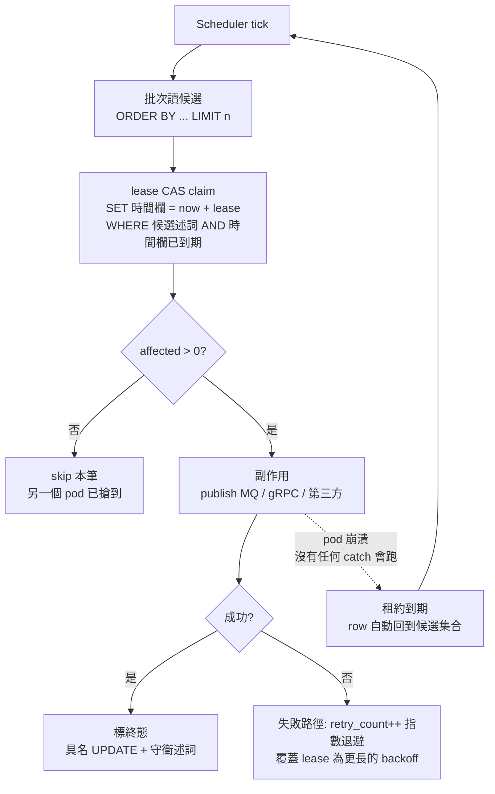

---

## 9. 環境配置

### 9.1 服務配置

| 配置項 | 環境變數 | 預設值 | 說明 |
|--------|---------|--------|------|
| `hawkr.order.payment-deadline-seconds` | `PAYMENT_DEADLINE_SECONDS` | 86400 | 付款期限（秒） |
| `hawkr.order.cancel-scan-interval-ms` | `CANCEL_SCAN_INTERVAL_MS` | 15000 | 超時掃描間隔 |
| `hawkr.order.auto-complete-hours` | `AUTO_COMPLETE_HOURS` | 60 | 送達後自動完成小時數（[§5.4](#54-確認收貨與撥款confirmreceipt--autocomplete)） |
| `hawkr.order.auto-complete-interval-ms` | `AUTO_COMPLETE_INTERVAL_MS` | 3600000 | 自動完成掃描間隔 |
| `hawkr.order.auto-complete-batch-size` | `AUTO_COMPLETE_BATCH_SIZE` | 100 | 自動完成批次大小 |
| `hawkr.order.outbox.publish-interval-ms` | `ORDER_OUTBOX_PUBLISH_INTERVAL_MS` | 5000 | order.paid Outbox 輪詢間隔（§8.10） |
| `hawkr.order.payout-hold-recheck-seconds` | `ORDER_PAYOUT_HOLD_RECHECK_SECONDS` | 600 | 撥款無時間界 hold（售後進行中／申訴審理中／反查失敗）的重問間隔（[§8.8.1](#881-撥款資格閘門payout-holdbackend3262)） |
| `hawkr.order.shipment-backstop.enabled` | `ORDER_SHIPMENT_BACKSTOP_ENABLED` | true | 建單兜底開關（§8.11） |
| `hawkr.order.shipment-backstop.interval-ms` | `ORDER_SHIPMENT_BACKSTOP_INTERVAL_MS` | 300000 | 建單兜底掃描間隔 |
| `hawkr.order.shipment-backstop.grace-minutes` | `ORDER_SHIPMENT_BACKSTOP_GRACE_MINUTES` | 30 | 付款後寬限期（首次重試前緩衝） |
| `hawkr.order.shipment-backstop.max-attempts` | `ORDER_SHIPMENT_BACKSTOP_MAX_ATTEMPTS` | 5 | 重試上限，超過取消退款 |
| `hawkr.order.shipment-backstop.backoff-minutes` | `ORDER_SHIPMENT_BACKSTOP_BACKOFF_MINUTES` | 30 | 重試間隔（容忍較長故障） |
| `hawkr.order.countdown-recovery-scan-cron` | `COUNTDOWN_RECOVERY_SCAN_CRON` | `0 0 3 * * ?` | 倒數對帳兜底 worker 排程（每日 03:00 UTC，[§5.8.7](#587-事件遺失兜底)） |
| `order.cleanup.cron` | — | `0 0 2 * * SUN` | TaskCleanupJob 排程 |
| `order.cleanup.task-retention-days` | — | 30 | 已完成任務保留天數 |

### 9.2 Port 分配

| HTTP | gRPC | Node ID Base |
|------|------|-------------|
| 9914 | 9915 | 300 |

### 9.3 開發注意事項（必須遵守）

- 賣家權限隔離：Seller 端所有查詢 WHERE 強制 store_id = ?
- 詳情組裝：orders + order_items 組裝 OrderDetailView；物流資訊即時聚合 Shipping Service（降級回空字串）；付款資訊從 Order DB 讀取（建單快照 + MQ 覆寫）
- gRPC 錯誤處理：catch-all 必須包含 `e.getMessage()`，禁止僅回傳泛用字串
- 防禦性轉換：Enum fromValue() 和 Long.parseLong() 前必須檢查空值
- 禁止在 @Transactional 內呼叫 gRPC
- 禁止 Order Service 保存真實庫存表
- 禁止 payment.success 只用 order_no 做冪等

---

## 附錄 A: Enum 定義

完整定義統一維護於 [代碼管理（CodeMeta）](../代碼管理%EF%BC%88CodeMeta%EF%BC%89/README.md)，以下僅列出本服務涉及的 Enum：

| Enum | 定義來源 |
|------|---------|
| OrderStatus | [業務狀態碼](../代碼管理%EF%BC%88CodeMeta%EF%BC%89/業務狀態碼.md) |
| OrderItemStatus | [業務狀態碼](../代碼管理%EF%BC%88CodeMeta%EF%BC%89/業務狀態碼.md) |
| PaymentMethod | [業務類型碼](../代碼管理%EF%BC%88CodeMeta%EF%BC%89/業務類型碼.md) |
| FinancialLogType | [業務類型碼](../代碼管理%EF%BC%88CodeMeta%EF%BC%89/業務類型碼.md) |
| ShippingMethod | [業務類型碼](../代碼管理%EF%BC%88CodeMeta%EF%BC%89/業務類型碼.md) |
| ShippingTemperature | [業務類型碼](../代碼管理%EF%BC%88CodeMeta%EF%BC%89/業務類型碼.md) |
| ShippingFeePayer | [業務類型碼](../代碼管理%EF%BC%88CodeMeta%EF%BC%89/業務類型碼.md) |
| ShippingArea | [業務類型碼](../代碼管理%EF%BC%88CodeMeta%EF%BC%89/業務類型碼.md) |
| ShippingRoute | [業務類型碼](../代碼管理%EF%BC%88CodeMeta%EF%BC%89/業務類型碼.md) |
| ShippingStatus | [業務狀態碼](../代碼管理%EF%BC%88CodeMeta%EF%BC%89/業務狀態碼.md) |
