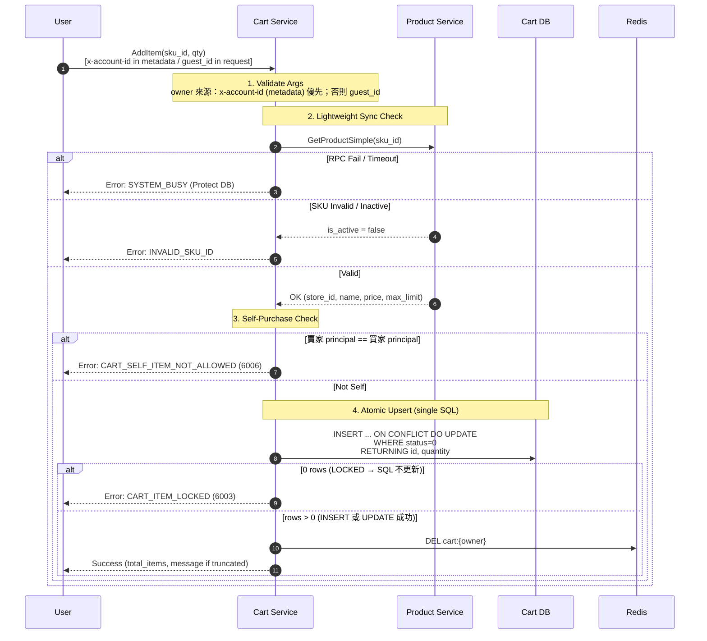
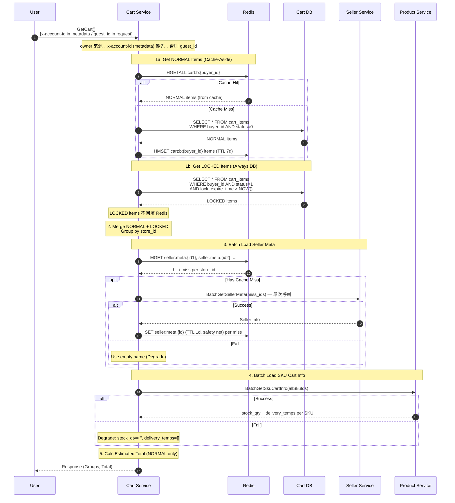
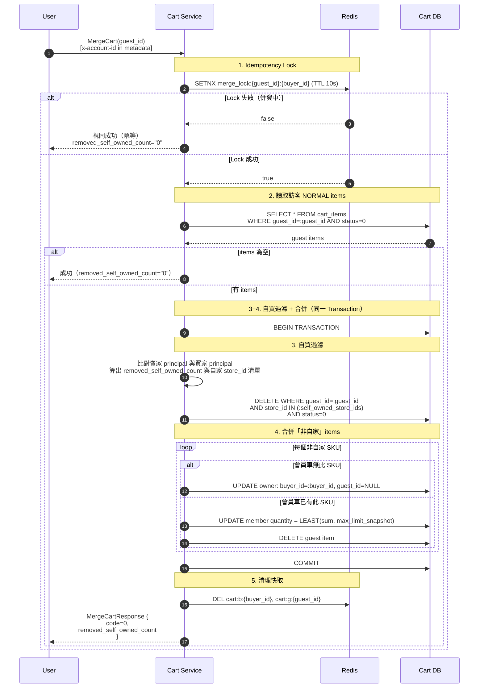
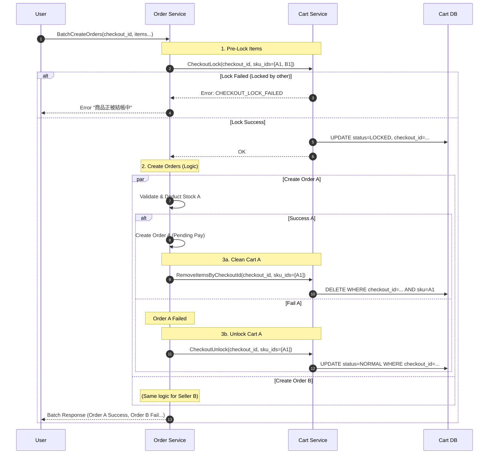

# 購物車微服務（Cart Service）詳細設計書

---

## 1. 服務概述與責任邊界

本文件定義購物車微服務（Cart Service）的架構與實作規範。購物車是 B2C 電商 App 中連接「商品瀏覽」與「交易結帳」的關鍵緩衝區，負責暫存用戶意向商品、提供價格估算，並協助訂單服務進行結帳前的鎖定與清理。

### 1.1 服務職責

- **商品暫存**：支援會員（User）與訪客（Guest）將商品加入購物車，並持久化保存。
- **多賣家支援**：商品必須依據 `store_id` 進行分組，支援多賣家合併結帳或拆單。
- **價格估算**：提供購物車內商品的「估算總價」（Estimated Total），僅供 UI 顯示，不作為最終結帳依據。
- **訪客合併**：支援用戶登入後，將訪客購物車內容依據特定規則（累加）合併至會員購物車。
- **結帳鎖定 (Soft Lock)**：提供結帳流程中的「軟鎖定」機制，防止用戶在結帳過程中修改商品導致數據不一致。
- **冪等清理**：配合訂單服務（Order Service），在結帳成功後精準移除已購商品。

### 1.2 上游 / 下游依賴

| 方向 | 服務 | 用途 | 呼叫時機 |
|:---:|:---|:---|:---|
| 上游（Cart 呼叫） | Product Service | SKU 驗證、快照取得（store_id, name, price, max_limit 等） | AddItem |
| 上游（Cart 呼叫） | Product Service | 批次查詢 SKU 即時庫存 / 配送溫層（stock_qty, delivery_temps） | GetCart |
| 上游（Cart 呼叫） | Seller Service | 賣家資訊（name, logo, city, district）Lazy Loading | GetCart |
| 下游（呼叫 Cart） | Order Service | CheckoutLock / CheckoutUnlock / RemoveItemsByCheckoutId | 結帳流程 |
| 下游（呼叫 Cart） | Gateway | AddItem / GetCart / SetItemQuantity / DeleteCartItem / MergeCart | 用戶操作 |

### 1.3 非職責範圍 (Out of Scope)

- **最終價格計算**：不負責計算複雜的優惠券、運費或活動折扣，最終金額由 Order Service 計算。
- **庫存預佔**：購物車僅做「加入時的可售檢查」，不進行庫存扣減或預佔（由 Order Service 負責）。
- **商品資訊維護**：不持有商品 Master Data，僅儲存必要的快照（Snapshot）或 ID 參考。
- **RabbitMQ**：本服務不使用 MQ。Cart 的一致性完全由同步 DB + Cache-Aside 保證，不發送任何 Cart domain event。

### 1.4 名詞定義

| 名詞 | 定義 |
|:---|:---|
| `guest_id` | 前端生成的 UUID 字串，代表未登入訪客身份。App 重新安裝後會改變。 |
| `checkout_id` | 前端生成的批次結帳 ID，用於結帳鎖定與冪等清理。 |
| LOCKED | 購物車項目狀態 `status=1`，表示該商品正在結帳鎖定中，禁止編輯或刪除。 |
| NORMAL | 購物車項目狀態 `status=0`，表示正常狀態，可編輯、可刪除。 |
| Cache-Aside | 讀取時優先查 Redis，Cache Miss 則回查 DB 並回填 Redis；寫入時先寫 DB 再失效 Cache。 |
| Lazy Loading | GetCart 時才按需查詢外部服務（如 Seller meta），非預先載入。 |
| Soft Lock | 以 DB 狀態欄位（而非分散式鎖）實現的結帳鎖定機制，搭配 TTL 自癒。 |

### 1.5 角色與權限邊界

- `account_id` 不作為任何 gRPC request message 的參數傳入。
- `account_id` 一律由 API Gateway 統一注入至 request header / gRPC metadata（`x-account-id`）。
- Cart Service 必須透過 gRPC Server Interceptor 從 metadata 取得 `account_id`，並作為會員購物車的 owner。
- `guest_id` 保留為 request message 欄位（前端生成 UUID），用於訪客購物車的 owner。
- 若 metadata 中存在 `account_id`：
  - 該次請求視為會員流程（member flow），owner = `account_id`
  - 即使 request message 內有 `guest_id`，也只作為 MergeCart 使用（若該 API 需要）
- 若 metadata 中不存在 `account_id`：
  - 該次請求視為訪客流程（guest flow），owner = `guest_id`
  - 若 `guest_id` 亦缺失：回 `UNAUTHENTICATED`（無任何可被信任的身份）
- **`INVALID_ARGUMENT` 保留給**：`guest_id` 格式不合法（非 UUID）、`sku_id` 空字串、`quantity < 0` 等純參數格式問題。

**內部服務呼叫規範（強制）**：

- 所有內部服務呼叫 Cart Service（含 Order Service）**必須**注入 `x-account-id` metadata，Cart Service 統一透過 Server Interceptor 取得 owner。
- 若缺 `x-account-id` 且 request message 無 `guest_id`：Cart 直接回 `UNAUTHENTICATED`（與上述規則一致）。
- CheckoutLock / CheckoutUnlock / RemoveItemsByCheckoutId 三個 API 的 owner 來源：`account_id` from metadata（`x-account-id`），request message 不帶 `account_id`。

---

## 2. 狀態模型與業務規則

### 2.1 購物車項目狀態（CartItemStatus）

**定義位置**：`services/java/shared/common-core/.../utils/code/CartItemStatus.java`（CodeMeta Enum，由 `generate.sh` 生成）

| 狀態碼 (Value) | Enum Name | 說明 |
|:---:|:---:|:---|
| 0 | `NORMAL` | 正常狀態，可編輯、可刪除 |
| 1 | `LOCKED` | 結帳鎖定中，禁止編輯數量或刪除（需等待解鎖或訂單完成後被清理） |

> DB 欄位 `cart_items.status` 為 `VARCHAR(4)`，存 Value 字串（`'0'` / `'1'`），並以 `CHECK (status IN ('0','1'))` 約束。

### 2.2 數量限制規則（max_limit）

- **`max_limit` 定義**：單一 SKU 在購物車允許的最大數量（上限）。
- **來源策略**：
  - 由 Product Service 提供：AddItem 時從 `GetProductSimpleResponse.max_limit` 取得，寫入 `cart_items.max_limit_snapshot`。
  - MergeCart / SetItemQuantity **不再呼叫 Product Service**，一律使用 DB 中的 `max_limit_snapshot` 做截斷。
- **行為規則**：
  - **AddItem**：若 `old_qty + add_qty > max_limit`，**拒絕並回 `CART_QUANTITY_EXCEEDS_MAX_LIMIT`（6010）**，message=「您已達該商品購買上限（上限 N 件）」（N=max_limit）；DB 不寫入、`max_limit_snapshot` 不更新。對齊 [API 設計規範](../開發規範/API%20設計規範.md) envelope spec（code≠0 + 透傳 Message），buyer 端走 error 分支顯示明確提示。
  - **SetItemQuantity**：若 `quantity > max_limit_snapshot`（且 `quantity > 0`），**拒絕並回 `CART_QUANTITY_EXCEEDS_MAX_LIMIT`（6010）**；quantity=0 為刪除路徑不受此限。
  - **MergeCart**：使用 `max_limit_snapshot` 做截斷（**保留 silent cap**）— 訪客→會員一次性 migration，buyer 無法即時介入，截斷比拒絕整批 merge 更接近預期 UX；不發 warning message。
- **Envelope 設計取向**：AddItem / SetItemQuantity 採「拒絕 + 錯誤碼 6010」而非「silent cap + warning message + code=0」。前者對齊 [API 設計規範](../開發規範/API%20設計規範.md) envelope spec（成功必 `message="success"`、失敗 `code≠0`），client 走 error 分支顯示明確提示；後者會讓 client 透 code 判斷成功 → 不會走 error 分支 → silent partial-success UX bad。MergeCart 是一次性 migration，不適用此 envelope cleanup。
- `max_limit` 異動不回溯修改 DB 既有 `cart_items`；僅在下一次 Add/Merge/Set/Checkout 時由下游流程（尤其 Order Service）再次驗證與決策。
- **最終驗證責任（強制）**：Order Service 在 CheckoutLock 後、建立訂單前，必須以「當下 Product Service 的 `max_limit`」再驗證 quantity；若超限，走 Order 的調整/拒絕策略。Cart 的 `max_limit_snapshot` 僅保證 UI 層級合理性，不保證快照為最新值。

### 2.3 併發控制策略

#### 2.3.1 PostgreSQL Isolation Level

- 以 PostgreSQL 常用預設 `READ COMMITTED` 為基準。
- 本文件所述所有交易行為，要求在 `READ COMMITTED` 下仍可正確運作。

#### 2.3.2 AddItem 併發正確性要求

- **風險**：兩個 AddItem 併發對同一 `(owner, sku_id)` 進行「先查後改」可能造成 Lost Update。
- **要求**：AddItem 的 DB Upsert 必須採用下列策略：
  - 使用 `INSERT … ON CONFLICT … DO UPDATE` 的原子 upsert，在單一 SQL 內完成累加與截斷。
  - 必須同時滿足：
    - 若 `status=LOCKED`，必須拒絕加量（回 `CART_ITEM_LOCKED`）。
    - 限購截斷（`max_limit`）在交易內完成，避免併發超量。

#### 2.3.3 MergeCart 併發正確性要求

- MergeCart 需要同時處理「guest items → member items」的搬移與合併，必須避免重複累加。
- Redis `SETNX merge_lock:{guest_id}:{buyer_id}` 僅作互斥輔助，最終仍需 DB 交易保護（upsert 或 row lock）守住正確性。
- 合併成功後需清除會員與訪客購物車快取，避免讀到舊資料。

#### 2.3.4 CheckoutLock 原子性要求

- CheckoutLock 的「檢查是否已鎖」與「寫入 LOCKED」必須在同一 Transaction 完成，避免 TOCTOU。
- **落地策略**：以條件更新（conditional update）達成原子鎖定；更新筆數不足視為 lock failed（回 `CHECKOUT_LOCK_FAILED`）。
- 同一 `checkout_id` 的重試必須冪等：不得因重試而破壞鎖定狀態。
- CheckoutLock 的成功/失敗判斷以「條件 UPDATE 受影響筆數」為準，不得以「先 SELECT 再 UPDATE」作為判斷邏輯。

---

## 3. 資料庫設計

### 3.1 cart_items

此表為核心表，儲存會員與訪客的購物車內容。

> **設計決策**：不建立 `carts` 主表，直接以 `buyer_id` 或 `guest_id` 聚合 `cart_items`，減少 Join 與維護成本。

| 欄位名稱 | 資料型態 | 必填 | 說明 |
|:---|:---|:---:|:---|
| `id` | BIGINT | PK | TSID |
| `buyer_id` | BIGINT | NO | 買家身份鍵（與 `guest_id` 擇一必填；由 gateway 注入 metadata 取得） |
| `guest_id` | VARCHAR(64) | NO | 訪客 UUID（與 `buyer_id` 擇一必填；前端生成） |
| `store_id` | BIGINT | YES | 賣家分組 key（store 代理鍵，由 Product Service 取得；非登入 account_id） |
| `sku_id` | BIGINT | YES | 商品 SKU ID |
| `quantity` | INT | YES | 數量 |
| `added_unit_price` | BIGINT | YES | 加入時「**實際成交單價**」快照（無特價=list_price；有特價=當時 sale_price）。|
| `added_list_price` | BIGINT | YES | 加入時「**原價**」快照（永遠 = SKU.price，不參考特價）。給前端 strike-through 顯示用；判定「該品項加入時是否參與特價」 = `added_unit_price < added_list_price` |
| `max_limit_snapshot` | INT | YES | 加入時限購上限快照（MergeCart/SetItemQuantity 截斷用） |
| `sku_name_snapshot` | VARCHAR(255) | YES | 加入時商品名稱快照（GetCart 展示用） |
| `product_id` | BIGINT | YES | 商品 ID（AddItem 時從 ProductSimpleInfo 取得） |
| `spec_name_snapshot` | VARCHAR(255) | YES | SKU 規格名稱快照（product_sku.sku_name，如「大顆裝 1kg」） |
| `image_object_key` | VARCHAR(512) | YES | 商品主圖 objectKey 快照（GetCart 以 `CartItemView.image_key` 原樣回傳，完整 URL 由 Gateway `mediaurl.BuildURL` 組裝） |
| `status` | VARCHAR(4) | YES | Default: `'0'`（`NORMAL`），`'1'` = `LOCKED`；`CHECK (status IN ('0','1'))` |
| `checkout_id` | VARCHAR(64) | NO | 結帳批次 ID（鎖定時寫入，用於冪等清理） |
| `lock_expire_time` | TIMESTAMPTZ | NO | 鎖定過期時間（TTL） |
| `created_at` | TIMESTAMPTZ | YES | Default: `NOW()` |
| `updated_at` | TIMESTAMPTZ | YES | Default: `NOW()` |

#### 3.1.1 重要約束與一致性規則

- **約束**：`(buyer_id IS NOT NULL) XOR (guest_id IS NOT NULL)`
  - 會員 item：`buyer_id` 必填、`guest_id` 必為 NULL
  - 訪客 item：`guest_id` 必填、`buyer_id` 必為 NULL
- **`updated_at` 更新策略**：每次 `quantity`/`status`/`checkout_id`/`lock_expire_time` 異動時更新 `updated_at`，供清理與觀測使用。

#### 3.1.2 訪客購物車資料生命週期

- Redis 有 TTL（見 §3.2），但 DB 不會自動清除。
- DB 需提供容量治理用的定期清理（見 §8.2 `GuestCartCleanupJob`）：
  - `guest_id IS NOT NULL AND updated_at < NOW() - 30 days`

**DDL**：

```sql
CREATE TABLE IF NOT EXISTS cart_items (
  id                 BIGINT PRIMARY KEY,
  buyer_id           BIGINT,
  guest_id           VARCHAR(64),
  store_id           BIGINT NOT NULL,
  sku_id             BIGINT NOT NULL,
  quantity           INT NOT NULL,
  added_unit_price   BIGINT NOT NULL,          -- 實際成交單價快照
  added_list_price   BIGINT NOT NULL,          -- 新增（原價快照，給 strike-through 顯示）
  max_limit_snapshot INT NOT NULL,
  sku_name_snapshot  VARCHAR(255) NOT NULL,
  product_id         BIGINT NOT NULL DEFAULT 0,
  spec_name_snapshot VARCHAR(255) NOT NULL DEFAULT '',
  image_object_key   VARCHAR(512) NOT NULL DEFAULT '',
  status             VARCHAR(4) NOT NULL DEFAULT '0',   -- 0=NORMAL, 1=LOCKED
  checkout_id        VARCHAR(64),
  lock_expire_time   TIMESTAMPTZ,
  created_at         TIMESTAMPTZ NOT NULL DEFAULT NOW(),
  updated_at         TIMESTAMPTZ NOT NULL DEFAULT NOW(),

  -- 數量必須為正整數
  CONSTRAINT chk_quantity_positive CHECK (quantity > 0),

  -- 狀態只允許 '0'（NORMAL）或 '1'（LOCKED）
  CONSTRAINT chk_status_valid CHECK (status IN ('0', '1')),

  -- XOR 約束：buyer_id 與 guest_id 必須且只能擇一
  CONSTRAINT chk_owner_xor CHECK (
      (buyer_id IS NOT NULL AND guest_id IS NULL) OR
      (buyer_id IS NULL AND guest_id IS NOT NULL)
  )
);

-- 觸發器：自動更新 updated_at
CREATE OR REPLACE FUNCTION update_updated_at_column()
RETURNS TRIGGER AS $$
BEGIN
  NEW.updated_at = NOW();
  RETURN NEW;
END;
$$ LANGUAGE plpgsql;

DROP TRIGGER IF EXISTS update_cart_items_updated_at ON cart_items;

CREATE TRIGGER update_cart_items_updated_at
BEFORE UPDATE ON cart_items
FOR EACH ROW
EXECUTE FUNCTION update_updated_at_column();
```

### 3.2 Redis Key 設計

| Key Pattern | Type | TTL | 說明 |
|:---|:---:|:---:|:---|
| `cart:b:{buyer_id}` | Hash | 7 Days | 會員購物車快取。Field: `sku_id`, Value: JSON |
| `cart:g:{guest_id}` | Hash | 7 Days | 訪客購物車快取。Field: `sku_id`, Value: JSON |
| `seller:meta:{store_id}` | String | 1 Day | 賣家資訊快取（name / logoUrl / city / district / storeCode，見 §3.2.2），由 GetCart Lazy Loading 寫入。一致性以 **event-driven evict** 為主（收 `seller.profile.changed` 主動 evict，見 §3.2 說明），TTL 為 safety net |
| `merge_lock:{guest_id}:{buyer_id}` | String | 10s | MergeCart 互斥鎖（SETNX） |

#### 3.2.1 Redis 與 DB 狀態映射規則

- `cart:b:{buyer_id}` / `cart:g:{guest_id}` 的 item value 僅快取 `status=NORMAL` 的項目。
- LOCKED item 必須以 DB 為準回傳；若快取殘留舊資料，DB 結果必須覆蓋快取結果。
- 所有會改變 `cart_items` 的 API（AddItem/MergeCart/SetItemQuantity/CheckoutLock/CheckoutUnlock/RemoveItemsByCheckoutId）都必須失效對應 cart key（`DEL`），確保一致性。
- GetCart 即使 Redis hit，也必須額外查 DB 的 LOCKED items（`lock_expire_time > NOW`），並合併回應；LOCKED items 不回填 Redis。

#### 3.2.2 Redis Value Schema

**`cart:b:{buyer_id}` / `cart:g:{guest_id}`**

- **Type**：Hash
- **Field**：`sku_id`（string）
- **Value**：JSON（UTF-8）
- 只快取 NORMAL items
- name/price 來源固定為 DB snapshot：`sku_name_snapshot` + `added_unit_price` / `added_list_price`

建議 JSON schema：

```json
{
  "v": 2,
  "sku_id": "12345",
  "store_id": 998,
  "quantity": 2,
  "added_unit_price": "1200",
  "added_list_price": "1500",
  "name": "商品名稱快照",
  "status": "NORMAL",
  "added_time": "2026-02-11T10:00:00Z",
  "updated_time": "2026-02-11T10:05:00Z"
}
```

> 🔴 **讀到 `v` ≠ 2 的條目一律忽略**（視為 Cache Miss 回源）：schema 不相容的舊條目不得被解讀，否則會拿到錯的價格欄位。

**`seller:meta:{store_id}`**

- **Type**：String
- **Value**：JSON

```json
{
  "name": "賣家名稱",
  "logoUrl": "sellers/998/logo.jpg",
  "city": "桃園市",
  "district": "桃園區",
  "storeCode": "10023"
}
```

- Key 名即 `CartCacheService.SellerMetaCacheEntry` record 的 component 名（`name` / `logoUrl` / `city` / `district` / `storeCode`，Jackson 預設 camelCase 序列化），無版本欄位。
- `logoUrl` 欄名沿用舊名，**值為 objectKey**（來源 `SellerMeta.logo_key`，49 號設計書 §6.6：Gateway 端組 URL）。
- `storeCode` 為完整性判準：`sellers.store_code` 為 NOT NULL，故空值只代表這份快取殘缺（舊 schema / 寫入時上游降級）。讀取端 `hasStoreCode()` 為 false 即視為 Cache Miss 回源自癒，寫入端亦拒絕寫入殘缺條目。

- **TTL**：1 天，作為 **safety net**。一致性主要靠 **event-driven evict**：seller-service 改店名 / logo 成功後 emit `seller.profile.changed`，cart-service consumer 收到即主動 evict `seller:meta:{storeId}`（見下方 **seller.profile.changed consumer**）。TTL 僅兜住 event 遺失 / consumer 停機的殘留（miss 時本就經 gRPC lazy 回填）。🔴 **不得**改成「每次 GetCart 即時打 seller-service」——那會把 seller-service 變成 cart 熱路徑的同步依賴。

**seller.profile.changed consumer**

- **來源事件**：seller-service（Go）於 `UpdateProfile` / `UpdateLogo` / `UpdateCover` 成功後 best-effort emit `seller.profile.changed`（exchange `hawkr.seller`，payload `{ event_id, event_type=SELLER_PROFILE_CHANGED, store_id(string), occurred_at }`，見 [36 §3.6f](36-MQ%20與事件總覽（MQ%20%26%20Event%20Catalog）.md)）。
- **消費行為**：`SellerProfileChangedConsumer` → `CartCacheService.evictSellerMeta(storeId)`（`DEL seller:meta:{id}`）。evict（delete key）**天然冪等**，重放同 key 0 副作用 → **不需 dedup 表**。
- **基礎設施**：cart 新增 `spring-boot-starter-amqp` 依賴（common-core 的 amqp 為 `provided` scope 非傳遞）；`RabbitMqConfig` 宣告 `hawkr.seller` exchange + queue `cart.seller.profile.changed` + binding + cart 自有 DLX `hawkr.cart.dlx` + DLQ `cart.seller.profile.changed.dlq`；listener 用 common-core `manualAckContainerFactory`。
  - ⚠️ **broker 上的資源不由本服務建立**：exchange / queue / binding 的唯一 owner 是 `infra/mq/topology/topology.yaml`（Terraform，經 CI apply），dev/prod 服務端一律 **passive declare**（`SPRING_RABBITMQ_DYNAMIC=false`）。上面那些 `@Bean` 只是意圖宣告，**不會**在全新 RabbitMQ 上自建資源；queue 不存在時該訂閱會**靜默失效**（不 crash、不進 DLQ）。新增或修改 consumer 必須在同一個 PR 補上 topology 條目（Java 側無 CI gate，只能靠 review），見 [MQ Topology 管理（Terraform）](../基礎建設/MQ%20Topology%20管理（Terraform）.md)。
- **異常**：payload 缺欄 / eventType 不符 / 格式錯 → ACK 不重試；未預期例外 → NACK 進 DLQ 不 infinite requeue。Redis 短暫不可用時 evict 內部吞例外仍 ACK（TTL 兜底）。

### 3.3 索引設計總覽

| 索引名稱 | 類型 | 欄位 | 條件 | 用途 |
|:---|:---:|:---|:---|:---|
| `uk_cart_buyer_sku` | UNIQUE | `(buyer_id, sku_id)` | `WHERE buyer_id IS NOT NULL` | 避免會員重複加入同商品 |
| `uk_cart_guest_sku` | UNIQUE | `(guest_id, sku_id)` | `WHERE guest_id IS NOT NULL` | 避免訪客重複加入同商品 |
| `idx_cart_checkout_id` | INDEX | `(checkout_id)` | `WHERE checkout_id IS NOT NULL` | 結帳成功後快速清理 |
| `idx_cart_lock_expire` | INDEX | `(lock_expire_time)` | `WHERE status = '1' AND lock_expire_time IS NOT NULL` | 背景 Job 掃描過期鎖定 |
| `idx_cart_guest_updated` | INDEX | `(updated_at)` | `WHERE guest_id IS NOT NULL` | 訪客購物車清理 Job（§8.2.2） |
| `idx_cart_buyer_store` | INDEX | `(buyer_id, store_id)` | `WHERE buyer_id IS NOT NULL` | 賣家分組查詢 |

```sql
-- 唯一索引：會員 + SKU
CREATE UNIQUE INDEX IF NOT EXISTS uk_cart_buyer_sku
  ON cart_items (buyer_id, sku_id) WHERE buyer_id IS NOT NULL;

-- 唯一索引：訪客 + SKU
CREATE UNIQUE INDEX IF NOT EXISTS uk_cart_guest_sku
  ON cart_items (guest_id, sku_id) WHERE guest_id IS NOT NULL;

-- 索引：結帳 ID（快速清理）
CREATE INDEX IF NOT EXISTS idx_cart_checkout_id
  ON cart_items (checkout_id) WHERE checkout_id IS NOT NULL;

-- 索引：鎖定過期時間（背景 Job 掃描）
CREATE INDEX IF NOT EXISTS idx_cart_lock_expire
  ON cart_items (lock_expire_time) WHERE status = '1' AND lock_expire_time IS NOT NULL;

-- 索引：訪客清理 Job
CREATE INDEX IF NOT EXISTS idx_cart_guest_updated
  ON cart_items (updated_at) WHERE guest_id IS NOT NULL;

-- 索引：賣家分組查詢
CREATE INDEX IF NOT EXISTS idx_cart_buyer_store
  ON cart_items (buyer_id, store_id) WHERE buyer_id IS NOT NULL;
```

> 索引名稱以 `services/java/cart-service/src/main/resources/db/migration/` 的 Flyway migration 為準。

---

## 4. 對外 / 對內介面定義

### 4.1 Gateway 對外 REST 映射

| Method | Path | Handler | Description |
|:---:|:---|:---|:---|
| POST | /api/v1/public/carts/items | AddToCart | 加入購物車 |
| GET | /api/v1/public/carts | GetCartList | 查詢購物車 |
| PUT | /api/v1/public/carts/items/:sku_id/quantity | SetItemQuantity | 設定數量 |
| DELETE | /api/v1/public/carts/items/:sku_id | DeleteCartItem | 刪除商品（= SetItemQuantity quantity=0） |
| POST | /api/v1/app/carts/merge | MergeCart | 合併訪客車 |

`/public/carts/*` 採 OptionalJWTAuth:有 Bearer 視為 member、無 Bearer
帶 `guest_id` 視為訪客。Buyer-app 透過 dio interceptor 自動注入 Bearer;
Web 端因 cookie 是 HTTP-only,瀏覽器 JS 無法讀 token,改透過 BFF
(`/api/bff/[...path]`) 由 server-side 從 cookie 讀 token 注入 Bearer
後 proxy 給 backend。兩端最終打到的 backend URL 一致。

### 4.2 gRPC Proto（CartService）

#### 通用規範

- `account_id` 一律從 gRPC metadata 取得，不出現在 request message。
- 若 metadata 無 `account_id`，該次請求視為 guest flow，必須提供 `guest_id`。
- 若 metadata 有 `account_id`，該次請求視為 member flow：
  - owner = `account_id`
  - 除 MergeCart 外，其它 API request 內的 `guest_id` 若存在，忽略不作 owner 判斷。

```protobuf
service CartService {
  rpc AddItem(AddItemRequest) returns (AddItemResponse);
  rpc GetCart(GetCartRequest) returns (GetCartResponse);
  rpc MergeCart(MergeCartRequest) returns (MergeCartResponse);
  rpc CheckoutLock(CheckoutLockRequest) returns (CheckoutLockResponse);
  rpc CheckoutUnlock(CheckoutUnlockRequest) returns (CheckoutUnlockResponse);
  rpc RemoveItemsByCheckoutId(RemoveItemsByCheckoutIdRequest) returns (RemoveItemsByCheckoutIdResponse);
  rpc SetItemQuantity(SetItemQuantityRequest) returns (SetItemQuantityResponse);
}

message AddItemRequest {
  string guest_id = 1;    // guest flow 必填；member flow 可不填
  string sku_id = 2;
  string quantity = 3;    // 數量（數字字串，E.5.5）
}

message AddItemResponse {
  int32 code = 1;
  string message = 2;        // 若觸發限購截斷，提示「已達購買上限（上限 {max_limit} 件）」
  string total_items = 3;    // 品項數：distinct SKU count（含 NORMAL+LOCKED，數字字串）
}

message GetCartRequest {
  string guest_id = 1;    // guest flow 必填；member flow 可不填
}

message GetCartResponse {
  int32 code = 1;
  repeated CartSellerGroup groups = 2;
  string estimated_total_amount = 3;  // 估算總價（只計 NORMAL，數字字串）
  string total_items = 4;             // 品項數（含 NORMAL+LOCKED，數字字串）
}

message CartSellerGroup {
  string store_id = 1; // 賣家 store 代理鍵（數字字串）
  string seller_name = 2;       // 賣家名稱（Lazy Loaded，可降級為空）
  repeated CartItemView items = 3;
  string logo_key = 4;          // 賣家 Logo objectKey（enrich 自 SellerMeta.logo_key；49 號設計書 §6.6：Gateway 組 logoUrl。Lazy Loaded，可降級為空）
  string seller_city = 5;       // 賣家縣市（如「桃園市」，Lazy Loaded，可降級為空）
  string seller_district = 6;   // 賣家區域（如「桃園區」，Lazy Loaded，可降級為空）
  string store_code = 7;        // 賣家短碼（enrich 自 SellerMeta，Lazy Loaded，可降級為空）
}

message CartItemView {
  string sku_id = 1;          // SKU ID（數字字串）
  string quantity = 2;        // 數量（數字字串）
  string name = 3;            // DB snapshot: sku_name_snapshot（商品名稱）
  string price = 4;           // DB snapshot `added_unit_price`（實際成交單價，數字字串）
  string status = 5;          // "NORMAL" 或 "LOCKED"
  string product_id = 6;      // 商品 ID（數字字串，DB snapshot）
  string spec_name = 7;       // SKU 規格名稱快照（product_sku.sku_name）
  string image_key = 8;       // 商品主圖 objectKey（DB 存 objectKey；49 號設計書 §6.6：Gateway 組 imageUrl）
  string stock_qty = 9;       // 即時庫存數量（數字字串，來自 Product Service 即時查詢）
  repeated string delivery_temps = 10; // SKU 支援的配送溫層 Enum values（來自 Product Service 即時查詢）
  string list_price = 11;     // DB snapshot `added_list_price`（原價，數字字串）。前端可比對 price < list_price 顯示 strike-through
  bool purchasable = 12;      // 本筆 row 是否可購買（前端據此決定反灰 / disable checkbox）。`true` 時 `unavailable_reason` 為空字串
  string unavailable_reason = 13; // 不可購買原因（`CartItemUnavailableReason` value，見 [代碼管理（CodeMeta）/業務類型碼.md#cartitemunavailablereason](../代碼管理（CodeMeta）/業務類型碼.md#cartitemunavailablereason)）。`purchasable=true` 時為空字串
}

message MergeCartRequest {
  string guest_id = 1;    // 要被合併的訪客購物車
}

message MergeCartResponse {
  int32 code = 1;
  string removed_self_owned_count = 2;  // 合併過程中靜默移除的自家商品品項數（distinct SKU count，數字字串）；前端可選擇顯示 toast「已自動移除你上架的 N 項商品」
}

message CheckoutLockRequest {
  string checkout_id = 1;       // 前端生成的批次結帳 ID
  repeated string sku_ids = 2;  // 要結帳的商品
}

message CheckoutLockResponse {
  int32 code = 1;
}

message CheckoutUnlockRequest {
  string checkout_id = 1;
  repeated string sku_ids = 2;  // 可選，若空則解鎖該 checkout_id 下所有 items
}

message CheckoutUnlockResponse {
  int32 code = 1;
}

message RemoveItemsByCheckoutIdRequest {
  string checkout_id = 1;
  repeated string sku_ids = 2;  // 可選：支援分批清理
}

message RemoveItemsByCheckoutIdResponse {
  int32 code = 1;
}

message SetItemQuantityRequest {
  string guest_id = 1;    // guest flow 必填；member flow 可不填
  string sku_id = 2;      // SKU ID（數字字串）
  string quantity = 3;    // 數量（數字字串，"0" = 刪除，E.5.5）
}

message SetItemQuantityResponse {
  int32 code = 1;
  string message = 2;        // 若觸發截斷，提示「已達購買上限（上限 {max_limit_snapshot} 件）」
  string total_items = 3;    // 品項數（數字字串）
}
```

### 4.3 依賴的外部 gRPC

#### 4.3.1 Product Service

**AddItem 時**：用於 SKU 驗證與快照取得（`store_id`、`name`、`price`、`list_price`、`max_limit`、`product_id`、`sku_name`、`image_object_key`）。

```protobuf
rpc GetProductSimple(GetProductSimpleRequest) returns (GetProductSimpleResponse);

message GetProductSimpleRequest {
  string sku_id = 1;
}

message GetProductSimpleResponse {
  int32 code = 1;
  ProductSimpleInfo data = 2;  // Wrapper Response 模式（全專案統一）
}

message ProductSimpleInfo {
  string sku_id = 1;
  string store_id = 2;    // 必要，賣家 store 代理鍵，用於 Cart 分組
  bool is_active = 3;              // 是否上架可售
  string name = 4;                 // 必要：寫入 sku_name_snapshot
  string price = 5;                // 必要：**實際成交單價**（有特價=sale_price，否則=list price），寫入 added_unit_price
  string max_limit = 6;            // 必要：限購上限（數字字串，E.5.5）
  string product_id = 7;           // 商品 ID（product.id，數字字串）
  string sku_name = 8;             // SKU 規格名稱（product_sku.sku_name）
  string image_object_key = 9;     // 商品主圖 objectKey（product.gallery[0].objectKey）
  repeated string delivery_temps = 10;
  string list_price = 11;          // 必要：**原價**快照（永遠 = SKU.price），寫入 added_list_price
}
```

> 雙寫快照：AddItem 必須同時把 `price` → `added_unit_price` 與 `list_price` → `added_list_price` 寫入 DB。Cart 內部不再回查 Product 計算「是否參與特價」，由 `added_unit_price < added_list_price` 推導即可。

**GetCart 時**：用於批次查詢 SKU 即時庫存與配送溫層。

```protobuf
rpc BatchGetSkuCartInfo(BatchGetSkuCartInfoRequest) returns (BatchGetSkuCartInfoResponse);

message BatchGetSkuCartInfoRequest {
  repeated string sku_ids = 1;
}

message BatchGetSkuCartInfoResponse {
  int32 code = 1;
  map<string, SkuCartInfo> data = 2; // key = sku_id
}

message SkuCartInfo {
  string stock_qty = 1;              // 即時庫存數量（數字字串）
  repeated string delivery_temps = 2; // SKU 支援的配送溫層 Enum values
  string price = 3;                  // 即時實際成交單價（有特價=sale_price，否則=list price）
  bool is_active = 4;                // 即時上架狀態
  string list_price = 5;             // 即時原價（始終 = SKU.price）
}
```

> GetCart 不會把 `SkuCartInfo.price/list_price` 寫回 DB（避免覆寫加入時快照）。回應一律以 DB 既有 `added_unit_price` / `added_list_price` 為主；`SkuCartInfo` 提供的即時價格僅供前端比對（例如提示「商品已調整為特價／新原價」），後端不因此改寫快照。

**固定規範**：

- Product Service 在 AddItem 用於 SKU 驗證與快照取得。
- Product Service 在 GetCart 用於批次查詢即時庫存與配送溫層（非快照，每次即時查詢）。
- GetCart 不呼叫 Product Service 取得 name/price/image；以 DB snapshot 回傳。
- `image_object_key` 為媒體 objectKey（如 `public/product/123/xxx.jpg`），GetCart 原樣填進 `CartItemView.image_key`；完整 URL 由 Gateway 以 `mediaurl.BuildURL` 組裝（49 號設計書 §6.6，cart-service 不組 URL）。

#### 4.3.2 Seller Service

用於 GetCart 時補齊賣家資訊。

```protobuf
rpc BatchGetSellerMeta(BatchGetSellerMetaRequest) returns (BatchGetSellerMetaResponse);
// 輸入 store_ids，回傳 Map<store_id, SellerMeta>
```

### 4.4 錯誤碼定義

Cart 業務碼（6001~6099）完整定義詳見 [錯誤碼](../代碼管理%EF%BC%88CodeMeta%EF%BC%89/錯誤碼.md#cart-業務碼60016099)。

#### 錯誤回傳一致性規範（Status vs Response.code）

- **業務例外（CartBusinessException）**：使用 `onNext(Response.code=6xxx)` + `onCompleted()`，符合 Product/Order Service 既有模式。錯誤碼統一定義於 `GrpcResponseCode`。
- **成功但有提示**（例如觸發限購截斷）：gRPC OK，`Response.code=0`（`GrpcResponseCode.SUCCESS`），`message` 帶提示。
- **參數驗證失敗**（gRPC 層）：拋出 `Status.INVALID_ARGUMENT.asRuntimeException()`，由 gRPC 攔截器轉為 `onError`。
- **系統異常**（依賴服務超時、DB 故障）：`onError(Status.INTERNAL)` 或 `onError(Status.UNAVAILABLE)`；AddItem 不落 DB；GetCart 可降級（seller meta 取不到不影響成功回傳）。

### 4.5 冪等鍵與重試語意

| API | 冪等機制 | 說明 |
|:---|:---|:---|
| AddItem | Upsert（ON CONFLICT） | 同一 `(owner, sku_id)` 不會重複建立，而是累加數量 |
| CheckoutLock | 同一 `checkout_id` 重試冪等 | `status=LOCKED AND checkout_id=:checkout_id` 時視為已成功 |
| CheckoutUnlock | 更新 0 筆視為成功 | 已解鎖或不存在均不報錯 |
| RemoveItemsByCheckoutId | 刪除 0 筆視為成功 | 已清理或不存在均不報錯 |
| MergeCart | Redis `SETNX merge_lock:{guest_id}:{buyer_id}` | 防止併發重複合併，DB 交易保護最終正確性 |

---

## 5. 業務流程詳細設計

### 5.1 加入購物車 (AddItem)

**邏輯**：

1. **參數驗證**：檢查 owner（member：metadata `account_id`；guest：`guest_id`）、`sku_id`、`qty > 0`。
2. **SKU 驗證 (同步)**：呼叫 `ProductService.GetProductSimple`。
   - 若 RPC 失敗/超時：回傳 `SYSTEM_ERROR` 或 `BUSY`，不寫入 DB（避免髒資料）。
   - 若 `is_active == false`：回傳 `INVALID_SKU_ID`。
3. **自買防護（會員）**：若 `buyerId != null` 且賣家 store principal（`resolveSellerPrincipals`）等於買家 principal（`resolveBuyerPrincipal`）：回傳 `CART_SELF_ITEM_NOT_ALLOWED`（6006）「不可將自己上架的商品加入購物車」。
   - **訪客（guest_id）模式不檢查**：訪客身分未知，無從比對；待登入觸發 `MergeCart` 時再以 §5.3 的過濾邏輯統一處理。
4. **DB Upsert（原子 upsert，WHERE status=0）**：
   - 若 item 不存在：INSERT new record，寫入 `store_id`、`sku_name_snapshot`、`added_unit_price`、`added_list_price`、`max_limit_snapshot`、`product_id`、`spec_name_snapshot`、`image_object_key`。
   - 若 item 已存在且 `status == NORMAL`：`new_qty = old_qty + add_qty`，並依 `max_limit_snapshot` 截斷。
   - 若 item 已存在且 `status == LOCKED`：SQL 不更新（`WHERE status=0` 不滿足），rows=0 → 回傳 `CART_ITEM_LOCKED` (6003)。
5. **Cache 更新**：刪除對應 cart key（`DEL`）。

**`AddItemResponse.total_items` 語意**：

- `total_items` 定義為：該 owner 的購物車「品項數」（distinct SKU count）。
- **計算口徑**：
  - member flow：`COUNT(cart_items WHERE buyer_id = owner)`
  - guest flow：`COUNT(cart_items WHERE guest_id = owner)`
- `total_items` 包含 NORMAL + LOCKED 的總品項數（因 LOCKED 仍屬購物車內容，只是不可編輯）。

### 5.2 查詢購物車 (GetCart) - Lazy Loading & Grouping

**邏輯**：

1. **讀取 NORMAL Items（Cache-Aside）**：
   - 先查 Redis cart key（只含 NORMAL items）。
   - Cache Miss 則查 DB：`status = NORMAL` items，並回填 Redis。
2. **補齊 LOCKED Items（強制規範）**：
   - 無論 cache hit/miss，都必須額外查 DB：`status = LOCKED` 且 `lock_expire_time > NOW()` 的 items
   - LOCKED items 不回填 Redis
3. **分組**：依 `store_id` 將 items 分組（包含 NORMAL + LOCKED）
4. **補齊 Seller 資訊（Lazy + Cache-Aside，強制單次批次）**：
   - 收集所有 `store_id`
   - Redis 使用 `MGET`（或 pipeline）批次查詢 `seller:meta:{id}`
   - 收集 Cache Miss 的 `store_id` 集合，**單次**呼叫 `SellerService.BatchGetSellerMeta(miss_ids)`；**禁止** per-seller RPC
   - Seller service 失敗降級為空值，不得報錯
5. **批次查詢 SKU 購物車資訊**：呼叫 `ProductGrpcClient.batchGetSkuCartInfo(allSkuIds)` 取得即時 `stock_qty`、`delivery_temps`、`is_active`、`price`、`list_price`，合併至 CartItemView 回傳。
   - **Product Service 失敗（gRPC error / timeout）**：caller 降級回**空 map**（**禁止**把缺失 SKU 偽造成 `is_active=false`、`stock_qty=0`，那會誤導 UX 顯示假 DELISTED / OUT_OF_STOCK；應讓判定鏈走 `skuInfo==null → LOOKUP_FAILED`，含義是「暫時無法確認，請稍後重試」）
   - **Product Service 正常但 SKU key 在 response map 缺席**：對應「SKU 找不到」或「product orphan（sku.product_id 指向不存在 / 已硬刪 product，data integrity issue）」，由 product-service §5.5.3 主動排除，caller 同樣走 `skuInfo==null → LOOKUP_FAILED`
5.5 **判定 `purchasable` 與 `unavailable_reason`**（每筆 NORMAL / LOCKED item 都判定）：
   - 委派 `ProductPurchasabilityRules.evaluate(isActive, stockQty, requestedQty)`（`common-core/utils/code/helper/`，見 [Java 微服務開發規範 §6](../開發規範/Java%20微服務開發規範.md) 與 [CodeMeta 代碼管理](../代碼管理（CodeMeta）/README.md)）— 確保 cart-service、order-service 三層攔截判定邏輯不漂移
   - 判定鏈執行順序對應 `CartItemUnavailableReason`（值同名）：
     - `SkuCartInfo == null`（Product Service 降級 / SKU 找不到 / product orphan）→ `purchasable=false`、`reason=LOOKUP_FAILED`（先檢查，避免 NPE，**並區分 product missing 與 product inactive — 前者是 lookup 失敗或 data integrity，不是業務上的「下架」**）
     - `is_active == false`（product.status ≠ ACTIVE 或 product.deleted_at != null）→ `purchasable=false`、`reason=DELISTED`
     - `stock_qty <= 0` → `purchasable=false`、`reason=OUT_OF_STOCK`
     - `0 < stock_qty < quantity` → `purchasable=false`、`reason=INSUFFICIENT_STOCK`
     - 其餘 → `purchasable=true`、`reason=""`
   - **快取一致性說明**：cart-service **一律即時打** `BatchGetSkuCartInfo`，不快取 product 狀態；`cart_items` 表的 snapshot（name / price / sku_name_snapshot）與即時 product status 屬於兩個不同層次，買家視覺看到的 purchasable 永遠以最新一次即時查詢為準
   - **Snapshot 一致性**：product-service §5.5.3 用單階段 LEFT JOIN 一次拿 sku + product 必要欄位（一個 PG snapshot），避免兩階段查詢在並行 `UpdateProductStatus` / `DeductStock` 下出現「sku 看到 A 時刻、product 看到 B 時刻」的 race window 造成 cart 假 DELISTED
6. **計算 `estimated_total`**：
   - `estimated_total` 只計算 **`purchasable=true` 的 NORMAL items**（LOCKED items 與 `purchasable=false` items 均不納入估算，避免 UI 反灰 row 仍計入總額造成 UX 衝突）
   - price 使用 DB snapshot：`added_unit_price`（實際成交單價，回傳為 string）
   - 同時回傳 `added_list_price`（原價）以便前端顯示原價區間或 strike-through

**`GetCartResponse.total_items`**：

- `total_items` 定義為：該 owner 的購物車「品項數」（distinct SKU count），包含 NORMAL + LOCKED。

### 5.3 合併購物車 (MergeCart) - 登入後觸發

**用途**：member flow 登入後，將 `guest_id` 的購物車合併至 member owner。

**邏輯**：

1. **冪等檢查**：Redis `SETNX merge_lock:{guest_id}:{buyer_id}` (TTL 10s) 防止併發重複合併。
2. **讀取訪客車**：`SELECT * FROM cart_items WHERE guest_id = ?`
   - 若無資料，直接回傳成功（`removed_self_owned_count = 0`）。
3. **自買過濾（強制，業務規則，包含於步驟 4 同一 Transaction）**：
   - 把各 item 的 `cart_items.store_id` 經 Seller Service 解析成賣家 principal，與買家 principal 比對，將訪客車 items 切成「自家」與「非自家」兩組。
   - 「自家」items 不合併到會員車，**直接從 guest cart `DELETE`**（避免登入後切回訪客模式仍殘留）。
   - 統計「自家」items 的 distinct SKU 數量為 `removed_self_owned_count`，列入 response。
   - 此規則**靜默執行**，不阻塞 merge 流程；直接讀 `cart_items.store_id`（AddItem 時已寫入），不呼叫 Product Service。
4. **合併規則（步驟 3 + 4 共同在一個 Transaction 內，避免部分失敗的中間狀態，僅針對「非自家」items）**：
   - 只合併 `status=NORMAL` 的 items；LOCKED items 保留原 guest owner，不搬移。
   - 遍歷訪客 NORMAL items，對每項 SKU：
     - 若會員車無此 SKU：將 guest_item 轉為 user_item（UPDATE owner 欄位）。
     - 若會員車已有此 SKU：
       - `new_qty = user_qty + guest_qty`
       - `final_qty = min(new_qty, max_limit_snapshot)`（使用 DB 快照，不呼叫 Product Service）
       - UPDATE user_item `quantity = final_qty`
       - DELETE guest_item
   - 合併內部對同一 SKU 的寫入必須採 upsert 或 row lock 以避免重複累加。
5. **清理 Cache**：刪除 `cart:b:{buyer_id}` 與 `cart:g:{guest_id}`。
6. **回傳**：`MergeCartResponse { code=0, removed_self_owned_count }`。

**設計理由**：訪客身分未知，AddItem 階段無法做自買檢查；待登入後在 MergeCart 統一處理。靜默移除避免登入流程被阻塞，計數欄位讓前端可選擇性提示使用者。

### 5.4 結帳鎖定 (CheckoutLock) - 訂單服務呼叫

**使用場景**：Order Service 收到 `BatchCreateOrders` 後，第一步呼叫此介面。

**邏輯**：

1. **輸入驗證（強制）**：
   - `sku_ids` 必須非空，否則回 `INVALID_ARGUMENT`。
   - `sku_ids` 不得重複（Cart 端先 validation），否則回 `INVALID_ARGUMENT`。
   - `sku_ids` 必須全部存在於該 user 的 cart 中；否則回 `CHECKOUT_LOCK_FAILED` (6005)。
2. 使用條件更新達成原子鎖（同交易檢查+更新，避免 TOCTOU）：
   - 允許鎖定 `status=NORMAL`
   - 允許同 `checkout_id` 的重試（`status=LOCKED` 且 `checkout_id` 相同）視為冪等成功
3. 成功條件：`updated_rows == distinct_sku_ids_count`；不足則回 `CHECKOUT_LOCK_FAILED` (6005)。
4. 清空 Redis Cache：`DEL cart:b:{buyer_id}`

**範圍說明 — CheckoutLock 不重新驗證 `is_active` / `stock_qty`**：

CheckoutLock 僅做 `cart_items.status` 原子鎖定，**不**重新呼叫 Product Service 驗證 `purchasable`。理由：

| 考量 | 結論 |
|---|---|
| Hot path 性能 | Lock 階段已是 Confirm flow 的一環，再多一次 `BatchGetSkuCartInfo` round-trip 會疊加延遲 |
| 攔截層級已足 | `CheckoutValidate` / `CheckoutPreview` / `CheckoutConfirm` 三層皆以 `ProductPurchasabilityRules` 判定並回 `unavailable_items[]`，下架 / 缺貨在進入 Lock 前已被擋下 |
| Race window 大小 | Lock 與 Confirm 之間（< Lock TTL 2 分鐘）若商品被下架，由 Confirm 階段的 `unavailable_items` 兜底；無需 Lock 再驗 |
| 一致性責任歸屬 | Lock 是「鎖定」語意（防止其他結帳搶占），「可購買性」語意歸 Validate / Preview / Confirm 三層 — 不混淆職責 |

**禁止**：在 CheckoutLock 內新增對 Product Service / SKU is_active / stock_qty 的查詢。違反此規範等同於在 hot path 引入冗餘 RPC 且模糊兩個語意的職責邊界。

#### 5.4.1 Lock TTL 設計依據（強制）

**TTL = 2 分鐘**（`CartService.LOCK_TTL_MINUTES`）。

**依據**：

| 觀察 | 結論 |
|---|---|
| Confirm 是 server-side 同步操作（gRPC call），預期 < 5 秒完成扣庫存 + 建單 + cleanup | 2 分鐘已是 24× buffer |
| Happy path 下 confirm 成功時 cart_item 直接 `DELETE`（§5.6 RemoveItemsByCheckoutId），不會以 LOCKED 狀態停留 | Client 後續跳付款頁（PayUni 5-10 分鐘）期間 cart_item 已不存在 |
| Confirm 失敗時 Order Service 已 try `CheckoutUnlock`（§5.5），catch 區補償立即解鎖 | TTL 純粹是「unlock 補償也失敗」的最終 fallback |
| Client 端**無法主動取消 confirm**（confirm 後立即打付款 API，無使用者操作空窗） | TTL 不需服務「使用者改變心意」的場景 |

**禁止延長**：除非有實證資料顯示 confirm gRPC 預期時間 > 30 秒（24× 的 12 倍），不得放寬 TTL。15 分鐘以上的 TTL 在此設計下完全沒有實質用途，僅造成使用者撞 LOCKED 時不必要的等待。

### 5.5 解除鎖定 (CheckoutUnlock) - 訂單服務呼叫 (建單前失敗補償)

> **適用場景**：僅在訂單建立**之前**的失敗情境使用（如庫存扣減失敗、DB Transaction 失敗）。訂單建立成功後購物車商品直接刪除（見 §5.6），不再解鎖。

**邏輯**：

1. **輸入驗證（強制）**：
   - `sku_ids` 若提供，不得重複，否則回 `INVALID_ARGUMENT`。
   - `sku_ids` 若為空，則解鎖該 `checkout_id` 下所有 items。
2. `UPDATE cart_items SET status='0'（NORMAL）, checkout_id=NULL, lock_expire_time=NULL WHERE checkout_id=… AND buyer_id=…`
3. 更新 0 筆亦視為成功（冪等）。

### 5.6 依結帳 ID 移除商品 (RemoveItemsByCheckoutId) - 訂單服務呼叫 (建單成功後立即清理)

> **觸發時機**：訂單建立成功後立即呼叫（建單即清策略），而非等到付款成功。由 Order Service 的 `cleanupCartAfterOrderCreation()` 觸發，搭配 `CartCleanupRetryWorker` 補償重試。

**邏輯**：

1. **輸入驗證（強制）**：
   - `sku_ids` 若提供，不得重複，否則回 `INVALID_ARGUMENT`。
   - `sku_ids` 若為空，則移除該 `checkout_id` 下所有 items。
2. `DELETE FROM cart_items WHERE checkout_id=… AND buyer_id=…`
3. 刪除 0 筆亦視為成功（冪等）。
4. 清理後失效 Redis：`DEL cart:b:{buyer_id}`

### 5.7 設定商品數量 (SetItemQuantity)

**用途**：修改商品數量；`quantity = 0` 視為刪除。

**邏輯**：

1. **owner 判斷**：
   - member flow：`account_id` 由 metadata 取得
   - guest flow：`guest_id` 由 request 取得
2. **參數驗證**：`sku_id` 必填；`quantity >= 0`
3. **DB 更新**：
   - 若 item 不存在：回 `CART_ITEM_NOT_FOUND` (6001)
   - 若 item `status=LOCKED`：回 `CART_ITEM_LOCKED` (6003)
   - 若 `quantity > max_limit_snapshot`：截斷為 `max_limit_snapshot`（使用 DB 快照，不呼叫 Product Service；不報錯，message 提示）
   - 若 `quantity = 0`：DELETE 該 item
   - 否則 UPDATE quantity
4. **Cache 更新**：DEL 對應 cart key

`total_items` 的計算口徑同 AddItem（distinct SKU count，含 NORMAL+LOCKED）。

### 5.8 刪除購物車商品（Gateway DELETE 快捷方式）

**端點**：`DELETE /api/v1/public/carts/items/:sku_id`

Gateway 提供此 DELETE 端點作為 `SetItemQuantity(quantity=0)` 的快捷方式，簡化前端刪除操作。Gateway 內部轉譯為 `SetItemQuantityRequest { sku_id=<路徑參數>, quantity="0" }`，不需 Cart Service 額外實作 RPC。

---

## 6. 時序圖總覽

### 6.1 加入購物車 (AddItem) - SKU 驗證與寫入



### 6.2 查詢購物車 (GetCart) - Lazy Loading Seller Info + Product Info



### 6.3 合併購物車 (MergeCart) - 自買過濾 + 合併



**設計重點**：
- 步驟 3 + 4 同一 Transaction，避免「自家商品已刪、合併失敗」的中間狀態
- 自買過濾使用 `cart_items.store_id`（AddItem 時已寫入），不呼叫 Product Service
- LOCKED items 不在合併範圍內（保留原 guest owner，過期由 `UnlockExpiredItemsJob` 處理）

### 6.4 結帳流程 (Checkout Flow) - Batch Best-Effort & Locking

**情境**：用戶購買 Seller A 和 Seller B 的商品，一次結帳。Order Service 負責協調。



---

## 7. 一致性、交易與補償設計

### 7.1 本地交易邊界

- **混合模式 (Hybrid Persistence)**：
  - **寫入**：同步寫入 PostgreSQL，成功後更新/失效 Redis Cache。
  - **讀取**：優先讀取 Redis，Cache Miss 則回查 PostgreSQL 並回填 Redis。
- **SKU 驗證**：AddItem 時同步呼叫 Product Service 進行輕量驗證（存在 + 可售 + 取得 `store_id`），防止髒資料寫入。
- **結帳鎖定**：採用「軟鎖定 (Soft Lock)」機制，透過 DB 狀態欄位與 `checkout_id` 標記鎖定中商品。
- **DB 為唯一事實來源**：Redis 為加速層，非必要依賴。Cart Service 的正確性來源為 PostgreSQL。
- 若與外部服務回應不一致（例如商品價格變動、可售狀態更新），Cart 僅提供估算與展示；最終結算、可售與庫存由 Order Service 決策。

### 7.2 Redis 降級策略

**設計原則**：Redis 不可用時，所有 Cart API 必須仍可正常運作（延遲上升但功能不受損）。Redis 異常以 `log.error` 記錄後靜默跳過，不向上拋出異常。

| 方法 | 正常行為 | Redis 不可用時 | 影響 |
|:---|:---|:---|:---|
| `getCartCache()` | 回傳 items list（Cache Hit）或 null（Miss） | 回傳 null | GetCart 改從 DB 查詢，延遲略增 |
| `fillCartCache()` | HMSET + EXPIRE 回填 Hash | 靜默失敗 | 下次 GetCart 仍為 Miss，再次查 DB |
| `invalidateCartCache()` | DEL cache key | 靜默失敗 | 最壞情況：短暫讀到舊快取，下次寫入再清 |
| `getSellerMetaBatch()` | MGET 回傳 Map | 回傳空 Map | 觸發 Seller gRPC 查詢（或再降級為空值） |
| `setSellerMeta()` | SET + EXPIRE | 靜默失敗 | 下次 GetCart 再查 Seller |
| `tryMergeLock()` | SETNX 互斥鎖 | 回傳 true（允許合併） | MergeCart DB 操作本身具冪等性，最壞情況為短暫重複合併 |

**實作模式**：所有 `CartCacheService` 公開方法均以 `try-catch(Exception)` 包裹 Redis 操作：

```java
public List<CartItemEntity> getCartCache(Long buyerId, String guestId) {
    try {
        // Redis 操作...
    } catch (Exception e) {
        log.error("CartCacheService.getCartCache.redisFail",
                "Redis 不可用，降級至 DB ...", e);
        return null; // 降級：觸發 DB 查詢
    }
}
```

**連線恢復行為**：使用 Lettuce 連線池（Spring Boot 預設），支援自動重連。Redis 恢復後無需人工介入，無需重啟 Cart Service。

### 7.3 依賴服務超時/重試/降級

| 依賴服務 | 用途 | Timeout | Retry | 失敗策略 |
|:---|:---|:---:|:---:|:---|
| Product Service（AddItem） | SKU 驗證 + 快照 | 150-300ms | 最多 1 次（僅 UNAVAILABLE/DEADLINE_EXCEEDED） | 拒絕寫 DB，回 UNAVAILABLE |
| Product Service（GetCart） | 即時庫存 + 配送溫層 | 200-400ms | 不重試 | 降級為空值，GetCart 仍成功 |
| Seller Service（GetCart） | 賣家展示資訊 | 200-400ms | 不重試 | 降級為空值，GetCart 仍成功 |
| Order Service | Cart 端不主動呼叫 | — | — | Cart 不依賴 Order 完成 AddItem/GetCart/MergeCart |

**通用規範**：

- 所有外部 gRPC 呼叫必須設置 deadline，禁止使用無 deadline 的阻塞呼叫。
- 必須透過 metadata 傳遞 trace id / correlation id，確保跨服務可追蹤。
- 建議對 Product RPC 與 Seller RPC 使用獨立 client thread pool 或 semaphore 限流（bulkhead 隔離）。

---

## 8. 環境配置

### 8.1 Port / Node ID

| 項目 | 值 |
|:---|:---|
| 開發語言 | Java 21 |
| 框架 | Spring Boot 3.2+ |
| HTTP Port | 9926 |
| gRPC Port | 9927 |
| TSID Node ID Base | 400 |
| 資料庫 | PostgreSQL 15+ (Source of Truth) |
| 快取 | Redis (Cache-Aside Pattern) |

- **主鍵 (PK)**：所有資料表主鍵使用 TSID (Time-Sorted ID, 64-bit BIGINT)，由 `TsidUtil.generate()` 產生。
- **金額**：所有金額欄位在 DB 中儲存為 BIGINT（新台幣：元，整數），API 傳輸使用 `string`。

### 8.2 排程任務清單

#### 8.2.1 鎖定過期解鎖 (UnlockExpiredItemsJob)

- **目的**：防止因 Order Service 崩潰或網路異常導致商品永久處於 LOCKED 狀態。
- **邏輯**：
  - 每 1 分鐘執行一次（cron `0 */1 * * * ?`）。
  - `UPDATE cart_items SET status = '0', checkout_id = NULL, lock_expire_time = NULL WHERE status = '1' AND lock_expire_time < NOW()`
- **與 LOCK_TTL_MINUTES=2 搭配**（§5.4.1）：最壞情況下使用者撞 LOCKED 後等待 ≤ 3 分鐘（TTL 2min + 掃描週期 1min）。
- **可觀測性**：記錄解鎖的筆數，若異常飆高需發出告警（代表結帳流程有系統性失敗）。

#### 8.2.2 訪客購物車資料清理 (GuestCartCleanupJob)

- **目的**：控制 DB 容量，避免訪客購物車永久堆積。
- **邏輯**：
  - 每日離峰執行一次。
  - `DELETE FROM cart_items WHERE guest_id IS NOT NULL AND updated_at < NOW() - INTERVAL '30 days';`
- **可觀測性**：記錄刪除筆數與耗時；若突然飆升，需檢查前端 `guest_id` 生成或合併流程是否異常。

### 8.3 SRE / 運維手冊

#### 大量商品長期處於 LOCKED

1. 查 `cart_locked_count` 與 `UnlockExpiredItemsJob` 是否在運行
2. 查 DB：`SELECT count(*) FROM cart_items WHERE status = '1' AND lock_expire_time < NOW();`
3. 若 job 未運行：立即啟動並觀察解鎖筆數
4. 必要時手動執行解鎖 SQL（對應附錄 A 模板）
5. 檢查 Order→Cart 呼叫的失敗率與重試策略

#### AddItem 大量失敗（UNAVAILABLE）

1. 檢查 Product RPC error/timeout
2. 若 Product 故障：告知前端顯示系統忙碌；避免在 Cart 端放寬規則寫入髒資料
3. Product 恢復後觀察成功率回升、circuit breaker 恢復

#### GetCart 延遲升高

1. 檢查 Redis hit rate（cart key）
2. 檢查 DB 慢查與索引使用（`buyer_id`/`guest_id` 查詢）
3. 檢查 Seller RPC 降級比例；必要時直接暫停 Seller meta 補齊（強制降級）

#### Redis 完全不可用

**症狀**：Cart Service 日誌出現大量 `CartCacheService.*.redisFail`，所有 Cart API p99 延遲從 ~5ms 升至 ~10-20ms（全部走 DB），Cart 功能正常但延遲上升。

**處置流程**：

1. 確認 Cart 功能正常（降級模式下所有 API 仍可用，DB 為唯一事實來源）
2. 恢復 Redis：`docker start hk-redis` 或重啟 Redis 實例
3. 等待自動恢復（Lettuce 連線池自動重連，1-2 次請求後恢復）
4. 無需重啟 Cart Service
5. 驗證恢復：確認 `redis-cli EXISTS "cart:b:1"` 有回填、日誌不再出現 redisFail

---

## 附錄 A：SQL 模板

### A.1 AddItem（會員 `buyer_id`）— 原子 Upsert

```sql
INSERT INTO cart_items (
  id, buyer_id, guest_id, store_id, sku_id, quantity,
  added_unit_price, added_list_price, max_limit_snapshot, sku_name_snapshot, status
) VALUES (
  :id, :buyer_id, NULL, :store_id, :sku_id,
  LEAST(:add_qty, :max_limit),
  :added_unit_price, :added_list_price, :max_limit, :sku_name, '0'
)
ON CONFLICT (buyer_id, sku_id)
WHERE buyer_id IS NOT NULL
DO UPDATE
SET
  quantity = LEAST(cart_items.quantity + EXCLUDED.quantity, EXCLUDED.max_limit_snapshot),
  max_limit_snapshot = EXCLUDED.max_limit_snapshot,
  updated_at = NOW()
WHERE cart_items.status = '0'
RETURNING id, quantity;
```

**應用層規則**：

- **INSERT 成功**（`RETURNING` 有結果且為新 id）：正常新增。
- **UPDATE 成功**（`RETURNING` 有結果）：數量已累加並截斷。若 `quantity == max_limit` 且原始 `old+add > max_limit` → `Response.message` 提示已達上限。
- **0 rows affected**（`RETURNING` 無結果）：表示該 SKU 已存在且 `status=LOCKED` → 回 `CART_ITEM_LOCKED` (6003)。
- `max_limit_snapshot` 每次 AddItem 都會更新為最新值（來自 Product Service）。
- `added_unit_price` / `added_list_price` 在 Upsert 模式下**不更新**（既有 item 的快照保持加入時的值，符合「快照不刷新」原則）。

> **設計要點**：`WHERE cart_items.status = '0'` 讓 LOCKED 時 SQL 本身不更新（rows=0），避免靠應用層記憶檢查 RETURNING status，降低實作遺漏風險。

### A.2 AddItem（訪客 `guest_id`）— 原子 Upsert

```sql
INSERT INTO cart_items (
  id, buyer_id, guest_id, store_id, sku_id, quantity,
  added_unit_price, added_list_price, max_limit_snapshot, sku_name_snapshot, status
) VALUES (
  :id, NULL, :guest_id, :store_id, :sku_id,
  LEAST(:add_qty, :max_limit),
  :added_unit_price, :added_list_price, :max_limit, :sku_name, '0'
)
ON CONFLICT (guest_id, sku_id)
WHERE guest_id IS NOT NULL
DO UPDATE
SET
  quantity = LEAST(cart_items.quantity + EXCLUDED.quantity, EXCLUDED.max_limit_snapshot),
  max_limit_snapshot = EXCLUDED.max_limit_snapshot,
  updated_at = NOW()
WHERE cart_items.status = '0'
RETURNING id, quantity;
```

### A.3 CheckoutLock（條件更新 + 冪等重試）

```sql
UPDATE cart_items
SET
  status = '1',
  checkout_id = :checkout_id,
  lock_expire_time = NOW() + INTERVAL '15 minutes'
WHERE
  buyer_id = :buyer_id
  AND sku_id = ANY(:sku_ids)
  AND (
    status = '0'
    OR (status = '1' AND checkout_id = :checkout_id)
  );
```

**應用層規則**：

- Cart 端先將 `sku_ids` 去重得到 `distinct_sku_ids`，SQL 使用 `ANY(distinct_sku_ids)`。
- 成功條件：`updated_rows == distinct_sku_ids.size()`；不足則回 `CHECKOUT_LOCK_FAILED` (6005)。

### A.4 CheckoutUnlock（冪等）

```sql
UPDATE cart_items
SET
  status = '0',
  checkout_id = NULL,
  lock_expire_time = NULL
WHERE
  buyer_id = :buyer_id
  AND checkout_id = :checkout_id
  AND (:sku_ids_is_empty = TRUE OR sku_id = ANY(:sku_ids));
```

### A.5 RemoveItemsByCheckoutId（冪等）

```sql
DELETE FROM cart_items
WHERE
  buyer_id = :buyer_id
  AND checkout_id = :checkout_id
  AND (:sku_ids_is_empty = TRUE OR sku_id = ANY(:sku_ids));
```

### A.6 UnlockExpiredItemsJob

```sql
UPDATE cart_items
SET
  status = '0',
  checkout_id = NULL,
  lock_expire_time = NULL
WHERE
  status = '1'
  AND lock_expire_time < NOW();
```

### A.7 GuestCartCleanupJob

```sql
DELETE FROM cart_items
WHERE
  guest_id IS NOT NULL
  AND updated_at < NOW() - INTERVAL '30 days';
```

### A.8 SetItemQuantity

- `quantity = 0`：DELETE（僅限 `status=0`）
- `quantity > 0`：UPDATE（僅限 `status=0`）

**範例（member flow）**：

```sql
-- 更新數量
UPDATE cart_items
SET quantity = :qty
WHERE buyer_id = :buyer_id
  AND sku_id = :sku_id
  AND status = '0';

-- 刪除（quantity = 0）
DELETE FROM cart_items
WHERE buyer_id = :buyer_id
  AND sku_id = :sku_id
  AND status = '0';
```

guest flow 同理以 `guest_id` 取代 `buyer_id`。

**若更新/刪除 0 筆**：

- 需再判斷 item 是否存在且 `status=1`，若是則回 6003
- 若不存在則回 6001

### A.9 MergeCart（合併訪客購物車至會員）

MergeCart 需在同一 Transaction 內完成，避免併發重複累加（見 §2.3.3）。

**步驟 1：查詢訪客 NORMAL items**

```sql
SELECT * FROM cart_items
WHERE guest_id = :guest_id AND status = '0';
```

**步驟 1.5：自買過濾（強制，§5.3 業務規則）**

```sql
-- 統計自家商品 distinct SKU 數量（回傳用）
SELECT COUNT(DISTINCT sku_id) AS removed_self_owned_count
FROM cart_items
WHERE guest_id = :guest_id
  AND status = '0'
  AND store_id = :buyer_id;

-- 直接從 guest cart 刪除自家商品（不轉移到會員車）
DELETE FROM cart_items
WHERE guest_id = :guest_id
  AND status = '0'
  AND store_id = :buyer_id;
```

> 必須先執行此步驟，後續 2a/2b 才不會誤把自家商品搬到會員車。

**步驟 2a：轉移 owner（會員車無此 SKU）**

> **實作注意**：若使用 ORM（如 MyBatis-Plus），`updateById()` 預設 `FieldStrategy.NOT_NULL` 會忽略 null 欄位。
> 必須使用自訂 SQL 明確 SET `guest_id = NULL`，否則將違反 `cart_items_owner_xor_chk` 約束。

```sql
UPDATE cart_items
SET buyer_id = :buyer_id, guest_id = NULL
WHERE id = :item_id;
```

**步驟 2b：累加並截斷（會員車已有此 SKU）**

```sql
-- 更新會員 item 數量
UPDATE cart_items
SET quantity = LEAST(:user_qty + :guest_qty, max_limit_snapshot)
WHERE id = :member_item_id;

-- 刪除訪客 item
DELETE FROM cart_items WHERE id = :guest_item_id;
```

**步驟 3：清理快取**

合併完成後失效雙方 Redis cache：`DEL cart:b:{buyer_id}` 和 `DEL cart:g:{guest_id}`。

---

## 附錄 B：本服務使用的 Enum

完整定義統一維護於 [代碼管理（CodeMeta）](../代碼管理%EF%BC%88CodeMeta%EF%BC%89/README.md)，以下僅列出本服務涉及的 Enum：

| Enum | 值 | 定義來源 |
|------|----|---------|
| CartItemStatus | NORMAL / LOCKED | [業務狀態碼](../代碼管理%EF%BC%88CodeMeta%EF%BC%89/業務狀態碼.md#CartItemStatus) |
| CartItemUnavailableReason | DELISTED / OUT_OF_STOCK / INSUFFICIENT_STOCK / LOOKUP_FAILED | [業務類型碼](../代碼管理%EF%BC%88CodeMeta%EF%BC%89/業務類型碼.md#CartItemUnavailableReason) |
| GrpcResponseCode | 見 §4.4 | [錯誤碼](../代碼管理%EF%BC%88CodeMeta%EF%BC%89/錯誤碼.md#GrpcResponseCode) |
