# Shipping Service 詳細設計書

---

> ⚠️ **錯誤處理慣例**：本設計書內所有 sequence diagram 之 gRPC client 呼叫，error path 統一依 [`Java gRPC 錯誤處理規範.md §7.2.1`](../開發規範/Java%20gRPC%20%E9%8C%AF%E8%AA%A4%E8%99%95%E7%90%86%E8%A6%8F%E7%AF%84.md#721-%E6%AC%8A%E5%A8%81%E6%99%82%E5%BA%8F%E5%9C%96%E6%89%80%E6%9C%89%E8%A8%AD%E8%A8%88%E6%9B%B8%E5%BC%95%E7%94%A8%E6%AD%A4%E5%9C%96%E4%B8%8D%E5%86%8D%E5%80%8B%E5%88%A5%E7%B9%AA%E8%A3%BD)。個別 diagram 僅繪製 happy path，error 分支不重複繪製。Client 禁止 `if (resp.code != 0) throw`、禁止 `throw new RuntimeException`，一律 `GrpcClientErrorTranslator.translate(e, XxxBusinessException::new)`。

## 1. 服務概述與責任邊界

### 1.0 先讀基本設計書

> **本書的基本設計書：[06 物流微服務基本設計書](../基本設計書/06-物流微服務（Shipping%20Service）基本設計書.md)**
> ——這個服務解決什麼問題、誰在用、黑貓與 7-11 店到店各自的業務流程、
> **錢與發票怎麼走**（買家 → PayUni → 賣家子商店；寄件費由 PayUni 自賣家帳戶扣；平台不在資金線上）、
> 一張配送單的業務階段、畫面地圖。**先讀它，本書每一章都會好讀很多。**

跨配送方式的共用骨架在 [65 物流履約平台基本設計書](../基本設計書/65-物流履約平台（Fulfillment%20Platform）基本設計書.md)；
各配送方式另有自己的一本（[66](../基本設計書/66-Uber%20Direct%20即時配送整合基本設計書.md)／[67](../基本設計書/67-定期配送訂閱（Subscription%20Delivery）基本設計書.md)／[68](../基本設計書/68-7-ELEVEN%20大宗寄倉（B2C）基本設計書.md)／[69](../基本設計書/69-商家自有出貨（Merchant%20Self-Delivery）基本設計書.md)）。

⚠️ **基本設計書不含任何可施工的細節**（無 DDL、無端點、無述詞）⇒ **不得拿它當契約來源**。

### 1.1 服務職責

- 唯一職責：作為系統與第三方物流商（PayUni 代理商模式 / Uber Direct）之間的唯一閘道
- 核心功能：
    - **背景自動建單**：消費 `order.paid` MQ 事件 → 依配送方式呼叫 PayUni API 建立物流單（超商 CVS / 宅配）
    - **賣家安排出貨**：
        - 超商出貨單列印（觸發 PayUni 列印處理，出貨便代碼由 Webhook 回填至 DB，前端查詢時顯示）
        - 宅配取號 PDF（後端呼叫 PayUni → 下載 PDF → 上傳 OSS → 回傳 CDN URL）
        - 呼叫黑貓（背景預約取件 API）
    - 物流狀態生命週期管理：接收 Webhook 事件更新貨態，並同步通知 Order Service
    - 宅配託運單 PDF 管理：PayUni 取號後下載 PDF → 上傳至 OSS（透過 Media Service）→ 配送完成後解除引用由 GC 清理
    - 按需查詢 PayUni 物流狀態（內部 `QueryShipmentStatus` + 買家 `GetShipmentTracking`「查看物流」；webhook 漏收的常態補救由 §5.19 排程處理）
    - 三套獨立狀態機：超商 / 宅配 / Uber 各自狀態流轉
    - **賣家出貨建店（Onboarding）**：為賣家申請/管理 PayUni 超商 C2C 與宅配出貨資格；首次送 PayUni 審核開通，後續送 PayUni 更新資訊（宅配地址不可更新）；賣家可透過 Toggle API 啟用/停用配送方式（不與 PayUni 溝通）
    - **退貨門市代碼管理**：`return_store_code` 由 Shipping Service `seller_shipment_settings` 表持有並管理（不再由 Seller Service 提供）
    - **建店資料快照管理**：保存每次建店操作的完整請求/回應快照（`seller_shipment_onboarding_logs`）
    - **建單交易快照**：建單成功後保存 `sender_snapshot` + `receiver_snapshot`（JSONB），確保歷史可追溯
    - 運費計算由 Shipping Service 負責（DB 費率表 + Redis 快取 + gRPC `GetShippingFeeConfigs` 對外提供）
    - 不支援取貨付款（COD）：一律「取貨不付款」（`ServiceType=3`）

### 1.2 上游 / 下游依賴

**上游依賴：**

| 服務 | 通訊方式 | 用途 |
|------|---------|------|
| **Order Service** | MQ `order.paid` | 付款成功觸發自動建單 |
| **Order Service** | gRPC `GetOrderForShipping(order_no)` | 取得收件人資訊、配送方式、金額、商品描述、溫層、材積 |
| **Seller Service** | gRPC `GetSellerShippingProfile(store_id)` | 取得寄件人資訊（姓名/電話/地址）、PayUni 商家編號、聯絡信箱 |
| **Seller Service** | gRPC `BatchGetSellerMeta(store_ids)` | 取得賣家 mer_id、店名（建店用） |
| **Media Service** | gRPC `ServerUploadAndFinalize` | 後端上傳宅配 PDF 標籤至 OSS |
| **Media Service** | gRPC `FinalizeImages` + `LinkImages` | 出貨照片處理 |
| **Shipping Service DB** | 自身查詢 `seller_shipment_settings` | 查詢退貨門市代碼（`return_store_code`）、建店開通狀態驗證 |
| **PayUni Webhook Service** | MQ `payuni.shipping.status` | 接收物流狀態/列印 Notify 事件 |

**下游通知：**

| 服務 | 通訊方式 | 用途 |
|------|---------|------|
| **Order Service** | MQ `hawkr.shipping` | 物流單建立 / 物流狀態變更 / 送達事件 |
| **AfterSales Service** | gRPC（AfterSales 主動呼叫） | 退貨物流建單（`CreateReturnCvsShipment` / `CreateReturnHomeShipment`） |

### 1.3 非職責範圍

- 不處理付款（Payment Service 負責）
- 不直接面對使用者介面（統一由 Gateway 轉發）
- **不直接接收 PayUni Webhook**（由 `payuni-webhook-service` 統一接收後透過 MQ 分發）
- 不管理訂單狀態流轉（Order Service 消費 shipping 事件後自行推進）
- 不管理庫存（Inventory Service 負責）

### 1.4 系統架構圖

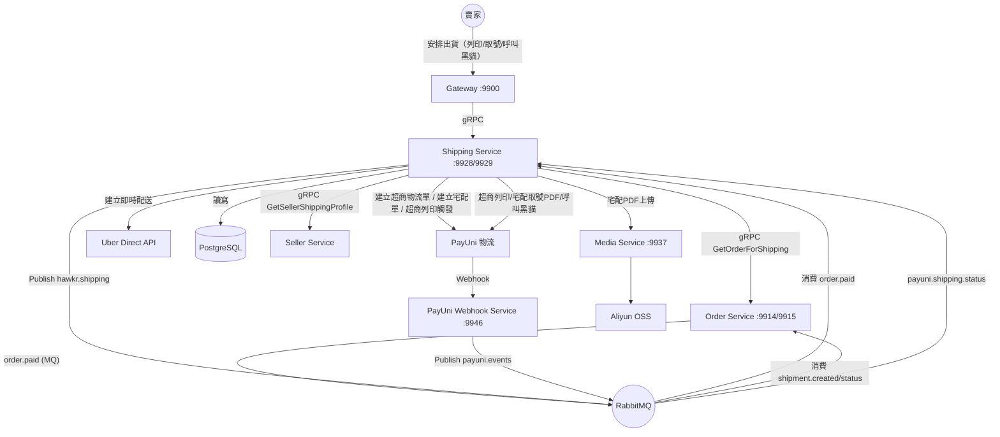

> **端口說明**：
> - Shipping Service: **application 預設** `9928` (HTTP，僅健康檢查/Metrics) / `9929` (gRPC)；
>   🔴 **k8s 部署以 `SERVER_PORT`／`GRPC_PORT` 覆寫為 `9930`／`9931`**（`k8s/values/shipping-service.yaml`）——兩個層級都要對得上，只看其中一邊會連錯埠
> - TSID Node ID Base: 600
>
> **通訊方式**：
> - 背景建單觸發：Order Service → MQ（`order.paid`）→ Shipping Service
> - Gateway → Shipping Service：gRPC（賣家安排出貨）
> - Shipping Service → Order Service / Seller Service / Media Service：gRPC
> - Webhook Service → Shipping Service：RabbitMQ（`payuni.shipping.status`）
> - Shipping Service → Order Service：RabbitMQ（`shipping.events`）

### 1.5 名詞定義

| 名詞 | 說明 |
|------|------|
| **MerTradeNo** | PayUni 物流交易編號。正向物流使用 `orderNo`（如 `O400280260`），退貨物流使用 `orderNo + "-Refund"`（如 `O400280260-Refund`）。長度上限 25 字元 |
| **ShipNo（shipment_no）** | Shipping Service 內部物流單號，TSID 生成。不傳給 PayUni，僅用於內部識別與前端顯示 |
| **ShipTradeNo（ship_trade_no）** | PayUni 分配的物流序號（UNi 開頭流水號），建單成功後由 PayUni 回傳。Webhook 事件以此為 key 關聯物流單 |
| **出貨便代碼** | 超商 C2C 出貨時，由 PayUni Print Webhook 回傳的三個欄位組合：`PartnerId`（母代碼 3 碼）+ `Odno`（出貨單編號 8 碼）+ `ValidationNo`（C2C 驗證碼 4 碼）。賣家持此代碼至 ibon 操作列印 |
| **ProviderCallStatus** | 「呼叫外部 API 並等結果」場景的通用四態狀態機（`NONE / REQUESTED / SUCCEEDED / FAILED`）。Shipping Service 三個既有套用點：`label_print_status`（`LabelPrintStatus` enum）、`tcat_call_status`（`TcatCallStatus` enum）、`payuni_submit_status`（`PayUniSubmitStatus` enum）。完整契約見 §2.4 |
| **ProviderCallExecutor** | `common-core` 提供的共用框架（`io.github.will413028.hawkr.common.providercall.ProviderCallExecutor`），封裝「先 markRequested 占位 → 呼外部 API → 成功 markSucceeded / 失敗 markFailed」的固定流程。Shipping / AfterSales 等需要呼叫 PayUni 同步 API 的場景一律透過此框架，禁止「先 commit 旗標再呼 API」的反模式 |
| **CvsPrintWaitingRegistry** | Shipping Service 內部元件（`@Component`），橋接 `PrintCvsLabel` gRPC 同步請求與 Print Webhook 非同步回填，讓列印 API 可在 55 秒內同步取得交貨便代碼。本元件僅承擔「跨實例通知到達」職責，不再兼任「列印是否已觸發」的真實標記——後者由 `label_print_status` 狀態機負責。透過 Redis Pub/Sub 支援多實例 |
| **Webhook Dedup** | 二層去重機制：第一層由 Webhook Service Inbox 表完成；第二層由 Shipping Service `shipping_webhook_dedup` 表（以 `{merId}:{shipTradeNo}:{shipStatus}` 為 event_key）再次去重 |
| **OnboardingStatus** | 建店狀態碼，定義於 `common-core/utils/code/OnboardingStatus.java`（CodeMeta Enum）。值：`PENDING_REVIEW(0)` / `ACTIVE(10)` / `REJECTED(20)` / `CLOSED(30)` / `PERMANENTLY_CLOSED(40)` |

### 1.6 角色與權限邊界

| 角色 | 操作 | 權限要求 |
|------|------|---------|
| **Seller（賣家）** | 安排出貨（列印/取號/呼叫黑貓/確認出貨）、建店（超商/宅配）、切換配送方式、查詢配送方式、查看訂單物流追蹤（`GetSellerShipmentTracking`，§5.7.2） | `requireAccountType(2, 3)`（SELLER 或 SELLER_AND_BUYER） |
| **Buyer（買家）** | 選擇超商門市（門市地圖）、查看訂單物流追蹤（`GetShipmentTracking`，§5.7.1） | `requireAccountType(1, 2, 3)`（BUYER / SELLER / SELLER_AND_BUYER） |
| **Internal RPC** | `GetShipmentByOrderNo`（Order Service 聚合訂單詳情）、`GetShipmentsByOrderNos`（Order Service 賣家列表頁批次查詢出貨照片，避免 N+1）、`BatchGetProviderStatusByOrderIds`（Order / AfterSales 聚合異常列表 provider 狀態，遵循收斂規範 §6.3）、`QueryShipmentStatus`（內部 / 賣家「同步」按鈕用，以 `shipment_no` 為 key、無 ownership）、`GetSellerShippingConfig`（Order/Product 查詢開通狀態）、`CreateReturnCvsShipment` / `CreateReturnHomeShipment`（AfterSales 退貨建單）、`ValidateProductShipping`（Product 配送驗證） | `x-internal-service` header，免 JWT |
| **Webhook（PayUni 回調）** | 物流狀態更新、列印 Notify | 由 Webhook Service 統一接收後透過 MQ 分發，Shipping Service 作為 MQ Consumer 處理 |

---

## 2. 狀態模型與業務規則

### 2.1 物流狀態機（ShippingStatus）

跨服務 Enum，定義於 `common-core/utils/code/ShippingStatus.java`。

**value 直接對應 PayUni 物流貨態狀態碼**，不再使用獨立的內部狀態碼。
完整定義詳見 `../第三方整合/PayUni 物流官方 API 總覽.md §12.1`。

完整 Enum 定義詳見 [業務狀態碼](../代碼管理%EF%BC%88CodeMeta%EF%BC%89/業務狀態碼.md#ShippingStatus)。

收到上表以外的 PayUni 狀態碼時，**拋出異常**。

**自定義狀態碼（3 位數）**：內部操作里程碑，前端用於控制按鈕狀態。3 位數 = 對應 PayUni 碼的擴展。

狀態流程：
```
宅配：91 → 21(取號/Webhook) → 210(叫件/內部) → 31(配送中/Webhook)
超商：91 → 920(代碼回填/Webhook+內部) → 921(賣家確認/內部) → 31(配送中/Webhook)
```

輔助方法（權威實作 `common-core .../utils/code/helper/ShippingStatusRules.java`，成員以 65 §7.1.2.3 為準）：
- `isPendingShipment()` — 91/92/21/920 ＋ **933**，推進訂單至待出貨(20)
- `isConfirmedShipment()` — 210/921 ＋ **930／931**，推進訂單至配送中(30)
- `isAbnormal()` — 33/43/44/46/51~56/81/82 ＋ **932／993**，推進訂單至物流異常
- `isTerminal()` — 11/41，終態（🔴 **不得新增成員**——65 的 A-1a 斷言釘住這一點）
- 🔴 **「不屬任一述詞」** — `98`／`22`／`990`／`991`／`992`。
  ⚠️ **`CREATE_FAILED(990)` 同樣不屬任一述詞**：四個 predicate 的成員為
  `isTerminal`＝`PICKED_UP`／`CANCELLED`、`isAbnormal`＝11 個異常值、`isPendingShipment`＝
  `UNPROCESSED`／`PROCESSING`／`PENDING_SHIPMENT`／`CVS_CODE_RECEIVED`、`isConfirmedShipment`＝
  `TCAT_CALLED`／`SELLER_CONFIRMED` —— **`CREATE_FAILED` 一個都沒進**。
- 🔴 **判準只看「有沒有專屬分支」，不看「屬不屬述詞」。**
  `order-service .../mq/ShippingEventConsumer.onShipmentStatusChanged` 的分派鏈是
  **三個述詞 ＋ 兩個專屬 `else if` ＋ 一個 `else`**：
  `isPendingShipment` → `isConfirmedShipment` → `IN_TRANSIT(31)` → `WAITING_PICKUP(32)` → `isAbnormal` → `else`。
  🔴 **`isTerminal` 不在這條鏈上**
  ⇒ **`11`／`41` 雖然屬 `isTerminal`，同樣落到最後的 `else`、同樣不推進訂單軸**。
  ⇒ **不推進訂單軸的完整集合 ＝ `98`／`22`／`11`／`41`／`990`／`991`／`992`**。
  症狀是**只更新 `shipping_status`、訂單軸不動、也不報錯**。
- ⚠️ `990` 雖不推進訂單軸，**不代表沒有出口**：65 §6A.1.2 **N1** 在 C 軸進入
  `FAILED`／`CREATE_FAILED(990)` 且判定不再重試時發 `order.fulfillment.failed`，
  由 aftersales `cancelShipmentBySystem(FULFILLMENT_FAILED)` 走履約失敗鏈（見 [36 §3.1](36-MQ%20與事件總覽（MQ%20&%20Event%20Catalog）.md)）

**狀態轉移規則**（`ShipmentStatusMapper.isValidTransition()`）：

| **分組** | **包含的 ShippingStatus** | **允許轉移至** |
|---------|-------------------------|-------------|
| 出貨前 | UNPROCESSED, PROCESSING, PROCESSING_ACCEPTED, PENDING_SHIPMENT, LOGISTICS_CHECK, TCAT_CALLED, CVS_CODE_RECEIVED, **SELLER_CONFIRMED** | 任何狀態（PayUni 可能跳號推進，例如 91→31 直接前進）|
| 配送中 | IN_TRANSIT, WAITING_PICKUP | 終態（PICKED_UP / CANCELLED）、異常群組、其他配送中（如 31↔32）；**禁止**倒退到出貨前 |
| 異常相關 | ABNORMAL~PENDING_HOME_RETURN（isAbnormal=true） | 異常互轉、終態、重回配送中（門市關轉後重回）；**禁止**倒退到出貨前 |
| 終態 | PICKED_UP, CANCELLED | 不可再轉移 |
| **建單未知**（65 §7.1.2.1） | `CREATE_UNKNOWN(991)` | `991` 屬 `ShipmentStatusMapper.PRE_SHIPMENT` ⇒ `isValidTransition` 對它是 **blanket `return true`**，出邊不受列舉限制。回查排程的落點是 **provider-aware** 的：3001／3002／3003 → `91`，**3004 → `92`**（`/trade` 成功 ＝ `PROVIDER_CREATED`，68 §7.2 M2／§7.3.2 X1）；另可落 `990`／`41` |
| **建單失敗**（65 §7.1.2.1） | `CREATE_FAILED(990)` | 🔴 **`990` 不在 `PRE_SHIPMENT`**，走自己的列舉分支 ⇒ 出邊只有列舉的兩條：`91`（Admin 重建）／`41`（Admin 取消＋退款鏈） |
| **取消處理中**（65 §7.1.2.1） | `CANCEL_PENDING(992)` | provider 確認 → `41`；provider 拒絕 → **回退到任何非終態**（全值域唯一允許回退者）；入邊 from ＝ 全部非終態 |
| **理賠處理中**（65 §7.1.2.1） | `CLAIM_PENDING(993)` | 成立 → `43`；不成立 → `33` 或原異常值。入邊 ← `44`／`932`／`33`／ADM 建案 |

🔴 **這幾個三位數值不屬上表前四個分組，而 `isValidTransition()` 對「不屬任何一組」的 `from`／`to`
一律 `return false`** ⇒ 不加分組的話：端點回 9520、DB 不動、日誌只有一行 warn，
而前端已經顯示「已受理」。**這是本節最貴的一格**（65 §6.4.3 逐條列了症狀）。

> **嚴格規則**：所有「向下游」（PRE_SHIPMENT → IN_DELIVERY → 異常/TERMINAL）皆放行；「倒退到出貨前」（IN_DELIVERY → PRE_SHIPMENT、異常 → PRE_SHIPMENT）一律拒絕。理由：物流進入配送中或異常後，PayUni 不會推送回「出貨前」狀態，若收到視為錯誤推送，必須擋下避免狀態回退污染下游事件流。

### 2.2 PayUni 狀態碼映射

詳見 `../第三方整合/PayUni 物流官方 API 總覽.md §12.3`。

由於 ShippingStatus.value() 直接對應 PayUni 狀態碼，映射為 `ShippingStatus.fromValue(payUniCode)`，不再需要額外的映射表。

**Uber 狀態碼映射以 [66 Uber Direct 即時配送整合詳細設計書](./66-Uber%20Direct%20即時配送整合詳細設計書.md) §7.3 為準**
（該表另有述詞集合歸屬、訂單軸推進值、`allowedActions[]` 三欄，且**正向／逆向 leg 各一張表**，本節都沒有）。

🔴 **`returned` 是最容易誤讀的一格，兩條不變式必須同時成立。**

**不變式一：`returned` ≠ 我方「已送達」。** 它在正向 leg 是**失敗**（→ `ABNORMAL(33)`，
同一次處理內續推 `41`），在逆向 leg 才是 `RETURN_FAILED(28)`（66 §7.3.3）。
🔴 **不得映到 `RETURN_GENERAL(51)`**：`51`／`53` 的「適用」欄**不含 3003**（65 §7.1.2.1），
`33` 才是唯一「適用：全」的異常匯集點。

**不變式二：`returned` ≠ 退款觸發。**
`returned` 只描述「商品退回賣家」這個**實體處置**（physical disposition／庫存回收），**不是責任判定**。
`41` 只是配送軸的終局宣告，本身不蘊含退款。
`41 CANCELLED` 是配送軸的終局格；**是否向 Buyer 退款、退多少，一律由 `ResponsibilityCause` 決定**——
`BUYER_CAUSED` ⇒ **不向 Buyer 退款**（`refund_to_buyer = 0`，Order 軸落 `DELIVERY_FAILED_NO_REFUND`，
**≠ `CANCELLED`、≠ `DELIVERED`**）／`SELLER_CAUSED`／`PROVIDER_CAUSED`／`PLATFORM_CAUSED` ⇒ **向 Buyer 全額退款**／
`RESPONSIBILITY_UNRESOLVED` ⇒ **暫不決定**，Order 軸停在 `SHIPPING_ABNORMAL(35)` 等 ADM 裁決。
🔴 **嚴禁**把 provider 的 `returned`／`undeliverable` 當成 `BUYER_CAUSED` 的捷徑——那等於做了一個沒有證據的判定。
責任分類與退款政策的權威在 [66 詳細](./66-Uber%20Direct%20即時配送整合詳細設計書.md) 與
[09 售後](./09-售後微服務（AfterSales%20Service）詳細設計書.md)；本服務只負責把配送軸推到 `41` 並帶上 provider 事實。

⚠️ **平台自訂值一律三位數、PayUni 原生值一律兩位數**（見
[65 §7.1.2.0](./65-物流履約平台%EF%BC%88Fulfillment%20Platform%EF%BC%89詳細設計書.md)）。
值域逐值對照見 65 §7.1.2.1。

### 2.3 建店狀態機（OnboardingStatus）

**定義位置**：`services/java/shared/common-core/.../utils/code/OnboardingStatus.java`（CodeMeta Enum，由 `generate.sh` 生成）

| **Code** | **Name** | **說明** | **對應 PayUni SetStatus** |
|---|---|---|---|
| 0 | PENDING_REVIEW | 待審核（已提交至 PayUni，等待結果） | 9（未處理）, 7（重新送審）, 8（已上傳審核中） |
| 10 | ACTIVE | 已開通（可正常使用） | 1（正常） |
| 20 | REJECTED | 審核失敗（需修正後重新提交） | 2（審查失敗） |
| 30 | CLOSED | 已關閉（暫停使用） | 3（關閉） |
| 40 | PERMANENTLY_CLOSED | 永久關閉（不可恢復） | 4（永久關閉） |

**狀態轉移規則：**

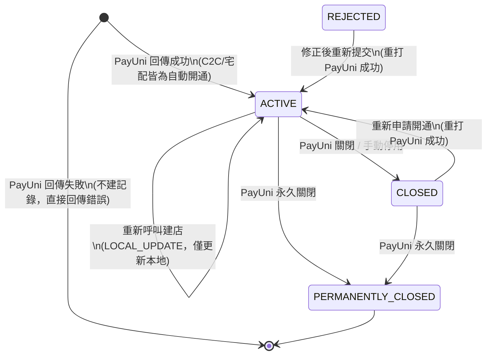

> **建店結果處理**：PayUni 回傳失敗時（如地址郵號不符），不建立設定記錄，直接將 PayUni 錯誤訊息回傳前端，使用者修正後可重新申請。僅 PayUni 回傳成功時才建立記錄。C2C 與宅配皆為系統自動開通（SetStatus=1），不考慮 B2C 異步審核場景。

#### 2.3.1 OnboardingStatus 對寫路徑 vs 讀路徑的影響（強制原則）

> 「賣家是否願意用此方式**出新貨**」與「賣家是否能處理此方式**舊單退件**」是兩個不同的業務語意，必須分離。

| 路徑類型 | 業務語意 | 是否受 `onboarding_status` / `enabled` 影響 | 對應實作 |
|---|---|---|---|
| **寫路徑（出新貨）** | 賣家當下意願 | ✅ 必須 ACTIVE + enabled | 透過 `OnboardingService.findActiveSetting()` 取 setting；null 拋 `SHIPMENT_SELLER_NOT_ONBOARDED(5004)` |
| **讀路徑（舊單退件）** | 訂單當時契約 | ❌ 不受影響（CLOSED 仍允許處理舊單退件） | 透過 `OnboardingService.findSettingByMethod()` 取 historical setting；null 拋 `SHIPMENT_DATA_INCOMPLETE(5006)`（理論不該發生：寫路徑已驗 row 存在） |

**設計理由**：
- PayUni partner_id 一旦開通永久有效，賣家在我方平台 toggle `onboarding_status` 為 CLOSED 不會送到 PayUni；該 partner_id 仍可繼續被 PayUni API 用於建單。
- 因此「賣家取消 onboarding」是平台政策 flag，**不該牽連到已成立訂單的買家退件權**。
- Setting row 即使 `onboarding_status='3604'（CLOSED）` 仍保留 `mer_id / partner_id / return_store_code / sender_*` 等退件所需欄位。

**禁止反例**：
- ❌ 退件 RPC 用 `findActiveSetting` 過濾後拋 `SHIPMENT_SELLER_NOT_ONBOARDED` — 屬於把寫路徑語意誤用到讀路徑（會造成賣家停權後退件無路可走的死局）
- ❌ 寫路徑 RPC 不檢核 `findActiveSetting` — 屬於漏設防線

### 2.4 外部呼叫狀態機與併發保護

本章定義 Shipping Service「呼叫外部 API 並等結果」場景的統一處理框架，以及伴隨的併發保護規則。涵蓋兩條獨立但互相影響的軸線：

- **A 軸 — 外部呼叫狀態機（INV-1 / INV-2）**：避免「先 commit 旗標再呼外部 API，失敗時旗標卡死」與「單一 boolean 欄位身兼多職」兩個 anti-pattern
- **B 軸 — Lost Update 防護**：避免賣家操作與 PayUni Webhook 併發時，後寫者全欄位覆蓋前寫者

兩軸都圍繞同一個原則：**狀態欄位語意必須明確，每個 UPDATE 只動自己負責的欄位**。

#### 2.4.2 設計不變量（Invariants）

**INV-1（A 軸）**：「狀態旗標寫入終態 DB」必須**晚於**「外部 API 確認成功」。

- 任何 `先 commit 旗標 → 再呼外部 API` 的順序一律禁止
- 例外：「占位狀態 `REQUESTED`」可以在呼外部 API 前寫入（用於併發鎖與處理中顯示），但**終態（SUCCEEDED / FAILED）只能在外部呼叫結束後寫**

**INV-2（A 軸）**：「需要呼外部 API 的場景」必須以**四態狀態機**表達；任何 boolean 欄位不能同時擔任「併發鎖 / 成功標記 / 重試路由」三職。

**INV-3（B 軸）**：併發場景下**禁止**使用 `shipmentMapper.updateById(entity)` / `settingMapper.updateById(entity)`。每個 UPDATE 只動自己負責的欄位，搭配 WHERE 前置條件保護。

**INV-4（B 軸）**：所有承擔狀態機角色的欄位，UPDATE 時**必須**附帶 `WHERE 欄位 IN (合法前置狀態集合)`，作為樂觀鎖兼狀態轉移合法性檢查。

#### 2.4.3 ProviderCallStatus 通用四態狀態機

| 狀態 | Value | 語意 |
|------|-------|------|
| `NONE` | `xx01` | 從未發起呼叫；DB 預設值 |
| `REQUESTED` | `xx02` | 已發起呼叫，等待外部 API 同步回應或 webhook 異步回填；併發鎖：禁止再次發起同一呼叫 |
| `SUCCEEDED` | `xx03` | 終態：成功；可由 webhook 補回填、或同步 API 回應推進 |
| `FAILED` | `xx04` | 終態（可重試）：呼叫明確失敗；允許賣家或 reconciliation 重新發起 |

**合法 transition**：

```
NONE ──(發起呼叫)──> REQUESTED
REQUESTED ──(成功)──> SUCCEEDED        (終態)
REQUESTED ──(失敗)──> FAILED           (可重試)
FAILED ──(重新發起)──> REQUESTED
SUCCEEDED ──(重新觸發冪等路徑，僅特殊場景如重列印)──> SUCCEEDED
```

**禁止 transition**：
- 任何狀態 → `NONE`（NONE 只能是初始值）
- `SUCCEEDED` → `REQUESTED`（成功後不允許退回未確定狀態，重列印等場景以「冪等讀取既有結果」處理，狀態不轉）
- `SUCCEEDED` → `FAILED`（webhook 漏收的情境由 reconciliation 推 NONE/REQUESTED → SUCCEEDED；不允許從成功倒退）

**三個套用點各自的 enum**（語意精準，DB 看到 value 即可判斷是哪個外部呼叫）：

| 套用點 | DB 表 | 欄位 | Enum | Value 範圍 |
|---|---|---|---|---|
| 超商出貨單列印 / 宅配託運單取號 | `shipments` | `label_print_status` | `LabelPrintStatus` | 4101 / 4102 / 4103 / 4104 |
| 黑貓叫車 | `shipments` | `tcat_call_status` | `TcatCallStatus` | 4201 / 4202 / 4203 / 4204 |
| 賣家建店送 PayUni 設定 | `seller_shipment_settings` | `payuni_submit_status` | `PayUniSubmitStatus` | 4301 / 4302 / 4303 / 4304 |

完整定義見 [業務狀態碼](../代碼管理（CodeMeta）/業務狀態碼.md#LabelPrintStatus)（含三個 enum）。

#### 2.4.4 ProviderCallExecutor 框架

跨服務共用的呼叫骨架，定義於 `services/java/shared/common-core/.../providercall/ProviderCallExecutor.java`。

**契約**：

```java
public interface ProviderCallExecutor {

    /**
     * 對單一資源執行一次外部呼叫。
     *
     * 流程（嚴格依序）：
     *  1. acquireRequested.get() — 以 SQL UPDATE 嘗試從 (NONE | FAILED) → REQUESTED
     *     若 rows = 0 表示已被其他執行緒占用（status 為 REQUESTED 或 SUCCEEDED） → 拋 ProviderCallBusyException
     *     此步是「併發鎖 + 狀態 transition」唯一入口，禁止 read-modify-write
     *  2. invoke.run()         — 呼叫外部 API（事務外）
     *  3a. invoke 成功 → markSucceeded.accept(result) (狀態 transition REQUESTED → SUCCEEDED)
     *  3b. invoke 拋 exception → markFailed.accept(exception)（狀態 REQUESTED → FAILED，落地 provider_status / provider_message）
     *      → 將原 exception 重新拋出
     *
     * 任何 step 1 之後的失敗都不允許留下 status=REQUESTED 卡死的紀錄。
     *
     * @param ctx          呼叫情境：containing resourceId, callKind, log fields
     * @param acquireRequested  原子地嘗試 transition (NONE|FAILED) → REQUESTED；回傳 true 表 acquire 成功
     * @param invoke       實際的外部 API 呼叫；可能拋 exception
     * @param markSucceeded 收到成功結果時的 transition；參數為 invoke 回傳值
     * @param markFailed    收到失敗時的 transition；參數為 caught exception
     */
    <T> T execute(
        ProviderCallContext ctx,
        BooleanSupplier acquireRequested,
        Supplier<T> invoke,
        Consumer<T> markSucceeded,
        Consumer<Throwable> markFailed
    ) throws ProviderCallBusyException;
}
```

**關鍵設計決策**：

| 決策 | 說明 |
|------|------|
| `acquireRequested` 由呼叫方提供 | 因為各套用點的 SQL 條件不同（label/tcat/onboarding 各自的 WHERE），但流程模板一致；executor 不認得業務細節 |
| 失敗 transition 寫入後**重拋原 exception** | 上層仍須收到原始錯誤 → 對賣家回 `SHIPMENT_TCAT_CALL_FAILED` + provider_message；exec 不吞例外 |
| `markFailed` 接收 `Throwable` | 由套用點決定要不要從 exception 中萃取 PayUni `Status` / `Message` 寫入 `provider_status` / `provider_message` |
| `acquireRequested` 失敗以 `ProviderCallBusyException` 表示 | 上層判別「另一個執行緒/實例正在跑」可選擇等待或回 `SHIPMENT_PROVIDER_CALL_IN_PROGRESS` 業務碼 |
| 不引入 retry / backoff 邏輯 | 避免框架過度抽象；retry 由呼叫方按情境決定（`callTcat` retry 1 次 / `printCvsLabel` 不 retry 由 reconciliation 處理） |

**事務邊界**：

- `acquireRequested.get()` 內部的 UPDATE 屬於**獨立短事務**（`@Transactional(propagation = REQUIRES_NEW)`）
- `invoke.run()` 在**事務外**執行（外部 API 呼叫嚴禁在 `@Transactional` 內，避免長事務佔用 DB 連線）
- `markSucceeded` / `markFailed` 各自在**獨立短事務**內完成 transition

**markFailed 行為：transient vs permanent 錯誤分類**：

`markFailed` callback 不是無條件寫入 `FAILED` 狀態。實作必須先判斷錯誤是否為「暫時性」：

| 條件（任一成立即視為 transient） | 處理 |
|---|---|
| `PayUniApiException.errorCode == "IO_ERROR"` | 保留 `REQUESTED` 狀態，**不寫 FAILED** |
| `PayUniApiException.httpStatus >= 500` | 同上 |
| 錯誤訊息含 `"處理中"` / `"尚在處理"` / `"Trying to access array offset"` / `"busy"` / `"timeout"` | 同上 |
| 其他（PayUni 業務錯誤，如地址不存在、配額用盡） | 寫入 `FAILED` + `provider_status` / `provider_message` |

**對應的對外回報業務碼**（caller 的 try/catch 需配合）：

| 套用點屬性 | 錯誤類型 | DB 狀態 | 對前端業務碼 | 訊息 |
|---|---|---|---|---|
| **A. 自動補拉**（超商列印 — webhook + §5.19.3.B reconcile 自動 query 三段碼） | transient | `REQUESTED` 保留 | `SHIPMENT_PROVIDER_CALL_IN_PROGRESS` (5047) | 「物流商呼叫進行中，請稍候再試」 |
| **B. 人工補拉**（黑貓叫車 / 建店送 PayUni — 純同步 API，靠 §5.19.3.C/D ops 告警人工介入後 transition） | transient | `REQUESTED` 保留 | `SHIPMENT_PROVIDER_CALL_IN_PROGRESS` (5047) | 「物流商呼叫進行中，請稍候再試」 |
| **C. 無補拉**（宅配 PDF 取號 — HOME query by-design 不回三段碼，必須 markFailed 讓賣家可重打） | transient | `FAILED` | `SHIPMENT_PROVIDER_CALL_FAILED` (5048) | 「請重試」（透傳 PayUni 訊息） |
| 所有套用點 | permanent | `FAILED` | `SHIPMENT_PROVIDER_CALL_FAILED` (5048) / `SHIPMENT_TCAT_CALL_FAILED` (5044, callTcat 維持既有契約) | 透傳 PayUni 訊息 |

**設計理由**：

- transient 錯誤（PayUni 後端 race / 網路抖動）的處理**取決於該套用點的補拉性質**：
  - **A 自動補拉**（如超商列印靠 PayUni Print Webhook + `§5.19.3.B` reconcile 主動 query 三段碼）→ 保留 `REQUESTED` 給補拉機制接手，避免賣家連點與 reconcile 重複觸發 PayUni
  - **B 人工補拉**（黑貓叫車是純同步 API 無 callback、建店送 PayUni 同步無查詢 API）→ 保留 `REQUESTED` 給 §5.19.3.C/D ops 告警通道可見，人工介入後再 transition
  - **C 無補拉**（如宅配走同步 PDF 路徑，PayUni HOME query by-design 不回三段碼）→ 必須直接 `markFailed`，讓賣家可重新觸發 acquireRequested 重打；若沿用「keep REQUESTED」會永久卡死
- permanent 錯誤（資料錯）必須讓賣家立刻看到 PayUni 原文以修正 — 寫入 `FAILED` 讓賣家可重新點「列印 / 叫車 / 建店」觸發 acquireRequested 從 `FAILED → REQUESTED`
- helper：`isTransientPayUniError(Throwable)` 為各 service 內部 private static method（非框架層 API），新增規則時直接修各 service helper

> **補拉性質判定原則**：新增套用點時必須先回答「transient 失敗後，誰負責把 `REQUESTED` 推進到 `SUCCEEDED`？」
> - reconcile / webhook 能在賣家不介入下推進 → **A 自動補拉**，keep `REQUESTED`
> - 需 ops 人工後台介入 → **B 人工補拉**，keep `REQUESTED` 並確保 §5.19.3.C/D 告警通道可見
> - 沒有任何機制能推進 → **C 無補拉**，必須 `markFailed` 讓賣家自行重打
>
> **A 與 reconciliation 的搭配**（限超商）：transient skip 後狀態保留 `REQUESTED`，§5.19.B 的 SQL `WHERE label_print_status IN ('4102','4104')` 會掃到（包含未轉 FAILED 的 4102 與真正失敗的 4104），`requested_at < NOW() - 5min` grace 過後嘗試補拉。caller 與 reconciliation 走同一條 webhook service path（`processWebhookPrint`），無 race。

#### 2.4.5 套用點對照

##### 2.4.5.1 超商出貨單列印 / 宅配託運單取號（`label_print_status`）

| ProviderCallExecutor 階段 | 對應 SQL / 行為 |
|---|---|
| `acquireRequested` | `UPDATE shipments SET label_print_status='4102', label_print_requested_at=NOW() WHERE id=? AND label_print_status IN ('4101','4104')` |
| `invoke` | 超商：`labelService.triggerCvsPrint(...)`（同步觸發，PayUni 後續 webhook 回填）<br>宅配：`labelService.scheduleAndUploadLabel(...)`（同步取 PDF + 上傳 OSS） |
| `markSucceeded` | 超商：**不在此處 transition** — 由 `processWebhookPrint` 收到 `ApiType=Print` webhook 後 `UPDATE ... SET label_print_status='4103' WHERE id=? AND label_print_status='4102'`<br>宅配：PDF 下載成功後 `UPDATE ... SET label_print_status='4103', label_object_key=?, label_asset_id=?, label_expire_at=NOW()+INTERVAL '24 hours' WHERE id=? AND label_print_status='4102'`（DB 只存 objectKey，URL 由讀取端組裝） |
| `markFailed`（**超商**）| **依 §2.4.4 transient 分類**：transient → 跳過寫 DB（保留 4102 給 §5.19.3.B reconcile 補拉）；permanent → `UPDATE shipments SET label_print_status='4104', provider_status=?, provider_message=? WHERE id=? AND label_print_status='4102'` |
| `markFailed`（**宅配**）| **無補拉機制（§2.4.4 規則）**：transient / permanent 一律 `UPDATE shipments SET label_print_status='4104', provider_status=?, provider_message=? WHERE id=? AND label_print_status='4102'`。理由：PayUni HOME query by-design 不回三段碼，§5.19.3.B reconcile 對宅配 query 永遠 return false，若 transient 保留 4102 將造成永久卡死 |
| 失敗重試 | 賣家可重新點「取號 / 列印」，acquireRequested 從 `4104 → 4102`，重新發起 |

> **超商列印的 webhook 漏收**：若 PayUni 確實成功列印但 webhook 未到達，`label_print_status` 永遠停在 `REQUESTED`。由 §5.19 reconciliation 排程主動呼叫 `/api/logistics/query` 補拉三段碼後 transition 到 `SUCCEEDED`。
>
> **宅配同步 PDF 路徑無補拉**：宅配的 `markSucceeded` 由 `markLabelPrintSucceededHome`（同步路徑）寫入，不經 webhook 也不被 reconcile 救（reconcile 撈到 HOME query 必 return false）。因此 transient 必須走 `markFailed` 讓賣家可重打，**禁止**對宅配套用「transient → keep REQUESTED」分支。

##### 2.4.5.2 黑貓叫車（`tcat_call_status`）

| 階段 | 對應 SQL / 行為 |
|---|---|
| `acquireRequested` | `UPDATE shipments SET tcat_call_status='4202' WHERE id=? AND tcat_call_status IN ('4201','4204')` |
| `invoke` | `shippingClient.callTcat(merId, request)`（PayUni 同步 API，retry 一次） |
| `markSucceeded` | `UPDATE shipments SET tcat_call_status='4203', tcat_call_time=?, status=210 WHERE id=? AND tcat_call_status='4202'`（同時推進物流狀態到 `TCAT_CALLED(210)`） |
| `markFailed` | **依 §2.4.4 transient 分類**：transient（如 PayUni 5xx / IO_ERROR）→ 跳過寫 DB（保留 4202 給 §5.19.3.C ops 告警可見）；permanent（如 E072 地址錯）→ `UPDATE shipments SET tcat_call_status='4204', provider_status=?, provider_message=? WHERE id=? AND tcat_call_status='4202'` |
| 失敗重試 | 賣家修正後重點「呼叫黑貓」 |

> **黑貓叫車無 webhook**：PayUni 黑貓叫車是純同步 API，無 callback。若同步呼叫成功則直接 transition 到 SUCCEEDED；reconciliation 不重打（無方法判定 PayUni 端是否成功）。`tcat_call_status='4202'` 卡死由 §5.19.3.C ops 告警 scheduler 偵測。

##### 2.4.5.3 賣家建店送 PayUni 設定（`payuni_submit_status`）

OnboardingService 4 條呼叫路徑：`submitCvsToPayUni` / `submitHomeToPayUni`（首次建店，**不走** ProviderCallExecutor 框架），`resubmitCvsToPayUni` / `resubmitHomeToPayUni`（重新提交，走 §2.4.4 框架）。

**INSERT 路徑（首次建店，無既有紀錄）— 不走 Executor**：

| 步驟 | 行為 |
|---|---|
| 1 | 直接呼叫 `shippingClient.onboardCvsShipping(merId, payUniReq)` 或 `onboardHomeDelivery(merId, payUniReq)` |
| 2.a | PayUni 成功（`Status=SUCCESS`）→ `INSERT seller_shipment_settings(...)` with `payuni_submit_status='4303', payuni_submitted_at=NOW(), partner_id, eship_id, onboarding_status, provider_status, provider_message`；對外回 success |
| 2.b | PayUni 失敗（業務錯誤、IO error、5xx 都包含）→ `throw ShippingBusinessException(ONBOARDING_PAYUNI_ERROR, msg)`，**不建立任何 setting 紀錄** |

🔴 INSERT 路徑的併發保護由 UNIQUE 約束
`idx_settings_store_type (store_id, shipping_type, COALESCE(goods_type, ''))` 承擔，
**不得**改成「先 INSERT `4302` → invoke → 失敗再 `deleteById`」——那會產生
「INSERT 已 commit 而 PayUni invoke 失敗」的 race window。

**UPDATE 路徑（重新提交，setting 已存在）— 走 ProviderCallExecutor**：

| 階段 | 對應 SQL / 行為 |
|---|---|
| `acquireRequested` | `settingMapper.acquirePayUniSubmitRequested(id)` → SQL `UPDATE ... SET payuni_submit_status='4302', payuni_submit_requested_at=NOW() WHERE id=? AND payuni_submit_status IN ('4301','4304')`；rows=0 表示已成功（`'4303'`）或正在送審（`'4302'`），caller 拋 ProviderCallBusyException |
| `invoke` | `shippingClient.onboardCvsShipping(merId, payUniReq)` 或 `onboardHomeDelivery(merId, payUniReq)` |
| `markSucceeded` | `settingMapper.markPayUniSubmitSucceeded(id, partnerId, eshipId, onboardingStatus, providerStatus, providerMessage)` → SQL `UPDATE ... SET payuni_submit_status='4303', payuni_submitted_at=NOW(), partner_id, eship_id, onboarding_status, provider_status, provider_message WHERE id=? AND payuni_submit_status='4302'` |
| `markFailed` | **依 §2.4.4 transient 分類**：transient → 跳過（保留 4302 給 §5.19.3.D ops 告警）；permanent → `settingMapper.markPayUniSubmitFailed(id, providerStatus, providerMessage)` → SQL `UPDATE ... SET payuni_submit_status='4304', provider_status=?, provider_message=? WHERE id=? AND payuni_submit_status='4302'` |

**禁止全欄位覆蓋**：UPDATE 路徑實作不得使用 `settingMapper.updateById(existing)`（INV-3 違反）。所有 transition 必須走上述 mapper 自訂 SQL。

**地址 readonly 判定**：見 §2.4.5.4。

> **送 PayUni 為純同步 API**：無 webhook。UPDATE 路徑下 `REQUESTED` 為極短暫的過渡狀態，正常情境下不會卡在 `REQUESTED`；若 JVM crash 在 `invoke` 後 `markSucceeded` 前，由 §5.19.3.D ops 告警 scheduler 偵測（PayUni 建店設定無查詢 API，無法主動對帳，只能人工後台處理）。

##### 2.4.5.4 共用業務規則：宅配地址 readonly

當 `payuni_submit_status = SUCCEEDED` 時：
- 前端宅配地址欄位 readonly（PayUni 限制：寄件地址送審後不可改）
- 後端 `OnboardHomeDeliveryShipping` 重送時 `senderAddress` 使用 DB 既有值送 PayUni，DB 也不更新該欄位
- 姓名 / 電話 / 商品類別仍可更新（PayUni 允許）

`payuni_submit_status` 是判定「是否已送 PayUni」的**唯一**權威來源；禁止用 `partner_id IS NOT NULL` 等次要欄位推斷。

#### 2.4.6 PayUni race 由 transient 分類 + reconcile 處理（不採 cooldown）

PayUni「建單後立即列印」存在 PHP race（`Trying to access array offset on value of type bool`）。

🔴 **禁止以固定時間窗（cooldown）防護這個 race**——race 視窗無法精準預測，窗口太短不夠用、
太長傷正常 UX。一律改由 §2.4.4 的 transient 分類處理；**補拉路徑視套用點而定**：

**超商列印（有補拉）**：

| 路徑 | 處理 |
|---|---|
| 賣家點列印 → PayUni race（transient）| `markFailed` callback 跳過寫 DB（保留 `4102 REQUESTED`），caller 對前端回 `5047 SHIPMENT_PROVIDER_CALL_IN_PROGRESS`「處理中請稍候刷新」 |
| 後續 5 分鐘窗口 | §5.19.3.B `ShipmentLabelReconcileScheduler` 每 10 分鐘掃 4102，呼叫 PayUni `/api/logistics/query` 拉三段碼 → transition 到 `4103 SUCCEEDED` |
| 賣家刷新 | 看到 `4103` SUCCEEDED + 三段碼 |

**宅配 PDF 取號（無補拉）**：

| 路徑 | 處理 |
|---|---|
| 賣家點取號 → PayUni race（transient）| `markFailed` callback 寫入 `4104 FAILED` + `provider_status` / `provider_message`（PayUni 原文），caller 對前端回 `5048 SHIPMENT_PROVIDER_CALL_FAILED`「取號失敗，請重試」 |
| 賣家重打 | acquireRequested 從 `4104 → 4102`，重新觸發 PayUni 同步 PDF 路徑 |

🔴 **宅配的 transient 一律寫 `4104 FAILED`，不得沿用超商的「transient → keep REQUESTED」分支。**
宅配的 `markSucceeded` 由同步路徑（`markLabelPrintSucceededHome`）寫入，§5.19.3.B reconcile 對宅配
HOME query by-design return false（PayUni 不回三段碼）⇒ **無自動補拉機制**；停在 `4102` 即永久卡死——
賣家既無法呼叫黑貓（`callTcat` precondition 要求 `4103`），也無法重打（`acquireRequested` 不接 `4102`）。

`callTcat` 與 `submitCvsToPayUni` 同樣不採 cooldown（建單後即可呼叫）。

#### 2.4.7 併發保護實作（取代既有 updateById）

**禁止**：`shipmentMapper.updateById(entity)` / `settingMapper.updateById(entity)` 用於併發場景。

**替代**：在 `ShipmentMapper` / `SellerShipmentSettingMapper` 使用自訂 `@Update` SQL 方法，每個只 UPDATE 自己需要的欄位，搭配 WHERE 前置條件。

完整自訂 SQL 方法清單見 §8.3。所有承擔 `*_status` 角色的欄位 UPDATE 必須附帶 `WHERE *_status IN (合法前置狀態集合)` 作為樂觀鎖。

**不需要 `SELECT FOR UPDATE` 的理由**：

1. 狀態機 transition 由 SQL UPDATE 的 WHERE 前置條件保護（`label_print_status='4102'`、`status = #{currentStatus}` 等），rows = 0 即表示 transition 失敗
2. PostgreSQL 單條 UPDATE 語句本身原子
3. 不再依賴「先讀取 entity 再寫回」的 read-modify-write 模式
4. 避免不必要的行鎖持有，減少併發等待

#### 2.4.8 與 Reconciliation 的關係

§5.19 物流貨態補收排程同時擔任**外部呼叫狀態機的補救機制**：

| 套用點 | Reconcile 對象 | 補救動作 |
|---|---|---|
| `label_print_status` (超商) | `REQUESTED 過久` 或 `FAILED` | 呼叫 `/api/logistics/query`，若 PayUni 已有三段碼 → `markSucceeded`；若回查不到 → 不變 |
| `label_print_status` (宅配) | 不涵蓋 | 宅配 PDF 為純同步取得；JVM crash 場景由排程查 PayUni 物流狀態間接確認 |
| `tcat_call_status` | `REQUESTED 過久` | 因黑貓無 webhook，REQUESTED 過久通常是 JVM crash；呼叫 PayUni 物流查詢 API 看貨態是否已 `已叫件(210)`，是則 `markSucceeded` |
| `payuni_submit_status` | `REQUESTED 過久` | 同上，呼叫 PayUni 查詢 onboarding 設定（若 API 支援）對帳；若 API 不支援，由人工後台處理 |
| `status` (物流貨態) | 未終態超過退避視窗 | 既有 §5.19 行為 |

>**reconciliation 三層共用同一個 application service method**（`ShippingService.reconcileShipment` / `reconcileSetting`），確保「webhook、按需查詢、排程」走相同 transition 路徑，避免後門。

---

### 2.5 PayUni 物流欄位約束防護（源頭驗證 + 背景截斷）

PayUni 物流建單 API 對部分欄位有長度約束，違反會回業務錯誤碼導致建單失敗（落 `CREATE_FAILED` shell、`ship_trade_no` 為空），賣家後續取號/列印一律失敗。為從源頭杜絕，依**欄位來源**分兩種防護策略：

| 欄位 | 通路 | PayUni 約束（顯示長度，英文 1/中文 2） | 來源 | 防護策略 |
|---|---|---|---|---|
| 收件人姓名（Consignee） | 超商 7-11 | `[4, 10]`（2 中文 / 4 英文 ~ 5 中文） | **前端可控**（買家結帳填寫） | **源頭驗證拒絕**（結帳 confirm） |
| 收件人姓名（Consignee） | 黑貓宅配 | `≤ 30` | 前端可控 | 源頭驗證拒絕 |
| 收件人地址（ConsigneeAddress） | 黑貓宅配 | `≤ 120` | 前端可控 | 源頭驗證拒絕 |
| 寄件人姓名（ContactName） | 超商 7-11 建店 | `≤ 10` | **前端可控**（賣家開通物流設定填寫） | **源頭驗證拒絕**（OnboardingService） |
| 寄件人姓名（SenderName） | 黑貓宅配建店 | `≤ 30` | 前端可控（賣家開通物流設定） | 源頭驗證拒絕（OnboardingService，含 returnName） |
| 商品名稱（ProdDesc） | 黑貓宅配 | `≤ 20` | **系統背景**（訂單商品撈取，無法回頭要使用者改） | **背景自動截斷** |
| 商品名稱（ProdDesc） | 超商 7-11 | `≤ 500` | 系統背景 | 背景自動截斷（寬鬆保險） |

**判斷準則**：欄位**前端可控**（使用者輸入，可回頭要求修正）→ 源頭驗證拒絕，讓使用者結帳時即修正；欄位**系統背景填寫**（撈取既有資料、使用者無法干預）→ 送 PayUni 前自動截斷，不阻斷建單。

**收件人姓名的輸入入口不只結帳**：`recipientName` 有兩個源頭輸入入口——(1) 結帳當下填寫（order-service `CheckoutService`，**權威防線**，依配送方式精確驗證）；(2) 買家地址本（buyer-service `AddAddress`/`UpdateAddress`，**源頭提早提示**，採聯集約束 [4,30]，見 `docs/modules/buyer.md`）。兩入口都驗證，避免「地址本存壞、結帳才被擋」的 UX 斷裂。

驗證 / 截斷統一走 common-core `InputValidator`（`requireDisplayLengthBetween` / `truncateByDisplayLength`，計長規則「英文 1、中文/全形 2」對齊 PayUni），約束值集中於 `PayUniShippingConstraints` 常數。詳見 [26-輸入驗證模組 §2.3 R10/R11](../詳細設計書/26-輸入驗證模組（Java%20InputValidator）詳細設計書.md)。

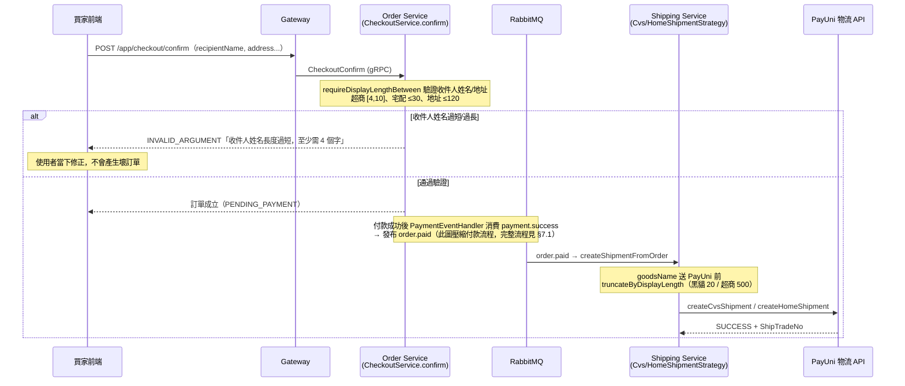

**為何不在 Shipping 端驗證收件人姓名**：建單發生在 MQ 非同步階段，訂單已付款，此時拒絕無法讓使用者修正（只能落 `CREATE_FAILED` shell 卡死）。收件人姓名/地址必須在**結帳同步路徑**（Order）攔截。Shipping 端只負責「系統背景欄位」（商品名稱）的截斷適配。

**Order 端縱深防禦（兩層，非單點）**：收件人姓名/地址在 order-service 有兩道防線——
1. **源頭防線**：`CheckoutService.confirm`（結帳協調層）。價值是**能讓使用者即時修正 + 早期攔截**，在訂單成立前擋下。
2. **收斂點防線（最後一道）**：`OrderService.createOrder`（擴展版，所有「帶收件人建單」路徑的共同收斂點，真正寫入 recipientName 之處）。即使未來新增**繞過 confirm 的建單入口**（admin 補單 / 訂單複製 / 客服改單重建），此處仍攔截不合規 recipientName。

防線**不依賴「confirm 是唯一入口」的前提**——收斂點驗證確保任何建單路徑都覆蓋。兩層使用同一組 `InputValidator` + `PayUniShippingConstraints`，邏輯一致；正常流程 confirm 驗過後 createOrder 為 pass-through（輕微冗餘換取防繞過，符合縱深防禦原則）。

> **一致性與補償邊界**（[後端服務責任邊界規範](../開發規範/後端服務責任邊界規範.md)）：本防護為**寫入路徑同步驗證/截斷**，不引入任何 reconciliation job / backfill CLI / 補償任務。歷史已落地的 `CREATE_FAILED` 空殼（姓名過短造成）屬一次性壞資料，由開發者直接 SQL 清整，不寫入 application code。

---

## 3. 資料庫設計

使用 PostgreSQL。Migration 由 Flyway 管理，僅保留一份 `V1__init_shipping_tables.sql`。

### 3.1 shipments

| **欄位名稱** | **類型** | **必填** | **說明 / 備註** |
|---|---|---|---|
| id | BIGINT | PK | TSID（`TsidUtil.generate()`） |
| shipment_no | VARCHAR(64) | UK | 內部物流單號（保留作為內部識別，不傳給 PayUni） |
| order_no | VARCHAR(64) | YES | 關聯訂單號（Order Service）。**建立 PayUni 物流單時，MerTradeNo 統一使用此值**（詳見 payuni-java-client 設計書 §14） |
| store_id | BIGINT | YES | 賣家 store 代理鍵（store-stint surrogate，由 Gateway `sellerid` resolver 解析後注入；見 [44 號帳號與賣家買家身份模型](./44-帳號與賣家買家身份模型（Account%20%26%20Seller-Buyer%20Identity）詳細設計書.md)） |
| buyer_id | BIGINT | NO | 買家 buyer 代理鍵（退貨物流時可為 NULL） |
| shipping_method | VARCHAR(30) | YES | 配送方式（`SEVEN_ELEVEN_STORE_PICKUP` / `TAQBIN` / `UBER_INSTANT`） |
| mer_id | VARCHAR(32) | NO | PayUni 商家編號（Uber 時為空） |
| ship_trade_no | VARCHAR(64) | NO | PayUni 物流序號（Uber 時為空） |
| uber_delivery_id | VARCHAR(128) | NO | Uber 配送 ID（PayUni 時為空） |
| status | VARCHAR(4) | YES | 內部物流狀態碼（`ShippingStatus.value()`，見 §2.1） |
| provider_status | VARCHAR(20) | NO | 第三方原始狀態碼（PayUni ShipStatus / Uber status），遵循[收斂規範](../開發規範/PayUni%20錯誤回應收斂規範.md) §4.1 SoT |
| provider_message | TEXT | NO | 第三方狀態說明 / 錯誤訊息（正常狀態時為 PayUni 狀態文字；PayUni API 呼叫失敗時寫入錯誤訊息）|
| provider_status_time | TIMESTAMPTZ | NO | PayUni 回報的狀態發生時間（webhook `StatusTime`）—— 與 `updated_at` 並存，為 §3.4 里程碑時間 |
| ship_type | VARCHAR(10) | NO | PayUni 通路類別（`1`=7-ELEVEN, `2`=黑貓） |
| lgs_type | VARCHAR(10) | NO | PayUni 物流型態（`C2C` / `HOME`） |
| goods_type | VARCHAR(10) | NO | 商品溫層（`1`=常溫, `2`=冷凍, `3`=冷藏） |
| spec | VARCHAR(10) | NO | 宅配包裹規格代碼（`1`=60cm, `2`=90cm, `3`=120cm, `4`=150cm），建單時從 dimensionSum 推算 |
| service_type | VARCHAR(10) | YES | 固定 `3`（取貨不付款） |
| trade_amt | BIGINT | YES | 訂單金額（新台幣元） |
| sender_name | VARCHAR(50) | YES | 寄件人姓名 |
| sender_phone | VARCHAR(20) | YES | 寄件人電話 |
| sender_city | VARCHAR(20) | NO | 寄件人城市（宅配用） |
| sender_district | VARCHAR(20) | NO | 寄件人區域（宅配用） |
| sender_address | VARCHAR(200) | NO | 寄件人詳細地址（宅配用） |
| sender_zip_code | VARCHAR(10) | NO | 寄件人郵遞區號（宅配用） |
| recipient_name | VARCHAR(50) | YES | 收件人姓名 |
| recipient_phone | VARCHAR(20) | YES | 收件人電話 |
| recipient_address | VARCHAR(200) | NO | 收件人地址（宅配用） |
| cvs_store_code | VARCHAR(20) | NO | 超商取貨門市代號（超商用）。與上方賣家代理鍵 `store_id` 無關 |
| store_name | VARCHAR(100) | NO | 超商門市名稱（超商用） |
| partner_id | VARCHAR(10) | NO | PayUni 母代碼（超商建單回傳） |
| validation_no | VARCHAR(10) | NO | C2C 超商驗證碼（出貨單列印 Notify 回傳，4 碼） |
| delivery_time_tag | VARCHAR(10) | NO | 希望配達時段（宅配用：`01`/`02`/`04`，後端預設 `04`） |
| label_print_status | VARCHAR(4) | YES | DEFAULT `'4101'`（NONE）。超商出貨單列印 / 宅配託運單取號的外部呼叫狀態機（`LabelPrintStatus` enum，§2.4.5.1）。轉移：NONE/FAILED → REQUESTED →（webhook 或 PDF 回填）→ SUCCEEDED |
| label_print_requested_at | TIMESTAMPTZ | NO | 最近一次 transition 到 REQUESTED 的時間。`reconciliation` 排程依此判斷「卡在 REQUESTED 過久」的閾值；webhook 或同步成功後保留不重置（作為審計） |
| tcat_call_status | VARCHAR(4) | YES | DEFAULT `'4201'`（NONE）。黑貓叫車的外部呼叫狀態機（`TcatCallStatus` enum，§2.4.5.2）。轉移：NONE/FAILED → REQUESTED → SUCCEEDED/FAILED（純同步無 webhook） |
| tcat_call_requested_at | TIMESTAMPTZ | NO | 最近一次 transition 到 REQUESTED 的時間。`reconciliation` 與 ops 告警依此判斷 REQUESTED 卡死閾值。獨立於 `updated_at`（後者會被 webhook 物流貨態打到，無法準確反映 callTcat 時點） |
| tcat_call_time | TIMESTAMPTZ | NO | PayUni 回傳的 CallTime；transition 到 SUCCEEDED 時同步寫入 |
| label_object_key | VARCHAR(512) | NO | 宅配託運單 PDF 的 OSS object_key |
| label_asset_id | BIGINT | NO | Media Service 資產 ID（用於生命週期管理） |
| prod_desc | VARCHAR(200) | NO | 商品描述（傳給 PayUni 顯示） |
| odno | VARCHAR(20) | NO | 出貨單編號（PayUni 回傳） |
| receipt_confirmed | BOOLEAN | YES | DEFAULT FALSE，是否已確認收貨 |
| is_contact | VARCHAR(1) | NO | 是否需要事先電聯 Y/N（generate_home_label 時填入，預設 Y） |
| is_trolley | VARCHAR(1) | NO | 是否需要推車 Y/N（generate_home_label 時填入，預設 N） |
| memo | VARCHAR(100) | NO | 給宅配人員備註（generate_home_label 時填入） |
| shipment_photos | JSONB | NO | 出貨照片（賣家安排出貨時上傳，選填）；格式見下方結構定義 |
| sender_snapshot | JSONB | NO | 寄件人資訊快照（建單成功時凍結，不隨後續修改變動） |
| receiver_snapshot | JSONB | NO | 收件人資訊快照（建單成功時凍結，不隨後續修改變動） |
| is_return | BOOLEAN | YES | DEFAULT FALSE，區分正向/退貨物流 |
| last_reconciled_at | TIMESTAMPTZ | NO | 上次主動向 PayUni 查詢貨態的時間（成功與否皆寫入），用於 §5.19 reconcile 排程退避；NULL 代表從未被掃描。**同時是 §8.5 L2 的租約欄** |
| expected_delivery_date | DATE | NO | 預計送達日期（宅配於 CallTcat 成功時由 `processing_deadline + 3` 工作日換算；超商於 Webhook `ShipStatus=22` 到店時 + 7 天）。NULL 表無法估算，不參與 §5.21 `DELIVERY_OVERDUE` 偵測 |
| label_reconcile_next_at | TIMESTAMPTZ | NO | §8.5 L3 `ShipmentLabelReconcileScheduler` 的**租約到期時間**（不是「已補收旗標」）。NULL 或 `<= NOW()` 表示可搶佔 |
| tcat_stuck_alerted_at | TIMESTAMPTZ | NO | §8.5 L4 黑貓叫件卡死告警的**冷卻租約到期時間**（不是「已告警旗標」——卡死未解除即應持續告警）。NULL 或 `<= NOW()` 表示可搶佔 |
| processing_deadline | TIMESTAMPTZ | NO | 賣家處理期限（UTC）。建單時依配送方式計算寫入；賣家完成處理（3002 取號／3001 叫件／**3003 `REPORT_READY` 宣告備妥**）或排程通知後設為 NULL。權威來源（[09 §5.9](../詳細設計書/09-售後微服務（AfterSales%20Service）詳細設計書.md#59-賣家處理期限自動取消processing-deadline-auto-cancel)） |
| seller_ready_at | TIMESTAMPTZ | NO | 賣家宣告「商品已備妥、可被取件」的絕對時間（UTC）。**provider-neutral 業務事實**：3003 由賣家 `REPORT_READY` 寫入（§5.20.2）；3001／3002 目前不寫（其「已處理」已分別由 `tcat_call_status`／`label_print_status` 表達），未來若有其他 provider 具備一致業務語意可共用本欄。NULL ＝ 尚未宣告備妥。同時是 §5.20.3 對 3003 的「未處理」判定依據，以及責任判定時的 Seller facts 證據之一 |
| created_at | TIMESTAMPTZ | YES | DEFAULT NOW() |
| updated_at | TIMESTAMPTZ | NO | 由 DB trigger 自動維護（INSERT 時為 NULL） |

> 🔴 **`shipments` 是 provider-neutral 表，只放對所有 provider 都有一致業務語意的事實。**
> 即時配送（3003）衍生的 provider-specific 資料一律落 `uber_deliveries`／provider extension table，**不得污染本表**：
> courier identity／`courier.public_phone_info`（匿名轉接號 ＋ `pin_code`）／rematch episode／Uber-specific ETA／
> `pickup_ready_at_snapshot`／`seller_prep_sla_snapshot` 皆屬此類（落點見 [66 詳細](./66-Uber%20Direct%20即時配送整合詳細設計書.md)）。
> 🔴 **不得新增 `courier_assigned BOOLEAN`** —— `status = 933 COURIER_ASSIGNED` 已經表達這件事，加了就是兩份 truth。
> ⚠️ **`pickup_ready_at`／`pickup_deadline_at` 不升上本表**：它們今天只有 3003 有語意，
> 要等確認其他 provider 也有一致業務語意時才升；在那之前一律留在 provider extension table。
> ⚠️ `pin_code` 是**憑證**（單獨持有即可撥打），必須納入 log 遮罩清單；`courier.phone_number` **不得**呈現給賣家。

**`shipment_photos` 結構定義：**

```json
[
  {"assetId": "123456789", "objectKey": "public/shipping/1001/abc.jpg"},
  {"assetId": "987654321", "objectKey": "public/shipping/1001/def.jpg"}
]
```

> **說明**：出貨照片由賣家在安排出貨時選填上傳（超商列印 / 宅配取號皆適用）。前端先透過 Media Service 取得 `stagedToken`，再隨出貨請求一併傳入。後端呼叫 `FinalizeImages` 轉正 + `LinkImages` 建立引用，將 `assetId` + `objectKey` 存入此 JSONB 欄位。TypeHandler 為 `ShipmentPhotoListTypeHandler`，與 Product Service 的 `GalleryListTypeHandler` 慣例一致。

> **快照欄位設計說明**：既有 `sender_name`、`sender_phone`、`recipient_name` 等獨立欄位保留不變（用於查詢/索引）。新增的 JSONB 快照欄位用於**完整歷史記錄**與**稽核追溯**，兩者並存。

**`sender_snapshot` 結構定義：**

```json
{
  "senderName": "王大明",
  "senderPhone": "0912345678",
  "city": "台北市",
  "district": "信義區",
  "addressDetail": "忠孝東路五段123號",
  "zipCode": "110",
  "merId": "HAWK9",
  "onboardingId": "1234567890123456",
  "returnStoreCode": "916712",
  "snapshotAt": "2026-02-27T10:00:00Z"
}
```

**`receiver_snapshot` 結構定義：**

```json
{
  "recipientName": "李小華",
  "recipientPhone": "0923456789",
  "buyerId": "987654321012345",
  "shippingAddress": "台南市東區大學路一號",
  "cvsStoreCode": "170520",
  "storeName": "新興門市",
  "snapshotAt": "2026-02-27T10:00:00Z"
}
```

> ⚠️ 歷史 row 可能是舊 key 形狀（`buyerId` / `storeId`）且不做 backfill ⇒ **reader 必須同時處理新舊兩種形狀。**

**索引：**
- `idx_shipments_order_no UNIQUE (order_no) WHERE is_return = FALSE` — 一筆訂單一筆正向物流單（退貨單另走 `idx_shipments_return`）
- `idx_shipments_ship_trade_no (ship_trade_no) WHERE ship_trade_no IS NOT NULL` — PayUni 物流序號查詢
- `idx_shipments_uber_delivery_id (uber_delivery_id) WHERE uber_delivery_id IS NOT NULL` — Uber 配送 ID 查詢
- `idx_shipments_store (store_id, status)` — 賣家查詢
- `idx_shipments_status (status)` — 狀態過濾
- `idx_shipments_created_at (created_at)` — 時間範圍查詢
- `idx_shipments_return (order_no) WHERE is_return = TRUE` — 退貨查詢
- `idx_shipments_reconcile (last_reconciled_at NULLS FIRST, created_at) WHERE status NOT IN ('11', '41') AND shipping_method <> '3003'（UBER_INSTANT） AND ship_trade_no IS NOT NULL` — §5.19 貨態補收排程掃描
- `idx_shipments_label_reconcile (label_print_status, label_print_requested_at) WHERE label_print_status IN ('4102','4104')` — §5.19.3.B 列印狀態機補收排程掃描
- `idx_shipments_tcat_reconcile (tcat_call_status, tcat_call_requested_at) WHERE tcat_call_status = '4202'` — §5.19.3.C 黑貓 REQUESTED ops 告警掃描
- `idx_shipments_processing_deadline (processing_deadline) WHERE processing_deadline IS NOT NULL AND is_return = FALSE` — §5.20 賣家處理期限排程掃描（[09 §5.9](../詳細設計書/09-售後微服務（AfterSales%20Service）詳細設計書.md#59-賣家處理期限自動取消processing-deadline-auto-cancel)）。⚠️ **述詞刻意不含 `shipping_method`** ⇒ 三種配送方式（含 3003）共用同一個索引，`shipping_method` 的分支留在 §5.20.3 的 SQL 述詞內；新增 3003 分支**不需要新索引**
- `idx_shipments_expected_delivery (expected_delivery_date) WHERE expected_delivery_date IS NOT NULL AND is_return = FALSE AND status NOT IN ('11','41')` — §5.21 `DELIVERY_OVERDUE` 偵測掃描
- `idx_shipments_label_reconcile_lease (label_print_requested_at, label_reconcile_next_at) WHERE label_print_status IN ('4102','4104')` — §8.5 L3 租約搶佔掃描
- `idx_shipments_tcat_stuck_lease (tcat_call_requested_at, tcat_stuck_alerted_at) WHERE tcat_call_status = '4202'` — §8.5 L4 租約搶佔掃描

**約束：**
- `chk_shipping_method CHECK (shipping_method IN ('3001'（TAQBIN）, '3002'（SEVEN_ELEVEN_STORE_PICKUP）, '3003'（UBER_INSTANT）))`
- `chk_trade_amt_non_negative CHECK (trade_amt >= 0)`
- `chk_label_print_status CHECK (label_print_status IN ('4101','4102','4103','4104'))`
- `chk_tcat_call_status CHECK (tcat_call_status IN ('4201','4202','4203','4204'))`

### 3.2 shipment_status_logs

記錄每次狀態變更，用於除錯、稽核與爭議排查。主鍵使用 BIGSERIAL。

| **欄位名稱** | **類型** | **必填** | **說明 / 備註** |
|---|---|---|---|
| id | BIGSERIAL | PK | 自增主鍵 |
| shipment_id | BIGINT | YES | FK → shipments.id |
| from_status | VARCHAR(4) | NO | 變更前狀態（首次建立時為 NULL） |
| to_status | VARCHAR(4) | YES | 變更後狀態 |
| provider_status | VARCHAR(20) | NO | 第三方原始狀態碼 |
| provider_message | TEXT | NO | 第三方狀態說明 / 錯誤訊息 |
| trigger_source | VARCHAR(30) | YES | 觸發來源（`WEBHOOK` / `MQ_ORDER_PAID` / `API_QUERY` / `UBER_CALLBACK`） |
| raw_payload | JSONB | NO | 原始事件 payload（除錯用） |
| created_at | TIMESTAMPTZ | YES | DEFAULT NOW() |

**索引：**
- `idx_status_logs_shipment (shipment_id, created_at)` — 依物流單查歷史
- `idx_status_logs_created (created_at)` — 清理排程用

### 3.3 shipping_webhook_dedup

紀錄從 MQ 消費的每一筆 PayUni 物流事件，防止重複處理。主鍵使用 BIGSERIAL。

| **欄位名稱** | **類型** | **必填** | **說明 / 備註** |
|---|---|---|---|
| id | BIGSERIAL | PK | 自增主鍵 |
| event_key | VARCHAR(255) | YES | 去重鍵（= Webhook Service 的 eventKey：`{merId}:{shipTradeNo}:{shipStatus}`） |
| ship_trade_no | VARCHAR(64) | NO | PayUni 物流序號 |
| process_status | VARCHAR(20) | YES | `SUCCESS` / `FAILED` / `SKIPPED` |
| processed_at | TIMESTAMPTZ | YES | DEFAULT NOW() |

**約束：**
- `UNIQUE (event_key)` — 冪等性保護

**索引：**
- `idx_dedup_processed (processed_at)` — 清理排程用

### 3.4 seller_shipment_settings

記錄賣家在 Shipping Service 中的出貨方式開通狀態與設定，為建單時的前置驗證與參數來源。

| **欄位名稱** | **類型** | **必填** | **說明 / 備註** |
|---|---|---|---|
| id | BIGINT | PK | TSID（`TsidUtil.generate()`），對外暴露的業務 ID |
| store_id | BIGINT | YES | 賣家 store 代理鍵（store-stint surrogate，對應 Seller Service `sellers.store_id`） |
| shipping_type | VARCHAR(30) | YES | 出貨方式類型代碼（`ShippingType`：`3651`=CVS_C2C 超商 C2C 店到店 / `3652`=HOME_DELIVERY 宅配），DEFAULT `'3651'` |
| goods_type | VARCHAR(10) | NO | PayUni 寄件型態代碼；超商必填（`1`=常溫, `2`=冷凍）；宅配為 NULL |
| **sender_name** | **VARCHAR(50)** | **NO** | **寄件人/退貨聯絡人姓名（宅配=寄件人；超商=退貨聯絡人）** |
| **sender_phone** | **VARCHAR(20)** | **NO** | **寄件人/退貨聯絡人電話** |
| **sender_city** | **VARCHAR(20)** | **NO** | **寄件城市（僅宅配使用）** |
| **sender_district** | **VARCHAR(20)** | **NO** | **寄件地區（僅宅配使用）** |
| **sender_address_detail** | **VARCHAR(200)** | **NO** | **寄件詳細地址（僅宅配使用）** |
| **sender_postal_code** | **VARCHAR(10)** | **NO** | **寄件郵遞區號（僅宅配使用；供運費路線推導）** |
| **return_name** | **VARCHAR(50)** | **NO** | **退貨收件人姓名（僅宅配使用；目前與 sender_name 共同維護）** |
| **return_phone** | **VARCHAR(20)** | **NO** | **退貨收件人電話（僅宅配使用；目前與 sender_phone 共同維護）** |
| **return_city** | **VARCHAR(20)** | **NO** | **退貨城市（僅宅配使用；目前與 sender_city 共同維護）** |
| **return_district** | **VARCHAR(20)** | **NO** | **退貨地區（僅宅配使用；目前與 sender_district 共同維護）** |
| **return_address_detail** | **VARCHAR(200)** | **NO** | **退貨詳細地址（僅宅配使用；目前與 sender_address_detail 共同維護）** |
| **return_postal_code** | **VARCHAR(10)** | **NO** | **退貨郵遞區號（僅宅配使用；目前與 sender_postal_code 共同維護）** |
| return_store_code | VARCHAR(20) | NO | 退貨門市代碼（僅超商 C2C 使用，6 碼）；宅配為 NULL |
| return_store_name | VARCHAR(100) | NO | 退貨門市名稱（僅超商 C2C 使用） |
| return_store_address | VARCHAR(200) | NO | 退貨門市地址（僅超商 C2C 使用） |
| label_company_name | VARCHAR(20) | NO | 標籤廠商名稱（僅超商使用，顯示於出貨標籤紙上）；需符合 PayUni 格式限制（C2C: 10 中文/20 字元） |
| product_category_code | VARCHAR(10) | NO | 商品類別代碼（僅宅配使用，PayUni `ProductTypeId` 0001~0015）；超商為 NULL |
| mer_id | VARCHAR(32) | YES | PayUni 商店代碼（建店時從 Seller Service 取得並保存） |
| partner_id | VARCHAR(20) | NO | PayUni 母代碼（建店成功後由 PayUni 回傳） |
| eship_id | VARCHAR(20) | NO | PayUni 子代碼（建店成功後由 PayUni 回傳） |
| provider_status | VARCHAR(20) | NO | PayUni 開通狀態原始值（`1`=正常, `9`=未處理, `2`=審查失敗 等）；遵循[收斂規範](../開發規範/PayUni%20錯誤回應收斂規範.md) §4.1 SoT |
| provider_message | TEXT | NO | PayUni 回傳訊息（首次送審或失敗時的原文）|
| onboarding_status | VARCHAR(4) | YES | 內部建店狀態碼（見 §2.3 OnboardingStatus，`3601`~`3605`） |
| enabled | BOOLEAN | YES | DEFAULT TRUE；是否啟用該出貨方式（賣家可透過 Toggle API 手動停用，不與 PayUni 溝通）。**寫入路徑契約**：`toggleEnabled` 為靜默單寫（只 UPDATE 本表 + insertLog），**不發 MQ event、不對外通知任何服務、不主動清下游 cache**。讀路徑（product / order checkout）為唯一真實來源（SSOT），每次查詢時呼叫 `getSellerShippingConfig` 取當下狀態（02 §2.7.2 / 03 §4.3 `requireSellerOnboarded`）。對齊[後端服務責任邊界規範](../開發規範/後端服務責任邊界規範.md)「不引入跨服務補償任務 / 對外通知 mechanism」。 |
| payuni_submit_status | VARCHAR(4) | YES | DEFAULT `'4301'`（NONE）。賣家建店送 PayUni 的外部呼叫狀態機（`PayUniSubmitStatus` enum，§2.4.5.3）。前端依 `SUCCEEDED` 判斷宅配地址欄位 readonly；後端建單時依此選用 DB 既有寄件地址（PayUni 限制）。轉移：NONE/FAILED → REQUESTED → SUCCEEDED/FAILED |
| payuni_submit_requested_at | TIMESTAMPTZ | NO | 最近一次 transition 到 REQUESTED 的時間。ops 告警與 §5.19 通道 D 依此判斷 REQUESTED 卡死閾值。獨立於 `updated_at`（後者會被 LOCAL_UPDATE 修改地址/姓名/商品類別打到） |
| payuni_submitted_at | TIMESTAMPTZ | NO | 最近一次 transition 到 SUCCEEDED 的時間。可用於 Admin 排查 |
| created_at | TIMESTAMPTZ | YES | DEFAULT NOW() |
| updated_at | TIMESTAMPTZ | NO | 由 DB trigger 自動維護（INSERT 時為 NULL） |

> **欄位使用場景對照**：
>
> | 物流管道 | 建單（出貨）時使用 | 退貨時使用 |
> |---------|------------------|-----------|
> | 宅配 | sender_name/phone + sender_city/district/address_detail/postal_code | return_name/phone + return_city/district/address_detail/postal_code |
> | 超商 | sender_name/phone（寄件人=賣家聯絡人） | sender_name/phone + return_store_code/name/address |
>
> **退貨地址**：`return_*` 是與寄件地址**獨立的一組欄位**（DB 層已分離）。現行前端以同一個表單填寫，後端在建店時把寄件地址複製到退貨地址。

**索引：**
- `idx_settings_store_type UNIQUE ON (store_id, shipping_type, COALESCE(goods_type, ''))` — 唯一業務鍵（每位賣家每種出貨方式 + 寄件型態僅一筆）
- `idx_settings_store (store_id)` — 賣家查詢
- `idx_settings_status (onboarding_status)` — 狀態過濾
- `idx_settings_submit_reconcile (payuni_submit_status, payuni_submit_requested_at) WHERE payuni_submit_status = '4302'` — §5.19.3.D ops 告警掃描

### 3.5 seller_shipment_onboarding_logs

記錄每次建店操作的完整快照（送 PayUni 或僅更新本地），用於稽核、除錯與客服查詢。主鍵使用 BIGSERIAL（內部表）。

| **欄位名稱** | **類型** | **必填** | **說明 / 備註** |
|---|---|---|---|
| id | BIGSERIAL | PK | 自增主鍵 |
| setting_id | BIGINT | YES | FK → `seller_shipment_settings.id` |
| store_id | BIGINT | YES | 賣家 store 代理鍵（冗餘，便於直接查詢） |
| action_type | VARCHAR(20) | YES | 操作類型：`PAYUNI_SUBMIT`（實際送 PayUni）/ `LOCAL_UPDATE`（僅更新本地 DB） |
| request_snapshot | JSONB | YES | 本次使用的完整請求參數快照（含 Seller Service 查詢結果 + 前端傳入參數） |
| response_snapshot | JSONB | NO | PayUni 回應快照（`LOCAL_UPDATE` 時為 NULL） |
| result_status | VARCHAR(20) | YES | 操作結果：`SUCCESS` / `FAILED` |
| error_message | VARCHAR(500) | NO | 失敗時的錯誤訊息 |
| created_at | TIMESTAMPTZ | YES | DEFAULT NOW() |

**索引：**
- `idx_onboarding_logs_setting (setting_id, created_at DESC)` — 依設定查歷史
- `idx_onboarding_logs_store (store_id, created_at DESC)` — 依賣家查歷史
- `idx_onboarding_logs_created (created_at)` — 清理排程用

### 3.6 holidays

管理台灣國定假日與例假日，用於出貨日期 / 配達日期的工作天驗證。資料來源為行政院人事行政總處公開 CSV。主鍵使用 BIGSERIAL。

| **欄位名稱** | **類型** | **必填** | **說明 / 備註** |
|---|---|---|---|
| id | BIGSERIAL | PK | 自增主鍵 |
| holiday_date | DATE | YES | 放假日期（UNIQUE） |
| name | VARCHAR(50) | YES | 假日名稱（例假日 / 中華民國開國紀念日 / 春節 / 補假 等） |
| year | SMALLINT | YES | 年份（方便按年匯入/清除） |
| created_at | TIMESTAMPTZ | YES | DEFAULT NOW() |

**索引：**
- `uk_holidays_date UNIQUE (holiday_date)` — 日期唯一
- `idx_holidays_year (year)` — 按年查詢

**使用方式：**
- CSV 列出的全是非工作天（含週六日「例假日」、國定假日、補假），不在表內即為工作天
- `generate_home_label` 的 `shipDate` / `deliveryDate` 驗證時查詢此表
- 透過 Admin API `POST /api/v1/admin/holidays/import` 傳入政府 CSV URL 匯入

**Readiness 契約**：`HolidayService` 實作 `ComponentReadiness`（見 `Java 微服務開發規範.md §8.7` 與 `24 §3.3`），啟動時 cache 載入完成才算 ready；月排程兜底 refresh 詳見 24 §3.4。

### 3.7 shipping_fee_tiers

運費費率階梯表。根據配送方式、溫層、配送區域與材積計算運費。

| **欄位名稱** | **類型** | **必填** | **說明 / 備註** |
|---|---|---|---|
| id | BIGSERIAL | PK | 自增主鍵（`IdType.AUTO`） |
| shipping_method | VARCHAR(30) | YES | 配送方式 ShippingMethod **value**（`3001`/`3002`/`3003`） |
| delivery_temp | VARCHAR(20) | YES | 溫層 ShippingTemperature **value**（`3201`/`3202`/`3203`） |
| delivery_zone | VARCHAR(30) | YES | 配送區域 DeliveryZoneKey **value**（`8101`/`8102`/`8103`），詳見 §3.7.1 |
| max_dimension_cm | INTEGER | YES | 材積上限（cm） |
| fee | BIGINT | YES | 運費金額（新台幣元） |
| enabled | BOOLEAN | YES | 是否啟用 |
| created_at | TIMESTAMPTZ | YES | DEFAULT NOW() |
| updated_at | TIMESTAMPTZ | NO | 由 MetaObjectHandler 維護 |

#### 3.7.1 `delivery_zone` 規範與 ShippingRoute 對映

**核心觀念**：`delivery_zone` 與 `ShippingRoute` 是**兩個獨立的命名空間**：

| 概念 | 來源 | 值 | 語意 | 用途 |
|---|---|---|---|---|
| `ShippingRoute` | CodeMeta enum | `3501`/`3502`/`3503`/`3504` | 業務語意（4 值：本島互寄/寄離島/離島寄出/離島互寄） | 訂單欄位、API 回應 |
| `DeliveryZoneKey` | CodeMeta enum（內部技術碼） | `8101`/`8102`/`8103` | 費率分組鍵（3 值） | `shipping_fee_tiers.delivery_zone` |

**N:M 對映**（由 `ShippingFeeCacheClient.toDeliveryZone(ShippingRoute)` 處理）：

| ShippingRoute | DeliveryZoneKey | 說明 |
|---|---|---|
| `DOMESTIC` (`3501`) | `DOMESTIC` (`8101`) | 本島區域內運送 |
| `TO_OFFSHORE` (`3502`) | `OFFSHORE` (`8102`) | 本島→離島，與 FROM_OFFSHORE 共用同一費率 |
| `FROM_OFFSHORE` (`3503`) | `OFFSHORE` (`8102`) | 離島→本島，與 TO_OFFSHORE 共用同一費率 |
| `OFFSHORE_TO_OFFSHORE` (`3504`) | `INTER_ISLAND` (`8103`) | 離島↔離島 |

**強制規範**：
1. `shipping_fee_tiers.delivery_zone` **必須**儲存 `DeliveryZoneKey.value()`（`8101`/`8102`/`8103`）
2. shipping-service `ShippingFeeService.calculateShippingOptions` 與 `lookupFee` 使用的 `deliveryZone` 參數，**必須**為 `DeliveryZoneKey.value()`
3. order-service 端從 `ShippingRoute` 對映時**必須**透過 `ShippingFeeCacheClient.toDeliveryZone(ShippingRoute)`，**禁止**字面字串對映
4. **禁止**任何字面 `"DOMESTIC"` / `"OFFSHORE"` / `"INTER_ISLAND"` 比對或預設值

⚠️ `DeliveryZoneKey` 的字面字串與 `ShippingRoute.DOMESTIC.code()` 形狀相同但**語意完全不同**：
前者是 fee_tier 表的費率分組鍵，與業務語意 `ShippingRoute` 是 N:M 關係 ⇒
**不得**以「兩者字串一樣」為由互相代入。

**Readiness 契約**：`ShippingFeeService`（同進程 DB cache，含 `shipping_fee_tiers` + `shipping_method_configs`）實作 `ComponentReadiness`，啟動完成首次載入後才報 ready，避免冷啟動視窗誤判運費。詳見 `Java 微服務開發規範.md §8.7`。

### 3.8 shipping_method_configs

配送方式限制配置表。定義各配送方式+溫層組合的材積/重量/單邊長度限制、預計天數、結算天數與佣金費率。

| **欄位名稱** | **類型** | **必填** | **說明 / 備註** |
|---|---|---|---|
| id | BIGSERIAL | PK | 自增主鍵（`IdType.AUTO`） |
| shipping_method | VARCHAR(30) | YES | 配送方式 |
| delivery_temp | VARCHAR(20) | YES | 溫層 |
| max_dimension_sum_cm | INTEGER | NO | 材積三邊總和上限（cm） |
| max_single_side_cm | INTEGER | NO | 單邊最長限制（cm） |
| max_weight_grams | BIGINT | NO | 重量上限（公克） |
| estimated_days | INTEGER | NO | 預計配送天數 |
| settlement_days | INTEGER | NO | 結算天數 |
| commission_rate | DECIMAL | NO | 佣金費率 |
| commission_min | BIGINT | NO | 最低佣金（新台幣元） |
| enabled | BOOLEAN | YES | 是否啟用 |
| created_at | TIMESTAMPTZ | YES | DEFAULT NOW() |
| updated_at | TIMESTAMPTZ | NO | 由 MetaObjectHandler 維護 |

### 3.9 buyer_store_pickups

買家超商取貨門市記錄表。記錄買家常用的超商取貨門市資訊。主鍵使用 TSID。

| **欄位名稱** | **類型** | **必填** | **說明 / 備註** |
|---|---|---|---|
| id | BIGINT | PK | TSID（`TsidUtil.generate()`，`IdType.INPUT`） |
| account_id | BIGINT | YES | 買家帳號 ID |
| store_code | VARCHAR(20) | YES | 門市代碼（6 碼） |
| store_name | VARCHAR(100) | YES | 門市名稱 |
| store_address | VARCHAR(200) | YES | 門市地址 |
| receiver_name | VARCHAR(50) | YES | 取貨人姓名 |
| receiver_phone | VARCHAR(20) | YES | 取貨人電話 |
| is_default | BOOLEAN | YES | 是否為預設門市 |
| created_at | TIMESTAMPTZ | YES | DEFAULT NOW() |
| updated_at | TIMESTAMPTZ | NO | 由 MetaObjectHandler 維護 |

### 3.10 索引設計總覽

| 表名 | 索引名稱 | 欄位 | 類型 | 說明 |
|------|---------|------|------|------|
| shipments | `idx_shipments_order_no` | `(order_no) WHERE is_return = FALSE` | UNIQUE PARTIAL | 一筆訂單一筆正向物流單 |
| shipments | `idx_shipments_ship_trade_no` | `(ship_trade_no) WHERE ship_trade_no IS NOT NULL` | PARTIAL | PayUni 物流序號查詢 |
| shipments | `idx_shipments_uber_delivery_id` | `(uber_delivery_id) WHERE uber_delivery_id IS NOT NULL` | PARTIAL | Uber 配送 ID 查詢 |
| shipments | `idx_shipments_store` | `(store_id, status)` | BTREE | 賣家查詢 |
| shipments | `idx_shipments_status` | `(status)` | BTREE | 狀態過濾 |
| shipments | `idx_shipments_created_at` | `(created_at)` | BTREE | 時間範圍查詢 |
| shipments | `idx_shipments_return` | `(order_no) WHERE is_return = TRUE` | PARTIAL | 退貨查詢 |
| shipment_status_logs | `idx_status_logs_shipment` | `(shipment_id, created_at)` | BTREE | 依物流單查歷史 |
| shipment_status_logs | `idx_status_logs_created` | `(created_at)` | BTREE | 清理排程用 |
| shipping_webhook_dedup | `uk_dedup_event_key` | `(event_key)` | UNIQUE | 冪等性保護 |
| shipping_webhook_dedup | `idx_dedup_processed` | `(processed_at)` | BTREE | 清理排程用 |
| seller_shipment_settings | `idx_settings_store_type` | `(store_id, shipping_type, COALESCE(goods_type, ''))` | UNIQUE | 唯一業務鍵 |
| seller_shipment_settings | `idx_settings_store` | `(store_id)` | BTREE | 賣家查詢 |
| seller_shipment_settings | `idx_settings_status` | `(onboarding_status)` | BTREE | 狀態過濾 |
| seller_shipment_settings | `idx_settings_submit_reconcile` | `(payuni_submit_status, payuni_submit_requested_at)` | PARTIAL `WHERE payuni_submit_status = '4302'` | §5.19.3.D ops 告警掃描 REQUESTED 卡死 |
| shipments | `idx_shipments_label_reconcile` | `(label_print_status, label_print_requested_at)` | PARTIAL `WHERE label_print_status IN ('4102','4104')` | §5.19.3.B 列印狀態機補收排程掃描 |
| shipments | `idx_shipments_tcat_reconcile` | `(tcat_call_status, tcat_call_requested_at)` | PARTIAL `WHERE tcat_call_status = '4202'` | §5.19.3.C ops 告警掃描 REQUESTED 卡死 |
| seller_shipment_onboarding_logs | `idx_onboarding_logs_setting` | `(setting_id, created_at DESC)` | BTREE | 依設定查歷史 |
| seller_shipment_onboarding_logs | `idx_onboarding_logs_store` | `(store_id, created_at DESC)` | BTREE | 依賣家查歷史 |
| seller_shipment_onboarding_logs | `idx_onboarding_logs_created` | `(created_at)` | BTREE | 清理排程用 |
| holidays | `uk_holidays_date` | `(holiday_date)` | UNIQUE | 日期唯一 |
| holidays | `idx_holidays_year` | `(year)` | BTREE | 按年查詢 |

### 3.11 Migration 摘要

Migration 檔案位於 `services/java/shipping-service/src/main/resources/db/migration/`。`V1__init_shipping_tables.sql` 包含上述所有表的 `CREATE TABLE`、索引、約束與 `updated_at` trigger 定義。Flyway 預設關閉（`FLYWAY_ENABLED=false`），本地開發時由 `docker-compose-local.yml` 設定 `FLYWAY_ENABLED=true` 啟用。

> ⚠️ **`V1` 已凍結（唯讀）**：任何 schema 變更一律新增 `V{N+1}__{verb}_{target}.sql`，**禁止修改 V1**（含空白，會破壞 checksum）。上表的欄位／索引即為 V1 疊加後續 migration 後的**現況**，本節不重述各版差異。流程見 [DB Migration 相容性規範（expand-contract）](../開發規範/DB%20Migration%20相容性規範（expand-contract）.md)、[PostgreSQL 設計規範與最佳實踐](../開發規範/PostgreSQL%20設計規範與最佳實踐.md)與 [38 號 Flyway 自動同步設計書](./38-Flyway%20自動同步與%20DB%20自動初始化（Flyway%20Auto%20Sync%20%26%20DB%20Auto%20Init）詳細設計書.md)。**禁止 SSH 進遠端 DB 手跑 DDL 取代 migration**，遠端由 CI/CD 部署時執行。

🔴 **取號規則**：新增 migration 前**現查** `db/migration/` 目錄取現況最高版號 +1。
查法 `ls services/java/shipping-service/src/main/resources/db/migration/ | sort -t_ -k1.2 -n`
——**不得用 `ls` 的字典序**（它會把 `V9` 排在 `V10` 之後而漏看兩位數版號），
也**不得**在本書寫死任何版號（寫死必然與實況漂移並撞號）。

> ⚠️ `pickup_ready_at_snapshot`／`seller_prep_sla_snapshot`／courier／rematch 等 3003 專屬欄位，
> 以及 `ProviderPickupDeadlineScheduler`（§9.3 L5）的租約欄，**不落 `shipments`**——
> 它們落 provider extension table（見 §3.1 的 provider-neutral 警語）。

**ProviderCallStatus 三欄位的初始化規範**（§2.4 引入）：

| 表 | 欄位 | 預設值 | CHECK 約束 |
|---|---|---|---|
| `shipments` | `label_print_status` | `'4101'` | `CHECK (label_print_status IN ('4101','4102','4103','4104'))` |
| `shipments` | `tcat_call_status` | `'4201'` | `CHECK (tcat_call_status IN ('4201','4202','4203','4204'))` |
| `seller_shipment_settings` | `payuni_submit_status` | `'4301'` | `CHECK (payuni_submit_status IN ('4301','4302','4303','4304'))` |

🔴 **`shipments.label_printed`／`shipments.tcat_called`／`seller_shipment_settings.payuni_submitted`
三個 BOOLEAN 欄位不存在**：所有「是否已列印／已叫車／已送審」的判定一律讀上表的
`*_status` 四態欄位，禁止以 boolean 旗標表達（INV-2）。

---

## 4. 對外 / 對內介面定義

### 4.1 Gateway 對外 REST 映射

**安排出貨路由：**

| Gateway HTTP Endpoint | Method | 對應 gRPC 方法 | 前端傳入參數 |
|----------------------|--------|---------------|------------|
| `/api/v1/app/shipments/:order_no/print_cvs_label` | POST | `PrintCvsLabel` | `shipDate`(必填，接受 `yyyy-MM-dd` 或 `yyyyMMdd`，統一 normalize 為 PayUni 需要的 `yyyyMMdd`)。出貨照片已移至 ConfirmCvsShipment |
| `/api/v1/app/shipments/batch_print_cvs_label` | POST | `BatchPrintCvsLabel` | `orderNos[]`(必填,單次上限由 `SHIPPING_BATCH_MAX_SIZE` 控制,預設 50), `shipDate`(必填，接受 `yyyy-MM-dd` 或 `yyyyMMdd`) |
| `/api/v1/app/shipments/:order_no/confirm` | POST | `ConfirmCvsShipment` | `stagedTokens[]`(選填)。超商賣家確認出貨，推進訂單至 IN_TRANSIT(30) |
| `/api/v1/app/shipments/:order_no/generate_home_label` | POST | `GenerateHomeLabelPdf` | `shipDate`(必填，接受 `yyyy-MM-dd` 或 `yyyyMMdd`), `deliveryDate`(選填,同雙格式,未填=shipDate+1工作天), `stagedTokens[]`(選填) |
| `/api/v1/app/shipments/batch_generate_home_label` | POST | `BatchGenerateHomeLabelPdf` | `items[]`(必填,單次上限由 `SHIPPING_BATCH_MAX_SIZE` 控制,預設 50)。每筆含 `orderNo`+`shipDate`+`deliveryDate?`（雙格式同上）。**不接受出貨照片**（由單筆 API 處理） |
| `/api/v1/app/shipments/:order_no/call_tcat` | POST | `CallTcat` | `isContact`(選填,預設Y), `isTrolley`(選填,預設N), `memo`(選填)。三個欄位會存入 DB 再傳給 PayUni |
| `/api/v1/app/shipments/:order_no/tracking` | GET | `GetSellerShipmentTracking` | `is_return`(query,選填,預設 false)。賣家查看自己訂單物流追蹤，即時同步 PayUni 回單點狀態（§5.7.2）。Ownership 驗 `store_id` |

> **權限要求**：三個端點皆為 `/app/*` Namespace，需 `requireAccountType(2, 3)`（SELLER 或 SELLER_AND_BUYER）。

**建店路由：**

| Gateway HTTP Endpoint | Method | 對應 gRPC 方法 | 前端傳入參數 |
|----------------------|--------|---------------|------------|
| `/api/v1/app/shipping_onboardings/cvs` | POST | `OnboardCvsShipping` | `goodsType`(必填), `returnStoreCode`(必填) |
| `/api/v1/app/shipping_onboardings/home_delivery` | POST | `OnboardHomeDeliveryShipping` | `productCategory`(必填) |
| `/api/v1/app/shipping_onboardings` | GET | `ListShippingOnboardings` | （無） |
| `/api/v1/app/shipping_onboardings/:onboarding_id` | GET | `GetShippingOnboarding` | （無） |
| `/api/v1/app/shipping_onboardings/:onboarding_id/toggle` | POST | `ToggleShippingOnboarding` | `enabled`(必填, bool) |

> **權限要求**：五個端點皆為 `/app/*` Namespace，需 `requireAccountType(2, 3)`（SELLER 或 SELLER_AND_BUYER）。
>
> **路由設計**：使用 Action Endpoint 模式 `POST /{resource}/{id}/{action}`，符合 API 設計規範 §2.2。

**賣家配送方式查詢路由：**

| Gateway HTTP Endpoint | Method | 對應 gRPC 方法 | 前端傳入參數 |
|----------------------|--------|---------------|------------|
| `/api/v1/app/shipping_methods` | GET | `ListSellerShippingMethods` | （無） |

> **權限要求**：`/app/*` Namespace，需 `requireAccountType(2, 3)`（SELLER 或 SELLER_AND_BUYER）。

**買家物流追蹤路由：**

| Gateway HTTP Endpoint | Method | 對應 gRPC 方法 | 前端傳入參數 |
|----------------------|--------|---------------|------------|
| `/api/v1/app/orders/:order_no/logistics` | GET | `GetShipmentTracking` | （無 body；`order_no` 為 path param，`buyer_id` 由 Gateway JWT 注入） |

> **權限要求**：`/app/*` Namespace，需 `requireAccountType(1, 2, 3)`（BUYER / SELLER / SELLER_AND_BUYER；買家查看自己訂單物流）。Ownership 由 shipping-service 驗 `shipments.buyer_id == buyer_id`（不符回 `SHIPMENT_PERMISSION_DENIED`），Gateway 不重複驗外部身分。
>
> **路由設計**：read 操作用 GET（API 設計規範 §2，禁止 read-用-POST / RPC 風格 `/query`）；以 `order_no`（買家資源）為入口，**不接受前端傳 `ship_trade_no`**（避免物流序號列舉 + ownership 黑箱）。`lgsType` 不由前端傳入，shipping-service 以 `deriveLgsType(entity)` 自推（後端為 SoT）。
>
> **PayUni 配額保護**：本路由為買家觸發即時查詢，沿用 §5.7「永遠強制 fresh + touch last_reconciled_at」核心；配額保護由 Gateway per-IP rate limit（`RateLimiter` middleware）負責，service 層不做 freshness gate（與 §5.7 設計哲學一致）。
>
> **Uber / 無 ship_trade_no**：Uber 即時配送不支援 PayUni 查詢、或 `ship_trade_no` 為空時回 DB 當前狀態（非錯誤）；前端據 `shippingMethod` / 空狀態顯示「此配送方式無物流追蹤」文案。

**超商門市地圖選擇路由：**

| Gateway HTTP Endpoint | Method | 處理方式 | 前端傳入參數 |
|----------------------|--------|---------|------------|
| `/api/v1/app/store_map_sessions` | POST | gRPC → `GetStoreMapParams` | `appType`(必填，`buyer` / `seller` / `web`)，`mobileTag`(選填) |
| `/store_map/redirect` | GET | Gateway gRPC → `GetStoreMapRedirectForm(redirect_id)` 取回 canonical 表單並一次性 consume → `html/template` render 自動提交 HTML Form | `id`(query, 後端產生之不可猜 opaque token；短效 10 分鐘、一次性) |
| `/store_map/return` | POST | Gateway gRPC → `DecryptStoreMapResult` → **302 redirect**（行動 App 走 deep link / 網頁走 `{WEB_FRONTEND_URL}/store-map/return?...`） | PayUni 前景 Form POST 回調（`EncryptInfo` / `HashInfo` 走 form body，`app` 走 query） |

> **權限要求**：
> - `/api/v1/app/store_map_sessions`：需 JWT，`requireAccountType(1, 2, 3)`（BUYER / SELLER / SELLER_AND_BUYER 皆可使用，買家選取貨門市、賣家選退貨門市）
> - `/store_map/redirect` 與 `/store_map/return`：頂層路由，免 JWT（前者為 WebView 開啟，後者為 PayUni 前景回調）
>
> **設計模式**：與付款流程（`/payment/redirect` + `/payment/return`）採同一架構（Gateway 薄代理 + 微服務 gRPC 處理 + 302 redirect 最終出口），但 SoT 不同 — store_map 為 stateless session、SoT 在 PayUni 保留的 `MapReturnURL?app=xxx` query；payment 則 SoT 在 `payment_transactions.client_type` / `app_type` DB lookup。詳見 §5.14.6。
>
> **`/store_map/redirect` 安全設計**：GET 端零 client 可控 render 資料——`id` 為後端產生之不可猜 opaque token（UUID，Redis key `storemap:redirect:{id}`，TTL 10 分鐘、一次性 consume），query 不再攜帶任何表單欄位（舊 `?data={base64}` round-trip 已物理移除，因其資料未經 escape 直接拼入 HTML，構成反射型 XSS + open form-action）。Gateway 渲染改用 `html/template`（context-aware escape），`formAction` 需通過 host allowlist 驗證，驗證失敗或 `id` 不存在/過期/已消費 → 受控錯誤頁（非 500 leak）。

> **後端自動取得**：所有 PayUni API 必填參數（ShipTradeNo、GoodsType、Spec、寄收件人資訊等）皆由後端從 DB / Order Service / Seller Service 自動取得，前端僅需傳入上表列出的參數。
>
> **出貨照片**：`stagedTokens` 為前端透過 Media Upload Session 取得的暫存 Token（參考 Product Service 圖片上傳流程），後端呼叫 `FinalizeImages` 轉正 → 寫入 `shipments.shipment_photos` JSONB → `LinkImages` 綁定至物流單。照片上傳為選填，失敗不影響主流程。**超商出貨照片由 `ConfirmCvsShipment` API 處理**（PrintCvsLabel 已不接受照片參數）；宅配出貨照片由 `GenerateHomeLabelPdf` 處理。
>
> **PrintCvsLabel 同步等待機制**：此 API 觸發 PayUni 列印後等待最多 **55 秒**，等待 Webhook 回填交貨便代碼。Gateway gRPC timeout 為 **58 秒**。回應 `CvsLabelData` 新增 `partnerId`、`odno`、`validationNo`、`webhookReceived` 欄位。詳見 §5.2 + §5.15。

**Gateway DTO 欄位：**

| DTO | 欄位 |
|-----|---------|
| `PrintCvsLabelReq` | `shipDate`（**不接受**出貨照片參數，照片走 `ConfirmCvsShipment`） |
| `ConfirmCvsShipmentReq` | `stagedTokens []string`（選填）— 超商確認出貨，推進訂單至 IN_TRANSIT(30) |
| `CvsLabelDataResp` | `partnerId`、`odno`、`validationNo`（string）、`webhookReceived`（bool） |
| `GenerateHomeLabelReq` | `stagedTokens []string`（選填） |
| `HomeLabelDataResp` | `shipmentPhotos []string`（出貨照片 CDN URL 陣列，選填） |
| `ShipmentDetailResp` | `providerStatus`、`providerMessage`（遵循收斂規範 §7 Gateway 透傳；由 proto `provider_status` / `provider_message` 直映射）；`labelPrintStatus`（string `"4101"~"4104"`）、`tcatCallStatus`（string `"4201"~"4204"`）|
| `OrderLogisticsResp` | 買家物流追蹤回應：`orderNo`、`shipTradeNo`、`shippingMethod`、`status`、`statusLabel`、`providerStatus`、`providerMessage`、`statusTime`、`storeName`、`recipientName`（買家本人資料）、`createdAt`。由 `ShipmentDetailView` 子集映射，🔴 **不含** sender 資訊 / `labelUrl` / `recipientPhone` / `recipientAddress`（買家追蹤頁最小揭露）|
| `ShippingOnboardingResp` | `providerStatus`、`providerMessage`、`payuniSubmitStatus`（string `"4301"~"4304"`）|

> **收斂規範透傳要求**：handler DTO 必須有 `providerStatus` / `providerMessage`，envelope 結構不變（依規範 §7.1）；Swagger 註解依 [Gateway Swagger 註解規範](../開發規範/Gateway%20Swagger%20註解規範.md)同步。所有涉及 PayUni 狀態的錯誤回應（`SHIPMENT_PAYUNI_CALL_FAILED` / `ONBOARDING_PAYUNI_ERROR` 等）必須在 `data.*` 帶 PayUni 原始狀態碼與訊息。

### 4.2 gRPC Proto（ShippingService）

Proto 檔案路徑：`api/proto/shipping/shipping.proto`

```protobuf
syntax = "proto3";
package hawkr.shipping;

option go_package = "github.com/Will413028/hawkr/go-pkg/proto/shipping";
option java_multiple_files = true;
option java_package = "io.github.will413028.hawkr.shipping.grpc";
option java_outer_classname = "ShippingProto";

service ShippingService {
    // ==================== 賣家端 — 安排出貨（經 Gateway）====================

    // 超商出貨單列印（觸發 PayUni 列印處理，出貨便代碼由 Webhook 回填）
    rpc PrintCvsLabel(PrintCvsLabelRequest) returns (PrintCvsLabelResponse);

    // 產宅配編號並下載託運單 PDF（後端呼叫 PayUni → 上傳 OSS → 回傳 CDN URL）
    rpc GenerateHomeLabelPdf(GenerateHomeLabelPdfRequest) returns (GenerateHomeLabelPdfResponse);

    // 批次宅配取號 PDF（fan-out 並行；同步等待全部完成）
    rpc BatchGenerateHomeLabelPdf(BatchGenerateHomeLabelPdfRequest) returns (BatchGenerateHomeLabelPdfResponse);

    // 呼叫黑貓預約取件（背景 API）
    rpc CallTcat(CallTcatRequest) returns (CallTcatResponse);

    // 超商賣家確認出貨（出貨照片選填，推進訂單到配送中）
    rpc ConfirmCvsShipment(ConfirmCvsShipmentRequest) returns (ConfirmCvsShipmentResponse);

    // ==================== 服務間呼叫（不對外暴露）====================

    // 查詢物流單（Order Service 用，聚合訂單詳情）
    rpc GetShipmentByOrderNo(GetShipmentByOrderNoRequest) returns (GetShipmentResponse);

    // 批次查詢物流單（Order Service 賣家列表頁用，避免 N+1）
    rpc GetShipmentsByOrderNos(GetShipmentsByOrderNosRequest) returns (GetShipmentsByOrderNosResponse);

    // 批次查詢 provider 狀態（Order / AfterSales 聚合異常列表用，遵循收斂規範 §6.3）
    rpc BatchGetProviderStatusByOrderIds(BatchGetProviderStatusByOrderIdsRequest) returns (BatchGetProviderStatusByOrderIdsResponse);

    // 主動查詢 PayUni 物流狀態（內部 / 賣家「同步」按鈕用，以 shipment_no 為 key、無 ownership 檢查；webhook 漏收的常態補救由 §5.19 排程處理）
    rpc QueryShipmentStatus(QueryShipmentStatusRequest) returns (GetShipmentResponse);

    // ==================== 買家端 — 物流追蹤（經 Gateway）====================

    // 買家查看訂單物流追蹤（即時向 PayUni 同步當前狀態並回傳；以 order_no 為 key + buyer ownership 驗證）
    // 與 QueryShipmentStatus 共用「永遠強制 fresh + touch last_reconciled_at」核心（§5.7），差別僅在入口 key 與 ownership
    rpc GetShipmentTracking(GetShipmentTrackingRequest) returns (GetShipmentResponse);

    // 賣家查看訂單物流追蹤（與買家同構，以 order_no + is_return 為 key + seller ownership 驗證；§5.7.2）
    rpc GetSellerShipmentTracking(GetSellerShipmentTrackingRequest) returns (GetShipmentResponse);

    // ==================== 建店 API（賣家端，經 Gateway）====================

    // 超商 C2C 建店（首次送 PayUni 審核開通；後續送 PayUni 更新資訊，所有欄位皆可更新）
    rpc OnboardCvsShipping(OnboardCvsShippingRequest) returns (OnboardShippingResponse);

    // 宅配建店（首次送 PayUni 審核開通；後續送 PayUni 更新資訊，但地址欄位不可更新 — PayUni 限制）
    // payuni_submit_status=SUCCEEDED(4303) 時：senderAddress 使用 DB 原值送 PayUni，DB 也不更新地址欄位；姓名/電話/商品類別可更新
    rpc OnboardHomeDeliveryShipping(OnboardHomeDeliveryRequest) returns (OnboardShippingResponse);

    // 查詢賣家建店設定列表
    rpc ListShippingOnboardings(ListShippingOnboardingsRequest) returns (ListShippingOnboardingsResponse);

    // 查詢單一建店設定詳情
    rpc GetShippingOnboarding(GetShippingOnboardingRequest) returns (GetShippingOnboardingResponse);

    // 切換建店設定啟用/停用（純平台內部，不與 PayUni 溝通）
    rpc ToggleShippingOnboarding(ToggleShippingOnboardingRequest) returns (OnboardShippingResponse);

    // ==================== 賣家配送方式查詢（經 Gateway）====================

    // 查詢賣家可用配送方式（含建店狀態）
    rpc ListSellerShippingMethods(ListSellerShippingMethodsRequest) returns (ListSellerShippingMethodsResponse);

    // ==================== 超商門市地圖（經 Gateway，買家/賣家共用）====================

    // 取得門市地圖加密參數（前端用此參數開啟 WebView Form POST 到 PayUni）
    rpc GetStoreMapParams(GetStoreMapParamsRequest) returns (GetStoreMapParamsResponse);

    // 解密門市選擇結果（PayUni 前景回調後，Gateway 呼叫此 RPC 解密）
    rpc DecryptStoreMapResult(DecryptStoreMapResultRequest) returns (DecryptStoreMapResultResponse);

    // 門市地圖 Form POST 重導表單查詢（GET /store_map/redirect?id=... internal-only，取回 canonical 表單並一次性 consume）
    rpc GetStoreMapRedirectForm(GetStoreMapRedirectFormRequest) returns (GetStoreMapRedirectFormResponse);
}

// ==================== 超商出貨單列印（後端處理）====================

message PrintCvsLabelRequest {
    int64 store_id = 1;    // Gateway JWT 注入（E.5.5 例外）
    string order_no = 2;            // 訂單編號
    string ship_date = 3;           // 出貨日期 YYYYMMDD
}

message PrintCvsLabelResponse {
    int32 code = 1;
    string message = 2;
    CvsLabelData data = 3;
}

message CvsLabelData {
    string shipment_no = 1;        // 內部物流單號
    string partner_id = 2;         // 出貨便母代碼（3 碼，55 秒內 Webhook 回填；超時為空）
    string odno = 3;               // 出貨單編號（8 碼，55 秒內 Webhook 回填；超時為空）
    string validation_no = 4;      // C2C 驗證碼（4 碼，55 秒內 Webhook 回填；超時為空）
    bool webhook_received = 5;     // 是否在等待期內收到 Webhook（true=已收到代碼, false=超時）
}

// ==================== 宅配取號 PDF ====================

message GenerateHomeLabelPdfRequest {
    int64 store_id = 1;    // Gateway JWT 注入（E.5.5 例外）
    string order_no = 2;            // 訂單編號
    string ship_date = 3;           // 出貨日期 YYYYMMDD（需 > 今日，非週日/國定假日）
    string delivery_date = 4;       // 配達日期 YYYYMMDD（需 > ship_date）
    repeated string staged_tokens = 5; // 出貨照片 stageToken（選填）
    // Spec 無需前端傳入，由後端從 shipments.spec（建單時從訂單材積推算）取得
}

message GenerateHomeLabelPdfResponse {
    int32 code = 1;
    string message = 2;
    HomeLabelData data = 3;
}

message HomeLabelData {
    string label_url = 1;           // 託運單 PDF CDN URL
    string shipment_no = 2;        // 內部物流單號
}

// ==================== 批次宅配取號 PDF ====================

message BatchGenerateHomeLabelPdfRequest {
    int64 store_id = 1;                       // Gateway JWT 注入（E.5.5 例外）
    repeated BatchHomeLabelItem items = 2;             // 待處理項目（單次上限由 SHIPPING_BATCH_MAX_SIZE 控制）
}

message BatchHomeLabelItem {
    string order_no = 1;            // 訂單編號
    string ship_date = 2;           // 出貨日期 YYYYMMDD（每筆獨立）
    string delivery_date = 3;       // 配達日期 YYYYMMDD（選填，未填=shipDate+1工作天）
}

message BatchGenerateHomeLabelPdfResponse {
    int32 code = 1;
    string message = 2;
    BatchHomeLabelData data = 3;
}

message BatchHomeLabelData {
    string total_count = 1;                              // 總筆數
    string success_count = 2;                            // 成功筆數
    repeated BatchHomeLabelResult results = 3;           // 每筆結果（順序與 request items 相同）
}

message BatchHomeLabelResult {
    string order_no = 1;            // 訂單編號
    string shipment_no = 2;        // 內部物流單號（成功時才有）
    string label_url = 3;           // 託運單 PDF CDN URL（成功時才有）
    bool success = 4;               // 該筆是否成功
    string message = 5;             // 失敗原因（成功時為空）
}

// ==================== 呼叫黑貓 ====================

message CallTcatRequest {
    int64 store_id = 1;    // Gateway JWT 注入（E.5.5 例外）
    string order_no = 2;            // 訂單編號
    string is_contact = 3;          // 是否需要事先電聯 Y/N（選填，預設 Y）
    string is_trolley = 4;          // 是否需要推車 Y/N（選填，預設 N）
    string memo = 5;                // 給宅配人員備註（選填，最長 100 位）
    // 三個欄位會先存入 DB（shipments.is_contact/is_trolley/memo）再傳給 PayUni
}

message CallTcatResponse {
    int32 code = 1;
    string message = 2;
    CallTcatData data = 3;
}

message CallTcatData {
    string call_time = 1;           // 呼叫時間（ISO 8601）
    string shipment_no = 2;        // 內部物流單號
}

// ==================== 超商確認出貨 ====================

message ConfirmCvsShipmentRequest {
    int64 store_id = 1;       // Gateway JWT 注入（E.5.5 例外）
    string order_no = 2;               // 訂單編號
    repeated string staged_tokens = 3; // 出貨照片 stageToken（選填）
}

message ConfirmCvsShipmentResponse {
    int32 code = 1;
    string message = 2;
}

// ==================== 查詢物流單 ====================

message GetShipmentByOrderNoRequest {
    string order_no = 1;
}

message GetShipmentsByOrderNosRequest {
    repeated string order_nos = 1;  // 賣家列表頁該頁訂單號清單
}

message GetShipmentsByOrderNosResponse {
    int32 code = 1;
    string message = 2;
    repeated ShipmentDetailView data = 3;  // 找不到的 order_no 不會出現在 data 中
}

// ==================== 批次 provider 狀態聚合（聚合服務用）====================
// 遵循收斂規範 §6.3。Order / AfterSales 聚合異常列表時呼叫，避免 N+1。

message BatchGetProviderStatusByOrderIdsRequest {
    repeated string order_ids = 1;          // 訂單 ID 清單（建議單次 ≤ 100）
    bool is_return = 2;                     // false = 正向物流；true = 退貨物流
}

message BatchGetProviderStatusByOrderIdsResponse {
    int32 code = 1;
    string message = 2;
    map<string, ProviderStatusEntry> entries = 3;  // key = order_id；找不到對應 shipment 則該 key 省略
}

message ProviderStatusEntry {
    string provider_status = 1;       // PayUni 原始狀態碼（可為空字串）
    string provider_message = 2;      // PayUni 原始訊息
}

message GetShipmentResponse {
    int32 code = 1;
    string message = 2;
    ShipmentDetailView data = 3;
}

message ShipmentDetailView {
    string shipment_no = 1;
    string order_no = 2;
    string shipping_method = 3;      // CONVENIENCE_STORE / HOME_DELIVERY / UBER_INSTANT
    string status = 4;               // 內部物流狀態碼（數字字串）
    string provider_status = 5;      // 第三方原始狀態碼（遵循收斂規範 §2）
    string provider_message = 6;     // 第三方狀態說明 / 錯誤訊息
    string ship_trade_no = 7;        // PayUni 物流序號
    string recipient_name = 8;
    string recipient_phone = 9;
    string recipient_address = 10;
    string store_id = 11;
    string store_name = 12;
    string label_key = 13;           // 宅配託運單 PDF 的 objectKey（49 號 §6.6：Gateway 組 labelUrl；僅宅配使用）
    string status_time = 14;         // 最新狀態更新時間（ISO 8601）
    string created_at = 15;          // 建立時間（ISO 8601）
    string label_print_status = 16;  // 列印狀態機 value（LabelPrintStatus，"4101"/"4102"/"4103"/"4104"）
    string tcat_call_status = 17;    // 黑貓叫件狀態機 value（TcatCallStatus，"4201"/"4202"/"4203"/"4204"）
    string partner_id = 18;          // 超商出貨便母代碼（3 碼，Webhook 回填）
    string odno = 19;                // 超商出貨單編號（8 碼，Webhook 回填）
    string validation_no = 20;       // 超商 C2C 驗證碼（4 碼，Webhook 回填）
    repeated string shipment_photo_keys = 21; // 出貨照片 objectKey 陣列（49 號 §6.6：Gateway 組 shipmentPhotoUrls；選填）
    string status_label = 22;        // 內部物流狀態人類可讀文案（ShippingStatus.label() — CodeMeta SoT，Gateway 純透傳，前端免再對照）
}

// ==================== 主動查詢 ====================

message QueryShipmentStatusRequest {
    string shipment_no = 1;         // 內部物流單號
}

// ==================== 買家物流追蹤 ====================

message GetShipmentTrackingRequest {
    string order_no = 1;            // 訂單編號（買家手上唯一識別，避免暴露 ship_trade_no serial）
    int64 buyer_id = 2;             // Gateway `buyerid` resolver 解析後的現任 buyer_id（§4.1 例外 #1，僅 Request 用）
}

message GetSellerShipmentTrackingRequest {
    string order_no = 1;            // 訂單編號
    int64 store_id = 2;    // Gateway JWT 注入（§4.1 例外 #1，僅 Request 用）
    bool is_return = 3;             // false=正向單（預設）, true=退貨單
}

// ==================== 超商 C2C 建店 ====================

message OnboardCvsShippingRequest {
    int64 store_id = 1;      // Gateway JWT 注入（E.5.5 例外）
    string goods_type = 2;            // 寄件型態 value：3201 / 3203（由後端映射為 PayUni GoodsType）
    string return_store_code = 3;     // 退貨門市代碼（C2C 必填，6 碼）
    string return_store_name = 4;     // 退貨門市名稱
    string return_store_address = 5;  // 退貨門市地址
    string sender_name = 6;          // 退貨聯絡人姓名（必填）
    string sender_phone = 7;         // 退貨聯絡人電話（必填）
    // label_company_name 不由前端傳入，後端自動取賣家店名截斷至 10 中文字
}

// ==================== 宅配建店 ====================

message OnboardHomeDeliveryRequest {
    int64 store_id = 1;      // Gateway JWT 注入（E.5.5 例外）
    string product_category = 2;      // 商品類別 value（PayUni ProductTypeId，如 "0001"）
    string sender_name = 3;          // 寄件人姓名（必填）
    string sender_phone = 4;         // 寄件人電話（必填）
    string sender_city = 5;          // 寄件城市（必填）
    string sender_district = 6;      // 寄件地區（必填）
    string sender_address_detail = 7; // 寄件詳細地址（必填）
    string sender_postal_code = 8;   // 寄件郵遞區號（必填）
    // 退貨地址（可選；未填則後端自動複製寄件地址，目前與寄件地址共同維護）
    string return_name = 9;          // 退貨收件人姓名
    string return_phone = 10;        // 退貨收件人電話
    string return_city = 11;         // 退貨城市
    string return_district = 12;     // 退貨地區
    string return_address_detail = 13; // 退貨詳細地址
    string return_postal_code = 14;  // 退貨郵遞區號
}

// ==================== 建店共用回應 ====================

message OnboardShippingResponse {
    int32 code = 1;
    string message = 2;
    ShippingOnboardingView data = 3;
}

message ShippingOnboardingView {
    string onboarding_id = 1;         // 建店設定 ID（TSID 數字字串）= seller_shipment_settings.id
                                  // 🔴 僅 PayUni 軸（CVS／宅配）有值；Uber（3003）沒有這張表的列
                                  //    ⇒ 賣家 Uber 狀態走 ListSellerShippingMethods（66 §6.1.5 S-U6）
    string shipping_type = 2;         // CVS_C2C / HOME_DELIVERY
    string goods_type = 3;            // 寄件型態（超商用，宅配為空字串）
    string onboarding_status = 4;     // 內部建店狀態碼（數字字串，如 "0", "10"）
    string provider_status = 5;       // PayUni 原始開通狀態
    string partner_id = 6;            // PayUni 母代碼
    string eship_id = 7;              // PayUni 子代碼
    string return_store_code = 8;     // 退貨門市代碼（超商用，宅配為空字串）
    string product_category = 9;      // 商品類別代碼（宅配用，超商為空字串）
    string label_company_name = 10;   // 標籤廠商名稱（超商用）
    string enabled = 11;              // 是否啟用（"true" / "false"）
    string created_at = 12;           // ISO 8601
    string updated_at = 13;           // ISO 8601
    // 寄件人/退貨資訊
    string sender_name = 14;          // 寄件人/退貨聯絡人姓名
    string sender_phone = 15;         // 寄件人/退貨聯絡人電話
    string sender_city = 16;          // 寄件城市（宅配用）
    string sender_district = 17;      // 寄件地區（宅配用）
    string sender_address_detail = 18; // 寄件詳細地址（宅配用）
    string sender_postal_code = 19;   // 寄件郵遞區號（宅配用）
    string return_name = 20;          // 退貨收件人姓名（宅配用）
    string return_phone = 21;         // 退貨收件人電話（宅配用）
    string return_city = 22;          // 退貨城市（宅配用）
    string return_district = 23;      // 退貨地區（宅配用）
    string return_address_detail = 24; // 退貨詳細地址（宅配用）
    string return_postal_code = 25;   // 退貨郵遞區號（宅配用）
    string return_store_name = 26;    // 退貨門市名稱（超商用）
    string return_store_address = 27; // 退貨門市地址（超商用）
    string payuni_submit_status = 28; // 建店送 PayUni 狀態機 value（PayUniSubmitStatus，"4301"/"4302"/"4303"/"4304"）。前端依 SUCCEEDED 判斷宅配地址 readonly
    string provider_message = 29;     // PayUni 回傳訊息（失敗時提供錯誤原因，遵循收斂規範 §4.1 SoT）
}

// ==================== 切換建店啟用/停用 ====================

message ToggleShippingOnboardingRequest {
    int64 store_id = 1;      // Gateway JWT 注入（E.5.5 例外）
    string onboarding_id = 2;         // 建店設定 ID
    bool enabled = 3;                 // true=啟用, false=停用
}
// gRPC 內部回傳 OnboardShippingResponse（完整建店資訊），但 Gateway 僅回傳 { code, message }，不透傳 data

// ==================== 查詢建店列表 ====================

message ListShippingOnboardingsRequest {
    int64 store_id = 1;      // Gateway JWT 注入（E.5.5 例外）
}

message ListShippingOnboardingsResponse {
    int32 code = 1;
    string message = 2;
    repeated ShippingOnboardingView onboardings = 3;
}

// ==================== 查詢建店詳情 ====================

message GetShippingOnboardingRequest {
    int64 store_id = 1;      // Gateway JWT 注入（E.5.5 例外）
    string onboarding_id = 2;         // 建店設定 ID
}

message GetShippingOnboardingResponse {
    int32 code = 1;
    string message = 2;
    ShippingOnboardingView data = 3;
}

// ==================== 賣家配送方式查詢 ====================

message ListSellerShippingMethodsRequest {
    int64 account_id = 1;            // Gateway JWT 注入（E.5.5 例外）
    int32 account_type = 2;          // Gateway JWT 注入（E.5.5 例外）
}

message ListSellerShippingMethodsResponse {
    int32 code = 1;
    string message = 2;
    repeated SellerShippingMethodView methods = 3;
}

message SellerShippingMethodView {
    string shipping_method = 1;       // ShippingMethod Enum value
    string goods_type = 2;            // 超商溫層（AMBIENT / FROZEN），宅配及 Uber 為空
    string display_name = 3;          // 前端顯示名稱
    string description = 4;           // 描述
    bool available = 5;               // 是否可用（onboarding_status=ACTIVE && enabled=true）
    bool onboarding_required = 6;     // 是否需要建店開通
    string onboarding_status = 7;     // 建店狀態（ACTIVE / PENDING_REVIEW 等，未建店為空）
    string onboarding_id = 8;         // 建店設定 ID，未建店為空
    string enabled = 9;               // 賣家是否啟用此配送方式（"true" / "false"，未建店為空字串）
}

// ==================== 賣家物流設定查詢（內部服務間 RPC） ====================

// 供 Order Service / Product Service 查詢賣家的物流開通狀態與寄件郵遞區號
// 用途：
//   (1) 結帳運費精算時取得寄件 zip_code 推導路線
//   (2) 結帳 validate / shippingFee / preview / confirm 過濾 dangling shipping options（fail-close，03 §4.3）
//   (3) 公開商品 read path（詳情 / 列表 / brief / related）過濾 dangling shipping_methods（02 §2.7.2）
//   (4) `requireSellerOnboarded(storeId, shippingMethodCode)` 共用方法 — 全部 4 個結帳流程進入 `getSenderPostalCode` 前強制 call
//
// 契約：本 RPC 為 SSOT。caller 必須 fail-close（RPC 失敗 → 拋 SERVICE_UNAVAILABLE），禁止 catch + log.warn fail-open。
rpc GetSellerShippingConfig(GetSellerShippingConfigRequest) returns (GetSellerShippingConfigResponse);

message GetSellerShippingConfigRequest {
    int64 store_id = 1;               // 賣家 store 代理鍵（內部服務間呼叫，免權限驗證）
}

message GetSellerShippingConfigResponse {
    int32 code = 1;
    string message = 2;
    repeated SellerShippingConfigItem configs = 3;
}

message SellerShippingConfigItem {
    string shipping_method = 1;       // TAQBIN / SEVEN_ELEVEN_STORE_PICKUP
    string goods_type = 2;            // AMBIENT / FROZEN（宅配為空字串）
    bool available = 3;               // 是否已開通且啟用（onboarding_status=ACTIVE && enabled=true）
    string sender_postal_code = 4;    // 寄件郵遞區號（僅宅配有值，供運費路線推導）
    string sender_city = 5;           // 寄件城市（訂單快照用）
    string sender_district = 6;       // 寄件地區（訂單快照用）
}

// ==================== 超商門市地圖 ====================

message GetStoreMapParamsRequest {
    int64 account_id = 1;             // Gateway JWT 注入（E.5.5 例外）
    string app_type = 2;              // "buyer" 或 "seller"，決定回調時的 Deep Link Scheme
    string mobile_tag = 3;            // "Y"=手機版(預設), "N"=PC版
}

message GetStoreMapParamsResponse {
    int32 code = 1;
    string message = 2;
    StoreMapFormData data = 3;
}

// PayUni 門市地圖 Form POST 所需參數（Gateway 用來組裝 redirectUrl）
message StoreMapFormData {
    string form_action = 1;           // PayUni 門市地圖 URL
    string mer_id = 2;                // 平台商店代號（HAWK）
    string version = 3;               // API 版本（固定 "1.1"）
    string encrypt_info = 4;          // AES 加密字串
    string hash_info = 5;             // SHA256 簽章
}

message DecryptStoreMapResultRequest {
    string encrypt_info = 1;          // PayUni 回傳的 AES 加密字串
    string hash_info = 2;             // PayUni 回傳的 SHA256 簽章
}

message DecryptStoreMapResultResponse {
    int32 code = 1;
    string message = 2;
    StoreMapResult data = 3;
}

// PayUni MapJson 解密後的門市資訊
message StoreMapResult {
    string store_id = 1;              // 門市代碼（6 碼，如 "916712"）
    string store_name = 2;            // 門市名稱（如 "敦安門市"）
    string address = 3;               // 門市地址
    string insular_area = 4;          // "I"=本島, "O"=離島
    string store_type = 5;            // 門市類型（固定 "SEVEN"）
}

// 門市地圖 Form POST 重導表單查詢（internal-only）
message GetStoreMapRedirectFormRequest {
    string redirect_id = 1;           // opaque token（UUID，Redis key `storemap:redirect:{id}` 一次性 consume）
}

message GetStoreMapRedirectFormResponse {
    string form_action = 1;           // PayUni 門市地圖 Form POST action URL
    string mer_id = 2;                // 平台商店代號（HAWK）
    string version = 3;               // API 版本
    string encrypt_info = 4;          // AES 加密字串
    string hash_info = 5;             // SHA256 簽章
}
```

### 4.3 依賴的外部 gRPC

| 服務 | RPC | 用途 | 呼叫時機 |
|------|-----|------|---------|
| **Order Service** | `GetOrderForShipping(order_no)` | 取得收件人資訊、配送方式、金額、商品描述、溫層、材積、merId | 背景自動建單（§5.1） |
| **Seller Service** | `BatchGetSellerMeta(store_ids)` | 取得賣家 payuni_mer_id、seller_name、contact_email | 建店流程（§5.9 / §5.10） |
| **Media Service** | `ServerUploadAndFinalize(pdf_bytes, ref_type)` | 後端上傳宅配 PDF 標籤至 OSS | 宅配取號 PDF（§5.3） |
| **Media Service** | `FinalizeImages(stagedTokens, ref_type)` | 出貨照片暫存 Token 轉正 | 出貨照片處理（§5.2 / §5.3） |
| **Media Service** | `LinkImages(ref_type, ref_id, assetIds)` | 建立圖片引用（防 GC 清理） | 出貨照片/PDF 綁定 |
| **Media Service** | `UnlinkImages(ref_type, ref_id)` | 解除圖片引用（配送完成後） | 物流送達（§5.5） |

### 4.4 MQ 發布事件（Shipping → 下游）

| Routing Key | Exchange | 業務時機 | 下游處理 |
|---|---|---|---|
| `shipment.created` | `hawkr.shipping` | 物流單建立成功 | Order 寫入 `orders.processing_deadline`（§5.20）；notification-service 推播賣家「買家已下單」（Backstop 救活時亦在救活當下推播） |
| `shipment.label.updated` | `hawkr.shipping` | 超商列印 Webhook 回填出貨便代碼（partner_id / odno / validation_no） | `isReturn=false` → Order 快照至 `orders`；`isReturn=true` → AfterSales 快照至 `aftersale_cases` |
| `shipment.status.changed` | `hawkr.shipping` | 物流狀態變更 | Order 寫入 `orders.shipping_status` + `orders.shipping_status_desc` |
| `shipment.delivered` | `hawkr.shipping` | 物流送達（PICKED_UP=11） | Order 推進 DELIVERED(40) + 啟動自動完成倒數 |
| `shipment.processing.timeout` | `hawkr.shipping` | 賣家處理期限逾期（§5.20）。🔴 **3003 另有前置條件**：必須先跑完 Cancel Saga、**確認 provider 已終局**才允許發本事件（§5.20.3） | AfterSales 觸發系統取消；退款額度由 `ResponsibilityCause` 決定（逾期未備妥 ＝ `SELLER_CAUSED` ⇒ 向 Buyer 全額退款） |
| `shipment.processing.cleared` | `hawkr.shipping` | 賣家完成處理（3002 取號 ／ 3001 叫件 ／ **3003 `REPORT_READY` 宣告備妥**）或排程偵測逾期前先清空 | Order 清空 `orders.processing_deadline`（§5.20） |
| `shipment.return.status_changed` | `hawkr.shipping` | 退貨物流狀態變更（`is_return=true`） | AfterSales 推進 case 狀態 |

> 完整 producer / consumer / payload class / DLQ / idempotency 設計見
> [36-MQ 與事件總覽 §3.3 物流領域](./36-MQ%20與事件總覽（MQ%20%26%20Event%20Catalog）.md#33-物流領域shipping-domain)。

#### 業務語意補充

- **shipment.created 無 labelUrl**：背景建單時尚未取號 PDF。宅配 PDF 在「安排出貨」時才生成；超商代碼在 Print Webhook 回填時才有。
- **shipment.created payload 欄位**：除物流單本身的 7 欄外，另含 5 欄（全 String），供 notification-service 渲染賣家推播：
  - `storeId` / `buyerId` / `totalActualAmount`：由 `publishShipmentCreatedEvent(entity, orderInfo)` 從同呼叫端的 `OrderShippingInfo` 直接取得（定位推播對象）。
  - `buyerNickname` / `buyerAvatar`：由 shipping-service 在 publish 前透過 `BuyerGrpcClient.batchGetBuyerMeta` best-effort enrich 取得（與 order-service `OrderOutboxPublisher.enrich` 同模式）。enrich 失敗（gRPC 異常 / parseLong 失敗）時兩欄為 null，notification template FieldSpec.Resolve 略過該欄位，前端 `_personalize` fallback 至通用「買家」字樣，title/body 主文不受影響。`BuyerMeta.avatar_url` 已由 buyer-service 端轉為絕對 URL，無需再組裝。
- **取號後同步**：宅配 `generateHomeLabelPdf()` 完成後發 `shipment.status.changed`（status=91 不變，帶 labelUrl + labelExpireAt）；超商 `processWebhookPrint()` 完成後同時發 `shipment.label.updated` + `shipment.status.changed`（status=920 CVS_CODE_RECEIVED）。
- **shipment.label.updated 的 isReturn 必填**：直接取自 `shipments.is_return`；讓 Order / AfterSales 兩端消費者以 queue binding 分流，避免正向出貨代碼被退貨代碼覆寫。
- **statusDesc 來源**：PayUni Webhook 有 `ShipStatusDesc` 就用真實值；內部動作（callTcat / confirmCvsShipment）用 `ShippingStatus.displayName()`。
- **processingDeadline**：賣家處理期限（ISO 8601 UTC）。🔴 **3003 即時配送同樣有處理期限**（[09 §5.9.1](../詳細設計書/09-售後微服務（AfterSales%20Service）詳細設計書.md)、§5.20.1）；**空字串僅代表該筆確實無期限**，不是「此 method 沒有期限」。Order Service 消費後寫入 `orders.processing_deadline` 供前端展示倒數。詳見 §5.20 與 [09 §5.9](../詳細設計書/09-售後微服務（AfterSales%20Service）詳細設計書.md#59-賣家處理期限自動取消processing-deadline-auto-cancel)。

### 4.5 MQ 消費事件（下游 → Shipping）

| Routing Key | Exchange | 業務語意 | shipping-service 處理 |
|---|---|---|---|
| `payuni.shipping.status` | `payuni.events` | PayUni 物流貨態通知（含 ApiType=Print 分流） | 推進物流狀態 / 回填出貨便代碼 |
| `order.paid` | `hawkr.order` | 訂單付款成功 | 自動建物流單（呼叫 PayUni 建單 API） |
| `order.receipt.confirmed` | `hawkr.order` | 訂單確認收貨（MANUAL / AUTO） | `UPDATE shipments SET receipt_confirmed = TRUE`（已 TRUE 跳過） |

> 完整 queue / DLQ / idempotency / Ack 設計見
> - [36-MQ 與事件總覽 §3.3 物流領域](./36-MQ%20與事件總覽（MQ%20%26%20Event%20Catalog）.md#33-物流領域shipping-domain)（payuni.shipping.status）
> - [36-MQ 與事件總覽 §3.1 訂單領域](./36-MQ%20與事件總覽（MQ%20%26%20Event%20Catalog）.md#31-訂單領域order-domain)（order.paid / order.receipt.confirmed）
> - [36-MQ 與事件總覽 §3.5 PayUni Webhook 領域](./36-MQ%20與事件總覽（MQ%20%26%20Event%20Catalog）.md#35-payuni-webhook-領域payuni-webhook-domain)（payuni.events 入口）

### 4.6 錯誤碼定義

**建店錯誤碼：**

| 錯誤碼 | gRPC Status | 說明 |
|--------|------------|------|
| `ONBOARDING_SELLER_PROFILE_NOT_FOUND` | NOT_FOUND | 找不到賣家寄件資訊 |
| `ONBOARDING_MER_ID_MISSING` | FAILED_PRECONDITION | 賣家尚未完成 PayUni 金流註冊（無 mer_id） |
| `ONBOARDING_INVALID_STORE_CODE` | INVALID_ARGUMENT | 退貨門市代碼格式不合法（非 6 碼數字） |
| `ONBOARDING_INVALID_GOODS_TYPE` | INVALID_ARGUMENT | 寄件型態不合法（非 AMBIENT/FROZEN） |
| `ONBOARDING_INVALID_PRODUCT_CATEGORY` | INVALID_ARGUMENT | 商品類別代碼不合法 |
| `ONBOARDING_PAYUNI_ERROR` | INTERNAL | PayUni 建店 API 回傳錯誤 |
| `ONBOARDING_ALREADY_PENDING` | ALREADY_EXISTS | 已有待審核的建店申請 |
| `ONBOARDING_PERMANENTLY_CLOSED` | FAILED_PRECONDITION | 該出貨方式已被永久關閉 |

**建單增強錯誤碼：**

| 錯誤碼 | gRPC Status | 說明 |
|--------|------------|------|
| `SHIPMENT_ONBOARDING_NOT_ACTIVE` | FAILED_PRECONDITION | 賣家尚未完成該出貨方式的建店開通 |
| `SHIPMENT_PAYUNI_CALL_FAILED` | INTERNAL | 呼叫 PayUni 建單 API 失敗（同步 retry 一次後仍失敗；詳情在 `shipments.provider_status` / `provider_message`），遵循收斂規範 §8 |

**物流追蹤錯誤碼（買家 `GetShipmentTracking` §5.7.1 / 賣家 `GetSellerShipmentTracking` §5.7.2）：**

| 錯誤碼 | gRPC Status | 說明 |
|--------|------------|------|
| `SHIPMENT_NOT_FOUND` | NOT_FOUND | 訂單無對應物流單（買家固定 `is_return=FALSE`；賣家依 `is_return` 參數）|
| `SHIPMENT_PERMISSION_DENIED` | PERMISSION_DENIED | ownership 不符（買家驗 `buyer_id`、賣家驗 `store_id`，對齊 `getAndVerifyShipment` 慣例）|

**重複列印 / 重複取號的行為（`printCvsLabel` §5.2.1 / `generateHomeLabelPdf` §5.3.1）：**

| 情境 | 行為 |
|---|---|
| 超商 `label_print_status='4103'` 再次呼叫 `PrintCvsLabel` | **冪等回傳 DB 既有的 `partner_id` / `odno` / `validation_no`**（`webhookReceived=true`），**不重打 PayUni、不會產生新代碼** |
| 宅配 `label_print_status='4103'` 再次呼叫 `GenerateHomeLabelPdf` | **直接拒絕**，拋 `SHIPMENT_ALREADY_LABELED`(5003)「已取號，不可重複產生」 |

> ⚠️ 兩者都**沒有**「重新向 PayUni 要一組新代碼／新 PDF」的路徑。🔴 **本服務不提供重新取號路徑**；該能力的權威設計是 [65 物流履約平台](./65-物流履約平台%EF%BC%88Fulfillment%20Platform%EF%BC%89詳細設計書.md) §6.4 的 `A-6`（`POST /admin/shipments/:id/recreations`）。

### 4.7 冪等鍵與重試語意

**Webhook 去重策略（二層保護）：**

| 層級 | 實施位置 | 去重鍵 | 說明 |
|------|---------|-------|------|
| 第一層 | Webhook Service Inbox 表 | `{merId}:{shipTradeNo}:{shipStatus}` | Webhook Service 統一去重 |
| 第二層 | Shipping Service `shipping_webhook_dedup` 表 | 同上 event_key | MQ 消費端再次去重，防止 MQ 重複投遞 |

狀態轉移白名單確保重複事件不會造成狀態回退。

**Print Webhook 去重**：eventKey 格式為 `{merId}:{shipTradeNo}:PRINT:{odno}`，確保不與建單/貨態 webhook 撞鍵。

**建店冪等策略：**

| 場景 | 策略 |
|------|------|
| 首次建店（無紀錄） | 以 `UNIQUE (store_id, shipping_type, COALESCE(goods_type, ''))` 確保不重複插入 |
| 重複呼叫（ACTIVE） | 視為更新操作（LOCAL_UPDATE），僅更新可變欄位，不重呼 PayUni |
| 重複呼叫（PENDING_REVIEW） | 回傳當前狀態，不發起新的 PayUni 請求 |
| 重複呼叫（REJECTED） | 允許重新提交（重呼 PayUni） |
| 並行請求保護 | DB 唯一約束 + `SELECT ... FOR UPDATE` 避免並行建店導致重複 |

**MQ 消費重試語意**：見 [36-MQ 與事件總覽 §3.3 物流領域](./36-MQ%20與事件總覽（MQ%20%26%20Event%20Catalog）.md#33-物流領域shipping-domain)。

**PayUni 呼叫重試語意（遵循收斂規範 §8）：**

| 呼叫類型 | 策略 |
|---------|------|
| 主流程同步 PayUni 呼叫（建單 / 建店 / 呼叫黑貓 / 標籤列印等） | 呼叫當下同步 retry **最多一次**；仍失敗立即寫入 `shipments.provider_status` / `provider_message`（或 `seller_shipment_settings.provider_*`），並拋業務例外 |
| async PayUni webhook（物流貨態）| 依既有 MQ 消費重試機制，不新增 retry |
| L2 補救路徑 | `ShipmentStatusReconcileScheduler`（§5.19），屬既有補救機制保留 |

**禁止事項**：
- 禁止為主流程新建排程 scheduler 或 DLQ 做 PayUni 呼叫重試
- 禁止在 `shipments` 等 state 表新增 `retry_count` / `next_retry_at` / `*_error_type` 等欄位
- 禁止提供「手動重試 PayUni 呼叫」API；人工介入走 Admin 異常清單 + PayUni 後台 + webhook 閉環（見 §8.4）

---

## 5. 業務流程詳細設計

> **所有 PayUni 呼叫通用規則**（遵循 [收斂規範 §8](../開發規範/PayUni%20錯誤回應收斂規範.md)）：
> - 主流程同步呼叫失敗 → **retry 一次**；仍失敗立即寫 `shipments.provider_status` / `provider_message`（或 `seller_shipment_settings.provider_*`）並拋業務例外
> - 呼叫成功 → 寫入對應 provider_status / provider_message（成功值或 PayUni 回報訊息）
> - Gateway handler DTO 需有 `providerStatus` / `providerMessage` 透傳給前端（遵循規範 §7）
> - 異常後的人工介入走 Admin API + PayUni 後台 + webhook 閉環（見 §8.4）
>
> 以下各流程僅在必要時標註 retry 分支，不重複此通用規則。

### 5.1 背景自動建單（付款成功觸發）

> **觸發時機**：Order Service 付款成功後發布 `order.paid` MQ 事件 → Shipping Service `OrderPaidConsumer` 消費 → 依 `shippingMethod` 呼叫對應 PayUni API 建立物流單。

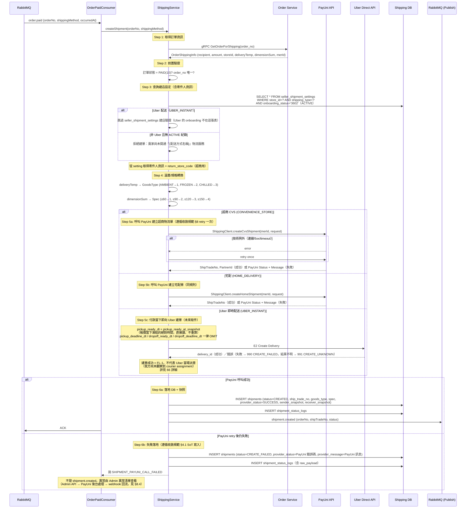

> **寄件人資訊來源**：Shipping Service 本地 `seller_shipment_settings` 表（**不從 Seller Service 取**）。merId 來自 `OrderShippingInfo`（訂單建立時已快照至 orders 表）。

**超商 CVS 建單參數組裝（PayUni §4）：**

| PayUni 參數 | 值 | 來源 |
|------------|-----|------|
| MerID | 商家編號 | OrderShippingInfo.merId（訂單快照） |
| MerTradeNo | **orderNo**（如 `O400280260`） | OrderShippingInfo.orderNo（統一使用訂單編號，詳見 payuni-java-client 設計書 §14） |
| GoodsType | 溫層代碼 | OrderShippingInfo.deliveryTemp → `PayUniParamMapper.toGoodsType()` |
| LgsType | `C2C` | 固定值 |
| ShipType | `1` (7-ELEVEN) | 固定值 |
| TradeAmt | 實付金額 | OrderShippingInfo.totalActualAmount |
| ServiceType | `3` (取貨不付款) | 固定值（設計書 §1.1 已明確） |
| StoreID | 取件門市代碼 | OrderShippingInfo.storeId |
| Consignee | 取件人姓名 | OrderShippingInfo.recipientName |
| ConsigneeMobile | 取件人手機 | OrderShippingInfo.recipientPhone（`+886` → `09` 轉換） |
| SenderName | 退貨收件人（C2C） | **seller_shipment_settings.sender_name** |
| SenderMobile | 退貨手機（C2C） | **seller_shipment_settings.sender_phone** |
| RefundStoreID | 退貨門市代碼（C2C） | seller_shipment_settings.return_store_code |
| ProdDesc | 商品描述 | OrderShippingInfo.productName |
| NotifyURL | Webhook 通知 URL | 由配置注入（`hawkr.shipping.notify-url`） |

> **溫層轉換規則**（`ShippingTemperature` → PayUni `GoodsType`）：
> - `AMBIENT` → `1`（常溫）
> - `FROZEN` → `2`（冷凍）
> - `CHILLED` → `3`（冷藏，僅宅配支援；超商不支援冷藏，結帳時已由 Shipping Service 配送限制排除）

**宅配建單參數組裝（PayUni §5）：**

| PayUni 參數 | 值 | 來源 |
|------------|-----|------|
| MerID | 商家編號 | OrderShippingInfo.merId（訂單快照） |
| MerTradeNo | **orderNo**（如 `O400280260`） | OrderShippingInfo.orderNo（統一使用訂單編號，詳見 payuni-java-client 設計書 §14） |
| GoodsType | 溫層代碼 | OrderShippingInfo.deliveryTemp → `PayUniParamMapper.toGoodsType()` |
| LgsType | `HOME` | 固定值 |
| ShipType | `2` (黑貓) | 固定值 |
| TradeAmt | 實付金額 | OrderShippingInfo.totalActualAmount |
| ServiceType | `3` (取貨不付款) | 固定值 |
| DeliveryTimeTag | `04` (不指定) | 固定值 |
| SenderName | 寄件人姓名 | **seller_shipment_settings.sender_name** |
| SenderMobile | 寄件人手機 | **seller_shipment_settings.sender_phone** |
| SenderAddress | 寄件人地址 | **seller_shipment_settings** `sender_city + sender_district + sender_address_detail` |
| SenderZipCode | 寄件郵遞區號 | **seller_shipment_settings.sender_postal_code** |
| Consignee | 收件人姓名 | OrderShippingInfo.recipientName |
| ConsigneeMobile | 收件人手機 | OrderShippingInfo.recipientPhone（`+886` → `09` 轉換） |
| ConsigneeAddress | 收件人地址 | OrderShippingInfo.shippingAddress |
| ProdDesc | 商品描述 | OrderShippingInfo.productName |
| NotifyURL | Webhook 通知 URL | 由配置注入 |

**Spec 規格推算邏輯**（建單時計算並存入 `shipments.spec`，僅宅配）：

> 訂單中取 `OrderShippingInfo.dimensionSum`（結帳時計算的最大 SKU 材積和 `L+W+H`），對應規格代碼：

| dimensionSum | Spec | 說明 |
|-------------|------|------|
| ≤ 60 | `1` | 60cm |
| ≤ 90 | `2` | 90cm |
| ≤ 120 | `3` | 120cm |
| ≤ 150 | `4` | 150cm（常溫限定，冷凍/冷藏不支援） |
| > 150 | 拒絕 | 超出黑貓宅配限制 |

**前置驗證：**
1. 訂單狀態必須為 `PAID(10)`
2. 訂單尚未建立物流單（`order_no` 唯一約束）
3. 配送方式必須為 `CONVENIENCE_STORE`／`HOME_DELIVERY`／`UBER_INSTANT` 三者之一。<br/>🔴 **`UBER_INSTANT` 於付款當下即向 Uber `E2 Create Delivery` 真實建單**（帶報價時凍結的 `pickup_ready_at_snapshot` 當 `pickup_ready_dt`），其後每一個逾期／取消判斷都必須把「外面有一張 live 的 delivery」當前提（§5.20.3）
4. 賣家已完成對應出貨方式的建店開通（`seller_shipment_settings.onboarding_status = ACTIVE`）

**建單失敗處理：**
- PayUni API 回傳錯誤 → 記錄錯誤日誌 → `basicNack` 重新排隊
- DLQ 最多重試 1 次（`MqErrorHandler` + `isRedelivered()` 判斷，與 §4.5 一致）
- 第二次失敗 → reject 進 DLQ，需人工介入

### 5.2 超商出貨單列印

#### 5.2.1 單筆列印（賣家安排出貨 — 狀態機 + 同步等待 Webhook 回填）

> **PayUni §7**：C2C 模式列印出貨單。後端呼叫 PayUni `print_label` API **觸發列印處理**，PayUni 處理完成後透過 **Webhook 回傳出貨便代碼**（`PartnerId` + `Odno` + `ValidationNo`）。
>
> **狀態機驅動**：本流程透過 §2.4 `ProviderCallExecutor` 框架驅動 `label_print_status`。
> 🔴 **禁止「先 commit 成功旗標再呼 PayUni」**（INV-1）——PayUni 失敗時該旗標會讓後續重試全部走 reprint 路徑回空字串，訂單就地卡死。
>
> **同步等待機制**：API 請求觸發 PayUni 列印後**不立即回傳**，而是透過 `CvsPrintWaitingRegistry`（見 §5.15）等待最多 **55 秒**，讓 Webhook 有時間回填出貨便代碼。若 55 秒內收到 Webhook，直接回傳交貨便代碼；超時則回傳 `webhookReceived=false`，物流單仍處於 `REQUESTED` 狀態，由 §5.19 reconciliation 補拉。
>
> **Gateway gRPC timeout**：配合同步等待，Gateway 對此 RPC 的 gRPC timeout 設為 **58 秒**。
>
> **不設建單→列印 cooldown**：賣家建單後即可列印。PayUni 後端 race 改由 §2.4.6 的 transient 分類 + §5.19.3.B reconciliation 處理，不以固定時間窗防護。
>
> **出貨照片**：PrintCvsLabel 已不處理出貨照片，改由 `ConfirmCvsShipment` API 處理（見 §5.2.3）。
>
> **Onboarding 防線**（§2.3.1）：進入流程前必須先呼 `findActiveSetting(storeId, SEVEN_ELEVEN_STORE_PICKUP)`，null 拋 `SHIPMENT_SELLER_NOT_ONBOARDED(5004)`。屬於寫路徑語意 — 賣家已取消此方式（CLOSED）即不允許再印新標籤。批次版本 §5.2.2 同理（整批共用一個 storeId，預先檢核一次）。

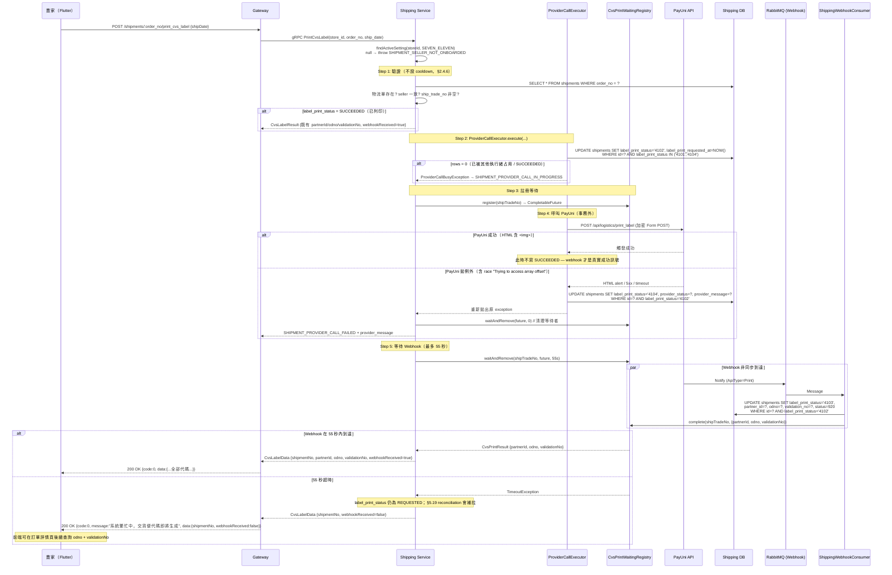

> **本流程的四條行為契約**：
>
> | 面向 | 規格 |
> |---|---|
> | DB 寫入時機 | 呼 PayUni 之前 transition 到 `REQUESTED`（占位）；**成功訊號（webhook）才** transition 到 `SUCCEEDED` |
> | PayUni 失敗處理 | `markFailed` transition 到 `FAILED`，落地 `provider_message`；賣家修正後可重試（`acquireRequested` 從 `FAILED` → `REQUESTED`） |
> | Webhook 漏收 | §5.19 reconciliation 主動呼叫 `/api/logistics/query` 補拉三段碼後 transition 到 `SUCCEEDED` |
> | 併發保護 | `WHERE label_print_status IN ('4101','4104')`——**必須同時涵蓋 NONE 與 FAILED 兩種可重試前置狀態** |

**表單參數組裝（PayUni §7.3）：**

| PayUni 參數 | 值 | 來源 |
|------------|-----|------|
| ShipTradeNo | 物流序號 | shipments.ship_trade_no |
| GoodsType | 溫層代碼 | shipments.goods_type（建單時已從 deliveryTemp 轉換） |
| LgsType | `C2C` | shipments.lgs_type |
| ShipType | `1` (7-ELEVEN) | shipments.ship_type |
| ShipDate | 出貨日期 | 前端傳入（`yyyy-MM-dd` 或 `yyyyMMdd`），service 層 normalize 為 `yyyyMMdd` 才送出 |
| LabelMode | `1` | 固定 A4 版型 |

> `LabelMode` 固定 `1`（A4 版型），**前端不可選**。

**HTML 回應判斷（僅用於確認觸發結果）：**

PayUni `print_label` API 回傳 HTML（非 JSON）：
- **成功**：HTML 含 `` 標籤 → 表示列印處理已啟動，出貨便代碼將由 Webhook 回填
- **處理中**：HTML 含 `<SCRIPT>window.alert("訂單資料尚在處理中...LAB02022")</SCRIPT>` → 拋出可重試例外

> **出貨便代碼組合規則**（由 Webhook §5.6 回填後，前端查詢物流資訊時顯示）：
> - **C2C**：`Odno`（8 碼）+ `ValidationNo`（4 碼）= **12 碼**（賣家持此代碼至 ibon 操作）
> - **B2C**：`PartnerId`（3 碼）+ `Odno`（8 碼）= **11 碼**

#### 5.2.2 批次超商出貨單列印

> **PayUni §7.3**：`ShipTradeNo` 支援最多 **50 筆**，以半形逗號隔開。同批次必須相同 `GoodsType`、`LgsType`、`ShipType`、`ShipDate`。Webhook 逐筆回傳（每個 ShipTradeNo 獨立一次 POST）。

**端點**：`POST /api/v1/app/shipments/batch_print_cvs_label`

**Request Body**：

```json
{
  "orderNos": ["ORD001", "ORD002", "ORD003"],
  "shipDate": "20260315"
}
```

**Response**（部分成功模式）：

```json
{
  "code": 0,
  "message": "success",
  "data": {
    "totalCount": "3",
    "successCount": "2",
    "results": [
      { "orderNo": "ORD001", "shipmentNo": "SHP001", "success": true, "message": "" },
      { "orderNo": "ORD002", "shipmentNo": "", "success": false, "message": "出貨單已列印，不可重複列印" },
      { "orderNo": "ORD003", "shipmentNo": "SHP003", "success": true, "message": "" }
    ]
  }
}
```

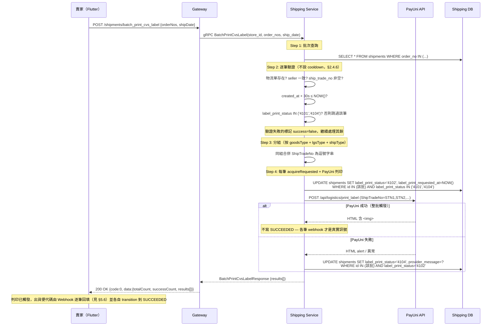

**錯誤處理**：採用部分成功模式。驗證失敗的訂單（不存在／seller 不符／缺序號／已列印 `4103`／列印中 `4102`）直接跳過，處理其餘有效訂單。批次內整體 PayUni 失敗時，所有 acquireRequested 成功的物流單一併 transition 到 `FAILED`，可下次重試。

**限制**：
- 單次上限由環境變數 `SHIPPING_BATCH_MAX_SIZE` 控制，預設 **50 筆**（PayUni 對 `ShipTradeNo` 串接 50 筆為硬性上限，**不可調超過 50**）。此 env 與宅配批次共用（§5.3.2）
- `orderNos` 不可為空

#### 5.2.3 超商確認出貨（推進至配送中）

> **端點**：`POST /api/v1/app/shipments/:order_no/confirm`
> **用途**：超商賣家取得交貨便代碼（920）後，手動確認已出貨，推進訂單狀態至 IN_TRANSIT(30)。出貨照片選填。
> **前置條件**：超商物流、`label_print_status = SUCCEEDED`（4103）、非終態

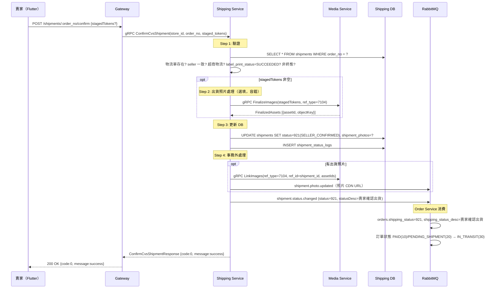

**冪等**：status 已為 921 或更高時跳過（log + return，不拋錯）。

**錯誤情境**：

| 情境 | 回應 |
|------|------|
| 物流單不存在 | 500 RuntimeException |
| 賣家不符 | 500 RuntimeException |
| 非超商物流 | 400 IllegalArgumentException「僅超商物流支援確認出貨」|
| 未列印（label_print_status ≠ SUCCEEDED） | 400 IllegalArgumentException「尚未取得交貨便代碼，請先列印」|
| 終態 | 400 IllegalArgumentException「物流單已為終態，無法確認出貨」|

### 5.3 宅配取號 PDF

> **PayUni §8**：產宅配編號並下載託運單 PDF。
>
> 提供兩個入口：
> - **單筆** `GenerateHomeLabelPdf`（§5.3.1）— 支援出貨照片上傳（`stagedTokens`），同步取 PDF + 上傳 OSS + 發 MQ event。
> - **批次** `BatchGenerateHomeLabelPdf`（§5.3.2）— fan-out 並行 N 次單筆呼叫，**不接受出貨照片**（出貨照片屬於每筆獨立操作，批次場景不適用，賣家若需上傳請改用單筆 API）。

#### 5.3.1 單筆宅配取號 PDF

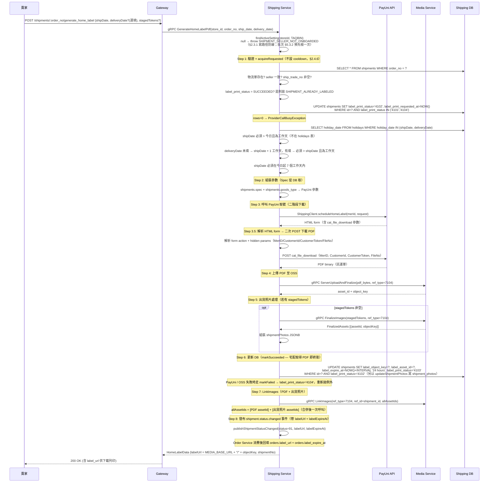

**參數組裝（PayUni §8.3）：**

| PayUni 參數 | 值 | 來源 |
|------------|-----|------|
| ShipTradeNo | 物流序號 | shipments.ship_trade_no |
| GoodsType | 溫層代碼 | shipments.goods_type（建單時已從 deliveryTemp 轉換） |
| LgsType | `HOME` | 固定值 |
| ShipType | `2` (黑貓) | 固定值 |
| ShipDate | 出貨日期 | 前端傳入（`yyyy-MM-dd` 或 `yyyyMMdd`），service 層 normalize 為 `yyyyMMdd` 才送出 |
| DeliveryDate | 配達日期 | 前端傳入（`yyyy-MM-dd` 或 `yyyyMMdd`，同 ShipDate），service 層 normalize 為 `yyyyMMdd` 才送出 |
| Spec | 規格代碼 | shipments.spec（建單時從訂單材積推算） |
| PostType | `1` (前景) | 固定值 |
| PrintType | `1` | 固定值 |

**標籤檔案生命週期（僅宅配 PDF）：**

> **注意**：超商出貨不再上傳標籤圖片至 OSS，出貨便代碼由 Webhook 回填（見 §5.6），因此本生命週期僅適用於宅配託運單 PDF。

1. **取號時**：PayUni 回傳 PDF → `ServerUploadAndFinalize` 上傳至自家 OSS → 取得 `asset_id` + `object_key` → `LinkImages` 建立引用 → DB 存 `label_object_key` + `label_asset_id`
2. **查詢時**：Shipping Service 以 `MediaUrlProperties.buildUrl(objectKey)`（域名唯一來源 `MEDIA_BASE_URL`）組裝 URL 回傳前端（**不在 DB 存完整 URL**，見[多媒體與圖片 URL 規範](../開發規範/多媒體與圖片%20URL%20規範.md)）
3. **配送完成時**（status → DELIVERED）：呼叫 Media Service `UnlinkImages` 解除引用
4. **7 天後**：Media Service GC 自動清理無引用資產（OSS 檔案刪除）

#### 5.3.2 批次宅配取號 PDF

> **本質**：宅配的批次 ≠ 超商批次。超商批次因 PayUni API 本身支援多筆 `ShipTradeNo` 串接 + Webhook 回填代碼，service 層只做分組；但宅配 PayUni 無 batch endpoint 也無 webhook，每張 PDF 都要獨立同步取 + 上傳 OSS。
>
> 因此本批次 API 在 service 層內部 **fan-out 為 N 次「§5.3.1 單筆」呼叫**，採用 **Java 21 Virtual Threads + Semaphore 併發限流**，同步等到全部完成才回應。

**端點**：`POST /api/v1/app/shipments/batch_generate_home_label`

**Request Body**：

```json
{
  "items": [
    { "orderNo": "ORD001", "shipDate": "20260315", "deliveryDate": "20260316" },
    { "orderNo": "ORD002", "shipDate": "20260315" },
    { "orderNo": "ORD003", "shipDate": "20260315", "deliveryDate": "20260317" }
  ]
}
```

**Response**（部分成功模式，與超商批次 §5.2.2 對齊）：

```json
{
  "code": 0,
  "message": "success",
  "data": {
    "totalCount": "3",
    "successCount": "2",
    "results": [
      { "orderNo": "ORD001", "shipmentNo": "SHP001", "labelUrl": "https://cdn.../label-001.pdf", "success": true, "message": "" },
      { "orderNo": "ORD002", "shipmentNo": "", "labelUrl": "", "success": false, "message": "出貨單已列印，不可重複列印" },
      { "orderNo": "ORD003", "shipmentNo": "SHP003", "labelUrl": "https://cdn.../label-003.pdf", "success": true, "message": "" }
    ]
  }
}
```

**時序圖**：

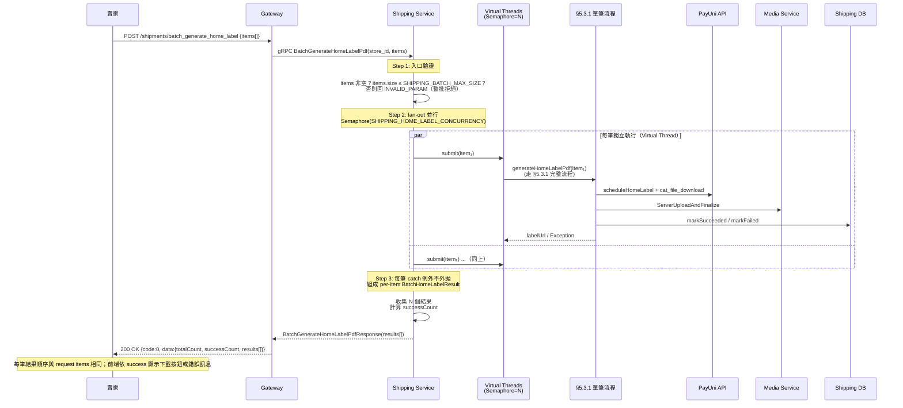

**業務流程圖**：

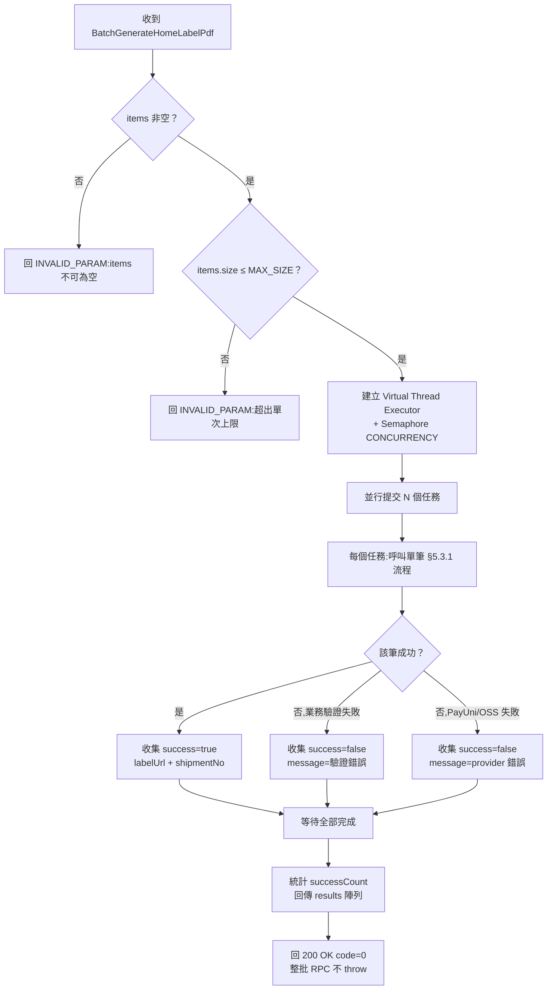

**併發控制**：

| 配置 | 環境變數 | 預設值 | 說明 |
|------|---------|-------|------|
| 單次批次上限 | `SHIPPING_BATCH_MAX_SIZE` | 50 | 與超商批次 §5.2.2 共用，**超商部分不可超過 50**（PayUni 硬性上限） |
| 並行任務數 | `SHIPPING_HOME_LABEL_CONCURRENCY` | 10 | Semaphore 限制同時呼叫 PayUni / OSS 的數量；僅宅配適用 |

**執行模型**：

- 採用 Java 21 **Virtual Threads**（Loom），於本 API 內局部建立 `Executors.newThreadPerTaskExecutor(Thread.ofVirtual().factory())`，不啟用全域 `spring.threads.virtual.enabled`
- 用 `Semaphore(CONCURRENCY)` 包裹每個任務的 `acquire()` / `release()`，控制同時打 PayUni / OSS 的數量
- 每筆任務內部 try-catch，**例外不外拋**，轉成 `BatchHomeLabelResult{success=false, message=錯誤訊息}`
- 主執行緒 `CompletableFuture.allOf(...).join()` 等到全部完成

**錯誤處理**：

- **入口驗證失敗**（items 空 / 超出上限）→ 整批回 `INVALID_PARAM`，不進入 fan-out
- **單筆業務失敗**（物流單不存在 / seller 不符 / 缺序號 / 已列印 / 列印中 / shipDate 非工作天等）→ 該筆 `success=false`，其餘繼續
- **單筆 PayUni / OSS 失敗** → 該筆 `success=false`，其餘繼續；DB 狀態由單筆 §5.3.1 流程內的 markFailed 處理
- **整批 RPC 不 throw**（除非入口驗證失敗）；與超商批次 §5.2.2 一致

🔴 **本批次 API 同步等待，不得改成 fire-and-forget**：宅配 PayUni 是**同步 API**、無 webhook 回填，
「不等」就必須自建 task table + runner + 前端 polling，違反[後端服務責任邊界規範](../開發規範/後端服務責任邊界規範.md)。
耗時上界：50 筆 × 併發 10 ＝ 5 波，PayUni 約 5 秒/筆 → 約 25 秒，須低於 gRPC timeout。

🔴 **批次不接受 `stagedTokens`**：出貨照片是 per-order 屬性，要上傳一律走單筆 API
（與超商 `ConfirmCvsShipment` 同義）。

**§一致性、交易與補償（[後端服務責任邊界規範](../開發規範/後端服務責任邊界規範.md)）**：

> 單一寫入路徑為唯一真實來源；不引入補償任務基礎設施。
>
> 寫入路徑：本批次 API fan-out 為 N 次單筆 §5.3.1 流程，每筆走 `acquireRequested` → PayUni → `markSucceeded/markFailed` 的寫入序列，每筆**獨立 transaction**（單筆 §5.3.1 既有設計）。
>
> 不做：reconciliation job、async reflow runner、backfill CLI、sample 比對監測、task 表 + runner。
>
> 既有資料維護由開發者直接 SQL 處理，不在後端寫補償流程。

**落點**：

| 檔案 | 職責 |
|------|------|
| `api/proto/shipping/shipping.proto` | `BatchGenerateHomeLabelPdf` RPC ＋ 其 4 個 message |
| `shipping-service .../config/ShippingBatchProperties.java` | `@ConfigurationProperties("hawkr.shipping.batch")`，欄位 `maxSize` / `homeLabelConcurrency` |
| `shipping-service .../grpc/ShippingGrpcServiceImpl.java` | `batchGenerateHomeLabelPdf` handler；🔴 批次上限一律讀 `properties.getMaxSize()`，**禁止硬編碼** |
| `shipping-service .../service/ShippingService.java` | `batchGenerateHomeLabelPdf`（Virtual Threads ＋ Semaphore，內部 fan-out 呼叫 `generateHomeLabelPdf`） |
| `shipping-service .../resources/application.yml` | `hawkr.shipping.batch.maxSize=${SHIPPING_BATCH_MAX_SIZE:50}` / `hawkr.shipping.batch.homeLabelConcurrency=${SHIPPING_HOME_LABEL_CONCURRENCY:10}` |
| `gateway/internal/router/constants.go` | `ShipmentsBatchGenerateHomeLabel = "/batch_generate_home_label"` |
| `gateway/internal/router/routes_shipping.go` | `shipments.POST(ShipmentsBatchGenerateHomeLabel, h.BatchGenerateHomeLabel)` |
| `gateway/internal/handler/shipping.go` | `BatchGenerateHomeLabel` handler ＋ DTO（exported struct）＋ Swagger 註解 |
| `gateway/internal/handler/shipping_test.go` | mock struct 的 `BatchGenerateHomeLabelPdf` stub（§16.7） |
| `.env*`（含 `.env.template`）／`docker-compose-local.yml`／`k8s/values/shipping-service.yaml` | `SHIPPING_BATCH_MAX_SIZE=50` / `SHIPPING_HOME_LABEL_CONCURRENCY=10`（五個位置必須同步，見[開發工作流程](../開發規範/開發工作流程.md)） |
| 環境變數 | Dev VM k3s configmap | SSH patch（依 §13.1 環境變數配置流程） |

### 5.4 呼叫黑貓

> **PayUni §9**：預約黑貓司機到府取件。15:00 前預約，兩日內收件。

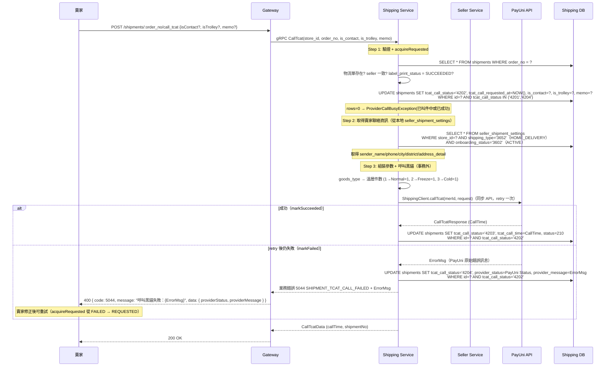

**參數組裝（PayUni §9.3）：**

| PayUni 參數 | 值 | 來源 |
|------------|-----|------|
| ContactName | 聯絡人姓名 | **seller_shipment_settings.sender_name** |
| ContactMobile | 聯絡人手機 | **seller_shipment_settings.sender_phone** |
| ContactAddress | 聯絡人地址 | **seller_shipment_settings**（`sender_city + sender_district + sender_address_detail`） |
| NormalQuantity | 常溫件數 | 依 shipments.goods_type：`1`→1件，否則 0 |
| ColdQuantity | 冷藏件數 | 依 shipments.goods_type：`3`→1件，否則 0 |
| FreezeQuantity | 冷凍件數 | 依 shipments.goods_type：`2`→1件，否則 0 |
| IsContact | 是否電聯 | 前端傳入（選填，預設 `Y`） |
| IsTrolley | 是否需推車 | 前端傳入（選填，預設 `N`） |
| Memo | 備註 | 前端傳入（選填） |

> **PayUni 錯誤直接透傳**：🔴 **本服務不做本地假日檢查**，一律由 PayUni 驗證。PayUni 黑貓 API 於週日、國定假日及每日 17:00 後不受理預約取件，失敗時回傳 `ErrorMsg`（如 `E072` 相關訊息）。後端直接將 PayUni `ErrorMsg` 透傳至前端，使用業務錯誤碼 `5044 SHIPMENT_TCAT_CALL_FAILED`，**不視為系統錯誤**。
>
> **說明**：每次呼叫黑貓僅指定單一溫層（§9.4 限制），根據 `shipments.goods_type`（建單時從訂單 `deliveryTemp` 轉換）決定，一訂單一包裹。
>
> **測試環境注意**：黑貓會驗證 `ContactAddress` 的真實性（門牌號碼必須存在），虛構地址（如「成功二路200號」）會回傳 `E072-寄件地址查無黑貓對應郵號`。測試時請使用真實地址（如「高雄市前鎮區成功二路1號7樓」）。

### 5.5 Webhook 物流狀態更新

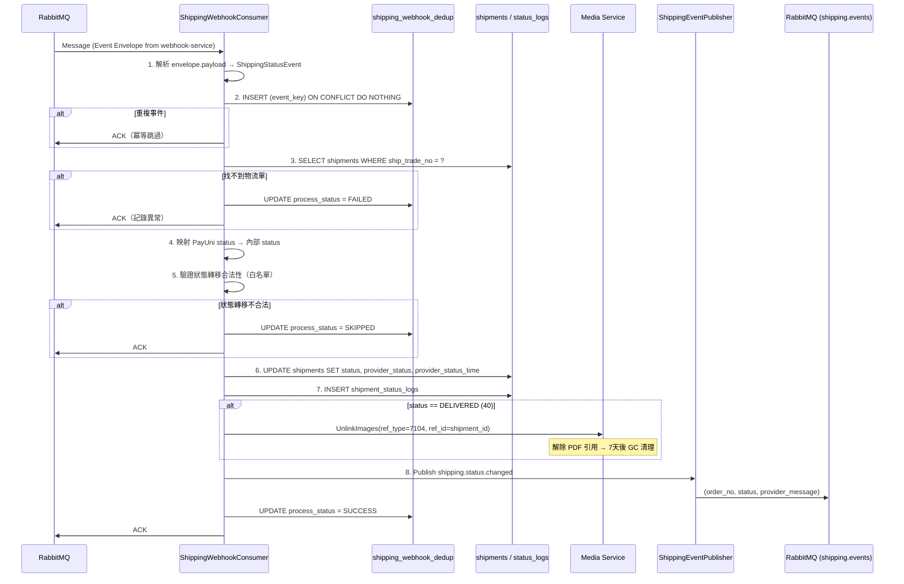

**冪等性保護：**
- Webhook Service 已做 Inbox 去重（第一層）
- Shipping Service 用 `shipping_webhook_dedup` 表再做一次去重（第二層）
- 狀態轉移白名單確保重複事件不會造成狀態回退

### 5.6 超商列印 Notify 處理（label_print_status REQUESTED → SUCCEEDED）

超商出貨單列印成功後，PayUni 發送 Notify（`ApiType=Print`），**此為 transition 到 SUCCEEDED 的唯一來源**（webhook 漏收則由 §5.19 reconciliation 補拉）：

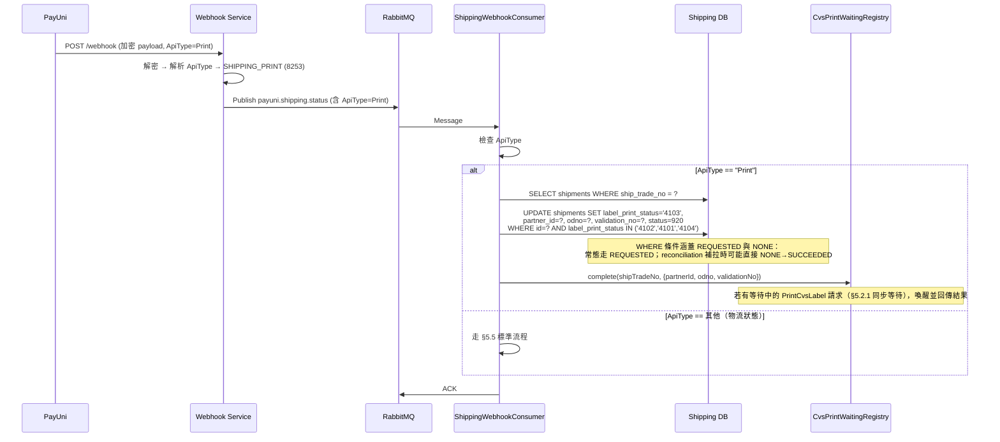

> **同步等待機制**：`processWebhookPrint()` 完成 transition 後，透過 `CvsPrintWaitingRegistry.complete(shipTradeNo, result)` 通知等待中的 `PrintCvsLabel` 請求。若無等待中的請求（API 已超時回傳、或 Webhook 延遲到達），`complete()` 呼叫為空操作（no-op），不影響正常流程。詳見 §5.15。
>
> **冪等性**：UPDATE 帶 `WHERE label_print_status IN ('4102','4101','4104')`；若 webhook 重投或反覆 reconcile，第二次 UPDATE rows=0（已是 4103 SUCCEEDED），自動冪等跳過。`shipping_webhook_dedup` 表額外提供 event_key 級去重。
>
> **WHERE 必須涵蓋 `4104`**：賣家 PayUni 列印失敗（permanent error markFailed → 4104）後，PayUni 後續仍可能產生三段碼（race / 延遲 fix）。reconcile 撈到三段碼時必須能直接 transition `4104 → 4103`，否則訂單永遠卡在 4104 即使 PayUni 已就緒。

**回傳欄位（Webhook 解密後）：**

| 欄位 | 長度 | 說明 |
|------|------|------|
| `PartnerId` | 3 碼 | 母代碼 |
| `Odno` | 8 碼 | 出貨單編號 |
| `ValidationNo` | 4 碼（C2C 專用） | 驗證碼 |

**出貨便代碼組合規則（前端顯示用）：**
- **C2C**：`Odno`（8 碼）+ `ValidationNo`（4 碼）= **12 碼**（賣家持此代碼至 ibon 操作列印）
- **B2C**：`PartnerId`（3 碼）+ `Odno`（8 碼）= **11 碼**

> **重要**：§5.2 的 `PrintCvsLabel` API 僅負責**觸發** PayUni 列印處理，出貨便代碼由此 Webhook 回填至 DB。前端透過 `GetShipmentByOrderNo` 查詢物流資訊時，從 `ShipmentDetailView` 的 `partner_id`、`odno`、`validation_no` 欄位取得並組合顯示。

> **ApiType 分流**：webhook-service 解密後的 rawMap 含 `ApiType` 欄位，`ShippingWebhookConsumer` 依它分流。

**出貨便代碼說明與聚合：**

超商出貨不需要由後端提供列印標籤圖片，賣家只需持**出貨便代碼**至 7-ELEVEN ibon 自助列印。出貨便代碼由 PayUni 列印 Webhook 回填至 `shipments` 表。

**出貨便代碼組合規則：**

| 通路類型 | 組合方式 | 代碼長度 | 使用場景 |
|---------|---------|---------|---------|
| **C2C**（店到店） | `Odno`（8 碼）+ `ValidationNo`（4 碼） | **12 碼** | 賣家至 ibon 輸入此代碼列印出貨標籤 |
| **B2C**（大宗寄倉） | `PartnerId`（3 碼）+ `Odno`（8 碼） | **11 碼** | 賣家至 ibon 輸入此代碼列印出貨標籤 |

**DB 欄位對應（`shipments` 表）：**

| 欄位 | 來源 | 時機 |
|------|------|------|
| `partner_id` | 超商建單 Webhook 回傳 | 建單完成時 |
| `odno` | 列印 Webhook 回傳（`ApiType=Print`） | §5.6 |
| `validation_no` | 列印 Webhook 回傳（`ApiType=Print`，C2C 專用） | §5.6 |

**聚合至訂單詳情（做法 A：Order Service gRPC 聚合）：**

Order Service 的 `GetSellerOrderDetail` / `GetBuyerOrderDetail` 內部呼叫 Shipping Service 的 `GetShipmentByOrderNo` 取得完整物流資訊，並聚合至 `OrderDetailView` 回傳前端。

| 配送方式 | 聚合欄位 | 來源（ShipmentDetailView） | 對應 OrderDetailView | 視角 |
|---------|---------|--------------------------|---------------------|------|
| **超商**（CONVENIENCE_STORE） | 出貨便代碼 | `partner_id`(18), `odno`(19), `validation_no`(20) | field 29/30/31 | 僅賣家 |
| **宅配**（HOME_DELIVERY） | 託運單 PDF objectKey | `label_key`(13) | field 28 | 僅賣家 |
| **共用** | 物流狀態 | `status`(4), `label_print_status`(16) | field 27 | 買家+賣家 |
| **共用** | 出貨照片 objectKey | `shipment_photo_keys`(21) | field 44 | 僅賣家 |

**視角控制（買家不可見欄位）：**

以下欄位僅在賣家視角（`GetSellerOrderDetail`）填充，買家視角（`GetOrder`）回傳空值：
- `label_key`（宅配託運單 PDF objectKey）
- `partner_id`、`odno`、`validation_no`（超商出貨便代碼）
- `shipment_photo_keys`（出貨照片 objectKey）

**前端顯示邏輯：**

- **超商**：`shipping_method = CONVENIENCE_STORE` 且 `label_print_status = '4103'`（SUCCEEDED）時顯示出貨便代碼
  - 依 `lgs_type`（C2C / B2C）決定組合規則
  - **C2C**：顯示 `odno` + `validation_no`（12 碼）
  - **B2C**：顯示 `partner_id` + `odno`（11 碼）
- **宅配**：`shipping_method = HOME_DELIVERY` 且 `label_print_status = '4103'` 時顯示「下載託運單」（`label_key` 非空作為輔助條件）

> **注意**：`PrintCvsLabel` API 採用 **55 秒同步等待**機制（見 §5.2、§5.15）。多數情況下 Webhook 會在數秒內到達，API 直接回傳交貨便代碼（`webhookReceived=true`）。若 55 秒超時（`webhookReceived=false`，message=「系統繁忙中，交貨便代碼即將生成」），前端應在訂單詳情頁後續查詢物流資訊，若 `odno` 為空表示 Webhook 尚未回填，可提示「交貨便代碼產生中」。

### 5.7 按需查詢 PayUni 物流狀態（`QueryShipmentStatus` 內部 + `GetShipmentTracking` 買家）

> `QueryShipmentStatus`（以 `shipment_no` 為 key、無 ownership）供內部 / 賣家「同步」按鈕用；買家「查看物流」由 §4.1 `GET /app/orders/:order_no/logistics` → `GetShipmentTracking` 對外。兩者**共用同一同步核心**（`syncAndTouch(entity)`），僅入口 key 與 ownership 不同。Webhook 漏收的常態補救仍由 §5.19 排程處理。

**同步核心（`syncAndTouch(entity)`，兩 RPC 共用）：**
1. Uber 即時配送 / `ship_trade_no` 為空 → 直接回 cached entity（PayUni 不支援查詢，非錯誤）
2. 呼叫 `ShippingClient.queryShipment(merId, shipTradeNo, deriveLgsType(entity))`
3. PayUni 回傳狀態經 `statusMapper.mapPayUniStatus` 映射；若為合法 transition 則 `updateStatus(...)` + 發布 MQ 事件
4. `finally` 區塊 `touchLastReconciledAt`（不論成功/失敗/未變更都 touch；無 `@Transactional`，依賴 SQL 樂觀鎖，例外不可 rollback 此 touch）
5. 回傳 entity

**設計原則（不變）**：本核心**永遠強制 fresh**，不被 §5.19 退避擋下（補救手段不能回 cached）。觸發後 touch `last_reconciled_at`，讓 §5.19 排程在退避視窗內不重複工作 —— 買家觸發的 fresh sync 同樣是一次有效 reconcile，故共用 touch 是正確協調而非干擾（**不在 service 層加 freshness gate**，配額保護交給 Gateway rate limit）。

#### 5.7.1 買家物流追蹤（`GetShipmentTracking`）

買家在訂單詳情 / 訂單操作點「查看物流」→ web 打 `GET /api/v1/app/orders/:order_no/logistics`。

**流程：**
1. 以 `order_no` + `is_return = FALSE` 查 `shipments`（正向單；退貨單 `is_return=TRUE` 不在此頁，且其 `buyer_id` 可能為 NULL）
2. 查無 → `SHIPMENT_NOT_FOUND`
3. 驗 `entity.buyer_id == buyer_id`，不符 → `SHIPMENT_PERMISSION_DENIED`（對齊既有 `getAndVerifyShipment` 賣家慣例）
4. 呼叫共用核心 `syncAndTouch(entity)` 即時同步
5. `buildDetailView(entity)` 回 `ShipmentDetailView`（含 `status_label = ShippingStatus.fromValue(status).label()`，未知 value 則空字串防 `fromValue` 拋例外）
6. Gateway 映射 `ShipmentDetailView` 子集為 `OrderLogisticsResp`（最小揭露，見 §4.1 DTO）

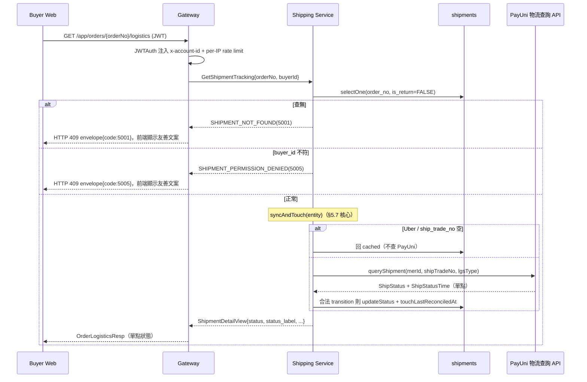

**前端契約**：買家端以 `GET /app/orders/{orderNo}/logistics` 取**單點**狀態顯示。🔴 **不得渲染多筆軌跡時間線**——PayUni 不回軌跡資料，時間線無法真實填充。

#### 5.7.2 賣家物流追蹤（`GetSellerShipmentTracking`）

賣家在賣家中心訂單詳情點「物流追蹤 / 重新整理」→ web 打 `GET /api/v1/app/shipments/:order_no/tracking`。

與買家 §5.7.1 **同構**，共用 `syncAndTouch(entity)` 核心，僅以下差異：

| 面向 | 買家 §5.7.1 | 賣家 §5.7.2 |
|---|---|---|
| 入口路由 | `GET /app/orders/:order_no/logistics` | `GET /app/shipments/:order_no/tracking`（賣家群組 requireSeller）|
| Ownership | `shipments.buyer_id == buyer_id` | `shipments.store_id == store_id` |
| 正/逆物流 | 固定 `is_return=false` | `is_return` 參數（query，預設 false；保留逆物流追蹤擴充） |
| 回應 | `ShipmentDetailView`（同）；賣家前端以 `provider_status` 對應 PayUni 物流碼算進度條，`provider_message` / `status_label` 顯示狀態文案 | 同 |

**流程**：以 `order_no` + `is_return` 查 `shipments` → 查無 `SHIPMENT_NOT_FOUND` → 驗 `store_id` 不符 `SHIPMENT_PERMISSION_DENIED`（對齊既有 `getAndVerifyShipment`）→ `syncAndTouch(entity)` 即時同步 → `buildDetailView`（含 `status_label`）。時序與 §5.7.1 圖一致，僅 key 與 ownership 欄位不同。

#### 5.7.3 落點

| 檔案 | 職責 |
|------|------|
| `api/proto/shipping/shipping.proto` | `GetShipmentTracking` ＋ `GetShipmentTrackingRequest`；`GetSellerShipmentTracking` ＋ `GetSellerShipmentTrackingRequest{order_no, store_id, is_return}`；`ShipmentDetailView.status_label` |
| `shipping-service .../service/ShippingService.java` | 私有核心 `syncAndTouch(entity)`（entity 入口）；`queryAndSyncStatus(shipment_no)` load entity 後 delegate 給它；`getBuyerTrackingByOrderNo(orderNo, buyerId)`（`is_return=false` ＋ ownership）；`getSellerTrackingByOrderNo(orderNo, storeId, isReturn)`（`order_no`＋`is_return` ＋ seller ownership）。🔴 三條路徑**共用同一個核心**，退避刷新語意才一致 |
| `shipping-service .../grpc/ShippingGrpcServiceImpl.java` | `getShipmentTracking`／`getSellerShipmentTracking` handler；`buildDetailView` 填 `status_label` |
| `gateway/internal/router/routes_order.go` | `GET /:order_no/logistics`（JWTAuth ＋ rate limit） |
| `gateway/internal/router/routes_shipping.go`／`handler/shipping.go` | `GET /app/shipments/:order_no/tracking`（`requireSeller`）；賣家側復用 `OrderLogisticsResp` DTO |
| `gateway/internal/handler/` | `GetOrderLogistics` handler ＋ `OrderLogisticsResp` DTO ＋ Swagger 註解 ＋ test mock |
| `hawkr-website lib/logistics/repo.ts`／`TrackingClient.tsx` | 買家追蹤頁：單點狀態顯示 ＋ 友善錯誤文案 |
| `hawkr-website lib/seller/shipment.ts`／`OrderDetailClient.tsx` | 賣家追蹤：`queryLogistics` 打 `GET /app/shipments/{orderNo}/tracking`，mapping 來源為 `ShipmentDetailView` 欄位 |

### 5.8 物流送達後訂單自動完成

> 跨服務協作：Shipping Service 負責偵測送達並發布事件；Order Service 負責自動完成計時與買家確認收貨。

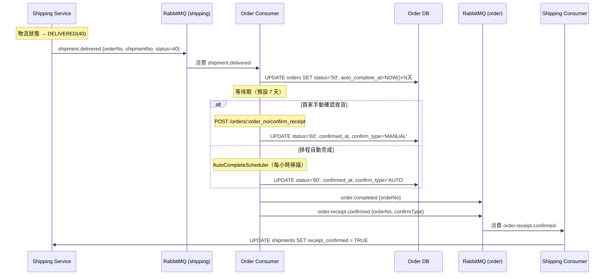

**配置參數：**

| 參數 | 環境變數 | 預設值 | 說明 |
|------|---------|--------|------|
| `hawkr.order.auto-complete-hours` | `AUTO_COMPLETE_HOURS` | `60` | 送達後自動完成小時數（03 §5.4，生鮮保鮮期短） |
| `hawkr.order.auto-complete-interval-ms` | `AUTO_COMPLETE_INTERVAL_MS` | `3600000` | 排程掃描間隔（毫秒，預設 1 小時）|
| `hawkr.order.auto-complete-batch-size` | `AUTO_COMPLETE_BATCH_SIZE` | `100` | 每批次處理數量 |

### 5.9 超商建店流程

> **觸發時機**：賣家透過 Gateway 呼叫 `POST /api/v1/app/shipping_onboardings/cvs`。
> **前提**：賣家已在 Seller Service 完成基本寄件資訊設定（姓名/電話/信箱/mer_id）。

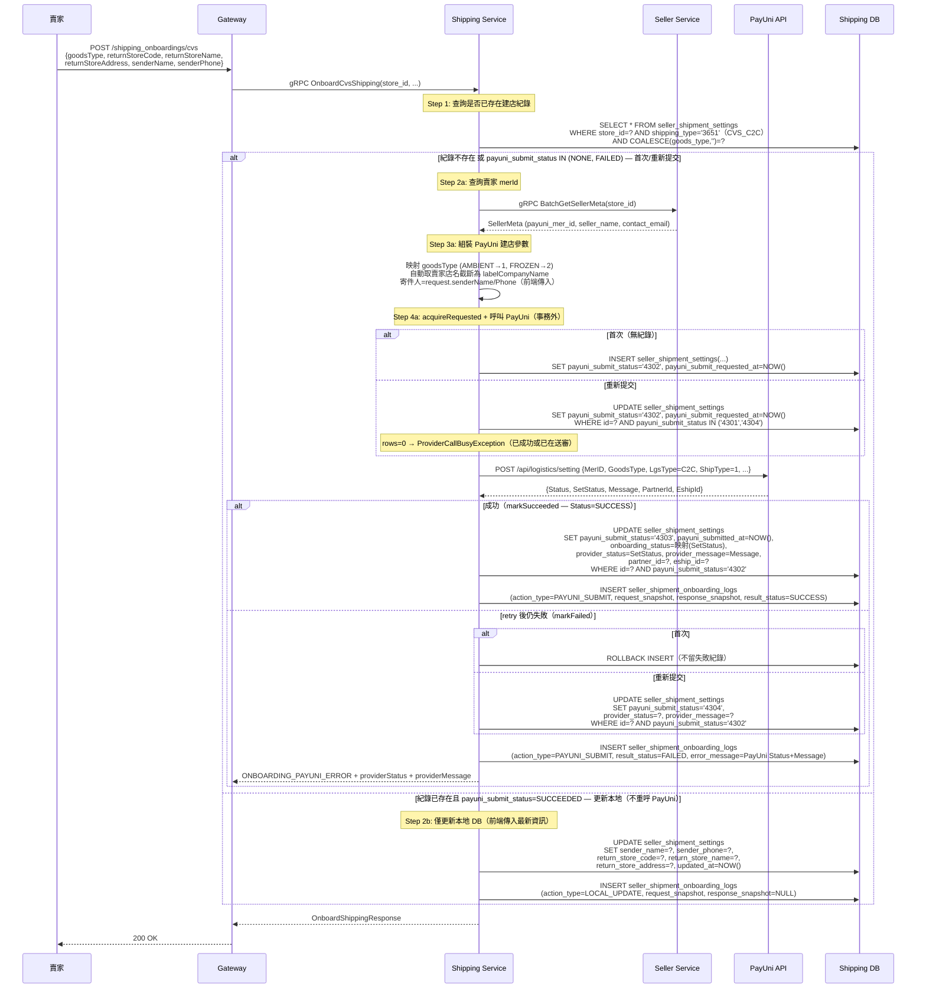

**超商 C2C 建店 PayUni 參數組裝（PayUni §2）：**

| PayUni 參數 | 值 | 來源 |
|------------|-----|------|
| MerID | 商家編號 | SellerMeta.payuni_mer_id（Seller Service） |
| Timestamp | Unix timestamp | 系統生成 |
| GoodsType | 寄件型態代碼 | 前端 goodsType → `PayUniParamMapper.toGoodsType()` |
| LgsType | `C2C` | 固定值 |
| ShipType | `1` (7-ELEVEN) | 固定值 |
| LabelCompanyName | 廠商名稱 | 後端自動取賣家店名截斷（C2C: 10 中文/20 字元） |
| ContactName | 聯絡人 | **request.sender_name**（前端傳入） |
| ContactTel | 聯絡電話 | **request.sender_phone**（前端傳入） |
| ContactMail | 聯絡信箱 | SellerMeta 取得（或 Seller Service 其他 RPC） |
| StoreID | 退貨門市代碼 | 前端傳入 return_store_code |
| NotifyURL | 貨態通知 URL | 配置注入（`hawkr.shipping.notify-url`） |

> **C2C 必填欄位依據**：PayUni 官方文檔以 `Y(C2C)` 明確標示 C2C 必填項，B2C 專屬欄位（ServiceTel、MerURL 等）在 C2C 模式下不需填寫。

### 5.10 宅配建店流程

> **觸發時機**：賣家透過 Gateway 呼叫 `POST /api/v1/app/shipping_onboardings/home_delivery`。

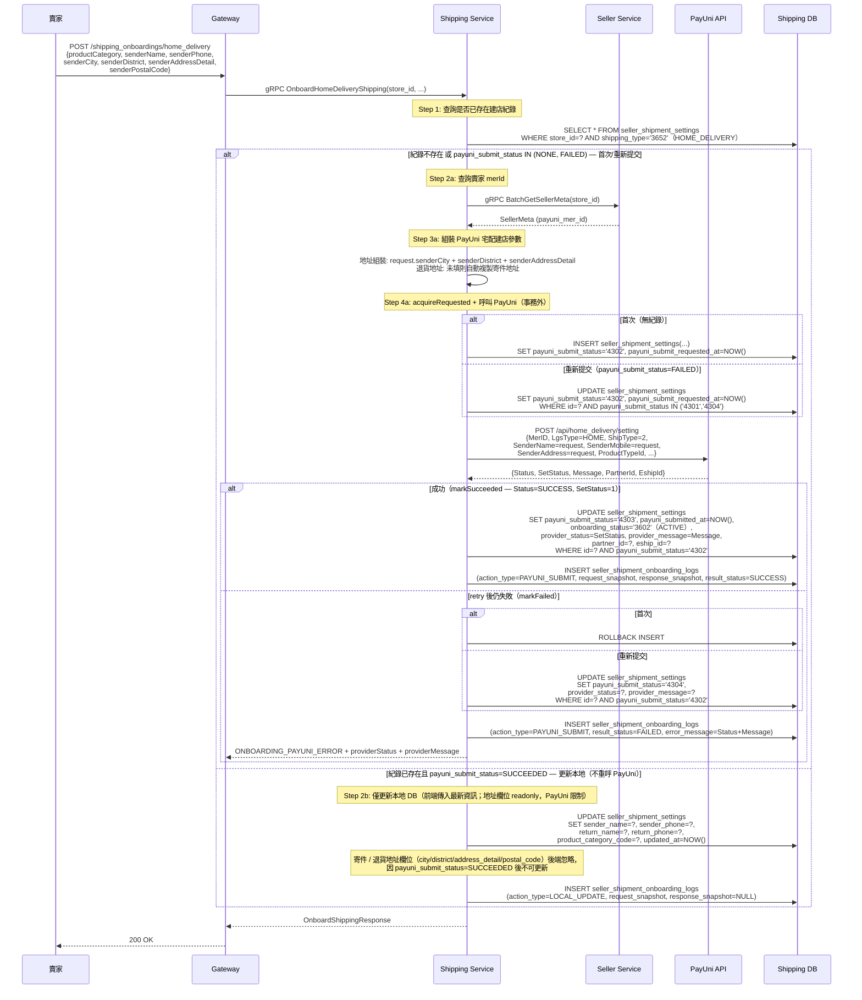

**宅配建店 PayUni 參數組裝（PayUni §3）：**

| PayUni 參數 | 值 | 來源 |
|------------|-----|------|
| MerID | 商家編號 | SellerMeta.payuni_mer_id（Seller Service） |
| Timestamp | Unix timestamp | 系統生成 |
| LgsType | `HOME` | 固定值 |
| ShipType | `2` (黑貓) | 固定值 |
| SenderName | 寄件人姓名 | **request.sender_name**（前端傳入） |
| SenderMobile | 寄件人手機 | **request.sender_phone**（前端傳入） |
| SenderAddress | 寄件人地址 | **request** `sender_city + sender_district + sender_address_detail` |
| ProductTypeId | 商品類別代碼 | 前端傳入 product_category（0001~0015） |
| NotifyURL | 貨態通知 URL | 配置注入 |

> **宅配建店特殊規則**（PayUni §3.6）：
> - `payuni_submit_status=SUCCEEDED` 後，後端**僅本地更新**：寄件人姓名、電話、商品類別；不再重呼 PayUni
> - **寄件地址**（sender_city/district/address_detail/postal_code）一旦 SUCCEEDED 後**永久 readonly**（PayUni 限制：須聯繫 PayUni 客服才能改）。前端依 `payuni_submit_status === '4303'` 鎖定欄位
> - `payuni_submit_status=FAILED` 時所有欄位皆可改，重新觸發 onboarding 即送 PayUni 重新申請

### 5.11 建單資料取得與快照策略

> **核心原則**：「查最新」是讀取策略；「快照保存」是交易紀錄策略。兩者必須同時存在。

**資料來源表（建單當下）：**

| 資料類別 | 來源 | 查詢方式 | 說明 |
|---------|------|---------|------|
| 收件人（買家）資訊 | Order Service | gRPC `GetOrderForShipping(order_no)` | 訂單建立時已凍結 |
| 寄件人（賣家）資訊 | **Shipping Service 自身** | DB `seller_shipment_settings` sender_* 欄位 | **不從 Seller Service 取** |
| 退貨地址（宅配） | **Shipping Service 自身** | DB `seller_shipment_settings` return_* 欄位 | 目前與寄件地址共同維護 |
| 退貨門市代碼（超商） | **Shipping Service 自身** | DB `seller_shipment_settings.return_store_code` | 建店時保存 |
| PayUni 商家編號 | Order Service | `OrderShippingInfo.mer_id`（訂單快照） | **不即時查 Seller Service** |
| 溫層/材積/金額 | Order Service | `OrderShippingInfo` 欄位 | 訂單內已有 |

**快照策略摘要：**

| 快照類型 | 儲存位置 | 觸發時機 | 用途 |
|---------|---------|---------|------|
| `payuni_onboarding_snapshot` | `seller_shipment_onboarding_logs.request_snapshot` + `response_snapshot`（action=PAYUNI_SUBMIT） | 實際呼叫 PayUni 時 | 記錄最後一次送 PayUni 的完整資料 |
| `local_onboarding_snapshot` | `seller_shipment_onboarding_logs.request_snapshot`（action=LOCAL_UPDATE） | 僅更新本地 DB 時 | 記錄內部最新狀態 |
| `sender_snapshot` | `shipments.sender_snapshot` | 建單成功時 | 凍結寄件人資訊，歷史追溯 |
| `receiver_snapshot` | `shipments.receiver_snapshot` | 建單成功時 | 凍結收件人資訊，歷史追溯 |

### 5.12 建店冪等策略與更新規則

**建店更新規則（依 payuni_submit_status 派發）：**

| 進入時的 payuni_submit_status | 是否重呼 PayUni | 流程 |
|---|---|---|
| 不存在紀錄 | **是** | 走 §5.9/§5.10 首次提交分支：INSERT 設 `4302` → 呼叫 PayUni → 成功 `4303` / 失敗 ROLLBACK |
| `NONE`（4301） | **是** | 等同首次（理論上不應出現此狀態下還無 PayUni 呼叫，例外場景由 reconciliation 處理） |
| `REQUESTED`（4302） | **拒絕** | acquireRequested 失敗 → `ProviderCallBusyException`（已在送審中，請等候） |
| `SUCCEEDED`（4303） | **否** | 僅更新本地非地址欄位；地址欄位 readonly（PayUni 限制） |
| `FAILED`（4304） | **是** | 走 §5.9/§5.10 重新提交分支：UPDATE `4304→4302` → 呼叫 PayUni |

**前端按鈕對應：**

| payuni_submit_status | 主按鈕文案 | 行為 |
|---|---|---|
| 不存在 / NONE | 「申請開通」 | 走 onboarding API |
| REQUESTED | 「送審中」（disabled） | reconciliation 補正後自動轉 SUCCEEDED 或 FAILED |
| SUCCEEDED | 「更新資料」 | 走 onboarding API（後端內部走本地更新分支） |
| FAILED | 「重新申請」 | 走 onboarding API（後端內部走重新提交分支） |

### 5.13 查詢賣家可用配送方式

**端點**：`GET /api/v1/app/shipping_methods`
**gRPC**：`ListSellerShippingMethods`
**權限**：SELLER(2) / SELLER_AND_BUYER(3)

**用途**：回傳賣家所有可能的配送方式（固定槽位），用於前端商品建立時篩選配送選項、賣家後台查看物流開通狀態。與 `ListShippingOnboardings` 差異在於本 API 包含所有可能的配送方式（含未建店的），而非僅已建店的記錄。

🔴 **本 API 是「賣家 Uber（3003）setup／health／availability」的唯一對外載體**（66 §6.1.5 **S-U6**）。
它的 request 只需要 **store identity**（`store_id` ＋ `account_type`）；
`GET /app/shipping_onboardings/:onboarding_id` **對 3003 不適用**——那個 `:onboarding_id` ＝
`seller_shipment_settings.id`（§5.6），而 Uber 的 onboarding 落在
`uber_organization`／`uber_store_mapping`，**沒有那張表的列、也沒有那個 id**。

**固定槽位定義：**

| # | shippingMethod | goodsType | displayName | onboardingRequired | available 邏輯 |
|---|---------------|-----------|-------------|-------------------|---------------|
| 1 | TAQBIN | — | 黑貓宅急便 | true (HOME_DELIVERY) | ACTIVE + enabled |
| 2 | SEVEN_ELEVEN_STORE_PICKUP | AMBIENT | 7-11店到店（常溫） | true (CVS_C2C + AMBIENT) | ACTIVE + enabled |
| 3 | SEVEN_ELEVEN_STORE_PICKUP | FROZEN | 7-11店到店（冷凍） | true (CVS_C2C + FROZEN) | ACTIVE + enabled |
| 4 | UBER_INSTANT | — | Uber 即時配送 | 🔴 **true**（66 **U8**：沒有 onboarding 就沒有 `external_store_id`，而它是 Create Quote 的必填） | 平台層開關 **AND** 該賣家的 Uber onboarding 狀態（見下方） |

⚠️ 🔴 **第 4 槽的 `onboardingRequired=true` 不代表它走 `seller_shipment_settings` 那條 generic 分支**
——Uber 的 onboarding SSOT 是 `uber_*` 三張表。
**只翻布林值不換資料源 ＝ 把 Uber 導回一張 `shipping_type` CHECK 不接受它、`mer_id` 又是 `NOT NULL` 的表。**

**查詢邏輯：**

1. 查詢該賣家所有 `seller_shipment_settings` 記錄（不限 ACTIVE）
2. 以 `shippingType + goodsType` 為 key 建立 Map
3. 遍歷固定槽位定義，🔴 **依 provider 分流**：
   - **PayUni 軸槽位**（TAQBIN／7-11 各溫層）→ 從 Map 查找對應設定：
     - 無記錄 → `available=false`, `onboardingStatus=""`
     - 有記錄 → `available = (onboardingStatus == ACTIVE && enabled == true)`
   - 🔴 **Uber 槽位（3003）→ 不查 `seller_shipment_settings`，改查 Uber 專屬表**：
     - **平台層**：`shipping_method_configs` 有無啟用的 3003 列（＝「平台開放了嗎」）
     - **賣家層**：該賣家的 `uber_store_mapping`／`uber_organization`（＝「這個賣家設定好了嗎」），
       可用的判定欄位已在 schema 內：`active`／`blocked`／`health_status`／`tax_form_required`（66 §5.1.3）
     - `available` ＝ 兩層皆通過；任一層不通過都要回**指得出是哪一層**的 `unavailableReason` ＋ `unavailableMessage`
   - 🔴 **`onboardingId` 對 Uber 恆為空**：它的語意是 `seller_shipment_settings.id`（§5.6），
     **不得**為了讓前端有東西可帶而替 Uber 造一個假值，也不得改用 `uber_store_mapping.id` 冒充它
     （那會讓前端以為可以拿它去打 S-U2）。

🔴 **任一層不通過都必須回「指得出是哪一層」的 `unavailableReason` ＋ `unavailableMessage`，
禁止塌縮成單一 `available=false`**——「平台還沒開放」與「這個賣家還沒設定」在買家端症狀完全相同
（都叫不到車），而賣家該做的事完全相反（前者只能等、後者要去設定）。
⚠️ `unavailableReason` 的值域權威在 66 §6.1.2a，**任何一端不得自行新增、改名或省略**。

**回應範例：**

```json
{
  "code": 0,
  "message": "success",
  "data": [
    {
      "shippingMethod": "TAQBIN",
      "goodsType": "",
      "displayName": "黑貓宅急便",
      "description": "宅配到府",
      "available": true,
      "onboardingRequired": true,
      "onboardingStatus": "ACTIVE",
      "onboardingId": "123456789"
    },
    {
      "shippingMethod": "SEVEN_ELEVEN_STORE_PICKUP",
      "goodsType": "AMBIENT",
      "displayName": "7-11店到店（常溫）",
      "description": "超商門市取貨",
      "available": false,
      "onboardingRequired": true,
      "onboardingStatus": "",
      "onboardingId": ""
    },
    {
      "shippingMethod": "SEVEN_ELEVEN_STORE_PICKUP",
      "goodsType": "FROZEN",
      "displayName": "7-11店到店（冷凍）",
      "description": "超商門市取貨",
      "available": false,
      "onboardingRequired": true,
      "onboardingStatus": "",
      "onboardingId": ""
    },
    {
      "shippingMethod": "UBER_INSTANT",
      "goodsType": "",
      "displayName": "Uber 即時配送",
      "description": "即時外送到府",
      "available": false,
      "onboardingRequired": true,
      "onboardingStatus": "",
      "onboardingId": "",
      "unavailableReason": "SELLER_NOT_ONBOARDED",
      "unavailableMessage": "尚未完成 Uber 店家設定"
    }
  ]
}
```

> 🔴 **`onboardingId` 對 3003 恆為空字串**（`available=true` 時亦然）——見上方查詢邏輯的第三條禁令。

### 5.14 超商門市地圖選擇

**用途**：消費者（買家）或賣家透過行動 App WebView 或網頁瀏覽器 popup 開啟 PayUni 7-ELEVEN 門市地圖，選擇取貨門市後將結果帶回前端。

**適用場景**：
- 買家行動 App / 買家網頁結帳時選擇超商取貨門市
- 賣家行動 App 管理退貨門市

**前端類型**：本流程支援三種前端來源，由 `appType` 區分：

| appType | 對應前端 | 開啟方式 | 結果帶回機制 |
|---------|---------|----------|------------|
| `buyer` | 買家行動 App | 內嵌 WebView 全螢幕開啟 `redirectUrl` | WebView 攔截 `hawkrbuyer://` URL Scheme |
| `seller` | 賣家行動 App | 內嵌 WebView 全螢幕開啟 `redirectUrl` | WebView 攔截 `hawkrseller://` URL Scheme |
| `web` | 買家網頁（`hawkr-website`） | `window.open(redirectUrl)` popup 視窗 | popup 落地頁同源 `window.opener.postMessage(...)` 後自動 `window.close()` |

#### 5.14.1 時序圖

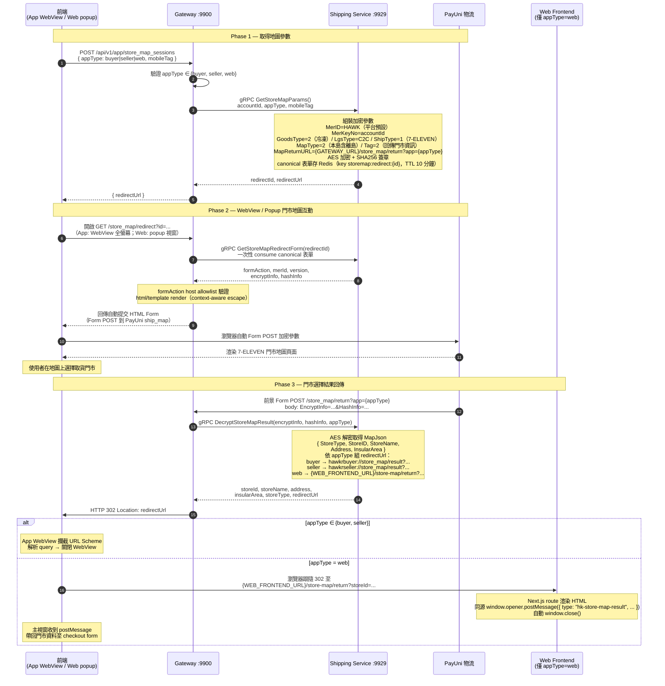

#### 5.14.2 API 規格

**API 1：取得門市地圖參數**

| 項目 | 值 |
|------|------|
| Endpoint | `POST /api/v1/app/store_map_sessions` |
| Auth | JWT Required — BUYER(1) / SELLER(2) / SELLER_AND_BUYER(3) |
| gRPC | `ShippingService.GetStoreMapParams()` |

**Request Body**（camelCase）：

```json
{
  "appType": "buyer",   // 必填。"buyer" / "seller" / "web"，決定選完門市後導回哪個前端
  "mobileTag": "Y"      // 選填。"Y"=手機版(預設), "N"=PC版（網頁端建議傳 "N"）
}
```

> **appType 用途**：本平台有買家行動 App、賣家行動 App、買家網頁三種前端，回傳目標 URL 各自不同。
> 後端依此參數決定 `MapReturnURL` 的 `app` query param，最終影響回調 302 redirect 的目標：
> - `buyer` / `seller` → 對應 App URL Scheme（deep link）
> - `web` → `{WEB_FRONTEND_URL}/store-map/return?...`（瀏覽器同源頁面，由前端 postMessage 回 opener）
>
> **無效值處理**：Gateway 接收到 `appType` 不在白名單時，回 `400 Bad Request`（`appType must be 'buyer', 'seller' or 'web'`），不向下呼叫 gRPC。

**Response**：

```json
{
  "code": 0,
  "message": "success",
  "data": {
    "redirectUrl": "https://test-api.example.com/store_map/redirect?id=a1b2c3d4-e5f6-7890-abcd-ef1234567890"
  }
}
```

**後台固定參數**（前端不傳，全部由後端組裝）：

| PayUni 參數 | 值 | 來源 | 說明 |
|------------|------|------|------|
| MerID | `HAWK` | 環境變數 `PAYUNI_STORE_MAP_MER_ID` | 平台預設商家編號。Tag=2 僅回傳門市資訊不建立物流單，使用平台 MerID 即可 |
| MerKeyNo | accountId 字串 | JWT `x-account-id` | 截斷至 20 字元，用於 PayUni 識別請求來源 |
| Timestamp | 當前 Unix 時間戳 | `System.currentTimeMillis() / 1000` | PayUni 標準時間戳 |
| GoodsType | `2` | 固定值（冷凍） | 冷凍門市為最嚴格篩選，能處理冷凍的門市必能處理常溫 |
| LgsType | `"C2C"` | 固定值 | 平台使用 C2C 店到店模式 |
| ShipType | `1` | 固定值 | 7-ELEVEN |
| MapType | `2` | 固定值 | 本島含離島。PayUni 規定 GoodsType=2 時 MapType 固定為 2 |
| Tag | `2` | 固定值 | 回傳選取的門市資訊（不建單、不更新商店設定） |
| MobileTag | 前端傳入或預設 `"Y"` | Request body | 控制 PayUni 地圖顯示手機版或 PC 版 |
| MapReturnURL | `{GATEWAY_URL}/store_map/return?app={appType}` | 動態組裝 | 門市選擇完成後 PayUni 前景導回此 URL |

**API 2：門市地圖重導向頁**

| 項目 | 值 |
|------|------|
| Endpoint | `GET /store_map/redirect?id={redirectId}` |
| Auth | 無（頂層路由，WebView 直接開啟） |
| 處理方 | Gateway gRPC → `ShippingService.GetStoreMapRedirectForm(redirectId)`（一次性 consume） |

`redirectId` 為後端產生之不可猜 opaque token（UUID，短效 10 分鐘、一次性），🔴 **query 不得攜帶任何表單欄位**（未經 escape 的資料拼入 HTML ＝ 反射型 XSS ＋ open form-action）。Gateway 取回 canonical 表單後，`formAction` 需通過 host allowlist 驗證，再以 `html/template`（context-aware escape）渲染自動提交 HTML 頁面（含 Loading 動畫），Form POST 到 PayUni `/api/logistics/ship_map`。
與 `/payment/redirect` 完全相同模式。

**API 3：門市選擇結果回調**

| 項目 | 值 |
|------|------|
| Endpoint | `POST /store_map/return?app={appType}`（PayUni Form POST 回調，body 帶 `EncryptInfo` / `HashInfo`） |
| Auth | 無（頂層路由，PayUni 前景回調） |
| gRPC | `ShippingService.DecryptStoreMapResult()` |

**處理流程**：

1. Gateway 接收 PayUni 前景 Form POST 回調（`EncryptInfo` / `HashInfo` 走 form body，`app` 走 query string）
2. Gateway 讀取 `app` query param（預設 `buyer`），透過 gRPC 呼叫 `ShippingService.DecryptStoreMapResult(encryptInfo, hashInfo, appType)`
3. Shipping Service 驗簽 → AES 解密 → 取得 `MapJson` → 解析 `{ StoreID, StoreName, Address, InsularArea, StoreType }`
4. Shipping Service 依 `appType` 組 `redirectUrl`（見下方「最終出口分支矩陣」）回傳給 Gateway
5. Gateway 收到 `redirectUrl` 後直接 **302 redirect**（`c.Redirect(http.StatusFound, ...)`），不渲染 HTML 中繼頁

> **無 HTML 中繼頁**：本流程與 payment §5.9 不同，payment 在 App 路徑有 10 秒倒數 HTML 作為 302 失敗時的 fallback；本流程因 App / Web 兩端都能即時處理 302 目標（App 攔截 URL Scheme、Web popup 同源落地），不需 HTML fallback，Gateway 純 302 透傳。

**最終出口分支矩陣**：

`redirectUrl` 由 Shipping Service 依 `appType` 一維選擇：

| appType | redirectUrl 模板 |
|---------|------------------|
| `buyer` | `hawkrbuyer://store_map/result?storeId={StoreID}&storeName={StoreName}&address={Address}&insularArea={InsularArea}&storeType={StoreType}` |
| `seller` | `hawkrseller://store_map/result?storeId={StoreID}&storeName={StoreName}&address={Address}&insularArea={InsularArea}&storeType={StoreType}` |
| `web` | `{WEB_FRONTEND_URL}/store-map/return?storeId={StoreID}&storeName={StoreName}&address={Address}&insularArea={InsularArea}&storeType={StoreType}` |

範例：

```
# buyer
hawkrbuyer://store_map/result?storeId=916712&storeName=%E6%95%A6%E5%AE%89%E9%96%80%E5%B8%82&address=%E5%8F%B0%E5%8C%97%E5%B8%82...&insularArea=I&storeType=

# web
https://web-dev.example.com/store-map/return?storeId=916712&storeName=%E6%95%A6%E5%AE%89%E9%96%80%E5%B8%82&address=%E5%8F%B0%E5%8C%97%E5%B8%82...&insularArea=I&storeType=
```

> **注意**：`StoreName` 與 `Address` 含中文，必須 URL Encode。三向 query naming（`storeId` / `storeName` / `address` / `insularArea` / `storeType`）刻意對齊既有 buyer / seller deep link，**不**因 web 變更為 `storeAddress` 等別名；前端 `hawkr-website/app/store-map/return/route.ts` `pickStore` 為 tolerant 解析，`address` 可被正確讀取。

**錯誤分支**：若驗簽失敗 / 解密失敗 / MapJson 解析失敗，Shipping Service 改組 error redirect：

| appType | error redirectUrl 模板 |
|---------|------------------------|
| `buyer` | `hawkrbuyer://store_map/result?error={URL-encoded msg}` |
| `seller` | `hawkrseller://store_map/result?error={URL-encoded msg}` |
| `web` | `{WEB_FRONTEND_URL}/store-map/return?error={URL-encoded msg}` |

web 路徑下，前端 route 偵測到 `error` query 時會將 `{ type: "hk-store-map-result", error }` postMessage 給 opener，主視窗收到後顯示錯誤提示並關閉 popup（行為對齊現有 `openStoreMapPopup` 已實作的 reject path）。

#### 5.14.3 三向 Redirect 設計

| appType | redirect 目標 | 觸發場景 | 結果帶回機制 |
|---------|--------------|---------|------------|
| `buyer` | `hawkrbuyer://store_map/result` | 買家行動 App 結帳選取貨門市 | App WebView 攔截 URL Scheme |
| `seller` | `hawkrseller://store_map/result` | 賣家行動 App 管理退貨門市 | App WebView 攔截 URL Scheme |
| `web` | `{WEB_FRONTEND_URL}/store-map/return` | 買家網頁結帳選取貨門市 | popup 落地頁同源 `window.opener.postMessage(...)` 後自動 `window.close()` |

**區分機制**：前端呼叫 `POST /api/v1/app/store_map_sessions` 時帶入 `appType`，後端將其編碼在 `MapReturnURL` 的 `?app=xxx` query param 中。PayUni 回調時該 query param 原封不動帶回，Shipping Service 據此組裝對應的 `redirectUrl`，Gateway 純 302 透傳。

**Same-origin 約束（web 路徑）**：web 前端 `openStoreMapPopup` 註冊的 `message` listener 會檢查 `event.origin === window.location.origin`，跨 origin 訊息一律忽略。因此 popup 在 PayUni（不同 origin）或 Gateway（API 子網域，不同 origin）期間無法 postMessage 給 opener，**必須**最後 302 落到 web frontend 同源頁面（`{WEB_FRONTEND_URL}/store-map/return`），由前端 route 渲染後執行 postMessage。🔴 **Gateway 不得自行渲 HTML 包 postMessage script**（它不同源，postMessage 會被 listener 忽略）。

#### 5.14.4 環境變數

| 環境變數 | 預設值 | 說明 |
|---------|-------|------|
| `PAYUNI_STORE_MAP_MER_ID` | `HAWK` | 門市地圖專用平台 MerID |
| `PAYUNI_STORE_MAP_RETURN_URL` | （空） | PayUni 門市選擇完成導回 URL。dev/stage 由 `.env` 設定 |
| `GATEWAY_URL` | `https://test-api.example.com` | Gateway 對外 URL，用於組裝 `redirectUrl` |
| `WEB_FRONTEND_URL` | `https://web-dev.example.com` | **與 payment §5.9 / aftersales 共用同一值**；當 `appType=web` 時 Shipping Service 用此值組最終 302 出口 URL |

> **共用約定**：`WEB_FRONTEND_URL` 為跨服務共用環境變數（買家網頁前端 base URL），**已存在於所有 `.env*` 與 `.env.template`**（payment-service / aftersales-service 已使用），本次 shipping-service 加入使用方時**不需新增 `.env*` 變數**，僅需 shipping-service 自身的 application.yml 引用 + docker-compose / k8s values 注入。對應 property key 沿用既有慣例：`hawkr.web.frontend-url`。

#### 5.14.5 前端整合指南

**買家行動 App / 賣家行動 App（appType=`buyer` / `seller`）：**

1. **呼叫 API**：`POST /api/v1/app/store_map_sessions`，body 帶 `{ "appType": "buyer" }`（或 `"seller"`）
2. **開啟 WebView**：用回傳的 `redirectUrl` 開啟 WebView（全螢幕）
3. **攔截 URL Scheme**：監聽 WebView 的 URL 變化，當 URL 以 `hawkrbuyer://`（或 `hawkrseller://`）開頭時：
   - 解析 query params：`storeId`, `storeName`（需 URL Decode）, `address`（需 URL Decode）, `insularArea`, `storeType`
   - 若有 `error` query，提示使用者錯誤訊息（取消選店）
   - 關閉 WebView
   - 將門市資訊填入結帳頁面的收貨門市欄位
4. **使用者關閉 WebView**（未選擇門市）：視為取消操作，不需額外處理
5. **錯誤處理**：若 WebView 載入失敗或逾時，提示使用者重試

**買家網頁（appType=`web`）：**

前端實作位於 `hawkr-website` repo（`lib/checkout/store-pickups.ts` + `app/store-map/return/route.ts`），由前端團隊維護；以下僅列 backend 介面契約相關的最低交集，前端細部行為（popup 開窗參數、message payload 內部 schema、postMessage 驗證策略等）視為前端自有實作，不在 backend 設計書約束範圍：

1. **呼叫 API**：`POST /api/v1/app/store_map_sessions`，body 帶 `{ "appType": "web", "mobileTag": "N" }`
2. **打開地圖**：以 popup 視窗開啟 `redirectUrl`（backend 不限定開窗方式，但需有「同源 opener」以便後續 302 回流時跨視窗傳遞結果，見 §5.14.3 same-origin 約束）
3. **PayUni 選店完成**：使用者於 popup 中選店 → PayUni Form POST 回 gateway `/store_map/return?app=web` → backend 302 → `{WEB_FRONTEND_URL}/store-map/return?storeId=...&storeName=...&address=...&insularArea=...&storeType=...`（或錯誤分支帶 `?error=...`）
4. **結果交付**：popup 落地頁負責將 query 解析後送回主視窗，主視窗以解析後資料填回 checkout form（具體傳遞機制由前端自行決定）

**參數說明（三向通用）：**

| 參數 | 型別 | 範例 | 說明 |
|------|------|------|------|
| storeId | String | `916712` | 7-ELEVEN 門市代碼（6 碼） |
| storeName | String | `敦安門市` | 門市名稱（需 URL Decode） |
| address | String | `台北市大安區...` | 門市地址（需 URL Decode） |
| insularArea | String | `I` | `I`=本島, `O`=離島 |
| storeType | String | `1` | 門市類型（PayUni 原始值） |
| error | String | `門市地圖簽章驗證失敗` | 僅錯誤分支帶此參數（需 URL Decode） |

#### 5.14.6 與 payment §5.9 的術語差異（刻意）

本流程與 payment §5.9 採同一架構模式（Gateway 薄代理 + 微服務 gRPC 處理 + 302 redirect 最終出口 + 共用 `WEB_FRONTEND_URL` 環境變數），但在 redirect 目標的決定維度上術語不同，為**刻意差異**，不對齊：

| 維度 | payment §5.9 | shipping §5.14 |
|------|-------------|---------------|
| 區分維度 | `client_type` × `app_type` 二維（CodeMeta `ClientType` × `AppType`） | `appType` 單維 string（`buyer` / `seller` / `web`） |
| SoT 位置 | `payment_transactions.client_type` / `app_type` 欄位（建立交易時寫入 DB） | PayUni 保留的 `MapReturnURL?app=xxx` query string（無 DB record） |
| 是否需要 DB | 必須有 `payment_transactions` row 作為 SoT | 不需要，store_map session 為 stateless 一次性流程 |

🔴 **store_map 不得引入 `client_type` × `app_type` 二維或 DB session 表**
（[後端服務責任邊界規範](../開發規範/後端服務責任邊界規範.md)「不應該存在的元件清單」）。

### 5.15 CvsPrintWaitingRegistry

> **用途**：橋接 `PrintCvsLabel` gRPC 請求（同步等待方）與 `ShippingWebhookConsumer`（非同步 Webhook 到達方），讓列印 API 可在 55 秒內同步取得交貨便代碼。

**類別**：`io.github.will413028.hawkr.shipping.service.CvsPrintWaitingRegistry`（`@Component`，Shipping Service 內部元件）

**核心結構**：

```java
@Component
public class CvsPrintWaitingRegistry {

    private static final ObsLogger log = ObsLogger.forClass(CvsPrintWaitingRegistry.class);

    /**
     * key = shipTradeNo, value = 等待中的 Future
     */
    private final ConcurrentHashMap<String, CompletableFuture<CvsPrintResult>> waitingMap
            = new ConcurrentHashMap<>();

    /**
     * 註冊等待（PrintCvsLabel 呼叫）
     */
    public CompletableFuture<CvsPrintResult> register(String shipTradeNo) {
        CompletableFuture<CvsPrintResult> future = new CompletableFuture<>();
        waitingMap.put(shipTradeNo, future);
        return future;
    }

    /**
     * 通知結果到達（ShippingWebhookConsumer 呼叫）
     * 若無等待中的請求，為 no-op
     */
    public void complete(String shipTradeNo, CvsPrintResult result) {
        CompletableFuture<CvsPrintResult> future = waitingMap.remove(shipTradeNo);
        if (future != null) {
            future.complete(result);
            log.info("CvsPrintWaitingRegistry.complete",
                    "已通知等待中的請求", "shipTradeNo", shipTradeNo);
        }
    }

    /**
     * 等待結果（PrintCvsLabel 呼叫，阻塞最多 timeoutSeconds 秒）
     * @return CvsPrintResult 或 null（超時）
     */
    public CvsPrintResult waitAndRemove(String shipTradeNo, CompletableFuture<CvsPrintResult> future,
                                         long timeoutSeconds) {
        try {
            return future.get(timeoutSeconds, TimeUnit.SECONDS);
        } catch (TimeoutException e) {
            log.info("CvsPrintWaitingRegistry.timeout",
                    "等待超時", "shipTradeNo", shipTradeNo);
            return null;
        } catch (Exception e) {
            log.warn("CvsPrintWaitingRegistry.error",
                    "等待異常: " + e.getMessage(), "shipTradeNo", shipTradeNo);
            return null;
        } finally {
            waitingMap.remove(shipTradeNo);
        }
    }

    /**
     * Webhook 回填結果
     */
    public record CvsPrintResult(String partnerId, String odno, String validationNo) {}
}
```

**設計考量**：

| 項目 | 說明 |
|------|------|
| **記憶體安全** | `finally` 必定呼叫 `waitingMap.remove()`，不會洩漏。重啟後 Map 清空也無副作用（等同超時） |
| **執行緒安全** | `ConcurrentHashMap` + `CompletableFuture` 皆為執行緒安全 |
| **無等待者場景** | Webhook 先到、或 API 已超時回傳 → `complete()` 從 Map 取不到 future，為 no-op |
| **重複 Webhook** | 由 `ShippingWebhookConsumer` 的 dedup 機制保護，Registry 不需處理 |
| **批次列印不適用** | `BatchPrintCvsLabel` 維持純非同步，不使用此 Registry |
| **@Transactional 衝突** | `printCvsLabel()` 須將 DB 更新拆為獨立事務先 commit，再進入等待階段，避免長時間佔用 DB 連線 |

**呼叫流程（ShippingService.printCvsLabel 走 §2.4 ProviderCallExecutor）**：

```
1. 驗證（物流單存在 / seller 一致 / ship_trade_no 非空；不設 cooldown，§2.4.6）
2. [短事務] acquireRequested：UPDATE label_print_status '4101/4104'→'4102' → commit
3. [事務外] registry.register(shipTradeNo) → CompletableFuture
4. [事務外] 呼叫 PayUni 列印 API
   - 失敗 → [短事務] markFailed: UPDATE '4102'→'4104' + provider_message → 重新拋例外 + 清理 registry
5. [事務外] registry.waitAndRemove(shipTradeNo, future, 55)
6. 組裝回應：
   - result != null → webhookReceived=true + partnerId/odno/validationNo
   - result == null → webhookReceived=false + message="系統繁忙中，交貨便代碼即將生成"
     （label_print_status 仍為 '4102'，§5.19 通道 B 會補拉）
```

> **markSucceeded 不在此處**：列印成功訊號是 PayUni 後續 webhook，由 `processWebhookPrint`（§5.6）transition `4102→4103`；本流程不寫 SUCCEEDED。

**多實例支援（Redis Pub/Sub）**：

`CvsPrintWaitingRegistry` 透過 **Redis Pub/Sub** 實現跨實例通知，支援多實例部署。

**問題場景**：Shipping Service 有多個實例時，Print Webhook 可能被實例 A 消費，但 55 秒等待在實例 B 上。若僅用 JVM 內 Map，A 的 `complete()` 無法通知 B → B 永遠超時。

**解決方案**：

```
shipping-B（API 請求方）：
  1. 在 localMap 註冊 CompletableFuture
  2. 呼叫 PayUni print_label
  3. 阻塞等待 Redis message（最多 55 秒）
  4. 收到 → 回傳交貨便代碼；超時 → 回傳 webhookReceived=false

shipping-A（Webhook 消費方）：
  1. 收到 Print MQ → processWebhookPrint() 寫 DB
  2. Redis publish（channel = "cvs:print:{shipTradeNo}", data = JSON）
  3. 所有實例收到 publish → 在 localMap 找到 future 的實例 complete it
```

**核心元件**：

| 元件 | 說明 |
|------|------|
| `CvsPrintWaitingRegistry` | `localMap`（JVM 內 Future）+ Redis Pub/Sub（跨實例通知）|
| `CvsPrintRedisConfig` | `RedisMessageListenerContainer`，pattern subscribe `cvs:print:*` |

**設計決策**：

| 項目 | 決策 | 原因 |
|------|------|------|
| Pattern vs 動態 Subscribe | Pattern `cvs:print:*` | 簡單，不需動態管理 channel；Print Webhook 量不大，pattern matching 開銷可忽略 |
| Redis vs MQ | Redis Pub/Sub | 延遲更低（<1ms）；此場景需要即時通知而非持久化 |
| 降級策略 | Redis 不可用 → 退化為超時 | 不影響主流程，交貨便代碼仍會由 Webhook 回填到 DB，前端後續查詢可取得 |
| TTL / 清理 | localMap 在 `finally` 清理，Redis channel 無需清理 | Pub/Sub 不持久化，無記憶體洩漏風險 |

### 5.16 退貨物流處理

#### 5.16.1 概述

售後服務的退貨物流由 AfterSales Service 委派 Shipping Service 建立。Shipping Service 負責：
1. 查詢賣家退貨設定（`seller_shipment_settings`，**不過濾 onboarding_status / enabled**）
2. 組裝 PayUni 物流 API 參數
3. 呼叫 PayUni 建立物流單
4. 快照所有物流資訊到 `shipments` 表
5. 透過 Webhook 追蹤退貨物流狀態

> ⚠️ **讀路徑語意**（§2.3.1）：退貨建單**不檢核** `onboarding_status` 是否 `ACTIVE`，也**不檢核** `enabled`。賣家在我方平台取消此方式不應牽連到已成立訂單的買家退件權。透過 `OnboardingService.findSettingByMethod(storeId, shippingMethod)` 取 historical setting；若 row 不存在（理論上不該發生，因為 forward 路徑已驗 row 存在）→ 拋 `SHIPMENT_DATA_INCOMPLETE(5006)`，**不再拋** `SHIPMENT_SELLER_NOT_ONBOARDED`（語意衝突）。

#### 5.16.2 新增 RPC

| RPC | 說明 | 呼叫端 |
|-----|------|--------|
| `CreateReturnCvsShipment` | 超商 C2C 退貨（交貨便，角色對調） | AfterSales Service |
| `CreateReturnHomeShipment` | 宅配退貨 | AfterSales Service |
| `GetSellerReturnConfig` | 查詢賣家退貨設定 | AfterSales Service |

#### 5.16.3 超商 C2C 退貨建單流程

使用正向物流 API（**交貨便**，非退貨便），**角色對調**：買家成為寄件人，賣家成為收件人。

```
1. AfterSales 呼叫 CreateReturnCvsShipment(order_no, store_id, mer_id, buyer_name, buyer_phone, temperature)
2. Shipping 用 findSettingByMethod (不過濾 status/enabled) 取 seller_shipment_settings (CVS_C2C)：
   - sender_name / sender_phone → 賣家退貨聯絡人（退貨物流的收件人角色）
   - return_store_code → 退貨門市代碼（退貨物流的取貨門市）
3. 組裝 PayUni 參數（角色對調）：
   - MerTradeNo = order_no + "-Refund"（如 "O400280260-Refund"，18 碼）
   - LgsType = C2C，ShipType = 1（7-11），ServiceType = 3（免代收）
   - GoodsType = 依 temperature 轉換（AMBIENT→1, FROZEN→2）
   - StoreID = return_store_code（賣家退貨門市 = 退貨物流的取貨門市）
   - Consignee = sender_name（賣家退貨聯絡人 = 退貨物流的收件人）
   - ConsigneeMobile = sender_phone
   - SenderName = buyer_name（買家 = 退貨物流的寄件人）
   - SenderMobile = buyer_phone
   - NotifyURL = 同正向物流的 NotifyURL
4. 呼叫 ShippingClient.createCvsShipment(mer_id, params)
5. 建立 shipments 紀錄（is_return=true，快照所有參數）
6. **[非同步] 觸發 PayUni 列印**：建單 commit 後，以獨立執行緒（`@Async` 或 `CompletableFuture.runAsync`）走 §2.4 `ProviderCallExecutor`，acquireRequested transition `label_print_status` 為 `4102`，呼叫 `labelService.triggerCvsPrint(merId, shipTradeNo, goodsType, lgsType="C2C", shipType="1", shipDate=今日)`，**不等 webhook**。
   - 同步呼叫 PayUni 失敗 → markFailed 寫 `4104` + provider_message；不中斷主流程，由 §5.19 reconciliation 後續對帳
   - PayUni 處理列印後送 Print webhook → 進入既有 `processWebhookPrint()`（§5.6）→ transition `4102 → 4103` + publish `shipment.label.updated` with `isReturn=true`
   - 下游由 AfterSales Service 消費並 snapshot 至 `aftersale_cases`（見 [09-AfterSales 設計書 §5.3.5](09-售後微服務（AfterSales%20Service）詳細設計書.md#5-3-5)）
7. 回傳 shipment_no（同步）。三段碼不透過此 RPC 回傳，走後續 webhook → MQ → AfterSales snapshot 非同步鏈路
```

> 🔴 **退貨建單成功後自動非同步觸發列印**，不阻塞 seller 的 resolve API（與正向出貨由 seller 主動點「列印」＋同步等 55 秒不同）。退貨的三段碼接收者是**買家**。

#### 5.16.4 宅配退貨建單流程

使用 PayUni 宅配退貨 API（`/api/home_delivery/refund`），非角色對調。

```
1. AfterSales 呼叫 CreateReturnHomeShipment(order_no, store_id, mer_id, buyer_*, temperature)
2. Shipping 用 findSettingByMethod (不過濾 status/enabled) 取 seller_shipment_settings (HOME_DELIVERY)：
   - return_name / return_phone → 賣家退貨收件人
   - return_city / return_district / return_address_detail / return_postal_code → 退貨地址
3. 組裝 PayUni 退貨參數：
   - MerTradeNo = order_no + "-Refund"
   - Sender = 買家資訊（AfterSales 傳入的訂單快照）
   - Receiver = 賣家退貨地址（最新 seller_shipment_settings）
   - GoodsType = 依 temperature 轉換
4. 呼叫 PayUni 退貨 API
5. 建立 shipments 紀錄（is_return=true）
6. 回傳 shipment_no
```

#### 5.16.5 退貨 MerTradeNo 規則

| 物流方向 | MerTradeNo | 範例 |
|---------|-----------|------|
| 正向出貨 | `{orderNo}` | `O400280260`（10 碼） |
| **退貨物流** | `{orderNo}-Refund` | `O400280260-Refund`（**18 碼**） |

> PayUni 的 `MerTradeNo`（商店訂單編號）限制：**長度 25 字元、格式 `[A-Za-z0-9_-]`、10 分鐘內不可重複**。
> 同一筆訂單正向出貨已用掉 `{orderNo}`，退貨再建一單時 PayUni 會拒絕重複的 MerTradeNo ⇒ 退貨一律加 `-Refund` 後綴。
>
> 🔴 **`-Refund` 後綴不是退貨的識別依據**：系統內部一律以 `shipments.is_return = true` 判定，禁止解析 MerTradeNo 格式。一筆訂單只允許退貨一次。
>
> 同理，PayUni 回調的 `ShipTradeNo`（UNi 物流序號）是 PayUni 分配的流水號，正向與逆向的 ShipTradeNo 格式沒有區別。Shipping Service 收到 webhook 後，用 `ShipTradeNo` 查 shipments 表取得完整資訊（含 `order_no`、`is_return`）。

#### 5.16.6 退貨 Webhook 處理

Webhook Service 解密後統一以 `payuni.shipping.status` routing key 發布，不區分正向/逆向。

Shipping Service 消費時用 `ShipTradeNo` 查 shipments 表，依 `is_return` 欄位判斷：

```
ShipmentEntity shipment = findByShipTradeNo(shipTradeNo);
if (shipment.getIsReturn()) {
    // 退貨物流 → 更新 shipments 狀態
    //          → 發布 shipment.return.status_changed 事件
} else {
    // 正向物流 → 現有邏輯（更新 shipments 狀態 + 發布 shipment.status.changed）
}
```

### 5.17 商品配送驗證

#### 5.17.1 用途

Product Service 建立/更新商品時，呼叫此 RPC 驗證 SKU 配送方式的合法性：
- 賣家是否已開通該配送方式
- 材積（L+W+H）是否在限制內
- 單邊長度是否在限制內
- 重量是否在限制內

#### 5.17.2 RPC 定義

```protobuf
rpc ValidateProductShipping(ValidateProductShippingRequest) returns (ValidateProductShippingResponse);
```

#### 5.17.3 驗證邏輯

對每個 `ValidateShippingItem`：

0. **系統層級可用性**（最先檢查）：呼叫 `ShippingFeeService.hasAnyEnabledConfig(method)`，若該 `method` 在 `shipping_method_configs` **任一溫層皆無 enabled=true row** → `METHOD_NOT_AVAILABLE`。
   - 🔴 **適用所有 method（含 3003）**：系統層級可用性一律以 `shipping_method_configs` 有無 `enabled=true` 列判定
   - 此檢查**必須優先於**賣家 onboarding 檢查，否則會出現「賣家明明沒得開通的方式卻被要求去物流設定開通」的二次誤導
1. **賣家開通狀態**：以 `(shippingMethod, goodsType)` 配對比對賣家 `sellerAvailableMethods`（由 `OnboardingService.listSellerShippingMethods` 計算 `系統層級可用 AND onboarding_status=ACTIVE AND enabled=TRUE` 的槽位）。
   - 配對在集合內 → 通過
   - 配對不在集合內，但該 method **仍有其他溫層 onboarded**（`sellerAvailableMethods` 內存在以 `method:` 開頭的其他項目）→ `TEMPERATURE_NOT_ONBOARDED`
   - 配對不在集合內，且該 method **完全未 onboarded**（無任何溫層）→ `METHOD_NOT_ONBOARDED`
   - 黑貓宅急便（`TAQBIN`）不分溫層，比對 key 固定為 `TAQBIN:`
2. **配送方式+溫層組合**：查詢 `configCache`（`shipping_method_configs` 記憶體快取），找不到 → `METHOD_NOT_SUPPORTED`（例：7-11 冷藏，業務本身不支援）
3. **材積總和**：`maxDimensionSumCm > 0 且 L+W+H > maxDimensionSumCm` → `DIMENSION_SUM_EXCEEDED`
4. **單邊長度**：`maxSingleSideCm > 0 且 longestSide > maxSingleSideCm` → `SINGLE_SIDE_EXCEEDED`
5. **重量**：`maxWeightGrams > 0 且 weightGrams > maxWeightGrams` → `WEIGHT_EXCEEDED`

驗證邏輯與 `ShippingFeeService.calculateShippingOptions()` 的過濾規則一致，但此 RPC 回傳拒絕原因與限制值，而非靜默過濾。

**拒絕原因（`rejection_reason`）總表**：

| reason | 觸發條件 | `rejection_message`（友善文案，含引導） |
|---|---|---|
| `METHOD_NOT_AVAILABLE` | 該配送方式在系統層級暫停（無任何 enabled config row） | 「{methodLabel}」服務目前暫停使用，請改選其他配送方式 |
| `METHOD_NOT_ONBOARDED` | 該配送方式所有溫層皆未開通 | 您尚未開通「{methodLabel}」配送方式，請至「物流設定」完成開通 |
| `TEMPERATURE_NOT_ONBOARDED` | 該配送方式有開通其他溫層，但本商品溫層未開通 | 您的商品為「{tempLabel}」溫層，「{methodLabel}」尚未開通此溫層，請至「物流設定 → {methodLabel}」新增「{tempLabel}」設定 |
| `METHOD_NOT_SUPPORTED` | (method, temperature) 組合本身不被系統支援 | 「{methodLabel}」不支援「{tempLabel}」溫層 |
| `DIMENSION_SUM_EXCEEDED` | 材積總和超限 | 材積總和 {sum}cm 超過「{methodLabel}/{tempLabel}」上限 {limit}cm |
| `SINGLE_SIDE_EXCEEDED` | 最長邊超限 | 最長邊 {side}cm 超過「{methodLabel}/{tempLabel}」上限 {limit}cm |
| `WEIGHT_EXCEEDED` | 重量超限 | 重量 {weight}g 超過「{methodLabel}/{tempLabel}」上限 {limit}g |

**訊息規則**：`rejection_message` 一律使用 `ShippingMethod.label()` 與 `ShippingTemperature.label()` 中文 label，禁止露出 enum code / value（如 `SEVEN_ELEVEN_STORE_PICKUP`、`3203`）。caller 可直接顯示給使用者。

> **跨服務契約**：Product Service 的 `ProductPublishValidator.validateShippingEnabled` 走 fallback，把 `METHOD_NOT_AVAILABLE`／`METHOD_NOT_ONBOARDED`／`TEMPERATURE_NOT_ONBOARDED` 三個值統一歸入 `SHIPPING_NOT_ENABLED` violation type。

> 🔴 **`OnboardingService.listSellerShippingMethods` 對每一個 slot（不分 `onboardingRequired`）都必須先檢查 `hasAnyEnabledConfig(method)`**，系統層級無 config → `available=false`。少了這道，會出現「系統未啟用該 method、賣家卻看到可勾」的漏洞。
> 3003 另需賣家層 `uber_store_mapping`／`uber_organization` 判定，見 §5.13。

#### 5.17.4 落點

| 層級 | 類別 |
|------|------|
| Service | `ShippingFeeService.validateProductShipping()` |
| gRPC Handler | `ShippingGrpcServiceImpl.validateProductShipping()` |

### 5.18 Webhook Service 整合注意事項

**MQ 消息格式**：webhook-service 發布到 `payuni.events` 的消息為 **envelope 格式**，PayUni 原始欄位在 `payload` 子物件中：

```json
{
  "eventId": "uuid",
  "webhookType": "SHIPPING_PRINT",
  "merId": "HAWK9",
  "payload": {
    "ShipTradeNo": "S001...",
    "ApiType": "Print",
    "PartnerId": "8B2",
    "Odno": "S6546109",
    "ValidationNo": "0323"
  }
}
```

`ShippingWebhookConsumer` 使用 `PayUniWebhookEnvelope`（common-core）統一解析：

```java
PayUniWebhookEnvelope env = PayUniWebhookEnvelope.parse(message.getBody());
String shipTradeNo = env.payloadField("ShipTradeNo");
String apiType = env.payloadField("ApiType");
String merId = env.payloadField("MerID");
// 一般物流貨態更新時，解析 ShipStatusDesc 傳入 processWebhookStatusUpdate
String shipStatusDesc = env.payloadField("ShipStatusDesc");
```

**PayUni 欄位大小寫**：Print Webhook 回傳的出貨單編號欄位名為 `Odno`（小寫 d），非 `ODNo`。

**SHIPPING_PRINT 類型**：webhook-service 的 `resolveType()` 優先判斷 `ApiType=Print`，歸類為 `SHIPPING_PRINT`（與 `SHIPPING_STATUS` 共用 routing key `payuni.shipping.status`）。eventKey 格式為 `{merId}:{shipTradeNo}:PRINT:{odno}`，確保不與建單/貨態 webhook 撞鍵。

### 5.19 Reconciliation 補收排程（L2 補救路徑）

本章涵蓋 §2.4 三個 `ProviderCallStatus` 套用點的全面對帳機制。系統每 N 分鐘自動排程，主動向 PayUni 查詢可能漏收 webhook 或卡死的紀錄，確保即使前端從未刷新、webhook 完全停擺，所有外部呼叫狀態仍會被收斂到 PayUni 真實狀態。

四條獨立掃描通道：

| 通道 | 來源 | 補救對象 | 動作 |
|---|---|---|---|
| 5.19.A 物流貨態 | `shipments.status NOT IN (11,41)` | webhook 漏收 | 呼叫 `/api/logistics/query` 對齊 status |
| 5.19.B 列印代碼 | `shipments.label_print_status IN (REQUESTED, FAILED)` | Print webhook 漏收 / 同步失敗 | 呼叫 `/api/logistics/query`，若 PartnerId/Odno/ValidationNo 存在 → markSucceeded |
| 5.19.C 黑貓叫件 | `shipments.tcat_call_status = REQUESTED` | JVM crash 在 PayUni 回應後 markSucceeded 前 | 呼叫 `/api/logistics/query`，若狀態已為 `已叫件(210)` → markSucceeded |
| 5.19.D 建店送審 | `seller_shipment_settings.payuni_submit_status = REQUESTED` | JVM crash 在 PayUni 回應後 markSucceeded 前 | 呼叫 PayUni 查詢 onboarding API（若支援），否則由 ops 人工處理 |

> **設計重點**：與 §5.7「按需查詢」共用同一個 service 層 method `reconcileShipment` / `reconcileSetting`。§5.7 的按需查詢已有 caller（買家 `GetShipmentTracking`「查看物流」+ 內部 `QueryShipmentStatus`），本節為 **webhook 漏收的真正補救機制**（兩者皆 touch `last_reconciled_at` 協調退避）。

#### 5.19.1 設計動機

PayUni 物流 Webhook **不會自動重送**（與付款 Webhook 行為相同）。一旦下列任一情境發生，本地 `shipments.status` 將永遠停留在過時狀態：

| 失效情境 | 影響 |
|---------|------|
| ngrok / 公開網址暫時不可用 | 那段時間的貨態變更全部遺失 |
| MQ Consumer 短暫離線、訊息進入 DLQ 未補消費 | 該批次貨態遺失 |
| webhook-service 解密失敗 / 落單 | 貨態遺失 |
| PayUni 端推送延遲超過 retry 視窗 | 貨態延後或遺失 |

對應的下游連鎖傷害：訂單狀態無法推進到「配送中」「已送達」、買家收貨自動完成排程不啟動、賣家後台資料停滯。因此**必須**有獨立於 Webhook 的主動補收機制。

#### 5.19.2 核心原則

| 原則 | 說明 |
|------|------|
| **主路徑唯一匯流** | Reconcile 路徑與 Webhook 路徑**必須**呼叫同一個 application service method（`ShippingService.queryAndSyncStatus`），確保狀態變更與 MQ 事件發布行為**完全一致**。任何「reconcile 走另一條快路徑」的設計都被禁止 |
| **狀態合法性沿用** | 直接沿用 `ShipmentStatusMapper.isValidTransition()`，禁止為了 reconcile 開後門 |
| **本地進度不可倒退** | `TCAT_CALLED=210`、`CVS_CODE_RECEIVED=920`、`SELLER_CONFIRMED=921` 是平台本地處理完成狀態，PayUni `/api/logistics/query` 不會回這些本地狀態。Reconcile / 按需查詢若查回 `91/92/98/21/22` 等 PayUni 出貨前狀態，必須視為舊外部狀態並拒絕覆蓋本地進度；只允許前進到配送中、終態或異常 |
| **退避防 hot row** | 每次嘗試（不論狀態是否變更）皆更新 `last_reconciled_at = NOW()`，下次 **scheduler** 掃描必須間隔 ≥ `reconcile-interval-min`。**§5.7 按需查詢不被退避擋下**，因為 §5.7 的本意是「webhook 漏收的補救手段」，必須永遠強制 fresh，否則補救機制失效。配額保護應交由 Gateway rate limit 處理 |
| **視窗限制** | 僅掃描 `created_at` 落在合理視窗內的物流單，避免老舊物流單反覆消耗 PayUni 配額 |
| **終態排除** | 終態（`PICKED_UP=11`、`CANCELLED=41`）一律不掃 |
| **Uber 排除** | Uber 不走 PayUni 查詢，由 `queryAndSyncStatus` 內部 early return；掃描階段也直接以 `shipping_method != '3003'（UBER_INSTANT）` 過濾以節省查詢 |
| **宅配 / 超商統一** | PayUni 物流查詢 API（`/api/logistics/query`，見《PayUni 物流官方 API 總覽》§10）對宅配與超商統一入口，差異僅在 `TradeType`（宅配才需）；`deriveLgsType()` 與 `queryAndSyncStatus` 已完整處理，**reconcile 不需區分配送方式** |

#### 5.19.3 掃描條件

##### 5.19.3.A 物流貨態通道（既有）

```sql
SELECT id, shipment_no
FROM shipments
WHERE status NOT IN (11, 41)            -- 排除終態：PICKED_UP / CANCELLED
  AND shipping_method <> '3003' -- 排除 Uber（UBER_INSTANT）
  AND ship_trade_no IS NOT NULL         -- 必須已建單拿到 PayUni 物流序號
  AND created_at >= NOW() - INTERVAL '7 days'   -- 視窗：max age
  AND (last_reconciled_at IS NULL
       OR last_reconciled_at < NOW() - INTERVAL '15 minutes') -- 退避
ORDER BY last_reconciled_at NULLS FIRST, created_at
LIMIT 100;
```

> `status NOT IN (11,41)` 會包含 `210/920/921`。這是刻意設計：本地已處理完成的物流單仍可能透過 PayUni 查詢補收到後續 `31/32/11` 或異常狀態。防止倒退的責任在 `ShipmentStatusMapper.isValidTransition()`，不可用掃描條件排除 `210/920/921`，否則會漏掉後續真實物流進展。

> **搶佔（L2）**：上面 `last_reconciled_at` 的退避述詞**只是候選過濾，不是搶佔** —— 多副本時兩個 pod 的 SELECT 會撈到同一批。
> 🔴 因此 `queryAndSyncStatus`（副作用：打 PayUni 查詢 API）**之前必須先走 lease CAS**（`ShipmentMapper.claimForReconcile`）：
> `SET last_reconciled_at = NOW() WHERE id=? AND <候選述詞> AND (last_reconciled_at IS NULL OR last_reconciled_at < #{backoffCutoff})`，`affected=0` ⇒ skip 該筆。
> **租約欄 ＝ `shipments.last_reconciled_at`（零 schema 變更）；租約長度 ＝ 15 分鐘退避；候選窗口 ＝ 7 天**（`created_at >= NOW() - 7d`）⇒ 窗口內約 670 次重試機會。
> 🔴 **租約長度必須 < 候選窗口的剩餘壽命**，否則 lease 退化成永久旗標（[規範 §三](../開發規範/多副本排程搶佔規範.md)）。
> ⚠️ **這是冷卻租約不是「已對帳」旗標**：pod 在 claim 與 PayUni 查詢之間崩潰時，租約到期該 row 自動回到候選集合。
> ⚠️ **`touchLastReconciledAt`（事後 stamp）與 `ShippingService` 內對應的 `finally` 不得改成 CAS** —— 它在 claim 之後執行，天然覆蓋租約為更新的時間，語意是「本 tick 已跑過」。

##### 5.19.3.B 列印代碼通道

```sql
SELECT id, shipment_no, ship_trade_no, mer_id, label_print_status, label_print_requested_at
FROM shipments
WHERE label_print_status IN ('4102', '4104')         -- REQUESTED 或 FAILED
  AND ship_trade_no IS NOT NULL
  AND label_print_requested_at < NOW() - INTERVAL '5 minutes'  -- 至少 5 分鐘給 webhook 機會
  AND label_print_requested_at >= NOW() - INTERVAL '7 days'    -- 視窗
ORDER BY label_print_requested_at
LIMIT 50;
```

> **搶佔（L3）**：本通道使用**專屬租約欄 `shipments.label_reconcile_next_at`**。
> 🔴 `reconcileOne`（副作用：PayUni 查詢 ＋ transition ＋ publish）**之前必須先走 lease CAS**（`ShipmentMapper.claimLabelReconcile`），
> 候選 SQL 同時帶 `(label_reconcile_next_at IS NULL OR label_reconcile_next_at <= NOW())`；`affected=0` ⇒ skip 該筆。
> 少了這一道，兩個 pod 每輪都會對同一批打 PayUni 查詢，命中時各自走一次 `processWebhookPrint` 並 publish `shipment.anomaly.detected`。
> 🚨 **不可挪用 `label_print_requested_at` 當租約欄**：它是**業務時戳**（賣家按下列印的時間），改寫它會讓「至少 5 分鐘給 webhook 機會」與 7 天視窗兩個判準一起失真。
> **租約長度 ＝ 10 分鐘（＝一個 tick）；候選窗口 ＝ 7 天** ⇒ 窗口內約 1000 次重試機會。
> 🔴 **租約長度必須 < 候選窗口的剩餘壽命**，兩者等寬即退化成 at-most-once。
> ⚠️ **這是冷卻租約不是「已補收旗標」**：NULL 或已過期即可被重新搶佔，**新增此欄時不得回填**（回填成 `NOW()` 會讓既有列全體沉默一個租約週期）。

每筆呼叫 `/api/logistics/query`。判斷規則：
- 回傳含完整 `PartnerId/Odno/ValidationNo` → 走 `processWebhookPrint` 同條路徑（reconciliation 與 webhook **共用 application service method**），transition `4102/4104 → 4103`
- 回傳缺少其一 → 不變（PayUni 端尚未產生代碼）
- API 回 `Status≠SUCCESS` → 留在原狀態，紀錄 `provider_message`，後續排程或 ops 處理

**LgsType 必須帶實際值**：

`/api/logistics/query` 必填 `LgsType` 才能定位 shipment 並回傳完整三段碼。reconciliation 對 `entity.lgs_type` 必須直接帶（C2C 或 HOME），**禁止傳 null**。

| 配送方式 | `entity.lgs_type` | query API LgsType 參數 | reconcile 是否有效 |
|---|---|---|---|
| 7-11 / 全家（C2C） | `"C2C"` | `"C2C"`（不可為 null） | ✅ 有效 |
| 黑貓宅配（HOME） | `"HOME"` | `"HOME"` | ❌ **無效**（PayUni HOME query by-design 不回三段碼） |
| Uber | — | reconciliation 排除（`shipping_method <> '3003'（UBER_INSTANT）`） | — |

實作 helper 與 §5.7 `ShippingService.deriveLgsType()` **完全對齊**：根據 `shipping_method` fallback（TAQBIN→HOME；其他→C2C），不可寫成「只有 HOME 才帶值，其他回 null」的版本。

**宅配無法透過此通道補拉**：

宅配 `/api/logistics/query` 對 `LgsType=HOME` 的回應**結構性**不含 `PartnerId/Odno/ValidationNo`（PayUni 設計如此，不是 bug）。reconciler 對宅配呼叫 query 永遠取不到三段碼，必走 `isEmpty(...) → return false` 分支，**沒有任何路徑能把宅配的 `4102 / 4104` transition 到 `4103`**。

因此宅配的補救路徑**不在這條 reconcile 通道內**：

| 機制 | 超商 | 宅配 |
|---|---|---|
| `markSucceeded` 寫入點 | `processWebhookPrint`（PayUni Print webhook 到達）/ 本通道 reconcile（webhook 漏收補拉）| `markLabelPrintSucceededHome`（同步路徑 PDF 上傳 OSS 成功時直接寫入）|
| transient 補救 | 本通道 reconcile 自動處理 | **無自動補救**，靠賣家點重打（§2.4.5.1 / §2.4.6）|
| `markFailed` transient 處理 | 跳過寫 DB（保留 `4102`） | 直接寫 `4104`（讓賣家可重打） |

本通道 SQL 會撈到宅配的 `4102/4104`（WHERE 未過濾 `shipping_method`），但 reconcile 對它們呼叫 query 必 return false ⇒ **僅是無效空轉，不影響正確性**。

##### 5.19.3.C 黑貓叫件通道（ops 告警，不主動對帳）

```sql
SELECT id, shipment_no, ship_trade_no, mer_id, tcat_call_requested_at
FROM shipments
WHERE tcat_call_status = '4202'                       -- 僅 REQUESTED（FAILED 由賣家自行重試，reconcile 不重打）
  AND tcat_call_requested_at < NOW() - INTERVAL '3 minutes'  -- callTcat 為純同步，REQUESTED 過久代表 JVM crash 或 PayUni 例外吞噬
  AND tcat_call_requested_at >= NOW() - INTERVAL '24 hours'
LIMIT 30;
```

🔴 **禁止以 `/api/logistics/query` 的 `ShipStatus = 21 (PENDING_SHIPMENT)` 反推「黑貓已預約」。**
`21` 代表「等待商店出貨」，PayUni 從建單初始 `91` **也可能直接前進到 `21`** 而未經過 `callTcat`；
黑貓 `callTcat` 是 PayUni 內部記帳，沒有專屬可查詢的對外狀態。
拿貨態當代理訊號會 `markSucceeded` 並寫入**虛假的 `tcat_call_time`**。

**因此本通道僅作 ops 告警**：累積筆數 > 0 觸發監控，由人工 SSH 進 PayUni 後台確認「黑貓系統是否實際收到此件」，再手動將 DB transition 到 `SUCCEEDED` 或 `FAILED`。常態下此通道應為 0。

> **搶佔（L4）**：本通道使用**專屬冷卻租約欄 `shipments.tcat_stuck_alerted_at`**。
> 🔴 publish **之前必須先走 lease CAS**（`ShipmentMapper.claimTcatStuckAlert`），候選 SQL 同步帶
> `(tcat_stuck_alerted_at IS NULL OR tcat_stuck_alerted_at <= NOW())`；`affected=0` ⇒ skip。
> 少了這一道，多副本下每輪會對同一批各發一次 `shipment.anomaly.detected`
> （`publishAnomalyDetected` 的迴圈內**沒有 try/catch**）。
> 🚨 **租約長度 ＝ 1 小時，不是 24 小時。**
> 候選窗口 = `tcat_call_requested_at >= NOW() - max-age-hours(24)` ⇒ **窗口寬度就是 24 小時**。若租約也取 24 小時，租約到期時 row 早已掉出窗口 ⇒ **靜默退化成 at-most-once**（[規範 §三](../開發規範/多副本排程搶佔規範.md) 明列的反例就是這一支）。取 1 小時 ⇒ 窗口內約 23 次告警。
> ⚠️ **這個 1 小時不能「順手改回 24h 比較不吵」** —— 那會讓卡死告警只發一次；卡死沒解除就該持續有聲音，這正是它**不能走例外 B**、必須 lease 的原因（[規範 §四 例外 B 條件 1(b)](../開發規範/多副本排程搶佔規範.md)）。**要少吵請調 `max-age-hours` 或 severity，不要調租約。**
> ⚠️ **這是冷卻租約不是「已告警」旗標**，欄名 `*_alerted_at` 讀起來像後者，設計書在此明文否定。

**落點**：`shipping-service .../scheduler/TcatCallStuckAlertScheduler.java`

**配置 properties**（`application.yml` / 環境變數）：

| 配置項 | 環境變數 | 預設值 | 說明 |
|---|---|---|---|
| `hawkr.shipping.alert.tcat-stuck.enabled` | `SHIPPING_ALERT_TCAT_STUCK_ENABLED` | `true` | 排程開關 |
| `hawkr.shipping.alert.tcat-stuck.interval-ms` | `SHIPPING_ALERT_TCAT_STUCK_INTERVAL_MS` | `600000`（10 分鐘） | 掃描頻率 |
| `hawkr.shipping.alert.tcat-stuck.batch-size` | `SHIPPING_ALERT_TCAT_STUCK_BATCH_SIZE` | `30` | 每輪掃描上限 |
| `hawkr.shipping.alert.tcat-stuck.requested-grace-minutes` | `SHIPPING_ALERT_TCAT_STUCK_GRACE_MINUTES` | `3` | REQUESTED 過後超過此值才告警 |
| `hawkr.shipping.alert.tcat-stuck.max-age-hours` | `SHIPPING_ALERT_TCAT_STUCK_MAX_AGE_HOURS` | `24` | 視窗：不掃此值之前的紀錄 |

**告警 log event**：

| Log event 名稱 | level | 觸發 |
|---|---|---|
| `TcatCallStuckAlertScheduler.itemAlert` | warn | 每筆候選逐筆告警，含 `shipmentNo` / `shipTradeNo` / `requestedAt` |
| `TcatCallStuckAlertScheduler.summary` | warn (count>0) / info (count=0) | 整輪計數 |

##### 5.19.3.D 建店送審通道（ops 告警，不主動對帳）

```sql
SELECT id, store_id, shipping_type, payuni_submit_status, payuni_submit_requested_at
FROM seller_shipment_settings
WHERE payuni_submit_status = '4302'                   -- 僅 REQUESTED
  AND payuni_submit_requested_at < NOW() - INTERVAL '5 minutes'
  AND payuni_submit_requested_at >= NOW() - INTERVAL '24 hours'
LIMIT 20;
```

PayUni 建店設定無查詢 API，此通道亦僅作 ops 告警：累積筆數 > 0 觸發監控，由人工後台手動 transition 到 SUCCEEDED 或 FAILED。

**落點**：`shipping-service .../scheduler/PayUniSubmitStuckAlertScheduler.java`

**配置 properties**：

| 配置項 | 環境變數 | 預設值 | 說明 |
|---|---|---|---|
| `hawkr.shipping.alert.submit-stuck.enabled` | `SHIPPING_ALERT_SUBMIT_STUCK_ENABLED` | `true` | 排程開關 |
| `hawkr.shipping.alert.submit-stuck.interval-ms` | `SHIPPING_ALERT_SUBMIT_STUCK_INTERVAL_MS` | `600000` | 掃描頻率 |
| `hawkr.shipping.alert.submit-stuck.batch-size` | `SHIPPING_ALERT_SUBMIT_STUCK_BATCH_SIZE` | `20` | 每輪掃描上限 |
| `hawkr.shipping.alert.submit-stuck.requested-grace-minutes` | `SHIPPING_ALERT_SUBMIT_STUCK_GRACE_MINUTES` | `5` | REQUESTED 過後超過此值才告警 |
| `hawkr.shipping.alert.submit-stuck.max-age-hours` | `SHIPPING_ALERT_SUBMIT_STUCK_MAX_AGE_HOURS` | `24` | 視窗 |

**告警 log event**：

| Log event 名稱 | level | 觸發 |
|---|---|---|
| `PayUniSubmitStuckAlertScheduler.itemAlert` | warn | 每筆候選含 `settingId` / `storeId` / `shippingType` / `requestedAt` |
| `PayUniSubmitStuckAlertScheduler.summary` | warn (count>0) / info (count=0) | 整輪計數 |

**視窗與退避的約束**：

- **視窗 7 天**（下界）：須涵蓋 7-ELEVEN 的 7 天取貨待領期。超過 7 天仍非終態的物流單屬異常情境
  （卡件、退件、寄丟），🔴 **自動 reconcile 不處理**，一律走「人工修復」（§8.4），不再消耗 PayUni 查詢配額。
- **退避 15 分鐘**（下界）：物流貨態變更以「小時／天」為單位，不需秒級即時。
  退避值是 PayUni 查詢配額的主要調節鈕——調小之前先確認配額餘裕。

#### 5.19.4 排程觸發頻率

四個通道共用同一個排程進程，依序執行四個查詢：

| 通道 | 預設掃描間隔 | 環境變數 | 每次最多 |
|---|---|---|---|
| A 物流貨態 | 10 分鐘 | `SHIPPING_RECONCILE_INTERVAL_MS` | 100 |
| B 列印代碼 | 與 A 同步觸發（5 分鐘窗口前置條件已內含） | 同上 | 50 |
| C 黑貓叫件 | 與 A 同步觸發 | 同上 | 30 |
| D 建店送審 | 與 A 同步觸發 | 同上 | 20 |

物流貨態變更不需秒級即時，10 分鐘已遠優於「等買家手動刷新」的 L1 機制。每次執行串行掃描四通道並串行對帳（避免短時間爆發 PayUni 查詢量）。

#### 5.19.5 流程圖

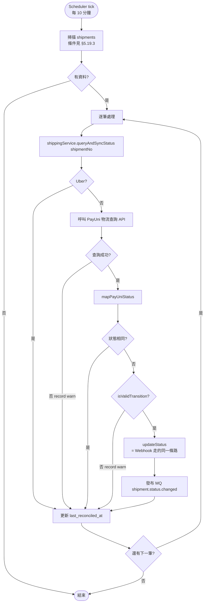

> **「是否更新 `last_reconciled_at`」放在最後一律執行**：不論成功、失敗、未變更，都要 touch；否則查詢失敗的物流單會在下一個 tick 立即被重撈，浪費 PayUni 配額並可能形成風暴。

#### 5.19.6 時序圖

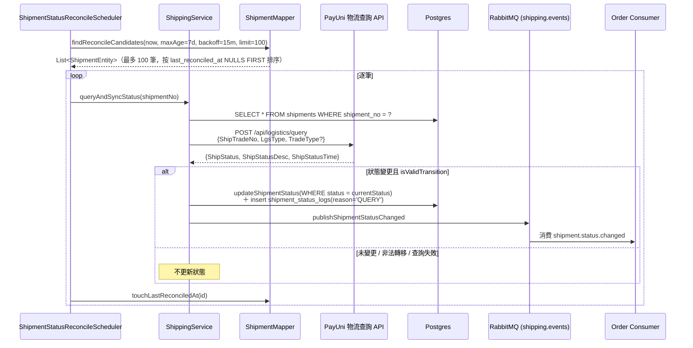

#### 5.19.7 掃描索引

`shipments.last_reconciled_at` 欄位定義見 §3.1、索引總覽見 §3.10。本通道的掃描依賴一個**部分索引**：

```sql
CREATE INDEX idx_shipments_reconcile
ON shipments (last_reconciled_at NULLS FIRST, created_at)
WHERE status NOT IN (11, 41)
  AND shipping_method <> '3003' -- UBER_INSTANT
  AND ship_trade_no IS NOT NULL;
```

🔴 **部分索引的 WHERE 必須與掃描 SQL 的候選述詞一致**：終態與 3003 不進入索引，
索引大小被限制在「正在跑流程的物流單」這個熱集合，掃描成本才恆定。

#### 5.19.8 落點

| 符號 | 職責 |
|------|------|
| `entity/ShipmentEntity.java` | `LocalDateTime lastReconciledAt` |
| `mapper/ShipmentMapper.java`（＋對應 XML） | `findReconcileCandidates` 候選查詢；`claimForReconcile` lease CAS；`touchLastReconciledAt(Long id)` 事後 stamp |
| `scheduler/ShipmentStatusReconcileScheduler.java` | A 通道排程本體 |
| `service/ShippingService.queryAndSyncStatus` | 🔴 **不得加 `@Transactional`**（與 §5.5 webhook 對齊——例外會 rollback 掉 `finally` 內的 touch）。在 try/finally 末端統一呼叫 `mapper.touchLastReconciledAt(entity.getId())`。§5.7 按需查詢自身**不被退避擋下**，永遠強制 fresh |
| `service/ShipmentStatusMapper.mapPayUniStatus` | 未知／空值／sandbox 佔位符（如 `-`）一律 catch `IllegalArgumentException` 回 `null`，由 caller 走 unknown 分支；🔴 **不得拋例外**，否則 reconcile 排程會因 sandbox 資料每輪 ERROR |
| `service/ShipmentStatusMapper.isValidTransition` | 平台本地狀態 `210/920/921` 與 PayUni 出貨前狀態集合分離；禁止 `210/920/921 → 91/92/98/21/22` 倒退，僅允許前進到 `31/32/11/41` 或異常狀態 |
| `application.yml` / `.env*` / `k8s/values/shipping-service.yaml` | `hawkr.shipping.reconcile.*` 配置（依[開發工作流程](../開發規範/開發工作流程.md)環境變數配置流程同步五處） |

> **`queryAndSyncStatus` 末端 touch 的位置非常關鍵**：放在 service 層（而非 scheduler 層）是為了讓 §5.7 按需查詢觸發後，§5.19 scheduler 在 backoff 內不會重複跑同一筆。**§5.7 自身永不被退避擋下**——它是 webhook 漏收的補救手段，必須永遠強制 fresh，否則「補救」變「回 cached」、補救機制失效。Scheduler 自身不需要再額外 touch，避免雙重更新。

#### 5.19.9 配置參數

| 參數 | 環境變數 | 預設值 | 說明 |
|------|---------|--------|------|
| `hawkr.shipping.reconcile.enabled` | `SHIPPING_RECONCILE_ENABLED` | `true` | Reconcile 排程總開關（壓測 / 緊急停用時可關閉） |
| `hawkr.shipping.reconcile.interval-ms` | `SHIPPING_RECONCILE_INTERVAL_MS` | `600000`（10 分鐘） | 排程觸發間隔 |
| `hawkr.shipping.reconcile.batch-size` | `SHIPPING_RECONCILE_BATCH_SIZE` | `100` | 單次最多處理筆數 |
| `hawkr.shipping.reconcile.max-age-days` | `SHIPPING_RECONCILE_MAX_AGE_DAYS` | `7` | `created_at` 視窗（天） |
| `hawkr.shipping.reconcile.backoff-minutes` | `SHIPPING_RECONCILE_BACKOFF_MINUTES` | `15` | `last_reconciled_at` 退避（分鐘） |

#### 5.19.10 Proto 影響

**無**。本機制純為內部排程，不暴露對外 API、不新增 gRPC RPC、不變動 Proto 契約。

#### 5.19.11 監控與告警建議

| 指標 | 來源 | 用途 |
|------|------|------|
| `ShipmentStatusReconcileScheduler.process.done` 事件 + `processed` 數 | ObsLogger | 觀察每輪實際補收的筆數；持續為 0 代表 Webhook 健康，持續 > 0 代表 Webhook 通道有漏 |
| `ShippingService.queryStatus.error` 計數 | ObsLogger | PayUni 查詢失敗率；異常飆升代表 PayUni API 不穩或配額壓力過大 |
| `shipments` 表中 `last_reconciled_at IS NULL AND created_at < NOW()-1h` 計數 | DB Query / Grafana | 排程是否在掃描所有候選；持續 > 0 代表掃描落後 |
| `shipments` 表中 `status NOT IN (11,41) AND created_at < NOW()-7d` 計數 | DB Query / Grafana | 超出視窗仍未終態的物流單，代表需人工介入 §8.4 |

#### 5.19.12 與既有機制的關係

| 機制 | 觸發 | 路徑 | 角色 |
|------|------|------|------|
| Webhook（§5.5） | PayUni 主動推送 | `processWebhookStatusUpdate` → `updateStatus` | **L0 主路徑**：常態更新 |
| 按需查詢（§5.7） | 買家「查看物流」`GetShipmentTracking` + 內部 `QueryShipmentStatus` | `queryAndSyncStatus` / `getBuyerTrackingByOrderNo` → `syncAndTouch` → `updateStatus` | **L1 即時**：**永遠強制 fresh**，不被退避擋下；觸發後會更新 `last_reconciled_at` 讓 §5.19 不重複工作 |
| **排程補收（§5.19）** | `@Scheduled` 每 10 分鐘 | `queryAndSyncStatus` → `updateStatus` | **L2 補救**：系統自動，不依賴使用者行為 |

三層共用同一個 `updateStatus` 終點，意味著：
- 狀態轉移合法性檢查只在一個地方
- MQ 事件發布只在一個地方
- 樂觀鎖（`WHERE status = currentStatus`）保護任一路徑與其他路徑的併發

> **不增加新的 RPC、不增加新的事件、不增加新的狀態**。L2 補救完全是「在錯誤的地方多踢一腳，但走的還是同一條主路徑」。

### 5.20 賣家處理期限自動取消（本服務職責）

買家付款後賣家須在期限內處理訂單，否則系統自動取消。完整跨服務設計見 [09 §5.9](../詳細設計書/09-售後微服務（AfterSales%20Service）詳細設計書.md#59-賣家處理期限自動取消processing-deadline-auto-cancel)；本節僅列 Shipping Service 的職責。

🔴 **3001／3002 與 3003 的逾期處置不同，不可共用同一條敘述**：

- **3001／3002**：逾期當下 provider **尚未收單**（黑貓未叫件／超商出貨單未列印）⇒ 直接系統取消，
  責任 ＝ `SELLER_CAUSED` ⇒ 向 Buyer 全額退款。
- **3003（Uber 即時配送）**：delivery 在**付款當下就已經建立**，外面有一張 live 的單 ⇒
  🔴 **必須先跑完 Cancel Saga、確認 provider 已終局，才允許發起退款**（§5.20.3）。
  漏掉這一步的後果是「**已退款給買家、而 Uber 的車照樣來取貨**」。

#### 5.20.1 期限計算（建單時）

| 配送方式 | 期限 | 寫入點 |
|---------|------|-------|
| 店到店（SEVEN_ELEVEN_STORE_PICKUP） | 建單時間 + 72 小時 | `CvsShipmentStrategy.createShipment()` 寫入 `shipments.processing_deadline` |
| 宅配（TAQBIN） | 第 3 個工作日 23:59:59 台北時間（注入 `HolidayService`） | `HomeShipmentStrategy.createShipment()` 寫入 `shipments.processing_deadline` |
| **Uber 即時配送（UBER_INSTANT）** | **`paid_at + seller_prep_sla_snapshot + platform_grace`**。<br/>🔴 **`seller_prep_sla_snapshot` 是報價／下單當下凍結的快照**，不是即時讀賣家設定——賣家事後改設定**不得回溯**既有已付款訂單的期限。<br/>V1 預設 `seller_prep_sla_default` ＝ **15 分鐘**、`platform_grace` ＝ **15 分鐘**，**兩者皆 configurable**（依 sandbox／production 實測調整）；🔴 **不得宣稱這是 Uber 官方 SLA**（[66 詳細](./66-Uber%20Direct%20即時配送整合詳細設計書.md)） | `UberShipmentStrategy.createShipment()` 寫入 `shipments.processing_deadline`（🔴 **寫入的是推導後的值，不是賣家直接設定的值**）；「已處理」＝**賣家已宣告備妥**（`REPORT_READY`，見 §5.20.2）。<br/>⚠️ **`prep_sla` 到期只發提醒／告警，不取消訂單**；強制取消點只有 `processing_deadline`。 |

> 🔴 **3003 有兩個時鐘、兩個基準，刻意不合併**
>
> | 時鐘 | 基準 | 公式 | 用途 |
> |------|------|------|------|
> | **Provider pickup contract** | 報價當下凍結的**絕對時間** | `pickup_ready_dt = pickup_ready_at_snapshot` | 送給 Uber 的取件約定時間（Create Delivery **直接讀 snapshot，不得重算**） |
> | **Seller hard processing deadline** | **實際付款時間** | `processing_deadline = paid_at + seller_prep_sla_snapshot + platform_grace` | 我方對賣家的強制期限，逾期走 §5.20.3 |
>
> 兩者用**同一份** `seller_prep_sla_snapshot`（賣家中途改設定不回溯），但**起算點不同**
> ⇒ 它們不是 duplicate clock，是兩件不同的事。
> 🔴 **`processing_deadline` 不得改用 `pickup_ready_at_snapshot` 當基準，反之亦然。**
> `pickup_ready_at_snapshot`／`seller_prep_sla_snapshot` 兩個欄位是 **provider-specific**，
> 落 Uber 自己的表（見 §3.1 的 provider-neutral 警語），**不進 `shipments`**。

#### 5.20.2 賣家完成處理時清空 + publish cleared

| 配送方式 | 觸發點 | 動作 |
|---------|--------|------|
| 店到店 | `ShippingService.processWebhookPrint()`（PayUni 列印 Webhook 回填代碼後，§5.6） | `UPDATE shipments SET label_print_status='4103', processing_deadline=NULL ... WHERE label_print_status IN ('4102','4101')` → `publishProcessingCleared(orderNo)` |
| 宅配 | `ShippingService.callTcat()` markSucceeded（賣家呼叫黑貓成功後，§5.4） | `UPDATE shipments SET tcat_call_status='4203', processing_deadline=NULL ... WHERE tcat_call_status='4202'` → `publishProcessingCleared(orderNo)` |
| **即時配送（3003）** | 賣家 **`REPORT_READY`**（宣告備妥；由 provider-neutral 命名的賣家 Ready RPC 承載） | `UPDATE shipments SET seller_ready_at=NOW(), processing_deadline=NULL ... WHERE seller_ready_at IS NULL` → `publishProcessingCleared(orderNo)`。<br/>若 `now < pickup_ready_at_snapshot`（**提早備妥**）另走 `E5 Update Delivery` 前移 `pickup_ready_dt`；🔴 **`E5` 失敗一律不得升級為取消**（保留原 Delivery ＋ 原取件窗 ＋ bounded retry ＋ 維運告警），詳見 [66 詳細](./66-Uber%20Direct%20即時配送整合詳細設計書.md) |

> Order Service 消費 `shipment.processing.cleared` 後清空 `orders.processing_deadline`，前端倒數立即消失。

> 🔴 **3003 的「已處理」是 `REPORT_READY`（宣告備妥），不是「發動派車」。**
> Uber 的 delivery 在**付款當下就已建立**，賣家端沒有「叫車」這個動作可做；他要做的只是告訴平台「貨備好了」。
> 把它寫成派車／叫件，會讓實作者去找一個不存在的按鈕，也會讓 §5.20.3 的「未處理」判定失去依據。
> ⚠️ 與 3001 的「叫件」、3002 的「取號」是**三個不同的動作**，不得互相套用措辭。

#### 5.20.3 排程：ProcessingDeadlineScheduler

每 5 分鐘掃描 `shipments` 表，找出逾期且未處理的物流單。

```sql
SELECT * FROM shipments
WHERE processing_deadline IS NOT NULL
  AND processing_deadline < NOW()
  AND is_return = false
  AND status <> '41'
  AND (
    -- 店到店：列印尚未成功（NONE/REQUESTED/FAILED 皆視為未完成）
    (shipping_method = '3002' AND label_print_status <> '4103')
    OR
    -- 宅配：黑貓尚未成功叫件
    (shipping_method = '3001' AND tcat_call_status <> '4203')
    OR
    -- 即時配送：賣家尚未宣告備妥（REPORT_READY 會寫 seller_ready_at 並清 processing_deadline）
    (shipping_method = '3003' AND seller_ready_at IS NULL)
  )
ORDER BY processing_deadline ASC
LIMIT :batchSize
```

> 🔴 **3003 分支不是可選的**
> 候選述詞若只列 `3002`／`3001`，`UberShipmentStrategy` 寫進去的 `processing_deadline` **永遠不會被撈到**
> ⇒ 3003 訂單的逾期**完全無人處置**，而且**完全無聲**：沒有錯誤、沒有告警，
> `rows = 0` 與「今天真的沒有逾期單」在輸出上無法分辨。
> ⚠️ 索引側**不需要改**：`idx_shipments_processing_deadline` 的述詞本來就不含 `shipping_method`，
> 3003 的列一直都在索引內——缺的只有這個 OR 分支（§3.1 索引段）。

逐筆處理（順序重要）。**3001／3002 與 3003 走不同分支，不得共用同一條順序**：

**A. 3001／3002 —— provider 尚未收單**

1. `publishProcessingCleared(orderNo)` — 通知 Order 端清 `orders.processing_deadline`（前端倒數立即消失，避免「已逾期但仍顯示倒數」暫態）
2. `publishProcessingTimeout(orderNo, storeId, buyerId)` — 通知 AfterSales 觸發系統取消+退款
3. `UPDATE shipments SET processing_deadline = NULL WHERE id = ?`（防止重複掃描）

**B. 3003 即時配送 —— 🔴 外面有一張 live 的 Uber delivery，Cancel Saga 先行、退款在後**

🔴 **絕對不得沿用 A 的順序。** A 成立的前提是「逾期當下 provider 尚未收單」，這個前提對 3003 **不成立**：
delivery 在付款當下就已 Create。直接 publish timeout ⇒ AfterSales 取消訂單並退款，
而 **Uber 的車照樣依 `pickup_ready_dt` 來取貨** ⇒ 錢已退給買家、貨還是被載走了。

固定順序，四步缺一不可（時序圖見 [66 詳細 **SD-07**](./66-Uber%20Direct%20即時配送整合詳細設計書.md)）：

1. **`E4 Get Delivery`** —— 先回查 provider 現況，判斷「這次取消會不會產生費用」以及「是不是已經取件」。
   - `status ∈ {pickup_complete, dropoff}` ⇒ 🔴 **岔出 post-pickup 分支**：貨已被取走，**不得**走「未出貨 timeout」。
     轉 post-pickup／incurred-cost lifecycle（正常去程運費**一定產生且不退**），
     責任與退款另依 `ResponsibilityCause` 判定，**不在本節射程**。
   - `courier_imminent = true` ⇒ **非必要不取消**（外送員已在門口，優先高優先級通知賣家而非取消）。
   - `status ∈ {pending, pickup}` ⇒ 進入第 2 步。
2. **`E6 Cancel Delivery`** —— 先寫 `992 CANCEL_PENDING` 再發動。
3. **再一次 `E4 Get Delivery`，確認 provider 已 terminal**。
   - 確認 `canceled` ⇒ `992 → 41 CANCELLED`，進入第 4 步。
   - 🔴 **`E6` 逾時／5xx／結果不明 ⇒ 不得直接退款、不得假設已取消、不得重建第二筆 delivery**：
     停在 `CANCEL_PENDING`，走回查／重試收斂鏈；長時間仍無法確定 ⇒ `CANCEL_RECONCILIATION_REQUIRED` → ADM 人工介入。
4. **確認 terminal 之後才**執行 `publishProcessingCleared(orderNo)` ＋ `publishProcessingTimeout(orderNo, storeId, buyerId)`
   ＋ `UPDATE shipments SET processing_deadline = NULL`，由 AfterSales 發起退款。
   本格責任 ＝ `SELLER_CAUSED`（賣家未在硬期限內備妥）⇒ **向 Buyer 全額退款**。

🔴 **事件契約本身不變，變的是 `shipment.processing.timeout` 在 3003 分支的前置條件**（§4.4）：
A 分支「逾期即發」，B 分支「provider 已確認終局才發」。實作時**不得**把 B 的三次 provider 呼叫視為可略過的最佳化。

> 🔴 **順序固定：`cleared` 先於 `timeout`** —— cleared 由 Order 直接清 orders 端 deadline，timeout 由 AfterSales 啟動取消流程（其 cancel SQL 也會清 orders deadline，雙保險）。反序會讓前端出現「已逾期仍顯示倒數」的暫態。

> **搶佔（L1）**：🔴 **步驟 1 之前必須先走 lease CAS**（`ShipmentMapper.leaseProcessingDeadline`）：
> `SET processing_deadline = <claim 當下 + 5min> WHERE id=? AND <候選述詞> AND processing_deadline < NOW()`，`affected=0` ⇒ `continue`。
> 少了這一道，多副本下兩個 pod 會各發一輪 cleared＋timeout，AfterSales 端被觸發兩次系統取消
> （步驟 3 的 `SET processing_deadline = NULL` 在兩個 publish **之後**才執行，擋不住）。
> **租約欄 ＝ `processing_deadline`（零 schema 變更）；租約長度 ＝ 5 分鐘（＝一個 tick，`interval-ms` 預設 300000）；候選窗口 ＝ ∞**（述詞只有下界 `processing_deadline < NOW()`）。
> 🔴 **租約基準必須在 claim 當下、每筆各自取**（不是 tick 起點），不變式才是「單筆最壞耗時 < 租約」而與 `batch-size` 無關。上界推導與機械保證見 [§8.5](#85-多副本排程搶佔語意scheduler-claim)。
> ⚠️ **claim 期間該欄變成「未來時間」是刻意的** —— row 暫時離開候選集合就是租約的定義；pod 崩潰時 5 分鐘後自動回來。
> ⚠️ **步驟 3 的 `clearProcessingDeadline`（設 NULL）必須留在 publish 之後** —— 它是終態標記，不是閘門。

> 🔴 **B 分支讓 L1 多了外部 HTTP 副作用（`E4`／`E6`／`E4`），租約下界必須重新推導**
> 依[多副本排程搶佔規範](../開發規範/多副本排程搶佔規範.md)，租約長度必須 **> 單筆最壞耗時**；
> 而「單筆最壞耗時」含每一個外部呼叫的 deadline ⇒ 🔴 **Uber HTTP client 必須有明確 deadline**，
> 否則最壞耗時無上界、租約下界**根本無從建立**（本服務既有的 deadline 盤點只涵蓋 gRPC，見 [§8.5](#85-多副本排程搶佔語意scheduler-claim)）。
> 租約 5 分鐘（＝一個 tick）必須 > 「`E4` ＋ `E6` ＋ `E4` ＋ 兩次 publish」的最壞耗時，
> 該值連同各 deadline 一起算出並回寫 §8.5 的逐支表——🔴 **不得以「反正窗口是 ∞」跳過下界檢查**（那條只保證上界）。

AfterSales Service 消費 `shipment.processing.timeout` 後執行 `cancelShipmentBySystem()`，流程同 §5.7 賣家取消（[09 §5.9.4](../詳細設計書/09-售後微服務（AfterSales%20Service）詳細設計書.md#594-時序圖逾期自動取消)）。

#### 5.20.4 配置

| 配置項 | 預設值 | 說明 |
|--------|--------|------|
| `hawkr.shipping.processing-deadline.interval-ms` | `300000`（5 分鐘） | 掃描間隔 |
| `hawkr.shipping.processing-deadline.batch-size` | `50` | 每次掃描上限 |
| `hawkr.shipping.processing-deadline.enabled` | `true` | 排程開關 |

> **3003 的兩個時長參數不在本表**：`seller_prep_sla_default`（V1 **15 分鐘**）與 `platform_grace`（V1 **15 分鐘**）
> 由 [66 詳細](./66-Uber%20Direct%20即時配送整合詳細設計書.md) 統一定義與持有，本服務讀的是**下單當下凍結的 snapshot**
> （`seller_prep_sla_snapshot`），不是即時值。兩者皆 configurable，SSOT 在 66。

### 5.21 配送異常賣家通知

#### 5.21.1 偵測能力與通知出口

本節把既有 scheduler／consumer 的偵測能力導向「賣家通知出口」：
物流商或 PayUni 回 SUCCESS 但實際運單卡死（如缺三段碼）時，賣家必須在買家投訴之前就知道。

| 能力 | 實現方式 |
|------|----------|
| 主動偵測 7 種配送異常 | 既有 scheduler / consumer ＋ 一個 publish event 動作 |
| 立即推 FCM 給賣家 | notification-service 的 `shipment_anomaly` category consumer |
| 賣家 dashboard 列出所有異常單 | Gateway 查詢 RPC，**直接查 shipments 表 LEFT JOIN ack 表**，🔴 無第二份狀態 |
| 已處理 / 忽略 | 寫 `shipment_anomaly_acknowledgments`（純使用者操作記錄表） |
| 跨裝置同步 | ack 表持久化，web / app 共享狀態 |

> ❌ **不做**的事（守住 §22 邊界）：不開 `ShipmentAnomaly(open/resolved/ignored)` 雙寫狀態表；不寫 `@Scheduled` drift 偵測；不為「異常自動消失」寫補償流程（shipment.status 恢復 → JOIN miss → dashboard 自然不顯示）。

#### 5.21.2 異常類型與偵測來源

7 種 `ShipmentAnomalyType`（CodeMeta 業務類型碼）：

| AnomalyType | 偵測來源（複用既有元件） | 偵測條件（SQL 述詞）|
|---|---|---|
| `TCAT_CALL_FAILED` | `TcatCallStuckAlertScheduler`（**既有**，加 publish event）| `shipping_method='3001' AND tcat_call_status='4202' AND tcat_call_requested_at BETWEEN NOW() - INTERVAL '24 hours' AND NOW() - INTERVAL '3 minutes'`（**3 分鐘 grace** 起偵測，給 PayUni 同步窗口；**24h 後不再警告**，已過 SLA。常態下 tcat_call_status 應在 3 分鐘內 transition 至 SUCCEEDED）|
| `CVS_LABEL_UNPRINTED` | `ShipmentLabelReconcileScheduler`（**既有**，加 publish event）| `shipping_method='3002' AND label_print_status='4102' AND label_print_requested_at < NOW() - INTERVAL '48 hours'` |
| `PROVIDER_STATUS_ABNORMAL` | `ShipmentStatusReconcileScheduler`（**既有**，加 publish event）| `status='33' AND last_reconciled_at >= NOW() - INTERVAL '10 minutes'`（換手後第一次偵測即發）。**不含 status=41**：41 (CANCELLED) 為「訂單已被商店取消」(賣家主動)，非物流商異常；ops 端 cancel by role 已由訂單列表呈現，不重複 list 至 anomaly dashboard |
| `PACKAGE_LOST` | 同上 | `status='32' AND updated_at < NOW() - INTERVAL '7 days'` |
| `DELIVERY_OVERDUE` | 同上 | `expected_delivery_date IS NOT NULL AND expected_delivery_date < CURRENT_DATE AND status NOT IN ('11','41','44') AND (provider_status_time IS NULL OR provider_status_time < NOW() - INTERVAL '3 days')`（過 ETA **且** 物流商超過 3 天無狀態更新；ETA 過但軌跡近期仍活躍視為仍在正常移動中，不打異常） |
| `PAYUNI_LGS_NO_CODE`（B-143）| **三偵測點（限超商 `shipping_method='3002'`）**：① shipping-service `ShippingService.processWebhookPrint`（**正向出貨即時**：webhook 入口檢查三段碼）② aftersales-service `ShipmentLabelConsumer.onLabelUpdated`（**退貨即時**：isReturn=true 路徑）③ shipping-service `ShipmentLabelReconcileScheduler`（**保底**，補拉失敗時發）| `shipping_method='3002' AND label_print_status='4103' AND (partner_id IS NULL OR odno IS NULL OR validation_no IS NULL)`（webhook ApiType=Print 路徑）。**宅配（3001）走 `markLabelPrintSucceededHome` PDF 路徑 by-design 不寫三段碼，必須以 `shipping_method='3002'` 限定以免全面誤報** |
| `RETURN_STUCK` | 新 `ReturnStuckAlertScheduler`（aftersales-service，掃 `aftersale_cases.status='25' AND updated_at < NOW() - INTERVAL '14 days'` ＋ 租約述詞 `return_stuck_alerted_at IS NULL OR <= NOW()`；`aftersale_cases` 無 `status_changed_at` 欄，以 `updated_at` 近似「最後狀態變動時間」），由 aftersales-service publish 至 `hawkr.shipping` exchange | 同左 |

> 兩個偵測點對同一 (orderNo, PAYUNI_LGS_NO_CODE) 透過 dedup key `(orderNo, anomalyType, detectedAt::date)` 同日去重，避免雙推。

#### 5.21.3 Severity 對應規則（`ShipmentAnomalyRules` helper）

依 [Java 微服務開發規範 §6](../開發規範/Java%20微服務開發規範.md)＋[CodeMeta README](../代碼管理（CodeMeta）/README.md) 放在 `common-core/utils/code/helper/ShipmentAnomalyRules.java`（跨服務共用：shipping-service 與 aftersales-service 兩端都會用到），**非 CodeMeta enum 內方法**：

```java
public final class ShipmentAnomalyRules {
    public static ShipmentAnomalySeverity severityOf(ShipmentAnomalyType type) {
        return switch (type) {
            case PAYUNI_LGS_NO_CODE, PROVIDER_STATUS_ABNORMAL, PACKAGE_LOST -> ShipmentAnomalySeverity.HIGH;
            case TCAT_CALL_FAILED, CVS_LABEL_UNPRINTED, DELIVERY_OVERDUE -> ShipmentAnomalySeverity.MEDIUM;
            case RETURN_STUCK -> ShipmentAnomalySeverity.LOW;
        };
    }

    /** Dashboard 查詢條件：哪些 shipment 屬於「目前有異常」。 */
    public static Set<String> abnormalShipmentStatusSet() {
        return Set.of("33", "41", "44");
    }

    private ShipmentAnomalyRules() {}
}
```

#### 5.21.4 Ack 表（`shipment_anomaly_acknowledgments`）

純使用者操作記錄表，**不存 anomaly 狀態本身**（異常存在性由 shipments 既有欄位推導）。

本表帶 **actor 維度**：admin 監控（[29 號設計書](./29-Admin%20異常訂單管理%20API%20詳細設計書.md)）
與賣家對同一 `(shipment, anomaly_type)` **各自獨立標記、互不覆蓋**。

```sql
CREATE TABLE shipment_anomaly_acknowledgments (
    id              BIGSERIAL PRIMARY KEY,
    shipment_id     BIGINT NOT NULL REFERENCES shipments(id),
    order_no        VARCHAR(64) NOT NULL,
    anomaly_type    VARCHAR(40) NOT NULL,  -- ShipmentAnomalyType.value
    actor_type      VARCHAR(16) NOT NULL,  -- 'SELLER' / 'ADMIN'（CHECK 約束）
    actor_id        BIGINT NOT NULL,       -- SELLER=賣家 store surrogate（既有 seller_id 語意）；ADMIN=admin account_id（x-account-id）
    action          VARCHAR(16) NOT NULL,  -- ShipmentAnomalyAckAction.value: ACKNOWLEDGED / IGNORED
    acted_at        TIMESTAMPTZ NOT NULL,
    created_at      TIMESTAMPTZ NOT NULL DEFAULT NOW(),
    updated_at      TIMESTAMPTZ NOT NULL DEFAULT NOW(),

    CONSTRAINT chk_anomaly_actor_type CHECK (actor_type IN ('SELLER', 'ADMIN')),
    CONSTRAINT chk_anomaly_action     CHECK (action IN ('ACKNOWLEDGED', 'IGNORED')),
    -- 同 (shipment, anomaly_type) 每個 actor_type 各一筆，後續 action 變更走 UPDATE
    CONSTRAINT uk_shipment_anomaly_ack UNIQUE (shipment_id, anomaly_type, actor_type)
);

CREATE INDEX idx_anomaly_ack_order_no    ON shipment_anomaly_acknowledgments (order_no);
```

> 索引說明：所有讀路徑（upsert selectOne / dashboard JOIN）皆走 UNIQUE `(shipment_id, anomaly_type, actor_type)`；無 actor 清單查詢路徑，不建 actor 維度索引（避免純寫放大）。

🔴 **欄名是 `actor_id` 不是 `seller_id`**：它同時承載 SELLER 與 ADMIN 兩類 actor，
語意由同列的 `actor_type` 決定，**不得**以欄名推定 actor 種類。

**查詢適配（三條，缺一即錯）**：
- **賣家 dashboard**（§5.21.7 賣家查詢 SQL）：ack LEFT JOIN 條件加 `AND ack.actor_type = 'SELLER'`，賣家只看得到自己的 ack/ignore，看不到 admin 標記。
- **admin 監控列表**（`ListShipmentAnomaliesForAdmin`）：LEFT JOIN 拆兩路——`seller_ack`（`actor_type='SELLER'`）與 `admin_ack`（`actor_type='ADMIN'`）各自 JOIN，回應同時揭露賣家與 admin 兩端的處置狀態（見 §5.21.7 admin 回應欄位）。
- **寫路徑 `ShipmentAnomalyService.upsertAck`（硬性正確性要求）**：它是應用層 select-then-upsert。🔴 **selectOne 條件必須帶 `actor_type`**（賣家 `'SELLER'`／admin `'ADMIN'`）——同一 `(shipment, anomaly_type)` 可同時存在兩列，只用 `shipment_id + anomaly_type` 會命中 2 筆並拋 `TooManyResultsException`，症狀是「admin 標記過的異常單，賣家一操作即 runtime crash」。IDOR 歸屬檢查照舊。

> 不變式：UNIQUE `(shipment_id, anomaly_type, actor_type)` ⇒ 同一 actor「先 ack 後改 ignore」走 UPDATE 同筆（`acted_at` 覆寫）；shipment 恢復 5x 後 dashboard JOIN miss 自然不顯示，🔴 **不得清 ack 表**（保留審計）；shipment 後續又卡新類型 anomaly_type 時 LEFT JOIN miss，自然重新出現於 dashboard。

#### 5.21.5 Event 規格

| 項目 | 值 |
|------|---|
| Exchange | `hawkr.shipping` |
| Routing Key | `shipment.anomaly.detected` |
| Producer | shipping-service（5 個偵測點共用 `ShipmentAnomalyEventPublisher.publishAnomalyDetected`）+ aftersales-service（RETURN_STUCK，經 `ObsRabbitPublisher.publishConfirmed` 寫至 `hawkr.shipping` exchange；**回 false 即釋放租約、隔日重發**，見 §5.21.6 第 4 項） |
| Consumer | notification-service `shipment_anomaly.go`（推 FCM + 寫 inbox） |
| Payload class | `ShipmentAnomalyDetectedPayload`（typed，非 Map） |
| DLQ | ⚠️ 暫無（受 Go `pkg/mq.ResilientConsumer` 既有架構限制 — 所有 notification-service Go consumer 目前皆未設 DLX）。失敗策略：consumer 端 retry，上限後 log + ack drop |
| Idempotency | notification-service template `reference_id_template = '#{orderNo}\|#{anomalyType}'` — 同 (orderNo, anomaly_type) 寫入 inbox 唯一鍵 + FCM 發送唯一鍵；scheduler 每輪重複 publish 自然去重，無需 publisher 端額外 dedup |

**Payload 結構**：

```java
public record ShipmentAnomalyDetectedPayload(
    String eventId,                       // UUID
    String orderNo,                       // 訂單編號
    String shipmentId,                    // shipments.id（toString）
    Long storeId,                 // 通知對象
    Long buyerId,                  // 供 notification 查賣家暱稱 / 訂單上下文用
    String anomalyType,                   // ShipmentAnomalyType.value
    String anomalyTypeLabel,              // ShipmentAnomalyType.label（如「黑貓叫件未完成」）
    String severity,                      // ShipmentAnomalySeverity.value
    String detectedAt                     // ISO 8601 UTC
) {}
```

#### 5.21.6 偵測點落地細節

**1. `ShippingService.processWebhookPrint`（shipping-service，B-143 **正向出貨**即時偵測）**

PayUni 列印 Webhook 進入點，在 entity lookup 後立即檢查三段碼。**限超商 `shipping_method='3002'`**：宅配 by-design 不走 ApiType=Print webhook，加守衛防止任何未預期路徑誤觸發：

```java
// 限超商：宅配走同步 PDF 路徑（markLabelPrintSucceededHome）by-design 不寫三段碼，
// 即使 PayUni 未來行為改變對宅配發 webhook，也必須避免誤觸發 anomaly
if (ShippingMethod.SEVEN_ELEVEN_STORE_PICKUP.value().equals(entity.getShippingMethod())
        && (partnerId == null || partnerId.isBlank()
            || odno == null || odno.isBlank()
            || validationNo == null || validationNo.isBlank())) {
    log.warn("ShippingService.webhookPrint.b143", "B-143 三段碼缺失");
    anomalyEventPublisher.publishAnomalyDetected(
        ShipmentAnomalyType.PAYUNI_LGS_NO_CODE,
        entity.getOrderNo(),
        String.valueOf(entity.getId()),
        entity.getSellerAccountId(),
        entity.getBuyerAccountId());
    // 不阻斷主流程：仍照常 markLabelPrintSucceededByWebhook 與後續 event publish
}
```

**2. `ShipmentLabelConsumer.onLabelUpdated`（aftersales-service，B-143 **退貨**即時偵測）**

既有 `log.warn` 後 ACK skip，改為。**By contract 此偵測限超商**：upstream publisher 為 `ShippingService.processWebhookPrint`（超商 ApiType=Print webhook 處理路徑）唯一觸發點，宅配走 `markLabelPrintSucceededHome` 同步 PDF 路徑不發送 `shipment.label.updated` event；`LabelUpdatedPayload` 維持既有 contract 不擴充 `shippingMethod` 欄位：

```java
if (partnerId.isEmpty() || odno.isEmpty() || validationNo.isEmpty()) {
    log.warn("ShipmentLabelConsumer.incomplete", "三段碼不完整，發 PAYUNI_LGS_NO_CODE event");
    // upstream publisher 已限超商 webhook 路徑（不存在宅配 publisher）
    publishPayUniLgsNoCodeAnomaly(orderNo);  // 跨服務 publish 至 hawkr.shipping
    channel.basicAck(deliveryTag, false);
    return; // 維持原 ACK skip 不更新 aftersale_cases
}
```

**若未來新增非超商 publisher（如宅配退貨補拉路徑）**，須擴充 `LabelUpdatedPayload` 加 `shippingMethod` 欄位並於 consumer 加 `"3002".equals(shippingMethod)` 守衛，否則會誤觸發。

**3. 5 個 scheduler 內加發 event**

每個 scheduler 在「掃出卡死 row → log.warn」之後，按條件呼叫 `shipmentAnomalyEventPublisher.publishAnomalyDetected(type, ...)`。🔴 **告警出口不得改變該 scheduler 的 SQL 候選條件**——條件與告警是兩件事，混在一起會讓偵測範圍隨通知需求漂移。

**特別說明：`ShipmentLabelReconcileScheduler.reconcileOne` 三段碼補拉路徑（限超商）**

scheduler 撈 `label_print_status IN ('4102','4104')` 候選後呼叫 PayUni QueryShipment 補拉三段碼。若 PayUni 回 SUCCESS 但三段碼任一空，發 PAYUNI_LGS_NO_CODE。**此偵測同樣限超商**：宅配補拉路徑的 LgsType=HOME，PayUni 回應本就不帶三段碼，必須以 `shipping_method='3002'` 限定才不會誤發。

```java
if (ShippingMethod.SEVEN_ELEVEN_STORE_PICKUP.value().equals(entity.getShippingMethod())
        && (isEmpty(partnerId) || isEmpty(odno) || isEmpty(validationNo))) {
    anomalyEventPublisher.publishAnomalyDetected(
        ShipmentAnomalyType.PAYUNI_LGS_NO_CODE, ...);
}
```

**4. RETURN_STUCK（aftersales-service 新 scheduler）**

aftersales-service 新增 `ReturnStuckAlertScheduler`（每天 1 次掃描 `aftersale_cases` status=25 超過 14 天），跨服務發至 `hawkr.shipping` exchange 的 `shipment.anomaly.detected`。

> **搶佔（L6，實作在 aftersales-service）**：🔴 publish 之前必須先走 lease CAS —— 少了它，多副本下每輪會對同一批各 publish 一次。
> **修法**：新增租約欄 **`aftersale_cases.return_stuck_alerted_at`**（aftersales 側 `V9`），在 `publishReturnStuck` **之前**插 lease CAS，冷卻長度 = `returnStuckDays`；候選窗口寬度 = ∞（`updated_at < NOW() - 14d` 只有下界）⇒ 合格。
> ⚠️ **與 `RETURN_STUCK` 同屬「卡死告警」的 `TCAT_CALL_FAILED`（L4，§5.19.3.C）一樣，不得走例外 B** —— 卡死沒解除就該持續有聲音。租約細節與 aftersales 側逐支對照見 [09 號 §8.5](./09-售後微服務（AfterSales%20Service）詳細設計書.md#85-多副本排程搶佔語意scheduler-claim)。
> ⚠️ **這是冷卻租約不是「已告警」旗標**，欄名 `*_alerted_at` 讀起來像後者。
> 🚨 **publish 走 `publishConfirmed`（等 publisher-confirm，上限 5 秒），未成功即釋放租約**：`ObsRabbitPublisher.publish` 是 fire-and-forget（broker nack／unroutable 完全無訊號），在那個前提下光加 catch 是零修復。而租約長度 = 14 天是照「成功送出後多久再吵一次」訂的，若拿它當「失敗後多久重來」，**一次 MQ 不可用就讓卡死告警靜默 14 天** ⇒ SLO 歸零。釋放之後重來的間隔＝一個 tick（每日）。
> 🚨 **本消費端要能吃到「同一件事的第二則通知」**：`publishConfirmed` 回 `false` 的成因包含 confirm timeout，那種情況訊息**可能其實已送達**，隔天會再發一次（payload 每次帶新的 `UUID`，**不是**可用 event id 去重的重放）。跨日收斂靠 notification 端的 `reference_id = orderNo|anomalyType`（見 [36 號](./36-MQ%20與事件總覽（MQ%20&%20Event%20Catalog）.md)）。取捨是刻意的：**多吵一次 ≪ 靜默 14 天**。

#### 5.21.7 gRPC RPC 與 Gateway API

```protobuf
service ShippingService {
    // ... 既有 RPC

    // §5.21 配送異常賣家通知
    rpc ListSellerShipmentAnomalies(ListSellerShipmentAnomaliesRequest) returns (ListSellerShipmentAnomaliesResponse);
    rpc GetSellerShipmentAnomalyStats(GetSellerShipmentAnomalyStatsRequest) returns (GetSellerShipmentAnomalyStatsResponse);
    rpc AcknowledgeShipmentAnomaly(AcknowledgeShipmentAnomalyRequest) returns (AcknowledgeShipmentAnomalyResponse);
    rpc IgnoreShipmentAnomaly(IgnoreShipmentAnomalyRequest) returns (IgnoreShipmentAnomalyResponse);

    // Admin（§29 監控 ＋ admin ack）
    rpc ListShipmentAnomaliesForAdmin(ListShipmentAnomaliesForAdminRequest) returns (ListShipmentAnomaliesForAdminResponse);
    rpc AcknowledgeShipmentAnomalyForAdmin(AcknowledgeShipmentAnomalyForAdminRequest) returns (AcknowledgeShipmentAnomalyResponse);
    rpc IgnoreShipmentAnomalyForAdmin(IgnoreShipmentAnomalyForAdminRequest) returns (IgnoreShipmentAnomalyResponse);
}

message AcknowledgeShipmentAnomalyForAdminRequest {
    int64 account_id = 1;      // Gateway 注入的 admin account_id（x-account-id）→ 寫入 actor_id、actor_type='ADMIN'
    string shipment_id = 2;    // shipments.id（TSID 數字字串）
    string anomaly_type = 3;   // ShipmentAnomalyType.value
}

message IgnoreShipmentAnomalyForAdminRequest {
    int64 account_id = 1;
    string shipment_id = 2;
    string anomaly_type = 3;
}
```

> **§5.1 角色分離（強制）**：admin ack/ignore 為**獨立 RPC**（`*ForAdmin`），不與賣家 `AcknowledgeShipmentAnomaly` 共用再以 flag 分流。回應復用既有 `AcknowledgeShipmentAnomalyResponse`（`ack_id` + `acted_at`）。service 層以 `actor_type='ADMIN'`、`actor_id = account_id` upsert；賣家 RPC 則寫 `actor_type='SELLER'`、`actor_id = store_id`。兩者落同一表不同 actor_type 列，UNIQUE `(shipment_id, anomaly_type, actor_type)` 保證互不覆蓋。

**查詢核心 SQL**（賣家列表 — Dashboard）：

```sql
WITH abnormal_shipments AS (
    SELECT s.id, s.order_no, s.store_id, s.status, s.tcat_call_status, s.label_print_status,
           s.expected_delivery_date, s.updated_at, s.partner_id, s.odno, s.validation_no,
           CASE
             -- HIGH severity（最嚴重，優先匹配）
             WHEN s.status='44' THEN 'PACKAGE_LOST'
             WHEN s.status='33' THEN 'PROVIDER_STATUS_ABNORMAL'  -- 41 CANCELLED 不算物流商異常
             WHEN s.status='32' AND s.updated_at < NOW() - INTERVAL '7 days' THEN 'PACKAGE_LOST'
             -- 限超商（3002）：宅配 by-design 不寫三段碼，未加 shipping_method 限定會把所有宅配
             -- 已成功取得 PDF 的單（label_print_status=4103）全部誤標為 PAYUNI_LGS_NO_CODE
             WHEN s.shipping_method='3002' AND s.label_print_status='4103'
                  AND (s.partner_id IS NULL OR s.odno IS NULL OR s.validation_no IS NULL) THEN 'PAYUNI_LGS_NO_CODE'
             -- MEDIUM severity
             WHEN s.shipping_method='3001' AND s.tcat_call_status='4202' AND s.tcat_call_requested_at < NOW() - INTERVAL '24 hours' THEN 'TCAT_CALL_FAILED'
             WHEN s.shipping_method='3002' AND s.label_print_status='4102' AND s.label_print_requested_at < NOW() - INTERVAL '48 hours' THEN 'CVS_LABEL_UNPRINTED'
             WHEN s.expected_delivery_date IS NOT NULL AND s.expected_delivery_date < CURRENT_DATE AND s.status NOT IN ('11','41','44') THEN 'DELIVERY_OVERDUE'
             ELSE NULL
           END AS anomaly_type
    FROM shipments s
    WHERE s.store_id = #{sellerId}
      AND s.is_return = false
)
SELECT a.*, ack.acted_at, ack.action
FROM abnormal_shipments a
LEFT JOIN shipment_anomaly_acknowledgments ack
       ON ack.shipment_id = a.id AND ack.anomaly_type = a.anomaly_type
      AND ack.actor_type = 'SELLER'  -- 賣家 dashboard 只看賣家自己的 ack，看不到 admin 標記
WHERE a.anomaly_type IS NOT NULL
  AND (#{showAcknowledged} = true OR ack.id IS NULL)
ORDER BY a.updated_at DESC;
```

**Admin 監控查詢差異**（`ListShipmentAnomaliesForAdmin`）：不加 `store_id` 篩選（可選 filter）、ack 表 LEFT JOIN 拆兩路揭露雙 actor 處置狀態：

```sql
-- ... abnormal_shipments CTE 同上（不限單一 seller）
SELECT a.*,
       sa.acted_at AS seller_acted_at, sa.action AS seller_action,
       aa.acted_at AS admin_acted_at,  aa.action AS admin_action
FROM abnormal_shipments a
LEFT JOIN shipment_anomaly_acknowledgments sa
       ON sa.shipment_id = a.id AND sa.anomaly_type = a.anomaly_type AND sa.actor_type = 'SELLER'
LEFT JOIN shipment_anomaly_acknowledgments aa
       ON aa.shipment_id = a.id AND aa.anomaly_type = a.anomaly_type AND aa.actor_type = 'ADMIN'
WHERE a.anomaly_type IS NOT NULL
  AND (#{showAcknowledged} = true OR aa.id IS NULL)  -- 預設隱藏 admin 已處置者
ORDER BY a.updated_at DESC;
```

**Gateway endpoint（沿用 `/app/shipments` group，不開 `/sellers/me/shipments`）**：

| 方法 | 路徑 | RPC |
|---|---|---|
| GET | `/api/v1/app/shipments/anomalies` | `ListSellerShipmentAnomalies` |
| GET | `/api/v1/app/shipments/anomalies/stats` | `GetSellerShipmentAnomalyStats` |
| POST | `/api/v1/app/shipments/anomalies/{shipment_id}/{anomaly_type}/acknowledge` | `AcknowledgeShipmentAnomaly` |
| POST | `/api/v1/app/shipments/anomalies/{shipment_id}/{anomaly_type}/ignore` | `IgnoreShipmentAnomaly` |
| GET | `/api/v1/admin/shipments/anomalies` | `ListShipmentAnomaliesForAdmin` |
| POST | `/api/v1/admin/shipments/anomalies/{shipment_id}/{anomaly_type}/acknowledge` | `AcknowledgeShipmentAnomalyForAdmin` |
| POST | `/api/v1/admin/shipments/anomalies/{shipment_id}/{anomaly_type}/ignore` | `IgnoreShipmentAnomalyForAdmin` |

> 路徑用複合 key `(shipment_id, anomaly_type)`，前端無需先呼叫 list 取 ack id 才能操作。`anomaly_type` 為 `ShipmentAnomalyType.value`。admin 端與賣家端路徑同形，僅 namespace 不同（`/admin` vs `/app`）；admin 身分由 Gateway `requireAdmin()` + gRPC `requireAccountType(ADMIN)` 雙層驗證，`actor_id` 取 Gateway 注入的 `x-account-id`。admin ack/ignore 路徑必須註冊在 `/shipments/:id` 動態路由**之前**（static prefix 先於 path param，對齊既有 `AdminShipmentsAnomaliesPath` 註冊順序）。

**Admin 監控列表回應欄位**（`ListShipmentAnomaliesForAdminResponse.records[]`）：`ackAction` / `actedAt` 的語意是「**該 admin 端的處置**」，另揭露賣家端處置讓運營看得到賣家是否已自行標記：

| 欄位 | 型別 | 說明 |
|---|---|---|
| `ackAction` | string | **admin** 端處置：`ACKNOWLEDGED` / `IGNORED` / 空字串（`actor_type='ADMIN'` 那筆） |
| `actedAt` | string | admin 端處置時間（ISO 8601 UTC，未處置為空字串） |
| `sellerAckAction` | string | **賣家**端處置：`ACKNOWLEDGED` / `IGNORED` / 空字串（`actor_type='SELLER'` 那筆），唯讀揭露 |
| `sellerActedAt` | string | 賣家端處置時間（ISO 8601 UTC） |

> 對應 proto message `AdminShipmentAnomalyRecord` 需新增 `seller_ack_action` / `seller_acted_at` 兩欄；Gateway `AdminShipmentAnomalyRecordResp` DTO 同步加 `sellerAckAction` / `sellerActedAt`。賣家端 `ShipmentAnomalyRecordResp` 不揭露 admin 處置（賣家不需知道運營介入狀態）。

#### 5.21.8 Expected Delivery Date 資料來源

`shipments.expected_delivery_date`（V2 migration 加欄）**僅限黑貓宅配寫入**：

- **黑貓宅配**：`callTcat` 成功時於 `ShippingService.callTcat` 寫入 `DateTimeUtils.nowUtc().toLocalDate()` + `HolidayService.nextBusinessDay(baseDate, 3)`（叫件當下 UTC 日期 + 3 工作日）
- **超商不寫此欄位**：超商「卡 `status=32` 待取貨超過 7 天」由 `CASE_ANOMALY_TYPE` 走 `PACKAGE_LOST` 偵測，與 `DELIVERY_OVERDUE` 不重疊（避免雙寫 / 語意混淆）。`DELIVERY_OVERDUE` 純為黑貓宅配「過預估到貨日」場景使用

**對既有資料不做 backfill**（符合 §22）：歷史黑貓宅配 shipment 無 `expected_delivery_date`，不會被 `DELIVERY_OVERDUE` 偵測；callTcat 後自動填。

#### 5.21.9 與 §22 邊界對齊

| §22 禁區 | 本設計如何避開 |
|---|---|
| `anomaly_status: open/resolved/ignored` 雙寫狀態表 | 不開狀態欄位；異常存在由 shipments 既有欄位 SQL 推導；ack 表只記使用者操作 |
| 每小時排程「掃差異寫表」 | 不掃寫表；既有 scheduler 只發 event（fire-and-forget），由 notification-service 即時消費 |
| Backfill CLI 補歷史 anomaly | 不做；歷史單 `expected_delivery_date IS NULL` 不會被偵測 `DELIVERY_OVERDUE` |
| reconciliation job 對齊 anomaly 狀態 | 不做；shipments.status 恢復 → JOIN miss → dashboard 自然消失 |
| admin ack 引入補償/狀態機 | 不做；admin ack 與賣家 ack 同性質——**純使用者操作記錄**，不改寫 shipment/order 業務狀態、不觸發任何流程。actor 維度擴充只讓 admin 與賣家各記一筆處置，異常存在性仍由 shipments 既有欄位 SQL 推導 |

> admin ack 一致性聲明：帶 `actor_type` 的 ack 表仍是純操作記錄表，**不引入補償任務基礎設施**；admin 標記不影響 order.status 恢復（35→30/32 恢復由物流貨態事件驅動，見 [03 號設計書「物流推進守門單調前進與異常恢復」](./03-訂單微服務（Order%20Service）詳細設計書.md#物流推進守門單調前進與異常恢復)），維持單一寫入路徑。

#### 5.21.10 配置（無新增環境變數）

| 配置項 | 預設值 | 說明 |
|--------|--------|------|
| `hawkr.shipping.anomaly.tcat-stuck-hours` | `24` | TCAT_CALL_FAILED 卡死門檻 |
| `hawkr.shipping.anomaly.cvs-label-stuck-hours` | `48` | CVS_LABEL_UNPRINTED 門檻 |
| `hawkr.shipping.anomaly.package-lost-days` | `7` | PACKAGE_LOST（status=32 卡）門檻 |
| `hawkr.shipping.anomaly.return-stuck-days` | `14` | RETURN_STUCK 門檻 |

各 scheduler 沿用既有 `cron` 與 `enabled` 配置，本節不引入新 scheduler 配置（5 個既有 scheduler + 1 個 aftersales 新 scheduler 用既有 hawkr.aftersales.* 命名規約）。

### 5.22 多副本排程搶佔語意（Scheduler Claim）

**規範全文**：[開發規範／多副本排程搶佔規範](../開發規範/多副本排程搶佔規範.md)（判準、六步機械檢查、租約長度算式、例外 A/B 條件皆在該檔）。
**逐支套用結果（候選述詞／副作用／六步判定／租約欄與長度／候選窗口）一律以 [§8.5](#85-多副本排程搶佔語意scheduler-claim) 的表為準**；本節只講 §8.5 沒有的兩件事：**全部 `@Scheduled` 的射程盤點**（規則 ⑧ 要求），與**兩個租約欄名的誤讀風險**。本節不重複任何租約數字，避免兩份表漂移。

**副本數是本節的判定輸入且會變**，現況與查證方式一律見[規範 §〇](../開發規範/多副本排程搶佔規範.md)，**本書不快照**。
> ⚠️ 🔴 **「本服務目前是單副本」不能當成免除搶佔的理由**，兩個例外讓雙 pod 隨時成立：
> ① rolling update 期間新舊 pod 同時在線（chart 預設 `maxUnavailable: 0` / `maxSurge: 1`）⇒ **每次部署都有一個真實的雙 pod 窗口**；
> ② L1 的下游是 order／aftersales，本服務即使單副本也只保證「不會由 shipping 這一端發兩次」。

**射程內的排程一律走 lease，沒有例外 A、也沒有例外 B。** 它們的副作用都是「打第三方查詢」或「發告警／逾時事件」——重複代價低而遺失代價高，且候選窗口都寬到足以容納合格租約。

> **`ProviderPickupDeadlineScheduler`（L5）** 逐筆做外部副作用 ⇒ **同樣在射程內**（登記見 §9.3，租約設計見 [§8.5](#85-多副本排程搶佔語意scheduler-claim)）。⚠️ 規則 ⑧ 的檢查對象是「**全部** `@Scheduled`」——L5 未附合格搶佔前，`shipping-service` 不得調高 `replicas`。

**另外 5 支為何不適用（規範規則 ⑧「調高 replicas 前必須確認排程全數有合格搶佔」要求讀者看得到這一份，否則下次盤點又要重跑）**：

| 排程 | 位置 | 為何不在射程 |
|---|---|---|
| `PayUniSubmitStuckAlertScheduler` | `scheduler/` | 批次讀候選後**只有 `log.warn`**，零 publish／零 gRPC／零第三方 ⇒ **沒有規範定義的副作用**（規則 ① 的「副作用」＝ publish MQ／第三方／gRPC／寫外部儲存）。多副本下最壞只是同一則告警 log 印兩次 |
| `DedupCleanupScheduler` | `scheduler/` | **整批 `DELETE ... WHERE processed_at < cutoff`**，非「逐筆做副作用」形狀；重複執行天然冪等（第二個 pod 刪到 0 筆） |
| `PayUniAuditCleanupScheduler` | `scheduler/` | 同上（`deleteBefore(threshold)` 整批刪） |
| `HolidayService.scheduledRefresh` | `service/` | **重載 JVM 內的 in-memory cache**，不寫 DB、不對外；每個 pod 本來就**必須各自刷新自己的 cache** ⇒ 加搶佔反而是錯的 |
| `ShippingFeeService.refresh` | `service/` | 同上 |

> 🔴 **新增排程時必須回頭把本表補齊**——規則 ⑧ 的檢查對象是「**全部** `@Scheduled`」，不是「上表那幾支」。

**一律採 CAS claim，不採 `FOR UPDATE SKIP LOCKED`**：四支的批次讀方法都沒有 `@Transactional`，SELECT 一回傳鎖就沒了；要讓它有效就得把 PayUni HTTP 與 MQ publish 包進 DB 交易，違反本服務的一致性邊界（[規範 §一 ②](../開發規範/多副本排程搶佔規範.md)）。

**射程內為 L1 `ProcessingDeadlineScheduler` / L2 `ShipmentStatusReconcileScheduler` / L3 `ShipmentLabelReconcileScheduler` / L4 `TcatCallStuckAlertScheduler` / L5 `ProviderPickupDeadlineScheduler`**，租約欄、租約長度與候選窗口見 [§8.5 的逐支表](#85-多副本排程搶佔語意scheduler-claim)。

> 🚨 **兩個新增欄位的欄名會騙人，設計書在此一次講清楚：`label_reconcile_next_at` 與 `tcat_stuck_alerted_at` 都是「下次可再嘗試的時間」（冷卻租約），不是「已處理／已告警」的一次性旗標。**
> 照欄名把它們當旗標用（例如只在第一次寫入、之後永不更新），會讓兩支排程退化成 at-most-once —— 而且**不會有任何錯誤訊息**。
> ⚠️ **L4 是四支裡唯一租約長度受候選窗口約束的**（其餘三支窗口 ∞ 或極寬），它的租約長度有算式依據，推導見 [§8.5](#85-多副本排程搶佔語意scheduler-claim) 的 L4 警語。

**行為退化、租約不是鎖的取捨、下游冪等最終防線**：見 [§8.5](#85-多副本排程搶佔語意scheduler-claim) 末段，本節不重述。

**不引入補償任務基礎設施**：搶佔一律靠「把既有寫入路徑寫對」，🔴 **不得新增任何 reconciliation job / drift 偵測 / backfill runner**（[§5.21.9](#5219-與-22-邊界對齊) 的邊界）。`label_reconcile_next_at`／`tcat_stuck_alerted_at` 是租約欄，**不參與業務判斷**。

---

## 6. 訊息佇列設計

> 本服務涉及的 routing key 業務語意對應見 §4.4 / §4.5。
>
> 完整 producer / consumer / exchange / queue / DLQ / payload class / Ack 設計見：
> - [36-MQ 與事件總覽 §3.3 物流領域](./36-MQ%20與事件總覽（MQ%20%26%20Event%20Catalog）.md#33-物流領域shipping-domain)（Shipping 發布）
> - [36-MQ 與事件總覽 §3.1 訂單領域](./36-MQ%20與事件總覽（MQ%20%26%20Event%20Catalog）.md#31-訂單領域order-domain)（order.paid / order.receipt.confirmed 消費）
> - [36-MQ 與事件總覽 §3.5 PayUni Webhook 領域](./36-MQ%20與事件總覽（MQ%20%26%20Event%20Catalog）.md#35-payuni-webhook-領域payuni-webhook-domain)（payuni.shipping.status 消費入口）

### 6.1 事件冪等與去重策略（Shipping 業務語意）

**雙層去重架構**：

| 層級 | 元件 | 機制 | 說明 |
|------|------|------|------|
| 第一層 | Webhook Service | `shipping_webhook_inbox` 表 + UNIQUE(eventKey) | 解密後立即去重，防止 PayUni 重複推送 |
| 第二層 | Shipping Service | `shipping_webhook_dedup` 表 + UNIQUE(event_key) | 消費端再去重，防止 MQ 重投 |

**去重鍵格式**：

| 事件類型 | event_key 格式 | 範例 |
|---------|---------------|------|
| 物流貨態 | `{merId}:{shipTradeNo}:{shipStatus}` | `HAWK9:SC177454429100614496:31` |
| 超商列印 | `{merId}:{shipTradeNo}:Print` | `HAWK9:SC177454429100614496:Print` |

**消費端去重流程**（`ShippingWebhookConsumer`）：

1. 解析 `PayUniWebhookEnvelope`，提取 `shipTradeNo`、`apiType`、`merId`
2. 組裝 `eventKey`
3. `SELECT COUNT(*) FROM shipping_webhook_dedup WHERE event_key = ?`
4. 若 > 0 → ACK 跳過（冪等）
5. 若 = 0 → 處理業務邏輯 → INSERT dedup 記錄 → ACK

**狀態轉移白名單**：`ShipmentStatusMapper.isValidTransition()` 確保即使重複事件到達，狀態也不會回退。

**PayUni 查詢倒退防護**：`210/920/921` 屬於平台本地處理完成狀態，PayUni 一般貨態查詢可能仍回 `21/92` 等出貨前狀態。`ShipmentStatusMapper.isValidTransition()` 必須拒絕這類倒退，避免 reconcile / 按需查詢把已取號或已確認出貨的本地進度覆蓋回 PayUni 出貨前狀態。

**建單冪等**：`OrderPaidConsumer` 呼叫 `createShipmentFromOrder()`，內部以 `shipments.order_no` UNIQUE 約束確保不重複建單。已存在直接 return，不拋錯。

## 7. 時序圖總覽

### 7.1 背景自動建單

> **觸發時機**：Order Service 付款成功後發布 `order.paid` MQ 事件 → Shipping Service `OrderPaidConsumer` 消費 → 呼叫 `ShippingService.createShipmentFromOrder()` → 依 `shippingMethod` 選擇 Strategy 執行。

```mermaid
sequenceDiagram
    participant MQ as RabbitMQ
    participant Consumer as OrderPaidConsumer
    participant Ship as ShippingService
    participant Order as Order Service (gRPC)
    participant Onboard as OnboardingService
    participant Strategy as ShipmentStrategy
    participant PayUni as PayUni API
    participant Uber as Uber Direct API
    participant DB as Shipping DB
    participant PubMQ as ShippingEventPublisher

    MQ->>Consumer: order.paid {orderNo}
    Consumer->>Consumer: 解析 JSON payload，提取 orderNo
    Consumer->>Ship: createShipmentFromOrder(orderNo)

    Note over Ship: Step 1: 冪等檢查
    Ship->>DB: SELECT * FROM shipments WHERE order_no = ?
    alt 已存在
        Ship-->>Consumer: return existing（跳過建單）
    end

    Note over Ship: Step 2: 查詢訂單資訊
    Ship->>Order: gRPC GetOrderForShipping(order_no)
    Order-->>Ship: OrderShippingInfo (recipientName/Phone, shippingAddress, storeId,<br/>totalActualAmount, deliveryTemp, dimensionSum, merId,<br/>storeId, buyerId, shippingMethod)

    Note over Ship: Step 2.5: 防護 Proto 空值
    Ship->>Ship: 驗證 storeId / buyerId / totalActualAmount 非空

    Note over Ship: Step 3: 查詢建店設定（含寄件人資訊）
    Ship->>Onboard: findActiveSetting(storeId, shippingMethod)
    Onboard->>DB: SELECT * FROM seller_shipment_settings<br/>WHERE store_id=? AND shipping_type=?<br/>AND onboarding_status='3602'（ACTIVE） AND enabled=TRUE
    Onboard-->>Ship: SellerShipmentSettingEntity（或 null）

    alt 非 Uber 且無 ACTIVE 設定
        Ship->>Ship: throw SHIPMENT_SELLER_NOT_ONBOARDED
    end

    Note over Ship: Step 4: 依 shippingMethod 選擇 Strategy
    Ship->>Strategy: createShipmentFromOrder(orderNo, orderInfo, setting)

    Note over Strategy: 溫層轉換 + 規格推算 + 組裝 PayUni 參數<br/>goodsName 截斷 truncateByDisplayLength（黑貓 20 / 超商 500）<br/>收件人姓名/地址已於結帳 confirm 源頭驗證（§2.5）
    alt 3001 宅配 / 3002 店到店
        Strategy->>PayUni: createCvsShipment / createHomeShipment
        PayUni-->>Strategy: ShipTradeNo（+ PartnerId for CVS）
    else 3003 Uber 即時配送
        Note over Strategy: 只送 pickup_ready_dt（= pickup_ready_at_snapshot）<br/>另三個時間窗欄位 OMIT
        Strategy->>Uber: E2 Create Delivery
        Uber-->>Strategy: delivery_id（寫入 shipments.uber_delivery_id）
        Note over Strategy: FL-1：delivery 已存在<br/>但尚未觀察到 courier assignment
    end
    Strategy-->>Ship: ShipmentEntity（已填充所有欄位）

    Note over Ship: Step 5: 快照 + INSERT
    Ship->>Ship: buildSenderSnapshot(setting, merId)
    Ship->>Ship: buildReceiverSnapshot(orderInfo)
    Ship->>DB: INSERT shipments (status=91, sender_snapshot, receiver_snapshot, ...)

    Note over Ship: Step 6: 記錄狀態日誌
    Ship->>DB: INSERT shipment_status_logs (from=NULL, to=91, source=MQ)

    Note over Ship: Step 7: 發布事件
    Ship->>PubMQ: publishShipmentCreated(ShippingEventPayload)
    PubMQ->>MQ: hawkr.shipping / shipment.created

    Consumer->>MQ: ACK
```

### 7.2 超商出貨列印（同步等待 Webhook）

> **觸發時機**：賣家呼叫 `POST /shipments/:order_no/print_cvs_label`。
> **同步等待機制**：API 觸發 PayUni 列印後等待最多 55 秒，讓 Webhook 回填出貨便代碼。Gateway gRPC timeout = 58 秒。
> **@Transactional 拆分**：DB 更新（`markLabelPrinted`）先 commit，再進入等待階段。

```mermaid
sequenceDiagram
    participant Seller as 賣家（Flutter）
    participant GW as Gateway
    participant Grpc as ShippingGrpcServiceImpl
    participant Ship as ShippingService
    participant Registry as CvsPrintWaitingRegistry
    participant Label as ShipmentLabelService
    participant PayUni as PayUni API
    participant DB as Shipping DB
    participant WebhookMQ as RabbitMQ (Webhook)
    participant Consumer as ShippingWebhookConsumer

    Seller->>GW: POST /shipments/:order_no/print_cvs_label {shipDate}
    GW->>Grpc: gRPC PrintCvsLabel(store_id, order_no, ship_date)
    Grpc->>Grpc: requireAccountType(SELLER, SELLER_AND_BUYER)
    Grpc->>Ship: printCvsLabel(storeId, orderNo, shipDate)

    Note over Ship: Step 1: 驗證（不設 cooldown，§2.4.6）
    Ship->>DB: SELECT * FROM shipments WHERE order_no = ? AND store_id = ?
    Ship->>Ship: 物流單存在? seller 一致? ship_trade_no 非空?

    alt label_print_status = SUCCEEDED（重複列印）
        Ship-->>Grpc: CvsLabelResult(已有的 partnerId/odno/validationNo, webhookReceived=true)
    end

    Note over Ship: Step 2: acquireRequested（短事務）
    Ship->>DB: UPDATE shipments SET label_print_status='4102', label_print_requested_at=NOW()<br/>WHERE id=? AND label_print_status IN ('4101','4104') → COMMIT
    Note over Ship: rows=0 → ProviderCallBusyException

    Note over Ship: Step 3: [事務外] 註冊等待 + 觸發 PayUni 列印
    Ship->>Registry: register(shipTradeNo) → CompletableFuture
    Ship->>Label: triggerCvsPrint(merId, shipTradeNo, goodsType, lgsType, shipType, shipDate)
    Label->>PayUni: POST /api/logistics/print_label (加密 Form POST)
    PayUni-->>Label: HTML 回應

    Note over Ship: Step 4: [事務外] 等待 Webhook（最多 55 秒）
    Ship->>Registry: waitAndRemove(shipTradeNo, future, 55s)

    par Webhook 非同步到達
        PayUni->>WebhookMQ: Notify (ApiType=Print)
        WebhookMQ->>Consumer: Message
        Consumer->>Consumer: 解析 envelope → apiType=Print
        Consumer->>Consumer: isDuplicate(eventKey)? → false
        Consumer->>Ship: processWebhookPrint(shipTradeNo, partnerId, odno, validationNo)
        Ship->>DB: updateWebhookPrintResult(id, partnerId, odno, validationNo, status=920)<br/>WHERE partner_id IS NULL
        Ship->>DB: INSERT shipment_status_logs
        Ship->>Ship: publishLabelUpdated + publishShipmentStatusChanged(status=920)
        Consumer->>Consumer: recordDedup(eventKey)
        Consumer->>Registry: complete(shipTradeNo, {partnerId, odno, validationNo})
    end

    alt Webhook 在 55 秒內到達
        Registry-->>Ship: CvsPrintResult {partnerId, odno, validationNo}
        Ship-->>Grpc: CvsLabelResult {shipmentNo, partnerId, odno, validationNo, webhookReceived=true}
        Grpc-->>GW: PrintCvsLabelResponse {code:0, message:success, data:{...}}
        GW-->>Seller: 200 OK
    else 55 秒超時
        Registry-->>Ship: null (TimeoutException)
        Ship-->>Grpc: CvsLabelResult {shipmentNo, webhookReceived=false}
        Grpc-->>GW: PrintCvsLabelResponse {code:0, message:"系統繁忙中，交貨便代碼即將生成"}
        GW-->>Seller: 200 OK（前端可在訂單詳情頁後續查詢）
    end
```

### 7.3 宅配取號 PDF

> **觸發時機**：賣家呼叫 `POST /shipments/:order_no/generate_home_label`。
> **流程**：PayUni 預約取號 → 解析 HTML form → 二次 POST 下載 PDF → 上傳 Media Service → 更新 DB → 發布事件。

```mermaid
sequenceDiagram
    participant Seller as 賣家
    participant GW as Gateway
    participant Ship as ShippingService
    participant Holiday as HolidayService
    participant Label as ShipmentLabelService
    participant PayUni as PayUni API
    participant Media as Media Service (gRPC)
    participant DB as Shipping DB
    participant PubMQ as ShippingEventPublisher

    Seller->>GW: POST /shipments/:order_no/generate_home_label<br/>{shipDate, deliveryDate?, stagedTokens?}
    GW->>Ship: gRPC GenerateHomeLabelPdf(store_id, order_no, ship_date, delivery_date, staged_tokens)

    Note over Ship: Step 1: 驗證 + acquireRequested（不設 cooldown，§2.4.6）
    Ship->>DB: SELECT * FROM shipments WHERE order_no = ? AND store_id = ?
    Ship->>Ship: 物流單存在? seller 一致? ship_trade_no 非空?
    Ship->>Ship: created_at + 30s ≤ NOW()?
    Ship->>DB: UPDATE shipments SET label_print_status='4102', label_print_requested_at=NOW()<br/>WHERE id=? AND label_print_status IN ('4101','4104') → COMMIT

    Note over Ship: Step 1.5: 日期驗證
    Ship->>Holiday: getHolidayName(shipDate) — 不可是假日
    Ship->>Holiday: getNextBusinessDays(7) — shipDate 在 7 工作天內?
    Ship->>Ship: deliveryDate 未填 → nextBusinessDay(shipDate, 1)
    Ship->>Ship: deliveryDate > shipDate? 非假日?

    Note over Ship: Step 2: 呼叫 PayUni 預約取號 + 下載 PDF
    Ship->>Label: scheduleAndUploadLabel(merId, shipTradeNo,<br/>shipmentNo, goodsType, "HOME", "2",<br/>shipDate, deliveryDate, spec)
    Label->>PayUni: POST /api/logistics/schedule_home_label (加密)
    PayUni-->>Label: HTML form（含 cat_file_download 參數）
    Label->>Label: 解析 HTML form → 提取 MerID/CustomerId/CustomerToken/FileNo
    Label->>PayUni: POST cat_file_download
    PayUni-->>Label: PDF binary
    Label->>Media: gRPC ServerUploadAndFinalize(pdfBytes, ref_type=7104)
    Media-->>Label: assetId + objectKey + cdnUrl
    Label-->>Ship: LabelUploadResult(objectKey, assetId, cdnUrl)

    Note over Ship: Step 3: 出貨照片處理（選填）
    opt stagedTokens 非空
        Ship->>Media: gRPC FinalizeImages(stagedTokens, ref_type=7104)
        Media-->>Ship: FinalizedAssets [{assetId, objectKey}]
    end

    Note over Ship: Step 4: 更新 DB
    Ship->>DB: markLabelPrintSucceededHome(id, objectKey, assetId, cdnUrl)<br/>SET label_print_status='4103' WHERE label_print_status='4102'
    opt 有出貨照片
        Ship->>DB: updateShipmentPhotos(id, shipmentPhotos)
    end

    Note over Ship: Step 5: LinkImages（PDF + 出貨照片合併一次呼叫）
    Ship->>Media: gRPC LinkImages(ref_type=7104, ref_id=shipment_id, allAssetIds)

    Note over Ship: Step 6: 發布事件（帶 labelUrl + labelExpireAt）
    Ship->>PubMQ: publishShipmentStatusChanged(status=91, labelUrl, labelExpireAt=NOW+24h)
    Note over PubMQ: Order Service 消費後回填 orders.label_url + orders.label_expire_at

    Ship-->>GW: HomeLabelData (labelUrl, shipmentNo)
    GW-->>Seller: 200 OK (含 label_url 供下載列印)
```

### 7.4 Webhook 狀態更新

> **觸發時機**：PayUni 物流貨態變更 → Webhook Service 解密發布 → `ShippingWebhookConsumer` 消費。
> **分流**：依 `ApiType` 分流為 Print（§7.2 合併處理）或一般物流貨態更新。

```mermaid
sequenceDiagram
    participant PayUni as PayUni
    participant Webhook as Webhook Service
    participant MQ as RabbitMQ
    participant Consumer as ShippingWebhookConsumer
    participant Ship as ShippingService
    participant StatusMapper as ShipmentStatusMapper
    participant DB as Shipping DB
    participant Label as ShipmentLabelService
    participant Media as Media Service
    participant PubMQ as ShippingEventPublisher
    participant OrderMQ as RabbitMQ (shipping.events)

    PayUni->>Webhook: POST /webhook (加密 payload)
    Webhook->>Webhook: 解密 → Inbox 去重 → 解析 ApiType
    Webhook->>MQ: Publish payuni.events / payuni.shipping.status

    MQ->>Consumer: Message (PayUniWebhookEnvelope)
    Consumer->>Consumer: PayUniWebhookEnvelope.parse(message.getBody())
    Consumer->>Consumer: 提取 shipTradeNo, apiType, merId, shipStatus, shipStatusDesc, shipStatusTime

    alt apiType == "Print"
        Note over Consumer: 走超商列印回填流程（見 §7.2）
    else 一般物流貨態
        Consumer->>Consumer: 組裝 eventKey = merId + ":" + shipTradeNo + ":" + shipStatus
        Consumer->>Consumer: isDuplicate(eventKey)?
        alt 重複事件
            Consumer->>MQ: ACK（冪等跳過）
        end

        Consumer->>Ship: processWebhookStatusUpdate(shipTradeNo, shipStatus, statusDesc, statusTime)

        Ship->>DB: SELECT * FROM shipments WHERE ship_trade_no = ?
        alt 找不到物流單
            Ship->>Ship: log.warn + return
        end

        Ship->>StatusMapper: mapPayUniStatus(payUniStatus) → ShippingStatus
        alt 未知狀態碼
            Ship->>Ship: log.warn + return
        end

        Ship->>Ship: 比較 currentStatus vs newStatus
        alt 狀態相同
            Ship->>Ship: log.info + return（忽略）
        end

        Ship->>StatusMapper: isValidTransition(currentStatus, newStatus)
        alt 轉移不合法
            Ship->>Ship: log.warn + return
        end

        Note over Ship: updateStatus()
        Ship->>DB: updateShipmentStatus(id, currentStatus, newStatus,<br/>providerStatus, providerStatusDesc, providerStatusTime)<br/>WHERE status = #{currentStatus}（樂觀鎖）
        alt rows == 0（已被搶先）
            Ship->>Ship: log.info + return
        end

        Ship->>DB: INSERT shipment_status_logs

        alt 退貨物流 (isReturn = true)
            Ship->>PubMQ: publishReturnShipmentStatusChanged
        else 已送達 (PICKED_UP)
            Ship->>PubMQ: publishShipmentDelivered
            Ship->>Label: unlinkLabel(shipmentId, labelAssetId)
            Label->>Media: UnlinkImages → 7 天後 GC 清理
        else 其他狀態
            Ship->>PubMQ: publishShipmentStatusChanged
        end

        PubMQ->>OrderMQ: hawkr.shipping / shipment.status.changed

        Consumer->>Consumer: recordDedup(eventKey, shipTradeNo)
    end

    Consumer->>MQ: ACK
```

### 7.5 超商門市地圖選擇

> **三階段流程**：取得加密參數 → WebView / popup 開啟門市地圖 → 門市選擇結果回調 → 依 `appType` 三向 302 redirect。
> **參與元件**：Gateway `store_map.go` 三支 handler + Shipping Service `StoreMapService`。
> **支援前端**：`appType=buyer`（買家行動 App）/ `seller`（賣家行動 App）/ `web`（買家網頁）。詳見 §5.14。

```mermaid
sequenceDiagram
    autonumber
    participant FE as 前端<br/>(App WebView / Web popup)
    participant GW as Gateway :9900
    participant Grpc as ShippingGrpcServiceImpl
    participant SMap as StoreMapService
    participant Crypto as PayUniCryptoService
    participant PayUni as PayUni 物流
    participant Web as Web Frontend<br/>(僅 appType=web)

    Note over FE,PayUni: Phase 1 — 取得地圖參數

    FE->>GW: POST /api/v1/app/store_map_sessions<br/>{ appType: "buyer" | "seller" | "web", mobileTag }
    GW->>GW: getAccountID(c) → accountID
    GW->>GW: 驗證 appType ∈ {buyer, seller, web}
    GW->>Grpc: gRPC GetStoreMapParams(accountId, appType, mobileTag)
    Grpc->>SMap: buildStoreMapParams(accountId, appType, mobileTag)
    SMap->>SMap: 組裝 PayUni 內層參數<br/>MerID=HAWK, MerKeyNo=accountId,<br/>GoodsType=2, LgsType=C2C, ShipType=1,<br/>MapType=2, Tag=2,<br/>MapReturnURL={storeMapReturnUrl}?app={appType}
    SMap->>Crypto: encrypt(params) → encryptInfo
    SMap->>Crypto: calculateHash(encryptInfo) → hashInfo
    SMap->>Redis: 存 canonical 表單(formAction, merId, version, encryptInfo, hashInfo)<br/>key=storemap:redirect:{redirectId}（UUID），TTL 10 分鐘
    SMap->>SMap: buildRedirectUrl(redirectId)<br/>→ {gatewayUrl}/store_map/redirect?id={redirectId}
    SMap-->>Grpc: StoreMapFormResult(formAction, merId, version, encryptInfo, hashInfo, redirectUrl)
    Grpc-->>GW: GetStoreMapParamsResponse (含 redirectUrl)
    GW-->>FE: { code:0, data:{ redirectUrl, formAction, ... } }

    Note over FE,PayUni: Phase 2 — WebView / Popup 門市地圖互動

    FE->>GW: 開啟 GET /store_map/redirect?id={redirectId}<br/>(App: WebView 全螢幕；Web: window.open popup)
    GW->>Grpc: gRPC GetStoreMapRedirectForm(redirectId)（一次性 consume）
    Grpc->>SMap: 從 Redis 取出並刪除 canonical 表單
    SMap-->>Grpc: formAction/merId/version/encryptInfo/hashInfo
    Grpc-->>GW: GetStoreMapRedirectFormResponse
    GW->>GW: formAction host allowlist 驗證 →<br/>html/template render（context-aware escape）
    GW-->>FE: 回傳自動提交 HTML Form（含 Loading 動畫）
    FE->>PayUni: 瀏覽器自動 Form POST 到 PayUni /api/logistics/ship_map
    PayUni-->>FE: 渲染 7-ELEVEN 門市地圖頁面

    Note over FE: 使用者選擇門市

    Note over FE,Web: Phase 3 — 門市選擇結果回傳

    PayUni->>GW: Form POST /store_map/return?app={appType}<br/>body: EncryptInfo=...&HashInfo=...
    GW->>GW: PostForm("EncryptInfo"), PostForm("HashInfo"), Query("app")
    GW->>Grpc: gRPC DecryptStoreMapResult(encryptInfo, hashInfo, appType)
    Grpc->>SMap: decryptStoreMapResult(encryptInfo, hashInfo, appType)
    SMap->>Crypto: verifyHash(encryptInfo, hashInfo)
    SMap->>Crypto: decrypt(encryptInfo) → data map
    SMap->>SMap: 解析 data["MapJson"] → {StoreID, StoreName, Address, InsularArea, StoreType}
    SMap->>SMap: buildDeepLink(appType, ...)<br/>buyer  → hawkrbuyer://store_map/result?...<br/>seller → hawkrseller://store_map/result?...<br/>web    → {WEB_FRONTEND_URL}/store-map/return?...
    SMap-->>Grpc: StoreMapDecryptResult(含 redirectUrl)
    Grpc-->>GW: DecryptStoreMapResultResponse
    GW->>FE: HTTP 302 Location: redirectUrl

    alt appType ∈ {buyer, seller}
        Note over FE: App WebView 攔截 URL Scheme<br/>解析 query → 關閉 WebView<br/>填回 checkout form
    else appType = web
        FE->>Web: 瀏覽器跟隨 302 至<br/>{WEB_FRONTEND_URL}/store-map/return?storeId=...
        Note over Web: Next.js route 渲染 HTML<br/>同源 window.opener.postMessage({ type: "hk-store-map-result", ... })<br/>自動 window.close()
        Note over FE: 主視窗 listener 驗證<br/>event.origin === window.location.origin<br/>後填回 checkout form
    end
```

> **既有實作的差異說明**：
> - `/store_map/return` 為 **POST**（PayUni Form POST 回調），非 GET。Gateway `StoreMapReturn` 使用 `c.PostForm()` 取 `EncryptInfo` / `HashInfo`，並從 query string 取 `app`。
> - Gateway 收到解密結果後直接做 **302 Redirect**（`c.Redirect(http.StatusFound, resp.GetRedirectUrl())`），不渲染 HTML 中繼頁。`redirectUrl` 由 Shipping Service `StoreMapService.buildDeepLink()` 依 `appType` 組裝。
> - `DecryptStoreMapResultRequest` 包含三個欄位（`encryptInfo` / `hashInfo` / `appType`），`appType` 由 Gateway 從 query param 傳入。
> - **same-origin postMessage 要求**：web 路徑下，主視窗的 message listener 僅接受 `event.origin === window.location.origin` 的訊息；popup 在 PayUni / Gateway 子網域期間無法 postMessage 給 opener，必須最終 302 落到 `{WEB_FRONTEND_URL}/store-map/return` 同源頁面，由前端 route 渲染後執行 postMessage（這是 Gateway 不能自渲 HTML 包 postMessage script 的設計理由）。

### 7.6 退貨物流（超商/宅配）

> **觸發時機**：AfterSales Service 透過 gRPC 呼叫 `CreateReturnCvsShipment` 或 `CreateReturnHomeShipment`。

#### 7.6.1 超商 C2C 退貨建單

```mermaid
sequenceDiagram
    participant AS as AfterSales Service
    participant Ship as ShippingService
    participant Onboard as OnboardingService
    participant DB as Shipping DB
    participant PayUni as PayUni API

    AS->>Ship: gRPC CreateReturnCvsShipment<br/>(orderNo, storeId, merId,<br/>buyerName, buyerPhone, temperature, tradeAmt)

    Note over Ship: Step 1: 查詢賣家超商退貨設定
    Ship->>Onboard: findActiveSetting(storeId, SEVEN_ELEVEN_STORE_PICKUP)
    Onboard->>DB: SELECT * FROM seller_shipment_settings
    Onboard-->>Ship: setting (含 senderName, senderPhone, returnStoreCode, returnStoreName)
    Ship->>Ship: 驗證 setting 存在且 returnStoreCode 非空

    Note over Ship: Step 2: 組裝 MerTradeNo
    Ship->>Ship: buildReturnMerTradeNo(orderNo) → "RO" + 數字部分

    Note over Ship: Step 3: 溫層轉換
    Ship->>Ship: PayUniParamMapper.toGoodsType(temperature)

    Note over Ship: Step 4: 呼叫 PayUni（角色對調）
    Ship->>PayUni: createCvsShipment(merId, request)<br/>SenderName=buyerName（買家=寄件人）<br/>Consignee=setting.senderName（賣家=收件人）<br/>StoreID=setting.returnStoreCode（退貨門市=取貨門市）
    PayUni-->>Ship: ShipTradeNo

    Note over Ship: Step 5: INSERT shipments (is_return=true)
    Ship->>DB: INSERT shipments + shipment_status_logs

    Ship-->>AS: ReturnShipmentResult(shipmentNo, trackingCode, returnStoreCode, returnStoreName)
```

#### 7.6.2 宅配退貨建單

```mermaid
sequenceDiagram
    participant AS as AfterSales Service
    participant Ship as ShippingService
    participant Onboard as OnboardingService
    participant DB as Shipping DB
    participant PayUni as PayUni API

    AS->>Ship: gRPC CreateReturnHomeShipment<br/>(orderNo, storeId, merId,<br/>buyerName, buyerPhone, buyerCity,<br/>buyerDistrict, buyerAddress, buyerPostalCode, temperature)

    Note over Ship: Step 1: 查詢賣家宅配設定
    Ship->>Onboard: findActiveSetting(storeId, TAQBIN)
    Onboard->>DB: SELECT * FROM seller_shipment_settings
    Onboard-->>Ship: setting (含 return_*/sender_* 地址)
    Ship->>Ship: 退貨地址優先用 return_*，無則 fallback sender_*

    Note over Ship: Step 2: 組裝 MerTradeNo + 溫層轉換
    Ship->>Ship: buildReturnMerTradeNo(orderNo) → "RO" + 數字部分
    Ship->>Ship: PayUniParamMapper.toGoodsType(temperature)

    Note over Ship: Step 3: 查詢原始出貨單取 Spec
    Ship->>DB: SELECT * FROM shipments WHERE order_no=? AND is_return=FALSE
    Ship->>Ship: 有 spec 用原單值，無則預設 "1"（60cm）

    Note over Ship: Step 4: 計算取件日期
    Ship->>Ship: calculateShipDate()（16:25 前 D+1，之後 D+2）

    Note over Ship: Step 5: 呼叫 PayUni 退貨 API
    Ship->>PayUni: createHomeRefund(merId, request)<br/>Sender=買家資訊，Receiver=賣家退貨地址
    PayUni-->>Ship: ShipTradeNo + ObtNumber

    Note over Ship: Step 6: INSERT shipments (is_return=true)
    Ship->>DB: INSERT shipments + shipment_status_logs

    Ship-->>AS: ReturnShipmentResult(shipmentNo, shipTradeNo)
```

---

## 8. 一致性、交易與補償設計

### 8.1 本地交易邊界

| 操作 | 交易範圍 | 說明 |
|------|---------|------|
| `createShipmentFromOrder` | `@Transactional`：冪等檢查 + gRPC 查詢 + PayUni 呼叫 + INSERT shipments + INSERT status_log + MQ publish | 整個建單流程在同一交易內 |
| `printCvsLabel` | **三段事務**（透過 `ProviderCallExecutor`，§2.4.4）：(1) acquireRequested 短事務 transition `4101/4104→4102`，先 commit；(2) 事務外呼叫 PayUni；(3) 失敗時短事務 markFailed transition `4102→4104`，成功訊號（webhook）由 `processWebhookPrint` 另開事務 transition `4102→4103` | INV-1 / INV-2：終態旗標只在外部呼叫成功後寫入；55 秒等待事務外 |
| `generateHomeLabelPdf` | **三段事務**（同上）：acquireRequested 寫 REQUESTED → 事務外取 PDF + 上傳 OSS → 成功短事務 markSucceeded（含 `updateHomeLabelPdf` + `label_print_status='4103'`）/ 失敗 markFailed | LinkImages 在 markSucceeded 後事務外執行，容錯 |
| `callTcat` | **三段事務**：acquireRequested 寫 `tcat_call_status='4202'` → 事務外呼叫 PayUni → 成功 markSucceeded transition `4202→4203` + `status=210` / 失敗 markFailed transition `4202→4204` + 落地 provider_message | |
| `submitCvsToPayUni` / `submitHomeToPayUni` | **三段事務**：acquireRequested 寫 `payuni_submit_status='4302'`（首次 INSERT；重送 UPDATE）→ 事務外呼叫 PayUni → 成功 markSucceeded transition `4302→4303` 含 `partner_id/eship_id/onboarding_status` / 失敗首次 ROLLBACK 重送 markFailed `4302→4304` | |
| `confirmCvsShipment` | `@Transactional`：驗證（`label_print_status=4103`）+ 照片處理 + `updateShipmentStatus` + `updateShipmentPhotos` + status_log → 事務外 LinkImages + MQ publish | LinkImages 容錯，失敗不回滾 |
| `processWebhookStatusUpdate` | 無 `@Transactional`：`updateShipmentStatus`（單條 SQL 原子性）+ status_log + MQ publish | 依賴 SQL WHERE 條件保護 |
| `processWebhookPrint` | 無 `@Transactional`：單條 SQL transition `label_print_status` + 寫三段碼 + status=920 + status_log + MQ publish + Registry.complete | WHERE 條件涵蓋 `4102/4101`，冪等 |
| `batchPrintCvsLabel` | **刻意無 `@Transactional`**（與單筆路徑對齊）：(1) 批次逐筆驗證過濾（不設 cooldown，§2.4.6） (2) 逐筆 `acquireLabelPrintRequested`，**每筆走 `requiresNewTx` 獨立短事務並立即提交** (3) **事務外**分組呼叫 PayUni 批次列印 (4) 整組 permanent 失敗時逐筆 `markLabelPrintFailed`，**同樣各自走 `requiresNewTx` 短事務**（依 §2.4.4 transient 分類；transient 跳過保留 4102） | **與單筆 `printCvsLabel` / `generateHomeLabelPdf` 的三段事務同形**。三條硬性規則見下方 🚨 |

> 🚨 **`batchPrintCvsLabel` 的三條硬性規則**
>
> 1. 🔴 **claim（`acquireLabelPrintRequested`）必須逐筆立即提交**，這是**搶佔語意**的要求不只是效能：
>    `REQUESTED('4102')` 要讓其他 pod／其他請求**立刻看得到**才防得住重複列印；包在外層交易裡要等整批 commit 才可見。
> 2. 🔴 **停在 `4102` 是可自癒的，不要把它當成需要 rollback 的錯誤**：方法後段若拋例外，已 claim 的列停在
>    `REQUESTED('4102')`，由 [§5.19.3.B `ShipmentLabelReconcileScheduler`](#5193-掃描條件)
>    （`WHERE label_print_status IN ('4102','4104')` ＋ 5 分鐘 grace）向 PayUni `/api/logistics/query` 補拉三段碼後推進 `4103`。
>    「整批一致 rollback 回 `4101`」在 PayUni 其實已受理的情況下反而製造重打。
> 3. 🔴 **不得為了「整批一致」把 `@Transactional` 加回來**：那會同時造成
>    「**持有 N 列 `shipments` 的 row lock 橫跨第三方 HTTP 往返**」（`PayUniHttpClient` 的 connect+write+read 各 30 秒 ⇒
>    該段期間擋住 webhook 回寫、擋住賣家其他操作、也擋住另一個 pod 的 claim）
>    與「claim 對其他 pod 不可見」兩個缺陷（[《多副本排程搶佔規範》§一 ②](../開發規範/多副本排程搶佔規範.md)）。

### 8.2 跨服務一致性策略

**Event-Driven 最終一致性**：

Shipping Service 不直接修改 Order Service DB。所有跨服務狀態同步透過 MQ 事件（`hawkr.shipping` exchange）完成：

1. **物流單建立** → `shipment.created` → Order Service 記錄物流資訊
2. **物流狀態變更** → `shipment.status.changed` → Order Service 更新 `orders.shipping_status` / `shipping_status_desc`
3. **宅配取號** → `shipment.status.changed`（帶 labelUrl）→ Order Service 回填 `orders.label_url` / `label_expire_at`
4. **超商代碼回填** → `shipment.label.updated` + `shipment.status.changed`（status=920）→ Order Service 快照代碼
5. **物流送達** → `shipment.delivered` → Order Service 推進訂單 DELIVERED(50) + 自動完成計時

**At-Least-Once + Idempotent Consumer**：

- **發布端**：`ShippingEventPublisher` 使用 `ObsRabbitPublisher`，發布失敗拋 `RuntimeException`，上層交易回滾
- **消費端**（Order Service）：`orders.shipping_status` 更新為冪等操作（相同值重複寫入無副作用）
- **補償**：webhook 漏收由 §5.19 排程每 10 分鐘自動補拉；買家「查看物流」`GetShipmentTracking` 與內部 `QueryShipmentStatus` 為即時按需查詢入口

### 8.3 併發保護實作（自訂 SQL）

#### 8.3.1 SQL 層強制規則

🔴 **所有承擔 `*_status` 角色的欄位 UPDATE 必須帶合法前置狀態 WHERE；禁止 `updateById()`。**
兩條軸線據此展開：

1. **A 軸（INV-1 / INV-2，§2.4）**：`label_print_status / tcat_call_status / payuni_submit_status` 三個 `ProviderCallStatus` 欄位的 transition 必須帶合法前置狀態 WHERE 條件，避免 boolean 旗標卡死、避免狀態跳級
2. **B 軸（INV-3，§2.4）**：禁止 `updateById()` 全欄位覆蓋。`processWebhookStatusUpdate` 與賣家動作（callTcat / printCvsLabel）併發時，後寫者不能覆蓋前者已更新的欄位

#### 8.3.2 修復策略

**核心原則**：每個方法只 UPDATE 自己需要的欄位，不碰其他欄位；所有狀態欄位 UPDATE 必須附帶 `WHERE 欄位 IN (合法前置狀態集合)`。

**禁止**：`shipmentMapper.updateById(entity)` / `settingMapper.updateById(entity)` 用於併發場景。
**替代**：在 `ShipmentMapper` / `SellerShipmentSettingMapper` 新增自訂 `@Update` SQL 方法。

#### 8.3.3 自訂 SQL 方法清單

| 方法 | 表 | 更新欄位 | WHERE 保護條件 | 呼叫方 |
|---|---|---|---|---|
| `updateShipmentStatus` | shipments | status, provider_status, provider_message, provider_status_time | `status = #{currentStatus}`（樂觀鎖） | processWebhookStatusUpdate, reconcileShipment, confirmCvsShipment |
| `acquireLabelPrintRequested` | shipments | label_print_status='4102', label_print_requested_at=NOW() | `label_print_status IN ('4101','4104')` | printCvsLabel, batchPrintCvsLabel, generateHomeLabelPdf, 退貨非同步觸發 |
| `markLabelPrintSucceededByWebhook` | shipments | label_print_status='4103', partner_id, odno, validation_no, status=920 | `label_print_status IN ('4102','4101','4104')` | processWebhookPrint, reconcileLabelPrint |
| `markLabelPrintSucceededHome` | shipments | label_print_status='4103', label_object_key, label_asset_id, label_expire_at=NOW()+24h | `label_print_status='4102'` | generateHomeLabelPdf markSucceeded |
| `clearLabelAfterDelivery` | shipments | label_object_key=NULL, label_asset_id=NULL, label_expire_at=NULL | 無（配送完成後清理，與 `ShipmentLabelService.unlinkLabel` 成對） | 配送完成路徑 |
| `markLabelPrintFailed` | shipments | label_print_status='4104', provider_status, provider_message | `label_print_status='4102'` | printCvsLabel / generateHomeLabelPdf markFailed、**batchPrintCvsLabel 的 permanent 分支（各自 `requiresNewTx` 短事務，§8.1）** |
| `acquireTcatCallRequested` | shipments | tcat_call_status='4202', tcat_call_requested_at=NOW(), is_contact, is_trolley, memo | `tcat_call_status IN ('4201','4204')` | callTcat acquireRequested |
| `markTcatCallSucceeded` | shipments | tcat_call_status='4203', tcat_call_time, status=210 | `tcat_call_status='4202'` | callTcat markSucceeded |
| `markTcatCallFailed` | shipments | tcat_call_status='4204', provider_status, provider_message | `tcat_call_status='4202'` | callTcat markFailed |
| `acquirePayUniSubmitRequested` | seller_shipment_settings | payuni_submit_status='4302', payuni_submit_requested_at=NOW() | `payuni_submit_status IN ('4301','4304')` | submitCvsToPayUni / submitHomeToPayUni 重送分支 |
| `markPayUniSubmitSucceeded` | seller_shipment_settings | payuni_submit_status='4303', payuni_submitted_at=NOW(), provider_status, provider_message, partner_id, eship_id, onboarding_status | `payuni_submit_status='4302'` | onboarding markSucceeded |
| `markPayUniSubmitFailed` | seller_shipment_settings | payuni_submit_status='4304', provider_status, provider_message | `payuni_submit_status='4302'` | onboarding markFailed（重送分支；首次失敗走 ROLLBACK） |
| `updateShipmentPhotos` | shipments | shipment_photos (JSONB) | 無（獨立更新） | generateHomeLabelPdf, confirmCvsShipment |
| `markReceiptConfirmed` | shipments | receipt_confirmed | `receipt_confirmed = FALSE` | OrderReceiptConfirmedConsumer |

#### 8.3.4 ProviderCallExecutor 的 SQL 套用模板

對應 §2.4.4 框架，以 `printCvsLabel` 為例：

```java
labelExecutor.execute(
    ProviderCallContext.of("printCvsLabel", shipment.getId()),
    () -> mapper.acquireLabelPrintRequested(shipment.getId()) > 0,
    () -> labelService.triggerCvsPrint(merId, shipTradeNo, ...),
    result -> { /* webhook 才寫 SUCCEEDED；本地不轉 */ },
    ex -> mapper.markLabelPrintFailed(shipment.getId(),
              extractProviderStatus(ex),
              extractProviderMessage(ex))
);
```

#### 8.3.6 markFailed callback 的 transient 跳過規則

對齊 §2.4.4「markFailed 行為：transient vs permanent」：上述 `markLabelPrintFailed` / `markTcatCallFailed` / `markPayUniSubmitFailed` SQL 並非 markFailed callback 內無條件呼叫。**業務層 caller 必須先判斷 `isTransientPayUniError(ex)`**：

| 判斷結果 | callback 行為 | DB 狀態 |
|---|---|---|
| transient（PayUni 5xx / IO_ERROR / "處理中" 等） | **跳過** SQL 呼叫 + log info（保留 4102 / 4202 / 4302 給 reconciliation 或 ops 告警可見） | REQUESTED 不變 |
| permanent（PayUni 業務錯誤如地址不存在） | 呼叫對應 markXxxFailed SQL | FAILED |

**caller 層的 try/catch 配對**（§2.4.4 已述）：

```java
catch (PayUniApiException papi) {
    if (isTransientPayUniError(papi)) {
        // markFailed 內已跳過寫 DB → 對前端報「處理中請稍候」
        throw new ShippingBusinessException(SHIPMENT_PROVIDER_CALL_IN_PROGRESS);
    }
    // markFailed 內已寫入 FAILED → 對前端透傳 PayUni 訊息
    throw new ShippingBusinessException(SHIPMENT_PROVIDER_CALL_FAILED, papi.getMessage());
}
```

`isTransientPayUniError` helper 為各 service 內 private static method（不在框架層）；判斷規則見 §2.4.4 表格。

#### 8.3.7 驗證清單

| # | 測試場景 | 驗證方式 | 預期結果 |
|---|---------|---------|---------|
| 1 | PayUni 列印 race 模擬（建單後 5s 列印） | curl printCvsLabel | 不被 cooldown 擋（§2.4.6 不採 cooldown）；PayUni race 回 transient → 保留 4102 + 回 5047，reconcile 補拉後成 4103 |
| 2 | PayUni 列印 race 後重試 | 觸發 5s 列印失敗 → 60s 後重列印 | label_print_status FAILED → REQUESTED → SUCCEEDED；不卡死 |
| 3 | 列印 webhook 漏收（中斷 ngrok） | curl printCvsLabel + 不發 webhook | 55s 超時 → status 停在 REQUESTED → 5min 後 reconciliation 補拉成 SUCCEEDED |
| 4 | 呼叫黑貓同時收到 Webhook 狀態更新 | curl callTcat + 同時觸發 webhook | tcat_call_status=SUCCEEDED 不被 webhook 覆蓋；status 取較新值 |
| 5 | 批量超商列印 + Webhook | BatchPrintCvsLabel → 多個 Webhook | 每筆 transition 各自正確；無互相干擾 |
| 6 | 建店重送（FAILED → REQUESTED → SUCCEEDED） | 故意送錯郵號 → 修正後重送 | payuni_submit_status `4304→4302→4303`；地址欄位仍可改（FAILED 階段） |
| 7 | 建店成功後改地址 | submit 成功 → 再呼叫 onboarding 帶新地址 | DB 內地址欄位不變（PayUni 限制；後端忽略地址欄位） |
| 8 | PayUni 拋 transient 例外（5xx / "處理中"） | mock PayUni 拋此類例外 | label_print_status 保留 4102（不轉 4104）；前端收 5047 IN_PROGRESS；reconciliation 5min 後補拉 |
| 9 | PayUni 拋 permanent 業務例外（地址錯） | mock PayUni 回 ErrorMsg="地址不存在" | label_print_status 轉 4104；前端收 5048 FAILED + 透傳訊息 |
| 10 | OnboardingService 首次建店 PayUni 失敗 | mock onboardCvs 拋例外 | setting 紀錄被 deleteById 移除（不留 4304） |
| 11 | C 通道 ops 告警觸發 | 強制 tcat_call_status=4202 + tcat_call_requested_at=NOW()-5min | TcatCallStuckAlertScheduler 下一輪 log warn |
| 12 | D 通道 ops 告警觸發 | 強制 payuni_submit_status=4302 + payuni_submit_requested_at=NOW()-10min | PayUniSubmitStuckAlertScheduler 下一輪 log warn |

### 8.4 補償與人工修復策略

#### 8.4.1 Webhook 遺失場景

| 場景 | 偵測方式 | 補償手段 |
|------|---------|---------|
| 物流貨態 Webhook 遺失（常態）| `ShipmentStatusReconcileScheduler` 自動排程（無需偵測） | §5.19 通道 A：每 10 分鐘掃未終態 shipment → 呼叫 PayUni → 同步 DB + 發 MQ |
| 物流貨態 Webhook 遺失（買家自助）| 買家在前端按「查看物流」/「重試」 | `GetShipmentTracking` RPC（§5.7.1） → 主動向 PayUni 查詢 → 同步 DB + 發 MQ |
| 超商列印 Webhook 遺失 / `label_print_status` 卡 REQUESTED | `PrintCvsLabel` 55 秒超時返回 `webhookReceived=false` | §5.19 通道 B：每 10 分鐘掃 `label_print_status IN (REQUESTED, FAILED)` 且超過 5 分鐘 → 呼叫 PayUni `/api/logistics/query` 取得三段碼後 `markSucceeded`（與 webhook 走同一條 application service path） |
| 列印同步 API 失敗（PayUni race / network）| `label_print_status=FAILED` 落地 + `provider_message` | 賣家可重點「列印」，acquireRequested 從 FAILED → REQUESTED 重試；§5.19 通道 B 也會嘗試補拉 |
| `tcat_call_status` 卡 REQUESTED | JVM crash 在 PayUni 回應後 markSucceeded 前 | §5.19 通道 C：每 10 分鐘掃 REQUESTED 過久 → 呼叫 PayUni 物流查詢看貨態是否已 `已叫件(210)` → markSucceeded |
| `payuni_submit_status` 卡 REQUESTED | 同上 | §5.19 通道 D：累積筆數 > 0 觸發 ops 監控；無 PayUni 查詢 API 可用，由人工後台 transition |
| MQ 事件發布失敗 | `ShippingEventPublisher` 拋 RuntimeException → 交易回滾 | 重試（MQ Consumer 重投機制） |

#### 8.4.2 PayUni 主流程呼叫失敗 — 人工介入閉環

遵循 [收斂規範 §8.4 人工介入閉環](../開發規範/PayUni%20錯誤回應收斂規範.md)。

**觸發條件**：建單 / 建店 / 呼叫黑貓 / 標籤列印等主流程 PayUni 呼叫 retry 一次後仍失敗。

**閉環流程**：

```
1. 異常落地（本服務側）
   └─ shipments.status = CREATE_FAILED / seller_shipment_settings 不建立
   └─ provider_status / provider_message 寫入 PayUni 原始錯誤碼與訊息
   └─ 拋業務例外（例：SHIPMENT_PAYUNI_CALL_FAILED / ONBOARDING_PAYUNI_ERROR）
   
2. Admin 可見
   └─ Admin 異常列表 API 查詢 provider_status 非成功的紀錄
   └─ 查詢支援 filter：provider_status / 時間範圍 / 平台狀態
   └─ 詳情 API 含完整錯誤碼、訊息、關聯鍵（order_no / shipment_no / store_id）
   └─ 具體 Admin API 規格見 29-Admin 異常訂單管理 API 詳細設計書
   
3. 運營登入 PayUni 後台手動處理
   └─ 修正商戶設定 / 調整額度 / 重新建單等
   └─ 本服務不提供「手動重試 PayUni 呼叫」API
   
4. Webhook 回流
   └─ PayUni 後台完成動作後發 webhook 回我們
   └─ ShippingWebhookConsumer 處理，更新 shipments.provider_status = SUCCESS + 物流狀態推進
   
5. 異常清單自動清除
   └─ Admin 列表以 provider_status 篩選，該筆自動消失
```

**強制規定**：
- 所有 PayUni 呼叫失敗時必須寫入 `provider_status` + `provider_message`（不得吞掉）
- 必須提供 Admin 列表 + 詳情 API 暴露 `providerStatus` / `providerMessage`
- **禁止**「手動重試 PayUni 呼叫」API；恢復動作只走 PayUni 後台 + webhook

#### 8.4.3 DLQ 排查流程

1. **監控告警**：`shipping.payuni.webhook.dlq` 或 `shipping.order.paid.dlq` 有新訊息
2. **檢視 DLQ 訊息**：從 RabbitMQ Management Console 取出訊息內容
3. **分析原因**：檢查 `ShippingWebhookConsumer` / `OrderPaidConsumer` 的錯誤日誌
4. **手動修復**：
   - 若為暫時性錯誤（PayUni API 超時）→ 將訊息重新發布到主 Queue
   - 若為資料問題（找不到物流單）→ 手動補建/修正 DB 後重發
   - 若為程式 bug → 修復程式碼 → 重發 DLQ 訊息

#### 8.4.4 手動 / 按需同步（`queryAndSyncStatus` / `getBuyerTrackingByOrderNo` → `syncAndTouch`）

> `syncAndTouch(entity)` 為共用同步核心；`queryAndSyncStatus(shipment_no)`（內部 / 賣家 `QueryShipmentStatus`）與 `getBuyerTrackingByOrderNo(orderNo, buyerId)`（買家 `GetShipmentTracking`，含 ownership + `is_return=false`）皆委派此核心（§5.7）。Webhook 漏收的常態補救仍由 §5.19 排程處理，按需查詢為買家自助即時入口。

按需查詢的查詢流程（`syncAndTouch` 核心）：

1. 查詢本地 `shipments` 表取得 `mer_id` + `ship_trade_no`（Uber / `ship_trade_no` 空則直接回 cached）
2. 呼叫 `ShippingClient.queryShipment(merId, shipTradeNo, lgsType)`
3. 若 PayUni 回傳狀態與本地不同且為合法 transition → 執行狀態更新（`updateStatus`） + 發布 MQ 事件
4. `finally` touch `last_reconciled_at`，回傳最新狀態


### 8.5 多副本排程搶佔語意（Scheduler Claim）

**規範全文**：[開發規範／多副本排程搶佔規範](../開發規範/多副本排程搶佔規範.md)（判準、六步機械檢查、租約長度算式、例外 A/B 條件皆在該檔）。本節只列 shipping-service 的逐支套用結果。

**本服務的結構性前提**：射程內各支的副作用都是**外溢的**（MQ 事件／PayUni HTTP）
⇒ 多副本下同一筆會被每個 pod 各做一次。🔴 **「`selectList` → publish／打 PayUni」的裸迴圈一律不合格**，
每一支都必須在副作用之前先走 lease CAS。

#### 逐支套用結果

| 排程 | 節 | 候選述詞 | 副作用 | 射程判定 | 租約欄 / 長度 | 候選窗口寬度 | 租約欄來源 |
|---|---|---|---|---|---|---|---|
| `ProcessingDeadlineScheduler`（**L1**） | [§5.20.3](#5203-排程processingdeadlinescheduler) | `processing_deadline IS NOT NULL AND processing_deadline < now` ＋ 未處理判定（3002 未列印／3001 未叫件／**3003 `seller_ready_at IS NULL`**） | 3001／3002：publish `shipment.processing.cleared` ＋ `shipment.processing.timeout`（AfterSales 據此系統取消＋退款）。<br/>**3003 另含 Uber `E4`／`E6`／`E4` 三次外部 HTTP（Cancel Saga），且 publish 在確認 provider terminal 之後** | 在射程內，必須 lease | `processing_deadline`（候選述詞本身就是這一欄）／**5 分鐘 ＝ 一個 tick**；🔴 **3003 分支的租約下界須另行推導**（見下方 L1-3003 警語） | **∞**（述詞只有下界） | 既有欄，零 schema 變更（3003 分支另需 `shipments.seller_ready_at`，見 §3.1） |
| `ShipmentStatusReconcileScheduler`（**L2**） | [§5.19.3](#5193-掃描條件) | `status NOT IN 終態 AND shipping_method<>3003 AND created_at >= maxAgeCutoff AND (last_reconciled_at IS NULL OR < backoffCutoff)` | PayUni 貨態查詢 ＋ `shipment.anomaly.detected` | 在射程內，必須 lease | `last_reconciled_at`（候選述詞已含租約形狀的條件）／**15 分鐘 ＝ `backoff-minutes`** | **7 天**（`max-age-days`） | 既有欄，零 schema 變更 |
| `ShipmentLabelReconcileScheduler`（**L3**） | [§5.19.3](#5193-掃描條件) | `label_print_status IN ('4102','4104') AND label_print_requested_at ∈ [maxAgeCutoff, requestedBefore)` ＋ `(label_reconcile_next_at IS NULL OR <= now)` | PayUni `/api/logistics/query` ＋ `shipment.anomaly.detected` | 在射程內，必須 lease；🔴 **業務述詞裡沒有任何可當租約用的時間欄** | `label_reconcile_next_at`（專屬租約欄）／**10 分鐘 ＝ 一個 tick** | **7 天**（`label.max-age-days`） | 專屬租約欄（§3.1） |
| `TcatCallStuckAlertScheduler`（**L4**） | [§5.19.3](#5193-掃描條件) | `tcat_call_status='4202' AND tcat_call_requested_at ∈ [maxAgeCutoff, requestedBefore)` ＋ `(tcat_stuck_alerted_at IS NULL OR <= now)` | `shipment.anomaly.detected`（`TCAT_CALL_FAILED`），🔴 **迴圈內無 try/catch** | 在射程內，必須 lease；租約同時承擔**告警冷卻** | `tcat_stuck_alerted_at`（專屬冷卻租約欄）／🚨 **1 小時，不是 24 小時** | **24 小時**（`alert.tcat-stuck.max-age-hours`） | 專屬租約欄（§3.1） |
| `ProviderPickupDeadlineScheduler`（**L5**） | §9.3 | 3003 已 Create Delivery 且 provider 尚未終局者，`provider_poll_interval` 到期即回查（含 `status='pickup' AND courier IS NULL` 的 `PROVIDER_REMATCHING` 偵測，與 `provider_pickup_hard_deadline` 到期判定） | Uber `E4 Get Delivery`（每輪）；hard deadline 到期時另接 Cancel Saga ＋ 退款收斂鏈 | 逐筆讀候選 → 逐筆做外部副作用 ⇒ **在射程內，必須 lease** | provider extension table 的專用租約欄；長度須同時 > 單筆最壞耗時（含 Uber HTTP deadline）且 < 候選窗口剩餘壽命 | 由 `provider_pickup_hard_deadline` 界定（V1 **30 分鐘**） | 專屬租約欄，🔴 **落 provider extension table，不進 `shipments`** |

> 🚨 **L4 的租約長度 ＝ 1 小時，這是硬性約束不是預設值**
> 候選述詞含 `tcat_call_requested_at >= now − max-age-hours(24)`，所以**每一筆的候選窗口寬度只有 24 小時**。若租約也取 24 小時：首次告警在 `requested_at + 3min` 蓋章、租約到期是 `requested_at + 24h + 3min`，而該列在 `requested_at + 24h` 就已經掉出窗口 ⇒ **永遠只告警一次** ⇒ 交付語意退化成 **at-most-once**，而 `publishAnomalyDetected` 在迴圈內**沒有 try/catch**，它一拋例外就是零告警、完全無聲。
> ⚠️ 這種形狀**程式碼看起來完全是 lease**（`(x IS NULL OR x <= now)` 述詞俱全），審查掃過去不會有感覺——[規範 §三](../開發規範/多副本排程搶佔規範.md)的「租約長度必須 < 候選窗口剩餘壽命」就是為它而設。
> **1 小時**同時滿足兩端：> tick（10 分）× 6 ⇒ 止噪足夠；≪ 24h 窗口 ⇒ 卡死期間仍會響約 23 次。
> ⚠️ **不得「順手改回 24h 比較不吵」**：那會靜默退回 at-most-once，而且不會有任何錯誤訊息。機械保證＝`TcatCallStuckAlertSchedulerClaimTest.cooldownIsBoundedByCandidateWindow`（斷言租約 ≤ 窗口的 1/10，改回 1440 分即轉紅）。

> 🚨 **L4／L6 不得走例外 B（「只發一次」）**
> 判準：「狀態沒解除時把同一件事再發一次，對收件人是不是仍然有新資訊」。**卡死告警的答案是「是」**（沒人處理就該一直吵）⇒ 必須是**會過期的租約**，不是 `IS NULL` 的永久旗標。這與 aftersales 的 24h 預警（[09 §5.3.10.5](./09-售後微服務（AfterSales%20Service）詳細設計書.md)）方向正好相反，兩者不可互相套用。

> 🚨 **L1：`clearProcessingDeadline` 必須留在 publish 之後，不得上移當閘門**
> 它是 `SET processing_deadline = NULL` ＝**永久標記**，而 `scanExpiredShipments` 迴圈內的 catch 只 `log.error` 不重拋。
> 上移之後，只要 publish 拋例外或 pod 崩潰，`shipment.processing.timeout` 就**永久遺失**
> （AfterSales 的系統取消＋退款永不觸發、且無任何告警）⇒ at-least-once 靜默退化成 at-most-once。
> 閘門的職責由 `leaseProcessingDeadline`（把 `processing_deadline` 推到 `now + 5min`）承擔；
> `clearProcessingDeadline` 的 `IS NOT NULL` 述詞對 leased 值仍然成立，兩者不衝突。

> 🚨 **L1-3003：候選述詞變了，租約的「下界」也要跟著重算**
> L1 在 3001／3002 的合格論證只靠上界（候選窗口 ∞ ⇒ 租約再長也不會把 row 推出候選集合）。3003 分支加入
> `E4`／`E6`／`E4` 三次 Uber HTTP 之後，**下界**才是關鍵：租約長度必須 > 單筆最壞耗時，
> 而那個最壞耗時由 Uber HTTP client 的 deadline 決定 ⇒ 🔴 **沒有 deadline ＝ 最壞耗時無上界 ＝ 下界無從建立**。
> 本服務既有的 deadline 盤點（見本節「gRPC deadline」段）**只涵蓋 gRPC，不涵蓋任何 Uber HTTP client**
> ⇒ 實作階段必須補上，並把算式回寫本表的 L1 列。
> ⚠️ **不得用「反正窗口是 ∞」跳過下界檢查**——那條只證明了上界。

> 🚨 **L5 的租約欄不得借用 `shipments` 的既有時間欄**
> `ProviderPickupDeadlineScheduler` 掃的是 provider 側 delivery 的生命週期，租約欄屬 provider-specific
> ⇒ 落 `uber_deliveries`／provider extension table。借用 `shipments` 的任何**業務時戳**都會重演 L3／L4 的病：
> 推業務時戳 ＝ 竄改業務事實，而且會把該列的候選壽命**無限延長**。
> ⚠️ **偵測 rematch 只能靠主動回查**：Uber 對重新媒合**完全靜默**（不退回 `pending`、不發 webhook）
> ⇒ polling 自 Create Delivery 成功後就必須持續存在，**不是可選增強**。
> 🔴 **不得再設第二個「recovery 開始」門檻**——一觀察到 `status = pickup AND courier = null`
> 就已經知道正在 rematch，多一個 clock 只會多一份 truth。

> 🚨 **L2：`touchLastReconciledAt` 不得改成 CAS**
> 它的唯一寫入點在 `ShippingService.queryAndSyncStatus` 的 `finally`，而該方法同時被
> [§5.7 按需查詢 API](#57-按需查詢-payuni-物流狀態queryshipmentstatus-內部--getshipmenttracking-買家) 共用
> （同一條主路徑是刻意設計）⇒ 改成 CAS 會讓 **API 路徑的退避刷新靜默失效**。
> 搶佔一律由獨立的 `claimForReconcile` 承擔；claim 與 `finally` 兩次寫入都是往前推，不衝突。

> 🚨 **L3／L4 的租約必須是專屬欄位，不得挪用業務時戳**
> `label_print_requested_at`（「何時送印」）與 `tcat_call_requested_at`（「何時叫件」）都是**業務時戳**：
> 推它們等於竄改業務事實，而且它們同時是 `requestedBefore` grace 與 `maxAgeCutoff` 兩個判準的基準
> ⇒ 推一次就把該列的候選壽命**無限延長**。

**租約基準取在 claim 當下（每一筆各自取），不是 tick 起點**：取 tick 起點 ⇒ 全批共用同一個到期時間 ⇒ 第 k 筆的有效租約 = 租約長度 −（前 k−1 筆的耗時），不變式退化成「**批次總耗時** < 租約」，會隨 `batch-size`（L2 預設 100、L3 預設 50）一起破；取 claim 當下 ⇒ 不變式降為「**單筆**最壞耗時 < 租約」，與批量無關。候選述詞用的 `now` 維持 tick 起點（那個方向讓可搶佔集合更小，是保守的）。

**gRPC deadline（租約下界的前提）**：租約下界要求「租約 > 單筆最壞耗時」，而共用的 `GrpcStubFactory` / `GrpcChannelRegistry` **全域零 deadline** ⇒ 下游若是「掛住」而非「失敗」，blocking stub 永不返回，最壞耗時無上界、下界無從建立；且 Spring Boot `spring.task.scheduling.pool.size` 預設 **1**，一次掛住會讓本服務**所有**排程停擺且永不恢復。故本批在**呼叫點**（不是共用 `GrpcStubFactory`）補上 deadline：`BuyerGrpcClient` / `OrderGrpcClient` / `SellerGrpcClient` 皆 **10 秒**（下游本地 DB 讀取，p99 毫秒級）、`MediaGrpcClient` **20 秒**（`serverUploadAndFinalize` 夾帶 PDF 位元組；最壞 = 3 次重試 × 20s ＋ 2 × 500ms ≈ 61 秒，仍遠小於最短租約 5 分鐘）。⚠️ `withDeadlineAfter` 換算的是**絕對**時間 ⇒ 必須**每次呼叫**套用，挪進建構子＝啟動 N 秒後全部逾時。

**行為退化（規範 §五 第 7 點）**：pod 在 claim 與 publish 之間崩潰，該事件會**延後一個租約**才重送（現況是「下一 tick 就重來」）——這是真實退化，換來的是不重複，**at-least-once 契約不變**。租約不是鎖：到期後原持有者若仍活著，可能與新持有者同時處理同一筆 ⇒ 回到「重複一次」，下游冪等仍是最終防線。

---

## 9. 環境配置

### 9.1 Port / Node ID

| 項目 | 值 | 說明 |
|------|------|------|
| HTTP Port | **application 預設** `9928`；**k8s 覆寫** `9930` | 僅健康檢查 / Metrics |
| gRPC Port | **application 預設** `9929`；**k8s 覆寫** `9931` | 所有業務 RPC |
| TSID Node ID Base | `600` | `node-id = 600 + POD_INDEX` |

### 9.2 環境變數與配置

**application.yml 摘要**：

```yaml
server:
  port: ${SERVER_PORT:9928}

grpc:
  server:
    port: ${GRPC_PORT:9929}

spring:
  application:
    name: shipping-service
  datasource:
    url: jdbc:postgresql://${DB_HOST:postgres}:${DB_PORT:5432}/${DB_NAME:hawkr_shipping}
    username: ${DB_USER:dbadmin}
    password: ${DB_PASSWORD}
  rabbitmq:
    host: ${RABBITMQ_HOST:rabbitmq}
    port: ${RABBITMQ_PORT:5672}
    username: ${RABBITMQ_USERNAME:guest}
    password: ${RABBITMQ_PASSWORD:guest}
  flyway:
    enabled: ${FLYWAY_ENABLED:false}

hawkr:
  obs:
    service: shipping-service
  tsid:
    enabled: true
    node-id-base: 600
    pod-index: ${POD_INDEX:0}
  # 媒體 URL 由 common-core MediaUrlAutoConfiguration 統一提供（49 號 §8.5）；
  # 域名唯一來源 MEDIA_BASE_URL，無預設域名（backend#2283）。舊的 CDN_BASE_URL 已不存在。
  shipping:
    notify-url: ${SHIPPING_NOTIFY_URL:}
    store-map-return-url: ${PAYUNI_STORE_MAP_RETURN_URL:}
    store-map-mer-id: ${PAYUNI_STORE_MAP_MER_ID:HAWK}
  web:
    frontend-url: ${WEB_FRONTEND_URL:}    # §5.14 store_map web 路徑最終 302 出口；與 payment §5.9 共用同一環境變數值

payuni:
  agent:
    key: ${PAYUNI_AGENT_KEY:...}
    iv: ${PAYUNI_AGENT_IV:...}
  api:
    base-url: ${PAYUNI_API_URL:https://sandbox-api.payuni.com.tw}
```

**完整環境變數表**：

| 環境變數 | 預設值 | 說明 |
|---------|--------|------|
| `SERVER_PORT` | application 預設 `9928`；k8s values 設 `9930` | HTTP 服務埠 |
| `GRPC_PORT` | application 預設 `9929`；k8s values 設 `9931` | gRPC 服務埠 |
| `FLYWAY_ENABLED` | `false` | 啟用 DB 遷移 |
| `DB_HOST` | `postgres` | 資料庫主機 |
| `DB_PORT` | `5432` | 資料庫埠 |
| `DB_NAME` | `hawkr_shipping` | 資料庫名稱 |
| `DB_USER` | `dbadmin` | 資料庫帳號 |
| `DB_PASSWORD` | （無預設） | 資料庫密碼 |
| `RABBITMQ_HOST` | `rabbitmq` | RabbitMQ 主機 |
| `RABBITMQ_PORT` | `5672` | RabbitMQ 埠 |
| `RABBITMQ_USERNAME` | `guest` | RabbitMQ 帳號 |
| `RABBITMQ_PASSWORD` | `guest` | RabbitMQ 密碼 |
| `MEDIA_BASE_URL` | （無預設，dev=`https://test-media.example.com`／prod=`https://media.example.com`） | 媒體域名唯一來源（49 號 §8.5；backend#2283 移除預設值） |
| `POD_INDEX` | `0` | Pod 索引（TSID Node ID = 600 + POD_INDEX） |
| `SHIPPING_NOTIFY_URL` | （無預設） | PayUni 物流 Webhook 通知 URL |
| `PAYUNI_STORE_MAP_RETURN_URL` | （無預設） | PayUni 門市選擇完成導回 URL |
| `PAYUNI_STORE_MAP_MER_ID` | `HAWK` | 門市地圖專用平台 MerID |
| `WEB_FRONTEND_URL` | （無預設） | 買家網頁前端 base URL；§5.14 store_map `appType=web` 路徑最終 302 出口。**與 payment §5.9 共用同一環境變數值**，禁止切分 |
| `PAYUNI_AGENT_KEY` | 沙箱預設值 | PayUni AES 加密 Hash Key |
| `PAYUNI_AGENT_IV` | 沙箱預設值 | PayUni AES 加密 Hash IV |
| `PAYUNI_API_URL` | `https://sandbox-api.payuni.com.tw` | PayUni API 基礎 URL |

**門市地圖相關環境變數**：

| 環境變數 | dev 值 | stage 值 | 說明 |
|---------|--------|---------|------|
| `PAYUNI_STORE_MAP_MER_ID` | `HAWK` | `HAWK` | Tag=2 僅回傳門市資訊，使用平台 MerID |
| `PAYUNI_STORE_MAP_RETURN_URL` | `https://test-api.example.com/store_map/return` | `https://stage-api.example.com/store_map/return` | PayUni 門市選擇完成導回 URL |
| `GATEWAY_URL` | `https://test-api.example.com` | `https://stage-api.example.com` | Gateway 對外 URL（此為 Gateway 環境變數，非 Shipping Service） |
| `WEB_FRONTEND_URL` | `https://web-dev.example.com` | `https://web-stage.example.com` | 買家網頁前端 base URL；`appType=web` 路徑下 Shipping Service 用此值組最終 302 出口。**與 payment §5.9 共用同一值**（`.env*` 已定義，本服務僅引用） |

### 9.3 排程任務清單

**本表為本服務排程的現行清冊。🔴 新增排程必須同時補進本表與 §5.22 的射程盤點。**

| 排程 | 類別（package） | Cron / Interval（配置鍵） | 說明 |
|------|------|------|------|
| 賣家處理期限逾時（L1） | `ProcessingDeadlineScheduler`（`scheduler/`） | `fixedDelay` 300000ms（`hawkr.shipping.processing-deadline.interval-ms`），`initialDelay` 90s | 掃 `processing_deadline` 逾期物流單。**3001／3002**：直接 publish `shipment.processing.timeout` 觸發 AfterSales 系統取消＋退款。🔴 **3003**：必須先跑 Cancel Saga（`E4` → `E6` → 再 `E4` 確認 provider terminal）**才**發 timeout，退款額度由 `ResponsibilityCause` 決定；已 `pickup_complete` 者岔出 post-pickup 分支，不走「未出貨 timeout」。詳見 §5.20.3 |
| 物流貨態補收（L2） | `ShipmentStatusReconcileScheduler`（`scheduler/`） | `fixedDelay` 600000ms（`hawkr.shipping.reconcile.interval-ms`） | 主動向 PayUni 查詢未終態物流單貨態，補救 Webhook 漏收。詳見 §5.19 |
| 列印狀態機補收（L3） | `ShipmentLabelReconcileScheduler`（`scheduler/`） | `fixedDelay` 600000ms（`hawkr.shipping.reconcile.label.interval-ms`） | 掃 `label_print_status IN ('4102','4104')`，向 PayUni `/api/logistics/query` 補拉三段碼。詳見 §5.19.3.B |
| 黑貓叫件卡死告警（L4） | `TcatCallStuckAlertScheduler`（`scheduler/`） | `fixedDelay` 600000ms（`hawkr.shipping.alert.tcat-stuck.interval-ms`） | 掃 `tcat_call_status='4202'` 卡死者，publish `shipment.anomaly.detected`（`TCAT_CALL_FAILED`）。詳見 §5.19.3.C |
| **Provider 取件逾時／rematch 偵測（L5）** | `ProviderPickupDeadlineScheduler`（`scheduler/`） | `fixedDelay` ＝ `provider_poll_interval`（V1 **5 分鐘**，configurable） | **3003 專用**。Create Delivery 成功後持續 `E4 Get Delivery` 回查：①`status='pickup' AND courier IS NULL` ⇒ `PROVIDER_REMATCHING`（🔴 Uber 對 rematch **完全靜默**，主動回查是唯一偵測手段）②`provider_pickup_warn_after`（V1 **10 分鐘**）⇒ 維運告警 ③`provider_pickup_hard_deadline`（V1 **30 分鐘**）到期仍未取件 ⇒ Cancel Saga → 確認 provider terminal → 退款收斂（責任 ＝ `PROVIDER_CAUSED` ⇒ 向 Buyer 全額退款）。**必須 lease**，租約欄落 provider extension table（🔴 不進 `shipments`）。詳見 [§8.5](#85-多副本排程搶佔語意scheduler-claim) 與 [66 詳細](./66-Uber%20Direct%20即時配送整合詳細設計書.md) |
| 建店送審卡死告警 | `PayUniSubmitStuckAlertScheduler`（`scheduler/`） | `fixedDelay` 600000ms（`hawkr.shipping.alert.submit-stuck.interval-ms`） | 掃 `payuni_submit_status='4302'` 卡死者，**僅 `log.warn`**（無 publish／無第三方呼叫）。詳見 §5.19.3.D |
| Webhook 冪等表清理 | `DedupCleanupScheduler`（`scheduler/`） | `0 0 3 * * ?`（每日 03:00） | 整批刪除 7 天前的 `shipping_webhook_dedup` 記錄 |
| PayUni 稽核表清理 | `PayUniAuditCleanupScheduler`（`scheduler/`） | `0 30 3 * * ?`（`shipping.cleanup.payuni-audit-cron`） | 整批刪除保留期外的 `payuni_audit_logs`，保留 **7 年（2555 天，`shipping.cleanup.payuni-audit-retention-days`）**；`shipping.cleanup.payuni-audit-enabled` 可停用。詳見 §10 |
| 假日快取刷新 | `HolidayService.scheduledRefresh`（`service/`） | `0 0 3 1 * *`（每月 1 日 03:00 UTC） | 重載 JVM 內 `holidays` in-memory cache；失敗保留既有 cache |
| 運費快取刷新 | `ShippingFeeService.refresh`（`service/`） | `fixedRate` 3600000ms（每小時） | 重載 JVM 內運費設定／級距 cache |

> **多副本搶佔（lease）語意**：**L1–L5** 落在[多副本排程搶佔規範](../開發規範/多副本排程搶佔規範.md)射程內，逐支租約欄與長度見 [§8.5](#85-多副本排程搶佔語意scheduler-claim)；本表其餘各支為何不在射程，見 [§5.22](#522-多副本排程搶佔語意scheduler-claim)。
> 🔴 **規則 ⑧ 的擴容前置條件**：L5 未附合格搶佔前，`shipping-service` 不得調高 `replicas`。

**實作細節**：

```java
@Scheduled(cron = "0 0 3 * * ?")
public void cleanupExpiredDedup() {
    var cutoff = DateTimeUtils.nowUtc().minusDays(RETENTION_DAYS); // RETENTION_DAYS = 7
    int deleted = dedupMapper.delete(
            new LambdaQueryWrapper<ShippingWebhookDedupEntity>()
                    .lt(ShippingWebhookDedupEntity::getProcessedAt, cutoff));
    // log deleted count
}
```

> **@EnableScheduling**：已在 `ShippingServiceApplication.java` 啟用。

### 9.4 程式碼結構

> 本樹以 **package 責任**為單位；逐檔清單以 repo 實況為準
> （`find services/java/shipping-service/src/main/java -name '*.java'`），本節不逐檔列舉。

```
services/java/shipping-service/src/main/java/io/github/will413028/hawkr/shipping/
├── ShippingServiceApplication.java   — @SpringBootApplication + @EnableScheduling
├── audit/        — payuni_audit_logs 唯一寫入入口（§10）
├── config/       — RabbitMQ / PayUni client / Uber / Redis Pub-Sub / 批次參數 / JSONB TypeHandler
├── domain/       — 純規則 helper（CodeMeta enum 不得承載業務邏輯，§8）
├── dto/          — 跨層查詢投影 row（禁 partial projection 回 Entity）
├── grpc/         — gRPC 端點實作（唯一對外入口層）
├── provider/     — 🔴 **provider 抽象層**
│   ├── FulfillmentProviderAdapter / Registry / FulfillmentContext
│   ├── capability/  — 逐能力介面（create／label／cancel／track／onboard／return／pod／…）
│   ├── action/      — allowedActions 解析（AllowedActionResolver / FulfillmentActionPolicy）
│   ├── create/      — 背景建單策略（ShipmentStrategy ＋ Cvs／Home／Uber 三個實作）
│   ├── payuni/      — PayUni adapter（Cvs／Home）
│   └── uber/        — Uber Direct adapter、API client、OAuth、狀態映射、POD、打包規劃
├── service/      — 核心業務（建單／出貨／webhook／退貨／運費／建店／門市地圖／異常／批次）
│   ├── dto/      — MQ 事件 payload（record）
│   └── uber/     — Uber 報價與查詢
├── mq/           — consumer（order.paid／PayUni webhook／Uber webhook／建單請求／收貨確認）＋ publisher
├── client/       — 下游 gRPC client（order／seller／media／buyer）
├── entity/       — 資料表 entity（shipments、seller_shipment_settings、uber_*、payuni_audit_logs…）
│   └── projection/ — 部分欄位查詢的 record（§11.3 禁 partial projection 回 Entity）
├── mapper/       — MyBatis-Plus BaseMapper ＋ 自訂 @Update SQL（狀態機 CAS 與 lease claim）
├── scheduler/    — 排程（清冊見 §9.3；射程內各支的租約見 §8.5）
├── util/         — 位址正規化等純函式
└── exception/    — 業務例外（ShippingBusinessException／ProviderCreateFailedException）
```

---
## 10. PayUni 互動 Audit Logging（payuni_audit_logs）

### 10.1 稽核契約

物流服務對 PayUni 的所有互動（超商建單 `createCvsShipment`、宅配建單 `createHomeShipment`、超商出貨單
`print_label`、宅配取號 `scheduleHomeLabel`、託運單二次下載 `cat_file_download`、貨態查詢 `query`、
建店 `create_store`…）一律落 `payuni_audit_logs` 專表，透過 payuni-java-client 的 `onExchange` hook
（[11 §5.5](./11-PayUni%20Java%20Client（payuni-java-client）詳細設計書.md#55-payunirequestlogger-稽核-hookonexchange)）
自動落庫，hook 覆蓋不到的手動 HTTP 呼叫由 §10.4 補齊。

🔴 **稽核原文不截斷、保留 7 年、append-only**（物流爭議——賣家宣稱已出貨／收件資料錯誤／PayUni 未收到
請求——的唯一權威回溯來源）。

### 10.2 payuni_audit_logs 表結構

欄位與 payment 版**完全同構**（語意權威見
[05 §11.2](./05-支付服務（Payment%20Service）詳細設計書.md#112-payuni_audit_logs-表結構payment-serviceflyway-v3)）：

| 欄位 | 型別 | 說明 |
|---|---|---|
| id | BIGSERIAL | PK（§7 內部表 BIGSERIAL） |
| direction | VARCHAR(10) NOT NULL | `OUTBOUND` / `INBOUND`，CodeMeta `PayUniAuditDirection`；寫入前 `CodeMetaValidator.validate` |
| trade_no | VARCHAR(32) NULL | 出向自 request params 的 `ShipTradeNo` / `MerTradeNo`；query 類無單號 → null。建 index |
| refund_no | VARCHAR(32) NULL | 退貨物流相關填。建 partial index（`WHERE refund_no IS NOT NULL`） |
| mer_id | VARCHAR(20) NULL | PayUni 商家編號 |
| api_path | VARCHAR(100) NOT NULL | 如 `/api/logistics/print_label`、`cat_file_download` |
| request_params | JSONB NULL | 出向業務參數明文（憑證欄位如 `CustomerToken` 必遮罩；收件人 PII 明文保留，見 §10.5）；入向解密後 payload |
| response_raw | TEXT NULL | 原始回應全文（含 HTML form 標籤全文、加密原文）；二進位檔（PDF）不落內容。**無截斷** |
| response_decrypted | JSONB NULL | 解密後內層，key 為 PayUni 原生 PascalCase（opaque passthrough 例外，同 [05 §11.2.1](./05-支付服務（Payment%20Service）詳細設計書.md#1121-response_decrypted-的-pascalcase-opaque-passthrough-例外)） |
| outer_status | VARCHAR(20) NULL | 外層 `Status`；parse/decrypt/hash 失敗記 `PARSE_ERROR` / `HASH_INVALID` |
| outer_message | TEXT NULL | 外層 `Message`；二進位下載在此記 metadata（型別/bytes） |
| error_code | VARCHAR(50) NULL | 傳輸層錯誤 |
| error_message | TEXT NULL | 傳輸層錯誤訊息 |
| http_status | INTEGER NULL | HTTP 狀態碼 |
| duration_ms | BIGINT NULL | 呼叫耗時 |
| created_at | TIMESTAMPTZ NOT NULL DEFAULT NOW() | MetaObjectHandler 自動填充（§21） |

**索引**：`idx_payuni_audit_trade_no`、`idx_payuni_audit_refund_no`（partial，`WHERE refund_no IS NOT NULL`）、`idx_payuni_audit_created_at`（清理排程用）。api_path 低基數、無查詢回報需求，不建索引。

使用的 Enum：`PayUniAuditDirection` → 詳見 [代碼管理（CodeMeta）/內部技術碼.md#PayUniAuditDirection](../代碼管理（CodeMeta）/內部技術碼.md#payuniauditdirection)。

### 10.3 落庫實作

- **persist-only logger**：新增 `io.github.will413028.hawkr.shipping.audit.ShippingPayUniAuditLogger implements PayUniRequestLogger`（頂層新套件 `audit/`，對齊本服務扁平套件慣例），`onExchange` 經 payuni-java-client 提供的純函式 helper 映射為中性欄位後 INSERT（`direction=OUTBOUND`）。shared module 不依賴本服務 DB layer 原則不變（見 11 §5.5）——logger 只做 persist。
- **PayUniConfig wire**：`PayUniConfig` 建 `PayUniHttpClient` / `ShippingClient` 後**必須**呼叫 `httpClient.setRequestLogger(shippingPayUniAuditLogger)`——漏了這一行，`onExchange` 稽核整條靜默失效。
- 寫入失敗策略：try/catch 全吞 + `ObsLogger.warn`，**不阻斷物流主流程**。

### 10.4 ShipmentLabelService 二次 POST 與檔案下載的手動稽核

`ShipmentLabelService` 的宅配取號流程（§5.3）在 `scheduleHomeLabel` 回傳 HTML form 後，用**自建 OkHttpClient** 對 `cat_file_download` 發**二次 POST** 下載託運單 PDF。此呼叫**不經 `PayUniHttpClient`，onExchange hook 覆蓋不到**，必須手動補一筆稽核 row：

- 手動組裝 `PayUniExchangeContext` 等價欄位並呼叫 `ShippingPayUniAuditLogger` 的 persist 方法（`direction=OUTBOUND`，`api_path='cat_file_download'`）。
- `CustomerToken` 等憑證欄位**遮罩**後才寫 `request_params`。
- PDF 二進位回應**只記 metadata**（`outer_message` 記型別 `application/pdf` + bytes 大小），**不落 PDF 內容**（`response_raw` 為 null）。
- 下載失敗（非 200 / IO）亦記一筆（`error_code` / `http_status`）。

### 10.5 收件人 PII 書面決策（明文保留）

`request_params` 的建單參數含收件人姓名（`Consignee`）、電話（`ConsigneeMobile`）、地址（`ConsigneeAddress`），**明文保留、不遮罩**。書面理由：

1. **收件資料本身即物流爭議證據**：物流爭議核心正是「送到哪、送給誰、電話對不對」，遮罩即失去證據力（與憑證欄位遮罩的目的相反——憑證遮罩是防洩漏可重放的機敏，收件資料是爭議標的本身）。
2. **無新增暴露面**：同批 PII 已存於 `shipments` 業務表（`recipient_name` / `recipient_phone` / `recipient_address`，§3.1）且無更短保留期；本稽核表 7 年保留的邊際風險有限。

憑證欄位（`CustomerToken` / `Hash`）仍必遮罩——PII 明文與憑證遮罩兩規則並存、目的不同。

### 10.6 一致性、交易與補償設計

- **單一寫入路徑**：`payuni_audit_logs` 唯一寫入入口為 `ShippingPayUniAuditLogger`（hook 落庫 + §10.4 手動補寫共用同一 persist 方法），無第二條寫路徑。
- **append-only**：只 INSERT，清理由保留期排程統一 DELETE。
- **寫入失敗不阻斷主流程**：稽核落庫失敗僅 warn，不影響建單/取號/出貨。
- **不引入補償任務基礎設施**：稽核為旁路副本，落庫失敗即接受該筆遺失，**不建 reconciliation / backfill / outbox / retry 任務**（[後端服務責任邊界規範](../開發規範/後端服務責任邊界規範.md)）。

### 10.7 保留期與清理

保留 **7 年（2555 天，可配置 `shipping.cleanup.payuni-audit-retention-days`）**，由新增的 `PayUniAuditCleanupScheduler`（`@Scheduled`，每日 3:30 AM，同 `DedupCleanupScheduler` 模式）DELETE 保留期外記錄（§9.3）。shipping 現有 cleanup scheduler（`DedupCleanupScheduler`）僅清 7 天冪等表，語意不同，故**新增同模式獨立 scheduler**而非擴充。

### 10.8 時序圖（含 ShipmentLabelService 路徑）

```mermaid
sequenceDiagram
    autonumber
    participant Ship as ShipmentLabelService
    participant CLI as ShippingClient / PayUniHttpClient
    participant OK as 自建 OkHttpClient
    participant PU as PayUni
    participant AUD as payuni_audit_logs

    rect rgb(245,245,220)
    Note over Ship,AUD: A. 走 client hook 的呼叫（scheduleHomeLabel / print_label / query...）
    Ship->>CLI: scheduleHomeLabel(merId, request)
    CLI->>PU: POST /api/logistics/print_label（加密 Form）
    PU-->>CLI: HTML form（含 cat_file_download 參數）
    CLI->>CLI: 讀 body（callApiHtml，無 parseResponse）
    CLI->>AUD: onExchange → INSERT direction=OUTBOUND（response_raw=HTML 全文）
    end

    rect rgb(220,245,245)
    Note over Ship,AUD: B. hook 覆蓋不到的二次 POST（§10.4 手動補稽核）
    Ship->>Ship: 解析 form → MerID/CustomerId/CustomerToken/FileNo
    Ship->>OK: POST cat_file_download（自建 OkHttpClient）
    OK->>PU: POST cat_file_download
    PU-->>OK: PDF binary
    Ship->>AUD: 手動 INSERT direction=OUTBOUND<br/>api_path=cat_file_download, CustomerToken 遮罩,<br/>PDF 只記 metadata（不落內容）
    end
```

### 10.9 落點

| 檔案 | 職責 |
|------|------|
| `shipping-service .../shipping/audit/ShippingPayUniAuditLogger.java` | `implements PayUniRequestLogger`；`onExchange` persist ＋ §10.4 的手動補寫方法。🔴 **本服務唯一的稽核寫入入口** |
| `shipping-service .../shipping/entity/PayUniAuditLogEntity.java`＋`.../mapper/PayUniAuditLogMapper.java`＋JSONB TypeHandler | 表存取（PascalCase opaque passthrough TypeHandler） |
| `shipping-service .../config/PayUniConfig.java` | `httpClient.setRequestLogger(shippingPayUniAuditLogger)`（§10.3） |
| `shipping-service .../service/ShipmentLabelService.java` | `cat_file_download` 二次 POST 後手動補稽核（憑證遮罩、PDF 只記 metadata，§10.4） |
| `shipping-service .../scheduler/PayUniAuditCleanupScheduler.java` | 7 年保留期清理（每日 3:30 AM） |

### 10.10 交叉引用

- payuni-java-client hook 定義：[11 §5.5](./11-PayUni%20Java%20Client（payuni-java-client）詳細設計書.md#55-payunirequestlogger-稽核-hookonexchange)
- payment 端同構表與欄位語意權威：[05 §11](./05-支付服務（Payment%20Service）詳細設計書.md#11-payuni-互動-audit-loggingpayuni_audit_logs)

---

## 附錄 A：本服務使用的 Enum

完整定義統一維護於 [代碼管理（CodeMeta）](../代碼管理%EF%BC%88CodeMeta%EF%BC%89/README.md)，以下僅列出本服務涉及的 Enum：

| Enum | 值 | 定義來源 |
|------|----|---------|
| ShippingStatus | 兩位數屬 PayUni 原生、三位數屬平台自訂（65 §7.1.2.0）。逐值對照見 65 §7.1.2.1；**SSOT 是 CodeMeta，本欄不列舉** | [業務狀態碼](../代碼管理%EF%BC%88CodeMeta%EF%BC%89/業務狀態碼.md) |
| ShippingMethod | TAQBIN(3001) / SEVEN_ELEVEN_STORE_PICKUP(3002) / UBER_INSTANT(3003) / 7-ELEVEN 大宗寄倉 B2C(3004) / 商家自行配送(3005)。<br/>🔴 **`OnboardingService.mapShippingMethodToType` 對 3004／3005 回 `null`** ⇒ 這兩個 method 走 `findActiveSetting` 會拿到 null 並拋 `SHIPMENT_SELLER_NOT_ONBOARDED`；要啟用它們必須先讓該 mapping 有對應的 `ShippingType` 值（68／69 各自的設計書） | [業務類型碼](../代碼管理%EF%BC%88CodeMeta%EF%BC%89/業務類型碼.md) |
| OnboardingStatus | PENDING_REVIEW / ACTIVE / REJECTED / CLOSED / PERMANENTLY_CLOSED | [業務狀態碼](../代碼管理%EF%BC%88CodeMeta%EF%BC%89/業務狀態碼.md) |
| PayUniAuditDirection | OUTBOUND / INBOUND | [內部技術碼](../代碼管理%EF%BC%88CodeMeta%EF%BC%89/內部技術碼.md) |
| GrpcResponseCode | 見 §4.6 | [錯誤碼](../代碼管理%EF%BC%88CodeMeta%EF%BC%89/錯誤碼.md) |
