# 優惠券微服務 (Coupon Service) 詳細設計書

---

> ⚠️ **錯誤處理慣例**：本設計書內所有 sequence diagram 之 gRPC client 呼叫，error path 統一依 [`Java gRPC 錯誤處理規範.md §7.2.1`](../開發規範/Java%20gRPC%20%E9%8C%AF%E8%AA%A4%E8%99%95%E7%90%86%E8%A6%8F%E7%AF%84.md#721-%E6%AC%8A%E5%A8%81%E6%99%82%E5%BA%8F%E5%9C%96%E6%89%80%E6%9C%89%E8%A8%AD%E8%A8%88%E6%9B%B8%E5%BC%95%E7%94%A8%E6%AD%A4%E5%9C%96%E4%B8%8D%E5%86%8D%E5%80%8B%E5%88%A5%E7%B9%AA%E8%A3%BD)。個別 diagram 僅繪製 happy path，error 分支不重複繪製。Client 禁止 `if (resp.code != 0) throw`、禁止 `throw new RuntimeException`，一律 `GrpcClientErrorTranslator.translate(e, XxxBusinessException::new)`。

## 1. 服務概述與責任邊界

### 1.1 服務職責

- 唯一職責：管理優惠券的完整生命週期——定義、發行、領取、鎖定、消耗、釋放、過期、收回與作廢。
- 核心功能：
    - 優惠券定義管理（Template）：賣家即建即發（免領券）；Admin 可草稿、發佈、停用，預設需領券。
    - 領券管理（Claim）：Admin 發行的優惠券預設需買家主動領取才能使用；Admin 可選擇「免領券」或事後「批量代領」。賣家券與補償券不需領取。
    - 優惠券實體管理（Instance）：鎖定、消耗、釋放、過期、收回、作廢。Instance 僅在結帳 Reserve 時才建立。
    - 下單協調：提供 Reserve → Consume → Release 三階段原子冪等操作，供 Order Service / Checkout Module 呼叫。
    - 折扣試算（ValidateCoupon）：驗證優惠券可用性並回傳折扣金額，不消耗。
    - 自動釋放（Auto Release）：排程釋放逾時未完成結帳的鎖定券。
    - 自動過期（Auto Expire）：排程將超過有效期限的 Template / Instance 標記為 EXPIRED。
    - 退款補償券發放：Admin 發放等額現金補償券。
    - 賣家收回（Revoke）與 Admin 作廢（Void）。
    - 賣家配額管理：控制每個賣家可建立的優惠券種類上限（預設 5 種，支援擴充）。
    - 稽核日誌（Redemption Log）：所有狀態變更落 trace_id / request_id。
- 非職責範圍 (Out of Scope)：
    - 不建立訂單、不扣庫存、不處理支付、不計算運費。
    - 不讀寫 Cart DB。
    - 不使用 merId（merId 僅屬於 Payment Service）。
    - 不處理秒殺（Seckill）功能。

### 1.2 系統架構圖

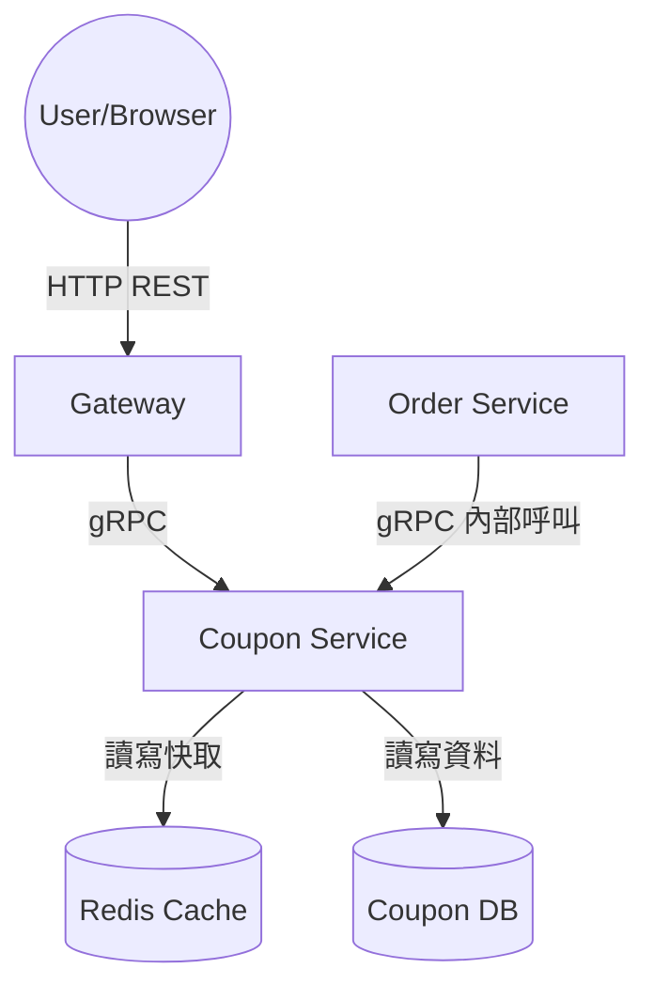

### 1.3 技術棧與 Port 分配

| 項目 | 值 |
|------|------|
| 開發語言 | Java 21 / Spring Boot 3.2+ / MyBatis-Plus |
| 通訊 | gRPC（Protobuf v3） |
| 資料庫 | PostgreSQL 15+（`hawkr_coupon`） |
| 快取 | Redis |
| HTTP（Actuator / Health） | 9950 |
| gRPC | 9951 |
| TSID Node ID Base | 500 |

### 1.4 跨服務依賴

| Client | 目標服務 | Port | 用途 | 呼叫的 RPC |
|--------|---------|------|------|-----------|
| `OrderGrpcClient` | Order Service | 9915 | MEMBER 判定 | `GetBuyerMerchantSummary(buyer_id)` |
| `AccountGrpcClient` | Account Service | — | ALL 判定 + 帳號名稱查詢 | `GetAccountInfo` / `GetAccountInfoBatch` |

**MQ 訂閱**：

| Consumer | Exchange / Routing Key | Queue | 用途 |
|----------|----------------------|-------|------|
| `BuyerDeletedConsumer` | `hawkr.buyer` / `buyer.deleted` | `coupon.buyer.deleted` | 買家角色關閉時批量作廢該 `owner_buyer_id` 全部 UNUSED Instance（詳見 §5.19） |
| `SellerSuspendedConsumer` | `hawkr.seller` / `seller.suspended` | `coupon.seller.suspended` | 賣家停權時批量停用其 ACTIVE 模板（詳見 §5.20） |
| `SellerUnsuspendedConsumer` | `hawkr.seller` / `seller.unsuspended` | `coupon.seller.unsuspended` | 解除停權時精準還原 `disabled_by_suspension` 模板（詳見 §5.20） |

### 1.5 對齊文件

| 文件 | 說明 |
|------|------|
| `docs/開發規範/` 各領域規範 | 全域技術規範（Java 微服務開發規範、後端服務責任邊界規範、MQ 與事件管理規範等） |
| API 設計規範 | API Namespace、命名、回應格式 |
| 20-結帳模組（Checkout Module）詳細設計書 | ValidateCoupon / ConsumeCoupon 呼叫介面 |
| 03-訂單微服務（Order Service）詳細設計書 | orders.coupon_instance_id / discount_amount 欄位 |
| 04-購物車微服務（Cart Service）詳細設計書 | Cart 不存券，僅在結帳時觸發 |

---

## 2. 狀態模型與業務規則

### 2.1 優惠券類型（CouponType）

**Enum 定義**（`implements CodeMeta`，位置：`services/java/shared/common-core/.../utils/code/CouponType.java`）：完整 Enum 定義詳見 [業務類型碼](../代碼管理%EF%BC%88CodeMeta%EF%BC%89/業務類型碼.md#CouponType)。

### 2.2 發行者類型（IssuerType）

**Enum 定義**（`implements CodeMeta`，位置：`services/java/shared/common-core/.../utils/code/IssuerType.java`）：完整 Enum 定義詳見 [業務類型碼](../代碼管理%EF%BC%88CodeMeta%EF%BC%89/業務類型碼.md#IssuerType)。

### 2.3 Scope 模型（適用範圍）

`applicable_store_id` 欄位決定優惠券的適用範圍：

| 值 | 語意 | 典型場景 |
|----|------|---------|
| NULL | 全平台券 | Admin 發行的平台活動券（僅 §5.15 AdminCreateTemplate 可產生） |
| 非 NULL（商店 store_id surrogate） | 僅該商店可使用 | 賣家發行的店鋪券 |

> **「不指定」不是一種範圍**：NULL = 全平台是**顯式選擇**的結果，只有 §5.15 那條路徑允許。
> 補償券（§5.11 / §5.12）一律必填 `applicable_store_id`——它們針對單一筆退款／糾紛發放，
> 缺值代表呼叫端弄錯了，不代表「發全平台券」。缺值被靜默解讀成最大適用範圍會直接漏錢。

> **命名現況（re-key ②，44 號設計書）**：DB 欄位已由 `applicable_seller_account_id` 更名為 `applicable_store_id`（Flyway `V3__seller_account_id_to_store_id.sql`），值為 `sellers.store_id` surrogate 而非登入 `account_id`。
> proto 側亦已收斂：`ValidateCouponRequest` / `ListAvailableCouponsRequest` 的請求欄位為 `store_id`（`api/proto/coupon/coupon.proto`），攜帶的值即 store_id surrogate（由 Gateway `sellerid` resolver 解析）。

**Scope 驗證虛擬碼**：

```
if template.applicable_store_id is NULL:
    pass  // 全平台券，任何商店都適用
else if template.applicable_store_id == request.store_id:  // 值為 store_id surrogate
    pass  // 匹配該商店
else:
    reject SELLER_SCOPE_MISMATCH
```

### 2.4 發放目標類型（CouponTargetType）

`target_type` 欄位決定優惠券的發放對象與資格判定方式。

**Enum 定義**（`implements CodeMeta`，位置：`services/java/shared/common-core/.../utils/code/CouponTargetType.java`）：完整 Enum 定義詳見 [業務類型碼](../代碼管理%EF%BC%88CodeMeta%EF%BC%89/業務類型碼.md#CouponTargetType)。

> **DB 存值**：使用 `code` 欄位值（字串 `"ALL"` / `"MEMBER"` / `"DESIGNATED"` / `"COMPENSATION"`）。
>
> **Proto 傳輸**：使用 `code` 值（如 `"ALL"`）。
>
> **輸入驗證**：所有接受 `target_type` 的 RPC 必須使用 `CodeMetaValidator` 驗證合法性。

**target_type 與業務規則差異**：

| 規則 | ALL | MEMBER | DESIGNATED | COMPENSATION |
|------|-----|--------|------------|--------------|
| 計入賣家配額 | 是 | 是 | 是 | **否** |
| 時間資格限制 | 買家須在發券前已註冊 | 無（有效期內成為會員即可） | 無 | 無 |
| 需要 target_accounts 表 | 否 | 否 | 是 | 是 |
| 發放方 | Seller / Admin | Seller / Admin | Seller / Admin | AfterSales / Admin |

**資格驗證虛擬碼**：

```
switch template.target_type:
  case ALL:
    buyer_created_at = AccountService.GetAccountInfo(buyer_id).created_at
    if buyer_created_at > template.created_at:
        reject TARGET_NOT_ELIGIBLE
  case MEMBER:
    summaries = OrderService.GetBuyerMerchantSummary(buyer_id)
    if template.applicable_store_id NOT IN summaries.store_ids:
        reject TARGET_NOT_ELIGIBLE
  case DESIGNATED:
  case COMPENSATION:
    if NOT EXISTS coupon_target_accounts(template_id, buyer_id):
        reject TARGET_NOT_ELIGIBLE
```

> **重要**：Admin 發行的優惠券預設需要買家**主動領券**才能使用（`claim_required = TRUE`）。Seller 發行的優惠券與補償券**免領券**，符合資格即可直接使用。Admin 亦可選擇「免領券」模式（`claim_required = FALSE`），行為等同 Seller 券。Instance 僅在結帳 Reserve 時才建立，代表「使用中/已使用」而非「持有」。詳見 §2.8。

### 2.5 Template 狀態機（CouponTemplateStatus）

**Enum 定義**（`implements CodeMeta`，位置：`services/java/shared/common-core/.../utils/code/CouponTemplateStatus.java`）：完整定義詳見 [業務狀態碼](../代碼管理%EF%BC%88CodeMeta%EF%BC%89/業務狀態碼.md#CouponTemplateStatus)。

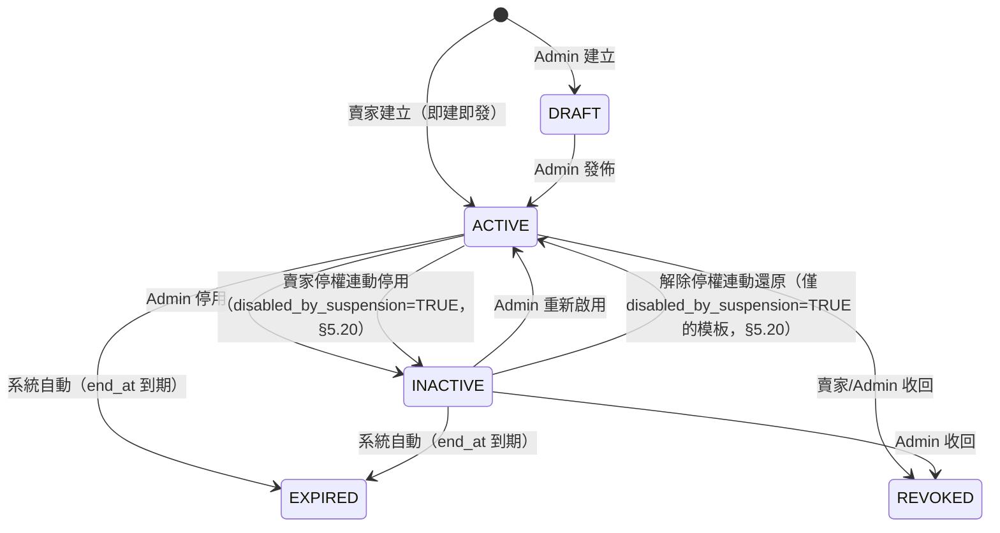

> **賣家流程**：無 DRAFT / INACTIVE 狀態（賣家建立直接進入 ACTIVE，僅可 REVOKE，不可自行停用後重啟）。**例外**：賣家停權連動會把賣家 ACTIVE 模板停用為 INACTIVE 並標記 `disabled_by_suspension=TRUE`；解除停權時精準還原（§5.20）——此 INACTIVE 由系統連動產生，非賣家自助操作。

### 2.6 Instance 狀態機（CouponInstanceStatus）

**Enum 定義**（`implements CodeMeta`，位置：`services/java/shared/common-core/.../utils/code/CouponInstanceStatus.java`）：完整定義詳見 [業務狀態碼](../代碼管理%EF%BC%88CodeMeta%EF%BC%89/業務狀態碼.md#CouponInstanceStatus)。

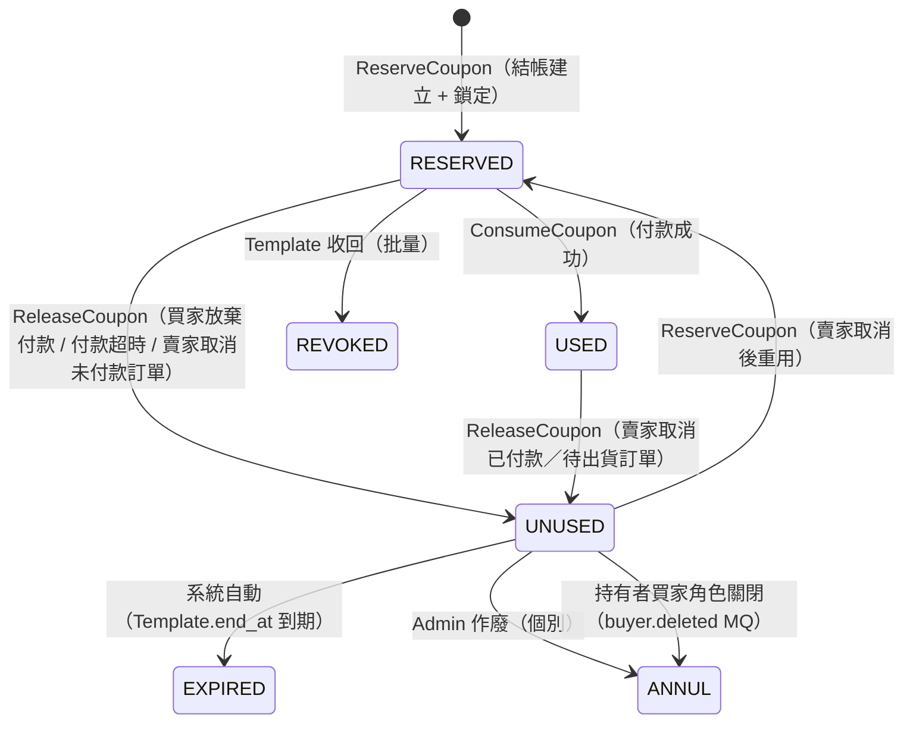

#### 2.6.1 券生命週期業務規則（最高優先級）

**核心原則**：券的狀態變更**完全由訂單事件驅動**，coupon-service 不持有任何獨立 timer。

| 訂單事件 | 觸發者 | 券動作 | 狀態轉換 |
|---|---|---|---|
| 付款成功 | PayUni webhook → order-service | ConsumeCoupon | RESERVED → USED |
| 買家放棄付款（PENDING_PAYMENT 階段手動取消） | BUYER `cancelOrder` | ReleaseCoupon | RESERVED → UNUSED |
| 付款超時自動取消 | `PaymentDeadlineScheduler` | ReleaseCoupon | RESERVED → UNUSED |
| **賣家取消（出貨前任何狀態）** | aftersales `SellerCancelService.cancelShipment` → order `cancelOrderInternal` | ReleaseCoupon | **RESERVED → UNUSED 或 USED → UNUSED**（同一語意，吃掉兩種起始狀態） |
| 出貨後的售後（退貨退款 / 部分退款 / 補償券等） | aftersales | **不動** | USED 維持，券視為「已使用」不還 |

**業務語意**：
- **券一旦被綁到訂單，就只有兩種終局**：USED（付款成功）或 UNUSED（訂單在出貨前被取消／放棄／超時）
- **「出貨後」是分水嶺**：商品已交付，買家已享受購買行為，後續退款不還券
- **賣家取消是還券的兜底**：不論訂單在 PENDING_PAYMENT / PAID / PENDING_SHIPMENT 哪個狀態，賣家取消都視為「這筆交易作廢」，券一律回到買家手上

**沒有 `reserve_expire_at` timer**：RESERVED 券的釋放走「對帳 Job」模式（見 §5.7）——掃 RESERVED 券、逐筆查詢訂單真實狀態、依訂單狀態決定動作。🔴 **不得改用固定 timer**：訂單付款期限為 2 天，短 timer 會在訂單還活著時先釋放券，同 instance 可被另一張新單 re-reserve ⇒ 雙花。**券的生死完全跟隨訂單。**

> **Instance 生命週期**：Instance 不在「領券」時建立。初始狀態為 **RESERVED**（結帳 Reserve 時 INSERT），而非 UNUSED。UNUSED 狀態僅在 ReleaseCoupon 後出現（鎖定被釋放但 Instance 保留用於防重複使用檢查與重用）。

> **ANNUL vs REVOKED 語意區別**：
> - **ANNUL**：Admin 針對**單一 Instance** 的操作；或持有者的買家角色關閉時對其所有 UNUSED Instance 的批量作廢。場景：偵測到違規使用、系統錯誤發券、個案處理、買家自助 / Admin 刪除帳號。觸發來源：`AdminVoidInstance` RPC、`BuyerDeletedConsumer`（消費 `buyer.deleted` MQ，**與帳號是否存活無關**——見 §5.19）。
> - **REVOKED**：Template 層級的**批量操作**。當 Template 被收回時，該 Template 下所有 RESERVED Instance 批量轉為 REVOKED。已 USED 的 Instance 保留不變。觸發 RPC：`SellerRevokeTemplate` 或 Admin 收回。

### 2.7 賣家配額機制

每個賣家可建立的優惠券種類（Template 數量）受配額限制：

| 項目 | 說明 |
|------|------|
| 預設上限 | 5 種（非 5 張；是 Template 數量，非 Instance 數量） |
| 計數基準 | `status = '1'（ACTIVE）` 且 `issuer_type = '2'（SELLER）` 且 `issuer_store_id = ?` 且 **`target_type != '4'（COMPENSATION）`** 的 Template 數量 |
| 不計入 | EXPIRED、REVOKED 狀態的 Template（已結束，騰出額度）；**COMPENSATION 類型的 Template（補償券不佔配額）** |
| 擴充機制 | Admin 透過 `AdminUpdateSellerQuota` 調整個別賣家上限 |
| 驗證時機 | `SellerCreateTemplate` 建立前檢查 |

**驗證虛擬碼**：

```
maxCount = SELECT max_template_count FROM seller_coupon_quotas
           WHERE store_id = ?
           // 若無記錄，使用預設值 5

currentCount = SELECT COUNT(*) FROM coupon_templates
               WHERE issuer_store_id = ?
               AND issuer_type = '2'  // SELLER
               AND status = '1'  // ACTIVE
               AND target_type != '4'  // COMPENSATION

if currentCount >= maxCount:
    reject SELLER_QUOTA_EXCEEDED
```

### 2.8 領券機制（Claim）

#### 2.8.1 三層資料模型

優惠券的完整生命週期由三層資料模型組成，各層職責分明：

```
┌─────────────────────────────────────────────────────────────┐
│  Template（優惠券定義）                                       │
│  coupon_templates 表                                        │
│  「這張券的規格：折多少、期限、適用範圍、是否需要領取」              │
│  → Admin / Seller 建立時寫入                                 │
└─────────────────────┬───────────────────────────────────────┘
                      │
                      │ 買家符合 target_type 資格？
                      ▼
┌─────────────────────────────────────────────────────────────┐
│  Claim（領券記錄）                                            │
│  coupon_claims 表                                           │
│  「買家主動領取了這張券」                                       │
│  → 僅 claim_required = TRUE 的 Admin 券需要此步驟             │
│  → Seller 券 / Admin 免領券 / 補償券 → 跳過此層               │
└─────────────────────┬───────────────────────────────────────┘
                      │
                      │ 結帳選用此券
                      ▼
┌─────────────────────────────────────────────────────────────┐
│  Instance（使用記錄）                                         │
│  coupon_instances 表                                        │
│  「買家正在使用 / 已使用這張券，綁定具體訂單」                     │
│  → 結帳 Reserve 時才建立（RESERVED → USED / RELEASED）        │
└─────────────────────────────────────────────────────────────┘
```

#### 2.8.2 `claim_required` 欄位規則

`coupon_templates.claim_required`（BOOLEAN）決定買家是否需要主動領券：

| issuer_type | claim_required | 建立時設定方式 | 買家行為 |
|-------------|---------------|---------------|---------|
| SELLER | **FALSE（強制）** | 程式碼強制設定，忽略前端傳值 | 符合資格即可直接使用 |
| ADMIN | **TRUE（預設）** | Admin 可選擇設為 FALSE（免領券） | 需先領券，領完才能在結帳時選用 |
| ADMIN（免領券） | FALSE | Admin 建立時明確選擇 | 符合資格即可直接使用，等同 Seller 券 |
| 補償券 | **FALSE（強制）** | 程式碼強制設定 | 系統/Admin/Seller 發給指定買家，不需領取 |

#### 2.8.3 領券可用性判定

買家在不同頁面看到的優惠券取決於 `claim_required` + 是否已領取：

**「我的優惠券」頁面（ListMyCoupons）**——顯示所有符合資格的券：

| claim_required | 已領取(claimed) | 在列表中的呈現 | 前端 UI |
|---------------|----------------|--------------|--------|
| FALSE | — | 可用券 | 顯示「去使用」 |
| TRUE | FALSE | 可領券 | 顯示「立即領取」按鈕 |
| TRUE | TRUE | 可用券 | 顯示「去使用」 |

**「結帳選優惠券」（ListAvailableCoupons）**——只顯示「此刻真的能用」的券：

| claim_required | 已領取(claimed) | 是否出現 |
|---------------|----------------|---------|
| FALSE | — | ✅ 出現（門檻/scope 通過即可） |
| TRUE | FALSE | ❌ 不出現（未領取，不可使用） |
| TRUE | TRUE | ✅ 出現（已領取 + 門檻/scope 通過） |

#### 2.8.4 `issued_count` 遞增時機與 `total_issue_limit` 的適用範圍

| 場景 | `issued_count` 遞增時機 | 說明 |
|------|------------------------|------|
| `claim_required = TRUE` | **領券時**（BuyerClaimCoupon / AdminDistributeTemplate） | 領取 = 消耗一個發行名額 |
| `claim_required = FALSE` | **不遞增** | 免領券沒有「領取」這個動作；結帳鎖定（ReserveCoupon）只建立 Instance，不碰 `issued_count` |

**`total_issue_limit` 只約束需領取的券**：此欄與 `issued_count` 成對運作（`CouponTemplateMapper.incrementIssuedCount` 的 CAS 條件即 `total_issue_limit = -1 OR issued_count + n <= total_issue_limit`），而 `issued_count` 的唯一遞增路徑是領券（`CouponClaimService`）。因此**免領券（`claim_required = FALSE`，含全部 Seller 券與補償券）不受 `total_issue_limit` 約束**，其發行量由發行者（賣家 / Admin）自行以模板的有效期與適用範圍控管。需要總量上限時，必須把該券設為 `claim_required = TRUE`。

#### 2.8.5 每人領券上限

每人每張 Template 只能領取 **1 次**（寫死，不可設定）。`coupon_claims` 表以 `(template_id, buyer_id)` 為主鍵，DB 層唯一約束保證。

若 Admin 希望同一買家獲得多張同類優惠，應建立多個 Template。

---

## 3. 資料庫設計

使用 PostgreSQL。Database Name: `hawkr_coupon`。

### 3.1 優惠券定義表 coupon_templates

| 欄位名 | 欄位邏輯名 | 資料型態 | Nullable | PK | Default | 備註 |
|--------|-----------|---------|----------|------|---------|------|
| template_id | 模板 ID | BIGINT | N | Y | | TSID |
| title | 名稱 | VARCHAR(255) | N | | | |
| type | 類型 | VARCHAR(4) | N | | | 見 CouponType |
| applicable_store_id | 適用商店 | BIGINT | Y | | NULL | NULL = 全平台券；值為 store_id surrogate |
| issuer_type | 發行者類型 | VARCHAR(4) | N | | | ADMIN / SELLER |
| issuer_account_id | 發行者管理員帳號 | BIGINT | Y | | NULL | 僅 `issuer_type=ADMIN` 使用，由寫入路徑保證 `issuer_type=SELLER` 時為 NULL（DB 層 CHECK 尚未加，見下方說明）。V6 migration 拆分自舊 `issuer_store_id`，見下方說明 |
| issuer_store_id | 發行者商店 | BIGINT | Y | | NULL | 僅 `issuer_type=SELLER` 使用，由寫入路徑保證 `issuer_type=ADMIN` 時為 NULL（DB 層 CHECK 尚未加，見下方說明）。值為 `store_id` surrogate |
| threshold_amount | 滿額門檻 | BIGINT | N | | 0 | 新台幣元，0 = 無門檻 |
| discount_amount | 現金折扣額 | BIGINT | Y | | NULL | CASH 券使用，新台幣元 |
| discount_percent | 折扣百分比 | INTEGER | Y | | NULL | PERCENT 券使用（如 20 = 打 8 折） |
| max_discount_amount | 折扣上限 | BIGINT | Y | | NULL | PERCENT 券的最大折扣額，新台幣元 |
| start_at | 生效時間 | TIMESTAMPTZ | N | | | |
| end_at | 到期時間 | TIMESTAMPTZ | N | | | |
| usage_limit_per_account | 每帳號領取上限 | INTEGER | N | | 1 | |
| total_issue_limit | 總發行上限 | INTEGER | N | | -1 | -1 = 無限；僅對 `claim_required = TRUE` 的券生效，見 §2.8.4 |
| issued_count | 已發行數 | INTEGER | N | | 0 | 僅領券路徑遞增，免領券恆為 0，見 §2.8.4 |
| target_type | 發放目標 | VARCHAR(4) | N | | | ALL / MEMBER / DESIGNATED / COMPENSATION |
| status | 狀態 | VARCHAR(4) | N | | '0'（DRAFT） | 見 CouponTemplateStatus |
| claim_required | 是否需要領券 | BOOLEAN | N | | TRUE | Seller 券 / 補償券強制 FALSE，見 §2.8.2 |
| disabled_by_suspension | 因賣家停權停用 | BOOLEAN | N | | FALSE | 賣家停權連動停用時標記 TRUE（Flyway V{N+1}）；供解除停權時**精準還原**——只還原此旗標為 TRUE 的模板，不誤還原賣家本來就自行停用的模板。見 §5.20 |
| revoked_at | 收回時間 | TIMESTAMPTZ | Y | | NULL | |
| revoked_reason | 收回原因 | VARCHAR(255) | Y | | NULL | |
| created_at | 建立時間 | TIMESTAMPTZ | N | | NOW() | |
| updated_at | 更新時間 | TIMESTAMPTZ | Y | | NULL | 由 DB trigger 自動維護 |

> **發行者身分由兩個互斥欄位承載**：`issuer_account_id`（ADMIN-only，管理員 `account_id`）與 `issuer_store_id`（SELLER-only，`store_id` surrogate）。**每一列恰有一個非 NULL**，由應用層寫入路徑保證——DB 層目前沒有 CHECK constraint 守它。🔴 因此 `CouponTemplateMapper#revokeTemplate` 與 `CouponGrpcService#sellerGetTemplateDetail` **必須**保留 `issuer_type='2'（SELLER）` 過濾：少了它，賣家查詢會跨語意比對到 ADMIN 列的 `account_id`。

**索引**（索引名沿用舊稱，與現行欄位名不一致但指向正確欄位）：

- `idx_tpl_scope_status` (applicable_store_id, status) — 提升 Scope + 狀態篩選效能
- `idx_tpl_issuer` (issuer_type, issuer_store_id, status) — 賣家配額查詢 + 列表篩選
- `idx_tpl_end_at` (end_at) WHERE status IN ('1'（ACTIVE）, '2'（INACTIVE）) — 自動過期排程掃描
- `idx_tpl_target_type` (target_type, status) — 按發放目標類型篩選可用券
- `idx_tpl_claim` (claim_required, status) WHERE claim_required = TRUE AND status = '1'（ACTIVE） — 加速買家領券列表查詢

### 3.2 優惠券實體表 coupon_instances

> **角色定義**：Instance 不再代表「買家持有一張券」，而是代表「買家正在使用/已使用一張券」。Instance 僅在結帳 Reserve 時才建立。判斷「買家有哪些可用券」不查此表，而是即時計算 Template 資格（見 2.4）。

| 欄位名 | 欄位邏輯名 | 資料型態 | Nullable | PK | Default | 備註 |
|--------|-----------|---------|----------|------|---------|------|
| instance_id | 實體 ID | BIGINT | N | Y | | TSID |
| template_id | 模板 ID | BIGINT | N | | | FK -> coupon_templates.template_id |
| owner_buyer_id | 持有者買家 | BIGINT | N | | | 買家 `buyer_id`（stint-scoped，非登入 account_id） |
| applicable_store_id | 適用商店 | BIGINT | Y | | NULL | 冗餘自 Template，加速查詢；值為 store_id surrogate。**必須**在 `CouponInstanceService.reserveCoupon` 寫入時從 Template 帶入——傳 `null` 會讓 §5.13 的賣家查詢與 §5.2 的 `usedRecords` 賣家資訊查不到這張券 |
| status | 狀態 | VARCHAR(4) | N | | '0'（UNUSED） | 見 CouponInstanceStatus |
| reserved_order_no | 鎖定訂單編號 | VARCHAR(64) | Y | | NULL | |
| reserved_at | 鎖定時間 | TIMESTAMPTZ | Y | | NULL | 對帳 Job 用此欄位排序與 grace 判斷 |
| used_order_no | 使用訂單編號 | VARCHAR(64) | Y | | NULL | |
| used_at | 使用時間 | TIMESTAMPTZ | Y | | NULL | |
| revoked_at | 收回時間 | TIMESTAMPTZ | Y | | NULL | |
| revoked_reason | 收回原因 | VARCHAR(255) | Y | | NULL | |
| voided_at | 作廢時間 | TIMESTAMPTZ | Y | | NULL | |
| voided_reason | 作廢原因 | VARCHAR(255) | Y | | NULL | |
| created_at | 建立時間 | TIMESTAMPTZ | N | | NOW() | |
| updated_at | 更新時間 | TIMESTAMPTZ | Y | | NULL | 由 DB trigger 自動維護 |

**索引**：

- `idx_inst_owner_status` (owner_buyer_id, status) — 買家查詢我的優惠券
- `idx_inst_reserved_order` (reserved_order_no) WHERE reserved_order_no IS NOT NULL — Reserve/Consume/Release 查詢
- `idx_inst_template` (template_id, status) — Template 收回時批量更新
- `idx_inst_seller_owner` (applicable_store_id, owner_buyer_id, status) — 賣家查買家持有券（索引名沿用舊稱）

**唯一約束**：

- `UNIQUE (template_id, owner_buyer_id)` WHERE status NOT IN ('5'（ANNUL）, '4'（REVOKED）) — 同一 Template 每個買家僅能有一張有效 Instance

### 3.3 稽核日誌表 coupon_redemption_logs

| 欄位名 | 欄位邏輯名 | 資料型態 | Nullable | PK | Default | 備註 |
|--------|-----------|---------|----------|------|---------|------|
| log_id | 日誌 ID | BIGSERIAL | N | Y | | 自增主鍵（內部表） |
| instance_id | 實體 ID | BIGINT | N | | | |
| template_id | 模板 ID | BIGINT | N | | | |
| owner_buyer_id | 持有者買家 | BIGINT | N | | | 買家 `buyer_id`（stint-scoped） |
| action | 操作類型 | VARCHAR(16) | N | | | ISSUE / RECEIVE / RESERVE / CONSUME / RELEASE / REVOKE / ANNUL / EXPIRE |
| order_no | 關聯訂單 | VARCHAR(64) | Y | | NULL | |
| operator_account_id | 操作者帳號 | BIGINT | Y | | NULL | Admin/Seller 操作時記錄；**未隨 re-key 更名**，存的是操作者登入 `account_id` |
| trace_id | 追蹤 ID | VARCHAR(64) | N | | | Gateway 注入 |
| request_id | 請求 ID | VARCHAR(64) | N | | | Gateway 注入 |
| detail | 補充資訊 | VARCHAR(500) | Y | | NULL | 如收回原因、作廢原因 |
| created_at | 建立時間 | TIMESTAMPTZ | N | | NOW() | |

**索引**：

- `idx_log_instance` (instance_id) — 查詢特定 Instance 的操作歷程
- `idx_log_created_at` (created_at) — 時序查詢

### 3.4 賣家配額表 seller_coupon_quotas

| 欄位名 | 欄位邏輯名 | 資料型態 | Nullable | PK | Default | 備註 |
|--------|-----------|---------|----------|------|---------|------|
| store_id | 商店 ID | BIGINT | N | Y | | `store_id` surrogate（PK）；重開店會取得新 store_id，天然獲得全新配額列 |
| max_template_count | 模板上限 | INTEGER | N | | 5 | 預設 5 種 |
| created_at | 建立時間 | TIMESTAMPTZ | N | | NOW() | |
| updated_at | 更新時間 | TIMESTAMPTZ | Y | | NULL | |

> 若查無記錄，系統使用預設值 5。Admin 可透過 `AdminUpdateSellerQuota` 新增/修改記錄。

### 3.5 發放目標帳號表 coupon_target_accounts

僅 `target_type = DESIGNATED` 或 `COMPENSATION` 時使用。記錄哪些買家帳號是該 Template 的發放對象。

| 欄位名 | 欄位邏輯名 | 資料型態 | Nullable | PK | Default | 備註 |
|--------|-----------|---------|----------|------|---------|------|
| template_id | 模板 ID | BIGINT | N | Y | | FK -> coupon_templates.template_id |
| buyer_id | 指定買家 | BIGINT | N | Y | | 買家 `buyer_id`（stint-scoped，非登入 account_id） |
| created_at | 建立時間 | TIMESTAMPTZ | N | | NOW() | |

**主鍵**：`(template_id, buyer_id)` — 複合主鍵。

**索引**：

- `idx_target_account` (buyer_id) — 反查「某個買家被哪些 Template 指定」（索引名沿用舊稱）

> **與 coupon_instances 的區別**：
> - `coupon_target_accounts`：白名單，代表「有資格使用」，輕量級（只有 PK + created_at）
> - `coupon_instances`：使用紀錄，代表「正在使用/已使用」，有完整的狀態機和稽核欄位

### 3.6 領券記錄表 coupon_claims

僅 `claim_required = TRUE` 的 Admin 優惠券使用。記錄買家主動領取的行為。

| 欄位名 | 欄位邏輯名 | 資料型態 | Nullable | PK | Default | 備註 |
|--------|-----------|---------|----------|------|---------|------|
| template_id | 模板 ID | BIGINT | N | Y (複合) | | FK → coupon_templates.template_id |
| buyer_id | 領券買家 | BIGINT | N | Y (複合) | | 領券的買家 `buyer_id`（stint-scoped） |
| claimed_at | 領券時間 | TIMESTAMPTZ | N | | NOW() | |

**主鍵**：`(template_id, buyer_id)` — 複合主鍵，保證每人每券只能領一次。

**索引**：

- `idx_claim_buyer` (buyer_id) — 反查「某個買家領了哪些券」

> **與 coupon_target_accounts 的區別**：
> - `coupon_target_accounts`：Admin/Seller 設定的白名單，代表「有資格」
> - `coupon_claims`：買家主動領取的行為記錄，代表「已領取」
> - 兩者獨立運作。DESIGNATED target_type 需要在 target_accounts **且**（若 claim_required=TRUE）在 claims 中
>
> **與 coupon_instances 的區別**：
> - `coupon_claims`：「我要了這張券」——領券行為
> - `coupon_instances`：「我正在用這張券結帳」——綁定訂單的使用記錄

### 3.7 快取設計（Redis）

**快取服務**：`CouponCacheService`（Cache-Aside 模式）

| 快取對象 | Key 格式 | TTL | 說明 |
|---------|---------|-----|------|
| Template 詳情 | `coupon:tpl:{template_id}` | 30 分鐘 | Template 建立後不可編輯，變更頻率低 |
| 可領取列表 | `coupon:avail:{query_hash}` | 5 分鐘 | query_hash = MD5(page + pageSize) 前 8 位 |

**不做快取的對象**：

| 對象 | 原因 |
|------|------|
| 買家我的優惠券列表 | 狀態變更頻繁（Reserve/Consume/Release），快取一致性成本高 |
| 賣家模板列表 | 資料量小、存取頻率低 |

**清除機制**：

- Template 狀態變更（Revoke / Expire / Disable） -> 清除 `coupon:tpl:{template_id}`
- Template 新增或狀態變更 -> 清除所有 `coupon:avail:*`

---

## 4. 對外/對內介面定義

### 4.1 Gateway REST 路由（15 條）

#### 4.1.1 App Namespace — Buyer（`/api/v1/app/*`，需 JWT + BUYER）

| HTTP 方法 | 路由 | Handler | gRPC 方法 | 說明 |
|----------|------|---------|----------|------|
| GET | `/api/v1/app/coupons` | GetCoupons | ListMyCoupons | 我的優惠券列表（status 支援逗號分隔多選：`UNUSED,USED`） |
| GET | `/api/v1/app/coupons/available` | ListAvailableCoupons | ListAvailableCoupons | 結帳可用優惠券（必填 `store_id` + `order_amount`，`order_amount` 為「實際成交小計」基於 unit_price 彙總，不含原價，見 §5.3） |
| POST | `/api/v1/app/coupons/{template_id}/claim` | ClaimCoupon | BuyerClaimCoupon | 領取優惠券（僅限 claim_required=TRUE 的 Admin 券） |

> `GET /api/v1/app/coupons` 由 Gateway 根據 `view` 參數分流：
> - 無 `view` 或 `view=buyer` -> BUYER 角色 -> `ListMyCoupons`
> - `view=seller` -> SELLER 角色 -> `ListBuyerCouponsForSeller`

#### 4.1.2 App Namespace — Seller（`/api/v1/app/*`，需 JWT + SELLER）

| HTTP 方法 | 路由 | Handler | gRPC 方法 | 說明 |
|----------|------|---------|----------|------|
| POST | `/api/v1/app/coupon_templates` | CreateCouponTemplate | SellerCreateTemplate | 建立優惠券（body 需帶 `targetType`） |
| GET | `/api/v1/app/coupon_templates` | ListCouponTemplates | SellerListTemplates | 我的優惠券列表（含配額資訊） |
| GET | `/api/v1/app/coupon_templates/{template_id}` | GetCouponTemplateDetail | SellerGetTemplateDetail | 優惠券詳情 |
| POST | `/api/v1/app/coupon_templates/{template_id}/revoke` | RevokeCouponTemplate | SellerRevokeTemplate | 收回優惠券 |
| GET | `/api/v1/app/coupons?view=seller&buyer_id={id}` | GetCoupons | ListBuyerCouponsForSeller | 查詢指定買家持有的我方優惠券。`buyer_id`（現任 buyer surrogate，免解析）優先；未帶時回退相容參數 `buyer_account_id`（收登入 `account_id`，由 Gateway `resolveTargetBuyerID` 解析成現任 `buyer_id` 後再送 gRPC），兩者必須擇一 |

#### 4.1.3 Admin Namespace（`/api/v1/admin/*`，需 ADMIN）

| HTTP 方法 | 路由 | Handler | gRPC 方法 | 說明 |
|----------|------|---------|----------|------|
| POST | `/api/v1/admin/coupon_templates` | AdminCreateCouponTemplate | AdminCreateTemplate | 建立模板（DRAFT） |
| POST | `/api/v1/admin/coupon_templates/{template_id}/publish` | AdminPublishCouponTemplate | AdminPublishTemplate | 發佈模板 |
| POST | `/api/v1/admin/coupon_templates/{template_id}/disable` | AdminDisableCouponTemplate | AdminDisableTemplate | 停用模板 |
| POST | `/api/v1/admin/coupon_templates/{template_id}/issue` | AdminIssueCouponsHandler | AdminIssueCoupons | 發行優惠券給指定買家（body 可選 `immediateDistribute`） |
| POST | `/api/v1/admin/coupon_templates/{template_id}/distribute` | AdminDistributeTemplateHandler | AdminDistributeTemplate | 批量代領：對尚未領券的 target_accounts 批量建立 claim 記錄 |
| POST | `/api/v1/admin/coupons/compensations` | AdminGrantCompensation | AdminGrantCompensationCoupon | 發放補償券（body `applicableStoreId` **必填**） |
| POST | `/api/v1/admin/coupons/{instance_id}/void` | AdminVoidCouponInstance | AdminVoidInstance | 作廢單一 Instance |
| PUT | `/api/v1/admin/coupon_quotas/{store_id}` | AdminUpdateCouponQuota | AdminUpdateSellerQuota | 更新賣家配額（path 參數為 `store_id` surrogate） |

### 4.2 gRPC Proto 定義（21 RPCs）

Proto 定義位於 `api/proto/coupon/coupon.proto`。

```protobuf
service CouponService {
    // ========== Buyer ==========
    rpc ListMyCoupons (ListMyCouponsRequest) returns (ListMyCouponsResponse);
    rpc ListAvailableCoupons (ListAvailableCouponsRequest) returns (ListAvailableCouponsResponse);
    rpc BuyerClaimCoupon (BuyerClaimCouponRequest) returns (BuyerClaimCouponResponse);

    // ========== Order Service 內部呼叫 ==========
    rpc ValidateCoupon (ValidateCouponRequest) returns (ValidateCouponResponse);
    rpc ReserveCoupon (ReserveCouponRequest) returns (ReserveCouponResponse);
    rpc ConsumeCoupon (ConsumeCouponRequest) returns (ConsumeCouponResponse);
    rpc ReleaseCoupon (ReleaseCouponRequest) returns (ReleaseCouponResponse);

    // ========== Seller ==========
    rpc SellerCreateTemplate (SellerCreateTemplateRequest) returns (SellerCreateTemplateResponse);
    rpc SellerListTemplates (SellerListTemplatesRequest) returns (SellerListTemplatesResponse);
    rpc SellerGetTemplateDetail (SellerGetTemplateDetailRequest) returns (SellerGetTemplateDetailResponse);
    rpc SellerRevokeTemplate (SellerRevokeTemplateRequest) returns (SellerRevokeTemplateResponse);
    rpc ListBuyerCouponsForSeller (ListBuyerCouponsForSellerRequest) returns (ListBuyerCouponsForSellerResponse);

    // ========== Admin ==========
    rpc AdminCreateTemplate (AdminCreateTemplateRequest) returns (AdminCreateTemplateResponse);
    rpc AdminPublishTemplate (AdminPublishTemplateRequest) returns (AdminPublishTemplateResponse);
    rpc AdminDisableTemplate (AdminDisableTemplateRequest) returns (AdminDisableTemplateResponse);
    rpc AdminIssueCoupons (AdminIssueCouponsRequest) returns (AdminIssueCouponsResponse);
    rpc AdminDistributeTemplate (AdminDistributeTemplateRequest) returns (AdminDistributeTemplateResponse);
    rpc AdminGrantCompensationCoupon (AdminGrantCompensationCouponRequest) returns (AdminGrantCompensationCouponResponse);
    rpc AdminVoidInstance (AdminVoidInstanceRequest) returns (AdminVoidInstanceResponse);
    rpc AdminUpdateSellerQuota (AdminUpdateSellerQuotaRequest) returns (AdminUpdateSellerQuotaResponse);

    // ========== AfterSales Service 呼叫 ==========
    rpc GrantSellerCompensationCoupon (GrantSellerCompensationCouponRequest) returns (GrantSellerCompensationCouponResponse);
}
```

#### 4.2.1 內部 gRPC 呼叫（不經 Gateway，SERVICE_ONLY）

| 呼叫方 | gRPC 方法 | 說明 |
|-------|----------|------|
| Checkout Module (Order Service) | ValidateCoupon（以 template_id 呼叫） | Preview/Confirm 驗證 + 計算折扣 |
| Checkout Module (Order Service) | ReserveCoupon（以 template_id 呼叫，回傳 instance_id） | Confirm 建立 Instance + 鎖定 |
| Order Service | ConsumeCoupon（以 instance_id 呼叫） | 付款成功後消耗優惠券 |
| Order Service | ReleaseCoupon（以 instance_id 呼叫） | 取消/逾時時釋放優惠券 |
| Admin（Gateway `POST /api/v1/admin/coupons/compensations`） | AdminGrantCompensationCoupon | 退款補償券發放（目前唯一實作中的呼叫方） |
| Order Service (RefundWorker) | AdminGrantCompensationCoupon | 退款補償券自動發放（§6.3） |
| AfterSales Service | GrantSellerCompensationCoupon | 售後補償券：建立 COMPENSATION Template + 寫入 target_accounts |

#### 4.2.2 Coupon Service 主動呼叫其他服務

| 被呼叫方 | gRPC 方法 | 用途 |
|---------|----------|------|
| Order Service | `GetBuyerMerchantSummary` | MEMBER target_type 資格判定 |
| Account Service | `GetAccountInfo` | ALL target_type 資格判定（取 `created_at`） |
| Account Service | `GetAccountInfoBatch` | DESIGNATED/COMPENSATION 詳情帳號名稱 + 電話聚合 |
| Seller Service | `BatchGetSellerMeta` | 列表 / 詳情聚合賣家頭像 + 店名（`TemplateInfo.seller_avatar_url` / `InstanceInfo.seller_avatar_url` 來源；上游 seller-service 已組好完整 CDN URL，mapper 直接透傳） |

### 4.3 gRPC 錯誤處理規範

`CouponGrpcService` 中每個 RPC 方法的 catch-all `Exception` 區塊必須遵守：

| 規則 | 說明 |
|------|------|
| 錯誤訊息格式 | 禁止回傳 `"系統錯誤: " + e.getMessage()`。統一使用 `onSystemError()`，僅回傳 `"系統錯誤"` |
| 業務錯誤 | 統一使用 `onBusinessError()`，回傳 `CouponBusinessException` 的 code + message |
| 日誌記錄 | `onSystemError()` 內部已包含 `log.error()` + 完整堆疊 |
| 防禦性轉換 | 從 Proto 回傳值做 Enum 轉換（`fromValue()`）或數值轉換（`Long.parseLong()`）前，必須檢查空值與空字串 |

---

## 5. 業務流程詳細設計

### 5.1 賣家建立優惠券（SellerCreateTemplate）

依 target_type 決定行為，不再預先建立 Instance。

1. **角色驗證**：`requireAccountType(SELLER)`
2. **配額檢查**（2.7）：查詢 seller_coupon_quotas + 計算當前 ACTIVE 數量（排除 COMPENSATION），超過上限則拒絕（`SELLER_QUOTA_EXCEEDED`）
3. **參數驗證**：
   - `target_type` 必須為合法 CouponTargetType（賣家僅允許 ALL / MEMBER / DESIGNATED，不允許 COMPENSATION）
   - `type` 必須為合法 CouponType
   - **金額型別強制**：所有金額欄位 proto 為 string，後端強制 `Long.parseLong`（拒絕小數、非數字、空字串）
   - **`threshold_amount`**：可省略（預設 0 = 無門檻），若有值必須 `>= 0`，禁止負數
   - CASH 券：`discount_amount` 必填且 `> 0`
   - PERCENT 券：`discount_percent` 必填，範圍 1-99；`max_discount_amount` 必填且 `> 0`
   - `start_at` 必填，支援 ISO 8601 與純日期
   - `end_at` 必填，`start_at` <= `end_at`
   - `target_type = DESIGNATED` 時 `buyer_ids` 不可為空
   - `target_type = ALL / MEMBER` 時 `buyer_ids` 必須為空
4. **建立 Template**：
   - `template_id` = `TsidUtil.generate()`
   - `issuer_type` = SELLER，`status` = ACTIVE（即建即發）
   - `applicable_store_id` = 呼叫者 `store_id`（賣家券一律限本店）；`issuer_store_id` 同樣填 `store_id`
   - **`claim_required` = FALSE（強制）**——賣家券不需要買家領取
5. **寫入 coupon_target_accounts**（僅 DESIGNATED）：ON CONFLICT DO NOTHING
6. **寫入稽核日誌**：`action = ISSUE`
7. **清除快取**：`coupon:avail:*`

### 5.2 我的優惠券列表（ListMyCoupons）

即時計算買家有資格使用的 Template 列表。根據 `claim_required` 欄位決定是否需要領券。

**可用券查詢流程**：

1. **角色驗證**：`requireAccountType(BUYER)`
2. **查詢 ACTIVE Templates**：`status = '1'（ACTIVE） AND NOW() BETWEEN start_at AND end_at`
3. **排除已使用**：LEFT JOIN `coupon_instances` 排除該買家已有 USED/RESERVED Instance 的 Template
4. **target_type 資格判定**（依序處理每個 Template）：

| target_type | 判定方式 | 跨服務呼叫 |
|-------------|---------|-----------|
| ALL | `buyer.created_at <= template.created_at` | Account Service `GetAccountInfo` |
| MEMBER | 買家在該賣家有完成交易紀錄 | Order Service `GetBuyerMerchantSummary` |
| DESIGNATED | `coupon_target_accounts` 表有記錄 | 本地 DB 查詢 |
| COMPENSATION | 同 DESIGNATED | 本地 DB 查詢 |

5. **領券狀態判定**（資格通過的 Template）：
   - 批次查詢 `coupon_claims WHERE buyer_id = ?` 取得該買家已領的 template_id Set
   - 逐一判定：
     - `claim_required = FALSE` → `claimed = false`（不需要領，此欄位無意義但統一回傳）
     - `claim_required = TRUE` 且已在 claims Set → `claimed = true`（已領，可用）
     - `claim_required = TRUE` 且不在 claims Set → `claimed = false`（未領，前端顯示「領取」按鈕）
6. **效能最佳化**：`GetAccountInfo`、`GetBuyerMerchantSummary`、`coupon_claims` 各只查一次，快取在 request scope
7. **回傳**：符合資格的 Template 列表（以 TemplateInfo 格式，含 `claim_required` + `claimed` 欄位）

**TemplateInfo 回傳欄位（新增）**：

| 欄位 | 型態 | 說明 |
|------|------|------|
| claim_required | bool | 此券是否需要領券 |
| claimed | bool | 當前買家是否已領取 |

**前端 UI 判定邏輯**：
```
if claim_required == false || claimed == true:
    顯示「去使用」→ 可在結帳時選用
else:
    顯示「立即領取」按鈕 → 點擊呼叫 POST /api/v1/app/coupons/{template_id}/claim
```

**已使用券查詢**：直接查詢 `coupon_instances WHERE owner_buyer_id = ? AND status = '2'（USED）`，JOIN Template 資訊回傳。

**status 篩選**：支援逗號分隔多選。`UNUSED` = 可用券，`USED` = 已使用券，空字串 = 全部合併回傳。

### 5.3 折扣驗證（ValidateCoupon）

供 Checkout Module 的 Preview / Confirm 呼叫。**不消耗、不鎖定**。

1. **查詢 Template**：確認 `status = ACTIVE`、時間有效
2. **target_type 資格驗證**（2.4）
3. **領券檢查**：若 `claim_required = TRUE`，查詢 `coupon_claims(template_id, buyer_id)` 確認已領券。未領券 → reject `COUPON_NOT_CLAIMED`
4. **既有 Instance 檢查**（依 §2.6.1 業務規則）：
   - 查詢 `(template_id, owner_buyer_id)` 對應的 instance
   - `status = USED` → reject `此券已用於訂單 {used_order_no}`
   - `status = RESERVED` → reject `此券正用於訂單 {reserved_order_no}`
   - 訊息**必須帶上對應的 orderNo**，讓前端可以引導買家「去完成付款 / 取消上一張訂單」
   - 不再使用「已使用或鎖定」這類含糊文案
5. **Scope 驗證**（2.3）
6. **門檻檢查**：`order_amount >= threshold_amount`
6. **計算折扣**：

| 類型 | 計算公式 |
|------|---------|
| CASH | `discount = min(discount_amount, order_amount)` |
| PERCENT | `discount = min(floor(order_amount * discount_percent / 100), max_discount_amount)` |

> **`order_amount` 語意（強制）**：呼叫方（Checkout Module）傳入的 `order_amount` 必須為「**訂單實際成交小計**」（即 `Σ item.unit_price × quantity`，特價優先採用 `sale_price`、無特價時為 `list_price`）。**禁止**傳入「原價小計」（即 `Σ list_price × quantity`），否則會與「優惠券基於成交價計算」的設計（結帳模組 §4.10）不一致。
>
> 影響：
> - PERCENT 券折扣 = floor(成交小計 × 折扣%)，與商品有特價時的實付金額同步較低
> - CASH 券門檻達標基於成交小計，使用者用了特價的商品仍享同一張 CASH 券
>
> Coupon Service 內部不需處理特價邏輯，僅信任呼叫方傳入的 `order_amount` 已是成交小計。

7. **回傳**：`valid=true, discount_amount, discount_type, description, template_id`

> **降級策略**：Coupon Service 在有券的情況下為硬依賴。若服務不可用且用戶選了優惠券，Order Service 必須回傳錯誤，避免用戶被收取全額。

### 5.4 鎖定（ReserveCoupon）

在 Checkout Confirm 階段呼叫。此時才建立 Instance，同時鎖定防止併發使用。

1. **重新驗證資格**：同 5.3 的 1-6 步驟（含領券檢查）
2. **建立 Instance**（原子 INSERT + 唯一約束防併發）：

```sql
INSERT INTO coupon_instances (
    instance_id, template_id, owner_buyer_id,
    applicable_store_id, status,
    reserved_order_no, reserved_at,
    created_at
)
VALUES (
    :tsid, :template_id, :buyer_id,
    :applicable_store_id, '1' /* RESERVED */,
    :order_no, NOW(),
    NOW()
);
```

> **不設過期時間**：依 §2.6.1，券的生命週期完全跟隨訂單，不再使用 `reserve_expire_at` 自動釋放機制。鎖定狀態的退出由訂單事件驅動（消耗 / 釋放）。
>
> ⚠️ **`applicable_store_id` 必須從 Template 冗餘帶入**：上述 INSERT 的 `:applicable_store_id` 取自該券模板的 `applicable_store_id`；傳 `null` 會讓 §5.13 的賣家查詢與 §5.2 的 `usedRecords` 賣家資訊查不到這張券。

- 唯一約束 `(template_id, owner_buyer_id)` WHERE status NOT IN ('5'（ANNUL）, '4'（REVOKED）) 防止同一買家重複鎖定
- 上述 INSERT 僅適用「無既有 instance」分支；是否 INSERT 由 pre-check 決定（下）

3. **Pre-check 分支（先查後寫，不走 INSERT-catch）**：先 `findByTemplateAndOwner(template_id, buyer_id)`，依現況五分支：
   - ① 無 instance → 執行上述 INSERT
   - ② RESERVED 且 `reserved_order_no` 同本次 → 冪等成功回傳
   - ③ RESERVED 且 `reserved_order_no` 異 → 拋 `COUPON_LOCKED_BY_OTHER_ORDER`（7023）
   - ④ UNUSED（先前 release 留下的 row；受唯一約束限制不刪重插）→ `CouponInstanceMapper.reReserveCoupon(instanceId, orderNo)` 原子 UPDATE（`WHERE status='0'`）；affected=0 → 重新 SELECT：已 RESERVED 且同 orderNo → 冪等成功，否則拋 7023
   - ⑤ USED / REVOKED / ANNUL / EXPIRED → 拋 `COUPON_ALREADY_USED`

   > **為何 pre-check 而非 INSERT-catch**：release 將 instance 置回 UNUSED 但 row 留存，重新 reserve 同 template 會撞唯一約束；PostgreSQL 在 INSERT 失敗後整個 transaction abort，後續 SELECT 一併失敗，且 catch 路徑無法涵蓋 UNUSED 重用。pre-check 完全避開異常路徑。
   > **併發**：兩 request 同時讀到 UNUSED → 都呼叫 `reReserveCoupon` → 後者 affected=0（`WHERE status='0'` 不成立）→ re-check 收斂為冪等成功或 7023，無 race 窗口。

4. **回傳 instance_id**
5. **寫入稽核日誌**：`action = RESERVE`

### 5.5 消耗（ConsumeCoupon）

付款成功後由 Order Service 透過 `coupon_consumption_tasks` + `CouponConsumptionWorker` 非同步呼叫（保證重試到成功）。

```sql
UPDATE coupon_instances
SET status = '2' /* USED */,
    used_order_no = :order_no,
    used_at = NOW(),
    reserved_order_no = NULL,
    reserved_at = NULL,
    updated_at = NOW()
WHERE instance_id = :instance_id
AND status = '1' /* RESERVED */
AND reserved_order_no = :order_no;
```

- 影響列數 = 0 且已為 USED + 同 order_no -> 冪等成功
- 影響列數 = 0 且狀態不符 -> 錯誤
- **寫入稽核日誌**：`action = CONSUME`

### 5.6 釋放（ReleaseCoupon）

依 §2.6.1 業務規則，由訂單事件驅動。涵蓋三條觸發路徑與**兩種起始狀態**：

| 觸發路徑 | 訂單狀態 | 當下券狀態 |
|---|---|---|
| 買家放棄付款（手動 cancel） | PENDING_PAYMENT → CANCELLED | RESERVED |
| 付款超時自動取消 | PENDING_PAYMENT → CANCELLED | RESERVED |
| **賣家取消（出貨前任何狀態）** | PENDING_PAYMENT / PAID / PENDING_SHIPMENT → CANCELLED | **RESERVED 或 USED** |

```sql
UPDATE coupon_instances
SET status = '0' /* UNUSED */,
    reserved_order_no = NULL,
    reserved_at = NULL,
    used_order_no = NULL,
    used_at = NULL,
    updated_at = NOW()
WHERE instance_id = :instance_id
AND (
    (status = '1' /* RESERVED */ AND reserved_order_no = :order_no)
    OR (status = '2' /* USED */ AND used_order_no = :order_no)
);
```

- **單一 SQL 涵蓋兩種起始狀態**：呼叫端不需要知道券當下在 RESERVED 還是 USED，傳 `instanceId + orderNo` 即可
- 冪等：若已為 UNUSED → 視為成功
- 售後流程（已送達後的退貨退款）**不呼叫**本 RPC，券保持 USED 不動
- **寫入稽核日誌**：`action = RELEASE`

### 5.7 對帳 Job（AutoReleaseJob，前身為自動釋放）

依 §2.6.1，券狀態變更已完全由訂單事件驅動。本 Job 僅作為「兜底對帳」，補抓同步路徑漏網的 instance。

**機制**：

1. 每分鐘掃出 `status='1'（RESERVED） AND reserved_at < NOW() - 5 分鐘` 的 instance（grace period 避免打擾正常等付款訂單）
2. 逐筆呼叫 `OrderGrpcClient.getOrderStatus(reservedOrderNo)`（內部走 `GetOrderForAfterSales`）
3. 依訂單真實狀態決定動作：

| 訂單狀態 | 動作 | 為什麼 |
|---|---|---|
| `PENDING_PAYMENT` | 留著（leftAlone） | 訂單還在等付款（最長 2 天），正常情況 |
| `CANCELLED` | `releaseCoupon` | 同步 release 路徑漏網（gRPC 失敗等），補打 |
| `PAID` / `PENDING_SHIPMENT` / `IN_TRANSIT` / `DELIVERED` / `COMPLETED` 等已付款狀態 | `consumeCoupon` | `CouponConsumptionWorker` 漏網，補打 |
| 查無訂單 | 跳過 + WARN | 不主動標終局，避免誤殺；轉人工排查 |

| 項目 | 說明 |
|------|------|
| 類別 | `io.github.will413028.hawkr.coupon.scheduler.AutoReleaseJob` |
| 排程 | **每分鐘（`0 * * * * ?`）** —— 由 `coupon-service` 的 `application.yml`（`coupon.scheduler.auto-release.cron`）指定。`@Scheduled` 註解上的 `0 */5 * * * ?` 只是 placeholder 的預設值，**yml 有值即以 yml 為準**，實跑頻率是每分鐘 |
| 開關 | `coupon.scheduler.auto-release.enabled`（預設 `true`） |
| Grace 期 | `coupon.scheduler.auto-release.grace-minutes`（預設 5 分鐘） |
| 批次 | `coupon.scheduler.auto-release.batch-size`（預設 200 筆／輪） |
| 日誌策略 | 無事不印；對帳成功印 scanned/released/consumed/leftAlone/orphan 統計；異常 ERROR |

🔴 **不得改用 `reserve_expire_at` 之類的固定 timer 釋放 RESERVED 券**：訂單付款期限為 2 天，短 timer 會在訂單還活著時把券釋放，造成同 instance 被另一張新單 re-reserve、付款後對帳爆炸。券的釋放一律以訂單真實狀態為準。

**多副本搶佔語意：無需額外搶佔。** 步驟 2 的 `getOrderStatus` 是**唯讀查詢不是副作用**，步驟 3 的兩個 CAS 自帶完整冪等（第二個 pod `affected=0` 且**不重寫** `coupon_redemption_logs`），崩潰即原樣重撈。完整的 CAS 述詞與冪等契約見 [§7.5](#75-多副本排程搶佔語意scheduler-claim) ——本節不重複，避免兩處各記一個版本。

### 5.8 自動過期（AutoExpireJob）

排程將超過 `end_at` 的 Template 和 Instance 標記為 EXPIRED。

**Template 過期**：

```sql
UPDATE coupon_templates
SET status = '3' /* EXPIRED */, updated_at = NOW()
WHERE status IN ('1' /* ACTIVE */, '2' /* INACTIVE */)
AND end_at < NOW();
```

**Instance 過期**：

```sql
UPDATE coupon_instances
SET status = '3' /* EXPIRED */, updated_at = NOW()
WHERE status = '0' /* UNUSED */
AND template_id IN (
    SELECT template_id FROM coupon_templates WHERE status = '3' /* EXPIRED */
);
```

| 項目 | 說明 |
|------|------|
| 類別 | `io.github.will413028.hawkr.coupon.scheduler.AutoExpireJob` |
| 排程 | 每 5 分鐘（`0 */5 * * * ?`） |
| 開關 | `coupon.auto-expire.enabled`（預設 `true`） |
| 日誌策略 | 無事不印；有過期才記錄數量 |

> RESERVED 狀態的 Instance 不直接過期；先由 AutoReleaseJob 釋放為 UNUSED，再由 AutoExpireJob 處理。

**多副本搶佔語意：不適用。** 上面兩句都是**集合式批次 UPDATE**——無 per-row 迴圈、無外部副作用（不 publish、不打 gRPC），原子性由 DB 保證，也沒有可被搶佔的 row 身分。判定依據見 [§7.5](#75-多副本排程搶佔語意scheduler-claim)。

### 5.8.1 到期預警通知（CouponExpiringWarningJob）

買家「優惠券即將到期」通知，走 notification template（`hawkr.marketing` / `coupon.expiring`）。

**業務規則**：

| 項目 | 說明 |
|------|------|
| 類別 | `io.github.will413028.hawkr.coupon.scheduler.CouponExpiringWarningJob` |
| 排程 | 每日一次（`0 0 1 * * ?` UTC，台灣時間 09:00） |
| 開關 | `coupon.scheduler.expiring-warning.enabled`（預設 `true`） |
| 預警窗口 | `coupon.scheduler.expiring-warning.days`（預設 `1`，即 24h 內到期） |
| 批次 | 每輪掃描上限 `batch-size`（預設 500），依 instance id 游標分頁掃完為止 |

**掃描 SQL（語意）**：

```sql
SELECT ci.instance_id, ci.owner_buyer_id, ct.title, ct.end_at
FROM coupon_instances ci
JOIN coupon_templates ct ON ct.template_id = ci.template_id
WHERE ci.status = '0'            -- UNUSED（CouponInstanceStatus Value）
  AND ct.end_at > :now
  AND ct.end_at <= :until        -- :until = now + warningDays
  AND ci.instance_id > :cursor   -- 游標分頁
ORDER BY ci.instance_id
LIMIT :batchSize;
```

> 投影回 `CouponExpiringRef` record（非 Entity，§11.3 partial projection 禁令）。**`coupon_templates` 沒有圖片欄位**，因此掃描不取圖，`coupon_image_url` 由 publisher 一律帶空字串（`CouponExpiringEvent.of` 將 `null` 正規化為 `""`）——欄位保留在契約中供未來擴充，template 端補上圖片欄位前不會有值。

**Event 發布**（per instance fan-out，經 `obsRabbitPublisher`）：

- Exchange `hawkr.marketing`（既有）、Routing Key `coupon.expiring`
- Payload（36 號 §7.4.1 contract，L1 snake_case）——範例刻意讓 `buyer_id` 與 `notify_buyer_account_id` **取值不同**，以呈現買家重新開業後兩者分岔的情況（首任買家兩者相等）：

```json
{
  "event_id": "<uuid v4>",
  "event_type": "COUPON_EXPIRING",
  "occurred_at": "2026-07-03T01:00:00Z",
  "buyer_id": "2608240571",
  "notify_buyer_account_id": "2591033728",
  "coupon_instance_id": "123456789",
  "coupon_name": "夏季折扣券",
  "coupon_image_url": "",
  "expire_at": "2026-07-04T00:00:00Z",
  "date_key": "20260703"
}
```

> **payload key 命名現況**：業務值走 `buyer_id` 這個 wire key（`CouponExpiringEvent.buyerId`），值取自 `coupon_instances.owner_buyer_id`（stint-scoped），不是登入 `account_id`；只有 `notify_buyer_account_id` 這個路由專用鍵保留 `account_id` 字樣，因為它裝的正是登入 `account_id`。

**`notify_buyer_account_id`：推播路由專用鍵（必讀，勿「順手」改成 buyer_id）**

`buyer_id` 帶的是**業務值**（stint-scoped，買家重新開業會換一個新的 surrogate），但 notification-service 的 `device_tokens` 是以**登入 `account_id`** 為鍵的。直接拿 `buyer_id` 當推播路由值，在買家分岔（重新註冊 / 重新開業）之後會找不到裝置——**通知靜默送不到，不會報錯**。

因此本 job 在發布前用 `BuyerGrpcClient.resolvePrincipals` 對每批次的 distinct `buyer_id` 批次反查登入 `account_id`，填進獨立的 `notify_buyer_account_id` 欄位：

| 情境 | `notify_buyer_account_id` 取值 |
|------|------|
| 反查成功且該 buyer_id 有對應 principal | 反查到的登入 `account_id` |
| 反查成功但 map 內無此 buyer_id | fallback 原 `buyer_id`（視為未分岔） |
| 反查 RPC 例外 | 本批次全帶 `0`（notification-service 端 skip；排程本身不中斷） |

> ⚠️ **兩個欄位並存是刻意的，不是冗餘**：`buyer_id` 保留業務值供 template 渲染與追溯，`notify_buyer_account_id` 只服務推播路由。此手法與 order-service Phase 1 的同名欄位、以及 `product.restock.target` 同源——凡是「事件要落到某人的裝置」的欄位，值必須是登入 `account_id`。把它改成 `buyer_id` 會讓推播靜默失效。

**冪等（跨日重跑防重複）**：notification 端以 `reference_id_template = expiring_#{coupon_instance_id}_#{date_key}`（notifications UNIQUE，36 號 §7.5 策略 3）保證同券同日只通知一次；job 重跑 / 多 pod 併發天然去重，**不引入 dedup 表**（見[後端服務責任邊界規範](../開發規範/後端服務責任邊界規範.md)）。

`target_user_field` 的值**必須是 `notify_buyer_account_id`**：指向承載業務值的 `buyer_id` 會讓 `device_tokens` 查不到裝置 ⇒ **推播靜默失效、不報錯**。動這個 template 欄位前先讀上一段。

**流程時序**：

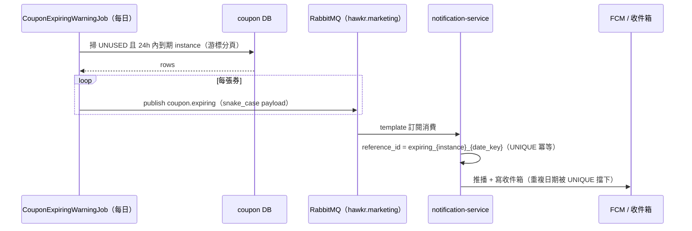

> 批次掃描 → fan-out publish → UNIQUE 冪等的完整流程見上方時序圖，不另立 flowchart。

**一致性（[後端服務責任邊界規範](../開發規範/後端服務責任邊界規範.md)）**：到期預警為 best-effort 通知通道，券狀態主寫入路徑（AutoExpireJob / AutoReleaseJob）不變；不引入補償任務基礎設施。不做：通知補發 reconciliation / 已通知記錄表（冪等由 notification 端 UNIQUE 承擔）。

**多副本搶佔語意：不加任何 DB 搶佔**

本 job 不新增租約欄、不動掃描 SQL、不需 migration。lease 在這裡結構上不成立：候選窗口寬度 **≤ 1 天**（`ct.end_at ∈ (now, now + warningDays(1)]`）而 cron 週期 `0 0 1 * * ?` 也是 **1 天一次** ⇒ 每張券一生只落在一個 tick 內，任何租約值的行為都與永久旗標相同（[規範 §三](../開發規範/多副本排程搶佔規範.md) 第 4 步）。

**跨 pod 去重交給 notification 端**：`reference_id_template = expiring_#{coupon_instance_id}_#{date_key}`（notifications UNIQUE，見上一段「冪等」）。
⚠️ **依賴宣告**：改動或移除該 `reference_id_template` 之前先回來看這一節——一旦 `date_key` 之外再加入 tick 序號之類的變數，跨 pod 重複就會直接外洩到使用者收件匣。

🔴 **投遞語意是 at-most-once，且失敗無聲**：本 job 不寫任何「已通知」狀態，每張券也只有一個 tick，因此沒有第二次投遞機會；而 `CouponEventPublisher` 對 publish 例外**自吞**（catch 後只 log），呼叫端連失敗都看不到 ⇒ **「某張券的到期預警沒發出去」在現況下是一個無聲事件**。呼叫端與產品面都不得假設該通知必達。

### 5.9 賣家收回（SellerRevokeTemplate）

1. **角色驗證**：`requireAccountType(SELLER)`
2. **權限檢查**：`issuer_store_id = 呼叫者 store_id`（賣家路徑，`issuer_type = '2'（SELLER）`）
3. **狀態檢查**：Template `status = ACTIVE`

```sql
UPDATE coupon_templates
SET status = '4' /* REVOKED */, revoked_at = NOW(), revoked_reason = :reason, updated_at = NOW()
WHERE template_id = :template_id
AND issuer_store_id = :store_id
AND status = '1' /* ACTIVE */;
```

4. **批量收回 RESERVED Instance**：

```sql
UPDATE coupon_instances
SET status = '4' /* REVOKED */, revoked_at = NOW(), revoked_reason = :reason, updated_at = NOW()
WHERE template_id = :template_id
AND status = '1' /* RESERVED */;
```

5. USED 狀態的 Instance 保留不變
6. 冪等：Template 已為 REVOKED -> 視為成功
7. **寫入稽核日誌**：寫入一筆彙總 log（`action = REVOKE`，`detail` 記錄 `revokedCount` + `reason`，`templateId` 記錄模板 ID）。批量操作不逐筆寫 log，以彙總方式記錄
8. **清除快取**：`coupon:tpl:{template_id}` + `coupon:avail:*`

### 5.10 Admin 作廢（AdminVoidInstance）

1. **角色驗證**：`requireAccountType(ADMIN)`
2. **狀態檢查**：Instance `status = UNUSED`

```sql
UPDATE coupon_instances
SET status = '5' /* ANNUL */, voided_at = NOW(), voided_reason = :reason, updated_at = NOW()
WHERE instance_id = :instance_id
AND status = '0' /* UNUSED */;
```

3. **寫入稽核日誌**：`action = ANNUL`

### 5.11 Admin 補償券發放（AdminGrantCompensationCoupon）

1. **角色驗證**：`requireAccountType(ADMIN)`
2. **參數驗證**：
   - `amount` 必填且 > 0
   - **`applicable_store_id` 必填**且為正整數 store_id surrogate；空值或格式不合法一律 `INVALID_PARAM`。
     補償券針對單一筆退款／糾紛發放，適用範圍即該筆訂單所屬商店，**不接受「不指定 = 全平台」**
     （§2.3 的 NULL = 全平台語意只適用於 §5.15 Admin 平台活動券；補償券缺值不得被靜默放大為全平台券）。
     收斂點在 `CouponTemplateService.createCompensationTemplate`，內部直呼同樣繞不過。
3. **建立 Template**：
   - `type` = CASH，`target_type` = COMPENSATION，`issuer_type` = ADMIN
   - `applicable_store_id` = 請求值（限該商店使用）
   - `threshold_amount` = 0（無門檻），`discount_amount` = 請求金額
   - `total_issue_limit` = 1（發行意圖記錄；補償券為免領券，實際不受此欄約束，見 §2.8.4——「只發給這一位買家」由 `target_type = COMPENSATION` + `coupon_target_accounts` 保證），`status` = ACTIVE
   - **`claim_required` = FALSE（強制）**——補償券不需要買家領取
   - 有效期 = 3 個月
4. **寫入 coupon_target_accounts**：`(template_id, buyer_id)`
5. **寫入稽核日誌**：`action = ISSUE`，`detail` 含 `ref_order_no`
6. **回傳 Template 資訊**

### 5.12 售後補償券發放（GrantSellerCompensationCoupon）

賣家透過售後流程發放補償券給指定買家。不計入賣家配額。

1. **內部呼叫驗證**：`isInternalCall()` = true（AfterSales Service 透過 `x-internal-service` 呼叫）
2. **參數驗證（最終寫入端責任，不依賴上游 service 預先驗證）**：
   - `store_id`（store surrogate）/ `buyer_id`：必填，`Long.parseLong` 強制整數
   - `amount`：必填，`> 0`
   - `min_order_amount`：必填，**`> 0`**（不允許 0 或負數）
   - **業務規則**（金額合理性）：
     - `min_order_amount >= amount * 5`
     - `min_order_amount - amount >= 100`
     - 任一不滿足回傳 `COUPON_RULE_VIOLATED`
   - 規則由 coupon-service 收斂：coupon 是最終寫入端，不論呼叫者是 aftersales 還是其他內部服務，規則都在這裡判定；上游 service **不得**重複驗證或自行繞過
3. **建立 Template**：
   - `type` = CASH，`target_type` = COMPENSATION，`issuer_type` = SELLER
   - `applicable_store_id` = 請求的 `store_id` 欄位值（限本店使用）
   - `threshold_amount` = min_order_amount，`discount_amount` = amount
   - `title` = "售後補償券 [ref_case_no]"，`status` = ACTIVE
   - **`claim_required` = FALSE（強制）**——補償券不需要買家領取
   - 有效期 = 2099-12-31
4. **寫入 coupon_target_accounts**：`(template_id, buyer_id)`
5. **寫入稽核日誌**：`action = ISSUE`，`detail` 含 `ref_case_no`
6. **回傳 template_id + amount + min_order_amount**

> **驗證集中化原則**：補償券業務規則（`minSpend >= amount * 5` 等）的唯一真實來源在本 RPC。aftersales-service 的 `AfterSaleResolutionService.handleCouponCompensation` 不再重複驗證；上游 service 只負責將請求參數透傳給 coupon-service，由 coupon-service 統一回傳業務錯誤。

### 5.13 賣家查買家持券（ListBuyerCouponsForSeller）

1. **角色驗證**：`requireAccountType(SELLER)`
2. **查詢邏輯**：與 5.2 類似，但限定 `applicable_store_id = 呼叫者 store_id`
3. **回傳**：分頁列表（可用券 + 已使用券）

> ⚠️ 查詢條件打在 `coupon_instances.applicable_store_id` 上（見 §3.2 / §5.4）：該欄為 NULL 的 instance 不會出現在結果裡。

### 5.14 與外部服務對齊

**與 Order Service 對齊**：

| 步驟 | 動作 | 說明 |
|------|------|------|
| 1 | ReserveCoupon（以 template_id 呼叫） | DB Transaction 外，Confirm 階段建立 Instance + 鎖定 |
| 2 | DeductStock | DB Transaction 外 |
| 3 | INSERT orders（coupon_instance_id 起始為 NULL；reserveCoupon 成功後由 updateCouponInstanceId 寫入 instance_id） | DB Transaction 內 |
| 4 | 失敗 | ReleaseCoupon + RestoreStock |
| 5 | 付款成功 | ConsumeCoupon(instance_id, order_no) |
| 6 | 取消/逾時 | ReleaseCoupon(instance_id, order_no) |

**與結帳模組對齊**：

| API 階段 | Coupon 操作 | 說明 |
|---------|------------|------|
| Preview | `ValidateCoupon(template_id)` | 驗證資格 + 計算折扣（不鎖定） |
| Confirm | `ValidateCoupon` -> `ReserveCoupon` -> 回傳 `instance_id` | 驗證通過才建立 Instance |
| 付款成功 | `ConsumeCoupon(instance_id)` | RESERVED -> USED |
| 取消/逾時 | `ReleaseCoupon(instance_id)` | 釋放 |

### 5.15 Admin 建立優惠券（AdminCreateTemplate）

1. **角色驗證**：`requireAccountType(ADMIN)`
2. **參數驗證**：
   - 同賣家建立的欄位驗證（type、金額、時間等）
   - `target_type` 允許所有類型（ALL / MEMBER / DESIGNATED / COMPENSATION）
   - `claim_required`：選填，**預設 TRUE**（需要買家領券）。Admin 可明確設為 FALSE（免領券）
   - `applicable_store_id`：選填，指定適用商店 store_id（NULL = 全平台券）
3. **建立 Template**：
   - `template_id` = `TsidUtil.generate()`
   - `issuer_type` = ADMIN，`status` = DRAFT
   - `claim_required` = 請求值（預設 TRUE）
4. **寫入 coupon_target_accounts**（僅 DESIGNATED / COMPENSATION）：ON CONFLICT DO NOTHING
5. **寫入稽核日誌**：`action = ISSUE`
6. **回傳 TemplateInfo**

### 5.16 買家領券（BuyerClaimCoupon）

買家主動領取 Admin 發行的優惠券。

1. **角色驗證**：`requireAccountType(BUYER)`
2. **查詢 Template**：確認 `status = ACTIVE`、`NOW() BETWEEN start_at AND end_at`
3. **驗證 claim_required**：
   - `claim_required = FALSE` → reject `COUPON_CLAIM_NOT_REQUIRED`（此券不需要領取）
4. **target_type 資格驗證**（同 §2.4）
5. **已領檢查 + 總量限制檢查**：

```sql
-- 原子操作：先檢查總量再 INSERT
-- Step 1: 總量檢查
SELECT issued_count, total_issue_limit FROM coupon_templates
WHERE template_id = :template_id FOR UPDATE;
-- 若 total_issue_limit != -1 AND issued_count >= total_issue_limit → reject COUPON_ISSUE_LIMIT_REACHED

-- Step 2: INSERT claim（唯一約束防重複）
INSERT INTO coupon_claims (template_id, buyer_id, claimed_at)
VALUES (:template_id, :buyer_id, NOW())
ON CONFLICT (template_id, buyer_id) DO NOTHING;
-- affected_rows = 0 → 已領過，冪等成功

-- Step 3: 遞增 issued_count（僅新領時）
UPDATE coupon_templates SET issued_count = issued_count + 1
WHERE template_id = :template_id;
```

6. **寫入稽核日誌**：`action = RECEIVE`，`instance_id` 為空（尚未建立 Instance）
7. **清除快取**：`coupon:avail:*`
8. **回傳**：`success = true, claimed_at`

**冪等**：重複呼叫同一張券 → ON CONFLICT DO NOTHING → 不報錯，回傳成功（claimed_at 為首次領取時間）。

### 5.17 Admin 發行優惠券給指定買家（AdminIssueCoupons，更新）

在 `coupon_target_accounts` 寫入指定買家白名單。新增 `immediate_distribute` 參數。

1. **角色驗證**：`requireAccountType(ADMIN)`
2. **查詢 Template**：確認存在且 `status IN ('0'（DRAFT）, '1'（ACTIVE）)`
3. **寫入 coupon_target_accounts**：`ON CONFLICT DO NOTHING`
4. **若 `immediate_distribute = TRUE`**：
   - 對本次新增的 buyer_ids 批量寫入 `coupon_claims`（ON CONFLICT DO NOTHING）
   - 累加 `issued_count`（只計新增成功的 claim 數）
   - 寫入稽核日誌：每筆 `action = RECEIVE`
5. **回傳**：`issued_count`（本次新增的白名單數）、`distributed_count`（本次代領數，僅 immediate_distribute=TRUE）

### 5.18 Admin 批量代領（AdminDistributeTemplate）

Admin 事後對已建立的 Template，批量代領所有尚未領券的 target_accounts 買家。

1. **角色驗證**：`requireAccountType(ADMIN)`
2. **查詢 Template**：確認 `status = '1'（ACTIVE）` 且 `claim_required = TRUE`
   - `claim_required = FALSE` → reject `COUPON_CLAIM_NOT_REQUIRED`（免領券的不需要代領）
3. **查詢未領買家**：

```sql
SELECT ta.buyer_id
FROM coupon_target_accounts ta
LEFT JOIN coupon_claims cc
  ON ta.template_id = cc.template_id AND ta.buyer_id = cc.buyer_id
WHERE ta.template_id = :template_id
  AND cc.buyer_id IS NULL;
```

4. **總量限制檢查**：`total_issue_limit != -1` 時，`issued_count + 未領數 <= total_issue_limit`
   - 超過上限 → 部分發放（依照 buyer_id 順序取至上限）
5. **批量 INSERT coupon_claims**：ON CONFLICT DO NOTHING
6. **累加 issued_count**：僅加實際新增的 claim 數
7. **寫入稽核日誌**：彙總 log，`action = RECEIVE`，`detail` 記錄 `distributed_count`
8. **回傳**：`distributed_count`（本次代領數）、`already_claimed_count`（已領跳過數）、`total_target_count`（白名單總數）

### 5.19 買家刪除自動作廢 UNUSED Coupon（BuyerDeletedConsumer）

觸發源：buyer-service 在**買家角色自身**的 DELETE transition 發布的 `buyer.deleted` 事件（`pkg/mq/events.go` `BuyerDeletedEvent`）。

🔴 **必須綁 `buyer.deleted`，不得改綁 `account.deleted`**：後者只在帳號「最後一個」active role 被移除時才發 ⇒ 買家角色單獨關閉、而帳號因其他角色（例如同一人也是賣家）而存活時事件不會發出，該買家的 UNUSED 券不會被作廢，並在買家重新註冊後原樣冒回來。`buyer.deleted` 在買家角色關閉時**無條件**發出，與帳號是否存活無關。

> ⚠️ 這也是為什麼作廢鍵是 `buyer_id` 而不是 `account_id`：`buyer_id` 是 stint-scoped surrogate，買家重新開業會換一個新的，舊 stint 的券因此不會被新 stint 繼承。若改回用 `account_id` 當鍵，同一個帳號的新舊 stint 會被混為一談。

**訂閱契約**：

| 項目 | 值 |
|------|---|
| Exchange | `hawkr.buyer` (Topic) |
| Routing Key | `buyer.deleted` |
| Queue | `coupon.buyer.deleted` |
| Listener Class | `services/java/coupon-service/.../mq/BuyerDeletedConsumer` |
| Payload | `BuyerDeletedEvent { BaseEvent…, accountId, buyerId }`；本 consumer 只讀 `buyerId` |
| DLQ | `coupon.buyer.deleted.dlq`（DLX `hawkr.coupon.dlx`）——後綴式命名，與 §5.20 兩條 `dlq.` 前綴式不同，屬既有差異非疏漏 |
| Topology | `infra/mq/topology/topology.yaml`（queue + binding + `dlq:` policy 的唯一 owner，§10.7） |
| 並發 | `manualAckContainerFactory`（MANUAL ack、prefetch=10），未另外覆寫 concurrency |
| 作廢原因 | `voided_reason = 'BUYER_DELETED'` |

**流程**：

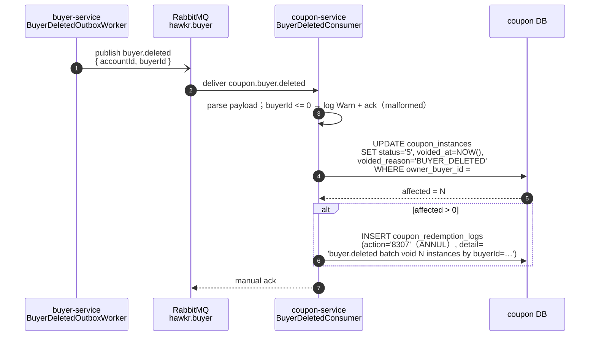

**規則**：

| 規則 | 說明 |
|------|------|
| 篩選範圍 | 僅作廢 `status = '0'`（UNUSED）的 Instance。RESERVED / USED / EXPIRED / REVOKED / ANNUL 均不動 |
| 作廢鍵 | `owner_buyer_id = payload.buyerId`（stint-scoped surrogate，非登入 `account_id`） |
| 為什麼不動 RESERVED | RESERVED 表示綁在某張 in-flight 訂單上。買家進入 `deleted` 必經 `active_order_count == 0` 路徑，理論上沒有 RESERVED 殘留；若極端 race 下仍有，由原本訂單流程（ConsumeCoupon / ReleaseCoupon）自然收尾 |
| 為什麼不動 USED / EXPIRED | 已使用 / 已過期屬於歷史紀錄，作廢無業務意義 |
| 冪等 | SQL `WHERE status = '0'`：重跑同 buyerId 第二次 affected = 0；無副作用，不需 dedup 表 |
| Malformed payload | `buyerId <= 0`（缺欄位 / 非數字）或 JSON parse 失敗 → log Warn + ack（不 requeue），避免 poison message 卡 queue |
| 失敗策略 | DB 錯誤 → 拋出 → `MqErrorHandler` 走 retry / DLQ 流程；DLQ 累積由 ops 監控 |
| 稽核 | **僅在 `affected > 0` 時**寫一筆 `coupon_redemption_logs` 彙總紀錄（`action=ANNUL`、`instance_id=0`、`template_id=0`），`detail` 含 affected 數量與來源（`buyer.deleted batch void N instances by buyerId=…`）。affected = 0 不寫，避免重放灌爆稽核表 |

**Producer 端**：coupon-service 不被任何人直接呼叫。產製鏈（**outbox 必達**，非 fire-and-forget）：

```
buyer-service.DeleteBuyerAccount / CompletePendingDeletion
  → 關閉交易內 INSERT buyer_deleted_outbox（buyerId 於此刻快照）
    → BuyerDeletedOutboxWorker 輪詢發布 buyer.deleted（失敗指數退避重試）
      → coupon-service.BuyerDeletedConsumer
```

> `buyerId` 在**關閉交易當下快照**進 outbox row，而不是消費時再回查「當前 buyer」——後者會與買家重新開業競態，把新 stint 的券一起作廢。

**送達保證**：producer 側 outbox ＋ consumer 側 DLQ/retry 已構成送達保證，coupon 端**不得**再加 application-level reconciliation（[後端服務責任邊界規範](../開發規範/後端服務責任邊界規範.md)）。coupon 作廢失敗**不阻擋**買家角色關閉——買家此時已失去 token，無法再使用 coupon。`buyer.deleted` 另有 im / notification / social 三個 consumer。

---

### 5.20 賣家停權連動模板停用／還原（SellerSuspendedConsumer / SellerUnsuspendedConsumer）

停權連動 saga 的 coupon 落地。整體 saga 概述見 32 號 §13.5、46 號 §5；事件以 36 號 §3.6f 為 SSOT。

**訂閱契約**：

| 項目 | `seller.suspended` | `seller.unsuspended` |
|------|---|---|
| Exchange | `hawkr.seller` (Topic) | `hawkr.seller` (Topic) |
| Routing Key | `seller.suspended` | `seller.unsuspended` |
| Queue | `coupon.seller.suspended` | `coupon.seller.unsuspended` |
| Listener Class | `.../mq/SellerSuspendedConsumer` | `.../mq/SellerUnsuspendedConsumer` |
| Payload | `{ suspensionId, accountId, reasonCode, reasonLabel?, store_id }` | `{ suspensionId, accountId, store_id }` |
| DLQ | `dlq.coupon.seller.suspended`（DLX `hawkr.coupon.dlx`） | `dlq.coupon.seller.unsuspended` |

**Payload 解析（`SellerSuspensionEventPayload`）**：兩個事件共用同一個 record，**手動 `JsonNode` 逐鍵取值**而非 Jackson 反射綁定——來源事件內嵌 Go `BaseEvent`（snake_case，如 `event_type`），而 `suspensionId` / `accountId` / `reasonCode` 是 camelCase，且 TSID 以 JSON string 序列化（§4 精度要求）。

| 欄位 | JSON key | 必填 | 說明 |
|------|---------|------|------|
| `suspensionId` | `suspensionId` | ✅ | TSID，string 序列化 |
| `accountId` | `accountId` | ✅ | 賣家登入 `account_id`（**本節不以此為操作鍵**） |
| `storeId` | **`store_id`** | ✅ | 停權當下由 seller-service 快照的 store surrogate；**本節模板停用／還原的實際操作鍵** |
| `reasonCode` | `reasonCode` | — | CodeMeta `SellerSuspensionReason` 的 Value（數字碼）；coupon 端僅記錄不分流 |

> **`store_id` 是唯一的 snake_case key，且刻意必填**：其餘欄位沿用較早期的 camelCase，`store_id` 隨後續事件慣例採 snake_case——因為本 record 是手動解析、沒有 struct-wide casing 一致性需要維護。三個必填欄位任一缺失 → `fromJson` 回 `null` → consumer 記 WARN + ACK 丟棄。這是**刻意的 fail-closed**：與其在事件缺 `store_id` 時誤用 0 值去比對 `issuer_store_id`（會掃到錯誤的賣家），不如丟棄訊息。

**停用（`seller.suspended`）**：查該賣家（`issuer_type='2'（SELLER） AND issuer_store_id=storeId`）**ACTIVE** 模板 → 停用為 INACTIVE（複用 `adminDisableTemplate` service 邏輯，ACTIVE→INACTIVE）並標記 `disabled_by_suspension=TRUE`。

| 規則 | 說明 |
|------|------|
| 篩選範圍 | 僅停用 `status='1'（ACTIVE）` 且 `disabled_by_suspension=FALSE` 的賣家自建模板 |
| 冪等 | `WHERE status='1'（ACTIVE）`：重跑挑 0 筆 → 0 副作用，無需 dedup 表 |
| Malformed | `accountId==0` / parse 失敗 → log Warn + ack（不 requeue）|
| 失敗策略 | DB 錯誤 → 拋出 → DLQ（`dlq.coupon.seller.suspended`）|

**還原（`seller.unsuspended`）**：查該賣家 `status='2'（INACTIVE） AND disabled_by_suspension=TRUE` 的模板 → 還原 ACTIVE + 清 `disabled_by_suspension=FALSE`。

- **精準還原**：只還原 `disabled_by_suspension=TRUE` 者 → **不誤還原賣家本來就自行停用/被 admin 停用的模板**（賣家流程本無自助停用，但 admin 可停用；旗標保證只碰「因本次停權而停用」的模板）。
- 冪等：`WHERE disabled_by_suspension=TRUE`，重跑挑 0 筆。

**已領券實例不回收**：停權**不回收買家已領走的券實例**（`coupon_instances`）。停權連動使該賣家全部商品下架（02 號 §5.10a）⇒ 券無適用商品、自然無處可用；模板停用不觸動 instance 狀態機，與 §2.6「券生死跟隨訂單」一致。Admin 如需個別作廢，走既有 `AdminVoidInstance`（§5.10）。

---

## 6. 時序圖總覽

### 6.0 優惠券完整生命週期（核心概覽圖）

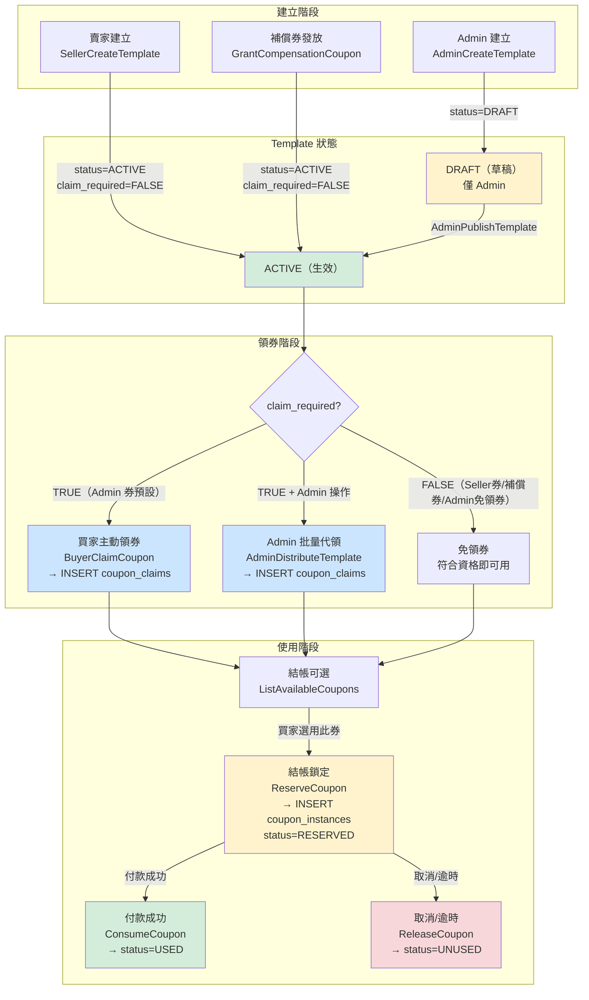

> **關鍵理解**：
> - **coupon_templates**：優惠券的定義（規格書）
> - **coupon_claims**：買家「領了」這張券（僅 claim_required=TRUE 時需要）
> - **coupon_instances**：買家「正在用/已經用了」這張券（綁定具體訂單，結帳時才建立）

### 6.1 賣家建立優惠券

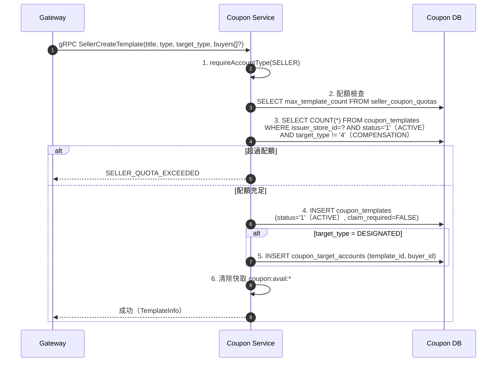

> **claim_required 強制 FALSE**：賣家券不需要買家領取，符合資格即可使用。

### 6.1.1 Admin 建立優惠券

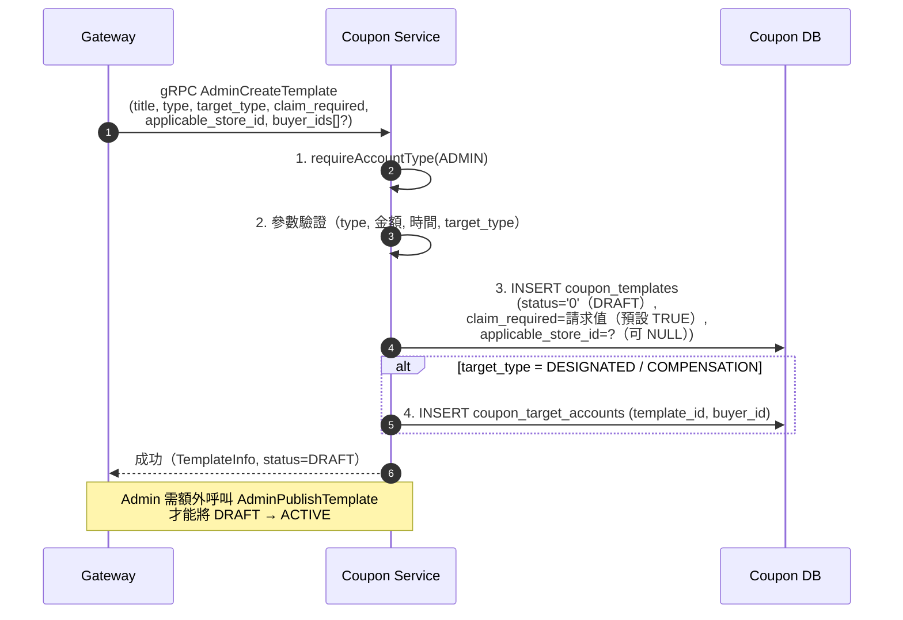

### 6.1.2 買家領券

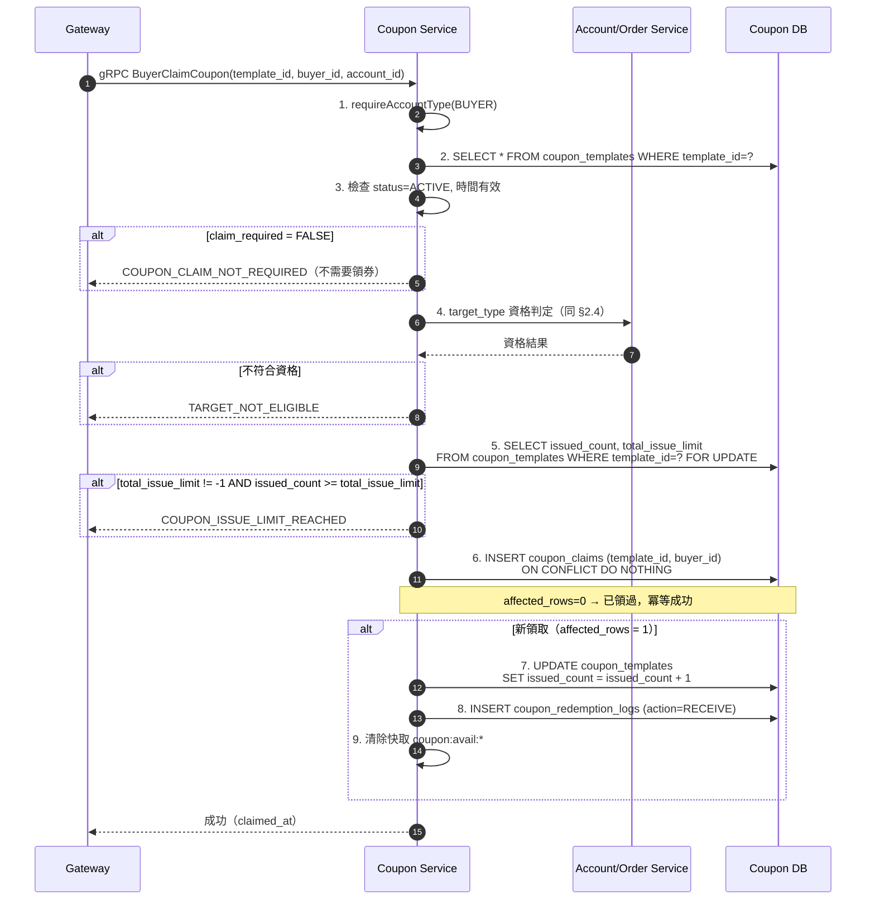

### 6.1.3 Admin 批量代領

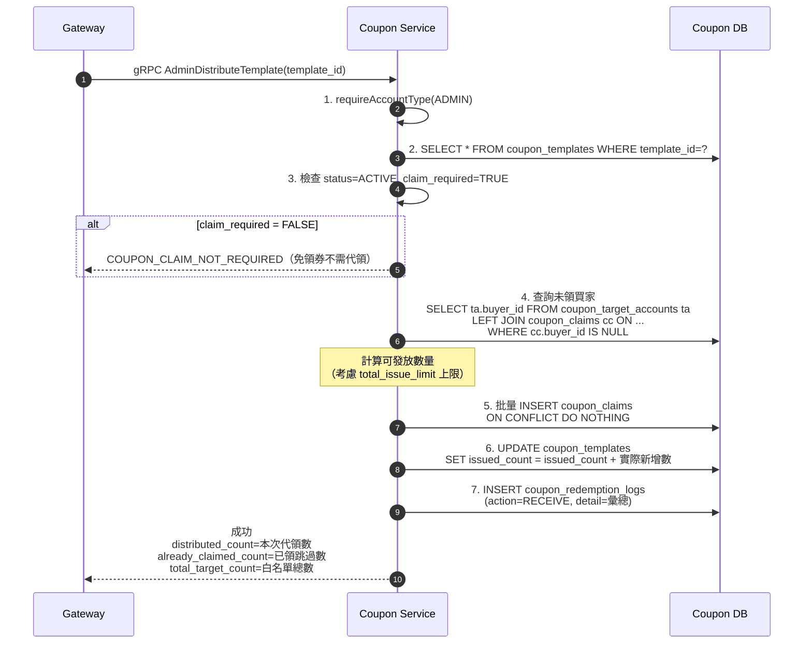

### 6.2 結帳流程（含 Claim 檢查 + Reserve / Consume）

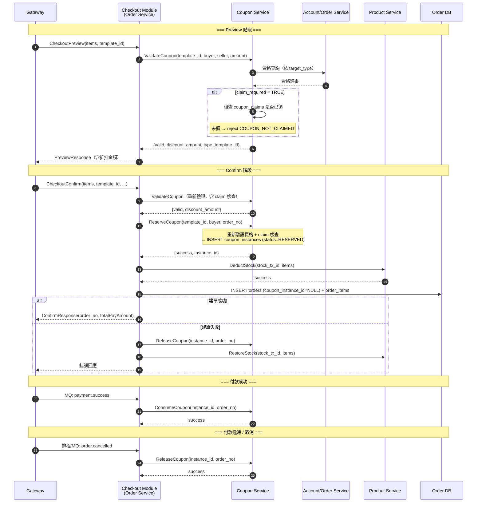

### 6.3 退款補償券（AdminGrantCompensationCoupon）

> 目前唯一在線的入口是 Admin 走 Gateway `POST /api/v1/admin/coupons/compensations`；
> order-service `RefundWorker` 的自動發放路徑依下圖實作。
> 接線時 `applicable_store_id` **必填**（§5.11），不得沿用「不指定＝全平台」的假設。

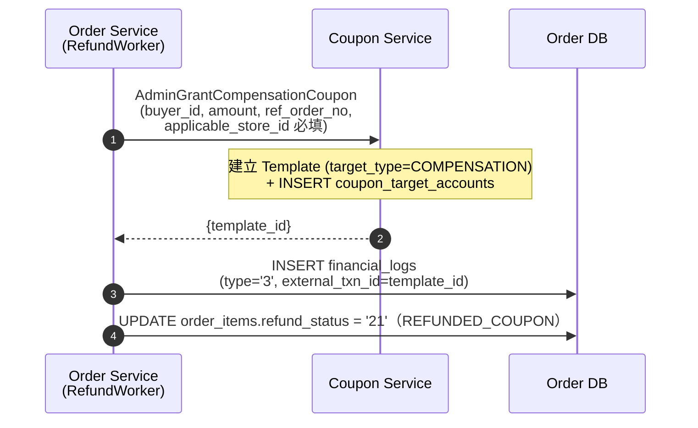

### 6.4 售後補償券（GrantSellerCompensationCoupon）

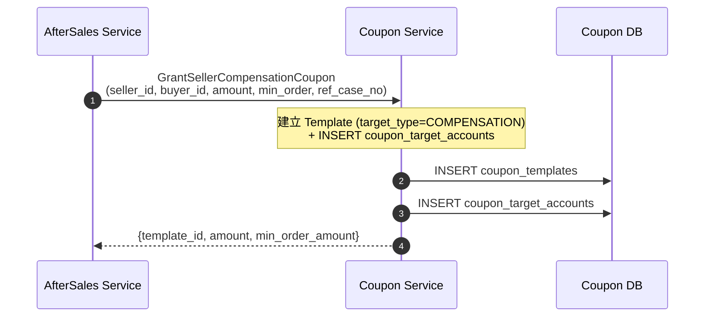

### 6.5 對帳 Job（AutoReleaseJob）

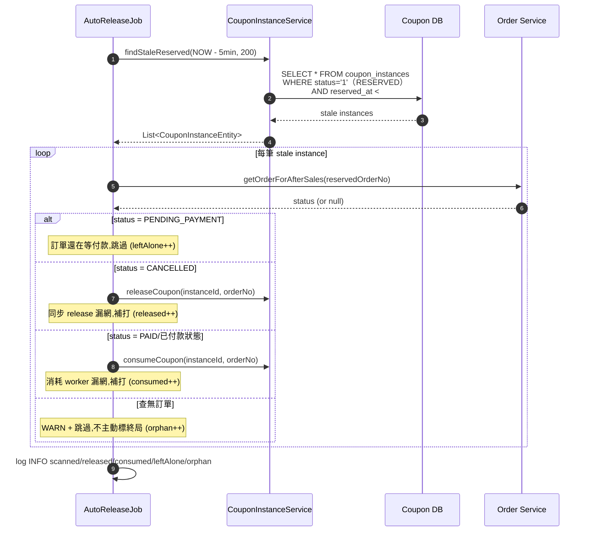

### 6.6 自動過期（AutoExpireJob）

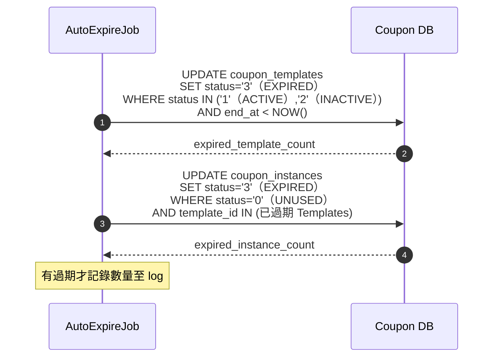

### 6.7 買家可見性規則（SQL Fragment）

> **本節定義買家列表查詢（ListMyCoupons / ListAvailableCoupons）的可見性規則。將判定下放至 SQL 是為了修正「分頁先於過濾」的順序錯誤。**

#### 6.7.1 執行順序（過濾先於分頁）

買家列表查詢必須依下列順序執行：

```
1. SQL：在 WHERE 子句直接套用 buyer 可見性條件 → 撈出對該 buyer 真實可見的 templates
2. SQL：對「真實可見集合」分頁切片
3. 回傳
```

🔴 **不得在 Java 層對「已分頁的結果」再做可見性過濾**，否則：

- **`target_type=DESIGNATED` 幾乎必然遺失**：白名單通常只有少數買家，該券在「ACTIVE 全集」中只是一張普通券；被分頁切到當前頁之外時，買家永遠掃不到它。
- **`target_type=MEMBER` 同樣脆弱**，只是命中率較高。
- **`total` 必須是真實全集筆數**，不是「本頁過濾後筆數」，否則前端分頁列顯示錯誤。
- **跨頁分頁破裂**：每頁過濾後的留存率不一，翻頁行為不可預測。

#### 6.7.1.1 適用範圍

本 fragment **僅供買家列表查詢使用**（§6.8 / §6.9）；單張驗證 `buyerClaimCoupon` 走 Java `isEligible()`（見 §6.7.3）。

#### 6.7.2 資格規則 SQL Fragment

```xml
<sql id="eligibility">
  t.status = '1' /* ACTIVE */
  AND NOW() BETWEEN t.start_at AND t.end_at
  AND (
       /* ALL — 全體買家，但買家註冊時間需 ≤ template 建立時間 */
       (t.target_type = '1'
        AND t.created_at >= to_timestamp(#{buyerCreatedAtMs} / 1000.0))

    OR /* MEMBER — 該 template 賣家須在買家「有完成交易紀錄」的賣家集合內 */
       (t.target_type = '2'
        AND t.applicable_store_id = ANY(#{memberSellerIds}::bigint[]))

    OR /* DESIGNATED + COMPENSATION — 買家須在 coupon_target_accounts 白名單 */
       (t.target_type IN ('3','4')
        AND EXISTS (
          SELECT 1 FROM coupon_target_accounts cta
          WHERE cta.template_id = t.template_id
            AND cta.buyer_id = #{buyerId}
        ))
  )
</sql>
```

| 參數 | 型別 | 來源 |
|------|------|------|
| `buyerId` | `Long` | `GrpcAuthContext.requireAccountId()` |
| `buyerCreatedAtMs` | `long`（epoch ms, UTC） | `accountGrpcClient.getAccountCreatedAt(buyerId)` |
| `memberSellerIds` | `Long[]`（PostgreSQL `bigint[]`） | `orderGrpcClient.getBuyerMemberSellerIds(buyerId)` |

> **`= ANY(bigint[])` 為 PostgreSQL 原生語法**，整個陣列為單一 query parameter，query plan cache 命中率與記憶體開銷皆不受陣列大小影響，實測安全範圍至萬級元素。**禁止**改用 `IN (?, ?, ?, ...)`。

#### 6.7.3 適用範圍

| 情境 | 是否套用本 fragment | 說明 |
|------|-------------------|------|
| `ListMyCoupons`（買家「我的優惠券」列表） | ✅ 套用 | 列表場景必須在 SQL 層先過濾再分頁，否則 type=3/4 會被分頁切片漏掉 |
| `ListAvailableCoupons`（結帳可用券列表） | ✅ 套用 | 同上，分頁順序問題完全相同 |
| `buyerClaimCoupon`（領券單張驗證） | ❌ 不套用 | 走 Java `isEligible()`：單張驗證沒有分頁問題 |

**Java `isEligible()` 方法只供 `buyerClaimCoupon` 使用**；列表場景不得呼叫 `isEligible()`，也不得保留 `designatedTemplateIds` 之類的輔助變數。

🔴 **4 種 `target_type` 的可見性規則同時存在於本 SQL fragment 與 Java `isEligible()` 兩處，兩份必須等價**：修改任一處時必須同步維護另一處，並在兩段程式碼註解互相指向。

#### 6.7.4 索引需求

- `coupon_target_accounts (template_id, buyer_id)` — 支援 EXISTS 子查詢的覆蓋索引（已存在須驗證）
- `coupon_template (status, target_type)` — 支援主查詢的初步篩選

部署前必須在 dev DB 對 `selectAvailable` 跑一次 `EXPLAIN ANALYZE` 確認索引命中。

---

### 6.8 買家查詢我的優惠券（ListMyCoupons）

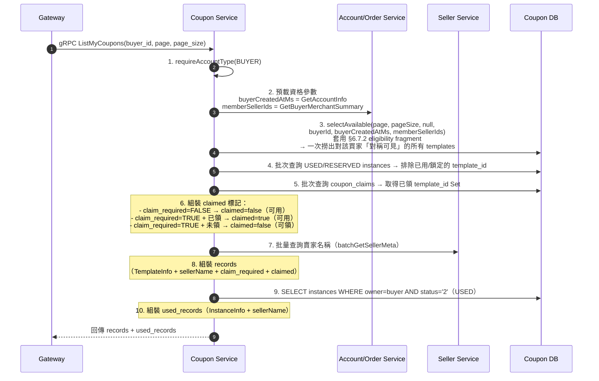

> **可見性判定全部下放 SQL**：本流程不再有 Java `isEligible()` 迴圈，也不需要 `designatedTemplateIds` 這類「先撈白名單再合併」的補救邏輯。`selectAvailable` 回傳的結果就是該買家**真實可見**的 template 集合。

> **前端 UI 規則**（不變）：
> - `claim_required=false` 或 `claimed=true` → 顯示「去使用」
> - `claim_required=true` 且 `claimed=false` → 顯示「立即領取」按鈕
> - 「指定給我」標籤前端從 `targetType=='3'` 自行推斷（既然出現在回應內，必然在白名單上）

#### 6.8.1 `status` query 參數規範

**契約**：

| query 形式 | 語意 |
|---|---|
| 不傳 / 空字串 | 同時回 `records`（UNUSED）+ `usedRecords`（USED） |
| `status=0` | 僅回 `records`（CouponInstanceStatus.UNUSED.value()） |
| `status=2` | 僅回 `usedRecords`（CouponInstanceStatus.USED.value()） |
| `status=0,2` | 兩者皆回（與不傳等價） |
| 其他任意值 | **回 `INVALID_PARAM`，禁止靜默回空** |

**強制規範**：
1. `status` 一律使用 `CouponInstanceStatus.value()`（數字字串），**禁止**使用 code 字面（`UNUSED`/`USED`）
2. 後端解析時必須走 `CodeMetaValidator.requireValidValue(CouponInstanceStatus.class, v, "status")`，未知值即時拋 `INVALID_PARAM`
3. **禁止**任何 `statusParam.contains("UNUSED")` / `equals("USED")` 等字面 code 比對
   ⚠️ 名稱比對會讓前端依規範送 `status=0` 時 `wantUnused` 與 `wantUsed` 同時為 false，整段查詢被靜默跳過、回空陣列 ⇒ 買家「我的優惠券」列表全部回空。

**行為契約**（可驗收案例）：
- 傳 `status=0` → 回 UNUSED 列表，**斷言至少回到指定發放的 templates**
- 傳 `status="UNUSED"`（前端錯傳 code）→ 回 `INVALID_PARAM: status="UNUSED"`，**禁止靜默回空**
- 傳 `status=99`（不存在的 value）→ 回 `INVALID_PARAM: status="99"`
- 傳 `status=0,2` → 同時回 `records` 與 `usedRecords`
- 不傳 → 同時回兩者

### 6.9 結帳可用優惠券（ListAvailableCoupons）

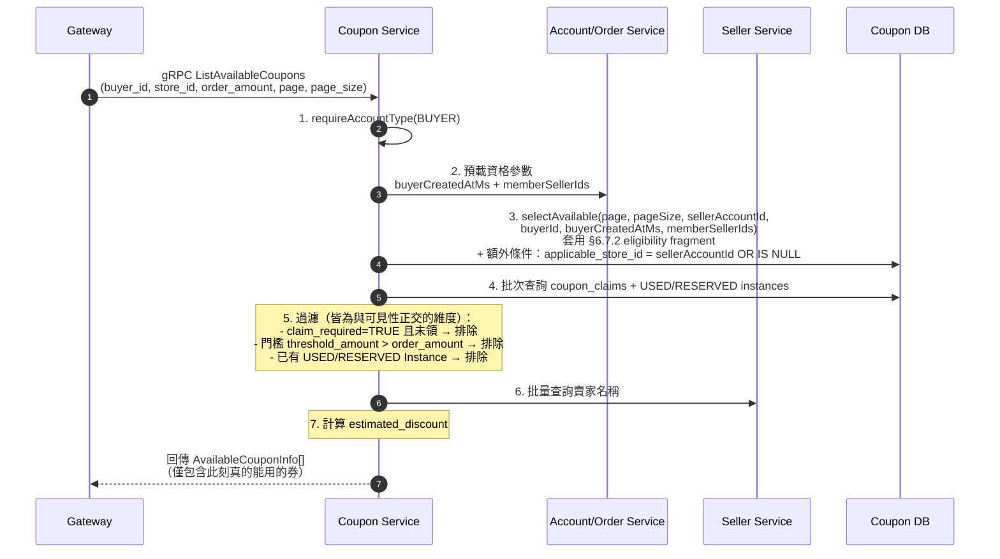

> **與 ListMyCoupons 的關鍵差異**：結帳頁**不顯示未領的券**。未領的 Admin 券在此 API 被直接排除，確保結帳時買家看到的每張券都能實際使用。

### 6.10 賣家查詢優惠券詳情（SellerGetTemplateDetail）

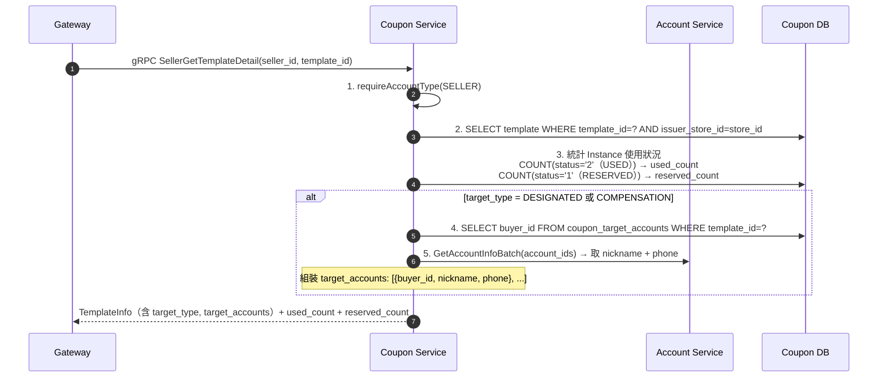

### 6.11 賣家收回優惠券（SellerRevokeTemplate）

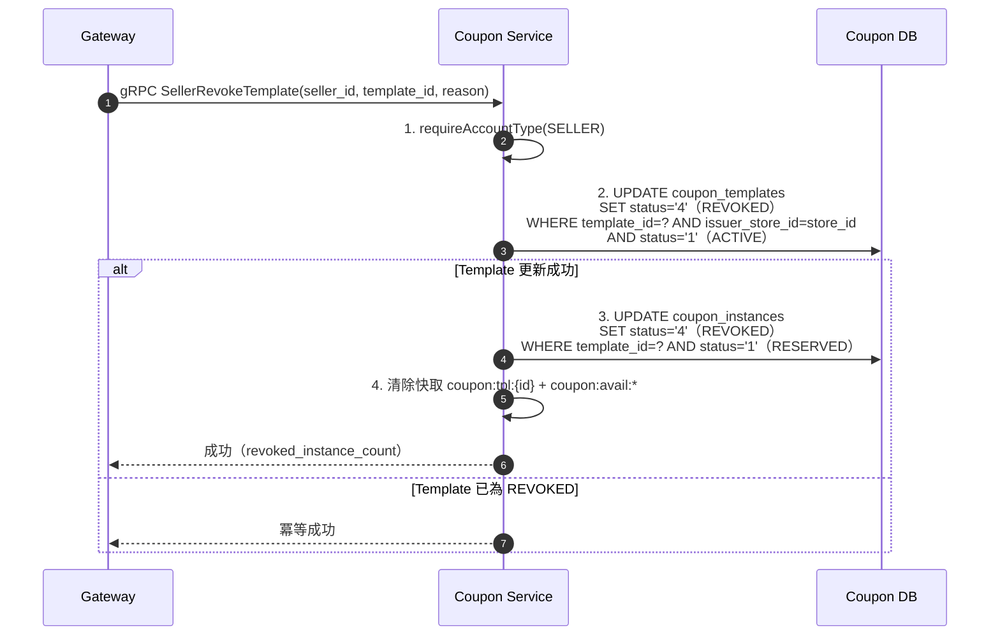

### 6.12 Admin 作廢（AdminVoidInstance）

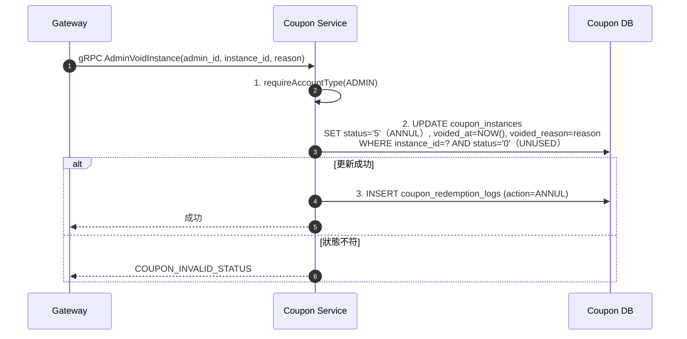

### 6.13 賣家查買家持券（ListBuyerCouponsForSeller）

```mermaid
sequenceDiagram
    autonumber
    participant GW as Gateway
    participant CS as Coupon Service
    participant SS as Seller Service
    participant DB as Coupon DB

    GW->>CS: gRPC ListBuyerCouponsForSeller(seller_id, buyer_id, status, page)

    CS->>CS: 1. requireAccountType(SELLER)

    CS->>DB: 2. 查詢 coupon_instances<br/>WHERE applicable_store_id=store_id<br/>AND owner_buyer_id=buyer_id<br/>AND status=?（可選篩選）

    CS->>SS: 3. 批量查詢賣家名稱（batchGetSellerMeta）

    loop 每個 Instance
        CS->>CS: 4. 查詢對應 Template（含快取）
        Note over CS: 組裝 InstanceInfo + TemplateInfo + sellerName
    end

    CS-->>GW: 回傳 used_records（InstanceInfo[]）
```

### 6.14 端到端場景：Admin 優惠券從建立到使用（完整時序）

```mermaid
sequenceDiagram
    autonumber
    participant ADM as Admin
    participant GW as Gateway
    participant CS as Coupon Service
    participant DB as Coupon DB
    participant Buyer as 買家 APP

    Note over ADM,Buyer: ===== 階段一：Admin 建立優惠券 =====

    ADM->>GW: POST /admin/coupon_templates<br/>{title:"滿500折100", type:"CASH",<br/>claimRequired: true, targetType:"ALL"}
    GW->>CS: AdminCreateTemplate
    CS->>DB: INSERT coupon_templates (status=DRAFT, claim_required=TRUE)
    CS-->>GW: {template_id: 50010, status: DRAFT}

    ADM->>GW: POST /admin/coupon_templates/50010/publish
    GW->>CS: AdminPublishTemplate
    CS->>DB: UPDATE status = '1'（ACTIVE）
    CS-->>GW: 成功

    Note over ADM,Buyer: ===== 階段二：買家看到並領取 =====

    Buyer->>GW: GET /app/coupons
    GW->>CS: ListMyCoupons(buyer_id)
    CS->>DB: 查詢 ACTIVE Templates + coupon_claims
    CS-->>GW: [{title:"滿500折100",<br/>claim_required:true, claimed:false}]
    GW-->>Buyer: 顯示「立即領取」按鈕

    Buyer->>GW: POST /app/coupons/50010/claim
    GW->>CS: BuyerClaimCoupon(50010, buyer_id)
    CS->>DB: INSERT coupon_claims + issued_count++
    CS-->>GW: {success: true}
    GW-->>Buyer: 領取成功！

    Note over ADM,Buyer: ===== 階段三：結帳使用 =====

    Buyer->>GW: GET /app/coupons/available<br/>?store_id=1001&order_amount=800
    GW->>CS: ListAvailableCoupons
    CS->>DB: 檢查 claim → 已領，通過
    CS-->>GW: [{title:"滿500折100",<br/>estimated_discount:100}]
    GW-->>Buyer: 顯示可用券

    Buyer->>GW: POST /app/checkout/confirm<br/>{couponTemplateId: "50010", ...}
    GW->>CS: ValidateCoupon → 檢查 claim ✓
    GW->>CS: ReserveCoupon → INSERT coupon_instances
    Note over CS,DB: Instance 在此刻才建立<br/>status=RESERVED, 15分鐘鎖定

    Note over ADM,Buyer: ===== 階段四：付款完成 =====

    Note over GW: MQ: payment.success
    GW->>CS: ConsumeCoupon(instance_id)
    CS->>DB: UPDATE status=USED
    Note over CS,DB: 優惠券生命週期結束
```

### 6.15 端到端場景：Seller 優惠券（免領券，與現行一致）

```mermaid
sequenceDiagram
    autonumber
    participant Seller as 賣家
    participant GW as Gateway
    participant CS as Coupon Service
    participant DB as Coupon DB
    participant Buyer as 買家 APP

    Note over Seller,Buyer: ===== 賣家建立（即建即發）=====

    Seller->>GW: POST /app/coupon_templates<br/>{title:"店鋪回饋券", type:"CASH",<br/>discountAmount:"50", targetType:"ALL"}
    GW->>CS: SellerCreateTemplate
    CS->>DB: INSERT coupon_templates<br/>(status=ACTIVE, claim_required=FALSE)
    CS-->>GW: 成功

    Note over Seller,Buyer: ===== 買家直接可用（不需領券）=====

    Buyer->>GW: GET /app/coupons
    GW->>CS: ListMyCoupons(buyer_id)
    CS-->>GW: [{title:"店鋪回饋券",<br/>claim_required:false, claimed:false}]
    GW-->>Buyer: 顯示「去使用」（無需領取）

    Buyer->>GW: GET /app/coupons/available?store_id=...
    GW->>CS: ListAvailableCoupons
    Note over CS: claim_required=FALSE → 跳過 claim 檢查
    CS-->>GW: [{title:"店鋪回饋券", estimated_discount:50}]

    Buyer->>GW: POST /app/checkout/confirm
    GW->>CS: ValidateCoupon → 跳過 claim 檢查 ✓
    GW->>CS: ReserveCoupon → INSERT coupon_instances
    Note over CS,DB: 流程與現行完全一致
```

### 6.16 端到端場景：Admin 批量代領

```mermaid
sequenceDiagram
    autonumber
    participant ADM as Admin
    participant GW as Gateway
    participant CS as Coupon Service
    participant DB as Coupon DB

    Note over ADM,DB: ===== 建立 + 指定買家 =====

    ADM->>GW: POST /admin/coupon_templates<br/>{claimRequired:true, targetType:"DESIGNATED"}
    GW->>CS: AdminCreateTemplate
    CS->>DB: INSERT coupon_templates (DRAFT)
    CS-->>GW: {template_id: 50020}

    ADM->>GW: POST /admin/coupon_templates/50020/publish
    CS->>DB: DRAFT → ACTIVE

    ADM->>GW: POST /admin/coupon_templates/50020/issue<br/>{buyerAccountIds:["2001","2002","2003"],<br/>immediateDistribute: false}
    GW->>CS: AdminIssueCoupons
    CS->>DB: INSERT coupon_target_accounts ×3
    CS-->>GW: {issued_count: 3}

    Note over ADM,DB: 此時 3 位買家有資格但尚未領券<br/>需要自己到 APP 領取

    Note over ADM,DB: ===== Admin 事後決定批量代領 =====

    ADM->>GW: POST /admin/coupon_templates/50020/distribute
    GW->>CS: AdminDistributeTemplate(50020)
    CS->>DB: 查詢未領買家（LEFT JOIN coupon_claims）
    Note over CS,DB: 未領名單：[2001, 2002, 2003]
    CS->>DB: 批量 INSERT coupon_claims ×3
    CS->>DB: issued_count += 3
    CS-->>GW: {distributed_count:3,<br/>already_claimed_count:0,<br/>total_target_count:3}

    Note over ADM,DB: 3 位買家現在可直接在結帳時使用此券
```

---

## 7. 一致性、交易與補償設計

### 7.1 交易邊界規則

- 禁止在 DB Transaction 內呼叫外部 gRPC。
- Reserve / Consume / Release 必須原子 + 冪等。
- 需具備併發安全（原子 SQL + 唯一約束）。

### 7.2 冪等設計

| 操作 | 冪等機制 |
|------|---------|
| ReserveCoupon | 唯一約束 + order_no 比對：同 order_no 重試視為成功 |
| ConsumeCoupon | 狀態 + order_no 比對：已 USED 且同 order_no 視為成功 |
| ReleaseCoupon | 狀態檢查：已 UNUSED 視為成功 |
| SellerRevokeTemplate | 已 REVOKED 視為成功 |

### 7.3 降級策略

| 情境 | 行為 |
|------|------|
| `template_id` 為空 | 跳過，discount_amount = 0 |
| `template_id` 非空，Coupon Service 不可用 | 回傳錯誤（不降級為 discount=0） |
| 券無效/已過期/無資格 | 回傳錯誤，提示前端重新選擇 |

### 7.4 Tracing

Gateway 注入 metadata：`x-trace-id`、`x-request-id`、`x-account-id`、`x-account-type`。

- 所有 log 必須記錄 trace_id / request_id。
- `coupon_redemption_logs` 必須落 trace_id / request_id。


### 7.5 多副本排程搶佔語意（Scheduler Claim）

**規範全文**：[開發規範／多副本排程搶佔規範](../開發規範/多副本排程搶佔規範.md)。本節只列 coupon-service 的套用結果。

**副本數前提**：`coupon-service` 在 prod 是**單副本**（各服務的現行副本數與查證方式見[規範 §〇](../開發規範/多副本排程搶佔規範.md)，本書不複述以免漂移）⇒ 下表的搶佔語意是[規範規則 ⑧](../開發規範/多副本排程搶佔規範.md)的**擴容前置條件**；單副本下唯一的雙 pod 窗口是 rolling update（chart 預設 `maxUnavailable: 0` / `maxSurge: 1`）。

本服務共 3 支排程：

| 排程 | 週期 | 候選述詞 | 副作用 | 搶佔語意 |
|---|---|---|---|---|
| `CouponExpiringWarningJob` | cron `0 0 1 * * ?`（每日一次） | `ci.status=UNUSED AND ct.end_at > now AND ct.end_at <= now + warningDays`（`CouponInstanceMapper.scanExpiringUnused`） | publish `coupon.expiring`（per-instance fan-out） | **不加任何 DB 搶佔、不加任何欄位**：`warningDays` 預設 1 且 cron 每日只跑一次 ⇒ 每張券一生只落在一個 tick 的候選集合，任何租約值的行為都與永久旗標相同，lease 結構上不成立。跨 pod 去重交給 notification 端 |
| `AutoReleaseJob` | cron `0 * * * * ?`（`application.yml` 指定，優先於註解預設的 `0 */5 * * * ?`） | `status='1'（RESERVED）AND reserved_at < now − graceMinutes(5)`（`CouponInstanceService.findStaleReserved`，`LIMIT batchSize(200)`） | 逐筆**唯讀** gRPC `OrderGrpcClient.getOrderStatus` → 依訂單狀態 CAS `consumeCoupon` 或 `releaseCoupon` | **無需額外搶佔**，互斥由下方 CAS 述詞提供 |
| `AutoExpireJob` | cron `0 */5 * * * ?` | 無 per-row 候選 | 兩句集合式 UPDATE（`CouponTemplateMapper.expireTemplates`、`CouponInstanceMapper.expireInstancesByTemplate`），無外部副作用 | **不適用**：沒有 per-row 迴圈、沒有可被搶佔的 row 身分，原子性由 DB 保證 |

#### `CouponExpiringWarningJob` 的去重與投遞語意

跨 pod 去重由 notification 端提供：`UNIQUE INDEX notifications_inbox_dedup_idx ON notifications (user_id, user_type, event_type, reference_id) WHERE reference_id IS NOT NULL`，配合 `coupon.expiring` 的 `reference_id_template = 'expiring_#{coupon_instance_id}_#{date_key}'` ⇒ 同一 instance 同一天無論被 publish 幾次，收件匣只有一則。

🔴 **投遞語意是 at-most-once，且失敗是靜默的**：`CouponEventPublisher.publishCouponExpiring` 自帶 `try/catch` 把例外吞成 `log.error` ⇒ publish 一失敗，該張券的到期通知**永久遺失、無告警、無重試**；而每張券一生只落在一個 tick，沒有第二次投遞機會。呼叫端不得假設該事件必達。

#### `AutoReleaseJob` 的冪等契約

`getOrderStatus` 是唯讀查詢，不構成[規範 §一 ①](../開發規範/多副本排程搶佔規範.md)定義的副作用；跨 pod 互斥完全由兩個 CAS 述詞提供，實作時**必須保留**：

- `consumeCoupon`：`WHERE instance_id=? AND status='1' AND reserved_order_no=#{orderNo}`
- `releaseCoupon`：`WHERE instance_id=? AND ((status='1' AND reserved_order_no=#{orderNo}) OR (status='2' AND used_order_no=#{orderNo}))`

兩者都把 `status` 推離 `'1'`，該 instance 立刻退出候選述詞 ⇒ 第二個 pod 一定 `affected=0`。

🔴 **`writeLog` 只能寫在 `affected > 0` 的分支內**：`affected=0` 時改走 `countUsedWithOrderNo` / `countUnused` 回布林，**不得**補寫 `coupon_redemption_logs`，否則第二個 pod 會多寫一筆稽核紀錄。

pod 在「查完訂單、尚未 CAS」時消失 ⇒ 該 instance 的 `status` 完全沒動、仍滿足候選述詞 ⇒ 下一個 tick 原樣重撈，沒有可卡死的窗口。

⚠️ 本判定綁在「那次 gRPC 是唯讀」上：`AutoReleaseJob` 若日後在 CAS 之前呼叫任何**會產生效果**的 RPC（發通知、退款、寫他服務），本判定立刻失效，必須回到[規範六步](../開發規範/多副本排程搶佔規範.md)重判並加 lease。

---

## 8. 環境配置

### 8.1 主鍵策略

| 類型 | 用途 | Entity 配置 |
|------|------|-------------|
| TSID | 對外暴露的業務表（coupon_templates, coupon_instances） | `@TableId(type = IdType.INPUT)` + `TsidUtil.generate()` |
| BIGSERIAL | 內部表（coupon_redemption_logs, seller_coupon_quotas） | `@TableId(type = IdType.AUTO)` |

### 8.2 金額欄位規範

| 層級 | 型別 | 說明 |
|------|------|------|
| DB | BIGINT | 新台幣元，永遠整數 |
| Java Service / Entity | Long | 原生數字型別 |
| Proto / API | string | 數字字串（`"100"`） |

### 8.3 時間欄位規範

| 層級 | 型別 |
|------|------|
| DB | TIMESTAMPTZ |
| Java | LocalDateTime（值語意為 UTC） |
| Proto / API | ISO 8601 字串 |

### 8.4 命名與身分

身分鍵三分（44 號設計書）：`account_id` = 登入 principal；賣家營運鍵 = `store_id`（sellers PK）；買家營運鍵 = `buyer_id`（buyers PK）。兩者皆為 surrogate，**不可假設與 `account_id` 恆等**。

| 規則 | 說明 |
|------|------|
| 不用 `userId` | 統一 `accountId` |
| 不用 `merchant` | 統一 `seller` |
| `issuer_account_id` / `issuer_store_id` | 建立者身分，兩個互斥欄位：`issuer_account_id`（ADMIN-only，管理員 `account_id`）、`issuer_store_id`（SELLER-only，`store_id`）。**恰有一個非 NULL**，由應用層寫入路徑保證（見 §3.1） |
| `applicable_store_id` | 適用商店範圍 `store_id`（NULL = 全平台） |
| `owner_buyer_id` | Instance 持有者買家 `buyer_id` |
| `operator_account_id` | 稽核日誌的操作者登入 `account_id`（不是 `store_id`／`buyer_id`） |
| merId | 不使用、不儲存、不傳遞 |

> **仍帶 `account_id` 字樣的識別字（皆名實相符，不是待收斂的舊名）**：REST `GET /app/coupons?view=seller` 的相容參數 `buyer_account_id`（與新參數 `buyer_id` 二擇一）與 Admin 建券 body 的 `buyerAccountIds`——此二者刻意收登入 `account_id`，由 Gateway 解析成現任 `buyer_id` 後才送 gRPC；MQ `coupon.expiring` payload 的 `notify_buyer_account_id`（推播路由專用，裝的正是登入 `account_id`，見 §5.8.1）。proto 的請求／回應欄位已全數收斂為 `store_id` / `buyer_id`。

### 8.5 API Namespace

| Namespace | 路徑前綴 | 允許角色 |
|-----------|---------|---------|
| app | `/api/v1/app/*` | BUYER(1) / SELLER(2) / SELLER_AND_BUYER(3) |
| admin | `/api/v1/admin/*` | ADMIN(4) |

---

## 附錄 A: Enum 定義

完整定義統一維護於 [代碼管理（CodeMeta）](../代碼管理%EF%BC%88CodeMeta%EF%BC%89/README.md)，以下僅列出本服務涉及的 Enum：

| Enum | 定義來源 |
|------|---------|
| CouponType | [業務類型碼](../代碼管理%EF%BC%88CodeMeta%EF%BC%89/業務類型碼.md#CouponType) |
| IssuerType | [業務類型碼](../代碼管理%EF%BC%88CodeMeta%EF%BC%89/業務類型碼.md#IssuerType) |
| CouponTargetType | [業務類型碼](../代碼管理%EF%BC%88CodeMeta%EF%BC%89/業務類型碼.md#CouponTargetType) |
| CouponTemplateStatus | [業務狀態碼](../代碼管理%EF%BC%88CodeMeta%EF%BC%89/業務狀態碼.md#CouponTemplateStatus) |
| CouponInstanceStatus | [業務狀態碼](../代碼管理%EF%BC%88CodeMeta%EF%BC%89/業務狀態碼.md#CouponInstanceStatus) |

## 附錄 B: 錯誤碼（GrpcResponseCode）

Coupon 業務碼（7001~7099）完整定義詳見 [錯誤碼](../代碼管理%EF%BC%88CodeMeta%EF%BC%89/錯誤碼.md#Coupon-業務碼7001~7099)。

本服務觸發說明：

| 錯誤碼 | 觸發場景 |
|--------|---------|
| COUPON_NOT_CLAIMED (7011) | ValidateCoupon / ReserveCoupon 時，claim_required=TRUE 但買家未領券 |
| COUPON_CLAIM_NOT_REQUIRED (7012) | BuyerClaimCoupon / AdminDistributeTemplate 時，claim_required=FALSE |
| COUPON_LOCKED_BY_OTHER_ORDER (7023) | ReserveCoupon 時，instance 已被另一筆訂單 RESERVED（§5.4 分支 ③/④） |

## 附錄 C: 資料模型關係圖

```mermaid
erDiagram
    coupon_templates ||--o{ coupon_claims : "claim_required=TRUE 時"
    coupon_templates ||--o{ coupon_instances : "結帳 Reserve 時建立"
    coupon_templates ||--o{ coupon_target_accounts : "DESIGNATED/COMPENSATION"
    coupon_templates ||--o{ coupon_redemption_logs : "稽核日誌"
    coupon_instances ||--o{ coupon_redemption_logs : "稽核日誌"

    coupon_templates {
        bigint template_id PK
        varchar title
        varchar type
        varchar issuer_type
        bigint issuer_account_id "ADMIN-only, NULL for SELLER"
        bigint issuer_store_id "SELLER-only, NULL for ADMIN"
        bigint applicable_store_id "NULL=全平台"
        boolean claim_required "TRUE=需領券"
        varchar target_type
        varchar status
        bigint threshold_amount
        bigint discount_amount
        integer total_issue_limit
        integer issued_count
    }

    coupon_claims {
        bigint template_id PK
        bigint buyer_id PK
        timestamptz claimed_at
    }

    coupon_instances {
        bigint instance_id PK
        bigint template_id FK
        bigint owner_buyer_id
        varchar status "RESERVED/USED/UNUSED/..."
        varchar reserved_order_no
        varchar used_order_no
    }

    coupon_target_accounts {
        bigint template_id PK
        bigint buyer_id PK
    }

    coupon_redemption_logs {
        bigserial log_id PK
        bigint instance_id
        bigint template_id
        varchar action
        varchar trace_id
    }
```

