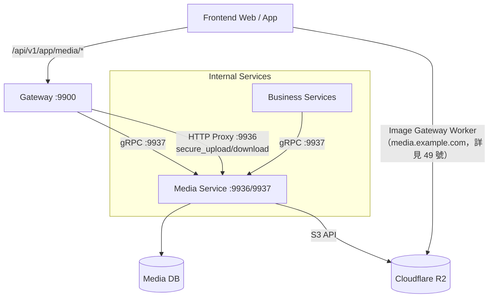
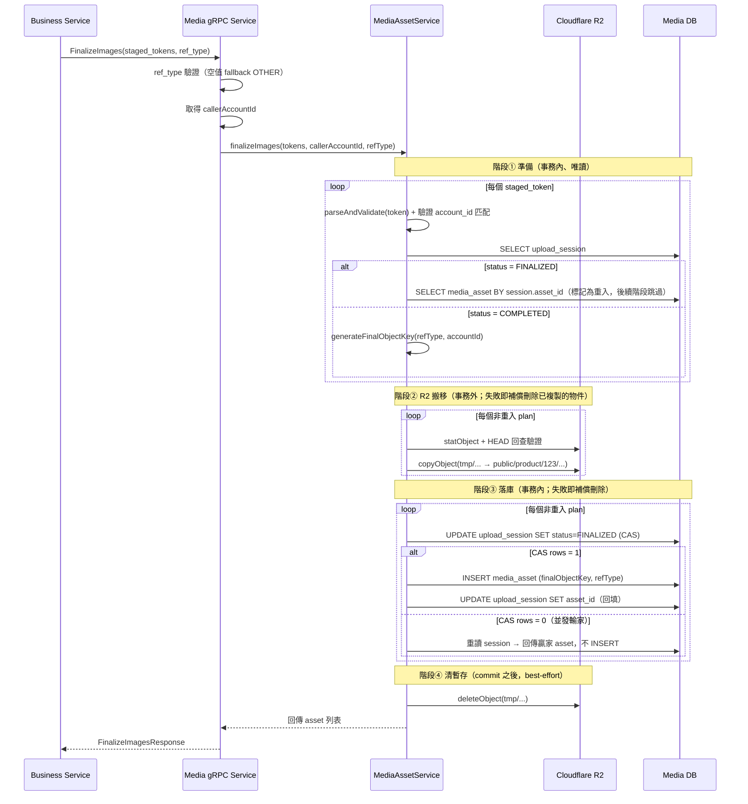
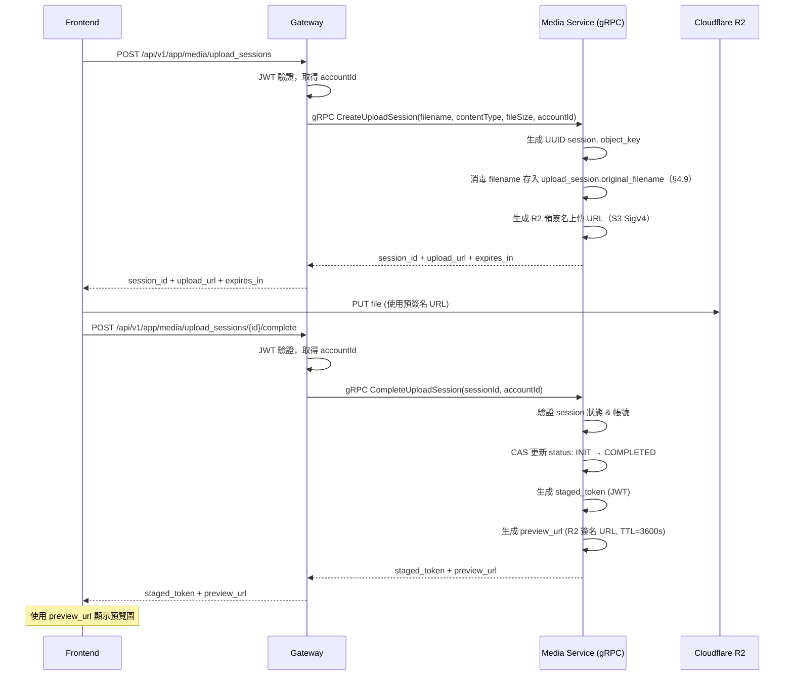
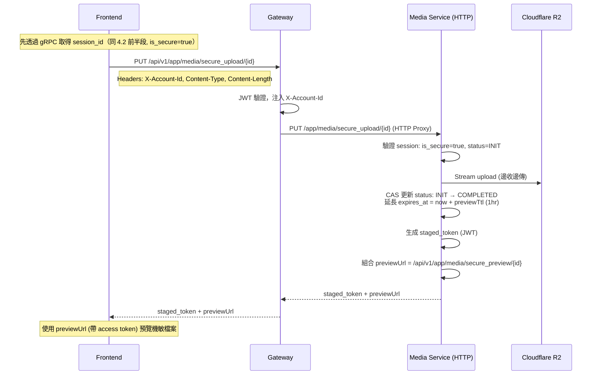
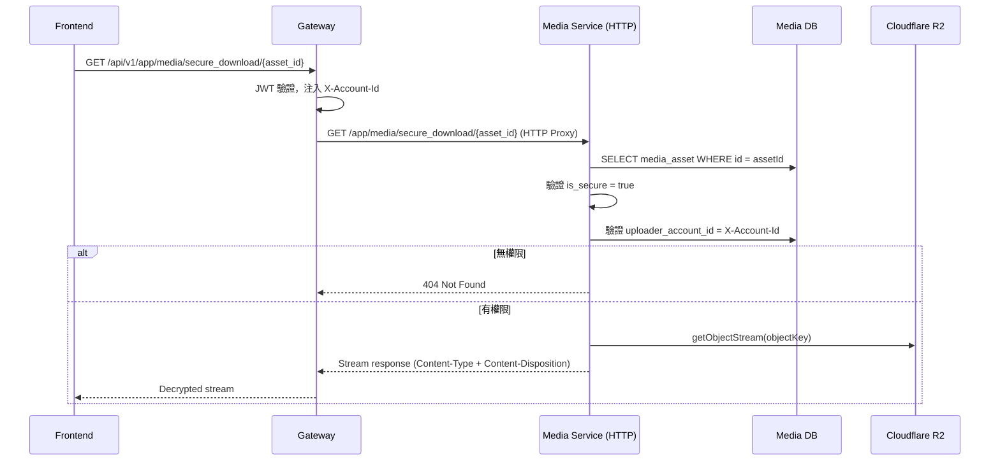
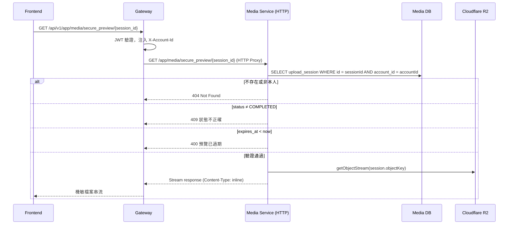
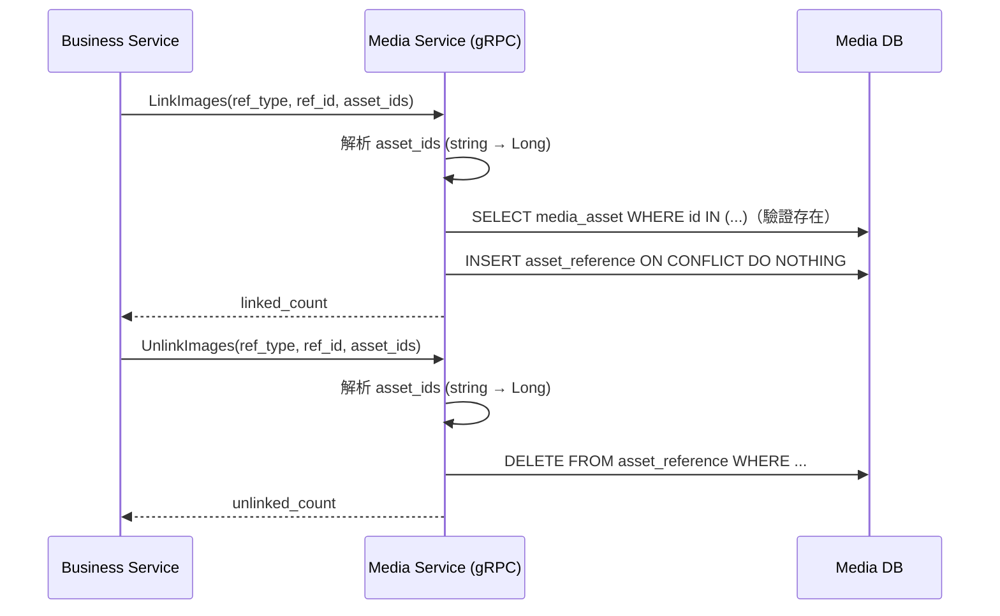
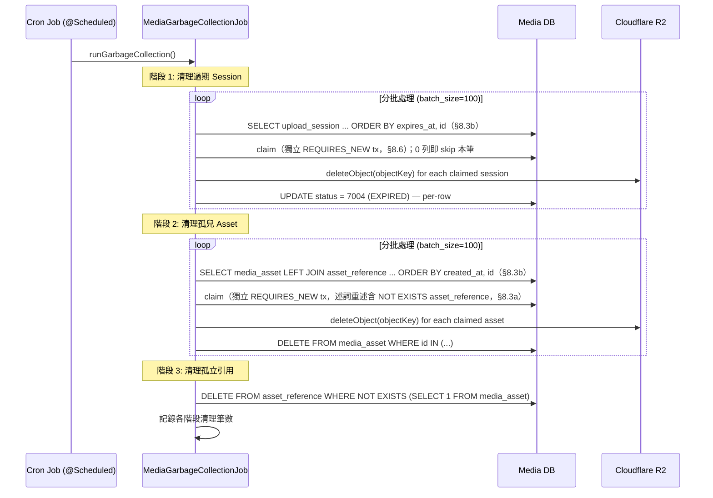

# 多媒體微服務 (Media Service) 詳細設計書

> 單體模組的現行規格見 `docs/modules/media.md`；本文只當歷史參考。

> **儲存層以 [49 號設計書（多媒體儲存與圖片服務／Cloudflare R2 & Image Gateway）](49-多媒體儲存與圖片服務（Cloudflare%20R2%20%26%20Image%20Gateway）詳細設計書.md) 為準**：物件儲存已由阿里雲 OSS 遷移至 Cloudflare R2，公開圖片讀取出口為 `media.example.com` 上的 Image Gateway Worker。本文件僅描述資產生命週期（upload session／finalize／引用計數／GC），storage API 與 URL 組裝細節不在本文件展開。

---

## 1. 服務概述與責任邊界

### 1.1 服務職責

- 唯一職責：管理所有靜態資源 (Images/Videos) 的生命週期與存取權限。
    - 資產機敏性由業務流程決定：不同業務功能必須選擇對應的 Media 上傳 API；Media 僅依上傳路徑（public/secure）建立資產類型與存取策略。
- 核心功能：
    - 與雲端物件儲存 (Cloudflare R2，詳見 49 號設計書) 交互：簽發上傳憑證（適用於一般資源）。
    - 機敏檔案流式處理 (Secure Stream)：針對機敏資料，禁止前端直傳 R2，必須強制經過 Media Service 後端進行流式加密上傳與流式讀取。
    - Staging 機制：管理「暫存」到「正式」的狀態轉換，防止垃圾檔案堆積。
    - 引用計數 (Reference Counting)：記錄哪些業務實體正在使用該圖片。
    - 垃圾回收 (Garbage Collection)：定期清除過期未轉正 (Unfinalized) 或無人引用 (Orphaned) 的檔案。

### 1.2 系統架構圖



> **端口說明**：
> - Gateway: 9900 (HTTP)
> - Media Service: 9936 (HTTP REST) / 9937 (gRPC)
>
> **通訊方式**：
> - upload_sessions / complete：Gateway 透過 **gRPC** 呼叫 Media Service
> - secure_upload / secure_download：Gateway 透過 **HTTP Proxy** 轉發至 Media Service（因流式傳輸需求）
> - FinalizeImages / LinkImages / UnlinkImages / ServerUploadAndFinalize：業務微服務透過 **gRPC** 呼叫 Media Service

### 1.3 技術棧與 Port 分配

| 項目 | 值 |
|------|------|
| 開發語言 | Java 21 / Spring Boot 3.2+ / MyBatis-Plus |
| 通訊 | gRPC（Protobuf v3）+ HTTP REST（機敏檔案流式） |
| 資料庫 | PostgreSQL 15+（`hawkr_media`） |
| 物件儲存 | Cloudflare R2（S3 相容 API；詳見 49 號設計書） |
| HTTP（REST / Secure） | 9936 |
| gRPC | 9937 |
| TSID Node ID Base | 100 |

---

## 2. 資料庫設計

### 2.1 上傳會話表 upload_session

記錄前端請求上傳的臨時狀態。

| 欄位名 | 類型 | Nullable | Default | 說明 |
| --- | --- | --- | --- | --- |
| id | uuid | PK | gen_random_uuid() | Session ID (Token 內含此 ID)，應用層使用 `UUID.randomUUID()` 生成 |
| account_id | bigint | N | | 上傳者帳號 ID |
| object_key | varchar(512) | N | | R2 上的路徑 e.g. tmp/20260129/uuid.jpg |
| is_secure | boolean | N | false | 是否為機敏檔案 |
| content_type | varchar(64) | Y | | MIME 類型（建立時由前端提供） |
| file_size | bigint | Y | | 檔案大小（位元組，建立時由前端提供） |
| encryption_key | varchar(256) | Y | | 機敏檔案專用：AES-GCM 加密金鑰（以主密鑰加密存儲） |
| asset_id | bigint | Y | | Finalize 成功後回填的 media_asset ID，用於重入查詢 |
| status | varchar(4) | N | | INIT:7001, COMPLETED:7002, FINALIZED:7003, EXPIRED:7004 |
| expires_at | timestamp | N | | Token 有效期 |
| created_at | timestamp | N | NOW() | |
| updated_at | timestamp | Y | null | 由 DB trigger 自動維護（INSERT 時為 NULL） |
| gc_lease_until | timestamptz | Y | | GC 排程的**租約到期時間**（非「已 GC 旗標」）；NULL 或 `<= NOW()` 表示可搶佔。見 §8 |
| original_filename | varchar(255) | Y | | 使用者上傳時宣告的原始檔名，建立 session 時消毒後寫入（見 §4.9）。V9 之前的列為 NULL |

**索引**：
- `idx_upload_session_status_expires` ON (status, expires_at) — GC 查詢用
- `idx_upload_session_account` ON (account_id) — 依帳號查詢
- `idx_upload_session_gc_lease` ON (expires_at, gc_lease_until) WHERE status IN ('7001','7002') — 過期 session GC 候選述詞（V8）

**Entity 對應**：`io.github.will413028.hawkr.media.entity.UploadSessionEntity`
- 主鍵策略：`@TableId(type = IdType.INPUT)`，手動 `UUID.randomUUID()`
- 狀態碼常數：`io.github.will413028.hawkr.common.utils.code.MediaUploadSessionStatus`

### 2.2 資源資產表 media_asset

正式的檔案紀錄。

| 欄位名 | 類型 | Nullable | Default | 說明 |
| --- | --- | --- | --- | --- |
| id | bigint | PK | | Asset ID - TSID，由 `TsidUtil.generate()` 生成 |
| uploader_account_id | bigint | Y | | 上傳者真實登入帳號 ID。僅一般買/賣家/後台上傳（`MediaAssetService.createMediaAsset`）寫入；系統直傳（`serverUploadAndFinalize`）與匯入轉正皆為 NULL |
| import_store_id | bigint | Y | | 賣家 `store_id`。僅 CSV/URL 商品匯入管線轉正（`ImportAssetService.commitFinalize`）寫入，其餘來源皆為 NULL |
| object_key | varchar(512) | N | | R2 最終路徑。格式：`{visibility}/{category}/{ownerId}/{date}/{filename}`（`{filename}` 沿用暫存 key 末段，一般上傳為 `{uuid}{ext}`；**機敏上傳自 #2759 起為 `{uuid}{ext}.attempt-{uuid}`**——per-attempt key 由 CAS 贏家寫回 `upload_session.object_key` 後被原樣沿用，見 §4.3／§4.9.3）。`{ownerId}` 是 `AbstractStorageService.generateFinalObjectKey` 的 `ownerId` 參數，**只作路徑分桶、不是授權依據**，其來源依上傳路徑而異：一般上傳為上傳者 `account_id`、匯入轉正為賣家 `store_id`、**ADM 代行上傳（56 號）為 ADM 的 `admin_accounts.id`**。⚠️ 最後一種**跨 id 空間**——那一段連「屬於 `accounts` 的哪一列」都不成立，因此**禁止**新增任何「以路徑段歸集店家用量／清理店家媒體／判斷資源歸屬」的邏輯（歸屬的唯一 SSOT 是 `asset_reference(ref_type, ref_id)`）。兩支後端直傳不經此方法：`serverUploadAndFinalize` 為 `public/{category}/{date}/{uuid}/{filename}`、`serverUploadSecureAndFinalize` 為 `secure/{category}/{date}/{uuid}/{filename}`（皆無擁有者段，且**末段就是呼叫端傳入的 filename**，見 §4.9.2） |
| ref_type | varchar(64) | Y | | 資源分類（Finalize 時設定），對應 `AssetReferenceType` |
| is_secure | boolean | N | false | 是否為機敏檔案 |
| encryption_key | varchar(256) | Y | | 機敏檔案專用：流式加密金鑰 (加密存儲) |
| mime_type | varchar(64) | N | | e.g. image/jpeg |
| size_bytes | bigint | N | | 檔案大小（位元組） |
| created_at | timestamp | N | NOW() | |
| gc_lease_until | timestamptz | Y | | GC 排程的**租約到期時間**（非「已 GC 旗標」）；NULL 或 `<= NOW()` 表示可搶佔。見 §8 |
| original_filename | varchar(255) | Y | | 原始檔名，Finalize 時由 upload_session 複製（後端直傳與匯入路徑見 §4.9.2）。V9 之前的列為 NULL，讀取端回退至 object_key 尾段 |

> **本表沒有單一的「帳號」欄**：身分依上傳路徑分別落在 `uploader_account_id` 與 `import_store_id`，系統直傳列兩欄皆為 NULL（「無身分」即以「兩欄皆 NULL」表達，不得用 sentinel `0`）。`media_asset` **無以帳號為鍵的索引**。

**索引**：
- `uk_media_asset_object_key` UNIQUE ON (object_key) — 一個 `object_key` 只准有一列 media_asset（V7；防併發轉正產生兩列共用同一 R2 物件，GC 刪一列即讓另一列變死指標）
- `idx_media_asset_created` ON (created_at) — GC 查詢用
- `idx_media_asset_gc_lease` ON (created_at, gc_lease_until) — 孤兒資產 GC 候選述詞（V8）

**Entity 對應**：`io.github.will413028.hawkr.media.entity.MediaAssetEntity`
- 主鍵策略：`@TableId(type = IdType.INPUT)`，使用 `TsidUtil.generate()` (Node ID base: 100)

**URL 使用規範**（本表不存 URL，本節描述讀取端如何組出 URL）：
- 公開資產（is_secure = false）：API 回應時由讀取端以 `MediaUrlProperties.buildUrl(objectKey)` 即時組出原圖 URL（`https://media.example.com/i/original/{objectKey}`），業務方顯示圖片再依場景以 `buildImageUrl(key, preset)` 組 Image Gateway URL（詳見 49 號 §4.1／§6.1）
- 機敏資產（is_secure = true）：不對外下發可直連之 URL（機制不變）
  - Finalize 前（暫存預覽）：透過 `GET /api/v1/app/media/secure_preview/{session_id}`
  - Finalize 後（正式下載）：透過 `GET /api/v1/app/media/secure_download/{asset_id}`
  - 管理員：透過 admin 路徑存取（無 owner 驗證）

### 2.3 引用關聯表 asset_reference

記錄誰在用這張圖。

| 欄位名 | 類型 | Nullable | 說明 |
| --- | --- | --- | --- |
| id | bigserial | PK | 自增主鍵（內部使用） |
| asset_id | bigint | N | FK -> media_asset.id |
| ref_type | varchar(64) | N | 業務類型，使用 `AssetReferenceType` 常數 |
| ref_id | varchar(64) | N | 業務 ID e.g., product_id |
| created_at | timestamp | N | |
| Unique | (asset_id, ref_type, ref_id) | | 防止重複關聯 |

**索引**：
- `idx_asset_reference_asset` ON (asset_id) — 依資產查詢引用
- `idx_asset_reference_ref` ON (ref_type, ref_id) — 依業務查詢引用

**Entity 對應**：`io.github.will413028.hawkr.media.entity.AssetReferenceEntity`
- 主鍵策略：`@TableId(type = IdType.AUTO)`（BIGSERIAL）
- ref_type 常數：`io.github.will413028.hawkr.common.utils.code.AssetReferenceType`

---

## 3. 對外/對內介面定義

### 3.1 Gateway REST 路由（7 條）

#### 3.1.1 App Namespace — 媒體上傳會話（Gateway -> gRPC -> Media Service）

| HTTP 方法 | Gateway 路徑 | 轉發方式 | 說明 |
|----------|-------------|---------|------|
| POST | `/api/v1/app/media/upload_sessions` | gRPC `CreateUploadSession` | 申請上傳（回傳 R2 Upload URL/Signature） |
| POST | `/api/v1/app/media/upload_sessions/{id}/complete` | gRPC `CompleteUploadSession` | 前端上傳 R2 完畢後回報（回傳 staged_token + preview_url） |

> Gateway 將 HTTP 請求參數轉換為 gRPC 請求，並從 JWT context 取得 `account_id` 注入。

#### 3.1.2 App Namespace — 機敏檔案傳輸（Gateway -> HTTP Proxy -> Media Service）

| HTTP 方法 | Gateway 路徑 | Media Service 路徑 | 說明 |
|----------|-------------|-------------------|------|
| PUT | `/api/v1/app/media/secure_upload/{id}` | `PUT /app/media/secure_upload/{id}` | 機敏檔案流式上傳（Binary Stream），回傳 staged_token + previewUrl |
| GET | `/api/v1/app/media/secure_preview/{session_id}` | `GET /app/media/secure_preview/{session_id}` | 機敏檔案暫存預覽（Session-based，Finalize 前，有效期 1 小時） |
| GET | `/api/v1/app/media/secure_download/{asset_id}` | `GET /app/media/secure_download/{asset_id}` | 機敏檔案流式讀取（Finalize 後的正式資產讀取） |

> 因流式傳輸需求，這些端點使用 HTTP Proxy 直接轉發，不走 gRPC。Gateway 注入 `X-Account-Id` header。

#### 3.1.3 Admin Namespace — 沒有通用的機敏檔端點

Media Service 不對管理員提供機敏檔的下載或預覽。通用端點（以連號 asset ID 讀任何機敏檔、不驗歸屬、不記是誰）已於 plan 8f-1 刪除；每個擁有者各自授權自己的讀取：擁有者以服務身分呼叫 `ServerReadSecureAsset`（(object_key, ref_type, ref_id) 三元組全等），誰能讀、是否記錄由擁有者決定。例：invoice-service 的 `GET /api/v1/admin/invoices/tax_reviews/{store_id}/documents/{document_id}/content`。

#### 3.1.4 上傳完成回傳格式

**公開上傳** — `POST /api/v1/app/media/upload_sessions/{id}/complete` 回傳：

```json
{
  "code": 0,
  "message": "success",
  "data": {
    "stagedToken": "<stagedToken>",
    "previewUrl": "https://{account_id}.r2.cloudflarestorage.com/tmp/20260204/uuid.jpg?X-Amz-Signature=..."
  }
}
```

**機敏上傳** — `PUT /api/v1/app/media/secure_upload/{id}` 回傳：

```json
{
  "code": 0,
  "message": "success",
  "data": {
    "stagedToken": "<stagedToken>",
    "previewUrl": "/api/v1/app/media/secure_preview/550e8400-e29b-41d4-a716-446655440000"
  }
}
```

| 欄位 | 公開上傳 | 機敏上傳 |
|-----|---------|---------|
| stagedToken | 用於後續 FinalizeImages 的 JWT 憑證 | 同左 |
| previewUrl | R2 簽名 URL（S3 SigV4，直接存取 R2） | 伺服器端預覽路徑（經 Media Service 解密串流） |

> 兩者有效期皆由 `hawkr.media.preview.ttl` 配置，預設 1 小時 (3600 秒)。

**Scheme 強制規則（公開上傳）**：

- `POST /api/v1/app/media/upload_sessions` 回傳的 `uploadUrl`、以及 `.../complete` 回傳的 `previewUrl`，**一律為 `https://` scheme**。
- 此規則由 R2 storage client 初始化時透過 S3 SDK（Java v2）的 endpoint 配置強制執行（`S3Client`/`S3Presigner` 一律以 `https://{account_id}.r2.cloudflarestorage.com` 作為 endpoint，見 49 號設計書 §4.1／§8.5）；`STORAGE_BACKEND=r2` 下無 `http://` fallback 分支。
- 設計動機：web 端跑在 HTTPS，瀏覽器 Mixed Content 政策會封鎖對 `http://` 端點的 XHR / fetch；前端**不應**依賴 client-side 升 scheme（如 `toHttps()`）做 workaround，root cause 必須鎖在 backend client init。
- 機敏上傳（`PUT /secure_upload/{id}`）回傳的 `previewUrl` 為伺服器端相對路徑（無 scheme），不在本規則範圍內。

### 3.2 gRPC Proto 定義（核心）

Proto 定義位於 `api/proto/media/media.proto`，**該檔是 RPC 清單的唯一權威**——本節只列日常最常用的幾支，不宣稱窮舉（商品匯入相關的見 §7；`BindStagedAsset` 屬 40 號設計書的範圍）。

```protobuf
service MediaService {
    // 建立上傳會話：回傳 R2 簽名 URL 或會話 ID（Gateway 呼叫）
    rpc CreateUploadSession(CreateUploadSessionRequest) returns (CreateUploadSessionResponse);
    // 完成上傳會話：前端上傳 R2 完畢後回報，回傳 staged_token（Gateway 呼叫）
    rpc CompleteUploadSession(CompleteUploadSessionRequest) returns (CompleteUploadSessionResponse);
    // 轉正圖片：將 Staged Token 轉換為 Asset ID（業務服務呼叫）
    rpc FinalizeImages(FinalizeImagesRequest) returns (FinalizeImagesResponse);
    // 綁定圖片：建立 Asset 與業務 ID 的關聯（業務服務呼叫）
    rpc LinkImages(LinkImagesRequest) returns (LinkImagesResponse);
    // 解除綁定：移除關聯（業務服務呼叫）
    rpc UnlinkImages(UnlinkImagesRequest) returns (UnlinkImagesResponse);
    // 批次釋放引用：依 (ref_type, ref_id) 一次解除（業務服務呼叫，見 §4.6）
    rpc ReleaseReferences(ReleaseReferencesRequest) returns (ReleaseReferencesResponse);
    // 後端直傳：上傳二進位檔案 + 自動轉正（服務間呼叫，非前端流程）
    rpc ServerUploadAndFinalize(ServerUploadAndFinalizeRequest) returns (ServerUploadAndFinalizeResponse);
    // 後端機敏直傳：同上但走 secure/ 前綴並加密落庫（發票／收據 PDF 用）
    rpc ServerUploadSecureAndFinalize(ServerUploadSecureAndFinalizeRequest) returns (ServerUploadSecureAndFinalizeResponse);
    // 服務端讀取機敏資產：把 bytes 還給上傳它的服務（授權以 object_key + ref 三元組為準）
    rpc ServerReadSecureAsset(ServerReadSecureAssetRequest) returns (ServerReadSecureAssetResponse);
    // 資產中介資料批次查詢：回 asset_id／檔名／大小／上傳時間，不回 bytes
    rpc BatchGetAssetMetadata(BatchGetAssetMetadataRequest) returns (BatchGetAssetMetadataResponse);
}
```

### 3.3 Staged Token 規格（JWT Contract）

實作類別：`io.github.will413028.hawkr.media.service.StagedTokenService`

- **Token 格式**：JWT（使用 HMAC-SHA 簽章）
- **簽章密鑰**：由 `media.token.secret` 配置（最少 32 bytes）
- **Issuer**：`media-service`

| Claim | 型別 | 說明 |
|-------|------|------|
| session_id | String (UUID) | 對應 upload_session.id |
| account_id | Long | 上傳者帳號 ID |
| is_secure | Boolean | 是否為機敏檔案 |
| scope | String | Token 範圍，使用 `StagedTokenScope` 常數 |
| exp | Date | 過期時間 |
| iat | Date | 簽發時間 |
| iss | String | 固定 `media-service` |

**scope 範圍**：`MEDIA_UPLOAD_SESSION`（公開上傳）、`MEDIA_SECURE_UPLOAD`（機敏上傳）

### 3.4 FinalizeImages 驗證規則

實作類別：`io.github.will413028.hawkr.media.service.MediaAssetService.finalizeImages()`

- 解析 staged_token，取得 session_id 與 account_id
- upload_session 必須存在、未過期，且狀態為 COMPLETED
- token.account_id 必須等於 caller_subject（從第一個 token 解析取得）
- 同一批 staged_tokens 必須屬於同一帳號

### 3.5 gRPC 錯誤碼定義

**FinalizeImages**：

| 錯誤碼 | 條件 |
|--------|------|
| INVALID_ARGUMENT | staged_token 解析失敗 / session 不存在 / 已過期 / 狀態不正確 |
| NOT_FOUND | token.account_id != caller_subject（防枚舉：回應與「資源不存在」一致，API 設計規範 §14.1） |
| INTERNAL | DB/R2 不可預期錯誤（可重試） |

**重試語意**：若同一 staged_token 已完成轉正（status == FINALIZED），FinalizeImages 不得報錯，必須回傳既有 asset_id/object_key/is_secure。

**CreateUploadSession / CompleteUploadSession**：

| 錯誤碼 | 條件 |
|--------|------|
| INVALID_ARGUMENT | 參數缺失或不合法 |
| NOT_FOUND | session 不存在或無權限 |
| FAILED_PRECONDITION | session 狀態不正確 |

**LinkImages / UnlinkImages**：

| 錯誤碼 | 條件 |
|--------|------|
| INVALID_ARGUMENT | 參數缺失 |
| NOT_FOUND | asset_id 不存在 |
| INTERNAL | DB 失敗（可重試） |

LinkImages 使用 ON CONFLICT DO NOTHING，多次呼叫視為冪等。

---

## 4. 業務流程詳細設計

### 4.1 轉正流程（Finalize Logic）

當業務服務呼叫 FinalizeImages 時：

實作類別：`io.github.will413028.hawkr.media.service.MediaAssetService`

**★ 事務邊界（強制，與 §7.3 `FinalizeImportAsset` 同規）**：整批四階段——
**① 準備（事務內、唯讀）** token/session 驗證 + 算出最終路徑 →
**② R2 搬移（事務外）** HEAD 回查 + `copyObject` →
**③ 落庫（事務內）** 狀態 CAS + INSERT `media_asset` →
**④ 清暫存（commit 之後）** `deleteObject(tmp)`。

- **R2 操作不得寫在事務內**：R2 不可回滾，事務內 `copyObject` 後只要有任何 rollback（多 token 其中一個
  token 無效、落庫失敗），正式路徑就留下一個 `media_asset` 沒有列的物件。而 §6 GC 掃的是
  `media_asset LEFT JOIN asset_reference`，**DB 沒有列就永遠不在回收範圍**——這種孤兒回收端結構上救不了，
  只能從生產端堵。②③ 任一階段失敗必須**補償刪除**已複製到正式路徑的物件（刪前先確認沒有其他
  `media_asset` 列指向同一 `object_key`，避免刪掉並發贏家的物件）。
- **暫存必須在 commit 之後才刪**：若與 `copyObject` 綁在一起，中途失敗會把來源與副本一起弄丟，
  session 停在 COMPLETED 卻再也無法重試。
- **③ 必須「先 CAS 再 INSERT」**：反過來的話，輸掉並發 CAS 的一方那列 `media_asset` 不會回滾，
  留下**兩列指向同一個 `object_key`**（`finalObjectKey` 由來源 key 決定，同 session 恆等）。
  GC 是照 `object_key` 刪 R2 物件的，共用 key 的兩列只要有一列失去引用被回收，物件即被刪除、
  另一列變死指標。DB 層另以 `media_asset.object_key` 唯一索引（V7）兜底。

1. **ref_type 驗證**：空值 fallback 為 `OTHER.value()`；非空值必須為合法 `AssetReferenceType.value()`
2. **驗證 Token**：解析 JWT/Token，檢查 session_id 是否存在、未過期，且狀態為 COMPLETED
3. **驗證帳號**：token.account_id 必須等於 callerAccountId
4. **防孤兒機制**：業務端必須遵守 **Staging -> Finalize -> 業務 DB 落盤 -> Link** 順序
5. **R2 搬移**（S3 API；儲存後端見 49 號設計書 §4.1）：
   - 生成最終路徑：`{visibility}/{category}/{ownerId}/{date}/{filename}`（本路徑的 `{ownerId}` 即上傳者 `account_id`；欄位語意見 §2.2）
   - `ref_type` 對外契約使用 `AssetReferenceType.value()`；但 `object_key` 的 `{category}` 內部仍使用對應 `code().toLowerCase()`，以維持語義化路徑名稱
   - **★ `{date}` 段萃取規則（強制）**：`generateFinalObjectKey` 必須從暫存 key 中**以 `\d{8}` 樣式定位日期段**取得 `{date}`，**禁止**依賴「日期固定在倒數第二段」這種與 key 深度耦合的假設。理由：暫存 key 結構**不只一種深度**——一般上傳是 3 段 `tmp/{date}/{uuid}{ext}`，但 import 暫存 key 是 5 段 `tmp/{date}/{storeId}/import/{uuid}{ext}`（見 §7.1）。若用「倒數第二段」當日期，import key 會把字面 `import` 當成日期段，產出 `public/product/{storeId}/import/{uuid}` 這種**不符本格式**的路徑。萃取不到 `\d{8}` 時 fallback 為 `LocalDate.now()`，末段一律為 filename。
   - S3 `copyObject`：從暫存路徑複製到最終路徑（階段②，事務外）
   - S3 `deleteObject`：刪除暫存物件（階段④，**DB commit 之後**）
6. **狀態轉換**（階段③，同一事務）：
   - Update upload_session SET status='7003'（FINALIZED）（CAS 原子更新）—— **必須排在 INSERT 之前**
   - Insert media_asset（使用最終路徑 object_key，設定 ref_type）
   - `original_filename` 由 upload_session 複製（見 §4.9）；session 該欄為 NULL 時 asset 亦為 NULL，讀取端回退
    - 回填 asset_id 至 upload_session
7. **重入處理**：若 upload_session 已為 FINALIZED，優先使用 `session.asset_id` 查找既有 asset 回傳
8. **並發處理**：CAS 更新失敗（rows=0）時**不得 INSERT**，重讀 session 後走重入邏輯回傳贏家的 asset；
   自己複製到正式路徑的副本與贏家同一個 key，故也不刪

#### 4.1.1 流程圖



### 4.2 公開資源上傳（Public Upload）

- 前端向 Gateway 申請 upload_sessions，Gateway 透過 gRPC 呼叫 Media Service，取得 R2 簽名網址。
- 前端直傳檔案至 R2。
- 前端呼叫 complete 接口，Gateway 透過 gRPC 呼叫 Media Service，標記狀態為 COMPLETED 並生成 staged_token。

#### 4.2.1 流程圖



### 4.3 機敏資源上傳（Secure Upload）

- 前端先申請 upload_sessions（is_secure=true），取得 session_id（不回傳 R2 簽名 URL）。原始檔名在這一步就已寫入 `upload_session.original_filename`（§4.9），後續的預覽與下載都讀它。
- 前端將檔案流以 PUT 方式傳送至 Media secure_upload 接口。
- Gateway 透過 HTTP Proxy 轉發至 Media Service，注入 `X-Account-Id` header。

#### 4.3.1 流程圖



### 4.4 機敏檔案下載（Secure Download）

實作類別：`io.github.will413028.hawkr.media.controller.SecureMediaController`

- **`Content-Disposition` 的檔名取自 `media_asset.original_filename`**（為 NULL 時回退，§4.9.3），並以 RFC 6266／5987 形式輸出（§4.9.4）——直接把檔名拼進 `filename="..."` 會讓中文檔名壞掉

- 必須帶使用者 access token（Gateway 驗證後注入 X-Account-Id）
- 驗證權限：**僅上傳者本人**（`media_asset.uploader_account_id` == `X-Account-Id`）。這是**刻意收窄的授權邊界**，不是缺口——機敏檔（KYC 證件、存摺等）不因為「被某筆業務引用」就對該業務的其他關係人開放；需要非上傳者取用時走管理員路徑（§4.4.2）
  - 實作上 `SecureMediaController` 另外呼叫了 `AssetReferenceRepository.hasAccessByAccount`，但該 SQL 的條件是「此 asset 有 `asset_reference` **且** `media_asset.uploader_account_id = 本人`」，判定結果被上一句的本人檢查完全涵蓋，不放寬任何授權範圍
- 無權限（資產非本人上傳）-> 回 404（防枚舉，與「資產不存在」一致，API 設計規範 §14.1）；帳號類型 / 角色門檻失敗仍回 403

#### 4.4.1 一般使用者流程圖



#### 4.4.2 管理員讀取

沒有管理員專用的下載流程。管理員要看的機敏檔由擁有者的 admin 端點授權後，經 `ServerReadSecureAsset` 取回（見 §3.1.3）。

### 4.5 機敏檔案暫存預覽（Secure Preview）

實作類別：`SecureMediaController`

- 預覽發生在 Finalize **之前**，此時 asset 還不存在 ⇒ 檔名取自 **`upload_session.original_filename`**（下載那條取自 asset，兩者來源不同但規則相同，§4.9.3）

機敏檔案上傳完成後（status = COMPLETED），前端可在 Finalize 前預覽暫存檔案。基於 **session_id**（因 asset 尚未建立）。

**驗證邏輯**：
- 一般使用者：`X-Account-Id` 必須與 `session.accountId` 一致
- 管理員：不驗證帳號

**時效機制**：
- 機敏上傳完成時，`upload_session.expires_at` 延長為 `now() + previewTtl`（預設 1 小時）
- Session 被 GC 清理後，預覽自然失效
- **staged token 的有效期**：token 的 `exp` 就是 `upload_session.expires_at`。公開上傳（圖片）是 30 分鐘（`media.upload.session-ttl-minutes`）；機敏上傳完成後延長為上面的 `previewTtl`（1 小時）。已轉正的 session 重新 Finalize 會回到同一個資產，所以一個資產在 token 有效期內可以被再次「轉正」；§4.6.2 的退場紀錄保留期限由這個最長有效期決定。

**與 secure_download 的差異對照**：

| 項目 | secure_preview | secure_download |
|------|---------------|-----------------|
| 依據 | session_id（UUID） | asset_id（TSID） |
| 時機 | Finalize 前（暫存） | Finalize 後（正式） |
| 有效期 | 1 小時（session.expires_at） | 長期（asset 存在即可） |
| 權限驗證 | session.accountId 或 admin | asset.uploaderAccountId（僅上傳者本人）或 admin |

#### 4.5.1 一般使用者預覽流程圖



#### 4.5.2 管理員預覽

沒有管理員專用的預覽端點（plan 8f-1 刪除）。

### 4.6 綁定與解綁（Link/Unlink Logic）

實作類別：`io.github.will413028.hawkr.media.service.AssetReferenceService`

- **Link**：驗證參數 -> 驗證 asset_id 存在 -> INSERT asset_reference ON CONFLICT DO NOTHING（冪等）
- **Unlink**：驗證參數 -> DELETE FROM asset_reference WHERE ref_type = ? AND ref_id = ? AND asset_id IN (?)。只刪列出的資產，沒有的忽略，所以可以重試；單體的擁有者以它精確解除退場的資產。
- **Finalize 不建立引用**：`FinalizeImages` 只建立 `media_asset`（ref_type 在建立時寫上），引用由 Link 登記；`LinkImages` 不比對上傳者，所以由擁有者的 worker 代為登記。
- **Release**（`ReleaseReferences(ref_type, ref_ids, keep_asset_ids)`；單體的擁有者不使用，見 §4.6.2，只有尚未搬進單體的 Java 擁有者還在用）：依 (ref_type, ref_id) 批次移除引用，
  `keep_asset_ids` 名單內的資產除外。兩種語意：
  - `keep_asset_ids` 空 → 釋放全部（實體或帳號刪除）
  - `keep_asset_ids` 非空 → **換圖收斂**：單一交易內「刪舊留新」，不存在「新資產一度沒有引用」的窗口。
    呼叫端不持有舊 asset_id（業務表只存 objectKey），所以「保留新的、其餘全刪」是唯一能精準表達
    「只釋放被取代的那些」的粒度。
- 注意：不直接刪除 R2 檔案，由 GC 負責。

#### 4.6.1 流程圖



#### 4.6.2 媒體生命週期不變式與呼叫順序（上游業務服務強制遵守）

決策與理由：ADR `docs/adr/2026-10-03-media-references-owner-side.md`。終點（遷移計畫 B1）是 media 不認識業務：引用只存在擁有者的資料表，刪除是擁有者的明確指令；以下是 B1 之前、Java media 不變時，單體擁有者（buyer、seller、content）的規則。尚未搬進單體的 Java 擁有者見 §4.6.2a。

**不變式（唯一判準）**：

> 業務列指著的每個資產，在 GC 寬限（資產建立起 7 天）內會有 `asset_reference`；引用只由該 ref 的同步 job 寫入；解除只解除退場的資產。

這取代「任一瞬間引用集合 ⊇ 業務列指著的集合」：寫入端不再建立引用，所以「已指著、還沒有引用」的視窗存在，它由 7 天寬限承擔；換來的是不必在 DB transaction 內呼叫 media，也不會有任何路徑把還在使用的引用刪掉。

**寫入端**（換圖或新增圖）：

| 步驟 | 動作 | 失敗語意 |
|---|---|---|
| ① | `FinalizeImages`（transaction 外，不建立引用） | 中止；沒有副作用。轉正了卻沒被使用的資產沒有引用，GC 在建立滿 7 天後回收 |
| ② | transaction 內：拒絕已退場的資產、寫業務列、把被換掉的資產記成退場、遞增這個 ref 的版本（seq）、排入同步 job | 整個 transaction rollback；沒有引用被動過 |

已退場的資產不能寫回同一個 ref：同一個 staged token 在有效期內重新 Finalize 會回到同一個資產。

**同步 job**（每個 ref 一個，以 (ref_type, ref_id) 去重，含執行中）：先讀 seq，再讀退場資產、最後讀業務列目前的資產；`LinkImages(目前的)`（冪等）；`UnlinkImages(退場的)`（精確，不是「keep 以外全刪」）；最後在同一個 transaction 內以「seq 仍是讀到的值」為條件記下已同步，成立而且沒有等待第二次解除的資產時，在這個 transaction 內完成 job（避免「已結算、job 還是 running」的空檔讓新寫入排入的 job 被去重而遺失）；0 列就再跑一輪。退場的資產第一次解除之後至少 15 秒再解除一次，收掉逾時之後才在遠端生效的 Link；退場紀錄保留到已解除而且滿 2 小時（staged token 最長有效期的兩倍），由保底掃描清除。Link 與 Unlink 都是單次呼叫（5 秒逾時），重試由 job 負責。保底掃描（每 15 分鐘）補排 `synced_seq < seq` 而且閒置超過 10 分鐘的 ref。同步 job 是這個 ref 引用的唯一寫入者。

**終態**（店家關閉、KYC 申請取消、個資清理、買家關閉、content 的列刪除、業者封存與合併）：把目前的資產全部記成退場並排入同步；沒有列、已關閉或已取消的 ref 沒有目前的資產。可還原的狀態不是終態，不退場。

**失敗一律倒向洩漏，不得倒向刪除**：遲到的 Unlink 只會刪掉退場的資產（不會被寫回）；遲到的 Link 最多讓退場的資產多留一份引用；同步 job 失敗只會讓新資產晚一點被登記。

**唯一依賴時間的地方**：新資產要在 7 天寬限內被 Link。同步 job 失敗由 River 重試並記 error log，重試用盡或 job 遺失由保底掃描補排；監控訊號是擁有者這一邊 `media_ref_sync` 中 `synced_seq < seq` 的最舊 `updated_at` 超過 24 小時（保底掃描記 error log），不依賴 River 的 job 列。

##### 4.6.2a 尚未搬進單體的擁有者（Java：product、貼文等）的不變式與呼叫順序

以下只適用還在 Java 的擁有者，隨模組搬進單體改用上面的規則後刪除。


**不變式（唯一判準）**：

> 任一瞬間，**「有 asset_reference 的資產集合」必須是「業務列指著的資產集合」的超集**。

這個關係一旦反過來（業務列指著、卻沒有引用），§4.8 的 GC 會把那個資產連同 R2 物件
**實體刪除**，而且 `media_asset` 列一併消失，事後完全無跡可循。

**由不變式推出的四步順序（換圖 / 新增圖皆適用）**：

| 步驟 | 動作 | 失敗語意 |
|---|---|---|
| ① | `FinalizeImages` | 中止；沒有任何副作用 |
| ② | `LinkImages`（新資產） | **必須致命**：中止且不得寫業務列。剛轉正的資產無人引用，由 GC 依孤兒規則回收（正確結果） |
| ③ | 業務列寫入（或交易 commit） | 中止；②建立的引用成為「有引用、沒人用」的殘留，可由維運 SQL 清 |
| ④ | `ReleaseReferences(ref_type, ref_id, keep_asset_ids=[新資產])` | **best-effort**：失敗只讓舊資產永久保留引用（洩漏）。⚠️ 它是**只送一次**的呼叫——重試路徑會在「讀不到已刪除的業務列」時短路、回不到這一步，所以失敗即永久洩漏。**六個媒體擁有者一律適用本列語意，貼文無例外** |

> 在 Java `@Transactional` 內，②可以排在業務列寫入語句之後、**commit 之前**——關鍵是
> 「引用不存在時交易不得 commit」，而不是語句的字面順序。

**失敗一律倒向洩漏，不得倒向刪除**：上述四步的每一種失敗都只會產生**洩漏**（資產有引用但沒人用），
不會產生**實體刪除**（正在顯示的圖被回收）。任何改動都不得讓失敗路徑落到刪除那一側。

> **⚠️ 但「洩漏可以事後清」不等於「GC 會清」——GC 救不了這一類，方向相反。**
>
> §4.8 的三個階段沒有一個會回收「業務列已刪除、但 `asset_reference` 還在」的資產：
>
> - `cleanOrphanedAssets` 撈的是 `media_asset LEFT JOIN asset_reference WHERE ar.id IS NULL`
>   ——**還有引用就不在範圍內**。
> - `cleanStaleReferences` 清的是**相反方向**：asset 已不存在、但 reference 還在。
>
> 於是殘留引用與它的資產**互相保護，形成死結**：引用讓資產躲過階段 2，資產存在讓引用躲過階段 3。
> 兩者會永久留存，且不會有任何告警。
>
> **釋放引用的責任在擁有者服務，不在 GC。** 殘留引用只能靠一次性審核 SQL 清理：業務列已不存在時，
> media 沒有「列舉某 `ref_type` 全部引用」的 RPC ⇒ 沒有任何自動路徑看得到那些 `ref_id`。
> ⚠️ **軟刪列刻意保留引用，不得釋放**——業務列仍指著那個資產，釋放會製造「業務列指著、卻沒有引用」，
> 正是 `ReleaseReferences` proto 註解要避免、且會讓資產被 GC 實體刪除的狀態。軟刪沒有還原路徑，
> 所以那筆儲存成本是永久的，不是遲早會回收的暫存量；帳號終止要釋放時由 `seller.deleted` handler
> 自己批次做。
> 六個媒體擁有者一體適用上表的 best-effort 語意：釋放由寫入路徑的 ④ 同步送出，失敗即洩漏，
> 偵測與清理屬維運層（貼文側的入口是 `scripts/audit_media_reference_precheck.py`）。

**⚠️ 嚴禁的三種做法**（每一種都會破壞不變式）：

1. **把 LinkImages 排在業務列寫入之後**（不論是否吞掉錯誤）。這會讓「link 失敗」＝
   「業務列已落庫但沒有引用」＝ 7 天後 GC 刪掉正在顯示的圖。
2. **把 LinkImages 的錯誤降級成 log/Warn**，或丟進 detached goroutine。同上，只是更難察覺。
3. **在業務列改指新資產之前就釋放舊引用**。中途任何一步失敗，業務列仍指著舊資產、
   而舊引用已被刪除 —— 同樣是「業務列指著、卻沒有引用」。

### 4.7 後端直傳（ServerUploadAndFinalize）

供服務間呼叫（非前端流程），將二進位檔案直接上傳至 R2 並自動轉正為正式資產。

- 接收 `file_data`（bytes）、`filename`、`content_type`、`ref_type`
- `filename` 同時寫入 `media_asset.original_filename`（經 §4.9.2 消毒）並作為 object_key 末段。⚠️ 兩者的值可能不同——object_key 末段是**未消毒**的原值（歷史行為，見 §4.9.2〈作用範圍〉），顯示一律以 `original_filename` 為準
- 內部執行：生成 object_key -> 上傳至 R2 -> 建立 media_asset -> 回傳 asset_id + object_key
- 適用場景：Shipping Service 產生出貨單 PDF 等後端自動產生的檔案
- **★ 事務邊界（同 §4.1）**：上傳在事務外，**建列失敗必須補償刪除剛上傳的物件**。
  🔴 **本方法不得整體標 `@Transactional`**：那會讓 INSERT 失敗時整個 rollback，R2 留下一個
  沒有 `media_asset` 列的物件——而 §4.8 的 GC 走 DB 列，掃不到它，回收端結構上救不了。

### 4.8 垃圾回收（MediaGarbageCollectionJob）

實作類別：`io.github.will413028.hawkr.media.scheduler.MediaGarbageCollectionJob`

後台排程 (Cron Job)，每日凌晨 3 點執行，分三個階段：

1. **清理 Staging 孤兒**（`cleanExpiredSessions`）：找出 upload_session 狀態為 INIT(7001)/COMPLETED(7002) 且過期者，分批刪除 R2 物件（S3 `deleteObject`）並標記 EXPIRED(7004)。
2. **清理未引用 Asset (Soft GC)**（`cleanOrphanedAssets`）：找出無引用（LEFT JOIN asset_reference IS NULL）且創建超過 7 天的 media_asset，分批刪除 R2 物件（S3 `deleteObject`）與 DB 紀錄。
   > **★ 此階段的正確性前提＝「一個 `object_key` 只有一列 `media_asset`」**（由 `uk_media_asset_object_key` 唯一索引保證，V7）。
   > 若同一 key 有兩列，回收其中一列就會刪掉另一列（仍被業務引用）指向的物件。生產端的對應約束見 §4.1「先 CAS 再 INSERT」。

> ⚠️ **GC 的結構性盲區（決定孤兒只能從生產端堵）**：三個階段都是**從 DB 列出發**去刪 R2 物件。
> 「R2 有物件、但四張追蹤表（`media_asset` / `upload_session` / `import_asset` / `product_import_job`）都沒有列」
> 這類孤兒**永遠不在任何一階段的掃描範圍**，只能靠對帳腳本人工清理。
> 因此凡是會寫 R2 的路徑，都必須確保「物件存在 ⇒ 有 DB 列認得它」——見 §4.1 / §4.7 的事務邊界規定。
3. **清理孤立引用 (Stale Reference)**（`cleanStaleReferences`）：刪除 asset_reference 中 asset_id 指向已不存在 media_asset 的殘留記錄。

| 項目 | 說明 |
|------|------|
| 類別 | `io.github.will413028.hawkr.media.scheduler.MediaGarbageCollectionJob` |
| 排程 | 每日 03:00（`0 0 3 * * ?`，可由 `media.gc.cron` 覆寫） |
| 開關 | `media.gc.enabled`（預設 `true`） |
| 組態 | `media.gc.orphan-asset-days`（預設 7 天）、`media.gc.batch-size`（預設 100） |
| 日誌策略 | 無事不印；有清理才記錄各階段筆數；R2 刪除失敗記 WARN；整體異常記 ERROR |
| 手動觸發 | `triggerManualGc()` 方法可手動觸發 |
| Tx 載體 | `cleanExpiredSessions` / `cleanOrphanedAssets` / `cleanStaleReferences` 由 `runGarbageCollection` 同 class self-invoke，**必須以 `TransactionTemplate.execute(...)` 程式式包覆**，禁止標 `@Transactional`（CGLIB proxy 不攔截 `this.cleanXxx(...)` 會讓 annotation 失效，mid-flight throw 不 rollback → R2 已 deleteObject 但 DB row 未刪 → 孤兒副作用）。對齊 09 設計書 §8.1.1 / 40 設計書 §2.5 Tx 載體規定。 |
| Tx 載體（**搶佔 claim 例外**） | **lease claim 不走上面那個批次交易**，而是 `MediaGarbageCollectionJob` 持有的第二個 `TransactionTemplate`（`PROPAGATION_REQUIRES_NEW`）—— 閘門必須寫下去就跨 pod 可見、鎖即刻釋放。理由與三項代價見 [§8.6](#86-一致性交易與補償邊界)。 |

#### 4.8.1 流程圖



#### 4.8.2 多副本搶佔語意

本 GC 的多副本搶佔（哪些階段加租約、哪一段刻意不加、租約欄名與長度、迴圈終止性、行為退化、一致性邊界）**全部集中在 [§8 多副本排程搶佔語意](#8-多副本排程搶佔語意scheduler-claim)**，本節不重述任何數字與欄名，避免兩處漂移。規範全文見 [開發規範／多副本排程搶佔規範](../開發規範/多副本排程搶佔規範.md)。

### 4.9 原始檔名的保存與回退

#### 4.9.1 設計

原始檔名沿**整條上傳鏈**保存：

```
CreateUploadSession(filename)
  → sanitize()                          消毒（見 4.9.2）
  → upload_session.original_filename    ← 新欄（V9）
  → media_asset.original_filename       ← 新欄（V9），Finalize 時複製
  → 讀取端 resolveDisplayName()          ← 統一入口（見 4.9.3）
```

四條建立 `media_asset` 的路徑各自的檔名來源：

| 路徑 | 檔名來源 |
| --- | --- |
| `FinalizeImages`（一般上傳／機敏上傳） | `upload_session.original_filename`（使用者上傳時宣告的） |
| `ServerUploadAndFinalize`（後端直傳，如物流標籤） | RPC 參數 `filename`（呼叫端自產，例：`{shipmentNo}.pdf`） |
| `ServerUploadSecureAndFinalize`（後端機敏直傳，如發票 PDF） | 同上（例：`{發票號}.pdf`） |
| `FinalizeImportAsset`（商品匯入） | **先分支判 `source_type`**：STAGED 查 `upload_session.original_filename`；URL 才解析 `source_url`（規則見 4.9.2a） |

> ⚠️ **兩支後端直傳（`ServerUploadAndFinalize`／`ServerUploadSecureAndFinalize`）的 objectKey 末段就是參數 `filename`**（前者 `public/{category}/{date}/{uuid}/{filename}`、後者 `secure/{category}/…`），因此尾段推導對它們剛好也推得出正確結果。欄位仍然要寫，目的是讓讀取端只有一個判準，不必知道自己面對的是哪條上傳路徑。
>
> 🔴 **`FinalizeImportAsset` 不適用上述巧合**：該路徑的 key 由 `generateFinalObjectKey` 產生，末段是 `{uuid}{ext}`（§7.3 step 5）——**不含檔名**。它必須走完整的 `source_type` 分支與 §4.9.2a 的 URL 解析，那是本節最複雜、也最容易出錯的一條。

🔴 **objectKey 的生成規則不得更動**：它是既有資料的定址鍵——`selectByObjectKey`、GC 的補償刪除、重入查詢與唯一索引 `uk_media_asset_object_key` 全部以它為準。把檔名塞進 key、或把 `.attempt-` 後綴從 final key 剝掉，都會讓已存在的物件與新產生的 key 規則不一致。

#### 4.9.2 寫入側：消毒（`AssetFilename.sanitize`）

原始檔名是**使用者可控輸入**，會流向 `Content-Disposition` header 與 JSON 回應，必須主動防護：

| 處理 | 理由 |
| --- | --- |
| 取 basename（截去最後一個 `/` 或 `\` 之前的部分） | 瀏覽器在少數情況會送出完整路徑；路徑成分對顯示無意義，且不該出現在 header |
| 移除控制字元（含 CR／LF） | header injection 的直接防線；不倚賴 Servlet 容器代為攔截 |
| **移除雙引號 `"` 與反斜線 `\`** | `Content-Disposition` 的 quoted-string 會被裸引號提前收尾。**不能指望 builder 代勞**，理由與實測見下方 🔴 |
| trim 後限長 255 字元（保留副檔名） | 對齊 `varchar(255)`；截斷時保留副檔名，因為那是使用者辨識檔案類型的依據 |
| 清洗後為空 → 存 `NULL` | 空字串與 NULL 在這裡語意相同（「沒有可用的原始檔名」），只留一種表示法，讀取端才只需要一個判準 |

> **控制字元採白名單語意，不是點名清除。** 清單寫「移除 `"`／CR／LF」會漏掉 `NUL`——
> 而 `%00` 經過 URL path 解碼後是真的 `0x00` 字元，PostgreSQL 的 `VARCHAR` 直接拒收它
> （非法 UTF-8 位元組）⇒ 那會是一條**新引入**的 INSERT 失敗路徑。規則是「移除所有 C0／C1
> 控制字元」，把「還沒想到的那些」也一起涵蓋。
>
> 🔴 **雙引號 `"` 與反斜線 `\` 必須在 `sanitize` 移除，不得倚賴 `ContentDisposition` builder 逃逸。**
> 帶 charset 的 `filename(String, Charset)` 多載走 `encodeQuotedPrintableFilename`，其 PRINTABLE
> 位元集只排除 `=`／`?`／`_`，`"`(34) 與 `\`(92) 是否被逃逸**隨 spring-web 版本而異**。裸引號會把
> `Content-Disposition` 的 quoted-string 提前收尾：
>
> ```
> a"b.pdf → attachment; filename="=?UTF-8?Q?a"b.pdf?="; filename*=UTF-8''a%22b.pdf
>                                            ^ 引號在這裡把 quoted-string 提前收尾
> ```
>
> 防線**不得以 Spring 版本為前提**放在 builder 那一側。invoice-service 的 Go 端
> `infrastructure/file_server.go` 的 `sanitizeFileName` 同樣自己剝掉 `"` 與 `\`，兩端一致。

##### 作用範圍（強制，兩個值不可互相取代）

同一個 `filename` 在這裡有兩個**不同**的去處，消毒只作用於其中一個：

| 值 | 用途 | 消毒？ |
| --- | --- | --- |
| `CreateUploadSession` 的 `filename` **原值** | 餵給 `generateObjectKey` 取副檔名（§4.2） | ❌ **一個字都不動**（理由見下方 🔴） |
| 兩支後端直傳的 `filename` **原值** | 組 `object_key` 末段（`ServerUploadAndFinalize`／`ServerUploadSecureAndFinalize`） | ❌ 同上 |
| `sanitize(filename)` 的結果 | 寫入 `original_filename` 欄位 | ✅ |

🔴 **`sanitize` 一律排在 `generateObjectKey` 之後，順序不可對調。** `sanitizedExtension`
（`AbstractStorageService`）對含 `/`、`\`、`..` 的副檔名**丟 `INVALID_PARAM`**，那是一道既有的
路徑穿越拒絕；而 `sanitize` 的第一步是取 basename，會把 `photo.jp/g` 這類輸入洗成合法的 `g`。
先消毒再生成 key ⇒ **那道拒絕被靜默關掉，而編譯、測試、CI 全綠**。

⇒ 實作上**禁止覆寫 `filename` 區域變數**；一律另宣告 `displayName`，且它只出現在
設定 `original_filename` 的那一行。兩者的分歧是刻意的，不是疏漏。

#### 4.9.2a 匯入路徑的 URL → 檔名（`FinalizeImportAsset` 的 URL 分支）

`source_url` 是賣家在 CSV 裡自己填的外部 URL，**不能當成檔名直接用**：

```
URI.create(sourceUrl)        // 失敗（IllegalArgumentException）→ 回 null
  → getPath()                // 回 null（opaque URI，如 data:）→ 回 null
  → 取 basename              // 空（trailing slash）→ 回 null
  → sanitize()               // 見 4.9.2
```

三個容易寫錯的地方，每一個都會產生**靜默錯誤**而不是例外：

1. **不得再做一次 URL-decode**。`URI.getPath()` 回傳的已經是解碼後的路徑（`getRawPath()`
   才是原始形式）。多解一次會讓 `100%25_off.jpg` 拋例外、`my+file.jpg` 的 `+` 變成空格、
   而 `a%252F..%252F..` 會被還原成真的路徑分隔符。
2. **`URI.create(null)` 拋的是 `NullPointerException` 不是 `IllegalArgumentException`**，
   而 `source_url` 可以是 NULL（STAGED 來源的 CHECK 約束**強制**它為 NULL）⇒ 分支判斷
   必須在解析**之前**，不能靠 catch 兜。
3. **不得直接對整串 URL 取 basename**（那正是最直覺的寫法）。賣家的圖片 URL 常帶簽名參數，
   `https://x/a/img.jpg?sig=<token>` 的 basename 是 `img.jpg?sig=<token>`——那個 token 會被
   一路寫進 DB 與 `Content-Disposition`。走 `getPath()` 就不會遇到這件事，因為它本來就不含
   query 與 fragment；這一點列在這裡是為了擋住**繞過流程**的寫法。

> 與 `sanitizedExtension` 的分工：後者守的是 **objectKey**（拒絕含路徑穿越的副檔名，直接丟 `INVALID_PARAM`）；本函式守的是**顯示值**，採清洗而非拒絕——顯示值壞掉不該讓上傳失敗。

#### 4.9.3 讀取側：單一入口（`AssetFilename.resolveDisplayName`）

```
resolveDisplayName(originalFilename, objectKey):
    候選 = 原始檔名非空 ? 原始檔名 : (objectKey 尾段，剝去 .attempt-{uuid} 後綴)
    回傳 = sanitize(候選) ?? ""        ← 兩個分支都要過消毒
```

🔴 **回退那條也必須消毒，這不是多此一舉**：`object_key` 的末段**不是乾淨的**。
一般上傳的末段是 `{uuid}{ext}`，而 `{ext}` 只過 `sanitizedExtension`——那支只拒絕
`/`、`\`、`..`，**引號會原樣通過**，所以使用者送一個 `a.pd"f` 就足以讓 key 尾段帶引號；
兩支後端直傳的末段更是照 §4.9.2 直接用未消毒的原值。而 V9 之前的列沒有
`original_filename` 可用 ⇒ **一定**走回退 ⇒ 那個引號會直接進 `Content-Disposition`。

`sanitize` 是冪等的，對已消毒的原始檔名再跑一次沒有代價，換來的是
「本函式的回傳值恆可安全進 header」這個**不依賴呼叫端紀律**的保證。

**回退不是技術債，是資料事實**：V9 之前建立的列，原始檔名真的不存在（R2 的 object metadata 也沒存），無從回填。剝去 `.attempt-` 後綴讓這些既有列至少恢復正確的副檔名。

這個函式是**唯一入口**：`MediaAssetService` 與兩支 Controller 都不得自備檔名推導邏輯。

消費者（全部走同一支）：

| 使用點 | 使用者看到的地方 |
| --- | --- |
| `MediaAssetService.batchGetAssetMetadata` | 賣家中心稅務身分頁（S02）／ADM 稅務審核（A03）的文件清單 |
| `MediaAssetService.serverReadSecureAsset` | ADM 人工解鎖證據的下載檔名 |
| `SecureMediaController` preview／download | `/app/media/secure_preview`／`secure_download` 的存檔名 |

#### 4.9.4 Content-Disposition 的編碼

檔名進 header 時一律用 Spring 的 `ContentDisposition` builder 產生 RFC 6266／5987 形式。

🔴 **disposition type 必須沿用各端點原本的值，不可統一成 `attachment`**——四個消費點裡
**兩個是預覽、用 `inline`**，改成 `attachment` 會讓賣家與 ADM 審核員按下「預覽」變成下載檔案，
而編譯與測試全綠：

| 端點 | disposition | builder |
| --- | --- | --- |
| `secure_download`（app／admin） | `attachment` | `ContentDisposition.attachment()` |
| `secure_preview`（app／admin） | **`inline`** | `ContentDisposition.inline()` |

```java
// download
response.setHeader(HttpHeaders.CONTENT_DISPOSITION,
    ContentDisposition.attachment().filename(name, StandardCharsets.UTF_8).build().toString());
// preview —— 只有這一個字不同，但它決定瀏覽器開檔還是存檔
response.setHeader(HttpHeaders.CONTENT_DISPOSITION,
    ContentDisposition.inline().filename(name, StandardCharsets.UTF_8).build().toString());
```

**檔名可能含非 ASCII（中文為常態）**：`filename="..."` 參數只接受 ASCII，直接把 UTF-8 位元組塞進去，瀏覽器拿到的是亂碼或被截斷的名字。一律用 builder，它會同時輸出 ASCII fallback 與 `filename*=UTF-8''<percent-encoded>`。

#### 4.9.5 實作位置

| 層 | 位置 |
| --- | --- |
| Migration | `services/java/media-service/src/main/resources/db/migration/V9__add_original_filename.sql` |
| Entity | `io.github.will413028.hawkr.media.entity.UploadSessionEntity`／`MediaAssetEntity` 各加 `originalFilename`（MyBatis-Plus 自動映射；兩表既有查詢都是 `SELECT *`，無 partial projection 需處理） |
| 共用函式 | `io.github.will413028.hawkr.media.util.AssetFilename`（**static utility，不是 Spring bean**——做成 bean 會迫使四支既有測試的顯式建構子全部改簽章） |
| 寫入 | `UploadSessionService.createSession`／`MediaAssetService.createMediaAsset`／`serverUploadAndFinalize`／`serverUploadSecureAndFinalize`／`ImportAssetService.prepareFinalize`＋`commitFinalize` |
| 讀取 | `MediaAssetService.serverReadSecureAsset`／`batchGetAssetMetadata`；`SecureMediaController` 的 preview 與 download（私有 helper 一併刪除） |
| Proto | `AssetMetadataItem.file_name`／`ServerReadSecureAssetResponse.filename`（wire 形狀不隨本節改變）。兩者的註解語意為「優先原始檔名、舊資產回退 object_key 尾段」；`source_url` 全鏈路不做正規化。改 `api/proto/` 後需重新生成並同步 java-proto 副本 |

#### 4.9.6 既有列與補償邊界

- **既有列不 backfill**：`original_filename` 為 NULL 的列無從推導（見 4.9.3）。
- **不引入補償任務基礎設施**：`original_filename` 由既有寫入路徑在**同一事務內**維護
  （§4.1 step 6、§7.3 step 8），沒有 reconciliation job、backfill CLI 或漂移偵測。
  該欄為 NULL 是合法終態而不是待修復的狀態——讀取端的回退（§4.9.3）就是它的處理方式。

---

## 5. 時序圖總覽

本章彙整所有主要業務流程的時序圖，各圖已內嵌於第 4 章對應小節：

| 流程 | 位置 |
|------|------|
| 轉正流程（FinalizeImages） | 4.1.1 |
| 公開資源上傳 | 4.2.1 |
| 機敏資源上傳 | 4.3.1 |
| 機敏檔案下載（一般使用者） | 4.4.1 |
| 機敏檔案暫存預覽（一般使用者） | 4.5.1 |
| 綁定與解綁 | 4.6.1 |
| 垃圾回收 | 4.8.1 |

---

## 6. 環境配置

```yaml
server:
  port: ${SERVER_PORT:9936}

grpc:
  server:
    port: ${GRPC_PORT:9937}
    reflection-service-enabled: true

spring:
  application:
    name: media-service
  datasource:
    driver-class-name: org.postgresql.Driver
    url: jdbc:postgresql://${DB_HOST:127.0.0.1}:${DB_PORT:5432}/${DB_NAME:media}
  flyway:
    enabled: ${FLYWAY_ENABLED:false}
    locations: classpath:db/migration
  servlet:
    multipart:
      max-file-size: 100MB
      max-request-size: 100MB

# Media Service 專屬配置
# ⚠️ 儲存層（storage backend／URL 組裝）設計以 49 號設計書（多媒體儲存與圖片服務／Cloudflare R2 & Image Gateway）§8.5 為準；
#    OSS 已遷移至 Cloudflare R2，以下 media.oss.* 區塊改為 R2 對應變數。
media:
  storage-backend: ${STORAGE_BACKEND:r2}
  r2:
    # endpoint 一律 https://{account_id}.r2.cloudflarestorage.com，由 S3 SDK（Java v2）endpoint 配置強制，
    # 不存在 http:// fallback 分支，避免 presigned URL 以 http:// 回傳造成 web HTTPS 頁面 Mixed Content 阻擋圖片上傳。
    account-id: ${R2_ACCOUNT_ID:...}
    access-key-id: ${R2_ACCESS_KEY_ID:...}
    secret-access-key: ${R2_SECRET_ACCESS_KEY:...}
    bucket-name: ${R2_BUCKET_NAME:hawkr-media-dev}
    public-prefix: public
    secure-prefix: secure
    temp-prefix: tmp
  cdn:
    # MediaUrlProperties（CdnProperties 更名改造），組出 Image Gateway 原圖基底 URL
    base-url: ${MEDIA_BASE_URL:https://media.example.com}
  token:
    secret: ${TOKEN_SECRET:...}  # JWT 簽章密鑰（最少 32 bytes）
    issuer: media-service
  upload:
    session-ttl-minutes: 30
  gc:
    enabled: ${GC_ENABLED:true}
    cron: "0 0 3 * * ?"
    orphan-asset-days: 7
    batch-size: 100

hawkr:
  obs:
    service: media-service
  tsid:
    enabled: true
    node-id-base: 100
    pod-index: ${POD_INDEX:0}
  media:
    preview:
      ttl: ${MEDIA_PREVIEW_TTL:3600}
```

---

## 7. 商品匯入整合擴充

> 本章節為 [40 號設計書（商品匯入精靈服務）](40-商品匯入精靈服務（Product%20Import%20Service）詳細設計書.md)要求的對 Media Service 的擴充。涵蓋：1 張新表、2 個新內部 RPC、2 個新 refType、1 個 MQ Consumer、SafeFetch 模組整合。

### 7.1 新增資料表：import_asset

本服務新增獨立資產生命週期，與既有 `upload_session` / `media_asset` 並排：

- `upload_session` 處理「使用者上傳 + 過渡 staged_token」流程，30 分鐘 TTL，JWT 機制
- `media_asset` 處理「已正式發布的資產」
- **`import_asset`** 處理「Import Service 委派的外部 URL 下載」，**無 JWT TTL**，生命週期跟著 ImportJob（最長 8 天）

完整 DDL 與欄位說明見 [40 號設計書 §3.7](40-商品匯入精靈服務（Product%20Import%20Service）詳細設計書.md#37-import_assetmedia-db本服務跨服務影響)。摘要：

```sql
CREATE TABLE import_asset (
    id                  VARCHAR(64) PRIMARY KEY,           -- UUID
    store_id            BIGINT      NOT NULL,              -- 下載/綁定當下的賣家 store_id（product-import-service 傳入），非登入 account_id
    import_job_id       BIGINT      NOT NULL,
    import_item_id      BIGINT      NOT NULL,
    callback_correlation_id BIGINT  NOT NULL,              -- Import 端 product_import_item_asset.id；callback 時 echo 回去
    source_type         VARCHAR(20) NOT NULL DEFAULT 'URL',-- URL=外部下載 / STAGED=賣家本地上傳 staged_token 綁定
    staged_session_id   VARCHAR(64),                       -- source_type=STAGED 時必填，對應 upload_session.id
    source_url          VARCHAR(2000),                     -- source_type=URL 時必填
    source_url_hash     VARCHAR(64),                       -- 同上
    ref_type            VARCHAR(40) NOT NULL,              -- PRODUCT_IMPORT_PREVIEW | PRODUCT_IMPORT_PREVIEW_DESC
    status              VARCHAR(20) NOT NULL,              -- 9401~9405
    object_key          VARCHAR(500),                      -- R2 tmp 路徑
    content_type        VARCHAR(50),
    file_size           BIGINT,
    preview_url         VARCHAR(1000),
    finalized_asset_id  BIGINT,                            -- FINALIZED 後對應 media_asset.id
    finalized_object_key VARCHAR(500),
    finalized_ref_type  VARCHAR(40),                       -- PRODUCT | PRODUCT_DESC
    failure_reason      VARCHAR(80),
    failure_detail      TEXT,
    expires_at          TIMESTAMPTZ NOT NULL,
    finalized_at        TIMESTAMPTZ,
    expired_at          TIMESTAMPTZ,
    version             INTEGER     NOT NULL DEFAULT 0,
    created_at          TIMESTAMPTZ NOT NULL DEFAULT NOW(),
    updated_at          TIMESTAMPTZ NOT NULL DEFAULT NOW()
);

-- dedup 為條件式唯一索引（STAGED row 的 source_url_hash 為 NULL，不能與 URL row 共用同一把鎖）
CREATE UNIQUE INDEX uk_import_asset_dedup_url
    ON import_asset (store_id, import_job_id, source_url_hash) WHERE source_type = 'URL';
CREATE UNIQUE INDEX uk_import_asset_dedup_staged
    ON import_asset (store_id, import_job_id, staged_session_id) WHERE source_type = 'STAGED';
```

**Migration 檔**：Media Service 的 `V2__add_import_asset.sql` 建表，`V3__add_staged_session_to_import_asset.sql` 補 STAGED 兩欄與條件式 dedup 索引，`V5__rename_import_asset_account_id_to_store_id.sql` 把 `account_id` 正名為 `store_id`（V1 凍結、append-only，見 [38 號設計書](38-Flyway%20自動同步與%20DB%20自動初始化（Flyway%20Auto%20Sync%20&%20DB%20Auto%20Init）詳細設計書.md)）。

> ⚠️ `version` 欄位走 **MyBatis-Plus 樂觀鎖**（entity `@Version` + DB `NOT NULL DEFAULT 0` + `OptimisticLockerInnerInterceptor`）。三件套規則見 [Java 微服務開發規範 §10.5](../開發規範/Java%20微服務開發規範.md)。本服務 **禁止** 自行 override `MybatisPlusInterceptor` Bean — interceptor 由 `common-core/MyBatisPlusAutoConfiguration` 統一提供。

### 7.2 新增內部 RPC：ImportDownloadAsset（async）

**用途**：給 Import Service 委派「下載外部 URL → 校驗 → 上 R2 tmp → 建 import_asset」。**Async 設計**：RPC 立刻派工並回應，真實下載由 Media 內部 worker pool 執行（§7.2a），完成後 publish callback event 通知 Import Service。完整 SSRF + 校驗邏輯由本服務集中執行（避免每個 caller 自己實作）。

**Proto**（新增到 `api/proto/media/media.proto`）：

```protobuf
rpc ImportDownloadAsset(ImportDownloadAssetRequest)
    returns (ImportDownloadAssetResponse);

message ImportDownloadAssetRequest {
    string ref_type = 1;                     // PRODUCT_IMPORT_PREVIEW | PRODUCT_IMPORT_PREVIEW_DESC
    string source_url = 2;                   // 賣家 CSV 提供的外部 URL（已 normalize）
    int64 store_id = 3;                      // 賣家 store_id（product-import-service 傳入）
    int64 import_job_id = 4;
    int64 import_item_id = 5;
    string idempotency_key = 6;              // SHA256(url) + import_job_id
    string expires_at = 7;                   // ISO 8601；建議 ImportJob.expires_at + 1d buffer
    int64 callback_correlation_id = 8;       // Import 端 product_import_item_asset.id；Media 在 callback event 內 echo 回來
}

message ImportDownloadAssetResponse {
    int32 code = 1;
    string message = 2;
    string import_asset_id = 3;              // UUID（即 import_asset.id）
    string status = 4;                       // 對齊 ImportAssetMediaStatus.value()：DOWNLOADING(9401) / UPLOADED(9402) / FINALIZED(9403) / FAILED(9404) / EXPIRED(9405)
                                             // 首次 INSERT 一律 DOWNLOADING；dedup 命中時 echo 既有 row 當下 status（含已 settled 終態）
    string failure_reason = 5;               // 兩種來源：(a) 派工本身失敗（罕見：DB INSERT 失敗 / RabbitMQ enqueue 失敗）
                                             // (b) dedup 命中且 status=FAILED 時回傳既有 row 的 failure_reason
    string object_key = 6;                   // dedup 命中且 status ∈ {UPLOADED, FINALIZED} 時填；caller 同步 settle 用
    string preview_url = 7;                  // 同上條件填；presigned download URL
    string failure_detail = 8;               // dedup 命中且 status=FAILED 時填
}
```

**權限**：純內部 RPC，由 `x-internal-service` metadata 自動識別免身份驗證。

**Async 派工流程**（同步 RPC handler 端做的事，毫秒級完成）：

```
1. 校驗 idempotency_key（(store_id, import_job_id, source_url_hash)）是否已存在 import_asset
   命中 → 直接回 import_asset_id + 當前 status + settled metadata（DOWNLOADING / UPLOADED / FAILED / FINALIZED / EXPIRED）
       - status=UPLOADED / FINALIZED → echo object_key + preview_url（caller 可同步 settle 自己的 row）
       - status=FAILED → echo failure_reason + failure_detail
       - status=DOWNLOADING → 其餘欄位空（caller 設自己 row 為 DOWNLOADING，等 callback fan-out）
   未命中 → 繼續
2. UNIQUE (store_id, import_job_id, source_url_hash) 並發保護
   ON CONFLICT → SELECT 既有 row 走 step 1 的 echo 規則回傳
3. INSERT import_asset (status=DOWNLOADING, expires_at=req.expires_at, callback_correlation_id, source_url, ...)
4. publish 內部下載任務 InternalDownloadTaskEvent { importAssetId } 到 Media 內部 worker queue（§7.2a）
   走 ObsRabbitPublisher.publish(...) + afterCommit hook，確保 DB commit 後才發
5. 回 ImportDownloadAssetResponse(import_asset_id, status=DOWNLOADING)
```

> 步驟 4 後 RPC 立即返回，Import 端 worker thread 立刻釋放。實際下載由 §7.2a worker 處理；完成後 publish callback event 回 Import Service。

**dedup 命中時必須 echo settled metadata**（`object_key` / `preview_url` / `failure_reason` / `failure_detail`）：

> Media 端對同 `(store, job, source_url)` 只 INSERT 一個 `import_asset`，後續 caller 透過 dedup 共用同一 row，而 callback **只 fire 一次**。若 caller side N 個 row 對應同一個 `import_asset_id`，那些在 callback fire **之後**才完成 RPC dispatch 的 caller **收不到任何 callback**（已 ACK、inbox 已 dedup，不會再 fire）⇒ 只做 callback 路徑會讓它們的 row 永遠卡在 DOWNLOADING。
>
> 因此 caller 必須能在 RPC handler 內**同步 settle 自己的 row**；callback 路徑僅用於「首位 caller 已 INSERT row 且仍 DOWNLOADING」的場景。詳見 40 號 §5.4.1 step 4 同步 settle 分支與 §5.4.2 Fan-out 與同步 settle 雙路徑共存。

### 7.2a Media 內部下載 worker pool + callback publisher

**內部 MQ topology**（純 Media 內部，與 callback exchange 區隔）：

| Queue | Exchange | Routing Key | 用途 |
|-------|----------|------------|------|
| `media.import.asset.download.internal` | `hawkr.media` | `import.asset.download.internal` | Media 內部派工 |
| `media.import.asset.download.internal.retry` | 同上 | 同上 retry | 5s / 30s / 2min 三階退避 |
| `dlq.media.import.asset.download.internal` | 同上 dlx | 同上 dlq | 3 次失敗後進入 |

**對外 callback queue**（由 Import 端 binding 訂閱 `hawkr.media` exchange）：

| Routing Key | Producer | Consumer |
|------------|----------|----------|
| `import.asset.downloaded` | Media internal worker | Import Service `MediaCallbackListener` |

**Worker 流程**：

```
0. 接 InternalDownloadTaskEvent (importAssetId)
1. SELECT import_asset FOR UPDATE，狀態必須 DOWNLOADING
   → 否則直接 ACK（罕見：被 EXPIRED 標到、被前一輪重入處理過）
2. 呼叫 SafeFetcher.fetch(import_asset.source_url, allowed_content_types=image/*, max_size=10MB)
   → SafeFetchException → status=FAILED + failure_reason
3. 若成功 → 上傳 R2 tmp 路徑：tmp/{yyyyMMdd}/{storeId}/import/{uuid}{ext}
   → R2 失敗 → status=FAILED + failure_reason=FETCH_ERROR
4. UPDATE import_asset SET status='9402'（UPLOADED） + object_key + content_type + file_size + preview_url（同事務）
5. publish MediaImportAssetDownloadedEvent 到 `hawkr.media` exchange, routing key `import.asset.downloaded`
   走 ObsRabbitPublisher.publish(...) + afterCommit hook，確保 DB commit 後才發
6. ACK
```

**Callback Event Payload**（Media → Import）：

> 位置：`common-core` `io.github.will413028.hawkr.common.mq.events.MediaImportAssetDownloadedEvent`。
> 兩端共用同一個 record，杜絕 Media / Import 各自定義導致 schema 漂移（≥2 服務共用的型別與配置一律上移 `common-core`，見 [Java 微服務開發規範](../開發規範/Java%20微服務開發規範.md) §10 與 [MQ 與事件管理規範](../開發規範/MQ%20與事件管理規範.md)）。

```java
public record MediaImportAssetDownloadedEvent(
    String eventId,                    // UUID，由 Media 端生成
    String importAssetId,
    Long importJobId,
    Long importItemId,
    Long productImportItemAssetId,     // 即 ImportDownloadAssetRequest.callback_correlation_id（echo）
    String resultStatus,               // 對齊 ImportAssetMediaStatus.value()：9402=UPLOADED / 9404=FAILED
    String objectKey,                  // UPLOADED 時填
    String previewUrl,                 // UPLOADED 時填
    String contentType,                // UPLOADED 時填
    Long fileSize,                     // UPLOADED 時填（位元組）
    String failureReason,              // FAILED 時填，對齊 ImportAssetFailureReason
    String failureDetail,              // FAILED 時填
    String completedAt
) {}
```

**Consumer 對齊規則**：consumer 比對 `resultStatus` 時必須走 `ImportAssetMediaStatus.UPLOADED.value().equals(...)` / `ImportAssetMediaStatus.FAILED.value().equals(...)`，禁止寫死字面值 `"UPLOADED"` / `"FAILED"`（禁硬編碼，見 [Java 微服務開發規範](../開發規範/Java%20微服務開發規範.md) §6 與 [CodeMeta 代碼管理](../代碼管理（CodeMeta）/README.md)）。

**Publisher 規範**：走 `ObsRabbitPublisher.publish(EXCHANGE_MEDIA, RK_MEDIA_IMPORT_ASSET_DOWNLOADED, payload, MediaEventType.MEDIA_IMPORT_ASSET_DOWNLOADED)`（Observability 規範見 [Java 微服務開發規範](../開發規範/Java%20微服務開發規範.md) §8）。

**Exchange ownership**：callback 一律發到 `hawkr.media`（Media 自己擁有的 exchange）＋ `import.asset.downloaded` routing key，**不得**發到 Import 端的 exchange——事件由誰 produce 就由誰擁有 exchange。其他服務要消費下載結果時，bind 同一個 exchange ＋ routing key 即可。

### 7.3 新增內部 RPC：FinalizeImportAsset

**用途**：給 Product Service 在 `CreateProductFromImportInternal` commit 階段呼叫，把 import_asset 的 R2 object 搬到正式 refType 路徑，並建立 `media_asset`。

**Proto**：

```protobuf
rpc FinalizeImportAsset(FinalizeImportAssetRequest)
    returns (FinalizeImportAssetResponse);

message FinalizeImportAssetRequest {
    string import_asset_id = 1;
    string target_ref_type = 2;              // PRODUCT | PRODUCT_DESC（不可是 PRODUCT_IMPORT_PREVIEW*）
    int64 store_id = 3;                      // 現任賣家 store_id（product-service 傳入）
    int64 product_id = 4;                    // 用於 finalized_object_key 路徑組裝（非 link，link 由 caller 自己跑 LinkImages）
}

message FinalizeImportAssetResponse {
    int32 code = 1;
    string message = 2;
    string asset_id = 3;                     // media_asset.id（TSID 數字字串）
    string object_key = 4;                   // 正式路徑
    string url = 5;                          // 原圖 URL（MediaUrlProperties.buildUrl(objectKey)，即時組出、不落庫；詳見 49 號 §6.2）
}
```

**原始檔名**：依 `source_type` 分支——STAGED 取自對應 `upload_session.original_filename`；URL 來源解析 `source_url`（規則與三個易錯點見 §4.9.2a）。兩者都取不到時留 NULL 走回退。

**實作流程**（重用既有 `MediaAssetService.finalizeSingleImage` 的搬移邏輯）：

```
1. 取 import_asset FOR UPDATE
2. 校驗擁有者：`import_asset.store_id` 與 request `store_id` 相同即放行（快路徑）；不同時各自經 seller-service `resolvePrincipals` 解析回登入 principal 再比對（賣家在 job 存活期內刪店重開會換 store_id，直接相等比對會誤判越權；解析失敗 fail-closed）。判定不通過 → NOT_FOUND（防枚舉，回應與「import_asset 不存在」一致，API 設計規範 §14.1）
3. 校驗 status:
   FINALIZED → 重入語意，直接回 finalized_asset_id（idempotent）
   非 UPLOADED → INVALID_ARGUMENT（"import_asset 尚未下載完成或已失敗"）
4. 校驗 target_ref_type ∈ {PRODUCT, PRODUCT_DESC}
5. generateFinalObjectKey(originalKey, isSecure=false, target_ref_type, ownerId=request.store_id)
   結果：public/{target_ref_type lowercase}/{storeId}/{yyyyMMdd}/{uuid}{ext}
   （本路徑的 {ownerId} 段是賣家 store_id 而非 account_id，見 §2.2）
   ⚠️ originalKey 為 import 5 段暫存 key（`tmp/{yyyyMMdd}/{storeId}/import/{uuid}{ext}`，§7.1）；
      generateFinalObjectKey 必須依 §4.1 step 5「`\d{8}` 日期段萃取規則」取得 {yyyyMMdd}，
      禁止把字面 `import` 段當日期（否則產出 `public/product/{storeId}/import/{uuid}`，違反 §2.2 格式）。
6. R2 copyObject(tmp → final)（S3 API）
7. R2 deleteObject(tmp)（S3 API）
8. INSERT media_asset (ref_type=target_ref_type, object_key=final, import_store_id=import_asset.store_id, uploader_account_id=NULL, original_filename=依 source_type 解析（§4.9.2／§4.9.2a），解不出即 NULL, ...)
9. UPDATE import_asset SET
     status=FINALIZED,
     finalized_asset_id=media_asset.id,
     finalized_object_key=final,
     finalized_ref_type=target_ref_type,
     finalized_at=NOW()
10. 回 asset_id, object_key, url=MediaUrlProperties.buildUrl(object_key)
```

**事務邊界**：步驟 8 + 9 同事務（保證 import_asset 標 FINALIZED 與 media_asset 建立原子性）；步驟 6 + 7 R2 操作在事務外（R2 操作不可回滾，但失敗時步驟 8 不會執行，留下 tmp object 由 GC 接住）。

**LinkImages（強制，缺則資產被 GC 回收）**：Finalize 不負責 link；caller（Product Service）拿到 asset_id 後**必須**自行呼叫既有 `LinkImages(refType, refId, asset_ids)`，與既有 `CreateProduct` 流程一致（gallery link 見 02 §5.1 flow / createProduct step 19；import commit 完整契約見 02 §9.3a）。

> ⚠️ **缺 link = 圖片 7 天後消失**：`FinalizeImportAsset` 只 INSERT `media_asset`，**不建 `asset_reference`**。若 caller 漏呼叫 `LinkImages`，該 media_asset 永遠無引用，會被 §6 `MediaGarbageCollectionJob` 的「孤兒資產清理」（`asset_reference` 為空且 `created_at` 超過 `media.gc.orphan-asset-days`，預設 7 天）**連同 DB row 與 R2 物件一起刪除** → 正式商品圖片 404。`CreateProductFromImportInternal` 必須對 **gallery（refType=PRODUCT）** 與 **description 內嵌圖（refType=PRODUCT_DESC）** 兩者都建立引用（見 02 §9.3）。

### 7.4 新增 AssetReferenceType：PRODUCT_IMPORT_PREVIEW / PRODUCT_IMPORT_PREVIEW_DESC

CodeMeta `業務類型碼.md` 新增 2 個 enum value（詳見 [40 號設計書 §14.7 / §B.2 / §B.4](40-商品匯入精靈服務（Product%20Import%20Service）詳細設計書.md#147-修改codemeta-markdown-ssotclaudemd-§85)）：

- `PRODUCT_IMPORT_PREVIEW`（7116）— import_asset 主圖階段 refType
- `PRODUCT_IMPORT_PREVIEW_DESC`（7117）— import_asset 描述圖階段 refType

這兩個 refType 只用於 import_asset 表的 `ref_type` 欄位；**不會出現在 `media_asset.ref_type`**（FinalizeImportAsset 已將之轉為 PRODUCT / PRODUCT_DESC）。

### 7.5 新增 MQ Consumer：gc.expire_job

訂閱 40 號設計書的 `hawkr.product.import` exchange 上 `gc.expire_job` routing key：

```java
@Bean
public Queue mediaImportGcExpireJobQueue() {
    return QueueBuilder.durable("media.product.import.gc.expire_job")
        .withArgument("x-dead-letter-exchange", "")
        .withArgument("x-dead-letter-routing-key", "dlq.media.product.import.gc.expire_job")
        .build();
}

@Bean
public Binding mediaImportGcExpireJobBinding(Queue mediaImportGcExpireJobQueue,
                                              TopicExchange productImportExchange) {
    return BindingBuilder.bind(mediaImportGcExpireJobQueue)
        .to(productImportExchange)
        .with(MqConstants.RK_PRODUCT_IMPORT_GC_EXPIRE_JOB);
}

@RabbitListener(queues = "media.product.import.gc.expire_job",
                containerFactory = "manualAckContainerFactory")
public void onExpireJob(ExpireJobEvent event) {
    importAssetService.expireByJobId(event.importJobId());
}
```

**處理邏輯**：

```sql
-- 1) 先撈出即將被標 EXPIRED 的 row，取得待刪的 object_key
SELECT id, object_key FROM import_asset
WHERE import_job_id = ? AND status NOT IN ('9403', '9405');

-- 2) 標記（object_key 保留原值，不清空——審計與兜底重試都要靠它）
UPDATE import_asset
SET status='9405', expired_at=NOW(), updated_at=NOW()
WHERE import_job_id = ? AND status NOT IN ('9403', '9405');

-- 3) 對步驟 1 撈到的每個 object_key R2 deleteObject（S3 API，事務外；失敗只記 WARN，
--    留下的 tmp 物件由 §7.6 GC 第 4 層兜底）
```

**Idempotency**：UPDATE 帶 `status NOT IN (FINALIZED, EXPIRED)` 條件天然 idempotent，重複收到事件不會重複處理。

### 7.6 既有 MediaGarbageCollectionJob 擴充

既有 GC job（[§4.8](#48-垃圾回收mediagarbagecollectionjob)）擴充第 4 層清理：

```
4. import_asset：
   - 過期未 Finalize（status=DOWNLOADING/UPLOADED/FAILED AND expires_at < NOW()）
     → UPDATE status='9405'（EXPIRED）, expired_at=NOW(), 刪 R2 tmp object
   - 已 EXPIRED 滿 30 天的 row → DELETE（保留 30 天供審計）
```

注意：**`gc.expire_job` MQ event 是「主動清理」（由 Import 端 ImportJob 過期觸發）；既有 GC job 是「被動兜底」（防止 ImportJob 卡住或 MQ 漏單）。兩條路徑不衝突，都依 `status NOT IN (FINALIZED, EXPIRED)` 條件保持 idempotent**。

### 7.7 SafeFetch 模組整合

依 [40 號設計書 §10](40-商品匯入精靈服務（Product%20Import%20Service）詳細設計書.md#10-ssrf-與外部-url-安全規範) 規範，本服務依賴 `common-core/utils/safefetch/SafeFetcher`：

- `ImportDownloadAsset` 內呼叫 `SafeFetcher.fetch(url, allowedContentTypes=[image/jpeg, image/png, image/webp], maxSizeBytes=10*1024*1024, ...)`
- SafeFetchException 對應 `failure_reason`：
  - `PROTOCOL_NOT_ALLOWED` / `IP_BLOCKED_*` / `DOMAIN_BLOCKED_INTERNAL` / `REDIRECT_*` → `SSRF_BLOCKED`
  - `SIZE_EXCEEDED` → `SIZE_EXCEEDED`
  - `TIMEOUT_*` → `TIMEOUT`
  - `CONTENT_TYPE_NOT_ALLOWED` → `UNSUPPORTED_TYPE`
  - `NOT_FOUND` → `NOT_FOUND`
  - `TLS_VERIFY_FAILED` / `FETCH_ERROR` → `FETCH_ERROR`

### 7.8 環境變數新增

```yaml
media:
  import:
    download:
      max-file-size-bytes: ${MEDIA_IMPORT_DOWNLOAD_MAX_FILE_SIZE_BYTES:10485760}   # 10 MB
      connect-timeout-seconds: ${MEDIA_IMPORT_DOWNLOAD_CONNECT_TIMEOUT_SECONDS:5}
      read-timeout-seconds: ${MEDIA_IMPORT_DOWNLOAD_READ_TIMEOUT_SECONDS:30}
      max-redirect-hops: ${MEDIA_IMPORT_DOWNLOAD_MAX_REDIRECT_HOPS:3}
      per-ip-rate-limit-per-minute: ${MEDIA_IMPORT_DOWNLOAD_PER_IP_RATE_LIMIT:60}
      user-agent: ${MEDIA_IMPORT_DOWNLOAD_USER_AGENT:HawkrImportBot/1.0 (+https://example.com/bot)}
    asset:
      expired-retention-days: ${MEDIA_IMPORT_ASSET_EXPIRED_RETENTION_DAYS:30}
```

依[新增微服務指南 — 新增環境變數](../開發規範/新增微服務指南.md#新增環境變數)配置（非敏感值進 `k8s/values/<service>.yaml` 的 `config:`，敏感值進 k8s Secret）。


## 8. 多副本排程搶佔語意（Scheduler Claim）

**規範全文**：[開發規範／多副本排程搶佔規範](../開發規範/多副本排程搶佔規範.md)。本節只列 media-service 的套用結果。

本服務只有一支排程：`MediaGarbageCollectionJob`（cron `0 0 3 * * ?`，每日一次）。它的副作用是**不可逆的外部儲存刪除**（`StorageService.deleteObject`）。

**副本數前提（緊急度的判定輸入）**：`media-service` 未在 prod overlay 覆寫 `replicas`；副本數現況與查證方式見[規範 §〇](../開發規範/多副本排程搶佔規範.md)。本節的搶佔閘門是[規範規則 ⑧](../開發規範/多副本排程搶佔規範.md)的**擴容前置條件**——`replicas` 調上去之前必須先成立。
> ⚠️ **但這一支特別不能拖**：它的副作用是**不可逆的外部儲存刪除**，一旦有人為了 GC 吞吐把 `replicas` 調上去（正是最可能的擴容理由），第一個 tick 就會有兩個 pod 對同一批物件各刪一次。另外 rolling update 期間新舊 pod 同時在線（chart 預設 `maxUnavailable: 0` / `maxSurge: 1`）本來就有雙 pod 窗口——若那個窗口剛好跨到 03:00 UTC，今天就會撞上。

### 8.1 逐段套用結果

| 段落 | 候選述詞 | 副作用 | 搶佔（租約欄 / 長度） | 租約欄來源 |
|---|---|---|---|---|
| `cleanExpiredSessions` | `status IN ('7001','7002') AND expires_at < now` | `deleteObject`（OSS/R2）＋ 標 `EXPIRED` | **per-row lease on `upload_session.gc_lease_until`**／**60 分鐘** | `V8__add_media_gc_lease_columns.sql` |
| `cleanOrphanedAssets` | 無 `asset_reference` ＋ `created_at < now − orphan-asset-days(7)` | `deleteObject` ＋ `deleteByIds` | **per-row lease on `media_asset.gc_lease_until`**／**60 分鐘** | 同上（`V8`） |
| `cleanStaleReferences` | （單一 bulk DELETE，無 per-row 迴圈） | 純 DB 刪除 | **刻意不加租約**，理由見 §8.3 | — |
| `cleanupExpiredImportAssets` / `pruneExpiredImportAssetRetention` | 由 `ImportAssetService` 的 `@Transactional` 方法承載 | OSS tmp 刪除 ＋ 狀態轉換 | **無 per-row 租約**（由該方法的交易邊界承載） | — |

**候選窗口寬度＝∞**（兩段的述詞都只有下界 `expires_at < now` / `created_at < threshold`，沒有時間上界）⇒ 租約不會退化成永久旗標。租約的**上界**改由排程週期決定：必須明顯小於 GC 週期（每日 = 1440 分），否則刪除失敗的那一列會**連著跳過下一次 GC**。取 60 分（1/24）。**下界**＝單筆最壞耗時（一次 OSS `DeleteObject`，秒級）。機械保證＝`MediaGarbageCollectionJobClaimTest.leaseLengthIsBoundedByGcPeriod`。

### 8.2 🚨 不可挪用 `expires_at` 當租約

`upload_session.expires_at` 是**業務有效性判準**（`UploadSessionService` 拿它擋過期 session），往後推等於**重新打開一個已過期的上傳窗口**。`media_asset` 側則根本沒有可挪用的時間欄（只有 `created_at`，而它就是候選述詞本身的判準）。兩者都必須另加專屬租約欄。

### 8.3 🚨 標記 `EXPIRED` 一律 per-row，禁止整批依條件更新

標記 `EXPIRED` 必須走 per-row `markSessionExpired(id)`：物件刪除成功的那幾筆立刻進終態，失敗的那幾筆留著租約等下一次 GC。

🔴 **禁止整批依條件更新**（`UPDATE ... WHERE status IN (...) AND expires_at < now`）：它會把**別的 pod 剛搶走的列**一併標成 `EXPIRED`，兩個 pod 互相沖掉對方的成果；而且它無法只標記刪除成功的那幾筆，只能退化成「任何一筆失敗就整批不標記」。

**`cleanStaleReferences` 刻意不加租約**：它整段就是**單一 bulk DELETE**（`deleteOrphanedReferences`），沒有 per-row 迴圈、沒有任何外部副作用（不碰儲存、不發 MQ）。兩個 pod 同時跑的結果是其中一個刪到 N 列、另一個刪到 0 列，DB 自己保證原子性 —— 沒有「重複副作用」可言，也沒有可以被搶佔的 row 身分。為它加租約欄需要一個它根本沒有的 per-row 判準，換來的保護是零。
⚠️ 若日後把它改成「先撈 id 再逐筆處理」或加上任何外部呼叫，**這個豁免立刻失效**，必須比照 `cleanExpiredSessions` 補 per-row 租約。

### 8.3a 🚨 claim 必須重述候選述詞的**每一個**條件（TOCTOU 關閉點）

**通則**：SELECT 與 claim 之間有一段真實的時間差（同批前幾筆的 OSS `DeleteObject`）。**claim 是這條路徑上最後一個能重新驗證候選條件的位置**，所以候選述詞的每一個條件都要在 claim 的 `WHERE` 裡重述一次；少一個，就等於用「撈出來那一刻的事實」去授權「現在才發生的不可逆副作用」。

本服務的具體形態（兩支都已對齊）：

| claim | 重述的條件 | 少了會怎樣 |
|---|---|---|
| `UploadSessionRepository.claimSessionForGc` | `status IN ('7001','7002')` ＋ `expires_at < #{now}` ＋ 租約述詞 | session 期間被 finalize ⇒ 刪掉已轉正的物件 |
| `MediaAssetRepository.claimAssetForGc` | `created_at < #{threshold}` ＋ 租約述詞 ＋ **`NOT EXISTS (SELECT 1 FROM asset_reference ar WHERE ar.asset_id = media_asset.id)`** | 期間有人替這個 asset 建了 reference（商品綁圖／匯入轉正）⇒ **把一個已被引用的物件從儲存端刪掉，且 DB 列一併刪除**，不可逆 |

- 候選查詢的「無引用」是 `LEFT JOIN asset_reference … WHERE ar.id IS NULL`；claim 端改用 `NOT EXISTS` 是因為 **UPDATE 沒有 join 語法**，且 `NOT EXISTS` 走 `asset_reference(asset_id)` 索引可以 semi-join 早停。**兩者判定的是同一件事，不是放寬。**

### 8.3b 🚨 兩支候選查詢的 `ORDER BY` 是 deadlock 的解，不是排版

`selectExpiredSessions`（`ORDER BY expires_at ASC, id ASC`）與 `selectOrphanedAssets`（`ORDER BY ma.created_at ASC, ma.id ASC`）的排序子句**不可移除**。

沒有它時，PostgreSQL 的 `synchronize_seqscans` 會讓並行的 seq scan **從不同位置起掃**，兩個 pod 拿到的候選順序因此可以相反 ⇒ **取鎖順序相反 ⇒ deadlock**，被 DB 砍掉的那個 pod 整輪 GC rollback。兩個 pod 的 GC cron 同為每日 `0 0 3 * * ?`，碰撞是**必然而非偶然**。有序取鎖之後，落後的 pod 只會在同一個位置等待，等待圖不成環。

`(expires_at, gc_lease_until)` 與 `(created_at, gc_lease_until)` 兩支 V8 索引直接吃排序前綴，`id` 只是打破同值併列的 tie-break ⇒ 這個排序**不帶來額外的排序成本**。

### 8.4 迴圈終止性

兩段都是 `do { select; ... } while (!batch.isEmpty())`。這一圈撈到的每一列——不論「搶到並處理」「搶不到」「刪除失敗」——`gc_lease_until` 都已 > `now`（搶到）或本來就 > `now`（他人持有），**下一圈的候選述詞不會再撈到它們** ⇒ 迴圈必然終止，不需要額外的 break 來防無限迴圈（`cleanOrphanedAssets` 保留的 break 是為了維持既有語意：儲存端正在出問題時不要在同一輪繼續打它）。

### 8.5 行為退化

pod 在 claim 與 `deleteObject` 之間崩潰，該物件會**延後一個租約（60 分）**才重試；GC 本來就是每日一次 ⇒ 實務上無感。租約不是鎖：到期後原持有者若仍活著可能與新持有者同時刪同一個 key —— S3/R2 的 `DeleteObject` 對不存在的 key 也回成功，故無害。

### 8.6 一致性、交易與補償邊界

- **與 Tx 載體規定的關係 —— claim 走自己的 `PROPAGATION_REQUIRES_NEW` 交易**：§4.8 / §8.1.1 要求三個清理 method 由 caller 用 `txTemplate.execute(...)` 程式式包覆（self-invocation 不經 proxy）。**claim 不能搭這班車**：它是跨 pod 的搶佔閘門，語意上要求「寫下去的瞬間別的 pod 就看得到」。實作＝`MediaGarbageCollectionJob` 持有**第二個** `TransactionTemplate`（`claimTxTemplate`，建構子設 `TransactionDefinition.PROPAGATION_REQUIRES_NEW`），claim 一律經 `claimInOwnTransaction(...)` 呼叫 ⇒ 單句 UPDATE 立即 commit、立即跨 pod 可見、鎖即刻釋放。
  - ⚠️ **不要為了省一個欄位而共用 `txTemplate`**：兩者傳播行為不同，共用等於把 claim 放回批次交易。
  - **放回批次交易的三項代價**（互斥本身仍成立——另一個 pod 的 CAS 會卡在 row lock，待本 tx commit 後重評述詞得到 0 列——但）：① 對方 pod 的**排程執行緒**被卡在本 pod**整批** GC 的交易壽命上，而 Spring `spring.task.scheduling.pool.size` 預設是 1 ⇒ 該服務所有排程一起停；② 放大 §8.3b 的 deadlock 窗口；③ **批次 rollback 會把 claim 一起撤掉，而 `deleteObject` 撤不回來**。
  - 前述「claim 是**自動提交**的獨立 UPDATE」在語意上仍然成立（[規範 §一 ②](../開發規範/多副本排程搶佔規範.md)）；`REQUIRES_NEW` 是在「外層已經有一個批次交易」這個前提下達成同一件事的載體。§4.8 上表「Tx 載體」那一列的規定針對的是刪除本身，不受影響。
- **不引入補償任務基礎設施**：搶佔靠既有 GC 迴圈裡的 claim 閘門，**不得新增 reconciliation job / drift 偵測 / backfill runner / reflow 表**，見[後端服務責任邊界規範](../開發規範/後端服務責任邊界規範.md)。
- **兩個租約欄是搶佔用的時間欄，不是狀態投影**：它們不參與任何業務判斷、不被 API 讀取、不進入任何回應 DTO；唯一讀者是 claim SQL 自己。
- **單一寫入路徑為唯一真實來源**：`upload_session` / `media_asset` 的生命週期推進仍只有 GC 這一條路徑；lease 只是把「誰現在有權跑」表達成時間，不新增第二條寫入路徑。§8.3 的 per-row 標記仍在同一條寫入路徑內，不是第二條路徑。
- **migration**：`V8` 只加兩個租約欄與對應索引，**不改任何既有欄位語意、不回填**（新欄位為 NULL ＝ 從未被 claim 過 ＝ 立即可被 claim，與 `(t IS NULL OR t <= now)` 述詞相容）。

---

## 附錄 A：本服務使用的 Enum

完整定義統一維護於 [代碼管理（CodeMeta）](../代碼管理%EF%BC%88CodeMeta%EF%BC%89/README.md)，以下僅列出本服務涉及的 Enum：

| Enum | 值 | 定義來源 |
|------|----|---------|
| MediaUploadSessionStatus | INIT / COMPLETED / FINALIZED / EXPIRED | [業務狀態碼](../代碼管理%EF%BC%88CodeMeta%EF%BC%89/業務狀態碼.md#MediaUploadSessionStatus) |
| AssetReferenceType | PRODUCT / PRODUCT_DESC / SELLER_LOGO / BUYER_AVATAR / PRODUCT_IMPORT_PREVIEW / PRODUCT_IMPORT_PREVIEW_DESC | [業務類型碼](../代碼管理%EF%BC%88CodeMeta%EF%BC%89/業務類型碼.md#AssetReferenceType) |
| StagedTokenScope | MEDIA_UPLOAD_SESSION / MEDIA_SECURE_UPLOAD | [業務類型碼](../代碼管理%EF%BC%88CodeMeta%EF%BC%89/業務類型碼.md#StagedTokenScope) |
| ImportAssetMediaStatus | DOWNLOADING(9401) / UPLOADED(9402) / FINALIZED(9403) / FAILED(9404) / EXPIRED(9405) | [業務狀態碼](../代碼管理%EF%BC%88CodeMeta%EF%BC%89/業務狀態碼.md#ImportAssetMediaStatus) |
