# 售後微服務（AfterSales Service）詳細設計書

---

> ⚠️ **錯誤處理慣例**：本設計書內所有 sequence diagram 之 gRPC client 呼叫，error path 統一依 [`Java gRPC 錯誤處理規範.md §7.0`](../開發規範/Java%20gRPC%20%E9%8C%AF%E8%AA%A4%E8%99%95%E7%90%86%E8%A6%8F%E7%AF%84.md)（現行 envelope-code 約定，最高優先）。個別 diagram 僅繪製 happy path。**寫入型 RPC**（grant / create / refund 等）呼叫後**必須**檢查 `resp.getCode()`，非 `SUCCESS(0)` 時禁止用 `resp.getData()` 推進本地狀態機（失敗動作依 §7.0「有 / 無不可逆前置」分類）；查詢型 RPC 可不檢查。

## 1. 服務概述與責任邊界

### 1.1 服務職責

AfterSales Service 是平台「售後流程」的唯一編排者，負責處理已送達訂單的退款退貨申請，以及賣家未出貨前的取消出貨流程。

**核心功能**：

- 買家售後申請的建立、補件、取消
- 賣家決策（5 種處理方式）的受理與執行
- 退貨逆物流的編排（委派 Shipping Service）
- 退款任務的建立、執行與監控（委派 Payment Service）
- 補償優惠券的發放（委派 Coupon Service）
- 證據照片的關聯管理（委派 Media Service）
- 取消出貨的受理與退款執行（從 Order Service 遷移，API 路徑不變）
- 操作歷程稽核紀錄

### 1.2 上游 / 下游依賴

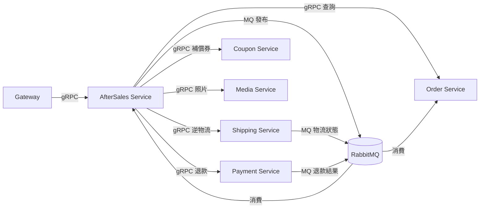

| 方向 | 協議 | 用途 |
|------|------|------|
| AS → Order | gRPC | `GetOrderForAfterSales`：查詢訂單詳情（金額、狀態、交易編號、送達時間）<br>`CancelOrderInternal`：取消出貨時更新訂單狀態 |
| AS → Payment | gRPC | `CreateRefund`：執行原路退款（信用卡即時 / ATM 非即時） |
| AS → Shipping | gRPC | `CreateReturnCvsShipment`：建立超商 C2C 退貨（交貨便，角色對調）<br>`CreateReturnHomeShipment`：建立宅配退貨單<br>`GetSellerReturnConfig`：查詢賣家退貨設定 |
| AS → Coupon | gRPC | `GrantSellerCompensationCoupon`：發放賣家補償優惠券 |
| AS → Media | gRPC | `FinalizeImages` + `LinkImages`：轉正並關聯證據照片 |
| Shipping → AS | MQ | `shipment.return.status_changed`：退貨物流狀態更新 |
| Payment → AS | MQ | `refund.succeeded` / `refund.failed`：ATM 非即時退款結果 |
| AS → Order | MQ | `aftersales.refund.completed`：退款完成通知（累加退款金額／更新訂單狀態 + 記錄 financial_log，§5.4.4）<br>`aftersales.cancel.completed`：取消出貨完成通知 |

### 1.3 非職責範圍

| 不負責 | 歸屬 |
|--------|------|
| 訂單狀態管理 | Order Service（AS 僅查詢 / 透過 MQ 通知） |
| PayUni 金流 API 呼叫 | Payment Service（AS 透過 gRPC 委派） |
| PayUni 物流 API 呼叫 | Shipping Service（AS 透過 gRPC 委派） |
| 優惠券模板管理 | Coupon Service（AS 僅呼叫發放） |
| 檔案上傳 / CDN | Media Service（AS 僅關聯） |
| 買賣雙方協商 | 系統外（站內信 / 電話 / IM，AS 不介入） |
| 平台客服介入 | 不在本服務射程 |

### 1.4 系統架構圖

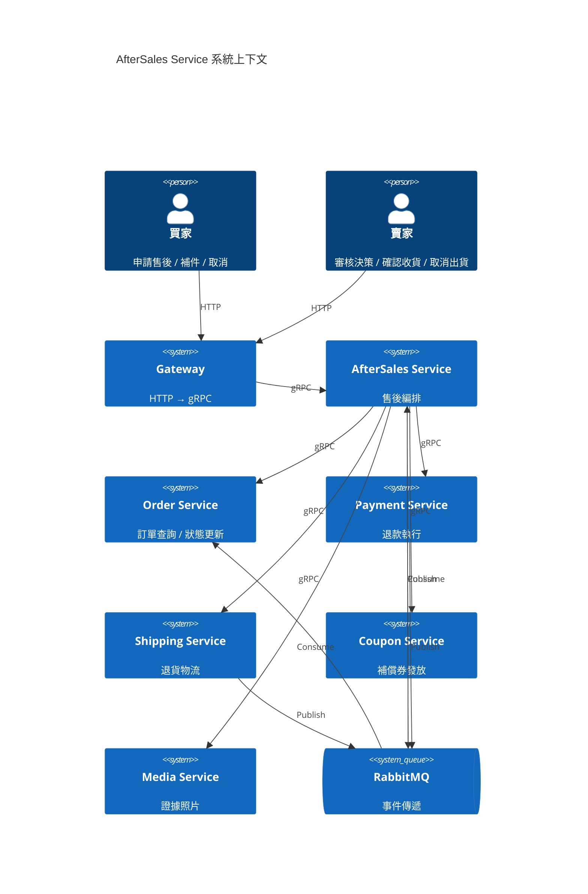

### 1.5 名詞定義與核心業務規則摘要

| 名詞 | 定義 |
|------|------|
| 售後單（AfterSale Case） | 買家針對一筆訂單發起的售後申請，編號格式 `A{9位}`（如 `A847261539`） |
| 決策（Resolution） | 賣家針對售後單提交的最終處理方式（5 種之一） |
| 退款任務（Refund Task） | 系統執行退款的非同步任務，由 Worker 背景處理 |
| 取消出貨（Seller Cancel） | 賣家在出貨前主動取消訂單並退款，與售後主流程分離 |
| 可退款金額（refundable_amount） | `orders.total_actual_amount`（= 商品小計 + 運費 - 折扣，買家實際總支付金額，亦即 PayUni 實收金額） |
| 退貨物流（Return Shipment） | 買家將商品寄回賣家的逆向物流 |
| 補件（Supplement） | 買家在售後單進行中追加照片或說明 |

**核心業務規則**：

| # | 規則 | 說明 |
|---|------|------|
| R1 | 一訂單一售後 | 每筆訂單同時只能有一筆進行中的售後單。「進行中」= status NOT IN (CLOSED(50), CANCELLED(70), CANCELLED_BY_CONFIRM_RECEIPT(71))；**含 status=AUTO_COMPLETED_RETURN_PENDING_TIMEOUT(33)**（不退款終態）。33 申訴期間（72h）若需對同訂單開新案，需 ops 手動清理（與 REJECTED(60) 申訴期同邏輯，由 ops 介入而非 application code）。71 比照 70 不佔活躍名額 |
| R2 | 送達後 60 小時 | 買家必須在商品送達後 60 小時內申請售後 |
| R3 | 單次單決策 | 賣家在一次處理中僅提交一個處理方式，不可逐商品分別決策 |
| R4 | 每案一退款 | 每筆售後單僅允許一次退款執行 |
| R5 | 退款上限 | 退款金額不可超過 `refundable_amount` |
| R6 | 優惠券規則 | 最低消費 ≥ 面額 × 5 且 實付（最低消費 − 面額）≥ 100 |
| R7 | 被拒後唯一救濟＝申訴 | 賣家拒絕（REJECTED(60)）後買家**沒有重啟（reopen）入口**，統一走 §10 平台申訴 / ADM 仲裁（appeal） |
| R8 | 退貨運費賣家負擔 | 退貨物流費用一律由賣家承擔 |
| R9 | 賣家手動確認收貨 | 退貨送達後由賣家驗貨並手動確認，不自動確認（撥款風險控制） |
| R10 | 發送即結案 | 補償優惠券發放後立即結案，無退款流程 |

### 1.6 角色與權限邊界

| 角色 | AccountType | 允許操作 |
|------|-------------|---------|
| 買家 BUYER | 1 | 申請售後、補件、取消、前往 PayUni 退款頁面（ATM 退款）、查詢自己的售後單、被拒後提交申訴 |
| 賣家 SELLER | 2 | 查看售後單、提交決策、確認收貨、取消出貨、查詢自己的售後單 |
| 雙重身份 SELLER_AND_BUYER | 3 | 依操作上下文分別具備 BUYER 或 SELLER 權限 |
| 內部服務 | `x-internal-service` | Shipping / Payment 回調用（物流狀態、退款結果） |

> **AfterSales Service 自行驗證操作歸屬**：買家只能操作自己的售後單（`buyer_id` 比對），賣家只能操作自己的售後單（`store_id` 比對）。不依賴 Gateway 做業務歸屬驗證。

---

## 2. 狀態模型與業務規則

### 2.1 售後單狀態機（主流程）

**Enum**：`AfterSaleCaseStatus`（`common-core/utils/code/`）

| Code | Value | 顯示名稱 | 說明 |
|------|-------|---------|------|
| PENDING | 0 | 待處理 | 買家已申請，等待賣家處理 |
| RETURN_PENDING | 20 | 待退貨 | 賣家同意退貨退款，等待買家寄回 |
| RETURN_SHIPPING | 25 | 退貨運送中 | 買家已寄出，物流配送中 |
| **RETURN_AT_STORE** | **26** | **退貨已到店待取** | **超商退貨配達退貨門市，等待賣家領取（72 小時內未取則系統自動完成確認收貨）。僅 `returnShippingMethod=3002` 使用** |
| RETURN_DELIVERED | 27 | 退貨已送達 | 超商退貨：賣家從門市實際取貨完成；宅配退貨：包裹送達賣家地址並簽收。等待賣家確認收貨（48 小時內未確認則系統自動完成） |
| RETURN_RECEIVED | 30 | 已收退貨 | 賣家已確認收貨（手動 / 自動 / Admin 強制） |
| REFUND_PROCESSING | 40 | 退款處理中 | 退款任務建立並執行中 |
| CLOSED | 50 | 已結案 | 退款完成 / 優惠券已發放 |
| REJECTED | 60 | 已拒絕 | 賣家拒絕售後申請（買家不再可重啟，僅可走 §10 申訴） |
| CANCELLED | 70 | 已取消 | 買家自行取消（賣家尚未處理前） |
| **CANCELLED_BY_CONFIRM_RECEIPT** | **71** | **買家已確認收貨** | **買家於售後待處理階段（PENDING(0)）主動於訂單頁「確認收貨」，order-service 同步呼叫 aftersales CAS 將案件終結至本狀態。語意等同買家主動取消，但與 CANCELLED(70) 區分以利對帳追溯撥款歸屬。終態，所有判定行為比照 CANCELLED(70)：非活躍、不退款、售後未成立（訂單回歸自身狀態）。前端可直接以本狀態 label 顯示** |
| RETURN_FAILED | 28 | 退貨物流失敗 | 退貨物流發生 PayUni ABNORMAL 狀態（包裹遺失/退回買家等），需 Admin 介入或走申訴流程 |
| **AUTO_COMPLETED_RETURN_PENDING_TIMEOUT** | **33** | **待寄回逾時自動關案** | **進入 RETURN_PENDING(20) 後買家逾 `ship_back_deadline_at`（預設 7 天）未寄回 → `ReturnTimeoutWorker` 自動關案、退款資格解除、訂單款項照常撥付賣家。本狀態為「不退款」終態（不建立 refund_task、不轉 REFUND_PROCESSING）；買家不服可走 §10 申訴，Admin 裁決 FULL/PARTIAL_REFUND 時 status→40，裁決 REJECT_APPEAL 時 status→50。前端可直接以本狀態 label 顯示** |

**狀態轉移矩陣**：

```
PENDING(0) ──┬── 賣家：同意退貨退款 ──→ RETURN_PENDING(20)
             ├── 賣家：部分退款 / 全額退款 ──→ REFUND_PROCESSING(40)
             ├── 賣家：發放優惠券 ──→ CLOSED(50)
             ├── 賣家：拒絕 ──→ REJECTED(60)
             └── 買家：取消 ──→ CANCELLED(70)

RETURN_PENDING(20) ──┬── PayUni IN_TRANSIT 事件（碼 31/92）──→ RETURN_SHIPPING(25)
                      │  進入 20 當下 stamp ship_back_deadline_at = NOW() + ${return.timeout-days} (預設 7 天)
                      └── ship_back_deadline_at <= NOW() (ReturnTimeoutWorker, 10 分鐘掃)
                          ── 不退款自動關案 ──→ AUTO_COMPLETED_RETURN_PENDING_TIMEOUT(33)【終態】
                          └ stamp closed_at = NOW()
                          └ 退款資格解除（不建 refund_task）、訂單款項照常撥付賣家
                          └ 買家不服可走 §10 申訴流程；Admin 裁決 FULL/PARTIAL_REFUND → 33→40；裁決 REJECT_APPEAL → 33→50

[超商退貨 returnShippingMethod=3002]
RETURN_SHIPPING(25) ──→ PayUni WAITING_PICKUP 事件（碼 32）──→ RETURN_AT_STORE(26)
                                                              ├ stamp store_arrived_at = NOW()
                                                              └ stamp store_pickup_deadline_at = NOW() + 72h
RETURN_AT_STORE(26) ──┬── PayUni PICKED_UP 事件（碼 11）──→ RETURN_DELIVERED(27)
                      │                                       ├ stamp seller_picked_up_at = NOW()
                      │                                       └ stamp auto_confirm_at = NOW() + 48h
                      └── store_pickup_deadline_at 到期 (StorePickupTimeoutScheduler)
                          ── 視為自動完成 ──→ AUTO_COMPLETED_STORE_PICKUP_TIMEOUT(31) → REFUND_PROCESSING(40) → CLOSED(50)
                          └ stamp auto_complete_at_stamp = NOW()

[宅配退貨 returnShippingMethod=3001]
RETURN_SHIPPING(25) ──→ PayUni PICKED_UP 事件（碼 11）──→ RETURN_DELIVERED(27)
                                                          └ stamp auto_confirm_at = NOW() + 48h

[共通：RETURN_DELIVERED(27) 之後]
RETURN_DELIVERED(27) ──┬── 賣家手動 confirm（API）──→ RETURN_RECEIVED(30)
                       └── auto_confirm_at 到期 (AutoConfirmReceiptScheduler)
                           ── 視為自動完成 ──→ AUTO_COMPLETED_CONFIRM_RECEIPT_TIMEOUT(32)
                           └ stamp auto_complete_at_stamp = NOW()
RETURN_RECEIVED(30) / AUTO_COMPLETED_STORE_PICKUP_TIMEOUT(31) / AUTO_COMPLETED_CONFIRM_RECEIPT_TIMEOUT(32)
                     ──→ 系統建立退款任務 ──→ REFUND_PROCESSING(40)
REFUND_PROCESSING(40) ──→ 退款完成 ──→ CLOSED(50)

[異常路徑]
RETURN_PENDING(20)   ──→ PayUni ABNORMAL 事件（碼 33/53/44）──→ RETURN_FAILED(28)
RETURN_SHIPPING(25)  ──→ PayUni ABNORMAL 事件 ──→ RETURN_FAILED(28)
RETURN_AT_STORE(26)  ──→ PayUni ABNORMAL 事件 ──→ RETURN_FAILED(28)
RETURN_DELIVERED(27) ──→ PayUni ABNORMAL 事件（罕見）──→ RETURN_FAILED(28)
RETURN_FAILED(28)    ──┬── Admin ForceConfirmReceipt ──→ RETURN_RECEIVED(30)
                       └── 既有申訴流程 ──→ CLOSED(50) / 平台裁決

[被拒救濟]
REJECTED(60) ──→ 買家：提交申訴 ──→ （appeal_state 流轉，狀態不變，見 §10）

[確認收貨自動取消售後 — 由 order-service confirmReceipt 同步觸發]
PENDING(0) ──→ 買家於訂單頁「確認收貨」──→ CANCELLED_BY_CONFIRM_RECEIPT(71)【終態】
                              └ 經 aftersales 同步 RPC CAS（WHERE status = '0'）
                              └ stamp process_deadline=NULL；發 CASE_CANCELLED_BY_CONFIRM_RECEIPT → realtime + 通知
```

#### 2.1.1 確認收貨 ↔ 進行中售後 case 的階段邊界

買家在訂單頁按「確認收貨」時，order-service 於完成訂單（DELIVERED 40 → COMPLETED 50 + 撥款）**之前**，同步呼叫 aftersales `CancelActiveCaseOnConfirmReceipt`（§4.2）。aftersales 依該訂單**唯一活躍 case**（duplicate guard 保證 ≤1）的階段決定行為：

| 桶 | case 階段 | 行為 | 判定依據 |
|---|---|---|---|
| **A — 自動取消** | `PENDING(0)` | CAS 終結至 `CANCELLED_BY_CONFIRM_RECEIPT(71)`，訂單照常完成 | 賣家尚未同意任何方案：**無退貨物流單、無退款任務、無申訴**，零 cascade |
| **B — 擋住確認收貨** | `RETURN_PENDING(20)`、`RETURN_SHIPPING(25)`、`RETURN_AT_STORE(26)`、`RETURN_DELIVERED(27)`、`RETURN_FAILED(28)`、`RETURN_RECEIVED(30)`、`AUTO_COMPLETED_STORE_PICKUP_TIMEOUT(31)`、`AUTO_COMPLETED_CONFIRM_RECEIPT_TIMEOUT(32)`、`REFUND_PROCESSING(40)`、以及 `REJECTED(60)+申訴中`、`AUTO_COMPLETED_RETURN_PENDING_TIMEOUT(33)+申訴中` | RPC 回 `BLOCKED` → order-service throw `AFTERSALE_CONFIRM_RECEIPT_BLOCKED`，訂單**不完成** | 已有承諾不可被確認收貨輾過：**(1)** `RETURN_PENDING(20)` 起退貨物流單已在賣家同意當下建立（`return_shipment_no`/`ship_trade_no`，§5.3），且 shipping 無作廢 RPC → 終結會留孤兒退貨單；**(2)** 25~40 貨已在退 / 退款進行中；**(3)** 申訴中（`appeal_state=APPEALED`）案件由 admin 佇列（`WHERE appeal_state<>'0'`，不看 status）審理，若終結到 71 而不清 appeal_state，admin 裁決會把 71 覆寫回 40/50 觸發退款 → 重複出帳。**一律擋住，避免上述三類資料錯亂** |
| **C — 放行** | 終態 `CLOSED(50)`、`REJECTED(60)`（無申訴）、`CANCELLED(70)`、`CANCELLED_BY_CONFIRM_RECEIPT(71)`、`AUTO_COMPLETED_RETURN_PENDING_TIMEOUT(33)`（無申訴） | RPC 回 `NO_ACTIVE_CASE`（`isActive=false`），訂單照常完成 | 無活躍 case |

> 🔴 **A 桶只收 `PENDING(0)`，此邊界不新開任何階段的取消能力**（與 `markCancelledByBuyer` 的前置集一致：買家手動取消亦僅限 0）。
>
> **競態處理**：A 桶 CAS `WHERE status = '0'`；若 RPC 執行瞬間賣家剛同意（0→20）或 worker 剛 auto-reject（0→60），CAS affected=0 → aftersales 重讀該 case 重新分類（落 B 桶回 `BLOCKED`，或落終態回 `NO_ACTIVE_CASE`），不會誤終結。詳見 §8.2.1。

🔴 **自動完成原因以 `status` 直接表達**（`AUTO_COMPLETED_STORE_PICKUP_TIMEOUT(31)` / `AUTO_COMPLETED_CONFIRM_RECEIPT_TIMEOUT(32)` / `AUTO_COMPLETED_RETURN_PENDING_TIMEOUT(33)`），**不另設 metadata 欄位**承載原因。

**終態**：`CLOSED(50)`、`CANCELLED(70)`、`CANCELLED_BY_CONFIRM_RECEIPT(71)`、`AUTO_COMPLETED_RETURN_PENDING_TIMEOUT(33)`（無申訴前提下）
**可再操作態**：`REJECTED(60)`（買家可走 §10 申訴）、`AUTO_COMPLETED_RETURN_PENDING_TIMEOUT(33)`（買家可走 §10 申訴）

#### 售後 active / terminal canonical 判定（`AfterSaleCaseStatusRules`，SSOT）

售後「是否活躍 / 是否終態」散見多處用途（訂單倒數恢復 `countActiveCasesByOrder`、賣家工作台 Dashboard count、賣家售後列表預設過濾）。**語意一致者必須統一由 `common-core/.../utils/code/helper/AfterSaleCaseStatusRules.java` 提供**，禁止各處硬編碼第二套（[Java 微服務開發規範 §6](../開發規範/Java%20微服務開發規範.md)＋[CodeMeta README](../代碼管理（CodeMeta）/README.md)）：

| helper 方法 | 定義 | 用途 |
|---|---|---|
| `isActive(status, appealState)` | `status NOT IN {33,50,60,70,71}` OR (`status=60` AND 申訴中) OR (`status=33` AND 申訴中) | 倒數恢復反查、Dashboard「售後處理」queue、lifecycle 排除 |
| `isTerminalOverrideToCompleted(status, appealState)` | `status IN {33,50}` 且非申訴重啟 | Dashboard：售後已結但訂單主狀態未達終態 → 歸「已完成」 |
| `overridesOrderLifecycle(status)` | `status NOT IN {60,70,71}` | 是否以售後狀態覆蓋訂單生命週期分類（60/70/71 售後未成立，不覆蓋） |

> **`CANCELLED_BY_CONFIRM_RECEIPT(71)` 比照 `CANCELLED(70)`**：71 在三方法皆與 70 同類 —— `isActive`=false（終態）、不在 `isTerminalOverrideToCompleted` 集（售後未成立、不覆蓋訂單為已完成）、不在 `overridesOrderLifecycle` 集（訂單回歸自身狀態，此時即 COMPLETED(50)）。`countActiveCasesByOrder` 的硬編碼 SQL **必須同步**把 `NOT IN` 集合加入 `'71'`（與本 helper SSOT 對齊，防 §8.5 第二套 status set 分裂）。

> ⚠️ **AUTO_COMPLETED_STORE_PICKUP_TIMEOUT(31) / AUTO_COMPLETED_CONFIRM_RECEIPT_TIMEOUT(32) 屬 active，非終態**：此二者為「自動確認收貨」退款**中間態**（→ REFUND_PROCESSING(40) → CLOSED(50)，見上方狀態轉移矩陣），退款進行中。**禁止**將 31/32 列入終態 / 排除集合 —— 否則退款進行中會錯誤恢復撥款倒數（double pay 風險）、Dashboard 漏計售後。終態僅 {33,50,70}（60 為可再操作態）。
>
> 既有 `countActiveCasesByOrder`（[§4.4.1 對訂單自動完成倒數的影響](#441-對訂單自動完成倒數的影響與-order-service-介接)）的 SQL 即為本 `isActive` 定義；canonical helper 抽取後二者邏輯對齊，SQL 以本節為 SSOT。🔴 `HasActiveCase` 的 proto 註解必須與本節同步（含 33）。

> **33 為終態的特殊性**：與 50/70 不同，33 業務語意是「退款資格已解除但案件未走完退款」。買家若有正當理由（疾病、天災、PayUni webhook 延遲導致未及時推進 25 等）可走 §10 申訴；無申訴時 33 即為終結。INV-4 對 33 的離態轉移與 §10 Admin 裁決流程綁定（見 §10.2.2 雙軸狀態圖、§10.8.2 Admin 裁決流程）。

**INV-3 / INV-4 對齊（aftersale_cases status transition）**：對齊 06-Shipping §2.4 INV-3「禁止 updateById 全欄位覆蓋」與 INV-4「WHERE 必須使用 `IN (合法前置集合)`」。所有併發場景（webhook consumer / scheduler / RPC handler 同時讀寫）下 transition 必須走 AfterSaleCaseMapper 自訂 SQL + WHERE 前置狀態樂觀鎖。`§5.10 CaseProcessTimeoutWorker` 隨時可能對 `status = '0'` 的 case 寫入 `markAutoRejected` / `markAutoEscalated`，因此所有從 `PENDING(0)` 出發的 transition 都必須以 mapper SQL 樂觀鎖防 lost update。

> **退貨物流推進的前置集合必須為 downward-closure（強制）**：退貨物流線 `RETURN_PENDING(20)→RETURN_SHIPPING(25)→RETURN_AT_STORE(26)→RETURN_DELIVERED(27)` 由退貨 shipment 貨態事件驅動；退貨 shipment 與正向物流同樣受 PayUni 出貨前**跳號 / 亂序**影響（碼 11 送達 / 32 到店可能早於 31/92 配送中到達）。故 `markReturnInTransit` / `markReturnAtStore` / `markReturnDelivered` 的 `WHERE IN` 前置集合必須涵蓋**所有更早的退貨物流態**（含起點 `RETURN_PENDING(20)`），否則首個到達的貨態若為到店 / 送達，case 靜默卡在 20 → 7 天後被 §5.10 `markReturnPendingTimeoutAutoClosed`(→33) 誤判「買家逾期未寄回」而**錯誤關案不退款**（買家貨款兩失）。此與 [03 號「物流推進守門單調前進與異常恢復」](./03-訂單微服務（Order%20Service）詳細設計書.md#物流推進守門單調前進與異常恢復)同構；退貨鏈無「異常恢復旁支」（`RETURN_FAILED(28)` 為 Admin/申訴手動態，不自動恢復），故為**純 downward-closure**，直接於各 mapper SQL 明列前置集合（延續 INV-4 慣例），不另建 rank helper。

| 觸發路徑 | Mapper 方法 | 寫入欄位 | SQL（含樂觀鎖）|
|---|---|---|---|
| `ReturnShipmentStatusConsumer`（物流配送中，碼 31/92） | `markReturnInTransit(caseNo)` | `status='25'` | `SET status='25' WHERE case_no=? AND status IN ('20')` |
| `ReturnShipmentStatusConsumer`（超商到店待取，碼 32 + method=3002） | `markReturnAtStore(caseNo, storeArrivedAt, storePickupDeadlineAt)` | `status='26'`、`store_arrived_at`、`store_pickup_deadline_at` | `SET status='26', store_arrived_at=?, store_pickup_deadline_at=? WHERE case_no=? AND status IN ('20','25')` — 前置為 downward-closure（rank：20→25→26）；含 `RETURN_PENDING(20)`：退貨 shipment 跳號/終態優先到達（碼 32 早於 31/92）時自 20 直接到店待取，否則卡 20 且 `store_pickup_deadline_at` 未 stamp |
| `ReturnShipmentStatusConsumer`（物流送達，碼 11） | `markReturnDelivered(caseNo, deliveredAt, autoConfirmAt, sellerPickedUpAt)` | `status='27'`、`return_delivered_at`、`auto_confirm_at`、`seller_picked_up_at` | `SET status='27', return_delivered_at=?, auto_confirm_at=?, seller_picked_up_at=? WHERE case_no=? AND status IN ('20','25','26')` — 前置為 downward-closure（rank：20→25→26→27）；25 為宅配直接送達、26 為超商賣家取貨後、含 `RETURN_PENDING(20)`：退貨 shipment 跳號/終態優先到達（碼 11 早於 31/92）時自 20 直接推進送達，避免卡 20 被 §5.10 `markReturnPendingTimeoutAutoClosed` 誤判「買家逾期未寄回」而錯誤關案不退款 |
| `ReturnShipmentStatusConsumer`（物流異常，碼 33/53/44） | `markReturnFailed(caseNo, providerStatus, providerMessage)` | `status='28'`、`return_provider_status`、`return_provider_message` | `SET status='28', return_provider_status=?, return_provider_message=? WHERE case_no=? AND status IN ('20','25','26','27')` |
| `ReturnShipmentStatusConsumer`（碼 55 賣家未取，僅持久化）| `stampReturnProviderInfo(caseNo, providerStatus, providerMessage)` | `return_provider_status`、`return_provider_message` | `SET return_provider_status=?, return_provider_message=? WHERE case_no=?` — **不觸發狀態變更**：72h timer 是賣家未取的唯一真實來源；本筆訊息僅供 Admin / Seller UI 顯示 PayUni 原文 |
| `StorePickupTimeoutScheduler`（72h 超商待取逾時自動完成） | `markAutoCompletedFromAtStore(caseNo, now)` | `status='31'`、`auto_complete_at_stamp` | `SET status='31', auto_complete_at_stamp=? WHERE case_no=? AND status='26'` — 原因由 status 表達 |
| `AutoConfirmReceiptScheduler`（48h 確認收貨逾時自動完成）| `markAutoCompletedFromDelivered(caseNo, now)` | `status='32'`、`auto_complete_at_stamp` | `SET status='32', auto_complete_at_stamp=? WHERE case_no=? AND status='27'` — 原因由 status 表達 |
| `ReturnTwentyFourHourWarnScheduler`（超商待取剩 24h）| `stampStorePickup24hWarned(caseNo)` | `warned_store_pickup_24h_at=NOW()` | `SET warned_store_pickup_24h_at=? WHERE case_no=? AND status='26' AND warned_store_pickup_24h_at IS NULL` |
| `ReturnTwentyFourHourWarnScheduler`（確認收貨剩 24h）| `stampConfirmReceipt24hWarned(caseNo)` | `warned_confirm_receipt_24h_at=NOW()` | `SET warned_confirm_receipt_24h_at=? WHERE case_no=? AND status='27' AND warned_confirm_receipt_24h_at IS NULL` |
| `RefundResultConsumer.closeParentAndPublish`（ATM webhook 退款成功）+ `RefundTaskWorker.closeParentEntity`（信用卡 worker 退款成功） | `closeIfNotClosed(caseNo, closedAt)` | `status='50'`、`closed_at` | `SET status='50', closed_at=? WHERE case_no=? AND status IN ('40')` — INV-4：CLOSED 唯一合法前置為 `REFUND_PROCESSING(40)`，COUPON_COMPENSATION 走另一路徑；兩 consumer / worker 共用同一 mapper SQL |
| `AfterSaleResolutionService.handleReturnRefund` | `markReturnPending(caseNo, returnShipmentNo, returnShippingMethod, shipTradeNo, shipBackDeadlineAt)` | `status='20'`、`return_shipment_no`、`return_shipping_method`、`ship_trade_no`、`label_retry_count=0`、`process_deadline=NULL`、**`ship_back_deadline_at`** | `SET status='20', return_shipment_no=?, return_shipping_method=?, ship_trade_no=?, label_retry_count=0, process_deadline=NULL, ship_back_deadline_at=? WHERE case_no=? AND status = '0'` — `ship_back_deadline_at` = `NOW() + ${return.timeout-days}`，`ReturnTimeoutWorker` 與 `ReturnTwentyFourHourWarnScheduler` 依此欄位掃描 |
| `ReturnTimeoutWorker`（待寄回逾時自動關案）| `markReturnPendingTimeoutAutoClosed(caseNo, closedAt)` | `status='33'`、`closed_at` | `SET status='33', closed_at=? WHERE case_no=? AND status='20' AND ship_back_deadline_at IS NOT NULL AND ship_back_deadline_at <= NOW()` — 終態（不建 refund_task）；CAS 防競態：若 `ReturnShipmentStatusConsumer` 剛把 20→25（買家已寄出）則 affected=0 skip；CAS 成功後 status 即離開 20，下一次 cron 自然 skip ⇒ audit log 一案一筆 |
| `ReturnTwentyFourHourWarnScheduler`（待寄回剩 24h 分支）| `stampShipBack24hWarned(caseNo)` | `warned_ship_back_24h_at=NOW()` | `SET warned_ship_back_24h_at=? WHERE case_no=? AND status='20' AND warned_ship_back_24h_at IS NULL` |
| `AfterSaleResolutionService.handlePartialRefund` / `handleFullRefundNoReturn` | `markRefundProcessingFromResolution(caseNo)` | `status='40'`、`process_deadline=NULL` | `SET status='40', process_deadline=NULL WHERE case_no=? AND status = '0'` |
| `AfterSaleResolutionService.handleCouponCompensation` | `closeByCouponCompensation(caseNo, closedAt)` | `status='50'`、`closed_at`、`process_deadline=NULL` | `SET status='50', closed_at=?, process_deadline=NULL WHERE case_no=? AND status = '0'` — 與 `closeIfNotClosed`（退款路徑）並存：兩者前置集合互斥（0 vs 40），無法共用 |
| `AfterSaleResolutionService.handleReject` | `markRejectedByResolution(caseNo, lastRejectedAt)` | `status='60'`、`last_rejected_at`、`process_deadline=NULL` | `SET status='60', last_rejected_at=?, process_deadline=NULL WHERE case_no=? AND status = '0'` |
| `ReturnReceiptService.confirmReceipt`（賣家手動） | `markReturnReceived(caseNo)` | `status='30'` | `SET status='30' WHERE case_no=? AND status='27'` — 賣家手動「確認收貨」按鈕**只允許 status=27 時操作**，前端依此判斷按鈕是否可點 |
| `AdminForceConfirmReceiptService.execute`（Admin 強制推進） | `markReturnReceivedByAdmin(caseNo)` | `status='30'` | `SET status='30' WHERE case_no=? AND status IN ('20','25','26','27','28')` — allowed-from 含 26（超商待取） |
| `ReturnReceiptService.confirmReceipt` / 兩個 AutoComplete scheduler（建立退款任務後推進） | `markRefundProcessingFromReceived(caseNo)` | `status='40'` | `SET status='40' WHERE case_no=? AND status IN ('30','31','32')` — 涵蓋手動 30、超商超時 31、確認超時 32 |
| `AfterSaleCaseService.supplementEvidence` | `appendDescription(caseNo, newDescription)` | `description` | `SET description=? WHERE case_no=? AND status = '0'` — 不轉 status，但須以前置狀態保護避免 worker race 後寫者覆蓋 |
| `AfterSaleCaseService.cancelCase`（買家取消） | `markCancelledByBuyer(caseNo)` | `status='70'`、`process_deadline=NULL` | `SET status='70', process_deadline=NULL WHERE case_no=? AND status = '0'` |
| `AfterSaleCaseService.cancelActiveCaseOnConfirmReceipt`（確認收貨同步觸發） | `markCancelledByConfirmReceipt(caseNo)` | `status='71'`、`process_deadline=NULL` | `SET status='71', process_deadline=NULL WHERE case_no=? AND status = '0'` — 前置集與 `markCancelledByBuyer` 相同（A 桶），僅終態 status 不同（71 區分撥款歸屬）。CAS affected=0 時由 service 重讀分類（§8.2.1） |

其他既有 transition 已走自訂 SQL（appeal / autoReject / labelRetry 等），不再贅述。

**賣家工作區 realtime 覆蓋（`seller.after_sale.updated`）統一發送**：

🔴 **所有會改 case 狀態的 publisher 方法，一律經 `AfterSalesEventPublisherImpl` 的私有 helper `publishCaseEvent(routingKey, payload, eventType, storeId, orderNo, caseNo)` 發送**——該 helper 同時發 domain event 與 `emitSellerAfterSaleUpdated`。emit 必須結構性綁定「發 case 事件」這件事本身，**不得**在個別 publisher 方法內以私有 side-effect 各自 emit（那會讓沒走到該方法的狀態轉換靜默漏推）。

| 項目 | 規格 |
|---|---|
| 適用範圍 | `publishCaseTransitionWithContext`、`publishPlatformDecisionMade`、`publishCaseAutoRejected`（→`REJECTED(60)`）、`publishCaseAutoEscalated`（→`APPEALED`）、`publishAppealSubmitted`（→`APPEALED`）、`publishRefundCompleted`（`REFUND_PROCESSING(40)` → `CLOSED(50)`） |
| `storeId` 取得 | `publishRefundCompleted` 簽章帶 `Long storeId`；`RefundTaskEntity` 不帶 store，三個 caller（`RefundResultConsumer` / `RefundTaskWorker` / `RefundSyncWorker`）以 `AfterSaleCaseMapper.findStoreIdByCaseNo(caseNo)` scalar projection 查補（回 `Long`，遵守 [Java 微服務開發規範 §9 Partial Projection 反模式禁令](../開發規範/Java%20微服務開發規範.md)：不得回部分填充的 Entity） |
| 退貨在途 | `handleInTransit`（`RETURN_PENDING(20)` → `RETURN_SHIPPING(25)`）走 `publishCaseTransitionWithContext(CASE_RETURN_IN_TRANSIT)`，一併取得 realtime emit ＋ notification（見 §5.3.4） |

> `publishAwaitingBuyerRefundPage`（ATM 中間態，case 仍 40）與 `publishCancelCompleted`（訂單取消，無 caseNo）**不**屬 case 狀態變更，**不 emit**。
>
> 🔴 **無 reopen（買家重啟）路徑**：被拒後買家統一走 §10 申訴，不存在 60→65 重啟轉換，對應的 realtime／通知與 surface 皆不得新增。

**賣家處理期限（process_deadline）**：

- `PENDING(0)` 狀態下，`aftersale_cases.process_deadline` 必有值（建立時 = `now + aftersales.case.process-deadline-hours` 小時）
- 賣家做出任何決策（離開 PENDING）時 `process_deadline` 應清空（NULL）
- `process_deadline < NOW()` 時由 `CaseProcessTimeoutWorker` 依 `aftersales.case.timeout-policy` 代為決策：
  - `AUTO_REJECT`（**預設**）：系統代為拒絕（status → `REJECTED(60)`、reject_reason = `SELLER_NO_RESPONSE`、actor = SYSTEM）；買家可走 §10 申訴
  - `AUTO_ESCALATE`（備援，保留不刪）：直接升級至 admin 仲裁（`appeal_state` → `APPEALED`、`auto_escalated = true`、`escalated_at = NOW()`），原 §5.10 流程
  - 詳見 §2.6 與 §5.10

### 2.2 退款任務狀態機

**Enum**：`WorkerTaskStatus`（`common-core/utils/code/`，定義見 `docs/代碼管理（CodeMeta）/業務狀態碼.md`）

> 退款任務屬於 Worker 任務家族（退款、清車、券核銷、撥款等共用同一 enum）。以下僅列出退款任務實際會進入的狀態值。

> **ATM 退款失敗的處置**：ATM 退款失敗（sync return / 合規 async webhook / UNKNOWN 變體）一律退回 `AWAITING_BUYER_REFUND_PAGE(5)` + stamp `payuni_message` + `current_attempt++`，讓買家自行決定重填或聯絡客服。`refund_tasks.current_attempt SMALLINT` 記錄當前對 PayUni 發 RFD 的 attempt 序號；`idempotency_key` 樣式帶 `:{attempt}` 後綴，避免買家重填時命中既有 row。
>
> **兩條例外（不得「統一 revert」，見 §5.4.3.1）**：
> 1. **REF02037（無足夠金額可退款 = 該交易可退餘額不足，強烈代表已退過）不 revert、不 `current_attempt++`**。改為對帳 payment 端該退款實際狀態：已 PROCESSING/SUCCEEDED → 推進 refund_task 往完成（等同已退成功）；對帳仍無法判定已退 → 轉 `MANUAL_INTERVENTION(40)` 打斷迴圈，等維運處理，不再無限要求買家重填。
> 2. **任何失敗 revert 前，先確認 payment 端該退款未終態成功**（透過既有 payment gRPC 查退款狀態）。若 payment 已 SUCCEEDED → **不 revert**，改推進 refund_task 往完成，避免把已成功退款打回買家重填、與 payment 端狀態分裂。
>
> `FAILED(30)` **不從 ATM 流程進入**，僅保留給信用卡 retry 後最終失敗終態。`MANUAL_INTERVENTION(40)` 用於「REF02037 對帳無法判定」的打斷點。REF02037 為 PayUni 外部碼，於常數集中定義（禁硬編碼字面值）。

| Code | Value | 說明 | Worker 掃描（退款） |
|------|-------|------|------------|
| PENDING | 0 | 待執行 | ✅（僅信用卡路徑） |
| AWAITING_BUYER_REFUND_PAGE | 5 | ATM 退款，等待買家前往 PayUni 頁面填寫銀行資訊 | ❌ |
| PROCESSING | 10 | 已 Claim，執行中（信用卡路徑；ATM 不進入此狀態） | ❌ |
| AWAITING_WEBHOOK | 15 | ATM 退款已受理，等待 PayUni Webhook 匯款結果 | ❌ |
| DONE | 20 | 退款完成（成功終態） | ❌ |
| FAILED | 30 | 退款失敗（終態 / 可重試態） | ✅（僅信用卡；`next_retry_time` 未到者不撈） |
| MANUAL_INTERVENTION | 40 | 退款無法自動收斂的打斷點：ATM 失敗回 `REF02037` 且對帳 payment 端仍無法判定是否已退時寫入，等維運處理，打斷買家重填迴圈（見 §5.4.3.1） | ❌ |

**狀態轉移 — 信用卡 / Apple Pay / Google Pay**（Worker 主動呼叫 PayUni `/api/trade/close`）：

```
PENDING → PROCESSING ──→ DONE                                          (同步 SUCCESS)
             │
             └─→ FAILED(retry_count<1, next_retry=NOW+30s)
                    │
                    └─ 30s 後 Worker 再 claim → PROCESSING
                                                 │
                                                 ├─→ DONE
                                                 └─→ FAILED(retry_count≥1, next_retry=NULL, 終態)
                                                     進 admin 異常清單
```

- Worker 掃描條件：`payment_method != 'ATM'` ＋ 三個分支 `(status='0' AND 租約可搶) OR (status='30' AND next_retry_time IS NOT NULL AND <= NOW()) OR (status='10' AND 租約可搶)`（`WorkerTaskStatus` value：`'0'`＝PENDING、`'30'`＝FAILED、`'10'`＝PROCESSING；**FAILED 的 `IS NOT NULL` 是終態守門，不可拿掉**，全文見 [§5.4.2](#542-refundtaskworker背景執行) 與 [§8.5](#85-多副本排程搶佔語意scheduler-claim) 的 C1 列）
- 重試策略：固定 30 秒延遲；`retry_count < 1` → `retry_count+1`、排隊重試；`retry_count >= 1` → `next_retry_time=NULL`、終態
- 信用卡退款**無輪詢機制**：同步 SUCCESS 即視為完成

**狀態轉移 — ATM（頁面版，平台不接觸銀行機敏資訊）**：

```
AWAITING_BUYER_REFUND_PAGE(5)
   │ 買家點「前往退款」→ aftersales 呼叫 payment → payment 呼叫 PayUni /api/offline_payment/refund
   │
   ├─ 同步 SUCCESS
   │    payment 發 event（帶 estimatedRefundDate）→ aftersales consumer
   │       → AWAITING_WEBHOOK(15) + 寫入 estimated_refund_date
   │           │
   │           ├─ webhook RefundStatus=1 → DONE(20) + 寫入 bank_date
   │           └─ webhook RefundStatus=2 → §5.4.3.1 對帳處置（已成功推進完成 / REF02037 不重填 / 一般失敗退回 state 5 / 無法判定 MANUAL_INTERVENTION 40；不再一律 FAILED 終態）
   │
   └─ 同步 錯誤碼
        payment 發 event（帶 payuni_status=PayUni 錯誤碼、payuni_message=PayUni 訊息；estimated_refund_date / bank_date 皆空）
        aftersales consumer：
          - 更新 refund_tasks.payuni_status / payuni_message snapshot（UX 持久性：下次查詢仍看得到錯誤）
          - task state 保持 AWAITING_BUYER_REFUND_PAGE(5)，不推 state（由 consumer 本身邏輯判斷：routing key 為 refund.failed 且無日期欄位 → 只更新 snapshot）
        前端透過 URL scheme 導回時接到 payuniStatus + payuniMessage，顯示錯誤訊息 + 重新填寫按鈕
        買家自由決定是否再次點按鈕 → 重新開啟 PayUni WebView（本狀態無逾時，task 可無限期停留）
```

**INV-3 對齊（refund_tasks transition）**：對齊 06-Shipping §2.4 INV-3「禁止 updateById 全欄位覆蓋」。`AfterSalesGrpcService.handleRefundPageReturn` 與 ATM webhook consumer 寫 refund_tasks 必須走 RefundTaskMapper 自訂 SQL：

| 場景 | Mapper 方法 | SQL（含 WHERE 樂觀鎖） |
|---|---|---|
| 同步 SUCCESS（5→15） | `markAtmRefundPageSucceeded(id, payuniStatus, estimatedRefundDate)` | `SET status='15', payuni_status=?, payuni_message=NULL, estimated_refund_date=? WHERE id=? AND status='5'` |
| 同步失敗（snapshot 不轉 status） | `stampAtmRefundPageError(id, payuniStatus, payuniMessage)` | `SET payuni_status=?, payuni_message=? WHERE id=? AND status='5'` |

`updateById(refundTask)` 全欄位覆蓋禁止用於 ATM 退款流程（與 webhook consumer race 風險）。

**ATM 關鍵設計說明**：

1. **PayUni 請求頁面版**：買家銀行帳號、身分證字號等機敏資料由 PayUni 頁面直接收集，平台完全不接觸 / 儲存 / 傳輸
2. **同步失敗的即時 + 持久 UX**：
   - **即時**：透過 URL scheme 導回 App，前端顯示錯誤 + 重新填寫按鈕
   - **持久**：Payment 發 event，consumer 更新 `refund_tasks.payuni_status / payuni_message`（task state 保持 `AWAITING_BUYER_REFUND_PAGE`，不推 state）；買家下次查詢仍看得到錯誤原因與重填按鈕
   - 這是遵循[收斂規範 §5.3 訂閱者不必推 state](../開發規範/PayUni%20錯誤回應收斂規範.md)：發 event 不代表要改狀態機
3. **非同步失敗的處置**：webhook 回 `RefundStatus=2` 後，先對帳 payment 端該退款狀態——已成功則推進完成、`REF02037`（已退過）不重填改對帳、其餘一般失敗才退回 `AWAITING_BUYER_REFUND_PAGE(5)` 讓買家重填；對帳無法判定則 `MANUAL_INTERVENTION(40)`。完整規則見 §5.4.3.1
4. **買家遲未操作**：`AWAITING_BUYER_REFUND_PAGE` 維持，**本狀態無逾時**，task 可無限期停留

**Consumer 判斷階段（成敗看 routing key，階段不靠 phase 欄位而靠日期欄位存在性 + payment_method）**：

payload **沒有 `status` 欄位**；成敗一律由 routing key `refund.succeeded` / `refund.failed` 判定（`RefundResultConsumer` 比對 `MqConstants.ROUTING_KEY_REFUND_SUCCEEDED` / `ROUTING_KEY_REFUND_FAILED`）。

| routing key + event 欄位組合 | 當下 task state | 推進動作 |
|---|---|---|
| `refund.succeeded` + 帶 `bankDate` | 任意 | 寫 `DONE(20)` + 填 `bank_date`（= ATM webhook 成功）|
| `refund.succeeded` + 帶 `estimatedRefundDate`（無 `bankDate`）| `AWAITING_BUYER_REFUND_PAGE(5)` | 寫 `AWAITING_WEBHOOK(15)` + 填 `estimated_refund_date`（= ATM 同步受理成功）|
| `refund.succeeded`（兩日期都無）| 任意 | idempotent skip（= 信用卡 Worker 已自行寫入 DONE）|
| `refund.failed`（ATM、task 在 `AWAITING_BUYER_REFUND_PAGE`）| `AWAITING_BUYER_REFUND_PAGE(5)` | **僅更新** `payuni_status` / `payuni_message` snapshot，**不推 state**（= ATM sync 失敗；讓買家重新觸發）|
| `refund.failed`（信用卡）| 其他 | 寫 `FAILED(30)` 終態，記 `payuni_status` / `payuni_message`（= 信用卡 retry 後最終失敗）|
| `refund.failed`（ATM webhook `RefundStatus=2`）| `AWAITING_WEBHOOK(15)` | 依 §5.4.3.1 對帳 payment：已成功→推進完成 / `REF02037`→不重填改對帳 / 一般失敗→退回 `AWAITING_BUYER_REFUND_PAGE(5)` + `current_attempt++` / 無法判定→`MANUAL_INTERVENTION(40)`（**不再一律寫 `FAILED(30)` 終態**）|

**重試上限**：
- 信用卡：Worker 層 1 次重試（總嘗試 2 次）
- ATM：無 Worker 重試；同步失敗由買家當場重試（URL scheme 錯誤提示），非同步失敗直接進異常清單

#### 2.2.1 API 透傳規則（`refund_failure_message`）

> `refund_task_status` 是機器可判讀的狀態；`refund_failure_message` 是人類可讀的 PayUni 原始訊息。🔴 **失敗訊息必須持久化並可由 case detail / summary 讀回**——買家關閉 App 再進來時仍須看得到上次填寫失敗的原因。

`GetAfterSaleCaseDetail` / 列表的 `refund_failure_message` 欄位依 `refund_tasks.status` 決定是否透傳 `payuni_message`：

| refund_task.status | refund_failure_message 行為 | 前端語意 |
|---|---|---|
| PENDING (0) | 空字串 | 信用卡退款待執行 |
| **AWAITING_BUYER_REFUND_PAGE (5) + payuni_message 空** | 空字串 | 買家尚未填寫，顯示「前往退款」按鈕 |
| **AWAITING_BUYER_REFUND_PAGE (5) + payuni_message 非空** | **透傳 payuni_message** | 買家上次填寫失敗，顯示「⚠ {message}」+「重新填寫」按鈕 |
| PROCESSING (10) | 空字串 | 信用卡執行中 |
| AWAITING_WEBHOOK (15) | 空字串 | ATM 已受理，等待匯款 |
| DONE (20) | 空字串 | 退款成功 |
| **FAILED (30)** | **透傳 payuni_message** | 最終失敗，顯示「❌ 退款失敗：{message}，請聯繫客服」 |

**關鍵差異**：
- state=5 + message 非空 → 買家**可自行重試**（重新點「前往退款」重新走 PayUni 頁面）
- state=30 → **不可重試**，僅客服介入（`aftersales-admin` 補救路徑）

**實作位置**：`AfterSalesGrpcService.loadRefundTaskSnapshot()`（state=5 或 30 都透傳，其他狀態為空）。

### 2.3 取消出貨狀態機

**Enum**：`SellerCancelStatus`（`common-core/utils/code/`）

| Code | Value | 說明 |
|------|-------|------|
| PENDING | 0 | 已建立，待退款 |
| REFUND_PROCESSING | 10 | 退款執行中 |
| COMPLETED | 20 | 退款完成，訂單已取消 |
| FAILED | 30 | 退款失敗 |

**轉移**：

```
PENDING(0) ──┬── 已付款 ──→ REFUND_PROCESSING(10) ──→ COMPLETED(20) / FAILED(30)
             ├── 未付款（refund_amount=0）── 直接 ──→ COMPLETED(20)
             └── 取消訂單 RPC 失敗 / ATM createRefund 失敗 ── 直接 ──→ FAILED(30)
```

> `PENDING → COMPLETED` 直通的場景僅限訂單尚未付款時的賣家取消（金額為 0 元，無需走退款）。

**INV-3 / INV-4 對齊（seller_cancel_requests transition）**：對齊 06-Shipping §2.4 INV-3 / INV-4。`RefundResultConsumer.closeParentAndPublish` 與 `SellerCancelService` 兩條路徑都不得用 `updateById(cancelEntity)`，全部走 SellerCancelRequestMapper 自訂 SQL：

| 觸發路徑 | Mapper 方法 | 寫入欄位 | SQL（含樂觀鎖）|
|---|---|---|---|
| `RefundResultConsumer.closeParentAndPublish`（ATM webhook 退款成功完成 cancel）+ `RefundTaskWorker.closeParentEntity`（信用卡 worker 退款成功完成 cancel） | `completeIfNotCompleted(cancelId)` | `status='20'` | `SET status='20' WHERE id=? AND status IN ('10')` — INV-4：cancel 完成的唯一合法前置為 `REFUND_PROCESSING(10)`，未付款場景的 `PENDING→COMPLETED` 由 `markCompletedFromPending` 處理；兩 consumer / worker 共用同一 mapper SQL |
| `SellerCancelService.cancelShipment*`（已付款，建退款任務後推進） | `markRefundProcessing(cancelId)` | `status='10'` | `SET status='10' WHERE id=? AND status IN ('0')` |
| `SellerCancelService.cancelShipment*`（未付款 0 元直接完成） | `markCompletedFromPending(cancelId)` | `status='20'` | `SET status='20' WHERE id=? AND status IN ('0')` |
| `SellerCancelService.cancelShipment*`（取消 RPC 或 createRefund 失敗） | `markFailedFromPending(cancelId)` | `status='30'` | `SET status='30' WHERE id=? AND status IN ('0')` |

🔴 **`seller_cancel_requests` 的任何寫入路徑一律走 mapper 自訂 SQL，禁止 `updateById(cancelEntity)` 全欄位覆蓋。**

#### 2.3.1 createRefund 失敗的處置契約（INV-5，強制）

> 背景：`SellerCancelService.cancelShipment*` 在 `cancelOrderInternal` 成功後，order-service 已**獨立事務 commit**（訂單 `CANCELLED` + 釋放優惠券/庫存）。此為**不可逆的跨服務動作**。其後的 ATM `createRefund` 預建退款屬於 aftersales 本地事務，**失敗時絕不可 throw 讓本地 `@Transactional` rollback** —— 一旦 rollback，`seller_cancel_requests` row 連同稽核全部消失，卻留下 order-service 已取消的訂單，造成跨服務不一致 + 對賣家回假失敗。

**強制處置（seller / system 兩條路徑一致）**：

| 步驟 | 動作 | 理由 |
|---|---|---|
| 1 | **建立 `refund_task` = 終態 `FAILED`**（`next_retry_time=NULL`，Worker 不再撈），寫入 `payuni_status` / `payuni_message` / `last_error` | 持久化 PayUni 原始循線供追查（對齊 06-Shipping `provider_status` / `provider_message` pattern）；與信用卡退款終態失敗**進同一條 admin 異常清單**，全系統一致 |
| 2 | `markFailedFromPending(cancelId)` → `seller_cancel_requests` = `FAILED(30)` | 取消記錄持久化可追溯，不 rollback |
| 3 | **不 throw、不 rollback、本地事務正常 commit** | order-service 已取消不可逆，本地必須一致保留 |
| 4 | seller 路徑：回賣家**成功**（`code=0`，`needRefundPage=false`）；system 路徑：靜默結束 | 賣家的「取消」動作確實成功；買家退款失敗屬內部，走 admin/客服救援（§2.2 state=30） |

**PayUni 原始循線資料來源**：`PaymentService.CreateRefund` 回應 `RefundDetail.provider_status`(f8) / `provider_message`(f9)（real PayUni 拒退時有值）+ `CreateRefundResponse.message`（一律有值，寫入 `last_error`）。payment 端走 `PAYMENT_STATUS_INVALID`（如交易非可退狀態）時無 `data`，僅 `message` 可用，寫入 `last_error`。

**禁止**：
- ❌ createRefund 失敗 `throw AfterSalesBusinessException` 讓本地事務 rollback
- ❌ 把 PayUni 失敗原因只寫 log 不持久化（無法事後追查）
- ❌ 對賣家回錯誤碼（賣家的取消其實已成功）

> 此規則同時涵蓋 payment 不可用（`StatusRuntimeException`）：視同 createRefund 失敗，同樣 markFailed + 持久化 + 回成功，不 rollback。

**涵蓋範圍（所有 aftersales ATM createRefund 預建點，一致適用）**：

| 路徑 | 實作位置 | createRefund 失敗處置 |
|---|---|---|
| 賣家取消出貨 | `SellerCancelService.cancelShipment` | 建終態 FAILED refund_task 持久化 PayUni 原話 + `markFailedFromPending` + 回賣家成功 |
| 系統自動取消 | `SellerCancelService.cancelShipmentBySystem` | 同上（系統路徑靜默結束） |
| 平台仲裁 / 部分退款 | `AfterSaleResolutionService.createRefundTask` | refund_task 直接建為終態 FAILED 持久化 PayUni 原話；case 仍樂觀推進 `REFUND_PROCESSING`（與信用卡一致），不發等待頁事件、不 throw |
| 退貨確認收貨退款 | `ReturnReceiptService.createRefundTaskAndAdvanceStatus` | 同上 |
| 信用卡 Worker 同步退款失敗 | `RefundTaskWorker.handleRefundFailure` | refund_task 失敗時一併寫入 `payuni_status` / `payuni_message`（PayUni 原話），`last_error` 帶 payment 回報原話而非僅 `code=N` |

> 統一原則：**ATM createRefund 預建失敗一律建/留終態 FAILED refund_task 並持久化 PayUni 原始 status/message，進 admin 異常清單**，與信用卡退款終態失敗同一條救援路徑；買家售後路徑採「case 樂觀推進 + refund_task 失敗異步處置」模型（同信用卡），不因預建失敗 throw/rollback。

### 2.4 被拒後救濟

買家售後被賣家 `REJECTED(60)` 後**沒有重啟（reopen）入口**，唯一救濟為 §10 平台申訴 / ADM 仲裁（appeal）。🔴 不得新增「重啟次數限制」「`REJECTED → REOPENED` 狀態轉換」之類的重啟機制。

### 2.5 退款金額規則

| 處理方式 | 退款金額 | 驗證規則 |
|---------|---------|---------|
| 同意退貨退款 | 決議階段固定 `refundable_amount`；確認收貨可依驗貨下修（§2.5.2） | 決議階段金額不可改；確認收貨階段 `0 < actual_refund_amount ≤ resolution.refund_amount` |
| 部分退款 | 賣家自訂 | `0 < refund_amount ≤ refundable_amount` |
| 全額退款（免退貨） | `refundable_amount`（固定） | 金額由系統自動帶入 |
| 發放優惠券 | 不退款 | 見 §2.5.1 優惠券規則 |
| 拒絕 | 不退款 | — |

**可退款金額定義**：

```
refundable_amount = orders.total_actual_amount

其中：
  total_actual_amount = 買家實付總金額（= 商品小計 + 運費 − 優惠券折抵，單一數值已包含所有項目）
                       = PayUni 實收金額（= payment_transactions.trade_amt）
```

> **注意**：`total_actual_amount` 由 order-service 的 CheckoutService 在結帳時計算並凍結為 `商品小計 + 運費 − 折扣`，已含運費。
> **嚴禁再加 `shipping_fee`**（會重複計運費，導致原路退回金額大於 PayUni 實收金額）。
> `shipping_fee` 欄位僅供報表拆解／會計分帳使用，不參與退款金額計算。

- **不含折扣前金額**（`total_original_amount` 不參與計算）
- **不含優惠券折抵金額**（優惠券不退還，見 §5.8）
- **上限即 PayUni 實收**：任何退款金額 > `refundable_amount` 會被 Payment Service 拒絕（`REFUND_AMOUNT_EXCEEDED`）或被 PayUni 頁面版拒絕（網址無效）

🔴 **`refundable_amount` 是單一總額，不得拆項** —— 本服務的退款金額模型自始只有**一個數**。任何情境下的「全額退款」＝ `refundable_amount` 這一個值（它已同時涵蓋商品款與買家實付運費），**不是**「商品款 ＋ 運費」兩項相加。

> 🔴 **即時配送（`UBER_INSTANT(3003)`）不得引入 refund component model。**
> 3003 的配送失敗政策（§2.5.3）是**責任成因 → 單一總額**的二元決定，**不得**因此在本服務新增下列任何一項：
> `refundable_product_amount`／`refundable_shipping_amount` 之類的分項欄位、退款扣抵引擎（deduction／offset）、
> 運費扣除模型（shipping deduction model）、把 provider 成本從退款金額裡扣掉的算式、以負項記帳的沖銷列。
> 理由與上面「嚴禁再加 `shipping_fee`」同源：**退款金額一旦可拆項，就會出現第二個真相**，而 PayUni 實收永遠只有一個數。
>
> ⚠️ **必須與既有機制切開，不得混為一談**：本服務的兩個「金額下修」機制——
> `PARTIAL_REFUND`（§5.2.2，賣家自訂單一金額）與**驗貨扣款**（§2.5.2，確認收貨階段把一個總額下修成另一個總額）——
> 屬售後需求，與即時配送無關。
> 兩者都只產生**一個**最終總額、不拆商品款與運費、不記負項 ⇒ **它們不是 component model，不在上述禁令射程內。**

**即時配送 provider 額外成本的歸屬**：`UBER_INSTANT(3003)` 的取消費／等待費／退回費／供應商調整，一律依**責任成因**歸屬，**不進買家退款金額**。

- 🔴 買家原因造成的 provider 額外成本，本服務**不得**向買家建立第二次追加付款；它歸屬到「賣家物流成本」，由平台向賣家的物流費帳務處理。
- ⚠️ 與「未送達不收**配送服務費**」分層：後者講的是**價金**（計入 `total_actual_amount` 的退款基準），額外成本是另一件事，兩者不得混算。

#### 2.5.1 補償優惠券規則

| 項目 | 規則 | 公式 |
|------|------|------|
| 面額（`coupon_amount`） | 賣家自訂，正整數 | `coupon_amount > 0` |
| 最低消費門檻（`coupon_min_spend`） | 必填 | `coupon_min_spend ≥ coupon_amount × 5` |
| 使用後實付下限 | 確保買家仍需付費 | `coupon_min_spend − coupon_amount ≥ 100` |
| 適用範圍 | 僅限該賣家商品 | `applicable_store_id = store_id` |
| 有效期 | 無期限 | — |
| 結案時機 | 發放即結案 | 售後單 status → `CLOSED(50)` |

#### 2.5.2 驗貨扣款（Inspection Deduction）

**適用情境**：僅限 RETURN_REFUND 流程的「賣家確認收貨」階段。賣家在實物驗收後可依瑕疵狀況下修退款金額（對齊淘寶/蝦皮生鮮類「協商退款」做法）。

**決議 vs 驗貨的兩段式金額決定**：

```
決議階段（§5.2.1 RETURN_REFUND）：
  resolution[RETURN_REFUND].refund_amount = refundable_amount  (固定)

確認收貨階段（§5.3.3）：
  若賣家驗貨無瑕疵（未傳 actual_refund_amount）
    → 退款金額 = resolution[RETURN_REFUND].refund_amount
    → 不插入 INSPECTION_DEDUCTION 記錄

  若賣家驗貨有瑕疵（傳 actual_refund_amount）
    → 插入 resolution[INSPECTION_DEDUCTION]
       - refund_amount = actual_refund_amount
       - deduction_reason / inspection_note 記錄理由
    → 最終退款金額 = actual_refund_amount
```

**驗證規則**（確認收貨階段）：

| 規則 | 處置 |
|------|------|
| `actual_refund_amount` 未傳 | 視同「無瑕疵，退全額」，不插入 INSPECTION_DEDUCTION 記錄 |
| `actual_refund_amount ≤ 0` | 拋 `INVALID_ARGUMENT`（400）。禁止「完全不退」 |
| `actual_refund_amount > resolution[RETURN_REFUND].refund_amount` | 拋 `REFUND_AMOUNT_EXCEEDED`（9006）。不可超過決議階段答應的金額 |
| `actual_refund_amount < resolution[RETURN_REFUND].refund_amount` 但未填 `deduction_reason` | 拋 `INVALID_ARGUMENT`（400）。扣款必填原因 |
| `inspection_photo_tokens` 空 | 合法（照片為選填證據） |
| `INSPECTION_DEDUCTION` 由 `resolve` RPC 傳入 | 🔴 **必須拒絕**。此值只能由 `confirmReceipt` 路徑插入；`AfterSaleResolutionService.resolve` 的 switch 為 exhaustive，必須有顯式 case 擋下 |

**狀態與存放位置（強制）**：

- 驗貨扣款**不新增狀態**，沿用 `RETURN_RECEIVED(30) → REFUND_PROCESSING(40)`。
- 扣款記錄以 `aftersale_resolutions` 的**第二筆 resolution**（`INSPECTION_DEDUCTION`）存放，經 `ResolutionView` 同時暴露給 buyer / seller detail。
- 驗貨照片走既有 `aftersale_evidence` 表以 `case_no` 關聯（無 `resolution_id`），前端從 `AfterSaleCaseDetailView.evidence[]` 按 `evidence_type=8602` 過濾顯示。
- 退款上限取 `resolution[RETURN_REFUND].refund_amount`（決議時答應的金額），不是 `case.refundable_amount`。

#### 2.5.3 配送失敗的退款政策（依責任成因，二元）

**適用射程**：**正向 leg**（賣家 → 買家）的實體配送未完成，處置流程見 [§5.11 正向 leg 配送失敗的處置](#511-正向-leg-配送失敗的處置delivery-failure-disposition)。

🔴 **本節的維度是「責任成因」（`ResponsibilityCause`），與 §2.5 表的「賣家處理方式」正交** —— §2.5 表的五列**一列都不改**，本節既不新增處理方式、也不改動任何既有處理方式的金額算法。

**責任成因值域**（**4 個 resolved 值**，CodeMeta `ResponsibilityCause`，完整表見 [`docs/代碼管理（CodeMeta）/業務類型碼.md`](../代碼管理（CodeMeta）/業務類型碼.md)）：
`BUYER_CAUSED` / `SELLER_CAUSED` / `PROVIDER_CAUSED` / `PLATFORM_CAUSED`。

🔴 **「責任未判定」不是第五個成因**：它是案件分類 `FulfillmentExceptionCategory.RESPONSIBILITY_UNRESOLVED`，此時 `responsibility_cause` 留 NULL。

🔴 **`ResponsibilityCause` 維持四值，不得新增第五值**（新增會撞破 payment `V12` / `V13` / `V15` 三道 CHECK 與 `LogisticsSchemaContractTest`）。判定原料不足時**必須**落 `FulfillmentExceptionCategory.RESPONSIBILITY_UNRESOLVED` 並讓 `responsibility_cause` 留 NULL，**禁止** fail-closed 到 `PROVIDER_CAUSED`——證據不足就是「未判定」本身，落任一具體成因等於做了一個沒有證據的判定。

🔴 **下表的映射只在責任判定 financially final 之後成立**——未 final 期間的行為見下方「退款 entitlement 的決定時點」。

| 責任成因（🔴 financially final） | `refund_to_buyer` | 本服務動作 |
|---|---|---|
| **`BUYER_CAUSED`** | 🔴 **`= 0`** | **不向 Buyer 退款**（商品款與買家實付運費皆不退回 Buyer）。**不建立 `refund_task`**、不進 `REFUND_PROCESSING(40)` |
| `SELLER_CAUSED` | **`= full`** | 向 Buyer 全額退款 |
| `PROVIDER_CAUSED` | **`= full`** | 向 Buyer 全額退款 |
| `PLATFORM_CAUSED` | **`= full`** | 向 Buyer 全額退款 |
| **`RESPONSIBILITY_UNRESOLVED`，或任何尚未 financially final 的判定**（含覆核進行中、責任爭議未結案） | 🔴 **暫不決定** | **既不退款、也不套用 no-refund**。不建立 `refund_task`、不做任何財務結案（§5.11.3） |

- **`= full` 的值就是 `refundable_amount` 這一個數**（`orders.total_actual_amount`，已含買家實付運費）。🔴 **不得拆成「商品款 ＋ 運費」兩項相加**——理由見 §2.5「嚴禁再加 `shipping_fee`」。
- **`= 0` 是「一分都不退」，不是「退很少」**：它**不經過**金額計算路徑，因此**不受 §2.5.2「禁止 `actual_refund_amount = 0`」拘束**（見下方劃界）。

🔴 **程序要件（`= 0` 不是無條件成立）**

`refund_to_buyer = 0` 只有在**責任判定已 financially final 且結論為 `BUYER_CAUSED`** 時才適用，而該判定**必須先有可指認的履約證據**——實際發生過、可保存、可事後指認的交付嘗試／聯繫紀錄／等待事實。

🔴 **退款 entitlement 的決定時點 ＝ responsibility financially final 之後，一刻也不提前**

**financially final** 的語意是：該責任判定**已不再存在任何會改變 `refund_to_buyer` 的 pending review／dispute／resolution**。它的判定條件與對應的機械保證由履約平台定義（責任案件已結案、其責任 resolution 已覆核通過、且該案件與同一 subject 上沒有仍在進行的責任覆核），權威定義見 [65 物流履約平台](65-物流履約平台%EF%BC%88Fulfillment%20Platform%EF%BC%89詳細設計書.md)。🔴 **本服務只消費「已 financially final」的結果，不自行判定 finality、也不另造 dispute 子系統。**

**未 financially final 期間**——`RESPONSIBILITY_UNRESOLVED`、ADM 覆核未完成、責任爭議未結案、resolution 尚未 final，或存在任何仍可改變退款資格的覆核——本服務：

| 項目 | 行為 |
|---|---|
| 向 Buyer 退款 | ❌ 不退 |
| `refund_to_buyer = 0` 的財務終態 | ❌ **也尚未套用**（「暫不決定」不等於「決定為 0」） |
| `refund_task` ／ `REFUND_PROCESSING(40)` | ❌ 不建立、不進入 |
| 售後單（`aftersale_case`） | ❌ 不建立 |
| Order 軸 | 🔴 保持 `SHIPPING_ABNORMAL(35)`，**不進任何財務終態** |

🔴 **這是 deliberate financial hold，不是漏掉的分支**：它**不需要**新的 `AfterSaleCaseStatus`、也**不需要**新的 Order 狀態；「等待中」就是用非終態的 `35` 表達。

- 🔴 **provider 回報 `undeliverable`／`returned` 本身 ≠ `BUYER_CAUSED`**：它只描述「沒有完成交付」，不是責任方判定。**嚴禁**「provider 說送不到 ⇒ 自動判買家可歸責 ⇒ 自動不退款」這條捷徑。
- 🔴 **證據不足時的正解是 `RESPONSIBILITY_UNRESOLVED`**，不是挑一個方向先落地。
- 證據來源與判定路由**不在本服務**：責任成因由履約平台的例外案件流程判定（§5.11.2），本服務只消費**已 financially final** 的結果。

🔴 **商品退回 ≠ 退款觸發**

配送失敗時商品可能被退回賣家（provider 的 `undeliverable_action = return`）。**退回完成只代表實體歸屬處理完成**——商品回到賣家手上、庫存得以回收——**它不是退款事由**。

- 🔴 **`BUYER_CAUSED` 的案件即使商品已完整退回賣家，`refund_to_buyer` 仍然是 `0`**；**退回不恢復退款資格**。
- 非買家可歸責時 `= full`、未判定時暫不決定，**兩者都由責任成因決定，不由退回事件決定**。
- 🔴 **嚴禁**把「退回完成」接成退款觸發事件——那會讓一個物流事實直接改寫財務結果，繞過整個責任判定。

🔴 **`= 0` 一旦套用即為 immutable financial terminal**

`refund_to_buyer = 0` 與它在 Order 軸上的終態 `DELIVERY_FAILED_NO_REFUND(54)` 是**不可逆的財務終局**：🔴 **不存在「申訴成立 ⇒ 從該終態回到退款」這條路徑**，本服務在該終態之後**不會**建立 `refund_task`、不會進 `REFUND_PROCESSING(40)`、也不會補開售後單。完整硬語意見 [§5.11.3 三條出口](#5113-三條出口)。

⚠️ **與既有兩條「不退款」規則的劃界（三者軸不同，互不推翻）**

| 既有規則 | 軸 | 與本節的關係 |
|---|---|---|
| §2.5.2 **禁止 `actual_refund_amount = 0`**（逐字理由：「完全不退應由客訴／Admin 仲裁，**不開放給賣家**」） | **逆向 leg**，由**賣家**在驗貨時操作 | ✅ **不衝突且不被推翻**。本節的 `= 0` 是**系統依責任判定推導**的結果，正好落在該條「不開放給賣家」的另一側——賣家沒有任何入口可以觸發它 |
| §2.1 `AUTO_COMPLETED_RETURN_PENDING_TIMEOUT(33)`（「不退款」終態，款項照常撥付賣家） | **逆向 leg**，`AfterSaleCaseStatus` 軸 | ✅ 語意形狀相同（terminal ＋ 不退款 ＋ 款照撥賣家），但**它是售後單狀態**；本節的 `= 0` 落在 **Order 軸**的終態上（§5.11.3），**不建立售後單**，兩者不可互相代用 |

🔴 **對外揭露條款完成前，不得在 production 啟用 `refund_to_buyer = 0`。**

`refund_to_buyer = 0` 是對買家的**不利處分**，對外措辭屬法律審查範圍。法律條款列管與 production gate 見 backend-payuni#3490；「no-refund policy 是否必須存在可逆申訴窗」的 SSOT 在 [65 物流履約平台](65-物流履約平台%EF%BC%88Fulfillment%20Platform%EF%BC%89詳細設計書.md) §3.4.1。🔴 本檔不另持一份列管清單。

### 2.6 時效規則

| 項目 | 規則 | 參數 |
|------|------|------|
| 售後申請時限 | 商品送達後 60 小時內 | `aftersales.case.apply-deadline-hours: 60` |
| 賣家處理期限 | 售後單建立後 72 小時內賣家須做出決策；逾時依 `timeout-policy` 系統代為決策 | `aftersales.case.process-deadline-hours: 72` |
| 賣家逾時策略 | `AUTO_REJECT`（預設）= 系統代為拒絕；`AUTO_ESCALATE`（備援）= 升級 admin 仲裁 | `aftersales.case.timeout-policy: AUTO_REJECT` |
| **退貨買家未寄出逾時** | 進入 `RETURN_PENDING(20)` 起 7 天（= `ship_back_deadline_at`）內買家未寄回 → `ReturnTimeoutWorker` 自動推進至 `AUTO_COMPLETED_RETURN_PENDING_TIMEOUT(33)`，退款資格解除，訂單款項照常撥付賣家；買家不服可走 §10 申訴。前端從 `AfterSaleCaseStatus(33).label` lookup 顯示文案「待寄回逾時自動關案」 | `aftersales.return.timeout-days: 7` |
| **★ 待寄回 24 小時預警 FCM** | `RETURN_PENDING(20)` 距 `ship_back_deadline_at` 剩 24h 仍未寄出，`ReturnTwentyFourHourWarnScheduler` 觸發單次 FCM 推播給買家（內容：「再不寄回將喪失退款資格」）；**去重由 notification 端 `reference_id = case_return_pending_24h_#{case_no}` 承擔**，`warned_ship_back_24h_at` 為事後記錄 | 沿用 `aftersales.return.warn-scheduler-cron: 0 */5 * * * ?`（與既有兩個 24h 預警共用 scheduler） |
| **★ 超商待取逾時自動完成** | 進入 `RETURN_AT_STORE(26)` 後 72h 內賣家未從超商實際取貨（PayUni 未收到碼 11）→ `StorePickupTimeoutScheduler` 推進至 `AUTO_COMPLETED_STORE_PICKUP_TIMEOUT(31)` 並啟動退款；前端從 `AfterSaleCaseStatus(31).label` lookup 顯示文案「超商待取逾時自動完成」 | `aftersales.return.store-pickup-timeout-hours: 72` |
| **退貨送達自動確認收貨** | 進入 `RETURN_DELIVERED(27)` 後 48h 內賣家未手動確認 → `AutoConfirmReceiptScheduler` 推進至 `AUTO_COMPLETED_CONFIRM_RECEIPT_TIMEOUT(32)` 並啟動退款；前端從 `AfterSaleCaseStatus(32).label` lookup 顯示文案「確認收貨逾時自動完成」 | `aftersales.return.auto-confirm-receipt-hours: 48` |
| **★ 24 小時預警 FCM** | 進入 `RETURN_AT_STORE(26)` 或 `RETURN_DELIVERED(27)` 後，於 deadline 前 24 小時觸發一次預警 FCM；`ReturnTwentyFourHourWarnScheduler` 掃描，**去重由 notification 端 `reference_id = case_return_at_store_24h_#{case_no}` / `case_return_delivered_24h_#{case_no}` 承擔**，`warned_*_24h_at` 為事後記錄 | `aftersales.return.warn-scheduler-cron: 0 */5 * * * ?`（每 5 分鐘）|
| 退款期限 | 付款完成後 180 天內（PayUni 限制） | PayUni 硬性限制 |

**時限計算**：

```
申請截止時間   = orders.delivered_at + 60 hours
賣家處理期限   = (case 建立時間) + ${process-deadline-hours} hours，僅 PENDING 狀態有值
退貨買家未寄出 = aftersale_cases.ship_back_deadline_at（於 0 → 20 流轉當下 stamp = NOW() + ${return.timeout-days}，預設 7 天；僅 RETURN_PENDING(20) 狀態有值）
超商待取截止   = aftersale_cases.store_arrived_at + ${store-pickup-timeout-hours} hours
                = aftersale_cases.store_pickup_deadline_at（同一值，stamp 於 25→26 流轉當下，僅 RETURN_AT_STORE(26) 狀態）
退貨自動確認   = aftersale_cases.return_delivered_at + ${auto-confirm-receipt-hours} hours
                = aftersale_cases.auto_confirm_at（同一值，stamp 於 25→27 或 26→27 流轉當下，僅 RETURN_DELIVERED(27) 狀態）
24h 預警觸發   = deadline - 24 hours（依 status 對應 ship_back_deadline_at（status=20）/ store_pickup_deadline_at（status=26）/ auto_confirm_at（status=27））
```

**賣家處理期限自動代決流程**：

`CaseProcessTimeoutWorker`（每分鐘掃）找出 `status = PENDING` 且 `process_deadline < NOW()` 且 `auto_escalated = false` 的案件，依 `aftersales.case.timeout-policy` 分流：

| Policy | 行為 | 寫入 |
|--------|------|------|
| `AUTO_REJECT`（**預設**） | 系統代為拒絕，對齊 §5.2.5 的賣家手動 reject 流程 | INSERT `aftersale_resolutions`（resolution_type=`REJECT`, reject_reason=`SELLER_NO_RESPONSE`, resolved_by=NULL）+ UPDATE case（status=`REJECTED(60)`, last_rejected_at=NOW, process_deadline=NULL）+ INSERT `aftersale_audit_logs`（actor=SYSTEM, action=`RESOLVE_REJECT`）+ publish `aftersales.case.auto_rejected` |
| `AUTO_ESCALATE`（**備援**，保留不刪） | 直接升級 admin 仲裁 | UPDATE case（appeal_state=`APPEALED`, auto_escalated=true, escalated_at=NOW, appeal_submitted_at=NOW）+ INSERT `aftersale_appeal_events`（AUTO_ESCALATED, SYSTEM）+ publish `aftersales.case.auto_escalated` |

兩種策略共用：
- 賣家做出任何決策（PENDING → 其他狀態）時 `process_deadline` 會被清空（NULL），worker 不再觸發
- 樂觀鎖：
  - **AUTO_REJECT** 透過 status 變更（PENDING → REJECTED）作為 CAS 條件，UPDATE WHERE `status = '0' AND process_deadline IS NOT NULL AND process_deadline < NOW()`；若 affected=0 表示賣家剛剛 resolve 或另一實例搶先
  - **AUTO_ESCALATE** 沿用 `auto_escalated = false` 作為 CAS（status 不變，需獨立旗標防重跑）
- 切換策略只需修改 config 並重啟服務；歷史既存的 `auto_escalated=true` 案件不回溯，admin 仲裁列表照舊顯示

**退貨送達自動確認流程**：

`AutoConfirmReceiptScheduler`（每 10 分鐘掃）找出 `status='27' AND auto_confirm_at <= NOW()` 的案件，呼叫共用 helper `confirmReceiptInternal(actor=SYSTEM, ...)`：

- 全額退款（`actualRefundAmount=null`、不插 `INSPECTION_DEDUCTION` resolution）
- audit log actor=`SYSTEM`、action=`AUTO_CONFIRM_RECEIPT`、extra 含 `autoConfirmAt` / `returnDeliveredAt`
- 推進 27→30→40，與賣家手動 confirm 走完全相同 transaction（共用 helper）
- publish `aftersales.case.auto_receipt_confirmed`（actor=`system`）
- 樂觀鎖：`UPDATE ... WHERE status='27'`，若 affected=0 表示賣家剛剛手動 confirm 搶先，scheduler 直接 skip

> **為何 48h**：賣家驗貨需要時間（拆箱、清點、可能拍照記錄），比訂單買家側 60h 短的設計考量：賣家收到貨之後處理動機強（不確認就拿不到退款證據、但也拖不到退款），48h 對普通退貨足夠；嚴重瑕疵需扣款者賣家會主動操作不等到 timeout。

> 本服務讀 `orders.delivered_at`（order-service 於訂單轉 `DELIVERED(40)` 時寫入）作為時效基準。

---

## 3. 資料庫設計

**DB 名稱**：`hawkr_aftersales`

### 3.1 aftersale_cases（售後單主表）

| 欄位 | 類型 | 必填 | 說明 |
|------|------|------|------|
| id | BIGINT | PK | TSID（`TsidUtil.generate()`，Node ID Base: 700） |
| case_no | VARCHAR(64) | UK | 售後單編號 `A{9位TSID取模}` |
| order_no | VARCHAR(64) | NOT NULL | 關聯訂單編號 |
| buyer_id | BIGINT | NOT NULL | 買家識別（stint-scoped `buyer_id`，非登入 account_id） |
| store_id | BIGINT | NOT NULL | 賣家 store 代理鍵（store-stint surrogate，非登入 account_id） |
| status | VARCHAR(4) | NOT NULL | 售後單狀態（AfterSaleCaseStatus value） |
| reason | VARCHAR(20) | NOT NULL | 售後原因（RefundReason code，如 `DEFECTIVE`） |
| description | TEXT | NOT NULL | 詳細說明（買家填寫） |
| refundable_amount | BIGINT | NOT NULL | 可退款金額快照（= `orders.total_actual_amount`，已含運費與折扣）|
| shipping_fee | BIGINT | NOT NULL | 運費快照（DEFAULT 0；僅供拆解展示，不參與退款金額計算） |
| delivery_temp | VARCHAR(20) | | 配送溫層快照（ShippingTemperature code，退貨物流用） |
| buyer_name | VARCHAR(50) | | 買家姓名快照（退貨寄件人） |
| buyer_phone | VARCHAR(20) | | 買家電話快照（退貨寄件人） |
| buyer_city | VARCHAR(20) | | 買家城市快照（宅配退貨用） |
| buyer_district | VARCHAR(20) | | 買家地區快照（宅配退貨用） |
| buyer_address_detail | VARCHAR(200) | | 買家地址快照（宅配退貨用） |
| buyer_postal_code | VARCHAR(10) | | 買家郵遞區號快照（宅配退貨用） |
| transaction_id | VARCHAR(128) | | Payment trade_no 快照（退款用） |
| payment_method | VARCHAR(30) | | 付款方式快照（判斷退款路徑） |
| mer_id | VARCHAR(30) | | PayUni 商家編號快照 |
| shipping_method | VARCHAR(30) | | 原訂單配送方式快照 |
| return_shipment_no | VARCHAR(64) | | 退貨物流單號（後端內部 `RS{9位}` 格式，由 Shipping Service 回填，**不對外顯示**） |
| return_shipping_method | VARCHAR(30) | | 退貨物流方式（ShippingMethod **value**，如 `3001`=TAQBIN、`3002`=SEVEN_ELEVEN_STORE_PICKUP） |
| ship_trade_no | VARCHAR(64) | | PayUni 物流序號快照（7-11 退貨 Webhook 建單回填，便於追蹤） |
| partner_id | VARCHAR(10) | | 7-11 出貨便母代碼（3 碼，Print Webhook 回填） |
| odno | VARCHAR(20) | | 7-11 出貨便單編號（8 碼，Print Webhook 回填） |
| validation_no | VARCHAR(10) | | 7-11 出貨便 C2C 驗證碼（4 碼，Print Webhook 回填） |
| label_retry_count | SMALLINT | NOT NULL | DEFAULT 0。出貨便代碼**已確認觸發**的重試預算（0=尚未成功觸發過、1=自動重試已確認觸發、2=已標記耗盡、ops 重置回 0）。🔴 **不是搶佔閘門**——只在 shipping 回報成功之後才寫，詳見 §5.3.6 |
| return_delivered_at | TIMESTAMPTZ | | 退貨送達賣家時間（PayUni 物流 webhook 回填；宅配於 25→27 stamp；超商於 26→27 stamp，等於 `seller_picked_up_at`） |
| auto_confirm_at | TIMESTAMPTZ | | 自動確認收貨截止時間（= `return_delivered_at + ${auto-confirm-receipt-hours}`，於進入 27 時 stamp；`AutoConfirmReceiptScheduler` 掃此欄位） |
| **store_arrived_at** | **TIMESTAMPTZ** | | 超商退貨到店時間（PayUni 碼 32 觸發，於 25→26 流轉時 stamp）|
| **store_pickup_deadline_at** | **TIMESTAMPTZ** | | 超商待取逾時截止（= `store_arrived_at + ${store-pickup-timeout-hours}`，於 25→26 stamp；`StorePickupTimeoutScheduler` 掃此欄位）|
| **seller_picked_up_at** | **TIMESTAMPTZ** | | 超商賣家實際取貨時間（PayUni 碼 11 觸發，於 26→27 stamp）|
| **auto_complete_at_stamp** | **TIMESTAMPTZ** | | 系統實際執行自動完成的時間戳（區別於 `auto_confirm_at` / `store_pickup_deadline_at` 的「截止時間」語意）；僅 status ∈ {31, 32} 時有值。原因由 status 直接表達，不另存 `auto_complete_reason` 欄位 |
| **warned_store_pickup_24h_at** | **TIMESTAMPTZ** | | 超商待取剩 24h 預警 FCM 已發送時間戳（**事後記錄，非冪等閘門**；publish 成功後才寫，故 NULL 不保證未發 —— 冪等由 notification 端 `notifications_inbox_dedup_idx` 承擔）|
| **warned_confirm_receipt_24h_at** | **TIMESTAMPTZ** | | 確認收貨剩 24h 預警 FCM 已發送時間戳（**事後記錄，非冪等閘門**；publish 成功後才寫，故 NULL 不保證未發 —— 冪等由 notification 端 `notifications_inbox_dedup_idx` 承擔）|
| **ship_back_deadline_at** | **TIMESTAMPTZ** | | 買家寄回退貨逾時截止（= `NOW() + ${return.timeout-days}`，於 0 → 20 流轉當下 stamp；`ReturnTimeoutWorker` 與 `ReturnTwentyFourHourWarnScheduler` 掃此欄位）。僅 `RETURN_PENDING(20)` 狀態有值 |
| **warned_ship_back_24h_at** | **TIMESTAMPTZ** | | 待寄回剩 24h 預警 FCM 已發送時間戳（**事後記錄，非冪等閘門**；publish 成功後才寫，故 NULL 不保證未發 —— 冪等由 notification 端 `notifications_inbox_dedup_idx` 承擔） |
| **return_stuck_alerted_at** | **TIMESTAMPTZ** | | RETURN_STUCK 卡死告警的**租約到期時間**（<b>不是</b>「已告警旗標」——卡死沒解除就該一直吵，租約到期會再發）。NULL 或 `<= NOW()` 表示可被搶佔；claim 成功才 publish。租約長度 = `returnStuckDays`。publish 未成功時由 `releaseReturnStuckAlertLease` 還原成 claim 前的值 |
| **label_retry_at** | **TIMESTAMPTZ** | | 7-11 退貨代碼自動重試的**租約到期時間**（<b>不是</b>「已重試旗標」——旗標是 `label_retry_count`，而它只在 gRPC 確認成功後才寫）。**三態**：`NULL` = 從未嘗試過（可搶佔、**不算耗盡**）／**過去**時間 = 嘗試過但無人持有（可搶佔、**算耗盡**）／**未來**時間 = 嘗試中。租約長度 **6 分鐘**，上界由 `checkExhausted` 的 10 分鐘決定。⚠️ 一旦 claim 過即**不得回到 `NULL`**（唯一例外＝ops `resetLabelRetryCount`），詳見 §5.3.6 與 [§8.5](#85-多副本排程搶佔語意scheduler-claim) |
| return_provider_status | VARCHAR(20) | | provider 退貨物流原始狀態碼快照（status=28 / RETURN_FAILED 時填入；`SELLER_NOT_PICKED(55)` 賣家未取也會 stamp 但不變狀態）|
| return_provider_message | TEXT | | PayUni 解密後錯誤訊息原文快照（同上）|
| delivered_at | TIMESTAMPTZ | | 訂單送達時間快照（用於 60hr 時效計算） |
| closed_at | TIMESTAMPTZ | | 結案時間 |
| process_deadline | TIMESTAMPTZ | | 賣家處理期限（僅 status=PENDING 時有值；= 建立時 + `aftersales.case.process-deadline-hours`）；賣家決策後清空為 NULL |
| auto_escalated | BOOLEAN | NOT NULL | DEFAULT false。是否由 `CaseProcessTimeoutWorker` 因處理逾時自動升級至 admin |
| escalated_at | TIMESTAMPTZ | | 系統自動升級時間戳（auto_escalated=true 時填入） |
| created_at | TIMESTAMPTZ | NOT NULL | DEFAULT NOW() |
| updated_at | TIMESTAMPTZ | | DEFAULT NOW() |

**索引**：

```sql
CREATE UNIQUE INDEX uk_aftersale_cases_case_no ON aftersale_cases (case_no);
CREATE INDEX idx_aftersale_cases_order_no ON aftersale_cases (order_no);
CREATE INDEX idx_aftersale_cases_buyer ON aftersale_cases (buyer_id, status);
CREATE INDEX idx_aftersale_cases_store ON aftersale_cases (store_id, status);
CREATE INDEX idx_aftersale_cases_return_timeout ON aftersale_cases (ship_back_deadline_at)
    WHERE status = '20' AND ship_back_deadline_at IS NOT NULL;
-- 掃描基準為 ship_back_deadline_at（進入 status 20 起算 7 天）
-- AutoConfirmReceiptScheduler 掃描用（每 10 分鐘）
CREATE INDEX idx_aftersale_cases_auto_confirm ON aftersale_cases (auto_confirm_at)
    WHERE status = '27' AND auto_confirm_at IS NOT NULL;
-- 賣家處理逾時掃描（CaseProcessTimeoutWorker，§5.10）
CREATE INDEX idx_aftersale_cases_process_deadline ON aftersale_cases (process_deadline)
    WHERE process_deadline IS NOT NULL AND auto_escalated = false;
-- 超商待取逾時掃描（StorePickupTimeoutScheduler）
CREATE INDEX idx_aftersale_cases_store_pickup_deadline ON aftersale_cases (store_pickup_deadline_at)
    WHERE status = '26' AND store_pickup_deadline_at IS NOT NULL;
-- 24h 預警掃描（ReturnTwentyFourHourWarnScheduler）
CREATE INDEX idx_aftersale_cases_warn_store_24h ON aftersale_cases (store_pickup_deadline_at)
    WHERE status = '26' AND warned_store_pickup_24h_at IS NULL;
CREATE INDEX idx_aftersale_cases_warn_confirm_24h ON aftersale_cases (auto_confirm_at)
    WHERE status = '27' AND warned_confirm_receipt_24h_at IS NULL;
-- 待寄回 24h 預警掃描（ReturnTwentyFourHourWarnScheduler 第 3 個分支）
CREATE INDEX idx_aftersale_cases_warn_ship_back_24h ON aftersale_cases (ship_back_deadline_at)
    WHERE status = '20' AND warned_ship_back_24h_at IS NULL;
-- RETURN_STUCK 卡死告警候選 + 租約
CREATE INDEX idx_aftersale_cases_return_stuck ON aftersale_cases (updated_at, return_stuck_alerted_at)
    WHERE status = '25';
-- label_retry_at 刻意不另建索引：既有的 idx_aftersale_cases_label_retry
--（V1，(created_at, label_retry_count) WHERE status IN ('20','25')
--   AND return_shipping_method = '3002' AND partner_id IS NULL）已把候選集合壓到極小，
--   label_retry_at 只是其上的後置過濾，再加一支索引買不到東西、卻要付每次寫入的維護成本。
```

**約束**：

```sql
-- 同一訂單同時只能有一筆非終態售後單
-- 注意：33（AUTO_COMPLETED_RETURN_PENDING_TIMEOUT）不放入排除集合
-- 原因：33 後買家仍可走 §10 申訴使 status 跳回 40/50；若放入排除集合，期間若同訂單開新案會與 33→40 衝突
-- 申訴期過後若需允許同訂單再開新案，由 ops 或運營手動清理（與 §10 REJECTED 申訴後處理一致）
-- 71（CANCELLED_BY_CONFIRM_RECEIPT）放入排除集合：語意等同 CANCELLED(70)「售後未成立」終態，
--   與 70 一致地不佔活躍名額。實務上確認收貨後訂單即 COMPLETED(50)、不可再開新案，
--   故本排除為語意一致性（SSOT 與 §2.1 helper 對齊）而非功能必需；V4 migration 補入。
CREATE UNIQUE INDEX uk_aftersale_cases_active_order ON aftersale_cases (order_no)
    WHERE status NOT IN ('50', '70', '71');
```

### 3.2 aftersale_case_items（售後單明細）

| 欄位 | 類型 | 必填 | 說明 |
|------|------|------|------|
| id | BIGINT | PK | TSID |
| case_no | VARCHAR(64) | NOT NULL | FK → aftersale_cases.case_no |
| order_item_id | BIGINT | NOT NULL | 原訂單明細 ID 快照 |
| sku_id | BIGINT | NOT NULL | 商品規格 ID 快照 |
| sku_name | VARCHAR(255) | NOT NULL | 商品名稱快照 |
| quantity | INTEGER | NOT NULL | 數量快照 |
| original_price | BIGINT | NOT NULL | 原價快照 |
| actual_pay_amount | BIGINT | NOT NULL | 實付金額快照 |
| image_object_key | VARCHAR(512) | | 商品圖片 objectKey 快照 |
| created_at | TIMESTAMPTZ | NOT NULL | DEFAULT NOW() |

**索引**：

```sql
CREATE INDEX idx_aftersale_case_items_case_no ON aftersale_case_items (case_no);
```

### 3.3 aftersale_evidence（證據照片關聯）

| 欄位 | 類型 | 必填 | 說明 |
|------|------|------|------|
| id | BIGINT | PK | TSID |
| case_no | VARCHAR(64) | NOT NULL | FK → aftersale_cases.case_no |
| asset_id | BIGINT | NOT NULL | Media Service 資產 ID |
| object_key | VARCHAR(512) | NOT NULL | OSS objectKey |
| uploaded_by | BIGINT | NOT NULL | 上傳者 account_id |
| evidence_type | VARCHAR(20) | NOT NULL | [AfterSaleEvidenceType](../代碼管理%EF%BC%88CodeMeta%EF%BC%89/內部技術碼.md#aftersaleevidencetype) value：`8601`=PHOTO（買家申請/補件照片）、`8602`=INSPECTION_PHOTO（賣家驗貨照片，§5.3.3） |
| created_at | TIMESTAMPTZ | NOT NULL | DEFAULT NOW() |

**索引**：

```sql
CREATE INDEX idx_aftersale_evidence_case_no ON aftersale_evidence (case_no);
```

### 3.4 aftersale_resolutions（賣家決策記錄）

| 欄位 | 類型 | 必填 | 說明 |
|------|------|------|------|
| id | BIGINT | PK | TSID |
| case_no | VARCHAR(64) | NOT NULL | FK → aftersale_cases.case_no |
| resolution_type | VARCHAR(30) | NOT NULL | [AfterSaleResolutionType](../代碼管理%EF%BC%88CodeMeta%EF%BC%89/業務類型碼.md#aftersaleresolutiontype) value（`1`=RETURN_REFUND / `2`=PARTIAL_REFUND / `3`=FULL_REFUND_NO_RETURN / `4`=COUPON_COMPENSATION / `5`=REJECT / `6`=INSPECTION_DEDUCTION） |
| refund_amount | BIGINT | | 退款金額（RETURN_REFUND / PARTIAL / FULL_REFUND / INSPECTION_DEDUCTION 時必填） |
| coupon_amount | BIGINT | | 優惠券面額（COUPON_COMPENSATION 時必填） |
| coupon_min_spend | BIGINT | | 最低消費門檻 |
| coupon_message | VARCHAR(500) | | 給買家的訊息 |
| coupon_instance_id | VARCHAR(64) | | Coupon Service 回填的實例 ID |
| reject_reason | VARCHAR(30) | | 拒絕原因（AfterSaleRejectReason code） |
| reject_message | TEXT | | 賣家回覆買家的拒絕訊息 |
| negotiation_reason | VARCHAR(500) | | 協商原因 / 備註 |
| return_shipping_method | VARCHAR(30) | | 退貨物流方式 ShippingMethod **value**（RETURN_REFUND 時必填，`3001`=TAQBIN、`3002`=SEVEN_ELEVEN_STORE_PICKUP） |
| deduction_reason | VARCHAR(200) | | 驗貨扣款原因（INSPECTION_DEDUCTION 且 `actual_refund_amount < resolution.refund_amount` 時必填，§5.3.3） |
| inspection_note | TEXT | | 驗貨備註（INSPECTION_DEDUCTION 時選填） |
| resolved_by | BIGINT | NOT NULL | 決策者 account_id |
| created_at | TIMESTAMPTZ | NOT NULL | DEFAULT NOW() |

> **多筆 resolution 的語意**：同一 case 允許多筆 resolution 記錄，依時序排列。RETURN_REFUND 流程於決議階段產生第一筆（`resolution_type=1`），確認收貨階段若有驗貨扣款再產生第二筆（`resolution_type=6`）。前端 `ResolutionView[]` 依 `created_at` 遞增排序呈現。

**索引**：

```sql
CREATE INDEX idx_aftersale_resolutions_case_no ON aftersale_resolutions (case_no);
```

### 3.5 refund_tasks（退款執行任務）

| 欄位 | 類型 | 必填 | 說明 |
|------|------|------|------|
| id | BIGINT | PK | TSID |
| case_no | VARCHAR(64) | | 售後單編號（售後退款時填入） |
| cancel_id | BIGINT | | 取消出貨 ID（取消退款時填入） |
| order_no | VARCHAR(64) | NOT NULL | 關聯訂單編號 |
| transaction_id | VARCHAR(128) | NOT NULL | Payment trade_no |
| refund_amount | BIGINT | NOT NULL | 退款金額（新台幣元） |
| payment_method | VARCHAR(30) | NOT NULL | 付款方式（判斷退款路徑） |
| mer_id | VARCHAR(30) | NOT NULL | PayUni 商家編號 |
| status | VARCHAR(4) | NOT NULL | WorkerTaskStatus value（DEFAULT '0'） |
| external_ref_id | VARCHAR(128) | | PayUni 退款交易編號 |
| last_error | TEXT | | 最後錯誤訊息（系統/內部錯誤，與 `payuni_message` 區隔） |
| retry_count | INTEGER | NOT NULL | 重試次數（DEFAULT 0） |
| max_retry_count | INTEGER | NOT NULL | 最大重試次數（DEFAULT 10，僅信用卡路徑使用） |
| next_retry_time | TIMESTAMPTZ | | 下次重試時間 |
| payuni_status | VARCHAR(20) | | PayUni 回傳的 Status 值（遵循[收斂規範](../開發規範/PayUni%20錯誤回應收斂規範.md) §2.2 欄位寬度 + §4.4 單一欄位雙階段寫入規則；信用卡 sync 與 ATM sync：`response.Status`；ATM async webhook：**inner RefundStatus**，值為 `1` 或 `2`）|
| payuni_message | TEXT | | PayUni 原始訊息（遵循規範 §2.2；失敗時供 admin / 客服查看；API 透傳到前端 `refundFailureMessage` 的規則見 §2.2.1）|
| estimated_refund_date | DATE | | UNi 帳戶預計扣款日（ATM 同步受理成功時寫入；信用卡恆 NULL） |
| bank_date | DATE | | 買家實際到帳日（ATM webhook RefundStatus=1 時寫入；信用卡恆 NULL） |
| client_type | VARCHAR(16) | NOT NULL | CodeMeta `ClientType` value（DEFAULT `'MOBILE_APP'`）。決定 §5.4.2 ATM 退款頁回調完成後最終出口（deep link 或 web URL） |
| app_type | VARCHAR(8) | NOT NULL | CodeMeta `AppType` value（DEFAULT `'BUYER'`）。與 `client_type` 一同決定 redirect 目標（買家版 / 賣家版） |
| current_attempt | SMALLINT | NOT NULL | 當前對 PayUni 發 RFD 的 attempt 序號（DEFAULT 1）。每次 ATM 退款失敗退回 `AWAITING_BUYER_REFUND_PAGE(5)` 時 +1，供 `idempotency_key` 構成 `:{attempt}` 後綴避免 buyer 重填時 idempotency 命中既有 payment_refunds row 而不發新 RFD |
| **resync_at** | **TIMESTAMPTZ** | | `RefundSyncWorker` 補發遺漏 MQ 通知的**租約到期時間**（<b>不是</b>「已補發旗標」）。NULL 或 `<= NOW()` 表示可被搶佔；claim 成功才 publish。租約長度 = 3 小時（排程週期 × 3）。⚠️ 不可挪用 `updated_at`——它由 MetaObjectHandler 維護，且本身就是本 worker 的候選判定欄 |
| created_at | TIMESTAMPTZ | NOT NULL | DEFAULT NOW() |
| updated_at | TIMESTAMPTZ | | DEFAULT NOW() |

**索引**：

```sql
CREATE UNIQUE INDEX uk_refund_tasks_case_no ON refund_tasks (case_no) WHERE case_no IS NOT NULL;
CREATE UNIQUE INDEX uk_refund_tasks_cancel_id ON refund_tasks (cancel_id) WHERE cancel_id IS NOT NULL;
CREATE INDEX idx_refund_tasks_status_retry ON refund_tasks (status, next_retry_time);
CREATE INDEX idx_refund_tasks_order_no ON refund_tasks (order_no);
CREATE INDEX idx_refund_tasks_cleanup ON refund_tasks (updated_at)
    WHERE status IN ('20', '40');
-- RefundSyncWorker 候選 + 租約
CREATE INDEX idx_refund_tasks_resync ON refund_tasks (updated_at, resync_at)
    WHERE status = '20';
```

**PayUni 欄位寫入時機與 status 值對應**：

| 情境 | refund_tasks.status | payuni_status | payuni_message | estimated_refund_date | bank_date |
|---|---|---|---|---|---|
| 信用卡 sync SUCCESS | `DONE(20)` | `response.Status`（SUCCESS） | `response.Message` | — | — |
| 信用卡 sync 失敗（可重試）| `FAILED(30)`（retry_count=1） | `response.Status`（REF.../CLOSE... 等）| `response.Message` | — | — |
| 信用卡 sync 失敗（最終） | `FAILED(30)`（terminal） | 同上 | 同上 | — | — |
| ATM sync SUCCESS | `AWAITING_WEBHOOK(15)` | `response.Status`（SUCCESS） | `response.Message` | 寫入 `EstimatedRefundDate` | — |
| ATM sync 失敗 | 不變（保持 `AWAITING_BUYER_REFUND_PAGE(5)`）| `response.Status`（錯誤碼）| `response.Message`（失敗原因）| — | — |
| ATM async SUCCESS（RefundStatus=1）| `DONE(20)` | `"1"`（inner RefundStatus） | webhook Message | — | 寫入 `BankDate` |
| ATM async 失敗（RefundStatus=2） | §5.4.3.1 對帳處置：已成功→`DONE(20)` / `REF02037`+已退→`DONE(20)` / 一般失敗→`AWAITING_BUYER_REFUND_PAGE(5)` / 無法判定→`MANUAL_INTERVENTION(40)` | `"2"`（inner RefundStatus） | webhook Message | — | — |

**row 既有 `updated_at` 欄位** 透過 MyBatis-Plus MetaObjectHandler 每次更新自動刷新，可作為 PayUni 訊號到達時間的近似指標，不另設 `payuni_updated_at`。

**SSOT 分層**：
- `payment_refunds.provider_status / provider_message`：第三方溝通原始紀錄（SSOT，由 payment-service 負責）
- `refund_tasks.payuni_status / payuni_message`：event snapshot（透過退款結果 event `refund.succeeded` / `refund.failed` 從 payment 透傳而來，供 aftersales 業務決策與客服 UI 使用）

**約束**：`case_no` 和 `cancel_id` 擇一填入（互斥），透過 CHECK 確保：

```sql
CONSTRAINT chk_refund_tasks_source CHECK (
    (case_no IS NOT NULL AND cancel_id IS NULL) OR
    (case_no IS NULL AND cancel_id IS NOT NULL)
);
```

### 3.6 seller_cancel_requests（取消出貨記錄）

| 欄位 | 類型 | 必填 | 說明 |
|------|------|------|------|
| id | BIGINT | PK | TSID |
| order_no | VARCHAR(64) | UK | 關聯訂單編號（一訂單一取消） |
| store_id | BIGINT | NOT NULL | 賣家 store 代理鍵（store-stint surrogate） |
| buyer_id | BIGINT | NOT NULL | 買家識別（stint-scoped `buyer_id`；通知用） |
| reason | VARCHAR(200) | NOT NULL | 取消原因（OrderCancelReason value，賣家取消時為 92xx；系統取消時為 91xx） |
| remark | VARCHAR(500) | | 取消備註（選填） |
| status | VARCHAR(4) | NOT NULL | SellerCancelStatus value（DEFAULT '0'） |
| refund_amount | BIGINT | NOT NULL | 退款金額 |
| transaction_id | VARCHAR(128) | NOT NULL | Payment trade_no 快照 |
| payment_method | VARCHAR(30) | NOT NULL | 付款方式快照 |
| mer_id | VARCHAR(30) | NOT NULL | PayUni 商家編號快照 |
| created_at | TIMESTAMPTZ | NOT NULL | DEFAULT NOW() |
| updated_at | TIMESTAMPTZ | | DEFAULT NOW() |

**索引**：

```sql
CREATE UNIQUE INDEX uk_seller_cancel_order_no ON seller_cancel_requests (order_no);
CREATE INDEX idx_seller_cancel_store ON seller_cancel_requests (store_id);
CREATE INDEX idx_seller_cancel_status ON seller_cancel_requests (status);
```

### 3.7 aftersale_audit_logs（操作歷程 / 稽核表）

| 欄位 | 類型 | 必填 | 說明 |
|------|------|------|------|
| id | BIGSERIAL | PK | 自增序列（內部日誌表） |
| case_no | VARCHAR(64) | | 售後單編號（售後操作） |
| cancel_id | BIGINT | | 取消出貨 ID（取消操作） |
| actor_admin_account_id | BIGINT | | 真實登入帳號 ID，僅 `actor_type=ADMIN(8404)` 時填入 |
| actor_buyer_id | BIGINT | | 買家 ID，僅 `actor_type=BUYER(8401)` 時填入 |
| actor_store_id | BIGINT | | 賣家商店 ID，僅 `actor_type=SELLER(8402)` 時填入 |
| actor_type | VARCHAR(20) | NOT NULL | 存碼值字串：`8401` BUYER／`8402` SELLER／`8403` SYSTEM／`8404` ADMIN。SYSTEM 列三個 actor 欄位皆為 NULL |
| action | VARCHAR(50) | NOT NULL | 操作類型（見下表） |
| detail | JSONB | | 操作明細（JSON） |
| created_at | TIMESTAMPTZ | NOT NULL | DEFAULT NOW() |

**action 合法值**：

| action | 說明 |
|--------|------|
| `CASE_CREATED` | 買家建立售後單 |
| `EVIDENCE_SUPPLEMENTED` | 買家補件 |
| `CASE_CANCELLED` | 買家取消售後 |
| `RESOLVED_RETURN_REFUND` | 賣家決策：同意退貨退款 |
| `RESOLVED_PARTIAL_REFUND` | 賣家決策：部分退款 |
| `RESOLVED_FULL_REFUND` | 賣家決策：全額退款 |
| `RESOLVED_COUPON` | 賣家決策：發放優惠券 |
| `RESOLVED_REJECT` | 賣家決策：拒絕 |
| `RETURN_SHIPMENT_CREATED` | 退貨物流單建立 |
| `RETURN_STATUS_UPDATED` | 退貨物流狀態更新 |
| `RETURN_RECEIPT_CONFIRMED` | 確認收貨（手動）。`extra` 攜帶 `{originalRefundAmount, actualRefundAmount, hasDeduction, deductionReason, inspectionPhotoCount}`；無扣款時 `hasDeduction=false`、`actualRefundAmount=originalRefundAmount` |
| `RETURN_RECEIPT_AUTO` | 確認收貨（自動，保留欄位，目前不使用） |
| `REFUND_TASK_CREATED` | 退款任務建立 |
| `REFUND_COMPLETED` | 退款完成 |
| `REFUND_FAILED` | 退款失敗（含信用卡 Worker 重試中 / 最終失敗、ATM webhook 匯款失敗；`detail` 攜帶 `{payuniStatus, payuniMessage, retryCount, finalFailed}`）|
| `REFUND_MANUAL_INTERVENTION` | 人工介入動作（enum 保留，本次改造後退款任務不主動寫入；既有歷史資料引用）|
| `REFUND_PAGE_REQUESTED` | 買家取得 ATM 退款頁面 URL |
| `SELLER_CANCEL_CREATED` | 賣家取消出貨 |
| `SELLER_CANCEL_COMPLETED` | 取消出貨退款完成 |
| `RETURN_TIMEOUT_ESCALATED` | **保留供歷史 audit log 查詢，新流程不寫入**（改用 `RETURN_TIMEOUT_AUTO_CLOSED(8528)`）。對應 CodeMeta `AfterSaleAuditAction(8520)` |
| `RETURN_TIMEOUT_AUTO_CLOSED` | 買家逾 `ship_back_deadline_at` 未寄回，`ReturnTimeoutWorker` 自動推進至 status=33；`detail` 攜帶 `{shipBackDeadlineAt, returnPendingAt}`。對應 CodeMeta `AfterSaleAuditAction(8528)` |

**索引**：

```sql
CREATE INDEX idx_audit_logs_case_no ON aftersale_audit_logs (case_no) WHERE case_no IS NOT NULL;
CREATE INDEX idx_audit_logs_cancel_id ON aftersale_audit_logs (cancel_id) WHERE cancel_id IS NOT NULL;
CREATE INDEX idx_audit_logs_created_at ON aftersale_audit_logs (created_at);
```

### 3.8 索引設計總覽

| 表 | 索引 | 用途 |
|---|------|------|
| aftersale_cases | `uk_aftersale_cases_case_no` | 編號查詢 |
| aftersale_cases | `uk_aftersale_cases_active_order` (partial) | 同一訂單僅一筆活躍售後 |
| aftersale_cases | `idx_aftersale_cases_buyer` | 買家列表查詢 |
| aftersale_cases | `idx_aftersale_cases_seller` | 賣家列表查詢 |
| aftersale_cases | `idx_aftersale_cases_return_timeout` (partial，鍵為 `ship_back_deadline_at`) | 待寄回逾時自動關案掃描（`ReturnTimeoutWorker` 用，10 分鐘掃） |
| aftersale_cases | `idx_aftersale_cases_warn_ship_back_24h` (partial) | 待寄回 24h 預警掃描（`ReturnTwentyFourHourWarnScheduler` 待寄回分支用） |
| refund_tasks | `uk_refund_tasks_case_no` (partial) | 每案一退款（冪等） |
| refund_tasks | `uk_refund_tasks_cancel_id` (partial) | 每取消一退款（冪等） |
| refund_tasks | `idx_refund_tasks_status_retry` | Worker 掃描 |
| seller_cancel_requests | `uk_seller_cancel_order_no` | 一訂單一取消 |

### 3.9 Migration 策略

schema 的權威定義是 migration 檔案本身：`services/java/aftersales-service/src/main/resources/db/migration/`。本章 §3.1–§3.8 描述的是**現行** schema 形狀，不重述每一支 migration 的內容。

🔴 **V1 凍結**：`V1__init_aftersales_tables.sql` 為唯讀基線，**任何修改（含空白）都會破壞 checksum**。schema 變更一律新增 `V{N+1}__{verb}_{target}.sql`，append-only、禁止跳號。

| 規則 | 內容 |
|---|---|
| 觸發器 | `aftersale_cases` / `refund_tasks` / `seller_cancel_requests` 需 `update_updated_at_column()` trigger；`aftersale_case_items` / `aftersale_evidence` / `aftersale_resolutions` / `aftersale_audit_logs` 為純 INSERT，不需 trigger |
| DDL ＋ backfill | 新增可由既有欄位推導的欄位時，**DDL 與 backfill 必須同一支 migration**（對齊 [DB Migration 相容性規範](../開發規範/DB%20Migration%20相容性規範（expand-contract）.md)）；不得寫成 application-level 補償任務（[後端服務責任邊界規範](../開發規範/後端服務責任邊界規範.md)） |
| 破壞性 DDL | type narrowing／column drop 需 PR 標紅 ＋ 事前備份 |
| 套用路徑 | 本地 `./dev.sh restart aftersales-service` 觀察 Flyway log → push → CI/CD 自動 migrate。🔴 **禁止 SSH 手跑 DDL 取代 migration** |

---

## 4. 對外 / 對內介面定義

### 4.1 Gateway 對外 REST 映射

> 買家與賣家使用**獨立路徑**，每個 route 1:1 對應一個 gRPC RPC。Gateway 為 thin proxy，不做角色分流邏輯。

#### 4.1.1 買家端 API（`/api/v1/app/after_sales`）

Gateway middleware：`JWTAuth()` → gRPC Service 驗證 `requireAccountType(BUYER / SELLER_AND_BUYER)`

| # | Method | Path | gRPC RPC | 說明 |
|---|--------|------|---------|------|
| 1 | POST | `/api/v1/app/after_sales` | `CreateAfterSaleCase` | 申請售後 |
| 2 | GET | `/api/v1/app/after_sales` | `GetMyAfterSaleCases` | 我的售後列表 |
| 3 | GET | `/api/v1/app/after_sales/:case_no` | `GetAfterSaleCaseDetail` | 售後詳情 |
| 4 | POST | `/api/v1/app/after_sales/:case_no/supplement` | `SupplementEvidence` | 補件 |
| 5 | POST | `/api/v1/app/after_sales/:case_no/cancel` | `CancelAfterSaleCase` | 取消售後 |
| 6 | POST | `/api/v1/app/orders/:order_no/refund_page` | `GetRefundPageUrl` | ATM 退款：取得 PayUni 退款頁面 URL（售後退款 + 賣家取消出貨通用，買家在 WebView 填寫銀行資訊） |

#### 4.1.2 賣家端 API（`/api/v1/app/seller/after_sales`）

Gateway middleware：`JWTAuth()` + `requireSeller()` → gRPC Service 驗證 `requireAccountType(SELLER / SELLER_AND_BUYER)`

| # | Method | Path | gRPC RPC | 說明 |
|---|--------|------|---------|------|
| 8 | GET | `/api/v1/app/seller/after_sales` | `GetSellerAfterSaleCases` | 賣家售後列表 |
| 9 | GET | `/api/v1/app/seller/after_sales/:case_no` | `GetSellerAfterSaleCaseDetail` | 售後詳情（賣家視角） |
| 10 | POST | `/api/v1/app/seller/after_sales/:case_no/resolve` | `ResolveAfterSaleCase` | 提交決策 |
| 11 | POST | `/api/v1/app/seller/after_sales/:case_no/confirm_receipt` | `ConfirmReturnReceipt` | 確認收貨（**僅 status=27 RETURN_DELIVERED 可呼叫**） |
| 12 | POST | `/api/v1/app/orders/:order_no/seller_cancellations` | `CancelShipment` | 取消出貨 |


#### 4.1.2c Admin 端 API（`/api/v1/admin/after_sales`）

Gateway middleware：`JWTAuth()` + `requireAdmin()` → gRPC Service 驗證 `requireAccountType(ADMIN)`

| # | Method | Path | gRPC RPC | 說明 |
|---|--------|------|---------|------|
| 13 | POST | `/api/v1/admin/after_sales/:case_no/force_confirm_receipt` | `ForceConfirmReceiptForAdmin` | Admin 強制確認收貨（允許 status ∈ 20/25/27/28） |

> 其餘 Admin RPC（`ListAfterSaleCasesForAdmin` / `ListAppealsForAdmin` / `DecideAppealForAdmin` / `GetAppealDetailForAdmin`）的路由見 §10.6.3。

#### 4.1.2b Gateway DTO 透傳 provider_* 欄位

遵循[收斂規範 §7 Gateway 透傳規範](../開發規範/PayUni%20錯誤回應收斂規範.md)：

| DTO | 新增欄位 | 適用層 |
|---|---|---|
| `AfterSaleCaseDetailResp`（買家 / 賣家視角） | `providerStatus` / `providerMessage` | App |
| `AfterSaleCaseSummaryResp`（列表） | `providerStatus` / `providerMessage` | App |
| `AdminAfterSaleCaseDetailResp`（Admin，由 29 號設計書定義） | 完整 `providerStatus` / `providerMessage` + 其他對帳欄位 | Admin |

envelope 結構不變（`{ code, message, traceId, data }`）；provider 欄位放在 `data.*`。Swagger 註解依 [Gateway Swagger 註解規範](../開發規範/Gateway%20Swagger%20註解規範.md)同步。

既有 `refundTaskStatus` / `refundFailureMessage` / `estimatedRefundDate` / `bankDate` 等欄位繼續保留（前端相容），與 `providerStatus` / `providerMessage` 並存 — 前者是退款任務細節，後者是聚合層統一語意（依 case 當下 status 取源）。

#### 4.1.3 路由設計說明

```go
// routes_aftersales.go
func registerAfterSalesRoutes(app *gin.RouterGroup) {
    // 買家端
    buyerAS := app.Group("/after_sales")
    buyerAS.Use(middleware.JWTAuth())
    {
        buyerAS.POST("", handler.CreateAfterSaleCase)
        buyerAS.GET("", handler.GetMyAfterSaleCases)
        buyerAS.GET("/:case_no", handler.GetAfterSaleCaseDetail)
        buyerAS.POST("/:case_no/supplement", handler.SupplementEvidence)
        buyerAS.POST("/:case_no/cancel", handler.CancelAfterSaleCase)
    }

    // 賣家端
    sellerAS := app.Group("/seller/after_sales")
    sellerAS.Use(middleware.JWTAuth(), middleware.RequireSeller())
    {
        sellerAS.GET("", handler.GetSellerAfterSaleCases)
        sellerAS.GET("/:case_no", handler.GetSellerAfterSaleCaseDetail)
        sellerAS.POST("/:case_no/resolve", handler.ResolveAfterSaleCase)
        sellerAS.POST("/:case_no/confirm_receipt", handler.ConfirmReturnReceipt)
    }

    // ATM 退款頁面（通用：售後退款 + 賣家取消出貨）
    // 放在 orders 路徑下，因為買家只知道 order_no，不一定知道 case_no
    orders := app.Group("/orders")
    orders.Use(middleware.JWTAuth())
    {
        orders.POST("/:order_no/refund_page", handler.GetRefundPageUrl)
    }

    // 取消出貨：POST /api/v1/app/orders/:order_no/seller_cancellations
    //   → AfterSales 的 CancelShipment RPC
}
```

每個 handler 1:1 對應一個 gRPC RPC，Gateway 不含任何分流邏輯。


#### 4.1.3 Gateway DTO 設計（Go struct，定義在 handler 檔案頂部）

**申請售後 Request**：

```go
type CreateAfterSaleRequest struct {
    OrderNo     string   `json:"orderNo" binding:"required"`
    Reason      string   `json:"reason" binding:"required"`      // RefundReason code: DEFECTIVE/WRONG_ITEM/NOT_AS_DESCRIBED/OTHER
    Description string   `json:"description" binding:"required"`
    PhotoTokens []string `json:"photoTokens"`                    // Media staged_token，最多 3 張
}
```

**賣家決策 Request**：

```go
type ResolveAfterSaleRequest struct {
    ResolutionType      string `json:"resolutionType" binding:"required"` // AfterSaleResolutionType value（如 6201=RETURN_REFUND）
    RefundAmount        string `json:"refundAmount"`                      // 部分退款時必填
    ReturnShippingMethod string `json:"returnShippingMethod"`             // 退貨退款時必填: ShippingMethod value（3001=TAQBIN / 3002=SEVEN_ELEVEN_STORE_PICKUP）
    CouponAmount        string `json:"couponAmount"`                     // 優惠券時必填
    CouponMinSpend      string `json:"couponMinSpend"`                   // 優惠券時必填
    CouponMessage       string `json:"couponMessage"`                    // 優惠券時選填
    RejectReason        string `json:"rejectReason"`                     // 拒絕時必填: AfterSaleRejectReason value
    RejectMessage       string `json:"rejectMessage"`                    // 拒絕時選填
    NegotiationReason   string `json:"negotiationReason"`                // 協商原因（部分退款/全額退款時選填）
}
```

**確認收貨 Request**（選填 body，未傳 body 等同全額退款，向後相容）：

```go
type ConfirmReturnReceiptRequest struct {
    // 實際退款金額（元，整數字串）。未傳 = 全額退款；若傳則必須 > 0 且 ≤ resolution.refund_amount
    ActualRefundAmount     string   `json:"actualRefundAmount,omitempty"`
    // 扣款原因（< 全額時必填）。建議用 checklist 預設值（如「外觀瑕疵」「缺件」「冷藏溫度異常」）+ 自由輸入
    DeductionReason        string   `json:"deductionReason,omitempty"`
    // 驗貨照片 stagedToken（最多 5 張，選填）。由 Media Service finalize + link
    InspectionPhotoTokens  []string `json:"inspectionPhotoTokens,omitempty"`
    // 驗貨備註（選填）
    InspectionNote         string   `json:"inspectionNote,omitempty"`
}
```

> **前端檢核建議**：
> - `actualRefundAmount` 輸入框：min=1, max=`resolution.refund_amount`（前端顯示的原退款金額）
> - `actualRefundAmount < refund_amount` 時 `deductionReason` 欄位標記為必填（avoid 送出後被後端 400）
> - `inspectionPhotoTokens` 建議提示「上傳 1~5 張驗貨照片，作為扣款佐證」但不強制

**售後單詳情 Response**：

```go
type AfterSaleCaseDetailResponse struct {
    CaseNo            string                     `json:"caseNo"`
    OrderNo           string                     `json:"orderNo"`
    Status            string                     `json:"status"`            // AfterSaleCaseStatus value（0=待處理, 20=待退貨, 25=退貨運送中, 30=已收退貨, 40=退款處理中, 50=已結案, 60=已拒絕, 70=已取消）
    Reason            string                     `json:"reason"`            // RefundReason code
    Description       string                     `json:"description"`
    RefundableAmount  string                     `json:"refundableAmount"`
    Items             []AfterSaleCaseItemResponse `json:"items"`
    Evidence          []EvidenceResponse          `json:"evidence"`
    Resolution        *ResolutionResponse         `json:"resolution,omitempty"`
    ReturnShipmentNo  string                     `json:"returnShipmentNo,omitempty"`  // 後端內部 RS{9位} 格式，前端不顯示
    ShipTradeNo       string                     `json:"shipTradeNo,omitempty"`       // PayUni 物流序號（7-11 退貨可選顯示）
    PartnerId         string                     `json:"partnerId,omitempty"`         // 7-11 出貨便母代碼（3 碼）
    Odno              string                     `json:"odno,omitempty"`              // 7-11 出貨便單編號（8 碼）
    ValidationNo      string                     `json:"validationNo,omitempty"`      // 7-11 出貨便 C2C 驗證碼（4 碼）
    ShipmentPhotoUrls []string                   `json:"shipmentPhotoUrls,omitempty"` // 賣家出貨照片
    NeedRefundPage      bool                       `json:"needRefundPage"`                // ATM 退款需補填
    CreatedAt         string                     `json:"createdAt"`                   // ISO 8601
    ClosedAt          string                     `json:"closedAt,omitempty"`
}
```

> **出貨便代碼欄位說明（前端串接重點）**：
> - `partnerId` / `odno` / `validationNo` 三欄是 **7-11 出貨便代碼三段組合**，缺一不可。買家持此三段碼至 7-11 ibon 操作列印託運單後，才能到門市寄退件。
> - 三欄**僅在以下條件同時成立時**才有值：
>   1. `resolution.resolutionType = RETURN_REFUND`（同意退貨退款）
>   2. `returnShippingMethod = 3002`（SEVEN_ELEVEN_STORE_PICKUP）
>   3. `status >= 20`（RETURN_PENDING 以後）
>   4. PayUni Print Webhook 已回填（建單後 55 秒內為常態，偶有延遲）
> - 其他情境（宅配退貨 3001 / 全額退款免退貨 / 部分退款 / 拒絕等）三欄永遠為空字串。
> - 決議通過瞬間 Webhook 尚未回填，三欄會短暫為空。前端需處理 loading 狀態或輪詢 refetch（建議進頁面後 10s / 30s / 60s 各一次）。
> - `returnShipmentNo` 是**後端內部 shipment ID**（`RS{9位}` 格式），不要顯示給買家，前端此欄可忽略。

> DTO 的權威定義在 gateway handler ＋ Swagger 註解；本節列核心欄位。

### 4.2 gRPC Proto（AfterSalesService）

```protobuf
syntax = "proto3";
package hawkr.aftersales;
option go_package = "github.com/Will413028/hawkr/go-pkg/proto/aftersales";
option java_package = "io.github.will413028.hawkr.aftersales.grpc";
option java_multiple_files = true;

service AfterSalesService {
    // ==================== 買家端 ====================
    rpc CreateAfterSaleCase(CreateAfterSaleCaseRequest) returns (CreateAfterSaleCaseResponse);
    rpc GetMyAfterSaleCases(GetMyAfterSaleCasesRequest) returns (GetMyAfterSaleCasesResponse);
    rpc GetAfterSaleCaseDetail(GetAfterSaleCaseDetailRequest) returns (GetAfterSaleCaseDetailResponse);
    rpc SupplementEvidence(SupplementEvidenceRequest) returns (SupplementEvidenceResponse);
    rpc CancelAfterSaleCase(CancelAfterSaleCaseRequest) returns (CancelAfterSaleCaseResponse);
    rpc GetRefundPageUrl(GetRefundPageUrlRequest) returns (GetRefundPageUrlResponse);

    // ==================== 賣家端 ====================
    rpc GetSellerAfterSaleCases(GetSellerAfterSaleCasesRequest) returns (GetSellerAfterSaleCasesResponse);
    rpc GetSellerAfterSaleCaseDetail(GetSellerAfterSaleCaseDetailRequest) returns (GetSellerAfterSaleCaseDetailResponse);
    rpc ResolveAfterSaleCase(ResolveAfterSaleCaseRequest) returns (ResolveAfterSaleCaseResponse);
    rpc ConfirmReturnReceipt(ConfirmReturnReceiptRequest) returns (ConfirmReturnReceiptResponse);
    rpc RetryPrintReturnLabel(RetryPrintReturnLabelRequest) returns (RetryPrintReturnLabelResponse);  // 人工介入重試 7-11 退貨列印（§5.3.6）

    // 取消出貨（從 Order Service 遷移，API 路徑不變）
    rpc CancelShipment(CancelShipmentRequest) returns (CancelShipmentResponse);

    // ==================== Admin 端 ====================
    // Admin 強制確認收貨（PayUni 漏發送達 / 物流失敗 / 賣家失聯時介入）
    rpc ForceConfirmReceiptForAdmin(ForceConfirmReceiptForAdminRequest) returns (ForceConfirmReceiptForAdminResponse);

    // ==================== 內部 RPC（Gateway ReturnURL handler 呼叫） ====================
    // PayUni ATM 退款頁面完成後，Gateway 回調通知 AfterSales 更新狀態
    rpc ConfirmRefundPageSubmitted(ConfirmRefundPageSubmittedRequest) returns (ConfirmRefundPageSubmittedResponse);

    // ==================== 內部 RPC（Order Service 反查售後分類） ====================
    // 單筆訂單是否有活躍 case（訂單倒數恢復前反查，§4.4.1）。active 定義 = AfterSaleCaseStatusRules.isActive（§2.1 canonical）
    rpc HasActiveCase(HasActiveCaseRequest) returns (HasActiveCaseResponse);
    // 單筆訂單的撥款資格（GrantPaymentWorker 撥款前反查）。與 HasActiveCase 不同問題：
    // 這支問「還會不會再生出退款」，兩者在 {60,33}＋未申訴上分歧。定義 = AfterSaleCaseStatusRules.payoutBlock（§4.4.1）
    rpc GetOrderPayoutHold(GetOrderPayoutHoldRequest) returns (GetOrderPayoutHoldResponse);
    // 確認收貨同步處置進行中售後 case（order-service confirmReceipt 完成訂單前同步呼叫，§2.1.1 / §8.2.1）
    rpc CancelActiveCaseOnConfirmReceipt(CancelActiveCaseOnConfirmReceiptRequest) returns (CancelActiveCaseOnConfirmReceiptResponse);
    // 賣家工作台 Dashboard 四桶 count 用：一次取該賣家售後分類（active case 數 + 需從 lifecycle 排除/覆蓋的 orderNo set）
    // 分類規則 = AfterSaleCaseStatusRules（§2.1 canonical）；對應訂單 count 規則見 03 §2.1 賣家工作台 Dashboard SSOT
    rpc GetSellerCaseClassification(GetSellerCaseClassificationRequest) returns (GetSellerCaseClassificationResponse);
}

// CancelActiveCaseOnConfirmReceipt：internal RPC，原生型別（純微服務間 gRPC，型別對應規範的例外 3）
message CancelActiveCaseOnConfirmReceiptRequest {
    string order_no = 1;
    int64 buyer_id = 2;                          // audit actor + 防越權（內部 RPC，order-service 已驗證訂單歸屬）
}
message CancelActiveCaseOnConfirmReceiptResponse {
    int32 code = 1;
    string message = 2;
    Result result = 3;                           // NO_ACTIVE_CASE / TERMINATED / BLOCKED
    string case_no = 4;                          // TERMINATED / BLOCKED 時帶
    string blocking_status = 5;                  // BLOCKED 時帶擋住的 case status value
    enum Result { RESULT_UNSPECIFIED = 0; NO_ACTIVE_CASE = 1; TERMINATED = 2; BLOCKED = 3; }
}

message GetSellerCaseClassificationRequest {
    int64 store_id = 1;                         // 賣家 store_id，Gateway/order-service 注入
}

message GetSellerCaseClassificationResponse {
    int32 code = 1;
    string message = 2;
    string active_case_count = 3;               // active 售後 case 數（= Dashboard「售後處理」卡數字；§6 response 數字 string）
    repeated string active_order_nos = 4;       // 有 active 售後的 distinct orderNo（lifecycle 三桶排除用）
    repeated string completed_override_order_nos = 5;  // 有 terminal-override 售後（case status∈{33,50} 無申訴）且**無** active 售後的 distinct orderNo（歸「已完成」用）
}
```

**實作（集合運算，不依賴「latest」排序）**：以 `AfterSaleCaseStatusRules` 對該賣家所有 case 分類，再以 orderNo 做集合運算（active 優先，故 override 集合先扣掉 active 集合）：

```sql
-- active_order_nos：有任一 active case 的訂單（active 定義 = isActive，§4.4.1 同條件）
SELECT DISTINCT order_no FROM aftersale_cases
WHERE store_id = #{storeId}
  AND (status NOT IN ('33','50','60','70','71')
       OR (status = '60' AND appeal_state = '10')
       OR (status = '33' AND appeal_state = '10'));

-- active_case_count：active case 數（= Dashboard 售後卡；單位為 case）
SELECT COUNT(*) FROM aftersale_cases
WHERE store_id = #{storeId}
  AND (status NOT IN ('33','50','60','70','71')
       OR (status = '60' AND appeal_state = '10')
       OR (status = '33' AND appeal_state = '10'));

-- completed_override_order_nos：有 terminal-override case（status∈{33,50} 無申訴）
-- 且不在 active_order_nos 的訂單（集合運算 EXCEPT，active 優先）
SELECT DISTINCT order_no FROM aftersale_cases
WHERE store_id = #{storeId}
  AND ((status = '50') OR (status = '33' AND appeal_state <> '10'))
  AND order_no NOT IN (<active_order_nos 子查詢>);
```

> 用 DISTINCT + 集合運算取代「latest case」判定：一訂單即使有多筆歷史 case，只要有任一 active 即歸 active（優先）；否則只要有 terminal-override 即歸 override。與 03 §2.1 四桶決策的優先序一致，且避開「latest 排序依據」歧義。`completed_override` 已排除 active，保證互斥。

```protobuf
// ==================== Admin Request/Response ====================

message ForceConfirmReceiptForAdminRequest {
    int64 account_id = 1;                  // Admin 帳號，Gateway 注入
    string case_no = 2;                    // 售後單編號
    string reason = 3;                     // Admin 強制確認理由（必填，寫入 audit log）
    string actual_refund_amount = 4;       // 選填，預設全額退款
    string deduction_reason = 5;           // 選填，actual < original 時必填
}

message ForceConfirmReceiptForAdminResponse {
    int32 code = 1;
    string message = 2;
    ForceConfirmReceiptForAdminData data = 3;
}

message ForceConfirmReceiptForAdminData {
    string case_no = 1;
    string prior_status = 2;               // 強制前 status（記錄用）
    string refund_task_no = 3;
}

// ==================== Enum ====================

// 處理方式
enum ResolutionType {
    RESOLUTION_TYPE_UNSPECIFIED = 0;
    RESOLUTION_TYPE_RETURN_REFUND = 1;           // 同意退貨退款
    RESOLUTION_TYPE_PARTIAL_REFUND = 2;          // 部分退款
    RESOLUTION_TYPE_FULL_REFUND_NO_RETURN = 3;   // 全額退款（免退貨）
    RESOLUTION_TYPE_COUPON_COMPENSATION = 4;     // 發放補償優惠券
    RESOLUTION_TYPE_REJECT = 5;                  // 拒絕售後
}

// ==================== 買家端 Request/Response ====================

message CreateAfterSaleCaseRequest {
    int64 buyer_id = 1;                  // Gateway buyerid resolver 注入（現任 buyer_id surrogate）
    string order_no = 2;                 // 訂單編號
    string reason = 3;                   // RefundReason code
    string description = 4;              // 詳細說明
    repeated string photo_tokens = 5;    // Media staged_token（最多 3 張）
}

message CreateAfterSaleCaseResponse {
    int32 code = 1;
    string message = 2;
    AfterSaleCaseSummary data = 3;
}

message GetMyAfterSaleCasesRequest {
    int64 buyer_id = 1;
    string page = 2;
    string page_size = 3;
    string status = 4;                   // 可選篩選
}

message GetMyAfterSaleCasesResponse {
    int32 code = 1;
    string message = 2;
    AfterSaleCaseListData data = 3;
}

message GetAfterSaleCaseDetailRequest {
    int64 buyer_id = 1;
    string case_no = 2;
}

message GetAfterSaleCaseDetailResponse {
    int32 code = 1;
    string message = 2;
    AfterSaleCaseDetailView data = 3;
}

message SupplementEvidenceRequest {
    int64 buyer_id = 1;
    string case_no = 2;
    repeated string photo_tokens = 3;    // 追加的 staged_token
    string additional_description = 4;   // 追加說明（選填）
}

message SupplementEvidenceResponse {
    int32 code = 1;
    string message = 2;
}

message CancelAfterSaleCaseRequest {
    int64 buyer_id = 1;
    string case_no = 2;
}

message CancelAfterSaleCaseResponse {
    int32 code = 1;
    string message = 2;
}

message GetRefundPageUrlRequest {
    int64 buyer_id = 1;
    string order_no = 2;                 // 訂單編號（通用：售後退款 + 賣家取消出貨）
    string client_type = 3;              // CodeMeta ClientType value（MOBILE_APP / WEB_BROWSER）；空字串視為 MOBILE_APP（向下相容）
    string app_type = 4;                 // CodeMeta AppType value（BUYER / SELLER）；空字串視為 BUYER（向下相容）。Gateway 由 JWT AccountType 推導後注入
}

message GetRefundPageUrlResponse {
    int32 code = 1;
    string message = 2;
    RefundPageUrlData data = 3;
}

message RefundPageUrlData {
    string redirect_url = 1;             // PayUni 退款頁面 URL（前端用 WebView 開啟）
}

// ==================== 賣家端 Request/Response ====================

message GetSellerAfterSaleCasesRequest {
    int64 store_id = 1;
    string page = 2;
    string page_size = 3;
    string status = 4;
}

message GetSellerAfterSaleCasesResponse {
    int32 code = 1;
    string message = 2;
    AfterSaleCaseListData data = 3;
}

message GetSellerAfterSaleCaseDetailRequest {
    int64 store_id = 1;
    string case_no = 2;
}

message GetSellerAfterSaleCaseDetailResponse {
    int32 code = 1;
    string message = 2;
    AfterSaleCaseDetailView data = 3;
}

message ResolveAfterSaleCaseRequest {
    int64 store_id = 1;
    string case_no = 2;
    string resolution_type = 3;              // AfterSaleResolutionType value
    // 退款相關（RETURN_REFUND / PARTIAL_REFUND / FULL_REFUND_NO_RETURN）
    string refund_amount = 4;                   // 部分退款時必填
    string return_shipping_method = 5;          // 退貨退款時必填: ShippingMethod value（3001=TAQBIN / 3002=SEVEN_ELEVEN_STORE_PICKUP）
    // 優惠券相關（COUPON_COMPENSATION）
    string coupon_amount = 6;
    string coupon_min_spend = 7;
    string coupon_message = 8;
    // 拒絕相關（REJECT）
    string reject_reason = 9;                   // AfterSaleRejectReason code
    string reject_message = 10;
    // 通用
    string negotiation_reason = 11;             // 協商原因（選填）
}

message ResolveAfterSaleCaseResponse {
    int32 code = 1;
    string message = 2;
    ResolveResultData data = 3;
}

message ResolveResultData {
    string case_no = 1;
    string status = 2;                          // 決策後的售後單狀態
    string return_shipment_no = 3;              // 退貨物流單號（退貨退款時回填）
    bool need_refund_page = 4;                    // ATM 退款需買家補填
}

message ConfirmReturnReceiptRequest {
    int64 store_id = 1;
    string case_no = 2;
    // ↓ 驗貨扣款（optional，未傳 = 全額退款，向後相容）
    string actual_refund_amount = 3;          // 實際退款金額（元，整數字串）；傳則必須 > 0 且 ≤ resolution.refund_amount
    string deduction_reason = 4;               // 扣款原因（actual < original 時必填）
    repeated string inspection_photo_tokens = 5; // 驗貨照片 Media stagedToken（最多 5 張）
    string inspection_note = 6;                // 驗貨備註（選填）
}

message ConfirmReturnReceiptResponse {
    int32 code = 1;
    string message = 2;
}

// 人工介入重試 7-11 退貨列印（§5.3.6，ADMIN 權限）
message RetryPrintReturnLabelRequest {
    int64 account_id = 1;                // Gateway 注入（admin）
    string case_no = 2;
}

message RetryPrintReturnLabelResponse {
    int32 code = 1;
    string message = 2;
}

message CancelShipmentRequest {
    int64 store_id = 1;
    string order_no = 2;
    string reason = 3;                          // OrderCancelReason value
    string remark = 4;                          // 選填
}

message CancelShipmentResponse {
    int32 code = 1;
    string message = 2;
    CancelShipmentResultData data = 3;
}

message CancelShipmentResultData {
    string order_no = 1;
    string refund_amount = 2;
    bool need_refund_page = 3;                    // ATM 需買家補填
}

// ==================== 共用 Data Message ====================

message AfterSaleCaseSummary {
    string case_no = 1;
    string order_no = 2;
    string status = 3;                       // AfterSaleCaseStatus value
    string reason = 4;                       // RefundReason value
    string refundable_amount = 5;
    string created_at = 6;
    bool need_refund_page = 7;               // ATM 退款需買家前往 PayUni 頁面（前端據此顯示「前往退款」按鈕）
    string buyer_name = 8;                   // 買家姓名（建立 case 時自 order 快照至 aftersale_cases.buyer_name）
    string buyer_avatar_url = 9;             // 買家頭像完整 CDN URL，列表時呼叫單體 buyer 模組的 `BatchGetBuyerDisplay` 批次取得（不快照；已註銷者回空），與 order-service 列表邏輯一致
    string shipping_address = 10;            // 收件地址，由 aftersales-service 組裝 buyer_city + buyer_district + buyer_address_detail（不含郵遞區號），前端直接顯示
    string return_shipping_method = 11;      // ShippingMethod value（3001=TAQBIN / 3002=SEVEN_ELEVEN_STORE_PICKUP），來自 aftersale_cases.return_shipping_method
    string temperature_code = 12;            // ShippingTemperature value（3201/3202/3203），來自 aftersale_cases.delivery_temp
    string appeal_state = 13;                // §10 申訴狀態（AfterSaleAppealState value：0=NONE / 10=APPEALED / 20=INVESTIGATING / 30=RESOLVED）
    string refund_task_status = 14;          // WorkerTaskStatus value，值見 §2.2（無 refund_task 時為空字串）
    string refund_failure_message = 15;      // PayUni 原始訊息；透傳規則見 §2.2.1（僅 state=5 上次填寫失敗 / state=30 終態失敗 時有值）
    string estimated_refund_date = 16;       // 預計扣款日 ISO 8601 YYYY-MM-DD（僅 ATM 受理後有值，其餘為空字串）
    string bank_date = 17;                   // 實際到帳日 ISO 8601 YYYY-MM-DD（僅 ATM 成功匯款後有值，其餘為空字串）
    string provider_status = 18;             // 聚合 provider 狀態碼（[收斂規範 §9.4](../開發規範/PayUni%20錯誤回應收斂規範.md)；依當下 case status 取自 refund_tasks.payuni_status / aftersale_cases.return_provider_status / shipments.provider_status，見 §4.3 聚合邏輯）
    string provider_message = 19;            // 聚合 provider 訊息（同上；空字串代表無異常或尚未涉及 PayUni）
    string auto_confirm_at = 20;             // 自動確認收貨截止時間 ISO 8601 UTC（僅 status=27 RETURN_DELIVERED 時有值，scheduler 到期自動 confirm）
    // 逆物流退貨政策欄位
    string store_pickup_deadline_at = 21;    // 超商待取逾時截止 ISO 8601 UTC（僅 status=26 RETURN_AT_STORE 時有值，72h scheduler 到期自動完成）
    reserved 22, 23;                          // 保留：不得重用（自動完成原因由 status 31/32 直接表達）
    // 待寄回逾時政策欄位
    string ship_back_deadline_at = 24;       // 買家寄回退貨逾時截止 ISO 8601 UTC（僅 status=20 RETURN_PENDING 時有值，預設 7 天；逾時 ReturnTimeoutWorker 自動推進至 status=33 AUTO_COMPLETED_RETURN_PENDING_TIMEOUT）
}

> **欄位來源說明**（賣家列表 `GetSellerAfterSaleCases` 專用）：
> - 大部分欄位直接來自 `aftersale_cases` 表（建立 case 時已從 order 快照）
> - 買家頭像不快照，於列表時批次呼叫 單體 buyer 模組的 `BatchGetBuyerDisplayByBuyerIDs(buyerIds)` 取得（PK 版本：case 上持久化的是 `buyer_id` 而非登入 account_id，不可用 account_id 版本，否則對已重新註冊的帳號靜默查空），仿 order-service `OrderGrpcService.getSellerOrders` 寫法
> - ⚠️ 頭像走 `BatchGetBuyerDisplayByBuyerIDs`：對已註銷買家回**空頭像 ＋ 墓碑名**（不得改用帶 `deleted_at IS NULL` 的 Meta 版，那會讓註銷買家的頭像解不出來）。
> - ⚠️ **本 case 的 `buyer_name` 不走該 RPC**：它來自 `OrderForAfterSales.buyer_name`，是**收件人**快照（退貨物流寄件人用），與買家顯示名是兩件事
> - `shipping_address` 在 Java service 端組裝後回傳單一字串，前端不需自行組合

message AfterSaleCaseListData {
    repeated AfterSaleCaseSummary records = 1;
    string total = 2;
    string page = 3;
    string page_size = 4;
}

message AfterSaleCaseDetailView {
    string case_no = 1;
    string order_no = 2;
    string buyer_id = 3;
    string store_id = 4;
    string status = 5;
    string reason = 6;
    string description = 7;
    string refundable_amount = 8;
    reserved 9;  // 保留欄位編號，不得重用
    repeated AfterSaleCaseItemView items = 10;
    repeated EvidenceView evidence = 11;
    repeated ResolutionView resolutions = 12;
    string return_shipment_no = 13;              // 後端內部 shipment ID（RS{9位}），非對外顯示
    string return_shipping_method = 14;
    repeated string shipment_photo_urls = 15;    // 賣家出貨照片 **完整 CDN URL 陣列**。資料源：mapper（`buildDetailView`）呼叫 `OrderGrpcClient.getOrderForAfterSales(orderNo)`，從回應 `OrderAfterSalesView.shipment_photo_urls` 透傳（上游契約：shipping-service 發 MQ 前已組裝完成 → order-service `orders.shipment_photo_urls` JSONB 落地即為 CDN URL）。**降級策略**：`GetOrderForAfterSales` 失敗時 `shipment_photo_urls` 回空陣列，不影響 case detail 主資料回傳（與 §10.6.6 既有降級策略一致）。`buildDetailView` 必須呼叫上述 RPC 並回填，禁止遺漏（規範依據：[`Java 微服務開發規範.md` §10.3](../開發規範/Java%20微服務開發規範.md)）
    bool need_refund_page = 16;
    string created_at = 17;
    string closed_at = 18;
    string ship_trade_no = 19;                   // PayUni 物流序號（7-11 退貨可選顯示）
    string partner_id = 20;                      // 7-11 出貨便母代碼（3 碼，Print Webhook 回填）
    string odno = 21;                            // 7-11 出貨便單編號（8 碼，Print Webhook 回填）
    string validation_no = 22;                   // 7-11 出貨便 C2C 驗證碼（4 碼，Print Webhook 回填）
    // §10 申訴狀態與期限
    string appeal_state = 23;                    // AfterSaleAppealState value
    string appeal_deadline = 24;                 // ISO 8601 UTC；status ∈ {REJECTED(60), AUTO_COMPLETED_RETURN_PENDING_TIMEOUT(33)} && appeal_state=NONE 時有值；計算依前置 status：60→last_rejected_at+72h、33→closed_at+72h
    bool can_appeal = 25;                        // service layer compute 結果
    // §2.2 退款任務欄位（snapshot from refund_tasks；無 refund_task 時全部為空字串）
    string refund_task_status = 26;              // WorkerTaskStatus value，值見 §2.2
    string refund_failure_message = 27;          // PayUni 原始訊息；透傳規則見 §2.2.1（僅 state=5 上次填寫失敗 / state=30 終態失敗 時有值）
    string estimated_refund_date = 28;           // 預計扣款日 ISO 8601 YYYY-MM-DD（僅 ATM 受理後有值，其餘為空字串）
    string bank_date = 29;                       // 實際到帳日 ISO 8601 YYYY-MM-DD（僅 ATM 成功匯款後有值，其餘為空字串）
    string provider_status = 30;                 // 聚合 provider 狀態碼（[收斂規範 §9.4](../開發規範/PayUni%20錯誤回應收斂規範.md)；依當下 case status 取自 refund_tasks.payuni_status / aftersale_cases.return_provider_status / shipments.provider_status，見 §4.3 聚合邏輯）
    string provider_message = 31;                // 聚合 provider 訊息（同上）
    string auto_confirm_at = 32;                 // 自動確認收貨截止時間 ISO 8601 UTC（僅 status=27 RETURN_DELIVERED 時有值，scheduler 到期自動 confirm）
    string return_delivered_at = 33;             // 退貨送達賣家時間 ISO 8601 UTC（status>=27 時有值，PayUni webhook 觸發 25→27 流轉時 stamp）
    // proto tag 34-45：store_arrived_at(39) / store_pickup_deadline_at(40) / seller_picked_up_at(41) / auto_complete_at_stamp(44) 等；tag 42, 43, 45 為 reserved，不得重用。本設計書範例為簡化未列出中間欄位，完整定義以 `api/proto/aftersales/aftersales.proto` 為準
    // 待寄回逾時政策欄位（🔴 **新增欄位一律從 tag 47 起**，避免與 reserved 衝突）
    string ship_back_deadline_at = 46;           // 買家寄回退貨逾時截止 ISO 8601 UTC（僅 status=20 RETURN_PENDING 時有值，預設 7 天；逾時自動關案至 status=33）
}

message AfterSaleCaseItemView {
    string order_item_id = 1;
    string sku_id = 2;
    string sku_name = 3;
    string quantity = 4;
    string original_price = 5;
    string actual_pay_amount = 6;
    string image_url = 7;                        // CDN URL
}

message EvidenceView {
    string asset_id = 1;
    string image_url = 2;                        // CDN URL
    string evidence_type = 3;
    string created_at = 4;
}

message ResolutionView {
    string resolution_type = 1;                   // AfterSaleResolutionType value（1=RETURN_REFUND, 2=PARTIAL_REFUND, 3=FULL_REFUND_NO_RETURN, 4=COUPON_COMPENSATION, 5=REJECT, 6=INSPECTION_DEDUCTION）
    string refund_amount = 2;
    string coupon_amount = 3;
    string coupon_min_spend = 4;
    string coupon_message = 5;
    string reject_reason = 6;
    string reject_message = 7;
    string negotiation_reason = 8;
    string created_at = 9;
    // ↓ 僅 INSPECTION_DEDUCTION 填值
    string deduction_reason = 10;                  // 驗貨扣款原因
    string inspection_note = 11;                   // 驗貨備註
}

// ==================== 內部 RPC Message ====================

message ConfirmRefundPageSubmittedRequest {
    string order_no = 1;                 // 訂單編號
    string payuni_status = 2;            // PayUni ReturnURL 帶回的狀態（SUCCESS/FAIL）
}

message ConfirmRefundPageSubmittedResponse {
    int32 code = 1;
    string message = 2;
}
```

### 4.3 依賴的外部 gRPC（跨服務變更）

#### 4.3.1 Order Service — 新增 RPC

```protobuf
// order.proto 新增
rpc GetOrderForAfterSales(GetOrderForAfterSalesRequest) returns (GetOrderForAfterSalesResponse);
rpc CancelOrderInternal(CancelOrderInternalRequest) returns (CancelOrderInternalResponse);

message GetOrderForAfterSalesRequest {
    string order_no = 1;
}

message GetOrderForAfterSalesResponse {
    int32 code = 1;
    string message = 2;
    OrderAfterSalesView data = 3;
}

message OrderAfterSalesView {
    string order_no = 1;
    string buyer_id = 2;
    string store_id = 3;
    string status = 4;                      // OrderStatus value
    string total_actual_amount = 5;         // 實際支付「商品」金額（不含運費）
    string shipping_fee = 6;               // 實際支付「運費」金額
    string shipping_fee_payer = 7;
    string payment_method = 8;              // PaymentMethod dbValue
    string transaction_id = 9;              // Payment trade_no
    string delivered_at = 10;               // ISO 8601（訂單送達時間）
    string shipping_method = 11;
    string delivery_temp = 12;              // 配送溫層（退貨物流需同溫層）
    string mer_id = 13;
    repeated OrderItemForAfterSales items = 14;
    repeated string shipment_photo_urls = 15;   // 賣家出貨照片 **完整 CDN URL 陣列**（從 `orders.shipment_photo_urls` JSONB 透傳；落地時即為 CDN URL，由 shipping-service 發 MQ 時組裝完成）
    // 買家收件資訊（退貨物流寄件人用）
    string buyer_name = 16;                 // 買家姓名
    string buyer_phone = 17;               // 買家電話
    string buyer_city = 18;                // 買家城市（宅配退貨用）
    string buyer_district = 19;            // 買家地區
    string buyer_address_detail = 20;      // 買家詳細地址
    string buyer_postal_code = 21;         // 買家郵遞區號
}

message OrderItemForAfterSales {
    string id = 1;
    string sku_id = 2;
    string sku_name = 3;
    string quantity = 4;
    string original_price = 5;
    string actual_pay_amount = 6;
    string refund_status = 7;
    string image_object_key = 8;
}

// 取消出貨用（內部服務呼叫，更新訂單狀態 + 釋放庫存/優惠券）
// Order Service 內部 CAS：WHERE status IN ('0','10','20')，防止並行競爭
// 允許狀態：PENDING_PAYMENT(0) / PAID(10) / PENDING_SHIPMENT(20)
message CancelOrderInternalRequest {
    string order_no = 1;
    string cancel_reason = 2;
    string cancel_remark = 3;
}

message CancelOrderInternalResponse {
    int32 code = 1;
    string message = 2;
}
```

> 本服務讀 `orders.delivered_at`（order-service 於訂單轉 `DELIVERED(40)` 時以 `NOW()` 寫入）作為 60h 時效基準。

#### 4.3.2 Shipping Service — 新增 RPC

```protobuf
// shipping.proto 新增
rpc CreateReturnCvsShipment(CreateReturnCvsShipmentRequest) returns (CreateReturnShipmentResponse);
rpc CreateReturnHomeShipment(CreateReturnHomeShipmentRequest) returns (CreateReturnShipmentResponse);
rpc GetSellerReturnConfig(GetSellerReturnConfigRequest) returns (GetSellerReturnConfigResponse);

// 超商 C2C 退貨（使用交貨便，角色對調：買家=寄件人，賣家=收件人）
// Shipping 內部：查 seller_shipment_settings 取賣家最新退貨門市 + 聯絡人 → 組裝 C2C 建單參數 → 呼叫 PayUni
message CreateReturnCvsShipmentRequest {
    string order_no = 1;                 // 原訂單編號（組裝 MerTradeNo = "RO" + orderNo 去掉 O 前綴）
    string store_id = 2;                 // 賣家 store_id（查詢退貨門市設定）
    string mer_id = 3;                   // PayUni 商家編號
    string buyer_name = 4;              // 買家姓名（寄件人，訂單快照）
    string buyer_phone = 5;             // 買家電話（寄件人，訂單快照）
    string temperature = 6;             // 配送溫層（同原訂單：AMBIENT/CHILLED/FROZEN）
}

// 宅配退貨（使用 PayUni 退貨 API，非角色對調）
// Shipping 內部：查 seller_shipment_settings 取賣家最新退貨地址 → 組裝退貨建單參數 → 呼叫 PayUni
message CreateReturnHomeShipmentRequest {
    string order_no = 1;
    string store_id = 2;
    string mer_id = 3;
    string buyer_name = 4;              // 買家姓名（寄件人，訂單快照）
    string buyer_phone = 5;             // 買家電話
    string buyer_city = 6;              // 買家城市
    string buyer_district = 7;          // 買家地區
    string buyer_address = 8;           // 買家詳細地址
    string buyer_postal_code = 9;       // 買家郵遞區號
    string temperature = 10;            // 配送溫層（同原訂單）
}

message CreateReturnShipmentResponse {
    int32 code = 1;
    string message = 2;
    ReturnShipmentData data = 3;
}

message ReturnShipmentData {
    string shipment_no = 1;              // 物流單號
    string tracking_code = 2;           // 超商交貨便代碼（超商用）/ 追蹤號碼（宅配用）
    string return_store_code = 3;       // 退貨門市代碼（超商用）
    string return_store_name = 4;       // 退貨門市名稱（超商用）
    string estimated_pickup_date = 5;   // 預計取件日（宅配用）
}

// 查詢賣家退貨設定（內部 RPC，供 AfterSales 顯示退貨資訊）
message GetSellerReturnConfigRequest {
    string store_id = 1;
    string shipping_type = 2;           // CVS_C2C / HOME_DELIVERY
}

message GetSellerReturnConfigResponse {
    int32 code = 1;
    string message = 2;
    SellerReturnConfigData data = 3;
}

message SellerReturnConfigData {
    string return_store_code = 1;       // 超商退貨門市代碼
    string return_store_name = 2;       // 門市名稱
    string return_store_address = 3;    // 門市地址
    string return_name = 4;             // 退貨聯絡人
    string return_phone = 5;            // 退貨電話
    string return_city = 6;             // 退貨城市（宅配）
    string return_district = 7;         // 退貨地區（宅配）
    string return_address_detail = 8;   // 退貨地址（宅配）
    bool available = 9;                 // 該物流方式是否已開通
}
```

#### 4.3.3 Coupon Service — 新增 RPC

```protobuf
// coupon.proto 新增
rpc GrantSellerCompensationCoupon(GrantSellerCompensationCouponRequest) returns (GrantSellerCompensationCouponResponse);

message GrantSellerCompensationCouponRequest {
    string store_id = 1;                 // 發放者（賣家）store_id surrogate
    string buyer_id = 2;                 // 接收者（買家）
    string amount = 3;                   // 面額（新台幣元）
    string min_order_amount = 4;         // 最低消費門檻
    string message = 5;                  // 給買家的訊息
    string ref_case_no = 6;             // 關聯售後單號（稽核用）
}

message GrantSellerCompensationCouponResponse {
    int32 code = 1;
    string message = 2;
    SellerCompensationCouponData data = 3;
}

message SellerCompensationCouponData {
    string coupon_instance_id = 1;
    string template_id = 2;
    string amount = 3;
    string min_order_amount = 4;
}
```

#### 4.3.4 Payment Service — 需修改 CreateRefund（冪等鍵 + 信用卡退款分流）

```protobuf
// payment.proto — CreateRefundRequest 新增 refund_no 欄位
message CreateRefundRequest {
  string trade_no = 1;
  string amount = 2;
  string reason = 3;
  // field 4~7 已移除（ATM 改用 PayUni 頁面版，平台不接觸銀行機敏資訊）
  string refund_no = 8;       // ← 新增：冪等鍵（AfterSales 傳入 case_no 或 cancel_id）
}
```

**Payment Service 冪等邏輯**：

```
收到 CreateRefund(refund_no=A847261539)：
1. SELECT * FROM payment_refunds WHERE refund_no = 'A847261539'
2. 若已存在且 status = SUCCEEDED → 直接回傳既有結果（不重複退款）
3. 若已存在且 status = PROCESSING → 回傳「處理中」
4. 若不存在 → 正常建立退款
```

> `refund_no` 為向後相容欄位：**空值時走原有邏輯**（舊版 caller 仍可能不帶此欄，payment 端必須容忍）。

> **權限收斂**：`CreateRefund` 已改為僅接受內部服務 internal call（見 [05 §5.5.3](./05-支付服務（Payment%20Service）詳細設計書.md#55-退款流程refund)）；AfterSales `RefundTaskWorker` 經 `x-internal-service` metadata 呼叫，買家 App 不再有直呼退款入口。

**信用卡退款分流（Payment Service 內部邏輯，AfterSales 不感知）**：

```
信用卡/Apple Pay/Google Pay 退款時：
1. 查詢 PayUni 交易狀態：queryTransaction(merId, providerTradeNo)
2. 判斷請款狀態：
   - 請款申請中（尚未完成請款）→ 呼叫取消授權 CloseType=-1（cancelAuthorization）
   - 已完成請款 → 呼叫退款 CloseType=2（refund）
3. 兩者對 AfterSales 的回應格式相同（SUCCESS/FAILED），AfterSales 無需區分
```

> 取消授權 vs 退款的分流封裝在 Payment Service 內部（`cancelAuthorization` / `refund`）。**AfterSales 不感知**：呼叫 `CreateRefund` 即可，不需要知道底層走哪條路徑。

#### 4.3.4b Payment / Shipping — 批次 provider 狀態聚合 RPC

聚合 `AfterSaleCaseDetailView / Summary` 的 `provider_status` / `provider_message` 欄位時使用（遵循[收斂規範 §6.3](../開發規範/PayUni%20錯誤回應收斂規範.md)）：

| Service | RPC | 用途 |
|---|---|---|
| Payment | `BatchGetRefundProviderStatusByCaseIds(caseIds[])` | 退款相關狀態：以售後 case_no 為 key，取 `payment_refunds.provider_status / provider_message` |
| Shipping | `BatchGetProviderStatusByOrderIds(orderIds[], isReturn=true)` | 退貨物流相關狀態：取 `shipments.provider_status / provider_message`（is_return=TRUE 的退貨單）|

聚合邏輯見 §4.3.6；單筆詳情 API 可直接 gRPC 單筆查，不強制 batch。

#### 4.3.6 聚合規則（依 case 當下 status 決定 provider 取源）

遵循[收斂規範 §6.2](../開發規範/PayUni%20錯誤回應收斂規範.md)：

| case 當下平台狀態類型 | providerStatus 取源 |
|---|---|
| 退款相關（REFUND_PROCESSING / REFUND_FAILED 等）| `refund_tasks.payuni_status` / `payuni_message`（本地 snapshot，已由退款結果 event `refund.succeeded` / `refund.failed` 更新）|
| 退貨物流相關（RETURN_SHIPPING(25) / RETURN_DELIVERED(27) 等成功路徑）| 批次呼 `Shipping.BatchGetProviderStatusByOrderIds(isReturn=true)`，若延遲可接受則也可用本地 snapshot |
| **退貨物流失敗（RETURN_FAILED(28)）** | `aftersale_cases.return_provider_status` / `return_provider_message`（本地 snapshot，於 ABNORMAL 事件落地時寫入；本地優先，不需呼 gRPC）|
| 已結案 / 成功終態 | 空字串 |

**優先使用本地 snapshot**：`refund_tasks` 的 `payuni_*` 已由 event 更新，無需再呼 gRPC；`RETURN_FAILED(28)` 的 provider 訊息已落入 `aftersale_cases.return_provider_*`，直接讀本地；其他退貨物流狀態仍呼 Shipping batch RPC。

**列表效能**：分頁列表走 batch RPC 或直接讀自表 snapshot；禁止 N+1。

#### 4.3.5 Media Service — 已有 RPC（無需修改）

```protobuf
// 已存在，直接使用
rpc FinalizeImages(FinalizeImagesRequest) returns (FinalizeImagesResponse);
rpc LinkImages(LinkImagesRequest) returns (LinkImagesResponse);
```

> 需在 `AssetReferenceType` Enum 新增 `AFTERSALE` 值。

### 4.4 MQ 發布事件（AfterSales → 下游）

| Routing Key | Exchange | 業務時機 | 下游處理 |
|---|---|---|---|
| `aftersales.refund.completed` | `aftersales.events` | 退款完成（resolution 成功 + 退款執行完成） | Order 依 payload `refundOutcome`（`FULL_REFUND` / `PARTIAL_REFUND`，必填）處理：`FULL_REFUND` → `FULLY_REFUNDED(70)`；`PARTIAL_REFUND` → 進行中訂單（10~40）**不改狀態、僅累加 `orders.refund_total_amount`**，僅已完成（50）訂單轉 `PARTIALLY_REFUNDED(60)`（§5.4.4 / [03 §5.7.1](./03-訂單微服務（Order%20Service）詳細設計書.md#571-退款狀態類事件既有)）+ 清除 `need_refund_page`；Notification 推播。Outcome 由 5 處建 task 入口（`AfterSaleResolutionService` partial / full-no-return、`PlatformDecisionService`、`ReturnReceiptService` 4 個 caller）於建立 `refund_tasks` 時 normalize 後寫入 `refund_outcome` 欄位（V3 migration + CHECK constraint：`case_no IS NULL OR refund_outcome IS NOT NULL`），三 publisher caller（`RefundTaskWorker` / `RefundSyncWorker` / `RefundResultConsumer`）皆從 task 取出強型別 `AfterSalePlatformDecisionOutcome` 後傳給 publisher；publisher null fail-loud、order consumer null/未知/`REJECT_APPEAL` fail-loud 進 DLQ。 |
| `aftersales.cancel.completed` | `aftersales.events` | 賣家取消執行完畢 | Order 補記 financial_log + 清除 `need_refund_page` + **後續 Order 自身 publish `order.cancelled` 走買家推播**（不在 aftersales 層加 template 避免重複推） |
| `aftersales.refund.awaiting_buyer_page` | `aftersales.events` | ATM 退款需買家補銀行資料 | Order 設定 `need_refund_page = TRUE`；**Notification 推買家 visible**「請前往填寫收款銀行帳號」 |
| `aftersales.appeal.submitted` | `aftersales.events` | 買家提申訴（§10） | Order 暫停自動完成倒數；Notification 雙方推播 |
| `aftersales.platform_decision.made` | `aftersales.events` | admin 仲裁完成（§10） | Order 嘗試恢復倒數；Notification 雙方推播 |
| `aftersales.case.auto_rejected` | `aftersales.events` | 賣家未回應系統代為拒絕（§5.10 AUTO_REJECT） | Order 嘗試恢復倒數；Notification 買家推播 |
| `aftersales.case.auto_escalated` | `aftersales.events` | 賣家逾時 AUTO_ESCALATE 備援（§5.10） | Order 暫停倒數；Notification 雙方推播 |
| **`aftersales.case.return_pending_24h`** | `aftersales.events` | `RETURN_PENDING(20)` 進入後剩 24h 仍未寄回（D-1 預警，`ReturnTwentyFourHourWarnScheduler` 待寄回分支觸發） | Notification 推買家 visible「再不寄回將喪失退款資格」 |
| **`aftersales.case.auto_completed_return_pending_timeout`** | `aftersales.events` | `ReturnTimeoutWorker` 推進 20→33 當下 | Order **嘗試恢復**自動完成倒數（與既有 `aftersales.refund.completed` 共用 consumer 路徑，反查 `HasActiveCase` 決定是否真的恢復）；Notification 買家 visible「逾時未寄回，退款資格已解除」、賣家 visible「售後案件已關閉，款項照常撥付」 |

> 完整 producer / consumer / payload class / DLQ / idempotency 設計見
> [36-MQ 與事件總覽 §3.4 售後領域](./36-MQ%20與事件總覽（MQ%20%26%20Event%20Catalog）.md#34-售後領域aftersales-domain)。

**售後主流程 fine-grained 通知事件**（對應 notification-service 22 個 template，11 transition × buyer/seller）：

| Routing Key | 觸發 callsite | actor | buyer 模式 | seller 模式 |
|-------------|--------------|-------|:---------:|:----------:|
| `aftersales.case.applied` | `AfterSaleCaseService.createCase` | buyer | silent | **visible** |
| `aftersales.case.return_approved` | `AfterSaleResolutionService.handleReturnRefund` | seller | **visible** | silent |
| `aftersales.case.refund_approved` | `AfterSaleResolutionService.handlePartialRefund` / `handleFullRefundNoReturn` | seller | **visible** | silent |
| `aftersales.case.coupon_compensated` | `AfterSaleResolutionService.handleCouponCompensation` | seller | **visible** | silent |
| `aftersales.case.rejected` | `AfterSaleResolutionService.handleReject` | seller | **visible** | silent |
| `aftersales.case.cancelled_by_buyer` | `AfterSaleCaseService.cancelCase` | buyer | silent | **visible** |
| **`aftersales.case.cancelled_by_confirm_receipt`** | **`AfterSaleCaseService.cancelActiveCaseOnConfirmReceipt`（order confirmReceipt 同步觸發）** | buyer | silent | **visible**（「買家確認收貨，售後申請已自動取消（案件 #{caseNo}）」）|
| `aftersales.case.return_received` | `ReturnReceiptService.confirmReceiptInternal`（seller / admin 路徑） | seller / admin | **visible** | silent |
| `aftersales.case.return_delivered` | `ReturnShipmentStatusConsumer.handleDelivered` | system | silent | **visible**（「退貨商品已送達，請於 48 小時內至訂單管理確認收貨」+ `autoConfirmAt` 倒數）|
| `aftersales.case.return_failed` | `ReturnShipmentStatusConsumer.handleAbnormal`（PayUni 碼 33/53/44）| system | **visible**（「您的退貨包裹發生異常：{returnProviderMessage}，請聯繫客服或前往申訴」）| **visible**（「退貨包裹發生異常（案件 #{caseNo}）：{returnProviderMessage}，請至訂單管理查看」）|
| `aftersales.refund.awaiting_buyer_page` | 5 處 ATM 退款入口（resolution / receipt / arbitration / seller-cancel；見 §5.4）| seller / admin / system | **visible**（「賣家已同意退款，請前往訂單管理填寫收款銀行帳號（案件 #{caseNo}）」）| —（賣家剛核准，不需推） |
| `aftersales.case.auto_rejected` | `CaseProcessTimeoutWorker` → `CaseAutoRejectService.autoReject`（status = '0' AND process_deadline < NOW() AND timeoutPolicy=AUTO_REJECT）| system | **visible**（「賣家未於期限內回應，售後申請已由系統代為拒絕（案件 #{caseNo}），您可於申訴期限內提出申訴」）| —（賣家本來就未回應，推給他無意義） |
| **`aftersales.case.return_at_store`** | **`ReturnShipmentStatusConsumer.handleStoreArrived`（`WAITING_PICKUP(32)`）** | system | silent | **visible**（「退貨商品已送達至退貨門市，請於 72 小時內完成取貨」+ `storePickupDeadlineAt` 倒數）|
| **`aftersales.case.return_at_store_24h`** | **`ReturnTwentyFourHourWarnScheduler`（剩 24h）** | system | silent | **visible**（「退貨商品已送達至退貨門市，請於 24 小時內完成取貨」）|
| **`aftersales.case.return_delivered_24h`** | **`ReturnTwentyFourHourWarnScheduler`（剩 24h）** | system | silent | **visible**（「請於 24 小時內至訂單管理確認收貨」）|
| **`aftersales.case.auto_completed_store_pickup_timeout`** | **`StorePickupTimeoutScheduler`（72h 逾時）** | system | silent | **visible**（「售後單已自動完成 — 未於平台指定時間內完成相關操作，系統已自動確認收貨並退款」）|
| **`aftersales.case.auto_completed_confirm_receipt_timeout`** | **`AutoConfirmReceiptScheduler`（48h 逾時）** | system | silent | **visible**（「售後單已自動完成 — 未於平台指定時間內完成相關操作，系統已自動確認收貨並退款」）|
| **`aftersales.case.return_pending_24h`** | **`ReturnTwentyFourHourWarnScheduler`（待寄回剩 24h）** | system | **visible**（「再不寄回將喪失退款資格（案件 #{caseNo}）」）| silent |
| **`aftersales.case.auto_completed_return_pending_timeout`** | **`ReturnTimeoutWorker`（待寄回 7 天逾時）** | system | **visible**（「逾時未寄回，退款資格已解除（案件 #{caseNo}）；若有特殊情況可於申訴期內提出申訴」）| **visible**（「買家逾時未寄回，案件已關閉，款項照常撥付（案件 #{caseNo}）」）|

統一由 `AfterSalesEventPublisher.publishCaseTransition(...)` 發送。data.type 統一 `AFTER_SALE_STATUS`（refType=`AFTERSALE` / refId=`caseNo`）。

> **逆物流退貨事件的 payload 補充欄位**：§5.3.14 列出的 6 個 routing key，payload 除 `caseNo` / `orderNo` / `buyerAccountId` / `sellerAccountId` / `actor` 之外，另帶 `shippingMethod` / `deadlineAt` / `autoCompleteReason`。notification-service 透過 template_render `payload_filter` 抽取欄位渲染至 body，**不改 publisher 簽名或 payload schema**。

#### 4.4.1 對訂單自動完成倒數的影響（與 Order Service 介接）

訂單送達後啟動 60 小時自動完成倒數（[03 §5.4](../詳細設計書/03-訂單微服務（Order%20Service）詳細設計書.md#54-確認收貨與撥款confirmreceipt-autocomplete)）。Order Service 訂閱本服務以下事件，依「暫停 / 嘗試恢復」兩類動作維護 `orders.countdown_paused_at`：

| Routing Key | Order 端動作 | 觸發 callsite |
|------------|------------|--------------|
| `aftersales.case.applied` | **暫停**倒數 | `AfterSaleCaseService.createCase` |
| `aftersales.appeal.submitted` | **暫停**倒數 | `AfterSaleAppealService.submitAppeal`（§10） |
| `aftersales.case.auto_escalated` | **暫停**倒數 | `CaseProcessTimeoutWorker`（AUTO_ESCALATE 備援，§5.10） |
| `aftersales.case.rejected` | **嘗試恢復**倒數 | `AfterSaleResolutionService.handleReject`（§5.2.5） |
| `aftersales.case.auto_rejected` | **嘗試恢復**倒數 | `CaseAutoRejectService.autoReject`（AUTO_REJECT 預設，§5.10） |
| `aftersales.case.cancelled_by_buyer` | **嘗試恢復**倒數 | `AfterSaleCaseService.cancelCase` |
| `aftersales.case.coupon_compensated` | **嘗試恢復**倒數 | `AfterSaleResolutionService.handleCouponCompensation`（§5.2） |
| `aftersales.platform_decision.made` | **嘗試恢復**倒數 | `PlatformDecisionService.decide`（§10） |
| `aftersales.refund.completed` | **嘗試恢復**倒數 | `RefundResultConsumer` final → publish。**ORD-02**：Order 端恢復處理併入 `AfterSalesEventConsumer.onRefundCompleted` 同 handler（記帳事務 commit 後 post-commit 執行 tryResume；非 countdown queue，該 queue 已移除本事件 binding，見 [36 §3.4](./36-MQ%20與事件總覽（MQ%20%26%20Event%20Catalog）.md#34-售後領域aftersales-domain)） |
| `aftersales.case.auto_completed_return_pending_timeout` | **嘗試恢復**倒數 | `ReturnTimeoutWorker`（20→33；無退款，但案件已終結，與 cancelled/auto_rejected 同性質） |

「嘗試恢復」表示 Order Service 收到事件後會先 gRPC 反查本服務 `HasActiveCase(orderNo)`，確認該訂單已無活躍 case 才放行恢復；同訂單若仍有其他活躍 case（多 SKU 並存或先後申請），倒數維持暫停。完整流程詳見 [03 §5.8](../詳細設計書/03-訂單微服務（Order%20Service）詳細設計書.md#58-自動完成倒數的暫停與恢復)。

##### HasActiveCase RPC（新增）

```protobuf
rpc HasActiveCase(HasActiveCaseRequest) returns (HasActiveCaseResponse);

message HasActiveCaseRequest {
    string order_no = 1;
}
message HasActiveCaseResponse {
    int32 code = 1;
    string message = 2;
    bool has_active = 3;     // AfterSaleCaseStatusRules.isActive（§2.1 canonical）：status NOT IN (33,50,60,70,71) OR (status=60 AND appeal_state=10) OR (status=33 AND appeal_state=10)
    int32 active_count = 4;  // 觀測用
}
```

判定 SQL（活躍 case = case status 未終態 **或** 進入申訴）：

```sql
SELECT COUNT(*) > 0
FROM aftersale_cases
WHERE order_no = ?
  AND (
        status NOT IN ('33','50','60','70','71')
        OR (status = '60' AND appeal_state = '10')
        OR (status = '33' AND appeal_state = '10')
      )
```

> **判定語意**：
> - `status = REJECTED(60)` ＋ `appeal_state = APPEALED(10)`：買家已對駁回提申訴 ⇒ **仍屬活躍**。🔴 只看 `status` 會誤判。
> - `status = AUTO_COMPLETED_RETURN_PENDING_TIMEOUT(33)` ＋ `appeal_state = APPEALED(10)`：33 本身是終態（撥款給賣家），但申訴中 ⇒ Admin 裁決前 case **仍活躍、訂單款項不得撥付**（與 60+APPEALED 同一條 hold 邏輯）。
> - `33` ＋ `appeal_state = RESOLVED(30)` 不應出現：Admin 裁決同 TX 必已把 status 推進至 40（FULL/PARTIAL_REFUND）或 50（REJECT_APPEAL）。極端 race 下出現時，**視為終態、不活躍**。

##### GetOrderPayoutHold RPC

**與 `HasActiveCase` 是不同的問題**，不可互相代用：

| RPC | 回答的問題 | 消費端 |
|---|---|---|
| `HasActiveCase` | 賣家工作台要不要顯示／**訂單倒數要不要 hold** | `OrderCountdownService.tryResume`、`AutoCompleteScheduler` |
| `GetOrderPayoutHold` | 這張訂單**還會不會再生出退款** | `GrantPaymentWorker`（撥款前） |

🔴 **兩者恰好在 `{60, 33} ＋ 未申訴` 上分歧**：該狀態下 case 不活躍（倒數該恢復、訂單該完成），但買家仍在申訴窗內 ⇒ 退款仍可能成立 ⇒ **不得撥款**。

```protobuf
rpc GetOrderPayoutHold(GetOrderPayoutHoldRequest) returns (GetOrderPayoutHoldResponse);

message GetOrderPayoutHoldRequest { string order_no = 1; }
message GetOrderPayoutHoldResponse {
    int32 code = 1;
    string message = 2;
    bool hold = 3;              // true = 仍可能生出退款，禁止撥款
    string hold_until = 4;      // 有時間界時帶（ISO 8601 UTC）＝ 申訴截止 + grace；無時間界留空
    Reason reason = 5;          // NONE / ACTIVE_CASE / APPEAL_WINDOW_OPEN / APPEAL_IN_FLIGHT
    string case_no = 6;
}
```

**判定（deny-by-default，`AfterSaleCaseStatusRules.payoutBlock` 為 canonical）**：撥款放行的充要條件 = 該訂單**每一張** case 都滿足其一——

1. `status ∈ {CLOSED(50), CANCELLED(70), CANCELLED_BY_CONFIRM_RECEIPT(71)}`（確定結束）；
2. `status ∈ {REJECTED(60), AUTO_COMPLETED_RETURN_PENDING_TIMEOUT(33)}` 且 `appeal_state = NONE` 且**申訴截止 + grace 已過**（買家再也不能申訴）。

其餘一律 hold，**含未來新增的 status 與目前不寫入的 `appeal_state = INVESTIGATING(20)`**——看不到就擋，不是看不到就放行。多張 case 時：無時間界者支配有時間界者；都有時間界則取最晚的時點。

🔴 **申訴截止的計算只能有一個來源**：`AppealDeadlineRules.computeDeadline`（`submitAppeal` 的 A3 守衛、`canAppeal`、本 RPC 三處共用）。各算一次會讓撥款閘門與買家實際能申訴的時間錯開 ⇒ 撥款後退款仍成立。起算時間戳為 null ⇒ 申訴不可能成立 ⇒ 不 hold。

**TOCTOU 的關法**：`submitAppeal` 在 A3 通過（`now <= deadline`）之後還要跑完整個交易才 commit，期間該筆申訴對撥款閘門**不可見**（MVCC），閘門若剛好讀到「窗已過」就會誤放行。

🔴 **不得用 grace 的長度證明這件事不會發生**。那需要「該交易有已知的最壞耗時」，而 A3 到 commit 之間至少有 DB 寫入（`evidenceMapper.insert` × N、`markAppealed`、`appealEventMapper.insert`）、`rabbitTemplate.convertAndSend`、COMMIT 本身與 JVM STW／pod 重新排程**補不出有限上界**。

**改用順序保證**：

1. `submitAppeal` 在做**任何**資格判定之前先 `SELECT … FOR UPDATE` 鎖住該 case（`AfterSaleCaseMapper.selectByCaseNoForUpdate`），A1/A2/A3 一律以**持鎖讀到的那一列**為準；鎖持有到 commit / rollback。
2. 撥款閘門在「因窗已過而放行」這唯一出口之前，以 `FOR UPDATE SKIP LOCKED` 探測同一列（`tryLockCaseForPayoutRelease`），並**用重讀回來的那一列重跑判定**：
   - 探不到鎖 ⇒ 有在途申訴 ⇒ `hold=true, reason=APPEAL_IN_FLIGHT`（無時間界，推遲後重問）
   - 探得到但重讀顯示已申訴（閘門第一次讀是舊快照）⇒ 同樣 fail-closed

⇒ 「撥款放行」與「一筆已通過 A3 的申訴落地」**不可能同時成立**，且該結論**不依賴上表任何一格的耗時**。鎖釋放後只有兩種結果：申訴已 commit（閘門讀得到 `appeal_state='10'` ⇒ 無時間界 hold），或已 rollback（deadline 已過 ⇒ A3 會擋下重試 ⇒ 申訴永遠不可能成立）。

> ⚠️ 探測必須用 `SKIP LOCKED` 而非等待：本查詢跑在 `GrantPaymentWorker` 的租約窗口內，等待會把持鎖者的耗時灌進租約下界的算式（[§29 多副本排程搶佔規範](../開發規範/多副本排程搶佔規範.md) §三第 5 步）。

**grace（`aftersales.appeal.payout-hold-grace-minutes`，預設 15 分鐘）的角色**：**時鐘偏移預算**（deadline 由讀到 `last_rejected_at` 的那個 pod 用自己的 `nowUtc()` 比較，提交申訴與執行查詢的 pod 可能不同）。🔴 **它不是 correctness mechanism**——grace 設成 0 也不得讓「撥款後仍可成立退款」發生（`AfterSalePayoutHoldServiceTest.graceZero_stillFailsClosedWhenRowLocked` 機械斷言）。

> ⚠️ 在 `submitAppeal` 交易內新增同步依賴時，該問的是「會不會讓賣家等太久」，不是「會不會誤撥」——後者已由順序保證關掉，且不依賴任何一格的耗時。

> ⚠️ 🔴 **不得把 deadline 塞進 `markAppealed` 的 WHERE**：那會在交易跨越截止時把買家的申訴打掉＝縮減既有權利。方向固定為「平台多等一下」，不是「買家少一點權利」。

呼叫端行為（推遲而非失敗、fail-closed、到期自動放行）見 [03 §8.8.1](../詳細設計書/03-訂單微服務（Order%20Service）詳細設計書.md)。

### 4.5 MQ 消費事件（下游 → AfterSales）

| Routing Key | Exchange | 業務語意 | aftersales-service 處理 |
|---|---|---|---|
| `shipment.return.status_changed` | `hawkr.shipping` | 退貨物流狀態更新 | 推進 case status；終態時 publish `aftersales.case.return_delivered` / `return_failed` |
| `shipment.label.updated` | `hawkr.shipping` | 7-11 退貨出貨便代碼回填（`isReturn=true`） | 快照 `partner_id / odno / validation_no` 至 `aftersale_cases`（詳見 §5.3.5） |
| `shipment.processing.timeout` | `hawkr.shipping` | 賣家處理期限逾期（§5.9） | 觸發系統取消 + 原路退款 |
| `refund.succeeded` / `refund.failed` | `payment.events` | 退款結果（信用卡 sync / ATM sync / ATM async webhook） | 成敗依 routing key 判定，再依 payload + task state 推進 refund_task（見下方規則） |
| `order.fulfillment.failed` | `hawkr.order` | 履約建單失敗／無法受理（貨尚未被取走） | `SellerCancelService.cancelShipmentBySystem(orderNo, OrderCancelReason.FULFILLMENT_FAILED)` → 訂單 `CANCELLED` ＋ 全額退款（§5.7） |

> 完整 queue / DLQ / idempotency / Ack 設計見
> - [36-MQ 與事件總覽 §3.3 物流領域](./36-MQ%20與事件總覽（MQ%20%26%20Event%20Catalog）.md#33-物流領域shipping-domain)（shipping events）
> - [36-MQ 與事件總覽 §3.2 支付領域](./36-MQ%20與事件總覽（MQ%20%26%20Event%20Catalog）.md#32-支付領域payment-domain)（`refund.succeeded` / `refund.failed`）

**退款結果 consumer 處理規則**（消費 queue `aftersales.payment.refund.result`，對應 §2.2 Consumer 判斷表）：

依 payload 欄位組合 + 當下 task state 決定動作：

1. 成功 + `bankDate` 有值 → `DONE` + 填 `bank_date`（ATM webhook 成功）
2. 成功 + `estimatedRefundDate` 有值 → `AWAITING_WEBHOOK` + 填 `estimated_refund_date`（ATM sync 受理）
3. 成功 + 兩日期都無 → idempotent skip（信用卡 Worker 已寫 DONE）
4. 失敗 + task 在 `AWAITING_BUYER_REFUND_PAGE` → **僅更新 `payuni_status` / `payuni_message` snapshot，不推 state**（ATM sync 失敗，讓買家重新觸發）
5. 失敗 + 信用卡（其他 state）→ `FAILED(30)` 終態（信用卡 retry 後失敗）
6. 失敗 + ATM webhook `RefundStatus=2` → 依 §5.4.3.1 對帳 payment 處置（已成功推進完成 / `REF02037` 不重填 / 一般失敗退回 `AWAITING_BUYER_REFUND_PAGE(5)` / 無法判定 `MANUAL_INTERVENTION(40)`；不再一律 `FAILED(30)` 終態）

**defensive 讀取**：payload 欄位缺值時視為空字串，不拋錯（新舊 event 格式混用期）。

> **與 Order Service 的分流**：`shipment.label.updated` 由 Shipping Service 以相同 routing key 發布，同時綁定 `order.shipping.label`（Order Service 消費）與 `aftersales.shipping.label`（本服務消費）兩個 queue。兩端 consumer 皆檢查 payload 內 `isReturn`：Order Service 只處理 `false`、AfterSales Service 只處理 `true`，避免退貨代碼覆寫正向出貨代碼（或反之）。

### 4.6 錯誤碼定義

AfterSales 業務碼（9001~9099）完整定義詳見 [錯誤碼](../代碼管理%EF%BC%88CodeMeta%EF%BC%89/錯誤碼.md#AfterSales-業務碼9001~9099)。

### 4.7 冪等鍵與重試語意

| 操作 | 冪等機制 | 說明 |
|------|---------|------|
| 建立售後單 | `uk_aftersale_cases_active_order` | 同一訂單僅一筆活躍售後，重複申請回傳既有 case_no |
| 賣家決策 | 狀態檢查 `status = PENDING` | 已決策則拒絕，不產生重複 resolution |
| 退款任務 | `uk_refund_tasks_case_no` / `uk_refund_tasks_cancel_id` | 每案/每取消僅一筆退款任務 |
| 取消出貨 | `uk_seller_cancel_order_no` | 一訂單一取消 |
| 補件 | 無冪等需求 | 允許多次補件（追加照片） |
| ATM 退款頁面 URL | 無狀態（每次重新組裝） | 買家可多次點擊「前往退款」，每次取得新的 URL |
| MQ 事件消費 | 狀態檢查 + 冪等查詢 | 重複消費時狀態已是終態，skip |

---

## 5. 業務流程詳細設計

### 5.1 售後申請（Buyer）

#### 5.1.1 發起條件驗證

```
1. 解析 buyer_id、order_no
2. 呼叫 Order Service: GetOrderForAfterSales(order_no)
3. 驗證：
   a. 訂單存在
   b. buyer_id == request.buyer_id
   c. order.status = DELIVERED(40)（確認收貨後自動撥款，不再受理售後）
   d. order.delivered_at IS NOT NULL
   e. NOW() - order.delivered_at ≤ 60 hours → 否則 AFTERSALE_EXPIRED(9003)
4. 驗證無進行中售後（uk_aftersale_cases_active_order 約束兜底）
5. 驗證 reason 為合法 RefundReason code（CodeMetaValidator）
```

#### 5.1.2 建立售後單（DB Transaction）

```
BEGIN TX:
  1. INSERT aftersale_cases:
     - case_no = "A" + TsidUtil.generate() % 1_000_000_000
     - 從 Order 快照：buyer/seller/total_actual_amount/shipping_fee → 計算 refundable_amount
     - 從 Order 快照：transaction_id/payment_method/mer_id/delivered_at/shipping_method/delivery_temp
     - 從 Order 快照：buyer_name/buyer_phone/buyer_city/buyer_district/buyer_address_detail/buyer_postal_code（退貨物流用）
     - status = PENDING(0)
  2. INSERT aftersale_case_items（逐筆快照 order items）
  3. 若有 photo_tokens：
     - 呼叫 Media: FinalizeImages(tokens) → 取得 asset_ids + object_keys
     - 呼叫 Media: LinkImages(ref_type=AFTERSALE, ref_id=case_no)
     - INSERT aftersale_evidence
  4. INSERT aftersale_audit_logs(action=CASE_CREATED)
COMMIT TX
```

#### 5.1.3 補件（SupplementEvidence）

```
前置：status = PENDING，buyer_id == request.buyer_id
總照片數（既有 + 新增）不超過 3 張

TX:
  1. 呼叫 Media: FinalizeImages + LinkImages
  2. INSERT aftersale_evidence(evidence_type=SUPPLEMENT)
  3. 若有 additional_description：UPDATE aftersale_cases.description（追加）
  4. INSERT aftersale_audit_logs(action=EVIDENCE_SUPPLEMENTED)
```

#### 5.1.4 取消（CancelAfterSaleCase）

```
前置：status = PENDING，buyer_id == request.buyer_id

TX:
  1. UPDATE aftersale_cases SET status = '70'（CANCELLED）
  2. INSERT aftersale_audit_logs(action=CASE_CANCELLED)
```

### 5.2 賣家決策（ResolveAfterSaleCase）

**前置驗證（所有處理方式共用）**：

```
1. 查詢 aftersale_cases WHERE case_no = ? FOR UPDATE
2. 驗證 store_id == request.store_id
3. 驗證 status = PENDING → 否則 AFTERSALE_INVALID_STATUS(9004)
4. 驗證 resolution_type 為合法 enum value 且 ≠ INSPECTION_DEDUCTION(6)
   → 否則 INVALID_ARGUMENT：INSPECTION_DEDUCTION 僅限 confirmReceipt 路徑插入（見 §2.5.2 / §5.3.3）
5. 依 resolution_type 分流（switch 需對 INSPECTION_DEDUCTION 顯式拒絕，滿足 Java enhanced switch exhaustive 要求）
```

#### 5.2.1 同意退貨退款（RETURN_REFUND）

```
1. 驗證 return_shipping_method 為合法 ShippingMethod value（CodeMetaValidator.requireValidValue）
1.5 Enforce return_shipping_method == caseEntity.shippingMethod（forward 方式）:
   - 不符 → 拋 AFTERSALE_RETURN_METHOD_MISMATCH(9023)「退貨方式須與原出貨方式相同」
   - caseEntity.shippingMethod == UBER_INSTANT(3003) → 拋 AFTERSALE_RETURN_NOT_SUPPORTED_FOR_UBER(9024)（known limitation）
   原則：售後業務政策為「原方式退」，後端 enforce 不靠前端鎖；對 Uber 即時配送暫不支援退貨退款。
2. 呼叫 Shipping Service（TX 外）:
   - "3001" (TAQBIN) → CreateReturnHomeShipment(...)
   - "3002" (SEVEN_ELEVEN_STORE_PICKUP) → CreateReturnCvsShipment(...)
   → 成功：取得 shipment_no → 進入步驟 3
   → 失敗：回傳明確錯誤訊息（如「物流服務暫時不可用，請稍後重試」）
           售後單 status 維持 PENDING，不改狀態
           賣家可重新點選「同意退貨退款」重試
           若 Shipping 已建立物流單但 gRPC 回應逾時 → 產生孤立物流單，由定期清理處理

TX:
  3. INSERT aftersale_resolutions(resolution_type=RETURN_REFUND, refund_amount=refundable_amount)
  4. UPDATE aftersale_cases:
     - status = RETURN_PENDING(20)
     - return_shipment_no = shipment_no
     - return_shipping_method = return_shipping_method
  5. INSERT aftersale_audit_logs(action=RESOLVED_RETURN_REFUND)
  → 若 TX 失敗（極低概率）：Shipping 已建立物流單 → 孤立物流單，定期清理
```

##### 5.2.1.1 `return_shipping_method` 值規範

**強制規範**：

1. `ResolveAfterSaleRequest.return_shipping_method` 與 DB `aftersale_cases.return_shipping_method` / `aftersale_resolutions.return_shipping_method` **必須儲存 ShippingMethod.value()**（`"3001"`=TAQBIN、`"3002"`=SEVEN_ELEVEN_STORE_PICKUP）
2. Service 層分流必須使用 `ShippingMethod.X.value().equals(...)` 或 `ShippingMethod.fromValue(returnShippingMethod)` switch enum，**禁止**字面 `"SEVEN_ELEVEN_STORE_PICKUP"` 比對
3. 進入 `handleReturnRefund` 前必須先 `CodeMetaValidator.requireValidValue(ShippingMethod.class, returnShippingMethod, "return_shipping_method")`，未知值立即 `INVALID_PARAM`，**禁止**靜默走 default 分支

**規範性測試案例**：
- `return_shipping_method = "3002"` → 必須呼叫 `createReturnCvsShipment`
- `return_shipping_method = "3001"` → 必須呼叫 `createReturnHomeShipment`
- `return_shipping_method = "SEVEN_ELEVEN_STORE_PICKUP"`（前端錯傳 code）→ 必須回 `INVALID_PARAM`，**禁止靜默走宅配分支**
- `return_shipping_method = "9999"`（不存在的 value）→ 必須回 `INVALID_PARAM`

##### 5.2.1.2 退貨方式 = 原出貨方式 enforcement

**強制規範**：`handleReturnRefund` 在 step 1 (CodeMetaValidator 合法值驗) 後、進入分流前必須做：

1. `caseEntity.shippingMethod == UBER_INSTANT(3003)` → 拋 `AFTERSALE_RETURN_NOT_SUPPORTED_FOR_UBER(9024)`
   - **Known limitation**：Uber 即時配送的退貨流程未設計，本服務暫不支援；買賣家若需處理 Uber 訂單退貨，走客服流程
2. `returnShippingMethod != caseEntity.shippingMethod` → 拋 `AFTERSALE_RETURN_METHOD_MISMATCH(9023)`
   - 業務政策：售後退貨路徑限定與原出貨方式相同
   - 🔴 **前端鎖 UI 不算 enforcement**：iOS seller app 雖以原訂單 `order.shippingMethod` 鎖死選項，後端仍**必須**驗，否則可直打 API 繞過

🔴 **賣家取消 onboarding 後，舊單的退件不得被擋**：退件路徑取 historical setting（`OnboardingService.findSettingByMethod(storeId, shippingMethod)`，**不過濾 status / enabled**），`null` 才拋 `SHIPMENT_DATA_INCOMPLETE`。寫路徑 vs 讀路徑的語意分離見 [06-Shipping 設計書 §2.3.1](06-物流微服務（Shipping%20Service）詳細設計書.md#2-3-1)。

**實作位置**：

| 層級 | 檔案 | 職責 |
|---|---|---|
| Java | `services/java/aftersales-service/.../service/AfterSaleResolutionService.java` | `handleReturnRefund` 的 UBER 拒絕 ＋ returnMethod 對齊 forward method 比對 |
| Java | `services/java/shipping-service/.../service/OnboardingService.java` | `findSettingByMethod(storeId, shippingMethod)`：退件路徑取 historical setting |
| Java | `services/java/shipping-service/.../service/ShippingService.java` | `createReturnCvsShipment` / `createReturnHomeShipment` 走 `findSettingByMethod`；`printCvsLabel` / `generateHomeLabelPdf` / `batchPrintCvsLabel` 與 `BatchHomeLabelService.batchGenerate` 走 `findActiveSetting` |
| CodeMeta | `docs/代碼管理（CodeMeta）/錯誤碼.md` | `AFTERSALE_RETURN_METHOD_MISMATCH(9023)` / `AFTERSALE_RETURN_NOT_SUPPORTED_FOR_UBER(9024)` |

#### 5.2.2 部分退款（PARTIAL_REFUND）

```
1. 驗證 refund_amount: 0 < refund_amount ≤ refundable_amount
2. 判斷付款方式：
   - ATM → refund_task.status = AWAITING_BUYER_REFUND_PAGE(5)（等待買家前往 PayUni 頁面）
   - 信用卡/Apple Pay/Google Pay → refund_task.status = PENDING(0)

TX:
  3. INSERT aftersale_resolutions(resolution_type=PARTIAL_REFUND, refund_amount)
  4. INSERT refund_tasks(case_no, refund_amount, status=...)
  5. UPDATE aftersale_cases SET status = '40'（REFUND_PROCESSING）
  6. INSERT aftersale_audit_logs(action=RESOLVED_PARTIAL_REFUND)
```

#### 5.2.3 全額退款（免退貨）（FULL_REFUND_NO_RETURN）

```
同 §5.2.2，但 refund_amount = refundable_amount（固定值）
INSERT aftersale_resolutions(resolution_type=FULL_REFUND_NO_RETURN)
INSERT aftersale_audit_logs(action=RESOLVED_FULL_REFUND)
```

#### 5.2.4 發放補償優惠券（COUPON_COMPENSATION）

```
1. null 防禦：coupon_amount / coupon_min_spend 不可為 null（避免 NPE）
   （金額 > 0、min_spend ≥ amount×5、min_spend − amount ≥ 100 等業務規則由 Coupon Service
    統一驗證，見 07 號設計書 §5.12；aftersales 不重複驗，避免規則散落）
2. 呼叫 Coupon Service: GrantSellerCompensationCoupon(seller, buyer, amount, min_spend, message, case_no)
3. ★ 檢查回應 envelope code（依《Java gRPC 錯誤處理規範》§7.0 現行約定）：
   - resp.code != SUCCESS(0) → throw AfterSalesBusinessException(
       AFTERSALE_COUPON_COMPENSATION_FAILED, resp.message)
     透傳 coupon-service 失敗原因（如「補償金額必須大於 0」）；handleCouponCompensation 在 @Transactional 內，throw 觸發 rollback，不執行後續 TX 寫入步驟（4-6）
   - resp.code == SUCCESS → 取得 coupon_template_id（確認成功後才安全取用 data）

TX（僅 grant 成功才進入）:
  4. INSERT aftersale_resolutions(
       resolution_type=COUPON_COMPENSATION,
       coupon_amount, coupon_min_spend, coupon_message, coupon_template_id
     )
  5. UPDATE aftersale_cases SET status = '50'（CLOSED）, closed_at = NOW()
  6. INSERT aftersale_audit_logs(action=RESOLVED_COUPON)
```

> **發送即結案**：優惠券發放**成功後**，售後單立即結案，不進入退款流程。
>
> **★ 發放失敗不關案**：grant 回 envelope `code≠0`（含 `amount=0` 被 coupon-service 擋下）時屬「**無不可逆前置**」情境（見《Java gRPC 錯誤處理規範》§7.0）—— 必須 `throw` 讓本地 `@Transactional` rollback，case 維持 `PENDING(0)`，賣家可重試或改用其他決議。**禁止**忽略 envelope code 直接用 `couponResp.getData().getTemplateId()`（失敗時為空字串）insert resolution + `closeByCouponCompensation` 關案 —— 那會讓案件進 CLOSED 終態但買家無券、且不可再申請。
>
> 與 §2.3.1「ATM 預建退款失敗不 throw」的**差異**：補償券發放前**無**不可逆跨服務動作（不像退款預建前 order 已 commit 取消），故 rollback 安全且正確；退款預建因上游已不可逆才採「不 throw + 終態持久化」。

#### 5.2.5 拒絕售後（REJECT）

```
1. 驗證 reject_reason 為合法 AfterSaleRejectReason code

TX:
  2. INSERT aftersale_resolutions(resolution_type=REJECT, reject_reason, reject_message)
  3. UPDATE aftersale_cases SET status = '60'（REJECTED）
  4. INSERT aftersale_audit_logs(action=RESOLVED_REJECT)
```

### 5.3 退貨物流流程

#### 5.3.1 建立逆物流單

由 §5.2.1 觸發。AfterSales 呼叫 Shipping Service 建立退貨物流單：

| 物流方式 | Shipping RPC | PayUni API | 說明 |
|---------|-------------|-----------|------|
| 黑貓宅配 | `CreateReturnHomeShipment` | `/api/home_delivery/refund` | 黑貓司機至買家地址收取退件 |
| 7-11 C2C | `CreateReturnCvsShipment` | `/api/logistics/trade`（**C2C 交貨便**，角色對調） | 買家取得交貨便代碼後自行至 7-11 門市寄件 |

**超商退貨使用 C2C 交貨便（非退貨便）**：退貨便為 B2C 專用，本平台為 C2C 模式，退貨使用正向物流 API（交貨便）並**角色對調**：買家成為寄件人，賣家成為收件人。

> Shipping Service 內部處理：查詢 `seller_shipment_settings` 取得賣家退貨門市 / 退貨地址（**最新資訊**） → 結合 AfterSales 傳入的買家資訊（原訂單快照） → 呼叫 PayUni 物流 API → 建立 `shipments` 紀錄（含完整快照） → 回傳物流單號 + 交貨便代碼。

> **★ 建單失敗不推進狀態**：`handleReturnRefund` 呼叫 `CreateReturnCvsShipment` / `CreateReturnHomeShipment` 後**必須**檢查回應 envelope code（依《Java gRPC 錯誤處理規範》§7.0）：`resp.code != SUCCESS(0)` → `throw AfterSalesBusinessException(RETURN_SHIPMENT_FAILED, resp.message)` 透傳 shipping 失敗原因，`@Transactional` rollback，case 維持 `PENDING(0)`。屬「**無不可逆前置**」情境（建單前無跨服務不可逆動作），rollback 安全。**禁止**忽略 code 直接用 `shipResp.getData().getShipmentNo()` 呼叫 `markReturnPending` 推進至 `RETURN_PENDING(20)` —— 否則退貨物流單實際未建立，買家無法履行退貨、case 卻已推進。

#### 5.3.2 退貨 MerTradeNo 規則

退貨物流單的 `MerTradeNo` 使用 **R 前綴** 區分正向/逆向物流：

| 物流方向 | MerTradeNo 格式 | 範例 | 長度 |
|---------|----------------|------|------|
| 正向出貨 | `O{9位數字}` | `O400280260` | 10 碼 |
| **退貨物流** | `RO{9位數字}` | `RO400280260` | **11 碼** |

Webhook 回調時，Shipping Service 依 MerTradeNo 前綴識別：
- `O` 開頭 → 正向物流 → 現有出貨物流追蹤邏輯
- `R` 開頭 → 退貨物流 → 發布 `shipment.return.status_changed` 事件

> MerTradeNo 上限 25 碼，11 碼遠在安全範圍內。

#### 5.3.3 退貨物流參數對調表

**超商 C2C 退貨（角色對調）**：

| PayUni 參數 | 正向出貨（賣家寄→買家收） | **退貨（買家寄→賣家收）** | 退貨資料來源 |
|-----------|---------------------|---------------------|-----------|
| MerTradeNo | `O{orderNo}` | `RO{orderNo}` | AfterSales 組裝 |
| LgsType | `C2C` | `C2C` | 固定值 |
| ShipType | `1`（7-11） | `1`（7-11） | 固定值 |
| ServiceType | `1`（代收）或 `3`（免代收） | `3`（免代收，退貨不收款） | 固定值 |
| TradeAmt | 代收金額 | **退款金額**（遺失時依此金額認賠） | `aftersale_cases.refundable_amount` |
| GoodsType | 依商品溫層 | **同原訂單配送溫層** | `aftersale_cases.delivery_temp` |
| **StoreID（取貨門市）** | 買家選的取貨門市 | **賣家退貨門市** | `seller_shipment_settings.return_store_code`（**最新**） |
| **Consignee（收件人）** | 買家姓名 | **賣家退貨聯絡人** | `seller_shipment_settings.sender_name`（**最新**） |
| **ConsigneeMobile** | 買家電話 | **賣家退貨聯絡電話** | `seller_shipment_settings.sender_phone`（**最新**） |
| **SenderName（寄件人）** | 賣家姓名 | **買家姓名** | `aftersale_cases.buyer_name`（訂單快照） |
| **SenderMobile** | 賣家電話 | **買家電話** | `aftersale_cases.buyer_phone`（訂單快照） |
| RefundStoreID | 賣家退貨門市 | 不傳（退貨本身就是寄給賣家） | — |
| NotifyURL | 物流通知 URL | 同正向物流 NotifyURL | 配置注入 |

**宅配退貨（使用 PayUni 退貨 API `/api/home_delivery/refund` v1.0）**：

> **注意**：宅配退貨使用**獨立的退貨 API**，非正向出貨 API 的角色對調。欄位名與出貨 API 不同（Consignor = 退貨人/買家，Consignee = 收件人/賣家）。

| PayUni 參數 | 說明 | 退貨資料來源 |
|-----------|------|-----------|
| MerTradeNo | `RO{orderNo}` | Shipping 組裝（R 前綴） |
| ShipTradeNo | 不傳（避免 PayUni 檢查原單狀態限制） | — |
| GoodsType | 寄件類型（1=常溫, 2=冷凍, 3=冷藏） | **同原訂單配送溫層**（`aftersale_cases.delivery_temp`） |
| LgsType | 固定 `HOME` | 固定值 |
| ShipType | 固定 `2`（黑貓） | 固定值 |
| ServiceType | 固定 `3`（取貨不付款） | 固定值 |
| **Consignee（收件人）** | 賣家退貨聯絡人 | `seller_shipment_settings.return_name`（**最新**） |
| **ConsigneeMobile** | 賣家退貨電話 | `seller_shipment_settings.return_phone`（**最新**） |
| **ConsigneeAddress** | 賣家退貨地址 | `return_city + return_district + return_address_detail`（**最新**） |
| **Consignor（退貨人）** | 買家姓名 | `aftersale_cases.buyer_name`（訂單快照） |
| **ConsignorMobile** | 買家電話 | `aftersale_cases.buyer_phone`（訂單快照） |
| **ConsignorAddress** | 買家地址 | `buyer_city + buyer_district + buyer_address_detail`（訂單快照） |
| **Spec** | 規格代碼（1=60cm, 2=90cm, 3=120cm, 4=150cm） | 查原始出貨 shipment，無則預設 `1`（60cm） |
| **ShipDate** | 取件日期（YYYYMMDD） | **統一 D+2**，週日順延至週一（PayUni 規則：16:25 後建單須 D+2） |
| DeliveryTimeTag | 配達時間 | 固定 `04`（不指定） |
| ProdDesc | 商品名稱 | 固定 `退貨商品` |
| NotifyURL | 物流通知 URL | 配置注入 |

> **PayUni 退貨 API 回傳**：`OBTNumber`（退貨編號）、`ShipTradeNo`（UNi 物流序號）、`TradeType=2`（逆物流）。

> **快照策略**：買家資訊使用建立售後單時的**訂單快照**（固定不變）。賣家退貨資訊使用 `seller_shipment_settings` 的**最新值**（確保退貨寄到賣家當前地址/門市）。Shipping Service 建單時會將所有參數快照到 `shipments` 表。

#### 5.3.4 物流狀態追蹤

兩種退貨物流**均有 webhook 狀態回調**：

| 物流方式 | 狀態追蹤機制 | 說明 |
|---------|------------|------|
| **黑貓宅配** | PayUni Webhook → Shipping Service → MQ → AfterSales | 標準 webhook 追蹤 |
| **超商 C2C** | PayUni Webhook → Shipping Service → MQ → AfterSales | 使用正向物流（交貨便），**有 webhook 追蹤** |

> 超商退貨使用 C2C 交貨便（正向物流 API），因此可收到 PayUni 物流狀態 webhook，與正向出貨的追蹤機制相同。Shipping Service 依 MerTradeNo R 前綴識別為退貨物流。

**AfterSales 消費 `shipment.return.status_changed` 邏輯**：

🔴 **分類基準是已正規化的 `ShippingStatus` 枚舉，不是 provider wire code。** consumer 先以 `ShippingStatus.fromValue(payload.status)` 正規化，再交給 common-core 的 `ReturnShippingRules.dispositionOf(ShippingStatus)` 取得處置分類：

- 入參型別必須是 `ShippingStatus` 枚舉而非裸 `String` —— 裸字串讓「值域外」與「值域內但逆向 leg 沒有語意」這兩件完全不同的事長得一模一樣。
- `dispositionOf` 是 **exhaustive switch expression，沒有 `default` 分支**：新增 `ShippingStatus` 值而未在其中指派處置 ⇒ **編譯失敗**，不是 runtime 靜默落 `else`。
- **值域外的值一律 fail-loud**：`fromValue()` 拋例外 → consumer catch → `MqErrorHandler` 重試耗盡進 DLQ。**禁止**以 `else` ＋ `log.info` ＋ ACK 收尾（那是靜默丟棄，連 warn 都不是）。
- 🔴 **禁止在本服務新增 provider-specific 的狀態集合**（例如 `PAYUNI_RETURN_*`／`UBER_RETURN_*`）。provider 原生值在 shipping-service 就已被正規化，永遠到不了本服務；加一套只會造出第二個真相。

| `Disposition` | 對應 `ShippingStatus` | 賣方物流方式 | 售後單狀態更新 | 寫入欄位 | 說明 |
|---|---|---|---|---|---|
| `RETURN_IN_TRANSIT` | `IN_TRANSIT(31)` / `PROCESSING(92)` / `HANDED_OVER(930)` | 不分 | `RETURN_PENDING(20) → RETURN_SHIPPING(25)` | — | 買家已交件、退貨包裹運送中。以 `tryPublishCaseTransitionWithContext(CASE_RETURN_IN_TRANSIT)` 與 CAS 同短 tx 發 `seller.after_sale.updated` realtime ＋ notification template（seller visible「買家已寄出退貨」），見下方「Tx 載體與 publish 失敗語意」 |
| `RETURN_STORE_ARRIVED` | `WAITING_PICKUP(32)` | **超商 C2C `3002` 才處理；宅配 `3001` 忽略並 ACK** | `RETURN_SHIPPING(25) → RETURN_AT_STORE(26)` | `store_arrived_at = now`、`store_pickup_deadline_at = now + ${store-pickup-timeout-hours}` | 超商到店待賣家領取；前端依 26 顯示「退貨包裹已到門市，等待賣家取貨」+ 倒數 72h；FCM 推「退貨商品已抵達門市」|
| `RETURN_DELIVERED` | `PICKED_UP(11)` | 不分 | `RETURN_SHIPPING(25) → RETURN_DELIVERED(27)` **或** `RETURN_AT_STORE(26) → RETURN_DELIVERED(27)` | `return_delivered_at = now`、`auto_confirm_at = now + ${auto-confirm-receipt-hours}`、`seller_picked_up_at = now` | 賣家實際取貨完成（超商）或宅配簽收（黑貓）；前端依 27 顯示「等待賣家確認」+ 倒數 48h；FCM 推「退貨商品已送達」|
| `SELLER_NOT_PICKED` | `SELLER_NOT_PICKED(55)` | 超商 C2C `3002` | **不變狀態**，僅 stamp `return_provider_status='55'` + `return_provider_message`（provider 原文）| `return_provider_status`、`return_provider_message` | PayUni 自身保留期較長，回此碼時我方 72h timer 早已自動完成；本筆訊息僅供 Admin / Seller UI 顯示參考。**72h timer 是賣家未取的唯一真實來源** |
| `RETURN_ABNORMAL` | `ABNORMAL(33)` / `RETURN_TO_WAREHOUSE(53)` / `PACKAGE_LOST(44)` | 不分 | 任意進行中 → `RETURN_FAILED(28)` | `return_provider_status`、`return_provider_message` | 🔴 `RETURN_TO_WAREHOUSE(53)`（廠退）代表退貨包裹被退回物流中心，**屬異常不屬送達**，不得歸入 `RETURN_DELIVERED` |
| `NO_OP` | `COURIER_ASSIGNED(933)` 等尚未離開買家手上的狀態（逐值見 `ReturnShippingRules`） | 不分 | 不變狀態 | — | 🔴 **明確的 no-op 分支，不是 `else`**：必須分得出「我們決定不做事」與「我們沒認出這個值」。以 `log.info` 記錄後 ACK |
| `REQUIRES_MANUAL_REVIEW` | `CANCELLED(41)` | 不分 | **不變狀態、不猜落格** | — | 值域內但逆向 leg 無對應售後語意 ⇒ 以 `log.warn` 誠實標註交人工後 ACK。🔴 **禁止**逕自併入 `RETURN_FAILED(28)`，見下方 |

> **訊息來源**：`providerStatus` / `providerMessage` 來自 Shipping Service 的 `ShippingEventPayload`，原始來源是 `shipments.provider_status` / `shipments.provider_message`（provider 解密後落地的原文）。

**🔴 `CANCELLED(41)`（逆向配送被 provider 取消）的處置**

`CANCELLED(41)` 在值域內，但逆向 leg 沒有對應的售後語意，因此 `ReturnShippingRules` 把它歸為 `REQUIRES_MANUAL_REVIEW`：

- consumer **不推進任何狀態**，以 `log.warn` 標註後 ACK，交人工處置。
- 🔴 **禁止併入 `RETURN_ABNORMAL`**。`ABNORMAL(33)` / `RETURN_TO_WAREHOUSE(53)` / `PACKAGE_LOST(44)` 是**包裹異常**語意（廠退／遺失／狀態異常），`CANCELLED(41)` 是**配送被取消**；兩者的後續處置（誰負擔、能不能重寄、要不要人工介入）不同，不得因為「都算失敗」就逕自併格。
- 🔴 **`REQUIRES_MANUAL_REVIEW` 與 `NO_OP` 不得互換**：前者是「值域內但本 leg 沒有對應語意」，後者是「知道它會發生、確定不必做事」。把前者寫成後者，等於把未解的設計缺口偽裝成已處理。

> 落格、退款資格與買賣家文案的裁決見 backend-payuni#3491。

> 🔴 **`9024` reverse lifecycle readiness gate 維持有效。**
> §5.2.1.2 的 `caseEntity.shippingMethod == UBER_INSTANT(3003)` → `AFTERSALE_RETURN_NOT_SUPPORTED_FOR_UBER(9024)` ⇒ 正常路徑下**不會**產生即時配送的退貨單。

**Tx 載體與 publish 失敗語意**

`RETURN_IN_TRANSIT` / `RETURN_STORE_ARRIVED` / `RETURN_DELIVERED` / `RETURN_ABNORMAL` 四個分支的形狀一致：**`markReturnXxx` CAS 推進 `status` → publish 對應 `aftersales.case.return_*` 事件**。四者的 CAS 與 publish **必須位於同一個短 tx**。

| 分支 | CAS（allowed-from → 目標） | 事件 | tx 要求 |
|---|---|---|---|
| `handleInTransit` | `20` → `RETURN_SHIPPING(25)` | `case.return_in_transit` | `TransactionTemplate` 包覆 CAS ＋ publish |
| `handleStoreArrived`（僅 3002） | `20,25` → `RETURN_AT_STORE(26)` | `case.return_at_store` | 同上 |
| `handleDelivered` | `20,25,26` → `RETURN_DELIVERED(27)` | `case.return_delivered` | 同上 |
| `handleAbnormal` | `20,25,26,27` → `RETURN_FAILED(28)` | `case.return_failed` | 同上 |
| `handleSellerNotPicked` | **不變狀態**（僅 stamp `return_provider_*`） | **不發事件** | **不開 tx**（見下方） |

> 🚨 **四個分支的失敗語意**
> 這四個 CAS 都是**單調前進的永久轉換**（allowed-from 集合不含目標狀態自己）⇒ CAS 一旦提交、事件又被吞掉，**重投時同一句 CAS 回 0 走冪等 skip，該則買賣家通知永久遺失且零告警**。因此：`tryPublishCaseTransitionWithContext` 回 `false` 即拋 `EventPublishFailedException` ⇒ rollback ⇒ 狀態沒轉、事件沒發、等下一次重投。發布路徑**必須用會傳遞失敗的變體**，不得用會吞例外的 `publish`。搶佔與失敗語意的通則見[《多副本排程搶佔規範》](../開發規範/多副本排程搶佔規範.md)。
>
> - **tx 載體是 `TransactionTemplate`（程式式包覆），不是 `@Transactional`**：四個 handler 都由同 class 的 `onReturnStatusChanged` 以 `this.handleXxx(...)` 呼叫，CGLIB proxy 不攔截 self-invocation（§8.1.1 同一條）。實作＝`handleXxx` 只負責「tx 外反解 ＋ 開 tx」，真正的 body 抽成 `xxxBody(...)` 由 `txTemplate` 包覆。
> - **身分反解在 tx 之外**（硬性邊界：tx 內只准有那一列 CAS 與那一次 publish）：`resolvePrincipals(caseEntity)` 先打完 seller／buyer 兩支反解 gRPC，結果當參數傳進 tx 內的 publish。
> - **反解走 best-effort（非 strict）**：本路徑是 MQ consumer，`MqErrorHandler` 只重投 3 次就進 DLQ，為了通知路由欄位把整筆物流狀態推進 DLQ 代價過高 ⇒ seller 反解失敗回 `null`、buyer 失敗回 `0L`，照常推進。判準與 [§5.4.3](#543-atm-退款結果消費mq) 的 🚨 相同。
> - 🚨 **`handleSellerNotPicked` 刻意不開 tx**：它**不變狀態、不發任何事件**，只 stamp `return_provider_status` / `return_provider_message`（單句 UPDATE、天然原子）。**這裡沒有「閘門已提交但副作用沒發生」的窗口可言**，加 tx 只是多一次 commit。⚠️ 日後若有人替它加上狀態轉換或 domain event，**必須同時把 publish 移進同一個短 tx**。
> - **殘餘窗口**：publish 成功、commit 失敗 ⇒ 事件已發、狀態未轉。該 case 仍滿足重投時的 allowed-from ⇒ 下一次重投重跑並重發，由 notification 端 `notifications_inbox_dedup_idx`（`reference_id`）吸收 ⇒ **暫態不一致，窗口 = 一次重投**。

#### 5.3.5 7-11 出貨便代碼回填（買家取件用）

**背景**：7-11 退貨走 C2C 交貨便，買家須持「出貨便代碼」（`partnerId` 母代碼 3 碼 + `odno` 單編號 8 碼 + `validationNo` 驗證碼 4 碼，缺一不可）至 7-11 ibon 操作列印託運單後交付店員寄件。三段碼由 PayUni Print Webhook 在**後端呼叫 `print_label` API 之後**回傳，Shipping Service 回填 `shipments` 表後發布 `shipment.label.updated` 事件。

**觸發列印的差異（與正向出貨）**：

| 情境 | 列印觸發者 | 原因 |
|------|-----------|------|
| 正向出貨 | Seller 於「安排出貨」時手動點 `PrintCvsLabel` | 由 seller 決定出貨時間 |
| **退貨出貨** | **Shipping Service 於 `createReturnCvsShipment` 建單成功後自動非同步觸發** | 三段碼是給買家用，seller 沒有動機手動點；為縮短買家等待時間，採自動觸發 |

非同步觸發細節：`createReturnCvsShipment()` 先建 `shipments`（`is_return=true`, `status=UNPROCESSED`）並 commit，然後以獨立執行緒呼叫 `labelService.triggerCvsPrint()`，**不等 webhook 回覆**即返回 `ReturnShipmentResult` 給 AfterSales。PayUni 處理完列印後送 Print webhook → 進入既有 `processWebhookPrint()` → publish `shipment.label.updated`，與正向出貨完全共用下游鏈路。

**統一架構**：沿用正向出貨的 MQ snapshot 模式（Shipping publish → Order consume → snapshot 至 `orders`）。退貨方向由 AfterSales Service 消費**相同 routing key 但不同 queue**，snapshot 至 `aftersale_cases`。透過 payload 的 `isReturn` 欄位分流，避免正向與退貨代碼互相覆寫。Payload 格式見 [06-Shipping 設計書 §6.1 / §7.2](06-物流微服務（Shipping%20Service）詳細設計書.md)。

**時序圖**：

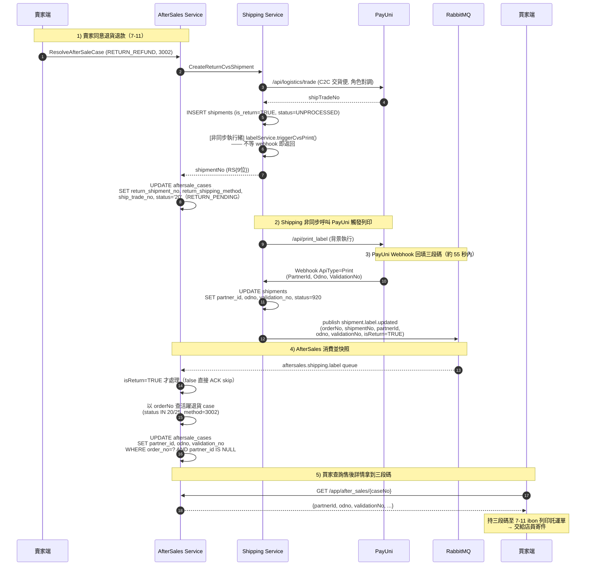

**業務流程圖（分流邏輯）**：

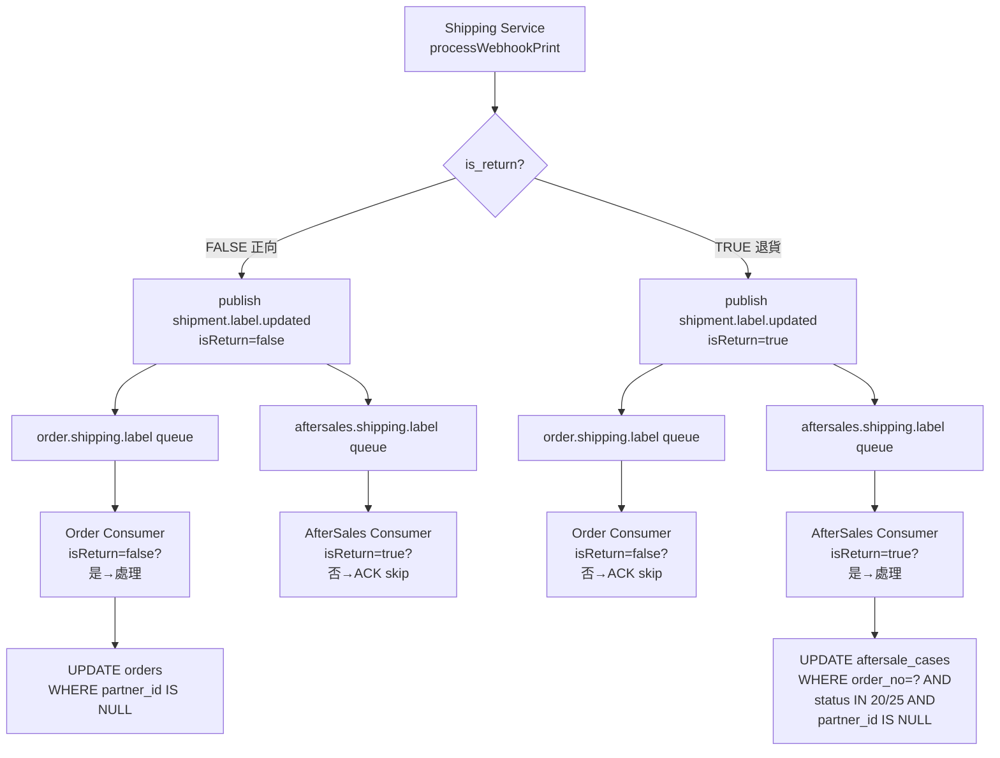

**Consumer 實作要點**：

| 項目 | 規範 |
|------|------|
| Queue | `aftersales.shipping.label`（綁定 `hawkr.shipping` exchange + routing key `shipment.label.updated`） |
| ACK mode | MANUAL（`manualAckContainerFactory`） |
| 分流過濾 | Payload `isReturn=false` 直接 ACK skip；僅 `true` 才處理 |
| 關聯方式 | 以 `orderNo` 查 `aftersale_cases WHERE status IN ('20','25') AND return_shipping_method='3002'`（結合 `uk_aftersale_cases_active_order` 保證單筆活躍） |
| 冪等 | UPDATE 加 `AND partner_id IS NULL`；`rows=0` 記 info log 後 ACK |
| DLQ | 沿用服務既有 DLQ 配置，`MqErrorHandler` 重試一次後入 DLQ |

**空值期與前端行為**：

從賣家按「同意退貨退款」到三段碼進入 `aftersale_cases` 約 **10–55 秒**（視 PayUni 負載）。此期間買家打 `GET /app/after_sales/{caseNo}`，`partnerId` / `odno` / `validationNo` 會是空字串。前端顯示「出貨便代碼產生中，請稍候」並 refetch：進頁面後 10s / 30s / 60s 各一次。若超過 5 分鐘仍為空，視為異常，交由 §5.8 例外人工介入流程處理。

**自動觸發列印的失敗語意**：`ShippingService.createReturnCvsShipment` 在建單 commit 後以獨立執行緒呼叫 `labelService.triggerCvsPrint(...)`，**不等 webhook**，立即回傳 `ReturnShipmentResult`。🔴 **觸發失敗只記 error log、不中斷主流程**——退貨單本身已建立，補救走 §5.3.6 重試或 §5.8 人工介入。

**實作位置**：

| 層級 | 位置 | 職責 |
|------|------|------|
| Payload record | `shipping-service/.../service/dto/LabelUpdatedPayload.java` | 承載 `shipmentNo` / `isReturn` |
| Publisher | `shipping-service/.../service/ShippingService#processWebhookPrint` | `publishLabelUpdated` 帶入 `shipmentNo` ＋ `isReturn` |
| Consumer（正向） | `order-service/.../mq/ShippingEventConsumer#onLabelUpdated` | 入口 `isReturn == true` 即 ACK skip |
| Consumer（逆向） | `aftersales-service/.../mq/ShipmentLabelConsumer` | 訂 `aftersales.shipping.label`；`isReturn == false` skip，`true` 執行冪等 UPDATE |
| MQ Config | `aftersales-service/.../mq/AfterSalesEventMqConfig` | `@Bean Queue` / `@Bean Binding` 僅為**意圖宣告**。🔴 broker 上的 exchange／queue／binding 由 `infra/mq/topology/topology.yaml` 佈建，**同一個 PR 必須加 topology 條目**，否則訂閱靜默失效（見 [MQ Topology 管理（Terraform）](../基礎建設/MQ%20Topology%20管理（Terraform）.md)） |
| MQ Constants | `common-core/.../mq/MqConstants` | `QUEUE_AFTERSALES_SHIPMENT_LABEL = "aftersales.shipping.label"` |
| Repository | `aftersales-service/.../mapper/AfterSaleCaseMapper#updateLabelInfo` | 冪等 UPDATE，WHERE 含 `partner_id IS NULL` |
| View 組裝 | `aftersales-service/.../grpc/AfterSalesGrpcService#buildDetailView` | 回填四欄至 `AfterSaleCaseDetailView`（proto tag 19–22） |
| Gateway | `gateway/internal/handler/aftersales.go` | `AfterSaleCaseDetailResponse` 四欄 ＋ `convertAfterSaleDetail` 映射 ＋ Swagger 註解 |


#### 5.3.6 出貨便代碼重試與人工介入

**設計原則**：`§5.3.5` 的非同步觸發列印為第一次嘗試。若 5 分鐘未收到 PayUni Print Webhook，系統**自動再觸發 1 次**。若再過 5 分鐘仍未收到（總計 10 分鐘），**停止自動重試**並記 `LABEL_RETRY_EXHAUSTED` audit log，由 ops 以人工 API 介入。

不採「每 N 分鐘不斷重試」：PayUni 若已故障，頻繁呼叫會在其恢復時形成 thundering herd；單次自動重試＋人工兜底是最平衡的設計。

**時間軸**：

| 時點 | 系統動作 | 前端顯示 |
|------|---------|---------|
| T+0 | `createReturnCvsShipment` 建單 + 非同步 `triggerCvsPrint`（第 1 次） | 「產生中」 |
| T+0 ~ T+5min | 正常情境下 Webhook 回填，結束 | 拿到三段碼 |
| **T+5min** | **Worker 掃到未回填且預算未用完 → 以 `label_retry_at` 租約 CAS 搶佔 → 再觸發 1 次 `triggerCvsPrint` → shipping 回成功才把 `label_retry_count` 記成 1** | 「產生中」 |
| T+5min ~ T+10min | 期待第 2 次 Webhook 回填，結束 | 拿到三段碼 |
| **T+10min** | **Worker 掃到「試過但沒能確認觸發」（`count=1`，或 `count=0` 且 `label_retry_at IS NOT NULL`）且仍為空 → 記 `LABEL_RETRY_EXHAUSTED` audit log → 停手** | 「請聯繫客服」 |
| ops 介入 | 打 retry API → 重置 `count=0` **並清掉 `label_retry_at` 租約** → 再觸發一次 | 「產生中」→ 拿到代碼 |

> ⚠️ **shipping 觸發失敗時，時間軸不會停在 T+5min**：租約會被**釋放成一個過去的時間**（`releaseLabelRetryLease`），下一個 tick（2 分）就重來，直到 T+10min 的耗盡掃描把它收走。**釋放成過去時間而不是還原成 `NULL`，正是讓那道耗盡掃描收得到它的原因**（釋放成 `NULL` ⇒ 案件無限重試、告警永遠不發）。詳見 [§8.5](#85-多副本排程搶佔語意scheduler-claim) 的 L7 段。

**DB 欄位（`aftersale_cases`）**：

| 欄位 | 類型 | 必填 | 說明 |
|------|------|------|------|
| label_retry_count | SMALLINT | NOT NULL DEFAULT 0 | **已確認觸發過的重試預算**（0=尚未成功觸發過、1=自動重試已確認觸發、2=已標記耗盡、ops 重置回 0）。<br>⚠️ 🔴 **它不是搶佔閘門**——只在 shipping `RetryReturnPrintLabel` 回報成功之後才寫 |
| **label_retry_at** | **TIMESTAMPTZ** | | 自動重試的**租約到期時間**（<b>不是</b>「已重試旗標」）。**三態**：`NULL`＝從未嘗試過（不算耗盡）／**過去**＝嘗試過但無人持有（可搶佔且算耗盡）／**未來**＝嘗試中；claim 成功才呼叫 shipping。租約長度 **6 分鐘**（= auto-interval 2 分 × 3）|

**ReturnLabelRetryWorker（自動重試）**：

```
排程頻率：每 2 分鐘（aftersales.label-retry.auto-interval-ms，預設 120000）
DB 掃描（純候選查詢，不加鎖 —— 見下方 ⚠️）：
  SELECT * FROM aftersale_cases
   WHERE status IN ('20','25')
     AND return_shipping_method = '3002'
     AND partner_id IS NULL
     AND label_retry_count = 0
     AND (label_retry_at IS NULL OR label_retry_at <= NOW())   -- 租約述詞
     AND ship_trade_no IS NOT NULL
     AND created_at < NOW() - INTERVAL '5 minutes'
   LIMIT 50;

每筆處理：
  1. lease claim（搶佔閘門，在 gRPC 副作用之前）：
     UPDATE aftersale_cases
        SET label_retry_at = #{leaseUntil}          -- = claim 當下 + 6 分
      WHERE case_no = #{caseNo}
        AND label_retry_count = 0
        AND (label_retry_at IS NULL OR label_retry_at <= #{now});
  2. rows=0 → 跳過（另一個 pod 已搶走且租約未到期，或預算已用完）
  3. rows=1 → 呼叫 Shipping RPC `RetryReturnPrintLabel(shipTradeNo)`
     - 傳輸層例外 / 業務碼非 SUCCESS → releaseLabelRetryLease
         SET label_retry_at = #{expiredAt}   -- = claim 當下的 now（一個過去的時間），不是還原成舊值
       WHERE case_no = ? AND label_retry_at = #{expectedLeaseUntil}  -- CAS：租約仍等於我寫進去的值
       -- 過去時間同時滿足：可立即重搶（<= NOW()）＋ 耗盡掃描看得到（IS NOT NULL）
       ⇒ 下一個 tick（2 分）就重來，預算未消耗
     - 成功 → markLabelRetried（count 0→1，「已確認觸發」的事後記錄）+ audit LABEL_RETRY_AUTO
       webhook 自行經 MQ → consumer 回填

異常掃描（另一組排程，每 10 分鐘一次）：
  SELECT * FROM aftersale_cases
   WHERE status IN ('20','25')
     AND return_shipping_method = '3002'
     AND partner_id IS NULL
     AND (label_retry_count = 1
          OR (label_retry_count = 0 AND label_retry_at IS NOT NULL))   -- 「試過但沒能確認觸發」
     AND created_at < NOW() - INTERVAL '10 minutes'
   LIMIT 50;

  → 每筆 INSERT aftersale_audit_logs(action=LABEL_RETRY_EXHAUSTED)
     + markLabelRetryExhausted（count → 2，述詞與上面逐字相同）
     後續監控告警，不再自動動作
```

> ⚠️ **`FOR UPDATE SKIP LOCKED` 已移除，不是遺漏**：`autoRetry()` 沒有 `@Transactional`，自動提交下 SELECT 一回傳鎖就釋放 ⇒ 它從來沒有保護到任何東西（[規範 §一 ②](../開發規範/多副本排程搶佔規範.md)）。搶佔由第 1 步的 lease CAS 負責。
>
> 🚨 **耗盡述詞的第二個分支為什麼一定要帶 `label_retry_at IS NOT NULL`**：修復後 `count` 只在 gRPC 確認成功之後才寫，所以「shipping 持續打不通」的案件會一直停在 `count = 0`；不放寬的話它每 2 分鐘靜靜重試到天荒地老、而 `LABEL_RETRY_EXHAUSTED` **永遠不會發** —— 那是拿修復換掉一個既有的偵測能力。
> **但不能只寫 `count IN (0,1)`**：`label_retry_at IS NULL` 的意思是「這個案件**一次都還沒被搶佔過**」（例如服務停機超過 10 分鐘期間堆積的案件），把它判成耗盡等於**讓它一次自動重試都沒做就丟給 ops**。加了這個條件，只有「試過但沒能確認觸發」才算耗盡。
> ⚠️ `selectExhaustedCandidates` 與 `markLabelRetryExhausted` 的述詞必須**逐字同步**：少了放寬 ⇒ 撈到卻標不動、每 10 分鐘重複記一次 audit log；少了 `IS NOT NULL` ⇒ 誤判從未搶佔過的案件。**兩支不一致的任何一個方向都會壞。**

**流程圖**：

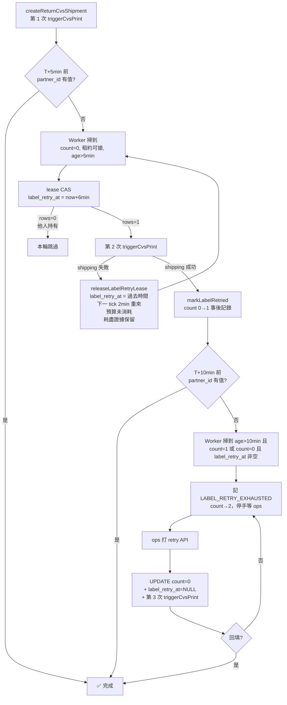

**人工介入 API**：

| 項目 | 規範 |
|------|------|
| Gateway 路徑 | `POST /api/v1/admin/after_sales/{case_no}/retry_print_return_label` |
| 角色 | **ADMIN**（Gateway `requireAdmin` + gRPC `requireAccountType(ADMIN)` 雙層驗證）|
| 前置驗證 | ADMIN 不受 seller ownership 限制 / `return_shipping_method='3002'` / `status IN (20,25)` / `partner_id IS NULL`（已有代碼則拒絕） |
| 動作 | 1. `UPDATE aftersale_cases SET label_retry_count = 0, label_retry_at = NULL WHERE case_no=?`（🔴 **連租約一起清**——只歸零 count 而留著未到期的租約，ops 的救濟要等滿 6 分鐘才生效）<br>2. 呼叫 Shipping `RetryReturnPrintLabel(shipTradeNo)`<br>3. INSERT audit log `action=LABEL_RETRY_MANUAL` |
| Response | `{ "code": 0, "message": "success" }`（不同步等 webhook，請 ops 稍後查詢案件） |
| Rate limit | 同一 case 每分鐘最多 1 次（防 ops 連打） |

**Shipping 端新增內部 RPC**：

```protobuf
// shipping.proto 新增
rpc RetryReturnPrintLabel(RetryReturnPrintLabelRequest) returns (RetryReturnPrintLabelResponse);

message RetryReturnPrintLabelRequest {
    string ship_trade_no = 1;       // 退貨 shipment 的 PayUni 物流序號
}

message RetryReturnPrintLabelResponse {
    int32 code = 1;
    string message = 2;
}
```

實作邏輯（必須走 06 §2.4 `ProviderCallExecutor` 框架）：

```
1. SELECT * FROM shipments WHERE ship_trade_no = ?
2. 驗證 is_return = TRUE（拒絕正向 shipment 誤用）
3. 以獨立執行緒透過 ProviderCallExecutor 呼叫：
   - acquireRequested: UPDATE shipments SET label_print_status='4102', label_print_requested_at=NOW()
                       WHERE id=? AND label_print_status IN ('4101','4104')
                       （rows=0 視為「上一輪 REQUESTED 仍在等待」，直接回 SUCCESS 由 webhook 補；
                        rows=0 不算錯）
   - invoke: labelService.triggerCvsPrint(...)（不等 webhook）
   - markFailed: UPDATE shipments SET label_print_status='4104', provider_message=?
                 WHERE id=? AND label_print_status='4102'
   - markSucceeded 不在此處 — 由 webhook（06 §5.6 processWebhookPrint）負責 transition
4. 立即回 SUCCESS（不等 webhook，由 09 §5.3.6 自動 retry worker 與 09 §6.x label updated consumer 補完）
```

> **與 09 自身 retry 機制（label_retry_count）的關係**：09 端 `aftersale_cases.label_retry_count` 控制「自動再觸發列印」的次數上限（防 thundering herd）；shipping 端 `label_print_status` 控制「該 shipment 列印 transition 是否成功」。兩層互補：09 退貨單視角有自己的觀測；shipping 視角有狀態機保護。

**錯誤碼**（SSOT ＝ `錯誤碼.md`；🔴 改完一律跑 `generate.sh --all`，不得自行判斷哪些輸出會變）：

| 錯誤碼 | 情境 |
|-------|------|
| `AFTERSALE_LABEL_ALREADY_GENERATED` | retry API 被呼叫但三段碼已存在 |
| `AFTERSALE_LABEL_RETRY_NOT_APPLICABLE` | case 狀態不符（非 RETURN_PENDING/RETURN_SHIPPING 或非 3002） |
| `SHIPMENT_NOT_A_RETURN` | `RetryReturnPrintLabel` 收到正向 shipment 的 ship_trade_no |

**audit log action 新增**：

| action 代碼 | 情境 |
|------------|------|
| `LABEL_RETRY_AUTO` | Worker 自動觸發第 2 次列印 |
| `LABEL_RETRY_EXHAUSTED` | 自動重試也失敗，停手等 ops |
| `LABEL_RETRY_MANUAL` | ops 透過 retry API 介入 |

**實作位置**：

| 層級 | 位置 | 職責 |
|------|------|------|
| DB | `aftersale_cases.label_retry_count SMALLINT NOT NULL DEFAULT 0` | 已確認觸發過的重試預算 |
| DB | `aftersale_cases.label_retry_at TIMESTAMPTZ` | 租約欄，**不回填**（NULL ＝ 從未嘗試過） |
| Worker | `aftersales-service/.../scheduler/ReturnLabelRetryWorker` | **同一個類別的兩個 `@Scheduled` 方法**：`autoRetry()`（`fixedDelay` 預設 120s）與 `checkExhausted()`（`fixedDelay` 預設 600s） |
| Shipping RPC | `api/proto/shipping/shipping.proto` `RetryReturnPrintLabel` → `ShippingService.retryReturnPrintLabel(shipTradeNo)` | 重新觸發 PayUni 列印 |
| AfterSales RPC | `api/proto/aftersales/aftersales.proto` `RetryPrintReturnLabel`（角色 **ADMIN**） | 人工重試入口 |
| AfterSales service | `aftersales-service/.../service/AfterSaleLabelRetryService` | 自動 ＋ 人工共用的 retry 邏輯 |
| Gateway | `POST /api/v1/admin/after_sales/{case_no}/retry_print_return_label` | Admin 端入口 |
| Repository | `aftersales-service/.../mapper/AfterSaleCaseMapper` | `selectRetryCandidates()` / `markLabelRetried()` / `resetLabelRetryCount()` / `selectExhaustedCandidates()` / `markLabelRetryExhausted()` / `claimLabelRetry()`（搶佔閘門） / `releaseLabelRetryLease()`（失敗釋放） |
| Audit action | `AfterSaleAuditAction` | `LABEL_RETRY_AUTO` / `LABEL_RETRY_MANUAL` / `LABEL_RETRY_EXHAUSTED` |

**監控告警建議**：

- Audit log 中 `LABEL_RETRY_EXHAUSTED` 計數：每小時 > 5 筆觸發告警（PayUni 可能故障）
- Audit log 中 `LABEL_RETRY_AUTO` / 新建 case 比率：> 20% 觸發告警（PayUni 延遲高）

> 🔴 **上面第一條告警之所以在「shipping 持續快速失敗」時仍成立**：租約釋放寫的是**一個過去的時間**而非還原成 `NULL`，「試過但沒能確認觸發」的證據因此留在 `label_retry_at` 上，10 分鐘後的耗盡掃描撈得到 ⇒ `LABEL_RETRY_EXHAUSTED` 會被寫。⚠️ **把釋放改成「還原成 claim 之前的值」會讓本條告警實質失效**（證據只在租約被持有的那幾秒存在，而取樣間隔 10 分鐘）——機制與機械保證見 [§8.5](#85-多副本排程搶佔語意scheduler-claim) 的 L7 段 ⑦。輔助偵測來源為 `AfterSaleLabelRetryService.auto.shippingFailed` 的 error log（每 2 分鐘一筆）。

> ⚠️ **多副本搶佔語意**：閘門是 `label_retry_at` **租約** ＋ 預算後移 ＋ 失敗釋放租約（**釋放成過去時間，使耗盡告警的偵測證據不被抹掉**）。🔴 **不得改用 `label_retry_count` 的 0→1 CAS 當閘門**——那是[規範](../開發規範/多副本排程搶佔規範.md)定義的**永久旗標**，配上被吞掉的 gRPC 例外會造成「一次失敗就永久用掉唯一一次自動重試」（與 `replicas` 無關，單副本一樣發生）。租約上下界與三態語意見 [§8.5](#85-多副本排程搶佔語意scheduler-claim) 的 L7 段 —— 本節不重複，避免兩處各記一個版本。

#### 5.3.7 賣家確認收貨（含驗貨扣款）

> **三條路徑共用 `confirmReceiptInternal(actor, ...)` helper**：
>
> 1. **賣家手動** — `ConfirmReturnReceipt` RPC，actor=`SELLER`，前置 `status='27'`（只允許 RETURN_DELIVERED）
> 2. **scheduler 自動** — `AutoConfirmReceiptScheduler`，actor=`SYSTEM`，前置 `status='27' AND auto_confirm_at <= NOW()`，固定全額退款不扣款
> 3. **Admin 強制** — `ForceConfirmReceiptForAdmin` RPC，actor=`ADMIN`，前置 `status IN ('20','25','27','28')`，可全額或扣款（見 §5.3.12）
>
> 三條路徑共享同一個 `@Transactional` 內部實作，只在「前置狀態檢查 / actor 寫入 audit log / 流程選擇權限驗證」上分流，**退款金額與 refund_task 建立邏輯完全一致**。

**手動確認**（ConfirmReturnReceipt RPC）：支援「無瑕疵全額退」與「驗貨扣款」兩種路徑，body 全欄位選填（未傳 body 等同全額退款，向後相容）。

**業務流程圖**（Mermaid flowchart）：

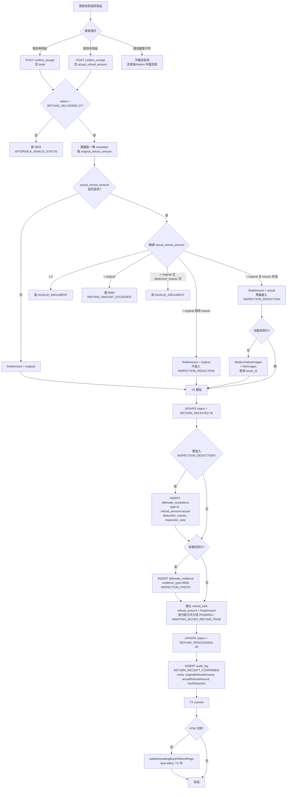

**實作步驟**：

```
前置（actor=SELLER）：
  - status = RETURN_DELIVERED(27)（PayUni 必須先通知送達；20/25/28 一律拒絕）
  - store_id == request.store_id
  - 最後一筆 resolution.resolution_type = RETURN_REFUND(1)，取 original_refund_amount

驗證（未進 TX 前）：
  若 actual_refund_amount != null：
    1. actual_refund_amount > 0              → 否則 INVALID_ARGUMENT(400)
    2. actual_refund_amount ≤ original       → 否則 REFUND_AMOUNT_EXCEEDED(9006)
    3. actual_refund_amount < original 時：
       deduction_reason 非空               → 否則 INVALID_ARGUMENT(400)

  hasDeduction = (actual_refund_amount != null) && (actual_refund_amount < original)
  finalRefundAmount = actual_refund_amount ?? original

Media 準備（TX 外 side-effect，先於 TX 執行）：
  若 inspection_photo_tokens 非空：
    assetList = MediaGrpcClient.finalizeImages(tokens, AFTERSALE)
    MediaGrpcClient.linkImages(AFTERSALE, case_no, assetIds)
    → 失敗則整個請求失敗，不進 TX（與既有 CreateAfterSaleCase 的 evidence 流程對齊）

TX（@Transactional）：
  1. UPDATE aftersale_cases SET status = '30'（RETURN_RECEIVED）

  2. 若 hasDeduction：
     INSERT aftersale_resolutions (
       resolution_type = INSPECTION_DEDUCTION(6),
       refund_amount   = finalRefundAmount,
       deduction_reason, inspection_note,
       resolved_by = account_id
     )

  3. 若 assetList 非空：
     FOR each asset IN assetList:
       INSERT aftersale_evidence (
         case_no, asset_id, object_key,
         uploaded_by = account_id,
         evidence_type = INSPECTION_PHOTO(8602)
       )

  4. INSERT refund_tasks (refund_amount = finalRefundAmount, ...)
     status = ATM 付款 ? AWAITING_BUYER_REFUND_PAGE : PENDING

  5. UPDATE aftersale_cases SET status = '40'（REFUND_PROCESSING）

  6. INSERT aftersale_audit_logs (
       action = RETURN_RECEIPT_CONFIRMED,
       extra = {
         originalRefundAmount, actualRefundAmount, hasDeduction,
         deductionReason, inspectionPhotoCount
       }
     )

TX 外（best-effort）：
  若 ATM 付款：publishAwaitingBuyerRefundPage(order_no, case_no, refund_task_id)
```

> **為何驗貨照片 finalize 放在 TX 外**：Media finalize 是跨服務 side-effect，不應在 DB TX 內執行（TX 內呼叫外部服務會拖長鎖定時間、且 rollback 不會回滾 Media 的 asset 狀態）。既有 CreateAfterSaleCase 的 evidence 流程已採相同模式：先 finalize → 再進 TX 寫 DB。失敗時整個請求失敗（Media 會留下 orphan asset — 此為全系統既有通病，非本次引入，待統一處理）。

> **為何 ATM 事件放在 TX 外**：MQ publish 是 best-effort（既有 `AfterSalesEventPublisherImpl` 已對失敗做 catch-all）。若在 TX 內 publish，MQ 成功但 TX rollback 會造成下游事件與 DB 不一致。

> **⚠️ 搶佔與失敗語意（使用者可見）**
> 步驟 5 的 CAS（30/31/32 → `REFUND_PROCESSING(40)`）是永久狀態轉換。🔴 **CAS 與 `publishAwaitingBuyerRefundPage` 必須同在 `@Transactional` 內，且 publish 必須走會傳遞失敗的變體**（與 [§5.3.10.1](#53101-退貨送達自動確認收貨autoconfirmreceiptscheduler2730) 同形）——publish 失敗被吞掉會讓 **ATM 買家的「前往填寫退款資訊」入口永遠不出現**（order-service 收不到事件就不會 `SET need_refund_page=TRUE`），案件卡在 40、退款無法完成、無告警。
> 🚨 **這個 helper 被四條路徑共用**：兩條排程（[§5.3.10.1](#53101-退貨送達自動確認收貨autoconfirmreceiptscheduler2730) / [§5.3.10.2](#53102-超商待取逾時自動完成storepickuptimeoutscheduler2630)）＋ **兩條 API**（gRPC `ConfirmReceipt` ＝ 賣家按「確認收貨」、Admin `ForceConfirmReceiptForAdmin`）。
> **API 路徑採 fail-closed**：MQ 故障時賣家點「確認收貨」會收到錯誤並需自行重試。這是刻意的——ATM 退款鏈路少了那個事件就是「錢退不出去且沒有人知道」。TX 邊界保證失敗時 DB 不留半套狀態，重試安全。
> ⚠️ 🔴 **四條路徑走同一個 private helper，契約是一起變的**：只改排程那兩條呼叫點，等於把一個使用者可見的行為變更漏在腦外。

> **前端如何取用驗貨照片**：驗貨照片存入 `aftersale_evidence`（`evidence_type=8602 INSPECTION_PHOTO`），與 `aftersale_resolutions` 無直接 FK 關聯（僅共享 `case_no`）。前端從 `AfterSaleCaseDetailView.evidence[]` 遍歷，按 `evidence_type=8602` 過濾即為「驗貨照片」列表。一個 case 最多只會有一次 confirmReceipt 帶驗貨扣款，因此無需精細到 resolution 層級關聯。未來若需支援「多次驗貨」（例如退貨驗收失敗 → 再驗 → 再扣款），再為 `aftersale_evidence` 新增 `resolution_id` 欄位。

**冪等性**：

- 重複呼叫 `confirm_receipt`：既有狀態守門 `status = RETURN_DELIVERED(27)` 會拒絕第二次呼叫（status 已是 RETURN_RECEIVED/REFUND_PROCESSING）→ 拋 9004
- scheduler 自動 confirm 與賣家手動 confirm 競態：兩條路徑都走 mapper SQL `WHERE status='27'` 樂觀鎖，後到者 affected=0 → 直接 skip，不重複建退款任務
- `refund_tasks` 有 `uk_refund_tasks_case_no` 防重，即使狀態守門失守也不會產生重複退款任務

**驗收行為（acceptance）**：

| # | 情境 | 輸入 | 預期結果 |
|---|------|------|---------|
| 1 | happy path — 無瑕疵全額退（向後相容） | 空 body | 200；無 INSPECTION_DEDUCTION；refund_task.refund_amount = resolution.refund_amount |
| 2 | happy path — 驗貨扣款（有照片） | actualRefundAmount < original + deductionReason + inspectionPhotoTokens[3] + inspectionNote | 200；插入 resolution(INSPECTION_DEDUCTION)；插入 3 筆 evidence(INSPECTION_PHOTO)；refund_task.refund_amount = actualRefundAmount |
| 3 | happy path — 驗貨扣款（無照片） | actualRefundAmount < original + deductionReason（無 tokens） | 200；插入 resolution；無 evidence 記錄 |
| 4 | reject — 金額超過上限 | actualRefundAmount > resolution.refund_amount | 9006 REFUND_AMOUNT_EXCEEDED |
| 5 | reject — 金額 = 0 | actualRefundAmount = 0 | 400 INVALID_ARGUMENT |
| 6 | reject — 金額 < 0 | actualRefundAmount = -100 | 400 INVALID_ARGUMENT |
| 7 | reject — 扣款未填原因 | actualRefundAmount < original（deductionReason 空） | 400 INVALID_ARGUMENT |
| 8 | edge — 金額 = 上限 | actualRefundAmount = resolution.refund_amount | 200；**不插入** INSPECTION_DEDUCTION（等同路徑 A） |
| 9 | reject — 狀態不允許（已 confirm） | 第二次呼叫同 case_no | 9004 AFTERSALE_INVALID_STATUS |
| 9b | reject — 狀態不允許（25 物流運送中按） | status=25 時呼叫 confirm_receipt | 9004 AFTERSALE_INVALID_STATUS（防呆：貨還沒到不准按）|
| 9c | reject — 狀態不允許（20 買家尚未寄出） | status=20 時呼叫 confirm_receipt | 9004 AFTERSALE_INVALID_STATUS |
| 9d | reject — 狀態不允許（28 物流失敗） | status=28 時呼叫 confirm_receipt | 9004 AFTERSALE_INVALID_STATUS（須走 Admin force） |
| 10 | reject — 非案件所有人 | 其他賣家 accountId | 9010 AFTERSALE_NOT_OWNER |
| 11 | reject — 案件不存在 | 不存在 case_no | 9001 AFTERSALE_NOT_FOUND |
| 12 | reject — Media finalize 失敗 | 無效 stagedToken | StatusRuntimeException 上拋，TX 未開始，DB 無變更 |
| 13 | ATM 路徑 — 驗貨扣款 | actual < original + payment_method=ATM | 200；refund_task.status=AWAITING_BUYER_REFUND_PAGE；MQ 發出 awaiting_buyer_page；ATM 退款頁顯示金額 = actual |
| 14 | 信用卡路徑 — 驗貨扣款 | actual < original + payment_method=CREDIT_CARD | 200；refund_task.status=PENDING；Worker 後續以 actual 金額呼叫 PayUni |
| 15 | 誤用防護 — resolve 傳 INSPECTION_DEDUCTION | POST `/resolve` 傳 `resolutionType=6` | 400 INVALID_ARGUMENT（見 §5.2 前置驗證第 4 項）；DB 無任何變更 |
| 16 | Detail RPC — 驗證 buyer 可見扣款 | confirm_receipt 後 buyer 呼叫 `/after_sales/:case_no` | `resolutions[]` 含 2 筆（RETURN_REFUND + INSPECTION_DEDUCTION）；`evidence[]` 含 `evidence_type=8602` 的驗貨照片；buyer 能看到扣款原因與驗貨照片 |

**實作位置**：

| 層級 | 位置 | 職責 |
|------|------|------|
| Proto | `api/proto/aftersales/aftersales.proto` | `ConfirmReturnReceiptRequest` 的 `actual_refund_amount` / `deduction_reason` / `inspection_photo_tokens` / `inspection_note`；`ResolutionView` 的 `deduction_reason` / `inspection_note` |
| CodeMeta | `業務類型碼.md` `AfterSaleResolutionType.INSPECTION_DEDUCTION`（value=6）；`內部技術碼.md` `AfterSaleEvidenceType.INSPECTION_PHOTO`（value=8602） | 碼值 SSOT |
| DB | `aftersale_resolutions.deduction_reason VARCHAR(200)` / `inspection_note TEXT` | 扣款理由與驗貨備註 |
| Service | `aftersales-service/.../service/ReturnReceiptService#confirmReceipt` | 驗證、Media finalize（TX 外）、插入 inspection resolution ＋ evidence |
| Service | `aftersales-service/.../service/AfterSaleCaseService#finalizeAndInsertEvidence` | 共用 helper，接受 `evidenceType` 參數 |
| Service | `aftersales-service/.../service/AfterSaleResolutionService#resolve` | 🔴 前置 guard ＋ switch 顯式 `case INSPECTION_DEDUCTION -> throw INVALID_ARGUMENT`（exhaustive 要求，見 §5.2） |
| gRPC | `aftersales-service/.../grpc/AfterSalesGrpcService` | 解析新欄位；buyer / seller 兩支 detail RPC 共用的 `ResolutionView` mapping 補兩欄（照片走既有 `EvidenceView` 列表） |
| Gateway | `gateway/internal/handler/aftersales.go` | `ConfirmReturnReceiptRequest` exported struct、optional body 解析、Swagger 註解 |

> 賣家確認收貨 = 同意撥款（金額由 actualRefundAmount 決定）。若退回商品有**嚴重問題**（完全不符合退貨品項、商品遺失等），賣家應**不確認收貨**，由客訴/Admin 仲裁介入處理。

#### 5.3.8 退貨買家未寄出逾時自動關案

> **政策**：買家進入 `RETURN_PENDING(20)` 起 **7 天**未寄回 ⇒ 自動關案、退款資格解除、訂單款項照常撥付賣家。買家不服可走 §10 申訴流程。

**業務流程圖**：

```mermaid
flowchart TD
    Approve[賣家同意退貨退款<br/>handleReturnRefund] --> Stamp[markReturnPending<br/>SET status='20'<br/>SET ship_back_deadline_at=NOW + 7 days]
    Stamp --> Wait{買家於 7 天內寄回?}
    Wait -->|是<br/>PayUni 碼 31/92| Ship[RETURN_SHIPPING(25) → 走 §5.3.4 物流追蹤]
    Wait -->|剩 24h 未寄| Warn[ReturnTwentyFourHourWarnScheduler<br/>每 5 分鐘掃描]
    Warn --> WarnPub[publish aftersales.case.return_pending_24h<br/>買家 visible：「再不寄回將喪失退款資格」]
    Wait -->|逾時 ship_back_deadline_at < NOW| Worker[ReturnTimeoutWorker<br/>每 10 分鐘掃描]
    Worker --> CAS[markReturnPendingTimeoutAutoClosed<br/>SET status='33', closed_at=NOW<br/>WHERE case_no=? AND status='20'<br/>AND ship_back_deadline_at <= NOW]
    CAS --> CASCheck{affected = 1?}
    CASCheck -->|否<br/>買家剛寄出 20→25 搶先| Skip[log skip + 下一筆]
    CASCheck -->|是| Audit[INSERT audit_log<br/>actor=SYSTEM, action=RETURN_TIMEOUT_AUTO_CLOSED]
    Audit --> Pub[publish aftersales.case.auto_completed_return_pending_timeout]
    Pub --> Notify1[notification-service<br/>買家 visible：「逾時未寄回，退款資格已解除」]
    Pub --> Notify2[notification-service<br/>賣家 visible：「售後案件已關閉，款項照常撥付」]
    Pub --> Order[order-service<br/>嘗試恢復自動完成倒數<br/>反查 HasActiveCase 確認無活躍案件]
    Order --> Final{買家是否申訴?}
    Final -->|否| Terminal[33 為終態]
    Final -->|是 §10 SubmitAppeal| Appeal[appeal_state=APPEALED<br/>case 進 admin 仲裁列表]
    Appeal --> Decide{Admin 裁決}
    Decide -->|FULL/PARTIAL_REFUND| Refund[status=33→40<br/>建立 refund_task]
    Decide -->|REJECT_APPEAL| Close[status=33→50]
```

**時序圖（D-1 預警 + D-0 自動關案 + 申訴回流）**：

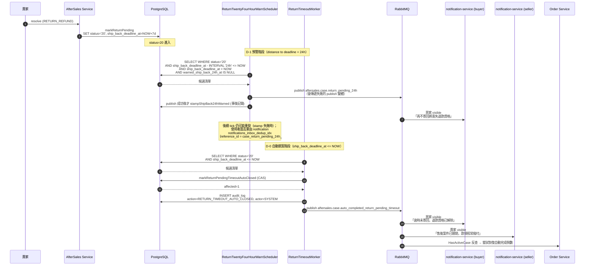

**核心規則**：

| 項目 | 規則 |
|---|---|
| 期限起算 | `ship_back_deadline_at = NOW() + ${aftersales.return.timeout-days}`（預設 7 天），於 `markReturnPending`（0→20）同 SQL 寫入 |
| D-1 預警 | `ReturnTwentyFourHourWarnScheduler` 每 5 分鐘掃 `status='20' AND ship_back_deadline_at - INTERVAL '24h' <= NOW AND ship_back_deadline_at > NOW AND warned_ship_back_24h_at IS NULL`；**publish event → 成功後才 CAS stamp**（例外 B，stamp 非閘門） |
| D-0 自動關案 | `ReturnTimeoutWorker` 每 10 分鐘掃 `status='20' AND ship_back_deadline_at <= NOW`；CAS `markReturnPendingTimeoutAutoClosed` → 寫 audit log → publish event |
| 退款資格 | 33 終態**不建立 refund_task**；買家走申訴經 Admin 裁決退款才走 §10.8.2 refund_task 流程 |
| 訂單撥款 | 33 publish event 對 order-service 等於「嘗試恢復倒數」，與既有 `aftersales.refund.completed` 走相同 consumer 路徑（依 `HasActiveCase` 反查決定是否真的恢復） |
| 競態防護 | CAS `WHERE status='20'`：若 `ReturnShipmentStatusConsumer.handleInTransit` 剛把 20→25（買家壓哨寄出）→ affected=0 skip |

🔴 **預警與關案是兩個獨立 scheduler 分支**（不同 cron ＋ 不同冪等欄位），互不阻塞。D-1 只預警一次。

🔴 **audit log 一案一筆**：CAS 一旦成功 status 即離開 20，下一次 cron 自然 skip。寫入的 action 為 `RETURN_TIMEOUT_AUTO_CLOSED(8528)`；`RETURN_TIMEOUT_ESCALATED(8520)` 保留供歷史 audit log 查詢，**新流程不寫入**。

**參數**：`aftersales.return.timeout-days: 7`、`aftersales.return.timeout-scheduler-cron: 0 */10 * * * ?`（與 31/32 同為 10 分鐘 cadence）

> **⚠️ 搶佔語意**：D-0 自動關案的 CAS（`markReturnPendingTimeoutAutoClosed`，`WHERE status='20' AND ship_back_deadline_at <= NOW()`）擋得住跨 pod 重複，但 `status='33'` 是**永久轉換**（規範 §二 第 4 步的永久旗標）。
> 🚨 **這一支比 B5／B6 危險**：`ReturnTimeoutWorker` **沒有任何 `@Transactional`**（class 上只有 `@Component`，`processCase` 是同 class 內的 private 方法）⇒ CAS 一執行就自動提交，之後 publish 的例外又被迴圈內的 try/catch 吞掉 ⇒ **`aftersales.case.auto_completed_return_pending_timeout` 一旦 publish 失敗即永久遺失**：案件已是 33（退款資格解除），但買賣雙方沒收到通知、order-service 的「嘗試恢復倒數」也沒被觸發，**訂單的自動完成倒數永遠停在暫停狀態**。
>
> 🔴 **CAS ＋ audit ＋ publish 必須收進同一個 `@Transactional` 短 tx**（與 [§5.3.10.1](#53101-退貨送達自動確認收貨autoconfirmreceiptscheduler2730)／[§5.3.10.2](#53102-超商待取逾時自動完成storepickuptimeoutscheduler2630) 同形），**publish 走會傳遞失敗的變體**。
> - **事務載體（強制）**：本 worker **現在沒有任何 service 層 tx 可用**，必須**新增一支獨立 `@Transactional` service bean**（實作：`ReturnPendingTimeoutCloseService.closeExpiredCase(entity, now, principals)`）承載「CAS → audit log → publish」三段，由 `ReturnTimeoutWorker` **跨 bean 呼叫**。⚠️ **不得只在 `processCase` 上加 `@Transactional`** —— 同 class 內 self-invocation 不經 Spring proxy，註解完全失效（本 repo 已有 `completeOrderInTx` 的同款事故，見 [03 號 §5.4](./03-訂單微服務（Order%20Service）詳細設計書.md#54-確認收貨與撥款confirmreceipt--autocomplete)「事務載體」）。
> - **失敗語意**：publish 變體拋例外 → 穿出 proxy → 整個 tx rollback ⇒ **`status` 沒轉、audit 沒寫、事件沒發，三者同進同出**。
> - **下輪重試的候選述詞仍成立**（逐條比對）：rollback 後 `status` 回到 `'20'`、`ship_back_deadline_at` 未被觸碰且仍 `<= NOW()` ⇒ 下一 tick（cron 預設每 10 分鐘）**必然重新撈到這一筆**。
> - **殘餘窗口（誠實標註）**：publish 成功但 commit 失敗 ⇒ 事件已發、狀態未轉。該列仍在候選集合，下一 tick 重跑並重發，consumer 端 `notifications_inbox_dedup_idx` 吸收重複 ⇒ **不一致是暫態的，窗口 = 一個 tick**。
> - 🚨 **tx 內不得有網路呼叫**：`tryPublishCaseTransitionWithContext` 內部會做兩次**無 deadline** 的身分反解 gRPC。`ReturnTimeoutWorker` 必須在**進 tx 之前**呼叫 `resolveEventPrincipals(storeId, buyerId)`，把 `EventPrincipals` 當參數傳給 `closeExpiredCase(entity, now, principals)`（publisher 對這條路徑提供零 gRPC 多載）。反解失敗 ⇒ 記 error log ＋ 跳過本筆（未進 tx、未 CAS，`status` 仍 `'20'` ⇒ 下一 tick 重撈）；**不得降級成帶空值照發**。完整判準見 [§8.5](#85-多副本排程搶佔語意scheduler-claim) 與[《多副本排程搶佔規範》](../開發規範/多副本排程搶佔規範.md)。
>
> 🚨 🔴 **不得改成「publish → 成功才 CAS」**：本筆的 CAS **是業務動作本身，不是事後記錄**。那個順序下，`affected=0` 這條分支（[§5.3.10.4](#53104-並發保護總覽) 明列的「買家壓哨寄出 20→25 搶先」）會變成**事件已經發出去、狀態卻沒有轉**：買家收到「逾時未寄回、退款資格已解除」，而他明明剛寄出；order-service 還會依事件去恢復倒數。**而且不會自我收斂** —— 沒有任何後續動作會撤回那則事件。判準見[《多副本排程搶佔規範》](../開發規範/多副本排程搶佔規範.md)。
> **為什麼不是例外 A（同 tx outbox）**：aftersales-service **沒有通用事件 outbox**（[§8.3](#83-outbox--任務表策略) 只把 `refund_tasks` 當「退款操作」的 outbox，不承載事件），基建成本最高。若日後為本服務新建事件 outbox，例外 A 是更好的終局形態，屆時須在同一份 PR 內更新 §8.3 與本節。
> 逐支對照見 [§8.5](#85-多副本排程搶佔語意scheduler-claim)。

#### 5.3.10 自動完成排程（雙逾時）

> 本節描述兩個獨立 scheduler，分別處理超商 72h 待取逾時、確認收貨 48h 逾時。兩者共用「自動完成」語意（status → 30 → 退款）但 reason 不同。

##### 5.3.10.1 退貨送達自動確認收貨（AutoConfirmReceiptScheduler，27→30）

```mermaid
flowchart TD
    Tick[Scheduler 每 10 分鐘 tick] --> Query[SELECT case_no FROM aftersale_cases<br/>WHERE status='27' AND auto_confirm_at <= NOW()]
    Query --> Loop{有逾時 case?}
    Loop -->|否| End[結束本輪]
    Loop -->|是| ForEach[逐筆處理]
    ForEach --> CallHelper[autoCompleteInternal<br/>actor=SYSTEM<br/>reason=CONFIRM_RECEIPT_TIMEOUT<br/>全額退款]
    CallHelper --> CAS{markAutoCompletedFromDelivered<br/>WHERE status='27'<br/>SET status='32'<br/>SET auto_complete_at_stamp=NOW()<br/>affected > 0?}
    CAS -->|否（賣家剛搶先 confirm）| LogSkip[log skip + 下一筆]
    CAS -->|是| Standard[走 §5.3.7 步驟 4~10<br/>建 refund_task / 推進 40 / publish event]
    Standard --> AuditSys[INSERT audit_log<br/>actor=SYSTEM<br/>action=AUTO_CONFIRM_RECEIPT<br/>extra: reason=CONFIRM_RECEIPT_TIMEOUT, autoConfirmAt, returnDeliveredAt]
    AuditSys --> PubAuto[publish<br/>aftersales.case.auto_completed_confirm_receipt_timeout<br/>actor=system]
    PubAuto --> ForEach
    LogSkip --> ForEach
```

**實作位置**：`services/java/aftersales-service/.../scheduler/AutoConfirmReceiptScheduler.java`

> **⚠️ 搶佔語意**：`markAutoCompletedFromDelivered` 的 CAS（`WHERE status='27'`）擋得住跨 pod 重複，但 `status='32'` 是**永久轉換** —— row 永久離開候選集合。CAS 與後續 publish **同在 `autoConfirmReceipt` 的 `@Transactional` 內**，因此 🔴 **publish 必須呼叫會傳遞失敗的變體**（[§5.3.10.5 (2)](#53105-24h-預警的搶佔語意例外-b)）：publish 拋例外 ⇒ 連 CAS 一起 rollback ⇒ 下一個 tick 重來。呼叫吞噬版 ⇒ 事件永久遺失且零告警。
> ⚠️ **這裡的 `@Transactional` 確實有保護作用**，與 [05 號 §5.7](./05-支付服務（Payment%20Service）詳細設計書.md) B4 那個「`@Transactional` 完全沒有保護作用」的情形**相反**。兩者的差別在於例外有沒有穿過 Spring proxy —— 不要從其中一則推出通則。

##### 5.3.10.2 超商待取逾時自動完成（StorePickupTimeoutScheduler，26→30）

```mermaid
flowchart TD
    Tick[Scheduler 每 10 分鐘 tick] --> Query[SELECT case_no FROM aftersale_cases<br/>WHERE status='26' AND store_pickup_deadline_at <= NOW()]
    Query --> Loop{有逾時 case?}
    Loop -->|否| End[結束本輪]
    Loop -->|是| ForEach[逐筆處理]
    ForEach --> CallHelper[autoCompleteInternal<br/>actor=SYSTEM<br/>reason=STORE_PICKUP_TIMEOUT<br/>全額退款]
    CallHelper --> CAS{markAutoCompletedFromAtStore<br/>WHERE status='26'<br/>SET status='31'<br/>SET auto_complete_at_stamp=NOW()<br/>affected > 0?}
    CAS -->|否（同實例競態 / 賣家剛從超商取貨觸發 26→27）| LogSkip[log skip + 下一筆]
    CAS -->|是| Standard[同上：建 refund_task / 推進 40 / publish event]
    Standard --> AuditSys[INSERT audit_log<br/>actor=SYSTEM<br/>action=AUTO_CONFIRM_RECEIPT<br/>extra: reason=STORE_PICKUP_TIMEOUT, storePickupDeadlineAt, storeArrivedAt]
    AuditSys --> PubAuto[publish<br/>aftersales.case.auto_completed_store_pickup_timeout<br/>actor=system]
    PubAuto --> ForEach
    LogSkip --> ForEach
```

**實作位置**：`services/java/aftersales-service/.../scheduler/StorePickupTimeoutScheduler.java`

> **⚠️ 搶佔語意**：與 §5.3.10.1 **逐字同形** —— `markAutoCompletedFromAtStore` 的 CAS 與 publish 同在 `autoCompleteFromAtStore` 的 `@Transactional` 內，同樣**必須**呼叫會傳遞失敗的 publish 變體。🔴 **兩處的保證等級必須一致**：只有其中一個分支換掉，會讓同一支 service 出現兩種保證。

##### 5.3.10.3 24 小時預警 FCM（ReturnTwentyFourHourWarnScheduler）

```mermaid
flowchart TD
    Tick[Scheduler 每 5 分鐘 tick] --> A[Scan A: 超商待取剩 24h]
    Tick --> B[Scan B: 確認收貨剩 24h]
    Tick --> C[Scan C: 待寄回剩 24h]
    A --> AQ[SELECT case_no FROM aftersale_cases<br/>WHERE status='26'<br/>AND warned_store_pickup_24h_at IS NULL<br/>AND store_pickup_deadline_at - INTERVAL '24h' <= NOW()<br/>AND store_pickup_deadline_at > NOW()]
    B --> BQ[SELECT case_no FROM aftersale_cases<br/>WHERE status='27'<br/>AND warned_confirm_receipt_24h_at IS NULL<br/>AND auto_confirm_at - INTERVAL '24h' <= NOW()<br/>AND auto_confirm_at > NOW()]
    C --> CQ[SELECT case_no FROM aftersale_cases<br/>WHERE status='20'<br/>AND warned_ship_back_24h_at IS NULL<br/>AND ship_back_deadline_at - INTERVAL '24h' <= NOW()<br/>AND ship_back_deadline_at > NOW()]
    AQ --> APub[publish aftersales.case.return_at_store_24h<br/>buyer silent / seller visible]
    BQ --> BPub[publish aftersales.case.return_delivered_24h<br/>buyer silent / seller visible]
    CQ --> CPub[publish aftersales.case.return_pending_24h<br/>buyer visible / seller silent]
    APub --> AStamp[publish 成功才 stampStorePickup24hWarned<br/>事後記錄，非閘門]
    BPub --> BStamp[publish 成功才 stampConfirmReceipt24hWarned<br/>事後記錄，非閘門]
    CPub --> CStamp[publish 成功才 stampShipBack24hWarned<br/>事後記錄，非閘門]
```

> **三個 24h 分支差異**：
> - A、B（既有）推送目標 = **賣家**，提醒「該去超商取貨 / 該手動確認收貨」
> - C 推送目標 = **買家**，提醒「再不寄回將喪失退款資格」
> - 三者共用同一 scheduler class 但走獨立掃描方法，避免 status WHERE 條件混用

**實作位置**：`services/java/aftersales-service/.../scheduler/ReturnTwentyFourHourWarnScheduler.java`

**冪等保證**：由 **notification 端 `notifications_inbox_dedup_idx`** 承擔（`reference_id = case_return_at_store_24h_#{case_no}` / `case_return_delivered_24h_#{case_no}` / `case_return_pending_24h_#{case_no}`，三者只綁 `case_no`、不含日期 ⇒ 同一 case 無論被 publish 幾次，收件匣永遠只有一則）。

`warned_*_24h_at` 的 CAS **不再是冪等閘門**：本分支走《多副本排程搶佔規範》**例外 B（C-none）**，順序為 **publish → 成功後才 stamp**，stamp 降為事後記錄。因此：

- publish 成功、stamp 成功 → 一次（常態）
- publish 成功、stamp 失敗／pod 崩潰 → 下一個 tick 重發 → 由 consumer 冪等吸收
- 🔴 **publish 失敗 → 不 stamp → 下一個 tick 重試**
- 兩個 pod 同 tick 各發一次 → 同樣由 consumer 冪等吸收

> ⚠️ 🔴 **順序正確還不夠**：上面第三條要求呼叫端拿得到失敗訊號，而 `AfterSalesEventPublisherImpl.publish` 吞掉所有例外。**三個 publish 呼叫點一律呼叫「會傳遞失敗」的變體，並在失敗時跳過 stamp**（詳見 [§5.3.10.5](#53105-24h-預警的搶佔語意例外-b)）。順序對、卻仍呼叫吞噬版 ⇒ stamp 照樣寫入 ⇒ 退化成 at-most-once。
> ⚠️ **依賴宣告**：本設計依賴 notification-service 的 `reference_id_template` 與 `notifications_inbox_dedup_idx`。**要改動或移除那兩者之前，先回來看這一節** —— 一旦它們消失，這三筆立刻退化成重複投遞。

##### 5.3.10.4 並發保護總覽

| 觸發路徑 | CAS 條件 | 競態場景 |
|---|---|---|
| AutoConfirmReceiptScheduler | `WHERE status='27'` | 賣家剛手動 confirm 搶先 → affected=0 skip |
| StorePickupTimeoutScheduler | `WHERE status='26'` | 賣家剛從超商取貨觸發 26→27 → affected=0 skip |
| ReturnTwentyFourHourWarnScheduler (store) | **候選** `status='26' AND warned_store_pickup_24h_at IS NULL`；**stamp CAS 不是閘門**（publish 之後才執行） | 跨 pod 重複 → 由 notification `notifications_inbox_dedup_idx` 吸收；已轉 27 → 候選查詢自然撈不到 |
| ReturnTwentyFourHourWarnScheduler (confirm) | 同上（`status='27' AND warned_confirm_receipt_24h_at IS NULL`） | 同上（已轉 30 → 候選撈不到） |
| **ReturnTwentyFourHourWarnScheduler (ship_back)** | 同上（`status='20' AND warned_ship_back_24h_at IS NULL`） | 同上（買家剛寄出 20→25 → 候選撈不到） |
| **ReturnTimeoutWorker** | `WHERE status='20' AND ship_back_deadline_at <= NOW()`（**CAS 與 publish 同在一個 tx 內**）| 買家壓哨寄出 20→25 搶先 → affected=0 skip，**且因為 publish 排在 CAS 之後、同屬一個 tx，這條分支不會發出任何事件**；CAS 成功後 status 即離開 20，下一次 cron 自然 skip ⇒ audit log 一案一筆 |

> **為何不用獨立旗標而用 status='27' 作 CAS**：當 status 已轉走（賣家剛 confirm / Admin force），mapper 自然 affected=0 跳過，不需另外維護 `auto_completed=true` 旗標欄位。自動完成原因由目標 status（31 / 32）直接表達，**不依賴 metadata 欄位**。

> 🚨 **本表的「競態場景」欄與各支的 tx 邊界互為前提，改任一邊都要回頭看另一邊**
> 表中三支**狀態機型**排程（`AutoConfirmReceiptScheduler` / `StorePickupTimeoutScheduler` / `ReturnTimeoutWorker`）的競態處置都是「**affected=0 → skip，什麼都不發**」。這個處置只有在 **publish 排在 CAS 之後**時才成立。
> ⇒ 這三支（以及 [§5.10.5](#5105-樂觀鎖冪等與-transaction-邊界) 的兩支代決排程）🔴 **一律不得改成「publish → 成功才 CAS」的順序**：那會讓本欄描述的每一個競態場景都**先發出一則錯誤事件再 skip**。逐支修法（CAS 與 publish 同 `@Transactional` 短 tx）見 [§8.5](#85-多副本排程搶佔語意scheduler-claim)。
> ⚠️ 對照：表中三支 **`ReturnTwentyFourHourWarnScheduler`** 分支的 stamp 是**事後記錄**（不是業務轉換），所以它們**才**適用例外 B、順序是 publish → stamp。**同一張表裡兩種順序並存是刻意的，不是筆誤**——差別在「被排在後面的那一句，業務上有沒有做事」。

##### 5.3.10.5 24h 預警的搶佔語意（例外 B）

**規範全文**：[開發規範／多副本排程搶佔規範](../開發規範/多副本排程搶佔規範.md)。本節是 `ReturnTwentyFourHourWarnScheduler` 三個分支（超商待取／確認收貨／待寄回）的逐條套用結果。

**結論：本排程走例外 B（C-none），不加任何 DB 搶佔。這是裁決，不是遺漏。**

###### (1) 為什麼 lease 在這裡結構上不可能

| 檢查 | 結果 |
|---|---|
| 候選窗口寬度 | **恰好 24 小時**（`deadline_at - INTERVAL '24h' <= NOW() AND deadline_at > NOW()`，三個分支同形） |
| cron 週期 | 5 分鐘 ⇒ 窗口內約 288 個 tick |
| 租約長度取值 | 取短（例：10 分鐘）⇒ 窗口內重發 **≈144 次**；取長（例：24 小時）⇒ 租約與窗口等寬，**退化成永久旗標**（規範 §三 的黑貓反例同形） |

⇒ 落在規範 §四 例外 B 的分支 **(b)「語意上只該發一次」**：D-1 預警是**一次性事件**，狀態沒解除時再發一次對收件人**沒有新資訊**（買家已經知道了，再提醒 143 次只是噪音）。這與「卡死告警」相反 —— 那類沒人處理就該一直吵，因此必須 lease、不得走 (b)。

###### (2) stamp 為何刻意移到 publish 之後

🔴 **順序不得倒過來寫成 `stampXxx24hWarned`（CAS）→ `publish`**：那會讓 publish 失敗即永久遺失 —— stamp 已寫，候選述詞 `warned_*_24h_at IS NULL` 再也撈不到這一筆，無告警、無重試，買家／賣家永遠收不到那則預警。

改為 **publish → 成功後才 stamp**，`warned_*_24h_at` 從「閘門」降為「事後記錄」：

| 情形 | 舊（stamp → publish） | 現行（publish → stamp） |
|---|---|---|
| publish 成功、stamp 成功 | 一次 | 一次 |
| publish 成功、stamp 失敗／pod 崩潰 | 不會發生 | 下輪重發 → consumer 冪等吸收 |
| **publish 失敗** | **永久遺失、無告警、無重試** | **不 stamp → 下輪重試** |
| 兩個 pod 同 tick | 只有一個發 | 各發一次 → consumer 冪等吸收 |

> 🚫 **不要把這張表推廣到本服務其他排程。** 上表第 2 列（stamp 失敗 ⇒ 下輪重發）**只在被移到後面的那一句是「事後記錄」時成立** —— `warned_*_24h_at` 失敗只是「沒記到」。**本服務其餘的排程要移的是 `status` 終態或 `auto_escalated`，那是業務動作本身**：換順序會讓 CAS `affected=0` 變成「事件說了一件沒發生的事」⇒ **例外 B 不適用**，它們一律走短 tx 或例外 A（[規範 §四 適用邊界](../開發規範/多副本排程搶佔規範.md)、[§8.5](#85-多副本排程搶佔語意scheduler-claim)）。

> 🚨 **換順序只是修改的一半，兩半缺一等於沒修。**
> 另一半是：**三個 publish 呼叫點必須改成呼叫「會傳遞失敗」的 publish 變體**（`ReturnTwentyFourHourWarnScheduler` 的超商待取／確認收貨／待寄回三個分支各一處），並在失敗時**跳過 stamp**。
> 原因：`AfterSalesEventPublisherImpl.publish` 目前 `catch (Exception e) { log.error(...); }` **吞掉所有例外** ⇒ 呼叫端永遠看到「成功」⇒ stamp 照樣寫入 ⇒ **at-most-once 原封不動**。只讀到「換順序」就照做的人，會實作出一個看起來對、行為完全沒變的東西。
> 契約改法：**新增會傳遞失敗的變體，既有 best-effort 呼叫端不動**（該 publisher 的其他呼叫點多為 API 路徑，改契約會讓它們變 fail-closed，見 [§5.4.1](#541-退款任務建立) 的 B7 說明）。

###### (3) 跨 pod 去重交給誰（例外 B 條件 3 的證據）

| 項目 | 內容 |
|---|---|
| 收件匣唯一索引 | `notifications_inbox_dedup_idx` UNIQUE ON `notifications (user_id, user_type, event_type, reference_id) WHERE reference_id IS NOT NULL`（`services/notification-service/db/schema/schema.sql:34`） |
| FCM 推播唯一索引 | `push_notifications_dedup_idx` UNIQUE ON `push_notifications (user_id, user_type, event_type, reference_id) WHERE status = 'sent' AND reference_id IS NOT NULL`（同檔 `:90`） |
| `reference_id` 組成 | `case_return_at_store_24h_#{case_no}` / `case_return_delivered_24h_#{case_no}` / `case_return_pending_24h_#{case_no}`（notification `notification_templates.reference_id_template`） |
| 為何足夠 | 三者**只綁 `case_no`、不含日期或 tick 序號** ⇒ 同一 case 無論被 publish 幾次，收件匣與 FCM 各只留一筆 |

> ⚠️ **依賴宣告**：本設計把「不重複」外包給 notification-service。**改動或移除上述 `reference_id_template` 與兩個唯一索引之前，先回來看這一節** —— 一旦 `reference_id` 加入日期／序號，或索引被放寬，這三筆立刻退化成重複投遞。

###### (4) 保證等級（必須逐案寫，不得推廣）

本分支**有 stamp 可移**，所以拿得到「publish 失敗會重試」。**這是例外 B 的較強形態。**
`CouponExpiringWarningJob`（[07 號 §5.8.1](./07-優惠券微服務（Coupon%20Service）詳細設計書.md)）同樣把 publish 排在 CAS 之前，但**連 stamp 都沒有** ⇒ 只消除跨 pod 重複、**不改變原本的 at-most-once**。⚠️ **兩者的保證等級不同，不得從「順序一樣」推論等價。**

###### (5) 候選 SQL 與 stamp SQL 皆不變

例外 B **不改任何 SQL**：候選述詞仍含 `warned_*_24h_at IS NULL`（它現在的作用是「已成功記錄過的不必再撈」，屬效率優化不是正確性閘門），三支 `stampXxx24hWarned` 的 CAS 也原樣保留。因此既有的兩支部分索引仍完全適配，**不需要新增 migration**。

#### 5.3.11 退貨物流失敗（RETURN_FAILED）

**業務流程圖**：

```mermaid
flowchart TD
    PayUni[PayUni 物流 webhook<br/>狀態 ABNORMAL] --> Ship[Shipping Service<br/>UPDATE shipments<br/>provider_status / provider_message]
    Ship --> Pub[publish shipment.return.status_changed<br/>含 providerStatus / providerMessage]
    Pub --> Cons[AfterSales 消費]
    Cons --> Mark[markReturnFailed<br/>status IN 20/25/27 → 28<br/>寫入 return_provider_status / return_provider_message]
    Mark --> Audit[INSERT audit_log<br/>RETURN_FAILED]
    Mark --> PubFailed[publish aftersales.case.return_failed]
    PubFailed --> Buyer[Buyer 推播<br/>"退貨物流異常"]
    PubFailed --> Seller[Seller 推播<br/>"退貨物流異常"]
    Mark --> Next{後續處理}
    Next -->|買家不接受| Appeal[走既有申訴流程 §10]
    Next -->|平台主動處理| AdminForce[Admin ForceConfirmReceipt §5.3.12]
```

**前端顯示策略**：
- Buyer / Seller App 顯示 `returnProviderMessage`（如「客戶拒收，原件退回」）+ 引導申訴或聯絡客服
- 不主動推退款任務 — 退款是否啟動由買家申訴 / Admin 決定

#### 5.3.12 Admin 強制確認收貨（ForceConfirmReceiptForAdmin）

**用途**：PayUni 漏發 DELIVERED 通知、物流走 ABNORMAL 但實際送達、賣家失聯等情境，Admin 介入推進退款流程。

**前置條件**：
- caller 必須是 ADMIN（Gateway middleware + gRPC `requireAccountType(ADMIN)`）
- case status ∈ {`RETURN_PENDING(20)`, `RETURN_SHIPPING(25)`, **`RETURN_AT_STORE(26)`**, `RETURN_DELIVERED(27)`, `RETURN_FAILED(28)`}
- request 必填 `reason`（Admin 強制理由，寫入 audit log）

**實作流程**：
1. 驗證 caller = ADMIN + case status 合法
2. 樂觀鎖 transition：`UPDATE WHERE status IN ('20','25','26','27','28')` → `30`（`markReturnReceivedByAdmin`）
3. 走 `confirmReceiptInternal(actor=ADMIN, ...)` 共用流程
4. audit log：actor=`ADMIN`、action=`FORCE_CONFIRM_RECEIPT`、extra 含 `reason` / `priorStatus`
5. publish `aftersales.case.return_received`（actor=`admin`）— 與賣家手動共用 routing key

**API 規格**：

```
POST /api/v1/admin/after_sales/{case_no}/force_confirm_receipt
Body: {
  "reason": "PayUni 漏發送達通知，賣家提供簽收照",     // 必填
  "actualRefundAmount": "1200",                       // 選填，預設全額
  "deductionReason": "驗貨發現外包裝破損"              // actualRefundAmount < original 時必填
}
```


#### 5.3.13 冪等與防重

- 物流狀態事件重複消費：mapper SQL 的 `WHERE status IN (...)` 樂觀鎖天然冪等，重投遞 affected=0 即 skip
- STORE_ARRIVED(32) 重複消費：`markReturnAtStore WHERE status='25'`，第二次 affected=0 → skip
- DELIVERED(11) 重複消費：`markReturnDelivered WHERE status IN ('25','26')`，第二次 affected=0 → skip
- ABNORMAL 重複消費：`markReturnFailed WHERE status IN ('20','25','26','27')`，第二次 affected=0 → skip
- 賣家手動 confirm 與 AutoConfirmReceiptScheduler 競態：兩者都 `WHERE status='27'`，先到者贏
- StorePickupTimeoutScheduler 與 PayUni 碼 11（賣家剛取貨）競態：`WHERE status='26'`，先到者贏
- 24h 預警：**不以 `warned_*_24h_at` CAS 作為去重閘門**（例外 B，publish → 成功後才 stamp）；跨 pod／重複 tick 的重複投遞由 notification 端 `notifications_inbox_dedup_idx`（`reference_id = case_return_*_24h_#{case_no}`）吸收，收件匣仍只有一則
- 待寄回自動關案與買家壓哨寄出（20→25）競態：`WHERE status='20'`，先到者贏；買家先寄出 → ReturnTimeoutWorker affected=0 skip → 案件正常走 25→27 路徑
- Admin force confirm 與其他四條競態：`WHERE status IN ('20','25','26','27','28')`，後到者 affected=0 → skip
- 確認收貨重複操作：`status != RETURN_DELIVERED(27)` → 拒絕（拋 9004）
- PayUni 碼 55（賣家未取）重複消費：`stampReturnProviderInfo` 為 idempotent UPDATE，覆寫同欄位無副作用

#### 5.3.14 逆物流退貨流程 FCM 通知事件總覽

> 本節彙整逆物流退貨流程的 FCM 通知事件、觸發時機、推送目標與 routing key。notification-service 的 template 配置見 §4.4。

**事件清單**：

| FCM 事件 | 觸發時機 | Title | Body | Routing Key | 推送目標 | 物流類型 |
|---|---|---|---|---|---|---|
| 退貨商品待領取（72h）| PayUni 碼 32 觸發 25→26 流轉當下 | 退貨商品待領取 | 退貨商品已送達至退貨門市，請於 72 小時內完成取貨，逾時系統將自動確認收貨並退款（案件 #{caseNo}）| `aftersales.case.return_at_store` | 賣家 visible | 僅超商 |
| 退貨商品待領取（24h 剩餘）| `RETURN_AT_STORE(26)` 進入後剩 24h 仍未取，`ReturnTwentyFourHourWarnScheduler` 觸發 | 退貨商品待領取 | 退貨商品已送達至退貨門市，請於 24 小時內完成取貨，逾時系統將自動確認收貨並退款（案件 #{caseNo}）| `aftersales.case.return_at_store_24h` | 賣家 visible | 僅超商 |
| 退貨商品已送達（48h）| PayUni 碼 11 觸發 25→27 或 26→27 當下 | 退貨商品已送達 | 請於 48 小時內至訂單管理確認收貨，逾時系統將自動確認收貨並退款（案件 #{caseNo}）| `aftersales.case.return_delivered` | 賣家 visible | 超商 + 宅配 |
| 退貨商品已送達（24h 剩餘）| `RETURN_DELIVERED(27)` 進入後剩 24h 仍未確認，scheduler 觸發 | 退貨商品已送達 | 請於 24 小時內至訂單管理確認收貨，逾時系統將自動確認收貨並退款（案件 #{caseNo}）| `aftersales.case.return_delivered_24h` | 賣家 visible | 超商 + 宅配 |
| 售後單已自動完成（超商待取逾時）| `StorePickupTimeoutScheduler` 推進 26→30 當下 | 售後單已自動完成 | 未於平台指定時間內完成相關操作，系統已自動確認收貨並退款（案件 #{caseNo}）| `aftersales.case.auto_completed_store_pickup_timeout` | 賣家 visible | 僅超商 |
| 售後單已自動完成（確認收貨逾時）| `AutoConfirmReceiptScheduler` 推進 27→30 當下 | 售後單已自動完成 | 未於平台指定時間內完成相關操作，系統已自動確認收貨並退款（案件 #{caseNo}）| `aftersales.case.auto_completed_confirm_receipt_timeout` | 賣家 visible | 超商 + 宅配 |
| **退貨商品待寄回（24h 剩餘）** | `RETURN_PENDING(20)` 進入後剩 24h 仍未寄出，`ReturnTwentyFourHourWarnScheduler` 待寄回分支觸發 | 退貨商品待寄回 | 請於 24 小時內寄回退貨商品，逾時將解除退款資格並關閉售後案件（案件 #{caseNo}）| `aftersales.case.return_pending_24h` | 買家 visible | 共通 |
| **售後案件已關閉（待寄回逾時）— 買家** | `ReturnTimeoutWorker` 推進 20→33 當下 | 售後案件已關閉 | 逾時未寄回退貨商品，退款資格已解除（案件 #{caseNo}）；若有特殊情況可於申訴期內提出申訴 | `aftersales.case.auto_completed_return_pending_timeout` | 買家 visible | 共通 |
| **售後案件已關閉（待寄回逾時）— 賣家** | 同上一筆事件，notification template 同 routing key 分流發給賣家 | 售後案件已關閉 | 買家逾時未寄回退貨商品，案件已關閉，款項照常撥付（案件 #{caseNo}）| `aftersales.case.auto_completed_return_pending_timeout` | 賣家 visible | 共通 |

**Payload 必含欄位**（所有 9 個 routing key 共用）：

```json
{
  "eventId": "string (UUID)",
  "eventType": "AfterSalesEventType.value",
  "caseNo": "A123456789",
  "orderNo": "string",
  "buyerAccountId": 2001,
  "sellerAccountId": 1001,
  "actor": "system",
  "shippingMethod": "3001 | 3002",
  "deadlineAt": "ISO 8601 UTC（依事件取 ship_back_deadline_at / store_pickup_deadline_at / auto_confirm_at）",
  "autoCompleteReason": "STORE_PICKUP_TIMEOUT | CONFIRM_RECEIPT_TIMEOUT | RETURN_PENDING_TIMEOUT | null"
}
```

notification-service 透過 `payload_filter` + template_render 即可從 payload 抽取欄位渲染至 body（既有機制無需擴充）。

#### 5.3.15 `SELLER_NOT_PICKED(55)`（賣家未取）訊息持久化

**背景**：PayUni 7-11 C2C 退貨於賣家逾期未取後會回傳碼 55（SELLER_NOT_PICKED），但 PayUni 的保留期遠長於本平台規定的 72 小時。當 PayUni 回此碼時，本平台的 `StorePickupTimeoutScheduler` 通常已執行完畢（case status=30 已是終態）。

**處理策略**：
- 收到碼 55：呼叫 `stampReturnProviderInfo(caseNo, "55", "賣家未取（PayUni）")` 寫入 `return_provider_status` / `return_provider_message`，不變狀態
- 若 case 還在 26（極端情況下我方 timer 失效或時鐘偏差）：訊息照記，但仍由 timer 走原 STORE_PICKUP_TIMEOUT 流程，不雙重觸發
- Admin 端 detail 顯示 `return_provider_message` 供查詢時參考 PayUni 原文

🔴 **`SELLER_NOT_PICKED(55)` 不得觸發自動完成**：72h timer 是「賣家未取」的**唯一真實來源**，第二個觸發來源會破壞單一寫入路徑原則（[後端服務責任邊界規範](../開發規範/後端服務責任邊界規範.md)）。碼 55 只當 audit trail。

#### 5.3.16 一致性邊界（待寄回逾時自動關案）

依[後端服務責任邊界規範](../開發規範/後端服務責任邊界規範.md)：

- **單一寫入路徑**：`ship_back_deadline_at` 只由 `AfterSaleResolutionService.handleReturnRefund` 寫入，無其他 callsite。
- 🔴 **不引入補償任務基礎設施**：本流程不得出現 `*ReconciliationJob` / `*BackfillCLI` / `reflow_task` / drift 偵測排程。
- 🔴 **歷史資料的一次性處理走 migration SQL 或經審核的維運 SQL**，不寫進 application code。

### 5.4 退款執行流程

#### 5.4.1 退款任務建立

由 §5.2.2（部分退款）、§5.2.3（全額退款）、§5.3.3（確認收貨後）、§5.7（取消出貨）觸發。

> **一致性（退款發起方唯一）**：Payment Service 已將 `CreateRefund` 收斂為 **internal-only**（見 [05 §1.6 / §4.1 / §5.5.3](./05-支付服務（Payment%20Service）詳細設計書.md#55-退款流程refund)），買家不再能直呼付款服務退款。**售後審核核准後的 `RefundTaskWorker` 是退款的唯一發起方**。金額防線兩側對應、不重複實作：aftersales 側以 R5 退款上限（`refund_amount ≤ refundable_amount`，見 §1.5 R5）把關**申請額度**；payment 側以 [05 §5.5.5](./05-支付服務（Payment%20Service）詳細設計書.md#55-退款流程refund) L2 在途餘額計算 + L3 DB 兜底把關**落地額度**，**以 payment 為金額落地權威**。

**refund_amount 來源**（重要）：

| 觸發情境 | refund_amount 來源 |
|---------|-------------------|
| §5.2.2 部分退款 | 使用者輸入的 `refundAmount` |
| §5.2.3 全額退款（免退貨） | `case.refundable_amount` |
| §5.3.3 確認收貨（無驗貨扣款） | 最後一筆 resolution 的 `refund_amount`（= `resolution[RETURN_REFUND].refund_amount`） |
| §5.3.3 確認收貨（有驗貨扣款） | 最新插入的 `resolution[INSPECTION_DEDUCTION].refund_amount`（= `actual_refund_amount`） |
| §5.7 賣家取消出貨 | `order.refundable_amount` |

> **MQ/Webhook 快照一致性**：下游所有事件（`aftersales.refund.completed`、ATM 退款頁金額顯示、PayUni CreateRefund 請求）皆從 `refund_tasks.refund_amount` 讀取，天然等於 finalRefundAmount，無快照分裂風險。

```sql
INSERT INTO refund_tasks (id, case_no, order_no, transaction_id, refund_amount,
                          payment_method, mer_id, status, max_retry_count)
VALUES (tsid, ?, ?, ?, ?, ?, ?,
        CASE WHEN payment_method = '4' THEN '5' ELSE '0' END,  -- ATM → AWAITING_BUYER_REFUND_PAGE
        10);
```

#### 5.4.2 RefundTaskWorker（背景執行）

> **範圍**：僅處理信用卡 / Apple Pay / Google Pay 路徑的退款。ATM 路徑（`payment_method='4'`）**完全不由 Worker 處理**，狀態由 `§5.4.3 RefundResultConsumer` 根據 PayUni webhook 透過 event 推進。

```
掃描條件（三個分支，**不可壓成單一共同述詞**）：
         payment_method != '4'                                   -- 排除 ATM
     AND (
           (status = PENDING(0)     AND (next_retry_time IS NULL OR next_retry_time <= NOW()))
        OR (status = FAILED(30)     AND next_retry_time IS NOT NULL AND next_retry_time <= NOW())
        OR (status = PROCESSING(10) AND (next_retry_time IS NULL OR next_retry_time <= NOW()))
         )
排程間隔：每 10 秒

⚠️ FAILED 分支的 `next_retry_time IS NOT NULL` 是**終態守門**：終態失敗（步驟 4 的
   retry_count >= 1 分支）會寫 next_retry_time=NULL 表示「不再重試、進 admin 異常清單」。
   若把 `(next_retry_time IS NULL OR ...)` 拉成三分支共用的條件，那些終態 task 會被無限重撈。
⚠️ 🔴 PENDING 分支**必須**帶時間條件：不帶的話 lease 對 PENDING row 無效。
⚠️ 🔴 PROCESSING 分支**不可省**：它是「pod 在 claim 與 CreateRefund 之間崩潰」的救援路徑。

每筆任務：
1. Claim（lease CAS，見 §8.5）:
     UPDATE refund_tasks
        SET next_retry_time = NOW() + 120s,     -- 租約下界 = CreateRefund 的 100s gRPC deadline，推導見下方 §「搶佔語意」
            status          = PROCESSING(10),   -- 保留，但角色降為「可觀測資訊」
            updated_at      = NOW()
      WHERE id = ?
        AND (status IN (0, 10) OR (status = 30 AND next_retry_time IS NOT NULL))  -- 與候選述詞一致（含終態守門）
        AND (next_retry_time IS NULL OR next_retry_time <= NOW())
   affected = 0 → skip 本筆（另一個 pod 已搶到，租約未到期），continue
2. 呼叫 Payment Service (gRPC):
     CreateRefund(trade_no=transaction_id, amount=refund_amount, refund_no=case_no + "-" + retry_count)
     → 即時結果：SUCCESS / FAILED
   ※ refund_no 為冪等鍵：Payment Service 若已有同 refund_no 且 SUCCEEDED 的退款，直接回傳既有結果不重複退款。
   ⚠️ **含 `retry_count` 是刻意的**：租約到期被別的 pod 重搶時 `retry_count` 未變 ⇒ 同一把鍵 ⇒ 被冪等索引擋掉；失敗重試時 `retry_count++` ⇒ **換鍵** ⇒ 冪等鍵刻意不生效（那是一次新的退款嘗試）。這也是 `CREATE_REFUND_DEADLINE_SEC` 不可調小的前提，見上方推導表

3. 信用卡成功：
   TX:
     - UPDATE refund_tasks: status='20'（DONE）, external_ref_id,
                            payuni_status=<PS 回傳 Status>, payuni_message=<Message>
     - UPDATE aftersale_cases: status='50'（CLOSED）, closed_at=NOW()
     - INSERT audit_log(action=REFUND_SUCCEEDED)
   TX 外:
     - Publish MQ: aftersales.refund.completed
   ※ Payment 端亦會發 refund.succeeded event；aftersales consumer 看到成功 routing key + 無日期欄位 → idempotent skip（見 §5.4.3）

4. 失敗（Payment 回錯 / gRPC 異常）：
   若 retry_count < 1:
     TX:
       - UPDATE refund_tasks: status='30'（FAILED）, retry_count+1,
                              next_retry_time=NOW+30s,
                              last_error=<內部錯誤>,
                              payuni_status=<PS 回傳 Status, 若有>,
                              payuni_message=<PS 回傳 Message, 若有>
       - INSERT audit_log(action=REFUND_FAILED, detail={retryCount, nextRetryTime, finalFailed=false})
     ※ 不發 MQ event，Worker 下一個 tick（30s 後）自己再 claim 重試
   若 retry_count >= 1（已重試過）:
     TX:
       - UPDATE refund_tasks: status='30'（FAILED）(終態), next_retry_time=NULL,
                              last_error=<內部錯誤>,
                              payuni_status, payuni_message
       - INSERT audit_log(action=REFUND_FAILED, detail={retryCount, finalFailed=true})
     ※ 進 admin 異常清單；Payment 端此時會發 refund.failed event
```

**重試策略**：固定 30 秒延遲。`retry_count < 1` → 排隊重試；`retry_count >= 1` → 終態不再重試。
- 既有 `max_retry_count` 欄位保留但本次不再使用；程式以常數 `CC_RETRY_LIMIT = 1` 硬編判斷

> **⚠️ 搶佔語意 —— claim 是「推時間」不是「換狀態」**
> 🔴 **不得以 `SET status='10' WHERE id=? AND status IN ('0','30')` 當 claim**：`PROCESSING('10')` 不在候選集合、沒有任何時間欄能讓它回來 ⇒ pod 在 claim 與 `CreateRefund` 之間崩潰（進程消失，catch 不會跑）時，**該筆退款永久卡在 `PROCESSING`**：買家的錢退不回去、沒有錯誤、沒有告警。那是[《多副本排程搶佔規範》](../開發規範/多副本排程搶佔規範.md) §二第 4 步定義的**永久旗標**。
>
> | 項目 | 內容 |
> |---|---|
> | 租約欄 | `refund_tasks.next_retry_time`（已有 `(status, next_retry_time)` 索引） |
> | 租約長度 | **120 秒**（上下界推導見下方 🚨） |
> | 候選窗口寬度 | **∞**（候選述詞無時間上界）⇒ 任何租約長度都滿足上界 |
> | `status` 的角色 | **可觀測資訊**，不是閘門——保留是為了讓運維在 DB 上讀出「這筆正在被處理」 |
>
> 🚨 **租約的下界**
> [規範 §三第 5 步](../開發規範/多副本排程搶佔規範.md)要求 **租約長度必須 > 單筆工作的最壞耗時**。🔴 **因此 `CreateRefund` 必須有 deadline**——沒有 deadline 就沒有最壞耗時，下界無從建立。
>
> | 項目 | 值 | 依據 |
> |---|---|---|
> | PayUni 單次交換上界 | **90 秒** | `PayUniHttpClient` 的 OkHttp connect 30s ＋ write 30s ＋ read 30s，三段各自計時 |
> | `CreateRefund` gRPC deadline | **100 秒** | 90 秒 ＋ payment 端本地 DB 寫入與 gRPC 傳輸餘裕 10 秒。🔴 加在**呼叫點** `PaymentGrpcClient.createRefund`，**不得**改共用 `GrpcStubFactory`（那會一次改掉全 repo 所有 Java gRPC 呼叫的逾時語意） |
> | claim 租約 | **120 秒** | 100 秒 ＋ claim 與呼叫之間、失敗路徑 DB 寫入的餘裕 20 秒 |
>
> - ⚠️ 🔴 **deadline 不可「保守地」調小**：小於 PayUni 最壞往返 ⇒ 一筆其實已在 PayUni 成功的退款在我方變成 `DEADLINE_EXCEEDED` ⇒ 走失敗路徑 ⇒ **`retry_count++`** ⇒ 下一次的 `refund_no = case_no-retryCount` 是**另一把冪等鍵** ⇒ **冪等鍵這道防線當場失效**。對照：租約到期被重搶時 `retry_count` 未變 ⇒ 同一把鍵 ⇒ 由 payment 側 `idx_payment_refunds_idempotency_key` 擋掉。差別全在 `retry_count` 有沒有被推進。
>
>   **換鍵之後擋在前面的是 payment 側與冪等鍵無關的兩道金額防線**（`hasProcessingRefund`：status IN `'0','1'`；`sumRefundedAmountByTradeNo` → `RefundDomainService.validateRefundAmount`：status IN `'0','1','2'`），後果依退款形態分兩種：
>
>   | 情形 | 會不會退第二次錢 | 實際壞法 |
>   |---|---|---|
>   | **全額退款**（本服務主要形態） | **不會** | 第一筆已佔滿可退額度 ⇒ 重試被「退款金額超過可退款餘額」擋下。但 PayUni 已實際退款，我方 `refund_tasks` 走到終態 `FAILED`、case 停在 `40` **永不 CLOSED**、`aftersales.refund.completed` **永不發出**（券／庫存／訂單狀態全不同步），而 `last_error` 記的是**誤導性的金額錯誤** |
>   | **部分退款**（驗貨扣款等，剩餘額度仍足） | **會** | 兩道防線都放行 ⇒ 真的退第二次錢 |
>
>   （第一筆若當下尚未終結，`hasProcessingRefund` 會先以 `REFUND_ALREADY_PROCESSING` 擋下，結局同第 1 列。）
> - **加長租約不拖慢正常重試**：失敗路徑寫的 `next_retry_time = NOW+30s` 與租約寫同一欄且在 claim 之後執行，天然覆蓋（見下方「失敗路徑的 backoff」）。租約只影響「pod 在 claim 與退款之間崩潰」的救援延遲（120 秒）。
> - 不變式 `CLAIM_LEASE_SEC > CREATE_REFUND_DEADLINE_SEC` 由 `RefundTaskWorkerClaimTest.claimLease_mustExceedCreateRefundDeadline` 機械斷言——兩個常數任一被單獨調整就轉紅。
> - ⚠️ 🔴 **候選述詞必須涵蓋 `PROCESSING('10')`**，否則租約到期 row 仍然回不來 —— 那只是把永久旗標寫得更像 lease。⚠️ **但不可把三個分支壓成 `status IN ('0','30','10') AND (next_retry_time IS NULL OR <= NOW())` 一句**：`FAILED` 且 `next_retry_time IS NULL` 是**終態**（步驟 4 的 `retry_count >= 1` 分支寫的），壓成共同述詞會讓那些已進 admin 異常清單的 task 被無限重撈。逐分支寫法見本節掃描條件。
> - 🚨 **`PENDING('0')` 分支必須有時間條件**：新建 task 的 `next_retry_time` 為 NULL，必須寫成 `(next_retry_time IS NULL OR next_retry_time <= NOW())`，否則 lease 對 PENDING row 完全無效——claim 推了時間，候選查詢照樣把它撈回來。
> - **與冪等鍵的分工**：本 worker 送出的冪等鍵是 **`refund_no = case_no + "-" + retry_count`**（`cancel_id` 路徑為 `"C" + cancel_id + "-" + retry_count`），**不是**單純的 `case_no`。
>   - **租約到期被重搶** ⇒ `retry_count` **未變** ⇒ **同一把鍵** ⇒ 冪等索引命中、不重打 PayUni。claim 是第一道防線（少打一次），冪等鍵是最終防線（真打了兩次也不會退兩次）。
>   - **走失敗路徑重試** ⇒ `retry_count++` ⇒ **換一把鍵** ⇒ 冪等鍵**刻意不生效**（那正是「重試」的定義），此時擋在前面的是上一條那兩道金額防線。
> - **失敗路徑的 backoff 不得被 lease 覆蓋成更短**：步驟 4 寫入的 `next_retry_time = NOW+30s` 與 claim 的租約寫同一欄，**以失敗路徑的值為準**（它在 claim 之後執行，天然覆蓋）。
> - **本路徑的事件遺失由補償排程承接**：成功後 `status=DONE` 亦是永久轉換，其後的 `aftersales.refund.completed` publish 在 TX 外。`RefundSyncWorker`（[§8.4](#84-補償與人工修復策略)）每小時掃 `status=DONE AND updated_at < NOW()-1h` 並重發 `refund.completed` / `cancel.completed`，[§8.3](#83-outbox--任務表策略) 所說的「best-effort ＋ 由補償排程補發」即指此。
>   ⇒ 本路徑**不需要把 publish 收進短 tx**；它要守的只有 claim 的租約語意。
>   ⚠️ 🔴 **這個豁免有前提**：它依賴 `RefundSyncWorker` 會補發。**`RefundSyncWorker` 的候選集合一旦改成會收斂（`DONE` 退出候選），本路徑與 `AtmRefundReconciler` 必須同一批改成「publish 進 CAS 的短 tx」**，否則嚴重度會從「延遲補發」躍升成「永久遺失」。見 [§8.5](#85-多副本排程搶佔語意scheduler-claim) 的 L5 段。

**信用卡不進 AWAITING_WEBHOOK**：PayUni 信用卡退款無 webhook，同步 SUCCESS 即視為受理完成。**不做 `/api/trade/query` 輪詢**。

#### 5.4.2.1 ATM 退款 — PayUni 請求頁面版

> **平台不接觸銀行機敏資訊**。ATM 退款改用 PayUni 提供的請求頁面版（`/api/offline_payment/refund`），由 PayUni 頁面直接收集買家銀行帳號、身分證字號等敏感資料。

**前端顯示條件（決定是否顯示「前往退款」按鈕）**：

統一依據 `order.needRefundPage == true` 判斷，不分場景。此 flag 由 Order 服務透過 MQ（`aftersales.refund.awaiting_buyer_page`）在兩個場景都會正確 SET/CLEAR：
- 售後退款：AfterSales 決議 FULL_REFUND_NO_RETURN 且 payment_method=ATM
- 賣家取消出貨：Seller 取消已付款 ATM 訂單

| 顯示位置 | API 欄位 | 說明 |
|---------|---------|------|
| 訂單列表（OrderSummary） | `needRefundPage` | 列表卡片上直接顯示入口 |
| 訂單詳情（OrderDetail） | `needRefundPage` | 詳情頁顯示「前往填寫退款資訊」按鈕 |

退款完成（`aftersales.refund.completed`）或取消退款完成（`aftersales.cancel.completed`）後，Order 服務會清除 flag（`need_refund_page=FALSE`），前端自然隱藏按鈕。

**後端驗證（API 被呼叫時的防護兜底）**：

```
POST /api/v1/app/orders/:order_no/refund_page

驗證步驟：
1. 查詢 refund_tasks WHERE order_no = ? AND status = '5'（AWAITING_BUYER_REFUND_PAGE）
   → 找不到 → 9012 REFUND_PAGE_NOT_AVAILABLE（無待操作的 ATM 退款）
2. 確認 payment_method = ATM（4）
   → 非 ATM → 9012（非 ATM 不需要頁面版）
3. 驗證 buyer 身份：
   - case_no 非空 → aftersale_cases.buyer_id == request.buyer_id
   - cancel_id 非空 → seller_cancel_requests.buyer_id == request.buyer_id
   → 不匹配 → 9010 NOT_OWNER
4. 通過所有驗證 → 組裝 redirect_url
```

**流程（參考信用卡 UPP + 超商門市地圖模式）**：

```
1. 賣家決策建立 refund_task，status = AWAITING_BUYER_REFUND_PAGE(5)
   前端根據上述條件顯示「前往退款」按鈕

2. 買家點擊「前往退款」：
   POST /api/v1/app/orders/:order_no/refund_page
     body: { client_type: "MOBILE_APP" | "WEB_BROWSER" }（前端必傳；空字串 fallback MOBILE_APP）
   → Gateway：解析 body 取 client_type；由 JWT AccountType 推導 app_type（BUYER / SELLER）；兩者一併帶入 gRPC GetRefundPageUrl
   → AfterSales RPC：執行上方「驗證流程」（買家身分、refund_task 存在、payment_method=ATM）
   → AfterSales：UPDATE refund_tasks SET client_type=?, app_type=?（**覆寫**：每次點「前往退款」都更新，因買家可能在不同端切換）
   → AfterSales：從 refund_task 取得 transaction_id, refund_amount, mer_id（後端自己補齊，買家只帶 order_no）
   → AfterSales 呼叫 Payment Service: GetRefundPageUrl(trade_no, amount, returnUrl)
     - Payment 組裝 PayUni 頁面版加密參數：
       MerID, TradeNo, Timestamp, PaymentType=2(ATM), RefundAmt, ReturnURL
     - ReturnURL = {GATEWAY_URL}/atm-refund/return?orderNo={order_no}（PayUni 會以 Form POST 回傳 EncryptInfo + HashInfo + 保留 query）
   → 回傳 redirect_url（類似信用卡 UPP 的組裝方式）

   ※ 此 API 通用於售後退款（case_no）和賣家取消出貨（cancel_id）兩種場景

3. 前端用 WebView（MOBILE_APP）或新頁籤（WEB_BROWSER）開啟 redirect_url
   → Gateway 中繼頁面（auto-submit form POST to PayUni）
   → PayUni 退款頁面（買家填寫銀行代碼/帳號/身分證）

4. 買家填寫完成 → PayUni 以 Form POST 導回 ReturnURL：
   POST {GATEWAY_URL}/atm-refund/return?orderNo={order_no}
     Content-Type: application/x-www-form-urlencoded
     Body: EncryptInfo=...&HashInfo=...
   → Gateway 提取加密參數 + query orderNo（fallback：PayUni 失敗時 MerTradeNo 可能為空）→ AfterSales gRPC HandleRefundPageReturn(encryptInfo, hashInfo, orderNo)
   → AfterSales 解密 → 由 orderNo lookup refund_tasks → **取出 client_type / app_type**（SoT 在 DB，不從 query 取）
   → Payment gRPC DecryptPayUniResult 取得退款結果
   → 依 client_type × app_type 組 redirect_url（最終出口分支矩陣，見下表）
   → Gateway 302 redirect 到 redirect_url

**最終出口分支矩陣**（與 [05-支付服務 §5.9](../詳細設計書/05-支付服務（Payment%20Service）詳細設計書.md#59-付款頁面導回流程) 一致）：

| client_type | app_type | redirect_url 模板（成功） | redirect_url 模板（失敗） |
|---|---|---|---|
| `MOBILE_APP` | `BUYER` | `hawkrbuyer://refund/result?orderNo={orderNo}&status=success&refundAmount={amount}&estimatedRefundDate={iso8601}` | `hawkrbuyer://refund/result?orderNo={orderNo}&status=failed&error={url_encoded_message}` |
| `MOBILE_APP` | `SELLER` | `hawkrseller://refund/result?orderNo={orderNo}&status=success&...` | `hawkrseller://refund/result?orderNo={orderNo}&status=failed&error=...` |
| `WEB_BROWSER` | `BUYER` | `{WEB_FRONTEND_URL}/orders/{orderNo}/refund?status=success&trade_no={tradeNo}&estimated_refund_date={iso8601}` | `{WEB_FRONTEND_URL}/orders/{orderNo}/refund?status=failed&trade_no={tradeNo}&code={code}` |
| `WEB_BROWSER` | `SELLER` | **不支援**；fallback 為 BUYER 路徑並寫 audit log | 同左 |

**Web 結果頁安全約定（強制）**：與 §5.9 相同，`WEB_BROWSER` 路徑下 query `status` / `code` 僅作 UI hint，前端必須以 `trade_no`（或 `case_no`/`order_no`）二次呼叫 `GetAfterSaleCaseDetail` 或 `GetRefund` 確認真實退款狀態。

5. PayUni 非同步處理退款轉匯（隔日扣款+匯款）
   → PayUni Webhook 通知退款結果
   → Payment Service 消費 → 更新 payment_refunds 狀態
   → 發布退款結果 MQ 事件（refund.succeeded / refund.failed）
   → AfterSales 消費（見 §5.4.3）

6. 退款任務狀態轉移：
   AWAITING_BUYER_REFUND_PAGE(5)
     ├─ /offline_payment/refund 同步 SUCCESS
     │     payment 發 event (payload 帶 estimatedRefundDate) → aftersales consumer
     │        → AWAITING_WEBHOOK(15) (寫入 payuni_status='SUCCESS', estimated_refund_date)
     │
     └─ /offline_payment/refund 同步 錯誤碼
           payment 不發 event (aftersales task 保持 AWAITING_BUYER_REFUND_PAGE(5) 不變)
           前端透過 URL scheme (第 4 步) 接到 payuniStatus + payuniMessage，當下顯示錯誤訊息 + 重試按鈕
           買家直接重新點「前往退款」再次嘗試

   AWAITING_WEBHOOK(15)
     ├─ webhook RefundStatus=1
     │     payment 發 event (payload 帶 bankDate) → aftersales consumer
     │        → DONE(20) (寫入 payuni_status='1', bank_date) → case=CLOSED(50)
     │
     └─ webhook RefundStatus=2
           payment 發 refund.failed event (payload 帶 payuniMessage) → aftersales consumer
              → 依 §5.4.3.1 處置（不寫 FAILED(30) 終態）：
                 對帳 payment 端狀態 → 已成功推進 DONE / REF02037 不重填改對帳 /
                 一般失敗退回 AWAITING_BUYER_REFUND_PAGE(5)+current_attempt++ / 無法判定 MANUAL_INTERVENTION(40)
```

> **買家不操作的情況**：若買家遲未點擊「前往退款」，refund_task 維持 `AWAITING_BUYER_REFUND_PAGE` 狀態，**無逾時、可無限期停留**。前端顯示「買家尚未完成退款操作」。

**Payment Service 需新增 RPC**：

```protobuf
// payment.proto 新增
rpc GetRefundPageUrl(GetRefundPageUrlRequest) returns (GetRefundPageUrlResponse);

message GetRefundPageUrlRequest {
    string trade_no = 1;                    // Payment trade_no
    string amount = 2;                      // 退款金額
    string return_url = 3;                  // PayUni 完成後導回 URL
}

message GetRefundPageUrlResponse {
    int32 code = 1;
    string message = 2;
    RefundPageData data = 3;
}

message RefundPageData {
    string redirect_url = 1;                // 組裝好的 redirect URL（含加密參數）
}
```

**Gateway 需新增靜態路由**：

```
POST /atm-refund/return?orderNo={orderNo}
  Accept: application/x-www-form-urlencoded
  → 接收 PayUni Form POST（EncryptInfo + HashInfo），query 的 orderNo 為 fallback lookup key
  → gRPC AfterSales.HandleRefundPageReturn(encryptInfo, hashInfo, orderNo)
    （**不傳 app_type / client_type**；service 從 refund_tasks lookup 取得，SoT 在 DB）
  → 302 redirect 到 redirect_url（由 AfterSales 依 client_type × app_type 矩陣組裝；MOBILE_APP 走 deep link，WEB_BROWSER 走 {WEB_FRONTEND_URL}/orders/{orderNo}/refund）
```

#### 5.4.3 ATM 退款結果消費（MQ）

```
消費 Queue:  aftersales.payment.refund.result
Exchange:    payment.events
Routing Key: refund.succeeded / refund.failed
```

> ⚠️ **`aftersales.payment.refund.result` 是 queue 名，不是 routing key**。`payment.events` 上實際發出的只有 `refund.succeeded` / `refund.failed` 兩個 key（`MqConstants.ROUTING_KEY_REFUND_SUCCEEDED` / `ROUTING_KEY_REFUND_FAILED`，由 `PaymentEventPublisher.getRoutingKey` 對應），本 queue 同時 binding 這兩個 key（`infra/mq/topology/topology.yaml`）。拿 queue 名當 routing key 去建 binding ⇒ 綁不到任何訊息，**broker 不會報錯，訂閱靜默失效**。

**Event payload（由 payment-service 發布，本服務消費方）**：

> **命名規範**：wire 上的實際鍵是 **camelCase**（`PaymentDomainEvent.RefundSucceeded#payload` / `RefundFailed#payload`），`RefundResultConsumer` 即照此以 `path("refundNo")` / `path("payuniStatus")`… 讀取，下方 payload 範例為現況。🔴 **publisher 與 consumer 同鏈一律 camelCase，consumer 不做雙鍵相容讀取。** 命名的跨服務 SSOT 在 [36 號 §7.4.1](./36-MQ%20與事件總覽（MQ%20%26%20Event%20Catalog）.md)，本檔不另持一份遷移狀態。

```json
{
  // envelope metadata（36 §7.4，snake_case；由 OutboxEventFactory.applyEnvelopeMetadata 補入）
  "event_id": "uuid",
  "event_type": "REFUND_SUCCEEDED" | "REFUND_FAILED",
  "aggregate_type": "refund",
  "aggregate_id": "<refundNo>",
  "occurred_at": "2026-04-24T13:05:00Z",
  // 業務欄位（camelCase）
  "refundNo": "...",
  "tradeNo": "<Payment trade_no>",
  "orderId": "<訂單號>",
  "amount": 680,
  "providerRefundNo": "",                      // 僅 refund.succeeded
  "payuniStatus": "SUCCESS" | "FAIL" | "REF02xxx" | "CLOSE02xxx" | "1" | "2",
  "payuniMessage": "<PayUni 原話>",
  "estimatedRefundDate": "2026-04-25" | "",    // 僅 refund.succeeded
  "bankDate": "2026-04-28" | "",               // 僅 refund.succeeded
  "completedAt": "2026-04-24T13:05:00Z",       // 僅 refund.succeeded
  "occurredAt": "2026-04-24T13:05:00Z"
}
```

**關鍵設計決策**：

- **成敗以 routing key 為準**（`refund.succeeded` / `refund.failed`）；payload **不定義 status 欄位**，consumer 不讀取
- **不使用 phase 欄位**。consumer 透過 `bankDate` / `estimatedRefundDate` 欄位存在性判斷階段
- **payuniStatus 寫入映射**（由 payment publisher 遵循）：
  - 信用卡 sync：`response.Status`（SUCCESS / REF02xxx / CLOSE02xxx ...）
  - ATM sync：`response.Status`（同上）
  - ATM async webhook：**inner `RefundStatus`**（`"1"` 或 `"2"`，**不寫 webhook outer Status**）
- **ATM sync 失敗不發 event**：payment 僅寫 payment_refunds + payment_logs；task 保持 AWAITING_BUYER_REFUND_PAGE 不變，前端透過 URL scheme 當下顯示錯誤訊息
- 跨服務約定：此 payload 由 payment-service 發布，aftersales 為消費方。wire 命名的 SSOT 見 [36 號 §7.4.1](./36-MQ%20與事件總覽（MQ%20%26%20Event%20Catalog）.md)

**Tx 載體（對應 §8.1.1）**：下方 `TX:` 區塊**必須以 `TransactionTemplate.execute(status -> { ... })` 包覆**。`RefundResultConsumer.onRefundResult` 外層方法**不**標 `@Transactional`（含 MQ ack 操作），而是在外層方法內針對每個 (succeeded / failed, 日期欄位存在性) 分支以 `txTemplate.execute(...)` 呼叫對應 `private` handler。**禁止**對 handler 標 `@Transactional protected` 並從 `onRefundResult` 內以 `this.handleXxx(...)` 呼叫 — CGLIB proxy 不攔截 self-invocation，annotation 失效後 `refund_tasks` UPDATE 與 `aftersale_cases.closeIfNotClosed` / `audit_log` 等多步寫入 mid-flight throw 不會 rollback，INV-3 / INV-4 違反。
🚨 **ATM webhook 成功分支的 tx 內另含一次 `tryPublishRefundCompleted` / `tryPublishCancelCompleted`（出路 4）**，且其所需的 `store_id` / `buyer_id` 反查與身分反解 gRPC **一律在進 tx 之前完成**（`resolveCloseContext(...)`）——tx 內不得有任何網路呼叫。推導與 best-effort 取捨見下方 §5.4.3 的 🚨。

**Consumer 處理邏輯（defensive，欄位沒帶就留空）**：

```
1. 查詢 refund_tasks WHERE external_ref_id = refundNo
   查無 → 退而以 transaction_id = tradeNo 且 status IN (PROCESSING, AWAITING_WEBHOOK,
          AWAITING_BUYER_REFUND_PAGE, FAILED) 再找一次（ATM 頁面版尚未回填 external_ref_id 的窗口）
   仍找不到 → log warn 後 ACK 丟棄（孤立事件）

2. 冪等檢查：若 task.status IN (DONE, FAILED 終態) → 直接 ACK skip

3. 依 (routing key, 日期欄位存在性) 分流（payload 無 status 欄位）：

   a) refund.succeeded + bankDate 非空  (= ATM webhook 成功)
      TX 前（出路 4 硬性邊界：tx 內不得有網路呼叫）:
        - 由 caseNo 反查 store_id / buyer_id
        - resolveEventPrincipalsBestEffort(storeId, buyerId) 先打完兩支身分反解 gRPC
      TX:
        - UPDATE refund_tasks:
            status=DONE(20),
            payuni_status=<payload.payuniStatus>    -- ATM async 應為 "1"
            payuni_message=<payload.payuniMessage>,
            bank_date=<payload.bankDate>
        - UPDATE aftersale_cases: status='50'（CLOSED）, closed_at=NOW()
        - INSERT audit_log(action=REFUND_SUCCEEDED)
        - tryPublishRefundCompleted(..., principals) → aftersales.refund.completed
          回 false 即拋 EventPublishFailedException ⇒ 整個短 tx rollback
        （賣家取消分支同理：completeIfNotCompleted 之後 tryPublishCancelCompleted，
          回 false 一樣拋 → rollback）

   b) refund.succeeded + estimatedRefundDate 非空（且 bankDate 為空）  (= ATM 同步受理成功)
      TX:
        - UPDATE refund_tasks:
            status=AWAITING_WEBHOOK(15),
            payuni_status=<payload.payuniStatus>    -- 應為 "SUCCESS"
            payuni_message=<payload.payuniMessage>,
            estimated_refund_date=<payload.estimatedRefundDate>

   c) refund.succeeded + 兩個日期都空  (= 信用卡 Worker 已自行寫入 DONE)
      → idempotent skip（task 已是 DONE，第 2 步冪等檢查會攔下；留此分支僅為語意明確）

   d) refund.failed
      判斷 task.payment_method：
      - ATM（= webhook 匯款失敗，RefundStatus=2）：
          依 §5.4.3.1 處置（不寫 FAILED(30) 終態）：
            1. 對帳 payment 端該退款實際狀態（payment gRPC）
            2. payment 已 SUCCEEDED → 推進 DONE(20) + case CLOSED + 發 aftersales.refund.completed（等同收到成功）
            3. payuni_status=REF02037（已退過）→ 不 revert；已退→推進完成 / PROCESSING→AWAITING_WEBHOOK(15) / 無法判定→MANUAL_INTERVENTION(40)
            4. 其餘一般失敗 → revertFromAnyAwaitingToAwaitingPage：退回 AWAITING_BUYER_REFUND_PAGE(5) + current_attempt++ + stamp payuni_status/payuni_message，讓買家重填
          ※ 不 close case（除非推進 DONE），對帳與轉移於同一 tx 內完成，不引入補償 job
      - 信用卡（= event 為旁路通知）：
          不改動 task state，log.info bypass 即可
          ※ CC task state 完全由 Worker 掌控：若 Worker 在 event 到達前已寫 FAILED(retry_count=1, next_retry_time=NOW+30s)，consumer 若強行寫 FAILED 終態會抹掉 retry 排程。因此依 payment_method 分流，CC 的 refund.failed event 只作為事件訊號存在，不改 task
```

**為什麼信用卡 Worker SUCCESS 也會收到 event**：Payment 對所有成敗情境（CC sync SUCCESS / CC sync 最終失敗 / ATM sync SUCCESS / ATM async SUCCESS / ATM async FAILED）都發 event，aftersales consumer 靠冪等檢查 + 日期欄位分流處理。這讓 payment 端 event publish 邏輯一致，consumer 負責解讀。

> 🚨 **ATM webhook 成功路徑：publish 必須與 CAS 同在一個短 tx**
>
> 這條路徑做了兩個**永久狀態轉換**（`refund_tasks → DONE(20)`、`aftersale_cases → CLOSED(50)`）。🔴 **publish 一旦排在 tx 外、又走會吞例外的 `AfterSalesEventPublisherImpl.publish`，MQ 短暫不可用即造成永久遺失**：
> - **重投救不了**：步驟 2 的 `isTerminalState` 看到 `DONE` 直接 ACK skip；就算走到 `closeParentAndPublish`，`closeIfNotClosed` 的 CAS（`WHERE status IN ('40')`）也回 0 走冪等 skip。
> - **人工也救不了**：本服務**沒有任何 admin／ops 路徑能把 `DONE(20)` 的 `refund_task` 重新推進**——`RefundTaskWorker` 的候選述詞是 `status IN ('0','30','10')`（PENDING／FAILED／PROCESSING），**不含 `DONE(20)`**，也沒有對應的重置 RPC。全系統唯一會再碰 `DONE` 的是 `RefundSyncWorker`（[§8.5](#85-多副本排程搶佔語意scheduler-claim)），而它是**無條件週期重發**、沒有 SLA。
> - **後果**：錢已經退給買家，但 order-service 永遠不會把訂單推進 `FULLY_REFUNDED(70)` / `PARTIALLY_REFUNDED(60)`、`refund_total_amount` 不累加、CRM 退款統計永久少一筆，且**零告警**。
>
> ⇒ 🔴 被排在 publish 之後的是**業務狀態轉換本身**而非事後記錄 ⇒ **不得改用「publish 成功才 CAS」的換順序寫法**。正解：`tryPublishRefundCompleted` / `tryPublishCancelCompleted` 回 `false` 即拋 `EventPublishFailedException`，讓 `txTemplate` 的短 tx rollback ⇒ **狀態沒轉、事件沒發**，由 `MqErrorHandler` 重投時整條重來（判準見[《多副本排程搶佔規範》](../開發規範/多副本排程搶佔規範.md)）。
>
> 🔴 **身分反解必須在 tx 之外**（硬性邊界：tx 內只准有那些 CAS 與那一次 publish）：反解是 gRPC 呼叫（`store_id → seller account_id`、`buyer_id → notify account_id`），放進 tx 等於讓短 tx 持有 `refund_tasks` / `aftersale_cases` 的 row lock 直到網路回來。⇒ `resolveCloseContext(...)` 在進 tx 前把反查與兩支反解**一次做完**，結果當參數帶進 tx；publisher 提供零 gRPC 多載。
>
> 🚨 **這裡的反解走 best-effort（seller 失敗回 `null`、buyer 失敗回 `0L`），排程器走 strict —— 這個不對稱是刻意的。**
> 判準是「**跳過本筆的代價**」，而 consumer 與排程器在這一點上不同：
> - **排程器**跳過本筆 ⇒ 候選述詞未觸碰 ⇒ **下一 tick 必然重撈**，成本接近零 ⇒ 應該 strict（不得帶空值照發）。
> - **本路徑是 MQ consumer**，重投由 `MqErrorHandler` 限成 **3 次後進 DLQ**，而 PayUni **不會再送一次 webhook**。為了 `notify_buyer_account_id` 這個**通知路由欄位**把「整筆退款完成」推進 DLQ，代價是上面列的那一整串永久後果 —— 遠大於一則路由不到收件人的通知。
> - ⇒ **本次改的只有「publish 的失敗訊號」與「反解發生的位置」，反解本身的降級語意與修改前逐字相同。**
>
> **殘餘窗口**：publish 成功、commit 失敗 ⇒ 事件已發、狀態未轉。該筆仍滿足重投的前置狀態 ⇒ 下一次重投重跑並重發，由 order 側 `financial_log (type, external_txn_id)` UNIQUE 吸收（見 [§8.5](#85-多副本排程搶佔語意scheduler-claim) 末段的冪等清單）⇒ **不一致是暫態的，窗口 = 一次重投**。

#### 5.4.3.1 ATM 退款失敗處置

ATM 退款存在三條「失敗 → 讓買家重填」的 revert 路徑，均呼叫 `revertFromAnyAwaitingToAwaitingPage`（將 task 退回 `AWAITING_BUYER_REFUND_PAGE(5)` + `current_attempt++`）：

| # | 觸發點 | 來源 |
|---|---|---|
| 1 | `AfterSalesGrpcService.handleRefundPageReturn` 失敗分支 | ATM sync return 頁面回傳失敗 |
| 2 | `RefundResultConsumer` 收到 `refund.failed` | ATM async webhook `RefundStatus=2` |
| 3 | `UnknownRefundFallbackConsumer` | UNKNOWN 變體 fallback |

🔴 **下列兩種情形不得 revert**（會製造迴圈與跨服務狀態分裂）：

##### (A) `REF02037`（無足夠金額可退款 = 已退過）不得 revert

`REF02037` 語意為「PayUni 該交易可退餘額不足」，強烈代表**該筆已退過**。若仍 revert 回買家重填，買家會不斷看到「無足夠金額可退款」並無限重試。處置改為：

- **不** `revertFromAnyAwaitingToAwaitingPage`、**不** `current_attempt++`、**不**提示買家重填。
- 對帳 payment 端該退款實際狀態（既有 payment gRPC 查退款狀態，非新增補償 job）：

| payment 端退款實際狀態 | 語意 | refund_task 動作 |
|---|---|---|
| SUCCEEDED | 已退款成功 | 推進往完成（等同收到成功：`DONE(20)` + case CLOSED + 發 `aftersales.refund.completed`）|
| PROCESSING | 已受理待 webhook | 推進 `AWAITING_WEBHOOK(15)`，等 webhook 收斂（不再提示買家）|
| 無法判定已退 | 對帳不足以斷定 | 轉 `MANUAL_INTERVENTION(40)` 打斷迴圈，等維運處理，**不再無限重試** |

- redirect 顯示對應正確狀態（退款處理中 / 完成 / 待客服），不再顯示可重填的失敗。

##### (B) 任何失敗 revert 前，先確認 payment 端未終態成功

三條 revert 路徑在 revert 前都必須先查 payment 端該退款狀態：若 payment 已 `SUCCEEDED` → **不 revert**，改推進 refund_task 往完成（等同收到成功）。避免「payment 已成功退款、aftersales 卻把它打回買家重填」造成兩端狀態分裂與重複退款誘因。

**實作位置**（三條 revert 觸發點 ＋ `REF02037` 分支）：`grpc/AfterSalesGrpcService.java`（`handleRefundPageReturn` sync return 失敗分支）、`mq/RefundResultConsumer.java`（`refund.failed` 消費）、`mq/UnknownRefundFallbackConsumer.java`（UNKNOWN fallback）；對帳查詢走既有 payment gRPC client（退款狀態查詢），不新增補償 job。

**原子性與 gRPC 邊界（三條路徑一致）**：對帳分為「查詢」與「寫入」兩階段，`AtmRefundReconciler.queryPaymentRefundState`（含同步 gRPC `getRefund`）**必須在 DB tx 外**先執行，只把判定出的 `PaymentRefundState` 帶入 `advanceIfPaymentSucceeded(state, ...)` / `reconcileNoBalance(state, ...)` 於 tx 內做 CAS 寫入 —— 避免同步 gRPC 佔用 DB tx 連線耗盡連線池；查詢與寫入之間的 TOCTOU 由 CAS 條件 SQL（`WHERE status IN ('5','15')` 等前置狀態）承接，無需 tx 內重查。`AfterSalesGrpcService.handleRefundPageReturn`（無 `@Transactional`）的 REF02037 / 缺陷 B 對帳寫入分支（task transition + close case + audit + publish）以 `TransactionTemplate.execute(...)` 程式式包覆確保原子（對齊 §8.1.1 兩 consumer 既有 pattern，MQ publish 隨 tx 內既有 `advanceToDone` 收斂邏輯）。

**`MANUAL_INTERVENTION(40)` 離開路徑**：維運於 PayUni 後台 / 對帳確認該退款實際狀態後，以一次性維運 SQL 直接更新 `refund_tasks.status`（遵 §22，不寫進 application code）；若 PayUni 後續補發 webhook，aftersales consumer 按狀態機冪等處理（已終態則 no-op）。

##### 修正後 ATM 失敗處置轉移表

| 失敗來源 | payuni_status | 對帳 payment 狀態 | refund_task 轉移 | 買家看到 |
|---|---|---|---|---|
| sync / async / UNKNOWN | 一般失敗碼 | 未終態成功 | `AWAITING_BUYER_REFUND_PAGE(5)` + `current_attempt++` | 錯誤原因 + 重填按鈕 |
| 任意 | 任意 | payment 已 `SUCCEEDED` | 推進 `DONE(20)` + case CLOSED | 退款完成 |
| 任意 | `REF02037` | payment `SUCCEEDED` | 推進 `DONE(20)` + case CLOSED | 退款完成 |
| 任意 | `REF02037` | payment `PROCESSING` | 推進 `AWAITING_WEBHOOK(15)` | 退款處理中 |
| 任意 | `REF02037` | 無法判定 | `MANUAL_INTERVENTION(40)` | 待客服處理（不可重填）|

> **常數與碼**：`REF02037` 為 PayUni 外部碼，於常數集中定義（`AfterSalesConstants` / PayUni 錯誤碼常數，無則新增，禁硬編碼字面值）。`MANUAL_INTERVENTION(40)`、`DONE(20)`、`AWAITING_WEBHOOK(15)` 均為既有 [`WorkerTaskStatus`](../代碼管理%EF%BC%88CodeMeta%EF%BC%89/業務狀態碼.md) 值，本修正**不新增碼**、無 CodeMeta / Flyway / MQ event 變更。
>
> **一致性總則**：PayUni 已成功退款為單一真實來源；任何 aftersales revert 路徑不得把已成功退款打回買家重填或標失敗。對帳於此單一事件 / 回傳處理路徑內即時完成——查 payment 端狀態後在同一 tx 決定推進或打斷，**不引入補償 / 對帳 scheduler job**（遵 [§22 後端服務責任邊界](../開發規範/後端服務責任邊界規範.md)）。payment 端對稱處置（webhook finalize lossless）見 [05 §5.5.4.1](./05-支付服務（Payment%20Service）詳細設計書.md#5541-atm-退款最終結果-webhook-的-finalize-語意權威結果-lossless)。存量卡在重填迴圈的舊資料以一次性維運 SQL 對帳，不寫進 application code。

#### 5.4.4 訂單狀態同步（MQ 事件）

AfterSales 發布 `aftersales.refund.completed` 事件，Order Service 消費後（單一 handler：記帳事務 + post-commit 倒數恢復；退款維度與訂單生命週期狀態分離，SSOT = [03 §5.7.1](./03-訂單微服務（Order%20Service）詳細設計書.md#571-退款狀態類事件既有)）：

```
0. fail-loud 守門：refund_amount 解析失敗 / PARTIAL 金額 ≤0
   → 拋例外走 MqErrorHandler → DLQ（禁止靜默吞 0，03 §5.7.1）
[記帳事務 TX]
1. 查詢 orders WHERE order_no = event.order_no
2. 依 payload refundOutcome（必填）分流：
   - FULL_REFUND    → orders.status = FULLY_REFUNDED(70)
   - PARTIAL_REFUND → 單一原子 UPDATE（CASE 運算式，03 §5.7.1）：
       10~40（進行中）→ status 不變，累加 orders.refund_total_amount
                         （物流 / 自動完成 / 確認收貨路徑照走）
       50（已完成）  → orders.status = PARTIALLY_REFUNDED(60)
       60            → 維持 60，僅累加 refund_total_amount
3. INSERT financial_logs(type=REFUND, source_ref_no=case_no, amount, external_txn_id=refund_no)
[TX commit]
4. post-commit：emit seller.order.updated（無論 post-state 是否變化）＋
   嘗試恢復自動完成倒數（03 §5.8，ORD-02 雙 queue 收斂；gRPC 失敗靜默 skip，
   由 03 §5.8.7 CountdownRecoveryWorker 兜底）
5. 優惠券退款（resolution_type=COUPON）：
   - INSERT financial_logs(type=REFUND_COUPON, external_txn_id=coupon_instance_id)
   - orders.status / refund_total_amount 不變（優惠券不算退款）
```

#### 5.4.5 補償 / 重試 / 止損

| 場景 | 路徑 | 處理 |
|------|------|------|
| Payment Service 暫時不可用（信用卡）| 信用卡 | Worker 寫 FAILED（retry_count+1），固定 30s 後重試 |
| PayUni 同步 API 回錯誤碼（信用卡）| 信用卡 | Worker 寫 FAILED（retry_count+1），固定 30s 後重試 |
| 信用卡 retry 後仍失敗 | 信用卡 | Worker 寫 FAILED 終態（next_retry_time=NULL），進 admin 異常清單 |
| PayUni 同步 API 回錯誤碼（ATM）| ATM | payment 不發 event；task 保持 AWAITING_BUYER_REFUND_PAGE，前端透過 URL scheme 顯示錯誤訊息 + 重新填寫按鈕，由買家自由決定是否再次嘗試（**無逾時**）|
| PayUni webhook RefundStatus=2（ATM）| ATM | 依 §5.4.3.1 對帳 payment：已成功→推進完成 / `REF02037`→不重填改對帳 / 一般失敗→退回 `AWAITING_BUYER_REFUND_PAGE(5)`+`current_attempt++` / 無法判定→`MANUAL_INTERVENTION(40)`（不再一律 FAILED 終態）|
| MQ 消費失敗 | 全部 | DLQ + manual ack + 重試 |

> 任何新增至 `RefundResultConsumer` / 其他 MQ Listener 的寫入路徑必須對應 §8.1.1 Tx 載體規定（`TransactionTemplate.execute(...)` 包覆 + 禁止 `@Transactional protected` self-invoke）。

### 5.5 補償優惠券流程

詳見 §5.2.4。驗證規則在 AfterSales Service 執行，Coupon Service 僅負責建立模板 + 發放實例。

**Coupon Service 內部處理**：

```
1. 建立一次性優惠券模板：
   - type = CASH
   - name = "售後補償券 [case_no]"
   - discount_amount = coupon_amount
   - min_order_amount = coupon_min_spend
   - applicable_store_id = store_id
   - no expiry
   - total_count = 1, issued_count = 1
2. 建立優惠券實例 → 回傳 instance_id
```

### 5.6 拒絕流程

**拒絕**：詳見 §5.2.5。被拒（`REJECTED(60)`）後買家**沒有重啟（reopen）入口**，唯一救濟為 §10 平台申訴 / ADM 仲裁（appeal）。

### 5.7 取消出貨流程（獨立子流程）

> **此流程為「履約前取消」，不屬一般售後申請**。入口、狀態機與資料模型與售後主流程分離。
> 入口為本服務的 `CancelShipment` RPC，Gateway 路徑 `POST /api/v1/app/orders/:order_no/seller_cancellations`。

**觸發來源**：

| 來源 | 入口 | `OrderCancelReason` |
|---|---|---|
| 賣家主動取消 | `CancelShipment` RPC | 賣家選填之取消原因 |
| 賣家處理期限逾期 | 消費 `shipment.processing.timeout`（§5.9） | `SHIPMENT_TIMEOUT` |
| 物流建單逾時 | 消費物流建單失敗事件 | `SHIPMENT_CREATE_TIMEOUT` |
| 履約建單失敗／無法受理 | 消費 `order.fulfillment.failed`（§4.5） | `FULFILLMENT_FAILED` |

系統觸發的三條路徑一律走 `SellerCancelService.cancelShipmentBySystem(orderNo, reason)`，與賣家主動取消共用同一套 `seller_cancel_requests` 狀態機與退款路徑。

#### 5.7.1 前置條件

| 項目 | 規則 |
|------|------|
| 觸發角色 | SELLER(2) / SELLER_AND_BUYER(3)；系統觸發不受此限 |
| 訂單狀態 | `PENDING_PAYMENT(0)` 或 `PAID(10)` 或 `PENDING_SHIPMENT(20)`（**未出貨**） |
| 權限 | `store_id == request.store_id` |
| 退款方式 | 已付款 → 原路退款；未付款 → 直接取消（無退款） |
| 審核 | 免審核，賣家確認即執行 |

> **說明**：物流單是自動建立的，訂單可能在 `PAID(10)` 時就已進入 `PENDING_SHIPMENT(20)`。因此取消出貨允許的狀態包含 `PENDING_PAYMENT(0)`（未付款取消）、`PAID(10)`、`PENDING_SHIPMENT(20)`。已出貨（IN_TRANSIT 以後）不允許取消。

#### 5.7.2 完整流程

```
1. 驗證：
   - 呼叫 Order Service: GetOrderForAfterSales(order_no)
   - 驗證 seller 身份 + order.status IN (PENDING_PAYMENT, PAID, PENDING_SHIPMENT)
   - 驗證 order_no 無既有 seller_cancel_request

2. 建立取消記錄（TX）：
   - INSERT seller_cancel_requests(status=PENDING)
   - refund_amount = total_actual_amount（已含運費與折扣，= PayUni 實收；未付款時為 0；§2.5 嚴禁再加 shipping_fee）

3. 通知 Order Service 取消訂單（gRPC）：
   - CancelOrderInternal(order_no, reason, remark)
   - Order Service TX: 更新 status=CANCELLED(80) + 釋放庫存 + 釋放優惠券
   - 若失敗（訂單狀態已變更，如已出貨）：
     → UPDATE seller_cancel_requests SET status = '30'（FAILED）
     → 回傳錯誤：CANCEL_NOT_ALLOWED(9008)「訂單狀態已變更，無法取消出貨」
     → 賣家看到錯誤，理解訂單已出貨

4. 判斷是否需要退款：
   - order.status 原為 PENDING_PAYMENT(0) → 無需退款，直接完成
     → UPDATE seller_cancel_requests SET status = '20'（COMPLETED）
     → Publish MQ: aftersales.cancel.completed
   - order.status 原為 PAID(10) / PENDING_SHIPMENT(20) → 需退款，進入步驟 5

5. 建立退款任務：
   - ATM 路徑先向 payment 預建退款（createRefund）
     - 預建成功 → INSERT refund_tasks(cancel_id, status=AWAITING_BUYER_REFUND_PAGE) + UPDATE seller_cancel_requests SET status = REFUND_PROCESSING(10)
     - **預建失敗（含 code≠0 / payment 不可用）→ 見 §2.3.1 INV-5**：INSERT refund_tasks(status=FAILED 終態 + 持久化 payuni_status/payuni_message/last_error) + markFailedFromPending(cancel=FAILED 30)，**不 throw、不 rollback**，賣家回 code=0 成功（取消已成功，買家退款進 admin 異常清單）
   - 信用卡路徑 → INSERT refund_tasks(cancel_id, status=PENDING) + UPDATE seller_cancel_requests SET status = REFUND_PROCESSING(10)

6. Worker 執行退款（同 §5.4.2，refund_no 為 `"C" + cancel_id + "-" + retry_count`，見 `RefundTaskWorker:196`）

7. 退款完成：
   - UPDATE seller_cancel_requests SET status = '20'（COMPLETED）
   - Publish MQ: aftersales.cancel.completed
   - INSERT aftersale_audit_logs(action=SELLER_CANCEL_COMPLETED)
```

> **CAS 保護**：步驟 1 查詢與步驟 3 取消之間有時間窗口。`CancelOrderInternal` 內部使用 `WHERE status IN ('0','10','20')` 原子更新，若訂單在窗口內被其他操作改變狀態（如已出貨），CAS 失敗 → 步驟 3 回傳錯誤 → cancel_request 標記 FAILED。

#### 5.7.3 與售後主流程的差異

| 面向 | 售後主流程 | 取消出貨 |
|------|---------|---------|
| 入口 | 買家申請 | 賣家主動 |
| 前置狀態 | DELIVERED | PENDING_PAYMENT / PAID / PENDING_SHIPMENT |
| 退貨物流 | 有（需寄回） | 無 |
| 處理方式 | 5 種選擇 | 固定原路退款（或無需退款） |
| 狀態機 | AfterSaleCaseStatus（9 個狀態） | SellerCancelStatus（4 個狀態） |
| 資料表 | aftersale_cases | seller_cancel_requests |

### 5.8 例外與人工介入流程

| 例外場景 | 處理方式 |
|---------|---------|
| 逾時申請（超過 60hr） | 系統拒絕 |
| 信用卡退款 PayUni 同步失敗 | Worker 固定 30s 後 retry 1 次；retry 後仍失敗 → refund_task `FAILED` 終態，進 admin 異常清單 |
| ATM 退款同步 API 失敗 | payment 發 event（含 PayUni 錯誤碼與訊息），consumer **僅更新 `refund_tasks.payuni_status` / `payuni_message` snapshot，task state 保持 `AWAITING_BUYER_REFUND_PAGE`**（遵循[收斂規範 §5.3](../開發規範/PayUni%20錯誤回應收斂規範.md) 訂閱者不必推 state）。前端透過 URL scheme 即時顯示錯誤；買家下次查詢也能從 snapshot 讀到錯誤原因與重新填寫按鈕。買家自由決定是否再次嘗試；**本狀態無逾時** |
| ATM 退款 webhook 匯款失敗（RefundStatus=2）| 依 §5.4.3.1 先對帳 payment 端狀態：已成功→推進完成；`REF02037`（已退過）→不重填改對帳；一般失敗（帳號錯 / 戶名不符 / 帳戶凍結）→退回 `AWAITING_BUYER_REFUND_PAGE(5)`+`current_attempt++`+`payuni_message`，讓買家重填；對帳無法判定→`MANUAL_INTERVENTION(40)` 由運營 / 客服介入 |
| Shipping 建立逆物流失敗 | 回傳明確錯誤訊息，售後單狀態不變，賣家重試 |
| Shipping 逆物流建立成功但 TX 失敗 | 產生孤立物流單，由 Shipping Service 定期清理無關聯物流單 |
| 物流異常（包裹遺失/門市關轉） | 記錄 audit_log，等待 Shipping Service 處理後回報 |
| 買家逾期未寄回退貨 | `ship_back_deadline_at`（進入 `RETURN_PENDING(20)` 起 **7 天**）到期 ⇒ `ReturnTimeoutWorker` CAS 推進 `AUTO_COMPLETED_RETURN_PENDING_TIMEOUT(33)` 終態、退款資格解除、款項照常撥付賣家；買家可走 §10 申訴（§5.3.8） |
| 超商退貨無物流狀態回調 | 完全依賴賣家手動確認收貨，系統不主動推進 |
| 賣家長期不確認收貨 | 進入 `RETURN_DELIVERED(27)` 起 **48h**（`auto_confirm_at`）⇒ `AutoConfirmReceiptScheduler` 自動確認收貨並啟動退款（`AUTO_COMPLETED_CONFIRM_RECEIPT_TIMEOUT(32)`，§5.3.10.1）｜超商到店未取則為 **72h**（`store_pickup_deadline_at` → `AUTO_COMPLETED_STORE_PICKUP_TIMEOUT(31)`，§5.3.10.2） |
| ATM 買家不前往 PayUni 退款頁面 | refund_task 保持 AWAITING_BUYER_REFUND_PAGE，前端顯示「買家尚未完成退款操作」，**無逾時、可無限期停留** |
| 取消出貨但訂單狀態已變更 | CAS 失敗 → cancel_request 標記 FAILED → 賣家看到錯誤訊息 |
| ATM 取消出貨 createRefund 預建失敗（§2.3.1 INV-5）| cancelOrderInternal 已成功（訂單取消不可逆），INSERT refund_task=FAILED 終態 + 持久化 PayUni 原始 status/message + markFailedFromPending(cancel=FAILED 30)，**不 rollback**；賣家回 code=0 成功，買家退款進 admin 異常清單 / 客服救援 |
| MQ 事件遺失（退款完成未同步 Order） | 補償掃描排程偵測並補發事件（§8.4） |
| 退貨商品庫存歸還 | **手動歸還**：賣家驗貨後自行在商品管理調整庫存（退回商品可能已損壞不適合再上架），系統不自動歸還 |
| 優惠券退還 | **不退還**：退款金額以買家實際總支付金額 `orders.total_actual_amount` 為準（🔴 **該值已含運費，嚴禁再加 `shipping_fee`**，見 §2.5），優惠券視為已消耗 |
| 訂單狀態不一致 | AfterSales 以 Order Service 查詢結果為準，不快取 |
| 賣家逾期未處理訂單 | 系統自動取消出貨 + 原路退款（§5.9） |

#### 5.8.1 PayUni 相關異常 — 人工介入閉環

遵循[收斂規範 §8.4 人工介入閉環](../開發規範/PayUni%20錯誤回應收斂規範.md)。

**觸發條件**：

- 信用卡退款 Worker retry 一次仍失敗 → refund_task = `FAILED(30)`
- ATM 退款 webhook 回 `RefundStatus=2` 且 §5.4.3.1 對帳無法判定是否已退 → refund_task = `MANUAL_INTERVENTION(40)`（已成功 / `REF02037` 已退則推進完成、不進人工介入；一般失敗退回買家重填，亦不進此閉環）
- 退貨物流 PayUni 呼叫失敗（由 Shipping Service 觸發，AfterSales case 顯示相關 provider_status）

**閉環流程**：

```
1. 異常落地
   └─ refund_tasks.status = FAILED + payuni_status / payuni_message 有值
   └─ aftersale_cases 聚合層可見（案詳情帶 refund_failure_message / provider_status / provider_message）
   
2. Admin 可見
   └─ Admin 異常售後清單（GET /api/v1/admin/aftersales_cases?status=REFUND_FAILED 等）
   └─ 查詢支援 filter：refund_task.payuni_status / case.status / 時間範圍
   └─ 具體 Admin API 規格見 29-Admin 異常訂單管理 API 詳細設計書
   
3. 運營登入 PayUni 後台手動處理
   └─ 修正商戶設定 / 調整退款銀行資訊 / 重新撥款等
   └─ 本服務不提供「手動重試退款」API（規範 §8.4）
   
4. Webhook 回流（若適用）
   └─ PayUni 後台完成動作後發 webhook 回我們（仰賴 PayUni 平台行為）
   └─ payment-service 更新 payment_refunds → 發 refund.succeeded / refund.failed event
   └─ aftersales consumer 更新 refund_tasks + 推 task state
   
5. 異常清單自動清除
   └─ task=FAILED 轉回 COMPLETED，異常清單該筆消失
```

**注意**：PayUni 平台對某些動作（例如撥款）不一定自動發 webhook 回流。若遇到此類情境，運營需在 Admin 介面手動標記處理完畢（非本次 scope，留給未來 Admin API 擴充）。

### 5.9 賣家處理期限自動取消（Processing Deadline Auto-Cancel）

> **此流程為系統排程自動觸發，非使用者操作**。退款流程完全複用 §5.7 賣家取消出貨。

#### 5.9.1 業務規則

買家完成付款後，賣家必須在期限內處理訂單（安排出貨），否則系統自動取消訂單並將付款原路退回。期限同時暴露給前端展示倒數，買賣雙方皆可見。

| 配送方式 | 期限 | 計算方式 | 「已處理」定義 |
|---------|------|---------|-------------|
| 店到店（SEVEN_ELEVEN_STORE_PICKUP） | 3 天（自然日） | `shipment.createdAt + 72 小時` | `label_print_status = '4103'`（賣家已觸發出貨便取號） |
| 宅配（TAQBIN） | 3 個工作日 | `HolidayService.nextBusinessDay(createdDateTaipei, 3)` 的當天 **23:59:59 台北（＝ 15:59:59 UTC）** | `tcat_call_status = '4203'`（賣家已呼叫黑貓取件） |
| **Uber 即時配送（UBER_INSTANT）** | 🔴 **公式已定版**；V1 預設值 `seller_prep_sla_default = 15m`、`platform_grace = 15m`，🔴 **兩者皆 configurable**（依 sandbox／production 實測調整），**不得宣稱為 Uber 官方 SLA** | 🔴 **`processing_deadline = paid_at + seller_prep_sla_snapshot + platform_grace`**。<br/>⚠️ **中間有一個非取消的里程碑**：`prep_sla` 到期只做賣家逾期標記／warning／operational alert，🔴 **強制取消點只有 `processing_deadline`**。<br/>🔴 **時鐘一律持續走，不因賣家的不可接單時段暫停**（`service_hours` 管的是「這筆單能不能被受理」，在結帳 eligibility 就判完，**不是履約時鐘開關**）。<br/>⚠️ **`seller_prep_sla_snapshot` 取報價／付款當下的 snapshot**，賣家日後修改不回溯 | 🔴 **賣家已回報備妥**（`REPORT_READY`）——與 3001 的 `tcat_call_status`、3002 的 `label_print_status` 同一種定義：**賣家做完自己那一步**。⚠️ **不是**「Uber 已指派外送員」，那是 provider 的進度不是賣家的動作 |

> **createdAt 近似 payTime**：物流單由 `order.paid` MQ 事件觸發自動建立，`createdAt` 與付款時間差距僅毫秒級，足夠作為期限起算點。

🔴 **`UBER_INSTANT` 必須有處理期限。**

**現行履約模型是 payment-time future-pickup**：付款成功後平台**即刻**向 provider 建立配送，取件時間帶 `pickup_ready_at_snapshot`（報價當下凍結的絕對時間）。
⇒ **賣家在履約鏈上的必要一步是 `REPORT_READY`（回報備妥）**：配送在付款當下就已建立，provider 會依約定時間前來取件，**賣家不自行發動取件，該做的是在約定時間前把貨備妥並回報**（[65 §7 Provider 憲法](../基本設計書/65-物流履約平台（Fulfillment%20Platform）基本設計書.md)）。
⇒ 賣家仍是履約鏈上的必要一步，而 §5.9 正是「賣家不動作時買家怎麼辦」的唯一出口。
⚠️ **正因為 provider 會如期前來，賣家不備妥的後果比 3001／3002 更即時**：外送員撲空、產生 provider 成本、買家在等一份永遠不會被取走的訂單。

⚠️ **沒有期限的後果是靜默的**：Uber 訂單會停在 `PENDING_SHIPMENT(20)`，
掃描述詞 `processing_deadline IS NOT NULL` 永遠不命中 ⇒ **沒有任何排程看得到它、沒有任何告警會響**，
買家只能自己發現錢付了、貨沒來、也沒有人取消。

🔴 **兩個時鐘、兩個基準，刻意不合併**（不是 duplicate clock，是兩件不同的事）：

| 時鐘 | 基準 | 公式 | 歸誰 |
|---|---|---|---|
| **Provider 取件約定** | **報價當下凍結的絕對時間** | `pickup_ready_dt = pickup_ready_at_snapshot` | 66（provider 契約） |
| **賣家硬處理期限** | **實際付款時間** | `processing_deadline = paid_at + seller_prep_sla_snapshot + platform_grace` | 本節 |

兩者共用**同一份** `seller_prep_sla_snapshot`（賣家中途改設定不回溯），但**起算點不同**。
🔴 **`processing_deadline` 不得改用 provider 取件時鐘推算，`pickup_ready_dt` 也不得在付款當下用 `paid_at + prep_sla` 重算**——那會讓報價時給買家看到的 ETA 與實際送出去的取件時間分岔。

起算點、「已處理」定義、逾期處置三者皆與既有兩種配送方式**同形**，不新增機制；賣家設 `prep_sla`、**不得直接設 `processing_deadline`**。
⚠️ **不得沿用 72 小時或 3 工作日**——（那兩個數字本身沒有來源，且營運形態不同）。

🔴 **3003 的逾期取消必須先收斂 provider 側，不得直接退款**：3001／3002 在賣家未處理時**還沒有實體履約**，取消只是不出貨；而 3003 **已經有一筆存在的 delivery**。
⇒ 逾期取消必須走 provider 取消收斂鏈（`Get Delivery` → `Cancel Delivery` → **再確認 provider terminal**），**確認 terminal 之後**才進本服務的取消退款流程（§5.7）。
🔴 **provider 取消結果未確定時，不得逕自退款、也不得逕自判定為失敗**——那會在「錢已退、車還在路上」的窗口造成雙重損失。
⚠️ 本路徑的責任成因是 `SELLER_CAUSED`（賣家未在期限內備妥）⇒ 依 §2.5.3 `refund_to_buyer = full`，與 3001／3002 的既有行為一致。

🔴 **掃描述詞必須涵蓋每一個有處理期限的配送方式**（含 `3003`）：每個配送方式**宣告**自己的「已處理」述詞，由具名 helper 求值，**漏宣告即失敗**而不是靜默不掃。述詞全文見 §5.9.7。
⚠️ 述詞漏掉某個配送方式的後果：該方式即使寫了 `processing_deadline` 也永遠掃不到 ⇒ **逾期不取消、買家的錢卡住、零告警**。

> `3003` 的候選述詞接線見 backend-payuni#3489。

#### 5.9.2 系統架構

`processing_deadline` 同時存在於兩個服務的兩張表：

- **shipments.processing_deadline**（Shipping Service）：權威來源，由 `ProcessingDeadlineScheduler` 掃描；賣家完成處理或排程通知後設為 NULL
- **orders.processing_deadline**（Order Service）：純展示快照，由 `shipment.created` 事件寫入、由 `shipment.processing.cleared` 事件清空。前端詳情/列表共用此快照

```
Shipping Service                          AfterSales Service          Order Service
┌──────────────────────┐                 ┌──────────────────────┐    ┌──────────────────────┐
│ shipments 表:        │                 │                      │    │ orders 表:           │
│ processing_deadline  │                 │                      │    │ processing_deadline  │
│ ↑ 權威來源            │                 │                      │    │ ↑ 純展示快照          │
└──────────────────────┘                 └──────────────────────┘    └──────────────────────┘
   │                                                                     ▲
   │ shipment.created (含 processingDeadline) ─────────────────────────────┤
   │                                                                     │
   │ ProcessingDeadlineScheduler                                         │
   │  └── 逾期未處理 → publish shipment.processing.timeout ───▶ Consumer   │
   │                                                            └── cancelShipmentBySystem()
   │                                                               (複用 §5.7 取消+退款流程)
   │                                                                     │
   │ 賣家完成處理（CVS 取號 / 宅配叫件 / 即時配送 REPORT_READY）                │
   │  └── publish shipment.processing.cleared ──────────────────────────▶ │
   │                                                       Order 端清空 processing_deadline
```

#### 5.9.3 時序圖：寫入與清空（正常流程）

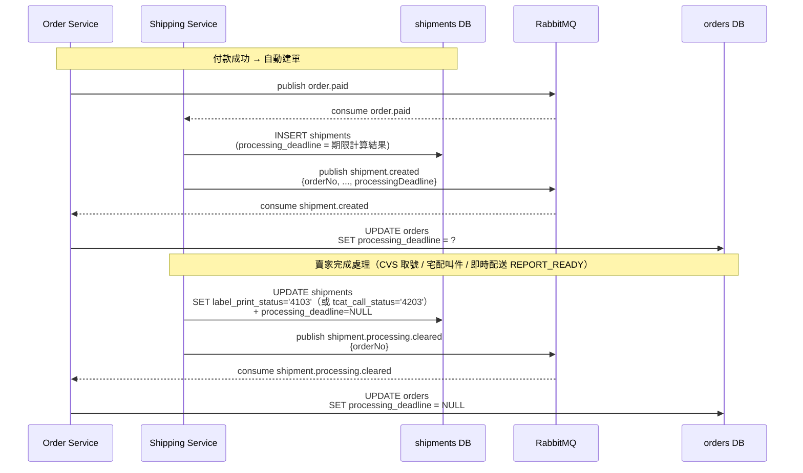

#### 5.9.4 時序圖：逾期自動取消

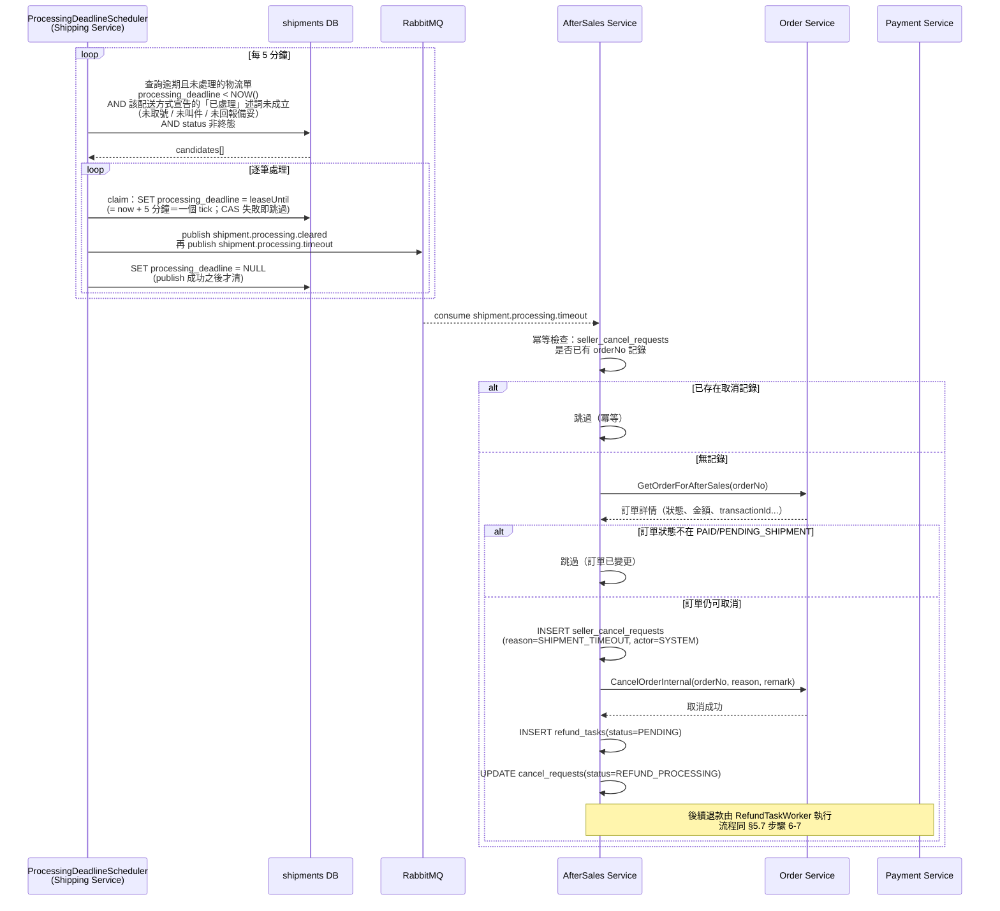

#### 5.9.5 業務流程圖

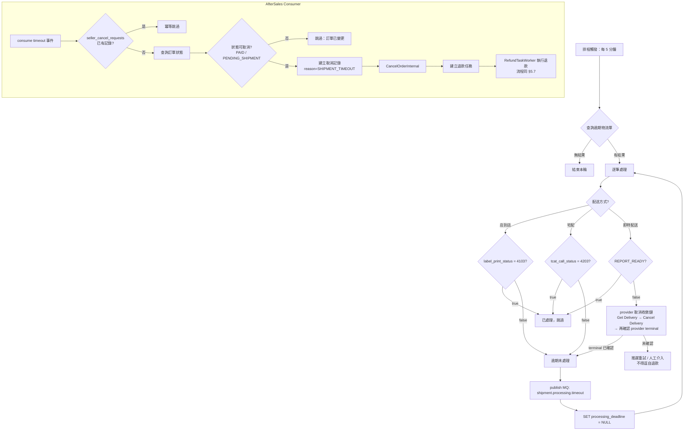

#### 5.9.6 期限計算邏輯（Shipping Service）

```java
// 在 ShippingService.createShipmentFromOrder() 中，INSERT 前計算期限

// 店到店：建單時間 + 72 小時
if (ShippingMethod.SEVEN_ELEVEN_STORE_PICKUP.value().equals(shippingMethod)) {
    entity.setProcessingDeadline(DateTimeUtils.nowUtc().plusHours(72));
}

// 宅配：第 3 個工作日結束（台北時間 23:59:59 → UTC 15:59:59）
if (ShippingMethod.TAQBIN.value().equals(shippingMethod)) {
    LocalDate createdDateTaipei = DateTimeUtils.todayInTaipei();
    LocalDate deadlineDate = holidayService.nextBusinessDay(createdDateTaipei, 3);
    LocalDateTime deadlineUtc = deadlineDate
            .atTime(23, 59, 59)
            .atZone(DateTimeUtils.PAYUNI_ZONE)
            .withZoneSameInstant(java.time.ZoneOffset.UTC)
            .toLocalDateTime();
    entity.setProcessingDeadline(deadlineUtc);
}

// 🔴 Uber 即時配送：期限由公式推導
//     processing_deadline = paid_at + seller_prep_sla_snapshot + platform_grace
//     🔴 seller_prep_sla_snapshot 取「報價／付款當下」的 snapshot，賣家日後修改不回溯
//     🔴 兩個數值皆 configurable：V1 預設 seller_prep_sla_default = 15m、platform_grace = 15m（見 §5.9.1）
//     ⚠️ prep SLA 到期不在此取消；它只觸發提醒／告警。強制取消點只有 processing_deadline
//     🔴 3003 有賣家處理期限，錨在賣家的 REPORT_READY（回報備妥）這一步：
//        provider 依 pickup_ready_at_snapshot 如期前來取件，賣家沒在期限內備妥就會讓外送員撲空（§5.9.1）
```

#### 5.9.7 掃描查詢邏輯（Shipping Service）

```sql
SELECT * FROM shipments
WHERE processing_deadline IS NOT NULL
  AND processing_deadline < :now
  AND is_return = FALSE
  AND status <> '41'
  AND (
    (shipping_method = '3002' AND label_print_status <> '4103')
    OR
    (shipping_method = '3001' AND tcat_call_status <> '4203')
  )
ORDER BY processing_deadline ASC
LIMIT :batchSize
```

> `3001` = TAQBIN value，`3002` = SEVEN_ELEVEN_STORE_PICKUP value，`4103` = 已取號，`4203` = 已叫件。
>
> 🔴 **每個有處理期限的配送方式都必須在本述詞中宣告自己的「已處理」條件**。漏宣告的配送方式即使寫了 `processing_deadline` 也永遠掃不到 ⇒ **逾期不會被取消、買家的錢卡住、零告警**。⚠️ 修法**不是**把 `OR` 再串一條就算了——新增配送方式時必須有機械保證（漏宣告即失敗），否則下一個 provider 會重複這個缺口。

#### 5.9.8 Order 端 processing_deadline 清空時機

`orders.processing_deadline` 在以下三種情境必須為 NULL（與 §5.9.10 前端曝露策略對齊）：

| 情境 | 觸發點 | Shipping 端動作 | Order 端動作 |
|------|--------|----------------|-------------|
| **賣家完成處理** | CVS：`ShippingService.processWebhookPrint()`（PayUni 列印 Webhook 回填代碼後） | `UPDATE shipments SET label_print_status='4103', processing_deadline=NULL` → publish `shipment.processing.cleared` | consumer 收 cleared event → `clearProcessingDeadline(orderNo)` |
| **賣家完成處理** | 宅配：`ShippingService.callTcat()`（賣家呼叫黑貓成功後） | `UPDATE shipments SET tcat_call_status='4203', processing_deadline=NULL` → publish `shipment.processing.cleared` | 同上 |
| **賣家完成處理** | 即時配送：賣家 `REPORT_READY`（回報備妥）成功後。⚠️ **不是**「Uber 已指派外送員」——那是 provider 的進度，不是賣家的動作（§5.9.1） | 標記賣家已回報備妥 ＋ `processing_deadline=NULL` → publish `shipment.processing.cleared` | 同上 |
| **訂單取消**（任何路徑） | buyer/seller cancel / payment expire / processing timeout（aftersales 內部取消）| —（shipments 不必動，由 cancel 流程主導）| cancel SQL 同步 `SET processing_deadline = NULL`（與 status='80' 變更同事務） |
| **Scheduler 偵測逾期** | `ProcessingDeadlineScheduler.scan()` | claim（`SET processing_deadline = leaseUntil`）→ publish `shipment.processing.cleared` → 再 publish `shipment.processing.timeout` → **publish 成功後才** `SET shipments.processing_deadline = NULL` | consumer 收 cleared event → 清 orders deadline（在 timeout cancel 流程開始前先清，避免暫態） |

**設計理由**：已取消或狀態推進（≥ 20）的訂單擁有「賣家處理期限」是反邏輯，必須清。

> **與 scheduler 的 race**：賣家正常處理會主動清空 deadline，scheduler 下一個 tick 掃不到這筆。即使賣家處理時點與 scheduler 掃描幾乎同時發生，CAS 保護（見 §5.9.16）也能避免重複取消。

#### 5.9.9 系統取消方法（AfterSales Service）

`SellerCancelService.cancelShipmentBySystem(String orderNo)`：

| 項目 | 與 §5.7 `cancelShipment` 的差異 |
|------|------|
| 觸發者 | 系統排程（非賣家手動） |
| 身分驗證 | **跳過**（不驗 storeId） |
| 取消原因 | 固定 `SHIPMENT_TIMEOUT` |
| 備註 | 自動生成：`"系統自動取消：賣家逾期未處理訂單"` |
| 稽核日誌 actor | `SYSTEM(8403)` |
| 其餘流程 | 完全相同（查訂單 → 建取消記錄 → CancelOrderInternal → 建退款任務） |

#### 5.9.10 前端曝露策略

| 項目 | 規格 |
|------|-----|
| 欄位名 | `processing_deadline`（與 DB / proto 一致） |
| 型別 | `string`（ISO 8601 UTC 絕對時間，如 `"2026-04-15T15:59:59Z"`） |
| 計算方式 | 後端僅回絕對時間，前端依本地時鐘計算剩餘秒數（與 `review_deadline` / `auto_complete_at` 一致） |
| 暴露端點 | 訂單詳情 + 訂單列表，**買家視角 + 賣家視角皆暴露**（前端依視角決定文案，例如賣家「請於 X 前出貨」、買家「賣家應於 X 前出貨」） |
| 有值條件 | `orders.processing_deadline IS NOT NULL`（即賣家未處理 ＋ 訂單未取消）。🔴 **沒有「配送方式非 Uber」這個例外條件**——即時配送同樣有處理期限（§5.9.1） |
| NULL/空字串條件 | 賣家已處理（取號／叫件／**即時配送的 `REPORT_READY`**）/ 訂單已取消 / 已逾期被排程通知。🔴 **即時配送不是免期限的配送方式** |

> **不分視角差異欄位**：buyer/seller 共用同一欄位語意，避免雙寫同步成本與不一致風險。

#### 5.9.11 CodeMeta

**OrderCancelReason**（`docs/代碼管理（CodeMeta）/業務類型碼.md`）— 涵蓋系統 / 賣家 / 買家三種觸發來源，編碼前綴區分：91xx 系統 / 92xx 賣家 / 93xx 預留買家。

| 觸發 | Name | Code | Value | Label | Description |
|------|------|------|-------|-------|-------------|
| 系統 | PAYMENT_TIMEOUT | PAYMENT_TIMEOUT | 9101 | 付款逾時自動取消 | 系統排程：訂單超過付款期限未付款 |
| 系統 | SHIPMENT_TIMEOUT | SHIPMENT_TIMEOUT | 9102 | 出貨逾時自動取消 | 系統排程：賣家未在 §5.9 期限內安排出貨 |
| 賣家 | FORCE_MAJEURE | FORCE_MAJEURE | 9201 | 天災因素無法配送 | 天災或不可抗力因素 |
| 賣家 | OUT_OF_STOCK | OUT_OF_STOCK | 9202 | 商品缺貨 | 庫存不足無法出貨 |
| 賣家 | QUALITY_ISSUE | QUALITY_ISSUE | 9203 | 商品品質問題 | 商品有品質問題不宜出貨 |
| 賣家 | SUGGEST_SPLIT | SUGGEST_SPLIT | 9204 | 建議買家拆單重下 | 建議買家拆成多張較小訂單重新下單（生鮮場景常見） |
| 賣家 | OTHER | OTHER | 9299 | 其他原因（自填） | 賣家自填取消原因，配合 cancel_remark 顯示 |

> **Buyer 自願取消未付款訂單時不寫 reason**（NULL），僅寫 `cancel_by_role=BUYER`。前端依 role 顯示「您已取消此訂單」泛用文案。

**AfterSaleAuditAction**（`docs/代碼管理（CodeMeta）/內部技術碼.md`）：

| Name | Code | Value | Label | Description |
|------|------|-------|-------|-------------|
| AUTO_CANCEL_PROCESSING_TIMEOUT | AUTO_CANCEL_PROCESSING_TIMEOUT | 8521 | 逾期自動取消 | 系統排程：賣家逾期未處理訂單，自動取消出貨 |

#### 5.9.12 MQ 事件設計

兩個專用事件，皆掛在既有 `hawkr.shipping` exchange：

| Routing Key | 業務時機 | 下游處理 |
|---|---|---|
| `shipment.processing.timeout` | 賣家處理期限逾期 | AfterSales 觸發系統取消 + 原路退款 |
| `shipment.processing.cleared` | 賣家完成處理（取號 / 叫件 / 回報備妥）或排程偵測逾期前先清空 | Order 清空 `orders.processing_deadline` |

另：既有 `shipment.created` 事件 payload 補欄位 `processingDeadline`（ISO 8601 UTC 字串）。🔴 **即時配送不是空字串的例外**——3003 同樣有處理期限（§5.9.1），空字串僅代表該筆確實無期限。由 Order Service `onShipmentCreated` 寫入 `orders.processing_deadline`。

> 完整 producer / consumer / payload class / DLQ / idempotency 設計見
> [36-MQ 與事件總覽 §3.3 物流領域](../詳細設計書/36-MQ%20與事件總覽（MQ%20%26%20Event%20Catalog）.md#33-物流領域shipping-domain)。

#### 5.9.13 DB Schema

**shipments 表**（Shipping Service V1 Migration）：

```sql
processing_deadline TIMESTAMPTZ  -- 賣家處理期限（UTC），逾期由排程自動取消。NULL = 無期限 / 已處理 / 已通知
```

部分索引（加速排程掃描）：

```sql
CREATE INDEX idx_shipments_processing_deadline
ON shipments (processing_deadline)
WHERE processing_deadline IS NOT NULL
  AND is_return = false;
```

**orders 表**（Order Service V1 Migration）：

```sql
processing_deadline TIMESTAMPTZ  -- 賣家處理期限快照（UTC），由 shipment.created 寫入、shipment.processing.cleared 清空。NULL = 未付款 / 已處理 / 已取消。即時配送不在此列——3003 同樣有處理期限，見 §5.9.1
```

> **無索引需求**：本欄位純展示用途，不涉及查詢過濾。掃描邏輯仍以 `shipments.processing_deadline` 為準（Shipping Service 內）。

#### 5.9.14 排程配置

| 配置項 | 預設值 | 說明 |
|--------|--------|------|
| `hawkr.shipping.processing-deadline.interval-ms` | `300000`（5 分鐘） | 掃描間隔 |
| `hawkr.shipping.processing-deadline.batch-size` | `50` | 每次掃描上限 |
| `hawkr.shipping.processing-deadline.enabled` | `true` | 排程開關 |

#### 5.9.15 實作位置

| 層級 | 位置 | 職責 |
|------|------|------|
| CodeMeta | `業務類型碼.md` `OrderCancelReason`；`內部技術碼.md` `OrderCancelByRole`（SYSTEM / SELLER / BUYER）、`AUTO_CANCEL_PROCESSING_TIMEOUT` | 碼值 SSOT |
| MQ 常數 | `common-core/.../mq/MqConstants.java` | timeout ＋ cleared 兩組 routing key / queue / event type |
| **Shipping Service** | | |
| Entity | `shipping/.../entity/ShipmentEntity.java` | `processingDeadline` 欄位 |
| DB | `shipments.processing_deadline` ＋ 部分索引 | 期限快照與掃描鍵 |
| Strategy | `shipping/.../strategy/CvsShipmentStrategy.java` | 計算 CVS 期限 |
| Strategy | `shipping/.../strategy/HomeShipmentStrategy.java` | 計算宅配期限（注入 HolidayService） |
| Scheduler | `shipping/.../scheduler/ProcessingDeadlineScheduler.java` | 掃描逾期物流單；發 timeout 前先發 cleared 事件確保 orders 端清 deadline |
| Mapper | `shipping/.../mapper/ShipmentMapper.java` | `findExpiredUnprocessedShipments()`（候選）、`leaseProcessingDeadline()`（claim）、`clearProcessingDeadline()`（publish 成功後才清） |
| Service | `shipping/.../service/ShippingService.java` | `processWebhookPrint()` / `callTcat()` 成功後清空 deadline + publish cleared |
| Publisher | `shipping/.../mq/ShippingEventPublisher.java` | `publishProcessingTimeout()`、`publishProcessingCleared()`；`publishShipmentCreated` payload 帶 `processingDeadline` |
| **AfterSales Service** | | |
| MQ Config | `aftersales/.../mq/AfterSalesEventMqConfig.java` | 宣告 `aftersales.shipment.processing.timeout` Queue + Binding |
| Consumer | `aftersales/.../mq/ProcessingTimeoutConsumer.java` | 消費 timeout 事件 |
| Service | `aftersales/.../service/SellerCancelService.java` | `cancelShipmentBySystem()` |
| **Order Service** | | |
| DB | `orders.processing_deadline` | 純展示快照 |
| Repository | `order/.../repository/OrderRepository.java` | `updateShipmentCreated()` 帶 deadline / `clearProcessingDeadline()`；`cancelOrderWithReasonCas` / `cancelOrderInternalCas` SQL 同步 `SET processing_deadline = NULL` |
| Consumer | `order/.../mq/ShippingEventConsumer.java` | `onShipmentCreated` 寫入 deadline；新增 `onProcessingCleared` 清空 |
| RabbitMqConfig | `order/.../config/RabbitMqConfig.java` | 宣告 `order.shipment.processing.cleared` Queue + Binding |
| PaymentEventHandler | `order/.../mq/PaymentEventHandler.java` | `cancelExpiredOrderInTx` 補呼叫 `clearProcessingDeadline(orderNo)`（payment expire 路徑用通用 status SQL，不便動，補呼叫保持事務內原子性）|
| Proto | `api/proto/order/order.proto` | `OrderSummaryView.processing_deadline = 37`、`OrderDetailView.processing_deadline = 56` |
| Converter | `order/.../service/OrderProtoConverter.java` | 將 entity 欄位轉為 ISO 8601 UTC 字串填入兩個 view |
| **Gateway** | | |
| DTO | `gateway/.../handler/order/*Response.go` | `processingDeadline` 欄位 + Swagger 註解 |

#### 5.9.16 冪等與安全保護

| 保護機制 | 說明 |
|---------|------|
| claim 用租約不用永久標記 | scheduler 撈到候選後先 `SET processing_deadline = leaseUntil`（= claim 當下 ＋ 一個 tick）讓該列退出候選集合，CAS 失敗即跳過。🔴 **不得把 `SET processing_deadline = NULL` 上移到 publish 之前**——那是永久標記，publish 拋例外或 pod 崩潰時 `shipment.processing.timeout` 會**永久遺失**（售後的系統取消＋退款永不觸發，且零告警） |
| publish 成功後才清 deadline | `SET processing_deadline = NULL` 留在 publish 之後；它的 `IS NOT NULL` 述詞對 leased 值仍成立 |
| 賣家處理後清除 deadline | shipping service 同步清 `shipments.processing_deadline`，並透過 cleared 事件清 `orders.processing_deadline` |
| seller_cancel_requests UNIQUE(orderNo) | 同一訂單只能取消一次 |
| CancelOrderInternal CAS | `WHERE status IN ('0','10','20')` 原子更新，已出貨不可取消 |
| MQ at-least-once + 冪等 | timeout consumer 先查 cancel_requests 跳過；cleared consumer `UPDATE ... WHERE processing_deadline IS NOT NULL` 自然冪等 |

#### 5.9.17 邊界情境

| 情境 | 系統行為 |
|------|---------|
| 賣家在期限截止前一刻處理 | 處理流程主動發 `shipment.processing.cleared`，前端 deadline 立即消失；scheduler 即使同時掃到，shipments 端 `label_print_status='4103'` / `tcat_call_status='4203'` 不符合候選述詞，不觸發 |
| 賣家處理與排程同時發生（race） | CAS 保護：若訂單已進入 IN_TRANSIT，CancelOrderInternal 失敗，cancel_request 標記 FAILED，不影響已出貨訂單 |
| 訂單已被買家/賣家取消 | timeout consumer 查訂單狀態 = CANCELLED，不在允許取消狀態，跳過 |
| 訂單尚在 PENDING_PAYMENT | 理論上不會發生（物流單在 `order.paid` 後才建立），但若出現，cancel 流程同 §5.7 處理未付款取消 |
| timeout 事件遺失 | 租約到期後該筆重新進入候選集合，下一個 tick 重掃（見 §5.9.4） |
| cleared 事件遺失 | `orders.processing_deadline` 殘留舊值，前端會誤顯示已逾期。但 `shipments` 端正確（`label_print_status='4103'` / `tcat_call_status='4203'`），不會誤觸發取消。實務影響限於前端展示；前端可額外比對 `shipping_status`（已取號 = 920；已叫件 = 210）作為備援判斷 |
| 假日資料未匯入 | `HolidayService.nextBusinessDay()` 將所有日期視為工作日，期限可能偏短但不會無限等待 |

### 5.10 賣家售後處理期限自動代決（Case Process Timeout Auto-Decision）

> **目的**：避免賣家對 PENDING 狀態的售後單久不回應，導致買家權益受損。逾時後系統依 `aftersales.case.timeout-policy` 自動代為決策。
>
> **預設策略**：`AUTO_REJECT`（系統代為拒絕）。`AUTO_ESCALATE`（升級 admin 仲裁）為備援策略，可透過 config 切換。

#### 5.10.1 業務規則（共用）

| 項目 | 規則 |
|------|------|
| 期限長度 | `aftersales.case.process-deadline-hours`（預設 **72** 小時），可透過環境變數覆寫 |
| 期限起算 | 案件建立（PENDING）的時間戳；以 `LocalDateTime`（UTC 值語意）儲存 |
| 適用狀態 | 僅 `status = PENDING(0)`；其他狀態 `process_deadline` 必為 NULL |
| 觸發條件 | `status = PENDING` AND `appeal_state = NONE(0)` AND `process_deadline < NOW()` AND `auto_escalated = false` |
| 期限清空時機 | 賣家做出任何決策（PENDING → 其他狀態）時 `process_deadline` 設為 NULL |
| 策略選擇 | `aftersales.case.timeout-policy`：`AUTO_REJECT`（預設） / `AUTO_ESCALATE`（備援） |

#### 5.10.2 業務流程圖

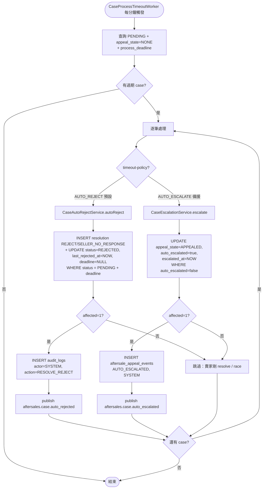

#### 5.10.3 時序圖（AUTO_REJECT，預設策略）

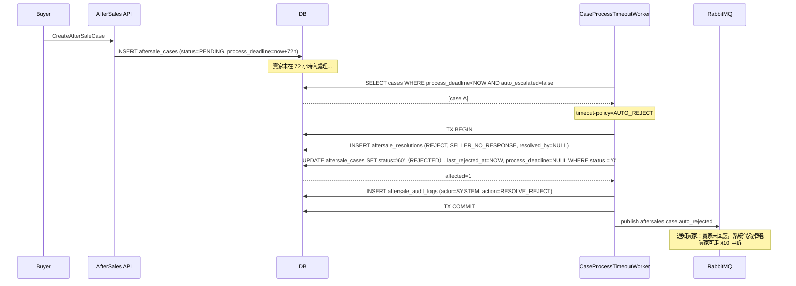

#### 5.10.3a 時序圖（AUTO_ESCALATE，備援策略）

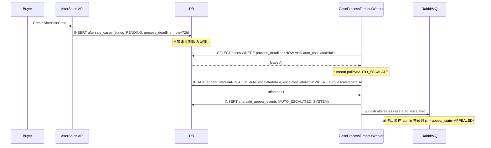

#### 5.10.4 寫入 / 重算 / 清空時機

| 觸發點 | 動作 | 對應 service 方法 |
|--------|------|-------------------|
| `createCase()`（status 設為 PENDING） | `process_deadline = createdAt + ${process-deadline-hours}h` | `AfterSaleCaseService.createCase` |
| `resolve()` 任何分支（離開 PENDING） | `process_deadline = NULL`（清空） | `AfterSaleResolutionService.resolve` 各 handler |
| `cancelCase()`（→ CANCELLED） | `process_deadline = NULL` | `AfterSaleCaseService.cancelCase` |
| Worker AUTO_REJECT 路徑 | UPDATE 同時清空 `process_deadline = NULL` | `CaseAutoRejectService.autoReject` |

#### 5.10.5 樂觀鎖、冪等與 transaction 邊界

**AUTO_REJECT 樂觀鎖**：`CaseAutoRejectService.autoReject` 內部 UPDATE WHERE 條件：
- `status = '0'` — 防止賣家剛剛 resolve（status 已變）
- `process_deadline IS NOT NULL AND process_deadline < NOW()` — 防 SELECT 後賣家剛好 resolve 清空 deadline 的極端 race

UPDATE 走 status 變更天然防多實例 race：先到的 worker 把 status 改為 REJECTED(60)，後到的 affected=0 自動跳過。**不需動 `auto_escalated` 欄位**，後者僅供 AUTO_ESCALATE 路徑使用。

**AUTO_ESCALATE 樂觀鎖**（既有，沿用）：`CaseEscalationService.escalate` 的 `markAutoEscalated` UPDATE WHERE 條件：
- `auto_escalated = false` — 防止同一 case 重跑 / 多實例 race
- `status = '0'` AND `appeal_state = '0'` — 防止賣家剛剛 resolve / 既有買家 appeal 衝突
- `process_deadline IS NOT NULL AND process_deadline < NOW()` — 防 SELECT 後賣家剛好 resolve 清空 deadline 的極端 race

**Transaction 邊界**：
- AUTO_REJECT 原子操作（INSERT resolution + UPDATE case + INSERT audit log）由 `CaseAutoRejectService.autoReject` 包在獨立 `@Transactional` 方法內
- AUTO_ESCALATE 原子操作（UPDATE + INSERT appeal_event）由 `CaseEscalationService.escalate` 包在獨立 `@Transactional` 方法內
- 兩者皆獨立 bean 確保 Spring AOP proxy 生效；任一 step 失敗即 rollback。🔴 **MQ publish 在該 `@Transactional` 之內，且走會傳遞失敗的變體**（見下方搶佔語意）

**冪等**：`aftersale_resolutions` 與 `aftersale_appeal_events` 不加唯一鍵；萬一極端 race 多寫一筆，timeline 多一筆無語意錯誤，可接受。

**AUTO_REJECT 的 `resolution_source`**：沿用 DB 預設值 `SELLER`（代表「以賣家視角的決策」），系統代為的事實透過 `reject_reason=SELLER_NO_RESPONSE` + `resolved_by IS NULL` + audit log `actor_type=SYSTEM` 三者共同表達。不新增 `SYSTEM` enum value 以避免 admin 端既有「依 source 區分裁決來源」的查詢邏輯需大改。

**AUTO_ESCALATE `appeal_submitted_at` 同步寫入**：UPDATE 同時 SET `appeal_submitted_at = NOW()`，確保案件出現在 admin 仲裁列表（既有 `selectAppealsForAdmin` 用 `ORDER BY appeal_submitted_at DESC`，若不寫會被 NULLS LAST 排到最後）。

> **⚠️ 搶佔語意**
> 兩條路徑的 CAS 都擋得住跨 pod 重複（先到者 affected=1），但 `status='60'`（AUTO_REJECT）與 `auto_escalated=true`（AUTO_ESCALATE）都是**永久轉換**，row 永久離開候選集合。🔴 **因此 `aftersales.case.auto_rejected` / `auto_escalated` 的 publish 不得排在 tx 之外、也不得走會吞例外的 publisher**——那會造成 publish 失敗即永久遺失、無告警、無重試：
> - **AUTO_REJECT**：案件已 `REJECTED(60)`，但**買家不知道自己被拒絕**（收不到通知），也就不會在時限內走申訴。
> - **AUTO_ESCALATE**：案件已 `auto_escalated=true` 且出現在 admin 佇列，但**沒有任何人被通知去看那個佇列**。
>
>
> 🔴 **publish 必須在 service 的 `@Transactional` 之內，且走會傳遞失敗的變體** —— 與 [§5.3.8](#538-退貨買家未寄出逾時自動關案)／[§5.3.10.1](#53101-退貨送達自動確認收貨autoconfirmreceiptscheduler2730)／[§5.3.10.2](#53102-超商待取逾時自動完成storepickuptimeoutscheduler2630) 同形。
> - **AUTO_REJECT**：`aftersales.case.auto_rejected` 的 publish 在 `CaseAutoRejectService.autoReject` 內。事件所需的 `orderNo` / `buyerId` / `storeId` / `hours` 由 caller 傳入（worker 手上已有整個 `AfterSaleCaseEntity`）。
> - **AUTO_ESCALATE**：同形，publish 在 `CaseEscalationService.escalate` 內。
> - **失敗語意**：publish 變體拋例外 → 穿出 proxy → rollback ⇒ **resolution INSERT、status CAS、audit log、事件四者同進同出**。這一點比 B1 更乾淨：`autoReject` 本來就靠拋 `OptimisticLockLostException` 觸發 rollback，失敗傳遞路徑是現成的。
> - **下輪重試的候選述詞仍成立**（逐條比對 `selectProcessTimeoutCandidates` 的四個條件）：rollback 後 `status` 回 `PENDING(0)`、`appeal_state` 回 `NONE(0)`、`auto_escalated` 回 `false`、`process_deadline` 未被觸碰且仍 `< NOW()` ⇒ 下一 tick（`fixedDelay` 60 秒）**必然重新撈到**。
> - **殘餘窗口**：publish 成功、commit 失敗 ⇒ 事件已發、狀態未轉；該列仍是候選，下一 tick 重跑並重發，由 notification 端 `notifications_inbox_dedup_idx` 吸收 ⇒ **暫態，窗口 = 一個 tick**。
> - 🚨 **tx 內不得有網路呼叫**：`tryPublishCaseAutoRejected` / `tryPublishCaseAutoEscalated` 內部各有兩次**無 deadline** 的身分反解 gRPC。`CaseProcessTimeoutWorker` 必須在**進 tx 之前**呼叫 `resolveEventPrincipals(storeId, buyerId)`，把 `EventPrincipals` 當第 7 個參數傳給 `autoReject` / `escalate`（publisher 對這兩條路徑提供零 gRPC 多載）。反解失敗 ⇒ 記 error log ＋ 跳過本筆（未進 tx、未 CAS，四個候選條件全未觸碰 ⇒ 下一 tick 重撈）；**不得降級成帶空值照發**。完整判準見 [§8.5](#85-多副本排程搶佔語意scheduler-claim) 與[《多副本排程搶佔規範》](../開發規範/多副本排程搶佔規範.md)。
>
> 🚨 🔴 **不得改成「publish → 成功才 CAS」的順序**：`status='60'` 與 `auto_escalated=true` **是業務動作本身，不是事後記錄**。那個順序下，賣家在 deadline 邊界剛好回應 ⇒ CAS `affected=0` ⇒ **買家已經收到「賣家逾時未回應，系統代為拒絕」的通知，而案件其實被賣家正常處理了**；AUTO_ESCALATE 則是「admin 收到升級通知，佇列裡卻沒有那張單」。**這種不一致不會自我收斂。** 判準見[《多副本排程搶佔規範》](../開發規範/多副本排程搶佔規範.md)。
> ⚠️ **這不違反「MQ 不在 tx 內」**：那條邊界反對的是「批次讀持鎖跨網路 I/O 的長交易」；這裡的 tx 只包一列 CAS ＋ 一列 INSERT ＋ 一次 publish，不持有候選集合的鎖（見[《多副本排程搶佔規範》](../開發規範/多副本排程搶佔規範.md)）。
> 逐支裁決見 [§8.5](#85-多副本排程搶佔語意scheduler-claim)。

#### 5.10.6 實作位置

| 元件 | 路徑 |
|------|------|
| Worker | `services/java/aftersales-service/src/main/java/io/github/will413028/hawkr/aftersales/scheduler/CaseProcessTimeoutWorker.java`（依 `timeout-policy` 分流至兩個 service） |
| Properties | `AfterSalesProperties.CaseConfig.processDeadlineHours`（預設 **72**）+ `timeoutPolicy`（預設 `AUTO_REJECT`） |
| Mapper SQL | `AfterSaleCaseMapper.selectProcessTimeoutCandidates`（共用）+ `markAutoEscalated`（AUTO_ESCALATE）+ `markAutoRejected`（AUTO_REJECT，新增） |
| AUTO_REJECT 原子操作 | `CaseAutoRejectService.autoReject`（`@Transactional`，獨立 bean；包住 INSERT resolution ＋ UPDATE case ＋ INSERT audit log ＋ **publish（會傳遞失敗的變體）**） |
| AUTO_ESCALATE 原子操作 | `CaseEscalationService.escalate`（既有，保留不動） |
| Entity 欄位 | `AfterSaleCaseEntity` 既有 `processDeadline` / `autoEscalated` / `escalatedAt`（不動）|
| Publisher 方法 | `AfterSalesEventPublisher.publishCaseAutoRejected`（新增）/ `publishCaseAutoEscalated`（既有保留）|
| MQ 常數 | `MqConstants.ROUTING_KEY_AFTERSALES_CASE_AUTO_REJECTED` / `EVENT_TYPE_AFTERSALES_CASE_AUTO_REJECTED`（新增）/ `*_AUTO_ESCALATED`（既有保留）|
| RabbitMQ binding | **publish-only**，aftersales 端不需新增 queue/binding；exchange `EXCHANGE_AFTERSALES` 沿用既有 bean。Consumer 由 notification-service 自行宣告（§10.7 約束 listener 端） |
| CodeMeta | `AfterSaleRejectReason` 新增 `SELLER_NO_RESPONSE`（value=9105）/ `AfterSaleAppealEventType.AUTO_ESCALATED`（保留）|

#### 5.10.7 邊界情境

| 情境 | 系統行為 |
|------|---------|
| 賣家在期限到達當下做出決策 | `resolve()` 將 `process_deadline` 設為 NULL 並改 status；即使 worker 同時掃到，AUTO_REJECT UPDATE 條件 `status = '0'` 不會生效，affected=0 跳過 |
| AUTO_REJECT 後買家申訴 | 沿用 §10 申訴流程；買家對 SYSTEM-rejected 的 case 有完整申訴權利 |
| AUTO_ESCALATE 後賣家做決策 | `auto_escalated = true` 維持為 true（紀錄升級事實），但 status 仍正常推進；admin 端可看到「賣家已處理」與「曾被自動升級」兩個資訊並存 |
| Worker 多實例 | AUTO_REJECT 透過 status CAS 防 race；AUTO_ESCALATE 透過 `auto_escalated = false` CAS 防 race |
| MQ event 遺失 | DB 變更已生效；AUTO_REJECT case 出現在「已拒絕」列表，AUTO_ESCALATE case 出現在 admin 仲裁列表（`appeal_state <> NONE`） |
| 切換策略 | 修改 `aftersales.case.timeout-policy` 並重啟服務即生效；歷史案件不回溯（已 AUTO_ESCALATE 的不會被改成 AUTO_REJECT） |

#### 5.10.8 AUTO_ESCALATE 路徑的保留約束

🔴 **AUTO_ESCALATE 路徑及其欄位 / Enum / MQ event 一律保留，不得移除。**

- `auto_escalated=true` 的案件在 DB 中存在（既有資料 ＋ config 切換後產生），🔴 **admin 仲裁列表的查詢邏輯（`WHERE appeal_state<>'0'`）不得拆除**，否則那些案件會從 admin 佇列消失。
- 策略由 `aftersales.case.timeout-policy` 決定，兩條路徑必須同時可用。

### 5.11 正向 leg 配送失敗的處置（Delivery Failure Disposition）

#### 5.11.1 定位、射程與邊界

**射程**：訂單**已進入實體履約**（provider 已取件或已開始配送）之後，**正向 leg**（賣家 → 買家）**未能完成交付**。

🔴 **本節不擴張本服務的職責邊界（§1.1）**：配送失敗的訂單**從未送達**，因此**不會、也不得**產生售後單（`aftersale_case`）。本服務在本流程裡只有兩個角色：**① 消費已 financially final 的責任判定結果；② 在需要退款時，沿用既有退款引擎把錢送出去。** 責任判定本身不在本服務。

⚠️ **必須與三個形狀相近的既有機制切開**——它們常被誤認為「已經有機制了」：

| 既有機制 | 觸發時點 | 出口 | 與本節的差別 |
|---|---|---|---|
| `RETURN_FAILED(28)`（§5.3.11） | 售後成立後，**逆向 leg** 物流壞掉 | Admin 介入／申訴 | **軸不同**：逆向 leg（買家寄回賣家），不是正向配送 |
| `order.fulfillment.failed` → `SellerCancelService.cancelShipmentBySystem`（§4.5、§5.7） | **履約尚未開始**（建單失敗／無法受理） | 訂單 `CANCELLED` ＋ **全額退款** | **時點不同**：貨還沒被取走，沒有「誰造成配送失敗」可判 |
| §5.9 `shipment.processing.timeout` | 賣家未在 `processing_deadline` 前完成自己那一步 | 訂單 `CANCELLED` ＋ **全額退款** | **時點不同**：貨還沒被取走；責任已明確（賣家未動作），不需判定 |
| **本節（§5.11）** | **已取件／配送中**之後交付失敗 | **依責任成因二元決定**（§2.5.3） | 🔴 出口**可能是「不退款」**，與上列三者的「一律全額退款」相反 |

🔴 **上表最後一列與前三列的分界必須在實作時可機械判定**，不得靠文案語感——否則同一筆配送失敗會依進入哪一個 consumer 而得到相反的財務結果。

#### 5.11.2 責任判定的載體（🔴 不得另造 dispute subsystem）

責任成因的判定、證據收集、人工裁決與買家申訴，**一律沿用履約平台既有的例外案件機制**：

| 載體 | 用途 |
|---|---|
| `fulfillment_exception_cases` | 例外案件本體（等待判定期間的存放處） |
| `fulfillment_case_resolutions` | 判定結果與裁決留痕 |

🔴 **明令禁止**：為配送失敗另建 dispute platform／第二套 case engine／第二套證據子系統／第二套申訴入口。
🔴 **不得**把 `aftersale_cases` 當成配送失敗的載體——它的入口契約（§5.1.1）本身就把未送達訂單排除在外（見 §5.11.4）。

責任判定 financially final 後，本服務依 §2.5.3 的二元政策決定要不要建立退款任務；判定規則、證據來源與分類路由的權威定義見 [65 物流履約平台](65-物流履約平台%EF%BC%88Fulfillment%20Platform%EF%BC%89詳細設計書.md)。

#### 5.11.3 三條出口

🔴 **分流只在責任判定 financially final 之後發生**（定義見 §2.5.3「退款 entitlement 的決定時點」）——**不是在 classification 當下**。判定尚未 financially final 時一律適用下表最後一列。

| 責任成因（🔴 financially final） | Order 軸 | 本服務動作 |
|---|---|---|
| **`BUYER_CAUSED`** | `SHIPPING_ABNORMAL(35)` → 🔴 **`DELIVERY_FAILED_NO_REFUND(54)`**（🔴 **immutable financial terminal**） | **不建立 `refund_task`**、不進 `REFUND_PROCESSING(40)`、不建立售後單。`refund_to_buyer = 0`（§2.5.3） |
| `SELLER_CAUSED`／`PROVIDER_CAUSED`／`PLATFORM_CAUSED` | 依 03／65 定義的退款結案終態 | `refund_to_buyer = full` ⇒ **沿用既有退款引擎**（§5.4 `refund_tasks` ／ §5.7 取消出貨退款路徑）。🔴 **不新增第二套退款執行機制** |
| **`RESPONSIBILITY_UNRESOLVED`，或任何尚未 financially final 的判定**（含覆核進行中、責任爭議未結案） | 🔴 **停在 `SHIPPING_ABNORMAL(35)`（非終態）**，**不進任何財務終態** | 🔴 **什麼都不做**：不建 `refund_task`、不套 no-refund、不做財務結案。等待責任判定 financially final |

🔴 **`DELIVERY_FAILED_NO_REFUND(54)` 對本服務的硬語意**（缺一即為實作偏離）：

1. **≠ `DELIVERED(40)`**、**≠ 正常 `COMPLETED(50)`**、**≠ `CANCELLED(80)`** —— 不得借用任何既有終態表達它。
2. **不觸發退款**：本服務在本終態**不建立任何 `refund_task`**。
3. **不產生「買家已正常收貨」語意**、**不產生收貨確認（receipt confirmation）**。
4. **payout eligible**：款項正常撥付賣家。本終態**不建立售後單** ⇒ [`GetOrderPayoutHold`](#getorderpayouthold-rpc) 對該訂單**零 case** ⇒ 依其 deny-by-default 判定（逐案評估、零案即無 hold）**不 hold** ⇒ 撥款資格成立。⚠️ 這一點必須在實作時實測，**不得只靠推論**：撥款閘門是 fail-closed 設計，「看不到就擋」的措辭若被擴張解讀，會讓本終態靜默卡在永不撥款。
5. **不把賣家當 fault party**：責任仍由 `ResponsibilityCause` 表達；`BUYER_CAUSED` 的案件**不計入賣家履約失敗 KPI**。
6. **provider-neutral**：它是 Order 軸的通用終態，**不得**被實作成 Uber 專屬狀態、也不得要求其他 provider 套用 Uber 的 lifecycle。
7. 🔴 **immutable financial terminal**：進入本終態即不可逆。**不存在「申訴成立 ⇒ 從本終態回到退款」這條路徑**；V1 的 automated Order lifecycle 在本終態之後**不提供任何會改變 refund entitlement 的自動 reversal**（不自動退款、不自動重開退款任務、不自動補開售後單、不把款項從賣家追回）。🔴 本服務**不得**因任何後續事件把 `refund_to_buyer` 從 `0` 改回非 `0`。

⚠️ **既有客服 goodwill coupon ／ 人工補償仍可存在**（§5.5 補償優惠券流程、§5.8 人工介入），但它是**獨立於本退款政策的客服裁量**：🔴 **不改 Order terminal、不改 `refund_to_buyer`、不走本終態回退款路徑、不轉成向賣家追討**。把 goodwill 實作成「變相退款」＝ 繞過整個責任判定。

⚠️ **`RESPONSIBILITY_UNRESOLVED` 需要 aging 可見性**：案件停留超過門檻必須有人知道（指標／告警）。🔴 **沒有出口的等待就是永久卡住**，而本格的卡住對買家的外顯症狀是「錢付了、貨沒到、也沒有人回應」。

#### 5.11.4 買家救濟管道（🔴 不是退貨退款案）

🔴 **`DELIVERY_FAILED_NO_REFUND(54)` 的訂單不取得正常 Delivered 售後資格。**

§5.1.1 的入口條件是 `order.status = DELIVERED(40)` **AND** `order.delivered_at IS NOT NULL` 兩個 AND 條件，配送失敗的訂單**兩個都不成立** ⇒ `CreateAfterSaleCase` 必然被拒。🔴 **本節不放寬這兩個條件**——那會讓「未送達」的訂單走進一條為「已送達」設計的流程（60 小時時效、退貨逆物流、驗貨扣款全部無意義）。

⇒ 🔴 **會改變 `ResponsibilityCause` 或 refund entitlement 的 review／dispute／maker-checker，一律必須在 `SHIPPING_ABNORMAL(35)` 階段完成**，走 §5.11.2 的例外案件機制（`fulfillment_exception_cases` ＋ `fulfillment_case_resolutions`）。`35` 是它**唯一的窗口**——判定 financially final 的那一刻窗口就關上（語意 SSOT ＝ [65 §5.5.2 E0](65-物流履約平台%EF%BC%88Fulfillment%20Platform%EF%BC%89詳細設計書.md)）。

🔴 **`54` 之後不存在會翻案的救濟管道。** 對已 financially final 的 `BUYER_CAUSED`，買家仍可取得**客服申訴管道／協助說明**（goodwill request、人工優惠券或補償，§5.5／§5.8），但它 **① 不修改 `ResponsibilityCause` ② 不修改 Order terminal ③ 不修改 refund entitlement ④ 不建立 `refund_task`（也不進 `REFUND_PROCESSING(40)`、不補開售後單）⑤ 不向賣家追討（clawback）**——②～⑤ 就是 §5.11.3 末段那條 goodwill 界線，① 是本節補上的：**判定本身在 `35` 已經關窗**。

🔴 **它不得被命名為「責任判定申訴」**（UI／推播／客服話術／對外文案皆同）——那個名稱承諾了一個系統不提供的結果。

🔴 **通知模板的內容約束**（兩套，缺一不可）：

| 情境 | 模板必須包含 | 禁止 |
|---|---|---|
| `BUYER_CAUSED`（financially final） | 配送失敗事實 ＋ 不退款政策說明 ＋ **客服協助管道** | 🔴 **不得沿用既有全額退款文案**；🔴 **不得把客服管道寫成可翻案的「責任判定申訴」** |
| `RESPONSIBILITY_UNRESOLVED`（尚未 final） | 「正在確認原因」＋ 預計回覆時間 | 🔴 不得暗示任何退款結果（無論退或不退） |

**為什麼不能有 post-`54` 的責任判定申訴**（這是本節最容易被要求「加回來」的一格）：

- 若它**能**推翻 `ResponsibilityCause`（例如 `BUYER_CAUSED → PROVIDER_CAUSED`），依 §2.5.3 的**二元**退款政策，該筆本來就應 `refund_to_buyer = full` ⇒ 與 `54` 的 **immutable financial terminal 正面矛盾**（§5.11.3 第 7 點）。
- 若它**不能**改 `ResponsibilityCause`，那它就**不是** responsibility appeal——它是客服管道，名字必須跟著改。

⇒ 兩條路都得不到「post-`54` 的責任判定申訴」。🔴 **它不是「還沒做」，是設計上不存在。**

⚠️ **唯一的出口是 `LV-05`，而它是 Design Amendment、不是實作**：若 Taiwan Legal 最終判定「正式 no-refund policy 必須存在可逆申訴窗」（列管在 65 §3.4.1 的 LV 表，🔴 本檔不另持一份，見 §2.5.3 末的 `LV-*` 段）⇒ **production activation blocked**，屆時另開 Design Amendment 重新設計 finality 與 `54` 的可逆性。🔴 **不得現在先 speculative build 一條「以後可能會用到」的翻案路徑**——那條路徑一旦存在，`54` 的 immutable 就只剩文件上的宣稱。

⚠️ **三者不是同一件事，不得互相代用**：

| | §10 申訴（Appeal） | `35` 階段的責任判定覆核 | post-`54` 客服申訴管道 |
|---|---|---|---|
| 載體 | `aftersale_cases`——**必須先有一張 case**（§10.12.3 入口規則） | 例外案件（`fulfillment_exception_cases` ＋ `fulfillment_case_resolutions`） | 客服工單／人工補償，**不建立任何案件狀態** |
| 爭的是 | 賣家的售後決策 | **責任成因判定** | ❌ 什麼都不爭 |
| 能改 `ResponsibilityCause` | ❌ | ✅ **只在 `35`** | ❌ |
| 能改 refund entitlement | ✅（Admin 裁決 FULL／PARTIAL_REFUND） | ✅（判定改變 ⇒ 二元政策重算，§2.5.3） | ❌ |
| 本情境 | ❌ **不可用**（開不了案 ⇒ 申訴入口不存在） | ✅ 唯一能改判定的窗口 | ✅ 可用，但只有 goodwill |

⚠️ **對買家的通知不得沿用既有取消／退款文案**：既有 `order.fulfillment.failed` 的通知模板逐字是「已停止履約並向你全額退款」＝ `refund_to_buyer = full`，**只在非買家可歸責時成立**。`BUYER_CAUSED` 的通知必須是「配送失敗 ＋ 政策說明 ＋ **客服協助管道**」，`RESPONSIBILITY_UNRESOLVED` 則是「配送失敗，正在確認原因 ＋ 預計回覆時間」。🔴 **發錯文案 ＝ 對買家做出一個系統並未做出的承諾。**
🔴 **該管道在文案裡不得寫成「申訴（後）可翻案」或「責任判定申訴」**——它不改判定、不改 entitlement（本節上方）。

#### 5.11.5 契約與驗收行為

**碼值**（SSOT 在 CodeMeta）：

- `OrderStatus.DELIVERY_FAILED_NO_REFUND`（Value `54`）
- `ResponsibilityCause`：🔴 **只有四個 resolved 值，不得新增第五值**。加第五值會撞破 payment `V12` / `V13` / `V15` 三道 CHECK 與 `LogisticsSchemaContractTest`，並讓沒有 `default` 的 `ResponsibilityRules.bearerOf` 編譯失敗。「未判定」是 `FulfillmentExceptionCategory.RESPONSIBILITY_UNRESOLVED`（案件分類，非成因）。

**事件契約**：本服務消費「責任判定已完成」與「配送失敗」兩類事件，並發出對應通知事件的 `EventType`。

**可觀測性**：`RESPONSIBILITY_UNRESOLVED` 必須有 aging 指標與告警（§5.11.3 末）。

**驗收行為（acceptance）**：

| # | 情境 | 預期結果 |
|---|---|---|
| 1 | 訂單進入 `DELIVERY_FAILED_NO_REFUND(54)` | **實測可撥款**（§5.11.3 第 4 點）——撥款閘門是 fail-closed，不得只靠推論 |
| 2 | 同上 | **實測不產生售後單入口**（`CreateAfterSaleCase` 被拒） |
| 3 | 責任判定**尚未** financially final | 🔴 訂單停在 `SHIPPING_ABNORMAL(35)`、**零 `refund_task`**、且**未套用** `refund_to_buyer = 0` |

🔴 **第 3 項是陰性驗證，不得用「沒看到退款」代替**：必須能指認出「**也還沒套用 = 0**」——「暫不決定」與「決定為 0」是兩件事。

> 事件契約接線、兩套通知模板與 aging 指標的實作進度見 backend-payuni#3489。

---

## 6. 訊息佇列設計

> 本服務涉及的 routing key 業務語意對應見 §4.4 / §4.5 / §5.9.12 / §10.10。
>
> 完整 producer / consumer / exchange / queue / DLQ / payload class / Ack 設計見：
> - [36-MQ 與事件總覽 §3.4 售後領域](./36-MQ%20與事件總覽（MQ%20%26%20Event%20Catalog）.md#34-售後領域aftersales-domain)（AfterSales 發布）
> - [36-MQ 與事件總覽 §3.3 物流領域](./36-MQ%20與事件總覽（MQ%20%26%20Event%20Catalog）.md#33-物流領域shipping-domain)（shipping events 消費）
> - [36-MQ 與事件總覽 §3.2 支付領域](./36-MQ%20與事件總覽（MQ%20%26%20Event%20Catalog）.md#32-支付領域payment-domain)（`refund.succeeded` / `refund.failed` 消費）

### 6.1 業務冪等保證

| 事件 | 業務冪等機制 |
|------|---------|
| `aftersales.refund.completed`（發布） | Order Service 以 `financial_logs.UNIQUE(type, external_txn_id)` 兜底 + 清除 `need_refund_page = FALSE` |
| `aftersales.cancel.completed`（發布） | Order Service 以 `orders.status` CAS 檢查（已 CANCELLED 則 skip）+ 清除 `need_refund_page = FALSE` |
| `aftersales.refund.awaiting_buyer_page`（發布） | Order Service 以 `need_refund_page` 冪等（已 TRUE 則 skip） |
| `shipment.return.status_changed`（消費） | 以 case status 檢查（已推進則 skip） |
| `refund.succeeded` / `refund.failed`（消費） | 以 `refund_task.status` 檢查（已終態則 skip）+ §4.5 處理規則 |

## 7. 時序圖總覽

### 7.1 售後申請 → 賣家決策（主流程）

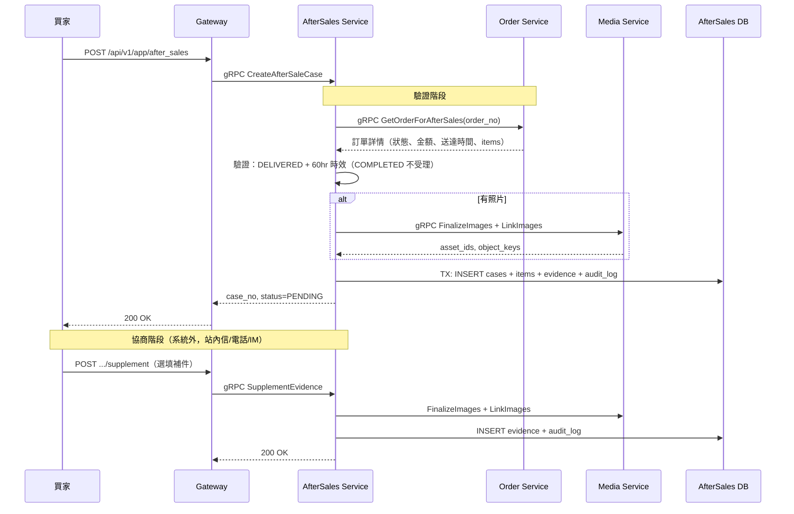

### 7.2 同意退貨退款（含逆物流 + 確認收貨 + 驗貨扣款 + 退款）

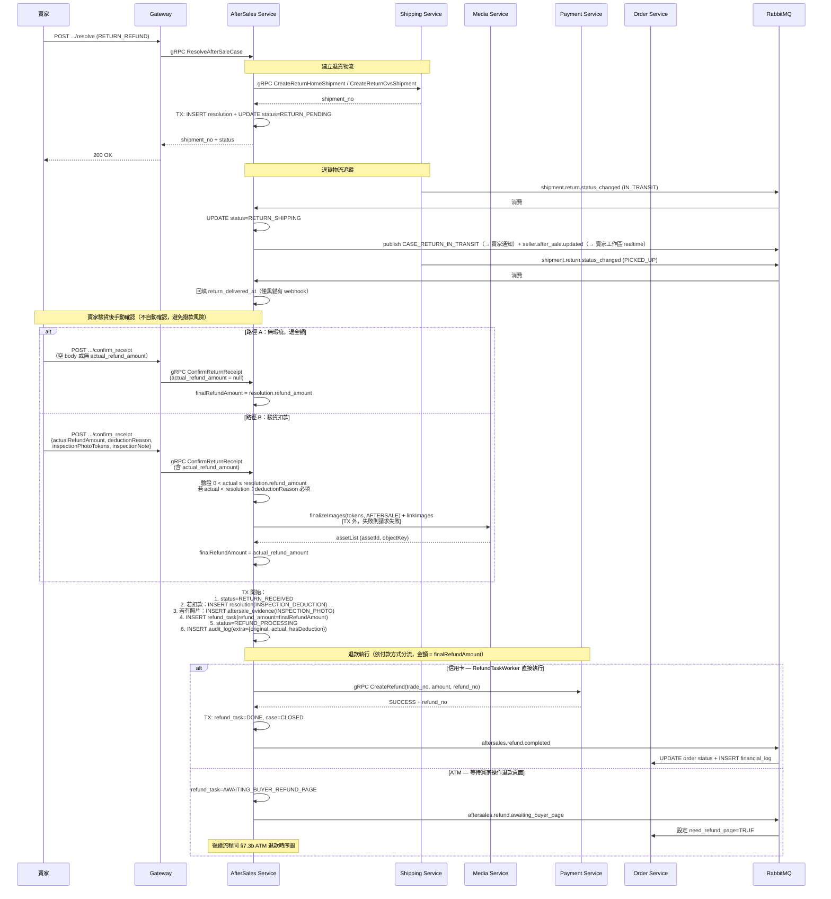

### 7.3 部分退款 / 全額退款（免退貨）— 信用卡

```mermaid
sequenceDiagram
    participant Seller as 賣家
    participant GW as Gateway
    participant AS as AfterSales Service
    participant PS as Payment Service
    participant OS as Order Service
    participant MQ as RabbitMQ

    Seller->>GW: POST .../resolve (PARTIAL_REFUND / FULL_REFUND_NO_RETURN)
    GW->>AS: gRPC ResolveAfterSaleCase

    AS->>AS: 驗證退款金額（0 < amount ≤ refundable）
    AS->>AS: TX: INSERT resolution + refund_task(PENDING) + UPDATE status=REFUND_PROCESSING
    AS-->>GW: needRefundPage=false
    GW-->>Seller: 200 OK

    Note over AS,PS: RefundTaskWorker（每 10 秒掃描 PENDING/FAILED）
    AS->>PS: gRPC CreateRefund(trade_no, amount, refund_no)
    PS-->>AS: SUCCESS + refund_no

    AS->>AS: TX: task=DONE, case=CLOSED
    AS->>MQ: aftersales.refund.completed
    MQ->>OS: UPDATE order status + INSERT financial_log
```

### 7.3b 部分退款 / 全額退款（免退貨）— ATM

```mermaid
sequenceDiagram
    participant Seller as 賣家
    participant Buyer as 買家
    participant GW as Gateway
    participant AS as AfterSales Service
    participant PS as Payment Service
    participant PayUni as PayUni
    participant OS as Order Service
    participant MQ as RabbitMQ

    Seller->>GW: POST .../resolve (FULL_REFUND_NO_RETURN)
    GW->>AS: gRPC ResolveAfterSaleCase

    AS->>AS: 判斷 payment_method=ATM
    AS->>AS: TX: INSERT resolution + refund_task(AWAITING_BUYER_REFUND_PAGE) + UPDATE status=REFUND_PROCESSING
    AS->>MQ: aftersales.refund.awaiting_buyer_page
    MQ->>OS: 設定 need_refund_page=TRUE
    AS-->>GW: needRefundPage=true
    GW-->>Seller: 200 OK

    Note over Buyer,AS: 買家在訂單詳情看到「前往退款」按鈕

    Buyer->>GW: POST /orders/{order_no}/refund_page<br/>body: { client_type }
    GW->>AS: gRPC GetRefundPageUrl(accountId, orderNo, client_type, app_type)
    AS->>AS: 驗證買家身分 + 查詢 refund_task(AWAITING_BUYER_REFUND_PAGE)
    AS->>AS: UPDATE refund_tasks SET client_type=?, app_type=? (覆寫)
    AS->>PS: gRPC GetRefundPageUrl(trade_no, amount, returnUrl)
    PS->>PS: 呼叫 PayUni offlineRefundPage（加密）
    PS-->>AS: redirectUrl
    AS-->>GW: redirectUrl
    GW-->>Buyer: redirectUrl

    Note over Buyer,PayUni: 買家在 WebView（App）或新分頁（Web）開啟 PayUni 頁面，填寫銀行帳號

    PayUni->>GW: Form POST /atm-refund/return?orderNo=... (EncryptInfo + HashInfo)
    GW->>AS: gRPC HandleRefundPageReturn(encryptInfo, hashInfo, orderNo)
    AS->>AS: 解密 → lookup refund_tasks by orderNo<br/>取出 client_type / app_type（SoT 在 DB）
    AS->>PS: gRPC DecryptPayUniResult(encryptInfo, hashInfo)
    PS-->>AS: 解密結果（status, merTradeNo, refundAmt）

    alt 成功（買家已提交）
        AS->>AS: UPDATE refund_task status=AWAITING_WEBHOOK
        alt client_type = MOBILE_APP
            AS-->>GW: 302 redirect → hawkr{buyer|seller}://refund/result?status=success
        else client_type = WEB_BROWSER
            AS-->>GW: 302 redirect → {WEB_FRONTEND_URL}/orders/{orderNo}/refund?status=success
        end
    else 失敗
        AS-->>GW: 302 redirect → 對應 client_type 的 redirect_url（status=failed）
    end

    Note over PayUni,AS: PayUni 非同步處理匯款（sandbox 即時，正式環境隔日）

    PayUni->>PS: Webhook (RefundStatus=1/2, Message, BankDate)
    PS->>MQ: refund.succeeded / refund.failed (payuniStatus=RefundStatus, payuniMessage, bankDate)
    MQ->>AS: RefundResultConsumer 消費

    alt RefundStatus=1（匯款成功）
        AS->>AS: TX: task=DONE, payuni_status="1", bank_date=<BankDate>, case=CLOSED
        AS->>MQ: aftersales.refund.completed
        MQ->>OS: UPDATE order status + INSERT financial_log + 清除 need_refund_page
    else RefundStatus=2（匯款失敗）
        AS->>PS: gRPC 對帳該退款實際狀態（§5.4.3.1）
        alt payment 已 SUCCEEDED 或 REF02037 已退
            AS->>AS: TX: task=DONE, case=CLOSED（推進完成，等同收到成功）
            AS->>MQ: aftersales.refund.completed
        else 一般失敗
            AS->>AS: TX: task=AWAITING_BUYER_REFUND_PAGE(5), current_attempt++,<br/>payuni_status="2", payuni_message=<PayUni 原話>
            Note over AS: 前端顯示錯誤 + 重新填寫按鈕，買家自由決定重填
        else REF02037 對帳無法判定
            AS->>AS: TX: task=MANUAL_INTERVENTION(40)
            Note over AS: 打斷買家重填迴圈，等維運 / 客服處理
        end
    end
```

### 7.4 發放補償優惠券

```mermaid
sequenceDiagram
    participant Seller as 賣家
    participant GW as Gateway
    participant AS as AfterSales Service
    participant CS as Coupon Service

    Seller->>GW: POST .../resolve (COUPON_COMPENSATION)
    GW->>AS: gRPC ResolveAfterSaleCase

    AS->>AS: 驗證：min_spend ≥ amount×5, min_spend-amount ≥ 100

    AS->>CS: gRPC GrantSellerCompensationCoupon(seller, buyer, amount, min_spend)
    CS-->>AS: coupon_instance_id

    AS->>AS: TX: INSERT resolution + UPDATE status=CLOSED

    Note over AS: 發送即結案，無退款流程
    AS-->>GW: status=CLOSED
    GW-->>Seller: 200 OK
```

### 7.5 拒絕 → 申訴（被拒後唯一救濟）

```mermaid
sequenceDiagram
    participant Seller as 賣家
    participant Buyer as 買家
    participant GW as Gateway
    participant AS as AfterSales Service

    Seller->>GW: POST .../resolve (REJECT)
    GW->>AS: ResolveAfterSaleCase
    AS->>AS: TX: INSERT resolution + status=REJECTED
    AS-->>GW: status=REJECTED

    Note over Buyer,AS: 買家收到拒絕通知；不再有 reopen 入口

    Buyer->>GW: POST .../appeal（§10 平台申訴）
    GW->>AS: SubmitAppeal
    AS->>AS: TX: appeal_state=APPEALED（status 仍 REJECTED）
    AS-->>GW: appeal_state=APPEALED

    Note over Seller,AS: 案件進入 admin 仲裁佇列，後續流程見 §10
```

### 7.6 取消出貨（獨立子流程）

```mermaid
sequenceDiagram
    participant Seller as 賣家
    participant GW as Gateway
    participant AS as AfterSales Service
    participant OS as Order Service
    participant PS as Payment Service
    participant MQ as RabbitMQ

    Seller->>GW: POST /api/v1/app/orders/{order_no}/seller_cancellations
    GW->>AS: gRPC CancelShipment

    AS->>OS: gRPC GetOrderForAfterSales(order_no)
    OS-->>AS: 訂單詳情（status=PENDING_PAYMENT/PAID/PENDING_SHIPMENT）
    AS->>AS: 驗證 seller 身份 + 狀態（未出貨）

    AS->>AS: TX: INSERT seller_cancel_requests(PENDING)

    AS->>OS: gRPC CancelOrderInternal(order_no, reason)
    OS->>OS: TX: status=CANCELLED + 釋放庫存 + 釋放優惠券
    OS-->>AS: success

    alt 未付款（status=PENDING_PAYMENT）
        AS->>AS: cancel status=COMPLETED, refundAmount=0
        AS->>MQ: aftersales.cancel.completed
        MQ->>OS: 消費
        AS-->>GW: refundAmount=0, needRefundPage=false
    else 已付款（信用卡）
        AS->>AS: INSERT refund_task(PENDING) + UPDATE cancel=REFUND_PROCESSING
        Note over AS,PS: RefundTaskWorker 執行
        AS->>PS: gRPC CreateRefund(trade_no, amount, refund_no)
        PS-->>AS: SUCCESS
        AS->>AS: TX: task=DONE, cancel=COMPLETED
        AS->>MQ: aftersales.cancel.completed
        MQ->>OS: 消費（補記 financial_log）
        AS-->>GW: refundAmount, needRefundPage=false
    else 已付款（ATM）
        AS->>PS: gRPC CreateRefund(trade_no, amount, refund_no) 預建
        alt 預建成功
            PS-->>AS: SUCCESS（refund_no）
            AS->>AS: INSERT refund_task(AWAITING_BUYER_REFUND_PAGE) + UPDATE cancel=REFUND_PROCESSING
            AS->>MQ: aftersales.refund.awaiting_buyer_page
            MQ->>OS: 設定 need_refund_page=TRUE
            AS-->>GW: refundAmount, needRefundPage=true
            Note over AS: 後續流程同 §7.3b ATM 退款時序圖
        else 預建失敗（§2.3.1 INV-5：含 code≠0 與 payment 不可用）
            PS-->>AS: FAILED（provider_status / provider_message）
            AS->>AS: TX commit: INSERT refund_task(FAILED, 持久化 payuni_status/payuni_message/last_error)<br/>+ markFailedFromPending(cancel=FAILED 30)
            Note over AS: 不 throw、不 rollback（order 已跨服務取消不可逆）<br/>進 admin 異常清單，客服救援
            AS-->>GW: code=0 成功, needRefundPage=false（賣家取消已成功）
        end
    end
```

### 7.7 退款失敗 / 重試流程

#### 7.7.1 信用卡路徑 — Worker 重試 1 次，固定 30s 延遲

```mermaid
sequenceDiagram
    participant Worker as RefundTaskWorker
    participant PS as Payment Service
    participant DB as AfterSales DB
    participant MQ as RabbitMQ

    loop 每 10 秒掃描
        Worker->>DB: SELECT WHERE payment_method != '4' (排除 ATM) AND 三分支之一：<br/>PENDING('0') AND (next_retry_time IS NULL OR <= NOW())<br/>／ FAILED('30') AND next_retry_time IS NOT NULL AND <= NOW()<br/>／ PROCESSING('10') AND (next_retry_time IS NULL OR <= NOW())（租約到期救援）

        alt 有待處理任務
            Worker->>DB: lease claim：UPDATE next_retry_time=NOW()+120s<br/>(status='10' 僅為可觀測資訊，非閘門；見 §5.4.2 / §8.5)
            Worker->>PS: gRPC CreateRefund(trade_no, amount)

            alt 同步 SUCCESS
                PS-->>Worker: SUCCESS (payuniStatus, payuniMessage)
                Worker->>DB: TX: task=DONE, case=CLOSED,<br/>payuni_status, payuni_message
                PS-->>MQ: refund.succeeded (無日期欄位)
                Note over MQ: consumer 冪等 skip<br/>(task 已 DONE)
            else 同步 失敗（第一次，retry_count=0）
                PS-->>Worker: FAILED (payuniStatus, payuniMessage)
                Worker->>DB: TX: task=FAILED, retry_count=1,<br/>next_retry_time=NOW+30s,<br/>payuni_status, payuni_message
                Note over Worker: 不發 event；等 30s 後 Worker 自己再 claim
            else 同步 失敗（已 retry 過，retry_count=1）
                PS-->>Worker: FAILED
                Worker->>DB: TX: task=FAILED 終態,<br/>next_retry_time=NULL,<br/>payuni_status, payuni_message
                PS-->>MQ: refund.failed (無日期欄位)
                MQ->>DB: consumer 再次確認 FAILED 終態（冪等 idempotent）
                Note over Worker: 進 admin 異常清單
            end
        end
    end
```

#### 7.7.2 ATM 路徑 — consumer 依日期欄位分流，不走 Worker

```mermaid
sequenceDiagram
    participant Buyer as 買家
    participant GW as Gateway
    participant AS as AfterSales
    participant PS as Payment
    participant PayUni as PayUni
    participant MQ as RabbitMQ

    Note over Buyer,AS: 階段 A：同步提交
    Buyer->>GW: POST /orders/{order_no}/refund_page
    GW->>AS: gRPC GetRefundPageUrl
    AS->>PS: gRPC GetRefundPageUrl
    PS->>PayUni: /api/offline_payment/refund

    alt 同步 SUCCESS
        PayUni-->>PS: SUCCESS, EstimatedRefundDate
        PS->>MQ: refund.succeeded<br/>(estimatedRefundDate)
        MQ->>AS: consumer
        AS->>AS: TX: task=AWAITING_WEBHOOK,<br/>payuni_status="SUCCESS", estimated_refund_date
    else 同步 錯誤碼（我方系統參數 / 訂單錯誤）
        PayUni-->>PS: Status=REF02xxx, Message
        PS->>PS: 寫 payment_refunds + payment_logs<br/>(不發 event)
        Note over AS: task 保持 AWAITING_BUYER_REFUND_PAGE(5)
        PS-->>GW: redirect 結果 → URL scheme<br/>(payuniStatus, payuniMessage)
        GW-->>Buyer: App 接到 URL scheme 顯示錯誤訊息 + 重新填寫按鈕
        Note over Buyer: 買家自由決定是否重新填寫<br/>（不點也行，task 無逾時可長期停留）
    end

    Note over PayUni,AS: 階段 B：非同步 webhook（僅在 sync SUCCESS 後才進入）

    PayUni->>PS: Webhook (RefundStatus=1 或 2, Message, BankDate)
    PS->>MQ: refund.succeeded / refund.failed<br/>(payuniStatus=RefundStatus, payuniMessage, bankDate?)

    alt RefundStatus=1
        MQ->>AS: consumer (refund.succeeded + bankDate)
        AS->>AS: TX: task=DONE, payuni_status="1",<br/>bank_date, case=CLOSED
        AS->>MQ: aftersales.refund.completed
    else RefundStatus=2
        MQ->>AS: consumer (refund.failed, 無 bankDate)
        AS->>PS: gRPC 對帳該退款實際狀態（§5.4.3.1）
        alt payment 已 SUCCEEDED / REF02037 已退
            AS->>AS: TX: task=DONE, case=CLOSED
        else 一般失敗
            AS->>AS: TX: task=AWAITING_BUYER_REFUND_PAGE(5),<br/>current_attempt++, payuni_status="2", payuni_message
        else REF02037 對帳無法判定
            AS->>AS: TX: task=MANUAL_INTERVENTION(40)
        end
    end
```

**兩條路徑的根本差異**：
- **信用卡**：Worker 主動呼叫 PayUni，失敗多為暫時性問題（網路 / PayUni 系統暫時異常），固定 30s 後重試 1 次能救回大多數情境
- **ATM**：退款由買家觸發（頁面版），我方不主動重試。失敗一律先對帳 payment 端實際退款狀態（§5.4.3.1；PayUni 已成功退款為單一真實來源）：已成功 → 推進完成、不打回買家；`REF02037`（已退過）→ 不重填、依對帳推進或轉 `MANUAL_INTERVENTION(40)` 打斷迴圈；其餘一般失敗（帳號錯 / 戶名不符等可重填問題）→ 退回買家重填，前端顯示錯誤原因

---

## 8. 一致性、交易與補償設計

### 8.1 本地交易邊界

| 操作 | TX 範圍 | 說明 |
|------|---------|------|
| 建立售後單 | `cases + items + evidence + audit_log` | 單一 TX 原子寫入 |
| 賣家決策 | `resolutions + cases(status) + refund_tasks + audit_log` | 單一 TX 原子寫入 |
| 退款任務 Claim | `UPDATE refund_tasks SET next_retry_time = NOW() + 120s, status='10'` | **lease CAS 單行更新，自動提交、不進 TX**（跨 pod 必須立即可見）。閘門是 `next_retry_time` 這道租約，不是 `status`（見 §5.4.2 / §8.5） |
| 退款完成 | `refund_tasks(DONE) + cases(CLOSED) + audit_log` | 單一 TX（載體規定見 §8.1.1） |
| 取消出貨 | `seller_cancel_requests + refund_tasks（ATM createRefund 失敗時，§2.3.1 INV-5）+ audit_log` | 單一 TX |

> **原則**：TX 內不呼叫外部服務。外部呼叫（Payment / Shipping / Coupon / Media）在 TX 外執行，失敗由任務表 + 重試機制保證最終一致。

#### 8.1.1 Tx 載體規定（強制）

本規定為 aftersales-service 獨立適用，並與 40 號 Product Import Service 設計書「§2.5 狀態更新落地規範 — Tx 載體規定」屬同一類規範模式（同 root cause：Spring AOP CGLIB proxy 不攔截 self-invocation）。兩服務情境不同（aftersales 為 MQ Listener，product-import 為 gRPC handler），各自獨立適用。

- 短 tx 落地（§5.4.3 ATM webhook 成功 / 同步受理 / 失敗 revert / CC FAILED 旁路 enrich）**必須以 `TransactionTemplate.execute(...)` 程式式包覆**。**禁止**將 `@Transactional` 標於同 class private/protected 方法上、或從同 class 內部 `this.method(...)` 直接 call 的 method 上 — Spring AOP CGLIB proxy 不攔截 self-invocation → annotation 失效 → 任何 mid-flight throw 不會 rollback，造成 `refund_tasks` 已 UPDATE 但 `aftersale_cases` / `seller_cancel_requests` 未推進、`audit_log` 未補的破壞性副作用（INV-3 / INV-4 違反）
- 由 gRPC handler 外部 entry 呼叫的 `public` 方法才可保留 `@Transactional`（透過 proxy 攔截生效）；**MQ Listener 外層方法即使為 `public` 也不標**（含 `channel.basicAck` 與 `MqErrorHandler.handleFailure` 等 MQ 協議操作，不應在 DB tx 範圍內，詳見下段 MQ Listener 規定）
- 違規檢核：本服務及未來新增 service 不得出現 `@Transactional protected` self-invoke 模式或 `this.fooTx(...)` 同 class 直呼

**MQ Listener 在 tx 外**：`@RabbitListener` 外層方法（如 `RefundResultConsumer.onRefundResult`）含 `channel.basicAck` 與 `MqErrorHandler.handleFailure` 等 MQ 操作，**不可**整段包入 tx；應在外層方法**內**對每個成敗分支以 `txTemplate.execute(...)` 包覆對應 handler body。

### 8.2 跨服務一致性策略

| 跨服務操作 | 策略 | 失敗處理 |
|-----------|------|---------|
| AS → Payment（退款） | 任務表 + Worker 重試 | refund_task 記錄失敗，指數退避重試 |
| AS → Shipping（逆物流） | 同步 gRPC，失敗時整體回滾 | 決策操作回滾，賣家重試 |
| AS → Coupon（補償券） | 同步 gRPC，失敗時整體回滾 | 決策操作回滾，賣家重試 |
| AS → Order（取消訂單） | 同步 gRPC | cancelOrderInternal 失敗時 cancel_request 標 FAILED（未 commit 取消）；**cancelOrderInternal 成功後 createRefund 失敗（§2.3.1 INV-5）→ 訂單已不可逆取消，cancel_request=FAILED(30) + refund_task=FAILED 終態落地，不 rollback，確保跨服務狀態一致** |
| AS → Order（狀態同步） | MQ 事件 + 消費端冪等 | DLQ + 人工處理 |
| Order → AS（確認收貨同步處置 case） | 同步 gRPC `CancelActiveCaseOnConfirmReceipt`，於 order 完成**前**呼叫 | 見 §8.2.1 |

#### 8.2.1 確認收貨同步取消售後的一致性與競態

買家確認收貨會跨 order-service（完成訂單 + 撥款）與 aftersales-service（終結 case）兩個 DB，**非單一事務**。本設計以「**順序鎖定 + CAS + fail-closed**」保證一致性，不引入補償任務（[後端服務責任邊界規範](../開發規範/後端服務責任邊界規範.md)）。

**強制順序**（order-service `OrderService.confirmReceipt`）：

```
1. 驗證訂單存在 / 買家身分 / status == DELIVERED(40)        ← 既有
2. 同步呼叫 aftersales.CancelActiveCaseOnConfirmReceipt(orderNo, buyerId)
   ├─ BLOCKED        → throw AFTERSALE_CONFIRM_RECEIPT_BLOCKED（訂單不完成，買家見錯誤）
   ├─ RPC 失敗/逾時  → throw（fail-closed，買家重試）       ← 不可 fail-open，否則撥款後才發現有退款中 case
   └─ TERMINATED / NO_ACTIVE_CASE → 繼續
3. completeOrder(orderNo, MANUAL)：CAS 40→50 + 建撥款 task + 發 MQ   ← 既有
```

> ⚠️ **RPC 呼叫點必須在「status==DELIVERED(40)」確認之後、completeOrder 之前**。confirmReceipt 對已 COMPLETED(50) 訂單一開頭即冪等 return，故買家連點兩次：第二次在 step 1 就 return，不會重複呼叫 RPC。

**aftersales 端原子處置**（單事務）：撈該 order 唯一活躍 case（duplicate guard 保證 ≤1）→ 依 §2.1.1 分桶 → A 桶跑 `markCancelledByConfirmReceipt` CAS（WHERE status = '0'）+ `publishCaseTransitionWithContext`（自動 realtime + 通知）+ audit；B 桶回 BLOCKED；無活躍 case 回 NO_ACTIVE_CASE。

**時序圖**：

```mermaid
sequenceDiagram
    participant Buyer as 買家(App/Web)
    participant GW as Gateway
    participant Order as order-service
    participant AS as aftersales-service
    participant RT as 賣家工作區 realtime

    Buyer->>GW: POST /app/orders/{orderNo}/confirm_receipt
    GW->>Order: ConfirmReceipt(orderNo, buyerId)
    Order->>Order: 驗證訂單存在 / 買家 / status==DELIVERED(40)
    Order->>AS: CancelActiveCaseOnConfirmReceipt(orderNo, buyerId)
    AS->>AS: 撈唯一活躍 case → 分桶(§2.1.1)
    alt A 桶 (PENDING)
        AS->>AS: CAS markCancelledByConfirmReceipt (status = 0 → 71)
        AS->>RT: publishCaseTransitionWithContext → seller.after_sale.updated + 通知
        AS-->>Order: TERMINATED
        Order->>Order: completeOrder 40→50 + 建撥款 task + 發 MQ
        Order-->>Buyer: 200 確認收貨成功
    else B 桶 (退貨/退款/申訴中)
        AS-->>Order: BLOCKED + blocking_status
        Order-->>Buyer: 409 AFTERSALE_CONFIRM_RECEIPT_BLOCKED
    else 無活躍 case
        AS-->>Order: NO_ACTIVE_CASE
        Order->>Order: completeOrder 40→50 + 建撥款 task + 發 MQ
        Order-->>Buyer: 200 確認收貨成功
    end
```

**競態矩陣**：

| 競態窗口 | 結果 | 是否一致 |
|---|---|---|
| RPC 執行瞬間賣家剛同意（0→20）/ worker 剛 auto-reject（0→60） | A 桶 CAS affected=0 → aftersales 重讀重新分類（落 B→BLOCKED 或終態→NO_ACTIVE_CASE） | ✅ 不誤終結 |
| RPC 回 TERMINATED（case→71 已 commit）後、completeOrder 前 order-service crash | case=71、訂單仍 DELIVERED(40)、未撥款 | ✅ **良性自癒**：買家重試 → RPC 回 NO_ACTIVE_CASE → 訂單完成；或 60h 後 AUTO 完成（case 已非 active，倒數可恢復）。「已取消 case + 已送達訂單」無語意矛盾 |
| aftersales 回 OK（A 桶 case→71 或 NO_ACTIVE_CASE）後、completeOrder 前並發建新 case | 建 case 限訂單 DELIVERED(40)（此窗口訂單仍 40）+ duplicate guard（舊 case 已 71 非活躍 → guard 放行）→ 理論上可成功建一張新活躍 case，訂單隨後完成 → 再現「訂單完成 + 活躍 case」 | ⚠️ **已知殘留（bounded，非閉環死角）**，見下方聲明 |
| 買家連點兩次確認收貨 | 第二次 confirmReceipt 見 COMPLETED → 冪等 return，不再呼叫 RPC | ✅ 冪等 |

> **★ 殘留並發窗口（唯一非原子點，明文不隱藏）**
>
> 本功能跨 order-service（完成訂單）與 aftersales-service（終結 case）兩個 DB，**非單一分散式事務**。上表前三列皆良性自癒，另有**一個 bounded 殘留**：
> - **窗口**：RPC 回 OK 後、`completeOrder` 將訂單推到 COMPLETED(50) **之前**，買家若**同時**對同一訂單發起 `CreateAfterSaleCase`（訂單仍為 DELIVERED(40) 故通過狀態檢查；duplicate guard 因原 case 已轉 71 非活躍而放行）→ 成功建立一張新活躍 case；訂單隨後完成 ⇒ 再現「訂單已完成 ＋ 活躍售後」不一致。
> - **窗口何時關閉**：訂單一旦 COMPLETED(50)，`CreateAfterSaleCase` 的 `APPLY_ALLOWED_ORDER_STATUSES`（僅 DELIVERED(40)）即拒絕新案。
> - 🔴 **善後走一次性 SQL，不建常駐補償任務、不建監測基礎設施**（[後端服務責任邊界規範](../開發規範/後端服務責任邊界規範.md)）。

**fail-closed 爆炸半徑**：aftersales 短暫不可用時，所有確認收貨（含無售後 case 的訂單）都被擋。對齊既有 `HasActiveCase` fail-safe 哲學（寧可擋、不可撥款後才發現有退款中 case）。RPC client 設短 timeout（建議 2s），並依賴 aftersales 既有監控告警；買家重試即可，60h AUTO 完成倒數為最終兜底。

#### 8.2.2 實作位置

| 層 | 位置 | 職責 |
|---|---|---|
| CodeMeta | `業務狀態碼.md` `AfterSaleCaseStatus.CANCELLED_BY_CONFIRM_RECEIPT`(71)；`內部技術碼.md` `AfterSalesEventType.CASE_CANCELLED_BY_CONFIRM_RECEIPT`（routing key `aftersales.case.cancelled_by_confirm_receipt`）、`AfterSaleAuditAction.CANCELLED_BY_CONFIRM_RECEIPT`(8529)；`錯誤碼.md` `AFTERSALE_CONFIRM_RECEIPT_BLOCKED`(9026) | 碼值 SSOT |
| Proto | `api/proto/aftersales/aftersales.proto` `CancelActiveCaseOnConfirmReceipt`（internal RPC） | 跨服務契約 |
| common-core | `AfterSaleCaseStatusRules` 的 `isActive` / `isTerminalOverrideToCompleted` / `overridesOrderLifecycle` | 🔴 三方法一律把 `71` **比照 `70`**（helper 非生成檔） |
| aftersales | `AfterSaleCaseMapper` | `markCancelledByConfirmReceipt`（CAS `WHERE status='0'` → `'71'`）、`selectActiveCaseByOrder`（projection）；`HasActiveCase` / `GetSellerCaseClassification` 的 `NOT IN` 集合含 `71` |
| aftersales | `AfterSaleCaseService.cancelActiveCaseOnConfirmReceipt(orderNo, buyerId)` | 撈活躍 case → 分桶 → A 桶 CAS ＋ publish ＋ audit／B 桶回 `BLOCKED`／無 case 回 `NO_ACTIVE_CASE` |
| aftersales | `AfterSalesGrpcService` | RPC handler（internal，免使用者權限） |
| aftersales | DB `uk_aftersale_cases_active_order` | 排除集合含 `71`（§2.1） |
| order | `AfterSalesGrpcClient.cancelActiveCaseOnConfirmReceipt` | 🔴 **fail-closed**（見上方爆炸半徑） |
| order | `OrderService.confirmReceipt` | `status == DELIVERED` 之後、`completeOrder` **之前**同步呼叫；`BLOCKED` ⇒ throw `AFTERSALE_CONFIRM_RECEIPT_BLOCKED` |
| notification | `notification_templates` | routing_key `aftersales.case.cancelled_by_confirm_receipt`：seller visible「買家確認收貨，售後申請已自動取消」、buyer silent |

### 8.3 Outbox / 任務表策略

AfterSales Service 使用 **refund_tasks** 表作為退款操作的 Outbox：

```
寫入退款任務（TX 內，確保原子性）
    ↓
Worker 掃描並執行（TX 外，呼叫 Payment）
    ↓
成功 → 更新任務狀態 + 發布 MQ 事件
失敗 → 重試（指數退避）
    ↓
超限 → MANUAL_INTERVENTION
```

MQ 事件發布在 TX 外（best-effort）：若 MQ 發布失敗但 DB 已更新，下次 Worker 掃描不會重複執行（task 已 DONE），MQ 事件由 `RefundSyncWorker`（[§8.4](#84-補償與人工修復策略)）補發。

> ⚠️ **「best-effort ＋ 由補償排程補發」只涵蓋 `refund_tasks` 這一條路徑。** 本服務**其餘每一個「永久狀態轉換 → publish 失敗不回滾」的位置都沒有補償排程**，publish 失敗即永久遺失。**逐支清單與各自的失敗語意以 [§8.5](#85-多副本排程搶佔語意scheduler-claim) 的表為準** —— 本行刻意不重複數字，避免兩處各記一個版本。
> ⚠️ **本表所謂「Outbox」是退款操作的任務表，不是通用事件 outbox**：它保證「退款這個動作會被執行」，不保證「某個事件會被送達」。要走[規範](../開發規範/多副本排程搶佔規範.md)例外 A 的路徑不能拿它頂替。

### 8.4 補償與人工修復策略

| 場景 | 補償機制 |
|------|---------|
| 退款任務超限 | `MANUAL_INTERVENTION` 狀態 → 運營人員在管理後台手動觸發重試或人工退款 |
| MQ 事件遺失（退款完成未同步 Order） | **RefundSyncWorker**（每小時）：掃描 `refund_tasks.status=DONE AND updated_at < NOW()-1h`（`LIMIT 50`）→ **無條件重發** `aftersales.refund.completed`。**不做任何狀態反查**——沒有 gRPC 查 Order、沒有「若未更新才發」的分支；去重完全交給下游冪等（見下方 ⚠️）。搶佔語意的修法見 [§8.5](#85-多副本排程搶佔語意scheduler-claim) 的 **L5** 列 |
| MQ 事件遺失（取消完成未同步 Order） | 同上一支 worker 的同一迴圈：`task.cancelId != null` 的分支重發 `aftersales.cancel.completed`（同樣無條件、同樣掃 `refund_tasks`，**不是掃 `seller_cancel_requests`**） |
| Coupon 發放失敗 | 同步回滾決策，賣家重試。若 Coupon 已建立但 AS DB 未更新 → 孤立券清理排程 |
| 孤立逆物流單 | Shipping Service 定期清理無關聯的退貨物流單（AfterSales DB 無對應 case） |
| 退貨逾 `ship_back_deadline_at`（預設 7 天）未寄出 | **ReturnTimeoutWorker**（每 10 分鐘）：掃描 `status='20' AND ship_back_deadline_at <= NOW()`，CAS 推進 33 → 寫 audit log → publish 事件（見 [§5.3.8](#538-退貨買家未寄出逾時自動關案)） |
| 退貨進行中逾 14 天無進展 | **ReturnStuckAlertScheduler**（每日）：掃描 `status='25'` 且 `updated_at` 逾 14 天（**`aftersale_cases` 沒有 `status_changed_at` 欄位**，以 `updated_at` 作「最後狀態變動」的近似），publish `shipment.anomaly.detected`（`anomalyType=RETURN_STUCK`）給賣家告警（事件規格見 [06 號 §5.21](./06-物流微服務（Shipping%20Service）詳細設計書.md)） |
| 賣家不確認收貨 | **AutoConfirmReceiptScheduler**（每 10 分鐘）：掃 `status='27' AND auto_confirm_at <= NOW()`，自動全額退款並推進 27→30→40（見 §5.3.10） |
| 退貨物流失敗 / PayUni 漏發送達通知 | 案件進 `RETURN_FAILED(28)`；買家走既有申訴流程，或 Admin 透過 `ForceConfirmReceiptForAdmin` RPC 強制推進（見 §5.3.11 / §5.3.12） |

> ⚠️ 🔴 **`RefundSyncWorker` 是「無條件重發」不是「補漏重發」**：它**不做任何狀態反查**（沒有 gRPC 查 Order、沒有「若未更新才發」的分支），每一個 tick 都會把候選集合裡的每一筆重發一次，正確性完全靠下游冪等承接：
> - order 的 `AfterSalesRefundEventHandler.handleRefundCompleted` 以 **`financial_log (type, external_txn_id)` UNIQUE** 擋住重複——`txnId` 穩定（`externalRefId`，空則 `AS_REFUND_{caseNo}`），插入 `rows=0` 即判定重複並 skip 狀態推進與金額累加。**這才是真正擋住重複入帳的那一道**，重複投遞是噪音、不是金額重複累加。
> - notification 側另有 `notifications_inbox_dedup_idx`（`reference_id`）吸收重複通知。
>
> **這一支自身的缺陷（候選集合永不收斂）記在 [§8.5](#85-多副本排程搶佔語意scheduler-claim) 的 L5 列，本節不重複。**

> **敏感資料**：ATM 退款改用 PayUni 頁面版後，平台不再儲存任何銀行機敏資訊，無需敏感資料清除排程。

### 8.5 多副本排程搶佔語意（Scheduler Claim）

**規範全文**：[開發規範／多副本排程搶佔規範](../開發規範/多副本排程搶佔規範.md)（判準、六步機械檢查、租約長度算式、例外 A/B 條件皆在該檔）。本節只列 aftersales-service 的逐支套用結果。

> ⚠️ **L 編號（L1、L5、L7…）是各服務各自的盤點序號，全 repo 不唯一。** 本節的 `L7` 是 aftersales 的 7-11 退貨標籤重印路徑；coupon-service 也有一個 `L7`（`CouponExpiringWarningJob`，見 [07 號](./07-優惠券微服務（Coupon%20Service）詳細設計書.md)），兩者無關。**追查排程時一律以「服務＋類名」為準，不要以 L 編號為準**；跨服務引用 L 編號時必須帶服務名。

🔴 **副本數不是本節規格的前提**：本節的每一條搶佔語意都必須成立，**不論當下 `replicas` 是多少**。副本數的現況與查證方式以[《多副本排程搶佔規範》§〇](../開發規範/多副本排程搶佔規範.md)為準，本節不複述（那個值會變，而寫下來的數字不會跟著變）。
> ⚠️ **單副本不等於單執行者**：rolling update 期間新舊 pod 同時在線（chart 預設 `maxUnavailable: 0` / `maxSurge: 1`）⇒ **每次部署都有一個真實的雙 pod 窗口**。
> ⚠️ 沒有搶佔閘門的排程是**擴容那一刻才引爆的地雷**，而擴容的動機通常是流量、沒有人會在那時想到排程器。

**本服務的兩個結構性前提**（決定了為什麼取捨與 order／payment 不同）：

1. **aftersales-service 沒有 outbox 表**（[§8.3](#83-outbox--任務表策略) 的裁決是「以 `refund_tasks` 當退款操作的 outbox」，那**不是通用事件 outbox**）⇒ **例外 A 的基建成本在本服務最高**，而在 order／payment 幾乎為零（兩者都已有 `order_outbox` / `outbox_events`）。
2. **`AfterSalesEventPublisherImpl.publish` 吞掉所有例外**（`catch (Exception e) { log.error(...); }`）⇒ 任何「publish 失敗就回退／不 stamp／rollback」的設計，在呼叫端**根本拿不到訊號**。這是下表 9 個 publish 呼叫點的**共同前置**。

> 🚨 **共同前置：publisher 必須提供「會傳遞失敗」的變體，與既有 best-effort 版本並存。**
> 🔴 **不得直接把既有 `publish` 的契約改成拋例外**：該 publisher 同時服務多條 **API 路徑**，全面改契約會讓它們在 MQ 故障時整批 fail-closed —— 使用者的操作不該因為 MQ 抖一下就整批失敗。
> ⚠️ **需要使用失敗變體的呼叫點涵蓋下表全部的排程與 consumer 路徑**：A1–A3（[§5.3.10.5](#53105-24h-預警的搶佔語意例外-b)）＋ B1（[§5.3.8](#538-退貨買家未寄出逾時自動關案)）＋ B2／B3（[§5.10.5](#5105-樂觀鎖冪等與-transaction-邊界)）＋ B5／B6／B7（[§5.3.10.1](#53101-退貨送達自動確認收貨autoconfirmreceiptscheduler2730)／[§5.3.10.2](#53102-超商待取逾時自動完成storepickuptimeoutscheduler2630)／[§5.3.7](#537-賣家確認收貨含驗貨扣款)）。
> ⚠️ order-service 另有一支同形的 `OrderEventPublisher.publish`，**兩者是獨立類別、獨立契約**，不得互相推論（order 側走 `order_outbox`，不需要失敗訊號）。

#### 逐支套用結果

> **盤點範圍＝本服務全部 10 個 `@Scheduled` 方法**：`CaseProcessTimeoutWorker`、`ReturnStuckAlertScheduler`、`RefundSyncWorker`、`StorePickupTimeoutScheduler`、**`ReturnLabelRetryWorker`（同一類兩個方法：`autoRetry` 與 `checkExhausted`）**、`ReturnTimeoutWorker`、`ReturnTwentyFourHourWarnScheduler`、`AutoConfirmReceiptScheduler`、`RefundTaskWorker`。
> 下表另含三個由**排程觸發但落在 service 層**的位置（B5／B6／B7），因為六步判定的對象是「CAS 與副作用的相對位置」，那在 service 方法內。

| 排程 / 服務方法 | 節 | 副作用 | 轉換型態 | 搶佔與失敗語意（強制） | 租約欄 |
|---|---|---|---|---|---|
| `ReturnTwentyFourHourWarnScheduler`（三分支，**A1–A3**） | [§5.3.10.5](#53105-24h-預警的搶佔語意例外-b) | publish 三個 `*_24h` 事件 | 永久旗標（`warned_*_24h_at`）；lease 結構上不可能 | publish → 成功才 stamp；publish 走失敗變體 | — |
| `ReturnTimeoutWorker`（**B1**） | [§5.3.8](#538-退貨買家未寄出逾時自動關案) | publish `case.auto_completed_return_pending_timeout` | 永久轉換（`status='33'`）；**全服務唯一連 service 層 tx 都沒有的一支** | **獨立 `@Transactional` service bean** 承載 CAS ＋ audit ＋ publish（失敗變體）。🔴 **身分反解在 tx 外**（見下方 🚨）；不得在 worker 的 private 方法上加 `@Transactional`（self-invocation 不經 proxy） | — |
| `CaseProcessTimeoutWorker` → `autoReject`（**B2**） | [§5.10.5](#5105-樂觀鎖冪等與-transaction-邊界) | publish `case.auto_rejected` | 永久轉換（`status='60'`）；publish 在 tx **外** | publish 在 `CaseAutoRejectService.autoReject` 的 `@Transactional` 之內 ＋ 失敗變體。🔴 **身分反解在 tx 外**（見下方 🚨） | — |
| `CaseProcessTimeoutWorker` → `escalate`（**B3**） | §5.10.5 | publish `case.auto_escalated` | 永久旗標（`auto_escalated=true`）；publish 在 tx **外** | publish 在 `CaseEscalationService.escalate` 的 `@Transactional` 之內 ＋ 失敗變體。🔴 **身分反解在 tx 外**（見下方 🚨） | — |
| `ReturnReceiptService.autoConfirmReceipt`（**B5**） | [§5.3.10.1](#53101-退貨送達自動確認收貨autoconfirmreceiptscheduler2730) | publish `case.auto_completed_confirm_receipt_timeout` | 永久轉換（`status='32'`）；**CAS 與 publish 同 tx** | publish 走失敗變體（tx 自動 rollback） | — |
| `ReturnReceiptService.autoCompleteFromAtStore`（**B6**） | [§5.3.10.2](#53102-超商待取逾時自動完成storepickuptimeoutscheduler2630) | publish `case.auto_completed_store_pickup_timeout` | 同 B5 | 同 B5 | — |
| `ReturnReceiptService.createRefundTaskAndAdvanceStatus`（**B7**） | [§5.3.7](#537-賣家確認收貨含驗貨扣款) | publish `refund.awaiting_buyer_page` | 同 B5，但 **helper 被 2 排程 ＋ 2 API 共用** | 同 B5；🔴 **API 側採 fail-closed**（該節已明載） | — |
| `RefundTaskWorker`（**C1**） | [§5.4.2](#542-refundtaskworker背景執行) | gRPC `CreateRefund`（真實退款） | **`SET status=PROCESSING` 型永久旗標** | **lease on `refund_tasks.next_retry_time`**（**120 秒**，下界＝`CreateRefund` 的 100 秒 gRPC deadline，推導見 §5.4.2）＋ 候選述詞放寬含 `PROCESSING` ＋ **PENDING 分支補時間條件**。<br>⚠️ 成功後的 `DONE → publish refund.completed` 由 L5 `RefundSyncWorker` 補發 ⇒ 本支不需要把 publish 收進短 tx，見 §5.4.2 | `refund_tasks.next_retry_time`（既有） |
| `RefundSyncWorker`（**L5**） | [§8.4](#84-補償與人工修復策略) | publish `aftersales.refund.completed` / `aftersales.cancel.completed` **無條件**補發 | **完全無搶佔**（純 `selectList` → publish） | **lease on `refund_tasks.resync_at`**（3 小時 ＝ 排程週期 × 3）。⚠️ 候選集合永不收斂是相鄰缺陷，見下方 🚨 | `refund_tasks.resync_at` |
| `ReturnStuckAlertScheduler`（**L6**） | §8.4 | publish `shipment.anomaly.detected`（`RETURN_STUCK`），**走 `publishConfirmed`**；未成功即釋放租約 | **完全無搶佔** | **lease on `aftersale_cases.return_stuck_alerted_at`**，冷卻 = `returnStuckDays`（下界檢查、失敗訊號與釋放見下方 🚨） | `aftersale_cases.return_stuck_alerted_at` |
| `ReturnLabelRetryWorker.autoRetry`（**L7**） | [§5.3.6](#536-出貨便代碼重試與人工介入) | gRPC `ShippingGrpcClient.retryReturnPrintLabel`（觸發 7-11 代碼列印） | **永久旗標**（`label_retry_count` 0→1） | **lease on `aftersale_cases.label_retry_at`**（**6 分鐘**）＋ 預算寫在副作用之後 ＋ 🔴 **不得用 `FOR UPDATE SKIP LOCKED` 當閘門** ＋ 耗盡述詞含 `label_retry_at IS NOT NULL` ＋ **失敗釋放寫「過去時間」（三態）**（全文見下方 🚨） | `aftersale_cases.label_retry_at` |
| `ReturnLabelRetryWorker.checkExhausted`（**L7'**） | §5.3.6 | 寫 audit log `LABEL_RETRY_EXHAUSTED`（本地 DB，無外部副作用） | 永久旗標（`label_retry_count` 1→2），但**副作用是本地寫入** | **不加租約**（無外部副作用、CAS 本身即冪等）；述詞與 L7 逐字同步 | — |


> 🚨 🔴 **L6 的租約長度綁在一個可調參數上 —— 必須有下界 fail-fast**
> `hawkr.shipping.anomaly.return-stuck-days`（預設 14）在本 issue 之後**同時扮演三個角色**：① 候選門檻（`updated_at < now − N 天`）② 告警冷卻 ③ **租約長度**。第三個角色是本 issue 引入的。
> 設成 `0` 時 `leaseUntil == 取值當下` ⇒ **租約長度歸零** ⇒ 另一個 pod 在微秒後 claim 就會通過（`return_stuck_alerted_at <= now` 立刻成立）⇒ **搶佔整個失效，而且完全無聲**：SQL 還在、CAS 還在、程式碼一模一樣，只有行為回到修復前。負值更糟（`leaseUntil` 落在過去，且候選門檻變成「未來」）。
> ⇒ `ReturnStuckAlertScheduler` 加 `@PostConstruct` 下界檢查（`< 1` 即拋 `IllegalStateException`，**啟動即 fail-fast**）。
> **為什麼不是「夾住（clamp）」**：夾住等於默默忽略操作者的意圖（把 0 夾成 14 之後 operator 以為門檻是「立刻告警」，實際是 14 天，唯一線索是一行 WARN）。該值有預設值，唯一會踩到 ≤0 的路徑是「有人明確設了它」＝部署期組態錯誤，該在部署當下就吵。**要停用本排程請用既有開關 `hawkr.aftersales.return-stuck-alert.enabled=false`，不要拿 `return-stuck-days=0` 當停用手段。**
> 機械保證：`ReturnStuckAlertSchedulerTest` 的 `returnStuckDaysBelowLowerBoundFailsFastAtStartup`（0 / −1 各驗一次）＋ `returnStuckDaysAtOrAboveLowerBoundPasses`（1 / 14 不得誤擋）＋ `leaseLengthIsStrictlyPositive`（直接驗行為：`leaseUntil` 嚴格晚於 claim 用的 `now`）。⚠️ 既有的「租約基準取 claim 當下」那一支**在 `returnStuckDays=0` 時照樣綠** —— 它只比較兩筆之間的相對先後，對「租約長度是 0」完全沒有意見，這正是需要獨立下界斷言的理由。

> 🚨 **L6 的 publish 必須是 `publishConfirmed`，而不是 `publish` —— 否則「失敗就釋放租約」是零修復**
> 搶佔閘門在 publish 之前，所以「publish 到底有沒有成功」決定了要不要把租約還回去。而 `ObsRabbitPublisher.publish` 是 **fire-and-forget**：連線層失敗會拋，但 **broker nack 與 unroutable 完全不會有任何訊號**，呼叫端永遠看到「成功」。在那個前提下光加 `catch` 是**零修復**（[規範 §四 例外 B 第 4 條](../開發規範/多副本排程搶佔規範.md)講的是同一件事：面對吞例外的 publisher，換順序／加 catch 都不構成修復）。
> ⇒ 改用 `obsRabbitPublisher.publishConfirmed(..., PUBLISH_CONFIRM_TIMEOUT_MS)`（**5 秒**，與 payment outbox 的 `confirm-timeout-ms` 同量級），回 `true` 只在 **broker ack 且訊息可路由**時。全服務已由 `observability-common` 開啟 `publisher-confirm-type=correlated` ＋ `publisher-returns` ＋ `mandatory`。
>
> 🚨 **publish 未成功 ⇒ 釋放租約（`releaseReturnStuckAlertLease`），否則一次 MQ 不可用就讓卡死告警靜默 14 天**
> 租約長度 = `returnStuckDays`（14 天）＝告警冷卻，這個值是照「**成功送出之後**多久該再吵一次」訂的。但它同時也是「**失敗之後**多久才會重來」——而卡死告警的整個存在理由就是「在 14 天內把這件事講出來」⇒ 一次失敗就把 SLO 歸零。
> - **還原的 CAS 條件是「`return_stuck_alerted_at` 仍等於我剛寫進去的那個值」**，不能只用 `case_no`：否則會清掉期間別人重新 claim 的租約（規則 ⑦ 的同一個道理）。值不符即回 0 列、不做任何事。
> - **釋放之後重來的間隔＝一個 tick（每日 03:00）**，不是 14 天。
> - ⚠️ **這不是搶佔正確性的一部分，是失敗恢復的加速**：進程直接消失（OOM／驅逐）時本方法不會被執行——那正是 14 天租約仍然存在的理由（[規範 §二](../開發規範/多副本排程搶佔規範.md)第 5 步「catch 裡有回退不算回頭路」）。
> - **已知殘留（誠實標註）**：`publishConfirmed` 回 `false` 的成因包含 **confirm timeout**，那種情況下訊息**可能其實已經送達**；還原之後隔天會再發一次，由收件端當作重複投遞吸收（本 payload 每次帶新的 `UUID`，所以是「同一件事的第二則通知」，**不是**可被 event id 去重的重放；跨日的收斂靠 notification 端 `reference_id = orderNo|anomalyType`，見 [36 號](./36-MQ%20與事件總覽（MQ%20&%20Event%20Catalog）.md)）。取捨是刻意的：**多吵一次 ≪ 靜默 14 天**。
> - **行為退化寫法**見[規範 §五 必答題第 7 項](../開發規範/多副本排程搶佔規範.md)。
> - 機械保證：`ReturnStuckAlertSchedulerTest` 的 `publishConfirmed 回 false ⇒ 用剛 claim 的租約值 CAS 還原`／`publishConfirmed 回 true ⇒ 不得釋放租約（冷卻要生效）`／`publish 拋例外 ⇒ 釋放租約，且後續案件照跑`。

> 🚨 **L7 `ReturnLabelRetryWorker` 的搶佔設計**
>
> ⚠️ **編號說明**：code 註解裡這一支寫的是 `L7`（`AfterSaleLabelRetryService`、`AfterSaleCaseMapper` 皆同），本節沿用以便 grep 對得上（L 編號的跨服務不唯一性見本節開頭）。
>
> 🔴 **`label_retry_count` 的 `0 → 1` CAS 不得當閘門。** 跑[規範 §二](../開發規範/多副本排程搶佔規範.md)六步：第 2 步「claim 後還在候選集合嗎」＝不在；第 3 步「寫進去的是會過去的未來時間嗎」＝不是（寫的是計數值）⇒ **永久旗標**。
>
> 🔴 **閘門必須在 gRPC 副作用之前，且不得依賴 `afterCommit` callback。** 把 CAS 包在 `@Transactional` 裡、gRPC 放進 `afterCommit`，而該 callback 的例外被吞掉、CAS 所在的 tx 早已 commit ⇒ **不需要 pod 崩潰**：一次 gRPC 失敗（shipping 抖一下、`DEADLINE_EXCEEDED`、對側 5xx）就**永久用掉那唯一一次自動重試**，`label_retry_count` 停在 1、列印從未被觸發。⚠️ **這與 `replicas` 無關，單副本一樣發生。**
>
> **定案設計（七件事，缺一不成立）**
>
> | # | 規格 | 為什麼 |
> |---|---|---|
> | 1 | **新增租約欄 `aftersale_cases.label_retry_at`**（`V9`），claim ＝ `claimLabelRetry`：`SET label_retry_at = #{leaseUntil} WHERE case_no = ? AND label_retry_count = 0 AND (label_retry_at IS NULL OR label_retry_at <= #{now})` | 閘門在 gRPC 副作用**之前**（規則 ①），且是會過期的租約（規則 ③）。述詞含非 PK 條件（規則 ⑦） |
> | 2 | **租約長度 6 分鐘**（＝ auto-interval 2 分 × 3） | **下界**＝一次 `RetryReturnPrintLabel` gRPC（shipping 端以獨立執行緒觸發列印、不等 webhook ⇒ 短往返）。**上界＝必須 < `checkExhausted` 的 10 分鐘** —— 否則案件會在租約到期**之前**就被判耗盡，lease 當場退化成永久旗標（[規範 §三](../開發規範/多副本排程搶佔規範.md)：租約長度必須 < 該 row 在候選集合中的剩餘壽命） |
> | 3 | **`label_retry_count` 從「閘門」降為「已確認觸發的預算」**，移到 gRPC 回報成功**之後**才寫 | 它本來就是業務預算（「自動只重試一次」），不是租約。拿它當閘門正是 ② 的成因 |
> | 4 | **候選述詞加租約條件、移除 `FOR UPDATE SKIP LOCKED`** | `autoRetry()` 沒有 `@Transactional`，自動提交下 SELECT 一回傳鎖就釋放 ⇒ 它從來沒保護到任何東西（[規範 §一 ②](../開發規範/多副本排程搶佔規範.md)）。留著只會讓下一個人以為搶佔是它提供的 |
> | 5 | **耗盡掃描述詞為 `count = 1 OR (count = 0 AND label_retry_at IS NOT NULL)`**（`selectExhaustedCandidates` 與 `markLabelRetryExhausted` **逐字同步**） | count 只在確認觸發後才寫 ⇒「shipping 持續打不通」的案件停在 `count = 0`，述詞不含第二半則 `LABEL_RETRY_EXHAUSTED` **永遠不發**。⚠️ **`IS NOT NULL` 那半條不可省**：`label_retry_at IS NULL` 的意思是「**一次都還沒被搶佔過**」（例如服務停機 >10 分鐘期間堆積的案件），把它判成耗盡＝**一次自動重試都沒做就丟給 ops，比修復前更差** |
> | 6 | **`resetLabelRetryCount` 連帶清租約**（`SET label_retry_count = 0, label_retry_at = NULL`） | 只歸零 count 而留著未到期的租約，ops 的救濟要等滿 6 分鐘才生效 —— [規範 §二](../開發規範/多副本排程搶佔規範.md)第 6 步「救濟路徑收不收得到這個狀態」講的就是這種落差。**這也是全系統唯一可以讓本欄回到 `NULL` 的路徑**（第 7 列的例外） |
> | **7** | **失敗釋放 `releaseLabelRetryLease` 寫「一個過去的時間」（＝claim 當下的 `now`），不是還原成 claim 之前的舊值** | **不寫成「過去時間」，第 3＋5 列的偵測能力與本列的加速恢復就會互相抵銷**：對從未成功觸發過的案件，claim 之前的舊值就是 `NULL` ⇒ 第 5 列的 `count = 0 AND label_retry_at IS NOT NULL` 只在租約被持有的那幾秒成立，而 `checkExhausted` 每 10 分鐘取樣 ⇒ 告警實質失效。詳見下方 ⑦ |
>
> 🔴 **`retryAutomatic` 是無交易的直線流程**：claim → gRPC → 判結果 → 成功才記預算。**不得包 `@Transactional`、不得把 gRPC 放進 `afterCommit`**——那會把 gRPC 例外關進一個沒有人能回應的 callback。
>
> 🔴 **失敗訊號必須拿得到**：`ShippingGrpcClient.retryReturnPrintLabel` 是 blocking stub，傳輸層失敗拋 `StatusRuntimeException`、業務失敗在回應的 `code` 上，**兩者都要判**；任一不成立即 `releaseLabelRetryLease`（CAS 條件＝租約仍等於剛寫進去的值）⇒ **下一個 tick（2 分）就重來，預算未消耗**。
>
> 🔴 **ops 救濟必須收得到每一種卡住的狀態**：`resetLabelRetryCount` **不得帶 count 述詞** ⇒ 不論卡在 1 還是 2 都收得到，且連租約一起清。
>
> 🚨 🔴 **釋放必須寫「一個過去的時間」，不得還原成 claim 之前的舊值（第 7 列）。**
> 對從未成功觸發過的案件，claim 之前的值就是 `NULL` ⇒ 第 5 列賴以判定耗盡的 `count = 0 AND label_retry_at IS NOT NULL` 只在**租約正被持有的那一小段時間**成立。`checkExhausted` 每 10 分鐘取樣一次，而失敗路徑的租約通常在一次 gRPC 往返（秒級）內就釋放 ⇒ **取樣幾乎永遠命中不了**。淨效果：shipping 長時間打不通時該案件每 2 分鐘重試一次、每次留一行 `log.error`，但 `LABEL_RETRY_EXHAUSTED` audit log 與「請聯繫客服」的 ops 動線**一直不會被觸發**。
>
> **這是目標衝突**：釋放要讓證據消失才能讓案件回到候選集合，偵測要讓證據留著才看得到。**解法＝`label_retry_at` 是三態**，一個值同時滿足兩者：
>
> | 值 | 語意 | 可搶佔？ | 算耗盡？ |
> |---|---|---|---|
> | `NULL` | **從未嘗試過**（新案件，或 ops `resetLabelRetryCount` 重置） | ✅ | ❌ |
> | **過去**時間 | 嘗試過但目前無人持有（失敗釋放，或持有者崩潰後租約自然到期） | ✅ | ✅ |
> | **未來**時間 | 正在嘗試中（租約有效） | ❌ | ❌ |
>
> 釋放寫入的值＝**claim 當下取的 `now`**（必定早於釋放時刻，且與 `claimLabelRetry` 的 `#{now}` 同一個時鐘基準，不混用 DB `NOW()`）。`label_retry_at <= NOW()` ⇒ 下一 tick 立刻可重搶（保住 ⑤ 的加速恢復）；`IS NOT NULL` ⇒ 耗盡掃描看得到（保住第 5 列的偵測能力）。**「進程消失」那條路徑上租約自然到期，同樣落在「過去時間」這一態，兩條路徑語意一致。**
>
> ⇒ **本欄一旦被 claim 過就不得再回到 `NULL`**，唯一例外是 ops 的 `resetLabelRetryCount`（⑥）——那本來就是「重新給一次完整機會」的語意，且它必須不讓案件立刻又被判耗盡，否則救濟等於沒有發生。
> **機械保證**＝`AfterSaleLabelRetryLeaseIT.exhausted_stillDetectedAfterLeaseRelease`（走真正的 `retryAutomatic`、只 mock shipping gRPC 讓它拋例外，斷言 release 之後耗盡掃描**仍撈得到**；把釋放改回還原舊值即轉紅）＋ `AfterSaleLabelRetryServiceClaimTest.shippingThrows_doesNotConsumeBudget`（斷言釋放值非 `null` 且早於租約到期）。

> 🚨 **A1–A3 與 B1–B7 的差別只有一句話：被排在 publish 之後的那一句，業務上有沒有做事。**
> - **A1–A3** 排在後面的是 `stampXxx24hWarned`（`warned_*_24h_at`）＝**事後記錄**。失敗只是「沒記到」，重發由 consumer 冪等吸收 ⇒ 可用「publish → 成功才 stamp」。
> - **B1–B7** 排在後面的是 `status='33'/'60'/'32'/'31'/'40'`、`auto_escalated=true` ＝**業務狀態轉換本身**。🔴 **這類不得換順序**：CAS `affected=0`（設計上**預期會發生**的分支，見 [§5.3.10.4](#53104-並發保護總覽)）會讓「**事件說了一件沒發生的事**」，而且沒有任何後續會撤回它（判準見[《多副本排程搶佔規範》](../開發規範/多副本排程搶佔規範.md)）。
> - ⇒ B1–B7 一律 **CAS 與 publish 同在一個 `@Transactional` 短 tx**。🔴 **不得在同 class 的 private 方法上加 `@Transactional`**（self-invocation 不經 proxy）。
> - **共同的殘餘窗口**：publish 成功、commit 失敗 ⇒ 事件已發、狀態未轉。**該列仍滿足候選述詞 ⇒ 下一 tick 重跑並重發**，consumer 冪等吸收 ⇒ **暫態不一致，窗口 = 一個 tick**。

> 🚨 🔴 **短 tx 內不得有網路呼叫。**
> 「CAS 與 publish 同短 tx」之所以不違反[《多副本排程搶佔規範》§一 ②](../開發規範/多副本排程搶佔規範.md)，全部理由是「tx 內只有一列 CAS 與一次 publish」。而 `tryPublishXxx` **內部**在送 AMQP 之前會做身分反解 gRPC（`store_id → seller account_id`、`buyer_id → notify account_id`，前者在 `emitSellerAfterSaleUpdated` 還會再打一次）⇒ 放進 tx 且無 deadline 時，seller／buyer service 掛住會讓「短 tx」**無限期**持有 `aftersale_cases` 該列的 row lock 與一條 Hikari 連線。
>
> **硬性邊界（四步，缺一不成立）**：
> 1. worker 在**進 tx 之前**呼叫 `AfterSalesEventPublisher.resolveEventPrincipals(storeId, buyerId)`，把結果 `EventPrincipals` 當參數傳進 tx 內的 publish；publisher 對這三支提供**零 gRPC** 的多載（`emitSellerAfterSaleUpdated` 一併改吃預解值，不再自己重打）。
> 2. **反解失敗 ⇒ 拋 `PrincipalResolutionFailedException` ⇒ 該筆本 tick 跳過**。此時尚未進 tx ⇒ 沒有 CAS、沒有事件、沒有 row lock，候選述詞（`status='20'` ／ `process_deadline < NOW()` ／ `auto_escalated=false`）完全未觸碰 ⇒ **下一 tick 必然重撈**。
> 3. ⚠️ **不得降級成「帶 `null`／`0` 把事件照發」**：那會用一則永遠路由不到收件人的通知，換掉一次本來會成功的重試。best-effort 降級（seller→`null`、buyer→`0L`）**只保留給 API 路徑**——那裡沒有下一個 tick，使用者的操作不該因為單體 buyer 模組抖一下就整批失敗。兩種語意刻意分成 `resolveEventPrincipals`（strict）與內部 `resolveBestEffort` 兩支。
> 4. 失敗一律 `log.error`（`*.resolve_principals.failed`），跳過不等於靜默。
>
> **機械保證**：`EventPrincipalPreResolutionTest`（tx 內 publish 對兩個 gRPC client `verifyNoInteractions` ＋ strict 語意）＋ `SchedulerPrincipalPreResolutionTest`（反解失敗時 tx service 零呼叫、同批下一筆照常處理、`InOrder` 斷言反解先於 tx service）。缺這兩支，反解會在下一次重構時被無聲地搬回 tx 內。
>
> 🚨 **保證的限定詞是「tx 內零 _身分反解_ gRPC」，不是「tx 內零 gRPC」——限定詞不可省**
> `ReturnReceiptService.createRefundTaskAndAdvanceStatus` 被四個 `@Transactional` 進入點共用，其中 **ATM 分支的 `paymentGrpcClient.createRefund` 在 tx 內**；`loadCase` 已把連線綁定在該交易上 ⇒ 這次呼叫的耗時就是 row lock ＋ 一條 Hikari 連線被持有的時間。
> - 它由 `CREATE_REFUND_DEADLINE_SEC`（100 秒）封頂，但 100 秒與「短 tx」仍差一個數量級 ⇒ **剩餘邊界，不得宣稱已解**。
> - ⚠️ **測試量不到它**：`verifyNoInteractions` 那組只涵蓋 seller／buyer 兩個 client。🔴 **不得因為它綠就推論 tx 內已無 gRPC。**
> - 剩餘缺口（把 ATM 預建移出 tx）追蹤於 backend-payuni#2314；它會改變「預建失敗」的失敗語意與 §2.3.1 INV-5 的 refund_task 落地時機，屬獨立的行為變更。
>
> 🚨 🔴 **身分反解 gRPC 必須有 deadline —— 把它移出 tx 只解掉「持有 row lock」，沒解掉「佔住排程執行緒」**
> 兩支反解（`SellerGrpcClient.resolveAccountIdForStore` / `BuyerGrpcClient.resolvePrincipals`）跑在 `@Scheduled` 執行緒上。aftersales **未設定** `spring.task.scheduling.pool.size` ⇒ Spring Boot 預設**單一排程執行緒** ⇒ seller／buyer 若是「掛住」而非「失敗」，auto-reject／auto-confirm／store-pickup／refund worker／refund sync／24h 預警／stuck alert **全部**一起停擺且永不恢復。
>
> | 項目 | 值 | 依據 |
> |---|---|---|
> | 身分反解 gRPC deadline | **5 秒** | **下界**：seller／buyer 的一次 PK 查表，與 `CreateRefund`（夾著第三方 90 秒）**不同量級**。**上界**：`BATCH_LIMIT=200` × 2 支 × 5 秒 = 2000 秒的最壞單 tick 佔用；取 10 秒則翻倍為 4000 秒 |
>
> - 加在**呼叫點**、且**每次呼叫**時套用。`withDeadlineAfter` 以「呼叫當下」換算成**絕對** deadline，兩個 client 的 stub 都是建構子時建立的欄位，挪進建構子 ⇒ 啟動 N 秒後所有呼叫一律 `DEADLINE_EXCEEDED`。**不得**改共用的 `GrpcStubFactory`。
> - **失敗語意不變，只是現在有上界**：seller 側 client 內部 catch ⇒ 回 `null`（strict 轉 `PrincipalResolutionFailedException` 跳過本筆、下一 tick 重撈；best-effort 跳過 realtime 推播）；buyer 側原樣拋 `StatusRuntimeException`（strict 轉同一個例外、best-effort 退回 `0L`）。
> - ⚠️ **誠實的殘餘**：2000 秒仍大於那兩支排程自己的 cron 週期（10 分鐘）。本 deadline 保證的是「**執行緒不會被永久吃掉、對側恢復後排程自己活回來**」，**不是**「一個 tick 一定跑得完」。後者需要批次級熔斷或獨立排程執行緒池。
> - **機械保證**：`PrincipalResolveDeadlineTest` —— ① RPC 必須發在帶 deadline 的 stub 上（拿掉 `withDeadlineAfter` 即轉紅）② 每次呼叫都要重新換算（防挪進建構子）③ 數值上下界（> 0、比 `CREATE_REFUND_DEADLINE_SEC` 小一個數量級、`200 × 2 × deadline ≤ 2000s`、不低於 2 秒先例）④ `DEADLINE_EXCEEDED` 後 strict 拋 / best-effort 降級成 `(null, 0L)`。

#### MQ consumer 側的搶佔與失敗語意

🔴 **「收到訊息 → 改狀態 → 做副作用」與排程器適用同一組規則**（通則見[《多副本排程搶佔規範》](../開發規範/多副本排程搶佔規範.md)）。本服務有兩處：

| # | 位置 | 節 | CAS（永久轉換） | 副作用 | 失敗語意（強制） |
|---|---|---|---|---|---|
| **S1** | `RefundResultConsumer.closeParentAndPublish`（ATM webhook 成功路徑；case 分支與 cancel 分支各一） | [§5.4.3](#543-atm-退款結果消費mq) | `refund_tasks → DONE(20)` ＋ `closeIfNotClosed`（`40 → 50`）／`completeIfNotCompleted`（`10 → 20`） | publish `aftersales.refund.completed`／`aftersales.cancel.completed` | `tryPublishRefundCompleted` / `tryPublishCancelCompleted` 回 `false` 即拋 `EventPublishFailedException` → 短 tx rollback。🔴 **身分反解與 `store_id`／`buyer_id` 反查在 tx 外**（`resolveCloseContext`） |
| **S2** | `ReturnShipmentStatusConsumer` 的 **4 個分支**（在途 25／到店 26／送達 27／異常 28） | [§5.3.4](#534-物流狀態追蹤) | `markReturnInTransit` / `markReturnAtStore` / `markReturnDelivered` / `markReturnFailed`，allowed-from 皆不含目標狀態自己 | publish 4 個 `aftersales.case.return_*` | 以 `TransactionTemplate` 程式式包覆（self-invocation 不經 proxy），`tryPublishCaseTransitionWithContext` 回 `false` 即拋 → rollback。🔴 **身分反解在 tx 外**。`SELLER_NOT_PICKED(55)` 分支不變狀態、不發事件 ⇒ **不開 tx** |

> ⚠️ **S1／S2 與上表的 A／B／C／L 系列是不同的問題，不要合併理解**：A/B/C/L 守的是「兩個 pod 各做一次」（搶佔）；S1／S2 守的是「**狀態已提交、事件沒送出、而且回不來**」。**S1／S2 與 `replicas` 無關 —— 單副本一樣會發生**（成因是 publisher 吞例外，不是併發）。
>
> 🚨 **兩者的 best-effort／strict 取捨刻意相反，判準不同不是漏改。**
> B1／B2／B3（排程器）的身分反解是 **strict**（失敗即跳過本筆，等下一 tick）；S1／S2（consumer）是 **best-effort**（seller→`null`、buyer→`0L`）。判準是「**跳過本筆的代價**」：排程器下一 tick 必然重撈，代價接近零；consumer 只有 `MqErrorHandler` 的 3 次重投、之後進 DLQ 且上游（PayUni／shipping）不會再送，為了一個通知路由欄位把整筆退款完成／物流狀態推進 DLQ，代價遠大於一則路由不到的通知。
> ⇒ 🔴 「**不得降級成帶空值照發**」約束的是**排程器**（[《多副本排程搶佔規範》](../開發規範/多副本排程搶佔規範.md)）；consumer 側刻意允許降級。
>
> **共同殘餘窗口**：publish 成功、commit 失敗 ⇒ 事件已發、狀態未轉；該筆仍滿足重投的前置狀態 ⇒ 下一次重投重跑並重發，由下游冪等吸收（清單見本節末段）⇒ **暫態不一致，窗口 = 一次重投**（B1–B7 是「一個 tick」，此處是「一次重投」）。

> 🚨 🔴 **`RefundTaskWorker`（C1）與 `AtmRefundReconciler` 是 L5 的唯一依賴者 —— 動 L5 之前必須先知道。**
> [§5.4.2](#542-refundtaskworker背景執行) 明載 C1 的「`DONE` → publish `refund.completed`」**不收進短 tx**，依據是「事件遺失風險由 L5 `RefundSyncWorker` 承接」；`AtmRefundReconciler` 同樣走 best-effort 的 `publishRefundCompleted` / `publishCancelCompleted`。
> ⇒ 那個依據建立在「L5 每 3 小時無條件重發所有 `DONE` task」這個**本身就是缺陷**的行為上（下方 🚨 的「候選集合永不收斂」）。
> ⇒ 🔴 **讓 `DONE` 真正退出候選集合的那一刻，C1 與 `AtmRefundReconciler` 的「延遲補發」就變成「永久遺失」**（零告警，且沒有任何路徑能把 `DONE` 的 task 重新推進）。
> ⇒ 🔴 **動 L5 的 PR 必須同一批把那兩處的 publish 收進 CAS 的短 tx。** 這一條寫在這裡，是因為讀 L5 那一段的人不會自動想到 C1。

#### L5 / L6 / L7 的租約細節（欄名會騙人，必須逐條寫明）

> **三個租約欄**：`refund_tasks.resync_at`（L5）、`aftersale_cases.return_stuck_alerted_at`（L6）、`aftersale_cases.label_retry_at`（L7）。🔴 **三欄一律不回填**（NULL ＝「從未被搶佔、立即可搶」；回填成 `NOW()` 會讓既有列全部沉默一個租約週期）。

| | **L5 `refund_tasks.resync_at`** | **L6 `aftersale_cases.return_stuck_alerted_at`** | **L7 `aftersale_cases.label_retry_at`** |
|---|---|---|---|
| 語意 | **冷卻租約，不是「已補發旗標」** | **冷卻租約，不是「已告警旗標」** | **搶佔租約，不是「已重試旗標」**（旗標是 `label_retry_count`，只在 gRPC 確認成功後才寫） |
| 租約長度 | = 排程週期 × 3（每小時跑 ⇒ 3 小時） | = `returnStuckDays`（與告警冷卻同值） | **6 分鐘**（= auto-interval 2 分 × 3） |
| 候選窗口寬度 | **∞**（候選述詞 `status=DONE` 無時間上界）。⚠️ **同時代表 `DONE` 永不退出候選集合**——見下方 🚨 | **∞**（`updated_at < NOW() - 14d` 只有下界，愈久愈符合） | **有限：設計上 10 分鐘** —— `checkExhausted` 在 `created_at < NOW() - INTERVAL '10 minutes'` 會把案件標成耗盡（`count → 2`），該列即離開重試候選集合。⚠️ 這條路徑對「shipping 持續快速失敗」的案件**保證會走到**——釋放寫的是過去時間（三態，見上方 ⑦），`IS NOT NULL` 的耗盡證據不被抹掉 |
| 為何合格 | 窗口無上界 ⇒ 任何租約長度都合格（[規範 §三](../開發規範/多副本排程搶佔規範.md)）。**「租約長度合格」只保證不重複搶，不保證候選集合會收斂** | 同左 | **這是本服務唯一一支窗口有限的**：`6 分 < 10 分` 才成立。**取到 ≥ 10 分就是假 lease**——案件會在租約到期前被判耗盡，行為退化成 at-most-once（規範 §三 的核心判準）。機械保證＝`AfterSaleLabelRetryServiceClaimTest`「claim 寫的是未來時間，且租約長度明顯小於 checkExhausted 的 10 分鐘」 |
| 🚨 不可挪用的欄位 | **不可用 `updated_at`** —— 它由 `MetaObjectHandler` 統一維護，任何寫入都會動它，當租約會被無關的更新重置 | **不可用 `updated_at`** —— 理由同左，且它<b>本身就是本 scheduler 的候選判定欄</b>（`ReturnStuckAlertScheduler` 的 `lt(updatedAt, cutoff)`）：寫它＝直接改變「停滯了多久」的判定，等於一告警就把卡死計時歸零 | **不可用 `label_retry_count`**（它是業務預算，拿它當閘門正是原缺陷）、**不可用 `created_at`**（候選述詞用它算逾時）、**不可用 `updated_at`**（理由同左） |

> 🚨 **L5 的已知缺陷：`DONE` 是終態，卻永遠不會退出候選集合**（[規範 §六](../開發規範/多副本排程搶佔規範.md) 的同一形狀）。🔴 **加了租約不等於修好了。**
> 候選述詞是 `status = DONE AND updated_at < NOW()-1h`，而 `DONE` **是終態、沒有任何後續寫入會把它推出去**。加上 `resync_at` 3 小時租約，只是把「每小時重發一次」變成「每 3 小時重發一次」，**沒有終止條件**。兩個實際後果：
> - **重發永不停止**：每一筆退款成功的 task 都會被無限期地週期性重發，量隨營運時間單調成長（`LIMIT 50` 是唯一的節流）。
> - **對它要保的那件事沒有時間上界**：真正遺失的那一筆，補發延遲 ≈ (符合候選述詞的歷史 `DONE` 筆數 ÷ 50) × 3h，**隨退款單量線性成長**。⇒ 這支「補發保險絲」**不提供任何 SLA 保證**，只提供「終究會輪到」。
>
> 🚨 🔴 **修 L5 的硬性連動條件**：它是 C1 與 `AtmRefundReconciler` 的實際兜底（見上方 🚨）。**動 L5 的 PR 必須同一批把那兩處的 publish 收進 CAS 的短 tx**，否則嚴重度從「延遲補發」躍升成「永久遺失」。
>
> 收斂的兩條路（擇一，且都需要 migration ＋ 行為驗證）——
> ① **補發成功後標一個終態欄**（例如以 `resync_done_at IS NOT NULL` 退出候選述詞）。⚠️ 那個欄位**是狀態投影不是租約欄**，動它之前要先過[後端服務責任邊界規範](../開發規範/後端服務責任邊界規範.md)（判準：目的是業務正確性還是資料完整性監測）；
> ② **改由通用事件 outbox 承接**（見 [§8.3](#83-outbox--任務表策略)），屆時 L5 整支移除。
> `resync_at` 與這兩條路都相容（① 只是多一個欄位、② 是整支移除）。
>
> > 收斂缺口的追蹤見 backend-payuni#1861。
>
> ⚠️ **重複投遞為什麼現在是可接受的**：order 側 `AfterSalesRefundEventHandler` 的 `financial_log (type, external_txn_id)` UNIQUE（`txnId` = `externalRefId`，空則 `AS_REFUND_{caseNo}`）在插入 `rows=0` 時直接判定重複並 skip 狀態推進與金額累加 ⇒ **重複是噪音、不是金額重複累加**（詳見 [§8.4](#84-補償與人工修復策略)）。🔴 這是「暫時不會出事」的依據，不是「不用收斂」的理由。

> ⚠️ **L6 為什麼是 lease 而不是例外 B**：`RETURN_STUCK` 是**卡死告警** —— 依[規範 §四 例外 B 條件 1(b)](../開發規範/多副本排程搶佔規範.md) 的機械判準「狀態沒解除時再發一次，對收件人是不是仍有新資訊」，答案是**是**（沒人處理就該一直吵）⇒ **不得走例外 B，必須 lease**。這與 [§5.3.10.5](#53105-24h-預警的搶佔語意例外-b) 的 D-1 預警（答案是「否」）**方向相反**，兩者不可互相套用。

#### 一致性、交易與補償邊界

- 🔴 **不引入補償任務基礎設施**：本節的每一條都是「把既有寫入路徑寫對」（claim 述詞 ＋ 順序 ＋ 候選述詞），**不得新增任何 reconciliation job / drift 偵測 / backfill runner / reflow 表**（[後端服務責任邊界規範](../開發規範/後端服務責任邊界規範.md)）。L5／L6／L7 的三個欄位都是**租約欄**，不是狀態投影、不參與業務判斷。
- **單一寫入路徑**：每個 case／task 的狀態推進仍只有原本那一條路徑；lease 只是把「誰現在有權跑」表達成時間。
- **行為退化（已知，可接受）**：pod 在 claim 與副作用之間崩潰時，該筆會**延後一個租約**才重試（現況是「下一 tick 就重來」）。**at-least-once 契約不變。**
- **租約不是鎖**：租約到期後原持有者若仍活著，可能與新持有者同時處理同一筆 → 回到「重複一次」。這是刻意取捨；下游冪等仍是最終防線，逐項為：
  - **order `financial_log (type, external_txn_id)` UNIQUE**（`AfterSalesRefundEventHandler.handleRefundCompleted`）—— **擋住退款金額重複累加的就是這一道**，`txnId` = `externalRefId`（空則 `AS_REFUND_{caseNo}`）跨重發穩定；插入 `rows=0` 即 skip 狀態推進與累加。L5 的無條件重發之所以只是噪音，靠的是它。
  - `uk_refund_tasks_case_no`（同一 case 不會建出第二筆退款任務）
  - PayUni `CreateRefund` 的 **`refund_no = case_no + "-" + retry_count`**（`cancel_id` 路徑為 `"C" + cancel_id + "-" + retry_count`）—— 租約到期被重搶時 `retry_count` 未變 ⇒ **同一把鍵** ⇒ 真的打兩次也不會退兩次。⚠️ **走失敗路徑重試時 `retry_count++` ⇒ 換一把鍵 ⇒ 冪等鍵刻意不生效**，此時擋在前面的是 payment 側的金額防線（§5.4.2）
  - notification `notifications_inbox_dedup_idx`（`reference_id`，吸收重複通知）

---

## 9. 環境配置

### 9.1 Port / Node ID

| 項目 | 值 |
|------|------|
| HTTP Port | 9922 |
| gRPC Port | 9923 |
| Node ID Base | 700 |

### 9.2 Spring Boot 配置

```yaml
server:
  port: ${HTTP_PORT:9922}

grpc:
  server:
    port: ${GRPC_PORT:9923}

spring:
  datasource:
    url: jdbc:postgresql://${DB_HOST:127.0.0.1}:${DB_POOL_PORT:5432}/${DB_NAME:hawkr_aftersales}?sslmode=${DB_SSLMODE:disable}&prepareThreshold=0
    username: ${DB_USER}          # 無預設值
    password: ${DB_PASSWORD}      # 無預設值
  flyway:
    enabled: ${FLYWAY_ENABLED:true}
    locations: classpath:db/migration
  rabbitmq:
    host: ${RABBITMQ_HOST:127.0.0.1}
    port: ${RABBITMQ_PORT:5672}
    username: ${RABBITMQ_USER:guest}
    password: ${RABBITMQ_PASSWORD:guest}

hawkr:
  obs:
    service: aftersales
    grpc:
      targets:
        order:
          host: ${ORDER_SERVICE_HOST:127.0.0.1}
          port: ${ORDER_SERVICE_GRPC_PORT:9915}
        payment:
          host: ${PAYMENT_SERVICE_HOST:127.0.0.1}
          port: ${PAYMENT_SERVICE_GRPC_PORT:9925}
        shipping:
          host: ${SHIPPING_SERVICE_HOST:127.0.0.1}
          port: ${SHIPPING_SERVICE_GRPC_PORT:9931}
        coupon:
          host: ${COUPON_SERVICE_HOST:127.0.0.1}
          port: ${COUPON_SERVICE_GRPC_PORT:9951}
        media:
          host: ${MEDIA_SERVICE_HOST:127.0.0.1}
          port: ${MEDIA_SERVICE_GRPC_PORT:9937}
  tsid:
    enabled: true
    node-id-base: 700
    pod-index: ${POD_INDEX:0}

# 可調參數
aftersales:
  # 🔴 key 是 case-config / return-config 不是 case / return：欄位名為 AfterSalesProperties.caseConfig
  # 🔴 綁定鍵為 caseConfig / returnConfig：Spring relaxed binding 不接受 `case` / `return`（保留字）；寫錯會靜默走 Java 預設值
  case-config:
    apply-deadline-hours: ${AFTERSALE_APPLY_DEADLINE_HOURS:60}
    process-deadline-hours: ${AFTERSALE_PROCESS_DEADLINE_HOURS:72}
    max-evidence-count: ${AFTERSALE_MAX_EVIDENCE_COUNT:3}
  appeal:
    deadline-hours: ${AFTERSALE_APPEAL_DEADLINE_HOURS:72}
    # 撥款閘門的時鐘偏移預算（分鐘）：撥款 hold 到「申訴截止 + 本值」（§4.4.1 GetOrderPayoutHold）
    payout-hold-grace-minutes: ${AFTERSALE_APPEAL_PAYOUT_HOLD_GRACE_MINUTES:15}
  return-config:
    timeout-days: ${AFTERSALE_RETURN_TIMEOUT_DAYS:7}      # 買家寄回退貨期限（天）
    timeout-scheduler-cron: ${RETURN_TIMEOUT_SCHEDULER_CRON:0 */10 * * * ?}  # 與 31/32 同為 10 分鐘 cadence
    auto-confirm-receipt-hours: ${AUTO_CONFIRM_RECEIPT_HOURS:48}
    auto-confirm-scheduler-cron: ${AUTO_CONFIRM_SCHEDULER_CRON:0 */10 * * * ?}  # 每 10 分鐘
  refund:
    worker-interval-ms: ${REFUND_WORKER_INTERVAL_MS:10000}
    max-retry-count: ${REFUND_MAX_RETRY_COUNT:10}
  atm-refund:
    return-url-base: ${ATM_REFUND_RETURN_URL_BASE:}  # Gateway URL for PayUni ReturnURL callback
```

### 9.3 gRPC 依賴設定（docker-compose-local.yml）

```yaml
aftersales-service:
  build:
    context: .
    dockerfile: services/java/aftersales-service/Dockerfile
  container_name: hawkr-aftersales
  environment:
    DB_HOST: postgres
    DB_NAME: hawkr_aftersales
    DB_USER: dbadmin
    DB_PASSWORD: dbadmin
    GRPC_PORT: 9923
    FLYWAY_ENABLED: "true"
    RABBITMQ_HOST: rabbitmq
    ORDER_SERVICE_HOST: hawkr-order
    ORDER_SERVICE_GRPC_PORT: 9915
    PAYMENT_SERVICE_HOST: hawkr-payment
    PAYMENT_SERVICE_GRPC_PORT: 9925
    SHIPPING_SERVICE_HOST: hawkr-shipping
    SHIPPING_SERVICE_GRPC_PORT: 9931
    COUPON_SERVICE_HOST: hawkr-coupon
    COUPON_SERVICE_GRPC_PORT: 9951
    MEDIA_SERVICE_HOST: hawkr-media
    MEDIA_SERVICE_GRPC_PORT: 9937
    ATM_REFUND_RETURN_URL_BASE: ${GATEWAY_URL:http://localhost:9900}
  ports:
    - "9922:9922"
    - "9923:9923"
  depends_on:
    - postgres
    - rabbitmq
```

### 9.4 pom.xml 關鍵依賴

參照 Payment Service pom.xml，差異：

| 項目 | 值 |
|------|------|
| artifactId | aftersales-service |
| Java | 21 |
| Spring Boot | 3.2.1 |
| gRPC | 1.71.0 |
| Protobuf | 3.25.5 |
| MyBatis-Plus | 3.5.5 |

依賴模組：`common-core`、`proto-common`、`observability-common`（不需要 `payuni-java-client`，退款透過 Payment Service gRPC）。

---

## 10. 申訴與平台裁決（Appeal & Arbitration）

### 10.1 章節定位與範圍

本章定義「買家申訴 → 平台裁決 → 退款 / 駁回」完整閉環，為被拒後買家的**唯一救濟管道**。

**問題**：買家售後被賣家 REJECTED 後，若無平台介入管道，買家無其他救濟途徑，造成客訴累積與信任流失。

**本章解法**：REJECTED 狀態下買家可在 72 小時內向平台申訴，由 Admin 審視雙方證據後做出裁決。裁決後退款流程沿用既有 `refund_tasks` 管線（§8.3），Admin 不觸碰 Payment Service。

**射程**：買家申訴 / Admin 三種裁決（`FULL_REFUND` / `PARTIAL_REFUND` / `REJECT_APPEAL`）/ 雙方 read-only 查詢 / MQ 通知。

🔴 **裁決 outcome 的值域就是那三個**：`COUPON_COMPENSATION` 與 `REQUIRE_RETURN_AND_REFUND` **不是**本章的合法 outcome，Admin 在裁決期**不得**要求補件（見 §10.3 A12）。

### 10.2 狀態模型擴充

#### 10.2.1 申訴狀態軸（`appealState`）— 與主 status 正交

**Enum**：`AfterSaleAppealState`（`common-core/utils/code/`，見 [附錄 A](#附錄-a本服務使用的-enum)）

| Code | Value | 顯示名稱 | 使用 | 說明 |
|---|---|---|---|---|
| NONE | 0 | 無申訴 | ✅ | 預設值；case 未申訴 |
| APPEALED | 10 | 已申訴 | ✅ | 買家已提交申訴，case 凍結等待 Admin 裁決 |
| INVESTIGATING | 20 | 平台調查中 | — | **保留值**：🔴 現行流程**不寫入**此值 |
| RESOLVED | 30 | 已裁決 | ✅ | Admin 已做出裁決（無論 outcome 為何） |

> 🔴 **申訴軸與主 status 正交，不得合併**：裁決 outcome 會把 `case.status` **跳回**（`FULL_REFUND` → `REFUND_PROCESSING(40)`／`REJECT_APPEAL` → `CLOSED(50)`）。兩軸各自獨立轉移，任何一軸的判定都不得從另一軸推導。

#### 10.2.2 雙軸狀態圖

```mermaid
stateDiagram-v2
    direction LR

    state "主 status 軸" as MainAxis {
        [*] --> PENDING
        PENDING --> REJECTED: seller reject
        PENDING --> RETURN_PENDING: seller agree return
        PENDING --> REFUND_PROCESSING: seller partial / full refund
        PENDING --> CLOSED: seller coupon
        PENDING --> CANCELLED: buyer cancel

        RETURN_PENDING --> RETURN_SHIPPING
        RETURN_PENDING --> AUTO_COMPLETED_RETURN_PENDING_TIMEOUT: ship_back_deadline_at<br/>逾時自動關案
        RETURN_SHIPPING --> RETURN_RECEIVED
        RETURN_RECEIVED --> REFUND_PROCESSING
        REFUND_PROCESSING --> CLOSED

        REJECTED --> REFUND_PROCESSING: Admin FULL_REFUND<br/>OR PARTIAL_REFUND
        REJECTED --> CLOSED: Admin REJECT_APPEAL
        AUTO_COMPLETED_RETURN_PENDING_TIMEOUT --> REFUND_PROCESSING: Admin FULL_REFUND<br/>OR PARTIAL_REFUND
        AUTO_COMPLETED_RETURN_PENDING_TIMEOUT --> CLOSED: Admin REJECT_APPEAL
    }

    state "appealState 軸" as AppealAxis {
        [*] --> NONE
        NONE --> APPEALED: buyer submit appeal
        APPEALED --> RESOLVED: admin decide
    }
```

> **雙軸獨立轉移**：主 status 與 `appealState` 同時維護，但轉移事件彼此獨立。申訴提交只改 `appealState`（主 status 仍為 REJECTED 不動），Admin 裁決同時改兩者（原子 TX）。

#### 10.2.3 CLOSED 語意擴寬（重要）

從本章起 `CLOSED(50)` 涵蓋三種終結原因：

| 終結原因 | 判斷依據 | 既有 / 新增 |
|---|---|---|
| 退款完成 | `refund_tasks.status = DONE` | 既有 |
| 優惠券補償發放完成 | `resolutions.resolution_type = COUPON_COMPENSATION` | 既有 |
| **申訴被平台駁回**（含 `REJECTED(60)` 與 `AUTO_COMPLETED_RETURN_PENDING_TIMEOUT(33)` 兩種前置狀態的申訴） | `platform_decisions.outcome = REJECT_APPEAL` | — |

**前端顯示層 Must**：看到 `status = CLOSED` 時必須檢查 `platformDecision` 以判斷是否為申訴駁回結案，**不可**假設 CLOSED = 退款完成。相關 DTO 擴充見 §10.7.3。

### 10.3 業務規則

| # | 規則 | 強制程度 |
|---|---|---|
| A1 | 申訴前置狀態 = `REJECTED(60)` **或 `AUTO_COMPLETED_RETURN_PENDING_TIMEOUT(33)`**（買家對「逾時自動關案」不服可申訴） | 必要 |
| A2 | `appealState = NONE`（一案最多一次申訴） | 必要 |
| A3 | 申訴期限：<br/>- REJECTED(60) 前置 → `last_rejected_at + 72 小時`<br/>- AUTO_COMPLETED_RETURN_PENDING_TIMEOUT(33) 前置 → `closed_at + 72 小時`<br/>共用同一參數 `aftersales.appeal.deadline-hours: 72` | 必要 |
| A4 | REJECTED 時更新 `last_rejected_at`，作為申訴窗口起算；33 的 `closed_at` 一次性 stamp 後不再變更 | 必要 |
| A5 | 被拒後唯一救濟為 Appeal；Appeal 提交後 `appealState != NONE` 凍結其他改寫 RPC | 必要 |
| A7 | `appealState != NONE` 時 case 凍結（所有改寫 RPC 阻擋，見 §10.12） | 必要 |
| A8 | 一案最多一筆 `aftersale_platform_decisions`（`appealId = case_no`） | 必要 |
| A9 | `PARTIAL_REFUND` 金額 `0 < refund_amount ≤ refundable_amount` | 必要 |
| A10 | `FULL_REFUND` / `REJECT_APPEAL` 不得帶 `refund_amount`（傳入 > 0 視為錯誤） | 必要 |
| A11 | 裁決產生退款時沿用 `refund_tasks` 管線（§8.3），不引入新退款路徑 | 必要 |
| A12 | 🔴 申訴期**不支援補件**（`supplement` 於申訴期凍結）；補件走客服 | 必要 |

> **規則 A4 的窗口說明**：申訴窗口為 REJECTED 起算 72 小時（`last_rejected_at + 72h`），逾時申訴按鈕灰化；被拒後無 reopen 路徑，申訴是唯一救濟。

### 10.4 資料庫設計

#### 10.4.1 `aftersale_cases` 新增欄位

| 欄位 | 類型 | 必填 | 說明 |
|---|---|---|---|
| appeal_state | VARCHAR(4) | NOT NULL | AfterSaleAppealState value（DEFAULT `'0'` = NONE） |
| appeal_submitted_at | TIMESTAMPTZ | | 進入 admin 仲裁佇列時間（appeal_state=APPEALED 起填）；同時涵蓋兩種來源：買家手動申訴（§10.6 SubmitAppeal）與系統自動升級（§5.10 CaseProcessTimeoutWorker）。Admin 列表 ORDER BY DESC，兩來源共用同一排序欄位 |
| appeal_resolved_at | TIMESTAMPTZ | | Admin 裁決時間（appeal_state=RESOLVED 起填） |
| last_rejected_at | TIMESTAMPTZ | | 最後一次進入 REJECTED 的時間戳；由 `AfterSaleResolutionService.resolve()` 選擇 REJECT 時寫入 |

**索引補充**：

```sql
-- 供 Admin 列表篩選「待裁決」案件（appeal_state=APPEALED）排序 appeal_submitted_at
CREATE INDEX idx_aftersale_cases_appeal_state ON aftersale_cases (appeal_state, appeal_submitted_at)
    WHERE appeal_state <> '0';
```

> **Migration 策略**：🔴 **`V1__init_aftersales_tables.sql` 已凍結（唯讀）**，本節欄位一律以 `V{N+1}__*.sql` append-only 新增（現有最大版號見 `services/java/aftersales-service/src/main/resources/db/migration/`）。🔴 **新增可由既有欄位推導的欄位時，DDL 與回填 `UPDATE` 必須在同一支 migration**（見 §3.9）。流程見 [DB Migration 相容性規範（expand-contract）](../開發規範/DB%20Migration%20相容性規範（expand-contract）.md)。

#### 10.4.2 `aftersale_resolutions` 新增欄位

| 欄位 | 類型 | 必填 | 說明 |
|---|---|---|---|
| resolution_source | VARCHAR(16) | NOT NULL | AfterSaleResolutionSource value（`SELLER` / `PLATFORM`，DEFAULT `'SELLER'`） |

> **定位**：`aftersale_resolutions` 是「處置結果流水帳」。Admin 裁決時**會**寫入一筆 `source=PLATFORM` 的 resolution，🔴 **但退款不靠 resolution 觸發**（見 §10.4.3 / §10.9.1）。

#### 10.4.3 新表 `aftersale_platform_decisions`（平台裁決記錄）

| 欄位 | 類型 | 必填 | 說明 |
|---|---|---|---|
| id | BIGINT | PK | BIGSERIAL（內部審計表，不對外暴露） |
| case_no | VARCHAR(64) | UK | FK → aftersale_cases.case_no（一案一裁決） |
| outcome | VARCHAR(30) | NOT NULL | AfterSalePlatformDecisionOutcome value（`FULL_REFUND` / `PARTIAL_REFUND` / `REJECT_APPEAL`） |
| refund_amount | BIGINT | | 僅 PARTIAL_REFUND 時填入；FULL_REFUND 與 REJECT_APPEAL 為 NULL |
| reason | TEXT | NOT NULL | Admin 裁決理由（對買賣家可見） |
| decided_by_admin_id | BIGINT | NOT NULL | 裁決 Admin 帳號 ID（**不暴露至買賣家端**，見 §10.7.3） |
| decided_at | TIMESTAMPTZ | NOT NULL | DEFAULT NOW() |

**索引**：

```sql
CREATE UNIQUE INDEX uk_aftersale_platform_decisions_case_no ON aftersale_platform_decisions (case_no);
CREATE INDEX idx_aftersale_platform_decisions_admin ON aftersale_platform_decisions (decided_by_admin_id, decided_at);
```

#### 10.4.4 新表 `aftersale_appeal_events`（申訴事件流水）

| 欄位 | 類型 | 必填 | 說明 |
|---|---|---|---|
| id | BIGINT | PK | BIGSERIAL |
| case_no | VARCHAR(64) | NOT NULL | FK → aftersale_cases.case_no |
| event_type | VARCHAR(30) | NOT NULL | AfterSaleAppealEventType value |
| actor_type | VARCHAR(20) | NOT NULL | `BUYER` / `ADMIN` / `SYSTEM` |
| actor_id | BIGINT | | actor 帳號 ID（SYSTEM 事件為 NULL） |
| label | VARCHAR(64) | NOT NULL | 前端顯示短標籤（如「申訴提交」） |
| description | TEXT | | 詳細說明（Admin 裁決理由直接複寫入此欄位） |
| created_at | TIMESTAMPTZ | NOT NULL | DEFAULT NOW() |

**索引**：

```sql
CREATE INDEX idx_aftersale_appeal_events_case_no ON aftersale_appeal_events (case_no, created_at);
```

> **用途**：作為 `GET /arbitration` 的 timeline 資料來源。🔴 **裁決 description 是自由文案，必須持久化**，不得改成從 case 欄位即時 compute。

### 10.5 CodeMeta 變更

🔴 **嚴格依 [CodeMeta 管理流程](../代碼管理（CodeMeta）/README.md)**：先改 `.md` → `generate.sh --all` → commit；**禁止**直接改任何生成檔（下次生成會覆蓋）。

| `.md` 檔 | Enum | 值域 |
|---|---|---|
| `業務狀態碼.md` | `AfterSaleAppealState` | NONE(0) / APPEALED(10) / INVESTIGATING(20, 保留) / RESOLVED(30) |
| `業務類型碼.md` | `AfterSalePlatformDecisionOutcome` | FULL_REFUND / PARTIAL_REFUND / REJECT_APPEAL |
| `業務類型碼.md` | `AfterSaleAppealEventType` | APPEAL_SUBMITTED / DECISION_MADE |
| `業務類型碼.md` | `AfterSaleResolutionSource` | SELLER / PLATFORM |
| `錯誤碼.md`（aftersales 區塊） | 見 §10.11 | 7 個新錯誤碼 |

> 四個 enum 的權威定義（含 code 數值）在 CodeMeta `.md`；本節只列本服務用到的值域與語意。

### 10.6 Gateway 對外 REST 映射

#### 10.6.1 買家端

Gateway middleware：`JWTAuth()` → gRPC Service 驗證 `requireAccountType(BUYER / SELLER_AND_BUYER)`。

| # | Method | Path | gRPC RPC | 說明 |
|---|---|---|---|---|
| 13 | POST | `/api/v1/app/after_sales/:case_no/appeal` | `SubmitAppeal` | 買家提交申訴 |
| 14 | GET | `/api/v1/app/after_sales/:case_no/arbitration` | `GetArbitration` | 買家查詢裁決進度 / 結果 |

#### 10.6.2 賣家端

Gateway middleware：`JWTAuth()` + `RequireSeller()` → gRPC Service 驗證 `requireAccountType(SELLER / SELLER_AND_BUYER)`。

| # | Method | Path | gRPC RPC | 說明 |
|---|---|---|---|---|
| 15 | GET | `/api/v1/app/seller/after_sales/:case_no/arbitration` | `GetSellerArbitration` | 賣家 read-only 查看申訴狀態與裁決結果 |

#### 10.6.3 Admin 端

Gateway middleware：既有 `admin` 路由群組已套用 `JWTAuth()` + `requireAdmin()`（見 `gateway/internal/router/routes_admin.go`，新 route 直接註冊到 `admin` group 不需再加 middleware）→ gRPC Service 驗證 `requireAccountType(ADMIN)`。

| # | Method | Path | gRPC RPC | 說明 |
|---|---|---|---|---|
| 16 | GET | `/api/v1/admin/after_sales/appeals` | `ListAppealsForAdmin` | 待裁決列表（預設 `appeal_state=10`，即 APPEALED） |
| 17 | POST | `/api/v1/admin/after_sales/:case_no/decide` | `DecideAppealForAdmin` | 平台裁決 |
| 18 | GET | `/api/v1/admin/after_sales/:case_no` | `GetAppealDetailForAdmin` | Admin 單案詳情（§10.6.6） |

#### 10.6.6 Admin 單案詳情（#18）

**動機**：`ListAppealsForAdmin` 只回摘要欄位，Admin 看不到買家申訴理由、證據照片、賣家原始拒絕理由等實質裁決依據。本 endpoint 提供完整案件資訊以支援裁決。

**查詢範圍**：任何 case（**不限 `appeal_state`**），允許 Admin 亦查詢非申訴案件（例如 ops 支援查案）。

**Response 三層結構**：

| 層 | 內容 | 來源 |
|---|---|---|
| `caseDetail` | 重用既有 `AfterSaleCaseDetailView`（items / evidence / resolutions / shipment_photo_urls / 7-11 出貨便代碼 等全部） | 既有 |
| `arbitration` | 重用 `ArbitrationData`（state / timeline[] / decision） | §10.7 |
| `adminContext` | Admin-only 欄位：`decidedByAdminId` / `buyerAppealReason` / `buyerAppealDescription` / `sellerRejectReason` / `sellerRejectMessage` / `buyerName` / `avatarKey` / `avatarUrl` / `sellerName` / `logoKey` / `logoUrl` | 本節新增 |

> **冗餘說明**：`caseDetail.appealState` 與 `arbitration.state` 值必定相同（前端用哪個都可）。兩層各有語意——`caseDetail` 是案件全貌快照，`arbitration` 是申訴子流程視圖。

**Evidence 分類說明**（前端顯示邏輯）：

| 類別 | 來自 `evidence[]` 的條件 |
|---|---|
| 買家申請時照片 | `evidenceType=8601`(PHOTO) + `createdAt < appealSubmittedAt` |
| 買家申訴時追加證據 | `evidenceType=8601`(PHOTO) + `createdAt >= appealSubmittedAt` |
| 賣家驗貨照片 | `evidenceType=8602`(INSPECTION_PHOTO) |
| 賣家出貨時照片 | 獨立欄位 `caseDetail.shipmentPhotoUrls[]`（非 evidence） |

**`sellerRejectReason/Message` 取值邏輯**：

取**最新一筆** `resolution_type=REJECT`（`ORDER BY created_at DESC LIMIT 1`），對應 `last_rejected_at` 的那次，也就是買家本次申訴的真正對象。

**`adminContext` 欄位**：
- `decidedByAdminId`：僅 `appeal_state=30`（RESOLVED）時有值（從 `aftersale_platform_decisions` 取）
- `buyerAppealReason` / `buyerAppealDescription`：從 `aftersale_cases.appeal_reason` / `appeal_description` 欄位直接讀（SubmitAppeal 時分欄寫入，**不再解析 events.description 字串**）
- `sellerRejectReason` / `sellerRejectMessage`：見上
- `buyerName` / `sellerName`：買家從 `aftersale_cases.buyer_name` 快照；賣家從單體 seller 模組的 `SellerInfo.name` 查
- `avatarKey`／`avatarUrl`（買家頭像）與 `logoKey`／`logoUrl`（商家 logo）：向單體 buyer／seller 模組查 profile 取 objectKey，`*Key` 為裸 objectKey、`*Url` 由 Gateway 以 `MEDIA_BASE_URL` 組（49 §6.1 扁平成對）；同一物件內兩者語意不同故不撞名，買家側不加 `buyer` 前綴（49 §6.6 preamble：禁對外透傳主體前綴）。**查詢失敗不 fail 整個請求**，回空字串（既有 `toSummary` 模式）

**效能與降級策略**：

| 場景 | 行為 |
|---|---|
| 單體 buyer／seller 模組失敗 | 對應欄位回空字串，不影響主資料回傳 |
| Admin 列表（#16）| 同樣補 profile 欄位，批次查詢（`GetBuyerProfiles` / `GetSellerBatch`） |

> 依 [Java 微服務開發規範 §4（gRPC RPC 角色分離）](../開發規範/Java%20微服務開發規範.md)，買 / 賣 / Admin 各自獨立 RPC（`GetArbitration` / `GetSellerArbitration` / `ListAppealsForAdmin`），禁止共用 + 條件分流。

#### 10.6.4 Gateway 路由註冊

```go
// gateway/internal/router/routes_aftersales.go（擴充既有函式）
func registerAfterSalesRoutes(app *gin.RouterGroup) {
    buyerAS := app.Group("/after_sales")
    buyerAS.Use(middleware.JWTAuth())
    {
        // ... 既有 routes 13 條（#1~#7）
        buyerAS.POST("/:case_no/appeal", handler.SubmitAppeal)            // #13
        buyerAS.GET("/:case_no/arbitration", handler.GetArbitration)      // #14
    }

    sellerAS := app.Group("/seller/after_sales")
    sellerAS.Use(middleware.JWTAuth(), middleware.RequireSeller())
    {
        // ... 既有 routes（#8~#12）
        sellerAS.GET("/:case_no/arbitration", handler.GetSellerArbitration)  // #15
    }
}

// gateway/internal/router/routes_admin.go（admin group 已在呼叫端套用 JWTAuth + requireAdmin）
// 擴充既有 registerAdminNonManagedRoutes 或新增 registerAdminAfterSalesRoutes(admin)
func registerAdminAfterSalesRoutes(admin *gin.RouterGroup, h *handler.Holder) {
    asAdmin := admin.Group("/after_sales")
    {
        asAdmin.GET("/appeals", h.ListAppealsForAdmin)              // #16
        asAdmin.POST("/:case_no/decide", h.DecideAppealForAdmin)    // #17
        asAdmin.GET("/:case_no", h.GetAppealDetailForAdmin)         // #18（§10.6.6）
    }
}
```

#### 10.6.5 Gateway DTO

```go
// handler/aftersales.go — 新增 5 個 DTO

// ==== 買家 SubmitAppeal Request ====
type SubmitAppealRequest struct {
    Reason              string   `json:"reason" binding:"required,max=128"`    // 申訴理由分類或描述（自由文字，不受 enum 限制）
    Description         string   `json:"description" binding:"max=1000"`       // 詳細說明（選填）
    EvidencePhotoTokens []string `json:"evidencePhotoTokens" binding:"max=5"`  // Media staged_token，最多 5 張
}

type SubmitAppealResponse struct {
    AppealId    string `json:"appealId"`    // = caseNo
    AppealState string `json:"appealState"` // AfterSaleAppealState value；提交後恆為 "10"（APPEALED）
}

// ==== 仲裁查詢 Response（買家與賣家共用 response struct）====
type ArbitrationResponse struct {
    State    string                     `json:"state"`              // AfterSaleAppealState value："10" / "20" / "30"（"0" 走 4xx 錯誤，見 §10.11）
    Timeline []AppealEventResponse      `json:"timeline"`
    Decision *PlatformDecisionResponse  `json:"decision,omitempty"` // 僅 state="30"（RESOLVED）時有值
}

type AppealEventResponse struct {
    EventType   string `json:"eventType"`   // APPEAL_SUBMITTED / DECISION_MADE
    Timestamp   string `json:"timestamp"`   // ISO 8601 UTC (e.g. 2026-04-22T10:30:00Z)
    Label       string `json:"label"`
    Description string `json:"description"`
}

type PlatformDecisionResponse struct {
    Outcome      string `json:"outcome"`                // FULL_REFUND / PARTIAL_REFUND / REJECT_APPEAL
    RefundAmount string `json:"refundAmount,omitempty"` // 僅 PARTIAL_REFUND 有值（整數字串）
    Reason       string `json:"reason"`                 // Admin 裁決理由
    DecidedAt    string `json:"decidedAt"`              // ISO 8601 UTC
    // 注意：不含 decidedByAdminId（內部欄位不暴露）
}

// ==== Admin List Request ====
type ListAppealsRequest struct {
    AppealState string `form:"appeal_state"` // AfterSaleAppealState value：10 / 20 / 30，或 all；未帶視為 10。其餘輸入 Gateway 直接 400
    Page        string `form:"page"`         // 整數字串，預設 "1"
    PageSize    string `form:"page_size"`    // 整數字串，預設 "20"，最大 "100"
}

type ListAppealsResponse struct {
    Records  []AppealSummaryResponse `json:"records"`
    Total    string                  `json:"total"`
    Page     string                  `json:"page"`
    PageSize string                  `json:"pageSize"`
}

type AppealSummaryResponse struct {
    CaseNo            string `json:"caseNo"`
    OrderNo           string `json:"orderNo"`
    BuyerId           string `json:"buyerId"`
    StoreId           string `json:"storeId"`
    AppealState       string `json:"appealState"`
    AppealSubmittedAt string `json:"appealSubmittedAt"`
    LastRejectedAt    string `json:"lastRejectedAt"`
    RefundableAmount  string `json:"refundableAmount"`
}

// ==== Admin Decide Request ====
type DecideAppealRequest struct {
    Outcome      string `json:"outcome" binding:"required"`       // 合法值：FULL_REFUND, PARTIAL_REFUND, REJECT_APPEAL
    RefundAmount string `json:"refundAmount,omitempty"`           // 僅 PARTIAL_REFUND 必填，整數字串，0 < amount ≤ refundableAmount
    Reason       string `json:"reason" binding:"required,max=1000"`
}
```

> **Swagger 註解**：依 [Gateway Swagger 註解規範](../開發規範/Gateway%20Swagger%20註解規範.md)撰寫（`@Param body` 必須引用 exported struct，禁用 `object{...}`）。DTO 的權威定義在 gateway handler ＋ Swagger 註解；本節列核心欄位。

### 10.7 gRPC Proto 定義

新增至 `api/proto/aftersales/aftersales.proto`（擴充既有 `AfterSalesService`）：

```protobuf
service AfterSalesService {
    // ... 既有 RPC ...

    // ==================== 申訴與平台裁決（§10） ====================
    // 買家端
    rpc SubmitAppeal(SubmitAppealRequest) returns (SubmitAppealResponse);
    rpc GetArbitration(GetArbitrationRequest) returns (GetArbitrationResponse);

    // 賣家端（read-only）
    rpc GetSellerArbitration(GetSellerArbitrationRequest) returns (GetArbitrationResponse);

    // Admin 端
    rpc ListAppealsForAdmin(ListAppealsForAdminRequest) returns (ListAppealsForAdminResponse);
    rpc DecideAppealForAdmin(DecideAppealForAdminRequest) returns (DecideAppealForAdminResponse);
    rpc GetAppealDetailForAdmin(GetAppealDetailForAdminRequest) returns (GetAppealDetailForAdminResponse);  // §10.6.6
}
```

#### 10.7.1 Request / Response Messages

```protobuf
message SubmitAppealRequest {
    int64 buyer_id = 1;                         // Gateway buyerid resolver 注入（身分為 BUYER）
    string case_no = 2;
    string reason = 3;
    string description = 4;
    repeated string evidence_photo_tokens = 5;  // Media staged_token
}

message SubmitAppealResponse {
    string appeal_id = 1;        // = case_no（一案一申訴）
    string appeal_state = 2;     // AfterSaleAppealState value（提交後 = APPEALED，即 '10'）
}

message GetArbitrationRequest {
    int64 buyer_id = 1;          // Gateway buyerid resolver 注入（身分為 BUYER，Service 驗證 case.buyer_id 相符）
    string case_no = 2;
}

message GetSellerArbitrationRequest {
    int64 store_id = 1;          // Gateway JWT 注入（身分為 SELLER，Service 驗證 case.store_id 相符）
    string case_no = 2;
}

message GetArbitrationResponse {
    string state = 1;                          // AfterSaleAppealState value（10=APPEALED / 20=INVESTIGATING / 30=RESOLVED）
    repeated AppealEventView timeline = 2;
    PlatformDecisionView decision = 3;         // state != 30（RESOLVED）時為預設空 message
}

message AppealEventView {
    string event_type = 1;       // AfterSaleAppealEventType value
    string timestamp = 2;        // ISO 8601 UTC
    string label = 3;
    string description = 4;
}

message PlatformDecisionView {
    string outcome = 1;          // AfterSalePlatformDecisionOutcome value
    string refund_amount = 2;    // string；PARTIAL_REFUND 有值，其他 "0"
    string reason = 3;
    string decided_at = 4;       // ISO 8601 UTC
    // 不含 decided_by_admin_id（§10.4.3 說明）
}

message ListAppealsForAdminRequest {
    int64 account_id = 1;        // Gateway JWT 注入（身分為 ADMIN）
    string appeal_state = 2;     // AfterSaleAppealState value：10（APPEALED）/ 20（INVESTIGATING）/ 30（RESOLVED），或 all（不限）；空字串視為 10。Gateway 對其餘輸入一律 400
    string page = 3;             // 預設 "1"
    string page_size = 4;        // 預設 "20"
}

message ListAppealsForAdminResponse {
    repeated AppealSummaryView records = 1;
    string total = 2;
    string page = 3;
    string page_size = 4;
}

message AppealSummaryView {
    string case_no = 1;
    string order_no = 2;
    string buyer_id = 3;
    string store_id = 4;
    string appeal_state = 5;
    string appeal_submitted_at = 6;    // ISO 8601 UTC
    string last_rejected_at = 7;       // ISO 8601 UTC
    string refundable_amount = 8;
    // §10.6.6 Admin 列表補 profile 欄位
    string buyer_name = 9;             // 從 aftersale_cases.buyer_name 快照
    string buyer_avatar_url = 10;      // 向單體 buyer 模組查，失敗回空字串
    string seller_name = 11;           // 向單體 seller 模組查 SellerInfo.name，失敗回空字串
    string seller_avatar_url = 12;     // 向單體 seller 模組查 `SellerInfo.logo`（上游已組好完整 CDN URL，mapper 直接透傳）；失敗回空字串
}

message DecideAppealForAdminRequest {
    int64 account_id = 1;        // Gateway JWT 注入（身分為 ADMIN，記錄為 decided_by_admin_id）
    string case_no = 2;
    string outcome = 3;          // AfterSalePlatformDecisionOutcome value
    string refund_amount = 4;    // 僅 PARTIAL_REFUND 必填
    string reason = 5;
}

message DecideAppealForAdminResponse {
    string case_no = 1;
    string outcome = 2;
    string refund_amount = 3;    // echo back，便於 admin console 確認
}

// §10.6.6 Admin 單案詳情
message GetAppealDetailForAdminRequest {
    int64 account_id = 1;        // Gateway JWT 注入（身分為 ADMIN）
    string case_no = 2;
}

message GetAppealDetailForAdminResponse {
    int32 code = 1;
    string message = 2;
    AppealDetailForAdminData data = 3;
}

message AppealDetailForAdminData {
    AfterSaleCaseDetailView case_detail = 1;   // 重用既有（含 items / evidence / resolutions / shipment_photo_urls / 7-11 代碼等）
    ArbitrationData arbitration = 2;            // 重用（state / timeline / decision）
    AdminContextView admin_context = 3;         // Admin-only 欄位
}

message AdminContextView {
    string decided_by_admin_id = 1;       // 僅 appeal_state=30（RESOLVED）有值
    string buyer_appeal_reason = 2;       // 從 aftersale_cases.appeal_reason 直讀
    string buyer_appeal_description = 3;  // 從 aftersale_cases.appeal_description 直讀
    string seller_reject_reason = 4;      // 最新一筆 resolution_type=REJECT 的 reject_reason
    string seller_reject_message = 5;     // 最新一筆 resolution_type=REJECT 的 reject_message
    string buyer_name = 6;                // 快照
    string buyer_avatar_url = 7;          // live lookup，失敗回空
    string seller_name = 8;               // live lookup，失敗回空
    string seller_avatar_url = 9;         // live lookup `SellerInfo.logo`（上游已組好完整 CDN URL，mapper 直接透傳）；失敗回空
}
```

#### 10.7.2 既有 Message 擴欄位（共通）

以下既有 message 同步擴欄位，讓 buyer/seller 在 case 詳情 / 列表中看到申訴狀態：

```protobuf
message AfterSaleCaseDetailView {
    // ... 既有欄位 ...
    string appeal_state = 20;    // AfterSaleAppealState value
    string appeal_deadline = 21; // ISO 8601 UTC；status ∈ {REJECTED(60), AUTO_COMPLETED_RETURN_PENDING_TIMEOUT(33)} && appeal_state=NONE 時有值；計算依前置 status：60→last_rejected_at+72h、33→closed_at+72h
    bool   can_appeal = 22;      // service layer compute：status=REJECTED && appeal_state=NONE && now ≤ deadline
}

message AfterSaleCaseSummaryView {
    // ... 既有欄位 ...
    string appeal_state = N;     // 賣家列表也需看到「哪些被申訴」
}
```

> **`can_appeal` 計算下沉至 Service Layer**：禁止 Gateway 層重新實作時間判斷，以避免相同邏輯散佈兩處。由 `AfterSaleAppealService` 統一 compute 後放入 proto response。

#### 10.7.3 買家 / 賣家 / Admin 可見性對比

| 欄位 | Buyer | Seller | Admin |
|---|---|---|---|
| `appeal_state` | ✅ | ✅ | ✅ |
| `appeal_deadline` / `can_appeal`（detail） | ✅ | ❌（對賣家無意義） | ✅ |
| `timeline[].description` | ✅ | ✅ | ✅ |
| `decision.outcome / refundAmount / reason / decidedAt` | ✅ | ✅ | ✅ |
| `decision.decidedByAdminId` | ❌ | ❌ | ✅（僅 Admin console 內部） |
| `auto_escalated`（升級觸發來源） | ❌ | ❌ | ✅（僅 Admin console 區分手動申訴 / 系統自動升級） |

> 實作層用獨立 Request / 不同 RPC 區分，而非單一 RPC 條件輸出，符合 [Java 微服務開發規範 §4（gRPC RPC 角色分離）](../開發規範/Java%20微服務開發規範.md)。

> **`auto_escalated = true` 語意**：表示案件係由 §5.10 `CaseProcessTimeoutWorker` 因賣家處理逾時自動升級至 admin 仲裁，**非**買家手動申訴；admin 端據此提供差異化處理 UI 與 SLA 標籤。對應 `aftersale_appeal_events.event_type = AUTO_ESCALATED`、`actor_type = SYSTEM`。

### 10.8 業務流程詳細設計

#### 10.8.1 買家提交申訴（`SubmitAppeal`）

```mermaid
flowchart TD
    Start([Buyer POST .../appeal]) --> V1{case 存在<br/>且 buyer_id 相符?}
    V1 -- No --> E1[404 NOT_FOUND 或<br/>403 ACCOUNT_MISMATCH]
    V1 -- Yes --> V2{status IN<br/>REJECTED 或 AUTO_COMPLETED_RETURN_PENDING_TIMEOUT?}
    V2 -- No --> E2[APPEAL_NOT_APPEALABLE]
    V2 -- Yes --> V3{appeal_state = NONE?}
    V3 -- No --> E3[APPEAL_ALREADY_SUBMITTED]
    V3 -- Yes --> V4{now ≤ appeal_deadline?<br/>REJECTED→last_rejected_at+72h<br/>33→closed_at+72h}
    V4 -- No --> E4[APPEAL_DEADLINE_EXCEEDED]
    V4 -- Yes --> V5{evidence_photo_tokens 全部有效?}
    V5 -- No --> E5[Media 驗 token 失敗]
    V5 -- Yes --> W1[TX 開始]
    W1 --> W2[樂觀鎖 UPDATE aftersale_cases<br/>SET appeal_state='10',<br/>    appeal_submitted_at=NOW<br/>WHERE case_no=?<br/>  AND status IN ('60','33')<br/>  AND appeal_state='0']
    W2 --> V6{影響列數 = 1?}
    V6 -- No --> E6[CASE_UNDER_APPEAL<br/>競態：他人已申訴或 seller 改狀態]
    V6 -- Yes --> W3[INSERT aftersale_appeal_events<br/>APPEAL_SUBMITTED / BUYER]
    W3 --> W4{有 tokens?}
    W4 -- Yes --> W5[INSERT aftersale_evidence]
    W4 -- No --> W6[跳過]
    W5 --> W7[TX COMMIT]
    W6 --> W7
    W7 --> W8[publish aftersales.appeal.submitted]
    W8 --> End([200 OK<br/>appealId=caseNo, state=APPEALED])
```

> **Media 呼叫位置**：依 §8.1 原則「TX 內不呼叫外部服務」，Media `finalizeImages` + `linkImages` 在 TX 外、樂觀鎖 UPDATE 前執行（與既有 `CreateAfterSaleCase` / `SupplementEvidence` 行為一致）。Media 失敗則整體失敗，不進 TX。

#### 10.8.2 Admin 裁決（`DecideAppealForAdmin`）

```mermaid
flowchart TD
    Start([Admin POST .../decide]) --> V1{case 存在?}
    V1 -- No --> E1[404]
    V1 -- Yes --> V2{appeal_state = APPEALED?}
    V2 -- No --> E2[APPEAL_STATE_MISMATCH]
    V2 -- Yes --> D{outcome?}
    D -- FULL_REFUND --> F1{refund_amount 未傳<br/>或 = 0?}
    F1 -- No --> EF1[PLATFORM_DECISION_INVALID_AMOUNT<br/>FULL_REFUND 不得帶金額]
    F1 -- Yes --> F2[finalAmount = case.refundable_amount]
    D -- PARTIAL_REFUND --> P1{0 < refund_amount<br/>≤ refundable?}
    P1 -- No --> EP1[PLATFORM_DECISION_INVALID_AMOUNT]
    P1 -- Yes --> P2[finalAmount = refund_amount]
    D -- REJECT_APPEAL --> R1{refund_amount 未傳<br/>或 = 0?}
    R1 -- No --> ER1[PLATFORM_DECISION_INVALID_AMOUNT<br/>REJECT 不得帶金額]
    R1 -- Yes --> R2[finalAmount = NULL]
    F2 --> TX[TX 開始]
    P2 --> TX
    R2 --> TX
    TX --> W1[樂觀鎖 UPDATE aftersale_cases<br/>SET appeal_state='30',<br/>    appeal_resolved_at=NOW,<br/>    status=? 依 outcome<br/>WHERE case_no=? AND appeal_state='10']
    W1 --> V3{影響列數=1?}
    V3 -- No --> E3[APPEAL_STATE_MISMATCH<br/>競態：其他 admin 已裁決]
    V3 -- Yes --> W2[INSERT aftersale_platform_decisions<br/>outcome, finalAmount, reason,<br/>decided_by_admin_id, NOW]
    W2 --> W3[INSERT aftersale_resolutions<br/>source=PLATFORM<br/>為歷史記錄，不觸發退款]
    W3 --> W4[INSERT aftersale_appeal_events<br/>DECISION_MADE / ADMIN<br/>label=outcome label<br/>description=reason]
    W4 --> W5{outcome?}
    W5 -- FULL_REFUND / PARTIAL_REFUND --> W6[INSERT refund_tasks<br/>case_no, finalAmount, transaction_id<br/>status 依 payment_method 決定<br/>PENDING 或 AWAITING_BUYER_REFUND_PAGE]
    W5 -- REJECT_APPEAL --> W7[無退款任務]
    W6 --> Commit[TX COMMIT]
    W7 --> Commit
    Commit --> Pub1[publish aftersales.platform_decision.made]
    Pub1 --> Post{outcome?}
    Post -- REFUND --> End1([200 OK → refund_task 進入<br/>§8.3 既有退款管線])
    Post -- REJECT --> End2([200 OK → case 進入 CLOSED 終態])
```

**主 status 變更對照**：

| 申訴前置 status | outcome | appealState | main status 變更 | 退款路徑 |
|---|---|---|---|---|
| REJECTED(60) | `FULL_REFUND` | RESOLVED | REJECTED → REFUND_PROCESSING(40) | `refund_tasks` PENDING → 既有 Worker 掃描 |
| REJECTED(60) | `PARTIAL_REFUND` | RESOLVED | REJECTED → REFUND_PROCESSING(40) | 同上，金額 = admin 指定 |
| REJECTED(60) | `REJECT_APPEAL` | RESOLVED | REJECTED → CLOSED(50) | 不建立 refund_task |
| **AUTO_COMPLETED_RETURN_PENDING_TIMEOUT(33)** | `FULL_REFUND` | RESOLVED | 33 → REFUND_PROCESSING(40) | `refund_tasks` PENDING → 既有 Worker 掃描 |
| AUTO_COMPLETED_RETURN_PENDING_TIMEOUT(33) | `PARTIAL_REFUND` | RESOLVED | 33 → REFUND_PROCESSING(40) | 同上，金額 = admin 指定 |
| AUTO_COMPLETED_RETURN_PENDING_TIMEOUT(33) | `REJECT_APPEAL` | RESOLVED | 33 → CLOSED(50) | 不建立 refund_task |

> **33→40 的特殊性**：33 業務語意為「退款資格已解除、款項已撥付賣家」。當 Admin 裁決退款時，等同於**對賣家追回款項**並退給買家。實際撥款流程依賴 order-service 對應的賣家結算機制。
>
> **撥款前 vs 撥款後裁決 SOP**：
> - **撥款前裁決 FULL/PARTIAL_REFUND**：33 publish event 後 order-service 倒數恢復，訂單進入完成流程，但實際撥款受 order-service 撥款排程控制。若 Admin 於撥款執行前完成裁決，PlatformDecisionService 推進 33→40 → 建 `refund_task` → 走既有 PayUni 退款 → 退款成功推 40→50；此時賣家撥款排程**尚未執行**，需 order-service 補對「該訂單已重開售後」的標記，避免後續撥款排程仍把款項撥給賣家。
> - **撥款後裁決 FULL/PARTIAL_REFUND**：賣家款已撥，refund_task 仍正常退款給買家，但**賣家側追款屬人工 ops 操作** — 由 ops 透過 Admin 後台手動標記相關訂單、聯繫賣家或於下次結算扣回。**本設計書不涵蓋自動追款基礎設施**（對齊[後端服務責任邊界規範](../開發規範/後端服務責任邊界規範.md)：補償 / 對帳 / backfill 不寫進 application code）。
> - **撥款後裁決 REJECT_APPEAL**：33→50 完成，無退款，無追款，賣家款已撥款落定，案件正式終結。
>
> 🔴 **撥款後裁決退款的賣家側追款是人工 ops**，本服務不建立自動凍結／自動追討機制。
>
> **Admin 裁決頁必含資訊**：當前訂單撥款狀態（從 order-service 讀 `seller_settlement_status`）＋ 預估撥款日期，供 Admin 判斷裁決時機與是否需要啟動人工追款。

> **退款任務 `transaction_id` / `mer_id` / `payment_method`** 從 `aftersale_cases` 既有快照欄位讀取，與既有賣家退款路徑一致。
>
> **ATM 退款分支處理**：`case.payment_method = ATM` 時：
> - refund_task 初始狀態 = `AWAITING_BUYER_REFUND_PAGE`（沿用 §7.3b）
> - PlatformDecisionService 在 TX COMMIT 後**額外 publish** `aftersales.refund.awaiting_buyer_page` 事件，Order Service 才會設定 `need_refund_page=TRUE` 讓買家訂單列表顯示「前往退款」按鈕
> - 後續買家操作流程與既有 §7.3b 完全相同，Admin 無需感知此差異
>
> 🔴 **`PlatformDecisionService` 必須呼叫 `AfterSalesEventPublisherImpl.publishAwaitingBuyerRefundPage`，不得自行拼湊 MQ payload**（兩份 payload 組裝必然漂移）。

#### 10.8.3 查詢裁決進度（`GetArbitration` / `GetSellerArbitration`）

```mermaid
flowchart TD
    Start([GET .../arbitration]) --> V1{case 存在 + 身分符合?}
    V1 -- No --> E1[404 / 403]
    V1 -- Yes --> V2{appeal_state != NONE?}
    V2 -- No --> E2[CASE_NOT_UNDER_APPEAL<br/>尚未申訴，無仲裁資料]
    V2 -- Yes --> Q1[查 aftersale_appeal_events<br/>ORDER BY created_at ASC]
    Q1 --> Q2{appeal_state = RESOLVED?}
    Q2 -- Yes --> Q3[查 aftersale_platform_decisions]
    Q2 -- No --> Q4[decision = 預設空 message]
    Q3 --> Build[組裝 ArbitrationResponse]
    Q4 --> Build
    Build --> End([200 OK])
```

> **`decision` 欄位語意**：proto `PlatformDecisionView` 作為 struct 永遠存在，state=APPEALED 時欄位值為 proto3 預設值（空字串）。前端用 `state == '30'`（RESOLVED 的 AfterSaleAppealState value）判斷 `decision` 是否有效，**不得**用 `decision != null` 判斷、也**不得**比對 Name 字面值。Gateway DTO 層透過 `*PlatformDecisionResponse` 指標在 state != '30' 時回傳 `null` 給前端，降低誤用風險。

### 10.9 時序圖

#### 10.9.1 Happy Path — 買家申訴 → 平台裁定全退 → PayUni 退款完成

```mermaid
sequenceDiagram
    participant Buyer as 買家
    participant Admin as Admin Console
    participant GW as Gateway
    participant AS as AfterSales Service
    participant MS as Media Service
    participant PS as Payment Service
    participant OS as Order Service
    participant PayUni as PayUni
    participant MQ as RabbitMQ
    participant Notify as Notification Service

    Note over Buyer,AS: 前置狀態：case.status=REJECTED, appeal_state=NONE, last_rejected_at 已記錄

    Buyer->>GW: POST /app/after_sales/:case_no/appeal
    GW->>AS: gRPC SubmitAppeal(buyer_id, case_no, reason, ...)
    AS->>AS: 驗證 status=REJECTED + appeal_state=NONE + 72h 未過
    AS->>MS: finalizeImages + linkImages
    MS-->>AS: assetList

    AS->>AS: TX: UPDATE case (appeal_state=APPEALED, appeal_submitted_at=NOW)<br/>+ INSERT appeal_events(APPEAL_SUBMITTED)<br/>+ INSERT evidences
    AS->>MQ: publish aftersales.appeal.submitted
    AS-->>GW: appealId=caseNo, state=APPEALED
    GW-->>Buyer: 200 OK

    MQ->>Notify: consume appeal.submitted
    Notify->>Notify: FCM → Seller + Admin channel<br/>push type: AFTER_SALE_APPEALED

    Note over Admin,AS: Admin 檢視案件（GET /admin/after_sales/appeals + 既有 detail RPC 查證據）

    Admin->>GW: POST /admin/after_sales/:case_no/decide<br/>{outcome=FULL_REFUND, reason}
    GW->>AS: gRPC DecideAppealForAdmin
    AS->>AS: 驗證 appeal_state=APPEALED
    AS->>AS: TX 開始
    AS->>AS: UPDATE case (appeal_state=RESOLVED, status=REFUND_PROCESSING)
    AS->>AS: INSERT platform_decisions(outcome, refund_amount=refundable, reason, decided_by_admin_id)
    AS->>AS: INSERT resolutions(source=PLATFORM, 歷史記錄)
    AS->>AS: INSERT appeal_events(DECISION_MADE / ADMIN)
    AS->>AS: INSERT refund_tasks(status=PENDING, case_no, refund_amount)
    AS->>AS: TX COMMIT
    AS->>MQ: publish aftersales.platform_decision.made
    AS-->>GW: 200 OK
    GW-->>Admin: 200 OK

    MQ->>Notify: consume decision.made
    Notify->>Notify: FCM → Buyer + Seller<br/>push type: AFTER_SALE_DECISION_MADE

    Note over AS,PS: 退款執行（既有 §8.3 管線，本章不改動）

    AS->>AS: RefundTaskWorker scan PENDING
    AS->>PS: gRPC CreateRefund(trade_no, amount, refund_no)
    PS->>PayUni: 退款 API
    PayUni-->>PS: SUCCESS
    PS-->>AS: refund_no

    AS->>AS: TX: refund_task=DONE, case.status=CLOSED
    AS->>MQ: publish aftersales.refund.completed（既有）
    MQ->>OS: UPDATE order status + INSERT financial_log
```

#### 10.9.2 Admin 駁回申訴

```mermaid
sequenceDiagram
    participant Admin as Admin Console
    participant GW as Gateway
    participant AS as AfterSales Service
    participant MQ as RabbitMQ
    participant Notify as Notification Service

    Note over Admin,AS: 前置狀態：case.appeal_state=APPEALED

    Admin->>GW: POST /admin/after_sales/:case_no/decide<br/>{outcome=REJECT_APPEAL, reason}
    GW->>AS: gRPC DecideAppealForAdmin
    AS->>AS: 驗證 appeal_state=APPEALED + 無 refund_amount
    AS->>AS: TX: UPDATE case (appeal_state=RESOLVED, status=CLOSED, appeal_resolved_at=NOW)<br/>+ INSERT platform_decisions(outcome=REJECT_APPEAL)<br/>+ INSERT resolutions(source=PLATFORM, 歷史)<br/>+ INSERT appeal_events(DECISION_MADE)<br/>(不建立 refund_task)
    AS->>MQ: publish aftersales.platform_decision.made
    AS-->>GW: 200 OK

    MQ->>Notify: consume decision.made
    Notify->>Notify: FCM → Buyer + Seller

    Note over AS: 買家看 case：status=CLOSED, platformDecision.outcome=REJECT_APPEAL → 前端顯示「申訴已駁回，案件終結」
```

#### 10.9.3 凍結衝突 — 賣家在 APPEALED 期間嘗試 Resolve

```mermaid
sequenceDiagram
    participant Seller as 賣家
    participant Buyer as 買家
    participant GW as Gateway
    participant AS as AfterSales Service

    Note over Buyer,AS: case.appeal_state=APPEALED

    Seller->>GW: POST /app/seller/after_sales/:case_no/resolve
    GW->>AS: gRPC ResolveAfterSaleCase
    AS->>AS: assertNotUnderAppeal(case) 讀 case.appeal_state=APPEALED
    AS-->>GW: CASE_UNDER_APPEAL
    GW-->>Seller: 409 CONFLICT<br/>「案件由平台處理中，無法操作」

    Note over Seller,AS: 同理 supplement / cancel / confirm_receipt 皆被擋
```

#### 10.9.4 Deadline 過期

```mermaid
sequenceDiagram
    participant Buyer as 買家
    participant GW as Gateway
    participant AS as AfterSales Service

    Note over Buyer,AS: case.status=REJECTED, appeal_state=NONE, 但 now > last_rejected_at + 72h

    Buyer->>GW: POST /app/after_sales/:case_no/appeal
    GW->>AS: gRPC SubmitAppeal
    AS->>AS: now > last_rejected_at + 72h
    AS-->>GW: APPEAL_DEADLINE_EXCEEDED
    GW-->>Buyer: 409 CONFLICT<br/>「申訴期限已過」

    Note over AS: case 狀態不變（仍 REJECTED），亦不主動轉 CLOSED。申訴期過後即為事實終態。
```

### 10.10 MQ 事件

本章定義 2 個 domain event：

| Routing Key | 業務時機 | Notification 推播對象 |
|---|---|---|
| `aftersales.appeal.submitted` | 買家提申訴 | Seller（個別推送）+ Admin channel（broadcast）— FCM type `AFTER_SALE_APPEALED` |
| `aftersales.platform_decision.made` | admin 仲裁完成 | Buyer + Seller — FCM type `AFTER_SALE_DECISION_MADE` |

> 完整 queue / DLQ / payload class 設計見 [36-MQ 與事件總覽 §3.4 售後領域](../詳細設計書/36-MQ%20與事件總覽（MQ%20%26%20Event%20Catalog）.md#34-售後領域aftersales-domain)。
>
> **本服務職責界線**：AfterSales Service 只負責 publish domain event 到 `aftersales.events` exchange；FCM 推播由 notification-service 消費後對接 FCM。🔴 **不定義 `AFTER_SALE_ARBITRATION_UPDATE`**（它屬 `INVESTIGATING` 中間態，而本章不寫入該值）。

### 10.11 錯誤碼

依 [CodeMeta 管理流程](../代碼管理（CodeMeta）/README.md)在 `錯誤碼.md` aftersales 區塊新增（**禁止**手改 `GrpcResponseCode.java`）：

| Name | HTTP | 語意 |
|---|---|---|
| `AFTERSALE_APPEAL_NOT_APPEALABLE` | 409 | case.status ≠ REJECTED，無法申訴 |
| `AFTERSALE_APPEAL_ALREADY_SUBMITTED` | 409 | `appeal_state != NONE`，已經申訴過 |
| `AFTERSALE_APPEAL_DEADLINE_EXCEEDED` | 409 | now > last_rejected_at + 72h |
| `AFTERSALE_CASE_UNDER_APPEAL` | 409 | 改寫 RPC 被凍結（appeal_state != NONE） |
| `AFTERSALE_APPEAL_STATE_MISMATCH` | 409 | Admin 裁決時 appeal_state ≠ APPEALED（含並發 decide 衝突） |
| `AFTERSALE_PLATFORM_DECISION_INVALID_AMOUNT` | 400 | outcome / refund_amount 組合非法（見 §10.8.2 驗證矩陣） |
| `AFTERSALE_CASE_NOT_UNDER_APPEAL` | 409 | GetArbitration 被呼叫但 `appeal_state = NONE`（從未申訴） |

### 10.12 凍結規則實作

#### 10.12.1 凍結範圍表

| RPC | 凍結 | 說明 |
|---|---|---|
| `CancelAfterSaleCase` (buyer) | ✅ | 買家不能在申訴期取消案件 |
| `SupplementEvidence` (buyer) | ✅ | 🔴 申訴期不允許補件；補件走客服（A12 規則） |
| `SubmitAppeal` (buyer) | ✅ by `APPEAL_ALREADY_SUBMITTED` | 一案一申訴 |
| `ResolveAfterSaleCase` (seller) | ✅ | 案件已上平台，賣家失去處置權 |
| `ConfirmReturnReceipt` (seller) | ✅ | 同上（REJECTED → APPEALED 情境理論不會走到此，但防禦式檢查） |
| `GetAfterSaleCaseDetail` (buyer/seller) | ❌ | Read-only 放行 |
| `GetMyAfterSaleCases` / `GetSellerAfterSaleCases` | ❌ | Read-only 放行 |
| `GetArbitration` / `GetSellerArbitration` | ❌ | Read-only，申訴期正常使用 |
| Admin RPC (`ListAppealsForAdmin` / `DecideAppealForAdmin`) | — | 不走 assertNotUnderAppeal |

#### 10.12.2 Helper 集中實作

```java
// AfterSaleCaseService.java
public void assertNotUnderAppeal(AfterSaleCase caseEntity) {
    if (!AfterSaleAppealState.NONE.value().equals(caseEntity.getAppealState())) {
        throw new AfterSalesBusinessException(GrpcResponseCode.AFTERSALE_CASE_UNDER_APPEAL);
    }
}
```

所有上表打 ✅ 的既有 RPC 入口第一件事就是呼叫 `assertNotUnderAppeal(caseEntity)`，DB 層同時以樂觀鎖條件 `WHERE appeal_state = '0'` 防禦競態。兩層防護，符合 §8 一致性設計。

#### 10.12.3 Appeal 入口規則實作

- Buyer App 在 REJECTED 畫面**只**顯示「申訴平台」按鈕（被拒後唯一救濟為申訴）
- Buyer 按「申訴平台」：`SubmitAppeal`；`appeal_state = APPEALED`，自此其他改寫 RPC 被 `assertNotUnderAppeal` 擋下
- 申訴窗口為 `last_rejected_at + 72h`；過期後申訴按鈕灰化（前端依 `can_appeal` 判斷）
- **33 場景**：Buyer App 在 `AUTO_COMPLETED_RETURN_PENDING_TIMEOUT(33)` 畫面同樣只顯示「申訴平台」（33 不是 REJECTED）。`appeal_deadline` 顯示為 `closed_at + 72h`；過期後申訴按鈕灰化（前端依 `can_appeal` 判斷）。提示文案「逾時未寄回，退款資格已解除；若有特殊理由可於 72 小時內提出申訴」

### 10.13 實作位置

| 層級 | 位置 | 職責 |
|---|---|---|
| Service | `aftersales-service/.../service/AfterSaleAppealService` | `submitAppeal` / `getArbitration` / `getSellerArbitration` / `listAppealsForAdmin` / `getAppealDetailForAdmin`（§10.6.6） |
| Service | `aftersales-service/.../service/PlatformDecisionService` | `decide`（outcome dispatcher ＋ 退款任務建立） |
| Service | `aftersales-service/.../service/AfterSaleCaseService#assertNotUnderAppeal` | 凍結 helper；`cancelCase` / `supplementEvidence` / `ResolveAfterSaleCase` / `ConfirmReturnReceipt` 入口一律呼叫（§10.12） |
| Service | `aftersales-service/.../service/AfterSaleResolutionService` | `resolve()` 選 `REJECT` 時寫 `case.last_rejected_at = DateTimeUtils.nowUtc()`；所有 insert 帶 `resolution_source`（賣家路徑為 `SELLER`） |
| gRPC client | `aftersales-service/.../grpc/client/SellerGrpcClient` | `getSellerProfiles(ids)` 批次查詢；🔴 **失敗 graceful 回空 map**，不得讓 admin 列表整批失敗 |
| Entity | `AfterSalePlatformDecision` / `AfterSaleAppealEvent` | 🔴 `@TableId(type = AUTO)`（BIGSERIAL，內部表不用 TSID） |
| Mapper | `AfterSalePlatformDecisionMapper#selectByCaseNo`；`AfterSaleAppealEventMapper#selectByCaseNoOrderByCreatedAt` | 查詢 |
| Publisher | `mq/AfterSalesEventPublisherImpl` | `publishAppealSubmitted` / `publishPlatformDecisionMade` |
| MQ Config | `mq/AfterSalesEventMqConfig` | `@Bean Queue` ＋ `@Bean Binding`（意圖宣告，§10.10）。🔴 broker 資源由 `infra/mq/topology/topology.yaml` 佈建，同一個 PR 必須加條目 |
| View 組裝 | `GetAfterSaleCaseDetail` / `GetSellerAfterSaleCaseDetail` / `GetMyAfterSaleCases` / `GetSellerAfterSaleCases` 的 assembler | 填 `appeal_state` / `appeal_deadline` / `can_appeal` |
| DB | `aftersale_cases` 的 `appeal_state` / `appeal_deadline` 等欄位、`appeal_reason` / `appeal_description`；`aftersale_resolutions.resolution_source`；`aftersale_platform_decisions` / `aftersale_appeal_events` 兩張表 | §10.4 |
| Proto | `api/proto/aftersales/aftersales.proto` | 5 個 RPC ＋ 新 message（§10.7）＋ `AfterSaleCaseDetailView` / `AfterSaleCaseSummaryView` 擴欄 |
| Gateway | `gateway/internal/handler/aftersales.go`、`router/routes_aftersales.go`、`router/routes_admin.go` | handler ＋ DTO（§10.6.5）＋ Swagger 註解 ＋ 路由 #13～#18（§10.6.4） |
| CodeMeta | `業務狀態碼.md` `AfterSaleAppealState`；`業務類型碼.md` `AfterSalePlatformDecisionOutcome` / `AfterSaleAppealEventType` / `AfterSaleResolutionSource`；`錯誤碼.md` §10.11 的 7 個碼 | 碼值 SSOT（🔴 禁改生成檔） |

### 10.14 驗收行為（acceptance）

| # | 情境 | 預期結果 |
|---|---|---|
| 1 | Buyer 申訴 → Admin `FULL_REFUND` | 退款完成 → `case.status = CLOSED(50)` |
| 2 | Buyer 申訴 → Admin `PARTIAL_REFUND` | 同上；**金額上限驗證生效**（不得超過可退款餘額） |
| 3 | Buyer 申訴 → Admin `REJECT_APPEAL` | `case.status = CLOSED(50)` ＋ `decision.outcome = REJECT_APPEAL`（🔴 前端必須能與 #1／#2 區分） |
| 4 | `last_rejected_at` 為 73 小時前 → `SubmitAppeal` | `AFTERSALE_APPEAL_DEADLINE_EXCEEDED` |
| 5 | Buyer 申訴中，Seller 呼叫 `Resolve` | `AFTERSALE_CASE_UNDER_APPEAL`（凍結生效） |

## 附錄 A：本服務使用的 Enum

🔴 **值域的權威定義在 [代碼管理（CodeMeta）](../代碼管理%EF%BC%88CodeMeta%EF%BC%89/README.md)**；本表只列本服務涉及哪些 Enum，值以連結為準（本表與 CodeMeta 不一致時以 CodeMeta 為準）。

| Enum | 值 | 定義來源 |
|------|----|---------|
| AfterSaleCaseStatus | PENDING(0) / RETURN_PENDING(20) / RETURN_SHIPPING(25) / RETURN_AT_STORE(26) / RETURN_DELIVERED(27) / RETURN_FAILED(28) / RETURN_RECEIVED(30) / AUTO_COMPLETED_STORE_PICKUP_TIMEOUT(31) / AUTO_COMPLETED_CONFIRM_RECEIPT_TIMEOUT(32) / AUTO_COMPLETED_RETURN_PENDING_TIMEOUT(33) / REFUND_PROCESSING(40) / CLOSED(50) / REJECTED(60) / CANCELLED(70) / CANCELLED_BY_CONFIRM_RECEIPT(71) | [業務狀態碼](../代碼管理%EF%BC%88CodeMeta%EF%BC%89/業務狀態碼.md) |
| AfterSaleResolutionType | RETURN_REFUND / PARTIAL_REFUND / FULL_REFUND_NO_RETURN / COUPON_COMPENSATION / REJECT / INSPECTION_DEDUCTION | [業務類型碼](../代碼管理%EF%BC%88CodeMeta%EF%BC%89/業務類型碼.md) |
| AfterSaleEvidenceType | PHOTO (8601) / INSPECTION_PHOTO (8602) | [內部技術碼](../代碼管理%EF%BC%88CodeMeta%EF%BC%89/內部技術碼.md) |
| RefundTaskStatus | PENDING / AWAITING_BUYER_REFUND_PAGE / PROCESSING / AWAITING_WEBHOOK / DONE / FAILED / MANUAL_INTERVENTION | [業務狀態碼](../代碼管理%EF%BC%88CodeMeta%EF%BC%89/業務狀態碼.md) |
| SellerCancelStatus | PENDING / REFUND_PROCESSING / COMPLETED / FAILED | [業務狀態碼](../代碼管理%EF%BC%88CodeMeta%EF%BC%89/業務狀態碼.md) |
| OrderCancelReason | PAYMENT_TIMEOUT / SHIPMENT_TIMEOUT / FORCE_MAJEURE / OUT_OF_STOCK / QUALITY_ISSUE / SUGGEST_SPLIT / OTHER | [業務類型碼](../代碼管理%EF%BC%88CodeMeta%EF%BC%89/業務類型碼.md) |
| AfterSaleRejectReason | IMPROPER_STORAGE / EXPIRED_CLAIM / INSUFFICIENT_EVIDENCE / NORMAL_CONDITION / OTHER | [業務類型碼](../代碼管理%EF%BC%88CodeMeta%EF%BC%89/業務類型碼.md) |
| AfterSaleAppealState | NONE / APPEALED / INVESTIGATING（保留）/ RESOLVED | [業務狀態碼](../代碼管理%EF%BC%88CodeMeta%EF%BC%89/業務狀態碼.md) |
| AfterSalePlatformDecisionOutcome | FULL_REFUND / PARTIAL_REFUND / REJECT_APPEAL | [業務類型碼](../代碼管理%EF%BC%88CodeMeta%EF%BC%89/業務類型碼.md) |
| AfterSaleAppealEventType | APPEAL_SUBMITTED / DECISION_MADE | [業務類型碼](../代碼管理%EF%BC%88CodeMeta%EF%BC%89/業務類型碼.md) |
| AfterSaleResolutionSource | SELLER / PLATFORM | [業務類型碼](../代碼管理%EF%BC%88CodeMeta%EF%BC%89/業務類型碼.md) |
| GrpcResponseCode | 見 §4.6 + §10.11 | [錯誤碼](../代碼管理%EF%BC%88CodeMeta%EF%BC%89/錯誤碼.md) |

