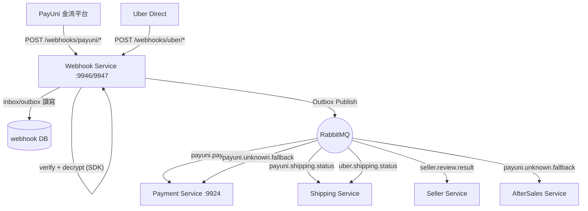
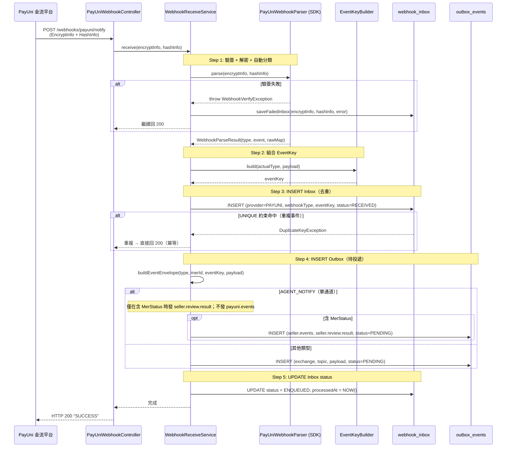
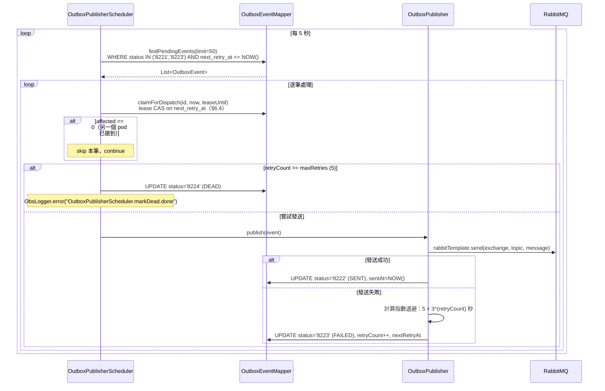
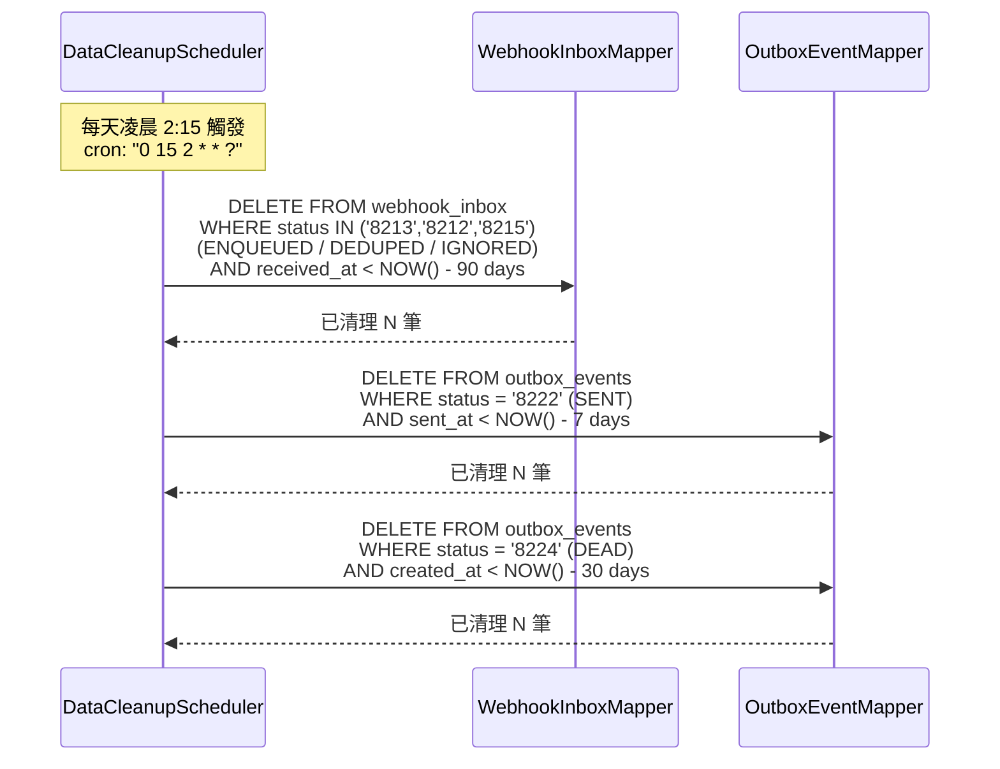
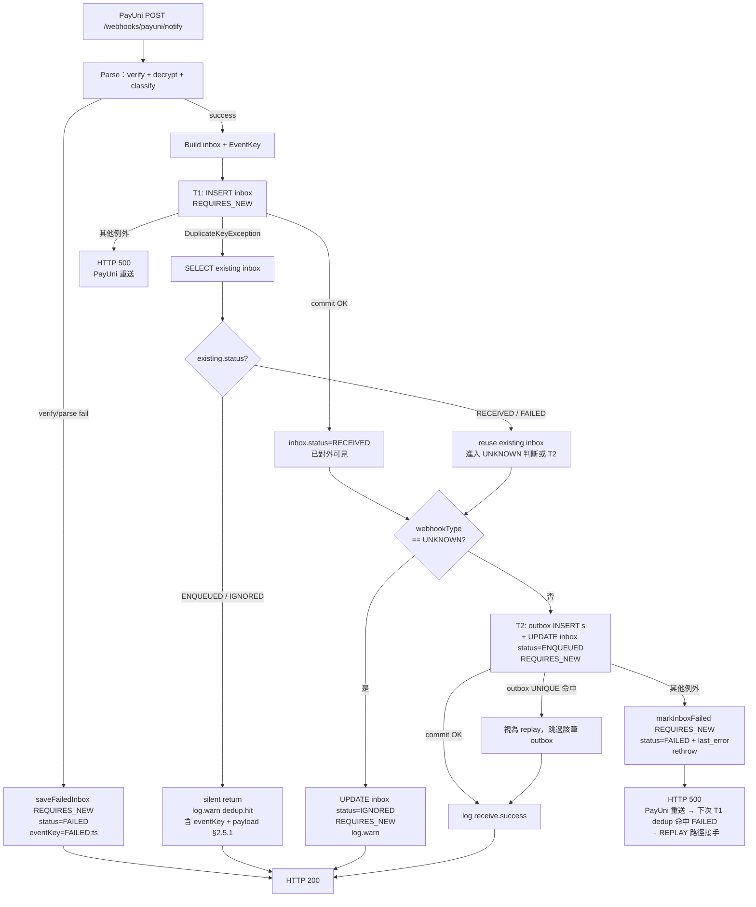
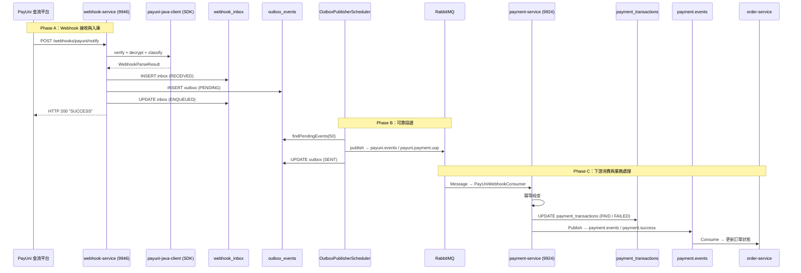

# PayUni Webhook Service 詳細設計書

---

> ⚠️ **錯誤處理慣例**：本設計書內所有 sequence diagram 之 gRPC client 呼叫，error path 統一依 [`Java gRPC 錯誤處理規範.md §7.2.1`](../開發規範/Java%20gRPC%20%E9%8C%AF%E8%AA%A4%E8%99%95%E7%90%86%E8%A6%8F%E7%AF%84.md#721-%E6%AC%8A%E5%A8%81%E6%99%82%E5%BA%8F%E5%9C%96%E6%89%80%E6%9C%89%E8%A8%AD%E8%A8%88%E6%9B%B8%E5%BC%95%E7%94%A8%E6%AD%A4%E5%9C%96%E4%B8%8D%E5%86%8D%E5%80%8B%E5%88%A5%E7%B9%AA%E8%A3%BD)。個別 diagram 僅繪製 happy path，error 分支不重複繪製。Client 禁止 `if (resp.code != 0) throw`、禁止 `throw new RuntimeException`，一律 `GrpcClientErrorTranslator.translate(e, XxxBusinessException::new)`。

### **1. 服務概述與責任邊界**

#### **1.1 服務職責**

- 唯一職責：PayUni Webhook 的唯一接收入口，負責驗簽/解密/去重/可靠投遞至下游服務
- 核心功能：
    - 接收 PayUni 推送的 3 種 Webhook（付款結果、物流貨態、代理商通知）
    - 使用 `payuni-java-client` SDK 進行簽章驗證與 AES-256-GCM 解密
    - Inbox Pattern：以 UNIQUE 約束實現事件去重（冪等接收）
    - Outbox Pattern：確保事件最終可投遞至 RabbitMQ（指數退避重試）
    - 快速回應 HTTP 200（業務邏輯由下游 Consumer 處理）
    - 定期清理過期資料（inbox 90 天、outbox SENT 7 天、outbox DEAD 30 天）
- 非職責範圍：
    - 不處理任何業務邏輯（付款確認、庫存扣減等由下游服務負責）
    - 不直接面對使用者
    - 不提供對外 HTTP API（僅接收 PayUni 推送）

#### **1.2 系統架構圖**



> **端口說明**：
> - Webhook Service: 9946 (HTTP) / 9947 (gRPC)
> - TSID Node ID Base: 500（第 6 個微服務）
>
> **通訊方式**：
> - PayUni → Webhook Service：HTTP POST (form-urlencoded)
> - Webhook Service → 下游：RabbitMQ Topic Exchange
> - AGENT_NOTIFY 含 MerStatus 時，**單通道**發送 `seller.events / seller.review.result`；無 MerStatus 則不發任何 route

---

### **2. 資料庫設計 (Database Schema)**

使用 PostgreSQL。Migration 由 Flyway 管理，僅保留一份 `V1__init_webhook_tables.sql`。

#### **2.1 Webhook 收件箱 webhook_inbox**

記錄每一次 PayUni Webhook 請求，以 UNIQUE 約束實現事件層級去重。主鍵使用 BIGSERIAL（內部日誌表）。

| **欄位名稱** | **類型** | **必填** | **說明 / 備註** |
|---|---|---|---|
| id | BIGSERIAL | PK | 自增主鍵 |
| provider | VARCHAR(20) | YES | `WebhookProvider` 的 **Value**（數字碼字串：PayUni=`8241`、Uber=`8242`），DEFAULT `'8241'`。🔴 **存 Value 不存 code name**——寫 `'UBER'` 會讓 consumer 拿字串去比數字碼。本表為多 provider 共用（66 號 Uber slice 沿用本表，不另建 `uber_webhook_inbox`） |
| mer_id | VARCHAR(32) | NO | PayUni 商家代號（`HAWK<store_id>`）。**僅 `provider=PayUni` 適用；其他 provider 為 NULL，不得填 sentinel** |
| webhook_type | VARCHAR(50) | YES | `provider` 原生事件型別，值域依 provider 而異：PayUni 為 `PayUniEventType` 的 Value（8251-8254、8259=UNKNOWN）；Uber 為 webhook 原生 kind（例 `event.delivery_status`）。🔴 **跨 provider 刻意不做統一正規化**——正規化是 consumer 側的職責 |
| event_key | VARCHAR(255) | YES | 去重鍵，見下方組合規則 |
| status | VARCHAR(20) | YES | 處理狀態（DEFAULT `'RECEIVED'`） |
| verify_status | VARCHAR(20) | YES | 驗簽狀態（DEFAULT `'PASSED'`） |
| raw_envelope | JSONB | NO | 原始 EncryptInfo + HashInfo（稽核用） |
| decrypted_payload | JSONB | NO | 解密後 Payload |
| received_at | TIMESTAMPTZ | YES | 接收時間（DEFAULT NOW()） |
| processed_at | TIMESTAMPTZ | NO | 處理完成時間 |
| last_error | TEXT | NO | 最後錯誤訊息 |

**UNIQUE 約束**：

```sql
CONSTRAINT uq_inbox_event UNIQUE (provider, webhook_type, event_key)
```

> 同一 Provider + 同一 Type + 同一 EventKey = 同一事件，第二次 INSERT 觸發 `DuplicateKeyException` → 冪等忽略。

**Entity 對應**：`io.github.will413028.hawkr.webhook.infrastructure.persistence.entity.WebhookInbox`
- 主鍵策略：`@TableId(type = IdType.AUTO)`

#### **2.2 Outbox 事件表 outbox_events**

確保 Webhook 事件最終可投遞至 RabbitMQ（Outbox Pattern）。主鍵使用 BIGSERIAL（內部事件表）。

| **欄位名稱** | **類型** | **必填** | **說明 / 備註** |
|---|---|---|---|
| id | BIGSERIAL | PK | 自增主鍵 |
| aggregate_type | VARCHAR(50) | YES | 固定 `'PAYUNI_WEBHOOK'`（DEFAULT） |
| aggregate_id | VARCHAR(255) | YES | = event_key |
| exchange | VARCHAR(100) | YES | MQ Exchange |
| topic | VARCHAR(100) | YES | MQ Routing Key |
| message_key | VARCHAR(255) | YES | 消息鍵（= event_key） |
| payload | JSONB | YES | 事件信封 JSON |
| headers | JSONB | NO | 消息 Header（保留欄位） |
| status | SMALLINT | YES | 投遞狀態碼（DEFAULT 0） |
| retry_count | SMALLINT | YES | 重試次數（DEFAULT 0） |
| next_retry_at | TIMESTAMPTZ | NO | 下次重試時間 |
| created_at | TIMESTAMPTZ | YES | 建立時間（DEFAULT NOW()） |
| sent_at | TIMESTAMPTZ | NO | 成功發送時間 |
| last_error | TEXT | NO | 最後錯誤訊息 |

**約束**：

```sql
CONSTRAINT chk_outbox_status CHECK (status IN ('8221', '8222', '8223', '8224'))
CONSTRAINT uq_outbox_aggregate_route UNIQUE (aggregate_id, exchange, topic)
```

> `uq_outbox_aggregate_route` 是 §4.5 事務邊界設計引入的 replay-safe 約束：T2 重放時若 outbox 已存在（前次 T2 commit 後在某處中斷），`OutboxEventMapper.insertIfAbsent`（`ON CONFLICT DO NOTHING`）視為已建立、跳過。此約束仍支援同 `aggregate_id` 多路由（不同 `exchange`/`topic` 各自允許）——AGENT_NOTIFY 目前是單通道，但該粒度刻意保留。

**索引**：
- `idx_outbox_status_retry ON (status, next_retry_at) WHERE status IN ('8221', '8223')` — 加速待投遞查詢

**Entity 對應**：`io.github.will413028.hawkr.webhook.infrastructure.persistence.entity.OutboxEvent`
- 主鍵策略：`@TableId(type = IdType.AUTO)`

#### **2.3 Enum 定義**

**InboxStatus（Inbox 處理狀態）**：

| Enum 值 | 說明 |
|---------|------|
| `RECEIVED` | 已收到（初始狀態） |
| `DEDUPED` | 保留值。**接收路徑不寫入**；replay 判定與 §7 cleanup 視為終態 |
| `ENQUEUED` | 已入隊（已產生 Outbox 待投遞） |
| `FAILED` | 處理失敗 |
| `IGNORED` | 已忽略（UNKNOWN webhookType 已稽核，故意不投遞 MQ；terminal 狀態不參與 replay）|

**OutboxStatus（Outbox 投遞狀態）**：

| Enum 值 | Code | 說明 |
|---------|------|------|
| `PENDING` | 0 | 待發送 |
| `SENT` | 1 | 已發送 |
| `FAILED` | 2 | 發送失敗（可重試） |
| `DEAD` | 3 | 死信（超過最大重試次數） |

**VerifyStatus（驗簽狀態）**：

| Enum 值 | 說明 |
|---------|------|
| `PASSED` | 驗簽成功 |
| `FAILED` | 驗簽失敗 |

**WebhookType（Webhook 類型）**：

| Enum 值 | Exchange | Topic (Routing Key) | 說明 |
|---------|----------|---------------------|------|
| `PAYMENT_UOP` | `payuni.events` | `payuni.payment.uop` | 付款結果通知 |
| `SHIPPING_STATUS` | `payuni.events` | `payuni.shipping.status` | 物流貨態通知 |
| `SHIPPING_PRINT` | `payuni.events` | `payuni.shipping.status` | 超商列印通知（與 STATUS 共用 routing key，下游按 ApiType 分流）。下游 Shipping Service 消費後 transition `shipments.label_print_status` 為 `SUCCEEDED`（4103）並回填 `partner_id / odno / validation_no`，詳見 06-Shipping §2.4 / §5.6 |
| `AGENT_NOTIFY` | `seller.events` | `seller.review.result` | 代理商通知。含 MerStatus 時單通道發此路由，由單體 seller 模組消費；無 MerStatus 則不發任何 route |
| `REFUND_NOTIFY` | `payuni.events` | `payuni.refund.notify` | ATM 退款轉匯結果 |
| `REFUND_ACCEPTED` | `payuni.events` | `payuni.refund.accepted` | 退款受理通知 |
| `UNKNOWN` | — | — | 無法辨識的 PayUni Webhook，僅寫入 inbox 稽核，不投遞 MQ |

> Exchange / Topic 對應由 `PayUniEventRouting` helper class 提供（CodeMeta enum 禁止自定義方法，見 [Java 微服務開發規範 §6](../開發規範/Java%20微服務開發規範.md) 與 [代碼管理（CodeMeta）](../代碼管理（CodeMeta）/README.md)）。AGENT_NOTIFY 為例外：它**不經 `payuni.events`**，其 `seller.review.result` 路由由 `WebhookReceiveService.buildRoutes` 直接組裝，`PayUniEventRouting.topic(AGENT_NOTIFY)` 拋 `IllegalStateException`（保留 case 維持窮舉）。
>
> **退貨物流 Webhook**：退貨物流單的 `MerTradeNo` 為 `{orderNo}-Refund`（如 `O400280260-Refund`），Webhook Service 不區分正向/逆向，統一以 `SHIPPING_STATUS` 類型發布至 `payuni.shipping.status`。由下游 Shipping Service 消費時依 `shipments.is_return` 識別退貨物流並發布 `shipment.return.status_changed` 事件。

#### **2.4 EventKey 組合規則（去重鍵）**

| Webhook Type | EventKey 格式 | 範例 |
|-------------|---------------|------|
| `PAYMENT_UOP` | `{merId}:{merTradeNo}:{tradeNo}:{tradeStatus}` | `HAWK9:O123456789001:1776493168257421093:1` |
| `SHIPPING_STATUS` | `{merId}:{shipTradeNo}:STATUS:{statusValue}` | `HAWK9:SHP20260216789:STATUS:91` |
| `SHIPPING_PRINT` | `{merId}:{shipTradeNo}:PRINT:{odno}` | `HAWK9:SHP20260216789:PRINT:ODN123456` |
| `AGENT_NOTIFY` | `{merId}:{merStatus}:{executeTime}` | `HAWK9:1:20260216143000` |
| `REFUND_NOTIFY` | `{merId}:{merTradeNo}:{tradeNo}:{refundStatus}` | `HAWK9:O123456789001:1776493168257421093:1` |
| `REFUND_ACCEPTED` | `{merId}:{merTradeNo}:{tradeNo}:ACCEPTED:{estimatedRefundDate}` | `HAWK9:O123456789001:1776493168257421093:ACCEPTED:2026-04-25` |
| `UNKNOWN` | `{merId}:UNKNOWN:{timestamp}` | `HAWK9:UNKNOWN:1714123456789` |

> EventKey 由 `EventKeyBuilder.build(PayUniEventType, Map<String, String>)` 靜態方法產生。
>
> **SHIPPING_STATUS `statusValue` 取值規則**：優先使用 payload 的 `ShipStatus`（貨態通知）；若為空（建單回應僅有 `TradeStatus`）則 fallback 為 `TradeStatus`。

🔴 **`PAYMENT_UOP` 的 eventKey 必須含 `TradeNo`**：同一個 MerTradeNo 可能對應多筆獨立的
PayUni 交易（例如信用卡與 ATM 切換），各筆 `TradeNo` 不同 ⇒ eventKey 不同 ⇒ dedup 不會
誤攔後到的那一筆。拿掉它會讓 05 §2A.6「同 order 多筆獨立付款」偵測失效。
詳見 [05-支付服務 §12](./05-支付服務（Payment%20Service）詳細設計書.md#12-eventkeybuilder-payment_uop-eventkey-設計2026-04-08-補)。

🔴 **eventKey 不含 `TradeAmt`；金額守恆不在 webhook 接收路徑驗證。**
dedup 的 UNIQUE 約束即金額守恆的最外層防守，接收路徑不得在 catch 之後另做 TradeAmt 比對
（PostgreSQL aborted state，見 §2.5.1）。金額面的對帳責任在 payment-service。

##### 2.4.1 dedup 邊界行為

| 情境 | 行為 |
|---|---|
| `TradeStatus` 由 `0` → `1`（待付 → 已付） | eventKey 改變（含 `tradeStatus`）⇒ 兩筆獨立 inbox row，各自處理 |
| 完全重複（同 eventKey 重投） | T1 命中 `DuplicateKey` → 查 existing.status ＝ `ENQUEUED` → silent return ＋ `log.warn` |
| 先收到 UNKNOWN、後續才解出 `PAYMENT_UOP` | UNKNOWN 的 eventKey 含 timestamp ⇒ 與後者不同 ⇒ 視為兩個獨立事件 |
| 同 eventKey 但 `TradeAmt` 不同 | silent return（差異被吞掉）。🔴 **已知限制**：eventKey 不含 `TradeAmt`，webhook 層偵測不到金額不一致——偵測責任在 payment-service 對帳側 |

#### **2.5 事務與觀察性規範**

##### 2.5.1 dedup hit 觀察性

當 INSERT webhook_inbox 觸發 `DuplicateKeyException`（重複事件）時，**必須**：

| 規範 | 內容 |
|------|------|
| Log level | `log.warn`（非 `log.info`，確保 oncall log 監控可見）|
| Log 內容 | 必須帶 `eventKey` + 完整 `decryptedPayload`，便於事後追溯 PayUni retry 模式或異常 |
| catch 內 DB 操作 | **禁止**新增任何 DB 寫入（INSERT/UPDATE/DELETE）|

> **catch 內禁止 DB 寫入的原因**：
> PostgreSQL 在事務內任何錯誤後 connection 進入 aborted state，後續 SQL 全部失敗。
> 即便看似簡單的「dedup hit 時 update 既有 row 的 hit_count」也會踩雷。
> 若有此類需求，必須在 §4.5 的事務邊界內重新安排寫入位置。

##### 2.5.2 失敗 inbox（saveFailedInbox）必須走獨立事務

驗簽/解析失敗時的 audit inbox 寫入（`saveFailedInbox`），**必須**走獨立事務（`@Transactional(propagation = REQUIRES_NEW)`），且因 Spring AOP self-invoke 限制，必須拆出獨立 bean（如 `FailedInboxRecorder`）。

| 違反規範的後果 |
|----------------|
| 若與 `receive()` 共用同一 @Transactional，且 INSERT 失敗（譬如 event_key 衝突）被內部 try/catch 吞掉，PostgreSQL connection 處於 aborted state → 整個外層 commit 變 ROLLBACK → **驗簽失敗的 audit 紀錄沒寫進去**，運維無法追溯 |

對應「try/finally 內 cleanup 寫入會被例外 rollback」原則 — 任何在 `@Transactional` 範圍內被吞掉例外的 DB 寫入，都不應期待會持久化。

##### 2.5.3 事務邊界

接收流程的事務邊界規格見 **§4.5**（兩段獨立交易 T1／T2 ＋ status-aware replay）。

---

### **3. 介面定義 (API Specification)**

#### **3.1 HTTP Webhook 端點**

本服務僅接收 PayUni 推送的 Webhook，**不提供對外 REST API**。

| # | HTTP Method | URL | Content-Type | 說明 |
|---|------------|-----|-------------|------|
| 1 | POST | `/webhooks/payuni/notify` | `application/x-www-form-urlencoded` | PayUni 統一 Webhook（付款/物流/代理商） |

> PayUni 後台僅允許設定一組 Webhook URL，所有類型的通知皆透過同一端點接收。
> SDK 的 `PayUniWebhookParser` 解密後依 payload 欄位自動分類：
>
> | 解密後含有的欄位 | 判定為 |
> |---|---|
> | `ShipTradeNo` + `LgsType` | `SHIPPING_STATUS` |
> | `TradeAmt` + `TradeStatus` | `PAYMENT_UOP` |
> | `NotifyType` | `AGENT_NOTIFY` |

**請求參數**（form-urlencoded）：

| 參數名 | 型別 | 說明 |
|--------|------|------|
| `EncryptInfo` | `String` | AES-256-GCM 加密後的業務資料（hex 編碼） |
| `HashInfo` | `String` | SHA256 簽章（大寫 hex） |

**回應**：固定回傳 HTTP 200 `"SUCCESS"`（快速回應，不阻塞 PayUni）。

#### **3.2 服務配置 (application.yml)**

```yaml
server:
  port: ${SERVER_PORT:9946}

grpc:
  server:
    port: ${GRPC_PORT:9947}

spring:
  application:
    name: payuni-webhook-service
  datasource:
    url: jdbc:postgresql://${DB_HOST:127.0.0.1}:${DB_PORT:5432}/${DB_NAME:hawkr_webhook}
    username: ${DB_USER:dbadmin}
    password: ${DB_PASSWORD}
  rabbitmq:
    host: ${RABBITMQ_HOST:127.0.0.1}
    port: ${RABBITMQ_PORT:5672}
    username: ${RABBITMQ_USERNAME:guest}
    password: ${RABBITMQ_PASSWORD:guest}
  flyway:
    enabled: ${FLYWAY_ENABLED:false}

hawkr:
  obs:
    service: payuni-webhook-service
  tsid:
    enabled: true
    node-id-base: 500
    pod-index: ${POD_INDEX:0}

payuni:
  agent:
    key: ${PAYUNI_AGENT_KEY:<PAYUNI_AGENT_KEY>}
    iv: ${PAYUNI_AGENT_IV:<PAYUNI_AGENT_IV>}

webhook:
  outbox:
    max-retries: 5
  cleanup:
    enabled: ${CLEANUP_ENABLED:true}
    cron: "0 15 2 * * ?"
    inbox-retention-days: 90
    outbox-sent-retention-days: 7
    outbox-dead-retention-days: 30
```

---

### **4. 業務流程詳細設計 (Business Logic)**

#### **4.1 核心接收流程**

> 本流程圖呈現高階互動順序。**事務邊界（@Transactional 結構、T1/T2 拆分、replay 路徑、UNKNOWN 終態）以 §4.5 為準**。本圖中「INSERT inbox → INSERT outbox → UPDATE status」三步在 §4.5 規範下分屬兩個獨立 `REQUIRES_NEW` 交易。



#### **4.2 Outbox 投遞流程**



#### **4.3 資料清理流程**



#### **4.4 異常處理策略**

| 異常場景 | 處理方式 | HTTP 回應 | 說明 |
|---------|---------|-----------|------|
| 驗簽失敗 | 記錄失敗 Inbox（`verifyStatus=FAILED`） | 200 | 避免 PayUni 無限重送 |
| 解密失敗 | 記錄失敗 Inbox（`status=FAILED`） | 200 | 保留原始資料供排查 |
| 重複事件 | `DuplicateKeyException` → 忽略 | 200 | UNIQUE 約束保證冪等 |
| MQ 發送失敗 | Outbox FAILED + 指數退避重試 | — | 最多 5 次，超過標記 DEAD |
| DB 寫入失敗（T1 inbox INSERT，非 DuplicateKeyException） | T1 例外向上拋 → Controller 回 500 | 500 | PayUni 自動重送 |
| DB 寫入失敗（T2 outbox/狀態更新） | inbox 已 commit，先標 `status=FAILED` + `last_error`（獨立 REQUIRES_NEW），再 rethrow | 500 | Controller 回 500 → PayUni 重送 → 下次 T1 dedup 命中 FAILED → §4.5 replay 路徑接手補建 outbox |

> 細節見 §4.5 事務邊界設計。

---

### **4.5 事務邊界設計**

§4.1 接收流程的事務邊界為**兩段獨立交易（T1／T2）＋ status-aware replay**。

`webhook_inbox` 的 `UNIQUE (provider, webhook_type, event_key)` 承擔一個設計層次的承諾：
**「inbox INSERT 成功 ＝ dedup commitment 完成」**（見 §2.4 EventKey 規則、05 §12、09 §2A.6
的依賴假設）。下游服務（payment-service §2A.6）雖有自身冪等保護
（`payment_webhooks.idempotency_key` ＋ 樂觀鎖），但那是縱深防禦——
**webhook-service 才是 dedup 的真實邊界**。

🔴 **因此 inbox INSERT 不得與 outbox INSERT 共用同一個交易**：同交易下該承諾只在 commit
後才為真，任一後續步驟失敗都會把 inbox 一起 rollback，UNIQUE 約束等同沒運作，
PayUni 重送時會重新進入流程 ⇒ 失敗持續即無限循環。

方案取捨與被否決的四個替代方案見 `docs/adr/2026-09-18-webhook-two-phase-transaction.md`。

#### 4.5.3 選定方案：兩段獨立交易 + Status-aware Replay


##### 流程

| 階段 | 範圍 | 操作 |
|------|------|------|
| Parse | 無交易 | 驗簽 + 解密 + 分類 + 組 EventKey |
| **T1** | `@Transactional(propagation = REQUIRES_NEW)` | INSERT `webhook_inbox`（status=RECEIVED） |
| **T2** | `@Transactional(propagation = REQUIRES_NEW)` | INSERT `outbox_events`（一或兩筆，UNIQUE 防重）+ UPDATE `webhook_inbox.status = '8213'（ENQUEUED）` |

`receive(...)` 本身**不再標 `@Transactional`**，由內部呼叫的方法各自開獨立交易。

##### 實作技巧（避免 self-invocation 失效）

Spring AOP-based `@Transactional` **不攔截同類別的 self-invocation**。若 T1/T2 與 `receive(...)` 都放在 `WebhookReceiveService` 內部互相呼叫，`@Transactional(REQUIRES_NEW)` 不會生效（不會新開交易），交易語意完全失靈。

兩種合法實作（擇一）：

| 方式 | 做法 | 適用 |
|------|------|------|
| 拆 Bean | 新建 `WebhookInboxTxOps` / `WebhookOutboxTxOps` 兩個 `@Service`，T1/T2 各自為其 method（標 `@Transactional(REQUIRES_NEW)`），`WebhookReceiveService` 注入呼叫 | 結構清晰、與 Spring 慣用法一致 |
| TransactionTemplate | 注入 `TransactionTemplate`，`receive(...)` 內以 `txTemplate.execute(...)` 顯式包住 T1/T2 lambda | 與 [PaymentNotifyHandler.handlePaid](services/java/payment-service/src/main/java/io/github/will413028/hawkr/payment/handler/PaymentNotifyHandler.java) 既有做法一致；不需新增類別 |

設計書不指定哪種，實作階段擇一即可。**禁止**讓 T1/T2 維持為 `WebhookReceiveService` 同類別 method 配 `@Transactional` 註解。

##### T1 行為（dedup 真實邊界）

依 §2.5.1 規範，PostgreSQL 在 transaction 內任何錯誤後 connection 進入 aborted state，**必須**把後續的 SELECT 拆出 T1 之外執行（不可在 T1 catch 區內讀 DB）。

結構：T1 內**只做 INSERT 不 catch**；DupKey 在 T1 之外（呼叫端、不同 transaction）catch + SELECT。

```
// T1（位於 InboxTxOps 或以 TransactionTemplate 包裝；REQUIRES_NEW）
T1.insert(inbox):
  inboxMapper.insert(inbox)        // INSERT webhook_inbox (status=RECEIVED)
  // 不 catch；DuplicateKeyException 與其他例外都向上拋
  // T1 內若失敗，REQUIRES_NEW 交易自動 rollback，T1 connection 也釋放回 pool

// 呼叫端（receive() 內，T1 之外）
try:
  T1.insert(inbox)
  // INSERTED：繼續 §UNKNOWN 判斷或 T2
catch DuplicateKeyException:
  // T1 已 rollback，aborted state 已釋放
  existing = inboxMapper.findByEventKey(provider, webhookType, eventKey)   // 在 T1 之外，獨立讀（autocommit 或新 transaction）
  switch existing.status:
    case ENQUEUED, IGNORED:        log.warn("dedup.hit", ...) + return    // 已完整處理或已忽略
    case RECEIVED, FAILED:         inbox = existing; // 進入 replay → §UNKNOWN 判斷或 T2
    default:                       log.error + return                     // 防呆
catch (any other Exception):
  throw                                                                     // → Controller 回 500 → PayUni 重送
```

關鍵點：
- T1 commit 後 inbox row 對外可見，UNIQUE 真正守住 dedup commitment
- DupKey 後的 SELECT **必須**在 T1 transaction 之外執行（§2.5.1）
- 重複事件（同 eventKey、上次已 ENQUEUED 或 IGNORED）→ `log.warn` + silent return（§2.5.1 規定 dedup hit 用 WARN）
- Orphan（同 eventKey、上次卡在 RECEIVED 或 FAILED）→ 進入 replay 路徑，沿用 existing inbox row，不重建
- 非 DupKey 例外不被 catch，由 controller 透過 5xx 回應觸發 PayUni 重送

##### T2 行為（outbox + 狀態收斂）

```
T2(inbox):
  try:
    for each (exchange, topic) in route(inbox.webhookType, payload):
      try:
        INSERT outbox_events (aggregate_id=inbox.event_key, exchange, topic, payload, status='8221')  -- OutboxEventStatus.PENDING
      catch DuplicateKeyException:
        // replay 時 outbox UNIQUE 命中，表示前次 T2 commit 後在某處中斷；視為已建立、跳過

    UPDATE webhook_inbox SET status='8213', processed_at=NOW() WHERE id=inbox.id  -- WebhookInboxStatus.ENQUEUED
    COMMIT

  catch any Exception e:
    markInboxFailed(inbox.id, e)   // 自開 REQUIRES_NEW；最後 best-effort，失敗只 log
    log.error("WebhookReceiveService.receive.t2Failed", e)
    throw e                          // rethrow → Controller 回 500 → PayUni 重送 → 下次 T1 dedup 命中 FAILED → REPLAY
```

關鍵點：
- 整個 T2 是 atomic：outbox INSERT(s) + inbox status update 在同一 commit boundary，要不全成要不全 rollback
- outbox INSERT 的 DupKey 是 replay-safe 的訊號（不是錯誤），continue 即可
- T2 失敗一律 rethrow，由 controller 回 500 觸發 PayUni 重送 — **此處依賴 PayUni 對 5xx 的重送行為**，見 §4.5.5.D 限制與 follow-up

##### UNKNOWN webhookType 處理（保守失敗處理）

🔴 **UNKNOWN 不得一律標 `IGNORED` 丟掉。** PayUni 對 ATM 退款失敗實際會回**不帶** `MerTradeNo` / `TradeNo` / `RefundStatus` 的 payload（例 `Status=REF05012`）——那筆一旦被丟棄，`refund_tasks.payuni_message` 就是空的、前端 `refund_failure_message` 透傳空字串、買家 App 永遠卡在「處理中」且無法重填。
> 因此對未知 webhook **採保守失敗處理**：不假設 PayUni 會遵守自己的規格。

UNKNOWN 路徑流程（在 T1 commit 之後）：

```
parser = UNKNOWN
  ├─ payload 無 MerID
  │   → UPDATE inbox status=IGNORED + log.warn + return 200
  │   （無 MerID 無法綁定任何業務 task，維持既有終態處理）
  │
  └─ payload 含 MerID
      → log.error 觸發 Obs alert
      → 繼續進入 T2（outbox INSERT + inbox status=ENQUEUED）
      → 投遞到 routing key `payuni.unknown.fallback`（exchange `payuni.events`）
      → aftersales `UnknownRefundFallbackConsumer` + payment `UnknownPaymentFallbackConsumer` 並行訂閱
```

下游 consumer 行為：
- **aftersales**：用 `MerID` 查最近一筆 `refund_tasks` status IN (5, 15)（不限時間窗 — ATM 匯款 async webhook 延遲可能多日）；找到且 `payment_method=ATM` → `revertFromAnyAwaitingToAwaitingPage`（退回 5 + stamp payuni_message + attempt++）；找不到 ACK + log.warn
- **payment**：用 `MerID` 查最近一筆 `payment_transactions` status='0' AND `is_duplicate=false`；找到 → `stampUnknownFallbackMessage`（樂觀鎖 `WHERE provider_message IS NULL`，避免覆蓋 reconcile）；不主動推 status（保留 single source of truth，由既有 `PendingPaymentReconcileService` 接手）；找不到 ACK + log.warn

PayUni 修正規格後（含完整業務鍵）自然不會落入此路徑 — UNKNOWN consumer 沒流量、設計仍正確，**不會變死碼**。

> UNKNOWN 的 eventKey 含 timestamp（見 §2.4），重送會產生不同 eventKey、新 inbox row（無法 dedup）。這是 PayUni 違規 payload 無業務鍵的 fundamental limit；fallback consumer 依「最近一筆 awaiting task」綁定，誤綁機率極低（同 MerID 同時多筆 awaiting 罕見），即便誤綁也僅讓買家看到一次錯誤訊息，重填會 override，無資金面副作用。

##### replay-safe 的兩個硬前提

1. **`outbox_events` 必須有 `uq_outbox_aggregate_route UNIQUE (aggregate_id, exchange, topic)`**
   （見 §2.2）：T2 replay 必須能安全重放 outbox INSERT，這個約束提供「同 eventKey ＋ 同投遞
   通道只會建立一筆 outbox row」的硬保證。**沒有它，replay 就會產生重複 MQ 訊息。**
   粒度刻意允許同事件多路由（不同 `exchange`／`topic` 各自成立）。
2. **`WebhookInboxStatus` 必須有 `IGNORED`（8215）**（見 §2.3）：UNKNOWN 且無 MerID 的終態，
   terminal、不參與 replay、並列入 §7 的清理條件。

#### 4.5.4 流程圖



#### 4.5.5 失敗留痕與 PayUni 重送依賴

##### A. `FailedInboxRecorder` 必須是獨立 bean

驗簽／解析失敗時的 audit inbox 寫入（eventKey ＝ `FAILED:{currentMillis}`）**必須**是獨立
bean `FailedInboxRecorder` 且標 `@Transactional(propagation = REQUIRES_NEW)`：

1. Spring AOP self-invocation 限制——`@Transactional` 貼在同類別方法上不會被攔截
2. §2.5.2 規範：audit row 必須走獨立事務，否則外層一旦例外（含 PostgreSQL aborted state）
   audit row 會跟著 rollback 失蹤，運維無法追溯

##### B. PayUni 重送窗口（現行限制）

Status-aware replay 依賴 PayUni 在 T2 失敗後仍會重送同一筆 webhook。
**PayUni 的重送次數與窗口上界未經坐實** ⇒ DB 長時間故障這類極端情況下，
inbox 可能永久停在 `RECEIVED` / `FAILED`，事件無法投遞。

> ⚠️ **這條依賴也約束 Gateway**：`POST /webhook/payuni/notify` 是反向代理，
> **payuni-webhook-service 連不上時回應是 Gateway 產生的**，不是本服務。那條路由
> **必須維持 502**，而同一支 Gateway 上其他代理路由（媒體串流、賣家 PATCH、webhook
> 模擬器）回 **424 Failed Dependency**——因為它們的消費者是我們自己的前端，而
> Cloudflare 會把 5xx 的 body 換成自己的錯誤頁讓前端拿不到 envelope。
> 判準是**消費者是誰**而不是錯誤的技術性質：**對 PayUni 回 4xx ＝ 它不再重送 ＝
> 本節的 replay 路徑永遠等不到觸發，而且沒有任何錯誤訊號。**
> 理由全文見 `gateway/internal/proxy/reverse_proxy.go` 的 `UpstreamFailureStatus`，
> 逐條釘死在 `gateway/internal/router/proxy_failure_status_test.go`。

#### 4.5.6 監控與告警補充

| 事件 | 級別 | 觸發時機 |
|------|------|---------|
| `WebhookReceiveService.dedup.hit` | WARN | T1 hit DupKey 且 existing.status ∈ (ENQUEUED, IGNORED)，silent return（按 §2.5.1 規範必須 WARN，含 eventKey + 完整 decryptedPayload） |
| `WebhookReceiveService.receive.replay` | WARN | T1 hit DupKey 且 existing.status ∈ (RECEIVED, FAILED)，進入 replay 路徑 |
| `WebhookReceiveService.unknown.markedIgnored` | WARN | UNKNOWN webhookType 已寫入 inbox 並標 IGNORED（取代既有 `unknown.received`） |
| `WebhookReceiveService.receive.t2Failed` | ERROR | T2 整段失敗、inbox 標 FAILED、即將 rethrow → 500 |
| `WebhookReceiveService.markFailed.error` | ERROR | T2 失敗後標 FAILED 又失敗（最後 best-effort 也失敗，僅 log） |

> §10.1 既有 `WebhookReceiveService.receive.duplicate`（INFO）與本表 `dedup.hit`（WARN）含意一致，依 §2.5.1 必須升級為 WARN，命名統一為 `dedup.hit`（已對齊現有實作 line 103-105 的 event name）。實作時連同 §10.1 表格一併更新。

### **5. 訊息佇列設計 (Message Queue Topology)**

> 完整 exchange / queue / DLQ / payload class / Ack / idempotency 設計見
> [36-MQ 與事件總覽 §3.5 PayUni Webhook 領域](./36-MQ%20與事件總覽（MQ%20%26%20Event%20Catalog）.md#35-payuni-webhook-領域payuni-webhook-domain)。
>
> 本服務內部設計（Inbox + Outbox 雙階段）見 §2 / §4.5 / §6。

#### **5.1 Routing Key 與下游處理（webhook → 下游）**

| Routing Key | Exchange | 業務語意 | 下游處理 |
|---|---|---|---|
| `payuni.payment.uop` | `payuni.events` | PayUni UOP 付款結果通知（信用卡 / ATM sync / 退款 sync） | payment-service 推進 `payment_transactions` 狀態 |
| `payuni.shipping.status` | `payuni.events` | PayUni 物流貨態通知（含 ApiType=Print 分流） | shipping-service 推進物流狀態 / 回填出貨便代碼 |
| `payuni.refund.notify` | `payuni.events` | PayUni 退款 async webhook | payment-service 推進 refund state |
| `payuni.refund.accepted` | `payuni.events` | PayUni 退款 sync 受理 | payment-service 寫入 estimated_refund_date |
| `payuni.unknown.fallback` | `payuni.events` | 無法分類的 webhook | payment-service + aftersales-service 保守 stamp |
| `seller.review.result` | `seller.events` | 商家審核結果（AGENT_NOTIFY 唯一投遞通道） | 單體 seller 模組商家狀態變更 |
| `uber.shipping.status` | `payuni.events` | Uber Direct 貨態通知 | shipping-service，queue `shipping.uber.webhook` |

> **AGENT_NOTIFY 單通道**：含 `MerStatus` 欄位時寫入 `seller.events / seller.review.result` 供 Seller Service 消費；**沒有 `payuni.events / payuni.agent.notify` 這條路由**。無 `MerStatus` 時不發任何 route。

#### **5.2 Event Envelope 欄位語意**

所有 Webhook 事件投遞至 MQ 時，使用統一的信封格式（`PayUniWebhookEnvelope`，common-core）：

| JSON 鍵（wire） | Java accessor | 型別 | 說明 |
|------|------|------|------|
| `event_id` | `eventId()` | `String` | UUID（全局唯一） |
| `provider` | `provider()` | `String` | 🔴 **不是常數 `"PAYUNI"`**——Uber slice 共用同一個 `PayUniWebhookEnvelope`。下游路由**必須**帶 provider 維度，見 §5.3 第 2 條 |
| `webhook_type` | `webhookType()` | `String` | `PAYMENT_UOP` / `SHIPPING_STATUS` / `AGENT_NOTIFY` / `REFUND_NOTIFY` 等 |
| `mer_id` | `merId()` | `String` | 商家編號 |
| `event_key` | `eventKey()` | `String` | 去重鍵（同 Inbox eventKey；§2.4） |
| `occurred_at` | `occurredAt()` | `String` | ISO 8601 時間 |
| `payload` | `payload()` | `Object` | 解密後原始 PayUni Key-Value Map |
| `meta.version` | `meta()` | `String` | 信封版本（預留升級空間） |

> **wire 鍵一律 snake_case**（36 §7.4 Conformance Contract），由 `WebhookReceiveService.buildEventEnvelope` 組裝；`PayUniWebhookEnvelope` 是 Java record，其 accessor 依 Java 命名規範為 camelCase。**兩者不可互換**：直接 `readTree` 後取 `path("eventId")` 一律取到空值。

#### **5.3 下游消費契約**

消費端需遵守以下規則：

1. **使用 `PayUniWebhookEnvelope`（common-core）統一解析** MQ 消息，禁止各 Consumer 自行 `readTree` + 手動取 `payload`
2. 使用 **`(provider, webhookType)`** 進行事件路由——🔴 只用 `webhookType` 會讓兩個 provider 的同名型別撞在一起
3. 使用 `eventKey` 進行冪等檢查
4. `meta.version` 預留版本升級空間，消費端需做向後相容處理

**統一解析工具（Java Consumer 必用）**：

```java
// 位置：common-core io.github.will413028.hawkr.common.mq.PayUniWebhookEnvelope
PayUniWebhookEnvelope env = PayUniWebhookEnvelope.parse(message.getBody());
String shipTradeNo = env.payloadField("ShipTradeNo");   // 取 PayUni 原始欄位
Map<String, String> payload = env.payload();             // 取完整 payload Map
```

- `parse()` 兼容標準 envelope 與裸 payload（向下兼容升級過渡期）
- 裸 payload 判定：JSON 根層不含 `event_id` 欄位 → 整個 JSON 視為 payload（此時 envelope 的 `eventId` / `webhookType` / `merId` / `eventKey` / `occurredAt` 全為空字串）

### **6. Outbox Publisher 重試策略**

#### **6.1 排程配置**

| 項目 | 值 | 說明 |
|------|-----|------|
| 執行頻率 | `fixedDelay = 5000ms` | 每 5 秒一次 |
| 批次大小 | 50 | 每次最多處理 50 筆 |
| 最大重試 | 5 次 | 超過標記 DEAD |

#### **6.2 指數退避公式**

```
延遲秒數 = 5 × 3^(retryCount - 1)
```

| 重試次數 | 延遲 | 累計等待 |
|---------|------|---------|
| 1 | 5s | 5s |
| 2 | 15s | 20s |
| 3 | 45s | 65s |
| 4 | 135s | 200s |
| 5 | 405s | 605s |
| 超過 5 | — | 標記 DEAD |

#### **6.3 狀態流轉**

```
PENDING(0) ─成功─→ SENT(1)
PENDING(0) ─失敗─→ FAILED(2)
FAILED(2) ─重試成功─→ SENT(1)
FAILED(2) ─重試失敗─→ FAILED(2)（retryCount++）
FAILED(2) ─超過上限─→ DEAD(3)
```

#### **6.4 多副本搶佔**

**規範全文**：[開發規範／多副本排程搶佔規範](../開發規範/多副本排程搶佔規範.md)。

**問題**：`OutboxPublisherScheduler` 每 5 秒 `findPendingEvents(limit=50)`。現況述詞是 `WHERE status IN ('8221','8223') AND next_retry_at <= NOW()`（`OutboxEventMapper.java:22`；`'8221'`＝`OutboxEventStatus.PENDING`、`'8223'`＝`FAILED`，**已是 CodeMeta value 字串，不是舊的整數 `0`/`2`**），但它 **只是候選過濾不是搶佔** —— `payuni-webhook-service` 在 prod **確實是 `replicas: 2`**（`k8s/values/overlays/prod/payuni-webhook-service.yaml:8` 覆寫掉 `prod/common.yaml:4` 的預設 `1`；全清單與查證方式見[規範 §〇](../開發規範/多副本排程搶佔規範.md)）⇒ **今天就有**兩個 pod 撈到同一批，**同一則 PayUni 事件被 publish 兩次**，下游（payment / shipping / order）的 dedup 是最終防線不是設計意圖，且會放大 MQ 流量與 dedup 索引寫入。

**閘門位置：`publish(event)` 之前（`OutboxPublisherScheduler` 迴圈內）。** 本服務的 outbox **只有排程一條進入點**（不像 payment 另有 afterCommit 即時投遞），所以放 Scheduler 即足夠。

| 項目 | 內容 |
|---|---|
| 租約欄 | **既有的 `outbox_events.next_retry_at`**，零 migration |
| claim SQL | `UPDATE outbox_events SET next_retry_at = #{now} + 60s WHERE id = #{id} AND status IN ('8221','8223') AND (next_retry_at IS NULL OR next_retry_at <= #{now})` |
| 租約長度 | **60 秒**（遠大於單筆最壞耗時 = 一次 `rabbitTemplate.send` 往返） |
| 候選窗口寬度 | **∞**（候選述詞無時間上界）⇒ 任何租約長度都合格（[規範 §三](../開發規範/多副本排程搶佔規範.md)） |
| 終態標記 | `markSent` 加守衛 `AND status <> '8222'`；`markFailed` / `markDead` 一律改具名 `@Update` ＋ 明確守衛述詞，**不再用 `updateById` 全欄位覆蓋**（避免與 claim 的寫入互相覆蓋） |

- ⚠️ **這是冷卻租約不是「已派送」旗標**：pod 在 claim 與 `rabbitTemplate.send` 之間崩潰時，租約到期 row 自動回到候選集合、下一次排程 tick 重送 ⇒ **at-least-once 契約不變**。
- **行為退化（已知，可接受）**：崩潰情境下事件會**延後一個租約（60 秒）**才重送，現況是「下一 tick（5 秒）就重來」。換來的是不重複。
- 🚩 **租約基準在 claim 當下取 `DateTimeUtils.nowUtc()`，不是 tick 起點的 `now`**（R4-P1-2，2026-08-08；[規範 §三第 6 步](../開發規範/多副本排程搶佔規範.md)）。本服務單筆是毫秒級、`BATCH_SIZE=50` 的批次上界遠小於 60 秒，**現行參數下不會踩到**——但那是**參數巧合不是結構保證**（改 `BATCH_SIZE`、或給 `rabbitTemplate.send` 加上同步 confirm 就會踩到），故與 order 側採同一寫法。機械保證：`OutboxPublisherSchedulerClaimTest.leaseBaselineIsTakenPerItemNotPerTick`。
- ⚠️ **claim 是自動提交的獨立 UPDATE，不放進任何交易** —— 它必須跨 pod 立即可見（[規範 §一 ②](../開發規範/多副本排程搶佔規範.md)）。這與 [§4.5.3](#453-選定方案兩段獨立交易--status-aware-replay) 的 T1／T2 邊界正交：T1／T2 管的是「事件怎麼進 outbox」，claim 管的是「誰有權把它送出去」。
- ⚠️ **候選述詞維持正面枚舉 `status IN ('8221','8223')`（＝`OutboxEventStatus.PENDING` / `FAILED`），禁止改寫成 `status <> '8222'`**：那會讓 `DEAD`（`'8224'`）row 永久滯留、把 50 筆的批次上限佔滿 ⇒ 整條 outbox starvation（**單 pod 也會壞**）。**枚舉的是 CodeMeta value 不是 enum 名**——寫成 `'PENDING'` 一筆都撈不到、outbox 靜默全停（SSOT＝[代碼管理（CodeMeta）／內部技術碼](../代碼管理（CodeMeta）/內部技術碼.md)；該 enum 沒有 `RETRYING`）。order-service 就踩過這一個（[規範 §六](../開發規範/多副本排程搶佔規範.md)）；本服務現況已是正面枚舉，**修改時不要順手「簡化」掉它**。

**一致性、交易與補償邊界**

- **不引入補償任務基礎設施**：搶佔只是既有 dispatcher 迴圈內的一道 claim 閘門，終態標記走具名守衛 UPDATE。**不得新增任何 reconciliation job / drift 偵測 / backfill runner / reflow 表**，見 [後端服務責任邊界規範](../開發規範/後端服務責任邊界規範.md)。
- **單一寫入路徑為唯一真實來源**：`outbox_events` 的狀態推進仍只有 dispatcher 這一條路徑；lease 只是把「誰現在有權送」表達成時間，不新增第二條寫入路徑。**`outbox_events` 本身是 §22 明列的例外（Outbox 保 MQ 必發），不是新引入的補償設施。**
- **零 migration、零新欄位**：租約用既有 `next_retry_at`；候選述詞與既有索引皆不變。
- **行為退化與租約語意**已列在上方兩點，不重述。

---

### **7. 資料清理排程**

| # | 清理目標 | 條件 | 保留天數 | 說明 |
|---|---------|------|---------|------|
| 1 | `webhook_inbox` | `status IN ('8213','8212','8215')`（ENQUEUED / DEDUPED / IGNORED） | 90 天 | terminal 狀態：已入隊、保留未用、已忽略；FAILED 不清以利人工排查/replay |
| 2 | `outbox_events` | `status = '8222'`（SENT） | 7 天 | 已成功發送的事件 |
| 3 | `outbox_events` | `status = '8224'`（DEAD） | 30 天 | 投遞失敗的死信事件 |

- **排程時間**：每天凌晨 2:15（`cron: "0 15 2 * * ?"`）
- **條件開關**：`webhook.cleanup.enabled`（DEFAULT true）

---

### **8. 下游 Consumer 實作**

> 下游 Consumer（payment-service / shipping-service / aftersales-service / 單體 seller 模組）的消費配置、處理流程、Handler 介面、Idempotency 機制，屬於各下游服務的設計範圍：
>
> - **payment-service** consumer（PayUniWebhookConsumer / PayUniRefundAcceptedConsumer / PayUniRefundNotifyConsumer / UnknownPaymentFallbackConsumer / RescueRefundConsumer）：見 [05 號設計書 §4.5 / §6](./05-支付服務（Payment%20Service）詳細設計書.md)
> - **shipping-service** consumer（ShippingWebhookConsumer）：見 [06 號設計書 §4.5 / §6](./06-物流微服務（Shipping%20Service）詳細設計書.md)
> - **aftersales-service** consumer（UnknownRefundFallbackConsumer）：見 [09 號設計書 §4.5 / §6](./09-售後微服務（AfterSales%20Service）詳細設計書.md)
>
> 完整 queue / DLQ / Ack / idempotency 設計總覽見 [36-MQ 與事件總覽 §3.5 PayUni Webhook 領域](./36-MQ%20與事件總覽（MQ%20%26%20Event%20Catalog）.md#35-payuni-webhook-領域payuni-webhook-domain)。

#### **8.1 共用 Handler 介面（common-core）**

```java
public interface WebhookNotifyHandler {
    WebhookType webhookType();
    String extractIdempotencyKey(Map<String, String> decryptedData);
    WebhookHandleResult handle(Map<String, String> decryptedData);
}
```

#### **8.2 WebhookHandleResult (Record)**

```java
public record WebhookHandleResult(
    String processStatus,           // SUCCESS / FAILED / SKIPPED
    String message,                 // 處理結果訊息
    MqEventData mqEvent             // MQ 事件資料（可為 null）
) {
    public record MqEventData(
        String exchange,            // MQ Exchange
        String routingKey,          // MQ Routing Key
        String eventType,           // 事件類型
        String aggregateType,       // 聚合類型
        String aggregateId,         // 聚合 ID
        Map<String, Object> payload // 事件 Payload
    ) {}
}
```

### **9. 架構全景（端對端）**



---

### **10. 監控與告警**

#### **10.1 ObsLogger 事件命名**

| 事件名稱 | 級別 | 觸發時機 |
|---------|------|---------|
| `PayUniWebhookController.receive.success` | INFO | Webhook 接收成功 |
| `PayUniWebhookController.receive.error` | ERROR | Webhook 接收失敗 |
| `WebhookReceiveService.inbox.saved` | INFO | T1 inbox INSERT 成功 |
| `WebhookReceiveService.receive.success` | INFO | T2 完成（outbox 入隊 + inbox=ENQUEUED） |
| `WebhookReceiveService.dedup.hit` | WARN | T1 DupKey 後 existing.status ∈ (ENQUEUED/IGNORED/DEDUPED)；§2.5.1 規定含 eventKey + 完整 payload |
| `WebhookReceiveService.receive.replay` | WARN | T1 DupKey 後 existing.status ∈ (RECEIVED/FAILED)，進入 replay 路徑補建 outbox |
| `WebhookReceiveService.unknown.markedIgnored` | WARN | UNKNOWN webhookType 已寫入 inbox 並標 IGNORED |
| `WebhookReceiveService.dedup.lookupMissing` | ERROR | DupKey 後找不到 existing row（防呆，理論不發生） |
| `WebhookReceiveService.dedup.unexpectedStatus` | ERROR | DupKey 後 existing 狀態非合法值（防呆） |
| `WebhookReceiveService.receive.t2Failed` | ERROR | T2 失敗、inbox 標 FAILED、即將 rethrow → 5xx |
| `WebhookReceiveService.markFailed.error` | ERROR | T2 失敗後 markFailed 又失敗（best-effort） |
| `WebhookReceiveService.verify.failed` | ERROR | 驗簽失敗（呼叫 FailedInboxRecorder 留稽核） |
| `WebhookReceiveService.parse.failed` | ERROR | 解析失敗（呼叫 FailedInboxRecorder 留稽核） |
| `WebhookOutboxTxOps.outbox.alreadyExists` | WARN | T2 replay 時 outbox 已存在（ON CONFLICT 命中），跳過該筆 |
| `FailedInboxRecorder.record.error` | ERROR | 記錄失敗 inbox 時自身又失敗 |
| `OutboxPublisher.publish.success` | INFO | MQ 發送成功 |
| `OutboxPublisher.publish.failed` | WARN | MQ 發送失敗（將重試） |
| `OutboxPublisherScheduler.markDead.done` | ERROR | 事件超過最大重試→死信 |
| `DataCleanupScheduler.cleanup.done` | INFO | 資料清理完成 |

#### **10.2 關鍵告警指標**

| 指標 | 告警條件 | 嚴重度 |
|------|---------|--------|
| Outbox DEAD 數量 | `status = '8224'`（`OutboxEventStatus.DEAD`）新增 | **高** — 事件永久未投遞 |
| 驗簽失敗數量 | `verify_status = '8232'`（`WebhookVerifyStatus.FAILED`）| **中** — 可能偽造/金鑰錯誤 |
| 解密失敗數量 | Inbox `status = '8214'`（`WebhookInboxStatus.FAILED`）| **中** — PayUni 格式變更 |
| Outbox 積壓 | `status = '8221'`（`OutboxEventStatus.PENDING`）`AND created_at < 1min ago` | **低** — MQ 暫時不可用 |

---

### **11. 程式碼結構**

```
services/java/payuni-webhook-service/
└── src/main/java/io/github/will413028/hawkr/webhook/
    ├── PayuniWebhookServiceApplication.java    — @SpringBootApplication + @EnableScheduling
    ├── adapter/http/
    │   ├── PayUniWebhookController.java        — PayUni 統一 POST 端點（/notify）
    │   ├── UberWebhookController.java          — Uber Direct webhook 端點
    │   └── WebhookSimulatorController.java     — dev-only 模擬器（見 §3）
    ├── config/
    │   ├── MyBatisPlusConfig.java              — PostgreSQL 分頁攔截器
    │   ├── PayUniConfig.java                   — SDK Bean（CryptoService / WebhookParser）
    │   └── RabbitMqConfig.java                 — Exchange 宣告（payuni.events / seller.events）
    ├── service/
    │   ├── WebhookReceiveService.java          — 核心接收邏輯（T1／T2 兩段交易，見 §4.5）
    │   ├── WebhookInboxTxOps.java              — inbox 側交易操作（獨立 bean，REQUIRES_NEW）
    │   ├── WebhookOutboxTxOps.java             — outbox 側交易操作（獨立 bean）
    │   ├── FailedInboxRecorder.java            — 失敗留痕（自開交易，best-effort）
    │   └── EventKeyBuilder.java                — eventKey 組合器（靜態工具類）
    ├── infrastructure/
    │   ├── mq/
    │   │   ├── OutboxPublisher.java            — RabbitMQ 發送 + 指數退避
    │   │   └── PayUniEventRouting.java         — exchange / topic 對照 helper（見 §2.3）
    │   └── persistence/
    │       ├── entity/{WebhookInbox,OutboxEvent}.java   — BIGSERIAL Entity
    │       ├── mapper/{WebhookInboxMapper,OutboxEventMapper}.java
    │       └── typehandler/JsonbStringTypeHandler.java
    ├── uber/                                   — Uber Direct slice
    │   ├── UberWebhookReceiveService.java
    │   ├── UberWebhookParser.java
    │   ├── UberWebhookEvent.java
    │   ├── UberWebhookProviderCode.java
    │   ├── UberWebhookSignatureConfig.java
    │   └── UberWebhookSignatureException.java
    └── scheduler/
        ├── OutboxPublisherScheduler.java        — 每 5 秒投遞（fixedDelay=5000）
        └── DataCleanupScheduler.java            — 每天 2:15 清理（cron）
```

🔴 **狀態值域不放本服務的 plain enum**：`WebhookInboxStatus`／`OutboxEventStatus`／
`WebhookVerifyStatus`／`PayUniEventType`／`WebhookProvider` 全部是 common-core 的
CodeMeta enum（見 §2.3），本服務**不得**自建同名 domain enum。

---

### **12. 環境變數與預設值**

| 環境變數 | 預設值 | 說明 |
|---------|--------|------|
| `SERVER_PORT` | `9946` | HTTP 服務埠 |
| `GRPC_PORT` | `9947` | gRPC 服務埠 |
| `FLYWAY_ENABLED` | `false` | 啟用 DB 遷移 |
| `DB_HOST` | `127.0.0.1` | 資料庫主機 |
| `DB_PORT` | `5432` | 資料庫埠 |
| `DB_NAME` | `hawkr_webhook` | 資料庫名稱 |
| `DB_USER` | `dbadmin` | 資料庫帳號 |
| `RABBITMQ_HOST` | `127.0.0.1` | RabbitMQ 主機 |
| `RABBITMQ_PORT` | `5672` | RabbitMQ 埠 |
| `PAYUNI_AGENT_KEY` | `<PAYUNI_AGENT_KEY>` | PayUni 代理商 Key |
| `PAYUNI_AGENT_IV` | `<PAYUNI_AGENT_IV>` | PayUni 代理商 IV |
| `POD_INDEX` | `0` | Pod 索引（TSID Node ID = 500 + POD_INDEX） |
| `CLEANUP_ENABLED` | `true` | 啟用清理排程 |
| `NACOS_ENABLED` | `false` | 啟用 Nacos 服務註冊 |

---
