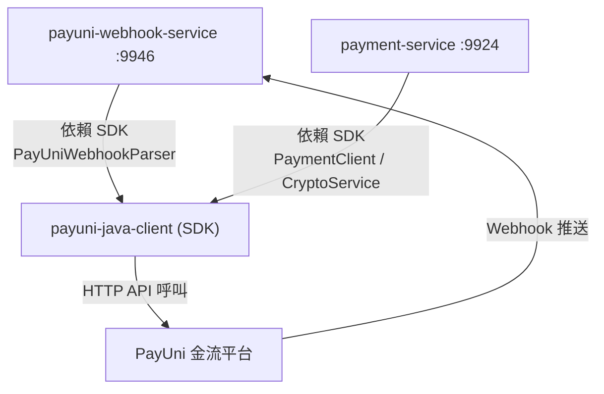
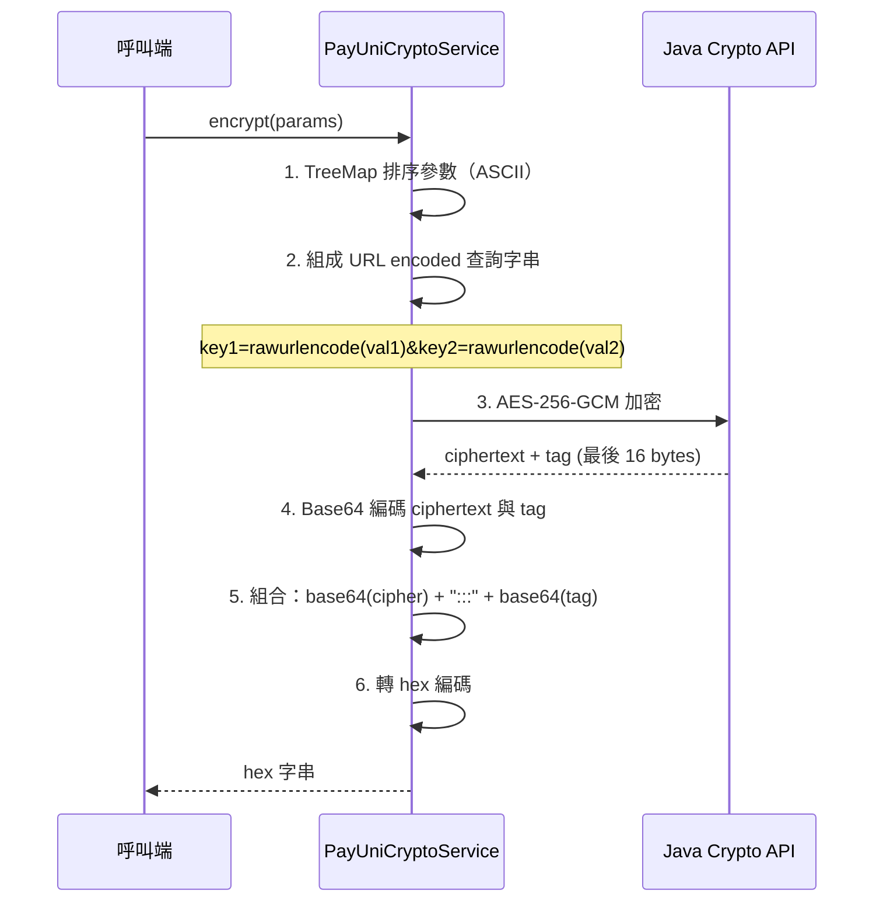
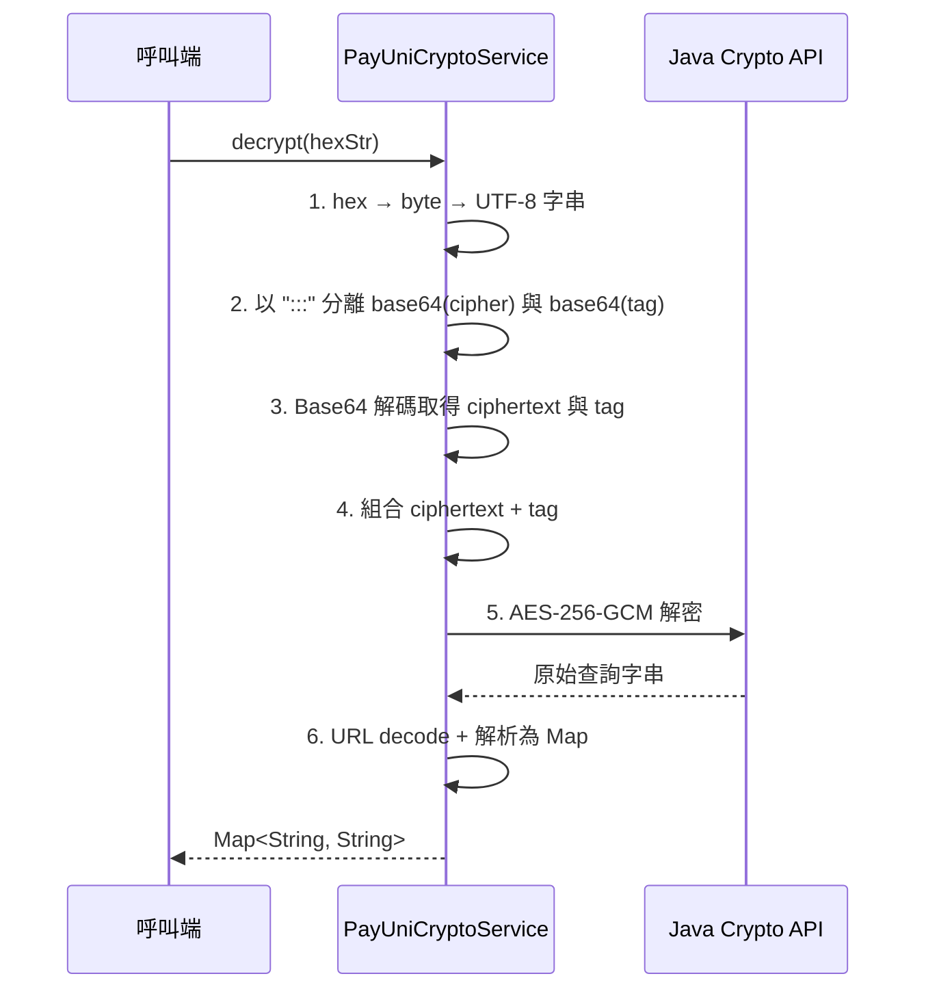
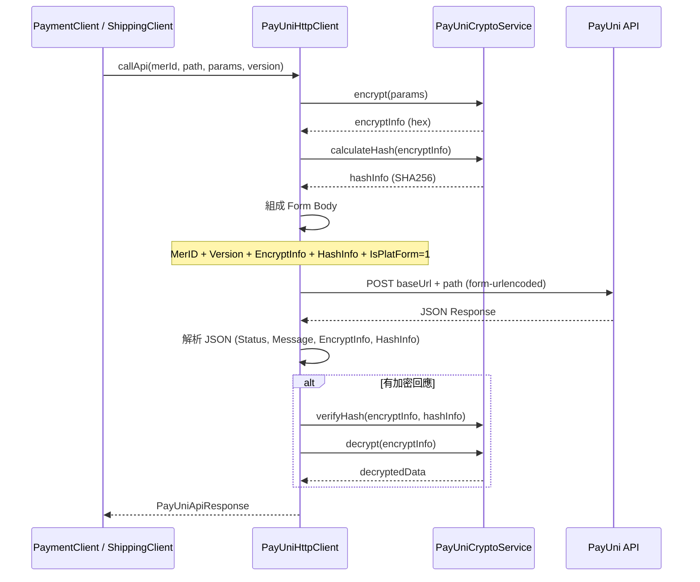
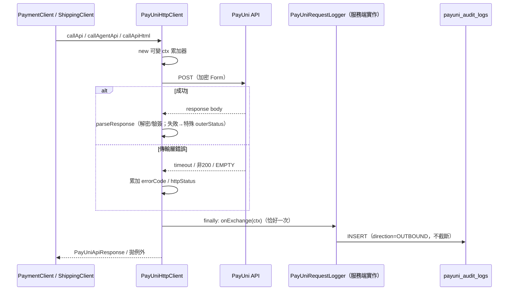
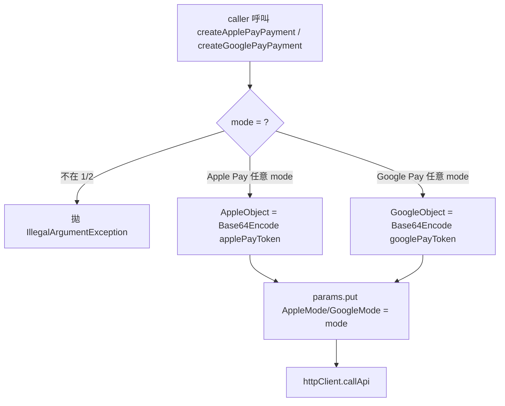
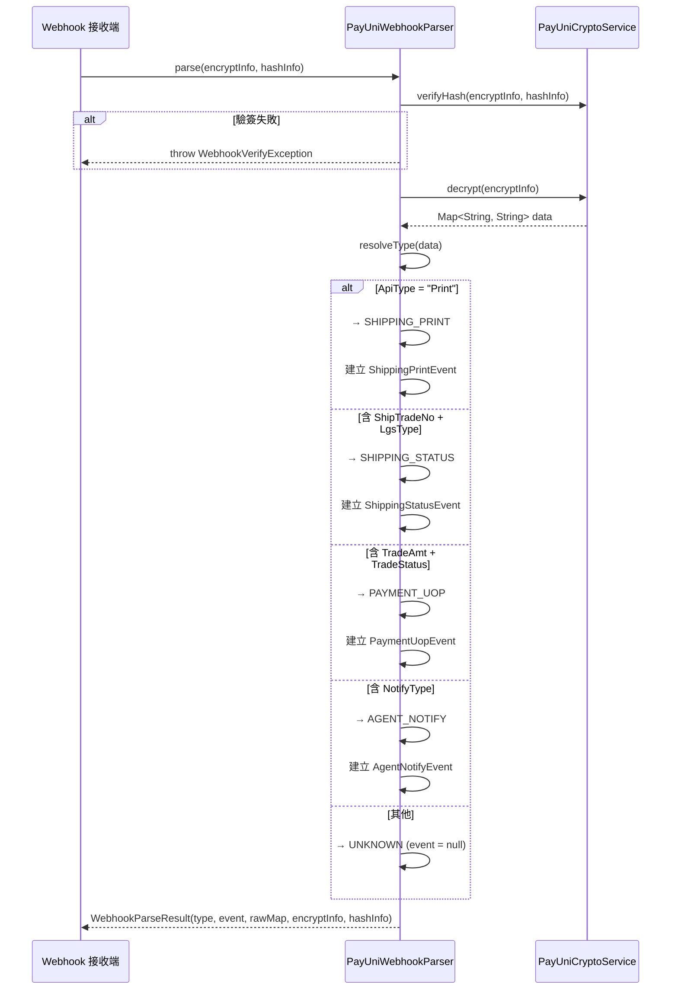

# PayUni Java Client SDK 詳細設計書

---

### **1. 模組概述與責任邊界**

#### **1.1 模組職責**

- 唯一職責：封裝 PayUni 金流平台所有通訊細節，提供型別安全的 Java API
- 核心功能：
    - AES-256-GCM 加密 / 解密 + SHA256 簽章 / 驗簽（與 PayUni PHP 官方範例完全相容）
    - 金流 API（信用卡 UPP、Apple Pay、Google Pay、ATM、交易查詢、退款／取消、ATM 轉匯退款、撥款與撥款查詢、代理商收付；逐項見 §7.1）
    - 物流 API（超商／宅配建單與退貨單、標籤取號與列印、黑貓取件、物流查詢、建店；逐項見 §8.1）
    - Webhook 解析器（自動分類事件類型 + 強型別事件物件；型別與判別條件見 §10.1）
    - 物流 Enum（貨態碼 / 物流商 / 通路 / 溫層 / 服務類型 / 配送時段，見 §9）
    - 代理商模式（IsPlatForm=1）透明支援
- 設計原則：
    - **不依賴 Spring**：純 Java 模組，使用端自行配置 Bean
    - **獨立 Maven 模組**：不加入 `java-common` 的 `<modules>`，需單獨 `mvn install`
    - **OkHttp / Jackson 為 optional 依賴**：僅需 HTTP 呼叫時才引入

#### **1.2 系統定位圖**



> **模組定位**：
> - `payuni-java-client` 為純 SDK 模組，封裝所有 PayUni 通訊協議
> - `payuni-webhook-service` 使用 SDK 的 `PayUniWebhookParser` 進行驗簽/解密/分類
> - `payment-service` 使用 SDK 的 `PaymentClient` 發起金流 API 呼叫

---

### **2. 模組結構**

```
services/java/shared/payuni-java-client/
├── pom.xml
├── src/main/java/io/github/will413028/hawkr/payuni/
│   ├── crypto/                          — 加解密核心
│   │   ├── PayUniCryptoService.java         AES-256-GCM + SHA256
│   │   └── PayUniCryptoException.java       加解密異常
│   ├── http/                            — HTTP 客戶端基礎
│   │   ├── PayUniHttpClient.java            OkHttp 封裝、自動加密/簽章
│   │   ├── PayUniApiResponse.java           API 回應 (Record)
│   │   ├── PayUniApiException.java          API 呼叫異常
│   │   ├── PayUniRequestLogger.java         單一聚合 hook `onExchange`（見 §5.5）
│   │   ├── PayUniExchangeContext.java       一次 exchange 的完整脈絡 (Record)
│   │   ├── PayUniAuditRecord.java           稽核紀錄 (Record)
│   │   ├── PayUniAuditLogRow.java           稽核落庫列 (Record)
│   │   └── PayUniAuditMapper.java           Record → 落庫列轉換
│   ├── model/                           — 共用模型
│   │   ├── MerchantCredential.java          商家金鑰憑證 (Record)
│   │   └── PayUniEnvelope.java              API 信封 (Record)
│   ├── resolver/                        — 金鑰解析介面
│   │   └── MerchantSecretResolver.java      使用端實作
│   ├── payment/                         — 金流 API
│   │   ├── PaymentClient.java               金流客戶端
│   │   ├── PayUniPaymentEndpoint.java       API 路徑/版本常數
│   │   └── model/
│   │       └── UppFormData.java             UPP 表單資料 (Record)
│   ├── shipping/                        — 物流 API
│   │   ├── ShippingClient.java              物流客戶端
│   │   ├── PayUniShippingEndpoint.java      API 路徑/版本常數
│   │   ├── ShipType.java                    物流商（7-ELEVEN / 大嘴鳥）
│   │   ├── LgsType.java                     通路類型（B2C / C2C / HOME / C2B）
│   │   ├── GoodsType.java                   商品溫層（常溫 / 冷凍 / 冷藏）
│   │   ├── ServiceType.java                 服務類型（取貨付款 / 取貨不付款）
│   │   ├── DeliveryTimeTag.java             配送時段
│   │   ├── request/                         請求物件 (Records)
│   │   │   ├── CallTcatRequest.java
│   │   │   ├── CreateCvsShipmentRequest.java
│   │   │   ├── CreateHomeRefundRequest.java
│   │   │   ├── CreateHomeShipmentRequest.java
│   │   │   ├── OnboardCvsRequest.java
│   │   │   ├── OnboardHomeRequest.java
│   │   │   ├── PrintCvsLabelRequest.java
│   │   │   ├── QueryShipmentRequest.java
│   │   │   └── ScheduleHomeLabelRequest.java
│   │   └── response/                        回應物件 (Records)
│   │       ├── CallTcatResponse.java
│   │       ├── CreateCvsShipmentResponse.java
│   │       ├── CreateHomeRefundResponse.java
│   │       ├── CreateHomeShipmentResponse.java
│   │       ├── OnboardShippingResponse.java
│   │       ├── PrintCvsLabelDirectResponse.java
│   │       ├── PrintCvsLabelResponse.java
│   │       ├── QueryShipmentResponse.java
│   │       └── ScheduleHomeLabelResponse.java
│   └── webhook/                         — Webhook 解析
│       ├── PayUniWebhookParser.java         驗簽 + 解密 + 自動分類
│       ├── WebhookType.java                 事件類型 Enum（§10.1）
│       ├── WebhookParseResult.java          解析結果 (Record)
│       ├── WebhookVerifyException.java      驗簽失敗異常
│       └── event/                           強型別事件物件（§10.5）
│           ├── PayUniWebhookEvent.java      Sealed Interface
│           ├── PaymentUopEvent.java
│           ├── ShippingStatusEvent.java
│           ├── ShippingPrintEvent.java
│           ├── AgentNotifyEvent.java
│           ├── RefundNotifyEvent.java
│           └── RefundAcceptedEvent.java
└── src/test/java/io/github/will413028/hawkr/payuni/
    ├── crypto/PayUniCryptoServiceTest.java      Golden Test + 邊界測試
    ├── http/PayUniApiResponseDualFormatTest.java v1.x 頂層 / v2.0 Result[] 雙格式
    ├── payment/PaymentClientRequiredFieldsTest.java 必填欄位不變式
    └── webhook/PayUniWebhookParserTest.java     事件分類測試
```

---

### **3. 依賴與建置**

#### **3.1 pom.xml 關鍵依賴**

| GroupId | ArtifactId | Version | Scope | 說明 |
|---------|-----------|---------|-------|------|
| `org.slf4j` | `slf4j-api` | 2.0.11 | **provided** | 日誌 API（由使用端提供實作） |
| `com.squareup.okhttp3` | `okhttp` | 4.12.0 | **optional** | HTTP 客戶端（僅 PaymentClient / ShippingClient 需要） |
| `com.fasterxml.jackson.core` | `jackson-databind` | 2.16.1 | **optional** | JSON 解析（僅 PayUniHttpClient 需要） |
| `org.junit.jupiter` | `junit-jupiter` | 5.10.1 | test | 單元測試 |
| `org.slf4j` | `slf4j-simple` | 2.0.11 | test | 測試用日誌實作 |

- **Java 版本**：21
- **打包方式**：JAR

#### **3.2 建置方式**

```bash
cd services/java/shared/payuni-java-client
mvn clean install
```

#### **3.3 Dockerfile 整合**

微服務 Dockerfile 需在建置階段先安裝 SDK：

```dockerfile
# 先安裝 SDK 到本地 Maven Repository
COPY services/java/shared/payuni-java-client /app/payuni-java-client
RUN cd /app/payuni-java-client && mvn clean install -DskipTests
```

#### **3.4 微服務整合範例（Spring @Bean）**

```java
@Configuration
public class PayUniConfig {

    @Value("${payuni.agent.key}")
    private String agentKey;

    @Value("${payuni.agent.iv}")
    private String agentIv;

    @Bean
    public PayUniCryptoService payUniCryptoService() {
        return new PayUniCryptoService(agentKey, agentIv);
    }

    @Bean
    public PayUniWebhookParser payUniWebhookParser(PayUniCryptoService cryptoService) {
        return new PayUniWebhookParser(cryptoService);
    }

    @Bean
    public PayUniHttpClient payUniHttpClient(PayUniCryptoService cryptoService) {
        return new PayUniHttpClient(cryptoService, "https://api.payuni.com.tw");
    }

    @Bean
    public PaymentClient paymentClient(PayUniHttpClient httpClient) {
        return new PaymentClient(httpClient, "https://api.payuni.com.tw",
                "https://your-domain.com/webhooks/payuni/payment",
                "https://your-domain.com/payment/return");
    }

    @Bean
    public ShippingClient shippingClient(PayUniHttpClient httpClient) {
        return new ShippingClient(httpClient);
    }
}
```

---

### **4. 加密服務 (Crypto)**

#### **4.1 PayUniCryptoService**

**類別**：`io.github.will413028.hawkr.payuni.crypto.PayUniCryptoService`

加密規格凍結，與 PayUni PHP 官方範例（rawurlencode / AES-256-GCM / SHA256）完全一致。

**建構子**：

```java
public PayUniCryptoService(String merchantKey, String merchantIv)
// merchantKey: 32 字元（AES-256 金鑰）
// merchantIv:  16 字元（GCM 初始向量）
```

**Public API**：

| 方法簽名 | 說明 |
|---------|------|
| `String encrypt(Map<String, String> params)` | 加密請求參數 → hex 字串 |
| `Map<String, String> decrypt(String encryptedStr)` | hex 字串 → 解密後 Key-Value Map |
| `String calculateHash(String encryptStr)` | 計算 SHA256 簽章（大寫 hex） |
| `boolean verifyHash(String encryptStr, String hash)` | 驗證簽章（case-insensitive） |

#### **4.2 加密規格（凍結）**

| 項目 | 規格 |
|------|------|
| 演算法 | AES-256-GCM（Java 標準 Provider） |
| Tag 長度 | 128 bits（16 bytes） |
| TAG_SEPARATOR | `":::"` |
| 輸出格式 | `hex( base64(ciphertext) + ":::" + base64(tag) )` |
| 簽章演算法 | SHA256 |
| 簽章格式 | `SHA256(merKey + encryptStr + merIV).toUpperCase()` |
| URL 編碼 | 相容 PHP `rawurlencode`（特殊處理 `+`, `*`, `~`） |
| 參數排序 | TreeMap 依 ASCII 順序 |

#### **4.3 加密流程**



#### **4.4 解密流程**



#### **4.5 簽章計算**

```
SHA256( merchantKey + encryptStr + merchantIv ) → 大寫 64 字元 hex
```

驗簽時以 case-insensitive 方式比對。

#### **4.6 PayUniCryptoException**

**類別**：`io.github.will413028.hawkr.payuni.crypto.PayUniCryptoException extends RuntimeException`

| 建構子 | 說明 |
|--------|------|
| `PayUniCryptoException(String message)` | 簡單錯誤訊息 |
| `PayUniCryptoException(String message, Throwable cause)` | 含原因鏈 |

**拋出時機**：AES-GCM 加密/解密失敗、hex 轉換失敗、Base64 解碼失敗。

---

### **5. HTTP 客戶端 (http)**

#### **5.1 PayUniHttpClient**

**類別**：`io.github.will413028.hawkr.payuni.http.PayUniHttpClient`

封裝與 PayUni API 的所有 HTTP 通訊，自動處理加密/簽章/驗簽/解密。

**建構子**：

```java
public PayUniHttpClient(PayUniCryptoService cryptoService, String baseUrl)
public PayUniHttpClient(PayUniCryptoService cryptoService, String baseUrl, ObjectMapper objectMapper)
```

**Public API**：

| 方法簽名 | 說明 |
|---------|------|
| `PayUniApiResponse callApi(String merId, String path, Map<String, String> params, String version)` | 呼叫 PayUni API（外層 MerID + IsPlatForm=1，代理商模式）|
| `PayUniApiResponse callAgentApi(String agentId, String path, Map<String, String> params, String version)` | 呼叫 PayUni 代理商級別 API（外層 AgentID 而非 MerID，不帶 IsPlatForm，用於 grant 等）|
| `String callApiHtml(String merId, String path, Map<String, String> params, String version)` | 呼叫 PayUni API 並回傳原始 HTML（用於 print_label 等非 JSON 回應）|
| `PayUniCryptoService getCryptoService()` | 取得加密服務實例 |
| `String getBaseUrl()` | 取得 PayUni base URL |

**OkHttp 配置**：連線 / 讀 / 寫 timeout 皆 30 秒。

#### **5.2 API 呼叫流程**



#### **5.3 PayUniApiResponse (Record)**

```java
public record PayUniApiResponse(
    String status,                        // 回應狀態碼（"SUCCESS" 或錯誤碼）
    String message,                       // 回應訊息
    Map<String, String> decryptedData     // 解密後業務資料（可為 null）
) {
    public boolean isSuccess();           // status.equalsIgnoreCase("SUCCESS")
    public String getData(String key);    // 取得解密資料中的指定欄位（純取值，不做 fallback）

    // ===== 業務 getter（同時支援 v1.x 頂層欄位與 v2.0 Result[0][...] 陣列格式） =====
    public String getTradeStatus();          // TradeStatus（PayUni 交易狀態碼）
    public String getMerTradeNo();           // MerTradeNo（系統交易編號）
    public String getProviderTradeNo();      // TradeNo（PayUni UNi 序號）
    public Long   getTradeAmount();          // TradeAmt（解析為 Long，失敗回 null）
    public String getCloseStatus();          // CloseStatus（信用卡請款狀態，1/2/3/7/9）
    public String getAtmBankCode();          // BankType（ATM 銀行代碼）
    public String getAtmVirtualAccount();    // PayNo（ATM 虛擬帳號）
    public String getAtmExpireDate();        // ExpireDate（ATM 繳費期限）
    public String getErrorMessage();         // 優先讀解密 data 內 Message，無則回外層 message
}
```

> **v1.x / v2.0 雙格式相容**：PayUni 交易查詢 API v2.0 把所有欄位包在 `Result[0][...]` 陣列中，
> 其他 API（建單、Apple Pay、Google Pay、退款、Webhook 等）使用頂層欄位。
> 業務 getter 會優先讀 `Result[0][field]`，若不存在則 fallback 至頂層 `field`，
> 確保同一份 PayUniApiResponse 同時支援兩種回應格式。

#### **5.4 PayUniApiException**

**類別**：`io.github.will413028.hawkr.payuni.http.PayUniApiException extends RuntimeException`

| 欄位 | 型別 | 說明 |
|------|------|------|
| `errorCode` | `String` | 錯誤碼 |
| `httpStatus` | `int` | HTTP 狀態碼（IO 錯誤時為 0） |

| 建構子 | 說明 |
|--------|------|
| `PayUniApiException(String errorCode, String message, int httpStatus)` | API 回應錯誤 |
| `PayUniApiException(String message, Throwable cause)` | IO 錯誤（errorCode = "IO_ERROR"） |

#### **5.5 PayUniRequestLogger 稽核 hook（onExchange）**

**類別**：`io.github.will413028.hawkr.payuni.http.PayUniRequestLogger`

金流爭議稽核需要「我方送了什麼、PayUni 回了什麼、耗時多久、驗簽/解密是否通過」的完整落庫（落庫設計見 [05 §11](./05-支付服務（Payment%20Service）詳細設計書.md#11-payuni-互動-audit-loggingpayuni_audit_logs)、[06 §10](./06-物流微服務（Shipping%20Service）詳細設計書.md#10-payuni-互動-audit-loggingpayuni_audit_logs)）。本 client 只負責在**每次 exchange 結束時觸發一次 hook**，不負責 DB。

**介面（單一聚合 hook）**：

```java
public interface PayUniRequestLogger {
    PayUniRequestLogger NOOP = ctx -> { };   // 預設 no-op，無注入時不影響行為

    /** 一次 PayUni exchange（含成功/各類失敗）恰好觸發一次 */
    void onExchange(PayUniExchangeContext ctx);
}
```

**`PayUniExchangeContext`（聚合 record，client → 實作者）**：

| 欄位 | 說明 |
|------|------|
| `merId` | 外層 MerID / AgentID |
| `path` | API 路徑（如 `/api/trade/grant`） |
| `requestParams` | 加密前業務參數（明文；憑證欄位由**落庫端**遮罩） |
| `rawResponseBody` | 原始回應 body 全文（JSON 或 HTML；不截斷） |
| `outerStatus` | 外層 `Status`；parse/decrypt/hash 失敗記 `PARSE_ERROR` / `HASH_INVALID` |
| `outerMessage` | 外層 `Message` |
| `decryptedPayload` | 解密後內層 `Map`（PayUni 原生 PascalCase key；可為 null） |
| `errorCode` | 傳輸層錯誤碼（IOException / 非 200 / EMPTY response） |
| `errorMessage` | 傳輸層錯誤訊息 |
| `httpStatus` | HTTP 狀態碼（IO 錯誤時 0） |
| `durationMs` | 呼叫耗時 |

**觸發語意（三入口分列，恰好一次）**：

| 入口 | 觸發點 |
|------|--------|
| `callApi` / `callAgentApi` | `parseResponse`（解密/驗簽）**之後**觸發 |
| `callApiHtml` | body 讀取後觸發（無 parseResponse） |
| 所有錯誤路徑 | timeout / 非 200 / body null / parse/decrypt/hash 失敗亦觸發 |

實作採「**可變 context 累加器 + `finally` 單次觸發**」保證每次 exchange 恰好一次 `onExchange`，成功與各類失敗路徑皆不遺漏、不重複。極端情況（process hard-kill / OOM 於呼叫進行中）該筆 exchange 不落庫——請求參數仍有 Loki log 留痕。**不得為此加入持久化前置寫入。**

**parse/decrypt/hash 失敗語意**：`parseResponse` 吞例外回特殊 status（`PARSE_ERROR` / `HASH_INVALID`，不拋、不走 error 路徑），於 `finally` 統一觸發，raw body ＋ 特殊 `outerStatus` 一併帶給 hook。`onExchange` **必須在 `parseResponse` 之後觸發**，否則 `decryptedPayload` 拿不到解密後內層、稽核缺一半。

**設計原則（邊界不變）**：
- 共用模組 `payuni-java-client` **不依賴任何服務的 DB layer**，不內建 JDBC writer；只觸發 hook。
- 提供**純函式 helper**：`PayUniExchangeContext` → 中性欄位 record（含憑證遮罩規則），供各服務 logger 直接映射落庫；各服務 logger 為 persist-only thin 實作。
- UPP 信用卡為瀏覽器 Form POST，**不經本 client**，卡號機敏從不進入本 hook（PCI 正確）。



**注入**：服務端 `PayUniConfig` 建 `PayUniHttpClient` 後 `client.setRequestLogger(auditLogger)`（payment 見 05 §11.4，shipping 見 06 §10）。

---

### **6. 共用模型 (model) 與解析器 (resolver)**

#### **6.1 MerchantCredential (Record)**

```java
public record MerchantCredential(
    String hashKey,    // AES-256 金鑰（必須 32 字元）
    String hashIv      // GCM 初始向量（必須 16 字元）
)
```

Compact Constructor 驗證長度，不符合拋出 `IllegalArgumentException`。

#### **6.2 PayUniEnvelope (Record)**

```java
public record PayUniEnvelope(
    String merId,         // 商家編號
    String version,       // API 版本
    String encryptInfo,   // 加密後業務資料
    String hashInfo       // SHA256 簽章
)
```

#### **6.3 MerchantSecretResolver (Interface)**

```java
public interface MerchantSecretResolver {
    MerchantCredential resolve(String merId);
}
```

- 由使用端（微服務）實作
- 代理商模式：所有子商家共用同一組代理商 Key / IV
- 多商家模式：依 `merId` 查詢對應的獨立金鑰

---

### **7. 金流 API (Payment)**

#### **7.1 PaymentClient**

**類別**：`io.github.will413028.hawkr.payuni.payment.PaymentClient`

**建構子**：

```java
public PaymentClient(
    PayUniHttpClient httpClient,
    String baseUrl,      // PayUni API 基礎 URL
    String notifyUrl,    // Webhook 通知 URL
    String returnUrl     // 前端返回 URL
)
```

**Public API**：

| # | 方法簽名 | PayUni API | 版本 | 說明 |
|---|---------|-----------|------|------|
| 1 | `UppFormData createCreditCardPayment(String merId, String tradeNo, long amount, String productName, String accountId)` | `/api/upp` | v2.0 | 信用卡整合支付頁（回傳前端 Form Data）。**必帶 `TradeLExpireSec=600`**（信用卡頁面 600 秒過期，與我方 `expire_at` 同步，見 §14） |
| 2 | `PayUniApiResponse createApplePayPayment(String merId, String tradeNo, long amount, String productName, String userEmail, String applePayToken, String mode)` | `/api/apple` | v1.3 | Apple Pay。`mode="1"`=OnWeb / `"2"`=InApp。AppleObject 編碼規則見 §7.4 |
| 3 | `PayUniApiResponse createGooglePayPayment(String merId, String tradeNo, long amount, String productName, String userEmail, String googlePayToken, String mode)` | `/api/google` | v1.3 | Google Pay。`mode="1"`=OnWeb / `"2"`=InApp。GoogleObject 統一 Base64Encode，見 §7.4 |
| 4 | `PayUniApiResponse createAtmPayment(String merId, String tradeNo, long amount, String productName, String userEmail, int expireDays, String bankType)` | `/api/atm` | v1.3 | ATM 虛擬帳號 |
| 5 | `PayUniApiResponse queryTransaction(String merId, String tradeNo)` | `/api/trade/query` | v2.0 | 交易查詢（依 MerTradeNo），EncryptInfo 內層必填 MerID + Timestamp + MerTradeNo |
| 5b | **`PayUniApiResponse queryTransactionByProviderTradeNo(String merId, String providerTradeNo)`** | `/api/trade/query` | v2.0 | **交易查詢（依 PayUni UNi 序號），用於信用卡退款前查詢 CloseStatus** |
| 6 | `PayUniApiResponse refund(String merId, String providerTradeNo, String refundNo, long amount)` | `/api/trade/close` | v1.0 | 退款（CloseType=2），`providerTradeNo` = PayUni UNi序號 |
| 7 | `PayUniApiResponse cancelAuthorization(String merId, String providerTradeNo)` | `/api/trade/cancel` | v1.0 | 取消信用卡授權（已授權未請款），CloseStatus=1 時使用。不需金額參數（整筆授權取消） |
| 8 | `UppFormData offlineRefundPage(String merId, String providerTradeNo, long amount, String returnUrl)` | `/api/offline_payment/refund` | v1.0 | ATM 退款頁面版：回傳加密參數供前端 WebView 開啟 PayUni 頁面 |
| 9 | `PayUniApiResponse offlineRefund(String merId, String providerTradeNo, long amount, String bankCode, String bankSubCode, String bankAccountNo, String uid)` | `/api/trade/offline/refund` | v1.0 | ATM 退款轉匯（API 版，需後端提供買家銀行資訊） |
| 10 | `PayUniApiResponse cancelOfflineRefund(String merId, String providerTradeNo)` | `/api/trade/offline/cancel_refund` | v1.0 | 取消 ATM 退款轉匯（僅限發動退款當日可取消） |
| 11 | **`PayUniApiResponse grant(String agentId, String merId, String providerTradeNo, long amount)`** | `/api/trade/grant` | v1.0 | **代理商發動撥款指示。與其他 API 不同，外層使用 AgentID 而非 MerID，不帶 IsPlatForm（透過 PayUniHttpClient.callAgentApi 呼叫）** |
| 12 | `PayUniApiResponse grantQuery(String merId, String queryDate, int page)` | `/api/trade/grant_query` | v1.0 | 撥款入帳明細查詢。外層用 **MerID + IsPlatForm=1**（走 `callApi`），與 `grant` 的 AgentID 外層不同。`queryDate` 為 `YYYY-MM-DD`（PayUni 台北時區日曆日，限查 30 天內）；每頁固定 500 筆，`page` 從 1 起。回傳 `Result[]`（`TradeNo` / `ExecuteAmt` / `FundsAmt` / `Type`）＋ `PageInfo`（`Current` / `Total`） |
| 13 | `PayUniApiResponse agentFee(String agentId, String merId, String tradeNo, long amount, String feeType, String balType, String agentMerId)` | `/api/agent/agent_fee` | v1.0 | 代理商多功能收付（向賣家收費／退還）。`feeType` 物流＝4；`balType` 1＝正向（向賣家收）、2＝負向（退還賣家）；`agentMerId` 為 null／空白時依平台預設。🔴 `amount` 是**實際要送出的 gross**，gross-up 由呼叫端先做完 |
| 14 | `PayUniApiResponse agentFeeQuery(String agentId, String merId, String tradeNo, long amount)` | `/api/agent/agent_fee_query` | v1.0 | 多功能收付交易查詢。查詢 key 是 **(MerID, TradeNo, Amt)** 三元組 ⇒ `amount` 必須是當初送出的那個 gross，帶錯金額查不到。「查不到」與「尚未撥款」可分辨：前者無此筆、後者 `FundDate='0000-00-00'`，呼叫端要分開處置。🔴 回傳的 `Fee` 是**實際手續費**，是「平台到底收到多少」的唯一來源，**不得用預估值冒充** |
| 15 | `Map<String, String> parseWebhook(String encryptInfo, String hashInfo)` | — | — | Webhook 解析（驗簽失敗回傳 null） |

> **所有 API（除 grant 外）自動以代理商模式呼叫**（IsPlatForm=1）。
> **grant API 走 callAgentApi**：外層 AgentID 代替 MerID，不帶 IsPlatForm（PayUni 代理商級別 API 規範）。
>
> **PayUniApiResponse 業務 getter**（同時支援 v1.x 頂層欄位與 v2.0 `Result[0][...]` 陣列格式）：`getTradeStatus()`、`getMerTradeNo()`、`getProviderTradeNo()`、`getTradeAmount()`、`getCloseStatus()`、`getAtmBankCode()`、`getAtmVirtualAccount()`、`getAtmExpireDate()`、`getErrorMessage()`。

#### **7.2 UppFormData (Record)**

**類別**：`io.github.will413028.hawkr.payuni.payment.model.UppFormData`

```java
public record UppFormData(
    String actionUrl,     // PAYUNi UPP API URL（baseUrl + "/api/upp"）
    String merId,         // MerID（子商家代號）
    String version,       // 固定 "2.0"
    String encryptInfo,   // AES 加密字串
    String hashInfo,      // SHA256 簽章
    String isPlatform     // 固定 "1"（代理商模式）
) {
    public static UppFormData forPlatform(String baseUrl, String merId,
                                          String encryptInfo, String hashInfo);
}
```

> **前端使用方式**：將 `UppFormData` 各欄位組成 HTML Form，POST 至 `actionUrl`，重導至 PayUni 支付頁面。

#### **7.3 PayUniPaymentEndpoint（常數類）**

| 常數 | 值 | 說明 |
|------|-----|------|
| `PATH_UPP` | `/api/upp` | UPP 整合式支付頁 |
| `VERSION_UPP` | `2.0` | UPP 版本 |
| `PATH_ATM` | `/api/atm` | ATM 虛擬帳號 |
| `VERSION_ATM` | `1.3` | ATM 版本 |
| `PATH_APPLE_PAY` | `/api/apple` | Apple Pay |
| `VERSION_APPLE_PAY` | `1.3` | Apple Pay 版本 |
| `PATH_GOOGLE_PAY` | `/api/google` | Google Pay |
| `VERSION_GOOGLE_PAY` | `1.3` | Google Pay 版本 |
| `PATH_QUERY` | `/api/trade/query` | 交易查詢（依 PayUni 逆向金流 API §2.2） |
| `VERSION_QUERY` | `2.0` | 查詢版本 |
| `PATH_TRADE_CANCEL` | `/api/trade/cancel` | 取消信用卡授權 |
| `VERSION_TRADE_CANCEL` | `1.0` | 取消授權版本 |
| `PATH_TRADE_CLOSE` | `/api/trade/close` | 退款（關帳） |
| `VERSION_TRADE_CLOSE` | `1.0` | 退款版本 |
| `PATH_OFFLINE_REFUND` | `/api/trade/offline/refund` | ATM 退款轉匯（API 版） |
| `VERSION_OFFLINE_REFUND` | `1.0` | ATM 退款轉匯版本 |
| `PATH_OFFLINE_CANCEL_REFUND` | `/api/trade/offline/cancel_refund` | 取消 ATM 退款轉匯 |
| `VERSION_OFFLINE_CANCEL_REFUND` | `1.0` | 取消 ATM 退款轉匯版本 |
| `PATH_OFFLINE_REFUND_PAGE` | `/api/offline_payment/refund` | ATM 退款頁面版 |
| `VERSION_OFFLINE_REFUND_PAGE` | `1.0` | ATM 退款頁面版版本 |
| `PATH_GRANT` | `/api/trade/grant` | 撥款指示（代理商級別） |
| `VERSION_GRANT` | `1.0` | 撥款指示版本 |

#### **7.4 Apple Pay / Google Pay Mode 與 Token 編碼規則**

> **來源**：PayUni 金流官方 API 總覽 §4.6（AppleObject）、§5.6（GoogleObject）

PayUni 對 Apple Pay 與 Google Pay 的 token 編碼**統一為 Base64Encode**，`mode` 參數僅作為 PayUni 端的來源標記（OnWeb / InApp），**不影響編碼方式**。client 內部負責編碼，caller 永遠傳入「原始 paymentData JSON 字串」，不需理解 PayUni 編碼細節。

##### 7.4.1 編碼規則表

| 付款方式 | mode | 對應 PayUni 參數 | XxxObject 內容 | client 內部處理 |
|---------|------|-----------------|---------------|-----------------|
| Apple Pay | `"1"` (OnWeb) | `AppleMode=1` | **Base64Encode 後**放入 | client 以 `Base64.getEncoder().encodeToString(applePayToken.getBytes(UTF_8))` 編碼後放入 `AppleObject` |
| Apple Pay | `"2"` (InApp) | `AppleMode=2` | **Base64Encode 後**放入 | 同上 |
| Google Pay | `"1"` (OnWeb) | `GoogleMode=1` | **Base64Encode 後**放入 | client 以同上方式編碼後放入 `GoogleObject` |
| Google Pay | `"2"` (InApp) | `GoogleMode=2` | **Base64Encode 後**放入 | 同上 |

##### 7.4.1.1 官方文件的字面陷阱（不要照字面改回去）

🔴 PayUni 官方文件 §4.6 字面寫「OnWeb 原樣放、不 base64」，**該句不適用於本 client 的 caller 契約**。
`AppleObject` / `GoogleObject` **一律為 `Base64Encode(paymentData JSON)`**，OnWeb 與 InApp 相同。

官方那句「不 base64」的實際語意是：不要在「caller 已 base64 過的 `paymentTokenObject` 字串」上
再疊一層，而不是說 `AppleObject` 是純 JSON。佐證在官方範例自身——
`paymentTokenObject` 的 value 開頭 `eyJk`，Base64 解碼後即為 paymentData JSON。

**送出未經 Base64Encode 的原始 JSON，PayUni 會回 `APPLE01009 送入參數 Decode 失敗`。**

##### 7.4.2 caller 契約

| 項目 | 規則 |
|------|------|
| `applePayToken` | 永遠傳入 **`JSON.stringify(token.paymentData)` 的結果**（只含 `data` / `signature` / `header` / `version`，**不**含 `paymentMethod` / `transactionIdentifier`） |
| `googlePayToken` | 永遠傳入 Google Pay token JSON 字串（pay JS / pay 套件回傳的 `tokenizationData.token`） |
| `mode` | `"1"`=OnWeb（web browser）/ `"2"`=InApp（mobile native app）。**不允許**其他值 |
| 違規處理 | 傳入 `mode` 不是 `"1"` 或 `"2"` → 抛 `IllegalArgumentException`（fail fast） |

##### 7.4.3 流程圖



---

### **8. 物流 API (Shipping)**

#### **8.1 ShippingClient**

**類別**：`io.github.will413028.hawkr.payuni.shipping.ShippingClient`

**建構子**：

```java
public ShippingClient(PayUniHttpClient httpClient)
public ShippingClient(PayUniHttpClient httpClient, String notifyUrl)
```

`notifyUrl` 為物流 webhook 回調位址；不帶時由呼叫端自行在 request 內指定。

**Public API**：

| # | 方法簽名 | PayUni API | 版本 | 說明 |
|---|---------|-----------|------|------|
| 1 | `CreateCvsShipmentResponse createCvsShipment(String merId, CreateCvsShipmentRequest req)` | `/api/logistics/trade` | v1.3 | 超商物流單建立 |
| 2 | `CreateHomeShipmentResponse createHomeShipment(String merId, CreateHomeShipmentRequest req)` | `/api/home_delivery/trade` | v1.2 | 宅配單建立（背景） |
| 3 | `CreateHomeRefundResponse createHomeRefund(String merId, CreateHomeRefundRequest req)` | `/api/home_delivery/refund` | v1.0 | 宅配退貨單建立（黑貓退貨）。黑貓司機於 `ShipDate` 至退貨人地址收件 |
| 4 | `ScheduleHomeLabelResponse scheduleHomeLabel(String merId, ScheduleHomeLabelRequest req)` | `/api/home_delivery/get_obt_number_pdf` | v1.0 | 預約宅配取號（PDF 標籤） |
| 5 | `String scheduleHomeLabelHtml(String merId, ScheduleHomeLabelRequest req)` | 同上 | v1.0 | 同一支 API 的 **HTML 回傳版**（PayUni 實際回的是 HTML form 不是 JSON）。二階段 PDF 下載用：先取 form 參數，再 POST `cat_file_download` 取 PDF |
| 6 | `PrintCvsLabelDirectResponse printCvsLabel(String merId, PrintCvsLabelRequest req)` | `/api/logistics/print_label` | v1.0 | 超商出貨單列印（後端代理模式）。PayUni 回 HTML：成功含 ``，處理中含 `window.alert("...LAB02022")`。無法解析圖片 URL 或回處理中 ⇒ 拋 `PayUniApiException` |
| 7 | `void triggerCvsPrint(String merId, PrintCvsLabelRequest req)` | 同上 | v1.0 | 同一支 API 的**僅觸發**版（不解析圖片 URL）。出貨便代碼由 Webhook（`ApiType=Print`）逐筆回填。`ShipTradeNo` 可逗號分隔多筆，**最多 50 筆且需相同 `GoodsType`／`LgsType`／`ShipType`** |
| 8 | `CallTcatResponse callTcat(String merId, CallTcatRequest req)` | `/api/home_delivery/call_cat` | v1.0 | 黑貓預約取件 |
| 9 | `QueryShipmentResponse queryShipment(String merId, QueryShipmentRequest req)` | `/api/logistics/query` | v1.1 | 物流單查詢 |
| 10 | `OnboardShippingResponse onboardCvsShipping(String merId, OnboardCvsRequest req)` | `/api/logistics/setting` | v1.0 | 超商 C2C 建店 |
| 11 | `OnboardShippingResponse onboardHomeDelivery(String merId, OnboardHomeRequest req)` | `/api/home_delivery/setting` | v1.0 | 宅配建店 |

> 門市地圖 `/api/logistics/ship_map`（v1.1）與 PDF 下載 `cat_file_download` 的 path 常數
> 同樣定義在 `PayUniShippingEndpoint`，由呼叫端直接組表單，不經上表方法。

> **PayUni 物流欄位長度約束**（收件人姓名 / 地址 / 商品名稱）：常數集中於 common-core 的 `PayUniShippingConstraints`（**非本模組** — payuni-java-client 未被 order-service 依賴，故置於兩端共用的 common-core），計長驗證/截斷邏輯由 common-core `InputValidator` 提供。完整約束值與套用點見 [26-輸入驗證模組 §2.3 R10/R11 + §3.1/§3.3](../詳細設計書/26-輸入驗證模組（Java%20InputValidator）詳細設計書.md)。

#### **8.2 請求物件（Request Records）**

**CreateCvsShipmentRequest**：

| 欄位 | 型別 | 說明 |
|------|------|------|
| `merTradeNo` | `String` | 商店訂單編號 |
| `shipType` | `String` | 物流商類型（1=7-ELEVEN, 2=大嘴鳥） |
| `lgsType` | `String` | 通路類型（B2C / C2C） |
| `goodsType` | `String` | 商品溫層（1=常溫, 2=冷凍, 3=冷藏） |
| `serviceType` | `String` | 服務類型（1=取貨付款, 3=取貨不付款） |
| `senderName` | `String` | 寄件人姓名 |
| `senderPhone` | `String` | 寄件人電話 |
| `receiverName` | `String` | 收件人姓名 |
| `receiverPhone` | `String` | 收件人電話 |
| `storeId` | `String` | 門市代號 |
| `tradeAmt` | `String` | 交易金額 |
| `goodsName` | `String` | 商品名稱 |

**CreateHomeShipmentRequest**：

| 欄位 | 型別 | 說明 |
|------|------|------|
| `merTradeNo` | `String` | 商店訂單編號 |
| `goodsType` | `String` | 商品溫層 |
| `senderName` | `String` | 寄件人姓名 |
| `senderPhone` | `String` | 寄件人電話 |
| `senderZipCode` | `String` | 寄件人郵遞區號 |
| `senderAddress` | `String` | 寄件人地址 |
| `receiverName` | `String` | 收件人姓名 |
| `receiverPhone` | `String` | 收件人電話 |
| `receiverZipCode` | `String` | 收件人郵遞區號 |
| `receiverAddress` | `String` | 收件人地址 |
| `deliveryTimeTag` | `String` | 配送時段標記 |
| `tradeAmt` | `String` | 交易金額 |
| `goodsName` | `String` | 商品名稱 |

**QueryShipmentRequest**：

| 欄位 | 型別 | 說明 |
|------|------|------|
| `shipTradeNo` | `String` | 物流交易編號（與 merTradeNo 擇一） |
| `merTradeNo` | `String` | 商店訂單編號（與 shipTradeNo 擇一） |

**ScheduleHomeLabelRequest**：

| 欄位 | 型別 | 說明 |
|------|------|------|
| `shipTradeNo` | `String` | 物流交易編號 |

**CreateHomeRefundRequest**（宅配退貨單）：

| 欄位 | 型別 | 說明 |
|------|------|------|
| `merTradeNo` | `String` | 商店訂單編號 |
| `shipTradeNo` | `String` | 原出貨的物流交易編號 |
| `goodsType` | `String` | 商品溫層 |
| `consigneeName` / `consigneePhone` / `consigneeAddress` | `String` | 收件方（退貨目的地＝賣家） |
| `consignorName` / `consignorPhone` / `consignorAddress` | `String` | 寄件方（退貨發起＝買家） |
| `deliveryTimeTag` | `String` | 配送時段標記 |
| `spec` | `String` | 包裹規格 |
| `shipDate` | `String` | 黑貓司機到府收件日 |
| `goodsName` | `String` | 商品名稱 |
| `memo` | `String` | 備註 |

**PrintCvsLabelRequest**（超商出貨單列印）：

| 欄位 | 型別 | 說明 |
|------|------|------|
| `shipTradeNo` | `String` | 物流交易編號；`triggerCvsPrint` 可逗號分隔多筆（上限 50，須同 `goodsType`／`lgsType`／`shipType`） |
| `goodsType` | `String` | 商品溫層 |
| `lgsType` | `String` | 通路類型 |
| `shipType` | `String` | 物流商類型 |
| `shipDate` | `String` | 出貨日 |

**CallTcatRequest**（黑貓預約取件）：

| 欄位 | 型別 | 說明 |
|------|------|------|
| `contactName` / `contactMobile` / `contactAddress` | `String` | 取件聯絡人與地址 |
| `normalQuantity` / `coldQuantity` / `freezeQuantity` | `String` | 常溫／冷藏／冷凍件數 |
| `isContact` | `String` | 是否需先電話聯繫 |
| `isTrolley` | `String` | 是否需推車 |
| `memo` | `String` | 備註 |

**OnboardCvsRequest**（超商 C2C 建店）：

| 欄位 | 型別 | 說明 |
|------|------|------|
| `goodsType` | `String` | 1=常溫, 2=冷凍 |
| `lgsType` | `String` | `C2C` |
| `shipType` | `String` | `1`（7-ELEVEN） |
| `labelCompanyName` | `String` | 標籤上顯示的商店名稱 |
| `contactName` / `contactTel` / `contactMail` | `String` | 聯絡人資料 |
| `storeId` | `String` | 退貨門市代碼 |
| `notifyUrl` | `String` | Webhook 回調位址 |

**OnboardHomeRequest**（宅配建店）：

| 欄位 | 型別 | 說明 |
|------|------|------|
| `lgsType` | `String` | `HOME` |
| `shipType` | `String` | `2`（黑貓） |
| `senderName` / `senderMobile` / `senderAddress` | `String` | 寄件人資料 |
| `productTypeId` | `String` | 商品類別代號 |
| `notifyUrl` | `String` | Webhook 回調位址 |

#### **8.3 回應物件（Response Records）**

所有 Response 均提供 `static from(PayUniApiResponse)` 工廠方法與 `boolean isSuccess()` 便利方法。

**CreateCvsShipmentResponse**：

| 欄位 | 型別 | 說明 |
|------|------|------|
| `apiResponse` | `PayUniApiResponse` | 原始 API 回應 |
| `shipTradeNo` | `String` | 物流交易編號 |
| `shipStatus` | `String` | 物流狀態碼 |

**CreateHomeShipmentResponse**：

| 欄位 | 型別 | 說明 |
|------|------|------|
| `apiResponse` | `PayUniApiResponse` | 原始 API 回應 |
| `shipTradeNo` | `String` | 物流交易編號 |
| `shipStatus` | `String` | 物流狀態碼 |

**QueryShipmentResponse**：

| 欄位 | 型別 | 說明 |
|------|------|------|
| `apiResponse` | `PayUniApiResponse` | 原始 API 回應 |
| `shipTradeNo` | `String` | 物流交易編號 |
| `shipStatus` | `String` | 物流狀態碼 |
| `shipStatusTime` | `String` | 狀態變更時間 |
| `merTradeNo` | `String` | 商店訂單編號 |

**ScheduleHomeLabelResponse**：

| 欄位 | 型別 | 說明 |
|------|------|------|
| `apiResponse` | `PayUniApiResponse` | 原始 API 回應 |
| `labelUrl` | `String` | 標籤下載 URL |
| `shipTradeNo` | `String` | 物流交易編號 |

**CreateHomeRefundResponse**：

| 欄位 | 型別 | 說明 |
|------|------|------|
| `apiResponse` | `PayUniApiResponse` | 原始 API 回應 |
| `shipTradeNo` | `String` | 退貨單的物流交易編號 |
| `obtNumber` | `String` | 託運單號 |
| `merTradeNo` | `String` | 商店訂單編號 |

**PrintCvsLabelDirectResponse**：

| 欄位 | 型別 | 說明 |
|------|------|------|
| `imageUrl` | `String` | 自 PayUni HTML 解析出的標籤圖片 URL |

**PrintCvsLabelResponse**（表單轉交模式，供前端自行 POST）：

| 欄位 | 型別 | 說明 |
|------|------|------|
| `apiResponse` | `PayUniApiResponse` | 原始 API 回應 |
| `formActionUrl` | `String` | 表單送出位址 |
| `encryptInfo` / `hashInfo` | `String` | 加密參數與簽章 |

**CallTcatResponse**：

| 欄位 | 型別 | 說明 |
|------|------|------|
| `apiResponse` | `PayUniApiResponse` | 原始 API 回應 |
| `callTime` | `String` | 預約取件時間 |

**OnboardShippingResponse**（超商與宅配建店共用）：

| 欄位 | 型別 | 說明 |
|------|------|------|
| `apiResponse` | `PayUniApiResponse` | 原始 API 回應 |
| `partnerId` | `String` | PayUni 配發的合作夥伴識別 |
| `eshipId` | `String` | 物流商配發的店號 |
| `setStatus` | `String` | 建店狀態碼 |

#### **8.4 PayUniShippingEndpoint（常數類）**

| 常數 | 值 | 版本常數 | 說明 |
|------|-----|---|------|
| `PATH_CVS_SHIPMENT` | `/api/logistics/trade` | `1.3` | 超商物流單建立 |
| `PATH_HOME_SHIPMENT` | `/api/home_delivery/trade` | `1.2` | 宅配單建立（背景） |
| `PATH_HOME_LABEL` | `/api/home_delivery/get_obt_number_pdf` | `1.0` | 預約宅配取號 |
| `PATH_PRINT_CVS_LABEL` | `/api/logistics/print_label` | `1.0` | 超商出貨單列印 |
| `PATH_CALL_TCAT` | `/api/home_delivery/call_cat` | `1.0` | 黑貓預約取件 |
| `PATH_QUERY_SHIPMENT` | `/api/logistics/query` | `1.1` | 物流單查詢 |
| `PATH_CVS_ONBOARD` | `/api/logistics/setting` | `1.0` | 超商 C2C 建店 |
| `PATH_HOME_ONBOARD` | `/api/home_delivery/setting` | `1.0` | 宅配建店 |
| `PATH_STORE_MAP` | `/api/logistics/ship_map` | `1.1` | 門市地圖 |
| `PATH_HOME_REFUND` | `/api/home_delivery/refund` | `1.0` | 宅配退貨單建立 |
| `PATH_CAT_FILE_DOWNLOAD` | `cat_file_download` | — | 二階段 PDF 下載（相對路徑，非 `/api/` 前綴） |

每個 `PATH_*` 都有對應的 `VERSION_*` 常數，值如上表第三欄。

---

### **9. 物流 Enum 定義**

#### **9.1 ShipType（物流商）**

| Enum 值 | Code | 說明 |
|---------|------|------|
| `SEVEN` | `"1"` | 7-ELEVEN |
| `TAQBIN` | `"2"` | 黑貓宅急便 |

#### **9.2 LgsType（通路類型）**

| Enum 值 | Code | 說明 |
|---------|------|------|
| `B2C` | `"B2C"` | 超商取貨（店到店） |
| `C2C` | `"C2C"` | 超商寄件（消費者到店） |
| `HOME` | `"HOME"` | 宅配到府 |
| `C2B` | `"C2B"` | 超商退貨（消費者到店退） |

#### **9.3 GoodsType（商品溫層）**

| Enum 值 | Code | 說明 |
|---------|------|------|
| `NORMAL` | `"1"` | 常溫 |
| `FROZEN` | `"2"` | 冷凍 |
| `REFRIGERATED` | `"3"` | 冷藏 |

#### **9.4 ServiceType（服務類型）**

| Enum 值 | Code | 說明 |
|---------|------|------|
| `CASH_ON_DELIVERY` | `"1"` | 取貨付款 |
| `NO_CASH_ON_DELIVERY` | `"3"` | 取貨不付款 |

#### **9.5 DeliveryTimeTag（配送時段）**

| Enum 值 | Code | 說明 |
|---------|------|------|
| `BEFORE_13` | `"01"` | 13 時前 |
| `AFTERNOON` | `"02"` | 14-18 時 |
| `ANY` | `"04"` | 不指定 |

---

### **10. Webhook 解析器**

#### **10.1 WebhookType (Enum)**

| Enum 值 | 判別條件（依序比對，先命中者勝） | 說明 |
|---------|---|------|
| `REFUND_NOTIFY` | payload 含 `RefundStatus` | 退款結果通知（ATM async webhook，含 `RefundStatus` / `BankDate`；匯款完成／失敗）。🔴 **必須先於 `PAYMENT_UOP` 判斷**——退款 webhook 同樣帶外層 `TradeStatus`，唯一鍵是內層 `RefundStatus` |
| `REFUND_ACCEPTED` | 含 `EstimatedRefundDate` 且無 `RefundStatus` | 退款受理通知（sync return URL 的 async 副本） |
| `PAYMENT_UOP` | 其餘含付款欄位者 | 付款結果通知（UOP） |
| `SHIPPING_STATUS` | 含物流貨態欄位 | 物流貨態通知（建單結果 / 狀態變更） |
| `SHIPPING_PRINT` | `ApiType=Print` | 超商列印結果通知（含交貨便代碼） |
| `AGENT_NOTIFY` | 含商家狀態欄位 | 代理商通知（商家狀態異動） |
| `UNKNOWN` | 含 `PeriodTradeNo`（週期扣款通知），或以上皆不命中 | 無法辨識的類型。🔴 週期扣款通知必須先於 `PAYMENT_UOP` 判為 `UNKNOWN`，否則帶 `TradeAmt`／`TradeStatus` 的 payload 會被誤判成一次性付款。分派見 10 號 §4.5.3 |

#### **10.2 PayUniWebhookParser**

**類別**：`io.github.will413028.hawkr.payuni.webhook.PayUniWebhookParser`

**建構子**：

```java
public PayUniWebhookParser(PayUniCryptoService cryptoService)
```

**Public API**：

| 方法簽名 | 說明 |
|---------|------|
| `WebhookParseResult parse(String encryptInfo, String hashInfo)` | 一站式：驗簽 → 解密 → 自動分類 → 強型別事件物件 |

**分類邏輯**：



> **分類優先順序**：SHIPPING_PRINT（ApiType=Print）> SHIPPING_STATUS > PAYMENT_UOP > AGENT_NOTIFY > UNKNOWN
>
> **注意**：SHIPPING_PRINT 必須最先判斷，因為 Print Webhook 也含 ShipTradeNo + LgsType，若不先檢查 ApiType 會被誤判為 SHIPPING_STATUS。

#### **10.3 WebhookParseResult (Record)**

```java
public record WebhookParseResult(
    WebhookType type,                  // 事件類型
    PayUniWebhookEvent event,          // 強型別事件物件（UNKNOWN 時為 null）
    Map<String, String> rawMap,        // 解密後原始 Key-Value
    String encryptInfo,                // 原始加密字串（供稽核保留）
    String hashInfo                    // 原始簽章（供稽核保留）
)
```

#### **10.4 WebhookVerifyException**

**類別**：`io.github.will413028.hawkr.payuni.webhook.WebhookVerifyException extends RuntimeException`

```java
public WebhookVerifyException(String message)
```

**拋出時機**：`PayUniWebhookParser.parse()` 中簽章驗證失敗時。

#### **10.5 事件物件（Sealed Interface + Records）**

**PayUniWebhookEvent**（Sealed Interface）：

```java
public sealed interface PayUniWebhookEvent
    permits PaymentUopEvent, ShippingStatusEvent, ShippingPrintEvent, AgentNotifyEvent,
            RefundNotifyEvent, RefundAcceptedEvent
```

`UNKNOWN` 沒有對應 Record——它不是事件，是「解析不出型別」的結果，由 `WebhookParseResult` 承載原始 map。

**PaymentUopEvent (Record)**：

| 欄位 | 型別 | 說明 |
|------|------|------|
| `merId` | `String` | 商家編號 |
| `merTradeNo` | `String` | 商店訂單編號 |
| `tradeNo` | `String` | PayUni 交易編號 |
| `tradeStatus` | `String` | 交易狀態（0=處理中, 1=成功, 2=失敗） |
| `tradeAmt` | `String` | 交易金額 |
| `payType` | `String` | 付款方式（Credit / ATM / ApplePay / GooglePay 等） |
| `message` | `String` | 回應訊息 |
| `tradeDate` | `String` | 交易時間 |

**ShippingStatusEvent (Record)**：

| 欄位 | 型別 | 說明 |
|------|------|------|
| `merId` | `String` | 商家編號 |
| `shipTradeNo` | `String` | 物流交易編號 |
| `shipStatus` | `String` | 物流狀態碼 |
| `shipStatusTime` | `String` | 狀態變更時間 |
| `shipType` | `String` | 物流類型 |
| `lgsType` | `String` | 通路類型 |
| `message` | `String` | 訊息 |

**AgentNotifyEvent (Record)**：

| 欄位 | 型別 | 說明 |
|------|------|------|
| `merId` | `String` | 商家編號 |
| `merStatus` | `String` | 商家狀態 |
| `merStatusNote` | `String` | 狀態說明 |
| `executeTime` | `String` | 執行時間（格式：`yyyyMMddHHmmss`） |

**ShippingPrintEvent (Record)**：

| 欄位 | 型別 | 說明 |
|------|------|------|
| `merId` | `String` | 商家編號 |
| `shipTradeNo` | `String` | 物流交易編號 |
| `partnerId` | `String` | 合作夥伴識別 |
| `odno` | `String` | 交貨便代碼 |
| `validationNo` | `String` | 驗證碼 |
| `goodsType` / `lgsType` / `shipType` | `String` | 溫層／通路／物流商 |

**RefundNotifyEvent (Record)**：

| 欄位 | 型別 | 說明 |
|------|------|------|
| `merId` | `String` | 商家編號 |
| `merTradeNo` | `String` | 商店訂單編號 |
| `tradeNo` | `String` | PayUni 交易編號 |
| `refundStatus` | `String` | 退款狀態（本型別的唯一判別鍵） |
| `refundAmt` | `String` | 退款金額 |
| `bankDate` | `String` | 銀行匯款日 |
| `message` | `String` | 回應訊息 |

**RefundAcceptedEvent (Record)**：

| 欄位 | 型別 | 說明 |
|------|------|------|
| `merId` | `String` | 商家編號 |
| `merTradeNo` | `String` | 商店訂單編號 |
| `tradeNo` | `String` | PayUni 交易編號 |
| `status` | `String` | 受理狀態 |
| `message` | `String` | 回應訊息 |
| `refundAmt` | `String` | 退款金額 |
| `paymentType` | `String` | 原付款方式 |
| `estimatedRefundDate` | `String` | 預計退款日（本型別的唯一判別鍵） |

---

### **11. 錯誤模型總覽**

| 異常類別 | 繼承 | 拋出時機 |
|---------|------|---------|
| `PayUniCryptoException` | `RuntimeException` | AES-GCM 加密/解密失敗 |
| `WebhookVerifyException` | `RuntimeException` | Webhook 簽章驗證失敗 |
| `PayUniApiException` | `RuntimeException` | PayUni API HTTP 錯誤或 IO 失敗 |

---

### **12. 測試策略**

測試綁**必測場景**，不綁測試方法名（方法名會隨重構漂移）。

#### **12.1 加解密（Golden Test）**

以 PayUni 官方 PHP 範例的已知金鑰與密文為基準，驗證 Java 實作逐位元相容。

| 必測場景 | 驗證內容 |
|---|---|
| PHP 官方密文相容 | 加密結果 ＝ PHP 官方已知密文；解密 PHP 密文 ＝ 原始參數 |
| round-trip | 加密→解密一致 |
| 簽章確定性 | SHA256 結果為 64 字元大寫 hex 且可重現 |
| 驗簽 | 正確 hash 通過；錯誤 hash 被拒絕 |
| 代理商金鑰 | 複合參數／付款通知／商家狀態通知各自 round-trip |
| 邊界 | 空參數；中文與 `&=+` 特殊字元；無效密文拋 `PayUniCryptoException` |
| TreeMap 排序 | 不同插入順序產出相同結果 |

**測試金鑰**：

| 用途 | Key (32 字元) | IV (16 字元) |
|------|--------------|-------------|
| PHP 官方驗證 | `12345678901234567890123456789012` | `1234567890123456` |
| 代理商金鑰驗證 | `<PAYUNI_AGENT_KEY>` | `<PAYUNI_AGENT_IV>` |

#### **12.2 Webhook 事件分類**

| 必測場景 | 驗證內容 |
|---|---|
| 付款成功／失敗 | `PAYMENT_UOP` ＋ `PaymentUopEvent`，全欄位正確；`TradeStatus=2` 為失敗 |
| 物流貨態 | `SHIPPING_STATUS` ＋ `ShippingStatusEvent` |
| 超商列印回填 | `SHIPPING_PRINT` ＋ `ShippingPrintEvent` |
| 商家狀態異動 | `AGENT_NOTIFY` ＋ `AgentNotifyEvent` |
| 🔴 退款判別優先序 | 同時含 `TradeStatus` 與 `RefundStatus` 的 payload **必須**分類成 `REFUND_NOTIFY` 而非 `PAYMENT_UOP` |
| 退款受理 | 含 `EstimatedRefundDate` 無 `RefundStatus` ⇒ `REFUND_ACCEPTED` |
| 週期扣款通知 | 含 `PeriodTradeNo`（即使同時含 `TradeAmt`／`TradeStatus`）⇒ `UNKNOWN` ＋ event 為 null，不得判成 `PAYMENT_UOP` |
| 驗簽失敗 | 拋 `WebhookVerifyException` |
| 無法辨識 | `UNKNOWN` ＋ event 為 null |

#### **12.3 API 回應雙格式**

| 必測場景 | 驗證內容 |
|---|---|
| v1.x 頂層欄位 | 業務 getter 從頂層取值 |
| v2.0 `Result[0][...]` | 同一組 getter 從陣列首筆取值，結果與 v1.x 一致 |

#### **12.4 必填欄位不變式**

各金流 API 的 `EncryptInfo` 內層必填欄位（如交易查詢的 `MerID` + `Timestamp` + `MerTradeNo`）缺一即失敗——**契約測試必須針對每個 API 逐欄驗證**，不得只驗 happy path。

---

### **13. 程式碼結構**

套件與檔案樹見 **§2 模組結構**（單一份，本節不複述）。各套件的責任：

| 套件 | 責任 |
|---|---|
| `crypto` | AES-256-GCM 加解密 + SHA256 簽章驗簽 |
| `http` | OkHttp 封裝，自動加密／簽章／驗簽／解密；exchange 稽核 hook |
| `model` | 商家金鑰憑證與 API 信封 Record |
| `resolver` | 金鑰解析介面（使用端實作） |
| `payment` | 金流 API 客戶端（§7）＋ 路徑／版本常數 |
| `shipping` | 物流 API 客戶端（§8）＋ 路徑／版本常數 ＋ 物流 Enum（§9）＋ request／response Record |
| `webhook` | 驗簽 → 解密 → 自動分類 → 強型別事件物件（§10） |

---

### **14. MerTradeNo 統一規範（強制）**

#### **14.1 核心原則**

**金流 API**：MerTradeNo 使用 `{orderNo}{3位序號}`（如 `O400280260001`）。每次付款嘗試使用不同序號，繞開 PayUni C1 約束（同 MerTradeNo 10 分鐘限制）。詳見 Payment Service 設計書 §2A.3.6。

**物流 API**：MerTradeNo 仍使用 `orderNo`（正向）或 `RO{orderNo去O}`（退貨），不受付款序號影響。

禁止各微服務自行生成獨立的 MerTradeNo（如 `TRD{timestamp}`、`S{TSID}` 等）。

**`orderNo` 必須是 MerTradeNo 的 prefix**：PayUni 後台查帳、Webhook 回調與客訴排查都以 MerTradeNo 為鍵，賣家只會輸入訂單號 `O400280260`——序號尾碼不得放在前面，否則 prefix 搜尋查不到。

#### **14.2 各 API 的 MerTradeNo 填入規則**

| PayUni API | 參數名 | 填入值 | 說明 |
|-----------|--------|--------|------|
| 信用卡 UPP 支付 | `MerTradeNo` | **`trade_no`**（= `{orderNo}{seq:03d}`） | 每次嘗試獨立 MerTradeNo，繞開 C1 |
| Apple Pay 支付 | `MerTradeNo` | **`trade_no`** | 同上 |
| Google Pay 支付 | `MerTradeNo` | **`trade_no`** | 同上 |
| ATM 虛擬帳號 | `MerTradeNo` | **`trade_no`** | 同上 |
| 交易查詢 | `MerTradeNo` | **`trade_no`** | 以 trade_no 查詢對應的 PayUni 交易 |
| 建立超商物流單（正向） | `MerTradeNo` | `orderNo` | 物流單與訂單 1:1（不含付款序號） |
| 建立宅配物流單（正向） | `MerTradeNo` | `orderNo` | 同上 |
| **建立超商退貨物流單** | `MerTradeNo` | **`RO{orderNo去O}`** | **退貨物流：R 前綴 + 原訂單編號數字部分，如 `RO400280260`（11 碼）** |
| **建立宅配退貨物流單** | `MerTradeNo` | **`RO{orderNo去O}`** | **同上** |
| 物流單查詢 | `MerTradeNo`（選填） | `orderNo` 或 `RO{...}` | 以 ShipTradeNo 為主，MerTradeNo 為輔 |

> **長度驗證**：`trade_no` 格式為 `O{9位數字}{3位序號}`（如 `O400280260001`），長度 13 字元；退貨物流 `RO{9位數字}`，長度 11 字元。均符合 PayUni MerTradeNo 限制（≤25 字元，`[A-Za-z0-9_-]`）。
>
> **Webhook 識別**：下游服務消費 Webhook 事件時，依 MerTradeNo 前綴判斷：`O` 開頭 = 金流或正向物流（金流的 MerTradeNo 含 3 位序號尾碼，物流不含），`R` 開頭 = 退貨物流。金流 webhook 的 MerTradeNo 直接對應 `payment_transactions.trade_no`（UNIQUE）。

#### **14.3 禁止事項**

| 禁止行為 | 正確做法 |
|---------|---------|
| Payment Service 自行生成 `TRD{timestamp}{random}` 當 MerTradeNo | 使用 `orderNo` |
| Shipping Service 自行生成 `S{TSID}` 當 MerTradeNo | 使用 `orderNo` |
| 各微服務定義獨立的 MerTradeNo 生成邏輯 | 統一由 Order Service 生成 `orderNo`，下游微服務透傳 |

#### **14.4 Webhook 回查路徑**

```
PayUni 金流 Webhook → MerTradeNo = trade_no (O400280260001) → payment_transactions.trade_no（UNIQUE 精準查找）
PayUni 物流 Webhook → ShipTradeNo（PayUni 回傳的）→ shipments.ship_trade_no 回查
```

> 金流 Webhook 的 MerTradeNo ＝ `payment_transactions.trade_no`（UNIQUE），可精準鎖定該次付款嘗試。

---
