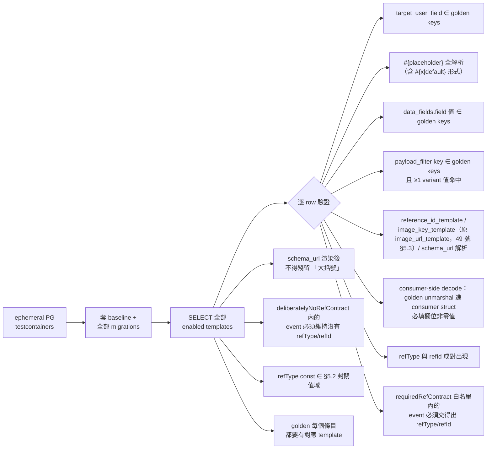

# 通知模板引擎與收件箱 (Notification Template Engine & Inbox) 詳細設計書

> 本文件定義 notification-service 的三個部分；服務基礎（連線、consumer、FCM 通道）見
> [12 號通知微服務詳細設計書](12-通知微服務（Notification%20Service）詳細設計書.md)：
> 1. **DB 驅動模板引擎** — 通知內容一律由 `notification_templates` 配置決定，不得有 hardcoded handler
> 2. **通知收件箱 API** — 列表查詢、未讀數、已讀標記、刪除
> 3. **系統公告廣播** — Admin 一鍵推播公告給全體用戶

---

## 1. 整體架構

### 1.1 資料流總覽

```
┌──────────────────────────────────────────────────────────────────────────────┐
│                              事件驅動推播                                     │
│                                                                              │
│  ┌──────────────┐                                                            │
│  │ order-service │──┐                                                        │
│  │ (Java)        │  │  order.paid / shipped / completed / cancelled          │
│  └──────────────┘  │                                                        │
│  ┌──────────────┐  │                                                        │
│  │ seller-service│──┤  merchant.verification.completed                       │
│  │ (Go)          │  │                                                        │
│  └──────────────┘  │      ┌─────────────────┐                               │
│  ┌──────────────┐  ├─────▶│   RabbitMQ       │                               │
│  │ social-service│──┤      │  Topic Exchange  │                               │
│  │ (Go)          │  │      └────────┬────────┘                               │
│  └──────────────┘  │               │                                        │
│  ┌──────────────┐  │               ▼                                        │
│  │ coupon-service│──┤      ┌─────────────────────────────────┐              │
│  │ (Java)        │  │      │   notification-service (Go)      │              │
│  └──────────────┘  │      │                                   │              │
│  ┌──────────────┐  │      │  ┌─────────────┐  ┌───────────┐  │   ┌───────┐ │
│  │ shipping-    │──┤      │  │ Template     │  │ Template  │  │──▶│  FCM  │ │
│  │ service (Go) │──┘      │  │ Cache (mem)  │  │ Handler   │  │   └───┬───┘ │
│  └──────────────┘         │  └──────┬──────┘  └───────────┘  │       │     │
│                           │         │ 5 min refresh           │       ▼     │
│                           │  ┌──────▼──────┐                  │  ┌───────┐  │
│                           │  │ notification │                  │  │ Buyer │  │
│                           │  │ _templates   │                  │  │ Seller│  │
│                           │  │ (PostgreSQL) │                  │  │  App  │  │
│                           │  └─────────────┘                  │  └───────┘  │
│                           └───────────────────────────────────┘              │
└──────────────────────────────────────────────────────────────────────────────┘

┌──────────────────────────────────────────────────────────────────────────────┐
│                            收件箱 + 系統公告                                  │
│                                                                              │
│  ┌───────────┐    REST API     ┌──────────┐   gRPC    ┌──────────────────┐  │
│  │  Buyer /  │◀──────────────▶│  Gateway  │◀────────▶│ notification-    │  │
│  │  Seller   │  /notifications │          │           │ service          │  │
│  │  App      │                 └──────────┘           │                  │  │
│  └───────────┘                                        │  notifications   │  │
│                                                       │  (TSID, cursor,  │  │
│  ┌───────────┐    REST API     ┌──────────┐   gRPC   │  (is_read,       │  │
│  │  Admin    │───────────────▶│  Gateway  │─────────▶│   read_at,       │  │
│  │  後台     │  /broadcast     │          │           │   deleted_at)    │  │
│  └───────────┘                 └──────────┘           └──────────────────┘  │
│                                                        ▲                    │
│                                                        │ 廣播直接撈         │
│                                                        │ device_tokens →    │
│                                                        │ 逐收件人 inbox     │
│                                                        │ + SendPushUseCase  │
│                                                        └────────────────────│
└──────────────────────────────────────────────────────────────────────────────┘
```

### 2.2 im-service 即時訊息（走模板引擎，與其他通知一致）

im-service publish RabbitMQ 事件（`hawkr.im` / `chat.message.sent`），由模板引擎消費，**與其他通知一樣走 RabbitMQ + 模板引擎**（無專用的 gRPC 推送 RPC）：

```
im-service → publish hawkr.im / chat.message.sent → RabbitMQ → 模板引擎 → FCM (visible notification + data)
```

聊天用 **2 筆 `notification_templates`**（buyer / seller，以 `payload_filter` on `receiverType` 區分），皆 `push_mode='visible'`、`category='chat'`、`event_type='chat.message.sent'`、`title_template='#{senderName}'`、`body_template='#{contentPreview}'`、`reference_id_template='#{messageId}'`（冪等 key = event_type + messageId）。因此自動沿用模板管線的 inbox 寫入、失效 token 停用、冪等與偏好過濾。

聊天採 **WebSocket + FCM 雙通道** 送達，前端用 `(conversationId, seqId)` 去重。FCM 為 visible 通知，前景時前端在使用者正在檢視該對話時抑制 banner，背景 / 關閉由 OS 自動顯示。

---

## 3. 模板引擎

### 3.1 核心流程

```
MQ Event 到達
    │
    ▼
Consumer 收到（queue_name 路由）
    │
    ▼
TemplateHandler
    ├── 1. 以 queue_name 查詢 TemplateCache → 找到匹配的模板
    ├── 2. 從 payload 取 target_user_field → user_id
    ├── 3. 檢查 category → 使用者通知偏好（disabled → 跳過）
    ├── 4. 冪等檢查（event_type + reference_id 已存在 → 跳過）
    ├── 5. 渲染 title_template / body_template（#{field} → payload 值）
    │       └── 渲染失敗（欄位缺失）→ 使用 body_fallback
    ├── 6. 組裝 FCM data（data_fields 映射 + data_type）
    ├── 7. 渲染 schema_url（{key} → data[key]）
    └── 8. SendPushUseCase.Execute → FCM → notifications 記錄（TSID 主鍵）
```

### 3.2 TemplateCache

| 項目 | 說明 |
|------|------|
| 儲存方式 | `atomic.Pointer[map]`，指標置換 |
| 查詢鍵 | `queue_name`（一個 queue 可對應多個模板） |
| 初始載入 | 啟動時從 DB 全量載入 enabled 模板 |
| 自動刷新 | 每 5 分鐘背景 goroutine |
| 手動刷新 | gRPC `ReloadTemplates` / Admin API `POST /reload` |

### 3.3 模板語法

| 語法 | 用途 | 資料來源 | 範例 |
|------|------|---------|------|
| `#{fieldName}` | title / body / reference_id 渲染 | MQ event payload | `訂單 ##{orderNo} 已成立` |
| `{key}` | schema_url 渲染 | data_fields 映射後的 FCM data（**外加 `type` / `category`**） | `hawkr://orders/{orderId}` |
| `data_fields` 物件值 | FCM data map 構造規則 | 見 §3.4 | `{"refType": {"const": "ORDER"}}` |

> ⚠️ **`{key}` 的 key 是 data map 的鍵名，不是 payload 的欄名**，兩者常常不同（本表範例中 data 鍵是 `orderId`，它的值來自 payload 的 `order_no`）。`RenderBraces` 找不到 key 時**原樣保留 `{key}`、不報錯也不 log** —— 送出去的 `data.url` 就是一段沒渲染的模板字串，而通知照送、內文照對，沒有任何一層會有訊號。**寫 schema_url 時逐個 brace 對一次 data_fields 的鍵名**；`schema_url` 只經過 `RenderBraces`，寫成 `#{x}` 形式永遠不會被替換。由 §14.4 的 gate M 全表守住。

### 3.4 data_fields（FieldSpec）

`data_fields` 描述 FCM data map 中**每個 key 怎麼來**。值是物件，用 oneof 表達取值策略：

| 策略 | JSON 形式 | 說明 |
|------|----------|------|
| 字串常數 | `{"const": "ORDER"}` | 直接寫入結果 map（不依賴 payload） |
| Payload 引用 | `{"field": "orderNo"}` | 從 MQ event payload 讀取 `orderNo` 欄位 |

範例（`order.paid` / buyer 模板的實際 data_fields）：

```json
{
  "refType": {"const": "ORDER"},
  "refId":   {"field": "order_no"},
  "orderId": {"field": "order_no"}
}
```

對應 payload `{"order_no": "O992559076", ...}` 解析後產生：

```json
{
  "refType": "ORDER",
  "refId":   "O992559076",
  "orderId": "O992559076"
}
```

⚠️ 這個例子刻意保留了 wire 上的不對稱：**data 鍵是 camelCase 的 `orderId`，payload 欄名是 snake_case 的 `order_no`**。因此該模板的 `schema_url` 必須寫 `hawkr://orders/{orderId}`（data 鍵），不是 `{order_id}`（既不是 data 鍵也不是 payload 欄名）。

`type` / `category` 不在 `data_fields` 中宣告，由 template 的獨立欄位（`data_type` / `category`）直接注入結果 map。

**設計原則**：未來如需加新策略（computed / expr / lookup …），在 FieldSpec 加 oneof case 即可，schema 不變。

### 3.5 Fallback 策略

body 渲染後若仍有 `#{...}` 殘留：
- `body_fallback` 有值 → 整段替換為 fallback 文案
- `body_fallback` 為 NULL → 保留原樣發送

### 3.6 全員推播

模板引擎**沒有廣播分支**：每一則通知都對應一個具體收件人。全員推播的唯一路徑是
gRPC `BroadcastAnnouncement`（§7），它會寫收件匣、留下投遞紀錄。

🔴 **不得**替模板加「一則模板打到所有人」的欄位或分支——那樣的通知不寫收件匣、
不留投遞紀錄，收件人只看得到一則轉瞬即逝的 banner，事後查不到，後端也無從稽核。

### 3.7 推送模式（push_mode）

每個 template 都有一個 `push_mode` 欄位（`varchar(10) NOT NULL DEFAULT 'visible'`），決定 FCM 走哪條路徑、是否寫 inbox：

| push_mode | FCM payload | 銀幕 banner | 系統通知中心 | App inbox | 用途 |
|-----------|-------------|:----------:|:------------:|:---------:|------|
| `visible`（預設） | `notification` + `data` | ✅ | ✅ | ✅ | 一般通知（賣家收到新訂單、買家收到出貨通知…） |
| `silent` | 只有 `data`（無 `notification`） | ❌ | ❌ | ❌ | 純 refresh trigger（動作執行者自己做了什麼，App 端只需刷新列表，不需打擾） |

**設計原則**：
- **動作執行者一律 silent**（自己幹的事自己知道，不該再被 banner 提醒）
- **對方 visible**（不知道才需要 banner）
- **系統好消息一律 visible**（撥款入帳、退款完成）
- **訂單自然完成**（`order.completed`）：雙方 silent，僅刷新列表
- **聊天訊息一律 visible**（`chat.message.sent`，buyer / seller 各一筆 template）：iOS data-only 背景送達不可靠，改 visible 確保 OS 顯示；前景由前端在使用者正檢視該對話時抑制 banner

**Handler 行為**（`template_handler.go::handleTemplate`）：
- `push_mode='visible'` → 走 `inboxUC.CreateInboxItem` + `sendPush.Execute(Silent=false)` → `notifier.Send`<br/>　↳ inbox 寫入成功後 best-effort publish `notification.inbox.new` 到 `hawkr.notification` exchange（供 gateway SSE 推 web，見 [41 §四](41-Realtime%20SSE%20推播平台（Realtime%20SSE%20Push%20Platform）詳細設計書.md)）；publish 失敗 log 不重試，mobile 不受影響因走 FCM
- `push_mode='silent'` → **跳過 inbox 寫入** + `sendPush.Execute(Silent=true)` → `notifier.SendDataOnly`
- 兩種模式都仍經過 `notification_preferences` 偏好檢查與 `push_notifications` 冪等檢查

**Inbox 與未讀數**：silent push **不寫 inbox**，使用者通知中心看不到、不影響未讀數，是純粹的「叫 App 去做事」訊號。

---

## 4. MQ 事件與模板對照表

### 4.1 Exchange / Queue / Routing Key 配置

> 本節逐項記載各事件的推播契約與理由。**模板的完整清單以 DB 與 `services/notification-service/db/migrations/` 為準**，本表不複述筆數（會漂）。
>
> ⚠️ **本節各表的「Queue」欄不是 broker 上的實際 queue 名。** notification-service 的 topology 是
> 「**每來源 exchange 一條 queue**」＋ `'#'` 萬用綁定 ＋ 依 `(exchange, routing_key)` 查
> `notification_templates` 動態分派；**queue 名一律以 `infra/mq/topology/topology.yaml` 為準**
> （形式為 `notification.<exchange>`）。本欄只用來讀「這支模板屬於哪一條來源鏈」，
> 同一件事見 [36 §5.2 / §6.2](36-MQ%20與事件總覽（MQ%20%26%20Event%20Catalog）.md)。

#### 訂單相關

| Exchange | Routing Key | Queue | Event Type | 對象 | push_mode | 標題 |
|----------|------------|-------|------------|------|-----------|------|
| `hawkr.order` | `order.paid` | `notification.order.paid` | `order.paid` | buyer | visible | 訂單成立通知 |
| `hawkr.shipping` | `shipment.created` | `notification.order.placed` | `shipment.created` | seller | visible | 買家已下單（綁物流單建立時機＝「賣家有事可做」，非 `order.paid`；含 Backstop 救活當下推播）|
| `hawkr.order` | `order.shipped` | `notification.order.events` | `order.shipped.buyer` | buyer | visible | 出貨通知 |
| `hawkr.order` | `order.shipped` | `notification.order.events` | `order.shipped.merchant` | seller | **silent** | 訂單已出貨（自己出的，純刷新） |
| `hawkr.order` | `order.completed` | `notification.order.events` | `order.completed.buyer` | buyer | **silent** | 訂單已完成（自然完成，純刷新） |
| `hawkr.order` | `order.completed` | `notification.order.events` | `order.completed.merchant` | seller | **silent** | 訂單已完成（純刷新；撥款另走 `payout.completed`） |
| `hawkr.order` | `order.cancelled` | `notification.order.events` | `order.cancelled.buyer` | buyer | visible | 賣家主動取消 |
| `hawkr.order` | `order.cancelled` | `notification.order.events` | `order.cancelled.merchant` | seller | **silent** | 訂單已取消（自己取消的，純刷新） |

> 買家申請售後走 `aftersales.case.applied` 系列 routing key（見 §4.2 售後），**不是** `order.refund.requested`——後者沒有任何 publisher。

> `order.paid` routing key **僅推給買家**（`notification.order.paid` queue）；賣家「新訂單」推播改綁 `hawkr.shipping:shipment.created`（`notification.order.placed` queue），確保賣家被推播當下已有物流單可動作。

#### 售後相關

售後主流程採 **fine-grained routing keys**：每個有意義的 transition 一個 routing key，對應 buyer + seller 兩個 template（部分為 silent）。共 11 transition × 2 角色 = 22 templates，全部 `data.type=AFTER_SALE_STATUS`、`refType=AFTERSALE`、`refId=caseNo`、`schema_url=hawkr://aftersales/{caseNo}`。

| # | Routing Key | actor | Buyer | Seller | 視覺方標題 |
|---|------------|-------|:-----:|:------:|------------|
| 1 | `aftersales.case.applied` | buyer | silent | **visible** | 買家申請售後 |
| 2 | `aftersales.case.return_approved` | seller | **visible** | silent | 賣家同意退貨 |
| 3 | `aftersales.case.refund_approved` | seller | **visible** | silent | 賣家同意退款 |
| 4 | `aftersales.case.coupon_compensated` | seller | **visible** | silent | 補償優惠券已發放 |
| 5 | `aftersales.case.rejected` | seller | **visible** | silent | 售後申請被拒絕 |
| 6 | `aftersales.case.cancelled_by_buyer` | buyer | silent | **visible** | 買家取消售後 |
| 7 | `aftersales.case.return_received` | seller | **visible** | silent | 賣家已收到您的退貨 |
| 8 | `aftersales.refund.completed` | system | **visible** | silent | 退款完成 |
| 9 | `aftersales.appeal.submitted` | buyer | silent | **visible** | 買家已向平台申訴 |
| 10 | `aftersales.platform_decision.made` | admin | **visible** | **visible** | 平台裁決完成 |
| 11 | `aftersales.case.auto_escalated` | system | **visible** | **visible** | 平台已接手您的售後申請（賣家版：因 24 小時未處理已由平台接手） |

> 所有售後 routing key 一律 `aftersales.*` prefix。Queue 命名格式：`notification.{routing_key}.{role}`（例：`notification.aftersales.case.applied.seller`）。
>
> `aftersales.case.auto_escalated` 由排程任務（CaseProcessTimeoutWorker）publish；其他由 service 在對應 callsite 透過 `AfterSalesEventPublisher.publishCaseTransition(...)` 統一介面發送（詳見設計書 09 §4.4）。

#### 金流相關

| Exchange | Routing Key | Queue | Event Type | 對象 | push_mode | data.type | 標題 |
|----------|------------|-------|------------|------|-----------|-----------|------|
| `hawkr.payment` | `refund.completed` | `notification.refund.completed` | `refund.completed` | buyer | visible | `ORDER_REFUNDED` | 退款完成通知 |
| `hawkr.payment` | `refund.completed` | `notification.refund.completed.seller` | `refund.completed.seller` | seller | **silent** | `ORDER_REFUNDED` | 退款完成（純刷新；賣家在「同意退款」步驟已知道） |
| `hawkr.payment` | `payout.completed` | `notification.payout.completed` | `payout.completed` | seller | visible | `PAYOUT_COMPLETED` | 款項撥付通知 |

#### 物流相關

| Exchange | Routing Key | Queue | Event Type | 對象 | push_mode | data.type | 標題 |
|----------|------------|-------|------------|------|-----------|-----------|------|
| `hawkr.shipping` | `shipment.delivered` | `notification.shipment.delivered` | `shipment.delivered` | buyer | visible | `ORDER_DELIVERED` | 抵達門市/投遞通知 |
| `hawkr.shipping` | `shipment.delivered` | `notification.shipment.delivered.seller` | `shipment.delivered.seller` | seller | **silent** | `ORDER_DELIVERED` | 訂單已送達（純刷新） |

#### 社群互動

| Exchange | Routing Key | Queue | Event Type | 對象 | 標題 |
|----------|------------|-------|------------|------|------|
| `hawkr.content` | `post.created` | `notification.post.created` | `post.created` | buyer | {sellerName} 發布了新貼文 |
| `hawkr.content` | `comment.created` | `notification.comment.created` | `comment.created` | seller | 收到新留言 |
| `hawkr.content` | `comment.replied` | `notification.comment.replied` | `comment.replied.buyer` | buyer | 貼文留言被回覆 |
| `hawkr.content` | `comment.replied` | `notification.comment.replied` | `comment.replied.seller` | seller | 貼文被回覆 |
| `hawkr.content` | `comment.liked` | `notification.comment.liked` | `comment.liked` | seller | 貼文留言被點讚 |
| `hawkr.content` | `post.liked` | `notification.post.liked` | `post.liked` | seller | 貼文被按讚 |
| `hawkr.content` | `product.favorited` | `notification.product.favorited` | `product.favorited` | seller | 收藏您的商品 |
| `hawkr.content` | `product.viewed` | `notification.product.viewed` | `product.viewed` | seller | 瀏覽您的商品 |
| `hawkr.content` | `follow.added` | `notification.merchant.follower` | `follow.added` | seller | 粉絲增長追蹤 |

#### 賣家系統

| Exchange | Routing Key | Queue | Event Type | 對象 | 標題 |
|----------|------------|-------|------------|------|------|
| `hawkr.merchant` | `merchant.verification.approved` | `notification.merchant.verification` | `merchant.verification.approved` | seller | 實名認證已通過 |
| `hawkr.merchant` | `merchant.verification.rejected` | `notification.merchant.verification` | `merchant.verification.rejected` | seller | 實名認證未通過 |
| `hawkr.merchant` | `merchant.verification.pending_info` | `notification.merchant.verification` | `merchant.verification.pending_info` | seller | 實名認證需補件 |

#### 商品認證（19 號設計書）

商品認證改為「申請 → 政府自動查驗／ADM 人工審核 → 核准後才公開標章」之後，賣家需要知道審核結果。
事件契約與 topology 見 [36 §3.6h.1](36-MQ%20與事件總覽（MQ%20%26%20Event%20Catalog）.md)。

⚠️ **這三支與上一節的「實名認證」（`merchant.verification.*`）是不同的東西**：後者是**商家**的 KYC／金流審核（`refType=MERCHANT_VERIFICATION`，一個商家一份），本節是**單一商品**掛哪些農產標章（`refType=PRODUCT`）。文案不得互借（`certStatusBanner()` 那組 approved 文案寫的是「可開始正式收款、提領與配送設定」）。

| Exchange | Routing Key | Queue | Event Type | 對象 | push_mode | data.type | 標題 |
|----------|------------|-------|------------|------|-----------|-----------|------|
| `hawkr.product` | `product.certification.approved` | `notification.product` | `product.certification.approved.seller` | seller | visible | `PRODUCT_CERTIFICATION_STATUS` | 商品認證已通過 |
| `hawkr.product` | `product.certification.rejected` | `notification.product` | `product.certification.rejected.seller` | seller | visible | `PRODUCT_CERTIFICATION_STATUS` | 商品認證未通過 |
| `hawkr.product` | `product.certification.revoked` | `notification.product` | `product.certification.revoked.seller` | seller | visible | `PRODUCT_CERTIFICATION_STATUS` | 商品認證已撤銷 |

- **queue 是既有的 `notification.product`**（`hawkr.product` 的 `'#'` 綁定），**不需新增 queue、不需動 topology**。三支模板走 migration INSERT（§14 SSOT）。
- **`category`**：`system`。**理由是「不新增 category」**——§9 的分類是兩支 App 通知偏好頁的開關集合，多一個值就是前端契約變更，本期不做；`system`（系統通知）是既有八個值裡唯一容納得下「平台對賣家的裁決結果」的那一個。⚠️ **不要把 §9 `system` 列的「認證審核」四個字當依據**：那指的是上一節的 `merchant.verification.*`（商家 KYC），與本節是不同的東西（見上方 ⚠️）——同一個 category 承載兩件事是取捨的結果，不是它們語意相同。三支共用同一個 `data.type`，前端以 `event_type` 區分子情境——與售後 22 支共用 `AFTER_SALE_STATUS` 同一種作法。
- **`refType` / `refId`**：`PRODUCT` / `productId`。⚠️ **不是 `applicationId`**——`refType` 的值域是封閉的（§5.2），裡面沒有描述得了「認證申請」的值，而賣家點開通知要去的地方是**那個商品**。`PRODUCT` 已在值域內，**不需要新增 refType**（新增才要走 §5.2 的四消費者評估）。
- **`reference_id_template`**：`product_cert_#{application_id}`。冪等由 `notifications` 的 UNIQUE `(user_id, user_type, event_type, reference_id)` 承擔；取 `application_id` 而非 `product_id`，否則同一商品第二次審核會被前一次的列吃掉。**與 `refId` 不同值**是刻意的（全表慣例是「refId ≡ reference_id」，本節是明列的例外：refId 要指名跳轉目標、reference_id 要指名這一次裁決）。
- **`schema_url` 留空（NULL）**：賣家 App 本期不做（19 號設計書「不做」清單），而 seller App 的 `NotificationRouter` 對未知 `data.type` 走 `default` 分支，會把 `data.url` 交給 `launchUrl(externalApplication)` ⇒ 填一個沒有頁面的 deep link 會變成不可預期的外開行為。與 `DELEGATION` 同一個理由（§5.2）。
  ⚠️ 賣家 web 端目前也**沒有落地路由**：`lib/notifications/resolve.ts` 只認 order／chat／post 三組 refType，`PRODUCT` 不在任何一組 ⇒ 通知列不可點。這是已知缺口，**不是漏接**，前端要接時的最小材料已在 payload（`productId` / `productName` / `certificationType`）。

**`target_user_field` = `store_id`（必讀 §12.1／§12.1.2）**

⚠️ **實際寫進 DB 的值一律 snake_case（L1 wire，§12.1 表與 36 號 §7.4.1）**：本節與 [36 §3.6h.1](36-MQ%20與事件總覽（MQ%20%26%20Event%20Catalog）.md) 的 payload 清單寫的是 **Java record 的 component 名稱**（camelCase），不是 wire key —— 同 exchange 的 `ProductRestockPayload` 就是 `imageKey` 對 wire `image_key`（`@JsonNaming(PropertyNamingStrategies.SnakeCaseStrategy.class)`）。因此 `target_user_field`、`reference_id_template` 與 `data_fields` 的 **field 值**是 `store_id` / `application_id` / `product_id` / `product_name` / `certification_type`；`data_fields` 的 **key**（FCM data map 鍵名）維持 camelCase（`productId` / `productName` / `certificationType`），與全表慣例一致。

- 三支模板皆 `identity_migrated = true`，`target_user_field` 指向 payload 內**未反解**的 `store_id`——`notifications.user_id` 必須是**當前 `store_id`**（§12.1 的 canonical 契約）。`store_id` 直接取自 `product_certification_application.store_id`，publisher 端不需反解、也不需跨服務查詢就能決定收件人。
- payload 另帶 `seller_account_id`（賣家登入 account_id），**僅供對照／稽核，不是收件人判斷依據**。該欄位仍須 fail-closed 解析（`SellerGrpcClient.getSellerMetaOrThrow`：解析不到就讓事件發布失敗並重試，**禁止**用失敗回空 Map 的批次版本——那會發出永久缺值的 payload，重送也救不回來）。
- 兩個 identity 欄位皆已在 `tests/contract/golden/event_payload_keys.json` 的 `identity_spaces` 宣告（`seller_account_id: account_id`、`store_id: store_id`）——**沒宣告會直接 FAIL，不是靜默通過**（`assertKeyIdentitySpace`）。
- migration 檔頭必須寫「為什麼選這個欄位而不是旁邊那個」（§12.1 判斷步驟第 4 步）。

**發不發推播（三種情境，不是一種）**

| 情境 | 發不發 | 理由 |
|---|---|---|
| 同步快取命中的**即刻核准** | **不發** | 賣家按下儲存的當下畫面就看到標章，再推一則是噪音 |
| **背景查驗補課核准** | **要發** | 賣家畫面停在「審核中」就離開了，不通知他**永遠不會知道已經通過** |
| ADM **人工核准／駁回／撤銷** | **要發** | 賣家不在場，且駁回／撤銷會讓已公開的標章消失，必須交代原因 |

⚠️ 這個分流在 **publisher 側**決定（即刻核准那條路徑不發 `product.certification.approved`），不是在模板側。模板一旦收到事件就會建立收件匣列——`enabled` 或 `push_mode` 都無法表達「同一個 routing key 有時要發有時不要」。

⚠️ 駁回／撤銷的 payload 只帶 `reasonCode` / `publicReason`，**`internalNote` 一律不進 payload**（那是 ADM 內部備註）。

#### 優惠相關

| Exchange | Routing Key | Queue | Event Type | 對象 | 標題 |
|----------|------------|-------|------------|------|------|
| `hawkr.marketing` | `coupon.issued` | `notification.coupon.issued` | `coupon.issued` | buyer | 你有新的優惠券！ |

### 4.2 各事件的 MQ Payload 與推播內容

#### 訂單付款成功 → 買家

```json
// MQ payload (from order-service)
{
  "buyerAccountId": 2663888155,
  "sellerAccountId": 2683479278,
  "orderNo": "ORD20260401001"
}
```

| 項目 | 值 |
|------|-----|
| target_user_field | `buyerAccountId` |
| title | `訂單成立` |
| body | `感謝您的訂購！訂單 #ORD20260401001 我們正快馬加鞭為您處理中。` |
| FCM data.type | `ORDER_PAID` |
| FCM data.order_id | `ORD20260401001` |
| schema_url | `hawkr://orders/ORD20260401001` |
| reference_id | `ORD20260401001`（冪等） |

#### 售後狀態變更詳細文案（11 transitions × buyer/seller = 22 templates）

售後主流程採 fine-grained routing keys，由 aftersales-service 在 7 個 callsite 透過
`AfterSalesEventPublisher.publishCaseTransition(routingKey, eventType, caseNo, orderNo, buyerId, sellerId, actor)`
統一介面 publish；既有 4 個 routing key（refund.completed / appeal.submitted /
platform_decision.made / case.auto_escalated）由各自 publish method 發送。

統一 payload schema（所有 11 個 transition 共用）：

```json
{
  "eventId":         "<uuid>",
  "caseNo":          "<案件編號>",
  "orderNo":         "<訂單編號>",
  "buyerAccountId":  "<買家>",
  "sellerAccountId": "<賣家>",
  "actor":           "buyer | seller | admin | system",
  "occurredAt":      "<ISO 8601 UTC>"
}
```

`auto_escalated` 額外 `originalDeadlineHours` + `reason="PROCESS_TIMEOUT"`；`platform_decision.made` 額外 `outcome` + `refundAmount`；`appeal.submitted` 額外 `reason`；`refund.completed` 額外 `refundAmount` + `refundOutcome`（值為 `AfterSalePlatformDecisionOutcome` enum：`FULL_REFUND` / `PARTIAL_REFUND`；必填、null/未知值 fail-loud 進 DLQ；對齊 36 號 SSOT）。

統一模板欄位（所有 22 row）：
- `data_type` = `AFTER_SALE_STATUS`
- `data_fields` = `{"refType":{"const":"AFTERSALE"}, "refId":{"field":"caseNo"}, "caseNo":{"field":"caseNo"}, "orderNo":{"field":"orderNo"}, "actor":{"field":"actor"}}`
- `schema_url` = `hawkr://aftersales/{caseNo}`
- `category` = `order_update`
- `reference_id_template` = `case_<action>_#{caseNo}`（每 transition 獨立 action 字串）

各 transition 的 buyer / seller 文案：

| # | Routing Key | Buyer (mode) — 標題 / 內文 | Seller (mode) — 標題 / 內文 |
|---|------------|-------------------------|--------------------------|
| 1 | `aftersales.case.applied` | silent — （無） | **visible** — `買家申請售後` /「買家對訂單 ##{orderNo} 申請售後，請儘速處理」 |
| 2 | `aftersales.case.return_approved` | **visible** — `賣家同意退貨` /「賣家已同意退貨，請依說明寄回商品（案件 #{caseNo}）」 | silent — （無） |
| 3 | `aftersales.case.refund_approved` | **visible** — `賣家同意退款` /「退款處理中，款項將原路退回（案件 #{caseNo}）」 | silent — （無） |
| 4 | `aftersales.case.coupon_compensated` | **visible** — `補償優惠券已發放` /「賣家已發放補償優惠券，售後結案（案件 #{caseNo}）」 | silent — （無） |
| 5 | `aftersales.case.rejected` | **visible** — `售後申請被拒絕` /「賣家拒絕售後申請，可於期限內向平台申訴（案件 #{caseNo}）」 | silent — （無） |
| 6 | `aftersales.case.cancelled_by_buyer` | silent — （無） | **visible** — `買家取消售後` /「買家已取消售後申請（案件 #{caseNo}）」 |
| 7 | `aftersales.case.return_received` | **visible** — `賣家已收到您的退貨` /「賣家已收到退貨，準備退款（案件 #{caseNo}）」 | silent — （無） |
| 8 | `aftersales.refund.completed` | **visible** — `退款完成` /「退款已完成，款項已退回（案件 #{caseNo}）」 | silent — （無） |
| 9 | `aftersales.appeal.submitted` | silent — （無） | **visible** — `買家已向平台申訴` /「買家對案件 #{caseNo} 申訴，等候平台裁決」 |
| 10 | `aftersales.platform_decision.made` | **visible** — `平台裁決完成` /「平台已裁決您的售後案件 #{caseNo}」 | **visible** — `平台裁決完成` /「平台已裁決售後案件 #{caseNo}」 |
| 11 | `aftersales.case.auto_escalated` | **visible** — `平台已接手您的售後申請` /「賣家未在期限內處理，平台已接手案件 #{caseNo}，將協助您完成處理」 | **visible** — `您的售後申請已由平台接手` /「您的售後案件 #{caseNo} 因 #{originalDeadlineHours} 小時內未處理，已由平台接手仲裁」 |

**body fallback**（model render 失敗時備用）：visible row 統一為「您有售後案件更新，請開啟 App 查看」；silent row 為 NULL（用不到）。

**冪等鍵範例**（`reference_id_template` 渲染後）：
- `case_applied_#{caseNo}` → `case_applied_A123456789`
- `case_rejected_#{caseNo}` → `case_rejected_A123456789`
- `auto_escalated_#{caseNo}` → `auto_escalated_A123456789`

每個 case + transition 組合只會推一次 push（同 reference_id 命中冪等檢查跳過）。

> **文案管理**：以上文案存在 DB `notification_templates` 表，admin 後台 `https://admin.example.com/admin/notification-templates` 可即時編輯後重載快取生效，**不需發版**。設計團隊改文案／調整 emoji 不需要工程介入。

#### 新貼文 → 粉絲（fan-out）

social-service 負責查粉絲列表，每個粉絲發一個獨立 MQ event：

```json
// MQ payload (from social-service, per follower)
{
  "postId": 42,
  "sellerAccountId": 50,
  "followerId": 100,
  "sellerName": "小農直送",
  "contentPreview": "今日新鮮水果上架"
}
```

| 項目 | 值 |
|------|-----|
| target_user_field | `followerId` |
| title | `小農直送 發布了新貼文` |
| body | `今日新鮮水果上架` |
| FCM data.type | `POST_CREATED` |
| reference_id | `post_42_100`（每粉絲獨立冪等） |

#### 新留言 → 貼文作者

social-service 排除自己留言（`commenterID == postAuthorID` → 不發 event）：

```json
// MQ payload (from social-service)
{
  "commentId": 300,
  "postId": 1,
  "commenterId": 100,
  "commenterName": "小明",
  "postAuthorId": 50,
  "postAuthorType": "seller",
  "contentPreview": "好好吃！"
}
```

| 項目 | 值 |
|------|-----|
| target_user_field | `postAuthorId` |
| title | `小明 在你的貼文留言` |
| body | `小明：好好吃！` |
| FCM data.type | `COMMENT_CREATED` |

---

## 5. FCM Data Payload 格式

### 5.1 `type` vs `data.type` 的差異

收件箱 API 回傳的 `type`（頂層）和 `data.type`（data 物件內）來源不同：

| | `type`（頂層） | `data.type`（data 內） |
|--|---------------|---------------------|
| **來源** | `notifications.event_type`，Gateway 自動轉換 | 模板的 `data_type` 欄位，原樣放入 FCM payload |
| **用途** | 識別事件種類（後端視角） | 前端 `NotificationRouter` 路由跳轉（前端視角） |
| **轉換** | dot-case → UPPER_SNAKE_CASE（`order.paid` → `ORDER_PAID`） | 無轉換，模板設定什麼就是什麼 |

**大多數情況兩者一致**，但以下情況會不同：

| type（事件名） | data.type（前端路由） | 原因 |
|---------------|---------------------|------|
| `SHIPMENT_DELIVERED` | `ORDER_DELIVERED` | 包裹到貨，前端跳訂單詳情 |
| `REFUND_COMPLETED` | `ORDER_REFUNDED` | 同上，前端跳訂單詳情 |
| `PAYOUT_COMPLETED` | `PAYOUT_COMPLETED` | 撥款入帳，前端跳錢包頁 |
| `RETURN_SHIPPED` | `RETURN_SHIPPED` | 退貨配送，前端跳售後詳情 |
| `NOTIFICATION_ANNOUNCEMENT` | `SYSTEM_ANNOUNCEMENT` | 事件名帶 namespace，FCM 路由用簡潔名稱 |
| `AFTERSALES_CASE_AUTO_ESCALATED` | `AFTER_SALE_STATUS` | 售後狀態變化系列共用同一 `data.type`，前端依其他欄位區分子情境 |
| `DELEGATION_OPERATION_COMPLETED_SELLER` | `DELEGATION_OPERATION_COMPLETED` | 賣家向模板的 `event_type` 依慣例帶 `.seller` 後綴（見 56 §6.3），轉大寫後多一段 `_SELLER`；`data.type` 不帶收件人角色 |
| `PRODUCT_CERTIFICATION_{APPROVED,REJECTED,REVOKED}_SELLER` | `PRODUCT_CERTIFICATION_STATUS` | 商品認證三個裁決共用同一個前端路由（與售後共用 `AFTER_SALE_STATUS` 同一種作法）；`.seller` 後綴同上不進 `data.type`（§4.1「商品認證」）|

> 🔴 **`data.type` 必須是具體值，禁止用通用 `ORDER` 承載多個事件**：前端 NotificationRouter 依它切換 UI 與跳轉頁面（「包裹到貨」跳訂單詳情、「款項撥付」跳錢包），共用一個值會讓它分不開。

### 5.2 data.type 與前端頁面對照

前端 App 依據 `data.type` 路由到對應頁面。`data` 物件統一帶以下欄位（除明列外）：
- `type`、`category`：通知分類（前者控制 router，後者控制使用者偏好）
- `url`：deep link，由 `schema_url` 模板渲染
- `refType` / `refId`：資源類別與識別（前端透過此組合跳對應 detail page）

**`refType` 的值域（封閉，新增值需同步 gateway §6.4 fallback 表、兩支 App 的 switch、website `lib/notifications/resolve.ts` 的三個集合）**：
`ORDER`／`AFTERSALE`／`CHAT`／`POST`／`PRODUCT`／`COUPON`／`SHIPMENT_ANOMALY`／`SELLER_SUSPENSION`／`MERCHANT_VERIFICATION`／`DELEGATION`／`PROCUREMENT_QUOTE_INVITE`／`INVOICE`。
**這個值域由 `template_contract_test.go` 的 `refTypeDomain` 對全表（含 `enabled = false`）機械斷言**——只寫在文件裡的「不新創值」擋不住任何人。新增成員的順序不可顛倒：先改本節（值域清單＋對照表，寫明它指向什麼資源）→ 評估四個消費者（gateway §6.4 fallback 表、seller App inbox switch＋FCM router、buyer App `destination.dart`、website `resolve.ts` 的三個集合）→ 才改 `refTypeDomain`。**沒有消費者不是阻擋條件**（`DELEGATION` 與 `PROCUREMENT_QUOTE_INVITE` 現況即是），但必須在本節明寫「無落地頁」，免得下一個人以為是漏接。
下表的 refId 欄位寫的是 **publisher payload 的欄名**（`data_fields.refId.field` 的值），wire 大小寫依各 publisher 而異，不是筆誤。

> ⚠️ **refType 與 refId 必須成對且皆非空**，缺一即整組降級成 `null`（§6.4 第 1 段）。因此「有資源 id 但值域裡沒有合適的 refType」與「有 refType 但拿不到非空 id」兩種情況，結果都是 `refType=refId=null`，而不是給一半。

| data.type | 前端跳轉頁面 | Buyer | Seller | refType | refId 來源 |
|-----------|-------------|:-----:|:------:|---------|-----------|
| `ORDER_PAID` | 訂單詳情 | ✓（visible） | — | `ORDER` | `order_no` |
| `ORDER_CREATED` | 訂單列表（待處理） | — | ✓（visible） | `ORDER` | `order_no` |
| `ORDER_SHIPPED` | 訂單詳情 | ✓（visible） | ✓（**silent** refresh） | `ORDER` | `order_no` |
| `ORDER_DELIVERED` | 訂單詳情 | ✓（visible） | ✓（**silent** refresh） | `ORDER` | `order_no` |
| `ORDER_COMPLETED` | 訂單詳情 | ✓（**silent** refresh） | ✓（**silent** refresh） | `ORDER` | `order_no` |
| `ORDER_CANCELLED` | 訂單詳情 | ✓（visible） | ✓（**silent** refresh） | `ORDER` | `order_no` |
| `ORDER_REFUNDED` | 訂單詳情 | ✓（visible） | ✓（**silent** refresh） | `ORDER` | `orderNo` |
| `PAYOUT_COMPLETED` | 錢包頁 | — | ✓（visible） | `ORDER` | `order_no` |
| `REVIEW_CREATED` | 訂單詳情（評價區） | — | ✓ | `ORDER` | `order_no` |
| `SHIPMENT_ANOMALY` | 訂單詳情 | — | ✓ | `SHIPMENT_ANOMALY` | `order_no` |
| `AFTER_SALE_STATUS` | 售後詳情 | ✓ | ✓ | `AFTERSALE` | `case_no` |
| `CHAT_MESSAGE`（`data.type` 實值 `chat_message`） | 聊天室 | ✓ | ✓ | `CHAT` | `conversation_id` |
| `COUPON_RECEIVED` | 優惠券詳情 | ✓ | — | `COUPON` | `coupon_id` |
| `COUPON_EXPIRING` | 優惠券詳情 | ✓ | — | `COUPON` | `coupon_instance_id` |
| `POST_FOLLOWED_AUTHOR` | 貼文詳情 | ✓ | — | `POST` | `post_id` |
| `POST_NEW_COMMENT` | 貼文詳情 | ✓ | — | `POST` | `postId` |
| `POST_COMMENT_REPLY` | 貼文詳情 | ✓ | — | `POST` | `postId` |
| `POST_HIDDEN_BY_PLATFORM` | 貼文詳情 | — | ✓ | `POST` | `post_id` |
| `COMMENT_CREATED` | 貼文詳情 | — | ✓ | `POST` | `postId` |
| `COMMENT_REPLIED` | 貼文詳情 | — | ✓ | `POST` | `postId` |
| `COMMENT_LIKED` | 貼文詳情 | — | ✓ | `POST` | `postId` |
| `POST_LIKED` | 貼文詳情 | — | ✓ | `POST` | `post_id` |
| `PRODUCT_FAVORITED` | 顧客列表 | — | ✓ | `PRODUCT` | `product_id` |
| `PRODUCT_VIEWED` | 顧客列表 | — | ✓ | `PRODUCT` | `product_id` |
| `RESTOCK_AVAILABLE` | 商品詳情 | ✓ | — | `PRODUCT` | `product_id` |
| `PRODUCT_CERTIFICATION_STATUS` | （**無落地頁**，見下方註）| — | ✓（visible） | `PRODUCT` | `productId` |
| `MERCHANT.VERIFICATION.{APPROVED,REJECTED,PENDING_INFO,FORWARDED}` | 認證頁面 | — | ✓ | `MERCHANT_VERIFICATION` | `merchant_id` |
| `SELLER_SUSPENDED` / `SELLER_UNSUSPENDED` | 停權說明 | — | ✓ | `SELLER_SUSPENSION` | `suspensionId` |
| `DELEGATION_OPERATION_COMPLETED` | （**無落地頁**，見下方註）| — | ✓（visible） | `DELEGATION` | `audit_log_id` |
| `SYSTEM_ANNOUNCEMENT` | 公告列表 | ✓ | ✓ | **—（刻意）** | **—（刻意）** |
| `FOLLOWER_ADDED` | 顧客資料 | — | ✓ | **—（刻意）** | **—（刻意）** |
| `PROCUREMENT_RFQ_PUBLICATION_INVITE`（64 號 Hawkr Agent 商務線） | （**無落地頁**，見下方註）| — | ✓（visible） | **—（刻意）** | **—（刻意）** |
| `INVOICE_ISSUED`／`INVOICE_VOIDED`／`INVOICE_ALLOWANCE_ISSUED`／`INVOICE_REISSUED`／`INVOICE_RECEIPT_ISSUED`／`INVOICE_COMPLAINT_RESPONDED` | 發票中心詳情（WEB `/account/invoices/{documentId}`；**兩支 App 無落地頁**） | ✓ | — | `INVOICE` | `invoice_document_id` |
| `INVOICE_ISSUED`（賣家向，**silent**）／`INVOICE_OPERATION_REVIEW_REQUIRED` | 賣家發票中心詳情（WEB `/seller-center/invoices/{documentId}`；**App 無落地頁**） | — | ✓ | `INVOICE` | `invoice_document_id` |
| `INVOICE_RESOLVED_EXTERNALLY` | 訂單詳情（賣家站外自行開立，我方**沒有** `invoice_documents` 列可指） | ✓ | — | `ORDER` | `order_no` |
| `INVOICE_ISSUE_FAILED`／`INVOICE_COMPLAINT_CREATED`／`INVOICE_COMPLAINT_OVERDUE`／`INVOICE_SELLER_TAX_PROFILE_STATUS_CHANGED` | 賣家中心靜態列表（發票異常作業／發票申訴／稅務資格） | — | ✓ | **—（刻意）** | **—（刻意）** |

> **「—（刻意）」的兩支不是漏補**，理由分別是：`SYSTEM_ANNOUNCEMENT` 有 `announcementId` 但值域裡沒有描述得了「公告」的值——⚠️ 硬塞 `POST` 的實際受害者是 **website 賣家面**（這是 seller-only 模板，買家端根本收不到）：`isPostNotification` 會因 `"post"` 轉真，而 `resolvePostId`（`lib/notifications/resolve.ts`）在 data 找不到 `postId` 時**直接把 `refId` 當 `postId` 回傳**，於是產出 `/seller-center/posts?post=<announcementId>`，開一篇不存在的貼文；`FOLLOWER_ADDED` 指向的資源是那個買家，值域裡沒有對應值，而 publisher 唯一的另一個 id `merchant_id` 是收件人自己。
> 這兩支由 `template_contract_test.go` 的 `deliberatelyNoRefContract` 反向釘住——要改成有，前置條件是**先**在本節的值域立好那個 refType，而不是先改 migration。
>
> `MERCHANT_VERIFICATION` 的 refId 是 `merchant_id`（＝收件人自己的 account_id）：認證資料與商家 1:1，`merchant_id` 是該資源的自然鍵，而目的地 `/seller/certification` 是登入者自己的頁面、不吃路徑參數。**這個 refId 用來指名資源，不是頁面參數**——前端不應該拿它去打 `/certifications/{id}` 形狀的 API（沒有那支 API）。gateway §6.4 fallback 表裡的 `certification_id` 從來沒有任何 publisher 發過。

> **`DELEGATION`（代行完成通知，56 號）是唯一一個「refType/refId 齊備但刻意不給 `url`」的類型**，兩件事要分開看：
> - **refType/refId 是收件匣 API 的契約欄位**，缺了就是 `GET /app/notifications` 回 `refId=null`／`refType=null`，前端連「這則通知關聯到哪一筆」都拿不到。`refId` 取 `audit_log_id` 而非被操作資源的 id：一則通知對應**一次代行操作**（同一商品被代行兩次是兩則獨立通知），且**訂單面的 `resource_id` 恆為空字串**——訂單號存不進 `admin_operation_audit_logs.resource_id`（bigint），改用它會讓訂單面照樣回 null。與本列 `reference_id_template` 同值，符合全表「refId ≡ reference_id」的慣例。
> - **`url` 留空是因為賣家端沒有代行紀錄落地頁**（56 §2.2 第 10 條，本期 Seller Center／Seller App 零改動），而 seller App 的 FCM router 對未知 `data.type` 會把 `data.url` 交給 `launchUrl(externalApplication)`——填一個沒有頁面的 deep link 會變成不可預期的外開行為。`schema_url` 又是單一字串模板，無法依 `resource_type` 分歧（storefront／product／post／order 四種落地頁互不相同）。
>
> 該模板另在 `data` 帶 `resourceType`／`resourceId`／`resourceName` 三個欄位，是前端日後要讓賣家從通知直接進到被操作資源時所需的最小材料（publisher 已實發，不需再改後端）；`resourceId` 在訂單面為空字串，`resourceName` 在訂單面即訂單號。

> **`PRODUCT_CERTIFICATION_STATUS`（商品認證，19 號）與 `DELEGATION` 同型但不同因**：它的 refType/refId 齊備（`PRODUCT` / `productId`）且**沒有落地頁**——seller App 不接（19 號設計書「不做」清單），而賣家 web 的 `resolve.ts` 只認 order／chat／post 三組 refType。`schema_url` 因此留空——seller App 的 `default` 分支會把 `data.url` 外開，填一個不存在的 deep link 比不填更糟。前端要接時的最小材料已在 `data`：`productId`／`productName`／`certificationType`（publisher 已實發）。**不得**為了「有地方跳」而把 refType 改成 `POST` 之類的既有值，那正是本節在防的錯誤。

> **`PROCUREMENT_RFQ_PUBLICATION_INVITE`（RFQ 發布直投線，64 號 §4.2–§4.4／36 號 §3.6l.1，`20260910120000_procurement_rfq_publication_invite_template.sql`）列為「—（刻意）」，與上面兩支同因不同源。**
> 它與 `PROCUREMENT_QUOTE_INVITE` 是**兩條不同的線**（不同資料表、不同 outbox、payload 一為 camelCase 一為 snake_case），只共用 exchange `procurement.events`。
> - **refType 刻意不給**：本節值域的 12 個成員沒有一個描述得了「RFQ 發布 invite」這個資源。硬塞 `PROCUREMENT_QUOTE_INVITE` 會讓前端拿 publication invite id 去開報價單頁（另一張表的另一個資源），正是本節在防的錯誤；`refId` 隨之不給（缺一即整組降級成 `null`，給一半沒有意義）。
> - **schema_url 留空**：賣家回覆面（64 §4.4 的 `sellerResponseVersion`）沒有對應頁面可指；理由與 `DELEGATION`／`PRODUCT_CERTIFICATION_STATUS` 相同——seller App 的 `default` 分支會把 `data.url` 外開，填一個不存在的 deep link 比不填更糟。
> - **無落地頁不是阻擋條件**（同本節上方「沒有消費者不是阻擋條件」那一句）。**擴充值域這條路是通的**：只需改本節（值域清單＋對照表）與 `refTypeDomain`，兩者都在 backend-payuni。目前**不擴充**，是因為「賣家收到這則通知後應該去哪裡」是尚未定案的產品決定，而非技術阻礙。
> - ⚠️ **代價要講明**：延後的後果是**即使賣家回覆面上線，通知仍然無處可跳**——屆時需要另一支 migration 補 `refType`／`refId`／`schema_url`，順序仍是「先本節、後 `refTypeDomain`、最後 migration」。
> - 前端要接時的最小材料已在 `data`：`inviteId`／`publicationId`（publisher 已實發，不需再改後端）。本列由 `template_contract_test.go` 的 `deliberatelyNoRefContract` 反向釘住。

> 聊天模板（`chat_message`）已遷移至 explicit refType / refId 契約：直接寫入 `refType=CHAT` + `refId=conversation_id`，gateway inbox 走 explicit contract（primary path），不再依賴 §6.4 的 `conversation_id` legacy fallback。
>
> 🔴 **本表對 enabled template 必須是完整的**：每一支 enabled template 要嘛在上表有 refType/refId，要嘛列在「—（刻意）」之一。缺了不會有任何錯誤訊號——通知照送、內文照對，只有收件人點開時沒有跳轉目標。這條由 `template_contract_test.go` 的 `requiredRefContract` ＋ `deliberatelyNoRefContract` 機械保證。
> **`INVOICE`（電子發票，58 號 §D.4）** 指向 `invoice_documents` 的一列（refId ＝ `invoice_document_id`）。
> 為什麼不沿用 `ORDER`：那個論證只涵蓋「賣家→買家（有訂單）」一個方向；58 §2.3 矩陣的另外三個方向（平台→賣家服務費／平台→買家訂閱／平台→非會員）`source_ref` 恆為 NULL ⇒ 沿用 `ORDER` 的後果不是多跳一次，是 **refId 沒有值可填**（而 refType/refId 缺一即整組降級成 `null`）。
> 四消費者評估（58 §D.4 逐項）：**WEB 通知中心是唯一有落地頁的端**（買家 `/account/invoices/{documentId}`、賣家 `/seller-center/invoices/{documentId}`）；Buyer App 的 `NotificationDestinationKind` 是封閉九值、Seller App 的 inbox `switch` 無 default ⇒ 兩支 **無落地頁**（App 凍結，58 §2.2），且**與沿用 `ORDER` 時等價**——App 的訂單詳情本來就沒有發票區塊；ADM 不消費 `refType`（走自己的 A12／A13 路由）。
> 上表末列四支發票通知列為「—（刻意）」的理由各不相同：`INVOICE_ISSUE_FAILED` 是開票**失敗**時 `invoice_documents` 還沒有那一列（沒有 id 可指）；`INVOICE_COMPLAINT_CREATED`／`INVOICE_COMPLAINT_OVERDUE` 的主體是**申訴**不是文件，值域裡沒有描述得了申訴的值；`INVOICE_SELLER_TAX_PROFILE_STATUS_CHANGED` 的主體是賣家稅務身分，`data_fields` 整組為 `NULL`（先例：`DELEGATION_OPERATION_COMPLETED` 的同型處置）。四支皆由 `deliberatelyNoRefContract` 反向釘住。
> 發票模板若先於 publisher 落地，一律以 `enabled = false` 進表，逐列解除條件寫在該 migration 檔頭，啟用另開一支 migration；值域斷言涵蓋停用列（見下方「值域斷言涵蓋停用列」）。
>
> 停用中的 `merchant.verification.completed`（`data.type=VERIFICATION_UPDATE`）是被四支分流 routing key 取代的舊模板，`data_fields` 無 refType/refId，不在本表內。
>
> **值域斷言涵蓋 `enabled = false` 的列**：這個 class 的失效點正好在「啟用的那一天」——停用 row 若不受約束，一行 `UPDATE ... SET enabled = true` 就能讓一個值域外的 refType 直接流到 `GET /app/notifications`，而其餘四條規則沒有一條會紅。
> ⚠️ **值域是封閉清單，不是模板清單**：成員可以沒有任何模板在用它（`PROCUREMENT_QUOTE_INVITE` 現況即是——legacy quote-invite 整條已退場，現行管道是 `procurement.rfq_publication_invite.*`，見 64 號 §7）。要移除一個成員，必須先確認全表沒有任何列引用它。
>
> **silent refresh** 標示的 row：FCM 不顯示 banner，App 在背景觸發頁面刷新，使用者完全感知不到（用於動作執行者已知道、無需提醒的情境）。

---

## 6. 收件箱 API

### 6.1 端點

| 方法 | 路徑 | 說明 |
|------|------|------|
| `GET` | `/api/v1/app/notifications?pageSize=20&cursorId=0` | 通知列表（cursor-based 分頁） |
| `GET` | `/api/v1/app/notifications/unread-count` | 未讀數量 |
| `PATCH` | `/api/v1/app/notifications/:id/read` | 標記已讀（冪等） |
| `PATCH` | `/api/v1/app/notifications/read-all` | 全部已讀 |
| `DELETE` | `/api/v1/app/notifications` | 批次刪除 `{"ids":[1,2,3]}` |

買家/賣家共用，透過 JWT 的 `X-Account-Id` + `X-Account-Type` 識別。

**2026-06 新增 SSE realtime 推送**：

- `PATCH /:id/read` / `PATCH /read-all` / `DELETE /` 完成 DB update 後 best-effort publish `notification.unread_changed` 到 `hawkr.notification` exchange（payload `{userId, userType, unreadCount}`），供 gateway SSE 推 **web** 即時更新 badge（mobile 維持 FCM）。詳見 [41 §四](41-Realtime%20SSE%20推播平台（Realtime%20SSE%20Push%20Platform）詳細設計書.md)。
- 新增 SSE 訂閱 endpoint：`GET /api/v1/app/notifications/stream`（auth JWT）；client 訂閱後收到 `notification.new`（含完整 InboxItem + unreadCount）與 `notification.unread_changed`（僅 unreadCount）兩類事件。
- Web client 既有 `useUnreadPolling` 30s polling **完全拔除**；SSE 為唯一推送路徑，不保留 polling 為 fallback。連線失敗時 client UI 顯示「即時同步不可用，請重新整理頁面」，由使用者 reload 解決，不在 client 程式碼塞兜底邏輯（理由見 [41 §4.7](41-Realtime%20SSE%20推播平台（Realtime%20SSE%20Push%20Platform）詳細設計書.md)）。

### 6.2 回傳格式（NotificationItem）

```json
{
  "code": 0,
  "data": {
    "records": [
      {
        "id": 7446744073709551615,
        "type": "ORDER_PAID",
        "title": "訂單成立",
        "body": "感謝您的訂購！訂單 #ORD-001 正在處理中。",
        "refType": "ORDER",
        "refId": "ORD-001",
        "isRead": false,
        "readAt": null,
        "createdAt": "2026-04-01T10:00:00Z",
        "data": {
          "type": "ORDER_PAID",
          "category": "order_update",
          "refType": "ORDER",
          "refId": "ORD-001",
          "order_id": "ORD-001",
          "url": "hawkr://orders/ORD-001"
        }
      }
    ],
    "total": "50",
    "pageSize": "20",
    "hasMore": true
  }
}
```

### 6.3 type 格式轉換

Gateway 將後端 `event_type`（dot-case）轉為前端 `type`（UPPER_SNAKE_CASE）：

```
order.paid         → ORDER_PAID
comment.created    → COMMENT_CREATED
shipment.delivered → SHIPMENT_DELIVERED
```

轉換邏輯：`strings.ToUpper(strings.ReplaceAll(eventType, ".", "_"))`

### 6.4 refType / refId 解析

Gateway 對 inbox response 頂層的 `refType` / `refId` 採兩段策略：

1. **優先讀 `data.refType` + `data.refId`**（後端模板透過 FieldSpec 直接寫入，見 §3.4）。
2. **Fallback：從 `data` 內 key 推導**（向後相容，覆蓋舊資料或尚未補 refType 的模板）：

   | data 中的 key | refType | refId |
   |--------------|---------|-------|
   | `order_id` | `ORDER` | `data["order_id"]` |
   | `conversation_id` | `CHAT` | `data["conversation_id"]` |
   | `certification_id` | `MERCHANT_VERIFICATION` | `data["certification_id"]` |
   | `post_id` | `POST` | `data["post_id"]` |
   | 以上皆無 | null | null |

   > 註：`conversation_id → CHAT` 為通用 legacy fallback，僅服務舊資料。聊天模板已遷移至 explicit `refType` / `refId` 契約（`refType=CHAT` + `refId=conversation_id`，見 §5.2），不再依賴此 fallback。
   >
   > ⚠️ **這四條 fallback 沒有生產者，只服務歷史 row**：所有 enabled template 都走第 1 段的 explicit 契約（§5.2 對 enabled template 是完整的）。其中 `certification_id` 這條從來沒有生產者——`merchant.verification.*` 的 payload 只有 `event_id` / `status` / `reason` / `merchant_id` 四個鍵（`seller-service` 的 `merchant_event_publisher.go`），因此那四支的 explicit refId 取 `merchant_id`。
   > 🔴 **要移除 fallback 必須先確認 `notifications` 表內的存量 row**：`data` 是寫入當下凍結的，不會隨 template 更新而改變。

前端用 `refType + refId` 做頁面跳轉（FCM 路徑同樣讀 `data.refType` / `data.refId`）。

---

## 7. 系統公告廣播

### 7.1 API

```
POST /api/v1/admin/notifications/broadcast
```

```json
{
  "title": "版本更新通知",
  "body": "Hawkr v2.0 已上線，請更新至最新版本！",
  "target_user_type": "all"  // "all" | "buyer" | "seller"
}
```

### 7.2 流程

```
Admin UI → Gateway → notification-service gRPC BroadcastAnnouncement
    ├── mint 一個 broadcastId（TSID，每則公告一個）
    ├── 分頁撈 device_tokens（每批 100）→ 去重成收件人清單
    └── 逐收件人：
        ├── CreateInboxItem（reference_id = announcement_{broadcastId}_{userId}）
        └── SendPushUseCase.Execute（Category = system）
            ├── 冪等：ExistsProcessed(event_type, reference_id, user)
            ├── 通知偏好：GetByCategory(system) 關閉即不推（收件匣仍寫）
            ├── FCM 送出，依實際結果寫 sent / partial / failed + error_log
            └── 永久失效的 token 停用
```

**回應**

```json
{
  "code": 0,
  "message": "success",
  "data": { "broadcastId": "7495464541774413824", "recipientCount": "100" }
}
```

`broadcastId` 與 `data.announcementId`、`reference_id` 是同一個值——管理員發完公告要能
回頭查它。兩者都放 `data` 的具名欄位而不塞進 `message`：`message` 恆為 `"success"`
（API 設計規範「message 來源策略」），收件人數原本只存在於下游的中文句子「已推播給 N
位使用者」裡，呼叫端得剖析字串才拿得到。

**契約要點**

| 項目 | 值 | 為什麼 |
|---|---|---|
| `reference_id` | `announcement_{broadcastId}_{userId}` | 帶公告識別。只用發布者 id 會讓同一管理員的第二則公告與第一則撞鍵，inbox 被 `ON CONFLICT DO NOTHING` 吞掉、push 撞 dedup index，而 FCM banner 已經送出去——公告閃一次之後哪裡都找不到 |
| `data` | `type=SYSTEM_ANNOUNCEMENT`、`category=system`、`announcementId` | 收件匣查詢用 `data->>'category'` 過濾，缺 `category` 的公告落在所有分類過濾之外 |
| 通知偏好 | 受使用者「系統通知」開關約束 | §9 明列 `system` 分類涵蓋系統公告且兩支 App 都有開關。**偏好只擋推播、不擋收件匣**，與 `handleTemplate` 一致 |
| 收件人範圍 | 持有 active device token 的使用者 | 觸及沒裝 App 的人需要跨服務的收件人來源，屬功能擴充，不在本路徑 |

> 🔴 **廣播不走 MQ → 模板引擎**：per-recipient 形狀要為每個收件人各發一則，而收件人名單
> 只有 notification-service 自己有（自產自銷，繞一圈 MQ 沒有收益）；broadcast 形狀則不寫
> 收件匣（§3.6）。全員推播的唯一入口是 gRPC `BroadcastAnnouncement`。

---

## 8. 資料庫設計

### 8.1 notification_templates

```sql
CREATE TABLE notification_templates (
    id                    bigint PRIMARY KEY,      -- TSID（應用層產生）
    exchange              varchar(100) NOT NULL,
    routing_key           varchar(200) NOT NULL,
    queue_name            varchar(200) NOT NULL,
    event_type            varchar(100) NOT NULL,
    target_user_type      varchar(10)  NOT NULL,     -- 'buyer' | 'seller'
    target_user_field     varchar(100) NOT NULL,     -- payload JSON 欄位 → user_id
    category              varchar(30)  NOT NULL,     -- 通知偏好分類
    title_template        text         NOT NULL,     -- #{field} 語法
    body_template         text         NOT NULL,
    body_fallback         text,
    data_type             varchar(100) NOT NULL,     -- FCM data.type
    data_fields           jsonb,                     -- {fcm_key: FieldSpec}（見 §3.4）
    schema_url            varchar(500),              -- Deep link {key} 語法
    reference_id_template varchar(200),              -- 冪等 ID #{field} 語法
    enabled               boolean NOT NULL DEFAULT true,
    push_mode             varchar(10) NOT NULL DEFAULT 'visible', -- 'visible'=banner+inbox / 'silent'=data-only refresh（見 §3.7）
    updated_by            bigint,
    created_at            timestamptz NOT NULL DEFAULT CURRENT_TIMESTAMP,
    updated_at            timestamptz NOT NULL DEFAULT CURRENT_TIMESTAMP,

    CONSTRAINT uni_notification_templates_event_user_type
        UNIQUE (event_type, target_user_type)
);

CREATE INDEX idx_notification_templates_queue_routing
    ON notification_templates (queue_name, routing_key);
CREATE INDEX idx_notification_templates_enabled
    ON notification_templates (enabled);
```

### 8.2 notifications（通知主表 — 收件箱 + delivery log）


```sql
CREATE TABLE notifications (
    id           bigint PRIMARY KEY,       -- TSID（應用層產生，時間排序）
    user_id      bigint      NOT NULL,     -- 身分空間由 user_type 決定：seller=當前 store_id / buyer=當前 buyer_id（§12.1，填錯即永遠讀不到）
    user_type    varchar(10) NOT NULL,     -- 'buyer' | 'seller'
    event_type   varchar(50) NOT NULL,
    reference_id varchar(100),
    title        text        NOT NULL,
    body         text        NOT NULL,
    data         jsonb,
    status       varchar(20) NOT NULL DEFAULT 'pending',
    sent_at      timestamptz,
    error_log    text,
    is_read      boolean     NOT NULL DEFAULT false,
    read_at      timestamptz,
    deleted_at   timestamptz,
    created_at   timestamptz NOT NULL DEFAULT CURRENT_TIMESTAMP
);

-- 收件箱列表（cursor-based pagination，用 TSID id 排序）
CREATE INDEX idx_notifications_inbox
    ON notifications (user_id, user_type, id DESC)
    WHERE status = 'sent' AND deleted_at IS NULL;

-- 未讀數
CREATE INDEX idx_notifications_unread
    ON notifications (user_id, user_type)
    WHERE status = 'sent' AND deleted_at IS NULL AND is_read = false;

-- 定期清理用 partial index
CREATE INDEX idx_notifications_cleanup_failed
    ON notifications (created_at)
    WHERE status IN ('failed', 'skipped');

CREATE INDEX idx_notifications_cleanup_deleted
    ON notifications (deleted_at)
    WHERE deleted_at IS NOT NULL;
```

### 8.3 定期清理 Job

每 6 小時自動執行，batch delete（每次 1000 筆）避免長 transaction：

| 對象 | 保留天數 | 條件 |
|------|---------|------|
| Delivery log | 30 天 | `status IN ('failed', 'skipped')` |
| 已刪除 inbox | 90 天 | `deleted_at IS NOT NULL` |

---

## 9. 通知偏好分類

| category | App 顯示 | Buyer | Seller | 涵蓋事件 |
|----------|---------|:-----:|:------:|---------|
| `order_update` | 訂單更新 | ✓ | ✓ | 訂單成立/出貨/完成/取消/撥付 |
| `refund_update` | 退款更新 | ✓ | ✓ | 退款完成、退貨配送 |
| `system` | 系統通知 | ✓ | ✓ | 系統公告、認證審核、優惠券 |
| `chat` | 聊天通知 | ✓ | ✓ | 聊天訊息 |
| `follower` | 追蹤通知 | — | ✓ | 新粉絲 |
| `content` | 內容通知 | ✓ | ✓ | 新貼文、新留言 |
| `coupon` | 優惠券 | ✓ | — | 優惠券發放 |
| `message` | 留言通知 | ✓ | — | 貼文留言 |

使用者在 App 可關閉某分類，TemplateHandler 發送前會檢查。

---

## 10. 管理後台 API

### 10.1 模板管理 API（唯讀 ＋ 營運開關）

> 🔴 **`notification_templates` 的建立與修改，唯一入口是 Atlas migration**（見 §14）。admin API
> 只有唯讀與 `enabled` 開關，**不得**提供建立／更新 template 的 RPC 或路由——runtime 建立的
> template 不在 repo，§14 的契約測試驗不到它，guardrail 會形同虛設。

| 方法 | 路徑 | 說明 | 狀態 |
|------|------|------|------|
| `POST` | `/api/v1/admin/notification-templates/reload` | 重載快取（migration 套用後手動觸發，或等 5 分鐘背景刷新） | 保留 |
| `GET` | `/api/v1/admin/notification-templates` | 列表（可篩選） | 保留 |
| `GET` | `/api/v1/admin/notification-templates/:id` | 取得單筆 | 保留 |
| `PATCH` | `/api/v1/admin/notification-templates/:id/enabled` | 啟用/停用（營運開關，不改內容） | 保留 |
| `POST` | `/api/v1/admin/notification-templates/:id/preview` | 預覽渲染 | 保留 |
| `POST` | `/api/v1/admin/notification-templates/:id/test-send` | 測試推播 | 保留 |

### 10.2 Admin UI

`hawkr-admin` → `/admin/notification-templates`

功能：
- 模板列表表格（Event Type 下拉篩選、用戶類型篩選、標題模糊搜尋）
- 編輯 Drawer（三段折疊：通知內容 / FCM Data / MQ 進階設定）
- 測試 Modal（自動生成 Sample Payload、即時渲染預覽、發送測試推播）
- 重載快取按鈕
- 發送系統公告 Modal（標題 + 內容 + 發送對象選擇 + 確認警告）

---

## 11. 前端串接指南

### 11.1 收件箱 API

```typescript
// 通知列表（cursor-based 分頁）
// 第一頁：不帶 cursorId 或 cursorId=0
const res = await api.get('/api/v1/app/notifications?pageSize=20');
// 下一頁：帶上一頁最後一筆的 id 作為 cursorId
const next = await api.get(`/api/v1/app/notifications?pageSize=20&cursorId=${lastId}`);
// res.data.records: NotificationItem[], res.data.hasMore: boolean

// 未讀數（badge）
const res = await api.get('/api/v1/app/notifications/unread-count');
// res.data.count: number

// 標記已讀
await api.patch(`/api/v1/app/notifications/${id}/read`, {});

// 全部已讀
await api.patch('/api/v1/app/notifications/read-all', {});
// res.data.updated: number

// 批次刪除
await api.delete('/api/v1/app/notifications', { ids: [1, 2, 3] });
// res.data.deleted: number
```

### 11.2 NotificationItem 欄位

| 欄位 | 型別 | 說明 |
|------|------|------|
| `id` | `number` | 通知 ID |
| `type` | `string` | UPPER_SNAKE_CASE，如 `ORDER_PAID` |
| `title` | `string` | 標題 |
| `body` | `string` | 內文 |
| `refType` | `string?` | 封閉值域，見 §5.2：`ORDER` / `AFTERSALE` / `CHAT` / `POST` / `PRODUCT` / `COUPON` / `SHIPMENT_ANOMALY` / `SELLER_SUSPENSION` / `MERCHANT_VERIFICATION` / `DELEGATION` / null |
| `refId` | `string?` | 跳轉目標 ID |
| `isRead` | `boolean` | 是否已讀 |
| `readAt` | `string?` | 已讀時間（RFC3339） |
| `createdAt` | `string` | 建立時間（RFC3339） |
| `data` | `object?` | FCM data payload，含 `type` 欄位 |

### 11.3 FCM 推播接收

App 收到 FCM 推播時，用 `data.type` 路由：

```dart
// Flutter NotificationRouter
switch (data['type']) {
  case 'ORDER_PAID':
  case 'ORDER_CREATED':
  case 'ORDER_SHIPPED':
    navigateToOrderDetail(data['order_id']);
    break;
  case 'CHAT_MESSAGE':
    navigateToChatRoom(data['conversationId']); // chat data 全 camelCase，前端 push handler 依 B-178 payload 契約讀 camelCase keys
    break;
  case 'POST_CREATED':
  case 'COMMENT_CREATED':
    navigateToPostDetail(data['post_id']);
    break;
  // ...
}
```

---

## 12. user_type 命名規範

通知領域統一使用 `buyer` / `seller`：

| 項目 | 值 |
|------|-----|
| DB 欄位值 | `'buyer'` / `'seller'` |
| Domain 常數 | `UserTypeBuyer` / `UserTypeSeller` |
| Gateway 判定 | 依 `loginRole`：`1` → `"buyer"`、`2` → `"seller"`、其餘 → 400（`resolveInboxUserType`，`gateway/internal/handler/notification_inbox.go:361-375`）。**不是**看 `account_type`——雙重身分帳號（`account_type=3`）兩種通知都有，只有當前 active role 分得開 |

> **注意**：跨服務 MQ 契約保留 `merchant` 命名（exchange: `hawkr.merchant`、routing key: `merchant.verification.completed`、queue: `notification.merchant.*`）。

### 12.1 `notifications.user_id` 的身分空間契約（**新增 template 前必讀**）

`user_type` 不只決定「這是誰的收件匣」，**它同時決定 `user_id` 那個數字屬於哪一個身分空間**：

| `target_user_type` | `notifications.user_id` 必須是 | `target_user_field` 要指向的 payload 欄位 |
|---|---|---|
| `seller` | **當前 `store_id`**（store-stint surrogate） | publisher 已提供的當前 `store_id` 欄位；所有 seller template 的 `identity_migrated` 必須為 `true` |
| `buyer`  | **當前 `buyer_id`**（buyer store-stint surrogate，**非** account_id） | publisher 已解析成當前 buyer_id 的那個欄位 |

> 全部 seller template 已收斂為單一 `store_id` 空間。🔴 **identity 定版不是啟用理由**：任何
> template 要從 `enabled=false` 轉 true，前提是它的 producer、exchange／queue topology 與
> golden contract 都已落地——三者缺一，啟用後的事件只會靜默丟棄。

**這個契約由讀取端與模板共同定義**——`resolveNotificationUserID`（`gateway/internal/handler/notification_inbox.go`）對 buyer 解析當前 `buyer_id`、對 seller 解析當前 `store_id`；`db/queries/notifications.sql` 的 inbox 操作則只用 `(user_type, user_id)` 做 canonical ownership 檢查，不再攜帶或 fallback 到 `legacy_account_id`。寫入端填錯 `target_user_field` 仍會讓通知照寫但收件人永遠讀不到，因此 migration 與 template contract 必須同時鎖住欄位和值的身分空間。

**同一條契約也管另外兩條路徑**，三者共用同一份解析，不得各自挑一個「看起來對」的 id：

| 路徑 | 位置 | 用的 id |
|---|---|---|
| 收件匣 REST（list / unread / read / delete） | `notification_inbox.go`、`db/queries/notifications.sql` | buyer=`buyer_id`；seller=`store_id`；只接受 canonical `user_id` |
| FCM device token 註冊／註銷 | `gateway/internal/handler/notification.go:53-108`（`upsertDeviceToken`）、`:123-171`（`RemoveDeviceToken`） | 兩者皆呼叫同一個 `resolveNotificationUserID`（`:81` / `:145`）：買家解析成當前 `buyer_id`，賣家無條件解析成當前 `store_id`；一個 device token 涵蓋該帳號全部通知類型，沒有單一 event_type 可依附 |
| SSE 即時流 topic | 訂閱端 `sse_stream.go:101-112`；發布端 `realtime/notification_channel.go:50-63`（topic 取自事件 payload 的 `userId`，該值 ＝ `notifications.user_id`） | 同上表 |

> ⚠️ **三條路徑用同一個 id 不是巧合，是必要條件**：FCM token 也依 `(user_id, user_type)` 索引，所以 `target_user_field` 填錯時**收件匣與推播會同時靜默失敗**——不會出現「有推播但收件匣空」這種能自我矯正的訊號，使用者端表現為「什麼都沒發生」。SSE 訂閱端若與發布端不同空間，則退化成「REST 有資料、即時流永遠不動」（重新整理才看得到）。

> ⚠️ **欄位名會騙人，判斷正確性一律追值的來源，不看欄位名。** 舊 payload 仍可能在一個 rolling compatibility window 同時帶兩個 id：例如 buyer restock 的 canonical `buyer_id` 與相容欄位 `buyer_account_id`、rescue refund 的 canonical `buyer_id` 與 Java camelCase 相容欄位 `buyerAccountId`；兩者值必須相同，template 一律指向 canonical 欄位。首任帳號 grandfather 恆等（`store_id == account_id`、`buyer_id == account_id`）會讓錯誤 fixture 假綠，必須用 re-key 過的 identity-strict 測試驗證。

**判斷步驟（新增或修改 `target_user_field` 時逐條走）**：

1. 先定 `target_user_type`，查上表得知需要哪一個身分空間。
2. 到 **publisher 原始碼**（不是 golden、不是欄位名）確認那個欄位的值是從哪裡來的：seller 必須是當前 `store_id`，buyer 必須是當前 `buyer_id`；相容欄位只能與 canonical 值一致。
3. 沒有對應身分空間的欄位時，**正解是讓 publisher 多發一個已解析的欄位**，不是挑一個相近的湊數。
4. 在 migration 檔頭寫下「為什麼選這個欄位而不是旁邊那個」——**正例：`services/notification-service/db/migrations/20260815130000_delegation_operation_completed_template.sql`**（代行完成通知選 `target_seller_account_id` 而非同一 payload 內的 `target_store_id`，理由與失效模式都寫在檔頭註解裡）。

#### 12.1.1 這一節的機械 gate

偵測面由 **`scripts/audit-notification-identity.py`** 承接，排程在 `.github/workflows/notification-identity-audit.yml`（對 dev＋prod 各跑一次，🔴 見紅）。

⚠️ **排程的生效條件**：GitHub 的 `schedule` 只讀**預設分支**的 workflow，而本 repo 預設分支是 `main`、所有 PR 的 base 是 `dev`。⇒ **這支 workflow 只有在它進了 `main` 之後才會每日執行**，而 `workflow_dispatch` 對尚未進預設分支的 workflow 同樣不可用。🔴 **在它進 main 之前，不得把它讀成「已經有每日 gate 守著」而略過下面第 2 步**；那段期間的紅綠燈是本機直接跑 `python3 scripts/audit-notification-identity.py`（自帶 exit 1）。

🔴 **判準是「優先序」，不是集合成員的 AND**。腳本拿三張表的 `(user_id, user_type)` 去對 `sellers` / `buyers` 兩個身分空間**依序**比對，前面命中就不再往下走（`Spaces.classify`）。最終契約固定為：seller 先看 `sellers.store_id WHERE is_current`（是 → OK），否則命中 `sellers.store_id` 的退休 incarnation → 🟡 STALE，若只命中 `sellers.account_id` 則 → 🔴 還在使用 account_id；buyer 對稱地期望當前 `buyers.buyer_id`，退休 buyer stint 由 lifecycle soft-delete 處理。`identity_migrated` 不再被用來選 account_id fallback，只保留作 seller template 的 audit／contract marker。`device_tokens` 與 `notification_preferences` 同樣固定以 seller=`store_id`、buyer=`buyer_id` 判定，因為它們不對應單一 `event_type`。

**不可以寫成「必須 ∈ X 且 ∉ Y」**——grandfathered 帳號的 `store_id` 就等於 `account_id`，同一個數字**合法地**同時屬於兩個集合，AND 判準會把它們全部誤報。真正的判定要依來源空間的優先序，並把退休 incarnation 明確降級為 STALE，而不是把所有數值重疊都當成錯誤。

掃描範圍是**三張表一起**，不是只有 `notifications`：`device_tokens` 與 `push_notifications` 用同一組 `(user_id, user_type)` 索引，而 `handleTemplate` 的 inbox 寫入與 push 送出共用同一個 `userID`（`template_handler.go`），所以只守收件匣等於守三分之一——正是上面那段⚠️說的「收件匣與推播同時靜默失敗」。

分級只有 🔴 會見紅：`push_notifications` 窗口外的列與 `device_tokens` 已停用的列降級成 🟡（值確實錯，但那一列已經沒有 live 後果，且改不回來）。這是刻意的——讓 gate 對著改不掉的歷史天天紅燈，它就會鈍化成沒有人看的紅字。

⚠️ **判準刻意不是「∈ `accounts`」**：`sellers.account_id` **不保證存在於 `accounts`**（刪號流程會把帳號清掉，而 `sellers` 列還在），拿 `accounts` 當主判準會把大量身分完全正確的資料誤報成異常。`accounts` 只用來把 ORPHAN 再切出 SUSPECT。

**它仍然抓不到的一格**——賣家列填了一個「剛好也是某個 grandfathered 買家 `account_id`」的合法賣家 `account_id`。因為 grandfather 恆等（`buyer_id == account_id`），那個值在兩個身分空間裡都成立，任何集合運算都判不出它是「對的賣家」還是「錯放的買家」。這一格只能靠上面第 2 步「追值的來源」——**gate 縮小了防線，沒有取代它**。

預防面則在 PR 階段：§14 的契約測試同時檢查 `target_user_field` 是否由 publisher 實發，以及 `identity_spaces` 是否符合 buyer=`buyer_id`／seller=`store_id`。兩個 id 都在 payload 裡時，仍必須在 golden 與 identity-strict 測試中宣告並驗證來源空間；不能只看欄位名。排程 gate 負責攔住已落庫資料的漂移。

#### 12.1.2 `identity_migrated`：遷移收尾後的 invariant 與相容策略

收斂原則：所有 seller template 的 `target_user_field` 都必須指向 payload 內真正的 `store_id`，並且 `identity_migrated=true`；所有 buyer template 的收件人欄位都必須承載 `buyer_id`。資料庫 constraint 與 template contract 共同阻止新的 seller account_id template 落地。

**機制**：`notification_templates.identity_migrated`（`boolean NOT NULL DEFAULT false`）保留作為 seller identity migration audit／contract marker。它不再驅動讀端分流，也不再允許「false → account_id」的相容路徑；`chk_notification_templates_seller_identity_migrated` 要求 seller row 必須為 `true`。

**讀端與 guard 消費者**：

1. `db/queries/notifications.sql`（`ListByUser`／`CountByUser`／`CountUnread`／`MarkAsRead`／`MarkAllAsRead`／`SoftDeleteByIDs`）——所有操作只以 `user_type = @user_type AND user_id = @user_id` 做 canonical ownership 檢查。
2. `internal/worker/template_contract_test.go` 的 `expectedIdentitySpaceFor`——buyer 固定 `buyer_id`、seller 固定 `store_id`，並驗證 golden 的 `identity_spaces`。
3. `scripts/audit-notification-identity.py` 的 `Spaces.classify`——seller 固定期望 store_id、buyer 固定期望 buyer_id，退休 stint 只列為可預期的 stale。

invoice-service 的 seller template 一律 `store_id`／`identity_migrated=true`；payment rescue refund 與 product restock 的 buyer template 一律 `buyer_id`。既有 wire alias 只保留一個 rolling compatibility window，不得長期並存。

**未來新增 template 的流程**：

1. 到 publisher 原始碼核實 seller 欄位裝的是當前 store_id、buyer 欄位裝的是當前 buyer_id；相容欄位的值必須與 canonical 值一致。
2. 寫 migration 同時設定 `target_user_field` 與 seller 的 `identity_migrated=true`：
   ```sql
   UPDATE notification_templates
   SET target_user_field = '<已解析的 store_id 欄位>',
       identity_migrated = true,
       updated_at         = CURRENT_TIMESTAMP
   WHERE target_user_type = 'seller' AND event_type = '<event_type>';
   ```
3. migration 檔頭寫清楚欄位來源、為什麼不是相鄰的 compatibility 欄位；若 producer 尚未實作，template 必須 disabled，並登記在 known_pending。
4. **不用碰** canonical inbox query；跑 §14.4 template contract、migration lint 與 `python3 scripts/audit-notification-identity.py`。

#### 12.1.3 已知陷阱與過渡風險

**A. 直寫路徑不經 template contract**：`notification.announcement` 等由 `BroadcastAnnouncement` 直接寫入 `notifications`／`push_notifications` 的路徑，不依賴 template 的 target field；它們必須在自己的 publisher／handler contract 中直接寫入 canonical seller `store_id` 或 buyer `buyer_id`。canonical inbox query 不再透過 `EXISTS` 判斷 `identity_migrated`，因此不需要用 marker row 製造 account_id fallback 的例外。

實例：賣家系統公告 `notification.announcement`。`BroadcastAnnouncement`（`services/notification-service/internal/grpc/server_broadcast.go`）直接寫入，應由 gateway 解析後的 store_id 驗證；歷史 marker migration 可以保留作為 audit 資料，但不再參與 inbox ownership query。

**通則**：任何繞過 template 引擎、直寫 `notifications`／`push_notifications` 的路徑，都要在該路徑的 request／publisher contract 驗證 canonical identity，不能依賴 `identity_migrated` 或 account_id fallback。

**B. SSE 與 canonical cutover**：gateway SSE 訂閱端與 template handler 的發布端都必須使用相同的 canonical buyer_id／store_id topic。收尾後不再存在「未遷移 event_type 發 account_id、訂閱端收 store_id」的合法過渡分支；若出現不同空間，應視為 publisher contract regression。

**C. 舊 device token 的收尾**：`device_tokens` 的 unique key 是 `(user_id, user_type, token)`（`uni_device_tokens_user_token`），不是單獨 `token`。仍在 account_id 空間的舊 token 列不會被自動取代；既有 backfill／token rotation 與 seller.deleted lifecycle 會逐步停用或重建到 canonical store_id。收尾後 `BroadcastAnnouncement` 與 template push 都只接受 canonical recipient，不會再產生新的 account_id token 路徑。這是可觀測的歷史相容成本，不是保留 account fallback 的理由。

**D. `ListByUser` 查詢效能**：收尾後所有 inbox 操作回到單一述詞 `user_id = @user_id AND user_type = @user_type`，可直接使用 `idx_notifications_inbox`（`(user_id, user_type, id DESC)` partial index）做 ordered scan；buyer 與 seller 都不再承擔 identity fallback 的 OR／correlated EXISTS 成本。完整查詢契約見 `db/queries/notifications.sql` 開頭註解。

**E：退休 incarnation 的舊 device token 造成重複推播**——與上面 C 是不同成因（C 是仍在 account_id 空間的舊 token，會隨自然輪替自我痊癒）：賣家關店重開（新 incarnation，新 store_id）若沿用**同一實體裝置**且該裝置的 FCM token 未輪替，`UpsertDeviceToken` 的 `ON CONFLICT (user_id, user_type, token)` 只會在新 store_id 下插入一列新的，舊 store_id 那列仍 `is_active = true`——沒有任何路徑會停用它，永久不會自我痊癒。`internal/worker/seller_deleted.go` 的 `seller.deleted` handler 第三步（`DeactivateRetiredSellerIncarnationDeviceTokens`）處理它：對 `user_type='seller' AND user_id=<退休 store_id>` 的 `device_tokens` 列一律 `is_active=false`（deactivate，非刪除，比照既有 FCM 送達失敗停用的寫法）。與既有兩步同一 handler、同一寫入路徑，fail-closed 共用重試合約——不新增 consumer、不新增排程。

#### 12.1.4 三張表身分空間治理模型：何時漸進、何時原子遷移

三張表的身分以同一個 canonical recipient contract 收斂：`template_handler.go` 算出的 `userID` 對 seller 固定是 store_id、對 buyer 固定是 buyer_id，並同時供 inbox、`device_tokens`、`notification_preferences` 與 `push_notifications` 使用。既有 device token／preference 資料依 backfill runbook 收斂；歷史 notifications 與 push records 不做 mass rewrite。

修法不是建立另一套 account_id fallback，而是讓寫入路徑與既有可遷移資料都收斂到 canonical store_id／buyer_id。`send_push.go` 直接以 template handler 的 `userID` 做 preference、token、idempotency 與 push record key；不再呼叫 `SellerClient.GetCurrentStoreID`，也不再區分 `identity_migrated` 的兩條推播路徑。既有資料的 backfill、退休 stint 的 soft-delete／deactivate 與 rolling compatibility alias 各自依 runbook 的生命週期處理。

三張表現況：

| 表 | 身分遷移策略 | 為什麼 |
|---|---|---|
| `notifications`（inbox 寫入） | **canonical**：seller=`store_id`、buyer=`buyer_id`；歷史列不 mass rewrite | 現任收件匣只讀 canonical surrogate；退休 buyer／seller stint 由 lifecycle soft-delete，90 天後清理 |
| `device_tokens`（FCM token 註冊） | **原子**：寫入路徑 ＋ 既有資料（backfill runbook） | 單一 owner（gateway 寫、notification-service 讀），零跨服務 producer 依賴——一次 token 註冊涵蓋該帳號全部通知類型，本來就沒有「逐 event_type」這個維度可分階段。寫入路徑原子化只保證**新**註冊正確，既有列要靠 backfill 才會一次補齊，不是自動發生的 |
| `notification_preferences`（推播偏好開關） | **原子**：寫入路徑與既有資料一次到位 | 單一 owner（gateway 寫、notification-service 讀寫），零跨服務 producer 依賴；且是「目前設定」表（`UNIQUE (user_id, user_type, category)`），不是像 `notifications` 那樣的 append-only 歷史紀錄——遷移既有列延續的是「使用者本來想要的設定」，不是竄改歷史，不適用 `notifications` 那條「禁止遷移舊列」的規則 |

**被接受的行為（不是缺陷）**：`notification_preferences` 以 store_id 為鍵之後，`user_id` 隨關店重開換掉——賣家若在舊 incarnation 關閉某個通知類別，關店重開後新 store_id 底下沒有對應的偏好列，`GetByCategory` 查不到 ⇒ fail-open ⇒ 該類別悄悄恢復成啟用。這與 §12.2、44 號設計書 §10 D6「重新註冊＝全新開始」的原則一致，是刻意接受的行為。

**額外揭露（文件記錄）**：`push_notifications` 的去重鍵（`ExistsProcessed`／`push_notifications_dedup_idx`，皆含 `user_id`）在 canonical cutover 前後可能因 account_id／store_id 不同而多推一次；範圍限於跨部署邊界重送的訊息，後果是「多推一次」而非漏推或資料外洩。歷史 push record 不回寫，靠窗口外 HISTORIC 分級；完整風險評估見 [backfill runbook](../runbooks/seller-notification-identity-store-id-backfill.md) 的「已知風險」一節。

**判準（新增／修改任何身分相關表的遷移策略前先套用）**：單一 owner、零跨服務依賴的表，一律原子使用 canonical buyer_id／store_id，不建立永久雙身分空間。append-only 的 notifications／push records 不 mass rewrite；需要清除的退休 stint 交給既有 lifecycle soft-delete／deactivate 與 90-day cleanup。`identity_migrated` 只保留在 template table 作為 seller invariant 的 audit marker，不應被複製成新的 runtime fallback 機制。

### 12.2 退休 buyer stint 的收件匣歸宿

本節是 **44 號設計書 §10 D6** 在通知領域的落地方式。D6：「買家軟刪除後重新註冊 ＝ 完全全新開始（含過去訂單／售後依據／評論在新身份下不可見）」；44 號 §7.6 第 6 步把 notification 列為承接這條規則的下游服務之一。

| 問題 | 本設計的答案 | 依據 |
|---|---|---|
| 新 stint 讀不到舊 stint 的通知，算 bug 嗎？ | **不算，是規格。** `resolveInboxUserID` 以現任 `buyer_id` 查收件匣（§12.1），re-key 之後舊列自然不在結果內 | 44 §10 D6 / §7.6 第 6 步 |
| 那要不要把舊列遷移到新 `buyer_id`？ | **禁止。** `UPDATE notifications SET user_id = <新 buyer_id>` 會讓通知成為唯一跨 stint 可見的資料，與其餘 7 個下游（order／review／social／im／coupon／cart／aftersales）相反 | 同上 |
| 那些讀不到的列怎麼辦？ | **soft delete，交給既有的清理 job。** 讀不到 ＋ 永久保留 ＝ 零價值 ＋ 純個資責任（那些列的標題常含訂單號），而使用者當初按的是刪除帳號 | §8.3 |

**清理路徑（不新增任何排程或表）**：

1. buyer-service 關閉買家 stint → 發 `buyer.deleted`（`delete_buyer_account.go` 與 `complete_pending_deletion.go` 兩條路徑都經 outbox 發出）。
2. notification-service 既有的 `buyer.deleted` consumer（`internal/worker/account_deleted.go`）在原本的 chat PII redaction 之後，再呼叫 `SoftDeleteRetiredBuyerStintInbox` 把「**收件人**是該退休 stint」的列 `SET deleted_at = NOW()`。**同一個 handler、同一條寫入路徑**，不新增 consumer、不新增 `@Scheduled`、不新增 task 表（後端服務責任邊界規範）。
3. `deleted_at` 滿 90 天後由 §8.3 的清理 job 實刪。在此之前列仍在庫，可供稽核。

⚠️ **兩個必須成立的條件，任一不成立就會誤刪別人的收件匣**：

- **只碰 `user_type = 'buyer'` 的列**。`buyer_id` 與 `store_id` 是兩個獨立身分空間，而首任帳號 grandfather 恆等（`buyer_id == store_id == account_id`）讓兩者數值大量重疊 ⇒ 少了這個述詞，雙角色帳號**仍在營業的賣家收件匣**會一起被清掉。守在 SQL 裡（`db/queries/notifications.sql` 的 `SoftDeleteByHistoricalBuyerIDs`），並由 `internal/repository/postgres/notification_inbox_test.go` 的整合測試釘住。
- **purge set 不得以 `account_id` 起頭**。同檔的 `mergeUniqueSenderIDs`（chat redaction 用）刻意無條件納入 `accountID`，因為它比對的是 chat payload 的 `senderId`；本路徑比對的是 `notifications.user_id`（買家身分空間），納入 `account_id` 等於清掉「剛好持有那個號碼的另一位買家」。

> **與 chat PII redaction 的分工**：`RedactChatNotificationsByAccount` 清的是「該帳號**作為寄件人**」出現在**別人**收件匣裡的 chat 列（塗掉 `title`／`body`／`senderName`／`contentPreview`）；本節清的是「該退休 stint **作為收件人**」的自己那批列（全事件類型，只標 `deleted_at` 不塗內容）。兩者是不同的列集合，缺一不可。

---

## 13. 其他服務如何新增通知

> **動手前先讀 §12.1**：`target_user_field` 指向的欄位裝的必須是**該 `target_user_type` 對應身分空間**的 id（seller=當前 `store_id`；buyer=當前 `buyer_id`）。seller template 必須同時設 `identity_migrated=true`；producer 尚未實作時維持 disabled，不能以 account_id 作為暫時 fallback。這是本節最常填錯的一格，而填錯**不會有任何錯誤訊號**。

### 情境 A：使用現有 exchange + routing key（最簡單）

例如 order-service 已經 publish `order.shipped`，你只想改通知文案或加新的推播對象。

**步驟（走 migration，§14 SSOT 政策）**：

1. 在 `services/notification-service/db/migrations/` 新增 Atlas migration（`UPDATE` 文案 / `INSERT` 新 target_user_type row，用 `ON CONFLICT` 冪等）
2. migration 必須通過 §14 契約 guardrail 測試（read-key 對得上對應 event 的 golden payload）
3. merge 後 CI/CD 自動套用 → 打 `POST /admin/notification-templates/reload` 或等 5 分鐘 cache refresh

不需要改 notification-service 程式碼，但需要走 PR（guardrail 把關）。

### 情境 B：在已有 exchange 上新增 routing key

例如 order-service 想新增 `order.reviewed`（買家評價完成通知）。

**步驟：**

#### Step 1：來源服務 publish 事件（需要改程式碼）

```go
// review-service
event := &ReviewCompletedEvent{
    OrderSn:   "ORD-001",
    BuyerId:   12345,
    SellerId:  67890,
}
publisher.Publish(ctx, "hawkr.order", "order.reviewed", event)
```

> 如果使用 `pkg/mq`，需在 `exchanges.go` 加 routing key 常數，在 `events.go` 加 event struct。

#### Step 2：migration 新增模板（不需要改 notification-service 程式碼）

在 `services/notification-service/db/migrations/` 新增 migration INSERT 模板（同步提供該 event 的 golden payload fixture，見 §14）：

| 欄位 | 值 |
|------|-----|
| exchange | `hawkr.order` |
| routing_key | `order.reviewed` |
| queue_name | `notification.order.events`（**使用已有的 queue**） |
| event_type | `order.reviewed` |
| target_user_type | `seller` |
| target_user_field | `store_id`（L1 wire 一律 snake_case，36 號 §7.4.1）。`target_user_type='seller'` 的新 template 必須指向當前 store_id，並在同一 migration 設 `identity_migrated=true`；若 publisher 尚未提供 canonical 欄位，先補 publisher 或維持 disabled，不得退回 account_id。 |
| category | `order_update` |
| title_template | `您收到新評價` |
| body_template | `訂單 ##{order_sn} 的買家給了您評價` |
| data_type | `ORDER_REVIEWED` |
| data_fields | `{"order_id": "order_sn"}`（左鍵 = FCM 契約 camelCase/既有慣例不動；右值 = L1 wire snake_case） |

#### Step 3：重啟 notification-service

因為用的是**已有的 queue**（`notification.order.events`），該 queue 已綁定 `hawkr.order` exchange 的 `order.*` routing pattern。但新的 routing key 需要重啟讓 consumer 重建訂閱。

> 如果新 routing key 已被現有 queue 的 binding pattern 涵蓋（例如 `order.*` 涵蓋 `order.reviewed`），則不需重啟，等 5 分鐘 cache refresh 即可。

### 情境 C：全新的 exchange + queue

例如新增一個 `logistics-service`，要發 `logistics.delay` 通知。

**步驟：**

#### Step 1：`pkg/mq/exchanges.go` 加常數

```go
ExchangeLogistics = "hawkr.logistics"
RoutingKeyLogisticsDelay = "logistics.delay"
```

#### Step 2：`pkg/mq/events.go` 加 event struct

```go
type LogisticsDelayEvent struct {
    BaseEvent
    OrderSn string `json:"order_sn"`
    BuyerId int64  `json:"buyer_id"`
    Reason  string `json:"reason"`
}
```

#### Step 3：來源服務 publish 事件

```go
publisher.Publish(ctx, mq.ExchangeLogistics, mq.RoutingKeyLogisticsDelay, event)
```

#### Step 4：migration 新增模板（§14 SSOT 政策；禁走管理後台）

在 `services/notification-service/db/migrations/` 新增 migration INSERT（同步提供 golden payload fixture，見 §14）：

| 欄位 | 值 |
|------|-----|
| exchange | `hawkr.logistics` |
| routing_key | `logistics.delay` |
| queue_name | `notification.logistics.delay`（**新 queue**） |
| event_type | `logistics.delay` |
| target_user_type | `buyer` |
| target_user_field | `buyer_id`（L1 wire snake_case，36 號 §7.4.1）。⚠️ **`target_user_type='buyer'` ⇒ 這個欄位的值必須是「當前」`buyer_id`**（store-stint surrogate），**不是** `account_id`——publisher 若持有的是 account_id 必須先解析再發，見 §12.1 |
| title_template | `物流延遲通知` |
| body_template | `訂單 ##{order_sn} 的物流出現延遲：#{reason}` |
| data_type | `LOGISTICS_DELAY` |

#### Step 5：重啟 notification-service

新 queue 需要重啟讓 consumer 建立訂閱。

#### Step 6：前端處理新 data.type（可選）

如果前端需要特殊跳轉邏輯，在 `NotificationRouter` 加 case：

```dart
case 'LOGISTICS_DELAY':
    navigateToOrderDetail(data['order_id']);
```

如果不加，預設會跳到通知列表頁。

### 快速判斷表

| 我想要... | 改來源服務 | template migration | admin API | 改前端 | 需重啟 |
|----------|:---------:|:---------:|:---------:|:-----:|:-----:|
| 改通知文案 | — | ✓ | reload | — | — |
| 停用某通知 | — | — | ✓（enabled 開關） | — | — |
| 在已有 queue 加模板 | — | ✓ | reload | — | — |
| 新 routing key + 已有 queue | ✓ | ✓ | reload | 可選 | 可能 |
| 全新 exchange + queue | ✓ | ✓ | reload | 可選 | ✓ |

---

## 14. Template SSOT 與契約 Guardrail

### 14.1 這一層在防什麼

跨服務契約漂移的 bug class：**template 讀的 payload key ≠ publisher 實發 key**。它的四種失效
**全部是靜默的**——沒有任何一層會報錯：

- `target_user_field` 缺 → 只留一行 warn log，通知不推播
- placeholder 缺 → 字面保留 `{key}`，使用者看到未渲染的模板字串
- `reference_id_template` 缺 → 退化成常數 → 被 UNIQUE 冪等吞掉後續通知

⇒ 兩端一致性必須由機制驗證，不能靠紀律。

### 14.2 Template SSOT（唯一真實來源）

- **變更唯一入口**：`services/notification-service/db/migrations/`（Atlas）。
- **Baseline**：全部 template 收斂在一筆 canonical baseline migration，寫法為
  `INSERT ... ON CONFLICT ON CONSTRAINT uni_notification_templates_event_user_type DO UPDATE SET ...`
  （對應 schema 實際 UNIQUE 約束 `(event_type, target_user_type)`，見 `db/schema/schema.sql`）。
  它必須冪等：空 DB 可初始化、既有 DB 可對齊。**不得**再引入 `db/seed/*.sql` 這類手動套用、
  不在 Atlas 重放範圍的檔案。
- **admin API 降唯讀**：見 §10.1。

**一致性（[後端服務責任邊界規範](../開發規範/後端服務責任邊界規範.md)）**：template 資料以「migration 單一寫入路徑」為唯一真實來源；不引入補償任務基礎設施。寫入路徑：Atlas migration（baseline + 後續變更）、admin `UpdateTemplateEnabled`（僅 enabled 開關）。不做：reconciliation job / async reflow runner / backfill CLI / sample 比對監測。既有 dev / prod rows 與 baseline 的一次性對帳由開發者直接 SQL 處理。

### 14.3 Golden Payload Fixtures（publisher ↔ template 中介契約）

```
tests/contract/golden/
├── <event_type>/                 # 例：refund.succeeded / shipment.status.changed
│   ├── default.json              # 該 event 的代表性 payload（實際 serializer 生成）
│   └── <variant>.json            # payload_filter 命中所需 variant（例：status=IN_TRANSIT）
└── README.md                     # 生成方式 + 維護規則
```

- **生成**：make target 呼叫**實際 serializer**（Java 走 `payload()` + ObjectMapper 測試輸出、Go 走 `json.Marshal`），**禁手寫**（避免 golden 本身 drift）。
- **動態欄位正規化**：`event_id` / `occurred_at` / correlation 等比對時 normalize（固定 clock / UUID 注入），JSON 型別保真（TSID quoted string vs number 影響 `extractUserID` 行為，不可 lossy）。
- **維護責任**：改 payload 的 PR 必須同步 regen golden——publisher 端斷言測試紅了即提醒。

### 14.4 契約測試（notification-service 內）

流程：



- **C 讀的是全表，含 `enabled = false`**。K／M／N／O 四條不需要 golden，因此對**全表**生效；需要 golden 的（1～4、L）逐 row 對停用者 skip。🔴 **停用 row 一樣要受約束**：這個 class 的失效點正好在「啟用的那一天」——一行 `UPDATE ... SET enabled = true` 或一次 admin 開關，就能讓一個值域外的 refType 直接流到 `GET /app/notifications`，而其餘規則沒有一條會紅。
- **豁免清單**（顯式檔案維護，禁隱式跳過）：無 template 的純業務 consumer（如 `worker/account_deleted.go`）不在本測試範圍。K／M／N／O 掛在 C 而非 D，對停用模板一樣生效。
- **失敗語意**：任一 row 任一 read-key 無法在 golden 解析 → 測試紅 → 擋 merge。
- **K / L / M / N 擋的是四件不同的事**，共同點是它們全部都在「golden 與 placeholder 全綠、通知照送、內文照對、outbox done」的前提下發生——這一類靜默失效沒有任何一層會報錯：
  - **K** 擋「寫了一半」——`data_fields` 只給 `refType` 或只給 `refId`。gateway 的推導要求兩者皆非空才回傳（§6.4 第 1 段），缺一即整組降級成 `null`，而模板檔面上看起來是有寫的。這條對全部 row 生效。
  - **L** 擋「整組沒寫」。這種情況 K 也是綠的（兩個都沒有 = 成對），所以需要一份顯式白名單 `requiredRefContract`（`template_contract_test.go`）逐項宣告「這個事件必須讓收件人點得進去」，連 `refType` 的 const 值與 `refId` 的來源欄位一起釘死。
  - **M** 擋「url 是一段沒渲染的模板字串」。`RenderBraces` 找不到 key 時**原樣保留** `{key}`（不報錯、不 log），成因有二：`data_fields` 缺那個鍵，或 brace 鍵名與 `data_fields` 的鍵名對不上（例如 `{order_id}` vs data 的 `orderId`）。修法一律是改 brace 鍵名去對齊既有的 data 鍵，**不得**新增 snake_case 別名鍵——別名鍵會進每一則 FCM payload（4KB 上限）並改變 App 端 `_firstNonEmpty(['order_id','orderSn',...])` 這類查找的優先序。
  - **N** 擋**反方向**：不該給 refType/refId 的事件被硬塞了一個。只有 L 的話，審查看得出「漏了什麼」、看不出「多了什麼」；而這個 class 的 sweep 最容易犯的錯就是替沒有對應資源的事件挑一個「看起來最接近」的 refType，前端會拿它去開不存在的頁面（比不跳更糟）。`deliberatelyNoRefContract` 的每一項附理由，要移出去的前置條件是**先**在 §5.2 立好那個 refType 值。
  - **O** 擋「新創 refType 值」。K/L/M/N 全部是**逐支**的規則，`requiredRefContract` ＋ `deliberatelyNoRefContract` 加起來只覆蓋 20/78 支，其餘 58 支的 refType 值原本不受任何斷言約束——migration 註解寫「一律取自既有值域」只是一句話。O 對全表斷言 `data_fields.refType.const ∈ §5.2 值域`（`refTypeDomain`），把那句話變成擋得住的東西（02-judgment §2.1.1：**訂新規範時要同時訂出「違反它的東西怎麼認出來」**）。
  - **P** 是反向：golden 的每個條目都必須有對應 template。golden 是**契約的測試 fixture**、不是事件目錄（那是 36 號）；沒有 template 消費的條目對契約零貢獻，卻會安靜腐爛，而讀的人會以為它受本測試保護。⇒ **刪 template 的同一支 migration 必須同刀移除它的 golden 條目。**
- **L 與 N 的白名單都不是全表清單**：L 只收「曾經漏過且漏了沒有其他訊號」的事件、N 只收「確定不該有」的事件，其餘由 K 與 §5.2 各自負責。把整表塞進去會讓它變成 §5.2 之外的第二份 SSOT。

### 14.5 CI 落地

🔴 **契約測試必須在 PR 階段執行**，不能只在 merge 後跑：deploy workflow 才跑等於 guardrail
在該擋的時點不存在。

- workflow：`.github/workflows/contract-tests.yml`（PR 觸發，paths filter 見該檔）。
- Job 內容：(1) Go publisher golden 測試 ＋ notification-service 契約測試（testcontainers PG，
  沿用 `TESTCONTAINERS_HUB_IMAGE_NAME_PREFIX` ghcr 鏡像模式）；(2) 受影響 Java module 的
  golden 相關測試 class。

### 14.6 實作位置清單

| 項目 | 位置 |
|------|------|
| Golden fixtures | `tests/contract/golden/<event_type>/*.json` |
| Golden 生成 make target | `Makefile`（`make golden`） |
| Java publisher golden 斷言測試 | 各 Java service `src/test/java/.../mq/*GoldenTest.java` |
| Go publisher golden 斷言測試 | `pkg/mq/golden_test.go` + 各 Go service publisher test |
| Template 契約測試 | `services/notification-service/internal/worker/template_contract_test.go` |
| Baseline migration | `services/notification-service/db/migrations/<ts>_template_ssot_baseline.sql` |
| CI workflow | `.github/workflows/contract-tests.yml` |
| admin API 降級 | `api/proto/notification/notification.proto` + `services/notification-service/internal/grpc/server_admin.go` + `gateway/internal/{router,handler}/admin_notification*.go` |
