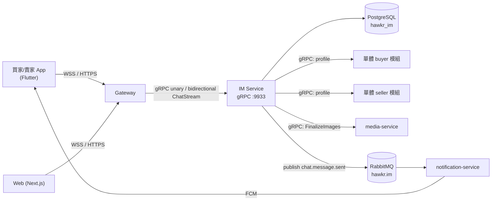
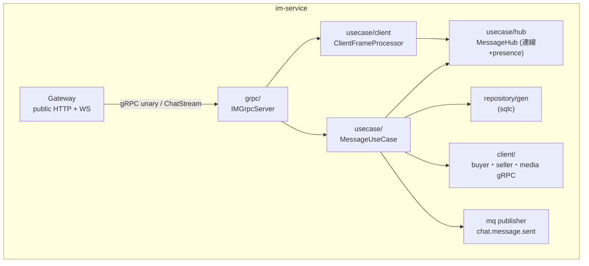
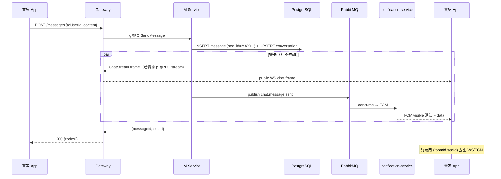
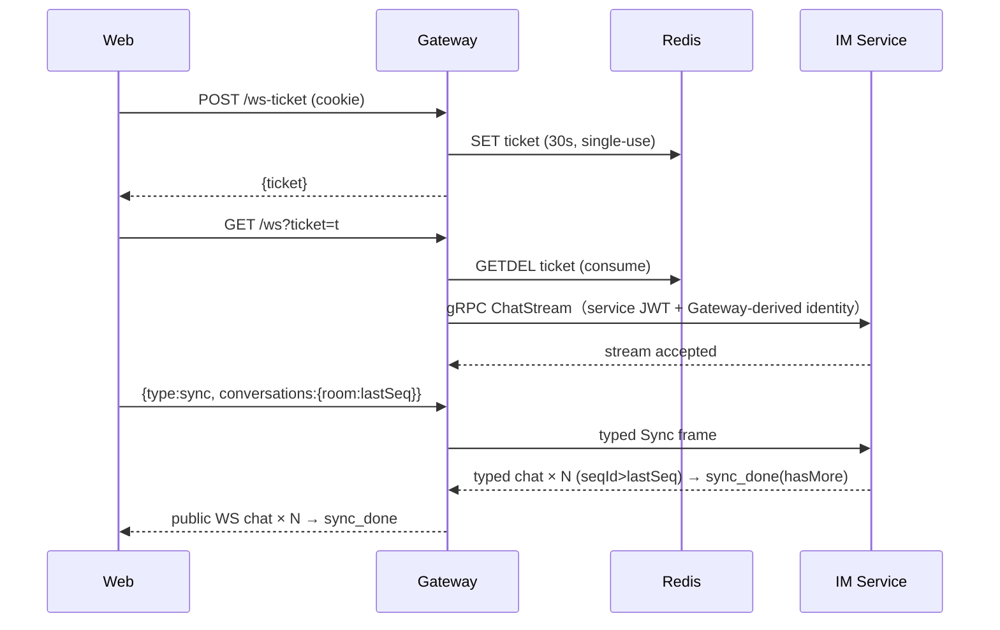

# 即時通訊微服務 (IM Service) 詳細設計書

## 0. 文件元資訊 (Metadata)

| 項目 | 值 |
|---|---|
| 維護者 | 後端 |
| 對應程式碼 | `services/im-service/internal/{usecase,grpc,repository,client}`、`gateway/internal/handler/chat.go`、`api/proto/im/im.proto` |
| 相關 doc | `01-閘道微服務（Gateway）`、`12-通知微服務（Notification Service）`、`13-通知模板引擎與收件箱`、`41-Realtime SSE 推播平台`、`36-MQ 與事件總覽` |

---

## 1. 概述與目標 (Overview & Goals)

### 1.1 文件定位
描述 IM Service 的詳細設計：Gateway-edge WebSocket 背後的 gRPC 即時串流、訊息持久化、對話列表、已讀與未讀、雙身份在線狀態（presence），以及離線推播觸發與訊息同步。目標讀者為後端與前端工程師。不涵蓋推播渲染（→ notification-service §12）與圖片儲存（→ media-service）。

### 1.2 服務一句話定位
平台買賣家 1-on-1 即時通訊的核心服務：透過 Gateway WebSocket 接入、由 IM gRPC stream 即時投遞 + PostgreSQL 持久化 + 透過 MQ 事件觸發離線 FCM。

### 1.3 設計目標 (Goals) 與 非目標 (Non-Goals)

| 類型 | 項目 |
|---|---|
| **Goal** | 前景聊天訊息端到端延遲 < 1s（WS 即時） |
| **Goal** | 訊息**零遺漏**：持久化 + seqId gap-fill + 雙送（WS + FCM）|
| **Goal** | 同帳號雙身份（buyer/seller）獨立在線狀態與未讀 |
| **Goal** | 連線成本 = 正在聊天頁面的人數（遠小於在線人數）|
| **Non-Goal** | **不**做群組聊天（僅 1-on-1 buyer↔seller） |
| **Non-Goal** | **不**做訊息端到端加密 / 編輯 / 撤回（產品未要求） |
| **Non-Goal** | **不**做跨 replica fan-out backplane（單 replica 足夠，觸發條件見 §9.2） |
| **Non-Goal** | **不**由 WS 保證離線投遞（離線靠 FCM；WS 為 best-effort） |

### 1.4 與其他設計書／服務的關係
- **即時推播分兩條線**：聊天走 Gateway public WebSocket + IM gRPC stream（本檔）；留言/通知走 Gateway SSE（§41）。為何拆——聊天需雙向 + 持久化 + 雙身份 presence，留言/通知是單向 fan-out，見 §41 §1.2。
- **離線推播**：本服務 publish `hawkr.im / chat.message.sent`，由 notification-service 模板引擎（§12/§13）消費 → FCM visible 通知 + inbox。
- **連線終止**：browser/app WS 由 Gateway（§01）終止；Gateway 負責 ws-ticket 鑄/驗、身份注入與 public WebSocket wire，並以一條 typed gRPC `ChatStream` 連到 IM。IM 不接 public HTTP/WS。

---

## 2. 範圍與情境 (Context & Scope)

### 2.1 系統情境圖 (C4 Context)



### 2.2 邊界與責任

| | 涵蓋 (In-scope) | 不涵蓋 (Out-of-scope) |
|---|---|---|
| 即時投遞 | Gateway public WS、IM gRPC stream、sync 補發、presence、未讀推送 | 推播渲染/inbox → notification-service |
| 持久化 | messages / conversations / 已讀狀態 | — |
| 圖片 | 呼叫 media FinalizeImages 轉正 | 圖片儲存/Image Gateway → media-service（詳見 49 號設計書） |
| 身份 | 信任 Gateway 注入的 userId/role | JWT/ticket 驗證 → Gateway |

### 2.3 角色與身份模型
- 同一 account 可同時是 **buyer（loginRole=1）** 與 **seller（loginRole=2）**；presence、未讀、connection 皆**按 role 區分**。
- public WS 連線綁定 `userID`（account ID, TSID），一條連線可收發該 user 所有 room 的訊息；Gateway 從 ticket/JWT 解出 `accountType`（role），再以 service JWT metadata/stream open message 傳給 IM。IM 不信任 client 直接連線的 query identity。

---

## 3. 約束與前提 (Constraints & Assumptions)

| 類型 | 項目 |
|---|---|
| 技術約束 | PK 一律 **TSID**（64-bit BIGINT）；前端可控業務 ID 一律 **string**（>2^53 JSON number 精度遺失）；REST 走統一 **Envelope**；public WS 由 Gateway 使用 `gorilla/websocket`，IM 僅使用 gRPC stream |
| 技術約束 | Go 服務 schema 走 **Atlas**（declarative，禁手寫 SQL migration） |
| 既有系統約束 | **Redis 無 HA**（ws-ticket 鑄/驗依賴它，fail-closed）；k3s + Traefik；application metrics 由 OTLP push 送往 Collector |
| **假設** | launch 並發**聊天**連線量級 < 1000（未量測）；**單 replica** 足夠 → 失真則觸發 §9.2 的擴容與 backplane 前置條件 |
| **假設** | WS 僅在聊天頁面建立；其餘場景靠 FCM（1-3s 延遲可接受） |

---

## 4. 架構 (Architecture)

### 4.1 解法總綱 (Solution Strategy)
1. **WS 終止於 Gateway，gRPC stream 連到 IM**：browser/app 無法直接承擔 internal service auth；Gateway 用 ws-ticket 鑄/驗身份後，保留 public WebSocket wire，並為每條連線建立一條帶 service JWT 的 typed bidirectional `ChatStream`。IM final 不提供 HTTP/WS listener。
2. **發訊走 Gateway HTTP→IM unary（保證持久化）、stream 只收與 sync**：App 一律 HTTP `POST /messages`；Gateway 呼叫 IM `SendMessage`；Gateway↔IM stream 用於即時接收、sync 補發、typing/presence/已讀回執。
3. **in-memory hub，每 user 多連線**：`map[userID]map[*Client]struct{}`，支援同帳號 buyer+seller 同時連線；無跨 replica backplane（擴容前置條件見 §9.2）。
4. **雙送 + 前端去重**：每則訊息同時 `hub.SendToUser`（WS best-effort）與 publish MQ event（→ FCM），前端用 `(roomId, seqId)` 去重（決策理由見 [ADR：IM 即時通訊投遞策略與連線架構](../adr/2026-09-18-im-websocket-delivery-architecture.md)）。

### 4.2 元件視圖 (C4 Component)



| 模組 | 責任 | 依賴 |
|---|---|---|
| `usecase/message.go` | SendMessage / Sync / History / 已讀 / 未讀推送 | repository, hub, client, publisher |
| `usecase/hub.go` | 連線管理（多連線）、presence、targeted send | — |
| `usecase/client.go` | transport-neutral inbound frame whitelist、sync/presence/typing/read receipt/ping policy | hub |
| `grpc/` | 對 Gateway 暴露 unary RPC 與 typed bidirectional `ChatStream`；由 shared server 提供 health/lifecycle | usecase, service auth |
| `repository/gen/` | sqlc 自動生成（**禁手改**） | PostgreSQL |
| `client/` | buyer/seller/media gRPC client（Fx DI） | — |

### 4.3 部署拓撲與 Port

| Port | 協定 | 用途 | 對外暴露 |
|---|---|---|---|
| 9933 | gRPC | Gateway unary/`ChatStream`、標準 gRPC health/reflection（依環境） | ClusterIP |

> IM 只宣告 9933 一個 port。IM application metrics 走 OTLP push，**不暴露 `/metrics`**。

### 4.4 命名／契約規約
- **room id**：`b{buyerID}_s{sellerID}`，由 `usecase.BuildRoomID` 生成、`ParseRoomID` 解析。
- **MQ**：exchange `hawkr.im`，routing key `chat.message.sent`。
- **public WS 訊息**：Gateway 對 client 維持 `type` 欄位分流（§6.4）；ID 一律 string（TSID）。Gateway 將 inbound frame 轉成 typed gRPC stream request，IM 回傳 typed frame 後由 Gateway 映射回既有 public WS JSON。

---

## 5. 資料設計 (Data Design)

- **Database**: `hawkr_im`（Atlas declarative schema）。

### 5.1 資料模型

**`conversations`（對話列表）**

| 欄位 | 型別 | 說明 |
|---|---|---|
| `id` | BIGSERIAL | PK |
| `room_id` | VARCHAR(64) | UNIQUE，`b{buyer}_s{seller}` |
| `participant_ids` | JSONB | `[1001, 2002]` |
| `last_message_id` | BIGINT | 最新訊息 ID |
| `last_message_content` | TEXT | 最新訊息預覽 |
| `updated_at` | TIMESTAMPTZ | 排序用 |
| `order_no` | VARCHAR(50) | nullable。對話關聯的訂單編號；**僅伺服器端推導寫入**（§6.5），停權賣家 gating 判準用 |
| `order_binding_verified_at` | TIMESTAMPTZ | nullable。訂單三方一致驗證通過時間（見 §6.5）；NULL = 未綁定訂單 |

**`messages`（訊息記錄）**

| 欄位 | 型別 | 說明 |
|---|---|---|
| `id` | BIGSERIAL | PK（全域遞增） |
| `room_id` | VARCHAR(64) | 關聯 conversation |
| `sender_id` / `receiver_id` | BIGINT | account ID |
| `type` | INTEGER | 1=Text, 2=Image, 3=System |
| `content` | TEXT | 內容（圖片為轉正後 objectKey；欄位名維持中性不改，值改存 objectKey，49 號設計書 §5.3） |
| `created_at` | TIMESTAMPTZ | 發送時間 |
| `is_read` | BOOLEAN | 已讀 |
| `seq_id` | BIGINT | **room 內遞增序號**，gap-fill 用 |

### 5.2 索引與查詢模式

| Index | 查詢路徑 |
|---|---|
| `idx_conversations_room_id` (UNIQUE) | 依 room 查 |
| `idx_conversations_updated_at` (DESC) | 對話列表排序 |
| `idx_messages_site_room_created` (room_id, created_at DESC) | 歷史分頁 |
| `idx_messages_receiver_id` | 未讀計數 |
| `idx_messages_room_seq` (room_id, seq_id) **UNIQUE** | gap-fill sync + 防重複 |

### 5.3 序號／排序／一致性
`seq_id` = 每 room 單調遞增序號，用於：① gap detection（前端記 `last_seq`，重連只帶此值）；② room 內排序（比 `created_at` 可靠）；③ 去重 key `(room_id, seq_id)`。

分配方式（INSERT 時 subquery）：
```sql
INSERT INTO messages (..., seq_id)
VALUES (..., (SELECT COALESCE(MAX(seq_id),0)+1 FROM messages WHERE room_id=$1))
RETURNING *;
```
UNIQUE `(room_id, seq_id)` 保證不重複；1-on-1 場景併發衝突極低（衝突則 INSERT 失敗、上層重試）。

### 5.4 Schema 演進與遷移
走 Atlas declarative（schema 檔為 source of truth，`migrate diff` 自動產 migration）。seq_id 引入見 §12.2。**向後相容**：WS/MQ wire 欄位增量用 omitempty；ID 由 number→string 的遷移須前端先容錯再後端翻。

---

## 6. API 與介面契約 (API & Interface Contracts)

### 6.1 對外 REST（經 Gateway）
前綴 `/api/v1/app/chat`。`/ws` 走 `ChatWSAuth`（`?ticket=` 優先，否則 fallback Bearer/`token`/cookie）；`/ws-ticket` 與其餘 HTTP 路由走 `JWTAuth`。回應走統一 Envelope。

> **型別合規**：前端可控業務 ID 一律 string（account_id / message_id 為 TSID > 2^53）。涉及 `POST /messages`(`toUserId`)、`GET /history/{targetId}`、`PATCH /messages`(`messageIds []string`)、`PATCH /conversations/{targetId}`。`fromUserId` 由 Gateway JWT 注入。

| 方法 | 路徑 | 說明 |
|---|---|---|
| GET | `/ws` | WebSocket 升級 |
| POST | `/ws-ticket` | 鑄 WS 連線票（短效 30s、單次；web 用） |
| POST | `/messages` | 發送訊息 |
| GET | `/history/:targetId` | 聊天歷史（cursor `beforeId`） |
| GET | `/conversations` | 對話列表 |
| GET | `/unread` | 未讀數 |
| PATCH | `/messages` | 標記特定訊息已讀 |
| PATCH | `/conversations/:targetId` | 標記對話已讀 |
| PATCH | `/conversations` | 標記全部已讀 |
| GET | `/online` | 在線用戶列表 |

`POST /messages` 回應：
```json
{ "code": 0, "data": { "messageId": "1234567890", "seqId": 42, "delivered": true, "timestamp": 1708170000 } }
```
> `delivered` 僅代表**已落庫**（非「對方已收」），前端不得據此顯示「已送達」。

### 6.2 gRPC（`im.proto`）

```protobuf
service IMService {
  rpc SendMessage(SendMessageRequest) returns (SendMessageResponse);
  rpc GetChatHistory(...) returns (...);
  rpc GetConversations(...) returns (...);
  rpc GetUnreadCount(...) returns (...);
  rpc MarkMessagesRead(...) returns (...);
  rpc MarkConversationRead(...) returns (...);
  rpc MarkAllRead(...) returns (...);
  rpc IsUserOnline(...) returns (...);
  rpc GetConnectionStats(...) returns (...);
  rpc BroadcastMessage(...) returns (...);
  rpc DisconnectUser(...) returns (...);
}
enum MessageType { MESSAGE_TYPE_UNSPECIFIED=0; MESSAGE_TYPE_TEXT=1; MESSAGE_TYPE_IMAGE=2; }
```
> proto enum 僅 TEXT/IMAGE；DB/WS 另有 `system`（type=3）由後端產生。**IMAGE 流程**：前端傳圖→media 回 `staged_token`→發訊(type=2, content=token)→im 呼叫 media `FinalizeImages(token,"CHAT_MESSAGE")`→objectKey 直接存入 `content`（不組 URL，讀取端以 `MediaUrlProperties.buildUrl(objectKey)` 即時組出，49 號設計書 §5.1／§6.1）；finalize 失敗則不落庫、回 400（§7.3）。

### 6.3 非同步事件 (MQ：`chat.message.sent`)

| 項目 | 值 |
|---|---|
| Exchange / Routing Key | `hawkr.im` / `chat.message.sent` |
| 冪等 key | `event_type` + `messageId`（notification 端） |

Payload（camelCase，ID string）:
```json
{
  "messageId": "1234567890", "conversationId": "b2694337933_s2612345678",
  "senderId": "2694337933", "senderName": "小明", "senderAvatar": "https://cdn/...",
  "receiverId": "2612345678", "receiverType": "seller",
  "contentPreview": "請問何時出貨？", "sentAt": "2026-02-17T10:00:00Z"
}
```
> `receiverType`（buyer/seller）供 notification 用 `payload_filter` 區分模板；圖片訊息 `contentPreview` 固定 `"傳送了一張圖片"`（不放 URL）。向後相容：新增欄位用 omitempty。

### 6.4 即時通道 (WebSocket 訊息目錄)

**public WS 參數**（Gateway edge）：`writeWait=10s`、`pongWait=60s`、`pingPeriod=50s`、`maxMsgSize=4096`；IM gRPC stream 不重複實作 WebSocket pump。

> **content 長度上限 4096 字元**，三層一致防護：Gateway DTO `binding:"required,max=4096"`、im usecase guard（`SendMessage` 以 rune count 擋，回 400）、DB `messages.content` CHECK `char_length(content) <= 4096`。

**Server → Client**

| type | 語意 | 關鍵欄位 |
|---|---|---|
| `chat` | 聊天訊息推送（含 sync 補發；審核隱藏 `hidden_at` 的訊息一律渲染中性 placeholder「此訊息已被移除」、不回原文，所有讀路徑皆套用） | roomId, from, to, messageId, seqId, content, timestamp |
| `sync_done` | 某 room sync 完成 | roomId, hasMore, timestamp |
| `presence` | 對方在線狀態 | to(peer), peerRole, online, lastSeenAt, timestamp |
| `unread_changed` | 未讀數變動（按 role 推給該 user 所有連線） | unreadCount(string), role |
| `pong` | app-level liveness ack（回應 client 的 `ping`，僅回該連線） | timestamp |
| `system` | 系統訊息 | type=3 |

**Client → Server（inbound 白名單）**

| type | 處理 | 備註 |
|---|---|---|
| `sync` | 回補 `seqId > lastSeq` 的訊息 → `sync_done` | 每 room 上限 100 筆 |
| `presence_sub` / `presence_unsub` | 訂閱/取消對方(role)在線狀態 | 立即回當前快照 |
| `typing` / `stop_typing` | relay 給對方（per-pair 1 事件/秒 rate-limit） | best-effort |
| `read_receipt` | relay 給對方（即時已讀指示） | 落庫已讀走 HTTP `MarkMessagesRead` |
| `ping` | 回 `pong`（僅該連線） | app-level liveness；協定層 ping/pong 見下方 Control frame |

> 🔴 **socket 是 chat 收訊專用**：**不得有** inbound `type=chat` 入口。三端 client（buyer/seller/web）一律走 HTTP `POST /messages` 發訊——WS 入口會以 client 自帶的 roomId/content 持久化並 fan-out，那是跨用戶注入面。
> 🔴 **白名單 drop**：未列於上表者（`heartbeat`、未知 frame）一律 **drop + debug log**，**禁止 `default: Broadcast`**——它會把每條連線自己的幀廣播給所有連線使用者（跨用戶外洩 ＋ 每 user O(N) 風暴）。

**Control frame**：WS-level ping/pong 只存在 Gateway public WebSocket edge；Gateway 依既有契約維持 browser liveness。Gateway↔IM 使用 gRPC stream keepalive 與 context cancellation，不再有 IM WebSocket control-frame leg（§7.5）。

### 6.5 賣家停權下的訊息綁定與 gating

停權連動的 IM 落地。裁決：**停權後賣家僅「訂單關聯」對話可用**（能力層白名單 `CAP_CHAT_SEND` 受限，見 46 號 §3.4）。IM domain 原無 order 綁定，本次以**伺服器端推導**建立綁定並在 `SendMessage` gating。整體 saga 見 32 號 §13.5、事件見 36 號 §3.6f。

#### 6.5.1 綁定寫入（僅伺服器端兩條路徑，client 無 API 可直寫 `order_no`）

1. **訂單情境發起**：前端「聯絡賣家/買家」入口只帶 `order_no` 作為**意圖參數**；im-service 收到後呼叫 order-service internal gRPC 驗證 `order.seller == 對話賣家端 AND order.buyer == 對話買家端`（三方一致）才寫入 `order_no` + `order_binding_verified_at`；不一致 → 建為無關聯對話（`order_no` 不寫）。
2. **既有對話回填**：停權賣家對「無綁定」既有對話送訊時，im-service 以 `(對話買家, 對話賣家)` 反查 order-service 新增 internal RPC **`HasOrderBetween(buyerId, sellerId)`**（回 bool + 最近 order_no），存在 → 回填綁定放行；不存在 → 擋。避免「停權前既有的正當訂單對話」因缺欄位被誤鎖。

> `HasOrderBetween` 為新 internal RPC，需同步 `api/proto` + order-service 實作（im 側新增 order-service client）；非 MQ，不涉 36 號。

#### 6.5.2 訂單狀態範圍判準（何謂「關聯」）

`HasOrderBetween` / 綁定驗證的訂單查詢判準：**`status NOT IN (0, 80)`**——排除 `PENDING_PAYMENT(0)` 與 `CANCELLED(80)`，其餘（`PAID(10)` ～ `FULLY_REFUNDED(70)`）皆算關聯。

- 排除未付款單是**跨服務不變式**：停權 saga 會批次取消該賣家全部未付款單（03 號 §5.1a.2），把它們算進關聯等於讓停權動作自己替賣家開通 IM 通道。已付款後進入退款／售後的單（60／70）仍需雙方溝通，必須算關聯。
- 判準落在 order-service query，與 OrderStatus CodeMeta 對齊（值以 CodeMeta 為權威，本文件不複製值表）。

#### 6.5.3 停權賣家 `SendMessage` 放行判準（雙端綁定）

usecase 讀 Gateway 注入的 `X-Seller-Suspended` header（來源見 §6.5.4）→ 賣家停權時：

- 對話已綁定且 `order.seller == sender AND order.buyer == 對話另一端` → **放行**。
- 未綁定 → 走 §6.5.1 路徑 2 回填；回填成功 → 放行，失敗 → **擋**（回停權業務碼）。
- **賣家無法藉掛他人單號開新對話**：綁定驗證取的是「對話雙端」而非 client 聲稱的任何 id（防「掛名下別筆買家真實單號」繞過）。

此細分在 usecase 是**刻意的單點例外**（Gateway 看不到 payload 無法判斷對話雙端）；買家發訊、非停權賣家發訊不受影響。

#### 6.5.4 停權當下強制斷線 + header 來源

- **強制斷線**：`SellerSuspendedConsumer` 消費 `seller.suspended` 當下，**必須強制斷開該賣家所有既有 WS 連線**——呼叫 `DisconnectUser` internal RPC（§6.2）。不斷線的話，既有長連線會在停權後繼續送出非訂單關聯訊息；斷線後賣家重連時 gating（§6.5.3）即對每則送訊生效。
- **`X-Seller-Suspended` header 來源**：由 Gateway 輕量 middleware `injectSellerSuspension()` 掛在 IM 送訊/ws-ticket 等買賣共用路由（這些路由**不經** `requireSeller(cap)`，故 header 注入與能力 guard 解耦），只查 Redis `seller:suspended:<accountId>` 注入 header（value=reasonCode）、**不 deny**；下游 im usecase 據此細分（見 46 號 §3.3 規則 3、§4.2）。
- **`ws-ticket` 鑄發不做停權判定**：`POST /ws-ticket` 鑄的是**連線層**票，一條 WS 連線同時服務該使用者的所有對話，票上沒有「這條連線只給某個對話用」的語意可綁。守門一律落在**訊息級**：每一則 `SendMessage` 逐則套 §6.5.3 的雙端綁定判準，加上停權當下強制斷線（上一條）。**停權賣家仍可連線、仍可收訊**（讀取不受限），但每則發訊都會被逐一判定。

---

## 7. 執行時視圖 (Runtime View)

### 7.1 主要場景
買家在聊天室發訊息給賣家：Gateway HTTP → IM unary RPC 落庫 → 雙送（IM gRPC stream + MQ event）→ Gateway 將 stream frame 寫回賣家 public WS，或由 FCM 收到，前端 `(roomId,seqId)` 去重。

### 7.2 時序圖

**發訊息端到端（雙送）**


**進聊天室：連線 + ticket + sync（web）**


### 7.3 失效與重試

| 外部呼叫 / 事件 | 失敗行為 |
|---|---|
| media `FinalizeImages` | 訊息**不落庫**，回 400（圖片 token 無效） |
| MQ publish | **best-effort**：goroutine 內 publish，失敗僅 log；不影響 response（訊息已落庫且 WS 已投遞，FCM 漏發不補） |
| `hub.SendToUser`（IM gRPC stream） | 對方無 stream/channel 滿 → return false，**靜默丟棄 + warn log**，不影響 FCM |
| buyer/seller gRPC（profile） | 逾時 → 對話列表 profile 欄位缺省，不阻斷主流程 |
| Gateway proxy 慢消費者 | write deadline(10s)逾時 → 拆連線，逼前端重連跑 sync（§7.5） |

### 7.4 並發與順序
- **Hub**：`RWMutex`；broadcast/send 先 RLock 快照 client list 再於鎖外送，避免送訊阻塞讀。
- **seqId**：per-room subquery + UNIQUE `(room_id, seq_id)`；併發兩則同 room 同 seq → 後者 INSERT 失敗、重試取新 seq。
- **Gateway WebSocket↔gRPC adapter**：每 public WS 連線恰一個 gRPC stream；browser writes 進 typed inbound stream，IM outbound frame 由單一 Gateway writer 寫回 public WS，避免 gorilla 並發寫違規。
- **發訊雙送**：WS 同步送、MQ publish 在 goroutine，互不依賴。

### 7.5 連線／狀態生命週期

**WS 連線時機（前端控制）**

| 動作 | WS 行為 |
|---|---|
| 進第一個聊天室 | 建立 WS + sync 該 room |
| 切換聊天室 | WS 不動，只 sync 新 room |
| 離開聊天頁 / App 進背景 | 關閉 WS |
| 回前景但不在聊天頁 | 不開 WS（靠 FCM） |

**Gateway WebSocket↔gRPC stream liveness（`chat.go`）**
- public browser leg 維持既有 `SetReadDeadline`/pong 與 write deadline；資料幀亦刷新。
- Gateway 對 gRPC stream 使用既有 context cancellation 與 gRPC transport keepalive；不再對 IM 建立第二條 WebSocket leg。
- 每筆 public WS write 加 `SetWriteDeadline`(10s) → 慢消費者寫逾時即拆連線（slow-consumer drop）。

**reconnect（client 契約，web/buyer/seller 一致）**
- **Full Jitter**：`delay = random(0, min(30s, 1s·2^(attempt-1)))`，ladder 1/2/4/8/16s，5 次後 held（focus/online/visibility / AppLifecycle.resumed 喚醒重置）。
- jitter 去相關化：單 replica 重啟時眾多 client 不再 lockstep 同步重連 + 鑄票風暴。

**heartbeat**
- Gateway 維持 public WS-level ping/pong。
- Gateway↔IM 使用 gRPC stream keepalive。
- app-level `heartbeat` frame **不**被 IM 處理（落在 §6.4 的 whitelist drop）。

---

## 8. 跨切面關注點 (Crosscutting Concerns)

### 8.1 安全與授權
- **ws-ticket（web）**：authed `POST /ws-ticket` 鑄**單次、30s、URL-only** ticket（Redis）；`GET /ws?ticket=` → Gateway **GETDEL 消費**並推導 identity/role（禁信任 query userId）。
- **mobile**：`Authorization: Bearer <JWT>` 或 `?token=`。
- **CSWSH**：Gateway WS upgrade 驗 `Origin`（allowlist；native app 無 Origin 放行）。
- **身份信任邊界**：Gateway 驗 ticket 後，以專用 service JWT 對 IM `ChatStream` 做 gRPC metadata 驗證，並傳遞 Gateway-derived user/role；IM 不接受可直接偽造的 query identity。IM gRPC 僅由 NetworkPolicy 放行 Gateway 與必要的 internal caller。
- **rate-limit**：`sync` frame 有 per-actor 速率上限（`im:sync:{userID}`）；typing relay 有 per-pair 1 事件／秒。**連線數本身無上限**（見 §11）。
- **賣家停權 gating**：停權賣家僅訂單關聯對話可送訊（雙端綁定判準）＋停權當下強制斷既有 WS；判準與 `X-Seller-Suspended` header 來源見 §6.5。

### 8.2 可觀測性 (Observability)
- **log**：`zap` 結構化。
- **trace**：OTLP → `otel-collector:4317`。
- **metrics**：application OTel instruments 透過 OTLP push 送至 Collector，再由集中 monitoring pipeline 提供 Prometheus 查詢；IM 不暴露 `/metrics`，也不以 NodePort 作 metrics scrape。
- **trace**：既有 trace OTLP pipeline 維持；Gateway public WS span 與 IM ChatStream span 透過 context/metadata 關聯。

### 8.3 錯誤處理與降級 (Failure Modes & Degradation)

| 依賴掛掉 | 行為 |
|---|---|
| PostgreSQL | 發訊失敗（訊息不落庫，回錯）——硬依賴，不降級 |
| RabbitMQ | best-effort：WS 仍即時送達，FCM 該則漏發（可接受；不補發） |
| Redis | **ws-ticket fail-closed → web 全聊天連不上**（已知 SPOF，見 §11） |
| buyer/seller gRPC | 對話列表 profile 缺省，主流程不阻斷；**關店守門明示 fail-open**（下方） |
| 單 im replica 重啟 | Gateway↔IM streams 全斷 → public WS 依既有 close/reconnect 契約重建 stream + client Full Jitter 重連 + sync 補發 |

#### 8.3.1 profile 查詢失敗是「不知道」，不是「查無此人」

`BuyerClient` / `SellerClient` 的 `GetProfileBatch` 回傳 `(map, error)`，**兩者獨立**：
map 可能已含快取命中的項目，同時 `error != nil` 代表未命中的那批沒查成。呼叫端
必須自己決定降級行為，不得忽略 `error`。

map 與 error 必須分開判讀：兩者的**處置相同、意義不同**，混為一談會把基礎設施故障
靜默轉成業務結論。四個消費點的失敗處置如下：

| 消費點 | 查詢失敗時 |
|---|---|
| 關店守門（`SendMessage`） | **放行送出**（fail-open，記 Warn） |
| 送出者顯示名（推播） | 空字串，記 Warn |
| 對話列表批次補值 | 該批缺省，記 Warn（含 requested／resolved 兩個數） |
| 參與者資訊 | 空字串，記 Warn |

⚠️ **關店守門的 fail-open 是刻意的，不是把錯誤吞掉的副作用**——fail-closed 會讓
單體 seller 模組一抖動就全站 IM 送不出訊息。有回歸測試釘住這個方向，改成 fail-closed 會轉紅。

### 8.4 一致性與冪等
- 投遞語意：WS **at-most-once**（best-effort）；DB 持久化 + seqId 補發保證最終不遺漏。
- 去重：前端 `(roomId, seqId)`；MQ/FCM 冪等 `event_type + messageId`；DB `(room_id, seq_id)` UNIQUE。
- 圖片欄位以 objectKey 為唯一真實來源（49 號設計書）：`messages.content`（type=2）存 objectKey，欄位名維持中性不改。

### 8.5 設定與機密
env var 見 §12.1。secret（DB/Redis/RabbitMQ）由 k8s secret 注入；per-env 差異走 helm overlays。

---

## 9. 品質需求與 NFR (Quality Requirements / SLO)

### 9.1 SLO / SLI

| 指標 (SLI) | 目標 (SLO) | 量測點 | 現況 |
|---|---|---|---|
| 前景訊息投遞延遲 P95 | < 1s | client 收訊 − sentAt | 未量測 |
| 訊息持久化成功率 | 100% | INSERT 成功率 | — |
| public WS / IM stream 建立成功率 | > 99% | Gateway public WS 與 IM ChatStream 建立/嘗試 | 未量測 |
| ws-ticket 鑄/驗可用性 | 跟隨 Redis 可用性 | — | **SPOF（見 §11）** |

### 9.2 容量與規模 (Capacity & Scaling)
- 連線數 ≈ 正在聊天頁面的人數（遠小於在線數）；in-memory hub 上限受單 process 記憶體與 FD 限制。
- **單 replica**：跨 replica 無 fan-out——SendToUser 只達本地連線。
- **scaling 觸發**：當並發聊天連線逼近單 replica 承載、或需開**第 2 replica** → 必須先做 **Redis pub/sub backplane + presence-in-Redis + sticky/一致性 LB**。在此之前**禁**開第 2 replica（會靜默漏訊息）。

### 9.3 效能預算
發訊熱路徑：INSERT + UPSERT + gRPC stream 送 < ~50ms（DB 本地）；MQ publish 非阻塞（goroutine）。stream 推送 fan-out 在鎖外快照後送，單則 O(連線數)。

---

## 10. 設計決策

設計理由、考慮過的替代方案與否決理由見
[ADR：IM 即時通訊投遞策略與連線架構](../adr/2026-09-18-im-websocket-delivery-architecture.md)。

---

## 11. 已知限制

以下是**現行架構已接受的代價**，不是待辦事項。動到相關路徑時要知道它們存在：

| 限制 | 影響 | 現行處置 |
|---|---|---|
| Redis 無 HA，而 ws-ticket 鑄／驗 fail-closed | Redis 抖動 → web 端全部連不上聊天 | 無降級路徑；native App 走 JWT 不受影響 |
| 無連線數上限（`sync` frame 與 typing 各有速率上限，連線本身沒有） | WS 連線數 DoS 面 | 單 replica 的承載上限即天花板；逼近時走 §9.2 的擴容前置條件 |
| 無 app-level 雙向 heartbeat | 半開連線偵測不到，要等 WS-level ping/pong 逾時 | Gateway public WS ping/pong ＋ client 端 Full Jitter 重連（§7.5） |
| buyer／seller 兩份 Dart chat client 各自維護 | 任一端改行為就分岔，同一個 bug 要修兩次 | 改動 client 行為時**兩端一起改**，並確認 frame 白名單語意一致 |
| Gateway↔IM stream 無真 graceful drain | 部署／重啟時長連線中斷 | IM 先撤 named readiness，再 bounded gRPC graceful drain；client 依重連與 `sync` 補發 |

> Gateway→IM 的 identity 偽造面已由專用 ChatStream service JWT（issuer／audience／purpose）
> ＋ gRPC metadata interceptor ＋ NetworkPolicy 收斂，見 §8.1。

---

## 12. 部署與維運 (Deployment & Operations)

### 12.1 環境與設定

| 變數 | 說明 | 預設 |
|---|---|---|
| `GRPC_PORT` | IM business RPC、ChatStream、aggregate/named health | 9933 |
| `DB_HOST/PORT/USER/PASSWORD` | PostgreSQL | — |
| `REDIS_HOST/PORT` | ws-ticket（經 Gateway） | — |
| `RABBITMQ_URL` | publish `hawkr.im` | — |
| `BUYER_SERVICE_ADDR` / `SELLER_SERVICE_ADDR` / `MEDIA_SERVICE_ADDR` | 下游 gRPC | — |
| `OTEL_EXPORTER_OTLP_ENDPOINT` | trace | `otel-collector:4317` |

> IM 對 notification 一律走 MQ publish，**不得**直連 notification gRPC。
> Gateway 端只設定 `IM_SERVICE_HOST` 與 `IM_SERVICE_GRPC_PORT`。

### 12.2 遷移步驟
schema 變更走 Atlas declarative（改 `db/schema/schema.sql` → `migrate diff`），由 deploy-k8s CI 自動 apply。
`messages.seq_id` 有唯一索引 `idx_messages_room_seq (room_id, seq_id)`；新訊息的 seq 由 subquery `MAX+1` 分配。

### 12.3 健康檢查與優雅關閉
- Kubernetes startup/liveness 查 aggregate gRPC health service `""`；readiness 查 generated `IMService_ServiceDesc.ServiceName`。
- gRPC bind 成功後 aggregate 才 `SERVING`；IM readiness hook 完成後 named service 才 `SERVING`；shutdown 先撤 readiness，再 bounded `GracefulStop()`，逾時才 force stop。
- IM 不提供 service-local `/health`、`/metrics` 或 pprof HTTP listener；Gateway public WebSocket 的 browser close/reconnect 由 Gateway 與 client 契約處理。

### 12.4 Runbook
故障處理 SOP 連結 `runbooks/`（ws-ticket/Redis 不可用、im pod 重啟連線風暴）。

---

## 13. 測試策略 (Test Strategy)

| 層級 | 覆蓋 | 關鍵場景 |
|---|---|---|
| unit | usecase | seqId 分配、ParseRoomID/BuildRoomID、SendMessageByUsers room 解析、transport-neutral whitelist 分流 |
| integration | repo + DB（testcontainers，self-hosted CI 有 Docker） | INSERT/UPSERT、ListAfterSeq gap-fill、未讀計數 |
| integration | gRPC server lifecycle | FX graph、named/aggregate health、occupied-port bind failure、shutdown port release、ChatStream auth |
| e2e | 端到端 | 發訊息（Gateway HTTP `POST /messages`）→ IM gRPC stream → Gateway public WS 收到 `chat`；斷線重連 → sync 補齊 |

> integration 走 build-tag + `make test-integration`（本機起容器易崩，驗證走 CI）。

---

## 14. 術語表 (Glossary)

| 術語 | 定義 |
|---|---|
| room id | 一對買賣家對話唯一鍵，`b{buyerID}_s{sellerID}` |
| seqId | room 內單調遞增序號，gap-fill / 去重 / 排序 |
| ws-ticket | 短效(30s)單次 WS 連線票，web 用（cookie 不過跨站 WS handshake） |
| presence | 雙身份（buyer/seller）在線狀態，訂閱制推送 |
| 雙送 | 同則訊息同時走 IM gRPC stream（再由 Gateway 寫 public WS）+ FCM，前端 `(roomId,seqId)` 去重 |
| loginRole | 1=buyer / 2=seller，同帳號雙身份 |

---
