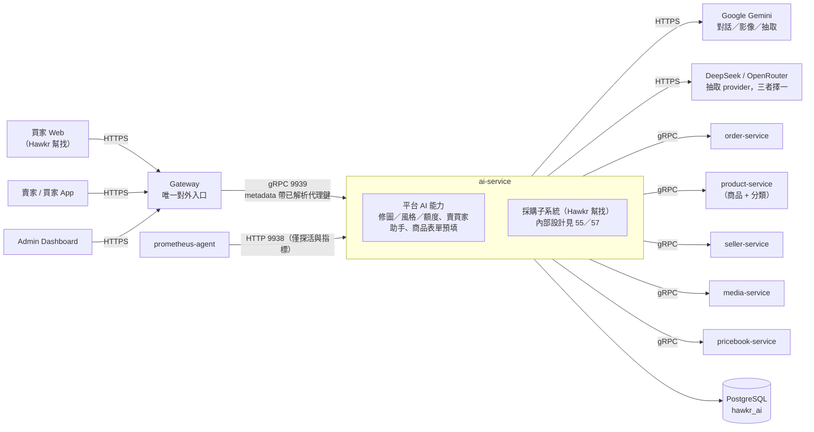
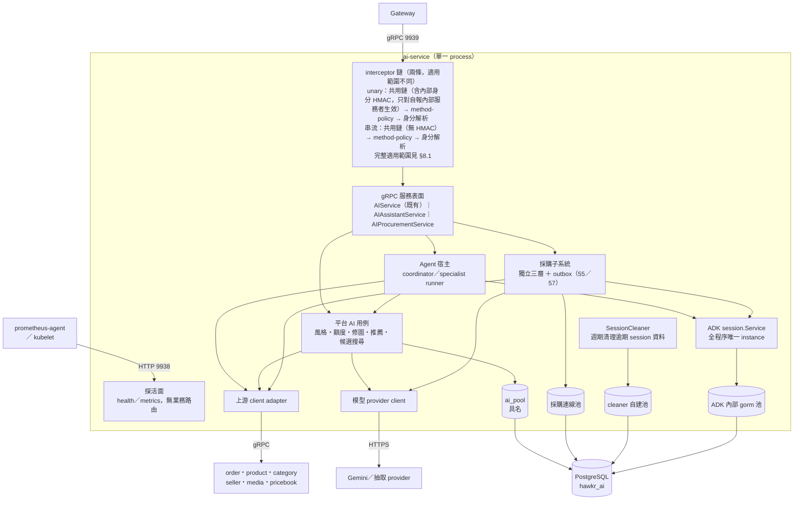
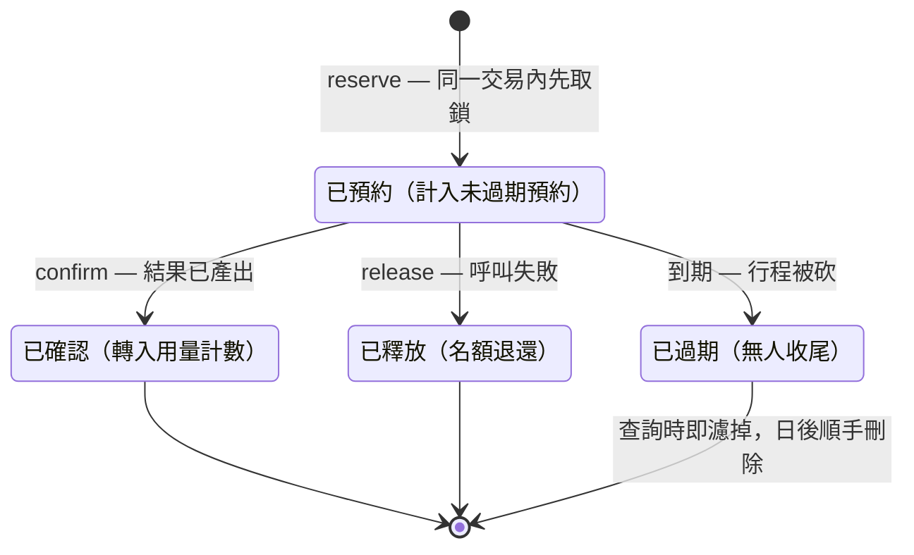
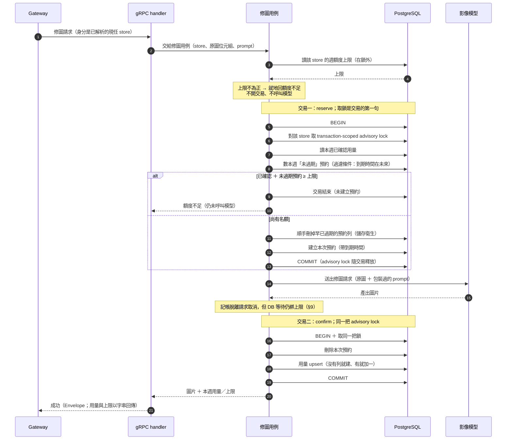
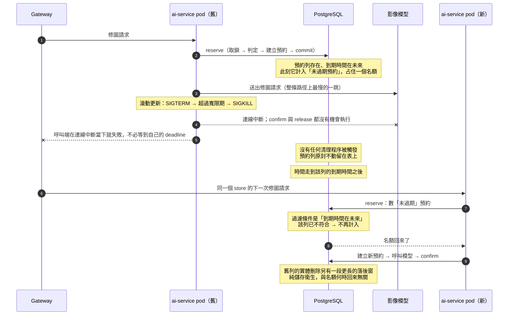
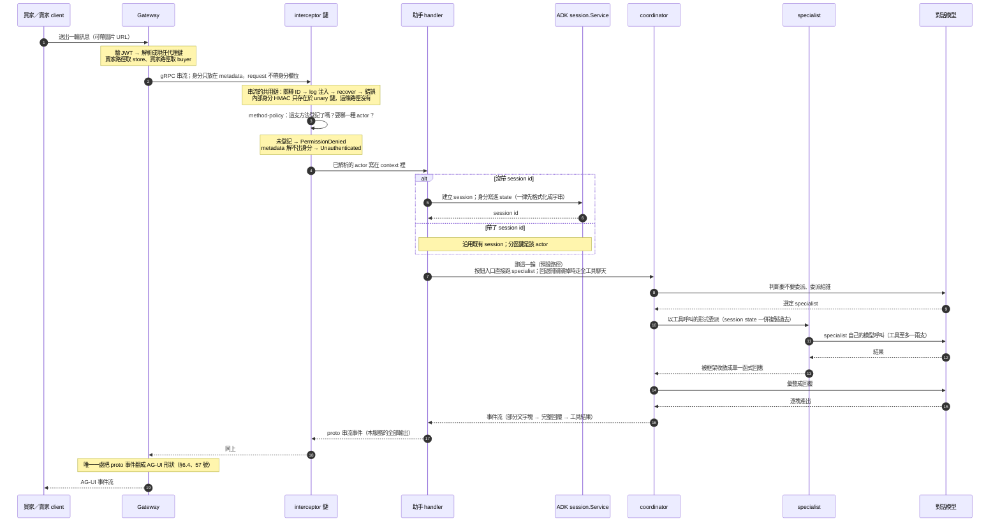

# AI 微服務（AI Service）詳細設計書

## 0. 文件元資訊 (Metadata)

| 項目 | 值 |
|---|---|
| 狀態 | `active` |
| 維護者 | 後端團隊 |
| 對應程式碼 | `services/ai-service/`、`gateway/` 的 AI handler 與 AI gRPC client、`api/proto/ai/ai.proto` |
| 相關 doc | [55 Hawkr 幫找採購助手](55-Hawkr%20幫找採購助手%EF%BC%88Procurement%20Assistant%EF%BC%89詳細設計書.md)（本服務承載的採購子系統）、[57 Hawkr 幫找 Agent Runtime](57-Hawkr%20幫找%20Agent%20Runtime%EF%BC%88Agent%20Runtime%EF%BC%89詳細設計書.md)（agent runtime 的 canonical 規範）、[44 帳號與賣家買家身份模型](44-帳號與賣家買家身份模型%EF%BC%88Account%20&%20Seller-Buyer%20Identity%EF%BC%89詳細設計書.md)（身分語意來源）、[52 微服務間內部授權](52-微服務間內部授權%EF%BC%88Internal%20Service%20Authorization%EF%BC%89詳細設計書.md)（服務間身分）、[46 賣家能力權限層](46-賣家能力權限層%EF%BC%88Seller%20Capability%20Authorization%EF%BC%89詳細設計書.md)（賣家 AI 助手的能力閘）、[49 多媒體儲存與圖片服務](49-多媒體儲存與圖片服務%EF%BC%88Cloudflare%20R2%20&%20Image%20Gateway%EF%BC%89詳細設計書.md)（風格縮圖的 objectKey 語意）、[02 產品微服務](02-產品微服務%EF%BC%88Product%20Service%EF%BC%89詳細設計書.md)（商品與分類來源） |

---

## 1. 概述與目標 (Overview & Goals)

### 1.1 文件定位

本文件描述 **ai-service 這個宿主服務本身**：它承載哪些 AI 能力、程序內的拓撲怎麼組、身分與授權怎麼進來、資料與額度怎麼治理。目標讀者是後端、Gateway 與 SRE。選型理由與被否決的方案見 [ADR：ai-service 架構決策集](../adr/2026-09-18-ai-service-architecture-decisions.md)。

**不涵蓋**：

- 採購助手（Hawkr 幫找）的產品與 domain 設計——需求釐清 slot engine、不可變 revision 與失效重算、候選 lane 與配對事實、擁有權判準 → 見 55 號。
- Agent runtime 的 wire 契約與帳本——AG-UI envelope 與三層分離、run／command／event／artifact ledger、冪等鍵與 CAS、executor 與 lease、前端 adapter → 見 57 號。
- 身分本身怎麼產生——account／buyer／seller 的資料模型、軟刪除與 incarnation、grandfather 回填、`account_type` bitmask → 見 44 號。
- 賣家能力權限層 → 見 46 號；服務間身分（HMAC）與 NetworkPolicy → 見 52 號。

**效力聲明**：`docs/開發規範/*`、`api/proto/`、CodeMeta、MQ catalog、DB schema **效力高於本文件**。本文件不重述其內容，只引用（與 57 號 §0.2 同一條紀律）。凡本文件與這些來源牴觸，以來源為準並回報本文件失真。

### 1.2 服務一句話定位

平台唯一的 AI 執行宿主：把賣家與買家的自然語言請求、影像請求與結構化抽取請求收斂到同一個 process 執行，對 Gateway 只曝露一個 gRPC 表面；它同時是「Hawkr 幫找」採購子系統的**宿主**，但不是它的**擁有者**。

### 1.3 設計目標 (Goals) 與 非目標 (Non-Goals)

| 類型 | 項目 |
|---|---|
| **Goal** | 服務端**永不接受 client 自報身分**：身分只能是 Gateway 斷言後注入的代理鍵，且在 handler 執行前就已解析完成 |
| **Goal** | 授權 **fail-closed**：新 gRPC 表面上未登記的方法一律拒絕，「免身分」也必須是被明確登記的狀態，而不是漏登記 |
| **Goal** | 額度記帳在 process 被 SIGKILL（rolling deploy）時**不洩漏、也不需要清理 job**：靠 reservation 的 TTL 自動失效，不靠補償任務 |
| **Goal** | 「決定放行」的路徑一律 fail-closed，「只做顯示」的路徑維持寬鬆——同一份資料兩種嚴格度，這是設計而非不一致 |
| **Goal** | 採購子系統保有「整包抽離成獨立服務」的退路：獨立 package、獨立 schema 檔、獨立 sqlc entry、獨立連線池，與既有 AI 表**零外鍵** |
| **Non-Goal** | **不**做採購助手的產品邏輯與 domain 規則——本服務是宿主，產品行為歸 55 號、runtime 契約歸 57 號 |
| **Non-Goal** | **不**自行解析登入 `account_id`。解析在 Gateway 完成，服務端只收已解析的代理鍵；原先由本服務 callback seller-service／buyer-service 自解的做法已整包刪除，不再恢復 |
| **Non-Goal** | **不**替換 ADK 的 session service。第三方套件的建構簽名只接受 `gorm.Dialector`，四張 session 表的讀寫全在套件內部；自製 pgx 版是獨立專案量級，「移除 gorm」不是可達終點 |
| **Non-Goal** | **不**對外提供業務 HTTP 端點。HTTP port 只剩 `/health` 與 `/metrics`，且**刻意不留 HTTP fallback**——留了會讓 gRPC 的問題被舊路徑掩蓋 |
| **Non-Goal** | **不**建 retry scheduler 或 DLQ 來處理 provider 失敗。**provider 呼叫**一律只做最多一次的同步重試，**但「重試哪一類失敗」逐個外部呼叫各自決定，不是同一組條件套在兩處**——影像模型只重試模型的非決定性拒絕，抽取 provider 只重試基礎設施性失敗，兩者條件恰好相反（逐條見 §7.3）。共同的判準只有一句：重送不會變好的失敗一律不重試。範圍限定在 provider 呼叫：分類索引的啟動 warm-up 是**登記過的例外**，它會重試數次（§7.3、§9.3） |
| **Non-Goal** | ~~不把既有 `AIService` 納入 method-policy 管轄~~（#3519 已改變：見下）。現況：`AIService` 已依授權軸拆成 `AIImageService`／`AIAdminService`／`RecommendationService`，三者與既有的 `AIAssistantService`／`AIProcurementService` 一併納入單表 default-deny，未登記方法一律 `PermissionDenied`。本服務不再有任何表面在 method-policy 管轄之外 |

> **Non-Goal 是最防漂移的一段**：上表每一條都對應一次真實的取捨，不是「還沒做」。要改動任一條，先改這裡再改 code。

### 1.4 與其他設計書／服務的關係

| 對象 | 關係 | 分界 |
|---|---|---|
| **55 號 Hawkr 幫找採購助手** | **本服務承載此模組**。55 號開頭即自述「寄生於 ai-service」；本文件在此回指，補上原本缺的反向引用 | 本文件只宣告宿主關係與抽離退路（獨立 package／schema 檔／sqlc entry／連線池、與既有 AI 表無外鍵）；產品與 domain 設計全部在 55 號 |
| **57 號 Hawkr 幫找 Agent Runtime** | 57 號是 agent runtime 的 **canonical 規範**，兩者互補不重疊 | 本文件只寫一條責任分界：**ai-service 端只產生 proto 的 `StreamEvent` oneof，AG-UI 的形狀由 Gateway 唯一一處翻譯**。wire 契約、ledger、replay、配額、executor 全部在 57 號 |
| **44 號 帳號與賣家買家身份模型** | 身分語意的上游 | 本文件只寫「收到的是已解析的現任代理鍵」以及由此衍生的本域決策（§2.3）；身分怎麼產生、怎麼分岔在 44 號 |
| **46 號 賣家能力權限層** | 賣家 AI 助手的能力閘 | 賣家 AI 助手整組掛 `CAP_MARKETING`（**唯讀也鎖**）；能力層本身的定義在 46 號與 `docs/開發規範/賣家能力權限層規範.md` |
| **52 號 微服務間內部授權** | 授權的第一層 | 「呼叫方是不是內部服務」由標準 interceptor 鏈的 HMAC 驗證負責，本服務不自行實作；本服務只做第二層「這個 actor 能不能打這支方法」 |
| **49 號 多媒體儲存與圖片服務** | 圖片位址的上游 | **objectKey 是圖片位址的唯一真實來源**。本文件只記錄「風格縮圖為何存 objectKey 而非完整 URL」這條不變式（`ai_styles.thumbnail_key`），以及本服務對 media-service 的兩種呼叫嚴格度（建立／更新風格時的縮圖 finalize 為 fail-closed，引用釋放為 best-effort，兩者不可混用）；組 URL 的機制與 R2 儲存設計見 49 號 |
| **02 號 產品微服務** | 商品與分類的上游 | 平台候選與商品擁有權判準都向 product-service 即時查詢；本文件只記錄「為什麼必須走含權限、不走快取的那支查詢」 |
| **Gateway** | **唯一的業務入口** | Gateway 負責 JWT 驗證、`account_id` → 代理鍵解析、AG-UI 形狀翻譯；本服務不重複這三件事 |

---

## 2. 範圍與情境 (Context & Scope)

### 2.1 系統情境圖 (C4 Context)

三件從圖上讀不出、但決定了這張圖形狀的事：

1. **HTTP port 上沒有任何業務路由**。9938 只剩探活與指標，NetworkPolicy 也已收斂到只允許 prometheus-agent 與 node／VPC 觸達；gRPC 9939 維持 pod 白名單，只放行 Gateway。
2. **抽取 provider 是三選一，且只建構被選中的那一個**——未被選中的 provider 連 API key 都不需要設定；key 沒設時在 application 層 fail fast，不靠 k8s 把 secret 宣告成必需。
3. **圖上沒有 MQ 節點，是刻意的現況而不是漏畫。** 本服務不發佈也不消費任何事件：採購子系統有 outbox 表、worker 與 lease 認領，但外送函式本身是刻意留白的整合點（§6.3、§10 D15）。這張圖描述的是今天實際存在的資料流——畫一條尚未接通的邊，讀者會拿它當現況索引。

### 2.2 邊界與責任

| 領域 | 涵蓋 (In-scope，本文件正文) | 不涵蓋 (Out-of-scope，由誰負責) |
|---|---|---|
| 服務組合根與程序內拓撲 | fx 組合根的分層；同一個 `hawkr_ai` 上四個連線來源並存的理由，以及其中**哪些是有理由的分離、哪一個只是保留下來的形狀**（§4.2）；port 與 NetworkPolicy 的形狀 | 逐行的 fx 組裝與模組清單 → code |
| ADK 宿主層 | `session.Service` 的唯一 provider；四張 session 表由 ADK 擁有 model、我方 Atlas 管 schema 的分工；24h TTL 與 SessionCleaner；**採購與賣買家助手共用同一個 `session.Service` instance**（不得各自重新 provide）；gorm 為何永久留在 `go.mod` | ADK 套件內部行為（第三方，我方不可控） |
| 平台級 AI 表與其不變式 | `ai_usage`／`ai_quotas`／`ai_usage_reservations` 的 store-stint 綁定；`ai_styles` 的平台級單一來源性質（Admin CRUD，全站共用，**無 store 維度**）；`ai_styles.thumbnail_key` 存 objectKey、禁存完整 URL 的不變式；reserve／confirm／release + advisory lock 的額度模型；`candidate_leads` 的離線匯入性質 | 表結構本身 → `db/schema/schema.sql`（Atlas declarative，SSOT）；objectKey → URL 的組法與儲存設計 → 49 號 |
| 資料存取治理 | 兩個 sqlc entry 的切分理由；jsonb `go_type` override 的強制性；不手寫 migration；`sqlc-generated-diff` gate；整合測試 harness 的 per-package template DB | DB 規範本身 → `docs/開發規範/*` |
| 賣家／買家 AI 助手 | coordinator／specialist 委派拓撲；ADK session 的分區與生命週期；串流的 per-turn deadline；哪些路徑刻意維持確定性 | — |
| 商品表單預填 | 為何用 in-memory session（stateless、不產生要被清的資料） | 抽取結果的欄位語意 → `api/proto/ai/ai.proto` |
| **採購助手的產品與 domain** | 只宣告宿主關係與抽離退路 | **55 號**：slot engine、revision／branch／失效重算、候選 lane 與配對事實、擁有權判定、MVP-A 的 Goals／Non-Goals 與其 ADR |
| **Agent runtime** | 只宣告「ai-service 端只產生 proto `StreamEvent` oneof，AG-UI 形狀由 Gateway 唯一一處翻譯」 | **57 號**：AG-UI wire 契約、run／command／event／artifact ledger、冪等與 CAS、lane 狀態、Agent 回答配額、executor／lease／fencing、前端 adapter |
| 身分 | 只收已解析代理鍵之後衍生的本域決策：額度 re-key、session 分區、型別化、metadata 傳遞（§2.3） | **44 號**：身分怎麼產生、怎麼分岔、grandfather 回填 |
| 授權 | method-policy registry（第二層：這個 actor 能不能打這支方法） | **52 號**：服務間 HMAC 身分與 NetworkPolicy；**46 號**＋`docs/開發規範/賣家能力權限層規範.md`：賣家能力閘 |
| 契約 | 只寫契約的**形狀理由**與相容策略 | `api/proto/ai/ai.proto`（gRPC 第一權威）、CodeMeta（業務碼）、MQ catalog（事件） |

### 2.3 角色與身份模型

本服務的身分模型只有一條主規則：**ai-service 只收已解析的業務代理鍵，不收登入身份，也不自行解析。**

#### 三個值的分層

| 值 | 語意 | 誰解析 | 在本服務的用途 |
|---|---|---|---|
| `account_id` | 登入 principal（唯一的「人」） | Gateway 從 JWT 驗出 | **不進入本服務的業務路徑**（登記過的反例見下方「明示例外」）；不是任何業務表的 key |
| `store_id` | 賣家**現任** stint 的業務代理鍵 | Gateway | 賣家 actor；額度上限與用量計數的鍵；ADK session 的分區鍵 |
| `buyer_id` | 買家**現任** stint 的業務代理鍵 | Gateway | 買家 actor；採購需求的擁有者；買家命令冪等鍵的一部分 |

三者在多數帳號上**目前相等**（grandfather 狀態），只在帳號軟刪重申請、店鋪關閉重開之後分岔。細部的身分資料模型、分岔條件與回填策略見 **44 號**，本文件不重述。

這條分層不是本服務的偏好，而是被平台外的約束逼出來的：PayUni 代理商 MerID 為一次性綁定，「賣家刪店重開必須拿到全新賣家身分」因此不可談判（見 44 號）。ai-service 只是把這個結論一路貫徹到額度與對話分區——**新店＝新額度、新對話空間**。

後者是**被接受的產品行為**，不只是技術後果：賣家刪店重開之後看不到前一段 stint 的助理對話歷史，與「新店＝新額度」用同一句話解釋。裁決與被否決的兩個替代方案見 ADR `docs/adr/2026-09-20-seller-stint-assistant-history.md`。

#### 身分怎麼進來

- **傳遞方式**：新的 gRPC 表面（`AIAssistantService`／`AIProcurementService`）的 request message **完全不帶身分欄位**；身分只從 gRPC metadata 的 `x-store-id`／`x-buyer-id` 取（metadata key 一律小寫，與 HTTP header 語意對稱但不是同一張表），由 interceptor 在 handler 執行前解析並寫入 context。結構上不存在可被偽造的身分輸入。
- **不再有兩個世代並存**（#3519 前的現況）：`AIService` 拆分後，`TransformImageRequest.store_id`／`ListAiStylesRequest.store_id` 已改為 `reserved`，店身分改從 `x-store-id` metadata 取，與新表面規則一致。⚠️ **明示例外**：`AIAdminService` 額度三支（`GetAiQuota`／`UpdateAiQuota`／`DeleteAiQuota`）仍以 `store_id` 為路徑參數——這不是身分自報，是管理者指定操作目標，授權來源仍是 metadata 的 `x-account-type`（`ActorAdmin`），不要誤讀成漏洞。
- **規範落差（誠實揭露）**：`docs/開發規範/API 設計規範.md` §6.2 目前只列出四個 Gateway → gRPC metadata 項目，`x-store-id`／`x-buyer-id` 是該規範之外的擴充，規範文本至今未收錄。

#### 四種 actor 與 fail-closed

| Actor | 對應身分 | 說明 |
|---|---|---|
| 賣家 | `store_id` | 賣家 AI 助手、修圖與額度相關路徑 |
| 買家 | `buyer_id` | 買家 AI 助手、採購助手 |
| 管理者 | — | 判準是 metadata 的 `x-account-type == 4`（`actor.ResolveAdminGRPCMetadata`）；沒有對應的身分鍵，不寫入 `Actor`——admin 操作沒有對應的 ADK session 分區 |
| 無身分 | — | **必須被明確登記**，不是「不受管轄」；目前全系列 unary／async-poll RPC 中有四支，分兩種不同的授權模型，見下方說明 |

- **無身分不是單一語意，是兩種刻意不同的授權模型，不要用其中一種去理解另一種**：
  1. **request message 自帶一次性憑證**：`AIProcurementService` 的 `GetRfqPublicationInviteSellerView`／`GetVendorPortalResponseDraft`／`UpsertVendorPortalResponseDraft`——授權來源是 message 裡的 invite／recipient id，那個 id 本身就是身分證明，不是「隨便誰都能打」。
  2. **真匿名，不帶任何憑證**：`RecommendationService/PersonalizedRecommend`——沒有一次性 token，也沒有其他自報身分，對所有呼叫者一視同仁地開放。
  新增 `ActorNone` 方法前先判斷落在哪一種，套錯語意會誤判它的可攻擊面。
- 落在管轄範圍內、卻**未登記**的方法一律 `PermissionDenied`；**身分解析失敗**回 `Unauthenticated`。兩者刻意分開——on-call 才分得出是 client 沒帶 header，還是新方法忘了註冊。管理者的判準不是「解析」metadata 裡的一個代理鍵，而是直接讀值比對：完全沒帶 `x-account-type` 回 `Unauthenticated`（跟賣家／買家分支的「身分本身有問題」同類），帶了但值不是 `4` 回 `PermissionDenied`。
- 管轄範圍是**整個 server**（#3519 之前靠一張服務前綴白名單界定管轄範圍的兩層設計已刪除，見 ADR D7）：`methodPolicies` 單表登記全部方法，唯二豁免是 gRPC 內建的 health 與 reflection。gRPC 的 chained interceptor 本來就是 server-wide，沒有 per-service 範圍機制；single-table default-deny 之下，這件事不再是問題——沒登記就是拒絕，方向只有一個。
- **fail-loud**：任何解析失敗都不得退回輸入值當代理鍵，也不得吞成預設值。把 raw `account_id` 當成 `store_id` 送給下游不會噴錯，只會查到零筆，與「這個賣家真的沒有資料」完全無法區分。

#### 三條由此衍生的本域不變式

1. **型別化**：`AccountID`／`BuyerID`／`StoreID` 是三個互不可賦值的具名型別，拿錯 id 去查是編譯錯誤。非身分的資源 ID（請求 ID、reservation ID）**刻意維持裸 `int64`**——型別化的價值在於區分，不在於統一，讓資源 ID 也型別化只會稀釋「這是身分」這個訊號。
2. **字串化那一跳**：型別鏈上唯一守不住的是 ADK session state——它是 `map[string]any`，序列化進 JSONB、讀回時 JSON 數字一律變 `float64`（精確整數上限 2^53），而本系統的代理鍵是 19 位 TSID。因此寫入前一律格式化成十進位字串、讀取端再還原；讀寫兩端共用同一組 key 常數，並由一支重放該 JSON round-trip 的回歸測試守住。
3. **不揭露存在性**：跨買家／跨賣家存取一律回 404，不回 403——403 等於送出一個可以逐一試探的資源存在性 oracle。同理，LLM 回覆不得洩漏 `store_id`／`buyer_id`／`account_id` 等內部 ID；退款、賠償與食安問題強制導向真人客服。

#### 明示例外

上面兩條規則各有一個例外。**例外必須登記在這裡**——把反例登記起來，規則才維持絕對；靠放寬規則來容納反例，這一節就沒有價值了。

1. **Agent 回答配額以 `account` 為軸**，是「業務表不以 `account_id` 為鍵」的例外。定義與實作歸 **57 號**，本文件不重述，只在此標明它是例外而非漂移。
2. **商品推薦路徑上的賣家中繼資料帶有 `account_id`**，是「`account_id` 不進入本服務的業務路徑」的例外。seller-service 在批次查賣家中繼資料時回的是賣家的**登入身分**，該欄位因此刻意保留 `AccountID` 型別、不跟著同一個 map 的 key（store 代理鍵）改成 `StoreID`——型別化的價值在於區分，不在於統一。它是**展示用的資料，不是身分判定的輸入**：推薦結果的擁有權與可見性一律由 `store_id` 決定（推薦 DTO 只取賣家名稱與 logo）。

---

## 3. 約束與前提 (Constraints & Assumptions)

本章只收「不是本服務能選的事」——第三方套件簽名、平台行為、既有基建與 repo 規範強加的限制，以及設計所**依賴的假設**（假設一旦失真，設計就要重估）。本服務自己做的取捨不在這裡，在 §10。

### 3.1 約束 (Constraints)

| 類型 | 約束（施加者） | 對本設計的後果 |
|---|---|---|
| 技術約束 （第三方套件） | ADK（`google.golang.org/adk/v2`）的 session service 建構簽名只接受 `gorm.Dialector`；四張 session 表的讀寫（含 state 的 JSONB 序列化）全在套件內部 | `gorm.io/driver/postgres`（direct）與 `gorm.io/gorm`（indirect）**永久留在 `go.mod`**；本服務因此是 monorepo 內唯一同時載入 gorm 與 pgx 兩套 driver 的 Go service。可達的終點是「gorm 的唯一合法用途收斂成 ADK session service 的那一個 provider」，**不是移除**——要移除必須自製 pgx 版 `session.Service`，屬另立專案的量級（§1.3 Non-Goal） |
| 技術約束 （第三方套件） | 四張 session 表的 model 由 ADK 擁有，schema 卻由我方 Atlas 管理 | 升版是雙邊動作：ADK 改 model，我方必須手動追上對應 DDL 才不會炸（v2 曾一次為事件表加五欄）。schema 檔開頭必須註明這四張表對應 ADK 的 model，否則後人會當成我方自訂表而擅改 |
| 技術約束 （第三方套件） | ADK 的 session state 是 `map[string]any`，序列化進 JSONB、讀回走 `encoding/json`，JSON 數字一律變 `float64`（精確整數上限 2^53） | 19 位 TSID 以裸 `int64` 寫入會被**靜默且不可逆**地改寫成鄰近值 ⇒ 有真實訂單的買賣家會被 AI 回「查無訂單」，而且沒有 error、沒有 401／403，只有一句自信的錯答案。🔴 因此身分值寫進 state 前一律格式化成十進位字串（§2.3 不變式 2）；讀取端至今保留數字型別的相容分支，只為 24 小時保留窗內的舊 session |
| 技術約束 （第三方套件） | ADK 的 function tool 未指定 output schema 時以反射推導，完全不理 `json` tag，並在每次呼叫後用該 schema 驗證序列化結果；建構失敗沒有可回傳的 error，直接讓整個 process 起不來 | tool 輸出結構的欄位型別必須「**就是**」想要的 wire 型別，不能靠 tag 取巧（例如整數加字串 tag 會讓每一次呼叫都驗證失敗），也不能用自訂具名切片型別代替原生切片。schema 標註打錯只會在啟動時炸，型別系統擋不住 |
| 技術約束 （框架） | gRPC 的 chained interceptor 是 **server-wide**，沒有 per-service 範圍機制 | #3519 之前 method-policy 做成兩層：一張服務前綴白名單界定管轄範圍，一張方法表登記每支 RPC 的 actor 需求；代價是兩張表沒有任何機制保證同步——「登記了方法卻忘了加前綴」會讓該方法 fail **open**，只能靠一支 invariant 測試把這個失效模式鎖進 CI。**現況（ADR D7 superseded）**：單表 default-deny 對整個 server 生效，豁免只剩 gRPC 內建的 health 與 reflection；沒登記就是拒絕，方向只有一個，兩表同步問題與那支 invariant 測試一併隨第二張表消失 |
| 技術約束 （框架） | gRPC metadata 的 key 一律小寫（讀取時會被正規化） | 身分的 metadata 對照表與 HTTP header 對照表語意對稱但**必須是兩張表**，不能共用（§2.3） |
| 技術約束 （框架） | gRPC server 的 keepalive 最小間隔必須 ≤ client 的 keepalive 間隔，否則 server 會把合法的 keepalive ping 當成濫用並送 GOAWAY | 這對值由 monorepo 共用的 server／client 建構層成對設定，**不是本服務能單獨調整的參數**；任一邊改值都必須先看另一邊。失配的症狀是健康連線上出現隨機 `UNAVAILABLE`，很難歸因 |
| 既有系統約束 | prod 的執行期連線一律走受管 Postgres 內建 PgBouncer 的 **transaction pooling**，而 transaction pooling 不支援 session-level 功能 | (a) 全服務統一 `pgx.QueryExecModeExec`，否則 statement handle 跨到不同後端連線會炸 `prepared statement does not exist`；(b) 該模式跳過 server-side Describe，參數型別純靠 Go 值推斷，因此**每個 jsonb 欄位都必須在 sqlc 做 `json.RawMessage` override**——裸 `[]byte` 會對到 `bytea` 寫壞資料，同類 bug 已在另一個服務造成過一次 P1，這是強制慣例不是可省的最佳化；(c) 額度序列化只能用 transaction-scoped advisory lock，不能用 session-level；(d) Atlas migration 必須繞開 pooler 走 direct port。連帶：整合測試必須走與 production 同一條建池路徑，否則錯的或缺的 override 在測試裡完全偵測不到 |
| 既有系統約束 | Atlas 沒有 down migration；migration 在 deploy 前的 CI job 套用，deploy 走 `maxUnavailable: 0` 的 surge 滾動更新 | 每次部署都有「新 schema ＋ 舊 code 同時在線」的視窗，欄位改名或刪除一律走 expand → 停用 → contract 三個 release。部署工具的 atomic 只回滾 image、**不回滾 schema**，含 schema 變更的 release 必須寫 roll-forward 步驟，而不是假設「會自動回滾」 |
| 既有系統約束 | **單副本 ≠ 單執行者**：chart 預設 surge 部署，單副本服務在每次部署的窗口內仍有兩個 pod 同時存活 | 所有排程器都必須假設可能有兩個執行者。採購 outbox 用 lease CAS 認領滿足這條；SessionCleaner 沒有認領機制，靠「動作本身是冪等 DELETE」成立。同一個窗口內，行程內快取的失效也只清得到自己那個 pod |
| 組織／規範約束 | 錯誤碼與 reason 值域的 SSOT 在 CodeMeta，經生成器產出 Go 常數；禁止手改生成檔、禁止硬編碼數字 | 新增任何 reason 或業務碼的順序固定是「先改 Markdown → 跑生成器 → 才在 code 使用」，反過來做會被測試擋下；使用者文案也與 Markdown 逐字對應，改文案要兩邊一起改。**本設計書因此不得複製任何值域，只能連結**（§4.4） |

### 3.2 假設 (Assumptions)

| 假設 | 失真的後果 |
|---|---|
| **ADK 那個 gorm 連線在 transaction pooling 下不會踩到 prepared statement 問題。** 這條**未經驗證**——它與其他池走同一個 pooler port，但 ADK 內部是否有等同 `QueryExecModeExec` 的處置，我方看不到，repo 內也沒有任何對應紀錄 | 症狀會是 session 讀寫間歇性 `prepared statement does not exist`，而修法不在我方手上。登記在 §11 |
| **多數帳號仍處於 grandfather 狀態**（§2.3 的三個值目前相等） | 影響的不是設計而是**驗證方式**：身分相關的驗證若挑到 grandfather 帳號，拿錯 id 也會通過，bug 會假成功。本服務這條線上的三個 bug（解析 fail-open、上游查詢填錯欄位、session state 精度）全屬這一類——驗證必須刻意挑分岔過的帳號 |
| **外部候選名單是離線一次性匯入、量體小**，因此「全量取回後在應用層排序」可接受（排序表達式無法下放到 SQL，見 55 號 §3 的門檻） | 超過該門檻後必須改成 SQL 端排序與分頁，否則候選搜尋的延遲會隨名單線性惡化 |

---

## 4. 架構 (Architecture)

### 4.1 解法總綱 (Solution Strategy)

本服務同時是三件事的宿主：**平台級 AI 能力**（修圖、風格、額度、商品推薦、通用聊天、商品表單預填）、**賣家與買家 AI 助手**的 ADK runtime、以及**採購子系統「Hawkr 幫找」**（獨立 package，產品設計見 55 號、runtime 契約見 57 號）。三者的產品節奏不同，卻共用同一個 process。這不是歷史堆積，是三個共用點決定的：

1. **同一個 ADK `session.Service` instance。** 採購與賣買家助手的對話存在同一組 session 表；若在採購側重新提供一次，會產生第二個各自獨立的連線池與第二套 session service 設定——即使底層是同一張表。這是明文禁令，也是三者最硬的黏合點。
2. **同一份 client 建構層與 secret 注入路徑。** 真正被兩條線共用的上游只有**兩個**——商品與行情：採購的平台候選 lane 與報價批次都在查商品，品項的作物解析與跨區域比較都在查行情。其餘四個是單邊的：訂單與分類只服務賣買家助手，賣家中繼資料只服務商品推薦，多媒體只服務風格管理（與 §4.2 一致）。模型 provider 更是各線不同——採購的回覆組裝走自己的 provider 端點，平台修圖走影像模型端點，憑證**不只一把、也不是同一把**。所以共用點不是「同一份連線」或「同一把 key」，而是**同一份 gRPC client 建構層**（內部身分簽章與 OTel 接線都掛在這一層）**與同一條 secret 注入路徑**；拆成兩個服務要複製的是這一層，並把採購用的那把憑證整個**帶走**而不是複製。
3. **對 Gateway 只有一個 gRPC 表面。** Gateway 端的身分解析、串流代理與 AG-UI 翻譯是同一套；多一個服務就要多一份翻譯、多一條 NetworkPolicy、多一次身分解析的落差風險。

**同一個 process 不等於同一坨 code。** 抽離退路是刻意保留的：採購是獨立 package、獨立 schema 檔、獨立 sqlc entry、獨立連線池，與既有 AI 表**零外鍵**（§1.3 Goal）。代價要誠實講——這條退路今天只有結構性準備，**沒有任何自動化檢查**阻止有人加一條跨域外鍵或共用生成物，靠人工紀律維持，登記在 §11。

達成 §1.3 Goals 的四個關鍵戰術：

- **身分不進 request message**，只從 gRPC metadata 取，由 interceptor 在 handler 執行前解析成型別化的代理鍵（§2.3）。
- **授權單表 default-deny**：方法表登記每支 RPC 的 actor 需求，管轄範圍是整個 server，未登記者一律拒絕，豁免只剩 gRPC 內建的 health 與 reflection（#3519 之前是服務前綴白名單界定管轄範圍的兩層設計，見 §2.3、ADR D7 superseded）。
- **額度用 reserve → confirm／release ＋ TTL**：正確性只依賴查詢時的過濾條件，不依賴任何「必須跑成功」的清理程序，因此 process 被 SIGKILL 也不會洩漏額度、也不需要補償任務。
- **兩種嚴格度共存**：會「決定放行」的路徑 fail-closed，「只做顯示」的路徑維持寬鬆。分界線是這條路徑會不會決定放行——同一份資料兩種處理方式，是設計而非不一致。

### 4.2 元件視圖 (C4 Component)

圖上讀不出、但決定了它形狀的事：

**同一個資料庫，四個連線來源，各自獨立。** 其中三個各有不能併的理由，一個只有歷史——這個差別必須留在表上，混為一談就是技術債被漏掉的機制。

| 連線來源 | 服務對象 | 為什麼不併進別人 |
|---|---|---|
| 具名 `ai_pool` | 平台 AI 用例（風格・額度・修圖・候選搜尋） | 它是「既有 AI 表」那一側的池。**具名不是風格偏好**：DI 圖上已經有採購那個不具名的同型別池，同型別重複提供會直接建圖失敗，具名是唯一能讓兩個池共存的方式 |
| 採購連線池 | 採購子系統 | 採購刻意與既有 AI 表零外鍵、目標是可整包抽成獨立服務；**共用連線池會在抽出的那一天製造耦合**。這個理由與資料存取層用什麼工具無關，因此在存取層換過之後依然成立 |
| SessionCleaner 自建池 | session 清理排程 | **這個不是設計，是保留下來的形狀**：它在組合根之外自己建池、自己關閉，繞過具名池與生命週期管理。與上面兩個不同——上面兩個有理由，這個只有歷史。登記為技術債，見 §11 |
| ADK 內部的 gorm 池 | 四張 session 表的全部讀寫 | 我方只遞一個 dialector 進去，池大小與查詢執行模式都在套件內部，**完全不受共用連線層的設定管轄**（§3 第一條約束、以及對應的假設） |

由此衍生兩件容易被忽略的事：其一，連線預算是「每 pod × 4」而不是 ×1，而 prod 的單池上限被壓得很低，任何長時間持有連線的路徑在負載下都會排隊——這是額度記帳路徑必須替 DB 等待綁上限的直接原因。其二，advisory lock 是 **per-database** 的共用命名空間，四個來源共用同一個命名空間這件事是額度機制的正確性前提；相關風險登記在 §11。

**兩個上游的用途，以免圖上的節點沒有理由支撐。** media-service 只被風格管理用到，且是**兩種嚴格度**：建立／更新風格時把暫存縮圖 finalize 成正式資產並建立引用是 **fail-closed**（吞掉錯誤的後果是縮圖鍵落庫卻沒有引用，資產在保留期後連同物件實體被回收），釋放引用則是 **best-effort** 且必須排在業務列寫入之後——兩者不可混用。pricebook-service 則跨兩條線：賣家助手用它查作物的近期成交行情（查不到與名稱無法解析回的是同一種空結果，呼叫端只能一併當成「查無行情」呈現），採購側用它做品項自由文字的作物解析與跨區域行情比較。

### 4.3 部署拓撲與 Port

本表每一列寫的是那個 port 的**不變式與紀律**，不是設定檔查得到的值；Service 型別、nodePort 等暴露細節住在 `k8s/values/ai-service.yaml`，逐條 ingress 規則住在 `k8s/external-services/networkpolicy.yaml`。

| Port | 協定 | 用途 | 對外暴露方式 |
|---|---|---|---|
| 9938 | HTTP | **只有探活與指標，沒有任何業務路由。** 這是不變式不是現況——刻意不留 HTTP fallback（§1.3 Non-Goal） | 必須能從 pod 網段以外觸達：kubelet 的健康探測與叢集外 Prometheus 的來源都是 node／host IP，podSelector 抓不到，所以它的 ingress 上一定有 ipBlock |
| 9939 | gRPC | 全部業務流量 | **只放行 Gateway pod，且不放 ipBlock**——這是紀律不是現況，理由見下 |

HTTP 面收斂到只剩探活與指標，是三階段遷移（additive → cutover → 刪除）的終點，且**刻意不留 HTTP fallback**——留了會讓 gRPC 的問題被舊路徑掩蓋（§1.3 Non-Goal）。這一步真正的成本不在刪路由，而在舊 HTTP 檔案裡混雜了大量被 gRPC 層沿用的 transport-agnostic 符號，必須逐符號盤點誰還在引用。

**探活面的 ipBlock 讓業務面那條白名單變得容易被誤動**，因此策略檔裡明寫「**9939 維持白名單 pod-only，不放 ipBlock**」。這句註解是給後人的，不是給機器的：它擋的是「順手比照 9938 也替 9939 開一個 ipBlock」這個看起來很合理、實際上會把業務面暴露到整個 VPC 的動作。

副本數目前是 1，但依 §3 的 surge 約束，每次部署的窗口內都有兩個 pod 同時存活——排程器與行程內快取都必須照兩個執行者設計。

### 4.4 命名／契約規約

本服務**不另立第二套規約**，全部遵循既有規範：對外 HTTP 契約與 Gateway → gRPC 的 metadata 傳遞依 `docs/開發規範/API 設計規範.md`（本服務的兩個身分 key 是該規範之外的擴充，落差已在 §2.3 誠實揭露）；gRPC 錯誤形狀依 `docs/開發規範/Go gRPC 錯誤處理規範.md`；proto 修改與生成物同步依 `docs/開發規範/Proto 管理規範.md`；schema、索引與型別依 `docs/開發規範/PostgreSQL 設計規範與最佳實踐.md` 與 `docs/開發規範/DB Migration 相容性規範（expand-contract）.md`；事件命名歸 36 號與 `docs/開發規範/MQ 與事件管理規範.md`；所有值域歸 CodeMeta（§3 最後一條約束）。

#### 三套錯誤契約並存，刻意不統一

| 契約 | 用在哪 | 形狀 | 為什麼不能改成另外兩套 |
|---|---|---|---|
| **Envelope** | `AIImageService`／`AIAdminService`／`RecommendationService`（#3519 之前是既有 `AIService` 一整組，拆分後三者延續同一份契約） | gRPC 回 `OK`，業務錯誤放在回應的 code／message 欄位，code 取自 CodeMeta | 這是全 repo Go／Java 共用的契約，Gateway 有 interceptor 依賴它。改成 status 會同時動到 Java 側與前端唯一的解析路徑，理由已寫在錯誤處理規範裡（小團隊維持兩套規範的認知負擔） |
| **gRPC status ＋ 業務錯誤 detail** | `AIProcurementService` | status code 當分桶，`reason`／`message` 放在 detail | `reason` 值域已經是網站端直接做字串分支的對外契約；退回 Envelope 等於把已上線的機器碼藏起來，前端的分支會靜默失效 |
| **in-band 錯誤事件** | 新表面 `AIAssistantService` 的串流 RPC（已開始送事件之後）；`AIProcurementService` 的串流不用這套，走上一列的 gRPC status ＋ detail | 事件流內的一個 error payload | 一旦已經開始送 event，gRPC status 就不能再改，只剩 in-band 一條路 |

三者的分界不是隨機的：**誰先建立契約，誰就決定形狀**。要新增一支 RPC 時，先問它掛在哪個服務表面，而不是先挑喜歡的錯誤形狀。

#### 三個唯一轉換點

1. **provider 語意 → 平台語意。** 模型的原始判定碼只被原樣攜帶到最外緣，翻成業務碼與使用者文案只發生在 gRPC handler 一處。舊做法在中間層就分類，把「模型這次沒產圖、重試會成功」誤導成「請更換照片」，而且一律回 500 污染 5xx 曲線——那正是這個轉換點存在的原因。中間層一律**不得自創錯誤分類**，也不得在訊息裡包上游廠商名稱（會一路透傳到賣家眼前，既暴露供應商又對使用者毫無意義）。
2. **status ＋ detail 的組裝。** 採購側所有 handler 共用同一個 helper，不各自組裝：`reason` 是對外契約的一部分，集中在一處才能被 registry 測試以掃描守住；detail 編碼失敗時保底退回沒有 detail 的原始 status，不 panic。
3. **proto 事件 → AG-UI。** 本服務只產生 proto 的 `StreamEvent` oneof，AG-UI 的形狀由 Gateway 唯一一處翻譯（§1.4、57 號）。

#### 命名規約

- **身分 metadata key 一律小寫**；HTTP header 版是語意對稱但獨立的另一張表（§3）。
- **賣買家助手這條線的 ADK app 名稱是字面字串 `hawkr_ai`，散在四個寫入點**：session 的建立、列出、取得三處，**加上 runner 建構那一處——後者才是真正的寫入端**。四處各寫一次、沒有共用常數，完全靠人工紀律維持。漏掉 runner 那一處不會有任何錯誤訊息，只會讓讀與寫落在不同分區、對話靜默分裂，這是已知的脆弱點。另外：採購側**刻意用另一個 app 名稱**做分區，理由是抽成獨立服務時 session 資料不會與其他 domain 混在一起——所以「ADK app 名稱」不是全服務唯一一個值，改動前先確認自己在哪一條線上。
- **session 分區用的 state key 常數定義在 agent 側、由 handler 引用**，方向反過來會造成反向 import（§2.3 不變式 2）。
- **DI 圖上的連線池以 `ai_pool` 具名**，理由見 §4.2；新增第三個我方連線池前先確認它不能重用既有的池。

---

## 5. 資料設計 (Data Design)

本章寫的是**資料的擁有權、一致性保證與演進紀律**。表結構本身住在 `db/schema/`（Atlas declarative schema，SSOT），本章不複製任何欄位定義——複製出來的欄位表沒有任何 gate 守得住，寫進來就是排定時間腐爛。

### 5.1 資料模型

三群資料共用同一個 `hawkr_ai` database，但**擁有權分屬三方**。這是本節唯一真正需要記住的事：

| 資料群 | schema 所在 | 誰定義 model | 誰管 schema | 誰讀寫 |
|---|---|---|---|---|
| ADK session 四張表 | `db/schema/schema.sql` | **ADK 套件（第三方）** | 我方 Atlas | 常態讀寫只有 ADK 套件內部；唯一例外是清理排程的裸 `DELETE`（見下） |
| 平台級 AI 表 | `db/schema/schema.sql` | 我方 | 我方 Atlas | 我方的資料存取層 |
| 採購域 | `db/schema/procurement.sql` | 我方（設計歸 55 號） | 我方 Atlas | 採購自己的資料存取層 |

**ADK session 表：model 與 schema 的擁有權被切開。** 欄位語意不是我方能定義的，我方只負責讓 DDL 追上套件的 model——升版是雙邊動作（§3）。對本章有兩個後果：其一，schema 檔開頭那行「對應 ADK 的 model」註記是唯一擋住後人把它當自訂表擅改的東西，不能刪；其二，**常態讀寫全在套件內部，唯一的例外是清理排程**——它繞過套件、直接對 DB 下裸 `DELETE`。這個例外的範圍要記清楚：清理只碰 session 與 event 兩張表，各認自己的時間欄位（理由見 §5.2），另外兩張狀態表**從不清理**。所以「保有期由宿主決定」只對被清掉的那兩張成立。

**平台級 AI 表：三種角色，不要混。**

- **風格**是**全站共用的單一來源**：Admin CRUD，所有賣家看到同一份清單，**沒有 store 維度**——它不是「某個賣家的風格」。與外部系統唯一的耦合是縮圖只存 objectKey、不存完整 URL（§1.4、49 號）。
- **用量計數、額度上限、名額預約**三張表構成額度模型，全部以 store 為鍵，一致性保證見 §5.3。
- **候選名單**是唯一一張「內容由平台外的檔案決定、服務端不寫入」的表：離線一次性匯入的開發名單，不是即時搜尋來源。它的量體是一條被登記在 §3 的假設，不是可以無視的細節。

**採購域：只宣告邊界。** 獨立成一個 schema 檔、與既有 AI 表**零外鍵**、由獨立的資料存取層與獨立連線池服務（§4.2）——這三件事合起來就是「可整包抽成獨立服務」這條退路的全部實體保證。逐表設計、slot／revision／候選 lane 的語意一律歸 **55 號**，本文件不重述。誠實揭露：零外鍵這條**沒有任何自動化檢查**，靠 schema 檔頭約定與 review 維持（§11）。

**邊界是由「誰擁有哪些查詢」立起來的，不是由 schema 檔切分立起來的。** 兩個生成入口的切分有一個容易誤解的細節：平台側那個入口掃的是整個 schema 目錄，因此它連 session 與採購的型別都一起生成了——只是沒有任何查詢用到。真正把邊界立起來的是「各自擁有哪些查詢檔」，加上採購那個入口刻意把 schema 收窄到單一檔案，讓它連生成 AI 表的型別都不可能。

由此帶出一條**前瞻性的不變式**：平台側那個入口今天沒有任何 jsonb 型別 override，**不是漏掉**——它的查詢完全不碰 jsonb 欄位，生成物上那些裸 byte slice 因為無人使用而無害。**一旦在這個入口新增任何一支碰 jsonb 的查詢，必須先補 override**，否則就是 §3 那條強制慣例背後那個 P1 的重演。

### 5.2 索引與查詢模式

原則：每條索引都該對得上一個查詢路徑；**對不上的要說出來，而不是留給後人推測**。

| 索引承擔的事 | 為什麼需要 |
|---|---|
| session 與 event 各有一條時間索引 | 清理排程依**兩張表各自的時間欄位**獨立掃描，不倚賴外鍵 cascade。event 對 session 確實有 ON DELETE CASCADE，但「長期持續更新的 session 底下堆積舊 event」這個真實情境不會被 cascade 清到——那些 event 的宿主 session 一直是新的。所以 event 必須能單獨依自己的時間刪，兩條索引各服務一條刪除路徑 |
| 風格：同分類下名稱唯一 | 分類是後加的維度，唯一性因此是（分類, 名稱）而不是名稱本身 |
| 風格：每分類至多一個預設（partial unique） | **這條是建立路徑的唯一防線**：建立風格時不會先清掉舊的預設，只有更新路徑會清。而更新路徑清除的範圍是**全域、不分分類**（沿用替換前的實作語意）——寫入端比索引更嚴格，兩者方向一致但不等價，改動任一邊之前要先看另一邊 |
| 名額預約：（store, 週, 到期時間）複合 | 正好對上額度判定每次都要跑的那句「這一週這一店還有幾筆未過期預約」（§5.3） |
| 用量與額度上限的主鍵 | 兩者都是點查，主鍵本身就是索引。順帶的後果是整合測試不能共用同一個 database——同一個 store、同一週的種子資料會直接主鍵衝突，而且失敗未必大聲：兄弟測試留下的列會靜默反轉「刪除後該列不存在」這種斷言。harness 的做法見 §13 |
| 風格：（啟用旗標, 排序值） | **今天對不上任何查詢。** 列表查詢是依分類過濾、依排序值與 id 排序，啟用與否的過濾發生在應用層，這條複合索引的前導欄用不到 |
| 候選名單：分類 | **今天也對不上主查詢路徑。** 候選搜尋用的是前後都帶萬用字元的 ILIKE，一般 B-tree 索引服務不到，實際執行就是全表掃描 |

最後兩條不是缺陷——兩張表都是小表（一個是 Admin 維護的平台清單，一個是離線匯入且量體受 §3 假設約束），全掃可接受，這也是它們當初被接受的原因。列出來只為一件事：**不要讓後人以為這兩條索引正在承擔查詢**。候選名單的量體一旦越過 §3 的門檻，要改的是整條查詢路徑（排序下放到 SQL、加分頁），不是替這條索引調欄序。

### 5.3 序號／排序／一致性

**平台級 AI 表**沒有 seqId、版本欄或樂觀鎖那類排序機制——串流事件的順序由 gRPC stream 本身保證（§6.4）。服務內確實存在序號與版本欄，只是都不歸本節：採購的 revision 版本號與其唯一索引歸 **55 號**，串流步驟事件自帶的序號屬 wire 契約，歸 **57 號**。這一節唯一要保證的一致性只有一件事：**額度**。

#### 鍵的選擇

額度上限、用量計數與名額預約三張表**一律以 `store_id` 為鍵**；`account_id` 只用來做登入身份
查詢，**不是任何業務表的 key**。業務語意是「賣家刪店重開＝新店，該週額度與用量重新計算」（§2.3）。

🔴 **這三張表必須用同一種鍵**：它們被同一支流程讀取，鍵不一致會讓「這個賣家的額度」在同一支
流程裡出現兩個不同答案。一般化的規則是身份鍵與業務鍵的分層——`account_id` 是身份鍵，
`store_id`／`buyer_id` 是業務鍵，**業務表一律用業務鍵**（§2.3 的三個值分層與兩條明示例外由此推出）。

選型過程與被否決的版本見 [ADR D2](../adr/2026-09-18-ai-service-architecture-decisions.md)。

#### 三段式 ＋ advisory lock

🔴 **不得改成單句原子 UPSERT increment**（「用量 +1 且 `WHERE` 用量 < 上限」）：模型呼叫可能
耗時到逼近呼叫端的 deadline，期間行程若被滾動更新 SIGKILL，**已 commit 的 increment 永遠沒機會
退回**，賣家額度悄悄卡死——而滾動更新是常態。取捨全文見 [ADR D1](../adr/2026-09-18-ai-service-architecture-decisions.md)。

額度走預約三段式，一筆預約的生命週期只有這幾種結局：

四條保證：

1. **可用名額 ＝ 上限 −（已確認用量 ＋ 未過期預約）。**「未過期」是查詢當下的過濾條件，不是任何程序維護出來的狀態。
2. **正確性不依賴任何一定要跑成功的清理程序。** 預約有效期必須大於呼叫端的 deadline（數值見 §9）；行程被 SIGKILL，預約就在該期限後自動失效。因此**沒有清理 job，也不需要**——reserve 成功的路徑上順手刪掉早已過期的列，那只是儲存衛生，**不是正確性的前提**——就算它從來沒刪成功，額度也不會超發或洩漏。但「不影響正確性」不等於「沒有後果」：那句刪除跑在 reserve 的交易內，失敗會讓整筆交易中止，該次預約隨之失敗——使用者看到的是一次失敗的請求，不是錯誤的額度。這正是 §1.3 那條 Goal 的實現方式。
3. **同一個 store 的並發由一把 transaction-scoped advisory lock 序列化**：三段都必須在同一個交易內、對同一個 store 取**同一把**鎖，而且是交易的第一句。三個「為什麼」都有代價支撐：
   - **為什麼不是 row lock**：reserve 時用量那一列可能還不存在（無列可鎖），而判定又橫跨兩張表，row lock 蓋不住這個組合條件。
   - **為什麼 confirm／release 也要取同一把**：這是 TDD 過程中抓到的真 race。confirm 若不持鎖，並發的 reserve 會讀到 increment 前的舊已確認數，而該預約已被刪出未過期計數——兩邊都少算，總數被低估，多放行一個名額。
   - **為什麼是 transaction-scoped 而不是 session-level**：PgBouncer transaction pooling 不支援 session-level（§3）。附帶一個必須知道的前提：advisory lock 的命名空間是 **per-database 共用**的，四個連線來源共用同一個命名空間是這套機制的正確性前提（§4.2，風險登記在 §11）。
   - 還有一個寫在查詢檔裡的實作陷阱：取鎖那句**必須已經在交易內**，否則鎖在該句執行完就立刻釋放，等於沒鎖。
4. **記帳脫離請求的取消，但不脫離時限。** confirm／release 刻意不隨請求 context 取消——結果已產出或已確定失敗之後的記帳，不該因為使用者斷線或請求逾時而失敗，否則預約只能等到期，額度平白鎖住一段時間。但它們的 DB 等待仍綁一個上限：把幾個用例收斂到同一個 MaxConns 有上限的具名連線池之後，一個沒有 deadline 的 confirm 會在池滿載時無限期占住一條等待——這是連線池收斂引入的降級風險。

兩條與一致性相鄰、但屬於「決定放行」語意的規則：

- **確認失敗不回錯給使用者。** 結果已經產出、外部成本已經付出，因為記帳失敗把成功結果丟掉對使用者是純損失；記 log 供事後對帳。
- **判定路徑 fail-closed，顯示路徑維持寬鬆。** 決定放行的那條查詢遇到 DB 錯誤直接回錯，不退回預設上限——那是曾經真實存在的 fail-open bug，等於「資料庫壞掉時額度變無限」。只做顯示的兩條查詢則相反：任何錯誤都退回預設或 0。分界線是「這條路徑會不會決定放行」（§4.1），不是「哪張表」。

**週的邊界**：用量的週起始日以**台北時間的週一**計算，不是 UTC——賣家看到的「本週／下週一重置」必須對得上牆上時鐘。週起始日的解析失敗一律 fail-closed 回錯，不吞掉退回零值日期繼續查——那會查到一個不存在的週，靜默給出錯誤額度。

### 5.4 Schema 演進與遷移

**治理**：`db/schema/` 是 schema 的唯一真實來源；migration 全部由 `atlas migrate diff` 從 schema 差異生成，**不手寫**，checksum 檔讓手改被擋下。唯一允許手改的情形是「declarative schema 表達不了的資料回填」——只能改剛生成、尚未套用的那一檔，改完重算 checksum（`docs/開發規範/DB Migration 相容性規範（expand-contract）.md`）。

🔴 **改欄名必須手改成 `RENAME COLUMN`**：`atlas migrate diff` 對改欄名預設產出
`DROP COLUMN` ＋ `ADD COLUMN NOT NULL`，對**已有資料**的表必定失敗（新欄位 NOT NULL 又沒有
default，既有 row 過不了）。`RENAME COLUMN` 對已有資料不失敗，而且會自動帶著既有主鍵走。
改完必須重新 hash 並再跑一次 diff 驗零 drift。⚠️ 一般化：**「工具產出的 migration 可以直接
套用」在改欄名這一類上不成立**，生成物要讀過再套。

**相容窗口**：Atlas 沒有 down migration，migration 在 deploy 之前的 CI job 套用，而 deploy 走 surge 滾動更新——每次部署都有「新 schema ＋ 舊 code 同時在線」的視窗（§3）。因此欄位改名或刪除一律走 **expand → 停用 → contract**，跨多個 release。本服務有一組現成範例可以照抄：先加新欄（expand，舊欄不刪不改名）→ 回填新欄 → 收斂舊狀態值 → 值域確定後才凍結成 CHECK constraint → 隔一天才刪掉舊欄（contract），**共五支 migration**。中間「收斂舊狀態值」那一支必須排在 CHECK 之前：`ADD CONSTRAINT` 在當下就會驗證既有列，順序反了 migration 直接失敗。

**值域欄位不用 native enum**：狀態與碼值欄位一律以 TEXT 存 CodeMeta 碼值，新增碼值只改 CodeMeta 的 Markdown 並重新生成，**不動 DB**；CHECK constraint 只在值域確定凍結之後才落到 schema（§3 最後一條約束）。

**生成物同步**：查詢檔、schema 或生成設定一改就必須重新生成，由一道 blocking CI gate 守住。這道 gate 必須從生成設定**動態解析**輸出路徑——本服務的兩個生成入口正是原因：第一版硬編單一路徑時，採購那一側的漂移完全偵測不到。

**保留策略**：用量表的歷史週資料**長期保留、不清理**——每店每週一筆，體積極小；資料存取層裡沒有任何刪除它的查詢，這是**現行策略**而不是待辦。真正有清理動作的只有兩處，而且都不是為了容量：session 資料的逾期清理（宿主層的保有期，§5.1）與名額預約的順手刪除（儲存衛生，§5.3）。若日後真的需要縮短保留，做法是一次性維運 SQL 或 migration 刪掉數週前的資料，**不在應用程式內建 reconciliation job**（`docs/開發規範/後端服務責任邊界規範.md`）。

---

## 6. API 與介面契約 (API & Interface Contracts)

本章寫的是介面的**契約性質**：形狀由誰決定、錯誤長什麼樣、能不能重打、逾時由誰持有。**清單不在這裡**——路由住在 Gateway 的 `router/routes_ai.go`（AI 助手、風格、額度、修圖與採購需求）與 `router/routes_procurement_quote.go`（報價邀請確認的兩支），逐支 RPC 的簽名與訊息定義住在 `api/proto/ai/ai.proto`（gRPC 第一權威）。這兩份是 SSOT，本文件只寫它們的契約性質，不複述清單。

### 6.1 對外 REST（經 Gateway）

**路徑歸 Gateway 管，不歸本服務。** 本服務的 HTTP 面上沒有任何業務路由，也刻意不留 fallback（§4.3、§1.3 Non-Goal）；對外 REST 的存在完全是 Gateway 把 gRPC 翻成 HTTP 的結果。因此本節寫的是 Gateway 這一側對 AI 相關路由施加的契約，不是本服務自己的表面。

**四條契約性質：**

1. **namespace 與中介層鏈決定路由怎麼分檔。** 多條鏈並存：賣家面整組掛能力閘（AI 助手即使唯讀也鎖，§1.4）、買家面另外要求買家身分、還有一支**完全免認證**的公開端點——它的目標使用者是沒有平台帳號的外部賣家，掛上認證等於這條路徑不可能被它的使用者用到。報價邀請確認之所以自成一個路由檔，就是因為它的兩支端點跟採購需求那一組的中介層鏈完全不同，掛不進去；這是責任分界，不是風格。附帶一條值得保存的細節：該免認證端點的一次性 token 走 request body 而不走 path 或 query，避免出現在 access log 與 Referer 標頭裡。
2. **回應快取政策逐條掛，不整組掛。** AI 助手與採購的回應一律 private／no-store，而且該中介層**刻意排在認證之前**，讓 401／403 這類早退回應也帶到標頭。反過來，公開 namespace 其餘路由是刻意可快取的，整組掛會是效能回歸——這就是不能整組處理的理由。
3. **統一 Envelope，業務 ID 一律 string。** 對外 JSON 走 `{code, message, data}`；ID 用字串是為了防 TSID 在 JavaScript 端精度遺失（19 位十進位超過 2^53，與 §3 那條 session state 精度約束同一個根因）。這條規則的實際範圍比「ID」更寬——排序值這種純數值在對外契約上也是字串；DB 裡仍是整數型別，只在契約邊界轉換。
4. **兩處登記在案的偏離。** 兩者都**不是新設計**，而是把切換 transport 之前既有的 wire 形狀原樣保住：
   - 採購的錯誤 body 在 `code`／`message` 之外多一個 `reason` 機器碼，`traceId` 刻意保留。理由是兩條錯誤路徑（RPC 回來的錯誤、Gateway 自己的 pre-flight 拒絕）**必須交出同一個形狀**：先前兩者形狀不同，client 讀 `reason` 在相當比例的 4xx 上會拿到 undefined，等於錯誤契約只做了一半。現在「這個 400 是 Gateway 擋的還是本服務擋的」對 client 完全不可見，也不該可見。
   - 採購「一輪結果」DTO **巢狀的需求欄位子樹**是 snake_case，與全域 camelCase 規範相反——但**只有那一層**：外層 DTO 自己的 key 全是 camelCase。範圍就是這麼窄，不要讀成整棵樹。它保的是切換 transport 前本服務自己 HTTP handler 產出的形狀，改它會是破壞性變更。

**error 形狀**：見上。gRPC code → HTTP status 是一張**固定的粗粒度對照表**，不做 per-RPC 客製，機器碼細節走 `reason`。這張表漏一個 case 的代價是真實的：同一個 Gateway 對同一個 gRPC code 會依端點給出兩種 status（其他 AI 端點回 429，採購回 500），所以它是一張表而不是散落的 switch。

**冪等性**：REST 層**沒有通用冪等鍵**。採購的寫入端點靠 domain 層的冪等鍵（見 §6.2），修圖端點**明確不冪等**——重打會再消耗一個名額（§5.3）；額度上限的 Admin 寫入是 upsert 語意，同一份輸入重打結果相同；**風格建立不是**——它是純 INSERT，主鍵由呼叫端每次重新產生，同一份輸入重打會撞上「同分類下名稱唯一」那條索引而直接失敗（§5.2）。

**逾時**：deadline 由 **Gateway 端持有**，逐支 RPC 設定並隨 context 傳到本服務；本服務不自行設 server-side deadline。數值依用途分級（一般讀、一般寫、以及模型呼叫那一支特別長），全部集中在 §9，本節不複製。

### 6.2 gRPC（服務間）

五個 service 表面共存（#3519 之前是三個：既有 `AIService` 一整組管轄外、`AIAssistantService`、`AIProcurementService`；`AIService` 依授權軸拆成三個並全數納管後變成五個）。差異**不是歷史殘留，是不同時間點建立的契約線**：

| 服務表面 | 承載什麼 | 身分怎麼進來 | method-policy | 錯誤形狀 |
|---|---|---|---|---|
| **`AIImageService`** | 賣家修圖、風格清單 | 只從 metadata（`x-store-id`，`ActorSeller`） | 管轄內，逐支登記 | Envelope（gRPC 回 OK，錯誤在回應欄位） |
| **`AIAdminService`** | 平台管理者：風格管理、額度管理 | 只從 metadata（`x-account-type == 4`，`ActorAdmin`）；⚠️ 額度三支的 `store_id` 仍是 message 欄位，但用途是**管理者指定操作目標**，不是身分自報 | 管轄內，逐支登記 | Envelope |
| **`RecommendationService`** | 匿名商品推薦 | 無（`ActorNone`，明確登記為免身分） | 管轄內，逐支登記 | Envelope |
| **`AIAssistantService`** | 賣家／買家 AI 助手、商品表單預填 | 只從 metadata | 管轄內，逐支登記 | 串流走 in-band 錯誤事件（開始送事件之後）；三支 unary 與「送出前就失敗」的串流走純 gRPC status，不帶 detail |
| **`AIProcurementService`** | 採購子系統（產品設計歸 55／57） | 只從 metadata（含三支明確登記為免身分，授權改由 request message 自帶的一次性憑證承擔：`GetRfqPublicationInviteSellerView`／`GetVendorPortalResponseDraft`／`UpsertVendorPortalResponseDraft`） | 管轄內，逐支登記 | gRPC status ＋ 業務錯誤 detail |

**三條規則：**

1. **身分只從 metadata 取，request message 不帶身分欄位。** 五個表面現在全數遵守；結構上不存在可被偽造的身分輸入（§2.3）。唯一登記在案的例外是 `AIAdminService` 額度三支的 `store_id`，見上表——那是管理者指定目標，不是身分判定的輸入。
2. **管轄範圍是整個 server，落在管轄內卻未登記的方法一律拒絕。** 未登記回 `PermissionDenied`、身分解析失敗回 `Unauthenticated`，兩者刻意分開，on-call 才分得出是 client 沒帶 header 還是新方法忘了註冊。#3519 之前這裡靠服務前綴白名單界定管轄範圍（兩層設計，見 ADR D7），現已改為單表 default-deny 對整個 server 生效，豁免只剩 gRPC 內建的 health 與 reflection。「免身分」是一個**必須被明確登記**的狀態，不是漏登記（§2.3）。
3. **誰先建立契約，誰決定形狀。** 新增一支 RPC 時先問它掛在哪個表面，而不是先挑喜歡的錯誤形狀（§4.4）。

**error 形狀**：三套契約並存、各自為何不能換成另外兩套，§4.4 已經列表寫過，此處不重述。但**上表出現了第四種形狀，必須先說清楚它不是第四套契約**，否則會被讀成 §4.4 漏列：`docs/開發規範/Go gRPC 錯誤處理規範.md` 的預設分工是「帶業務碼的錯誤走 Envelope、其餘回 gRPC status」，§4.4 那張表刻意只收**偏離預設**的三種。AI 助手表面走的就是預設路徑，而且是結構性的——它的 response message 根本沒有 code／message 欄位，Envelope 在這個表面上不可用。誠實揭露隨之而來的代價：**這個表面沒有機器可讀的錯誤碼**，client 只能把訊息顯示給使用者，無法據以分支。另補一條 §4.4 沒寫的執行面：採購側所有 handler 共用**同一個組裝 helper**，不 per-RPC 客製——`reason` 是對外契約的一部分，集中在一處才守得住，也才能被掃描式的測試釘住；detail 編碼失敗時保底退回沒有 detail 的原始 status，不 panic。

**冪等性**：gRPC 層**沒有 transport 級的冪等機制**，冪等是 domain 的事。採購的買家命令以「買家身分 ＋ client 自帶的請求 ID」為冪等鍵——**身分是冪等鍵的一部分**，不同買家的相同請求 ID 不得互相命中；最終防線是 DB 的唯一索引，應用層只是先查。值域與重播語意（同鍵同輸入回原結果、同鍵不同輸入回衝突且零 mutation）歸 55／57。純讀 RPC 天然可重打；修圖那一支不可重打（§5.3）。

**逾時**：同 §6.1，deadline 由呼叫端持有並隨 context 傳播。本服務對上游各服務的呼叫同樣一律帶 deadline——內網不是省略契約檢查的理由。keepalive 的那一對值由 monorepo 共用的 server／client 建構層**成對設定**，不是本服務能單獨調整的參數（§3）。

**契約演進**：proto 的欄位刪改依 `docs/開發規範/Proto 管理規範.md` 保留欄位號並 `reserved`。紀律是**號碼與名字一起 reserved**，讓「重新加回同名欄位」變成 protoc 編譯錯誤——比任何測試都早一步擋下。

### 6.3 非同步事件 (MQ)

> **N/A（本服務目前不發佈也不消費任何 MQ 事件）。**

這一段之所以不是刪掉而是標 N/A，是因為現況有三件事必須寫清楚，否則後人會以為這裡是漏寫：

1. **沒有 MQ 連線設定**——本服務的設定結構裡沒有任何 MQ 連線欄位，程序內也沒有任何 publisher 或 consumer 被接起來。它不是「還沒接」而是一個有被否決選項的取捨，因此登記在 §10 D15 而不是 §3。
2. **採購的報價外送有 outbox 表、有 worker、有 lease CAS 認領，但外送函式本身是刻意留白的整合點**：記一筆指名道姓的 Warn，然後把該列標成完成。選這個行為而不是回錯，是因為回錯會讓「投遞尚未實作」這個**已知狀態長期偽裝成告警**，把真正的投遞故障淹掉。真正接上 MQ（平台側發事件、外部側寄信）屬 55／57 的下一階段，在有 MQ 設定之前憑空接一條上去等於替下一階段先決定它的形狀。
3. **部署設定仍注入 RabbitMQ 的連線環境變數，而服務端沒有任何欄位讀它。** 這是既有 chart 的殘留，**不是隱藏的 MQ 路徑**——看到那組變數不代表本服務在用 MQ。清掉它屬 §12 的維運清理。

事件命名、topology 與 catalog 一律歸 36 號與 `docs/開發規範/MQ 與事件管理規範.md`。

### 6.4 即時通道 (WS/SSE)

**責任分界一句話（§1.4、§4.4 已述）：ai-service 只產生 proto 的 `StreamEvent` oneof，AG-UI 的形狀由 Gateway 唯一一處翻譯。** 完整 wire 契約——AG-UI envelope、三層分離、run／command／event ledger、replay——歸 **57 號**。本節只留這條分界帶來的四個後果：

1. **翻譯是單向且唯一的。** 本服務不知道 AG-UI 的存在，proto 事件是它的全部輸出。由此推出一條硬約束：**兩種傳輸必須交出同一份結果**——串流的終端事件承載的就是同步版回傳的那一份，否則前端在串流路徑拿到的是空殼。這也是那份結果的 JSON 映射被抽成一個雙方都引用的獨立套件的理由。約束是**單向**的，不是對稱的：unary 那一側 import 得到串流那一側，反過來永遠不行——所以映射原本放在 unary 側時，串流側構不到。被否決的替代方案不是「搬到另一側」，而是「在串流側再留一份拷貝」，那正是它要防的缺陷：兩個傳輸各有一份，然後漂移。
2. **oneof 加分支是跨 repo 的動作。** 上游新增 payload 而翻譯層沒跟上，事件會被**靜默丟棄**：接收正常、連線正常，client 只是永遠等不到那個事件——這種形狀的失敗在 dev 幾乎不可能被發現。翻譯層的預設分支只留一筆 Warn，並**刻意不硬造事件**（它不知道該譯成什麼，硬造只會讓消費端收到形狀不明的資料）。那筆 Warn 是這個失效模式唯一的訊號，不是保護。
3. **error 形狀，兩條串流不一樣**：`AIAssistantService` 一旦已經開始送事件，就只走 in-band 一條路（§4.4）——送出端是一個「**壞過一次就不再送**」的閂：第一次送出失敗後，後續事件全部略過，呼叫端在迴圈結束後檢查，送出失敗通常代表用戶端已斷線。`AIProcurementService` 不受這條限制：gRPC 的 status 是 trailer，送出過 `StepEvent`／`MessageEvent` 之後仍然可以用一個純 gRPC status 結束這次串流（`SubmitTurnStream` 的迴圈本身就是這樣寫的），所以它不需要 in-band 錯誤事件（§4.4）。另外注意 `AIAssistantService` 這條路徑上兩種傳輸**同一個值的 JSON 型別不同**：同步錯誤 body 的 code 是數字，串流錯誤事件的同一個值是十進位字串；值相同，型別不同。
4. **冪等與逾時**：串流**不可重播**——重打就是新的一輪，冪等仍然靠 domain 的冪等鍵（§6.2）。每條連線只服務一輪，逾時是 per-turn 的 deadline（數值見 §9）。Gateway 另對每個買家同時開啟的採購串流連線數設上限，而且這個計數與聊天 WS 的計數**刻意分離**——不同資源池混用會讓兩個不相干的功能互相排擠彼此的配額。

---

## 7. 執行時視圖 (Runtime View)

### 7.1 主要場景（happy path）

本服務真正在跑的東西可以壓成三條路徑：**修圖**（同步、要記帳、要付外部成本）、**助手的一輪對話**（串流、有 session、可能委派）、**採購的一輪需求**（背景長任務，內部流程歸 55／57）。§7.2 畫前兩條，外加修圖的失效分支——那張才是本章存在的主要理由。

四條從圖上讀不出、但決定了圖形狀的規則：

**1. 額度在付出外部成本之前就決定完畢。** 修圖有兩個「額度不足」的返回點，都排在呼叫影像模型之前：一是上限本身不為正，二是「已確認用量 ＋ 未過期預約」已達上限。被額度擋下的請求外部成本是零，這是三段式排序方式的目的之一。

**2. 兩條圖片路徑，兩種傳法，不可互相套用。** 修圖是把原圖的位元組收進本服務、編碼後放進送給影像模型的請求體，因此這條路徑上有記憶體峰值與訊息大小上限的問題（§9、§11）。助手與商品表單預填**完全相反**：收到的是圖片 URL，原樣填進模型請求的檔案欄位，**ai-service 不下載、不轉存、也不檢查內容**。換來的是這條路徑上本服務沒有任何影像成本；代價是圖片可及性由模型端決定，我方事前驗不到，取不到圖的症狀會以「回答品質變差」的形式出現，而不是一個明確的錯誤。

**3. 按鈕＝確定性，聊天＝自由。** 助手有兩種入口，行為刻意不同：

- **按鈕**直接跑對應的 specialist，不經 coordinator。按鈕的價值就是確定、快、省 token；讓它改走 LLM 路由等於用這三點換一個它不需要的彈性。
- **聊天**走 coordinator：coordinator 自己不掛任何工具，只把每個 specialist 當成一個工具來呼叫，一輪之內可以鏈式呼叫多個再彙整。代價要誠實寫出來——每次委派多一次模型呼叫。
- 兩者共用**同一批 specialist 實例**，不是各建一套。這是為了防「按鈕版與聊天版行為漂移」，而在沒有共用實例的前提下，漂移是遲早的事而不是可能。
- **「聊天走 coordinator」是預設，不是唯一。** 它由一個環境開關控制，關掉就回退到舊的單一 agent、全工具聊天（工具集刻意重用同一批 specialist 的工具，確保與舊行為逐一相等）。留這條退路是為了 coordinator 若在線上退化能立刻回退、不必改 code；代價是這條線上永遠有兩種對話拓撲要一起維護。**§7.2.3 畫的是預設那一條。**
- 有一支賣家訂單按鈕是特例：先由服務端直接查上游、把結果以結構化事件推給前端，再把整理好的文字交給一個**不掛任何工具**的 agent 純做措辭。理由是訂單清單要求確定性與可渲染的 payload，不能讓模型決定查不查、查什麼。

**4. 不需要模型的路徑就不要進模型。** 買家的退貨說明是一段常數文字，handler 直接送出文字事件與結束事件，**全程不建 agent、不呼叫模型**；買家在自由聊天裡問退貨時，答案則來自 agent 指令裡的同一份知識，而不是一次工具呼叫。誠實揭露代價：這份退貨知識目前散在三個檔案（常數文字、買家 coordinator 指令、買家聊天 agent 指令），沒有共用來源，改一處另外兩處不會跟著改。

### 7.2 時序圖

#### 7.2.1 AI 修圖的完整額度流程（主路徑）

三件圖上標不出的事：

1. **上限是在鎖外讀的**，鎖序列化的只有「用量 ＋ 預約」的判定與寫入（§7.4）。
2. **confirm 那一段刻意不隨請求取消**——圖已產出之後的記帳不該因為使用者斷線而放棄；但它的 DB 等待仍綁一個上限，理由是連線池收斂之後，一個沒有 deadline 的記帳會在池滿載時無限期占住一條等待（§5.3 保證 4）。
3. **confirm 失敗不回錯給使用者**：外部成本已經付出，因記帳失敗把成功結果丟掉對使用者是純損失（§8.3）。

#### 7.2.2 失效路徑：呼叫模型期間 process 被砍

這是 reservation 這一層存在的**全部**理由。滾動更新先送 SIGTERM、超過寬限期仍未收尾才 SIGKILL，而修圖那一跳的時間上限可能超過寬限期（數值與餘裕比較見 §9），所以「呼叫進行中被砍」不是理論情境；節點失聯或被 OOM 殺掉更是沒有寬限期可言。

這張圖要記住的是一句話：**額度不是被「退回」的，是被「不再計入」的。** 沒有補償動作、沒有清理 job，也沒有任何 pod 需要活著把事情做完；正確性只依賴查詢當下的過濾條件。三個推論：

1. **那句順手刪除失敗不影響正確性，但不是沒有後果。** 它跑在 reserve 的**交易之內**，不是一支清理排程（本服務唯一的清理排程是 session 那一支，見 §7.5），純屬儲存衛生：就算它從來沒刪成功，額度也不會超發或洩漏。但它失敗會讓**整筆交易中止、該次預約隨之失敗**——使用者看到的是一次失敗的請求，而不是一個錯誤的額度（§5.3 保證 2）。
2. **這正是單句原子 `UPSERT … WHERE 用量 < 上限` 做不到的事**（§5.3 的禁令）：increment 一旦 commit，process 死了就沒有任何東西會退回它，賣家額度悄悄卡死到下一週。⚠️ 它的問題從來不是「不夠原子」，而是「行程被砍時會洩漏」——[ADR D1](../adr/2026-09-18-ai-service-architecture-decisions.md)。
3. **預約有效期必須大於呼叫端的 deadline。** 反過來會開出一個超發窗口：呼叫還活著、名額已經被別人拿走，之後那次 confirm 仍然會加一，總數就越過上限。數值與餘裕見 §9。

#### 7.2.3 賣家／買家助手的一輪對話

三件圖上讀不出的事：

1. **去重責任在本服務這一端。** 模型以串流模式先送多個部分文字塊、最後再送一次完整回覆；本服務追蹤這一輪對話已送出的內容，只補尚未送出的尾段，否則前端會看到重複文字。工具回應代表新一輪文字生成開始，要重置這個追蹤。
2. **委派那一跳在事件流上是不可見的。** specialist 的串流被框架收斂成單一函式回應，外層事件流與「沒有委派」時同構——好處是既有的去重與判斷邏輯原樣沿用，代價是**從事件流看不出這一輪委派了幾次**，多一次委派只反映在延遲與 token 上（§3 約束）。
3. **送出端是一個「壞過一次就不再送」的閂**（§6.4）。客戶端斷線的正常結局是迴圈提前結束，不是錯誤。
4. **這條路徑上沒有內部身分 HMAC。** 共用建構層只有 unary 版的 HMAC 驗證，串流鏈沒有這一層；而且即使在 unary 路徑上，它也只對「自報是內部服務」的呼叫生效，Gateway 的使用者面呼叫本來就直接放行。所以圖上這一輪，擋在 method-policy 之前的實際防護是網路層的 pod 白名單（§4.3），不是 HMAC——完整的適用範圍見 §8.1。

### 7.3 失效與重試

逐個外部呼叫。**逾時的數值一律在 §9**，本節只寫誰持有它、以及超過之後會發生什麼。

| 外部呼叫 | 逾時由誰持有 | 重試 | 冪等 | 失敗時的行為 |
|---|---|---|---|---|
| **影像模型**（修圖） | 出站 client 自己有一個上限，且必須短於呼叫端 deadline 與預約有效期（§9） | **同步最多一次，且只重試模型的「非決定性拒絕」**——模型有回應但沒產出圖那一類。安全性與版權判定不重試（對內容本身的確定性判斷，重送無用只是白燒額度）；**連線失敗、逾時、5xx 這類呼叫本身的失敗也不重試** | **不冪等**，重打會再消耗一個名額 | 釋放名額（best-effort），以業務碼回傳、不回 5xx；不建 retry scheduler／DLQ（§1.3 Non-Goal） |
| **抽取 provider**（採購） | 呼叫端設定的單次上限 | 最多一次，但**條件與影像模型恰好相反**：只重試**基礎設施性失敗**（逾時、連線失敗、5xx、**429**、回應無法解析）；**其餘 4xx**（憑證失效、參數問題）這類重送也不會變好的錯誤直接放行降級。429 是 4xx 卻歸在重試側，因為它說的是「現在太多、等一下再來」，不是「這個請求本身有問題」 | 同一輪重打即重算 | **逾時不是錯誤路徑，是降級路徑**——拿空的抽取結果續行，使用者看到固定問法而不是錯誤畫面 |
| **對話模型**（助手） | 每輪一個 deadline，由呼叫端持有 | 本服務不重試 | 不冪等（重打就是新的一輪） | 已開始送事件 → in-band 錯誤事件；尚未送出 → 純 gRPC status（§4.4、§6.2）。已送出文字與未送出文字的提示語刻意不同 |
| **media-service** | 呼叫端 deadline | 不重試 | — | **兩種嚴格度，不可混用**：縮圖 finalize 是 fail-closed（吞錯 ＝ 縮圖鍵落庫卻沒有引用，資產會在保留期後被回收）；引用釋放是 best-effort，且必須排在業務列寫入之後（§4.2） |
| **product-service** | 呼叫端 deadline | 不重試 | 純讀，可重打 | 擁有權判定走含權限、不走快取的那支查詢；**查不到絕不用 0 或呼叫端自己的 store 頂替**，一律回錯 |
| **pricebook-service** | 呼叫端 deadline | 不重試 | 純讀，可重打 | 「查不到」與「名稱無法解析」回同一種空結果，呼叫端只能一併當成「查無行情」呈現（§4.2） |
| **order-service** | 呼叫端 deadline | 不重試 | 純讀，可重打 | 訂單按鈕直接整支回錯，**不用空清單假裝成功**——空清單與查詢失敗對賣家的意義完全不同 |
| **分類索引**（來源是上游分類服務） | 啟動時 warm-up、之後由存取觸發背景重建，重建在背景執行、不擋當次請求 | warm-up 失敗會重試數次（k8s pod 剛起來時網路可能尚未就緒）；之後的重建同時只跑一份 | — | 重建失敗**繼續用舊索引**。索引從未就緒時是**同一份資料兩種嚴格度**：聊天的分類搜尋工具回空候選（交給模型處置），商品表單預填直接回不可用。分界線同 §4.1：這條路徑會不會決定放行 |
| **PostgreSQL** | 各路徑自己的 context | 不重試 | 見 §8.4 | 判定路徑 fail-closed、顯示路徑維持寬鬆（§5.3、§8.3） |

**上面兩條重試政策刻意相反，不是其中一條寫錯。** 各自對著自己最常見、而且「重送真的可能變好」的失敗形狀設：修圖那一跳是模型的非決定性拒絕（同一張圖、同一段描述連打會時好時壞，這是 prod log 實測過的），抽取那一跳是逾時與連線層失敗。要新增或修改任何重試時，先問**這個錯誤重送會不會變好**，不要照抄另一條線的條件。（§1.3 那條 Non-Goal 講的範圍是**provider 呼叫**——影像模型與抽取 provider 都只重試一次、都不建 retry scheduler／DLQ；分類索引的啟動 warm-up 不算 provider 呼叫，是**登記過的例外**，它會重試數次（§1.3、§9.3）。本節是逐個呼叫的拆解，那兩個「只重試什麼」分屬不同的呼叫，不是同一條同時套用在兩處。）

一條跨欄位的紀律：**中間層不得自創錯誤分類，也不得把上游廠商名稱包進訊息**（§4.4 第一個轉換點）。重試決策看的是上游的原始判定碼，翻成業務碼與使用者文案只發生在最外緣一處。

### 7.4 並發與順序

**同一個 store 的額度判定被一把 transaction-scoped advisory lock 完全序列化。** 三段（reserve／confirm／release）都必須在交易內、對同一個 store 取同一把鎖，而且是交易的第一句：晚取等於留下一段沒有保護的讀取，寫在交易之外則鎖在該句執行完就立刻釋放，等於沒鎖。為什麼不是 row lock、為什麼 confirm 也要取、為什麼只能是 transaction-scoped——§5.3 已逐條寫過，此處不重述。

**鎖的邊界要說清楚。** 它序列化的是「用量 ＋ 預約」的判定與寫入；**額度上限是在鎖外讀的**，因此 Admin 在同一瞬間調整上限，最壞情況是那一次判定用到舊上限，下一次請求就會讀到新值。這是刻意的範圍：把上限讀取也拉進鎖內只會拉長鎖的持有時間，換到的是一個沒有業務意義的保證——上限調整本來就不追溯已經發生的請求。

**advisory lock 的命名空間是 per-database 共用的。** 同一個資料庫上的四個連線來源共用同一個鎖命名空間，這是額度機制的正確性前提，不是實作細節（§4.2，風險登記在 §11）。

**背景執行與請求生命週期脫鉤，但都必須有預算上限。** 兩類背景工作的形狀不同：

- **記帳**（confirm／release）刻意不隨請求取消，但 DB 等待綁上限（見 §7.2.1 註 2）。
- **長任務**（候選搜尋）用獨立、有預算上限的 context 派工，並包在 panic 防護裡——它在回應之後才真正做大部分工作，沒有任何上游的 request-scoped recover 接得住它，一次 panic 會直接帶走整個 process。內部流程歸 55／57。

**多執行者是常態，不是例外。** 依 §3 的 surge 約束，單副本服務在每次部署的窗口內仍有兩個 pod 同時存活。因此：採購 outbox 用 lease 認領（55／57）；session 清理沒有認領機制，靠「動作本身是冪等 DELETE」成立；而**行程內快取的失效只清得到自己那個 pod**（§8.5）。

**串流內的事件順序**由 gRPC stream 本身保證，本服務不另外編號（§5.3、§6.4）。

### 7.5 連線／狀態生命週期

本服務有兩種狀態，生命週期完全不同。

**ADK session（持久化）**

- **建立**：一輪對話沒帶 session id 時就地建立，並在建立當下把身分寫進 session state——**一律先格式化成十進位字串**，理由與那次 live 事故見 §3 與 §2.3 不變式 2。
- **分區**：分區鍵是該輪的 actor（賣家取 store、買家取 buyer）；app 名稱在賣買家助手這條線上是散在四個寫入點的字面字串，採購側則刻意用另一個名稱（§4.4 命名規約）。
- **保有期 24 小時**，由宿主層的清理排程執行：每小時一趟，且每個 pod 啟動時先跑一次。清理是**繞過 ADK API 的直接 DELETE**——先刪事件、再刪 session（外鍵順序），兩張表各認自己的時間欄位（§5.2）。刪事件那一步失敗就整趟放棄，該趟的 session 也不刪；下一趟會重來，因為動作本身冪等。
- **沒有續期、沒有 resume**：串流不可重播，每條連線只服務一輪（§6.4）。「延續對話」靠 client 把 session id 帶回來，不靠連線活著。
- **ADK 升版是雙邊動作**（§3）：清理邏輯不會自動跟上套件的表結構變化，登記在 §11。

**行程內 session（不持久化）**

商品表單預填用行程內 session：它是 stateless 的一次性抽取，沒有跨輪脈絡要保存，用持久化版只會產生一批需要被清掉的資料。委派時框架也會替 specialist 建一次性的行程內 sub-session（§3 約束）。兩者都隨 process 消失，不需要任何清理——**不產生資料，就沒有保有期問題**，這是選它的理由而不是副作用。

**gRPC 連線**

keepalive 的那一對值由 monorepo 共用的建構層成對設定，任一邊改值都必須先看另一邊；失配的症狀是健康連線上出現隨機 `UNAVAILABLE`（§3）。這不是本服務能單獨調整的參數。

---

## 8. 跨切面關注點 (Crosscutting Concerns)

### 8.1 安全與授權

**兩層，分工固定，不可混為一談。**

| 層 | 回答的問題 | 由誰做 | **適用範圍** | 失敗時 |
|---|---|---|---|---|
| 第一層 | 呼叫方是不是內部服務 | monorepo 共用 interceptor 鏈的內部授權 HMAC 驗證。**細節歸 52 號**，本服務不自行實作、也不重述 | **只有 unary 鏈有，串流鏈沒有**；且只對「自報是內部服務」的呼叫生效，未自報者（Gateway 的使用者面呼叫即是）直接放行 | 依 52 號的策略 |
| 第二層 | 這個 actor 能不能打這支方法 | 本服務的 method-policy registry，掛在共用鏈**之後** | unary 與串流都有 | 未登記 → `PermissionDenied`；身分解析失敗 → `Unauthenticated` |

**第一層的範圍最容易被誤讀，所以要說死：本服務來自 Gateway 的業務流量——包含全部串流——都不經過那道 HMAC 驗證。** 它保護的是另外兩件事：本服務**作為呼叫端**打上游時替自己簽章，以及未來若有服務對服務的入站呼叫。因此「Gateway → ai-service 這一跳擋得住什麼」的答案是**網路層的 pod 白名單**（§4.3），不是 HMAC；把它讀成「入口已經驗過身分」會高估第一層，而高估第一層的直接後果是低估第二層與網路層的重要性。

順序仍然是有意義的：method-policy 排在共用鏈之後，所以它執行時關聯 ID 與 log 欄位已經注入 context，它的拒絕一定帶得出可追的紀錄。

**fail-closed 的三個要件**（§2.3、§6.2 已寫規則，此處只補執行期的樣子）：

1. **管轄範圍是整個 server**——單表 default-deny，豁免只剩 gRPC 內建的 health 與 reflection。#3519 之前是服務前綴白名單界定管轄範圍的兩層設計（見 §3、ADR D7 superseded）。
2. **落在管轄內卻未登記的方法一律拒絕**，不是放行。
3. **「免身分」必須被明確登記成一個合法狀態**，而不是靠「不登記」或「排除在管轄外」達成。差別在可稽核性：登記過的免身分讀得出是誰決定的，漏登記讀不出。目前全系列 unary／async-poll RPC 中有四支處在這個狀態，分兩種不同的授權模型（§2.3 已列，此處不重複）：三支的授權由 request message 自帶的一次性憑證承擔，一支（`RecommendationService/PersonalizedRecommend`）是真匿名、不帶任何憑證——不要把後者也讀成「憑證只是換了個位置」。

**（#3519 之前）兩張表沒有任何機制保證同步。** 「登記了方法卻忘了加前綴」會讓該方法 fail **open**——這是唯一一個方向相反的失效模式，當時只能靠一支 invariant 測試鎖進 CI。單表化之後這個失效方向連同那支測試一併消失：沒登記就是拒絕，方向只有一個。曾經有一版測試把斷言方向寫反（斷言某些方法「不在登記表裡」就算安全），在 bug 存在時反而通過——**這一層的測試比實作更容易寫錯**這個教訓仍然值得留著，即使守的對象已經不同。

**身分永遠不是 client 自報的。** 新表面的 request message 結構上不帶身分欄位，身分只能從 metadata 來，且在 handler 執行前就解析完成（§2.3）。#3519 之前既有 `AIService` 是這條規則的例外——它整組在 method-policy 管轄之外，身分保證完全來自 Gateway 在欄位裡填的值，形狀上是 fail-open。這個例外已隨 `AIService` 拆分並全數納管而消失（ADR D8 superseded，見 §11）；唯一剩下的登記在案例外是 `AIAdminService` 額度三支的 `store_id`（§6.2），但那是管理者指定操作目標，不是身分自報，性質不同。

**其餘四條回指，不重述**：網路層的 ingress 規則與「9939 不放 ipBlock」的紀律見 §4.3；跨買家／跨賣家一律回 404 而非 403、LLM 回覆不得洩漏內部 ID 見 §2.3；免認證端點把一次性憑證放在 request body 而非 path 或 query（避免進 access log 與 Referer 標頭）見 §6.1；賣家 AI 助手整組掛能力閘、唯讀也鎖見 §1.4 與 46 號。連線數與速率上限由 Gateway 持有，且採購串流的計數與聊天 WS 的計數刻意分離（§6.4）。

### 8.2 可觀測性 (Observability)

**三種訊號，一個共同的接線點。** tracer 在組合根統一初始化並掛上停止 hook；HTTP 探活面掛 OTel 中介層與 trace logger，gRPC 面由共用建構層掛上 OTel stats handler 與關聯／log interceptor。關鍵在於 **trace_id、span_id、correlation_id 是由 interceptor 注入 context 內的 logger**——log 與 trace 對得起來是這麼來的，不是兩邊各自產生再湊。匯出端點沒設定時仍然建立 span（保留傳遞），只是不匯出。

指標從探活 port 曝露（§4.3）並走預設 registry，因此除了自訂指標之外還帶著 Go runtime 與 process 的標準指標。

**量了什麼，以及為什麼是這些**：

| 量什麼 | 為什麼量這個 |
|---|---|
| 影像模型每次呼叫的結果，**label 直接用 provider 的原始判定碼** | 在此之前，「模型這次沒產出圖佔了幾成」得人工翻 log 才看得出來，不可能設告警。不自創分類與 §4.4「中間層不得自創錯誤分類」是同一條紀律；附帶好處是 provider 原碼是有限列舉，沒有 label 爆量風險 |
| 重試的**觸發原因 × 重試後的結果**（兩維） | 用來回答一個會導致行動的問題：**這個重試到底救回多少次**——救不回來就該把重試拿掉，而不是留著猜 |
| 採購側刻意分粒度、不合併成通用計數器 | 粒度混用會讓數字不可解讀：單次呼叫與單輪對話是兩個粒度；「lane 完成但零候選」與「lane 失敗」處置不同；兩種下游投遞失敗要能分開觀察。細節歸 55／57 |

**缺口，誠實寫出來**（追蹤於 issue #3519）：

1. **背景執行路徑掉 trace。** 候選搜尋派工、lane 的 panic log、額度 confirm／release 的呼叫端、session 清理排程、採購 outbox 排程、分類索引的背景重建，都是從一個空白 context 起跑，因此拿不到 interceptor 注入的 trace_id 與帶欄位的 logger。後果不是抽象的：「買家送出一輪」的 trace 在背景搜尋開始的那一刻就斷掉——而**背景搜尋正是最容易卡住、最需要 trace 的那一段**。
2. **對影像模型的出站呼叫沒有帶 OTel 的 HTTP transport。** 整條修圖路徑上最慢、最常失敗的那一跳**在 trace 上完全不存在**。平台側只有結果面 counter，沒有延遲分布指標；對照採購側有延遲直方圖，這個不對稱不是取捨，是漏做。
3. ⚠️ **補這一跳的 instrumentation 之前，先確認該路徑的憑證不在 URL 查詢字串上**：憑證在 query 上時，補 instrumentation 會把外洩從失敗路徑擴大到**每一次**呼叫。修圖那一跳的憑證已走認證 header，因此第 2 條可以單獨進行。🔴 根因仍開放——`pkg/logger` 沒有任何遮罩機制，紀律全靠人工遵守（§11 的憑證紀律，追蹤於 issue #3519）。
4. **沒有任何告警規則或儀表板引用這些指標**（repo 內的設定檔全域搜尋零命中）。模型 provider 是典型的硬上限依賴——用滿了會拒絕服務，而且已經真實發生過——但目前只有事後的失敗計數，沒有「當前用量 vs 上限」的對齊 series，也沒有白紙黑字的預算數字。
5. **探活是靜態回應**，不驗 DB 也不驗上游。因此資料庫掛掉時 pod 仍然是 Ready 的：探活能告訴你 process 活著，不能告訴你它還能做事。

### 8.3 錯誤處理與降級 (Failure Modes & Degradation)

三套錯誤契約各自為何存在、在哪三處轉換，§4.4 與 §6.2 已經寫完，**此處不重述**。本節只寫依賴掛掉時的行為。

**一條分界線貫穿全部：這條路徑會不會決定放行。** 會的一律 fail-closed，只做顯示的維持寬鬆——同一份額度資料因此有兩種嚴格度，這是設計而不是不一致（§4.1、§5.3）。

| 依賴 | 降級行為 |
|---|---|
| **DB 不可用** | 額度**判定**查詢直接回錯，**不退回預設上限**——那是曾經真實存在的 fail-open bug，等於「資料庫壞掉時額度變無限」。額度**顯示**查詢相反：任何錯誤都退回預設或 0，賣家看到一個保守的數字而不是壞掉的畫面。session 建立失敗則整輪回錯（沒有 session 就沒有這一輪）。清理排程失敗只記 log，下一趟重來 |
| **影像模型拒絕或不可用** | 額度耗盡的兩個返回點都排在呼叫模型**之前**，被擋下的請求外部成本為零。模型自己失敗時：非決定性拒絕同步重試一次，安全性與版權判定不重試；最終失敗一律釋放名額並以業務碼回傳，**不回 5xx**——那不是伺服器故障，回 5xx 只會污染錯誤率曲線並讓真的故障被淹掉 |
| **抽取 provider 逾時** | **逾時是降級路徑而不是錯誤路徑**：拿空結果續行，使用者看到固定問法而不是錯誤畫面。這是本服務「降級到什麼程度仍可用」最清楚的一個例子 |
| **上游 gRPC** | 見 §7.3 的表：media 的兩種嚴格度、product 的「查不到絕不頂替」、pricebook 的兩種空結果合流、order 的不用空清單假裝成功、分類索引未就緒時兩條路徑不同嚴格度 |
| **MQ** | N/A——本服務不發也不收（§6.3）。採購的外送是刻意留白的整合點：記一筆指名道姓的 Warn 並把該列標成完成，因為回錯會讓「尚未實作」這個已知狀態長期偽裝成告警，把真正的投遞故障淹掉 |
| **記帳本身失敗** | **不回錯給使用者**。結果已經產出、外部成本已經付出，因記帳失敗把成功結果丟掉對使用者是純損失；記 log 供事後對帳。這是刻意接受一個可觀測的偏差，換一個不可挽回的損失不發生 |
| **process 被殺** | 見 §7.2.2。額度不會被永久扣除，而且**不需要任何補償程序**參與 |

### 8.4 一致性與冪等

§6.1／§6.2 已經寫過「哪一層有沒有冪等鍵」，**本節只補執行期視角**——這些保證實際上靠什麼撐住。

- **序列化靠 advisory lock，不靠 row lock。** 它是 transaction-scoped，交易 commit 或 rollback 時自動釋放。**這一點本身就是失效路徑的一部分**：process 死在交易中間時，鎖跟著連線一起消失，不會留下需要人工解的死鎖。命名空間是 per-database 共用（§4.2、§7.4）。
- **「額度不超發、也不洩漏」靠的是預約的過濾條件，不是任何一定要跑成功的程序。** 可用名額 ＝ 上限 −（已確認用量 ＋ 未過期預約），三個項都在查詢當下算出來（§5.3 保證 1、§7.2.2）。
- **用量寫入是 upsert**：沒有列就建、有就加一，所以同一週的第一次與第 n 次確認走同一條路徑，不需要先查再決定寫法，也就沒有 check-then-act 的競態。但要看清楚它**不是冪等的**——它是「加一」而不是「設成某個值」。
- **確認這個動作今天沒有任何重送保護，而且是兩道都沒有。** 加一的 upsert 擋不住重複記帳；刪除預約那一句也擋不住——它不檢查實際刪掉幾列，**刪到 0 列之後照樣會加一**。今天不出事的唯一理由是**沒有任何路徑會重複確認同一筆預約**（一次修圖只確認一次），不是有機制擋著。一旦引入任何重送（客戶端重打、工作佇列、補償任務），要補的是「刪到 0 列就不加一」這種以實際影響列數為準的條件，不是在上層多加一次查詢——多一次查詢就是把 check-then-act 加回來。
- **修圖整體明確不冪等**（§6.1）：重打就是再消耗一個名額。這是產品決定而非遺漏——同一張圖重修本來就是一次新的外部成本。
- **採購的冪等鍵含身分**（§6.2）；值域與重播語意歸 55／57。

### 8.5 設定與機密

**載入機制。** 設定由一支扁平的載入函式在啟動時從 process 環境一次讀完，**沒有設定檔、沒有遠端設定、沒有熱重載**——改任何一項都要重啟 pod。這對本服務可接受：它沒有需要在執行期切換的旋鈕（最接近的是那個對話路由的回退開關，而它的目的正是「不必改 code 就能回退」，重啟一次是可接受的代價）。

**兩種讀法刻意不同。** 一般設定項在 code 裡有 fallback 預設值，本機零設定就跑得起來；**機密項一律沒有預設值**，讀不到就是空值，由使用點 fail fast。這條分界擋的是「本機跑得起來」偷偷變成「線上用了一個預設憑證」。

**注入方式。** 容器由 k8s 的 secret 參照注入，本服務只認環境變數。有兩個值得寫進設計書的細節：

1. **k8s 端的必需性與 application 端的必需性刻意不對齊。** 抽取 provider 的憑證在 k8s 宣告上是 optional，但被選中的那個 provider 在 application 層對空憑證 fail fast。理由是那幾把憑證由人工建立、沒有任何工作流會自動產生——宣告成必需等於保證每個新環境的第一次部署就 CrashLoopBackOff。**把關留在 application 層，不交給 k8s 決定**（§2.1 第 2 點的同一條紀律）。
2. **注入的環境變數多於服務讀得到的欄位。** 共用的 secret 集合會帶進本服務完全沒有欄位去讀的項目（快取與 MQ 的憑證）。這是既有 chart 的形狀，**不是隱藏的依賴路徑**——看到那些變數不代表本服務在用它們（§6.3 已就 MQ 那一組說過同一件事）。清掉屬 §12 的維運清理。

**一條硬紀律**：憑證不得出現在 repo、log、測試 fixture 或 PR 內文，且**一律走認證 header，不得進 URL 查詢字串**——憑證拼在 query 上時，出站呼叫失敗會讓標準函式庫的錯誤型別原樣帶著完整 URL 一路傳到 handler 並寫進 log。影像模型那一跳的回歸測試因此含**正向**斷言（憑證確實送在那個 header、查詢字串必須為空）：只斷言「錯誤字串裡沒有 key」會留一個缺口——把送憑證那行整個刪掉，負向斷言依然全綠。

🔴 **根因尚未關閉**：`pkg/logger` 沒有任何遮罩機制，這條紀律在服務內部完全靠人工遵守（§11 的憑證紀律）。⚠️ 服務內另有一條走 URL query 的舊路徑尚未下架，追蹤於 issue #3519。

#### 為什麼是行程內快取，而不是 Redis

本服務**沒有任何 Redis 依賴**——這不是「還沒接」，是一條仍然成立的約束。它原本記在一節已經被刪掉的內容裡（連同一個不再存在的外部整合一起消失），但這條與那個整合無關、今天依然是設計的一部分，所以搬到這裡登記。

現況是兩處使用共用的行程內 TTL 快取（風格清單、商品推薦），另有一份會依 TTL 自行重建的分類索引也駐在記憶體。三者的共同性質決定了這個選擇：**都是全站共用、體積小、可以重算，而且過期一點也不會出錯的資料**。對這種資料，引入 Redis 要付的是一個新的網路依賴、一套新的失效語意與一組新的故障模式，換到的只有「跨 pod 一致」——而副本數目前是 1（§4.3）。

代價要誠實寫出來，因為它不是零：**部署窗口內有兩個 pod 同時存活**（§3 surge 約束），此時風格更新只清得到自己那個 pod 的快取，另一個 pod 要等 TTL 自然到期；分類索引則連跨 pod 的失效動作都沒有，只有 TTL。這個窗口內的不一致是已知且被接受的——它影響的是「Admin 剛改的風格什麼時候全站看到」，不影響任何會決定放行的判定。**當這個代價變得不可接受時（例如副本數要往上長），要換的是快取策略本身，不是替現況補一層 Redis。**

---

## 9. 品質需求與 NFR (Quality Requirements / SLO)

本章只寫**這些數字為什麼是這個值、以及它們彼此怎麼咬合**。常數本身住在 code 與 k8s values，本章不做常數表；找不到理由的數值一律登記在 §11，不在這裡補一個看起來合理的說法。

### 9.1 SLO / SLI

**先講最重要的一件事：本服務目前沒有任何一條被寫下來的 SLO。** 這不是本章省略，是它真的不存在——repo 內沒有任何告警規則或儀表板引用本服務的指標（§8.2 缺口 4）。下表列的是「今天量得到什麼」與「目標從哪裡來」，把缺口顯性化，而不是編一組沒人在看的數字。

| 指標 (SLI) | 目標 (SLO) | 量測點 | 現況 |
|---|---|---|---|
| 一輪對話的端到端時長 | Gateway 的 per-turn deadline 120s。**這是產品判斷**（使用者願意為一次回覆等多久），不是量出來的 p99，不要拿延遲數據去「調」它 | Gateway 的串流生命週期 | 🔴 **沒有持續量測，也沒有告警**（追蹤於 issue #3519） |
| 修圖單次呼叫的結果分布 | 無目標值 | 平台側的結果面 counter，label 直接用 provider 的原始判定碼（§8.2） | 有指標；**沒有延遲分布**（§8.2 缺口 2），沒有告警 |
| 抽取單次呼叫的延遲 | 無目標值 | 採購側的延遲直方圖 | 有指標，但 bucket 上界與現行逾時值不相稱，實際分布會全部落進最後一個 bucket（追蹤於 issue #3519） |
| 服務可用性 | 無目標值 | 探活端點 | **探活是靜態回應**，不驗 DB 也不驗上游：它能告訴你 process 活著，不能告訴你它還能做事（§8.2 缺口 5） |
| provider 額度使用率 | `docs/開發規範/硬上限依賴接入治理規範（配額與容量）.md` 要求「逼近上限」告警 | — | 🔴 **不存在**，而額度用盡已經實際發生過（追蹤於 issue #3519） |

### 9.2 容量與規模 (Capacity & Scaling)

- **副本數是 1**，但依 §3 的 surge 約束，每次部署的窗口內都有兩個 pod 同時存活——排程器與行程內快取都必須照兩個執行者設計。
- **資源上下限本服務不自訂**：兩個環境都沿用共用 overlay，本服務的 values 檔沒有覆寫。要注意的是 overlay 自己也覆寫了 chart 預設，所以**只讀 chart 預設會得到錯的記憶體上限**——值以 overlay 為準。
- **記憶體上限與修圖路徑的關係，是本節唯一真正的容量問題。** 修圖把原圖的位元組收進 process、base64 編碼後放進送給影像模型的請求體，回應也是 base64 圖（§7.1 規則 2）——單一 in-flight 修圖請求的峰值記憶體因此是「原圖大小的數倍」，而**服務端沒有任何 in-flight 併發上限**。這組數字（記憶體上限、gRPC 收發上限、對外圖片上限）之間找不到任何容量計算，追蹤於 issue #3519。
- **連線預算是「每 pod × 4」而不是 ×1**（§4.2）。prod 把我方每個池的上限壓到 2（共用連線層的預設是 10），理由屬平台級而非本服務：受管 Postgres 的連線上限低，全部服務都跑預設值會直接打滿。ADK 那個池不受這個設定管轄。

**scaling 觸發條件**——寫成「達到什麼就要做什麼」，讓 deferral 可追溯：

| 觸發 | 要做的下一步 | 不要做的事 |
|---|---|---|
| 副本數要往上長 | 換掉行程內快取策略本身 | 不是替現況補一層 Redis（§8.5 已寫理由） |
| 候選名單越過 §3 那條量體假設 | 排序下放到 SQL、加分頁 | 不是替那條對不上查詢的索引調欄序（§5.2） |
| 修圖併發要往上長 | 先算單請求的記憶體峰值，再決定要不要限制 in-flight 數 | 不是先把記憶體 limits 調高 |
| 引入任何會重送確認的路徑 | 先補「刪到 0 列就不加一」這種以實際影響列數為準的條件 | 不是在上層多加一次查詢（那是把 check-then-act 加回來，§8.4） |

### 9.3 效能預算

#### 修圖那條路徑上的四個時間常數是**互相咬合的**

它們維持著同一個方向的不等式，改任何一個都必須回頭看另外三個：

| 位置 | 值 | 它為什麼是這個值 |
|---|---|---|
| Gateway → ai-service 的修圖 gRPC deadline | 120s | 影像模型較慢。同一個 client 上其餘 AI unary 呼叫是 30s、商品推薦是 15s——修圖是刻意被拉長的那一支 |
| 名額預約的有效期 | 5 分鐘 | **必須大於上面那個 120s 並留餘裕。** 它是「額度不被永久扣住」的唯一保證：process 被 SIGKILL 時，預約靠這個期限自動失效。反過來（有效期短於 deadline）會開出一個超發窗口——呼叫還活著、名額已被別人拿走，之後那次確認仍然會加一（§7.2.2 推論 3） |
| 出站影像模型 client 的逾時 | 60s | **必須短於上面兩者並留餘裕**，讓模型掛住時由我方先斷，而不是拖到呼叫端自己逾時才斷、預約才被動失效 |
| pod 的終止寬限期 | 150s（chart 預設是 30s，**dev 與 prod overlay 都覆寫**） | **必須覆過那個 120s deadline**：rolling deploy 打中一個 in-flight 修圖請求時，讓它有機會正常跑完。這條**不是**額度正確性的前提（那由預約有效期承擔，即使被 SIGKILL 也不會洩漏），只是降低連線中斷的頻率——**overlay 註解自己就寫明連線中斷無法完全避免**，而節點失聯或被 OOM 殺掉根本沒有寬限期可言（§7.2.2）。另注意寬限期裡先有一段 preStop sleep（chart 預設 5s，等 endpoint 解除註冊傳播完成），實際可用的 drain 預算比 150s 略少 |

#### 圖片大小上限與讀取期限，也是一對咬合的值

Gateway 的 body guard 是**分級**的：一般路由 2 MiB 配 30s 讀取期限，修圖與匯入這一級 10 MiB 配 120s。**這兩個值必須一起調，不能各自決定**——讀取期限是「讀完整個剩餘 body」的**絕對**期限，不是每段或閒置逾時。10 MiB 配固定 30s 等於要求持續約 2.7 Mbps，在壅塞或偏鄉的行動網路上是家常便飯，合法上傳會在傳完之前被靜默中止。這條理由寫在 body guard 的註解裡，是這組設定唯一的來源。下游 ai-service 的 gRPC 收發上限另外設在 20 MiB——它要同時裝得下原圖與 base64 結果，所以比對外上限寬。

#### 其餘各段的預算（只列有理由可寫的）

| 段 | 值 | 理由 |
|---|---|---|
| 一輪對話（AI 助手／採購串流） | 120s | 產品判斷（§9.1）。gRPC 會把它自動傳到本服務，所以模型呼叫一併被切，不只在 Gateway 端擋 |
| 單次寫入 client 的上限 | 150s | 與上面那個是**兩把不同的尺**：一個管上游收、一個管下游寫（客戶端保持連線卻不讀，會釘住一條 goroutine）。兩者的數值關係**沒有任何機制綁定**，這是已知狀態不是漏設 |
| 串流保活 | 每 20s 送一次空註解 | 模型「思考」的長靜默可以持續很久；沒有保活，閒置但未關閉的連線沒有任何來源端計時器逼它關閉 |
| 記帳（確認／釋放）的 DB 等待 | 10s | 記帳刻意不隨請求取消，但把幾個用例收斂到同一個有上限的具名池之後，一個沒有 deadline 的確認會在池滿載時無限期占住一條等待——這是連線池收斂**新引入**的降級風險，收斂前不存在（§5.3 保證 4） |
| 抽取 provider 單次上限 | 120s | 採購側多處以它為上界推導（預約有效期、重試預算）。⚠️ 延遲直方圖的 bucket 上界與它不相稱，實際分布會全部落進最後一個 bucket；訂出有數據依據的永久值並同步調 bucket，追蹤於 issue #3519 |
| 每週修圖額度預設 | 10 次 | 產品判斷；Admin 可逐店調整 |
| 風格清單快取 | 5 分鐘 | 全站共用、體積小、可重算、過期一點也不會出錯（§8.5） |
| 分類索引 | 1 小時；過期後由存取觸發背景重建；啟動 warm-up 失敗最多重試 3 次、間隔 2 秒 | 重試是因為 pod 剛起來時網路可能尚未就緒。重建在背景跑、不擋當次請求，失敗就繼續用舊索引（§7.3） |
| ADK session 保有期 | 24 小時；清理排程每小時一趟，且每個 pod 啟動時先跑一次 | 宿主層決定的保有期（§5.1、§7.5） |

---

## 10. 架構決策

本服務的架構決策、被否決的替代方案與其代價，見
[ADR：ai-service 架構決策集](../adr/2026-09-18-ai-service-architecture-decisions.md)（D1–D15）。本文件只寫結果，不複述 rationale。

---

## 11. 已知限制（被接受的取捨）

本節只列**已經被接受、且不打算改**的限制——它們是現況規格的一部分，實作者必須知道。
尚未關閉的缺口、待調查與待裁決項見 issue #3519。

| 限制 | 為什麼可以接受 |
|---|---|
| ~~既有 `AIService` 整組在 method-policy 管轄之外~~ | **已於 #3519 關閉**：`AIService` 依授權軸拆成 `AIImageService`／`AIAdminService`／`RecommendationService`，三者與 `AIAssistantService`／`AIProcurementService` 一併納入單表 default-deny，身分只從 metadata 取。本服務不再有任何表面在 method-policy 管轄之外。ADR D8（原否決理由：納管會被 fail-closed 擋掉既有流量）已 superseded——這一刀功能尚未正式上線，可收緊契約，該代價不再成立 |
| 風格清單快取是 per-pod 行程內快取 | 部署窗口內必定有兩個 pod，Admin 的建立／更新／刪除只清得到自己那個。它影響的是「多久全站看到」，**不影響任何決定放行的判定**（§8.5）。🔴 副本數要往上長時要換的是快取策略本身，不是補一層 Redis（ADR D13） |
| 兩條索引對不上任何查詢 | 風格的（啟用旗標, 排序值）——啟用與否的過濾在應用層不在 SQL，前導欄用不到；候選名單的分類——查詢是前後都帶萬用字元的 `ILIKE`，B-tree 服務不到。兩張都是小表，全掃可接受。**列在這裡只為了不讓後人以為它們正在承擔查詢**（§5.2） |
| 回給前端的本週用量是預約當下讀到的值加一 | 它是**顯示值**，不決定放行（§5.3、§8.3 的兩種嚴格度）。並發時其他請求的確認會落在中間；確認失敗時仍照樣回報加一 |
| 空字串分類會落到一個永遠不會被清除的快取鍵 | **今天碰不到**：gRPC handler 把未知或空的分類正規化成預設分類才進來。🔴 它是被上游正規化擋住的陷阱——**動那道正規化之前必須先看這裡**，否則會出現一個 stale 滿一個 TTL 的鍵，而失效函式只清兩個明確的鍵 |
| 採購的「零外鍵」沒有任何自動化檢查 | 「可整包抽成獨立服務」這條退路只有結構性準備，靠 schema 檔頭約定與 review 維持（§4.1、§5.1） |
| `SessionCleaner` 自建連線池，不在組合根裡 | 繞過具名池與生命週期管理，自己建自己關。§4.2 已標明「這不是設計，是保留下來的形狀」 |
| 整合測試不是 required check，且只在 base 是 `main` 的 PR 上觸發 | 那些 job 與部署共用一個不取消的並行群組，不限制的話日常 PR 會常態性排隊擋住部署。後果是真的：合進 `dev` 之前「整合測試全綠」只能靠本機手動執行（§13） |
| ADK 升版是雙邊動作 | session 清理是**繞過套件 API 的直接 DELETE**；套件若改變關聯或加表，清理不會跟著改，**而且不會報錯** ⇒ 升版時必須同時檢查 schema 與清理邏輯（§3、§7.5） |

🔴 **憑證紀律（不會過期的那一條）**：憑證一律走認證 header，**不得**進 URL 查詢字串。
`pkg/logger` 沒有任何遮罩機制（它是 zap 的薄包裝，訊息與欄位原樣送出），整個系統唯一的遮罩
在 Gateway 的 HTTP 邊界、對的是請求內容的欄位白名單——**看不到服務內部把整個錯誤物件塞進
log 欄位的那種自由文字**。⇒ 替任何出站呼叫接上憑證之前，先問一句：**它會不會走進錯誤字串**。
「憑證放進 URL」＋「錯誤型別原樣攜帶 URL」＋「錯誤鏈被整個寫進 log」，任何一段單獨看都無害，
合起來才是外洩。⚠️ **缺少可觀測性不是安全性的緩解，它只是讓你看不到。**

---

## 12. 部署與維運 (Deployment & Operations)

### 12.1 環境與設定

設定的載入機制、「一般項有預設值／機密項沒有」這條分界、以及注入方式，已寫在 §8.5，本節不重述。部署層面只有三件事要說。

**per-env 差異刻意壓到最小，但終止寬限期不在此列。** 副本數與資源上下限沿用共用 overlay 的同一組值，本服務的 values 檔沒有覆寫這兩項——要改就是改 overlay，那是平台級決定。終止寬限期是本服務自己的 `values.yaml` 覆寫（dev、prod 皆為 150s，chart 預設 30s），理由是本服務專屬的：必須覆過 gateway → ai-service TransformImage 的 120s gRPC timeout，讓 rolling deploy 打中的 in-flight 修圖請求有機會正常跑完（細節見 §9.3）。這三項在 dev、prod 之間仍是同一組值，差異集中在連線設定（prod 走受管 Postgres 內建 pooler 的 port，並把我方每個池的上限壓低，理由見 §9.2）與各自的憑證。

**但「差異只有連線與憑證」不成立，而且反例查不到本服務的設定結構裡**：prod 另外設了 trace 採樣率、dev 沒設，讀它的是共用的 `pkg/otel` 而不是本服務的 config struct。所以盤點 per-env 差異時，看 config struct 會漏——**完整差異以兩份 overlay 的 diff 為準**（`diff k8s/values/overlays/{dev,prod}/common.yaml`）。

**兩處刻意不對齊，看到不要順手「修正」：**

1. 抽取 provider 的憑證在 k8s 宣告上是 optional，而被選中的那個 provider 在 application 層對空憑證 fail fast。把關留在 application 層，不交給 k8s 決定（§8.5）。
2. base values 已把抽取 provider 切成一個**需要人工建立憑證**的選項，而 code 層的 fallback 仍是另一個。這代表**部署前必須先確認叢集裡有那把憑證**，否則保證起不來——values 檔自己就寫了這句警告。

**部署設定注入了服務端沒有欄位讀的變數**（都不是隱藏依賴，是既有 chart 的形狀），其中包含 §10 D4 把 callback 整包刪掉之後遺留的 buyer-service 位址。

🔴 **這裡刻意不列完整清單**：手抄的清單在落筆當天就會漏。**清單一律以 config struct 對 values 的 diff 為準**：拿 `k8s/values/ai-service.yaml` 的 `config` ＋ `secretRef` 全部鍵名，減去 `services/ai-service` 與 `pkg` 裡實際出現的環境變數名，差集就是它。清理時大多是純刪除；牽涉 port 的那種必須連著 probe 與 Service 一起看，不能只刪一行。

### 12.2 遷移步驟

治理、生成方式與相容窗口已在 §5.4 寫完。本節只寫執行面的順序與它的後果。

1. schema 改 `db/schema/`，migration 由 `atlas migrate diff` 生成，**不手寫**（唯一例外與重算 checksum 的規則見 §5.4）。
2. CI 在 deploy **之前**的獨立 job 套用 migration；deploy 走 `maxUnavailable: 0` 的 surge 滾動更新。順序固定，因此每次部署都有「新 schema ＋ 舊 code 同時在線」的視窗。
3. 欄位改名或刪除一律走 expand → 停用 → contract，跨多個 release；§5.4 有一組現成的五支 migration 範例可照抄，含「收斂舊值必須排在 CHECK 之前」這條順序陷阱。
4. **沒有 down migration。** 部署工具的 atomic 只回滾 image、不回滾 schema；含 schema 變更的 release 必須自己寫 roll-forward 步驟，而不是假設會自動回滾。
5. 誠實揭露一個不對稱：migration job 仍以檔案 diff 決定要對哪些服務套用，而 deploy 側已改成全量收斂。失敗的一次 run 會被下一次成功推送的 baseline 越過。目前的緩解是 job 內一支唯讀盤點，每次印出所有服務的待套用狀況；正解是全量 apply、把「上次做到哪」交給 Atlas 自己的版次表（每個環境各一份，天然分離）。追蹤於 issue #3519。

### 12.3 健康檢查與優雅關閉

- 探活與指標都在 HTTP port，該 port 上沒有任何業務路由（§4.3）。**探活是靜態回應**，不驗 DB 也不驗上游（§8.2 缺口 5）。
- 關閉時由組合根的生命週期 hook **逆序**收尾：gRPC server 走 graceful stop（等既有呼叫做完，不強砍）、排程停止、連線池關閉、tracer 停止並沖出。
- **寬限期的預算要連著 preStop 一起算。** pod 終止時 k8s 同時送 SIGTERM 並把 pod 移出 Service endpoints，而 endpoint 傳播到 kube-proxy 與 ingress 是非同步的；chart 因此在 SIGTERM 之前先 sleep 一段（預設 5s）等傳播完成。這段 sleep 吃在寬限期裡面，所以實際可用的 drain 預算比 150s 略少。數值與它為什麼是 150s，見 §9.3。
- **被 SIGKILL 不是災難情境。** 額度不會洩漏、沒有任何補償程序需要跑（§7.2.2）。真正會發生的是那次修圖的連線中斷——呼叫端看到一次失敗的請求，這是已知且被接受的。

### 12.4 維運文件

維運文件在 `docs/基礎建設/`：CI/CD 與 K8s 部署流程、系統監控架構、業務告警分流與路由設定。

⚠️ 本服務尚無專屬 runbook——沒有任何告警規則引用它的指標（追蹤於 issue #3519），而告警是 runbook 的前提：先有訊號，才有值得寫的處置流程。

---

## 13. 測試策略 (Test Strategy)

| 層級 | 覆蓋 | 關鍵場景（挑會回歸的，不是清單） |
|---|---|---|
| unit | 用例、agent 拓撲、錯誤映射 | 額度三段式的並發（含那個被 TDD 抓到的 race）；DB 錯誤必須 fail-closed 而不是退回預設上限；provider 判定碼 → 業務碼的映射與「哪些可重試」；method-policy 的 fail-closed default-deny（未登記方法必須被拒絕、health／reflection 豁免、`ActorAdmin`／`ActorNone` 各自的解析分支；#3519 之前這裡另有一支守「兩張表漂移」的 invariant 測試，已隨單表化一併移除——⚠️ **這一層的測試比實作更容易寫錯**這個教訓仍然值得留著：曾經有一版測試把斷言方向寫反，在 bug 存在時反而通過，§8.1）；session state 的 JSON round-trip（釘住數值精度）；按鈕 runner 的 key 集合；憑證不得出現在錯誤字串、且必須送在指定 header、查詢字串必須為空 |
| integration | 資料存取層 ＋ 真 Postgres | 走 testcontainers 共用 harness。harness 的兩個決定都是被真實痛點逼出來的，見下 |
| e2e | 端到端 | **沒有自動化的端到端測試。** agent 拓撲的驗證方式寫在 repo 內的一份手動驗證筆記（`services/ai-service/internal/agent/eval_notes.md`）——那是「這個拓撲要怎麼被驗證」的唯一書面來源，內容不抄進本文件。誠實揭露：那份筆記裡的 eval gate 尚未有實測資料（追蹤於 issue #3519） |

**整合測試 harness 的兩個決定：**

- **一個測試 package 一個容器**（而不是一個測試一個容器）：每建一次容器要把整個 migration 目錄複製進去，自架 runner 的儲存驅動會間歇性讓這個複製失敗——那種紅燈**不是測試失敗**，卻會訓練人重跑而不是讀。
- **一個測試一個 database**（從已套用 migration 的 template 複製）：本服務的額度測試正是這個決定的理由。同一個測試檔裡有多支測試對同一個 store、同一週寫入，主鍵直接衝突；更糟的是失敗未必大聲——「刪除後該列不存在」這種斷言，會被兄弟測試留下的列**靜默反轉**。跨測試污染比容器不穩更糟，因為它給的是錯答案而不是明顯的失敗。
- harness **刻意不管**「怎麼把一個 database 變成連線」——各處真的不同（不同的池建法、不同的執行模式、以及 ADK 那個 gorm），折成單一簽名會做出一個誰都服務不好的 helper。這一條有正確性後果：整合測試必須走與 production 同一條建池路徑，否則錯的或缺的型別 override 在測試裡完全偵測不到（§3）。

**三條必須知道的執行面事實：**

1. 整合測試掛在 `-tags=integration` 之後。好處是日常 `go test ./...` 不需要 Docker，代價是**預設不跑**。
2. **CI 的整合測試只在 base 是 `main` 的 PR 上觸發，而且不是 required check。** 日常合進 `dev` 的 feature PR 完全沒有整合測試訊號。這個限制本身有理由——那些 job 與部署共用一個不取消的並行群組，不限制的話日常 PR 會常態性排隊擋住部署——但後果是真的：任何「整合測試全綠」的驗收標準，在合進 `dev` 之前只能靠本機手動執行。
3. 兩道與本服務相關的 blocking gate：**sqlc 生成物與其源檔的同步**（必須從生成設定**動態解析**輸出路徑——本服務的兩個生成入口正是原因，第一版硬編單一路徑時採購那一側的漂移完全偵測不到，§5.4），以及 proto 生成物的同步。

---

## 14. 術語表 (Glossary)

| 術語 | 定義 |
|---|---|
| `account_id` | 登入 principal，唯一的「人」，由 Gateway 從 JWT 驗出。**不進入本服務的業務路徑**，也不是任何業務表的鍵；兩個登記過的例外見 §2.3 |
| `store_id` | 賣家**現任** stint 的業務代理鍵。**它只是命名，不代表系統裡有一個 store 聚合**——身分模型本身明列「不引入 store 實體」為 Non-Goal（44 號）。在本服務它是賣家 actor、額度的鍵、ADK session 的分區鍵 |
| `buyer_id` | 買家現任 stint 的業務代理鍵。採購需求的擁有者，也是買家命令冪等鍵的一部分 |
| store-stint | 一個帳號「開店 → 關店」之間的一段任期。刪店重開會產生新的一段，代理鍵隨之與 `account_id` 分岔——「新店＝新額度、新對話空間」就是這條的直接後果（§2.3） |
| grandfather（狀態） | 帳號從未軟刪重申請、店鋪從未關閉重開，因此三個 id 目前相等的狀態。多數帳號屬於此，**這是驗證身分相關改動時最大的陷阱**：挑到這種帳號，拿錯 id 也會通過（§3 假設） |
| reservation（名額預約） | 額度三段式的中間狀態：占住一個名額、尚未計入用量，帶一個到期時間。**它不是被「退回」的，是到期後不再被計入**（§7.2.2） |
| coordinator | 聊天入口的那個 agent。自己不掛任何業務工具，只把每個 specialist 當成一個工具來呼叫，一輪之內可鏈式呼叫多個再彙整 |
| specialist | 只掛一兩個工具的專職 agent，讓工具選擇的決策單純。按鈕入口直接跑它、聊天經 coordinator 呼叫它，**兩者共用同一批實例**（§7.1） |
| actor | 一次請求的行為者：賣家、買家、或**明確登記過的**「免身分」。由 interceptor 從 metadata 解析，在 handler 執行前就完成（§2.3） |
| method-policy | 「這支 RPC 需要哪一種 actor」的單表登記表，管轄範圍是整個 server；未登記者一律拒絕，豁免只剩 gRPC 內建的 health 與 reflection（#3519 之前另有一張界定管轄範圍的服務前綴白名單，已刪除，見 §2.3、§8.1、ADR D7 superseded） |
| Envelope | 全 repo Go／Java 共用的錯誤契約：gRPC 回 OK，業務錯誤放在回應的碼與訊息欄位裡（§4.4） |
| ADK | 承載 agent 與對話 session 的第三方套件。它擁有四張 session 表的 model，我方只管 schema——升版是雙邊動作（§3、§5.1） |
| objectKey | 圖片位址的唯一真實來源。風格縮圖只存它、不存完整 URL，顯示用的 URL 一律讀取時即時組出（49 號） |
| AG-UI | 前端消費的串流事件形狀。**本服務不知道它的存在**——只產生 proto 事件，翻譯由 Gateway 唯一一處完成（§6.4、57 號） |

---
