# 登入與帳號建立流程 詳細設計書

> **改用 Clerk（2026-09-27，ADR `docs/adr/2026-09-27-identity-clerk.md`）**：登入、登出、session 與帳號連結由 Clerk 處理（顧客：Google、Apple、LINE；後台：Google），新帳號不驗證手機；帳號、角色與停權留在單體的 identity 模組，第一個認證過的請求時建立帳號。本文件的 1303 手機驗證、1304 連結確認、session 與 OTP 各節只描述舊服務；角色與視角見 §1「角色與視角」。下一段描述的自建版本已被取代。
>
> **單體（遷移計畫 A2，2026-09-27 起）**：登入搬進單體的 identity 模組（`internal/modules/identity`），對外是根目錄 `api/` 的 Connect（`hawkr.identity.v1alpha1`），入口在單體。憑證改成 web 與 App 共用的 opaque session（ADR `docs/adr/2026-09-27-identity-opaque-sessions.md`）：本文件的 JWT、refresh、Bearer 撤銷（`revoked_tokens`、`auth_epoch`、`roles_epoch`）、Redis 快取分層與讀穿、gateway 的 CSRF（`X-Requested-With`）、持久化 active role、provider 綁定管理、demo 登入與 App Review 的手機 bypass 都只描述舊服務。1303、1304 改成 `SignIn` 回應的變體；`X-Active-Role` 是視角的提示，值是 `BUYER`、`SELLER`。登入的決策樹（Google、Apple、手機驗證、同 email 的連結確認）仍以本文件為準，與舊實作的差異見 identity 模組的 `CARRYOVER.md`。買家見 §8。

> 涵蓋買家 / 賣家 App（mobile，JWT）與 `hawkr-website`（web，cookie session）的完整登入、建帳、角色切換流程。
>
> **身份模型的規格分散在三處**：帳號、角色與生命週期見單體 identity 模組規格 `docs/modules/identity.md`，買家見 `docs/modules/buyer.md`，刪帳流程見 `docs/modules/accountdeletion.md`；賣家身份（`store_id` 與登入 `account_id`、`buyer_id` 的分離、重新入駐 incarnation）與跨角色守衛見 [44 號](44-帳號與賣家買家身份模型（Account%20&%20Seller-Buyer%20Identity）詳細設計書.md)。本文件聚焦**登入憑證機制**（OAuth token 驗證、web cookie session、VerifyPhone、LinkConfirm、token refresh）。

---

## 1. 架構總覽

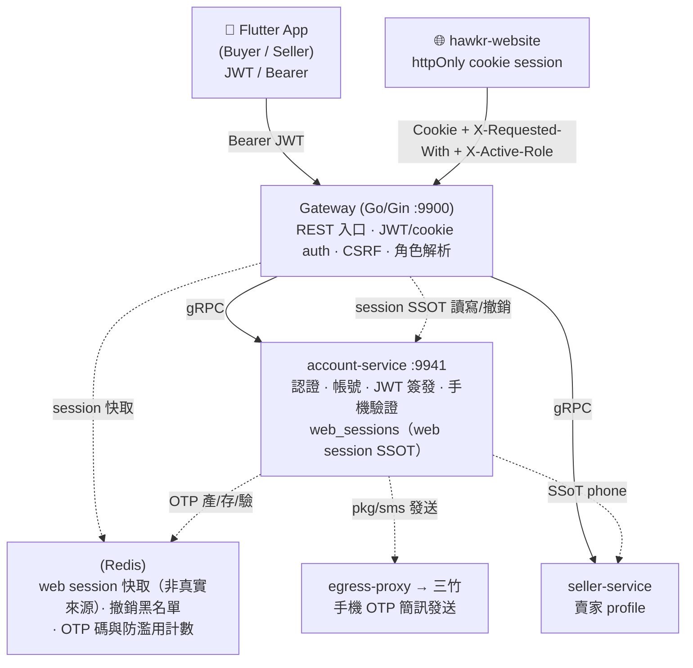

> **手機 OTP 已改後端經三竹發送（Firebase Phone Auth 退役）**：OTP 能力本身（proxy 拓撲、`pkg/sms`、產碼/驗碼/防濫用、Proto 契約、Firebase 退役清單）以 **[51 號](51-簡訊發送與手機%20OTP%EF%BC%88Mitake%20SMS%20&%20Phone%20OTP%EF%BC%89詳細設計書.md)** 為 SSOT；本文件僅描述登入流程如何**消費** OTP（§4）。

兩種 credential 並存，**身分模型相同、憑證形式不同**：

| Client | Credential | 角色資訊住哪 | 切換工作區 |
|---|---|---|---|
| **Mobile**（買家 / 賣家 App） | 無狀態 **JWT**（Bearer） | `loginRole` 烘進 JWT claim，固定到 refresh/重登 | re-OAuth（各 App 送固定 `userType`） |
| **Web**（網頁） | Gateway 持有的 **opaque cookie session**（`web_sessions` row 為真實來源，Redis 為加速層；§3） | session 存 **role SET**（`accountType`）＋**持久化的 active role**（`loginRole`）；每請求解析時 `X-Active-Role` hint 優先，無 hint 則單角色帳號回該角色、Both 帳號回持久值 | 改 `X-Active-Role` hint（單次）或 `POST /app/auth/active-role`（持久化），皆不重登（§3） |

### 角色與視角

模型以 `docs/modules/identity.md` §3、§6 與 [44 號 §2.3](44-帳號與賣家買家身份模型（Account%20&%20Seller-Buyer%20Identity）詳細設計書.md)（賣家身份）為準，登入相關的結論：

- 每個帳號都是買家：建帳時建立買家（§8），買家不是角色。
- 角色只有要另外申請的 SELLER，由開店授予；登入不授予、不升級角色。
- 視角：Connect 沒有視角，`GetSession` 不回（ADR `2026-10-07-connect-without-perspective`）；工作區是 client 的 UI 狀態。只有舊 REST 的 client 送 `X-Active-Role`，單體的 `internal/legacy` 依它與帳號的角色推導給舊 gateway 的 `X-Login-Role`（提示 SELLER 而且帳號有 SELLER 時才是賣家）；視角不是授權，不儲存。
- 舊服務要的 `accountType` bitmask（1 買家、2 賣家、3 兩者）由單體的 `internal/legacy/accounttype` 合成，存活的帳號一律帶買家位元，所以只會是 1 或 3。下方的 JWT、`loginRole`、web session 各節描述的是舊服務。

### 身分主鍵：auth_providers dual-write

**讀取路徑已改**：登入時用 `auth_providers (provider, sub_id)` 查帳號，**不再查 `accounts.firebase_uid`**（該欄位標記 M8 移除）。建帳 / 登入時對 `accounts` + `auth_providers` 做 **dual-write（同交易）**，含 race detection：Insert 唯一鍵衝突 → `GetByProviderSub` 判定（同帳號＝idempotent、不同帳號＝1305）。

> **email 是身分鍵、phone 不是**：`accounts.phone` 無 unique 約束（#944 設計，允許多帳號共用手機供同步）；identity 以 `auth_providers` 的 (provider, sub_id) + verified email 為準。

### JWT / 憑證結構

Mobile JWT claim：

```json
{ "accountId": 2612345678, "accountType": 3, "loginRole": 1, "iat": 1743350400, "exp": 1743955200 }
```

| 欄位 | 說明 |
|------|------|
| `accountType` | 帳號角色 bitmask（1/2/3），反映**目前擁有的所有角色**（含本次剛升級的） |
| `loginRole` | **本次 session 角色**（1 \| 2），由登入 `userType` 決定，**永遠 1 或 2 絕不為 3**；refresh 時保留 |

> **角色隔離**：IM / 通知等下游用 `loginRole`（舊 REST 的 `X-Active-Role` 經單體推導出的 `X-Login-Role`）判斷當前視角。Both 帳號切工作區：**mobile** re-OAuth；**web** 改 `X-Active-Role` hint 或呼叫 `POST /app/auth/active-role` 持久化（§3；舊流程），對 web 而言 `loginRole` 是視角選擇器、**不是授權依據**（role-as-claim，#832）。

> **`account_id` / `expires_in` 在 gRPC 邊界為 STRING**：account-service 回應的這兩個欄位以字串傳遞（避免 JS/弱型別 client 大整數精度遺失）；Gateway enrichment 時 parse 回 int64。client 必須具備 `tryParse`/`toString` 容錯。

### Gateway subset 防呆（defense-in-depth，code 1308）

Gateway 組裝 response 前驗 `loginRole ⊆ accountType`，否則回 HTTP 400 + `1308`。生產不會觸發（account-service 永遠先 AddRole），保留防止未來新 path 餵假 accountType / 升級失敗 commit inconsistent state。

---

## 2. Mobile OAuth 登入與建帳（Google / Apple）

買賣家共用同一組 API，差異僅 `userType`。Apple 細節另見 [30-Sign in with Apple 認證]。

### 端點

| Method + Path | 說明 |
|---|---|
| `POST /api/v1/auth/google` | Google ID Token 登入 / 建帳 |
| `POST /api/v1/auth/apple` | Apple identityToken 登入 / 建帳 |
| `POST /api/v1/auth/refresh` | Token refresh（§12） |
| `POST /api/v1/public/auth/otp/send` | 發送手機 OTP（後端經三竹，匿名可呼叫，§4；能力見 [51 號](51-簡訊發送與手機%20OTP%EF%BC%88Mitake%20SMS%20&%20Phone%20OTP%EF%BC%89詳細設計書.md)）|
| `POST /api/v1/app/auth/phone/verify` | 綁定手機到既有帳號（§4，VerifyPhone #944）|

### Request / Response

**Request**：`{ idToken, userType: 1|2, phone?, otpCode?, fcmToken?, platform }`
- 買家 App 固定 `userType:1`、賣家 App 固定 `userType:2`；`phone`+`otpCode` 僅新用戶 OTP 驗碼後第二輪帶（取代舊 `firebasePhoneIdToken`）。

**Response（成功，gateway 組裝）**：

```json
{
  "code": 0,
  "message": "success",
  "data": {
    "token": "eyJ...", "refreshToken": "eyJ...", "expiresIn": "604800",
    "accountId": "2612345678", "loginRole": 1, "accountType": 3, "userType": 1,
    "nickname": "王小明", "avatar": "https://...",
    "store_name": "小明農場", "mobile": "0912345678", "needs_onboarding": false
  }
}
```

| 欄位 | 說明 |
|------|------|
| `loginRole` | 本次 session 角色（1 \| 2），新 client 讀這個 |
| `accountType` | 帳號角色 bitmask（1 \| 2 \| 3） |
| `userType` | **deprecated alias = `loginRole`**，舊 client 兼容 |
| `accountId` / `expiresIn` | STRING（見 §1） |

### 建帳 / 登入決策樹（資料流）

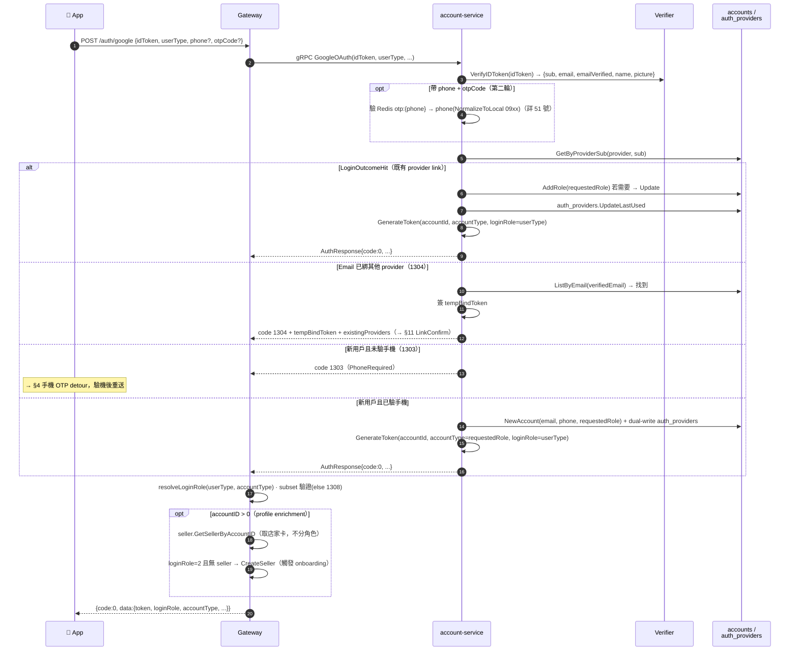

> **買家不在登入時建立**：買家在建帳的 transaction 內建立（§8），登入不呼叫 buyer。
>
> **Apple relay email**：`@privaterelay.appleid.com` **不觸發 1304**（`emailVerified = email!="" && !isRelayEmail(email)`）；relay 帳號走新用戶 / OTP 路徑。
>
> **店家卡查詢**：`loginRole=1` 的 Both 帳號登買家時 gateway 仍查（不建）seller profile，回店家資訊卡。

---

## 3. Web 登入（Gateway cookie session）

> `hawkr-website` 專用。Mobile（§2、§8–9）走 JWT/Bearer。

### Web 憑證形式

web 憑證是 **gateway 持有的 opaque session**：登入後 gateway 把 session 寫進 account-service 的 `web_sessions` row（真實來源）與 Redis（加速層），只下發一個 **httpOnly** cookie（JS 讀不到），後續請求自動帶 cookie，**token 不進 JS**。

### 前端 GSI 取得 idToken

下節「資料流」從瀏覽器**已經拿到 `idToken`** 開始畫，但在那之前還有一整段只存在於前端的流程：Google Identity Services（GSI）的 script 載入、重試與五種失敗。這一段完全不觸及後端——**它失敗時後端一行 log 都不會有**，所以在後端 log 裡找不到原因是預期結果，不是觀測缺口（Sentry `PROD-16「Google Identity Services unavailable」` 即屬此類）。

實作位置：`hawkr-website/lib/auth/gsi.ts`（載入器與 state machine）、`features/auth/components/login/GoogleLoginButton.tsx`（呼叫端）。

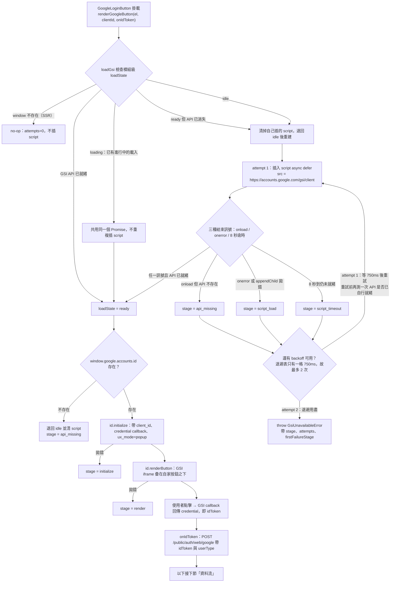

**五種失敗 stage**（`GsiFailureStage`；`GsiUnavailableError` 同時帶 `firstFailureStage`，因為重試成功前的第一個死因才是要查的那個）：

| stage | 觸發 | 典型成因 |
|---|---|---|
| `script_load` | `<script>` 的 `onerror`，或 `document.head.appendChild` 自己拋錯 | 網路斷、DNS、企業/廣告阻擋、CSP 擋掉 `accounts.google.com` |
| `script_timeout` | 8 秒內 script 既未 load 也未 error | 連線極慢或請求被中間設備懸置 |
| `api_missing` | script `onload` 了，但 `window.google.accounts.id` 不存在 | 回應非預期內容（如攔截頁），或 SDK bootstrap 尚未掛上 API |
| `initialize` | `id.initialize` 拋錯 | `client_id` 格式錯誤、GSI 內部拒絕 |
| `render` | `id.renderButton` 拋錯 | 容器已被卸載、GSI 內部拒絕 |

> 三個 settle 訊號（`onload` / `onerror` / 逾時）**各自都會再測一次 API 是否已就緒**才判失敗：逾時被移除的 script 仍可能繼續完成執行，或另一個呼叫端在退避期間補上了 GSI。少了這道複測會把已經可用的 GSI 報成失敗。同理，`loadState === "ready"` 但 API 不見時**必須重建而非回傳舊的 fulfilled promise**——否則使用者會卡在一個永遠不會再嘗試的成功狀態。

### 資料流

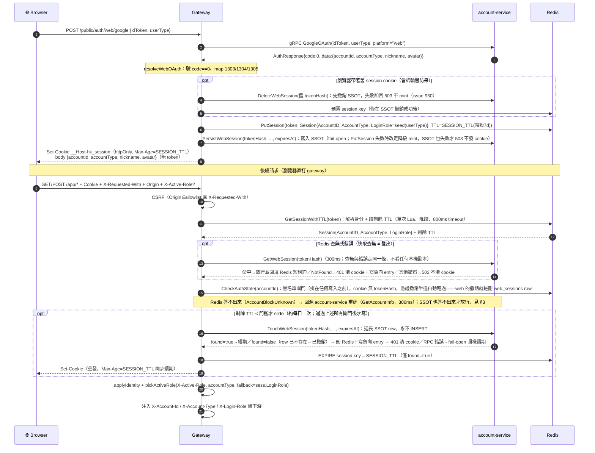

### 端點

| Method + Path | 說明 | 回應 |
|---|---|---|
| `POST /public/auth/web/google` | GIS idToken 登入 | `{accountId, accountType, nickname, avatar}`，**無 token**；下 cookie |
| `POST /public/auth/web/apple` | Apple JS identityToken 登入 | 同上 |
| `POST /public/auth/admin/google` | 管理員 SSO（`ADMIN_ALLOWLIST_GOOGLE_DOMAINS` 白名單）| 同 web 流程，下 cookie |
| `POST /public/auth/demo` | App Review demo 帳密登入（`DEMO_LOGIN_ENABLED` gate）| — |
| `GET /app/auth/session` | 由 cookie / Bearer 解析身分 | `{accountId, accountType, loginRole}`（解析後 active role；見 §3 fallback） |
| `POST /app/auth/active-role` | 切換並**持久化** active role | `{accountId, accountType, loginRole}` |
| `DELETE /app/auth/sessions` | 登出（**冪等**）| web：刪 `web_sessions` row（SSOT，失敗即回 503 且不動快取）→ 刪 Redis＋寫負向 entry → 清 cookie；session 不存在仍回成功（DELETE 0 rows 非錯誤）；mobile：帶有效 Bearer 即撤該枚憑證，同樣 fail-closed（#2035，見「Bearer 憑證撤銷」）；兩種憑證都沒有才是 no-op 的 200（見「殘留 cookie 出口」末列）。掛 `OptionalJWTAuth`（**不**掛 `JWTAuth`）——否則封鎖/軟刪帳號會在 handler 前被 401 擋下，cookie 永不清、卡登入死循環（#1406，見「殘留 cookie 出口」）|

### Cookie 規格（host-only）

| 屬性 | prod / stage | dev |
|---|---|---|
| 名稱 | `__Host-hk_session`（host-only 預設，無 `Domain`）；`__Secure-hk_session`（僅當顯式設 `SESSION_COOKIE_DOMAIN`）| `hk_session`（`SESSION_COOKIE_INSECURE=true`）|
| 內容 | opaque 256-bit 隨機 token（對應 `web_sessions` row，其 sha256 即 `token_hash`；非 JWT）| 同 |
| 旗標 | `HttpOnly` + `SameSite=Lax` + `Secure`（`__Host-` 強制 host-only/`Path=/`）| `HttpOnly` + `SameSite=Lax`（無 Secure，供 `http://localhost`）|
| TTL | **7 天閒置滑動**（sliding，見下「會話滑動續期」）：活躍請求自動續期、閒置滿 7 天才過期；cookie Max-Age、Redis TTL 與 SSOT `expires_at` 三者同步續期。純滑動無絕對上限 | 同 |

> **會話輪替（#950）**：mint 新 session 前先撤銷此瀏覽器舊 session（走 SSOT，撤銷失敗即不 mint），避免留下影子會話。

### 會話韌性

| 情境 | 行為 |
|---|---|
| Redis 命中 | `GetSessionWithTTL` 800ms timeout 內回 session ＋剩餘 TTL（**唯讀，不續期**；熱路徑，絕大多數請求走這條） |
| Redis 查無（過期／逐出／flush／降級 mint 從未寫入） | 讀穿到 SSOT（`GetWebSession`，300ms）；命中→放行並回填快取，查無→401，account-service 不可達→503 |
| Redis 短暫故障 | 與「查無」走**同一條**：讀穿 SSOT。撤銷因此在 Redis 故障期間仍即時生效於每個 pod（#1684） |
| Redis 與 account-service 同時不可用 | **503**「service temporarily unavailable」（**不是 401**，避免誤判登出），且不清 cookie |
| 帳號軟刪 / 帳號停權 | 撤銷本身由 SSOT row 刪除保證（見下節）；同一步以 token hash 逐出該帳號每一份快取副本，故下一個請求即失效。Redis 掛時逐出失敗（只記 warn，不影響撤銷成立），session 退回「快取失效或下一次 slide 時被 SSOT 擋下」 |

#### 快取分層規則

| 規則 | 內容 |
|---|---|
| gateway **不保留** session 的本機正向副本 | 撤銷延遲＝本機正向快取 TTL；不存在這一層才沒有延遲 |
| 負向 entry（「SSOT 已說查無」）保留 | 它只能拒絕、不能放行，方向本身安全 |
| 沒有跨 replica 撤銷事件 | 撤銷的即時性由「刪 row 的同一步按 hash 逐出快取副本」保證，不靠事件投遞 |

兩層都答不出來時回 **503 而非猜**。503 不是登出——cookie 不清、`authUnavailable` 的 client 契約要求重試。

> 分層取捨與被否決的方案見 ADR [`docs/adr/2026-09-18-web-session-ssot-and-cache-layering.md`](../adr/2026-09-18-web-session-ssot-and-cache-layering.md)。

#### 持久層（`web_sessions`）

account-service 的 `web_sessions` table（PK 為 TSID `id`，紅線不可用 `token_hash` 當主鍵；`token_hash` 為 UNIQUE index，sha256，同快取雜湊法）+ 4 個 RPC：

| RPC | 呼叫時機 | 失敗處理 |
|---|---|---|
| `PersistWebSession` | **mint（登入）**——只給剛產生的新 token | **fail-open**：擋掉登入等於把 Redis 的單點換成 account-service 的單點。代價有界——該 session 只存在於快取，逐出**或第一次 slide**即結束 |
| `TouchWebSession` | **slide（閒置 TTL 續期）**、切 active role、綁賣家——只延長既有 row，**永不 INSERT** | 三態：`found=true`→續期；`found=false`→**該 token 已無 row＝已撤銷**（slide 路徑 401＋清快取＋清 cookie，角色同步路徑只記 warn）；RPC 錯誤→**fail-open**（account-service 不可達不是「有人登出」的證據） |
| `GetWebSession` | Redis **查無或錯誤**時（讀穿，見上表） | 三態：命中→resolved＋回填快取；`NotFound`→401（SSOT 說了算）；其他錯誤→503（「問不到」不等於「不存在」） |
| `DeleteWebSession` | 登出、登入輪替、帳號軟刪／停權（帳號級走 `DeleteByAccountID`） | **fail-closed**：失敗即回錯誤且**不動 Redis**，維持「仍登入、可重試」的一致狀態 |

降級 mint（#1933）：`PutSession` 失敗（Redis 不可達或拒寫）時，改以 `PersistWebSession` 直接寫入 SSOT 後才下 cookie；SSOT 也失敗才回 503 不發 cookie。因為讀取側在 Redis 查無時會讀穿 SSOT，這種 session 在 outage 期間與 Redis 復原後都能在任一 pod 解析。

過期 row 由排程 job（`DELETE WHERE expires_at < now()`）清理，沿用既有 ticker pattern（`internal/applerevoke/scheduler.go`）。

### Session 真實來源與撤銷語意

**規則一句話**：`web_sessions`（account-service）是 session 的**唯一真實來源（SSOT）**；Redis 只是**加速層**。

| 層 | 角色 | 允許發生什麼 | 不允許代表什麼 |
|---|---|---|---|
| 負向快取（gateway pod 記憶體） | 同 pod 捷徑，**只存「SSOT 已說查無」**：命中即短路成 401 | 逐出、pod 重啟即空 | 只能拒絕、永遠不能放行（#1684） |
| Redis `session:<sha256(token)>` | 加速層 | 逐出（`allkeys-lru`）、flush、拒寫、整台不可達 | **查無 ≠ 登出** |
| `web_sessions` row | **SSOT** | 只由撤銷或 `expires_at` 結束 | 查無＝session 確定結束 |

**Redis session key 的格式：`session:` + `sha256(token)`（#2049）**——快取鍵取 token 的 sha256 十六進位值，**不是 token 本身**。帳號級撤銷因此算得出要逐出哪幾把鍵（刪 row 時 `RETURNING token_hash`），且 keyspace 裡沒有可冒用的 bearer secret（value 僅 `{accountId, accountType, loginRole}`）。

三處必須是同一個值（Redis key、gateway 負向快取鍵、`web_sessions.token_hash`），故 sha256 的推導**收斂在 `pkg/redis.HashToken` 單一處**（`SessionKey` 與供撤銷方使用的 `SessionKeyForHash` 皆由它導出），gateway 的 `HashToken` 委派給它。兩份同演算法副本是靜默漂移的來源，而漂移的快取鍵只是一次多餘查詢、漂移的 Redis 鍵是一次登出。

**沒有 legacy 雙讀遷移層**：非 hash 格式的舊鍵一律視為 miss → 讀穿 `web_sessions` → 以新鍵回填（`backfillSessionCache`），殘留舊鍵由自身 TTL 自然消滅。**禁止**新增「讀不到新鍵就回頭讀舊鍵並改名」的相容層——它會讓已撤銷的 session 復活。

> 快取鍵格式與不做遷移層的取捨見 ADR [`docs/adr/2026-09-18-web-session-ssot-and-cache-layering.md`](../adr/2026-09-18-web-session-ssot-and-cache-layering.md)。

**讀取（`resolveIdentity`，唯一解析入口）**：Redis 命中 → 直接放行；Redis **查無或錯誤**（同一條路徑）→ 讀穿 SSOT（命中放行；查無時另回填 Redis 5 分鐘短租約，錯誤時不回填；`NotFound` → 401 並寫入負向 entry；其他錯誤 → 503）。回填採短租約是因為 `GetWebSession` 不回 `expires_at`，寫滿 TTL 會讓 session 被悄悄延長；短租約會在下一次 slide 由既有節流機制升回完整長度，並同步 re-stamp SSOT。

**負向快取的必要性**：讀穿讓「帶著死 cookie 的流量」（過期、撤銷、掃描器）直接變成 account-service→Postgres 的 QPS。負向 entry 以 session id 為 key（新登入是新的隨機 token，永遠不會命中舊 entry），沿用同一個 30s grace，使同一枚死 cookie 每 30 秒最多換來一次查詢。

**寫入（mint 與 slide 是兩句不同的 SQL，不可共用）**：寫入側只有兩種語意——**mint**（登入時為新 token 建 row）與 **slide**（延長既有 row 的 `expires_at`，順帶同步角色欄位）。兩者若共用同一句 upsert（`INSERT ... ON CONFLICT DO UPDATE`），「已撤銷但快取還在」的 session 只要再發一次請求，slide 就會把被刪掉的 row 以全新 `expires_at` **重新 INSERT 回來**——登出、軟刪、停權全部被 slide 復活。故拆成兩半：

| 半邊 | SQL / RPC | 語意 |
|---|---|---|
| mint | `UpsertWebSession` / `PersistWebSession` | 只給剛產生的新 token；`ON CONFLICT DO UPDATE` 僅為「同一枚新 token 重試」的冪等，**不是**給 slide 用的 |
| slide | `TouchWebSession`（`UPDATE ... WHERE token_hash = $1`） | **永不 INSERT**。影響 0 列只有一個意思：row 不在＝**已撤銷**。也不寫 `account_id`（row 擁有自己的帳號，touch 不得改寫） |

`TouchWebSession` 刻意**不加** `expires_at > now()` 條件——過期未回收的 row 是 drift，正該由 slide 一併治好；加了會讓「0 列」多出第二種成因，鈍化這個訊號。

因此 **slide 同時是 cached-read 路徑上唯一的撤銷偵測器**：Redis 命中的請求本來永遠不問 SSOT（那正是快取的意義），撤銷若發生在快取還活著時無人察覺。0 列的處置分兩路：

| 觸發者 | 0 列時的行為 |
|---|---|
| slide（`JWTAuth` 的 slide commit） | 刪 Redis session key ＋ 寫負向 entry → **401 並清 cookie**。同 pod 的後續請求由負向 entry 短路，不會每次重打 gRPC |
| 角色同步（切 active role、綁賣家；best-effort） | 只記 warn、**不補寫**。這些呼叫本來就在改一個「應該還活著」的 session，補寫等於復活；下一個已認證請求會由 slide 擋下 |

續期順序與撤銷同一條規則——**先 SSOT、後快取**：`TouchWebSession` 延長 row → `EXPIRE` 延長 Redis key（失敗只記 debug：row 已延長，快取早退只多一次讀穿）→ 最後重發 cookie。

**撤銷（唯一做法：從 SSOT 刪除）**：

| 路徑 | 動作 |
|---|---|
| 登出 | `DeleteWebSession` → 成功才寫負向 entry／刪 Redis → 清 cookie；失敗回 503「登出失敗，請再試一次」且**不動快取** |
| 登入輪替（#950） | 同上；舊 session 撤銷失敗即不 mint 新 session |
| 帳號軟刪 / 移除最後一個角色 | `DeleteByAccountID` 刪光該帳號全部 row；失敗即回錯誤。刪除後以回傳的 hash 逐出快取副本（見下方「帳號級撤銷的兩半」） |
| 帳號停權（`SuspendAccount`；社群檢舉 `BAN_USER` 與 admin 會員管理的下游動作） | 同樣 `DeleteByAccountID` 刪光該帳號全部 row，**fail-closed**（錯誤往上拋，讓呼叫端知道停權不完整），並同樣逐出快取副本。只改 `accounts.status` 不算撤銷——session 解析路徑不 join account status，已登入的瀏覽器照樣通行 |

**帳號級撤銷的兩半：刪 row ＝撤銷，逐出快取＝即時性**。三個帳號級撤銷點（軟刪 `delete_account.go`、移除最後一個角色 `remove_role.go`、停權 `suspend_account.go`）走同一個 helper `revokeAccountWebSessions`（account-service `internal/usecase/web_session.go`）——三者差在「為什麼切斷」，不在「切斷是什麼意思」。兩半的失敗策略刻意不同：

| 半邊 | 動作 | 失敗策略 | 理由 |
|---|---|---|---|
| 刪 row（＝撤銷本身） | `DeleteByAccountID`，SQL 改為 `DELETE … RETURNING token_hash`（`db/queries/web_sessions.sql`），回傳每列的 hash 而非筆數 | **上拋**（fail-closed） | 回報成功卻留著 row，等於謊報唯一能終結 session 的那件事 |
| 逐出快取副本（＝即時性） | `pkgredis.DeleteSessionsByTokenHash` 以 `session:`+hash 一次 DEL 整組 | **只記 warn** | row 已經沒了，逐出失敗只是退回 #2049 前的行為（快取副本活到下一次 slide 或 TTL）。讓一次帳號刪除因為**快取**不可達而失敗，等於把 Redis 變成撤銷的依賴，那正是 2026-07-29 事故的形狀 |

> 三個帳號級撤銷點的 blacklist **一律**由 account-service 自己寫（停權亦然，見下方「帳號停權與解除停權」），不由呼叫端負責。
>
> web session 的即時性不依賴 blacklist：刪 row 的同一步就把快取副本按 hash 逐掉，cookie 在下一個請求即失效。仍然需要 blacklist 的只剩**無狀態 mobile JWT**（它沒有伺服器端紀錄可刪）。

**順序不可顛倒**：先刪 SSOT、後刪快取。反向順序會產生「回錯給前端、Redis 已刪、row 還在」的中間態——使用者以為登出失敗，session 卻在下一次讀穿時復活。

**503 的客戶端契約（fail-closed 的必要配套）**：撤銷失敗回 `HTTP 503` ＋ envelope `code=503`，語意是**「什麼都沒撤銷」**——session 仍有效、cookie 未清除、請求可安全重試。與 `JWTAuth` 無法解析 session 時同一枚 envelope，客戶端只需一條「後端答不出來」的規則。**客戶端必須實作這條分支**：把 503 當成已登出而清掉本地身分，會在伺服器 session 仍存活時顯示已登出畫面（共用裝置上，那正是使用者按登出要避免的結果）。此段是**對客戶端的要求，非現況描述**——後端不得以「前端反正會清」為由把 fail-closed 改回 fail-open。

**登入輪替同樣 fail-closed**：舊 session 撤銷失敗即不 mint 新 session（見上表）。`DeleteWebSession` 冪等（row 不存在＝刪 0 列＝成功），死 cookie 不會把人擋在登入外。取捨見 ADR [`docs/adr/2026-09-18-web-session-ssot-and-cache-layering.md`](../adr/2026-09-18-web-session-ssot-and-cache-layering.md)。

**Redis blacklist 的角色**：帳號級撤銷仍保留 `account:blocked:<id>`，但它**既不是撤銷本身、也不是 web session 的即時生效層**。它覆蓋兩件事：**無狀態 mobile JWT 的唯一撤銷手段**（它沒有可刪的伺服器端紀錄），以及**逐出當下 Redis 不可達**時的兜底。Redis 掛時該層 fail-open，但 web session 仍會在快取失效或下一次 slide 時被 SSOT 擋下。

**閘門順序：任何會拒絕請求的檢查，都排在任何寫入之前**。`JWTAuth` 的固定順序是 ①解析身分（唯讀）→ ②blacklist 閘門 → ③slide commit（本路徑唯一的寫入）→ ④放行。若 slide 混在「解析」裡（讀 Redis 時順手 `EXPIRE`），**被封鎖帳號的輪詢客戶端每被 401 一次就替自己續一次 TTL**——session 活得比 `AccountBlockedTTL`（session TTL + 24h）還久，blacklist key 一過期就恢復存取。把寫入延後到所有閘門之後，被拒絕的請求就不可能延長它被拒絕的那個 session。

**遺留缺口（明載，非疏漏）**：

1. `PersistWebSession` 為 fail-open，因此「Redis 正常但 account-service 當下不可用」時 mint 出的 session **只存在於快取**（row 從未落地）。它有三種結束方式：
   - **被逐出即結束**（快取查無 → 讀穿 SSOT → `NotFound` → 401）。
   - **Redis 一次短暫錯誤也會結束**：快取錯誤與查無走同一條讀穿，同樣得到 `NotFound` → **401 並清 cookie**。
   - **第一次 slide 即結束**：slide 走 `TouchWebSession`，`UPDATE` 影響 0 列 → 判為已撤銷 → 刪 Redis＋寫負向 entry → **401 並清 cookie**。row 不會被補寫——補寫就是那句會讓登出／軟刪／停權復活的 upsert。
   - **窗口長度**：以先發生者為準，上限即第一次 slide。slide 由 `SESSION_REFRESH_BELOW_SECONDS` 節流（預設 `SESSION_TTL` 7 天／門檻 6 天），活躍 session 約在 mint 後一天觸發，故這種 session 最多活**約一天**。
   - **代價（誠實記載）**：`UPDATE` 影響 0 列**無法區分「row 從未落地」與「row 已被撤銷」**——兩者都是 0 列。既然 SSOT 說了算，兩者一律當撤銷處理。這是「SSOT 說了算」的必然代價，非 bug。
2. mobile JWT 在 Redis 不可用期間無法被撤銷（blacklist 是它唯一的撤銷面）。

### Bearer 憑證撤銷（stateless JWT）

**一句話規則**：web session 的撤銷＝刪 `web_sessions` row；**bearer JWT 沒有 row 可刪，所以撤銷必須自己有一張表**。

**兩張名單，回答兩個不同的問題**：

| 名單 | 語意 | SSOT | 快取 | 誰寫 |
|---|---|---|---|---|
| 單枚撤銷 | **這一枚** token 作廢 | `revoked_tokens(token_hash)` | `jwt:revoked:<sha256(token)>` | 登出（`RevokeToken`） |
| auth epoch | 此帳號在該時刻**之前**簽出的**全部** token 作廢 | `accounts.auth_epoch` / `admin_accounts.auth_epoch` | `auth:epoch:<accountId>` | 登出所有裝置、移除角色、事故救援（`RevokeAllCredentials`） |

兩者都**必須落 Postgres**：只活在 Redis 的撤銷會隨 Redis 一起消失，而 web session 至少還有 row 擋得住，bearer JWT 什麼都沒有。Redis 只是加速層，`token_hash` 沿用 `pkg/redis.HashToken`（原始 token 不離開 gateway）。

**缺席不是無罪（Redis 對這兩張名單是 positive-only oracle）**

這是本節最容易寫錯、也最容易被讀成「多此一舉」的一條：**Redis 可以證明一枚憑證已作廢，但永遠不能證明它有效**。key 不存在有三個無法區分的成因：

| 成因 | 說明 |
|---|---|
| 本來就沒被撤銷 | 絕大多數請求 |
| 撤銷從未寫進去 | Redis 收讀不收寫（2026-07-29 MISCONF 形狀，本 repo 已有專屬測試 `TestWebGoogleOAuth_RedisWriteFails_DurableTierUp_LogsInDegraded`） |
| 撤銷寫進去了、又被逐出 | 實例是 `maxmemory 512MB` + `allkeys-lru`（`docs/速查參考/Redis 快取管理.md`），這兩把 key 與全站快取共用同一份逐出預算 |

把「缺席」讀成「有效」，第二種成因＝**登出靜默沒發生**，第三種＝**已生效的撤銷自己反轉**。兩者都是由**快取**造成的正確性失效，正是 §28 明令禁止的形狀。

所以缺席一律回 `CredentialUnknown`，由 gateway 讀穿 Postgres SSOT 解析。**這一條同時解掉兩個成因**：Redis 不是否定答案的權威，於是逐出退化成效能問題而非正確性問題，也不需要為此動基礎設施（獨立實例／`noeviction`／改 maxmemory 一律不需要）。

> 對照：**blacklist 那一軸維持「缺席＝未封鎖」**。它的三個 writer 都鏡射 `accounts`，且 web session 另有 row 會死，快取只是第二道防線；bearer JWT 沒有自己的 row，快取就是全部——不對稱是刻意的。

**閘門位置與 fail-open（紅線）**：`JWTAuth` 的順序是 ①解析身分 → ②blacklist 閘門 → **③憑證撤銷閘門** → ④slide commit。三者共用**同一次 Redis round-trip**（`pkgredis.CheckAuthState`）——每個 probe 對「卡住的 Redis」都要付滿一次 `sessionLookupTimeout`，分兩次問等於把每個已認證請求的停頓加倍。降級形狀比照 #2050，但因為缺席也要讀穿，**讀穿是穩態而非只在 outage**：

```
Redis 定罪（key 命中 / iat < epoch）  → 直接拒絕，不再問任何人
其餘一切（含 key 缺席）              → 讀穿 account-service（CheckCredential）
                                       受 per-pod TTL 正負快取 + singleflight + token bucket 約束
兩邊都答不出來                        → 放行
```

**穩態必須是 cache hit，不是每個請求打 DB**：per-pod 正負快取（`CREDENTIAL_FALLBACK_TTL_SECONDS`，預設 **300s**）讓每枚憑證每個 pod 每 TTL 只花一次 RPC，token bucket（預設 50/s/pod）是硬上限。TTL 取 300s 而非 blacklist 那條的 60s，因為那條只在 outage 跑、這條在穩態跑；TTL 是負載的除數：一個 pod 在 50/s 預算內可支撐約 15,000 枚同時活躍的憑證。**TTL 不會拖慢正常登出**——登出有寫 Redis key，Redis 直接定罪，根本走不到這層快取；它只界定「key 被逐出／沒寫成功」時多久會被抓到。

最後一行是紅線而非兜底：**撤銷檢查若 fail-closed，任何依賴抖動都會變成大規模登出**，比它要修的洞嚴重得多。因此 `CheckCredential` 的任何錯誤都走 gRPC error 而**不是** `revoked=true`；`CREDENTIAL_FALLBACK_MAX_LOOKUPS_PER_SEC=0` 是免部署的 kill switch。

**撤銷「動作」本身則 fail-closed（與上一條不衝突）**：`RevokeToken` / `RevokeAllCredentials` 的 **DB row 與 Redis key 兩半都要成功**，任一失敗都上拋 → handler 回 503「什麼都沒撤、可重試」。少了 row 等於撤銷不存在；少了 key 等於撤銷**不即時**（該 pod 可能握著舊的「有效」判決長達一個 TTL），而使用者無從得知。兩個寫入都冪等（`ON CONFLICT DO NOTHING`／`GREATEST`），重試零成本。fail-open 講的是「答不出來的**檢查**不可把人鎖在外面」，與「失敗的**寫入**要老實說」是兩件事。

> ⚠️ **pipeline 的陷阱**：go-redis v9 在 pipeline 連不上 Redis 時，**只有 `Exec` 回錯**，個別 command 留下乾淨的零值（`Exists` 回 `n=0, err=nil`）——與健康 Redis 對一個正常帳號的回應**一模一樣**。只讀個別 command 的結果會讓整個 outage 被讀成「沒封鎖、沒撤銷」，也就是 #2050 在下一層原封不動重演。`CheckAuthState` 因此必須檢查 `Exec` 的錯誤，並把 `redis.Nil`（epoch GET 沒命中＝絕大多數請求的正常情況）排除在外。

**與 admin 的差別（刻意不對稱）**：`blockedPerSSOT` short-circuit admin 是對的（admin 不在 `accounts`，`GetAccountInfo` 對每個 admin 都回 NotFound，擋下去等於 Redis 一掛 admin 就進不來修）；**憑證撤銷這一層絕不可 short-circuit admin**，因為它問的是一張確實含有 admin 的表，跳過就等於讓最高權限憑證維持唯一不可撤銷。

**refresh 必須擋同一組名單**：否則 gateway 擋掉的 token，客戶端往 `/public/auth/refresh` 一送就換到全新的一枚——撤銷等於沒發生。`revoked_tokens.expires_at` 因此取 `max(exp, iat + refresh 寬限期 + 24h 餘裕)`，而非 JWT 的 `exp`（餘裕是因為兩邊的邊界比較方向不對稱：row 用 `expires_at > now`、refresh 用 `since(iat) > grace`，恰好等長時在 `iat+grace` 那一瞬間 row 已停止作答而 refresh 尚未開始拒絕）：token 過了 exp 仍能在寬限期內換新，記錄活得比 exp 短就是留了一條繞道。refresh 側讀 DB（不經 Redis 快取），錯誤時 **fail-open**（只記 warn）——同一條紅線，且下一步的 `GetByID` 讀同一個 DB，真掛了 refresh 本來就會失敗。

**移除角色（#2035 涵蓋的第三個場景）**：`RemoveRole` 拿掉一個角色但帳號還活著時，**同交易** bump `auth_epoch`（交易內，避免「DB 已無此角色、JWT 仍宣稱有」的半套狀態），交易外發佈 Redis epoch 並撤銷該帳號的 web session。少了這一步，JWT 的 `accountType` 是登入當下烘進去的、DB 改了它不會變，被拿掉的角色最長還能用滿 7 天。

> **這兩步失敗只記 warn，與 `RevokeToken`／`RevokeAllCredentials` 的 fail-closed 不同**，理由是 tx 已經 commit：角色**確實**已經移除，事後回錯只會讓呼叫端（seller-service outbox worker）把一個已完成的動作標成失敗並無止境重試。代價僅是「慢一點生效」而非「沒生效」——Redis 讀不到 epoch key 時算 unknown，gateway 會回頭問 SSOT，最長延遲一個 per-pod TTL。

> ⚠️ **bump 必須以「真的移除了角色」為條件，不是「這支 RPC 被呼叫」**：seller-service 的 outbox worker 天生會重打 `RemoveRole`，每次都 bump 會把使用者剛重新登入拿到的 token 再作廢一次——retry 迴圈變成永久登出迴圈。cascade（移除最後一個角色）路徑則**不** bump：該路徑整個軟刪帳號，blacklist（`AccountBlockedTTL` 比 JWT 壽命長）已經蓋住全部憑證。

**端點**：

| 端點 | 掛載 | 行為 |
|---|---|---|
| `DELETE /app/auth/sessions` | `OptionalJWTAuth` | 帶有效 Bearer → 撤該枚憑證（**fail-closed**：撤不掉回 503，語意同下方 web 的 503 契約）；帶 cookie → 刪 `web_sessions` row；**兩者皆無 → 200 且不打後端**（見下節，改成 401 會重演 #1406） |
| `DELETE /app/auth/sessions/all` | `JWTAuth` | 推進該 principal 的 auth epoch ＋撤光其 web session。買家／賣家／**admin 通吃**——這是 admin 憑證唯一的撤銷面。fail-closed |

> **事故救援：直接下 SQL 改 `auth_epoch` 會生效，但不是即時**。Redis 對這兩張名單是**只能定罪、不能無罪開釋**的 oracle（見上方「缺席不是無罪」），所以「查無 epoch key」不會產生放行判決，而是觸發讀穿；gateway 一定會問到 DB。代價是**最長延遲一個 per-pod TTL**（`CREDENTIAL_FALLBACK_TTL_SECONDS`，預設 300s）——該 pod 可能還握著上一次讀穿留下的「有效」判決。要**即時**生效仍請走 `RevokeAllCredentials`（DB＋Redis 一起寫，下一個請求就擋）。純 SQL 適合「先止血、可以等幾分鐘」的場景。

### 帳號停權與解除停權（Admin 會員管理）

**一句話規則**：停權＝寫 `accounts.status` **並**寫 `account:blocked:<id>`；解除停權＝`DEL` 同一把 key **並**把 status 寫回 `active`。兩件事都在 `SuspendAccountUseCase` 內完成，不由呼叫端各自負責。

#### 寫入責任在 use case，不在呼叫端

blacklist 是 `accounts` 的**衍生快取**，不是第二份狀態——三個 writer 全部嚴格由帳號 SSOT 推導（gateway `internal/middleware/blacklist_fallback.go`），而 gateway 在 Redis 答不出來時會**自己**從 `accounts.status` 重新推導同一個判決（`accountBlockStateFromInfo`：`suspended` / `inactive` → `AccountBlocked`）。推導值與被推導的事實必須寫在同一處。

因此：**停權的兩個寫入（`accounts.status` 與 `account:blocked:<id>`）都在 `SuspendAccountUseCase` 內完成**。social-service 的 moderation dispatcher 只做 principal 解析與 `SuspendAccount` 呼叫，**不得自己寫 blacklist**；任何新的停權入口也一樣——`account:blocked:*` 是 account-service 的 key namespace。

> 這個歸屬的取捨見 ADR [`docs/adr/2026-09-18-account-blacklist-writer-in-usecase.md`](../adr/2026-09-18-account-blacklist-writer-in-usecase.md)。

#### TTL：一把 key、兩種尺寸，維持分離

`account:blocked:<id>` 只有**一把** key（`pkg/redis/blacklist.go`）；所謂「兩種 TTL」是兩個 writer 對同一把 key 的兩種尺寸，不是兩把 key。因此解除停權的 `DEL` **與 TTL 無關**——它刪的就是那把 key，不論誰寫的、剩多久。

| 用途 | 尺寸 | 依據 |
|---|---|---|
| 軟刪 / 移除最後一個角色 | `AccountBlockedTTL()` ＝ `SessionTTL()` + 24h（預設 8 天） | 必須蓋過「刪除當下已簽出的憑證」壽命（`pkg/redis/blacklist.go` 該函式註解） |
| 停權（本次收斂後由 use case 寫） | `AccountSuspendedTTL()` ＝ `max(AccountBlockedTTL(), bearerTTL + 24h)` | 停權要蓋的是無狀態 bearer JWT，其壽命由 `domain.AccessTokenTTL`（7 天，`services/account-service/internal/domain/constants.go`）決定，**不是**由 web session TTL 決定 |

**維持分離、不統一**：兩個尺寸各自有推導來源，不是任意常數。軟刪那條由 `SESSION_TTL_SECONDS` 推導，正確性條件是「大於 session TTL」；停權這條由 bearer JWT 壽命推導。把兩者綁成同一個數字，等於讓 `SESSION_TTL_SECONDS` 這個**與停權無關的旋鈕**去改變停權的覆蓋範圍。故停權側取兩者的 `max`：預設值下兩者都是 8 天，但下限保證 `SESSION_TTL_SECONDS` 被調小時停權仍蓋得住 JWT。

停權 TTL 的上限就到 `AccessTokenTTL`：停權後新登入被 `IsActive()` 擋（`google_oauth.go` / `apple_oauth.go` / `link_confirm.go`），refresh 被同一個檢查擋（`refresh_token.go`），所以唯一還能通行的憑證是停權前簽出、尚未到期的那一枚。**不得把 TTL 設得更長**——超過的部分不改變任何判決，只佔用一份與全站快取共用的 `allkeys-lru` 逐出預算（§28、`docs/速查參考/Redis 快取管理.md` §5）。

#### 順序規則：衍生值不得先於、也不得晚於它所依據的事實

| 動作 | 順序 | 若第二步失敗的殘留狀態 |
|---|---|---|
| 停權（**加上**拒絕） | 先 SSOT（`status=suspended`）→ 後快取（`SET`） | status suspended、無 key：帳號仍被 `IsActive()` 擋住登入與 refresh，只是既有 JWT 未被即時擋。**fail-closed 上拋**，呼叫端知道停權不完整 |
| 解除停權（**移除**拒絕） | 先快取（`DEL`）→ 後 SSOT（`status=active`） | key 已刪、status 仍 suspended：帳號**仍然被擋**（登入/refresh 走 `IsActive()`；Redis 若不可達，gateway 也會由 status 推導出 Blocked）。**fail-closed 上拋** |

反向做解除（先寫 status 再 DEL）會產生「SSOT 說 active、衍生快取說 blocked」的中間態——帳號各處看起來正常、每個請求卻仍 401，並違反「衍生快取永遠不能表達 SSOT 沒有的事實」這條不變式。兩個寫入都冪等，失敗重試零成本。

#### 前置條件與刻意不設的條件

| 條件 | 決定 | 理由 |
|---|---|---|
| 帳號必須存在且**未軟刪** | **強制**。`GetByID` 本身就 `WHERE deleted_at IS NULL`，軟刪帳號回 `NotFound` | 這一條同時是安全機制：軟刪路徑寫的也是同一把 key，若允許對軟刪帳號解除，就會清掉一把代表「已刪除」的 key。擋在 `GetByID` 使這件事**結構上**不可能發生，不靠額外判斷 |
| 現況 status 必須是 `suspended` | **刻意不設** | `status=active` + key 仍在，正是需要修復的漂移態——它是「手動 `DEL` key」土法解除留下的狀態，也是停權第二步失敗留下的狀態。要求 `suspended` 會讓唯一的修復工具拒絕修復 |
| 是否重建 web session | **不做** | 停權時 row 已全數刪除，解除不還原任何東西，使用者重新登入即可。碰 `web_sessions` 最好的情況也只是 no-op |

#### Admin 會員管理 API

**資料來源：`accounts`（account-service），不是 `buyers`。**

1. admin 頁面管的是**帳號**而非買家 profile——四張統計卡是「總會員數 / 正常會員 / 商家用戶 / 買家用戶」，賣家也在列。
2. 唯一可施加的狀態動作（停權 / 解除 / 刪除）全部 key 在 `account_id`。`buyers.status` 是刪除生命週期（`active` / `pending_deletion` / `closed`），**沒有停權值**，不是同一個軸。
3. `buyers` 不是合法的列表來源：`is_current AND status='active'` 的 buyer row 可能對應已軟刪或不存在的 account（會列出幽靈）。

| Method + Path | 說明 |
|---|---|
| `GET /admin/accounts` | 列表。`page` / `limit` / `status`（`active`｜`suspended`｜`inactive`）/ `account_type`（`buyer`｜`seller`）/ `keyword`；另回全站統計（不受篩選影響） |
| `GET /admin/accounts/:id` | 詳情 |
| `POST /admin/accounts/:id/suspend` | 停權（body 可帶 `reason`，僅入 log） |
| `POST /admin/accounts/:id/unsuspend` | 解除停權 |
| `DELETE /admin/accounts/:id` | 既有端點，軟刪帳號（見 §14） |

**keyword 比對 `account_id` 精確值、`email` 與 `phone` 的 ILIKE 包含。** ILIKE 帶前導萬用字元**不吃索引**。不支援暱稱搜尋：暱稱在 buyer 模組；admin 確認身分的可靠欄位是登入信箱（同 `/admin/sellers` 既有判斷）。

**角色欄位（`is_buyer` / `is_seller`）與統計中的商家/買家數取自 `accounts.account_type` bitmask。** 該 bitmask 是反正規化值、會與 seller/buyer 表漂移（#1544），因此**僅供顯示與篩選**，嚴禁用它決定是否執行破壞性動作——`DeleteAccount` 不依它分派。

**非目標**：不做跨服務 enrich（暱稱／頭像／等級）。`accounts` 不持有這些欄位，取它們要跨模組讀 buyer；admin 以 `account_id` / email / phone 辨識即足夠。

### 殘留 cookie 出口

web session cookie 為 `HttpOnly`，前端 JS 刪不掉；session 已失效卻殘留 cookie 時，網站「cookie 存在＝已登入」的判斷會誤判，把使用者卡在到不了 `/login` 的死循環。兩處出口讓殘留 cookie 有解：

| 情境 | 行為 |
|---|---|
| `JWTAuth` 判定 401 且**請求實際帶了 session cookie** | 附 `Set-Cookie` 清除該 cookie（`clearStaleSessionCookie`）。涵蓋三類 401：**session 無效**（讀穿時 SSOT 回 `NotFound`——撤銷或 `expires_at` 到期）、**slide 偵測到撤銷**（快取仍命中，但 `TouchWebSession` 影響 0 列）、**帳號封鎖/軟刪黑名單**（session 帶效但被黑名單擋下）——同一死循環、不同觸發，故一併清 |
| 邊界 | 僅在請求帶 cookie 時下清除（匿名 401 不下 `Set-Cookie`）；mobile Bearer 與 internal `x-internal-service` 呼叫不帶此 cookie，**不受影響** |
| 登出冪等 | `DELETE /app/auth/sessions` 掛 `OptionalJWTAuth`（非 `JWTAuth`）。冪等來自 SSOT 而非快取：`DeleteWebSession` 刪 0 列＝成功，所以 session 無效/不存在也回成功並清 cookie。**但冪等不等於無條件成功**——`DeleteWebSession` 本身失敗（account-service 不可達）時回 503 且不動快取、不清 cookie（見上節「503 的客戶端契約」） |
| 無憑證呼叫（既無 session cookie、也無 Bearer）| **回 200「登出成功」，不打後端**。這是**刻意的**：handler 只以 session cookie 分流，而「無 cookie」正是 **mobile Bearer 客戶端登出的正常路徑**（stateless JWT 由客戶端自行丟棄），兩者在此分支不可區分。登出是**命令而非查詢**——目標後置條件「此請求不再持有有效 session」在無憑證時已然成立，故回成功；改回 401 不會多撤銷任何東西，只會讓客戶端把「本來就沒登入」當成失敗。**禁止**改為「無憑證即 401」：客戶端的全域 401 攔截器會據此觸發 refresh→強制登出，正是 #1406（cookie 永不清的登入死循環）與賣家 App `logout → 401 → logout` 自我循環的同一類故障 |

> 註：回 503 的路徑**不**清 cookie——憑證可能有效，僅後端暫時不可用（B-199），清掉會把暫時故障誤當登出。只有 SSOT **確定查無**（`GetWebSession` 回 `NotFound`）或帳號黑名單才清。`redis.Nil` 本身**不是**清除依據——把快取查無當登出，正是 2026-07-29 逐出即大規模登出的成因。

### 會話滑動續期（Sliding Refresh）

web session 為 **7 天閒置滑動**——語意是「閒置逾 TTL 才過期」，活躍即續期：

| 面向 | 設計 |
|---|---|
| 觸發點 | 已認證路徑（`JWTAuth`）解析 web session cookie 成功時。公開頁（`OptionalJWTAuth`）與 WS 握手為唯讀不 slide——避免在可快取/upgrade 回應發 `Set-Cookie`；活躍用戶仍靠頻繁的 `/app/auth/session` 探測（走 `JWTAuth`）續期 |
| 機制 | **讀寫分離兩段**：① `GetSessionWithTTL`（單次 Lua `GET`+`TTL`，**唯讀**）取回 session 與剩餘 TTL；② 剩餘 TTL < `SESSION_REFRESH_BELOW`（預設 6 天）才續期，且**排在所有會拒絕請求的閘門之後**才寫（見上節「閘門順序」）：`TouchWebSession` 延長 SSOT row → `EXPIRE` 把 Redis TTL 重設為 `SESSION_TTL`（預設 7 天）→ 重發 cookie |
| 原子性 / SSE 安全 | 續期用 `EXPIRE`，永不 `DEL`+`SET`——key 不會短暫消失，長連線（SSE）不會誤判 401 硬登出；反向也成立：`EXPIRE` 打在被並行登出刪掉的 key 是 no-op，快取層不可能復活 session |
| 節流 | 門檻機制把寫入壓到每 session 約每天一次：AOF 無壓力，續期時多出的那次 account-service gRPC 同受此節流；未達門檻的熱路徑只有一次唯讀 Redis round-trip |
| cookie 同步 | slide 命中時**重發 cookie**（`Max-Age=SESSION_TTL`）——瀏覽器 cookie 的 Max-Age 是客戶端絕對過期，只延 Redis 不延 cookie 則第 7 天瀏覽器即停送 cookie，滑動失效 |
| 策略 | **純滑動、無絕對上限**（活躍即無限續期；撤銷仍即時——登出走 `DeleteWebSession` 刪 SSOT row、黑名單即時判斷；快取命中期間發生的撤銷則由下一次 slide 的 `found=false` 抓到並就地結束該 session） |
| 環境變數 | `SESSION_TTL_SECONDS`（預設 604800）、`SESSION_REFRESH_BELOW_SECONDS`（預設 518400） |

### CSRF / CORS

cookie 認證的 unsafe method（POST/PUT/PATCH/DELETE）受 `CSRF` middleware：必須 **Origin ∈ allowlist 且帶 `X-Requested-With`**，否則 403（缺 Origin 也視為失敗）。CORS 僅對 allowlist Origin 回 `Allow-Origin` + `Allow-Credentials`；native client（無 Origin、走 Bearer）不受影響。

### role-as-claim + X-Active-Role+ active role 持久化

> 以下是舊 gateway 的流程（現況見 ADR `2026-10-07-connect-without-perspective`）：Connect 不送也不讀 `X-Active-Role`；舊 REST 的 client 仍送，單體入口（`internal/legacy/accounttype.OfLoginRole`）依提示與帳號的角色推導 `X-Login-Role` 轉給 gateway，預設是買家，不再有 session 持久化的角色。

Web session 存兩件事：**角色集合（`accountType`）** 是授權面、**持久化的 active role（`loginRole`）** 只是視角。每請求由 gateway middleware `pickActiveRole` 解析當前視角：

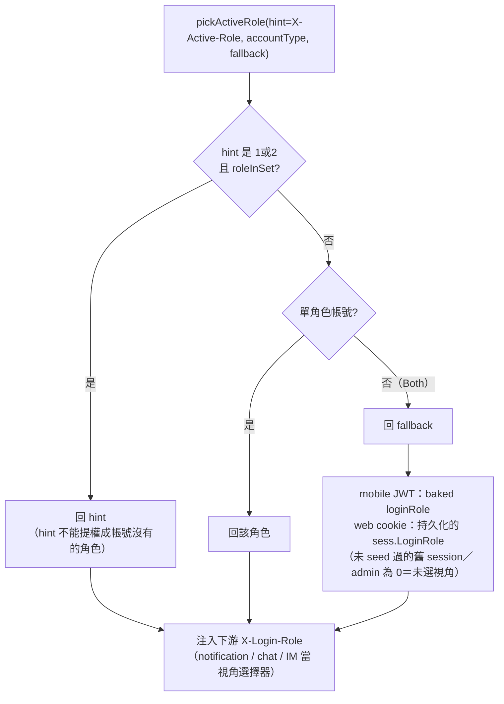

**關鍵：`X-Active-Role` 是「視角 hint」，不是授權輸入。** 授權一律按 **accountId ownership**（role-as-claim）—— dual-role 帳號在賣家視角下仍同時通過 `requireBuyer`+`requireSeller`。這是 **#832（付款返回變賣家 / 401-403）的結構性修法**：付款屬帳號、不綁當前視角。

**active role 持久化（server-truth / RSC）**：`Session{AccountID, AccountType, LoginRole}`——active role 存在 session 內（`pkg/redis/session.go`），`resolveIdentity` 的 web 路徑把 `sess.LoginRole` 當 fallback 交給 `pickActiveRole`。動機是前端在 server 端（RSC）只帶 cookie、發不出 `X-Active-Role` header：若 fallback 寫死 0，Both 帳號的每個 RSC 請求都會落在「未選視角」。

| 面向 | 行為 |
|---|---|
| seed（登入時） | web OAuth 以登入 `userType` seed（未帶時缺省 1=買家），Both 帳號因此從登入的工作區開始；LinkConfirm(`platform="web"`) 同以 `userType` seed 並額外 clamp 1\|2；admin SSO（type=4）無買賣家角色，seed 0 |
| 切換 | `POST /app/auth/active-role`：`role` 僅收 1\|2（否則 400）→ 驗 `RoleInSet`（不在 `accountType` 內回 403）→ `PutSession(KeepTTL)` → 同步 SSOT（`TouchWebSession`，fail-open）。同步走 touch 而非 upsert：這枚 session 既已存在，查無即代表已被撤銷，upsert 會把它重建回來；0 列時只記 warn、不補寫。**web-only**：mobile Bearer 無 cookie session 可改，回 400 |
| 優先序 | `X-Active-Role` hint 最優先，但**須是 1\|2 且在 `accountType` 內**才採用（向後相容）→ 否則單角色帳號一律回該角色 → 兩者皆不成立（Both 且無有效 hint）才用持久值 |
| `loginRole=0` | 仍是合法值，語意「未選視角」（下游自處理）：欄位加入前 mint 的舊 session（`omitempty` 反序列化為 0）與 admin session |
| 授權面 | 不受影響（仍 role-as-claim）；單角色帳號零行為變化 |

**切換工作區不重登**：改 `X-Active-Role` hint（單次請求）或打 `POST /app/auth/active-role`（持久化，bare-cookie 的 RSC 請求也跟著換視角）。

### Detour（cookie 模型）

| Code | web 完成方式 |
|---|---|
| 1303 phone-bind | 先 `POST /public/auth/otp/send` 發碼、使用者輸碼後重送 `POST /public/auth/web/{google,apple}` 帶 `phone`+`otpCode` → 完成綁定 + 下 cookie |
| 1304 merge | `POST /public/auth/link/confirm` 帶 `tempBindToken`+`platform:"web"` → `issueWebSession` 下 cookie、不回 token（§11）|

---

## 4. 手機 OTP 驗證與綁定

> **本節（§4）聚焦「登入流程如何消費 OTP」；OTP 的產生 / 保存 / 發送 / 防濫用 / 三竹串接 / Firebase 退役以 [51 號](51-簡訊發送與手機%20OTP%EF%BC%88Mitake%20SMS%20&%20Phone%20OTP%EF%BC%89詳細設計書.md) 為 SSOT。** 手機 OTP 已由前端 Firebase Phone Auth 直發改為**後端經三竹發送**：驗證碼由 account-service 產生存於 Redis，前端只送手機號取碼、回傳使用者輸入的 6 碼。

### 4.1 新用戶 OTP detour（1303）

新用戶首次 OAuth 回 `1303`，前端導向驗證頁；使用者先向後端請發 OTP、輸碼後重送 OAuth 完成建帳：

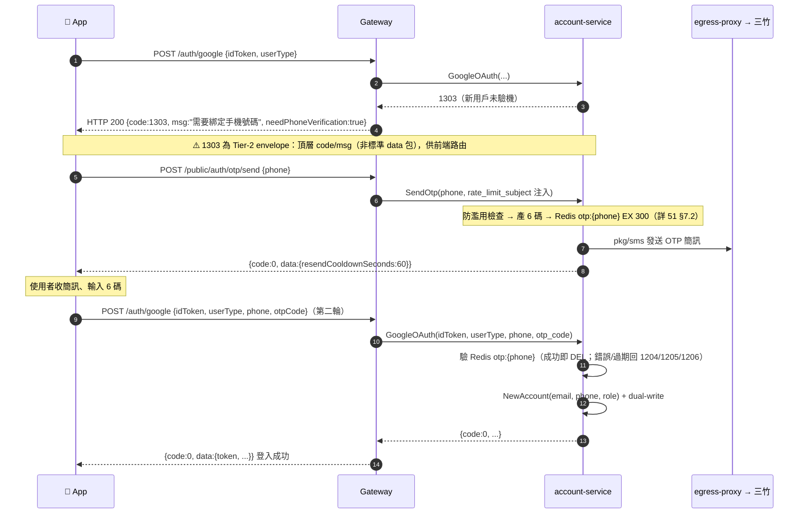

> **envelope 例外**：1303 是 Tier-2 例外，回 `{code, msg, needPhoneVerification}`（頂層、`msg` 非 `message`、無 `data` 包），為前端 OTP 路由相容保留。**其餘回應一律標準 `{code, message, data}`**（envelope lint gate 41fc53c1 強制；§7）。OTP 相關錯誤碼（1201~1207）見 51 號與 §7。

### 4.2 綁定手機到既有帳號（VerifyPhone）

| Method + Path | 說明 |
|---|---|
| `POST /app/auth/phone/verify` | 已登入帳號補綁 / 換綁手機（**取代舊 `/app/auth/firebase`**）|

已登入帳號補綁前先 `POST /public/auth/otp/send` 取碼，再帶 `phone`+`otpCode` 打本端點。`account-service.VerifyPhone(accountID, phone, otpCode)`：驗 Redis `otp:{phone}` → 寫入 `accounts.phone`（**idempotent、無 phone 重用檢查**，多帳號可共用手機）。回 `{code, message, success, account}`。賣家綁定時同步改寫 Redis session 與 `web_sessions` row（`TouchWebSessionBestEffort`）。

---

## 5. 手機號碼同步機制

### 設計原則

**account-service 是手機號碼唯一可信來源（SSoT）。** seller-service 持一份 phone 供業務查詢（出貨聯絡、設定頁），但**不依賴 gateway 從 request body 轉傳**，而是主動 `GetAccountInfo` 取——且為 **lazy backfill**（非 eager sync）。

> 買家不複製帳號的手機：`buyer.buyers.phone` 是買家自己維護的聯絡電話（遷移計畫 A3 決定 10a）；帳號改用 Clerk 後也沒有手機。

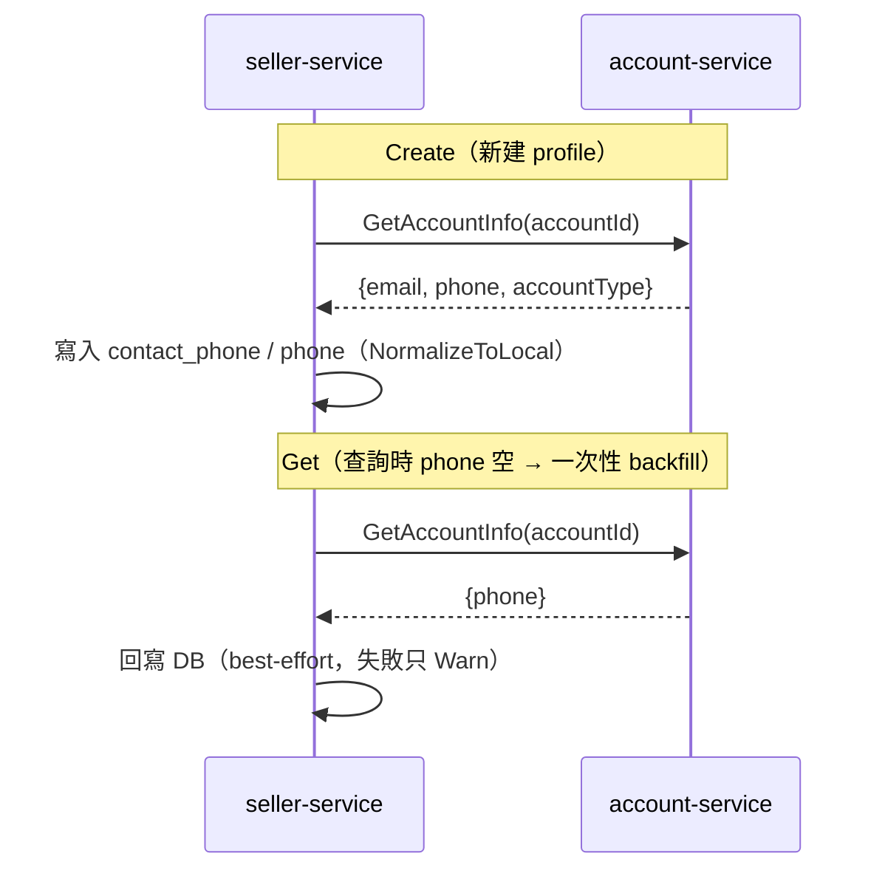

| 時機 | 行為 |
|------|------|
| **Create** | `GetAccountInfo` 取 phone 寫入；呼叫端已帶則優先 |
| **Get** | phone 空時 lazy backfill，回寫一次 |

實作：`seller-service/internal/usecase/seller.go`（`Create` / `GetByAccountID`）。phone 由使用者於 OTP 流程輸入、account-service 驗碼成功後建帳時 `NormalizeToLocal`（09xx）、下游讀時再 normalize（idempotent）。

---

## 6. 資料庫 Schema

> 身份資料模型的單一真實來源：`seller.stores`、`seller.payuni_registrations` 的身份欄位與索引是 **[44 號 §5.1/§5.2](44-帳號與賣家買家身份模型（Account%20&%20Seller-Buyer%20Identity）詳細設計書.md)**，帳號表是 `docs/modules/identity.md` §9，`buyers` 是 `internal/modules/buyer/db/schema.sql`；買家關聯表細節見 [39 §3](39-買家服務（Buyer%20Service）詳細設計書.md)。
>
> 登入相關要點：帳號身份鍵 = `email`（partial unique `WHERE deleted_at IS NULL`）+ `auth_providers(provider, provider_sub_id)` UNIQUE；`phone` **非** unique（#944）。登入一律查 `auth_providers`；`accounts` 不持有 `firebase_uid` / `nickname` / `avatar`。

登入專屬、不在身份模型規格範圍內的三處（#2035，語意見 §3「Bearer 憑證撤銷」）：

| 位置 | 欄位／表 | 用途 |
|---|---|---|
| `accounts` | `auth_epoch timestamptz`（NULL＝從未撤銷過） | 此刻之前簽出的 bearer JWT 全部作廢 |
| `admin_accounts` | `auth_epoch timestamptz` | 同上，admin 版——admin 不在 `accounts`，帳號級撤銷全都搆不到它 |
| `revoked_tokens` | `token_hash`(PK) / `account_id` / `account_type` / `expires_at` / `revoked_at`，`expires_at` 上有 GC 用索引 | 單枚憑證的撤銷名單；`expires_at` 是「這枚憑證最後還能做事的時刻」＝`max(exp, iat+refresh 寬限期+24h 餘裕)`，過期列由 24h GC 排程收掉 |

---

## 7. 錯誤碼

標準回應為 **`{code, message, data}`**（envelope lint gate `41fc53c1` 強制；`message` 非 `msg`）。例外：1303 phone-verification 與少數相容端點為 Tier-2（頂層 `code`/`msg`）。

| Code | 說明 | 前端處理 |
|------|------|---------|
| 0 | 成功 | 正常流程 |
| 1201~1207 | 手機 OTP 業務碼（重送冷卻 / 每日上限 / IP 上限 / 碼錯誤 / 碼過期 / 嘗試上限 / 簡訊發送失敗）| 依碼提示重試；定義見 [51 號](51-簡訊發送與手機%20OTP%EF%BC%88Mitake%20SMS%20&%20Phone%20OTP%EF%BC%89詳細設計書.md) 與 [錯誤碼 CodeMeta](../代碼管理%EF%BC%88CodeMeta%EF%BC%89/錯誤碼.md) |
| 1303 | 新用戶需手機驗證（Tier-2 envelope）| 導向手機驗證頁 → 發 OTP → 輸碼（§4.1）|
| 1304 | Email 已綁其他 provider | 顯示「合併帳號」，取 `tempBindToken` → `/public/auth/link/confirm`（§11）|
| 1305 | Provider race，綁到不同帳號 | 顯示錯誤、請重試 |
| 1306 | Provider 已被綁定（**`BindAuthProvider`**，非 LinkConfirm）| 顯示錯誤 |
| 1307 | 不能解綁最後一個 provider（**`UnbindAuthProvider`**）| 顯示錯誤 |
| 1308 | `loginRole` 不在 `accountType`（gateway subset 防呆，**生產罕見**）| 顯示錯誤 |
| 4001 | `tempBindToken` 過期 / 簽章 / purpose 錯（LinkConfirm 專屬）| 重走登入 |
| 400 | 參數錯誤 | 顯示錯誤 |
| 401 | JWT 失效（**注意：web session 暫不可用回 503 非 401**，§3 韌性）| 導向登入頁 |
| 404 | 資料不存在 | 買家忽略 / 賣家觸發 onboarding |
| 409 | 帳號已被其他 Google 帳號綁定 | 顯示錯誤 |

---

## 8. 買家登入（差異部分）

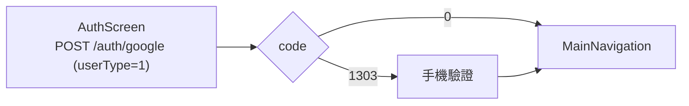

**與賣家關鍵差異：無 onboarding，登入後直接進主頁。** 每個帳號都是買家（見下），買家 App 不需要任何角色。

**買家只隨帳號刪除而關閉**：刪帳經 `accountdeletion`（`IdentityAppService.DeleteAccount`；ADR `docs/adr/2026-09-30-account-deletion-module.md`），有未結訂單時先等待，完成時在同一個 transaction 關閉買家並刪帳號。

**買家在建帳時建立**：identity 第一次認證、建立帳號的 transaction 內發布 `AccountCreated`，buyer 模組在同一個 transaction 建立帳號唯一的買家，不授予角色（買家不是角色）；任一步失敗整筆建帳回滾。登入與一般請求都不建立、不補建買家；帳號活著 ⇔ 買家活著，存活的帳號沒有現任買家是不變量被破壞，回 internal（ADR `docs/adr/2026-09-30-account-created-provisions-buyer.md`）。

**nickname 絕不為空**：建立時優先用 Clerk 上的姓名，為空則產生 `Hawkr 用戶XXXX`（比照 seller-service 預設店名）。

---

## 9. 賣家登入（差異部分）

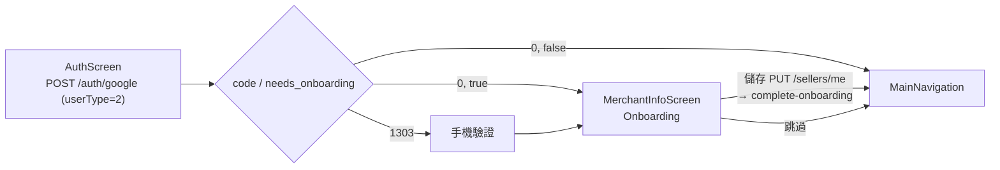

賣家 App 永遠送 `userType=2`（新契約是賣家視角的提示）。登入不授予 SELLER：開店、授予 SELLER 與 onboarding 仍是舊服務，遷移計畫 A3b 搬進 seller 模組。**Onboarding**：填店名（必填）/縣市/區域/地址/聯絡電話。

**Session 恢復（App 重啟）**：`GET /api/v1/sellers/me` → `0,false`→主頁 / `0,true`→onboarding / `404`→onboarding / 網路錯誤→本地快取。賣家 App 啟動時呼叫 `/auth/refresh`（§12）。

---

## 10. 買家 vs 賣家對比

| 項目 | 買家 | 賣家 |
|------|------|------|
| 視角（舊契約 userType／loginRole；Connect 沒有，只在舊 REST） | BUYER（1） | SELLER（2） |
| 角色 | 無：帳號活著就是買家 | SELLER，開店時授予 |
| 資料自動建立 | 建帳的同一個 transaction（`AccountCreated`） | CreateSeller |
| Onboarding | 無 | 有（店名、地址）|
| 預設值 | nickname=Clerk 姓名或 `Hawkr 用戶XXXX`（絕不為空） | onboarding_completed=false, storeName=`Hawkr 賣家XXXX`（絕不為空）|
| Token 刷新 | 不主動 | App 啟動呼叫 /auth/refresh |

> 有 SELLER 的帳號同時有買家與賣家兩份 profile；舊 REST 的 `X-Active-Role` 提示經單體推導成舊服務收到的 `X-Login-Role`，Connect 不讀它。

---

## 11. 1304 Email Collision Recovery — LinkConfirm

OAuth 時 email 已被其他 provider 綁定（例：先 Apple 註冊、後改 Google 登入），account-service 回 `1304` + `tempBindToken`。前端顯示「合併帳號」確認後呼叫 `/public/auth/link/confirm`。

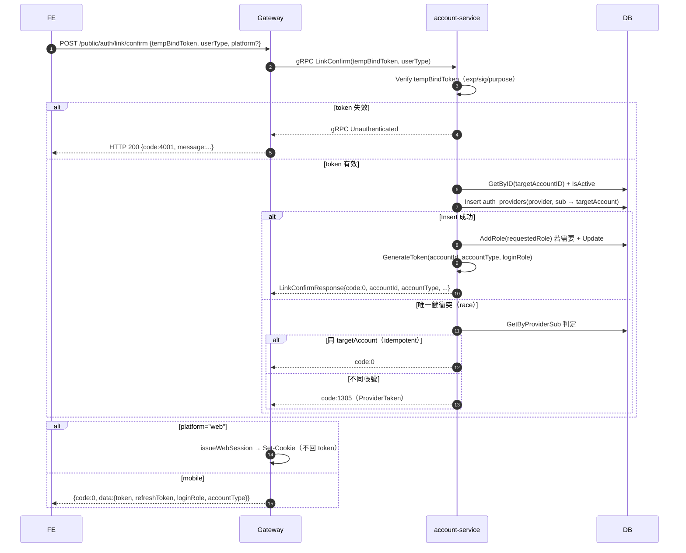

- **Auto-upgrade**：與 OAuth 共用；`loginRole=requestedUserType`（clamp 1\|2），帳號缺角色則 `AddRole` 並 persist（例：buyer-only 走 seller-app 1304 帶 userType=2 → accountType 升 3、loginRole=2）。
- **回應依 platform**：web → cookie、body 無 token；mobile → 完整 `{token, refreshToken, loginRole, accountType}`。
- **錯誤碼範圍**：LinkConfirm 僅回 `1305`（race）或 `4001`（token）。`1306/1307` 屬 `Bind/UnbindAuthProvider`、`1308` 屬 gateway subset，**非 LinkConfirm**（修正舊文件誤列）。
- 實作：`services/account-service/internal/usecase/link_confirm.go`。

---

## 12. Token Refresh

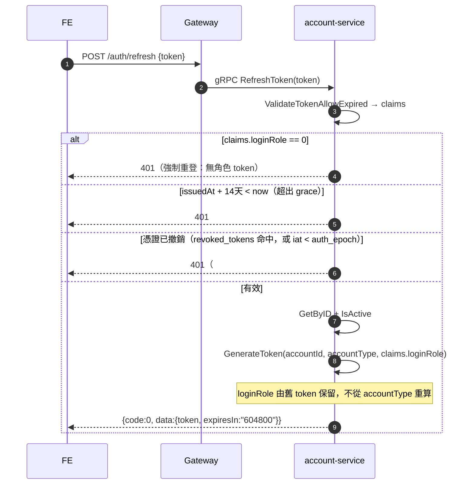

- `loginRole` **保留自舊 token**（不重算）；`loginRole==0` 的舊 token 強制重登。
- grace period **14 天**（`issuedAt+14d` 內可換）。
- account-service 內部 `RefreshToken == Token`（非另一組憑證）。
- **撤銷閘門（#2035）**：refresh 必須查與 gateway 相同的兩張名單，否則被撤銷的 token 換一枚新的就繞過去了——撤銷等於沒發生。因此 `revoked_tokens.expires_at` 取 `max(exp, iat + 14 天)` 而非 `exp`（見 §3「Bearer 憑證撤銷」）。

---

## 13. Demo 登入（App Review）

`POST /public/auth/demo`（`bbb4a00c`）：帳密登入，受 `DEMO_LOGIN_ENABLED` env gate 控制，僅供 App 商店審核；prod 預設關閉。

---

## 14. 帳號軟刪與 provider 清理

帳號刪除、角色移除與 `AccountDeleted` 事件的生命週期見 `docs/modules/identity.md` §3、§4 與 `docs/modules/accountdeletion.md`；賣家的關店與重新入駐見 **[44 號 §7.1/§7.5](44-帳號與賣家買家身份模型（Account%20&%20Seller-Buyer%20Identity）詳細設計書.md)**。

登入相關要點：帳號只經 `accountdeletion` 刪除（ADR `docs/adr/2026-09-30-account-deletion-module.md`），同一個 transaction 關閉買家；移除 SELLER 不刪帳號。刪除的帳號留墓碑，同一個 Clerk 使用者不會再建帳號。以下描述舊服務：**web session 的撤銷走 `DeleteByAccountID`**（刪光該帳號全部 `web_sessions` row，失敗即回錯誤）——那才是撤銷本身；緊接著以該呼叫回傳的 `token_hash` 逐出各自的 Redis 快取副本，即時性由這一步提供（逐出失敗只記 warn，不影響撤銷成立）。同時寫的 Redis 撤銷黑名單覆蓋的是**無狀態 mobile JWT**與逐出打不到 Redis 時的兜底（見 §3「Redis blacklist 的角色」）。（注意：admin/force 的 `SoftDeleteAccount` 路徑**不**清 auth_providers，留孤兒 link，靠登入端 `isLiveAccount` 防呆擋下——見 44 §11.1。）

---

## 15. account-service 啟動契約驗證

`f997fd2b`：啟動時若 Google client-id / Apple bundle-id 設定漂離宣告契約則 **hard-stop + log**（fail-fast），防止設定漂移造成靜默驗證失敗。逗號分隔多值支援（`45ac0268`/`de2ea7bc`）。
