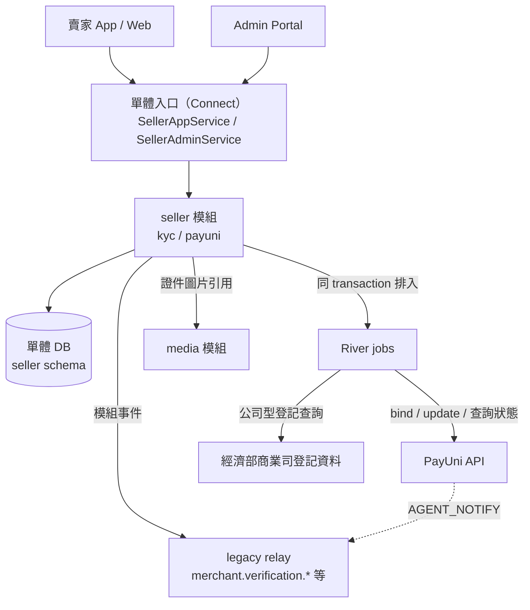
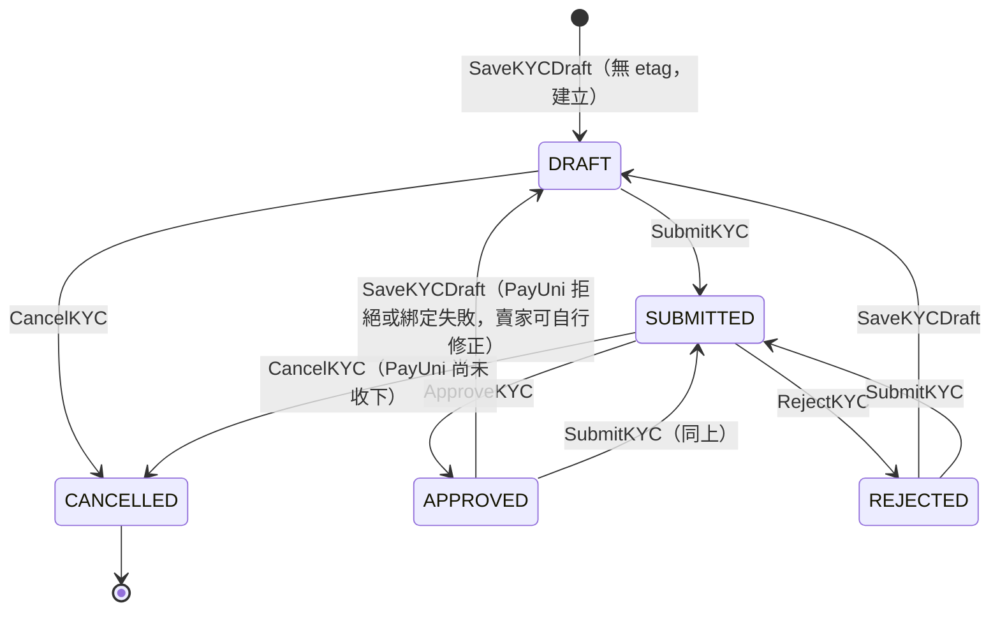
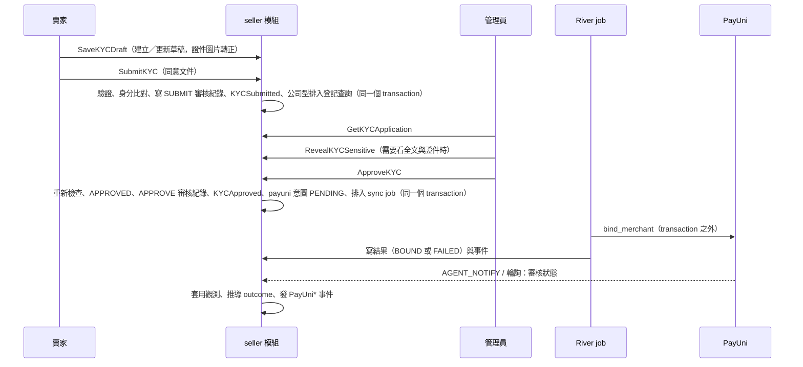

# 賣家實名認證 (Seller Certification) 詳細設計書

> 實名認證（KYC）與 PayUni 子商店綁定由單體的 seller 模組擁有（`internal/modules/seller/internal/kyc`、`internal/modules/seller/internal/payuni`）。表的欄位、CHECK 與欄位註解的權威定義在 `internal/modules/seller/db/schema.sql`；契約（欄位、錯誤、額度）的權威定義在 `api/hawkr/seller/v1alpha1/seller.proto` 與 `api/hawkr/admin/seller/v1alpha1/seller.proto`。本文件描述兩者之上的流程、狀態與不變量。決策與理由見 ADR `2026-10-19-seller-kyc-payuni-consolidated`。

---

### 1. 服務概述與責任邊界

#### 1.1 職責

- 唯一職責：管理店家實名認證的完整生命週期，包含身分資料蒐集、文件審核、身分比對、PayUni 子商店綁定與審核狀態同步。
- 申請以 `store_id` 為鍵：一個店家同時最多一筆還沒取消的申請（`kyc_applications_open`），沒有申請 ID 的「建立」動作；被退回的重送沿用原列。
- 兩條互相獨立的軸：
  - **認證軸**（`kyc_applications.status`）只記人工決定：`DRAFT`、`SUBMITTED`、`APPROVED`、`REJECTED`、`CANCELLED`。
  - **PayUni 軸**（`payuni_registrations`）記綁定意圖、綁定狀態與 PayUni 回報的審核狀態。
  - 賣家與後台看到的「流程狀態」由兩軸推導（§3.3），不存。
- 雙重審核（**閘門式，非並行**）：平台管理員審核是「送出至 PayUni 前的閘門」，核准後才寫入 PayUni 綁定意圖；兩者皆通過（認證軸 `APPROVED` 且 PayUni 註冊已綁定、審核結果核准）才算「KYC 流程核准」，是開賣收單的前置條件之一（`KYC_APPROVED`，見 46 號）。
- 駁回重新提交：被退回後可修改再送出；退回帶逐項問題，賣家處理一項就標記該項已處理。

#### 1.2 系統架構圖



> **通訊原則**：外部呼叫（PayUni、經濟部商業司）只在 River job 內、DB transaction 之外發生；人工決定、意圖、審核紀錄與事件在同一個 transaction 內寫入。PayUni 的 AGENT_NOTIFY 由 legacy 的 RabbitMQ consumer 呼叫 `payuni.Service.Receive`，工作持久化之後才 ack。

---

### 2. 資料庫設計 (Database Schema)

#### 2.1 表總覽

所有表在 `seller` schema。欄位、CHECK、索引與用途註解以 `schema.sql` 為準，此處只列職責與不變量。

| 表 | 職責 | 基數 | 個資 |
|---|---|---|---|
| `kyc_applications` | 申請本體（草稿與送出共用同一組具型別的欄位，沒有自由格式 JSON） | 1／店家（未取消的） | 身分證號、負責人身分證號、銀行帳號為密文；姓名、生日明文 |
| `kyc_identity_hashes` | 身分比對索引：每個識別欄位用金鑰環每一把金鑰算的 blind index 各一列 | N／申請 | 無（HMAC） |
| `kyc_documents` | 證件與文件圖片引用（身分證正反面、存摺封面各一張，公司文件最多 10 張） | N／申請 | 指標（media） |
| `kyc_registration_checks` | 公司型申請送件時對經濟部商業司登記資料的查詢快照 | N／申請 | 公司名稱與地址（隨申請清除） |
| `kyc_reviews` | 審核紀錄，append-only：誰、何時、什麼決定、理由，不含欄位值 | N／申請 | 無 |
| `kyc_review_issues` | 退回時逐項指出的問題（欄位路徑、原因碼、給賣家看的說明） | N／審核紀錄 | 無 |
| `kyc_reveals` | 後台「顯示全文」的稽核紀錄，同時是限時授權 | N／申請 | 無 |
| `kyc_document_accesses` | 證件圖片讀取紀錄，append-only | N／授權 | 無 |
| `payuni_registrations` | PayUni 子商店註冊：綁定意圖、綁定狀態、PayUni 目前的審核狀態（投影） | 1／店家 | 審核意見原文 `reason` 屬個資 |
| `payuni_observations` | PayUni 狀態的觀測紀錄，append-only（webhook、輪詢、手動刷新、綁定） | N／店家 | `reason` 屬個資 |
| `agreement_acceptances` | 入駐同意紀錄（KYC 送出時綁審核紀錄） | N | IP、User-Agent |

#### 2.2 申請 `kyc_applications`

- **主鍵與版本**：`application_id` 為 UUIDv7（應用層產生）；`version` 是樂觀鎖，所有寫入者必帶讀到的版本（etag 的來源）；`submission_seq` 每次 `SubmitKYC` 加一，登記資料查詢綁定那一輪送件。
- **賣家型態**：`INDIVIDUAL` 或 `COMPANY`。個人只有自己的身分證號，公司只有負責人的；公司欄位（公司名稱、統編、設立日、公司地址、公司電話、負責人身分證號）只屬於公司（`kyc_applications_type_fields_check`）。公司地址以內政部鄉鎮市區代碼表示（同 stores）。
- **完整性**：草稿除了身分以外都可以缺；`SUBMITTED`／`APPROVED`／`REJECTED` 的必填由 `kyc_applications_complete_check` 保證，必填項目與缺少時的說明的規則只有 `kyc.requirements` 一份（送出檢查與申請檢視的 `missing_fields` 都由它推導）。
- **聯絡資料不在申請上**：送給 PayUni 的聯絡人、聯絡手機、客服信箱是店家（`stores`）的欄位。
- **個資清理**：店家關閉滿保留期（`StoreRetention`）後，purge 套件清掉全部個人欄位（密文、blind index、姓名、生日、證件資訊、聯絡方式、公司與地址）並記 `pii_purged_at`；審核事實（狀態、時間、審核紀錄）與不具名欄位（`seller_type`、`product_type`）保留。`kyc_applications_purged_check` 列出被清掉的欄位。處分的身分快照（`measure_identities`）不在這裡，隨措施結束才刪，所以清理不影響身分比對。

#### 2.3 個資保護

| 層 | 做法 |
|---|---|
| 加密 | `id_card_no`、`rep_id_card_no`、`bank_account` 以 AES-256-GCM 封裝（`platform/seal`，AAD 是申請 ID 加欄位名）；啟動時 Keys 與 MAC 必須存在，個資不能在沒有加密的情況下寫入 |
| 比對 | 每個識別欄位（身分證號、負責人身分證號、統編、銀行帳號）另有 keyed HMAC blind index（輸入帶欄位標籤），金鑰環每一把金鑰一列（`kyc_identity_hashes`）；輪替後缺新金鑰的列由 `RehashKYCIdentities` 在啟動時補算，被參照的金鑰必須都在金鑰環（`CheckKYCKeys`） |
| 檢視 | 賣家與後台的檢視中身分證號與銀行帳號只有遮蔽值；全文只經 `RevealKYCSensitive`，稽核寫不進去就不回傳明文 |
| 證件圖片 | 必須是機敏上傳（media 在機敏通道加密落庫、只能由擁有者授權後讀）；後台讀圖要有未到期的顯示全文授權（§5.8） |
| 清理 | 見 §2.2 |

#### 2.4 PayUni 註冊 `payuni_registrations`

- 一個店家一列（`store_id` 為主鍵），**這一列就是綁定的意圖**：核准時在同一個 transaction 寫入（`bind_status = PENDING`）並排入 job。`mer_id` 是 `HAWK` 加 `store_code`，一個 stint 一次性。
- **不存請求本體**：bind 與同步的內容在 job 執行時由 KYC（解密）、店家與這一列的聯絡欄位組出來，送出就丟。
- **同步意圖**：任何需要送給 PayUni 的資料改變（核准、店家改聯絡資料或地址、重新綁定）使 `intent_seq` 加一；`synced_seq` 是 job 上次送出時讀到的 `intent_seq`，兩者不等表示有東西還沒送。
- **PayUni 目前的狀態**是它回報的原碼（`mer_status`、`member_status`、`credit_status` 等）加推導的 `outcome`（`NONE`、`UNDER_REVIEW`、`PENDING_INFO`、`APPROVED`、`REJECTED`、`UNRECOGNIZED`），兩者由同一個條件式 UPDATE 一起寫入；只有事件時間（`executed_at`）比 `status_observed_at` 新的觀測才更新（亂序的舊通知不倒退）。
- **付款能力不存**：`outcome = APPROVED` 且 `bind_status = BOUND` 時才有。
- 錯誤欄位：`bind_error_code` 只在 `FAILED`；`sync_error_code` 是上一次聯絡欄位或地址同步被 PayUni 永久拒絕的代碼（賣家再改一次才重送）；`bind_failed_at` 是後台待辦的開始時間。
- `resubmitted_at`：已綁定的註冊在 PayUni 拒絕之後賣家重新送出、再核准的時間；重新核准不再 bind（MerID 已存在），改以 `update_merchant` 送新的聯絡欄位與地址，輪詢在這個時間之後的一段期間內繼續問，直到 PayUni 回報新的結果。

---

### 3. 狀態機設計 (State Machine)

#### 3.1 認證軸（`kyc_applications.status`）



| 當前狀態 | 允許轉換至 | 觸發 |
|---|---|---|
| `DRAFT` | `SUBMITTED`、`CANCELLED` | 賣家送出／取消 |
| `SUBMITTED` | `APPROVED`、`REJECTED`、`CANCELLED` | 管理員核准／退回；賣家取消（PayUni 已收下店家時不能取消） |
| `REJECTED` | `DRAFT`、`SUBMITTED` | 賣家修改後儲存草稿，或不修改直接重送；沿用同一筆申請 |
| `APPROVED` | `DRAFT`、`SUBMITTED` | 只在流程狀態 `CanResubmit`（§3.3）時；其餘狀態儲存與送出都回 `failed_precondition` |
| `CANCELLED` | （終態） | 取消之後可以重新建立新申請 |

- `status` 只記人工決定，不混入 PayUni 的狀態。
- `decided_at` 有值 ⇔ `APPROVED` 或 `REJECTED`（`kyc_applications_decided_check`）。
- 轉移一律以目前的狀態與版本為條件（`transition`）；0 列受影響視為版本衝突。

#### 3.2 PayUni 軸

**綁定狀態**（`bind_status`）：

| 值 | 意義 |
|---|---|
| `PENDING` | 意圖已寫入，job 還沒送出或正在重試 |
| `BOUND` | PayUni 已收下註冊（或查詢確認它已存在並認領） |
| `FAILED` | 被永久拒絕、資料不完整或重試用盡；由管理員重新綁定（資料不完整且賣家補齊後自動回到 `PENDING`） |

**審核結果**（`outcome`）由 PayUni 回報的 `(MerStatus, MemberStatus)` 推導（`model.PayUniOutcomeOf`，認不得的碼 fail closed 為 `UNRECOGNIZED`，不當成核准、不通知）：

| 條件 | outcome |
|---|---|
| 兩者皆無 | `NONE` |
| `MerStatus` 為 `2`、`8`、`92`、`99`（商家層級終止） | `REJECTED`（MemberStatus 無關） |
| `MerStatus` 為 `91` | `PENDING_INFO`（MemberStatus 無關） |
| `MerStatus` 為 `1` 或 `9` 且 `MemberStatus` 為 `8`、`92`、`99` | `REJECTED` |
| `(1,1)` | `APPROVED` |
| `(1,5)`、`(9,5)` | `PENDING_INFO` |
| `(1,9)`、`(1,空)`、`(9,1)`、`(9,9)`、`(9,空)`；`MerStatus` 為 `1` 或 `9` 的其他組合 | `UNDER_REVIEW` |
| `MemberStatus` 為 `5`（其他 MerStatus） | `PENDING_INFO` |
| 其餘 | `UNRECOGNIZED` |

**會員層 onboarding**：`bind_merchant` 只建立「商店」；PayUni 判斷賣家是否已是會員，非會員時自動建立會員並寄信給賣家。新會員必須**自行到 PayUni 後台**驗證 email、填會員資料並送審，`MemberStatus` 才由 `5`（待補資料）轉為 `1`（啟用）。此流程完全在 PayUni 端，平台無法代填，查詢狀態也不回會員層缺漏細節（`Reason` 只用於商店層退件），所以 client 只能引導賣家至 PayUni 後台。`MemberStatus` 是自然人層級：同一賣家旗下多個商店共用同一個會員狀態。

`MemberStatus` 代碼：`1` 啟用、`5` 待補資料、`8` 拒絕、`9` 待審核、`92` 審核失敗、`99` 關閉／停權。

#### 3.3 流程狀態（推導，不存）

`KYCFlowStatus` 由認證軸與 PayUni 註冊合成（`model.DeriveKYCFlow`、`PayUniPhaseOf`）：

| 流程狀態 | 條件 |
|---|---|
| `NOT_STARTED` | 沒有申請，或申請已取消 |
| `DRAFT`、`SUBMITTED`、`REJECTED` | 認證軸的同名狀態 |
| `BINDING` | 已核准，沒有註冊列或 `bind_status = PENDING` |
| `BIND_FAILED` | 已核准，`bind_status = FAILED`，等管理員處理 |
| `FORWARDED` | 已綁定，`outcome` 為 `NONE` 或 `UNRECOGNIZED`（PayUni 收下了，還沒有審核結果） |
| `UNDER_REVIEW` | 已綁定，`outcome = UNDER_REVIEW` |
| `PENDING_INFO` | 已綁定，`outcome = PENDING_INFO` |
| `APPROVED` | 已綁定，`outcome = APPROVED`：可以收款 |
| `PAYUNI_REJECTED` | 已綁定，`outcome = REJECTED` |

賣家看到的 PayUni 狀態（`PayUniState`，`SellerPayUniOf`）一個值對應賣家的一種動作：

| 值 | 意義 | 賣家動作 |
|---|---|---|
| `REVIEWING` | 綁定中或 PayUni 審核中 | 等 |
| `PENDING_INFO` | PayUni 要求補件 | 看 PayUni 的信、到 PayUni 後台補 |
| `FIXABLE` | 申請的資料有問題 | 修改申請後自己重新送出 |
| `FIX_VIA_SUPPORT` | 店家設定的資料有問題 | 改店家設定後由平台重新處理 |
| `CONTACT_SUPPORT` | 沒有賣家能修正的資料 | 找客服 |
| `RETRY_LATER` | PayUni 暫時無法處理 | 等平台重新送出 |
| `TERMINATED` | PayUni 端的商店已是終止狀態（`MER_2`／`MER_8`／`MER_92`／`MER_99`），同一個店家無法再綁定 | 關店後以新的 `store_code` 重新入駐 |
| `APPROVED` | 可以收款 | — |

- 只有申請已核准，或申請是草稿且註冊屬於這份申請而且推導為 `FIXABLE`（賣家正在修正 PayUni 拒絕或綁定失敗的那份申請，問題要留著）時才有 PayUni 狀態。
- 問題的處置（`PayUniRemedy`：`SELLER_FIX`、`CONTACT_SUPPORT`、`RETRY_LATER`）與要補的欄位由 PayUni 錯誤碼分類（`ClassifyPayUniCode`）決定；欄位清單依賣家型態過濾，已鎖定的身分欄位不列。
- **`CanResubmit`**：草稿、被退回、已取消為真；已核准時只有推導為 `FIXABLE` 才為真；`SUBMITTED` 為假。`SaveKYCDraft` 與 `SubmitKYC` 的前置條件是同一個旗標，不能做時的原因（`ResubmitUnavailableReasons`）與句子只在 `model/kyc_resubmit.go` 產生。
- **身分鎖定**（`IdentityLocked`）：註冊存在（有 MerID）而且 `bind_status` 不是 `FAILED` 時，`bind_merchant` 送出的身分欄位（姓名或公司名稱、身分證號或統編、負責人、英文名稱、官網、商品類型、賣家型態）不能改，因為 `update_merchant` 不能改核心身分欄位；店名與介紹也同樣鎖（KYC 審核中、或 PayUni 已收下之後都不能改）。身分的錯誤只能關店、以新的 `store_code` 重新入駐。可改的是聯絡信箱、聯絡手機、公司電話與不送給 PayUni 的資料（生日、證件資訊、銀行、公司地址、證件圖片）。

#### 3.4 可收單前置條件

「KYC 流程核准」（店家能力 `KYC_APPROVED`、`seller.store_requirement_flags.kyc_approved`）= 目前那一筆還沒取消的申請已核准，而且 PayUni 註冊已綁定、審核結果核准（流程狀態 `APPROVED`）。它是物流建店能力與店家公開曝光的條件之一（46 號 §3.5）；管理員核准後、PayUni 尚未通過前不能收單。PayUni 在核准之後退件時，流程狀態離開 `APPROVED`，條件自然不成立，不需要額外的降級路徑。

---

### 4. 介面定義 (API Specification)

契約以 proto 為準，此處列方法與要保證的行為。所有方法是 Connect；賣家方法由 `SellerAppService` 的宣告表檢查能力（46 號 §3.1），後台方法由管理員權限檢查。

#### 4.1 賣家端（`SellerAppService`）

| 方法 | 能力 | 行為 |
|---|---|---|
| `SaveKYCDraft` | `CAP_STOREFRONT_WRITE` | 部分更新（update_mask）呼叫者店家的草稿。申請是店家的單例資源：沒有申請時不帶 etag 的呼叫建立它；已有申請時 etag 必填，沒帶回 `already_exists`、版本不符回 `aborted`，ErrorInfo.reason 都是 `VERSION_CONFLICT`。被退回的申請在這裡回到 `DRAFT`。全部欄位先驗證才寫入，任何一欄不合法都不寫入；不能重新送出（`CanResubmit` 為假）回 `failed_precondition`，訊息是 `resubmit_unavailabilities` 的第一句 |
| `GetMyKYC` | `CAP_ACCOUNT_SELF_READ` | 回傳目前的申請（身分證號與銀行帳號遮蔽）、證件、最近一次退回的理由與逐項問題（含是否已處理）、流程狀態、PayUni 狀態與 `missing_fields`、`missing_store_fields`；還沒有申請（或已取消）回 `not_found` |
| `SubmitKYC` | `CAP_STOREFRONT_WRITE` | 送出審核（§5.3）。每個帳號每小時最多 5 次，超過回 `resource_exhausted`（帶 RetryInfo） |
| `CancelKYC` | `CAP_STOREFRONT_WRITE` | 取消草稿或審核中的申請（§5.4） |
| `LookupBusinessRegistration` | `CAP_STOREFRONT_WRITE` | KYC 表單輔助：以統編代為查經濟部商業司公開資料；每個帳號每分鐘最多 10 次 |

#### 4.2 後台（`SellerAdminService`）

| 方法 | 行為 |
|---|---|
| `ListKYCApplications` | 審核佇列：只列送出過的申請（不含草稿，也不含沒送出就取消的），依送出時間排序（篩選 `SUBMITTED` 時舊到新，其他新到舊）；以狀態與關鍵字（姓名、公司名稱、統編的子字串）篩選；keyset，預設 20、上限 100；清單項目不帶證件圖片。`DRAFT` 回 `invalid_argument` |
| `GetKYCApplication` | 一筆申請的後台檢視：遮蔽的欄位、證件、審核紀錄、銀行帳號是否與別的受處分帳號相同的標記、登記資料查詢結果、各動作的不可用原因（`approve_unavailabilities` 等）。賣家的草稿讀不到（`not_found`） |
| `ListKYCReveals`、`ListKYCDocumentAccesses` | 顯示全文與證件讀取的稽核紀錄，新到舊 keyset |
| `ApproveKYC`、`RejectKYC` | 核准、退回（§5.5、§5.6）。etag 必填，不符回 `aborted`（`VERSION_CONFLICT`），不寫入 |
| `RevealKYCSensitive` | 顯示身分證號、負責人身分證號與銀行帳號全文，並授權這位管理員 15 分鐘內讀這筆申請的證件圖片（§5.8）。是 POST，回應不可快取 |
| `RequeryKYCRegistration` | 對審核中的公司型申請重新查一次登記資料（§5.7） |
| `GetPayUniRegistration` | 讀店家的 PayUni 註冊（綁定意圖、PayUni 的審核狀態碼、階段、要處理的問題、`rebind_unavailabilities`）；店家還沒有核准過申請時 `not_found` |
| `RebindPayUni` | 對綁定失敗的註冊重新綁定（§5.9），留下 `REBIND` 審核紀錄 |
| `ListPayUniObservations` | 店家的 PayUni 觀測紀錄，依事件時間新到舊 keyset，預設 20、上限 100 |
| `RefreshPayUniStatus` | 排入一次向 PayUni 查詢審核狀態的 job（營運工具；回應不等結果）。PayUni 沒有設定或註冊還沒綁定時 `failed_precondition` |

證件圖片是 HTTP GET 而非 Connect（回應是圖片本身）：`GET /api/files/admin/seller/kyc_applications/{application_id}/documents/{slot}/{position}`，`slot` 是小寫位置名（`id_card_front`、`id_card_back`、`bank_book`、`company_document`）；驗證與後台 Connect 方法相同，授權是管理員且持有這筆申請未到期的顯示全文授權；機敏檔案 `no-store`。

#### 4.3 錯誤約定

- 缺少的欄位：`invalid_argument`，BadRequest 的每個 field 是 `KYCApplication` 的欄位路徑（`real_name`、`id_card_front`、`business.tax_id`……，與 `KYCField` 一對一）。
- 版本衝突：`aborted`／`already_exists`，reason `VERSION_CONFLICT`；client 保留輸入、顯示最新版本。
- 不能做的動作：`failed_precondition`，訊息是對應 `*_unavailabilities` 的第一句。
- 同意文件版本不是現行版本：`failed_precondition`，reason `AGREEMENT_OUTDATED`。
- 身分比對沒有通過：`failed_precondition`，訊息固定，不透露是哪個欄位或哪個帳號。
- 能力不足（停權、等待刪除）：見 46 號 §3.5。

---

### 5. 業務流程詳細設計 (Business Logic)

#### 5.1 完整認證流程（Happy Path）



#### 5.2 儲存草稿（SaveKYCDraft）

- 授權由模組做：申請以帳號目前的店家為準，不接受別人的申請 ID；需要 `CAP_STOREFRONT_WRITE`。
- 全部輸入先驗證、個資加密之後才寫入；證件圖片在 transaction 之外轉正（轉正不建立引用，失敗的請求已轉正的資產由 media 的 GC 在建立滿 7 天後回收），寫入的 transaction 內把被換掉的證件記成退場並排入引用的同步。
- 證件請求的位置是狀態不是指令：單張的位置整個換成請求的那一張（現有的圖片以 asset ID 保留、新的以 staged token 轉正、空的清掉），公司文件整個換成請求的清單；同一個 staged token 在整個請求只能出現一次。
- 已有 `MerID` 的註冊（身分鎖定）時，拒絕改動鎖定的身分欄位。
- 鎖順序：店家列先、申請列、註冊列後。

#### 5.3 送出（SubmitKYC）

1. 驗證同意文件（種類不對 `invalid_argument`；版本不是現行版本 `AGREEMENT_OUTDATED`），先於一切業務檢查。
2. 在鎖內重新檢查能力與 `CanResubmit`；必填欄位與三張證件（公司另需公司文件的規則依 `FieldAppliesTo`）齊全，缺的一次全部列出。
3. 申請齊全之後，PayUni 綁定需要的店家資料（地址、聯絡人姓名與手機、客服信箱）還有缺漏時回 `failed_precondition`（店家的狀態不在請求裡），client 讀 `GetMyKYC` 的 `missing_store_fields` 取得缺哪些，以 `UpdateMyStore` 補齊。
4. 身分比對：身分證號（含負責人）或統編命中別的帳號生效中的處分，不能通過（泛用錯誤）；銀行帳號命中只標記不擋（家人或配偶共用帳戶是常態）。比對用金鑰環的每一把金鑰重算；處分是否生效一律經 `stint.Derive`。權威的比對在核准時。
5. 同一個 transaction：寫入、同意紀錄（綁這次送出的審核紀錄）、`SUBMIT` 審核紀錄、`KYCSubmitted` 事件；公司型再新增一列 `PENDING` 的登記資料查詢並排入 job（§5.7）。

#### 5.4 取消（CancelKYC）

- 草稿或審核中的申請可取消；已核准的不能取消，被退回的申請就留著。
- 身分已鎖定（PayUni 已收下）時不能取消，否則店家可以新申請繞過身分鎖；訊息提示關店後重新入駐。
- 轉移為 `CANCELLED`、寫 `CANCEL` 審核紀錄、證件引用全數記退場、發 `KYCCancelled`、重新公告曝光。

#### 5.5 核准（ApproveKYC）

在同一個 transaction 內：

1. 鎖住帳號的全部 stint（鎖順序與處分的寫入相同），再鎖申請列；在鎖內重新確認 etag（申請版本加顯示的登記資料查詢序號，版本不符一律先於狀態檢查）、狀態、店家還在營業、申請人的帳號沒有停權、身分沒有命中別的帳號生效中的處分（命中回泛用錯誤，不透露欄位或帳號）。
2. 設為 `APPROVED`、寫 `APPROVE` 審核紀錄（含核准時顯示的登記資料查詢）、發 `KYCApproved`。
3. 寫入（或刷新）PayUni 綁定意圖：`bind_status` 回到 `PENDING`，並排入以 `store_id` 為唯一鍵的 sync job。**這裡不呼叫 PayUni**。
4. 帳號停權時不能核准、可以退回；店家不是營運中或帳號停權的期間，申請不在後台待辦、沒有審核期限，恢復之後自動回到待辦。

#### 5.6 退回（RejectKYC）

- `reason` 必填；`issues` 是逐項指出的問題（至少一項；欄位路徑必須適用於這份申請的賣家型態，文件類欄位必須指到這份申請在那個欄位目前的文件）；`internal_note` 只給後台看。
- 鎖與重新檢查同核准；寫審核紀錄與問題、發 `KYCRejected`（對應 `merchant.verification.rejected`）。帳號停權中仍可退回。
- 賣家修改後重送沿用同一筆申請。「賣家還沒處理的問題」只算最近一次退回、而且之後沒有別的審核紀錄的那些；賣家處理一項（欄位值被改過，或指到的文件被移除或替換）時，由寫入申請的 transaction 在比對新舊值之後標記 `resolved_at`。

#### 5.7 登記資料查詢（公司型）

- 送件與後台重新查詢各新增一列 `PENDING` 的 `kyc_registration_checks`（綁定這一輪送件的 `submission_seq`）並排入 job（以 `check_id` 為唯一鍵）。流程三段：transaction 內認領（申請已不是這一輪審核中、或同一輪已有更新的查詢就寫 `CANCELLED`）→ transaction 外呼叫資料來源 → 另一個 transaction 寫結果（只在仍是 `PENDING` 時寫，重複投遞與先後完成都不覆寫）。
- 結果 `outcome`：`FOUND`（帶登記資料與比對結果）、`NOT_FOUND`、`UNAVAILABLE`、`CANCELLED`。比對只記錄（`mismatched_fields`、`unverifiable_fields`），不改申請狀態；結果是審核員的依據，不是自動決定。
- **期限**：查詢是有期限的資源，建立時寫入 `deadline_at`（`requested_at` 加 15 分鐘）；伺服器保證它在期限之前到終態。job 執行時已過期限就直接記 `UNAVAILABLE`、不呼叫資料來源。掃描 job `seller.kyc_registry_sweep`（每分鐘）把將到期的 `PENDING` 收成終態（仍屬這一輪審核中的記 `UNAVAILABLE`，其餘 `CANCELLED`），並把閒置超過 3 分鐘的 `PENDING` 補排 job。
- 後台顯示的是申請目前這一輪（`submission_seq`）`seq` 最大的已完成查詢；核准與退回把當時顯示的查詢記進審核紀錄。重新查詢把這一輪的 `PENDING` 全部取代（`CANCELLED`）再新增一筆。

#### 5.8 顯示全文與證件圖片讀取（JIT 授權）

- `RevealKYCSensitive`：在同一個 transaction 寫一列 `kyc_reveals`（誰、哪筆申請、何時、理由、`expires_at` = 顯示時間加 15 分鐘；永遠不含值）；稽核寫入失敗就不回傳明文。這一列同時是限時授權。
- 讀證件圖片：授權是**這位管理員**對這筆申請**未到期**的顯示全文紀錄（別的管理員的、過期的都不算）；沒有授權一律 `permission_denied`，不分申請存在與否。順序是安全性質：（1）transaction 內驗證授權並寫一列 `kyc_document_accesses`（含實際送出的 asset ID），commit 之後才（2）向 media 讀圖片。紀錄寫不進去就不讀（fail closed）；讀取失敗時紀錄仍在。

#### 5.9 PayUni 綁定與同步（`seller.payuni_sync`）

- **Job**：以 `store_id` 為唯一鍵（排隊中、執行中、等重試），同一個店家同時只有一個 job 呼叫 PayUni，連續的改動合併成一次。**沒有另外的租約或 per-replica 搶佔**；執行期間發生的改動靠 `intent_seq`：結果寫入後 `intent_seq` 比讀到的大，worker 以 snooze 再跑一輪。
- **三段式**：（1）transaction：鎖住註冊列、確認有事要做、記下 `intent_seq`（沒有註冊列、已失敗等管理員處理、沒有資料待送、店家已關閉都不做事）；（2）transaction 外：讀目前的資料（KYC 解密、店家地址、聯絡欄位）、呼叫 PayUni（20 秒 deadline，不存請求本體）；（3）transaction：寫結果與事件。鎖順序與所有寫入者相同：店家列先、註冊列後。一次 job 上限 60 秒。
- **做什麼**：`PENDING` 的註冊向 PayUni `bind_merchant`；`BOUND` 而且有資料沒送出的，送聯絡欄位與地址（`update_merchant`；PayUni 拒絕之後重新送出再核准的註冊也走這裡）。必填的店家資料有空的時候不呼叫 PayUni，記成同步失敗（`INCOMPLETE_DATA`，賣家補齊再改一次才重送）。
- **重試**：暫時性的失敗（傳輸錯誤、PayUni 的暫時性錯誤碼）由 River 退避重試，最多 8 次；最後一次嘗試仍失敗時，綁定記為 `FAILED`（`PAYUNI_UNAVAILABLE`），同步記為同步失敗。永久的失敗（PayUni 以驗證類的碼拒絕、資料不完整、沒有設定）直接記錄。
- **冪等**：MerID 是 `store_code` 的確定性函式；`AGENT04017`（MerID 已存在）不是失敗，先查詢狀態認領，所以結果不明（逾時）之後重送一律安全。認領時若是商家層級的終止狀態（退件、關閉），無法再綁定：記為 `FAILED`（`MERCHANT_TERMINAL`），要關店重新入駐。
- **資料改變**：店家改地址或聯絡資料時 `RequestSync`（`intent_seq` 加一並排入同一個 job）；店家還沒有註冊列時什麼都不做。綁定失敗的原因是資料不完整、而這次改動讓 `bind` 需要的資料補齊時才自動回到 `PENDING`。
- **恢復營業**：關店期間被放棄的綁定與同步在恢復營業的 transaction 內補排（`Resume`）。

#### 5.10 PayUni 狀態觀測

所有來源（webhook、輪詢、手動刷新、綁定）都追加一筆 `payuni_observations`，再套用到註冊的目前狀態：

- **Webhook（AGENT_NOTIFY，主通道）**：legacy consumer 呼叫 `Receive`；形狀不合（沒有 `event_key`、MerID 不是 `HAWK` 加店號、沒有 MerStatus）回 `InvalidInput`（重送也不會好，進 dead-letter）；MerID 合法但沒有這個店家為永久錯誤（不重試）。有 `ExecuteTime` 的排入以 `event_key` 為唯一鍵的 `seller.payuni_observe` job；沒有或格式不合的 `ExecuteTime` 無從排序，**不套用內容**（用收到的時間會重新引入亂序）。真正的冪等是 `UNIQUE(store_id, event_key)`，重複的通知只記一次、只套用一次。webhook 只有 `MerStatus` 與說明，沒有回報的欄位保留目前的值。
- **輪詢（補救）**：`seller.payuni_sweep` 每 15 分鐘（啟動即執行）補排「有資料沒送出又閒置超過 10 分鐘」的註冊（job 遺失、被丟棄的保底），以及排輪詢「超過 2 小時沒問過、PayUni 還沒有定論」的註冊（`seller.payuni_poll`）。輪詢與刷新回報完整的狀態：整組取代，沒有回報的欄位就是沒有值。
- **亂序保護**：觀測一定追加（歷史），但目前的狀態只有事件時間比 `status_observed_at` 新的才更新。
- **事件**：狀態有實質變化時，在同一個 transaction 發出 `PayUniApproved`、`PayUniPendingInfo`、`PayUniUnderReview`（只在從待補件回來時）、`PayUniRejected`；商家或會員層級的碼有變才通知；認不得的狀態不通知。綁定成功發 `PayUniForwarded`，綁定失敗發 `PayUniBindFailed`。
- **曝光**：PayUni 的審核狀態與綁定是「可公開曝光」的輸入，改變時在同一個 transaction 內重新公告曝光並排入 website 店家頁的快取失效。
- **保留**：觀測紀錄併入店家個資清理的保留期：店家關閉滿保留期後 `reason` 清成 NULL，狀態碼與時間保留。

#### 5.11 通知與事件

認證與 PayUni 的每個狀態變化都是 seller 模組的模組事件（`KYCSubmitted`、`KYCApproved`、`KYCRejected`、`KYCCancelled`、`PayUniForwarded`、`PayUniApproved`、`PayUniPendingInfo`、`PayUniUnderReview`、`PayUniRejected`、`PayUniBindFailed`），與狀態寫入在同一個 transaction；`event_id` 是觸發它的審核紀錄或觀測的 ID，穩定。通知服務仍消費的 `merchant.verification.*` MQ 訊息由 `internal/legacy/sellerrelay` 從模組事件轉出（欄位、JSON 型別與時間格式與舊契約逐欄位相同）。通知以 `reference_id` 去重由消費端負責。

#### 5.12 重新綁定（RebindPayUni）

管理員對 `FAILED` 的註冊重新綁定：回到 `PENDING` 並排入新的 job（不是再核准一次）。可用性與方法是同一個函式（`model.RebindUnavailableReasons`，與讀取時的 `can_rebind` 相同）：清單空就重新綁定；已經在重新綁定（`PAYUNI_BIND_IN_PROGRESS`）時重送安全、回傳目前的列；其餘原因（PayUni 端已終止、店家已關閉或等待刪除、已綁定、註冊所根據的申請不是已核准）回 `failed_precondition`。

---

### 6. 前端串接指南（賣家 App／Web）

#### 6.1 認證步驟與欄位

表單欄位以 `KYCApplication` 的欄位路徑為準。共用：`real_name`、`english_name`、`bank_name`、`bank_code`、`bank_account`、`product_type`、`website_url`、`id_card_front`、`id_card_back`、`bank_book`、生日與證件資訊；個人另有 `individual.id_card_no`；企業另有 `business.company_name`、`business.tax_id`、`business.company_register_date`、`business.company_address`、`business.company_phone`、`business.rep_id_card_no`、`business.company_documents`（最多 10 張）。必填項目與缺少時的說明由伺服器的 `requirements` 決定，client 不複製。

#### 6.2 串接流程

1. 進入認證：`GetMyKYC`。`not_found` 表示還沒有申請，顯示賣家型態選擇；有申請時依流程狀態顯示。
2. 儲存草稿：`SaveKYCDraft`（欄位以 update_mask 指定）。第一次不帶 etag，之後帶最近讀到的 etag；`VERSION_CONFLICT` 時保留輸入、顯示最新版本。證件圖片先以機敏上傳取得 staged token，再放進草稿。
3. 店家資料：送出前以 `GetMyKYC` 的 `missing_store_fields` 檢查，缺的以 `UpdateMyStore` 補齊（地址、聯絡人姓名與手機、客服信箱）。
4. 送出：`SubmitKYC` 帶同意的文件與版本；先處理 `AGREEMENT_OUTDATED`（重新取得現行版本，見 `GetSellerAgreements`）。
5. 等待：流程狀態 `SUBMITTED` 時顯示審核中；身分尚未鎖定時可以 `CancelKYC`。
6. 結果：被退回時顯示 `reason` 與逐項問題（欄位路徑對應表單欄位），修改後 `SaveKYCDraft` 或直接 `SubmitKYC`；已核准時依 PayUni 狀態（§3.3）顯示對應的面板與動作，`APPROVED` 不顯示面板。

#### 6.3 錯誤處理

| 回應 | 處理 |
|---|---|
| `invalid_argument`（field violations） | 依欄位路徑標示表單欄位 |
| `aborted`／`already_exists`（`VERSION_CONFLICT`） | 保留輸入、載入最新版本讓使用者對照 |
| `failed_precondition`（`resubmit_unavailabilities`） | 顯示訊息（伺服器句子），不重試 |
| `failed_precondition`（身分比對） | 顯示固定訊息，引導聯繫客服 |
| `failed_precondition`（店家資料缺漏） | 讀 `missing_store_fields`，導向店家設定 |
| `resource_exhausted` | 依 RetryInfo 等待 |
| `permission_denied` + `SELLER_SUSPENDED` | 導向停權公告頁（46 號 §7） |

#### 6.4 PayUni 會員層

`PENDING_INFO` 且是會員層待補（`MemberStatus = 5`）時，client 只能引導賣家到 PayUni 後台完成 email 驗證與會員資料送審，無法逐項列出缺什麼（§3.2）。

---

### 7. 狀態機簡圖

```
認證軸:   DRAFT ──送出──> SUBMITTED ──核准──> APPROVED ──(PayUni 拒絕且可自行修正)──> DRAFT / SUBMITTED
            │                │                                         
            │                └──退回──> REJECTED ──修改／重送──> DRAFT / SUBMITTED
            └──取消──> CANCELLED <──取消──┘

PayUni 軸（核准後）:
  bind_status:  PENDING ──job 成功──> BOUND
                   │                   │
                   └──失敗──> FAILED ──管理員重新綁定──> PENDING
  outcome（BOUND 之後）: NONE / UNDER_REVIEW ⇄ PENDING_INFO ──> APPROVED | REJECTED
```

---

### 10. 食品業者登錄的審核（單體 seller 模組，10d 第 2b 刀）

食品業者登錄不屬於實名認證：單體把它拆成獨立的審核資源 `seller.food_registrations`（決策：`backend/docs/plans/2026-09-29-a3-buyer-seller/step10d-d3b-decision-brief.md` 選項 F）。KYC 申請沒有食品欄位，店家表也沒有；店家公開的字號只讀目前核准的那一筆。公司時期的 `is_processed_food`、`food_business_reg_no` 與 KYC 核准時的投影，單體沒有對應的欄位或流程。

- **狀態**：`PENDING`、`APPROVED`、`REJECTED`、`WITHDRAWN`、`ENDED`（`end_cause`：`SUPERSEDED` 被新核准的取代、`CLEARED` 賣家清除、`REVOKED` 平台撤銷、`STORE_RETIRED` 店家個資清理時結束）。每家店最多一筆 `PENDING`、最多一筆 `APPROVED`（partial UNIQUE）；`APPROVED` 一定有字號。新值核准之前舊的核准照常有效；賣家清除與平台撤銷立即生效。
- **賣家**：`SubmitFoodRegistration`（已有待審時，字號相同沿用、不同取代）、`WithdrawFoodRegistration`（只撤回待審）、`ClearFoodRegistration`（結束核准的並撤回待審）；店家營運中（有 `CAP_STOREFRONT_WRITE`）隨時可以送，KYC 狀態不影響送出；字號與目前核准的相同時不建立新登錄（有待審的就撤回它）。
- **契約形狀**（Will 決定 2026-10-16，一個資源一個名稱，AIP-122、AIP-136）：賣家端與後台各只有一個 `FoodRegistration` message 與一個 `FoodRegistrationState`；賣家 `Store` 以角色命名四個欄位：`approved_food_registration`（核准中）、`pending_food_registration`（待審，有值時可以撤回）、`rejected_food_registration`（被退回而且之後沒有再送出新的）、`revoked_food_registration`（欄位 27 的合併欄位 `open_food_registration` 已拆成前兩個並保留編號，2026-10-22 enum-text-guard 設計書刀 1：client 以欄位有沒有值表達狀態，不比較登錄的 state）；賣家端狀態只有 `PENDING`、`APPROVED`、`REJECTED`、`ENDED`（撤回的賣家看不到，被平台撤銷的以 `ENDED` 帶 `end_time` 與 `end_reason`）。後台 `Store` 的 `approved_food_registration`、`open_food_registration` 與 `FoodRegistration.approved` 都是後台的 `FoodRegistration`（只帶登錄本身的欄位，審核用的欄位用 `GetFoodRegistration` 讀）。
- **後台**：`ListFoodRegistrations`（收件匣：營運中的店家的待審件，送出時間舊到新，依店家的 KYC 分 `inbox` 隊列，預設只列 KYC 已核准、可以裁定的件，`AWAITING_KYC` 列還在等 KYC 的件，keyset 只用 `(送出時間, id)`；每筆帶 `can_approve`）、`GetFoodRegistration`（KYC 主體只在已核准時帶出，賣家的草稿與審核中的內容後台看不到）、`DecideFoodRegistration`（核准要求該帳號的 KYC 已是 `APPROVED`，退回理由必填，內部註記選填）、`RevokeFoodRegistration`（撤銷核准中的登錄，見下一項）。
- **撤銷**（Will 決定 2026-10-16，`step10d-2b-decisions.md` DB）：`RevokeFoodRegistration` 是資源層級的更正，只結束核准中的那一筆（`end_cause = REVOKED`），給賣家看的理由必填，撤銷的管理員留在列上；撤銷不帶內部註記，核准時寫的註記留著（稽核紀錄只增不改）。店面與商品頁立即不再顯示這個字號；與措施（帳號層級）不連動，冒用或不實登錄另記違規認定（`FAKE_CERTIFICATION`）與措施；店家若有同字號的待審件不自動退回。賣家端以 `Store.revoked_food_registration` 看到最近一次撤銷：目前沒有核准、撤銷之後也沒有更新的待審或核准（更新的核准即使之後又結束也算）時才帶；補救是重新送審，不另設申覆。
- **告知與保存期間**（Will 決定 2026-10-16，DC）：送出前確認〈食品業者登錄個人資料蒐集告知事項〉（`FOOD_REGISTRATION_NOTICE`，記錄綁在那一筆登錄上）。字號與退回、撤銷的理由、內部註記隨店家個資清理（關店滿 30 天）清成 NULL，清理時仍核准中的登錄先結束（`STORE_RETIRED`）；審核紀錄（不含字號）保存到關店後 2 年（日曆年、台北時區），期滿整列刪除，綁在這一列的告知同意紀錄隨之刪除。
- **核對標準**（人工，沒有逐家登錄資料的 API；食藥署查詢頁 fadenbook 顯示哪些欄位**尚未驗證**，上線前要人工查一次再定稿）：
  1. 在食藥署的食品業者登錄查得到這個字號，而且登錄狀態有效。
  2. 企業賣家：登錄的業者統編或名稱，要與 KYC 的 `business.tax_id`、`company_name` 相符。
  3. 個人賣家：查詢結果有顯示業者名稱或負責人時，要與 KYC 的 `real_name` 相符；查詢結果不顯示時，只核對字號有效，並在內部註記寫明「僅核對有效」。
  4. 不符就退回，理由必填（賣家看得到）。
- **時效**：比照補正，7 個日曆天內裁定。
- 沒有法規或具名系統要求平台核對登錄字號（義務主體是賣家，食安法第 8 條第 3 項）；前台只顯示字號，不加「已核對」字樣。
