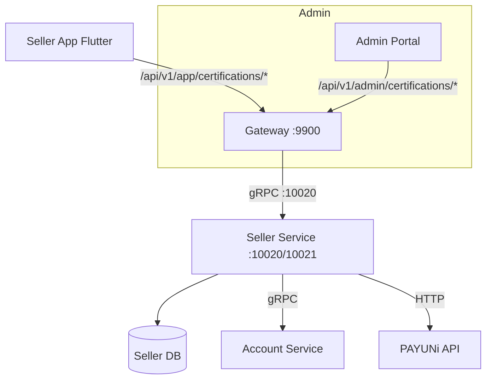
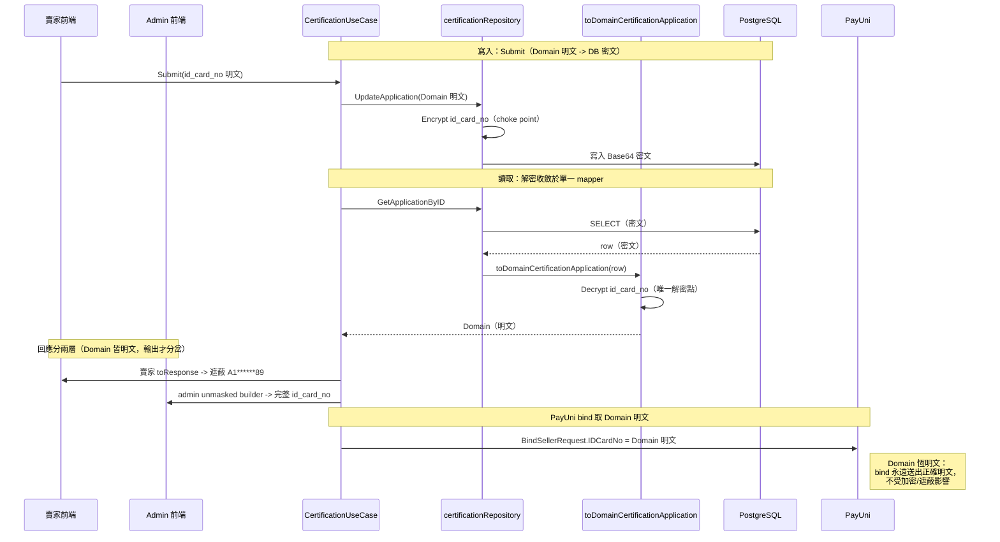
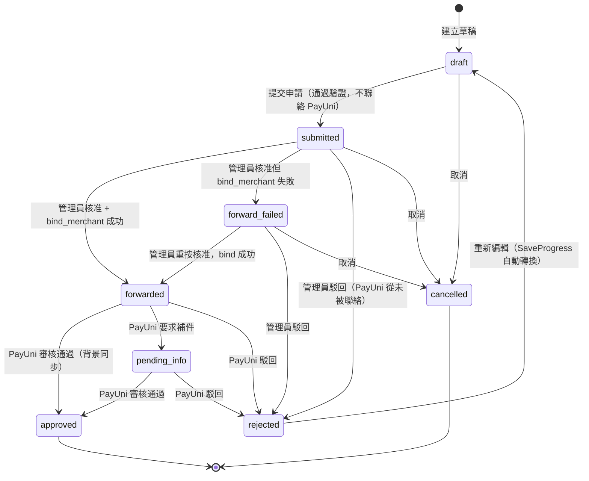
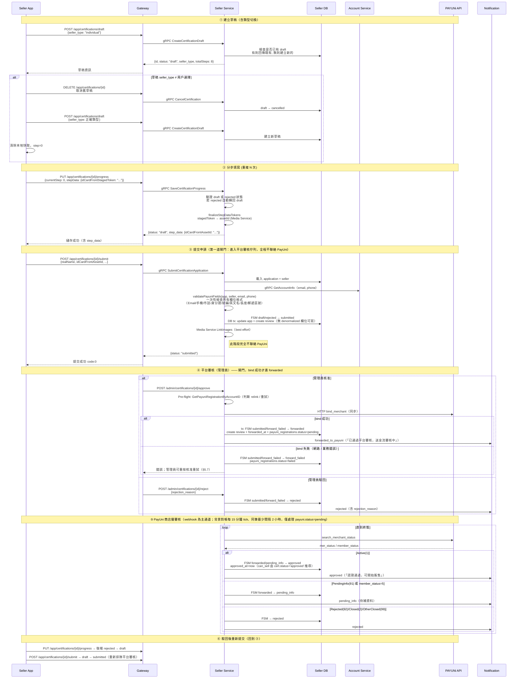
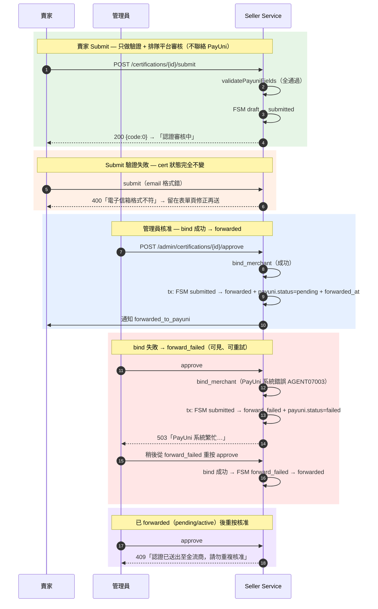
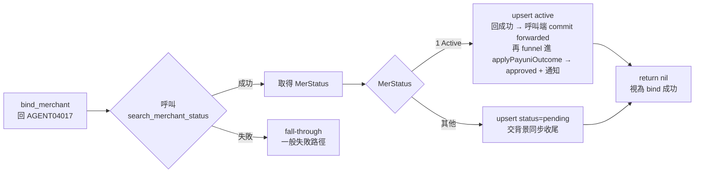

# 賣家實名認證 (Seller Certification) 詳細設計書

### 賣家實名認證 (Seller Certification) 詳細設計書

---
**流程**：
```
個人賣家點擊「個人賣家」按鈕
    ↓
呼叫 CreateDraft API
    ↓
草稿建立成功 → 進入認證流程
（店名/地址驗證在 Submit 時才發生，不在 CreateDraft）
```

#### 草稿類型切換機制

當賣家切換認證類型（個人 ↔ 企業）時，前端會自動處理草稿衝突：

```
用戶點擊「個人賣家」或「企業賣家」
    ↓
呼叫 CreateDraft API → 後端回傳既有草稿
    ↓
比對草稿的 seller_type 與用戶選擇
    ├─ 類型一致 → 載入本地快取，恢復之前的進度
    └─ 類型不同 → 取消舊草稿 (DELETE /app/certifications/:id)
                 → 清除本地快取
                 → 重新建立新類型草稿 (POST /app/certifications/draft)
                 → 從 step 0 開始
```

**實作位置**：
- 前端：`lib/screens/seller_certification_upload_screen.dart` (`_createDraft`)
- 後端：`internal/usecase/certification.go` (`CancelDraft`)

#### Onboarding 賣家資料同步機制

前端 `_syncSellerProfile` 使用 `SessionStore.sellerId`（而非 `accountId`）判斷是否已有賣家：
- `sellerId` 有效（> 0）→ PUT 更新既有賣家
- `sellerId` 為 null/0 → POST `/app/sellers` 建立新賣家

**重要**：`accountId ≠ sellerId`，不能用 `accountId` 做 fallback，否則會 PUT 到不存在的 seller。

啟動時 `WelcomeScreen` 會向後端確認 seller 是否真的存在，避免本地快取與後端不同步：
- 本地有 storeName/address → 呼叫 `GET /user/seller` 驗證
- 後端查無 seller → 清除本地快取 → 重新觸發 onboarding

---

### 1. 服務概述與責任邊界

#### 1.1 服務職責

- 唯一職責：管理賣家實名認證的完整生命週期，包含身分驗證、文件審核、金流綁定。
- 核心功能：
    - 多步驟認證申請：支援個人賣家（8 步驟）與企業賣家（9 步驟）的分步填寫與斷點續傳。
    - 狀態機管理：嚴格的狀態轉換白名單（draft → submitted → forwarded → approved / rejected；bind 失敗 → forward_failed）。
    - PAYUNi 金流綁定：**管理員核准時**（非賣家提交時）同步呼叫 PAYUNi bind_merchant HTTP API，註冊子賣家（2026-07 閘門化，見 §3.2）。
    - 雙重審核機制（**閘門式，非並行**）：Hawkr 平台審核（人工）是「送出至 PAYUNi 前的閘門」，通過後才觸發 PAYUNi 金流審核；兩者皆通過方可開賣收單（§3.4）。PAYUNi 金流審核又分「商店層」（`mer_status`，自動）與「會員層」（`member_status`，**賣家須自行於 PAYUNi 後台完成 email 驗證 + 會員資料送審**）兩軌，詳見 §3.2.1。
    - 駁回重新提交：被駁回後可從失敗步驟繼續編輯，重新提交。

#### 1.2 系統架構圖



> **端口說明**：
> - Gateway: 9900 (HTTP REST)
> - Seller Service: 10020 (gRPC) / 10021 (HTTP health/metrics)
>
> **通訊方式**：
> - 前端 → Gateway → Seller Service：REST → gRPC
> - Seller Service → Account Service：gRPC（取得 email、phone）
> - Seller Service → PAYUNi：直接同步 HTTP 呼叫（**管理員 Approve 時**，非 Submit）

---

### 2. 資料庫設計 (Database Schema)

#### 2.0 表組總覽（目標表組）

把「一張寬表包三個生命週期」拆成各司其職，讓 PII 能獨立加密 / 保留 / 抹除（Stripe Identity / Persona / Sumsub 的標準切法）。所有 PK = app 指派 TSID（bigint，禁 auto-increment）。

| 表 | 職責 | Cardinality | PII |
|---|---|---|---|
| `certification_applications` | 工作流狀態機（status/steps/timestamps） | 1／每次申請 | **無** |
| `certification_identity` | 加密身分 PII payload + 查重 hash | 1:1 應用 | **加密** |
| `certification_documents` | 不可變文件引用（身分證/存摺照片） | N／申請 | 指標（R2，詳見 49 號設計書） |
| `certification_events` | append-only：每次狀態轉換稽核 | N／申請 | 無 |
| `payuni_registrations` | PayUni 當前綁定狀態（投影） | 1／account 終生 | **無** |
| `payuni_integration_log` | append-only：PayUni 請求/回應快照 | N／account | 加密(request) |

> 🔴 **§2.0–§2.7 描述的是目標表組，不是現行 schema**：`certification_identity` / `certification_documents` / `certification_events` / `payuni_integration_log` 四張表在 `services/seller-service/db/schema/schema.sql` 中**不存在**。現行 schema 是扁平的 `certification_applications` ＋ `payuni_status_history`（見 §2.8 起），PII 加密範圍見 §2.9。**要動 schema 之前，先確認你要實作的是哪一套。**

#### 2.1 certification_applications（工作流，PII-free）

```sql
CREATE TABLE certification_applications (
  id             bigint PRIMARY KEY,                  -- TSID
  account_id     bigint NOT NULL,
  application_no varchar(50) NOT NULL UNIQUE,         -- CERT-{unix}-{account_id}
  seller_type    varchar(20) NOT NULL
                   CHECK (seller_type IN ('individual','business')),
  status         varchar(20) NOT NULL DEFAULT 'draft'
                   CHECK (status IN ('draft','submitted','forwarded',
                     'forward_failed','pending_info','approved','rejected','cancelled')),
  current_step   int NOT NULL DEFAULT 0,
  total_steps    int NOT NULL DEFAULT 8,
  ui_progress    jsonb,                               -- 僅非 PII 精靈進度（第幾步 / 驗證旗標）
  product_type   varchar(100),
  version        int NOT NULL DEFAULT 0,              -- 樂觀鎖
  submitted_at   timestamptz,
  forwarded_at   timestamptz,                         -- bind 成功、submitted→forwarded
  approved_at    timestamptz,                         -- 僅 PayUni 終態
  rejected_at    timestamptz,
  created_at     timestamptz NOT NULL DEFAULT now(),
  updated_at     timestamptz NOT NULL DEFAULT now()
);
CREATE INDEX idx_cert_app_account_created ON certification_applications (account_id, created_at DESC);
CREATE INDEX idx_cert_app_status          ON certification_applications (status);
```

- **移除**所有 PII 欄（real_name / id_card_no / bank_* / company_* / tax_id → §2.2）與文件欄（→ §2.3）。
- `step_data`（含 PII 的精靈鏡像）→ `ui_progress`，只留非 PII 進度。
- 新增 `version`（樂觀鎖，修 seller-edit vs admin-approve lost-update）、status/seller_type 的 CHECK、補齊缺失索引。此欄 `status` 為**唯一狀態真相**（§3.3）。

#### 2.2 certification_identity（加密身分 PII，1:1）

```sql
CREATE TABLE certification_identity (
  id              bigint PRIMARY KEY,                 -- TSID
  application_id  bigint NOT NULL UNIQUE
                    REFERENCES certification_applications(id),
  account_id      bigint NOT NULL,
  id_card_no_hash bytea,                              -- HMAC-SHA256(id_card_no)：查重不需解密
  tax_id_hash     bytea,                              -- 同上（企業）
  pii_ciphertext  bytea NOT NULL,                     -- AES-256-GCM 封裝的整包 PII
  pii_key_id      varchar(64) NOT NULL,               -- 用哪把 DEK 加密 → 支援 crypto-shred + 輪替
  retention_until timestamptz,                        -- 保留期（稅務 / 食安 / 爭議）
  legal_hold      boolean NOT NULL DEFAULT false,
  erased_at       timestamptz,                        -- crypto-shred 標記
  created_at      timestamptz NOT NULL DEFAULT now()
);
CREATE INDEX idx_cert_identity_account ON certification_identity (account_id);
CREATE INDEX idx_cert_identity_idhash  ON certification_identity (id_card_no_hash);       -- 詐騙：同身分證跨帳號
CREATE INDEX idx_cert_identity_purge   ON certification_identity (retention_until)
  WHERE erased_at IS NULL AND legal_hold = false;
```

- `pii_ciphertext` = 整包 PII（real_name / id_card_no / birth_date / id_card_issue_* / english_name / bank_name / bank_code / bank_account / company_* / tax_id / company_register_date）一次加密。KYC 審核整包解密、鮮少單欄查詢 → 單一 blob 最省。
- `id_card_no_hash` / `tax_id_hash` = **keyed** HMAC（非 raw SHA），供「同一身分證是否已在別帳號」的唯一查重而不解密。
- `pii_key_id` 讓抹除 = **crypto-shred**（銷毀該筆 DEK，密文即不可還原），並支援 key 輪替。

#### 2.3 certification_documents（不可變文件引用）

```sql
CREATE TABLE certification_documents (
  id             bigint PRIMARY KEY,                  -- TSID
  application_id bigint NOT NULL REFERENCES certification_applications(id),
  doc_type       varchar(30) NOT NULL
                   CHECK (doc_type IN ('id_card_front','id_card_back','bank_book','other')),
  asset_id       text NOT NULL,                       -- Media Service（Cloudflare R2）指標
  created_at     timestamptz NOT NULL DEFAULT now()
);
CREATE INDEX idx_cert_docs_app ON certification_documents (application_id);
```

- **不可變**：重送 = 新增列，不原地覆寫；核准當下把 asset_id 集 snapshot 進 `certification_events.detail`，決策可證。
- 抹除 = 刪列 + 呼叫 media-service **硬刪** R2 物件。

#### 2.4 certification_events（append-only 稽核；取代 certification_reviews）

```sql
CREATE TABLE certification_events (
  id             bigint PRIMARY KEY,                  -- TSID（時間排序即事件序）
  application_id bigint NOT NULL REFERENCES certification_applications(id),
  from_status    varchar(20),
  to_status      varchar(20) NOT NULL,
  event          varchar(30) NOT NULL,                -- submit/forward/forward_failed/approve/reject/payuni_*
  actor_type     varchar(20) NOT NULL
                   CHECK (actor_type IN ('seller','admin','payuni','system')),
  actor_id       bigint,
  actor_name     varchar(100),
  reason         text,                                -- 駁回原因 / 備註
  detail         jsonb,                               -- required_fields、reviewed_document_ids snapshot
  created_at     timestamptz NOT NULL DEFAULT now()
);
CREATE INDEX idx_cert_events_app ON certification_events (application_id, id DESC);
-- 稽核不可變：對 app role REVOKE UPDATE, DELETE（或 BEFORE UPDATE/DELETE trigger RAISE）
```

- 記錄**每一次**狀態轉換（含 PayUni 驅動 / 賣家 / 系統），不只 admin 動作 → KYC 稽核要的完整 who/what/when。
- `certification_reviews` 保留為相容 view：`SELECT ... FROM certification_events WHERE actor_type='admin'`。

#### 2.5 payuni_registrations（PII-free 當前綁定狀態）

PayUni 綁定狀態的當前投影（1 列／account 終生）。

```sql
CREATE TABLE payuni_registrations (
  id                  bigint PRIMARY KEY,             -- TSID
  account_id          bigint NOT NULL UNIQUE,         -- 每 account 終生一筆
  application_id      bigint NOT NULL REFERENCES certification_applications(id),
  payuni_mer_id       varchar(50),                    -- HAWK{account_id}
  registration_status varchar(20) NOT NULL DEFAULT 'unregistered'
                        CHECK (registration_status IN ('unregistered','pending','active','failed')),
  payment_enabled     boolean NOT NULL DEFAULT false,
  mer_status          varchar(10),
  member_status       varchar(10),
  credit_status       varchar(10),
  applepay_status     varchar(10),
  googlepay_status    varchar(10),
  atm_status          varchar(10),
  reason              text,
  registered_at       timestamptz,
  approved_at         timestamptz,
  last_synced_at      timestamptz,                   -- 最後一次「觀測成功」（poll 拿到回應 / webhook / 手動 refresh）
  last_claimed_at     timestamptz,                   -- 對帳輪詢的租約 token（只有 ClaimForSync 的 CAS 寫）
  updated_at          timestamptz NOT NULL DEFAULT now()
);
CREATE INDEX idx_payuni_reg_pending ON payuni_registrations (id)
  WHERE registration_status = 'pending';             -- partial：sync poller 只掃 pending
```

> 🔴 **`last_synced_at` 與 `last_claimed_at` 必須分開，不能共用一欄。**
> 早期為了省一支 migration，租約直接蓋在 `last_synced_at` 上，於是「我拿到租約了」
> 與「我手上的資料很新」變成同一個事實：`ClaimForSync` 在**呼叫 PayUni 之前**就把
> 欄位推進，之後那通 API 失敗也不回退 ⇒ PayUni 故障期間 `freshness` 投影仍回報
> `fresh`、對帳其實已經停擺，而畫面上完全看不出來。拆欄之後語意各自單純：
> `last_claimed_at` 只由 CAS 寫（成功與否都不回退，這正是租約要的），
> `last_synced_at` 只由 `domain.Apply` 在觀測成功時寫（`freshness` / `allowedActions`
> 讀它）。附帶效果是 `Apply` 再也碰不到租約，原本「觀測時刻必須傳 claimedAt 否則
> 會把租約改短」那條微妙約束隨之消失。

- **移除** `raw_request` / `raw_response` / `error_message` → §2.6（此列只存「當前狀態投影」）。
- `account_id` UNIQUE（`HAWK{account_id}` 確定性、終生一 bind）；`application_id` 加 FK，relink 用 `ON CONFLICT (account_id) DO UPDATE` 指向最新申請。

#### 2.6 payuni_integration_log（append-only 整合 log；取代 payuni_status_history）

```sql
CREATE TABLE payuni_integration_log (
  id               bigint PRIMARY KEY,                -- TSID
  account_id       bigint NOT NULL,
  payuni_mer_id    varchar(50),
  direction        varchar(20) NOT NULL,              -- bind_request / sync / webhook / refresh
  mer_status       varchar(10),
  member_status    varchar(10),
  credit_status    varchar(10),
  applepay_status  varchar(10),
  googlepay_status varchar(10),
  atm_status       varchar(10),
  reason           text,
  raw_request      bytea,                             -- 含 PII → 加密（或 redact）
  raw_response     jsonb,                             -- redact 掉 PII
  recorded_at      timestamptz NOT NULL DEFAULT now()
);
CREATE INDEX idx_payuni_log_account_recorded ON payuni_integration_log (account_id, recorded_at DESC);
```

- 同時收 **request 快照**（舊 `payuni_status_history` 只有 response）→ bind_merchant payload 有完整稽核軌跡；request 含 PII 故加密。

#### 2.7 資料保護、加密與抹除

- **加密邊界**：PII 只落在兩處且皆加密——`certification_identity.pii_ciphertext`（app 層 AES-256-GCM，DEK 由 KMS 管）與 `payuni_integration_log.raw_request`。其餘表全 PII-free。
- **抹除（crypto-shred）**：帳號刪除的 PII-clear job **以 cert 表自己的 `account_id` + tombstone 驅動**（非從 live `sellers` 列，避免 account_id 輪替後成孤兒）→ 銷毀該 identity 的 DEK（`pii_key_id`），密文即不可還原；同 txn 刪 `certification_documents` + 呼叫 media 硬刪 R2 影像 + redact `payuni_integration_log.raw_request`。一把 key + 幾個指標，抹除乾淨且可證。
- **保留 vs 抹除**：`retention_until` / `legal_hold` 讓「稅務/食安/爭議需留 N 年」與「請求刪除權」並存——purge job 於 `retention_until < now() AND NOT legal_hold` 才抹。
- **查重不解密**：`id_card_no_hash`（keyed HMAC）供詐騙 / 封鎖規避偵測（同身分證多帳號），不碰明文。
- **log/序列化防洩**：PII-carrying struct 自訂 redacting `MarshalJSON`；禁 zap 整個 registration / identity struct；Sentry/log scrubbing 覆蓋 `id_card_no` / `bank_account`。

> **舊 schema 的資安/合規缺陷（本重構修掉）**：① PII 全明文、無加密；② 刪帳號只清 `sellers` 顯示欄，身分證/銀行帳號留在 cert 表 + raw jsonb + OSS 影像永久明文；③ PII 散佈 ≥5 處；④ `certification_reviews` 用 `bigserial`（違反 [Java 微服務開發規範](../開發規範/Java%20微服務開發規範.md) §3 主鍵選擇：對外暴露的業務表用 TSID）；⑤ status 無 CHECK、domain 內無 FK、cert 表無索引；⑥ 無樂觀鎖（seller-edit 覆蓋 admin-approve）。

#### 2.8 Enum 與狀態值域

| Enum | 值域 | 儲存位置 |
|------|------|------|
| CertificationStatus | draft, submitted, forwarded, forward_failed, pending_info, approved, rejected, cancelled | `certification_applications.status`（唯一狀態真相） |
| CertificationEvent | submit, forward, forward_failed, approve, reject, payuni_approve, payuni_reject, payuni_pending_info, cancel, reset_to_draft | `certification_events.event` |
| ActorType | seller, admin, payuni, system | `certification_events.actor_type` |
| PayuniRegistrationStatus | unregistered, pending, active, failed | `payuni_registrations.registration_status` |
| PayuniMerStatus | unregistered(0), active(1), closed(2), denied(8), under_review(9), pending_info(91), rejected(92), other_closed(99) | `payuni_registrations.mer_status` |

**PayuniMerStatus 詳細說明**：

| 值 | 名稱 | 說明 |
|------|------|------|
| 0 | Unregistered | 未註冊 PAYUNi（預設值） |
| 1 | Active | 啟用（可正常收款） |
| 2 | Closed | 關閉 |
| 8 | Denied | 拒絕（`derivePayuniOutcome` 與 92 同組，一律視為終結退件） |
| 9 | UnderReview | 審核中 |
| 91 | PendingInfo | 待補資料 |
| 92 | Rejected | 審核失敗 |
| 99 | OtherClosed | 其它關閉 |

> 🔴 **`sellers` 表不持有認證狀態欄位**（§3.3）：PayUni 商戶狀態的唯一真相是 `payuni_registrations.mer_status`；賣家總狀態由 `deriveOverallStatus` 推導，`can_accept_orders` 由 `payuni_registrations.registration_status` 推導。

#### 2.9 機敏個資 at-rest 加密與 API 遮蔽

> **與 §2.0~§2.7 目標表組的關係**：本節規範的是**當前扁平 `certification_applications` 表**上的 at-rest 加密與回應遮蔽——不拆表、不改欄名。§2.0 的 `certification_identity` 拆表 + 整包 `pii_ciphertext` 落地時，本節的單欄密文併入 `pii_ciphertext`，遮蔽與 RPC 分層邏輯原樣沿用。本節**不引入** `certification_identity` 表、不做 crypto-shred / 保留期。

##### 2.9.1 加密範圍

| 欄位 | 現況型別 | 敏感度 | 處置 | 理由 |
|---|---|---|---|---|
| `id_card_no` | `varchar(255)` | 最高（身分證字號＝跨帳號唯一識別、詐騙關鍵） | **加密** | 洩漏衝擊最大 |
| `bank_account` | `varchar(255)` | 中高 | **加密**（見 §2.9.9） | 同一張表、同一次寫入、同等敏感度——只加密其中一個是**遺漏不是取捨**。沿用同一把 key、同一組 choke point |
| `step_data` 內的身分證／銀行帳號 key | `jsonb` | 同上兩欄 | **逐 key 加密**（見 §2.9.9） | 加密了欄位、JSONB 裡留一份明文副本＝等於沒加密 |
| `real_name` | `varchar(100)` | 中 | **不加密**（保留明文） | admin 審核列表對 `real_name` 有**模糊搜尋**（`ca.real_name ILIKE '%kw%'`，`certification_applications.sql.go:19`）；加密即破壞。姓名敏感度低於身分證字號，隨 §2 全拆再納入 `pii_ciphertext` 並改 blind-index 搜尋 |
| `birth_date` | `date` | 中低 | **不加密** | 加密須把 `date` 改成 `bytea`/`varchar`（型別破壞），且無查詢/遮蔽需求；隨 §2 全拆一併處理 CP 較高 |
| `tax_id` | varchar | 低 | **不加密** | 統一編號屬**公開登記資訊**，加密買不到安全性；食品業者登錄字號不在 KYC（§10），以個人名義辦理的字號可能連結到本人，依個資處理並隨店家個資清理清除 |

##### 2.9.2 加密機制與 `pkg/crypto` 上抽（§15 / §18）

- **演算法**：AES-256-GCM，DEK 由 master key 經 SHA-256 派生（與既有 `services/account-service/internal/infrastructure/encrypter.go` 同構）。密文格式 `nonce(12) || ciphertext || tag(16)`。
- **`pkg/crypto` 是唯一 encrypter**（Go 共用，依 §15「跨服務 ≥2 處必抽 `pkg/`」）：seller-service 與 account-service 共用同一份實作，禁止任一方自帶第二套。
- **fail-closed（對齊 #1396，必改）**：account-service 現行 `NewAESGCMEncrypter("")` 會 fallback 成 `passthroughEncrypter`（明文照存）——此行為對 PII **禁止**。上抽後移除 passthrough：master key 缺失時於 `Config.Validate()` 直接 fail、服務拒絕啟動，**永不降級成明文**。dev/test 由環境提供測試 key（非空）。
- **儲存型別**：`id_card_no` 由 `varchar(20)` 放大存 **Base64 密文**（對齊 media-service `encryption_key VARCHAR(256)` 慣例）；一個 ~10 字身分證字號密文 Base64 約 52 字 → 放大至 `varchar(255)`。**欄名不改**（仍 `id_card_no`，語意由明文轉密文，於欄位 COMMENT 標註）。

##### 2.9.3 讀寫全鏈觸點（實作清單）

**設計原則：加解密收斂在 Repository↔Domain 映射邊界（單一 choke point）**，Domain 層永遠是明文。這樣所有 usecase 讀寫路徑自動覆蓋，且**天然消除「送密文給 PayUni」的地雷**（Domain 明文 → PayUni bind 讀到的就是明文）。

| # | 觸點 | 檔案:行 | 處置 |
|---|---|---|---|
| 寫（choke point） | 所有寫入收斂於 2 個 repo 方法 | `certification_repository.go:94 CreateApplication` / `:108 UpdateApplication` | Domain→DB 映射時 **Encrypt** `id_card_no`。覆蓋全部 usecase 寫路徑（`CreateDraft` / `SaveProgress` / `Submit` / `Approve` / `Reject` 等）——不逐處改 |
| 讀（choke point） | 所有讀取的 DB→Domain 映射，收斂於**唯一** helper `toDomainCertificationApplication(row)` | `mapper.go:315`（被全部 5 個讀方法共用：`GetApplicationByID:29` / `GetApplicationByNo:41` / `GetApplicationsBySeller:53` / `GetCurrentApplication:70` / `GetDraftApplication:82`，實碼**無** `GetApplication` 方法） | 在此 helper 內 **Decrypt** `id_card_no` → Domain 永遠明文。**解密只改這一處**，5 讀方法自動覆蓋，不逐處改 |
| PayUni bind | `BindSellerRequest.IDCardNo = app.IDCardNo` | `certification.go:595` | **無需改**：Domain 已明文，PayUni 收到正確明文。🔴 **反面警示**：若改採「usecase 層加密」而非 repo choke point，此處會送出密文給 PayUni → 綁定失敗且難察，故**指定用 repo choke point** |
| 回應遮蔽（賣家） | `toResponse` 填 `IDCardNo: app.IDCardNo` | `certification.go:1038-1046` | 賣家自查路徑輸出**遮蔽值** `A1******89`（前 2 + 後 2，中間遮蔽；純函式 helper） |
| 回應完整（admin） | 同一 `toResponse`（目前 admin/seller **共用**） | 見 §2.9.4 | admin 審核路徑輸出**完整** `id_card_no` |

##### 2.9.4 兩層回應：賣家遮蔽 / admin 完整（含 §5.1 角色分離修正）

admin 詳情（`GetAdminCertificationDetail`）與賣家詳情（`GetCertificationApplication`）**不得共用同一條 gRPC**（違反 §5.1：角色不得共用 RPC）；遮蔽差異在此分流：

- **賣家路徑**（`/app/certifications/:id`）：RPC 回**遮蔽** `id_card_no`。
- **admin 路徑**（`/admin/certifications/:id`）：新增獨立 RPC `GetCertificationApplicationForAdmin`（§5.1 admin 命名 `{Action}{Resource}ForAdmin`），回**完整** `id_card_no`；gateway admin handler 改打此 RPC。
- 遮蔽 helper 為純函式（e.g. `maskIDCardNo(plain) string`），只作用於 `id_card_no`。`real_name` 不加密亦不遮蔽（賣家看自己姓名正常）。
- **遮蔽必須落在共用 `toResponse`，不可只改 detail 分支**：所有賣家 RPC 輸出都經同一個 `CertificationUseCase.toResponse`（`certification.go:1038`；被 `CreateDraft:117`、`SaveProgress:155`、`GetDraftApplication:167`、`GetCertificationApplication:176` 等全部賣家路徑共用）。遮蔽寫在此 helper 內 → 一次覆蓋全部賣家輸出。**admin 完整值另走獨立 unmasked builder**（`GetCertificationApplicationForAdmin` 專用，不經賣家 `toResponse`），兩者物理分離，杜絕實作者「只改 detail 分支、漏掉列表／草稿回填」而讓明文從其他賣家 endpoint 外洩。
- **邊界注意**：賣家 GET 回遮蔽值後，前端**編輯草稿無法回填完整** `id_card_no`（僅顯示遮蔽），重送時需賣家重新輸入——此為 KYC 表單標準行為，前端配合提示（見前端串接章節）。

##### 2.9.4a 端到端加解密與遮蔽時序（Domain 恆明文）



##### 2.9.5 Schema 變更（Atlas）

- 走 Go/Atlas 流程（§11.2）：改 `services/seller-service/db/schema/schema.sql` 的 `id_card_no` → `varchar(255)`（欄名不改）→ `atlas migrate hash` → 產生 `db/migrations/{ts}_encrypt_id_card_no.sql` → push 後 CI/CD apply。
- `real_name` / `birth_date` 型別**不動**（不在加密範圍，見 §2.9.8）。
- 於欄位 COMMENT 標註「AES-256-GCM Base64 密文，禁明文寫入」。

##### 2.9.6 存量遷移

存量明文的加密遷移是**一次性 ops 工具**，依[責任邊界規範](../開發規範/後端服務責任邊界規範.md) **不進 codebase**。

🔴 **不得有雙讀雙寫相容層**：讀取端只接受密文（§2.9.9 的失敗策略）。因此「放大欄位 → 部署新碼 → 跑 backfill」必須在同一個維護窗口內緊接完成，期間不對外開放——②③ 之間未加密的列讀取會解密失敗。

🔴 **加密不得寫在 migration 裡**：Go AES-GCM 的 `nonce||ct||tag` 格式無法由純 SQL 重現。migration 只做欄位放大（`varchar(50)` → `varchar(255)`），加密由 Go 腳本（復用 `pkg/crypto`）執行。

##### 2.9.7 Key 管理

- **env 慣例對齊 media-service**：master key 走 `ENCRYPTION_MASTER_KEY`（256-bit、Base64），k8s Secret 注入（非 configmap、非 application.yml 明文 fallback，對齊 §25 憑證紀律）。
- seller-service `Config.Load()` 讀取、`Config.Validate()` 缺 key 即 fail（fail-closed，§2.9.2）。
- 五處 env 同步（本地 `.env` / dev configmap-secret / CI / 部署）沿既有流程。

##### 2.9.8 加密範圍的決策理由

加密範圍為何是「只有 `id_card_no` 與 `bank_account`」、`real_name` / `birth_date` 為何不加密、密文為何存 Base64 而非 `bytea`、存量為何走一次性 Go backfill——見 [ADR 2026-07-20 賣家實名認證 PII 的 at-rest 加密範圍](../adr/2026-07-20-seller-kyc-pii-encryption-scope.md)。

##### 2.9.9 加密範圍：`bank_account` 欄位與 `step_data` JSONB

`certification_applications` 的加密欄位有兩個：`id_card_no` 與 `bank_account`；`step_data` JSONB 內的同一份副本也必須加密。

**（一）`bank_account` 欄位**：沿用 §2.9.2 的 AES-256-GCM、同一把 `ENCRYPTION_MASTER_KEY`、同一組 repo↔domain choke point。🔴 **欄位長度必須是 `varchar(255)`**：14 字帳號的 Base64 密文約 56 字，`varchar(50)` 會直接 `22001` 寫入失敗。

**（二）`step_data` JSONB 內的同一份資料**：入駐精靈把使用者填的內容整包存進 `certification_applications.step_data`，身分證與銀行帳號在裡面各有一份**明文副本**。🔴 **加密了欄位、JSONB 裡留一份明文，等於沒加密**——同一列、同一次查詢就能拿到。

**逐 key 加密，不整包加密**

`step_data` 內只有機敏 key 被加密，其餘原樣；整包加密會把入駐進度、已完成步驟、資產 id、旗標這些**需要被查詢與除錯**的 key 一起變成不可讀，且往後任何人加新 key 都被迫走加密路徑。代價是「哪些 key 是機敏的」必須維護成一份明確清單（`sensitiveStepDataKeys`，seller-service repository mapper）——這正是想要的性質：**新增機敏欄位是一個要被意識到的決定，不是靜默繼承。**

**加密哪 5 個 key，判準是什麼**

判準＝**與同一張表已加密的欄位對齊**。`certification_applications` 加密的欄位剛好兩個（`id_card_no`、`bank_account`），`step_data` 各帶一份副本，故清單只涵蓋這兩者：

| step_data key | 鏡射的欄位 | 為何有這個拼法 |
|---|---|---|
| `idNumber` | `id_card_no` | 賣家 App 精靈**自動存檔**（camelCase） |
| `id_card_no` | `id_card_no` | 同一個 App 的**送出前存檔**（snake_case） |
| `idCardNo` | `id_card_no` | **官網表單**直接展開 form state |
| `bankAccount` | `bank_account` | App 自動存檔 ／ 官網表單 |
| `bank_account` | `bank_account` | App 送出前存檔 |

這些拼法**不是可互換的別名**，而是三個生產者各自真實寫出來的欄位名，五個都真的會落到同一個欄位；每次存檔覆蓋整包 blob，故一列只會帶其中一種形狀——清單因此是**聯集**，不是「正規名＋別名」。🔴 **新增生產者、或任一端改欄位名，都必須同步加進這份清單。** ⚠️ 生產者分散在 App 與官網兩個 repo，官網的相關程式在 `features/` 與 `lib/`（不在 `src/` 或 `app/`）——盤點生產者時不得只掃單一目錄。

**為什麼 `name` / `birthDate` / `companyPhone` / `sellerAddress` 等不加密**

同一列的對應欄位（`real_name` / `birth_date` / `company_phone`）本來就是明文（見 §2.9.1），只加密 JSONB 這一份買不到任何安全性——讀得到這列就同時讀得到旁邊的明文欄位。要不要收緊這些是關於**整張表**的決定，見 [ADR 2026-07-20](../adr/2026-07-20-seller-kyc-pii-encryption-scope.md)。🔴 **那些欄位日後若改為加密，必須在同一個 PR 把它們的 `step_data` 拼法一起加進清單。** `taxId` 屬公開登記資訊，不在加密範圍。

**觸點：與 `bank_account` 完全相同的三處**

| # | 觸點 | 函式 | 處置 |
|---|---|---|---|
| 讀（choke point） | 5 個讀方法的唯一共用出口 | `toDomainCertificationApplication` | 解密 → Domain 恆明文（精靈載入表單讀到的就是明文） |
| 寫（choke point） | INSERT 參數組裝 | `toCreateApplicationParams` | 加密後才進 INSERT |
| 寫（choke point） | UPDATE 參數組裝 | `toUpdateApplicationParams` | 加密後才進 UPDATE |

🔴 **順序是承重的**：usecase 層的 `finalizeStepDataTokens` 會解析並改寫同一個 blob，它跑在 repo 加密**之前**、只看得到明文，因此不需要知道加密的存在——**也不得把加密上移到 usecase**，那會讓它拿到密文去改寫。這與 §2.9.3 對 PayUni bind 的警示是同一條原則：**加解密只准在 repo↔domain 邊界**。

**失敗策略：只接受密文，其餘一律硬錯**

`bank_account` 欄位與 `step_data` 內的機敏 key 走同一條規則——**解得開才算數，解不開就報錯，不降級**。不得有長度啟發式、也不得有「純數字則放行」的逃生口：一個讀不出來的值只可能是**沒被加密就寫進去**、值損毀、或 key 錯，這三種都必須被看見。

🔴 只要讀取端還肯把明文原樣回傳，「這個值沒被加密」就永遠偵測不到。回傳垃圾比報錯更危險——精靈會把垃圾載入表單，賣家下次送出就把它寫進真正的 `id_card_no` / `bank_account` 欄位。

錯誤訊息**不得夾帶該值**（它不是真的帳號就是它的密文），錯誤會流進 log 與 gRPC status。

**其他不變式**

- **無 schema 變更**：`jsonb` 沒有長度上限，`bank_account` 當初必須先放寬 `varchar(50)` 的前置條件在這裡不存在。
- **key 順序不保留、也不需要保留**：`jsonb` 型別本身就會在寫入時正規化物件鍵序（PostgreSQL 17 實測：`'{"zeta":1,"alpha":2,"mid":3,"b":4}'::jsonb` 讀回為 `{"b":4,"mid":3,"zeta":1,"alpha":2}`，而 `::json` 保留原序），生產者送出的順序在這段程式看到 row 之前就已經消失。並發防護靠**樂觀鎖 `version` 欄位**（`UpdateApplication` 的 `AND version = $39`），不靠比對 blob。
- **只重新編碼真的改到的 key**：解析成 `map[string]json.RawMessage` 而非 `map[string]any`，否則所有 JSON number 會被轉成 `float64`（超過 2^53 靜默截斷）、字串會被重新轉義。沒有任何機敏 key 命中時原始 bytes 原封不動。
- **不是 JSON object 的 blob 原樣通過、不報錯**：`step_data` 是前端不透明狀態，不得成為讓一張申請單變成讀不出來的途徑。
- **存量 backfill 是一次性 ops 工具**，依[責任邊界規範](../開發規範/後端服務責任邊界規範.md) **不進 codebase**（作法同 §2.9.6）。

---

### 3. 狀態機設計 (State Machine)

#### 3.1 狀態轉換白名單



> **命名**：`submitted`＝等平台審核；`forwarded`＝平台已核准且 **bind 確實成功**、PayUni 商店層審核中；`forward_failed`＝平台已核准但 bind 失敗、待管理員重試；`approved`＝PayUni 也通過（**唯一可販售的終態**）。`forwarded` 不代表「管理員按了核准」，代表「已確實送達 PayUni」。

**轉換規則**：

| 當前狀態 | 允許轉換至 | 觸發方式 |
|----------|-----------|---------|
| draft | submitted, cancelled | 賣家提交 / 取消 |
| submitted | forwarded / forward_failed / rejected / cancelled | **已鎖定，賣家不可修改**（mirrors SaveProgress）<br/>管理員核准：bind 成功→forwarded、失敗→forward_failed<br/>管理員駁回→rejected（PayUni 未被聯絡）/ 賣家取消 |
| forward_failed | forwarded / rejected / cancelled | 管理員重按核准（bind 成功）→forwarded / 駁回 / 賣家取消 |
| forwarded | approved, pending_info, rejected | PayUni 審核通過 / 要求補件 / 駁回（皆背景同步；**不可** local cancel——商店已在 PayUni 建立） |
| pending_info | approved, rejected | PayUni 後續審核結果 |
| rejected | draft | 重新編輯（SaveProgress 自動轉換）→ 重新排隊平台審核 |
| approved | （終態） | — |
| cancelled | （終態） | — |

> **FSM 要點**：`forwarded` 表示「管理員已核准且 bind 成功」；`forward_failed` 讓失敗的轉送可見、可重試。不存在 `rejected → under_review`（撤銷駁回走 reset → 重送），也不存在 `forwarded → cancelled`（PayUni 已持有商店）。管理員核准 = `forward` 事件，**bind 成功才 commit 到 `forwarded`**（§5.7）。

#### 3.1.1 FSM 單調不回退原則

2026-07 起，PayUni bind_merchant 由**管理員核准（forward 事件）**觸發，Submit() 完全不碰 PayUni；bind 的重試也隨之從 Submit 搬到 Approve。

🔴 **bind 失敗不得 `ResetToDraft()`**：把狀態還原成 draft 而保留 `submitted_at` 會造成 `status=draft + submitted_at != null` 的矛盾狀態。FSM 單調，失敗不 rollback，而是進入**顯式的失敗狀態**：

- 管理員核准時 bind 失敗 → `certification.status = forward_failed`（**不回退** submitted），`payuni_registrations.status = failed` 紀錄原因
- 重試 = 管理員從 `forward_failed` **重按核准**（forward 事件的 src 含 forward_failed）：重跑 `registerPayuni`，成功→forwarded、再失敗→維持 forward_failed
- bind 冪等：MerID = `HAWK{account_id}` 為確定性函式，重按核准不會建立第二個商店（AGENT04017 → 自癒，見 §5.6.1）——這是「同步重試安全」的前提，也是日後升級 Tier 2 outbox 的前提
- `forward_failed` 是**可見**狀態：管理員 UI 能區分「轉送失敗待重試」與「PayUni 審核中（forwarded）」，修掉舊 `under_review` 把兩者混在一起的問題
- 賣家端 Submit **沒有**任何 PayUni 重試分支（PayUni 只在管理員核准時被呼叫）

#### 3.2 多重審核機制

平台審核是送出至 PayUni 前的**閘門**，不是與 PayUni 並行的軌道：賣家提交後先進入平台審核佇列（`submitted`），管理員核准且 bind 成功後才進入 PayUni 商店層審核（`forwarded`），PayUni 通過才是終態 `approved`。三個審核維度**不再各存一個 sellers 欄位**（見 §3.3），而是各有清楚的真相來源：

| 審核項目 | 真相來源 | 審核者 | 觸發時機 |
|---------|---------|--------|---------|
| 平台審核（閘門） | `certification_applications.status`（submitted → forwarded / forward_failed / rejected） | Hawkr 管理員 | 管理員核准（觸發 bind）/ 駁回（PayUni 不會被呼叫） |
| 金流審核 — 商店層 | `payuni_registrations.mer_status` | PAYUNi | 平台核准後才呼叫 `bind_merchant`；狀態推進的**主通道是 `AGENT_NOTIFY` webhook**，背景 Worker（每 15 分鐘 tick、同一筆最少間隔 2 小時）輪詢 `search_merchant_status` 只是漏收 webhook 的補救，見 §7.x |
| 金流審核 — 會員層 | `payuni_registrations.member_status` | PAYUNi + **賣家本人** | 建店後賣家須自行登入 PAYUNi 後台完成 email 驗證 + 會員資料送審（見 §3.2.1） |

> ⚠️ `member_status` 是「會員（自然人）」層級欄位。同一賣家（同一身分證 / 手機 / Email）旗下多個商店**共用同一個會員狀態**；會員層未完成時，名下所有商店即使 `mer_status` 正常也無法收款。

#### 3.2.1 會員層 onboarding（賣家須自行於 PAYUNi 後台完成）

`bind_merchant` 只建立「商店」。PAYUNi 會判斷該賣家是否已是會員：

- 已是會員 → 僅建立商店
- **非會員 → 自動建立會員 + 商店**，並寄發「會員建立完成」email 給賣家

新會員必須**自行到 PAYUNi 後台**完成下列步驟，`member_status` 才會由 `5`（待補資料）轉為 `1`（啟用）：

1. 收到 PAYUNi 寄發的會員建立 email
2. 登入 PAYUNi 會員後台
3. 驗證電子信箱
4. 填寫會員資料
5. 送審，等待 PAYUNi 審核

> 詳細後台操作見 PAYUNi 官方《統一金流會員操作手冊》。此流程**完全在 PAYUNi 端**，Hawkr 無法代填；且 `search_merchant_status` 不會回傳會員層缺漏細節（`Reason` 欄位僅用於商店層退件 `mer_status=91/92/8`，會員層待補時為空），因此前端只能引導賣家至 PAYUNi 後台，無法逐項列出缺什麼。

**`member_status` 代碼**（PAYUNi `search_merchant_status` 回應）：

| 值 | 意義 |
|----|------|
| `1` | 啟用（會員資料審核通過） |
| `5` | 會員待補資料（尚未完成後台填寫 / 送審） |
| `8` | 拒絕 |
| `9` | 待審核（已送審，PAYUNi 審核中） |
| `92` | 審核失敗 |
| `99` | 關閉 / 停權 |

> **實作行為**：背景同步的 `derivePayuniOutcomeKey` 在 `member_status=5` 時，會把任何非終結的 `mer_status` 一律提升為「待補資料」（cert.status 轉 `pending_info`），確保只要會員層待補就會通知賣家——即使商店層 `mer_status=9`（審核中）亦然。終結態 `mer_status`（2/8/92/99）不提升。

#### 3.3 狀態衍生：單一真相 + 推導 capabilities

**設計原則**：認證流程的狀態只有**一個**權威來源 = `certification_applications.status`（FSM）；PayUni 審核結果的權威來源是 `payuni_registrations`（§9.4）。所有給前端 / 跨服務用的「總狀態」與「能不能賣」都從這兩者**推導**——沒有 denormalized 副本，就沒有東西會 drift。

🔴 **`sellers` 表不持有任何認證狀態欄位**：沒有 `overall_certification_status`、`approval_status`、`payuni_status`。前端總狀態走 `deriveOverallStatus`（見下）；PayUni 商店層狀態一律讀 `payuni_registrations.mer_status`。**不得**新增「就不降級」之類的 don't-downgrade guard——降級必須自然發生。

**能否販售（收單閘門）**：`can_accept_orders`（跨服務契約 B-169，product / order / cart 消費）是**推導值、不儲存**：

```
can_accept_orders = (payuni_registrations.registration_status = 'active' AND sellers.status = 'active')
```

- 綁在 **PayUni 註冊的終態 `active`**，不是平台核准、也不是 `certification_applications.status`。管理員核准後、PayUni 尚未通過前，賣家**不能收單**（子賣家尚未綁定，買家結帳無金流通道）。
- `sellers.status` 是治理 / 刪除狀態（active / closed / suspended），與認證正交；非 active 一律 false（B-169 fail-safe）。
- 推導點是 `domain.CanAcceptOrders(payuniRegistrationStatus, sellerStatus)`，**唯一**。禁止任何 denormalized 副本。
- `sellers.current_certification_id` 已建索引（`idx_sellers_current_certification_id`）；依 repo 慣例**不加 FK constraint**，LEFT JOIN 無申請列時優雅退化。

**顯示狀態（`overallStatus`）**：由 `deriveOverallStatus(certStatus, payuniOutcome)` 推導，不儲存：

| 條件 | overallStatus | 前端顯示 |
|---|---|---|
| 無申請列 / `cancelled` | `not_started` | 「開始認證」 |
| `draft` | `draft` | 「繼續填寫」 |
| `submitted` | `submitted` | 「審核中」 |
| `forward_failed` | `forward_failed` | （管理員可見）「轉送失敗，重試中」 |
| `rejected`（平台駁回） | `rejected` | 「審核失敗」，引導重新提交 |
| `forwarded` ＋ PayUni outcome = approved | `approved` | 「認證通過」 |
| `forwarded` ＋ PayUni outcome = rejected | `rejected` | 「審核失敗」，引導重新提交 |
| `forwarded` ＋ PayUni outcome = pendingInfo（`mer_status=91` 或會員層 `member_status=5`） | `pending_info` | 「需要補件」；會員層待補須引導至 PayUni 後台（§3.2.1） |
| `forwarded` ＋ 其他（審核中） | `forwarded` | 「金流審核中」 |

🔴 **`certification_applications.status` 的值域不含 `approved` / `pending_info`**（見 §9.4）——那兩個是 `overallStatus` 的**推導結果**，不是 cert 的儲存值。

> `closed`（PayUni 帳號關閉）併入 `rejected` 處理——賣家皆須重走流程。

#### 3.4 各階段狀態對照

單一自然人、單一商店的 happy path + 退件：

| 階段 | cert.status | payuni registration_status / mer_status | overallStatus | 可收單 |
|---|---|---|---|---|
| 賣家提交 | submitted | — | submitted | ✗ |
| 管理員核准、bind 成功 | forwarded | pending / under_review(9) | forwarded（金流審核中） | ✗ |
| 管理員核准、bind 失敗 | forward_failed | — | forward_failed（管理員可見） | ✗ |
| PayUni 要求補件 | forwarded | pending / pending_info(91) | pending_info | ✗ |
| PayUni 核准 | forwarded | **active** / active(1) | **approved** | **✓** |
| PayUni 退件（核准後） | forwarded | failed / rejected(92) | **rejected** | ✗ |

> 最後兩列示範了收單閘門為何綁 `payuni_registrations.registration_status`：PayUni 在核准之後退件時，`registration_status` 離開 `active`，`can_accept_orders` **自然降級、自然停止收單**，不需要任何額外的降級路徑。

---

### 4. 介面定義 (API Specification)

#### 4.1 外部 HTTP 介面 — 賣家端

前端統一透過 Gateway 呼叫，Gateway 轉為 gRPC 呼叫 Seller Service。

所有端點需帶 `Authorization: Bearer <jwt>`，Gateway 自動提取 `X-Account-Id` 傳入下游。

| Method | Gateway 路徑 | gRPC 方法 | 說明 |
|--------|-------------|-----------|------|
| POST | `/api/v1/app/certifications/draft` | `CreateCertificationDraft` | 建立認證草稿 |
| PUT | `/api/v1/app/certifications/:id/progress` | `SaveCertificationProgress` | 儲存步驟進度 |
| POST | `/api/v1/app/certifications/:id/submit` | `SubmitCertificationApplication` | 提交認證申請（含駁回重新提交） |
| GET | `/api/v1/app/certifications/:id` | `GetCertificationApplication` | 查詢單筆申請 |
| DELETE | `/api/v1/app/certifications/:id` | `CancelCertification` | 取消申請（draft / submitted / forward_failed 均可；已 forwarded 不可，PayUni 已建店） |

**PAYUNi 相關：**

| Method | Gateway 路徑 | 說明 |
|--------|-------------|------|
| GET | `/api/v1/app/sellers/me/payuni/status` | 查詢 PAYUNi 審核狀態 |
| POST | `/api/v1/app/sellers/me/payuni/status_syncs` | 主動刷新 PAYUNi 狀態 |

> 送件（`bind_merchant`）**只由管理員核准觸發**（§5.7）；賣家端沒有註冊 / 重試路由，重試 = 管理員自 `forward_failed` 重按核准（§3.1.1）。

**賣家整體狀態：**

| Method | Gateway 路徑 | 說明 |
|--------|-------------|------|
| GET | `/api/v1/sellers/me` | 查詢賣家狀態（含 certificationStatus、payuniStatus、approvalStatus） |

#### 4.2 外部 HTTP 介面 — 管理員端

| Method | Gateway 路徑 | gRPC 方法 | 說明 |
|--------|-------------|-----------|------|
| GET | `/api/v1/admin/certifications` | `ListCertificationsForAdmin` | 列表查詢（支援 status/keyword 篩選） |
| GET | `/api/v1/admin/certifications/:id` | `GetCertificationApplication` | 查詢單筆認證完整詳情 |
| GET | `/api/v1/admin/certifications/:id/reviews` | `GetCertificationReviews` | 查詢審核歷史紀錄 |
| POST | `/api/v1/admin/certifications/:id/approve` | `ApproveCertification` | 核准（可從任意非終態執行） |
| POST | `/api/v1/admin/certifications/:id/reject` | `RejectCertification` | 駁回（可從任意非終態執行，需帶 rejection_reason） |

#### 4.3 API 請求/回應格式

##### 共用 Response 結構：CertificationApplication

以下 API 皆回傳相同的 `CertificationApplication` 結構：
- `POST /app/certifications/draft`（建立草稿 / 回傳既有草稿）
- `PUT /app/certifications/:id/progress`（儲存步驟進度）
- `GET /app/certifications/:id`（查詢單筆申請）

**欄位說明：**

| 欄位 | 類型 | omitempty | 說明 |
|------|------|-----------|------|
| `id` | int64 | | 申請 ID |
| `account_id` | int64 | | 帳號 ID（= JWT sub） |
| `application_no` | string | | 申請編號 `CERT-{unix_timestamp}-{account_id}` |
| `status` | string | | 狀態：draft, submitted, forwarded, forward_failed, pending_info, approved, rejected, cancelled |
| `seller_type` | string | | 賣家類型：individual / business |
| `real_name` | string | Y | 真實姓名 |
| `id_card_no` | string | Y | 身分證字號 |
| `birth_date` | string | Y | 出生日期 |
| `id_card_front_asset_id` | string | Y | 身分證正面 Asset ID |
| `id_card_back_asset_id` | string | Y | 身分證背面 Asset ID |
| `bank_book_asset_id` | string | Y | 存摺封面 Asset ID |
| `document_asset_ids` | string[] | Y | 其他文件 Asset IDs |
| `bank_name` | string | Y | 銀行名稱 |
| `bank_account` | string | Y | 銀行帳號 |
| `company_name` | string | Y | 公司名稱 |
| `tax_id` | string | Y | 統一編號 |
| `current_step` | int32 | | 目前填寫步驟 |
| `total_steps` | int32 | | 總步驟數 |
| `step_data` | object | Y | **各步驟暫存資料（JSON object）**，即 SaveProgress 存入的 `step_data` 原值（已解析，非字串）。前端可用此欄位恢復表單進度。 |
| `submitted_at` | string | Y | 提交時間（RFC3339） |
| `approved_at` | string | Y | 核准時間 |
| `rejected_at` | string | Y | 駁回時間 |
| `created_at` | string | Y | 建立時間 |
| `updated_at` | string | Y | 更新時間 |

> **`omitempty` 說明**：標記 Y 的欄位，值為空字串或 null 時不會出現在 JSON response 中。例如新建草稿時，`real_name`、`step_data` 等尚未填寫的欄位不會回傳。

##### 4.3.1 建立草稿

```
POST /api/v1/app/certifications/draft
```

Request:
```json
{
  "seller_type": "individual"
}
```

Response:
```json
{
  "code": 0,
  "data": {
    "id": 1,
    "account_id": 100,
    "application_no": "CERT-1738000000-100",
    "status": "draft",
    "seller_type": "individual",
    "current_step": 0,
    "total_steps": 8,
    "created_at": "2026-01-28T10:00:00Z"
  }
}
```

##### 4.3.2 儲存步驟進度

```
PUT /api/v1/app/certifications/:id/progress
```

Request（`step_data` 可傳 JSON object 或 JSON string，後端會自動正規化）：
```json
{
  "current_step": 4,
  "step_data": {
    "bank_name": "台灣銀行",
    "bank_account": "012345678"
  }
}
```

若步驟包含圖片上傳，傳入 staged token，後端會自動呼叫 Media Service 轉為正式 asset ID：
```json
{
  "current_step": 0,
  "step_data": {
    "idCardFrontStagedToken": "tok_abc123",
    "idCardBackStagedToken": "tok_def456"
  }
}
```
後端存入時會將 `idCardFrontStagedToken` → `idCardFrontAssetId`，`idCardBackStagedToken` → `idCardBackAssetId`。

Response:
```json
{
  "code": 0,
  "data": {
    "id": 1,
    "account_id": 100,
    "application_no": "CERT-1738000000-100",
    "status": "draft",
    "seller_type": "individual",
    "current_step": 4,
    "total_steps": 8,
    "step_data": {
      "bank_name": "台灣銀行",
      "bank_account": "012345678"
    },
    "created_at": "2026-01-28T10:00:00Z",
    "updated_at": "2026-01-28T10:05:00Z"
  }
}
```

> **注意**：
> - `step_data` 接受 JSON object 或 JSON string，後端統一轉為 object 儲存。
> - Response 的 `step_data` 為 JSON object（已解析），前端可直接使用。
> - gRPC handler 在 save 後會 re-fetch application，確保回傳最新資料。

##### 4.3.3 提交認證申請

```
POST /api/v1/app/certifications/:id/submit
```

> **重要**：提交時傳入的是正式 `asset_id`（非 staged token）。圖片的 staged token 轉正（finalize）應在 SaveProgress 步驟完成。

Request（個人賣家）:
```json
{
  "real_name": "王小明",
  "id_card_no": "A123456789",
  "birth_date": "082/01/15",
  "id_card_issue_date": "109/05/01",
  "id_card_issue_type": "初發",
  "id_card_issue_location": "臺北市",
  "english_name": "WANG XIAO MING",
  "id_card_front_asset_id": "asset_abc123",
  "id_card_back_asset_id": "asset_def456",
  "bank_book_asset_id": "asset_ghi789",
  "bank_name": "台灣銀行",
  "bank_account": "012345678901",
  "product_type": "生鮮蔬果"
}
```

> **日期格式**：使用台灣民國年格式 `YYY/MM/DD`（例如：民國 82 年 1 月 15 日 = `"082/01/15"`）。
> 企業賣家額外欄位：`company_type`, `company_name`, `tax_id`, `company_register_date`, `company_city`, `company_district`, `company_address_detail`, `company_email`, `company_phone`。
> **此 API 同時用於首次提交與駁回後重新提交**。若申請狀態為 `rejected`，後端會自動執行 `rejected → draft → submitted` 轉換。

##### 4.3.4 管理員駁回

```
POST /api/v1/admin/certifications/:id/reject
```

Request:
```json
{
  "rejection_reason": "身分證照片模糊，請重新上傳",
  "comment": "正面照片反光嚴重"
}
```

> `reviewer_id` 和 `reviewer_name` 由 Gateway 從 JWT 自動注入。
> 操作前需確認申請狀態為 `submitted` 或 `forward_failed`（核准 / 駁回皆同）；否則回傳 4xx（見 §5.7、§5.8）。

##### 4.3.5 管理員列表查詢

```
GET /api/v1/admin/certifications?page=1&limit=10&status=submitted&keyword=王
```

Query Parameters:
| 參數 | 類型 | 說明 |
|------|------|------|
| page | int | 頁碼（預設 1） |
| limit | int | 每頁筆數（預設 10） |
| status | string | 篩選狀態：submitted / approved / rejected，空值為全部 |
| keyword | string | 搜尋關鍵字（real_name 或 application_no） |

Response:
```json
{
  "code": 0,
  "msg": "success",
  "data": {
    "list": [
      {
        "id": 1,
        "account_id": 100,
        "application_no": "CERT-1234567890-100",
        "status": "submitted",
        "seller_type": "individual",
        "real_name": "王小明",
        "store_name": "小明的店",
        "current_step": 8,
        "total_steps": 8,
        "submitted_at": "2026-02-10T14:30:00+08:00",
        "created_at": "2026-02-09T10:00:00+08:00",
        "updated_at": "2026-02-10T14:30:00+08:00",
        "id_card_front_url": "http://localhost:9900/api/v1/app/media/secure_download/809500147049710577",
        "id_card_back_url": "http://localhost:9900/api/v1/app/media/secure_download/809500147049710578",
        "bank_book_url": "http://localhost:9900/api/v1/app/media/secure_download/809500147049710579",
        "document_urls": [
          "http://localhost:9900/api/v1/app/media/secure_download/809500147049710580"
        ]
      }
    ],
    "total": 25,
    "page": 1,
    "limit": 10,
    "stats": {
      "total": 100,
      "submitted": 25,
      "approved": 60,
      "rejected": 15
    }
  }
}
```

**圖片 URL 欄位說明**：
| 欄位 | 類型 | 說明 |
|------|------|------|
| id_card_front_url | string | 身份證正面圖片完整 URL（含 domain） |
| id_card_back_url | string | 身份證背面圖片完整 URL |
| bank_book_url | string | 銀行存摺封面圖片完整 URL |
| document_urls | string[] | 其他文件圖片 URL 陣列 |

> **注意**：
> - 圖片 URL 格式：`{protocol}://{host}/api/v1/app/media/secure_download/{asset_id}`
> - Gateway 會自動根據請求來源（HTTP/HTTPS）和 host 構建完整 URL
> - 本地開發：`http://localhost:9900/api/v1/app/media/secure_download/...`
> - 測試環境：`https://test-api.example.com/api/v1/app/media/secure_download/...`
> - 生產環境：`https://api.example.com/api/v1/app/media/secure_download/...`
> - 支援反向代理：檢查 `X-Forwarded-Proto` 和 `X-Forwarded-Host` header

##### 4.3.6 管理員查看認證詳情

```
GET /api/v1/admin/certifications/:id
```

Response:
```json
{
  "code": 0,
  "data": {
    "id": 1,
    "account_id": 100,
    "application_no": "CERT-1234567890-100",
    "status": "forwarded",
    "seller_type": "individual",
    "real_name": "王小明",
    "id_card_no": "A123456789",
    "birth_date": "1990-01-15",
    "id_card_front_url": "http://localhost:9900/api/v1/app/media/secure_download/809500147049710577",
    "id_card_back_url": "http://localhost:9900/api/v1/app/media/secure_download/809500147049710578",
    "bank_book_url": "http://localhost:9900/api/v1/app/media/secure_download/809500147049710579",
    "document_urls": [],
    "bank_name": "台灣銀行",
    "bank_account": "012345678901",
    "company_name": "",
    "tax_id": "",
    "company_city": "",
    "company_district": "",
    "company_address_detail": "",
    "current_step": 8,
    "total_steps": 8,
    "submitted_at": "2026-02-10T14:30:00+08:00",
    "created_at": "2026-02-09T10:00:00+08:00",
    "updated_at": "2026-02-10T14:30:00+08:00"
  }
}
```

> 與賣家端 `GET /app/certifications/:id` 的差異：
> - 圖片欄位回傳完整 URL（含 domain），而非 asset_id
> - 包含企業賣家的公司地址欄位（company_city, company_district, company_address_detail）

##### 4.3.7 管理員查看審核歷史

```
GET /api/v1/admin/certifications/:id/reviews
```

Response:
```json
{
  "code": 0,
  "data": [
    {
      "id": 1,
      "application_id": 1,
      "reviewer_id": 0,
      "reviewer_name": "",
      "action": "submit",
      "result": "pending",
      "comment": "",
      "rejection_reason": "",
      "created_at": "2026-02-10T14:30:00+08:00"
    },
    {
      "id": 2,
      "application_id": 1,
      "reviewer_id": 1,
      "reviewer_name": "管理員A",
      "action": "reject",
      "result": "rejected",
      "comment": "身分證照片模糊",
      "rejection_reason": "身分證照片模糊，請重新上傳",
      "created_at": "2026-02-11T10:00:00+08:00"
    }
  ]
}
```

> 每次提交 (submit)、核准 (approve)、駁回 (reject) 都會產生一筆 review 紀錄。

#### 4.4 gRPC Proto 定義

完整的 Proto 定義位於 `api/proto/seller/seller.proto`：

```protobuf
service SellerService {
    // 認證草稿管理
    rpc CreateCertificationDraft(CreateCertificationDraftRequest) returns (CertificationApplicationResponse);
    rpc SaveCertificationProgress(SaveCertificationProgressRequest) returns (CertificationApplicationResponse);
    rpc CancelCertification(CancelCertificationRequest) returns (CertificationApplicationResponse);

    // 提交（含首次提交與駁回重新提交）
    rpc SubmitCertificationApplication(SubmitCertificationApplicationRequest) returns (CertificationApplicationResponse);

    // 查詢
    rpc GetCertificationApplication(GetCertificationApplicationRequest) returns (CertificationApplicationResponse);

    // 管理員審核
    rpc ApproveCertification(ApproveCertificationRequest) returns (ReviewResponse);
    rpc RejectCertification(RejectCertificationRequest) returns (ReviewResponse);
    rpc GetCertificationReviews(GetCertificationReviewsRequest) returns (CertificationReviewsResponse);

    // 管理員列表查詢
    rpc ListCertificationsForAdmin(ListCertificationsForAdminRequest) returns (ListCertificationsForAdminResponse);
}
```

#### 4.5 gRPC 錯誤碼定義

| 方法 | 錯誤碼 | HTTP | 說明 |
|------|--------|------|------|
| CancelDraft | INVALID_ARGUMENT | 400 | 申請不在 draft/submitted/forward_failed 狀態 |
| SaveProgress | INVALID_ARGUMENT | 400 | 申請不在 draft 或 rejected 狀態 |
| Approve | FAILED_PRECONDITION | 409 | 已 forwarded（PayUni 綁定 pending/active）後重按核准，被狀態早退擋下（「請勿重複核准」） |
| Submit | FAILED_PRECONDITION | 409 | 申請狀態不允許修改（forwarded / forward_failed / pending_info / approved / cancelled） |
| Submit | INVALID_ARGUMENT | 400 | **（新）** PayUni 欄位格式驗證失敗（email / 手機 / 身分證 / 統編 / 英文名稱 / 長度 / 郵遞區號等），多欄位錯誤時 message 以全形分號 `；` 串接 |
| Submit | INVALID_ARGUMENT | 400 | 個人賣家未設定店名或地址 |
| Submit | INVALID_ARGUMENT | 400 | PayUni bind 回傳 `AGENT03*` / `AGENT04*`（除 04017） / `AGENT06*` / `AGENT07001-02,07004-05,07011-22,07025-31` / `AGENT08*` / `AGENT09*` |
| Submit | ALREADY_EXISTS | 409 | PayUni bind 回傳 `AGENT03019`（會員帳號/手機/Email 重複） |
| Submit | FAILED_PRECONDITION | 409 | PayUni bind 回傳 `AGENT03031`（會員已停權） |
| Submit | UNAVAILABLE | 503 | **（新）** PayUni 系統錯誤 `AGENT07003 / 07006 / 07007 / 07008`，或 PayUni API 呼叫網路錯誤（可重試） |
| Submit | INTERNAL | 500 | PayUni bind 回傳 `AGENT01*`（設定錯誤）或 `AGENT05*`（代理商錯誤） |
| Submit | INTERNAL | 500 | 其他未分類錯誤 |
| Approve/Reject | INVALID_ARGUMENT | 400 | 狀態轉換不合法（approved / cancelled 終態無法再轉換） |

> **AGENT04017（商店代號已存在）為特殊情境**：不回傳錯誤給使用者，而是觸發 AGENT04017 狀態漂移自癒路徑（詳見 §5.6.1）。

**錯誤訊息格式**：

- **單欄位錯誤**：`{"code": 400, "message": "電子信箱格式不符", "traceId": "..."}`
- **多欄位錯誤**：`{"code": 400, "message": "電子信箱格式不符；聯絡手機格式不符，需為 09xx-xxxxxx；姓名不可超過 25 字", "traceId": "..."}`（用全形分號 `；` 串接）
- **前端零改動**：使用 Gateway 既有 `Envelope.message` 字串欄位，不新增 `details` 陣列或任何結構化欄位

---

### 5. 業務流程詳細設計 (Business Logic)

#### 5.1 完整認證流程（Happy Path）



> **兩道閘門的順序**：`submitted`（等平台審核）→ 管理員核准且 bind 成功 → `forwarded`（等 PayUni）→ PayUni 核准才是終態 `approved`。收單權限（`CanAcceptOrders`）在 **`cert.status='approved'` 之後**才由 JOIN 推導開通（§3.3）；bind 失敗落在 `forward_failed`，管理員可重按核准重試。

#### 5.1.1 泳道圖（Submit 純驗證 + Approve 端 bind 重試）

閘門化後，PayUni 綁定與其重試邏輯整段從 Submit 搬到 Approve：賣家端 Submit 只做驗證 + 排隊平台審核；bind 失敗的原地重試改由**管理員重按核准**觸發。



> **關鍵設計**：
> - 賣家端 Submit **不含任何 PayUni 重試分支**——PayUni 只在管理員 Approve 時被呼叫。
> - bind 的暫時性失敗落在 `forward_failed` 狀態，由**管理員重按核准**重試（forward 事件 src 含 forward_failed），不需 rollback、不需賣家重送。
> - `forward_failed` 是顯式狀態，管理員 UI 直接看得到「轉送失敗待重試」，與 `forwarded`（PayUni 審核中）明確分開——不需再靠翻 `payuni_registrations` 才知道卡住。

#### 5.2 建立草稿邏輯 (CreateDraft)

實作位置：`internal/usecase/certification.go`

- 檢查該賣家是否已有 draft 申請，有則直接回傳（冪等設計）
- 產生唯一申請編號：`CERT-{Unix timestamp}-{account_id}`
- 初始化：`currentStep=0`, `totalSteps=8`, `status=draft`
- **不在此時驗證店名/地址**，驗證在 Submit 時發生

#### 5.3 取消草稿邏輯 (CancelDraft)

實作位置：`internal/usecase/certification.go`

- 允許 `draft`、`submitted`、`forward_failed` 狀態的申請取消（已 forwarded 不可，PayUni 已建店）
- 狀態轉換：`draft/submitted/forward_failed → cancelled`
- 用途：前端切換賣家類型時，先取消舊類型草稿，再建立新類型草稿

#### 5.4 儲存進度邏輯 (SaveProgress)

實作位置：`internal/usecase/certification.go`

- 僅允許 `draft` 或 `rejected` 狀態的申請儲存進度
- 若狀態為 `rejected`，自動執行 `ResetToDraft()` 轉回 draft
- 更新 `currentStep` 與 `stepData`（JSON 格式，前端自定義內容）
- **Staged Token 轉正**：`step_data` 中若包含 `*StagedToken` 欄位，後端呼叫 Media Service `FinalizeImages` 轉為正式 `*AssetId`：
  - `idCardFrontStagedToken` → `idCardFrontAssetId`
  - `idCardBackStagedToken` → `idCardBackAssetId`
  - `bankBookStagedToken` → `bankBookAssetId`
  - `documentStagedTokens[]` → `documentAssetIds[]`（append）
- **Response 回傳 `step_data`**（已解析的 JSON object）：前端可用此欄位恢復表單進度（斷點續傳）

#### 5.5 提交邏輯 (Submit)

實作位置：`internal/usecase/certification.go`

> **重構沿革**：2026-04 導入 pre-flight guard / 全面格式驗證 / 移除 rollback-to-draft / `submitted+failed` 原地重試。**2026-07 閘門化**：pre-flight guard 與 `registerPayuni` 整段移出 Submit、搬到 Approve（§5.7）；Submit 只剩「驗證 + FSM draft→submitted」，全程不聯絡 PayUni。**2026-07（本次）**：移除 `submitted` 狀態的原地編輯例外——送出後鎖定，賣家不可再修改（mirrors SaveProgress，見下方狀態早退判斷）。

**流程**（2026-07 起 Submit 不碰 PayUni）：

1. 載入 `application`、`seller`
2. **狀態早退判斷**（不查 `payuni_registrations`）：
   - `status ∈ {draft, rejected}` → 放行
   - `status == submitted` → 回 `FailedPrecondition`「認證審核中，無法修改」（已鎖定）
   - 其他（`forwarded` / `forward_failed` / `pending_info` / `approved` / `cancelled`）→ 回 `FailedPrecondition`「認證狀態不允許修改」
3. 填入 request 欄位、finalize `step_data` staged token → assetId
4. 從 Account Service 取得 email、phone
5. **格式驗證**（§5.5.2）：`validatePayuniFields(app, seller, email, phone)`
   - **一次性**蒐集所有欄位錯誤，不短路；失敗回 `*ValidationError` → `InvalidArgument`；**cert 狀態絕對不動**
   - 在 submit 時就驗（給賣家即時回饋），與平台審核時機無關
6. 解析日期欄位（台灣民國年 `YYY/MM/DD`）
7. **FSM 轉換**：若 rejected 先 `ResetToDraft()` 再 `Submit()`（draft → submitted）
8. DB Transaction：
   - Update application 欄位
   - Create review（action=submit, result=pending）+ 設定 `seller.current_certification_id`（供 can_accept_orders 推導 JOIN 用）
9. Transaction 外同步呼叫 `LinkImages`（refType=CERTIFICATION，best effort）

> 🔴 **Submit 端沒有 pre-flight guard、也不呼叫 `registerPayuni`**——PayUni 綁定只發生在 Approve（§5.7）。Submit 端唯一的重試，是賣家在驗證失敗後修正欄位再送（僅限 draft/rejected；送出後鎖定）。

##### 5.5.1 Pre-flight Idempotency Guard

```go
existing, err := u.payuniRepo.GetByAccountID(ctx, app.AccountID)
if err != nil && !pkgerrors.IsNotFound(err) {
    return fmt.Errorf("lookup payuni registration: %w", err)
}
if existing != nil &&
    (existing.Status == domain.PayuniStatusPending ||
     existing.Status == domain.PayuniStatusActive) {
    return errors.NewFailedPrecondition(
        "認證已送出至金流商，如需修改聯絡資訊請至 PAYUNi 後台操作；其他資料變更請聯絡客服")
}
```

**檢查位置**（2026-07 起）：**Approve 流程**最前面（不再在 Submit）。依既有 registration 狀態分流：`failed` → 原地重試 bind（跳過 FSM）；`pending`/`active` → 回 `FailedPrecondition`「請勿重複核准」；無紀錄 → 正常 bind。詳見 §5.7。

##### 5.5.2 PayUni 欄位預驗證 (validatePayuniFields)

實作位置：`internal/usecase/certification_validator.go`（新檔）

**設計目標**：將 PayUni 會驗的欄位格式擋在 Hawkr 側，避免使用者看到 PayUni 原始 `AGENT03*` / `AGENT04*` 錯誤訊息（使用者無法行動）。

**驗證規則**：

| 驗證項目 | 對應 PayUni 錯誤碼 | 規則 | 錯誤訊息 |
|---|---|---|---|
| Email 格式 | AGENT03009 | `net/mail.ParseAddress` | 「電子信箱格式不符」 |
| TW 手機 | AGENT03007 | `^09\d{2}-?\d{6}$` | 「聯絡手機格式不符，需為 09xx-xxxxxx」 |
| TW 市話 | AGENT04010 | `^0\d{1,2}-\d{6,8}(#\d+)?$` | 「公司電話格式不符，需為 0X-XXXXXXX」 |
| 身分證字號 | AGENT03004 / AGENT08004 | `^[A-Z][12]\d{8}$` + **完整 checksum** | 「身分證字號格式不符」 |
| 統一編號 | AGENT03004 | `^\d{8}$` + **完整 checksum**（含第 7 位為 7 的特殊規則） | 「統一編號格式不符」 |
| 個人名稱長度 | AGENT03028 | `utf8.RuneCountInString ≤ 25` | 「姓名不可超過 25 字」 |
| 企業名稱長度 | AGENT03029 | `utf8.RuneCountInString ≤ 200` | 「公司名稱不可超過 200 字」 |
| 商店中文名稱 | — | `utf8.RuneCountInString ≤ 20` | 「店名不可超過 20 字」 |
| 商店英文名稱 | AGENT04028 / 04029 | `^[A-Za-z0-9 ~!@#$%^&*()_\-+={[}\]\\:;"<,>.?/']{1,50}$` | 「商店英文名稱格式不符」 |
| 商店簡介長度 | AGENT04027 | `utf8.RuneCountInString ≤ 500` | 「商店簡介不可超過 500 字」 |
| 郵遞區號存在 | AGENT04023 | `twaddr.LookupPostalCodeByCityDistrict` 需回傳非空 | 「地址郵遞區號無法對應，請確認地址正確」 |

**ValidationError 型別**：

```go
type ValidationError struct {
    Messages []string
}

func (e *ValidationError) Error() string {
    return strings.Join(e.Messages, "；")  // U+FF1B 全形分號
}
```

**多欄位聚合**：

```go
func validatePayuniFields(app *domain.CertificationApplication, seller *domain.Seller, email, phone string) error {
    verr := &ValidationError{}
    if !isValidEmail(email) {
        verr.Messages = append(verr.Messages, "電子信箱格式不符")
    }
    if !isTWMobile(phone) && !isTWMobile(seller.ContactPhone) {
        verr.Messages = append(verr.Messages, "聯絡手機格式不符，需為 09xx-xxxxxx")
    }
    // ... 每個欄位獨立檢查，不短路
    if len(verr.Messages) > 0 {
        return verr
    }
    return nil
}
```

**gRPC 對映**：`status.Error(codes.InvalidArgument, err.Error())`—— `Error()` 自動 join 成單一字串，Gateway 原樣透傳到 `Envelope.message`，前端現有的 toast / alert 直接顯示。

#### 5.6 PAYUNi 註冊邏輯 (registerPayuni)

實作位置：`internal/usecase/certification.go`。由 `Approve()` 呼叫，不由 `Submit()` 呼叫。

**流程**：

1. **產生 MerID**：格式 `HAWK{account_id}`（deterministic，例如 `HAWK2612345678`）
2. 組裝 `BindSellerRequest`（使用呼叫方傳入的 `acctInfo`，避免重複呼叫 Account Service）
3. 呼叫 `payuniClient.BindSeller()` 同步發送 HTTP 請求至 PAYUNi
4. **錯誤處理**：
   - **網路 / 加解密錯誤**：包成 `PayuniBindError{Code: "", Message: err.Error()}`，gRPC 對映為 `Unavailable`（503），存 `payuni_registrations.status=failed`
   - **業務錯誤**（`Status != "SUCCESS"`）：
     - 錯誤碼一律讀 `PayuniResponse.ErrorCode`（adapter 在 `success == false` 時把 PayUni 回應的 `Status` 欄位填進來，該欄位在失敗時承載 `AGENT0XXXX`）；`parsePayuniErrorCode(message)` 只作 fallback
     - 🔴 **不得用中文訊息做判斷**（例如 `isPayuniAlreadyExistsError` 必須是 `code == "AGENT04017"` 的純錯誤碼比對）：本地化文案會變動，錯誤碼才是穩定契約
     - 若為 `AGENT04017` → 進入 §5.6.1 自癒路徑
     - 其他錯誤碼 → 包成 `PayuniBindError{Code, Message}`，gRPC 對映見 §4.5，存 `payuni_registrations.status=failed`
5. **成功路徑**：
   - Upsert `payuni_registrations`（ON CONFLICT (account_id) DO UPDATE）：
     - `status=pending`
     - `payuni_mer_id=HAWK{account_id}`
     - `application_id` 指向最新 application
     - `raw_request` / `raw_response` 保留完整 API 資料供稽核
   - `payuni_registrations`：status=pending、mer_status 待背景同步（§9）

##### 5.6.1 AGENT04017 狀態漂移自癒

**觸發時機**：`bind_merchant` 回應 `Message` 含 `AGENT04017`（商店代號已存在）。

**正常情況下不應出現**——因為：
- pre-flight guard 已擋住「Hawkr DB 裡有 pending/active 紀錄」的情境
- DB UNIQUE (account_id) 擋住並發建立

**出現情境**：
- DB 被人工清理或 dev 環境重建，但 PayUni 端仍保留既有 MerID
- 容器遷移 / 異常崩潰造成 Hawkr DB 與 PayUni 狀態漂移

**自癒流程**：



**程式碼**：

```go
func (u *CertificationUseCase) recoverFromExistingMerchant(ctx, app, seller, merID, now) error {
    statusResp, err := u.payuniClient.GetSellerStatus(ctx, merID)
    if err != nil {
        return fmt.Errorf("search_merchant_status: %w", err)
    }
    info := &domain.PayuniRegistration{
        ID:            u.tsid(),
        AccountID:     seller.AccountID,
        ApplicationID: app.ID,
        PayuniMerID:   merID,
        RawResponse:   statusResp.RawResponse,
    }
    info.UpdateDetailedStatus(/* ... */, now)
    // AGENT04017 = 商店已存在 → 視為 bind 效果已達成（self-heal）。
    // 只把 registration 更新到 PayUni 實際狀態；FSM 推進與通知由呼叫端
    // （Approve/forward）commit 成 forwarded 後、funnel 進 applyPayuniOutcome 統一處理。
    if statusResp.MerStatus == "1" {
        info.SetActive(now)
    } else {
        info.SetRegistered(merID, now)
    }
    if err := u.payuniRepo.Upsert(ctx, info); err != nil {
        return err
    }
    logger.Warn(ctx, "self-healed from AGENT04017 state drift",
        zap.String("mer_id", merID),
        zap.String("mer_status", statusResp.MerStatus))
    return nil // 視為成功 → 呼叫端 commit forwarded，再 funnel info 進 applyPayuniOutcome
}
```

**觀測**：自癒觸發時發出 `logger.Warn`（而非 `Info`）的原因是「這不應該發生但不算錯誤」，方便在 Grafana 觀察頻率，若上線後頻率異常再加 alert rule。

> 🔴 **recover 不自己推進 FSM、不寫任何 denormalized 欄位**——只 self-heal registration 後回成功，由呼叫端 commit `forwarded` 並把狀態 funnel 進 `applyPayuniOutcome`（§5.7 步驟 5）。背景同步、relink-active、recover 三條路徑**共用同一條終態推進路徑**；各路徑各自手動推進 FSM 會造成 drift 與「卡在中間狀態」的 bug。

#### 5.7 核准邏輯 (Approve) —— 平台閘門 + 觸發 PayUni

實作位置：`internal/usecase/certification.go`。`Approve()`（FSM `forward` 事件）吸收 PayUni 綁定編排，**這是唯一呼叫 `bind_merchant` 的入口**。核心是 **commit-on-outcome**：bind 成功才 commit 到 `forwarded`、失敗 commit 到 `forward_failed`，且不寫任何 denormalized 欄位。

**允許入口狀態**：`submitted` / `forward_failed`（重試）。其餘（`draft` / `forwarded` / `pending_info` / `approved` / `rejected` / `cancelled`）→ 回 `FailedPrecondition`（已 forwarded 再按核准即撞此，回「請勿重複核准」）。

**流程**：

1. 載入 application；狀態早退（非 submitted / forward_failed → `FailedPrecondition`）
2. **Pre-flight**（查 `payuni_registrations` by account_id，判斷 relink）：

   | 既有 registration | 分支 |
   |---|---|
   | 無 / failed | 正常 bind（步驟 4） |
   | pending / active | relink（跳過 bind，步驟 5）——該 account 商店已建立過 |

3. 載入 seller、account info（email/phone）
4. **呼叫 `registerPayuni`（bind_merchant，同步）**，依結果 commit（各一個 tx）：
   - **bind 成功** → `app.Forward()`（submitted/forward_failed → `forwarded`）+ Update application + `forwarded_at` + Create review（action=approve, `required_fields`）+ upsert `payuni_registrations`(status=pending)。tx 後發 `forwarded_to_payuni` 通知
   - **bind 失敗**（網路 / 業務錯誤）→ `app.ForwardFailed()`（→ `forward_failed`）+ upsert `payuni_registrations`(status=failed, last_error)。回錯誤給管理員；**不發賣家通知**
   - ⚠️ **不**蓋 `approved_at`（留給 PayUni 終態）；**不**寫 approval_status / overall（欄位已移除，§3.3）
5. **relink（既有 registration = pending / active）**：relink 指向本 application、commit → `forwarded`，再把既有 PayUni 狀態 funnel 進 `applyPayuniOutcome`（§5.6.1）——若既有已 active，同一次呼叫即 fire `payuni_approve → approved` 並發 `approved` 通知，與背景同步殊途同歸；**不做** bespoke 手動推進

> **通知時機**：① `forwarded_to_payuni` 只在 bind **成功後**發。② `approved` 通知在**所有**抵達終態 approved 的路徑都會發（背景同步 / relink-active 皆 funnel 進 `applyPayuniOutcome`），不會漏。③ 每個 outcome 各自 `reference_id`（§5.7.1）。

> **重試 = 從 `forward_failed` 重按核准**：再跑一次本流程；MerID `HAWK{account_id}` 冪等，不重複建店（AGENT04017 → 自癒，§5.6.1）。重試由 FSM src（`forward_failed`）表達，**不得**引入 `isRetry` / `skipPayuniBind` 之類的特例旗標。

##### 5.7.1 認證通知的 reference_id 去重

通知的 inbox / push 去重鍵為 `(user_id, user_type, event_type, reference_id)`，`ON CONFLICT DO NOTHING`。🔴 **五個認證 outcome 必須各自 reference_id，且同一 outcome 的第二次發生也必須是新的 reference_id**——否則同一 merchant 先後兩次相同 outcome（例如一次被拒絕、reset 後重新走完整申請流程、第二次又被拒絕）會被 unique index 永久吞掉第二次。

`#{event_id}` 是 `merchant_verification_outbox` row 自己的 TSID（見 §5.7.2）：只有真的發生一次 transition 才會鑄造新值，同一 outcome 的重複輪詢（狀態沒變）不會產生新 `event_id`，也就不會嘗試新的 insert；一次「真的是新的一次 transition」則一定拿到新 `event_id`，不會被舊的 dedup row 卡住。

| outcome | routing key | reference_id_template |
|---|---|---|
| 平台核准轉送 | `merchant.verification.forwarded` | `merchant_verification_forwarded_#{merchant_id}_#{event_id}` |
| 待補資料 | `merchant.verification.pending_info` | `merchant_verification_#{merchant_id}_#{event_id}` |
| 認證通過 | `merchant.verification.approved` | `merchant_verification_#{merchant_id}_#{event_id}` |
| 駁回 | `merchant.verification.rejected` | `merchant_verification_#{merchant_id}_#{event_id}` |
| 補件已收到、重新審核中 | `merchant.verification.under_review` | `merchant_verification_under_review_#{merchant_id}_#{event_id}` |

##### 5.7.2 認證通知的可靠發布（merchant_verification_outbox）

`approved` / `pending_info` / `rejected` / `forwarded_to_payuni` / `under_review` 五種結果一律透過 `merchant_verification_outbox` 交易型 outbox 發布（`pkg/outbox`，`services/seller-service/internal/worker/merchant_verification_outbox_worker.go`）。🔴 **outbox row 的插入與它所代表的狀態寫入必須在同一個 DB 交易內**：`PayuniUseCase` 驅動的三種結果（approved/pending_info/rejected）綁定 `certRepo.UpdateApplication`（透過 `transitionCertFSM`）；`under_review` 沒有 FSM 轉換可綁，改綁 `PayuniStatusHistory` 的 insert；`forwarded_to_payuni` 與（平台 admin 手動）`rejected` 綁定 `CertificationUseCase.Approve()`／`Reject()` 既有的 `txManager.WithTx` 區塊。outbox row 自己的 TSID 兼做 MQ payload 的 `event_id` 與 §5.7.1 dedup 用的 `#{event_id}`。

##### 5.7.3 PAYUni 狀態 Truth Surface（client-facing 欄位全貌）

本節定義 seller-facing `PayuniStatus`／Admin `AdminSellerItem`／`AdminSellerProfile` 三個 client-facing 投影的完整欄位、`freshness`／`allowedActions` 語意，以及 Admin 的狀態詞彙。

**seller-facing `PayuniStatus`（`GET /app/sellers/me/payuni/status`、`POST /app/sellers/me/payuni/status_syncs`；proto `seller.PayuniStatus`，`api/proto/seller/seller.proto:526-546`）：**

| proto 欄位 | JSON key | 分類 | 說明 |
|---|---|---|---|
| `account_id` (20) | `accountId` | — | 賣家 account_id（登入 principal，非 PayUni 值） |
| `payuni_mer_id` (2) | `payuniMerId` | 原碼直傳 | PAYUni 商店代號（如 `DAIL0001`） |
| `payuni_status` (3) | `payuniStatus` | 本地計算 | `domain.PayuniStatus`（4 值：unregistered/pending/active/failed），依 registration 生命週期推導的粗粒度業務狀態 |
| `mer_status` (4) | `merStatus` | 原碼直傳 | PayUni 商店原始狀態碼 |
| `member_status` (5) | `memberStatus` | 原碼直傳 | PayUni 會員狀態碼 |
| `credit_status` (6) | `creditStatus` | 原碼直傳 | 信用卡支付通道狀態碼 |
| `applepay_status` (7) | `applepayStatus` | 原碼直傳 | Apple Pay 通道狀態碼 |
| `googlepay_status` (8) | `googlepayStatus` | 原碼直傳 | Google Pay 通道狀態碼 |
| `atm_status` (9) | `atmStatus` | 原碼直傳 | ATM 通道狀態碼 |
| `error_message` (10) | *(不輸出於 JSON)* | 原碼直傳 | PayUni 回傳的錯誤訊息；final-review fix 決定從 seller-facing 回應移除（`gateway/internal/handler/seller.go` `convertPayuniStatus`）——內容可能包含 transport/decode 失敗時的原始 Go error 字串（內部 URL／host-IP／HTTP status／回應片段），僅保留在 Admin `AdminSellerProfile.errorMessage`；proto／`dto.PayuniStatus` 本身欄位不變 |
| `registered_at` (11) | `registeredAt` | 原始資料（格式轉換） | Unix timestamp，0＝尚未發生 |
| `approved_at` (12) | `approvedAt` | 原始資料（格式轉換） | Unix timestamp，0＝尚未發生 |
| `last_synced_at` (13) | `lastSyncedAt` | 原始資料（格式轉換） | Unix timestamp；同時是 `ClaimForSync` lease 的錨點時間 |
| `approval_status` (14) | `approvalStatus` | 本地計算 | Hawkr in-house 認證 FSM 的 `approval_status`（pending/approved/rejected），與 PayUni 自身狀態是不同軸線 |
| `payuni_mer_status` (15) | `payuniMerStatus` | 本地計算（既有欄位，本次未變動） | 舊有 8 值 relabel enum（`domain.PayuniMerStatus`），Task 1-8 之前即已存在並持續填值 |
| `overall_status` (16) | `overallStatus` | 本地計算 | Hawkr 綜合認證狀態 |
| `reason` (17) | `reason` | 原碼直傳 | PayUni 商店審核未通過／待補件原因（≤200 字），無則空字串 |
| `freshness` (18) | `freshness` | 本地計算（新欄位） | 語意見下方 |
| `allowed_actions` (19) | `allowedActions` | 本地計算（新欄位） | 語意見下方 |

「原碼直傳」＝ PayUni API 回應原樣存入 `payuni_registrations`、mapper 只搬移欄位不改值；「本地計算」＝本服務依自身狀態機／規則推導，PayUni 沒有回傳對應原始欄位。本次補值的是 `applepay_status`／`googlepay_status`／`atm_status`／`error_message`／`registered_at`／`approved_at`／`last_synced_at`——這幾個欄位在 proto 裡宣告已久卻從未被 `dto.PayuniStatus`／`toPayuniStatusProto` 填過值（`services/seller-service/internal/usecase/dto/payuni_res.go`、`seller.go:430-452`、`services/seller-service/internal/grpc/mapper.go:114-137`），不是新增 proto 欄位；只有 `freshness`／`allowed_actions`（field 18/19）是真正新增的 proto 欄位。

Admin 側：`AdminSellerProfile`（`gateway/internal/handler/admin_seller.go:205-252`）鏡射的是原碼直傳的通道／時間戳欄位集合，加上新增的 `freshness`；它**不**帶 `allowedActions`（Phase 1 admin 沒有任何對應操作，放一個永遠空陣列的欄位沒有意義，YAGNI）、`payuniMerStatus`（舊 7 值 relabel enum，admin 已有 `AdminSellerItem.payuniStatus` 這條既有等價來源）、`approvalStatus`（Hawkr in-house 認證 FSM 狀態，admin 從認證申請本身取得）。`errorMessage` 則是唯一「只有 admin 有、seller-facing 沒有」的欄位：final-review fix 把它從 seller-facing `PayuniStatus` 移除（見上方 `error_message` 列），`AdminSellerProfile.errorMessage`（Task 5 既有欄位）維持不變——admin 需要它診斷同步失敗原因，而 seller-facing 不該把 raw error 字串遞給前端。`errorDisplayMessage`（2026-09-12 補）則相反，是兩端共用同一個來源（seller-service `PayuniErrorDisplayFor`：PayUni `Reason` 優先，否則 CodeMeta `PayuniSellerFacingError` 目錄文案）：admin 顯示這一句而不是自己在前端寫一份會漂移的文案，客服與賣家因此看到同一段話。會員層待補（`member_status=5`）時 PayUni 不回 `Reason`，這個欄位是 admin 唯一說得出賣家該做什麼的來源。`errorRemedy`／`retryStep` 不帶：那是賣家端補件表單的行動入口與分頁路由，admin 沒有對應操作。

**`freshness`／`allowedActions` 語意（spec §3.3；`services/seller-service/internal/usecase/seller.go:455-492`）：**

- `freshness`：僅 `registration_status = Pending` 時有意義，非 pending（已 Active/Failed）一律回 `not_applicable`。Pending 時依 `LastSyncedAt` 距今分桶：`< payuniPollMinInterval`（2 小時，＝背景對帳的節流窗，也就是資料新鮮度的上界）→ `fresh`；`2 ~ 24 小時`→ `stale`；`> 24 小時`（`payuniFreshnessStaleThreshold`）→ `very_stale`（同時是給 admin 的背景輪詢卡住訊號）。
  - 🔴 **`LastSyncedAt` 只在觀測真的成功時前進**，租約走獨立的 `last_claimed_at`（§9.1）⇒ PayUni 故障期間 `freshness` 不會謊報 `fresh`。
- `allowedActions`：Phase 1 唯讀，只會出現 `["resync"]`；不含 `"resync"` 時，因 Go `nil` slice + `omitempty`，JSON **完全不會出現 `allowedActions` 這個 key**（不是出現空陣列 `[]`）。非終態且 `now - LastSyncedAt >= payuniManualRefreshMinInterval`（30 分鐘，即真正呼叫 `RefreshStatus` 時 `ClaimForSync` 大機率會成功）才含 `"resync"`；這是 best-effort UI 提示，不是唯一的授權判斷——實際仍以 `RefreshStatus` 自己的 `ClaimForSync` CAS 為準（§5.7.3 下方 rate-limit 段落／spec §3.4）。
  - ⚠️ **手動門檻（30 分鐘）與背景對帳門檻（2 小時）是兩個常數，刻意不同。** 背景那個窗是為了保護對 PayUni 的呼叫量，把它套到賣家的手動刷新上只會讓正在等審核的賣家多等 90 分鐘。兩條路徑仍共用同一個 `ClaimForSync` CAS，只是傳入不同的 `staleBefore`，互斥保證不變。
- **claim-time 而非 success-time（final-review fix，Phase 1 已知限制、不在本次修正範圍調整）：** `freshness`／`allowedActions` 的輸入 `LastSyncedAt` 由 `ClaimForSync`（`services/seller-service/internal/repository/postgres/payuni_repository.go`）的 CAS lease 寫入，寫入時機是**取得 lease 當下**，早於實際呼叫 PayUni API。若拿到 lease 後 PayUni API 呼叫失敗（例如 PayUni 端 outage），`last_synced_at` 仍已前進；在那個 lease window 剩餘的時間內，`freshness` 會跟同步成功時看起來一樣，兩者無法區分。此行為背景輪詢與手動 sync 共用、非本 PR 新增，但 Task 3／4 讓它第一次透過 client-visible `freshness`／`allowedActions` 變得可觀察、可行動；controller 判定 Phase 1 可接受，要求記錄於此，不要求改 `ClaimForSync` 行為或新增欄位。
- 兩者分桶門檻的完整選擇依據（含節流窗／24 小時為何分開兩條軸線）見 spec §3.3，不在此重複。

**`RefreshStatus` rate limit（spec §3.4；`services/seller-service/internal/usecase/payuni.go:675-739`）：** 手動 sync（`POST /app/sellers/me/payuni/status_syncs` → `RefreshPayuniStatus` gRPC → `PayuniUseCase.RefreshStatus`）現在與背景輪詢共用同一個 `payuniRepo.ClaimForSync` CAS lease，而非另立一套限流。`ClaimForSync` 搶不到鎖（`payuniManualRefreshMinInterval` ＝ 30 分鐘內已同步過）時不是 error，是靜默 no-op：直接回傳目前快取的 `PayuniStatus`（含真實 `lastSyncedAt`/`freshness`），由前端顯示「剛同步過，請稍後再試」。

**Admin 詞彙統一決策（spec §3.6；CodeMeta 見 Task 7）：**

- Admin 清單頁（`AdminSellerItem` 的 `mer_status` / `member_status`）與詳情頁（`AdminSellerProfile.MerStatus` / `MemberStatus`）的 `merStatus`／`memberStatus` 一律是 PayUni **原碼直傳**，為 admin client 的 canonical 顯示來源。清單頁的 SELECT 以 `COALESCE(pr.member_status,'')` 取值，沿用既有 `LEFT JOIN payuni_registrations`，不新增查詢。
- 既有的 `AdminSellerItem.payuniStatus`（來自 7 值 `domain.PayuniMerStatus` relabel）與 seller-facing `payuni_mer_status`／`domain.PayuniStatus`（4 值）**都保留**，服務於 enum 型別安全、filter／badge 邏輯與既有消費者相容；但它們**不是** admin client 的狀態來源。
- `merStatus` 目前已知的 6 個值（`ACTIVE=1`／`CLOSED=2`／`UNDER_REVIEW=9`／`PENDING_INFO=91`／`REJECTED=92`／`OTHER_CLOSED=99`）已登記為 CodeMeta `PayuniMerchantVerificationStatus`（`docs/代碼管理（CodeMeta）/業務狀態碼.md` §PayuniMerchantVerificationStatus）。未命中這 6 碼的值（例如 issue 附驗收基線提到的 `8`）不猜語意；前端一律顯示「未知狀態」+ 原碼。
- 完整決策 rationale（含清單頁 SQL 改動成本評估、為何選擇原碼直傳而非擴充 enum）見 spec §3.6。

**post-merge CodeMeta 同步待辦（Task 7 補記，final-review fix）：** Task 7 commit（`771968b77`）與其計畫只提到 `hawkr-admin` 待手動複製；實際上 `check-copies.sh`（`docs/代碼管理（CodeMeta）/scripts/`）比對的是四個 sibling repo——`hawkr-admin`、`hawkr-website`、`hawkr_buyer`、`hawkr_seller`——因為 `PayuniMerchantVerificationStatus` 的 `前端可見: Yes`，Web／Flutter 的生成輸出同樣已經落地這個 enum，不只 Admin。本 PR merge 後，四個 sibling repo 都要在各自下一次觸碰 CodeMeta 檔案、被 `codemeta-copies` gate 檢查前完成同步，否則會撞上與本 branch Task 7 相同的 hook failure。

#### 5.8 駁回邏輯 (Reject)

實作位置：`internal/usecase/certification.go`

- 允許轉換：`submitted / forward_failed → rejected`（管理員在轉送 PayUni **前**駁回；已 forwarded 後由 PayUni 決定，走 payuni_reject；以 FSM `reject` 事件的 Src 為準）
- 設定 `rejectedAt = now`
- 建立 review 紀錄（action=reject, result=rejected），含 `rejection_reason` + `required_fields`
- 發 `rejected` 通知（含 rejection_reason）；**不寫** overall 欄位（已移除，狀態由 `cert.status=rejected` 表達）
- 前端收到 rejected 後可引導賣家從指定步驟重新填寫（→ draft → 重新排隊平台審核）

#### 5.8.1 PayUni 狀態同步 Worker 的多副本搶佔語意

實作位置：`services/seller-service/internal/worker/payuni_sync.go` → `internal/usecase/payuni.go`（`SyncPendingStatuses`）。

**完整規格見 [§9](#9-多副本排程搶佔語意scheduler-claim)**：租約欄、取件述詞、速率上限與機械保證都在那裡，本節不重複以免兩處漂移。

**一致性、交易與補償邊界**

- **不引入補償任務基礎設施**：搶佔閘門是把「最近同步過就跳過」的判定下沉成 SQL 述詞，**沒有** reconciliation job / drift 偵測 / backfill runner / reflow 表，符合[後端服務責任邊界規範](../開發規範/後端服務責任邊界規範.md)。
- **單一寫入路徑為唯一真實來源**：`registration_status` 的權威是 PayUni 回應，只由本 worker 一條路徑寫入；claim **只寫 `last_claimed_at`，不碰狀態欄**，不新增第二條寫入路徑。

#### 5.9 管理員列表查詢圖片 URL 構建邏輯

實作位置：`gateway/internal/handler/certification.go`

**資料流向**：
```
Database (asset_id)
    ↓
Repository (domain.AdminCertificationItem)
    ↓
UseCase (dto.AdminCertificationItem)
    ↓
gRPC Handler (pb.AdminCertificationItem - 相對路徑)
    ↓
Gateway Handler (完整 URL with domain)
    ↓
API Response
```

**核心函數**：

```go
// buildBaseURL 構建完整的 base URL（包含 protocol 和 host）
func buildBaseURL(c *gin.Context) string {
    scheme := "http"
    if c.Request.TLS != nil || c.GetHeader("X-Forwarded-Proto") == "https" {
        scheme = "https"
    }

    host := c.GetHeader("X-Forwarded-Host")
    if host == "" {
        host = c.Request.Host
    }

    return scheme + "://" + host
}

// prependBaseURL 將 base URL 添加到相對路徑前面
func prependBaseURL(baseURL, path string) string {
    if path == "" {
        return ""
    }
    // 防止重複添加
    if len(path) > 7 && (path[:7] == "http://" || path[:8] == "https://") {
        return path
    }
    return baseURL + path
}
```
---

### 6. 前端串接指南 (Flutter Seller App)

#### 6.1 認證步驟 (Steps)

**個人賣家 (individual) — 8 步驟：**

| Step | 內容 | 欄位 |
|------|------|------|
| 0 | 上傳身分證正反面 (Secure Upload) | idCardFrontStagedToken, idCardBackStagedToken（SaveProgress 時轉正為 assetId） |
| 1 | 身分證正面資訊 | real_name, id_card_no, birth_date |
| 2 | 身分證背面資訊 | id_card_issue_date, id_card_issue_type, id_card_issue_location |
| 3 | 上傳存摺封面 (Secure Upload) | bankBookStagedToken（SaveProgress 時轉正為 assetId） |
| 4 | 銀行帳戶資訊 | bank_name, bank_account |
| 5 | 其他資訊 | english_name |
| 6 | 上傳其他文件 | documentStagedTokens（SaveProgress 時轉正為 documentAssetIds） |
| 7 | 確認 & 送出 | （觸發 submit API，帶入所有 asset_id） |

**企業賣家 (business) — 多一步 (Step 0)：**

| Step | 內容 | 欄位 |
|------|------|------|
| 0 | 公司資訊 | company_type, company_name, tax_id, company_register_date, company_city, company_district, company_address_detail, company_email, company_phone |
| 1-8 | 同個人賣家 | （同上） |

#### 6.2 前端串接流程

**個人賣家流程**

```
用戶登入後 (WelcomeScreen)
    │
    ├─ 從 SessionStore 取得 storeName/address
    │
    ├─ 若本地有資料 → 呼叫 GET /user/seller 向後端驗證
    │   └─ 後端查無 seller → 清除本地快取 → 視為「未填寫」
    │
    ├─ 若為空 → 跳轉到 SellerInformationScreen (Onboarding)
    │            ├─ 填寫店名
    │            ├─ 選擇縣市（下拉選單）
    │            ├─ 選擇區域（下拉選單，依縣市動態變化）
    │            └─ 填寫詳細地址
    │            └─ _syncSellerProfile:
    │                ├─ sellerId 有效 → PUT 更新
    │                └─ sellerId 為 null → POST /app/sellers 建立
    │                └─ API 成功後才更新 SessionStore
    │
    └─ 若已填寫且後端驗證通過 → 進入主畫面 (MainNavigationScreen)

錢包頁面點擊「個人賣家」按鈕
    │
    └─ 直接呼叫 POST /app/certifications/draft (seller_type: "individual")
       Draft 建立成功 → 進入認證流程

進入認證頁面 (SellerCertificationUploadScreen)
    │
    ├─ 呼叫 POST /app/certifications/draft
    │   └─ 後端回傳既有草稿或建立新草稿
    │       （既有草稿會包含 step_data，可用於恢復進度）
    │
    ├─ 比對草稿 seller_type 與用戶選擇
    │   ├─ 類型一致 → 從 response.step_data 恢復表單進度
    │   │              （若 step_data 為空則從 step 0 開始）
    │   └─ 類型不同 → DELETE /app/certifications/{id} 取消舊草稿
    │                → POST /app/certifications/draft 重建新類型草稿
    │                → 從 step 0 開始
    │
    ├─ 有 rejected → 顯示駁回原因，引導從指定步驟修改
    │                （step_data 保留駁回前的填寫資料）
    │
    ├─ 填寫每一步 → PUT /app/certifications/{id}/progress
    │               {current_step: N, step_data: {...}}
    │               （有圖片上傳時帶 *StagedToken，後端自動轉為 *AssetId）
    │               （response 回傳更新後的 step_data object）
    │
    ├─ 最後一步確認 → POST /app/certifications/{id}/submit
    │                  帶齊所有欄位（asset_id，非 staged token）
    │                  個人賣家需先完成 onboarding（店名+地址），否則 submit 報錯
    │
    └─ 提交後 → GET /app/certifications/{id} 輪詢狀態
                GET /app/sellers/me/payuni/status 查 PAYUNi 狀態
```

**企業賣家流程**

```
錢包頁面點擊「企業賣家」按鈕
    │
    └─ 直接進入認證流程（不需要 onboarding）
        ├─ 公司資訊（含地址）在認證 Step 0 填寫
        └─ 草稿類型切換邏輯同個人賣家（若有個人草稿會自動取消重建）
```

#### 6.3 駁回重新提交流程

```
收到 rejected 狀態（GET /app/certifications/{id} 或 POST /app/certifications/draft 回傳）
    │
    ├─ response.step_data 保留了駁回前的填寫資料
    │   → 前端 parse 後可直接還原表單
    │
    ├─ 從 review 紀錄取得 rejection_reason
    │
    ├─ 根據駁回原因決定回到哪一步 (e.g. step 4)
    │
    ├─ PUT /app/certifications/{id}/progress
    │   {current_step: 4, step_data: {...修改後的資料}}
    │   （後端自動 rejected → draft）
    │
    ├─ 修改完成後
    │
    └─ POST /app/certifications/{id}/submit
       （帶齊所有欄位，asset_id，後端 draft → submitted）
```

#### 6.4 錯誤處理

##### 6.4.1 錯誤處理表（2026-07 更新：PayUni 錯誤改由 Approve 觸發）

| 端點 | 情境 | API 回應 | 前端處理 |
|---|---|---|---|
| Submit（賣家） | 欄位格式驗證失敗（email / 手機 / 身分證 / 統編 / 英文名稱 / 長度 / 郵遞區號等） | `400` `{message:"電子信箱格式不符；聯絡手機格式不符..."}`（全形分號串接） | 顯示 message，留在表單頁修正後再送 |
| Submit（賣家） | 狀態不允許修改（forwarded / forward_failed / pending_info / approved / cancelled） | `409` `{message:"認證狀態不允許修改"}` | 重新載入申請狀態 |
| Submit（賣家） | 個人賣家未完成 onboarding | `400` `{message:"店名不可為空..."}` | 跳轉 SellerInformationScreen |
| Approve（管理員） | 已 bind（pending / active）後重按核准 | `409` `{message:"認證已送出至金流商，請勿重複核准"}` | 提示、避免重複點 |
| Approve（管理員） | PayUni 系統 / 網路錯誤（可重試） | `503` `{message:"PayUni 服務暫時無法使用..."}` | cert 落在 `forward_failed`，稍後重按核准重試 |
| Approve（管理員） | PayUni 業務錯誤（欄位不符等） | `400` `{message:"<PayUni 回傳訊息>"}` | 需退回賣家補件修正 |
| Approve（管理員） | 會員資料重複（手機 / Email 與他人衝突） | `409` `{message:"會員帳號或手機或 Email 資料重複"}` | 提示換手機 / email |
| 兩者 | 系統設定錯誤（AGENT01* / AGENT05*） | `500` | 顯示「系統錯誤，請聯絡客服」 |

##### 6.4.2 前端錯誤處理原則

- **既有的 toast / alert / dialog 元件完全夠用**：所有錯誤透過 `Envelope.message` 字串欄位傳遞，不新增結構化欄位
- **賣家 Submit**：驗證失敗時**停留在表單頁**、保留資料，修正後再按送出即可（Submit 已不涉及 PayUni，無網路重試分支）
- **管理員 Approve**：bind 的暫時性失敗（503）→ 後端狀態 `forward_failed`，由**管理員重按核准**重試；`forward_failed` 是顯式狀態，管理員 UI 直接顯示、重試入口即可見

##### 6.4.3 其他情境

| 情境 | API 回應 | 前端處理 |
|------|---------|---------|
| 重複建立草稿 | 回傳既有草稿（冪等） | 正常使用 |
| 草稿類型與選擇不同 | 回傳既有草稿（seller_type 不同） | 取消舊草稿 → 重建新類型草稿 → 清本地快取 → step 0 |
| 本地有賣家資料但後端無 seller | `GET /user/seller` 回傳 404 | 清除本地快取 → 重新觸發 onboarding |

**關鍵檔案說明**：

| 檔案 | 責任 |
|------|------|
| `domain/certification.go` | AdminCertificationItem 包含 asset ID 欄位 |
| `db/queries/certification_applications.sql` | ListCertificationsForAdmin 查詢選取所有圖片欄位 |
| `repository/postgres/certification_repository.go` | 將 DB JSONB 反序列化為 `[]string` |
| `grpc/handler.go` | 使用 `buildMediaUrl()` 構建相對路徑（`/api/v1/app/media/secure_download/{asset_id}`） |
| `gateway/internal/handler/certification.go` | 使用 `buildBaseURL()` 和 `prependBaseURL()` 構建完整 URL |

---

### 7. 狀態機簡圖


**關鍵不變式**：

- ✅ **單一狀態真相**：`certification_applications.status` 是認證流程的唯一權威，PayUni 結果的唯一權威是 `payuni_registrations`；`sellers` 表不持有任何認證狀態欄位（§3.3）
- ✅ **收單綁 PayUni 終態**：`can_accept_orders = (payuni_registrations.registration_status='active' AND sellers.status='active')`；PayUni 通過前不可收單，PayUni 退件自然降級
- ✅ **FSM 單調不回退**：bind 失敗落在顯式的 `forward_failed`（不 rollback 到 submitted）；`rejected → draft` 僅由 SaveProgress 觸發
- ✅ `submitted` 已鎖定：送出後賣家不可再修改，mirrors SaveProgress
- ✅ `submitted_at` / `forwarded_at` 各於其轉移蓋章；認證通過時間讀 `payuni_registrations.approved_at`
- ✅ `payuni_registrations.account_id` UNIQUE；MerID `HAWK{account_id}` 冪等，重試不建立第二商店

---

### 9. 多副本排程搶佔語意（Scheduler Claim）

**規範全文**：[開發規範／多副本排程搶佔規範](../開發規範/多副本排程搶佔規範.md)。本節只列 seller-service **認證／PayUni 綁定路徑**的套用結果。

本節涵蓋的命中只有一支：**`PayuniSyncWorker`（`internal/worker/payuni_sync.go`）** —— PayUni 註冊狀態的對帳輪詢。它的主通道是 `AGENT_NOTIFY` webhook，這支是**漏收 webhook 的補救**。

> ⚠️ **seller-service 不只這一支排程 —— [規範規則 ⑧](../開發規範/多副本排程搶佔規範.md)要的是該服務排程的**逐支**盤點，不要拿本節當服務級的全集。**
> 另一支是 **`SellerDeletedOutboxWorker`（`internal/worker/seller_deleted_outbox_worker.go`，每 1 分鐘 tick）**：撈 `seller_deleted_outbox` 的 pending row → publish `seller.deleted` ＋ 呼叫 account-service `RemoveSellerRole`。它的 lease claim（租約欄＝既有的 `next_attempt_at`）與 `RemoveSellerRole` deadline 的 SSOT 在 [44 號 §8.6](./44-帳號與賣家買家身份模型（Account%20&%20Seller-Buyer%20Identity）詳細設計書.md)，本節不重複數字以免兩處漂移。
> ⇒ **調高 `seller-service` 的 `replicas` 之前，這兩支都要確認過。**

**副本數前提（搶佔緊急度的判定輸入）**：`seller-service` 在 prod 是**單副本**（各服務的現行副本數與查證方式見[規範 §〇](../開發規範/多副本排程搶佔規範.md)，本書不複述以免漂移）⇒ 本節處理的是[規範規則 ⑧](../開發規範/多副本排程搶佔規範.md)的**擴容前置條件**；單副本下唯一的雙 pod 窗口是 rolling update（chart 預設 `maxUnavailable: 0` / `maxSurge: 1`）。
> ⚠️ **這一支對擴容特別敏感**：若節流活在 process 記憶體裡，「單副本＝正確、多副本＝完全失效」之間沒有中間地帶——`replicas` 一從 1 變 2，節流不是變弱而是**歸零**。這正是本節把節流下沉到 SQL 的理由。

| 排程 | tick | 候選述詞 | 副作用 | 搶佔語意 |
|---|---|---|---|---|
| `PayuniSyncWorker` → `PayuniUseCase.SyncPendingStatuses` | 15 分鐘 | 「PayUni 結果非終態」（見 §9.2）＋ 新鮮度述詞下推，`ORDER BY last_claimed_at ASC NULLS FIRST LIMIT 100`（`GetPendingPayuniRegistrations`） | PayUni `GetSellerStatus` 外部 HTTP ＋ 可能寫 `payuni_status_history` ＋ 憑證狀態 transition | **lease on `payuni_registrations.last_claimed_at`**（`ClaimPayuniRegistrationForSync`），租約長度＝`payuniPollMinInterval` = **2 小時** |

#### 9.1 租約語意

`last_claimed_at` 被推到 claim 當下之後，該列在**一個節流窗口後自動回到可搶佔集合** ⇒ **這是 lease 不是 done-flag**。pod 在 claim 與 PayUni 呼叫之間崩潰，代價是最多延後一個窗口，**不會遺失**（候選述詞完全沒被觸碰）。租約到期後可能與原持有者重疊 ⇒ 回到「重複一次」，而 PayUni 查詢本身唯讀、`ApplyOutcome` 冪等。

**租約長度的上下界**：
- **下界**＝單筆最壞耗時 = 一次 PayUni HTTP。`pkg/payuni` 的 `http.Client{Timeout: 30 * time.Second}` 給了明確上界 ⇒ 30 秒 ≪ 2 小時。
- **上界**＝候選述詞沒有任何時間上界 ⇒ **候選窗口寬度 ∞** ⇒ 租約不會退化成永久旗標。
- **租約基準取在 claim 當下、每一筆各自取**（不是 tick 起點）：取 tick 起點會讓不變式退化成「整批 × 一次外部 HTTP 的總耗時 < 租約」；取 claim 當下則降為「**單筆** < 租約」，與 `LIMIT` 無關。

🔴 **租約欄與新鮮度欄必須分離**：`last_claimed_at` 專供租約，`last_synced_at` 只由 `domain.Apply` 在**觀測成功時**寫。兩者共用一欄的話，PayUni 故障期間 `freshness` 會回報 `fresh` ⇒ 對帳靜默失效。`UpdatePayuniRegistration` 的欄位清單**不得**包含 `last_claimed_at`。

🔴 **取件查詢與 CAS 必須拿到同一個 `staleBefore`**：兩邊各算各的話，門檻比取件嚴 ⇒ 撈得出來卻永遠 claim 不到（每個 tick 空轉）；比取件鬆 ⇒ CAS 形同虛設。

🔴 **述詞下推與 `ORDER BY` 不得省略**：候選述詞若不下推 SQL、也沒有排序，pending 總數一超過 `LIMIT` 就會每個 tick 撈回同一批剛被 claim 過的列而全數跳過 ⇒ 該輪有效產出為零、排在後面的列永遠取不到件，而且**完全無聲**。

#### 9.2 對帳範圍：PayUni 結果非終態

取件與 CAS 的述詞必須與 `derivePayuniOutcome` 對齊：

```sql
registration_status = 'pending'
OR mer_status = '91'
OR (mer_status = '9' AND member_status NOT IN ('8','92','99'))
OR (mer_status = '1' AND member_status NOT IN ('1','8','92','99'))
OR (mer_status NOT IN ('1','2','8','9','91','92','99') AND member_status = '5')
```

只看 `registration_status = 'pending'` 會漏掉兩種列：核准後又被要求補件（`active` ＋ `MemberStatus=5`）、退件後 PayUni 改為審核中（`failed` ＋ `MerStatus=9`）——它們不改聚合狀態，卻仍在變動中，落在輪詢範圍外就只剩 webhook 一條路。

`freshness` 與 `allowedActions` 同步看推導結果：非終態才量新鮮度、才給 `resync`；`active` 仍給 `edit_merchant_profile`。終態（approved／rejected）不進輪詢，靠 webhook 與賣家手動刷新。

**`TestReconcilePredicate_MirrorsDerivePayuniOutcome`** 以 10×10 碼表對照 Go 推導與 SQL 述詞的鏡射，兩邊不一致即紅。

#### 9.3 對 PayUni 的呼叫速率

client 層帶 token bucket（`internal/client/payuni/ratelimit.go`）：每副本 **2 QPS**，疑似被擋時砍半、5 分鐘線性回升。

> 🔴 **拉長 tick 不能單獨防第三方封鎖**——它只改變兩批之間的間隔，burst 形狀完全不變。攤平 burst 的是 limiter；拉長 tick 改變的是容量上限。

**容量帳**（《硬上限依賴接入治理規範》§2 ③ 要求的預算數字）：穩態要能覆蓋全部 pending 需要 `N ≤ L × W / T`。

| T（tick） | L（batch） | W（節流窗） | 可支撐 pending | 峰值 burst |
|---|---|---|---|---|
| 15m | 100 | 2h | **800** | 2 QPS 攤平 |

非終態列是暫態，數量遠小於 800。

**手動 refresh 的門檻獨立**：`payuniManualRefreshMinInterval`（30 分鐘）與背景的 `payuniPollMinInterval`（2 小時）是兩個常數——把背景的窗套到賣家手動刷新上，會讓正在等審核的賣家多等 90 分鐘。兩者共用同一個 `ClaimForSync` CAS，只是傳入不同 `staleBefore`。

**PayUni 沒有事件列表 API**（只有單筆 `search_merchant_status`，見 `docs/第三方整合/PayUni 代理商專用 API 總覽.md`）⇒ webhook 漏收後既**偵測不到**（沒有序號可斷號）也**補撈不回來**。這是背景對帳無法被移除的根本原因：它不是備援，它是這條線唯一的完整性保證。

#### 9.4 PayUni 觀測與認證狀態的權責分離

🔴 **PayUni 的審核結果不寫入 `certification_applications`**：

| 項目 | 規格 |
|---|---|
| cert 狀態 | 送件後停在 `forwarded`，**不被 PayUni 觀測改寫** |
| `CertificationStatus` 值域 | `draft` / `submitted` / `forwarded` / `forward_failed` / `rejected` / `cancelled`（`certification_applications.status` 的 CHECK 為同一集合） |
| `overallStatus` | 由 `deriveOverallStatus(certStatus, payuniOutcome)` 推導，wire 值域不變 |
| 認證通過時間 | 讀 `payuni_registrations.approved_at`（`registration_status = active`）；cert 沒有 `approved_at` |
| 通知觸發 | 由 `ApplyObservation` 的 `kycChanged` 直接觸發（edge trigger 來源是 PayUni 觀測本身），不掛在 cert 狀態轉換上 |
| 「從待補件恢復」 | 在 `Apply` 之前算出 `prevOutcome` 傳入，不讀 cert |
| 賣家重送 | `deriveCanResubmit(certStatus, outcome)`；`ResetToDraft(now, payuniRejected)` 帶 guard，FSM `EventResetDraft` 的 Src 含 `forwarded` |
| `payuniLockedCertStatuses` | `submitted` / `forwarded` |
| `CreateDraft` 閘門 | cert 為 `forwarded` 時依 PayUni 結果分兩句訊息：approved → 「認證已通過」，其餘 → 「審核中」 |
| `GetCertHolderNamesByStoreID`（19 號 §8.5.1 名稱歸屬比對） | `ca.status='forwarded' AND pr.registration_status='active'`（同一張 application） |
| admin 統計 `approved` 桶 | `status = 'forwarded'`（admin 閘門已過的語意） |
| `ReapplyOutcome`（Approve 的 relink／AGENT04017 自癒） | 必須傳 `kycChanged=true`，否則 relink 路徑的「認證通過」通知會消失 |

🔴 **通知寫 outbox 失敗必須讓整筆不持久化**：`notifyVerification` 回 false ⇒ `applyOutcome` 回 false ⇒ registration **不持久化**，下一輪重試。少了這條，失敗後下一輪 `kycChanged=false`，事件永久丟失。

> `deriveApprovalStatus`／`expandApprovalStatusFilter` 是 admin 閘門詞彙（`forwarded`／`forward_failed` → approved），與上表無關。

#### 9.5 機械保證

| 測試 | 釘住的不變式 |
|---|---|
| `internal/repository/postgres/payuni_reconciliation_integration_test.go`（testcontainers） | 取件公平性、`NULLS FIRST` 排序、webhook 剛更新過要跳過、**CAS 不得碰 `last_synced_at`** |
| `internal/usecase/payuni_test.go` | 取件查詢與 CAS 拿到同一個 `staleBefore`；寫回的 `last_synced_at` **嚴格晚於** claim 時刻且 `last_claimed_at` **原封不動**（兩條缺一：只驗「晚於」會漏掉「寫回順手改了租約」，只驗「租約沒動」會漏掉「觀測時刻又被綁回 claim 時刻」）；claim 時刻逐筆各自取 |
| `internal/client/payuni/ratelimit_test.go` | 降檔／線性回升／ctx 傳遞／`looksRateLimited` 判定面 |
| `internal/usecase/payuni_metrics_test.go` | API 失敗要被計數且不得寫回；觀測指標分得出 `source` 與 `changed` |

⚠️ integration 測試對單元測試零鑑別力：fake 不經過 SQL，`ORDER BY` 與述詞下推在 fake 上完全看不到。需以 `go test -tags integration` 執行。

🔴 **節流測試的時間基準一律相對於常數**（`payuniPollMinInterval / 10`、`2 * payuniPollMinInterval`），不得寫死分鐘數——窗長是會被漏收率數據修正的參數，測試不該在調參數時跟著壞。

🔴 **`mockPayuniRepo` 的 `ClaimForSync` 預設實作必須回 `true`**：手寫 mock 未 stub 的方法回零值，而 `false` ＝「另一個 pod 擁有它」⇒ 所有未 stub 的既有測試會**靜默變成「什麼都沒做」而且照樣通過負向斷言**。在意租約的測試自己明確 stub。

### 10. 食品業者登錄的審核（單體 seller 模組，10d 第 2b 刀）

食品業者登錄不屬於實名認證：單體把它拆成獨立的審核資源 `seller.food_registrations`（決策：`backend/docs/plans/2026-09-29-a3-buyer-seller/step10d-d3b-decision-brief.md` 選項 F）。KYC 申請沒有食品欄位，店家表也沒有；店家公開的字號只讀目前核准的那一筆。公司時期的 `is_processed_food`、`food_business_reg_no` 與 KYC 核准時的投影，單體沒有對應的欄位或流程。

- **狀態**：`PENDING`、`APPROVED`、`REJECTED`、`WITHDRAWN`、`ENDED`（`end_cause`：`SUPERSEDED` 被新核准的取代、`CLEARED` 賣家清除、`REVOKED` 平台撤銷、`STORE_RETIRED` 店家個資清理時結束）。每家店最多一筆 `PENDING`、最多一筆 `APPROVED`（partial UNIQUE）；`APPROVED` 一定有字號。新值核准之前舊的核准照常有效；賣家清除與平台撤銷立即生效。
- **賣家**：`SubmitFoodRegistration`（已有待審時，字號相同沿用、不同取代）、`WithdrawFoodRegistration`（只撤回待審）、`ClearFoodRegistration`（結束核准的並撤回待審）；店家營運中（有 `CAP_STOREFRONT_WRITE`）隨時可以送，KYC 狀態不影響送出；字號與目前核准的相同時不建立新登錄（有待審的就撤回它）。
- **契約形狀**（Will 決定 2026-10-16，一個資源一個名稱，AIP-122、AIP-136）：賣家端與後台各只有一個 `FoodRegistration` message 與一個 `FoodRegistrationState`；賣家 `Store` 以角色命名四個欄位：`approved_food_registration`（核准中）、`pending_food_registration`（待審，有值時可以撤回）、`rejected_food_registration`（被退回而且之後沒有再送出新的）、`revoked_food_registration`（欄位 27 的合併欄位 `open_food_registration` 已拆成前兩個並保留編號，2026-10-22 enum-text-guard 設計書刀 1：client 以欄位有沒有值表達狀態，不比較登錄的 state）；賣家端狀態只有 `PENDING`、`APPROVED`、`REJECTED`、`ENDED`（撤回的賣家看不到，被平台撤銷的以 `ENDED` 帶 `end_time` 與 `end_reason`）。後台 `Store` 的 `approved_food_registration`、`open_food_registration` 與 `FoodRegistration.approved` 都是後台的 `FoodRegistration`（只帶登錄本身的欄位，審核用的欄位用 `GetFoodRegistration` 讀）。
- **後台**：`ListFoodRegistrations`（收件匣：營運中的店家的待審件，送出時間舊到新，依店家的 KYC 分 `inbox` 隊列，預設只列 KYC 已核准、可以裁定的件，`AWAITING_KYC` 列還在等 KYC 的件，keyset 只用 `(送出時間, id)`；每筆帶 `can_approve`）、`GetFoodRegistration`（KYC 主體只在已核准時帶出，賣家的草稿與審核中的內容後台看不到）、`DecideFoodRegistration`（核准要求該帳號的 KYC 已是 `APPROVED`，退回理由必填，內部註記選填）、`RevokeFoodRegistration`（撤銷核准中的登錄，見下一項）。
- **撤銷**（Will 決定 2026-10-16，`step10d-2b-decisions.md` DB）：`RevokeFoodRegistration` 是資源層級的更正，只結束核准中的那一筆（`end_cause = REVOKED`），給賣家看的理由必填，撤銷的管理員留在列上；撤銷不帶內部註記，核准時寫的註記留著（稽核紀錄只增不改）。店面與商品頁立即不再顯示這個字號；與措施（帳號層級）不連動，冒用或不實登錄另記違規認定（`FAKE_CERTIFICATION`）與措施；店家若有同字號的待審件不自動退回。賣家端以 `Store.revoked_food_registration` 看到最近一次撤銷：目前沒有核准、撤銷之後也沒有更新的待審或核准（更新的核准即使之後又結束也算）時才帶；補救是重新送審，不另設申覆。
- **告知與保存期間**（Will 決定 2026-10-16，DC）：送出前確認〈食品業者登錄個人資料蒐集告知事項〉（`FOOD_REGISTRATION_NOTICE`，記錄綁在那一筆登錄上）。字號與退回、撤銷的理由、內部註記隨店家個資清理（關店滿 30 天）清成 NULL，清理時仍核准中的登錄先結束（`STORE_RETIRED`）；審核紀錄（不含字號）保存到關店後 2 年（日曆年、台北時區），期滿整列刪除，綁在這一列的告知同意紀錄隨之刪除。
- **核對標準**（人工，沒有逐家登錄資料的 API；食藥署查詢頁 fadenbook 顯示哪些欄位**尚未驗證**，上線前要人工查一次再定稿）：
  1. 在食藥署的食品業者登錄查得到這個字號，而且登錄狀態有效。
  2. 企業賣家：登錄的業者統編或名稱，要與 KYC 的 `business.tax_id`、`company_name` 相符。
  3. 個人賣家：查詢結果有顯示業者名稱或負責人時，要與 KYC 的 `real_name` 相符；查詢結果不顯示時，只核對字號有效，並在內部註記寫明「僅核對有效」。
  4. 不符就退回，理由必填（賣家看得到）。
- **時效**：比照補正，7 個日曆天內裁定。
- 沒有法規或具名系統要求平台核對登錄字號（義務主體是賣家，食安法第 8 條第 3 項）；前台只顯示字號，不加「已核對」字樣。
