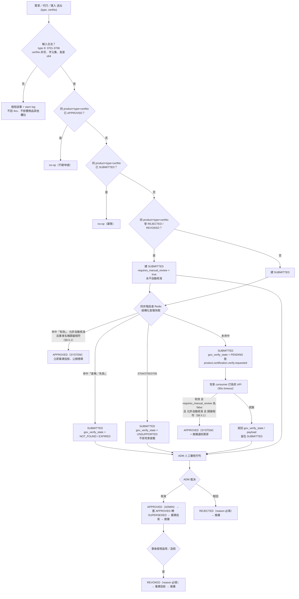
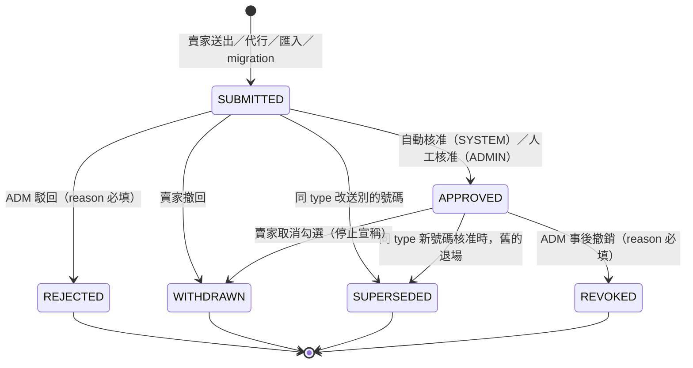
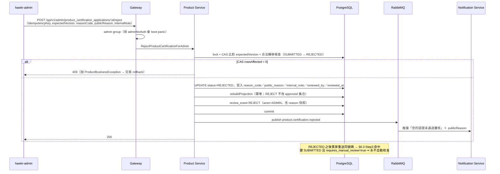
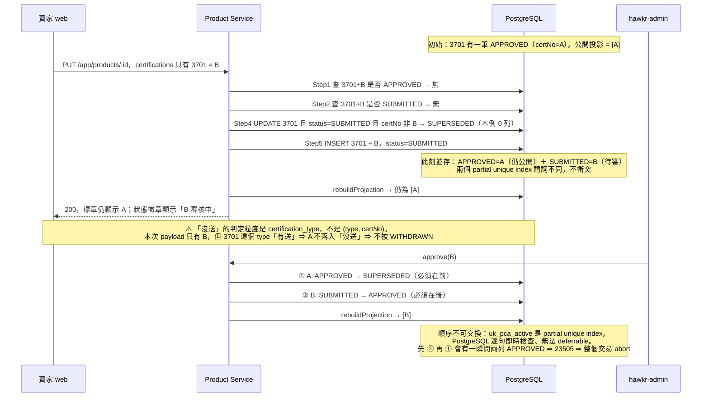

# 農業認證申請與審核（Product Certification Application & Review）設計書

> **本檔是 product-service（Java）與 gateway 的現行規格**，該服務搬進單體時刪除。其中屬 seller 模組的持有人歸屬比對（`MatchCertificateHolder`）以 `docs/modules/seller.md` §1.3 為準，本檔只保留呼叫端的行為。

> **檔名與標題刻意不一致**：本檔沿用原檔名 `19-農業認證驗證（Certification Verification）詳細設計書.md`
> ——重新命名會斷掉 `docs/index.md`、`docs/_sidebar.md`、`00-總覽.md` 與其他設計書的既有連結。
> 三處索引的**顯示標籤**已同步為本標題；引用本檔一律用**檔名或編號（19 號）**，不要用舊標題「農業認證驗證」。

> **核心不變式**：**未經核准的認證，不得出現在任何公開 surface。**
> 權威來源＝`product_certification_application`；`product.certifications` JSONB **降級為 approved-only 公開投影**。
>
> 本設計書涵蓋「賣家申請 → 政府自動查驗 → 自動核准／ADM 人工審核 → 核准後才公開標章」的完整流程，
> 並保留既有的「政府查驗端點（advisory）」規格（§8、§9.4）。

---

## 1. 功能概述

### 1.1 問題

賣家在商品上架時可填入農業認證（有機／產銷履歷／CAS／HACCP／ISO／GMP）。現況有兩個結構性問題：

1. **填了就公開**：賣家 create/update 路徑（`POST/PUT /app/products`）對 `certifications` **完全不查驗**，
   JSONB 直寫，寫入當下即出現在公開商品卡與 PDP 的認證標章上。任何人可宣稱任意認證。
2. **查不到就被拒絕**（且拒錯了）：賣家 App 在查驗查無時**直接丟棄號碼**、CSV 匯入 validator 把
   `CERT_VERIFY_FAILED` 判成 ERROR **擋住 commit**。而**「查不到」多半不是真的查不到**：
   - 產銷履歷（3702）政府 API 的回應延遲以**十秒為量級**（約 33–82 秒），而我方同步路徑的
     `read-timeout` 為 10 秒 ⇒ **每一次 3702 同步查驗都必定逾時**，與號碼是否存在無關。
     前端把逾時顯示成「查無此編號」。
   - 賣家慣用的 11 碼追溯碼與政府 `Tracecode` 的 14 碼**不是同一個鍵**（11 碼是記錄內的
     `TraceCodelist` 子項）⇒ 就算修好 timeout，該號碼仍然 `Data: []`。

因此需要一個**申請 → 查驗 → 審核**的流程：**絕不拒絕賣家**，但**未核准不公開**。

### 1.2 目標

| # | 目標 |
|---|---|
| G1 | 賣家送出的每一筆認證都落成一筆**申請**（`SUBMITTED`），任何情況下**不回 4xx、不丟棄號碼** |
| G2 | 政府 API 能證明「有效且可歸屬」時**自動核准**並立即公開標章（適用範圍見 §8.5） |
| G3 | 查無／已失效／不支援線上驗證／API 不可用 → 一律進 **ADM 人工審核佇列**，並附上政府查驗原始依據 |
| G4 | 公開面向（列表／PDP／`certification_types` 篩選）**只看得到已核准**的認證 |
| G5 | 平台保有 **REVOKED** 事後撤銷手段（政府 API 只驗「號碼存在」不驗「歸屬」，盜用他人證號會通過查驗） |
| G6 | 每一次狀態變更（含自動核准）都留下 append-only 稽核紀錄，查得出「誰放行的」 |

### 1.3 涉及服務

| 服務 | 角色 |
|------|------|
| Gateway（Go） | HTTP 入口：賣家 3 支、Admin 7 支（含 reverify）、既有 advisory 查驗 1 支；認證輸入 filter（§6.2.1）；capability 門檻；envelope |
| Product Service（Java） | 業務權威：申請表 CRUD、狀態機、投影重建、政府 API 查驗、背景查驗 consumer、事件發布 |
| Notification Service（Go） | 消費 `product.certification.*` 事件，推播給賣家 |
| Seller Service（Java/Go） | 僅供 `store_id → account_id` 反解（通知收件人），**fail-closed** |

### 1.4 不涉及

- **不涉及商品狀態**：認證待審**不影響商品上下架**。明確**不使用** `ProductStatus.PENDING_REVIEW(4002)`
  ——那是**商品**的審核狀態，用它會讓賣家因一張標章待審而整個商品被鎖。
- **不涉及賣家 App**：本系統不改 App（§17）。後端相容層保證舊 App 不壞。
- **不涉及 marketing / inventory**（不在本 repo）。
- **不引入任何補償任務基礎設施**（reconciliation job / backfill CLI / drift scanner）——見 §16。

## 2. 業務流程圖與狀態機圖

### 2.1 業務流程圖



> ⚠️ **同步階段一律不發起外部呼叫**（含 3701/3703）。理由見 §8.2——同步打政府 API 會在逾時當下寫入
> **全域 60 秒斷路器**，把緊接著排出去的背景查驗一起短路掉。

### 2.2 狀態機圖



---

## 3. 時序圖

### 3.1 賣家送出 → 同步快取命中「有效」→ 自動核准

```mermaid
sequenceDiagram
    participant FE as 賣家 web
    participant GW as Gateway
    participant PS as Product Service
    participant CA as CertificationApplicationService
    participant RD as Redis
    participant DB as PostgreSQL

    FE->>GW: PUT /api/v1/app/products/:id<br/>certifications = 一筆 type=3701, certNo=1-009-300022
    GW->>GW: JWTAuth + requireSeller CapProductManage<br/>剔除非法筆數／字元／型別（§6.2）
    GW->>PS: gRPC UpdateProduct（帶 certifications）

    PS->>CA: syncCertifications（productId, storeId, certs；同一 transaction）
    CA->>DB: Step1 SELECT APPROVED（product+type+certNo）
    DB-->>CA: 無
    CA->>DB: Step2 SELECT SUBMITTED（product+type+certNo）
    DB-->>CA: 無
    CA->>DB: Step3 SELECT REJECTED 或 REVOKED（product+type+certNo）
    DB-->>CA: 無 → requires_manual_review = false

    CA->>RD: GET gov:certv2:3701:&lt;hash&gt;
    RD-->>CA: 命中：validity=VALID, statusRaw=通過, holderName=...

    CA->>DB: Step4 UPDATE 同 type 異號 SUBMITTED → SUPERSEDED
    CA->>DB: Step5 INSERT application：status=SUBMITTED, gov_verify_state=VERIFIED, source=SELLER；ON CONFLICT DO NOTHING
    Note over CA,DB: 快取命中「有效」、允許自動核准且業者名稱歸屬相符（§8.5.1）<br/>⇒ 同一交易內接著走 §6.6 的核准實作
    CA->>DB: ① UPDATE 同 type 舊 APPROVED → SUPERSEDED（必須在 ② 之前）
    CA->>DB: ② UPDATE 本筆 SUBMITTED → APPROVED
    CA->>DB: 寫 review_event：SUBMIT（SELLER）+ AUTO_APPROVE（SYSTEM）+ SUPERSEDE（SYSTEM）
    CA->>DB: rebuildProjection：由當前所有 APPROVED 重算 product.certifications

    PS->>DB: commit
    PS->>RD: evictProductDetail(id) + evictProductListForWrite(storeId)
    PS-->>GW: UpdateProductResponse（certifications 為 approved-only 投影）
    GW-->>FE: 200，data.certifications 含 type=3701 該筆
    Note over FE: 賣家當下即看到標章 ⇒ 本路徑不發推播（§12.3）
```

### 3.2 快取未命中 → 落審核中 → 背景查驗 → 自動核准

```mermaid
sequenceDiagram
    participant FE as 賣家 web
    participant PS as Product Service
    participant DB as PostgreSQL
    participant MQ as RabbitMQ
    participant CS as CertificationVerifyConsumer
    participant GOV as 農業部 API
    participant RD as Redis
    participant NT as Notification Service

    FE->>PS: PUT /app/products/:id（同 §3.1）
    PS->>RD: GET gov:certv2:3701:&lt;hash&gt;
    RD-->>PS: 未命中
    PS->>DB: INSERT application：status=SUBMITTED, gov_verify_state=PENDING
    PS->>DB: 寫 review_event：action=SUBMIT, actor_role=SELLER
    PS->>DB: commit
    PS->>MQ: publish product.certification.verify.requested（afterCommit）
    PS-->>FE: 200（該筆認證此刻不在公開投影內 ⇒ 標章尚未出現）

    MQ->>CS: deliver（queue: product.certification.verify）
    CS->>GOV: GET TWOrganicAgricultureVerificationInformationType（帶 CertOrganicSn 與 api_key）<br/>90s timeout，繞過同步用斷路器
    GOV-->>CS: RS=OK, Data 一筆：Status=通過, CertOrganicSn=1-009-300022
    CS->>CS: ① 判 RS 是否為 OK ② 編號回聲自我校驗 ③ 截斷 payload → validity=VALID
    CS->>RD: SET gov:certv2:3701:&lt;hash&gt; = 結構化 JSON（TTL 7d）
    CS->>DB: 讀取當下 version → CAS UPDATE gov_verify_state=VERIFIED, gov_verify_payload, gov_verified_at
    alt validity=VALID 且 requires_manual_review=false 且 type 允許自動核准
        CS->>DB: 同 type 舊 APPROVED → SUPERSEDED（①）
        CS->>DB: 本筆 SUBMITTED → APPROVED（②）
        CS->>DB: rebuildProjection + review_event AUTO_APPROVE（actor=SYSTEM）
        CS->>DB: commit
        CS->>RD: evictProductDetail + evictProductListForWrite
        CS->>MQ: publish product.certification.approved
        MQ->>NT: 推播「您的認證已通過審核」
        Note over NT: 背景補課核准必須發推播——賣家畫面停在「審核中」，不通知他永遠不知道已通過
    else 其餘
        CS->>DB: 僅寫回查驗結果，留在 SUBMITTED → 進 ADM 佇列
    end
```

### 3.3 背景查驗查無 → ADM 人工核准

```mermaid
sequenceDiagram
    participant CS as CertificationVerifyConsumer
    participant GOV as 農業部 API
    participant DB as PostgreSQL
    participant ADM as hawkr-admin
    participant GW as Gateway
    participant PS as Product Service
    participant MQ as RabbitMQ

    CS->>GOV: 查驗（90s timeout）
    GOV-->>CS: RS=OK, Data 為空陣列
    CS->>DB: CAS UPDATE gov_verify_state=NOT_FOUND，寫入 gov_verified_at
    Note over DB: status 仍為 SUBMITTED ⇒ 留在 ADM 佇列

    ADM->>GW: GET /api/v1/admin/product_certification_applications?status=SUBMITTED
    GW->>PS: ListProductCertificationApplicationsForAdmin
    PS-->>ADM: records 清單（含 gov_verify_state／商品／賣家／送出時間）

    ADM->>GW: GET /api/v1/admin/product_certification_applications/:id
    PS-->>ADM: 詳情（gov_verify_payload：業者名／品項／Status／查驗時間；同 type 現行 APPROVED）
    Note over ADM: ADM 可按「重新查驗」再打一次政府 API（證書可能在申請後才登記）

    ADM->>GW: POST .../:id/approve（idempotencyKey, expectedVersion）
    GW->>PS: ApproveProductCertificationForAdmin（reviewer 取自 auth context）
    PS->>DB: lock application + product → CAS 比對 expectedVersion
    PS->>DB: ① 同 type 舊 APPROVED → SUPERSEDED
    PS->>DB: ② 本筆 SUBMITTED → APPROVED
    PS->>DB: rebuildProjection + review_event APPROVE 與 SUPERSEDE（actor=ADMIN）
    PS->>DB: commit
    PS->>PS: evictProductDetail + evictProductListForWrite + SSR tag product:&lt;id&gt;
    PS->>MQ: publish product.certification.approved
    PS-->>ADM: 200，data.status=APPROVED, data.version=7
```

### 3.4 ADM 駁回



### 3.5 換號碼（舊的保持公開直到新的核准）



---

## 4. 資料模型

### 4.1 `product_certification_application`（Flyway **V18**）

> 本書的 schema 變更落在 `V18__*.sql`。

| 欄位名 | 資料型態 | Nullable | Default | 對外 JSON 型別 | 備註 |
|---|---|---|---|---|---|
| `id` | BIGINT PK | N | — | **string** | **TSID**（product-service `node-id-base: 200`；`@TableId(type = IdType.INPUT)` + `TsidUtil.generate()`） |
| `product_id` | BIGINT | N | — | **string** | 所屬商品 |
| `store_id` | BIGINT | N | — | **string** | 賣家 store 代理鍵（擁有權欄位，與 `product.store_id` 對齊） |
| `submitted_by_account_id` | BIGINT | **Y** | null | **string** | 送出者登入 principal（賣家本人或代行 ADM）。🔴 **nullable**：`source='LEGACY_MIGRATION'` 的列**填 NULL**（migration 沒有送出者），**不得**拿 `store_id` 頂替——見 §15.3 |
| `certification_type` | INTEGER | N | — | **string** | `CertificationType` value（3701–3706） |
| `certificate_no` | VARCHAR(64) | N | — | string | **只 trim，保留前導 0，不轉數字** |
| `status` | VARCHAR(16) | N | `'SUBMITTED'` | string | `ProductCertificationStatus`；DB CHECK 六值 |
| `source` | VARCHAR(24) | N | — | string | `ProductCertificationSource`：SELLER／PRODUCT_IMPORT／DELEGATED_ADMIN／SEED／LEGACY_MIGRATION |
| `requires_manual_review` | BOOLEAN | N | `false` | bool | true ⇒ **永不自動核准**（§6.3 Step 3） |
| `gov_verify_state` | VARCHAR(16) | N | `'PENDING'` | string | `ProductCertificationGovVerifyState`：PENDING／VERIFIED／NOT_FOUND／EXPIRED／UNSUPPORTED／UNAVAILABLE |
| `gov_verify_payload` | JSONB | Y | null | object | 政府查驗結構化結果（§8.3 `GovVerifyResult` 的修剪版），ADM 判斷依據 |
| `gov_verified_at` | TIMESTAMPTZ | Y | null | ISO 8601 UTC | 最後一次查驗完成時間 |
| `version` | BIGINT | N | `0` | **string** | 樂觀鎖（`@Version`）；ADM 裁決必帶 `expectedVersion` |
| `submitted_at` | TIMESTAMPTZ | N | `now()` | ISO 8601 UTC | 進入 SUBMITTED 的時間，佇列排序鍵 |
| `reviewed_at` | TIMESTAMPTZ | Y | null | ISO 8601 UTC | 進入終態的時間 |
| `reviewed_by_account_id` | BIGINT | Y | null | **string** | 裁決者；自動核准為 null（actor 由 review_event 的 `SYSTEM` 標示） |
| `reason_code` | VARCHAR(32) | Y | null | string | `ProductCertificationRejectReason` |
| `public_reason` | VARCHAR(255) | Y | null | string | 會展示給賣家 |
| `internal_note` | TEXT | Y | null | string | **僅 ADM 可見，不得出現在任何賣家／公開 DTO** |
| `created_at` | TIMESTAMPTZ | N | `now()` | ISO 8601 UTC | MetaObjectHandler 填充 |
| `updated_at` | TIMESTAMPTZ | Y | null | ISO 8601 UTC | 同上 |

> ⚠️ **所有 ID 與 `version` 對外一律字串**（[CLAUDE.md](../../CLAUDE.md) §4「型別、金額與時間」＋[API 設計規範](../開發規範/API%20設計規範.md)）。TSID 以 int64 出 JSON 是本 repo 有前例的精度事故。

**索引與約束**：

```sql
-- 同一 (product, type) 最多一筆待審
CREATE UNIQUE INDEX uk_pca_pending ON product_certification_application (product_id, certification_type)
  WHERE status = 'SUBMITTED';
-- 同一 (product, type) 最多一筆有效
CREATE UNIQUE INDEX uk_pca_active  ON product_certification_application (product_id, certification_type)
  WHERE status = 'APPROVED';

CREATE INDEX idx_pca_queue  ON product_certification_application (status, submitted_at);           -- ADM 佇列
CREATE INDEX idx_pca_lookup ON product_certification_application (product_id, certification_type, certificate_no); -- §6.3 三次查詢
CREATE INDEX idx_pca_store  ON product_certification_application (store_id);                        -- 賣家維度查詢

ALTER TABLE product_certification_application
  -- ⚠️ 以下三個 CHECK 是 CodeMeta 值域的「刻意第二份拷貝」，見下方紅字
  ADD CONSTRAINT ck_pca_status CHECK (status IN
      ('SUBMITTED','APPROVED','REJECTED','WITHDRAWN','SUPERSEDED','REVOKED')),
  ADD CONSTRAINT ck_pca_gov_state CHECK (gov_verify_state IN
      ('PENDING','VERIFIED','NOT_FOUND','EXPIRED','UNSUPPORTED','UNAVAILABLE')),
  ADD CONSTRAINT ck_pca_cert_type CHECK (certification_type BETWEEN 3701 AND 3706),
  -- 這一個不是拷貝：長度／非空是 DB 層的資料完整性，與 CodeMeta 無關
  ADD CONSTRAINT ck_pca_cert_no CHECK (certificate_no <> '' AND length(certificate_no) <= 64);
```

> 🔴 **`ck_pca_status` / `ck_pca_gov_state` / `ck_pca_cert_type` 是 CodeMeta 值域的第二份拷貝，
> 而且沒有任何 gate 守著它們。** 這是**刻意的取捨**（DB 層 fail-closed 比應用層 validator 更難繞過），
> 但代價必須寫明：
> **改動 `ProductCertificationStatus` / `ProductCertificationGovVerifyState` / `CertificationType`
> 的值域時，必須在同一個 PR 內補一支 `V{N+1}__*.sql` 同步這三個 CHECK**
> ——`generate.sh` **不會**碰 SQL，CodeMeta 改了而 CHECK 沒改的症狀是
> **新代碼寫入時 DB 直接拒絕（23514）**，且錯誤訊息不會告訴你是 CodeMeta 漂移。
> ⚠️ 若團隊認為這個維護成本不划算，替代方案是**只保留 `ck_pca_cert_no`**（長度／非空），
> 值域改由 `CodeMetaValidator` 在寫入前把關。**兩種都可以，但必須擇一並寫明**，
> 不能既留著拷貝又不承認它是拷貝。

> 🔴 `uk_pca_pending` 與 `uk_pca_active` 的**謂詞刻意不同**（`SUBMITTED` vs `APPROVED`），
> 才能讓「舊 APPROVED ＋ 新 SUBMITTED」並存 —— 這是 §3.5 換號流程成立的前提。

### 4.2 `product_certification_review_event`（append-only）

| 欄位名 | 資料型態 | Nullable | 對外 JSON | 備註 |
|---|---|---|---|---|
| `id` | BIGSERIAL PK | N | **string** | 內部表 → BIGSERIAL（`@TableId(type = IdType.AUTO)`） |
| `application_id` | BIGINT | N | **string** | FK 語意（不建 FK 約束，與本服務既有慣例一致） |
| `action` | VARCHAR(16) | N | string | `ProductCertificationReviewAction`：SUBMIT／AUTO_APPROVE／APPROVE／REJECT／WITHDRAW／SUPERSEDE／REVOKE |
| `from_status` | VARCHAR(16) | Y | string | 建立時為 null |
| `to_status` | VARCHAR(16) | N | string | |
| `actor_role` | VARCHAR(8) | N | string | SYSTEM／SELLER／ADMIN |
| `actor_account_id` | BIGINT | Y | **string** | SYSTEM 時為 null |
| `certification_type` | INTEGER | N | **string** | 快照（申請列日後被改也查得到當時值） |
| `certificate_no` | VARCHAR(64) | N | string | 快照 |
| `reason_code` / `public_reason` / `internal_note` | VARCHAR/TEXT | Y | string | 快照 |
| `application_version` | BIGINT | N | **string** | 事件當下的 application `version` |
| `trace_id` | VARCHAR(64) | Y | string | 由 observability context 帶入 |
| `created_at` | TIMESTAMPTZ | N | ISO 8601 UTC | |

```sql
CREATE INDEX idx_pcre_application ON product_certification_review_event (application_id, id);
```

> 🔴 **自動核准也必須寫事件**（`actor_role = 'SYSTEM'`, `action = 'AUTO_APPROVE'`）。
> 缺了它，事後查不出「這張標章是誰放行的」，而自動核准正是最需要事後可稽核的路徑。
> **本表 append-only：禁止 UPDATE / DELETE。**

### 4.3 `product.certifications`（既有欄位，語意變更）

`product.certifications` JSONB `[{name, certNo}]` **欄位形狀不變**，語意降級為
**「由當前所有 `APPROVED` 申請重算出來的 approved-only 公開投影」**。權威來源是 §4.1 的申請表。
所有既有讀路徑與 `certification_types` 篩選 SQL **零改動**（見 §7）。

### 4.4 Enum 定義

本設計書涉及的 Enum **只列名稱與歸屬**，完整值域以 CodeMeta 為唯一真實來源（設計書禁止複製 Enum 表格）：

| Enum | 歸屬 | 用途 |
|---|---|---|
| `CertificationType` | [業務類型碼](../代碼管理%EF%BC%88CodeMeta%EF%BC%89/業務類型碼.md#CertificationType) | `certification_type`（既有） |
| `ProductCertificationStatus` | [業務狀態碼](../代碼管理%EF%BC%88CodeMeta%EF%BC%89/業務狀態碼.md)（字串 value，形狀對齊 `ReportStatus`） | `status` |
| `ProductCertificationSource` | [業務類型碼](../代碼管理%EF%BC%88CodeMeta%EF%BC%89/業務類型碼.md) | `source` |
| `ProductCertificationGovVerifyState` | [業務類型碼](../代碼管理%EF%BC%88CodeMeta%EF%BC%89/業務類型碼.md) | `gov_verify_state` |
| `ProductCertificationReviewAction` | [業務類型碼](../代碼管理%EF%BC%88CodeMeta%EF%BC%89/業務類型碼.md) | `review_event.action` |
| `ProductCertificationRejectReason` | [業務類型碼](../代碼管理%EF%BC%88CodeMeta%EF%BC%89/業務類型碼.md) | `reason_code` |
| `ProductPublicationState` | [業務狀態碼](../代碼管理%EF%BC%88CodeMeta%EF%BC%89/業務狀態碼.md#ProductPublicationState)（既有 enum，**必須列入 `ADMIN_ENUMS`**） | ADM 回應的 `product_publication_state`（§9.2）；規則見 02 號 §2.9 |
| `ImportItemErrorType` | [業務類型碼](../代碼管理%EF%BC%88CodeMeta%EF%BC%89/業務類型碼.md#ImportItemErrorType) | 匯入 violation code（本系統**不新增任何碼**，見 §6.5） |
| `ProductEventType` | [內部技術碼](../代碼管理%EF%BC%88CodeMeta%EF%BC%89/內部技術碼.md) | MQ 事件型別（本書使用 4 個，見 §12） |

**流程強制**：先改 `docs/代碼管理（CodeMeta）/*.md` → `cd docs/代碼管理（CodeMeta）/scripts && ./generate.sh --java`
（前端可見再 `--go` / `--web` / `--admin`）→ 跑 `check-copies.sh`。**禁止直接改生成檔**。
ADM 需先把新 enum 加進 `generate.sh` 的 `ADMIN_ENUMS`，並同步 `codemeta-generated-sync.test.ts` 的 count 與 digest。

---

## 5. 狀態機

### 5.1 合法轉移表

| From | To | 觸發者 | 條件 |
|---|---|---|---|
| （建立） | `SUBMITTED` | SELLER / ADMIN(代行) / SYSTEM(匯入・migration) | 輸入合法且未命中 §6.3 Step 1/2 |
| `SUBMITTED` | `APPROVED` | SYSTEM | `gov_verify_state = VERIFIED` 且 `requires_manual_review = false` 且 type 允許自動核准（§8.5） |
| `SUBMITTED` | `APPROVED` | ADMIN | 人工核准，帶 `expectedVersion` |
| `SUBMITTED` | `REJECTED` | ADMIN | `reason_code` 必填 |
| `SUBMITTED` | `WITHDRAWN` | SELLER | 專用 withdraw 端點，或該 type 完全沒送（§6.4） |
| `SUBMITTED` | `SUPERSEDED` | SYSTEM | 同 type 改送別的號碼（§6.3 Step 4） |
| `APPROVED` | `SUPERSEDED` | SYSTEM/ADMIN | 同 type 新號碼核准的第 ① 步（§6.6） |
| `APPROVED` | `WITHDRAWN` | SELLER | 賣家取消勾選（該 type 完全沒送，§6.4） |
| `APPROVED` | `REVOKED` | ADMIN | 事後撤銷，`reason_code` 必填 |

**其餘一律非法**，命中回 `3027 認證申請狀態不允許此操作`（§11）。四個終態（`REJECTED`／`WITHDRAWN`／`SUPERSEDED`／`REVOKED`）不再轉出。

### 5.2 每個狀態的語意與存在理由

| 狀態 | 語意 | 為什麼需要它（缺了會怎樣） |
|---|---|---|
| `SUBMITTED` | 賣家已宣稱、平台尚未認可。**不出現在公開投影** | 核心不變式的載體。缺了就回到「填了就公開」 |
| `APPROVED` | 平台已認可，**出現在公開投影** | 投影重算的唯一輸入集合 |
| `REJECTED` | ADM 判定不成立 | 缺了 ADM 只能「不處理」，佇列永遠不收斂；且 §6.3 Step 3 需要它來擋「重送繞過裁決」 |
| `WITHDRAWN` | 賣家自己停止宣稱 | 取消勾選要有歸宿。若歸到 REJECTED 會誣指平台駁回，audit 與事實不符 |
| `SUPERSEDED` | 被同 type 的新號碼取代 | 換號時舊項要退場但**保留歷程**。若直接刪列，稽核斷鏈；若歸到 WITHDRAWN，會把「換號」記成「停止宣稱」 |
| `REVOKED` | 平台事後撤銷 | **唯一的治理手段**。政府 API 只驗「號碼存在」不驗「歸屬」⇒ 盜用他人證號會自動通過查驗；缺了 REVOKED 平台對已公開的假標章無手段 |

> **不做 EXPIRED 自動退場**：政府 API 的效期來源不穩定——3702 無狀態欄且回應延遲達數十秒、背景查驗常逾時、
> 3703 **既無狀態欄也無效期欄**。以「有效期」自動退場會在資料缺失時誤殺合法標章。
> 以 **REVOKED 手動退場**替代，見 §17。

### 5.3 `requires_manual_review` 的作用

`REJECTED` / `REVOKED` 是 ADM 的**裁決**。若賣家重送同一組 `(product, type, certNo)`，
不得因為政府查驗剛好通過就自動放行——那等於讓重送繞過裁決。

⇒ §6.3 Step 3 命中時建立的 SUBMITTED 帶 `requires_manual_review = true`，**永不自動核准**。
⚠️ 但**仍要排背景查驗**：ADM 重審一樣需要政府資料當依據，只是查驗結果再好也不會自動放行。

---

## 6. 寫入收斂

### 6.1 五條寫入路徑 → 單一收斂點

| # | 入口 | 現況收斂點 | 收斂後 |
|---|---|---|---|
| W1 | `POST /app/products`（賣家建立） | `ProductEntityConverter` `setCertifications` | 改呼叫申請收斂點 |
| W2 | `PUT /app/products/:id`（賣家更新，全量取代） | 同上 | 同上 |
| W3 | ADM 代行建立（`admin_delegated_product.go`） | 走 W1 鏈 | 同上 |
| W4 | ADM 代行更新 | 走 W2 鏈 | 同上 |
| W5 | 匯入 commit（`CreateProductFromImportInternal`） | `ProductImportService` | 同上 |
| W6 | seed SQL | `infra/seed-data/04-product.sql` | 直接寫合法值 ＋ 同時寫 application（§15.4） |
| W7 | AI 上架助手（ai-service） | 只回 patch＋SSE，**不寫 DB** | 不是寫入路徑；但 jsonschema 要改教模型產碼值（§14） |

🔴 **收斂後，任何路徑不得再直接 `setCertifications` 寫投影。** 投影只由 `rebuildProjection()` 產生（§7.2）。

### 6.2 輸入合法性：非法輸入一律「剔除該筆＋warn log」，**不回 4xx**

「絕不拒絕賣家」約束的是**查驗結果**，不是**輸入格式**。但非法輸入的處置**不是回 400**：

**非法定義**：`certNo` 為空／含 `[A-Za-z0-9_-]` 以外字元／長度 > 64／`type` 不是 3701–3706。

| 路徑 | 處置 | 施工位置 |
|---|---|---|
| W1／W2 賣家 | **剔除該筆＋warn log** | Gateway handler **內的 filter**（`CreateSellerProduct` / `UpdateSellerProduct` 各一處），見 §6.2.1 |
| W3／W4 代行 | 同上 | Gateway handler 內的 filter（代行 create／代行 update 各一處）。⚠️ 代行走**另一個 DTO** `DelegatedProductCertification`，且 `validateProductArrays` 現在只擋筆數，值域驗證要另外補 |
| W5 匯入 | **L2 與 parse 兩層維持現行行為**（見 §6.5） | — |
| W6 seed | SQL 層直接寫合法值 | §15.4 |

#### 6.2.1 🔴 剔除**必須在 handler 內以 filter 實作，不得用 `binding` tag**

本 repo 的 `binding:` tag **只有一條出口**：`ShouldBindJSON` 失敗 → `response.BadRequest` ⇒ **400**。
而 `dive` 讓元素 tag 生效的意思，正是「**元素違規時 bind 失敗**」——
⇒ 在 `Certifications` 上加 `binding:"omitempty,dive"` **恰恰產生 §6.2.2 明令禁止的 400**，
與「剔除該筆」是**相反的行為**，不是它的實作方式。

**定版做法（三層）**：

| 層 | 動作 |
|---|---|
| ① Gateway handler filter | **bind 之後、組 gRPC request 之前**逐筆檢查，非法者**不放進 request** 並記 warn log（含 productId／storeId／type／被剔除的原因）。四個 handler 各一處：`CreateSellerProduct`／`UpdateSellerProduct`／代行 create／代行 update |
| ② 收斂點第二道防線 | `ProductCertificationApplicationService` 進 §6.3 之前再驗一次（縱深防禦：gRPC 直呼、未來新增的第五條路徑都會被接住） |
| ③ certNo 規則共用常數 | **抽成單一來源**（字元集 ＋ 長度上限），Gateway 與 product-service 各自引用，**不得再新增第三份字面值** |

> ⚠️ **③ 不是潔癖**：現況已有**兩份**——Gateway `handler/product.go` 的 `certNoPattern`（＋`certNoMaxLength`）
> 與 Java `GovCertificationService` 的 `CERT_NO_PATTERN`（＋`CERT_NO_MAX_LENGTH`），
> 且 Gateway 那份的註解明寫「規則與 Java 側 `GovCertificationService.isValidCertNo` **必須逐字一致，改動時兩邊一起改**」。
> filter（①）與收斂點（②）若各自再寫一份字面值，**同一條規則會變成四份**，
> 而唯一的一致性保證是一行註解。⇒ Go 側收斂到 `certNoPattern` / `certNoMaxLength` 單一來源、
> Java 側收斂到 `GovCertificationService.isValidCertNo`，兩份之間另加契約測試守住逐字一致。

> ✅ **筆數上限不受此限**：`binding:"max=N"` 照用。它擋的是 **DoS（一次送一萬筆）**，不是值域；
> 超量回 400 是正確行為，且舊 App 不會送出超量。現況賣家路徑**無上限**、代行是 10 ⇒ 賣家路徑補齊。


#### 6.2.2 為什麼非法輸入不回 400

`certNo` 的非法值**在舊版 App 上可達**：AI 上架助手 patch 的 `certNo` 會直接寫進選中的認證欄、
繞過畫面上的驗證，然後原樣送出；而後端現況對 `certifications` **零驗證**照收 200。
一旦改成 400，**已上架 App 的 AI 上架流程當場壞掉**——App 不在本系統範圍內，後端相容層必須保證舊 App 不壞。

⇒ **定版：所有寫入路徑一律「剔除非法的那一筆＋記 warn log」，不回 4xx。**

- 防污染目的照樣達成（非法值不進申請表、不灌 ADM 佇列）
- 舊 App 不壞
- ⚠️ **不得再用「與匯入路徑的既有 warning 語意一致」當理由**——匯入側實際上是**三種不同行為**（§6.5），沒有一致的既有語意可以援引
- web 端的即時回饋由**前端輸入驗證**提供（正常情況根本不會送出非法值）

### 6.2.9 certNo 的字元規則必須**分兩類**

🔴 **不得把 `[A-Za-z0-9_-]{1,64}` 套在全部六型上**——那對 3704/3705/3706 是錯的：
`ISO 22000:2018` 含冒號、HACCP／GMP 的證書編號常含空格與斜線
⇒ 賣家填了真實編號，被**靜默剔除**（依 §6.2 剔除的那筆不建申請、不回 4xx）
⇒ 賣家送出成功、什麼都沒發生、沒有任何訊號。這正是本設計書全篇在防的失效形狀。

**定版**：
| 類型 | certNo 規則 | 理由 |
|---|---|---|
| **3701／3702／3703**（可線上驗證） | 維持嚴格 `[A-Za-z0-9_-]{1,64}` | 這個值要組進政府 API 的查詢字串，格式由對方決定；且與既有 `GovCertificationService.isValidCertNo`／gateway `certNoPattern` 是**同一條規則的三處拷貝**，不得分岔 |
| **3704／3705／3706**（僅人工審核） | 放寬：非空、trim 後 ≤64 字、**禁控制字元與 `<` `>`**（防注入與防髒資料），其餘字元允許 | 它們不會被組進任何外部 URL；格式由 ADM 人眼判斷。這也與 advisory 查驗端點的既有行為一致——該端點對這三型本來就不套白名單 |

⚠️ 兩類規則都要有測試釘住：可驗證三型送 `ISO 22000:2018` 必須**剔除**（它不是合法的查詢鍵），
不可驗證三型送同樣的值必須**保留**。

### 6.2.10 「剔除」只適用於批次路徑，單筆申請走 typed 業務碼

剔除語意（不回 4xx、跳過該筆、記 warning）成立的前提是**一次送多筆**——賣家送了 5 個認證，
其中 1 個格式不對，不該讓另外 4 個跟著失敗。

**但單筆申請端點不適用**：`POST /app/products/{id}/certification_applications` 一次只送一筆，
剔除它等於「送出成功但列表沒有這筆」，比回一個看得懂的錯誤**更糟**。

| 路徑 | 非法輸入的處置 |
|---|---|
| 商品 create／update 內嵌的認證（W1–W5，批次） | **剔除該筆＋warn log＋列入 `certificationWarnings[]`**，回 200 |
| 單筆 `POST .../certification_applications` | **回 typed 業務碼**（400 家族），不剔除 |

⚠️ 兩層都要遵守：Gateway 對單筆端點不套 filter，收斂點對單筆 submit 路徑以業務碼回答。

### 6.2.11 驗什麼就存什麼

放寬類（3704–3706）若「驗 trim 後的值、存原值」，從試算表貼進來的**尾端換行**會通過驗證、
然後原樣落進申請表與 ADM 佇列 ⇒ **驗證看起來有做，被擋的東西卻進去了**。
⇒ Gateway 與收斂點兩層都必須**存正規化後的值**（放寬類 trim，嚴格類原值——嚴格類不 trim 是為了
與 `isValidCertNo` 保持逐字一致）。

### 6.3 同步規則（逐組 `(type, certNo)`，單一 transaction）

> 🔴 **Step 0（前置閘門，先於一切）：本次請求是否真的要動認證？不是就直接 return。**
> 見 §6.3.0——**漏了這一步會靜默清空全站的法規標章；條件寫錯則會讓舊 App 的認證靜默蒸發**。

```
Step 0  effectiveUpdate = request.updateCertifications || !request.certifications.isEmpty()
        if (!effectiveUpdate) return;        // 不建申請、不 WITHDRAW、不動投影
Step 1  SELECT ... WHERE product_id=? AND certification_type=? AND certificate_no=? AND status='APPROVED'
        命中 ⇒ no-op，跳到下一組（不 UPDATE、不 INSERT）
Step 2  同上但 status='SUBMITTED' ⇒ no-op（冪等：賣家重送同號碼）
Step 3  同上但 status IN ('REJECTED','REVOKED') ⇒ 記下 requires_manual_review = true
Step 4  UPDATE ... SET status='SUPERSEDED'
        WHERE product_id=? AND certification_type=? AND status='SUBMITTED' AND certificate_no <> ?
        （只有確定要插新號碼時才執行；**每一列被 SUPERSEDE 都要寫一筆 review_event**）
Step 5  INSERT ... （**一律以 status='SUBMITTED' 插入**）ON CONFLICT DO NOTHING
        rowsAffected = 0 且非 Step 2 情況 ⇒ 依入口決定（見「衝突的作用域」）

Step 6  若同步快取命中「有效」且 requires_manual_review = false 且該 type 允許自動核准（§8.5）
        ⇒ **在同一交易內接著走 §6.6 的核准實作**（① 舊 APPROVED → SUPERSEDED；② 本筆 → APPROVED；
          rebuildProjection；寫 AUTO_APPROVE / SUPERSEDE 事件）
        否則 ⇒ 停在 SUBMITTED，依 §8.2 決定 gov_verify_state，必要時排背景查驗
```

#### 6.3.0 🔴 `update_certifications` 是「未提供」與「清空」的唯一區分手段

`api/proto/product/product.proto` 的 `UpdateProductRequest` 已有：

```protobuf
bool update_certifications = 17;  // true = 本次以 certifications 全量取代（含清空）；
                                  // proto3 的 repeated 分不出「空」與「未提供」，
                                  // 沒有這個旗標就永遠清不掉認證。
                                  // 相容期：未設但 certifications 非空仍視為要更新
```

**呼叫端現況**：
- `gateway/internal/handler/seller_product.go`：`UpdateCertifications: req.Certifications != nil`
- `gateway/internal/handler/admin_delegated_product.go`：`body.Certifications == nil` 時
  fallback 成 `before.Certifications`，並據此決定 `updateCertifications`

**定版（沿用 proto 註解的相容期語意，不推翻它）**：

```
effectiveUpdate = update_certifications || !certifications.isEmpty()
if (!effectiveUpdate) return;   // 不建申請、不 WITHDRAW、不動投影
```

| 情境 | `update_certifications` | `certifications` | `effectiveUpdate` | 行為 |
|---|---|---|---|---|
| 新 client 正常更新 | true | 非空 | ✅ | 走 Step 1–6 |
| **新 client 明確清空** | true | **空陣列** | ✅ | 走 Step 1–6 ⇒ 全部 type 都「沒送」⇒ §6.4 的 WITHDRAWN 生效（**這是唯一該清空的情境**） |
| **舊 client（未設旗標但有帶認證）** | false／未設 | 非空 | ✅ | 走 Step 1–6，**認證不蒸發** |
| **部分更新（未帶 certifications 欄位）** | false／未設 | 空 | ❌ | **直接 return** ⇐ 這格就是本節要保護的那一格 |

🔴 **條件必須是「或」，不能只看旗標**：`api/proto/product/product.proto` 的欄位註解結尾明寫
**「相容期：未設但 certifications 非空仍視為要更新」**，而 product-service 現行的
`ProductProtoConverter` 閘門就是這個形狀：

```java
if (request.getUpdateCertifications() || request.getCertificationsCount() > 0) {
```

**本設計沿用這個既有語意，不推翻它。**
⚠️ `api/proto/` 的契約優先序**高於**詳細設計書——設計書若寫成
`if (!request.updateCertifications) return;`，等於單方面推翻一個更高優先序的契約，
且會打壞一個真實情境：**舊 App 送 PUT 帶了 `certifications` 但沒設旗標 ⇒ 直接 return
⇒ 賣家送出的認證靜默蒸發**。那與本節要防的清空是同一類失效，只是方向相反。

> 🔴 **為什麼這是本設計書最危險的一個缺口**：§6.4 的「該 type 完全沒送 → WITHDRAWN」若照字面
> 實作成 `withdrawTypesNotSubmitted(productId, submittedTypes)` 掛在收斂點上，
> 則**任何 `effectiveUpdate == false` 的請求**——舊 App 的部分更新、代行只改名稱的 PATCH、
> 任何只送單一欄位的 client——都會讓 `submittedTypes` 為空集合
> ⇒ **該商品全部 `APPROVED` 一次轉 `WITHDRAWN`** ⇒ 投影被清空 ⇒ **法規標章消失**。
>
> **而失效訊號是零**：HTTP **200**、稽核表**有列**（且記成語意完全正確的「賣家停止宣稱」）、
> 資料形狀無一處異常、**`WITHDRAWN` 依 §12.3 不發推播** ⇒ 賣家不會收到任何通知。
> 這是「形狀正確、語意全錯」的典型，任何 schema 檢查與型別測試都抓不到。

⚠️ **`update_hashtags` 是同一個模式的既有先例**（`bool update_hashtags = 15`），
本節不是新發明的機制，而是**把既有旗標接進認證收斂點**——漏接才是新增的 bug。

> 🔴 **Step 5 一律插 `SUBMITTED`，不得直接插 `APPROVED`**：`uk_pca_active` 的謂詞是 `status='APPROVED'`，
> 若同 `(product, type)` 已有別的號碼是 APPROVED，直接以 APPROVED 插入會撞唯一索引，
> 而 `ON CONFLICT DO NOTHING` 會**靜默丟棄新申請**（無列、無錯）。
> 先插 SUBMITTED 再走 §6.6 的 ①→② 兩步，是**唯一**同時滿足「換號主路徑」與「不撞 23505」的順序，
> 也讓自動核准與人工核准**共用同一段實作**（不是兩套）。

**🔴 為什麼 Step 1 必須在最前面**（缺了它會造成兩個災難）：

1. 兩個 partial unique index 的謂詞是 `status='SUBMITTED'` / `='APPROVED'`，而新列一律以 SUBMITTED 插入
   ⇒ 同 `(type, certNo)` 已 APPROVED 時**不觸發任何衝突**。而全量取代語意下**每次商品編輯都會把整份
   approved 投影原樣送回** ⇒ **每存一次商品就替每個已核准認證多建一筆 SUBMITTED**，ADM 佇列被灌爆。
2. Step 1 命中即跳過，**連帶不執行 Step 4** ⇒ 不會誤殺賣家正在等待的換號申請。
   （狀態為 `APPROVED=A ＋ SUBMITTED=B` 時，投影送回 `[A]`，不得讓 B 被 SUPERSEDED。）

**🔴 Step 5 的 `rowsAffected` 檢查是必要的**：`ON CONFLICT DO NOTHING` 對「同號碼併發」是正確的冪等，
但對「**不同號碼併發**」是**靜默資料遺失**——T2 撞到 T1 未提交的 speculative insertion → 等待 →
T1 commit → T2 走 DO NOTHING，**無列、無錯**。必須顯式檢查才知道發生了什麼。

**衝突的作用域**：

| 入口 | `rowsAffected = 0` 時 |
|---|---|
| **商品 create/update 內嵌的認證**（W1–W5） | **跳過該筆**，不影響商品其他欄位、**不 rollback、不回 4xx**；記 warn log ＋ metric，**並在回應的 `certificationWarnings[]` 明列該筆**（§6.3.1） |
| **§9.1 的專用申請端點** | 回 typed 409（單筆明確動作，賣家看得懂該重試什麼） |

> ⚠️ 為什麼商品路徑不回 4xx：舊 App 不得收到 4xx（§6.2.2），而一個認證層級的競態不該讓整次商品儲存失敗。
> ⚠️ 序列情境插不出衝突（Step 4 已先清掉同 type 的異號 SUBMITTED），**只有併發才會走到這裡**。

> 🔴 **Step 4 的併發副作用必須進 audit**：若 T1 已 commit `(3701, B, SUBMITTED)`，
> 而 T2 隨後執行 Step 4（謂詞 `certificate_no <> C`），T2 會把**併發贏家 T1 剛建立的申請 B 轉成 SUPERSEDED**。
> 這不是換號、是競態的副產物，但對 B 而言後果一樣（退場）。
> ⇒ **每一列被 Step 4 SUPERSEDE 都要寫 review_event**（`action=SUPERSEDE`、`actor_role=SYSTEM`、帶 `trace_id`），
> 否則賣家的申請憑空消失且查不到是誰動的。

#### 6.3.1 🔴 `certificationWarnings[]` 必須進契約

**原本判定「不新增契約欄位」的理由（「下次儲存會自動重送並成功」）已被證偽**：
被跳過／被剔除的那一筆**既不在 approved-only 投影、也不在申請表**
⇒ 賣家表單一 **re-hydrate 就消失了**，根本沒有「下次儲存」會帶著它重送。
⇒ 不告訴賣家，那筆認證就是**靜默蒸發**——正是本設計書到處在防的失效模式。

**兩個來源都要進同一個 `certificationWarnings[]`**（本節定版；兩者的**消失機制完全相同**，
證偽理由對 §6.2 的剔除**逐字適用**）：

| 來源 | 產生位置 | `reason` |
|---|---|---|
| §6.2 的**輸入非法被剔除** | Gateway handler filter | `INVALID_TYPE`／`INVALID_CERT_NO` |
| §6.3 Step 5 的**併發被跳過** | product-service 收斂點 → gRPC response | `CONCURRENT_CONFLICT` |

**合併責任在 Gateway**：product-service 只回自己知道的那部分（`CONCURRENT_CONFLICT`），
Gateway 把自己 filter 掉的那幾筆**併進同一個陣列**再回給前端。

**欄位形狀**（proto 見 §10.2、Gateway DTO 與範例見 §9.5）：

| 欄位 | 型別 | 說明 |
|---|---|---|
| `certificationType` | string | **原樣回送賣家送來的值**（可能是非法值，例如中文標籤）⇒ 前端要能安全渲染，**不得假設它是合法碼** |
| `certificateNo` | string | 同上 |
| `reason` | string | 上表的 reason code |
| `message` | string | 可直接顯示的中文說明 |

⚠️ **這是 additive 欄位**（同版本可加欄位、不刪不改型別）⇒ 舊 App 忽略它即可，不構成破壞性變更。

**交易傳播**：收斂點是獨立 bean（§6.7）但用 `Propagation.REQUIRED` **join 商品寫入的交易**
——投影重建必須與商品寫入原子。跳過某筆認證不拋例外，故不會拖垮外層交易。

### 6.4 全量取代的作用域：「沒送」的判定粒度是 `certification_type`

> 🔴 **本節整節的前提是 §6.3 Step 0 的 `effectiveUpdate == true`**
> （＝`update_certifications` 為 true，**或**旗標未設但 `certifications` 非空的舊 client）。
> `effectiveUpdate == false` 時**根本不進入本節**（Step 0 已 return）——
> 「沒送」指的是「**本次確實要更新認證，而該 type 不在本次清單內**」，
> **不是**「這次請求裡沒有 certifications 欄位」。兩者混淆會清空全站標章（§6.3.0）。
> ⚠️ 反過來也要注意：`update_certifications = true` ＋ **空陣列**是**合法且唯一**的「清空」表達，
> 它會讓所有 type 落入「沒送」⇒ 全數 WITHDRAWN。這是賣家的明確意圖，不是 bug。

| 情境 | 處理 |
|---|---|
| 該 type **有送任一號碼** | 走 §6.3。舊 APPROVED **保持公開**；新號碼核准時舊的才 SUPERSEDED |
| 該 type **完全沒送** 且有 APPROVED | → `WITHDRAWN`（賣家停止宣稱）**＋ 重建投影**（§7.2） |
| 該 type **完全沒送** 且有 SUBMITTED | **保留**（待審是「進行中的請求」，只能由明確 withdraw 撤銷） |

> 🔴 **為什麼粒度必須是 type 而不是 `(type, certNo)`**：若用 `(type, certNo)`，賣家把 A 改成 B 時
> payload 只有 B ⇒ A 落入「沒送」⇒ **送出當下就 WITHDRAWN、標章立即消失**，而 B 還在待審。三個後果：
> ① 「新證書待審時舊證書仍公開」做不到 ② `SUPERSEDED` 在主路徑上永不觸發（§5.2 為它寫的存在理由落空）
> ③ audit 把「換號」記成「賣家停止宣稱」，與事實不符。

### 6.5 匯入路徑（W5）：拆碼 ＋ 移除同步查驗，**不新增任何碼**

#### 6.5.1 匯入側的既有行為是**三種**，不是一種

匯入路徑的三層對認證欄位各有不同的處置，實作前必須分清楚：

| 層 | 位置 | 實際行為 | 阻擋粒度 |
|---|---|---|---|
| L2 內容驗證（CSV 上傳當下） | `L2ContentValidator` | `CERT_FORMAT_INVALID`／`CERT_ENUM_INVALID`／`CERT_NO_MISSING` **三個碼全部走 `errors.add(...)`** | **整份 job 標 `CSV_INVALID` 退回**、不發 parse 事件 ⇒ 200 列裡一格認證違規＝整份退回 |
| CSV 解析 | `CsvParseService.parseCertifications` | 對不認得的 type（`CodeMetaNormalizer.certificationTypeToValue` 回 null）**直接 `continue`**——**無聲丟棄，連 warning 都不發** | 無（該筆認證憑空消失，賣家不會收到任何訊息） |
| 上架檢核（commit / publish） | `ProductPublishValidator.validateCertifications` | `error(...)` ⇒ `ValidationResult.hasBlockingError()` | **擋單筆 item 的 commit** |

> ⚠️ **`CERT_FORMAT_INVALID` 在 SSOT 的 description 是 `L2 / JOB`，不是 `warning`**
> （`CERT_ENUM_INVALID` / `CERT_NO_MISSING` 才是「warning，跳過該 cert」）。
> 那三個 description **對執行期零影響**——見 §6.5.2。SSOT 的字面與 `L2ContentValidator` 的實際行為
> 不一致（三個碼在該層全部是 job 級阻擋），本系統不修正這個既有落差。

🔴 **L2 與 parse 兩層維持現行行為**：它們是既有的匯入品質閘門，改動會擴大到 **job 級行為**
（整份退回的門檻、無聲丟棄是否要補 warning），不在本系統的範圍內。
⇒ §6.2 的「不擋 commit」對 CSV 路徑**只在「通過 L2 之後」成立**。

#### 6.5.2 ⚠️ `ImportItemErrorType` 沒有 severity 欄位

建構子是 `(code, value, label, description)`，CodeMeta 表裡的 `"ERROR"`／`"warning，跳過該 cert"`／`"L2 / JOB"`
**都只是 description 字串**。真正的 severity 由 `ProductPublishValidator` 的 `error()` / `warning()`
兩個 static helper 寫死，阻擋判定在 `ValidationResult.hasBlockingError()`。
⇒ **改 CodeMeta `.md` 對執行期零影響**；要改行為只能改 validator 的呼叫。

#### 6.5.3 要改兩件事（缺一不可）

**① `ProductPublishValidator.validateCertifications` 的兩個發出點**——目前**共用同一個碼 `CERT_VERIFY_FAILED`
且都是 `error()`**——改成**拆碼 ＋ 各自 warning**：

| 發出點 | 改前 | 改後 | 文案 |
|---|---|---|---|
| 認證**類型不合法** | `error(..., "CERT_VERIFY_FAILED", "認證類型不合法：…")` | **改用既有的 `CERT_ENUM_INVALID`** ＋ `warning(...)` | **沿用既有文案**「認證代碼不在可選清單內，已自動略過該筆認證」——**不必改** |
| 政府查驗**查無** | `error(..., "CERT_VERIFY_FAILED", "認證編號驗證失敗（查無此認證）：…")` | 維持 `CERT_VERIFY_FAILED` ＋ 改 `warning(...)` | **要改**：既有中文是「認證資訊驗證失敗」，語意變成**「已轉送人工審核」** |

> 🔴 **為什麼是拆碼而不是「兩支都改 warning 但共用一碼」**：文案是**碼層級的對照表**
> （`ImportErrorMessageCatalog` 與 website `products-import/i18n.ts` 都以碼為 key）。
> 兩支共用一碼 ⇒ 只能有一份文案，而兩者要說的是**兩件不同的事**
> （「代碼不在清單內、已略過」 vs 「查無、已轉送人工審核」）⇒ 必有一邊的文案是錯的。
> 拆碼之後**兩個碼各自語意單一、文案各自正確**，且 `CERT_ENUM_INVALID` 的既有 description
> 「warning，跳過該 cert」與新用法**完全吻合**（不再有「同碼兩種 severity」的問題）。
> ⚠️ **不新增任何碼**：兩個都是既有碼。

**② 🔴 同時移除該處對 `govCertificationService.verify()` 的同步呼叫**（改為只讀 §8.3 的新前綴快取，
或整段移交申請流程）。
**為什麼非移不可**：`validateCertifications` 跑在 **IMPORT_COMMIT／PUBLISH 等同步寫入路徑**上
（`ProductImportService` 的 commit final guard ＋ `ProductGrpcService.validateProductDraft`）。
`verify()` 逾時／IO 例外 → `openCircuit()`（TTL 60s、per-type、**Redis 全域共享**）
⇒ 緊接著排出去的背景查驗落在 60 秒窗口內被短路成 `UNAVAILABLE`。
**只改 severity 不移除呼叫 ⇒ §8.2 的「零外部呼叫是結構保證」降級成一句約定。**

⚠️ **連帶效果：`CERT_VERIFY_PENDING` 在本路徑變成不可達**。
該碼目前由 `validateCertifications` 的 `catch` 區塊發出（`warning(..., "CERT_VERIFY_PENDING", ...)`，
語意是「政府 API 暫不可用，後續會重試」）。移除 `verify()` 呼叫後**不再有例外可 catch**
⇒ 該分支成為死碼，應一併移除。
🔴 **但碼值本身保留、不得從 CodeMeta 刪除**：`product_import_item_error` 既有列可能仍存著它，
且它在 `certifications_set` 的 wipe 清單內。**刪碼會讓歷史列的 `error_type` 變成無法翻譯的孤兒值。**
（此判定與 [40 號](40-商品匯入精靈服務（Product%20Import%20Service）詳細設計書.md) §11.3a 一致。）

#### 6.5.4 要同步的文案（只有一處）

`CERT_VERIFY_FAILED` 的文案：Java 側 `ImportErrorMessageCatalog` ＋ website `products-import/i18n.ts`
**兩處一起改**成「已轉送人工審核」語意（否則賣家看到「驗證失敗」而實際是待審中）。
`CERT_ENUM_INVALID` 的文案**不動**（既有文案本來就對）。

#### 6.5.5 ⚠️ CSV wire 的 type 值域是 name 不是碼值

`L2ContentValidator.ALLOWED_CERT_TYPE = {ORGANIC, TAP, CAS, HACCP, ISO, GMP}`，
碼值轉換由 `CodeMetaNormalizer.certificationTypeToValue` 在解析層完成。
⇒ §6.2 的「type 必須是 3701–3706」**不適用於 CSV wire 層**，照字面實作會擋掉全部合法 CSV。

### 6.6 核准 transaction（人工／系統兩個入口，共用同一實作）

```
lock application ＋ product
→ CAS（人工＝使用者帶的 expectedVersion；系統＝讀取當下的 version）
→ ① 同 type 舊 APPROVED → SUPERSEDED     ← 必須在前
→ ② 本筆 SUBMITTED → APPROVED            ← 必須在後
→ rebuildProjection(productId)（§7.2）
→ 寫 review_event（①② 各一筆）
→ commit → 清快取（§13）→ 發 MQ（§12）
```

> 🔴 **①② 的順序不可交換**：`uk_pca_active` 是 partial unique **index**，PostgreSQL 無法 deferrable、
> **逐句即時檢查**。若先做 ② 再做 ①，那一瞬間同 `(product_id, type)` 有兩列 APPROVED
> ⇒ **23505 ⇒ 整個交易 abort**。而 §6.4 的 type 粒度**就是為了讓舊 APPROVED 與新 SUBMITTED 並存**
> ⇒ **換號核准是主路徑，不是邊角情境**。

> ⚠️ **409 必須拋例外讓交易 rollback**：product-service 的既有慣例是 business error 走
> `onNext + code` **不拋例外**（`CommitItemService` 有明文註解）。專用端點若照慣例「非拋出地回 409」，
> **Step 4 已做的 SUPERSEDE 會被 commit** ⇒ 賣家原本的待審申請被吞掉而沒有新申請。
> ⇒ 這裡必須拋 `ProductBusinessException`。

**三個呼叫端，同一段實作**：

| 呼叫端 | CAS 來源 | CAS 失敗（`rowsAffected = 0`）時 |
|---|---|---|
| ADM 專用端點（§9.2） | 使用者帶的 `expectedVersion` | **拋 `ProductBusinessException`（409）讓交易 rollback** |
| 背景查驗自動核准（§8.3） | 讀取當下的 `version` | **放棄，不重試、不報錯**（期間已被人工裁決 ⇒ 人工優先） |
| 同步快取命中自動核准（§6.3 Step 6） | 同一交易內剛插入的列，`version = 0` | 結構上不會失敗；真的失敗 ⇒ **跳過該筆、不拋例外**（不得讓商品儲存整批失敗，§6.3「衝突的作用域」） |

⚠️ **只有 ADM 端點會拋例外**。另外兩個是系統路徑，拋例外會分別造成「MQ 無限重投」與「商品儲存整批失敗」。

### 6.6.1 順序紅線的前提：② 必須「結構上不會失敗」

§6.6 要求「① 舊 APPROVED→SUPERSEDED，② 本筆 SUBMITTED→APPROVED」，順序不可交換。
這帶來一個風險：**① 已執行而 ② 失敗** ⇒ 舊的被撤、新的沒核准 ⇒ 該商品該類型**完全沒有標章**。

系統路徑（背景查驗補課）**不能拋例外**（§8.3 要求 rowsAffected=0 就放棄不重試），
所以不能靠「拋例外讓交易 rollback」兜底。

**定版**：把「鎖定並驗 status／version」放在 ①**之前**——
以 `SELECT ... FOR UPDATE` 取得該筆 application、當場驗狀態機合法性與版本，
**持有列鎖之後 ② 在結構上就不會失敗**。這才是「系統路徑不拋例外」成立的前提。

| 入口 | CAS 來源 | 失敗處置 |
|---|---|---|
| 人工（ADM） | 使用者帶的 `expectedVersion` | 拋 typed 業務碼，交易 rollback |
| 系統（背景補課） | 讀取當下的 version | warn log 後**放棄**，不重試（人工裁決優先） |

### 6.7 Bean 邊界（`@Transactional` self-invocation 禁令）

`ProductCertificationApplicationService` 必須是**獨立 `@Service` bean**，由 `ProductService` 跨 bean 呼叫。

> ⚠️ 這個形狀正是 self-invocation 的高風險處：若寫成 `ProductService` 的私有方法並標 `@Transactional`，
> **Spring proxy 不攔截、事務完全失效**，而**編譯與測試都不會報錯**。
> 本 repo 已有前例——四處帶 `InTx` 之名卻從未有事務（#1370），命名讓人誤信。

---

## 7. 讀取與投影

### 7.1 讀取面向

⚠️ **「讀路徑零改動」只在程式碼層成立**：公開列表／PDP／篩選 SQL 不改一行，但**內容變成 approved-only**。

| 面向 | 改動 |
|---|---|
| 公開列表（`ProductListItem.certifications`）／公開 PDP／`certification_types` 篩選 | 程式碼零改動，內容 approved-only |
| 賣家自管詳情、create/update 回應 | 內容 approved-only ⇒ **賣家看不到自己的待審** |
| **新增**：賣家查詢自己商品的申請 | §9.1 的 `GET .../certification_applications`，否則賣家 web 的狀態徽章無資料來源 |
| Admin 商品詳情 | 投影（approved-only）＋ 另由 §9.2 的申請端點看全貌 |
| 代行 diff snapshot | 見 §7.3 |
| 匯入項目詳情 | 讀 `product_import_item.certifications` 暫存，不受影響 |

### 7.2 投影重建的觸發點

定義 `rebuildProjection(productId)`：**由該商品當前所有 `APPROVED` 申請重算 `product.certifications` JSONB。**

**每一個改變 approved 集合的操作都必須在同一 transaction 內呼叫它**：

| 觸發點 | 是否改變 approved 集合 |
|---|---|
| `APPROVE`（人工＋系統自動） | ✅ |
| `SUPERSEDE` | ✅ |
| `WITHDRAW`（由 `APPROVED` 轉出時） | ✅ |
| `REVOKE` | ✅ |
| `REJECT` | ❌ 不改，但為統一亦呼叫（冪等） |

> 🔴 **漏了任一個 ⇒ 已撤銷／已盜用的標章繼續公開**，而 §13 的清快取只是讓它重讀
> **同一份未更新的 JSONB**（清了等於沒清）。

### 7.3 代行稽核 snapshot

`delegation/diff.go` 的 `productRules["certifications"]` 標 `InSnapshot: true`，同檔註解寫明
certifications 是 regulatory claims、不可從 audit record 抹掉。

投影改 approved-only 後，**代行送出新認證會使 before/after 相同 ⇒ 稽核記成「未變更」**。

**定版**：代行 snapshot 改讀**申請表的當前集合（含待審）**，而非投影。

> ⚠️ **施工位置在 `admin_delegated_product.go` 的 `productResource()`，不是 `diff.go`**：
> `diff.go` 只有規則宣告與 formatter；快照的**值**由 `readProduct()` → `productResource()`
> 從 `detail.GetCertifications()` 取出後填進 `delegation.Resource.Fields`，再經 orchestrator 投影。
> **只改 `diff.go` 改不到來源。**
> ⚠️ 設計書 [56 號（ADM 代行營運）](56-ADM%20代行營運（Delegated%20Operations）詳細設計書.md) 逐條寫明了
> certifications 稽核投影的 formatter 與理由，改來源後那幾節即不成立 ⇒ **一併更新**。

---

## 8. 查驗策略

### 8.1 政府 API 三支的結構差異

外層三支一致：`{"RS":"OK","Data":[…],"Next":bool}`（單頁上限 1000 筆）。

| 面向 | 3701 有機 | 3702 產銷履歷 | 3703 CAS |
|---|---|---|---|
| 端點 | `TWOrganicAgricultureVerificationInformationType` | `TraceabilityType` | `CASProductInquiryType` |
| 查詢參數 | `CertOrganicSn` | `Tracecode` | `Emblem_ID` |
| 巢狀陣列 | 無 | **4 個**（Operation/Resume/Process/CertificateDetail） | 無 |
| **狀態欄位** | **`Status`** | **無** | **無** |
| 效期欄位 | `EffectiveDate` | `ValidDate` | **無** |
| 一個編號對到幾列 | 1–2 | 1 | **1–173** |
| 回應延遲 | < 0.4s | **數十秒**（約 33–82s，見下方 ⚠️） | < 0.3s |
| 超大欄位 | 無 | `TraceCodelist` 可達 **255 KB** | 無 |

**欄位映射**（供 `GovVerifyResult` 統一化）：

| 共同語意 | 3701 | 3702 | 3703 |
|---|---|---|---|
| 業者名 | `Name` | `Producer` | `Factory_CName` |
| 地址 | `Address` | `Place` | `Factory_Address` |
| 驗證機構 | `CompanyName` | `CertificationName` | — |
| 品項 | `Products` ＋ `ContainCrops` | `ProductName` | `Product_Name` ＋ `PType_Name` |
| **編號回聲**（自我校驗用） | `CertOrganicSn` | `Tracecode` | `Emblem_ID` |

> ⚠️ **3702 的延遲以十秒為量級**（觀測區間約 33–82 秒）。**背景 timeout 取 90 秒的依據見 §8.7。**

🔴 **`Status` 的值域是 `通過` / `結束` / `終止` / `暫終`**（3701 專有；3702、3703 沒有狀態欄）。
⚠️ **政府 API 照樣回傳過期資料**：3701 標 `結束` 的列多數已過期，3702 也有相當比例已過期
⇒ 「查得到」不等於「有效」，`exists` 判定必須讀 `Status`（§8.6）。

### 8.2 同步階段：只讀快取，**一律不發外部呼叫**

> 🔴 **同步打政府 API 有致命副作用**：`GovCertificationService.openCircuit` 在**任何** timeout / IO 例外時
> 就寫 `gov:cert:circuit:{type}`（TTL 60s、per-type、**Redis 全域共享**）
> ⇒ 同步階段一切斷就開路 ⇒ **緊接著觸發的背景查驗落在 60s 窗口內 → 直接短路回失敗、根本沒打政府 API**
> ⇒ **§8.3 整套機制被同步階段自己封死。**

**定版**：同步階段**只查 Redis 結構化查驗快取**（§8.3 的**新前綴**，不是現行 `"1"/"0"` 的舊 key）：

| 快取狀態 | 同步結果 |
|---|---|
| 命中「有效」且 type 允許自動核准（§8.5） | 立即 `APPROVED`（重複號碼、常見情境，賣家當下就看到標章） |
| 命中「有效」但 type 不允許自動核准 | `SUBMITTED` ＋ `gov_verify_state = VERIFIED` |
| 命中「查無」／「已失效」 | `SUBMITTED` ＋ `NOT_FOUND` / `EXPIRED` |
| 未命中 | `SUBMITTED` ＋ `PENDING` ＋ 排入背景查驗 |
| type ∈ {3704, 3705, 3706} | `SUBMITTED` ＋ `UNSUPPORTED`，**不排背景查驗** |

⇒ **零外部呼叫 ⇒ 零延遲、零斷路器副作用；商品建立永不被政府 API 影響（結構保證，非約定）。**

### 8.3 背景查驗

application 建立後（**afterCommit**）發 `product.certification.verify.requested`
→ consumer 用 **90 秒 timeout** 查政府 API
→ 寫回 `gov_verify_state` / `gov_verify_payload` / `gov_verified_at`
→ 若 `validity = VALID` 且 `requires_manual_review = false` 且 type 允許自動核准 ⇒ 走 §6.6 的系統入口自動核准。

- **必須繞過同步用的斷路器**（或使用獨立的 circuit key）：背景路徑本來就預期慢，不該被同步路徑的判斷影響。
- **CAS**：見 §6.6「背景核准的 CAS」。
- 🔴 **紅線**：**不得**為了救「事件遺失／consumer 失敗」而新增掃 `gov_verify_state='PENDING'` 的排程 job
  —— 那會同時踩「禁 reconciliation job」（§16）與「多副本排程搶佔」兩條規範。
  可靠性靠 MQ 既有的 retry/DLQ；人工補救靠 ADM 的「重新查驗」按鈕（§14.2）。

#### 8.3.1 `verifyDetailed()` 必須回結構化結果

現況 `verify()` 回 **boolean**、`parseResponse` 回 boolean、Redis 結果快取只存 `"1"/"0"`
⇒ `gov_verify_payload` **結構上不可能有值**。

**定版**：新增 `verifyDetailed()` 回結構化結果，Redis 快取改存結構化 JSON，**換新 key 前綴**
（`gov:certv2:{type}:{hash}`），舊 `"1"/"0"` key 不再讀寫、自然過期。

```java
record GovVerifyResult(
    String certType, String certNo, String queriedAt,
    boolean found,
    Validity validity,        // VALID / EXPIRED / TERMINATED / SUSPENDED / NOT_FOUND / UNKNOWN
    String statusRaw,         // 3701 才有
    String expiresOn,         // 3703 沒有
    String holderName, String holderAddress, String issuerName, String productSummary,
    int matchedCount,         // 供 ADM 判斷是否為整廠清單
    JsonNode rawExcerpt       // 修剪後（§8.4 防線 3）
) {}
```

> ⚠️ **`verify()` 與 advisory 端點必須一起改走 `verifyDetailed()` 的內部實作**：
> 否則同步路徑讀新前綴、而唯一會寫快取的 advisory 端點寫舊前綴
> ⇒ **背景查驗回寫的結果永遠餵不到同步路徑**，§8.2 的「快取命中即刻核准」形同虛設。
> ⚠️ 另一個理由：舊快取是 boolean，**結構上無法區分「查無」與「已失效」**，
> 而 §8.2 要求同步命中時要能落 `NOT_FOUND` 或 `EXPIRED` 兩種不同狀態。照舊 key 施工做不出來。

**TTL**：`VALID` 7 天；`NOT_FOUND` 1 小時（避免打錯字後被快取擋住）；`EXPIRED`／`TERMINATED`／`SUSPENDED` 1 天；
`UNKNOWN` **不寫快取**（那是我方或上游的故障，不是查驗結論）。

> 🔴 **`VALID` 的 7 天是「誰讀這個快取」的分界線**：同步路徑（§8.2）與 MQ 背景查驗（§8.3）
> 讀它；**ADM 手動「重新查驗」（§9.3）不讀**。理由是那七天正好覆蓋掉「賣家在申請之後才
> 補登證書」的整個窗口——那是 reverify 存在的第一個理由。三個讀取入口對應三支方法：
> `verifyDetailed`（讀）／`verifyDetailedForBackground`（讀）／`verifyDetailedForceRefresh`（**不讀，仍寫**）。

### 8.3.9 效期與狀態比較的兩條規則

**(a) 效期比較必須用 `Asia/Taipei`，不是 UTC。**
政府資料的 `EffectiveDate`／`ValidDate` 是**台灣在地日期**（`yyyy/MM/dd`，無時區資訊）。

**用 UTC 曆比較的錯誤方向是「已過期的證書多活 8 小時」，不是「有效證書被提早判失效」**：
`Asia/Taipei` 是 UTC+8 ⇒ **UTC 日期永遠 ≤ 台北日期**，而述詞是 `expiresOn.isBefore(today)`
⇒ `today` 較小時判成 EXPIRED 的**更少**。
具體：台北 2026-08-27 03:00（＝UTC 08-26 19:00）查一張 `2026/08/26` 到期的證書——
用台北曆 `08-26 < 08-27` ⇒ EXPIRED（正確）；用 UTC 曆 `08-26 < 08-26` 為假 ⇒ **VALID（錯誤）**。

⇒ 危害是在「查得到即自動核准」下**誤放行已過期證書**（與 §8.5 對 3703 的顧慮同源），
而不是誤擋有效證書。⚠️ 測試必須斷言「已過期證書不得被判為 VALID」這個方向，不是相反的方向。
⚠️ 這與「時間一律 UTC」的規範**不衝突**：那條規範管的是**儲存與傳輸**；
這裡是**與外部資料的語意比較**，而外部資料是台北日期，就必須用台北時區解讀它。
（DB 欄位、事件時間、API 輸出仍一律 UTC。）

**(b) 同一編號回傳多列時，採「最有利者勝」。**
3701 一個編號可對到 1–2 列。排序 `VALID > SUSPENDED > EXPIRED > TERMINATED > UNKNOWN`，
`statusRaw`／`expiresOn`／`holderName` 取自被選中的那一列。
理由：同編號多列通常是**同一張證書的不同期別**，取有效的那期才是事實。
風險（已知並接受）：若某編號是「曾經有效但已終止」而政府資料仍留著舊的有效列，會被判成 VALID。
兜底是 `matchedCount` 與 `rawExcerpt` 都會進 `gov_verify_payload` ⇒ **ADM 看得到全部列，可人工覆核並 REVOKE**。

### 8.3.10 商品軟刪連帶撤回待審申請

`ProductService.softDeleteProduct` 原本的七個步驟**完全不觸及** `product_certification_application`，
而 §8.3 明令禁止掃 `PENDING` 的排程 ⇒ `SUBMITTED` 的申請一旦產生就**永久**留在 ADM 待審佇列，
沒有任何路徑會收掉。

**現在的行為**（同一個 `@Transactional` 內，`deleteById` 之前）：

| 申請狀態 | 處置 | 理由 |
|---|---|---|
| `SUBMITTED` | → `WITHDRAWN` | 商品沒了，待審的宣稱已無標的可依附 |
| `APPROVED` | **不動** | 見下 |
| 其餘四個終態 | 不動 | 終態不再轉出 |

**為什麼終態是 `WITHDRAWN` 而不是新狀態**：碼表的 `WITHDRAWN` ＝「賣家自己停止宣稱」，
且已涵蓋「該 type 在全量取代中完全沒送」這種**隱性**停止。刪商品是更強的隱性停止，語意
落在既有值域內。發明新狀態要動 CodeMeta ＋ `ck_pca_status` migration ＋ FSM 三處，是純技術債。

🔴 **為什麼不動 `APPROVED`**：`REVOKED` 是平台對假標章的**唯一治理手段**（政府 API 只驗
「號碼存在」不驗「歸屬」，盜用他人證號會自動通過查驗，見 §8.5）。自動清掉已核准的申請
等於給賣家一條「**刪商品即抹除盜用證號的治理紀錄**」的路。已軟刪商品沒有公開投影，標章
本來就不會顯示給任何人，留著只影響 ADM 的稽核視圖 —— 那正是要留的東西。

🔴 **稽核事件的 `actor_role` 是 `SYSTEM` 不是 `SELLER`**：賣家刪的是**商品**，不是撤回申請；
撤回是平台施加的**連帶結果**，與 `SUPERSEDE`（核准新號碼時連帶退場舊號碼）同構，那一支
也是 `SYSTEM`。稽核問「賣家撤回了這個宣稱嗎」時答 `SELLER` 是誤導。另有一個硬約束：
`DeleteProductRequest` 只帶 `store_id`，而 `SELLER` 的契約要求 `actor_account_id` 是登入
principal、`SYSTEM` 的契約明寫「**不得拿 `store_id` 頂替**」⇒ 記成 `SELLER` 無論填什麼都違約。

⇒ `WITHDRAW` 因此成為**唯一 role 不唯一的 action**。查「賣家主動撤回了哪些宣稱」必須同時篩
`action = 'WITHDRAW' AND actor_role = 'SELLER'`，只篩 action 會把平台的連帶撤回也算進去。
（已回灌 `業務類型碼.md` 的 `ProductCertificationReviewAction` 與 `ProductCertificationActorRole`。）

⚠️ **與 §6.4「`SUBMITTED` 刻意不在撤回範圍內」不衝突**：那裡的觸發是「賣家送了新的認證清單、
剛好沒含這個 type」，語意曖昧所以保留待審；這裡的觸發是商品本身消失。

**不重建投影**：`SUBMITTED` 本來就不在投影內（投影的唯一輸入是 `APPROVED`），且已軟刪商品的
`product.certifications` 不會被任何公開路徑讀到 ⇒ 投影未變。

### 8.4 🔴 政府 API 的三道防線

#### 防線 1：先判 `RS != "OK"` → 拋不可用例外

金鑰錯／失效／配額用盡 → `{"RS":"ERROR","MSG":"API_ID&API_KEY不符,請檢查"}`，
**HTTP 200 且完全沒有 `Data` 欄**。而現況 `parseResponse` 判的是 `data != null && isArray && size > 0`
⇒ 回 `false` ＝「認證不存在」。

⇒ **金鑰一出事，全站所有認證編號都會被判為假的，且沒有任何錯誤訊號。**

**對策**：`verifyDetailed` **第一件事是判 `RS != "OK"` → 拋 `GovApiUnavailableException`**，
落 `gov_verify_state = UNAVAILABLE`，**絕不得落成 `NOT_FOUND`**。

#### 防線 2：編號自我校驗

🔴 **政府 API 忽略未知參數並回傳整個資料集**：查詢參數名打錯時回的是全量資料，不是空集合。
⇒ **查詢參數名一旦打錯，任何編號都會「驗證通過」**。在「查得到自動核准」下這等於**自動核准任意號碼**。

**對策**：回傳列的編號欄位（3701 `CertOrganicSn`／3702 `Tracecode`／3703 `Emblem_ID`）
**必須等於送查的編號**，否則視為 `UNKNOWN` 並拋不可用例外。

#### 防線 3：我方截斷 payload

🔴 **`$top` 參數被伺服器忽略**（帶 `$top=1` 仍回多筆；不帶過濾時回整個資料集）
⇒ 不能靠它限制 payload，**必須我方截斷**。

`rawExcerpt` **必須剔除**：
- 3702 的 `TraceCodelist`（可達 **255 KB**）／`StoreInfo`／`ParentTraceCode`
- 3702 的 `ProcessDetail`（截前 N 筆）
- 3703 命中列數設上限（一個編號可對到上百列）
- 3701 整列留著即可（< 500 bytes × 最多 2 列）

> ⚠️ **附帶陷阱**：`ParentTraceCode` 內含**未跳脫 HTML**（`<a href="…">…</a>`）⇒ ADM 渲染前必須 escape。
> ⚠️ **附帶陷阱**：3702 的四個子陣列只在單筆查詢時填充，且三份樣本中只有 `ProcessDetail` 有資料
> （0 / 44 / 112 筆）；另三個陣列**元素 schema 未取樣到，不得臆測**。
>
> 防線 1 與防線 2 是對 `parseResponse` 既有缺陷的修正，不是新機制。

### 8.5 `validity` 推導與自動核准的適用範圍

**推導規則（三支不同）**：

| 類型 | 推導 |
|---|---|
| **3701** | `通過` ＋ 效期未過 → `VALID`；`通過` 但過期 → `EXPIRED`；`結束`／`終止` → `TERMINATED`；`暫終` → `SUSPENDED` |
| **3702** | 無狀態欄 ⇒ `ValidDate >= today` → `VALID`，否則 `EXPIRED` |
| **3703** | 無狀態亦無效期 ⇒ `found` → `VALID` |
| 三支共通 | `RS != "OK"` 或編號自我校驗失敗 → `UNKNOWN` ＋ 拋不可用例外 |

**自動核准適用範圍**：

「查得到就自動核准」的隱含前提是「查得到 ＝ 證書有效且屬於這個商品」。該前提**只對 3701 成立**：

| 類型 | 自動核准 | 理由 |
|---|---|---|
| **3701 有機** | ✅ | 有權威 `Status` 欄（通過/結束/終止/暫終）＋ 效期，編號一對一 |
| **3702 產銷履歷** | ⚠️ 技術上允許，實務上幾乎不發生 | 無狀態欄（只能靠 `ValidDate` 推），且回應延遲達數十秒、同步快取幾乎永遠 miss ⇒ 實際幾乎全走人工審 |
| **3703 CAS** | ❌ **一律人工審核** | `Emblem_ID` 是**工廠**標誌編號；一個編號可對到上百個產品 ⇒ 查得到只證明**該工廠有 CAS 資格**，**不證明這個商品是 CAS 產品**。自動核准等於讓賣家用工廠編號給任意商品掛 CAS 標章 |
| 3704／3705／3706 | ❌ 不支援線上驗證 | 直接 `UNSUPPORTED`，永遠人工審，不排背景查驗 |

⇒ ADM 詳情頁對 3703 **必須顯示**：「CAS 資料僅能證明該工廠具 CAS 資格（共 N 項產品），
請確認申請商品是否在清單內」，並列出 `productSummary`。

### 8.5.1 🔴 持有人歸屬比對（自動核准的第五個條件）

**G2 要求的是「有效**且可歸屬**」，而 §8.5 只解決了「有效」。** 上表把 3701 判為可自動核准，
理由是「編號一對一」——但那句話只保證「一個編號對應一張證書」，**不保證那張證書屬於這個賣家**。

**可歸屬性的缺口**：一個**真實存在**的有機認證編號若被填進任一賣家的任一商品，政府會回
`Status=通過`、效期未過 ⇒ `VALID` ⇒ **自動核准，商品頁掛上標章**——而該證書的 `holderName`
與涵蓋品項可能與這個賣家、這個商品完全無關。

⇒ 任何賣家只要填入一個**查得到的他人編號**即可取得標章。這與 §8.5 對 3703 的擔憂是同一個病，
只是 3703 的形式是「一個編號對到 173 個產品」，3701 的形式是「一個編號對到別人的證書」。

**規則**：`approveBySystem` 的資格條件由四條增為五條，新增第五條——

> **政府回的 `holderName` 必須匹配該賣家在 KYC 留存的名稱。**

| 判定 | 結果 |
|---|---|
| `holderName` 匹配 `real_name` **或** `company_name`（任一即可） | ✅ 自動核准 |
| 兩者皆有值但都不匹配 | ⚠️ **轉人工審核**（`requires_manual_review = true`），**不是拒絕** |
| 賣家沒有任何可比對的名稱 | ⚠️ 同上轉人工（無從判斷 ≠ 通過） |
| 查詢賣家名稱失敗（RPC 錯誤／逾時） | ⚠️ 同上轉人工（**fail-closed**） |

⚠️ **失敗一律導向人工審核，不得導向拒絕**——那會退回本設計書要取代的舊行為（§0.2）。

**為什麼比對兩個欄位**：政府的「業者名稱」對法人是公司名、對個人農戶是本人姓名，
而平台兩者都可能有。已核准 KYC 的賣家絕大多數有 `real_name`、僅少數有 `company_name`
⇒ 主要靠 `real_name`，公司名為補充。

**比對規則在 seller 模組**：基準只取店家目前 stint 上人工核准的 KYC 申請的 `real_name` 與 `company_name`，正規化與判定見 `docs/modules/seller.md` §1.3 的 `MatchCertificateHolder`。product-service 只送 `store_id` 與 `holder_name`，拿回布林與命中欄位名；`real_name` 屬 PII，不得跨服務傳輸，亦不得寫入 `product_certification_application` 或稽核事件。

RPC 契約見 §10（`MatchCertificateHolder`）；稽核只記命中欄位名（`REAL_NAME`／`COMPANY_NAME`／`NONE`），不記值。

### 8.6 `exists` 判定必須讀 `Status`

🔴 **`exists` 不得只判資料陣列非空**：`Status: "結束"`（已失效）的證書在只判陣列的實作下照樣回 `exists=true`。

**定版**：只有有效狀態才算 `VERIFIED`；已失效 → `EXPIRED` → 人工審。

⚠️ **advisory 端點的對外語意要一起處理**：`GET /app/products/certifications/verify` 的回應只有 `{exists}`，
本節之後「已失效」會塌成 `exists=false`，前端沿用「查無此編號，請確認後再試」
⇒ **對已失效證書是錯的訊息**。⇒ 該端點回應擴充為結構化（§9.4），
三個前端消費點（網頁商品表單、網頁匯入編輯、代行工作區）的文案同步。

### 8.7 現行 API Key 輪替與超時（沿用，僅調整背景 timeout）

| 設定 | 值 | 說明 |
|---|---|---|
| `connect-timeout` | 5 秒 | 不變 |
| `read-timeout`（同步 advisory 端點） | 10 秒 | 不變（同步路徑本就不進入商品寫入鏈） |
| **背景查驗 read-timeout** | **90 秒** | 背景 consumer 專用，見下方 🔴 |
| 重試 | 不重試（單次呼叫層級） | 可靠性由 MQ retry/DLQ 提供 |

> 🔴 **背景 timeout 必須 ≥ 90 秒**：3702 的回應延遲以**數十秒**為量級（觀測到的最大值逼近 82 秒，
> 且有多筆落在 69–76 秒）。設 70 秒會讓其中數筆仍然逾時 ⇒ 背景查驗多半照樣拿不到結果，
> **整套「背景補課」機制形同虛設**，3702 會全部落人工審而政府資料一筆都撈不到。
> ⚠️ 這是**背景 consumer 專用**的 timeout；同步 advisory 端點維持 10 秒（它不在商品寫入鏈上，
> 使用者在等畫面回應，不能讓他等 90 秒）。
> ⚠️ 90 秒的代價是 consumer 執行緒被佔住較久 ⇒ `product.certification.verify` queue 的
> prefetch / concurrency 要留意，勿與其他 consumer 共用同一 container factory 的執行緒池。

API Key 每日配額輪替（`gov:api-key:usage:{keyIndex}:{yyyyMMdd}` 計數器 ＋ `switch-threshold`）沿用既有機制，
本系統不改動輪替機制；§8.4 防線 1 讓「配額用盡」從靜默假陰性變成顯式 `UNAVAILABLE`。

---

## 9. API 規格

三個 namespace 一律走 `pkg/envelope`（`{code, message, data, traceId?}`），
**禁止 handler 自組 `c.JSON`**；分頁一律走 `response.Page`（`data.{records,total,page,pageSize}`）。
每支端點必須有 exported DTO ＋ Swagger annotation，並跑 gateway JSON contract gate。

### 9.1 Seller（`/api/v1/app/*`）

門檻：`requireSeller(CapProductManage)`；**非本人商品一律 404**（防 IDOR 枚舉）。

| 方法 | 路由 | gRPC |
|---|---|---|
| GET | `/api/v1/app/products/{product_id}/certification_applications` | `ListProductCertificationApplications` |
| POST | `/api/v1/app/products/{product_id}/certification_applications` | `SubmitProductCertification` |
| POST | `/api/v1/app/products/{product_id}/certification_applications/{application_id}/withdraw` | `WithdrawProductCertification` |

> ⚠️ 新增賣家路由要同步 `gateway/internal/router/seller_capability_test.go` 的清單（漏了 CI 會紅）。

**GET 回應**：

```json
{
  "code": 0,
  "message": "success",
  "data": {
    "records": [
      {
        "id": "843856384063471760",
        "productId": "843856384063471755",
        "certificationType": "3701",
        "certificateNo": "1-009-300022",
        "status": "APPROVED",
        "govVerifyState": "VERIFIED",
        "govVerifiedAt": "2026-08-26T04:12:07Z",
        "submittedAt": "2026-08-26T04:12:05Z",
        "reviewedAt": "2026-08-26T04:12:07Z",
        "reasonCode": null,
        "publicReason": null,
        "version": "1"
      },
      {
        "id": "843856384063471761",
        "productId": "843856384063471755",
        "certificationType": "3703",
        "certificateNo": "010105",
        "status": "SUBMITTED",
        "govVerifyState": "VERIFIED",
        "govVerifiedAt": "2026-08-26T04:12:09Z",
        "submittedAt": "2026-08-26T04:12:05Z",
        "reviewedAt": null,
        "reasonCode": null,
        "publicReason": null,
        "version": "2"
      }
    ],
    "total": "2", "page": "1", "pageSize": "20"
  }
}
```

> ⚠️ **`page` / `pageSize` / `total` 三欄都是字串**，不是數字。
> `pkg/envelope` 的簽章是 `Page(c *gin.Context, records interface{}, total, page, pageSize string)`
> ——三個都宣告成 `string`，實際吐出的就是 `"page":"1"`。
> 前端照數字宣告型別會全錯，且這類錯誤在 TypeScript 端會一路沉默到執行期。

> 🔴 賣家 DTO **不含** `internalNote`、不含 `govVerifyPayload` 原文（避免把政府原始資料
> 與 ADM 內部註記外流給賣家）。賣家只需要「狀態徽章 ＋ 駁回原因」。

**POST（單筆申請）request**：

```json
{ "certificationType": "3701", "certificateNo": "1-009-300022", "idempotencyKey": "cert-<uuid>" }
```

回應為單筆 application 物件（形狀同上 `records[]` 元素）。
衝突（同 `(product, type)` 已有待審且號碼不同的併發）→ typed **409**（§6.3「衝突的作用域」）。

**withdraw request**：`{ "expectedVersion": "2", "idempotencyKey": "cert-wd-<uuid>" }`

### 9.2 Admin（`/api/v1/admin/*`）

掛 `admin` group（**掛錯 `adminNoAuth` 會 boot panic**）。

| 方法 | 路由 | gRPC |
|---|---|---|
| GET | `/api/v1/admin/product_certification_applications` | `ListProductCertificationApplicationsForAdmin` |
| GET | `/api/v1/admin/product_certification_applications/{id}` | `GetProductCertificationApplicationForAdmin` |
| GET | `/api/v1/admin/product_certification_applications/{id}/audit_logs` | `ListProductCertificationAuditLogsForAdmin` |
| POST | `/api/v1/admin/product_certification_applications/{id}/approve` | `ApproveProductCertificationForAdmin` |
| POST | `/api/v1/admin/product_certification_applications/{id}/reject` | `RejectProductCertificationForAdmin` |
| POST | `/api/v1/admin/product_certification_applications/{id}/revoke` | `RevokeProductCertificationForAdmin` |
| POST | `/api/v1/admin/product_certification_applications/{id}/reverify` | `ReverifyProductCertificationForAdmin`（§9.3） |

**列表 query**：`status`／`certification_type`／`store_id`／`keyword`（商品名／證號）／
`submitted_from`／`submitted_to`（ISO 8601 UTC）／`page`／`page_size`。

**詳情回應**。ADM DTO 比賣家 DTO 多 **10** 個欄位（與
與 `product_certification_endpoints_test.go` 的賣家禁止清單同一組）：
`productName`、`productPublicationState`、`storeId`、`submittedByAccountId`、`source`、
`requiresManualReview`、`reviewedByAccountId`、`govVerifyPayload`、`internalNote`、`currentApproved`。

⚠️ proto 區塊那行 `// 以下 Admin-only` 只涵蓋 fields 17–22，**不是**這 10 個的完整集合
（`store_id`／`source`／`requires_manual_review`／`reviewed_by_account_id` 也不映射到賣家 DTO）——
隔離是靠 Gateway 兩個 DTO 各自逐欄白名單，不是靠 proto 的欄位分組。

```json
{
  "code": 0,
  "message": "success",
  "data": {
    "id": "843856384063471761",
    "productId": "843856384063471755",
    "productName": "有機小松菜",
    "storeId": "2685914682",
    "submittedByAccountId": "2685914682",
    "certificationType": "3703",
    "certificateNo": "010105",
    "status": "SUBMITTED",
    "source": "SELLER",
    "requiresManualReview": false,
    "govVerifyState": "VERIFIED",
    "govVerifiedAt": "2026-08-26T04:12:09Z",
    "govVerifyPayload": {
      "certType": "3703", "certNo": "010105", "found": true,
      "validity": "VALID", "statusRaw": null, "expiresOn": null,
      "holderName": "○○食品股份有限公司", "holderAddress": "…",
      "issuerName": null, "productSummary": "冷凍蔬菜（共 173 項）",
      "matchedCount": "173",
      "rawExcerpt": { "…": "已剔除超大／HTML 欄位" }
    },
    "currentApproved": null,
    "internalNote": null,
    "version": "2",
    "productPublicationState": "4012"
  }
}
```

**`productName` 與 `productPublicationState` 的取數語意**

這兩欄由 Service 在 `respondAdminApplication` / 列表路徑另行補齊（Repository 不把商品 JOIN 進
Entity，partial projection 禁令），來源是 `ProductRepository.findPublicationBriefByIdsIncludingDeleted`
——**一支刻意不套任何可見性過濾的查詢**。

理由是這個領域的一個結構性事實：**認證申請會指向已軟刪的商品**，而且那不是髒資料。

| 來源 | 為什麼會產生「申請還在、商品已軟刪」 |
|---|---|
| §15.3 legacy migration | `INSERT ... FROM product p` 不濾 `deleted_at` |
| 賣家操作 | 送件後可以隨時軟刪自己的商品。**該路徑會 cascade `SUBMITTED`**（見 §8.3.10），但 `APPROVED` 刻意保留 ⇒ 「申請還在、商品已軟刪」仍然成立，只是不再包含待審件 |
| 本設計自己的要求 | `updateCertificationProjection` 明文不加 `deleted_at IS NULL`——ADM 要能對已下架商品撤銷標章（該說明在該方法的 javadoc，不在 §7.2） |

⇒ 用公開視角的查詢（`findBriefByIds`，帶 `WHERE deleted_at IS NULL`）取商品名，會讓 ADM 的
**六支端點**（佇列／詳情／approve／reject／revoke／reverify）全部回空字串；而同一支佇列端點的
keyword 搜尋（`findForAdmin` 的 `JOIN product`）**不濾** `deleted_at` ⇒ 同一個請求裡兩個 SQL
對「這個商品存不存在」給出相反答案。

⚠️ GET 與四支寫入端點在 Gateway 與 product-service 兩層都是**同一個 call site** ⇒ 不存在
「唯讀端點正常、只有裁決端點回空」的不對稱：商品軟刪後 `GET .../{id}` 一樣回空字串。
同一則 comment 也記錄了 issue 對 revoke 的宣稱沒有觀察支撐。看到這一節與 issue body 對不上時，
以實驗結論為準。

`productPublicationState` 不是裝飾：只把商品名補回來，ADM 會看到一個「看起來還在」的商品並
可能核准它——補回名字之後必須有東西接手把「已移除」講明白。值一律由
`ProductPublicationPolicy.deriveState(firstPublishedAt, status, deletedAt, sellerDeletedAt)` 產生，
**不得**在 SQL 或 mapper 內另寫 `deletedAt != null || sellerDeletedAt != null`——那條規則的 SSOT 是
CodeMeta 的 `ProductPublicationState`（`REMOVED` = `4014`），寫第二份就會漂。

⚠️ **不得改用「放寬 `findBriefByIds` 本身」的修法**，理由是下面兩個事實：

1. 該方法的 SQL 帶 `WHERE deleted_at IS NULL`，其 javadoc 也明寫「已軟刪除商品不回傳」
   （`services/java/product-service/.../repository/ProductRepository.java`）
2. 它的第二個 caller 是 gRPC `GetProductsBriefInternal`，跨服務消費端是 product-import-service
   （`ItemQueryService.batchFetchCommittedProductsBrief`）

⇒ 就地放寬會**靜默改掉另一個服務的畫面**：匯入紀錄會對已刪除的正式商品顯示一個 `ProductStatus`，
而 `ProductStatus` 四個值都無法表達「已刪除」。那個 surface 的缺口需要 proto 契約變更，
屬 40 號自己的範圍，**不得用放寬 `findBriefByIds` 的方式一併處理**。

**`currentApproved` 的形狀**（上面是首次申請故為 `null`；**換號情境**下會是同 type 現行有效那筆）：

```json
"currentApproved": {
  "id": "843856384063471760",
  "certificationType": "3701",
  "certificateNo": "1-009-300022",
  "status": "APPROVED",
  "govVerifyState": "VERIFIED",
  "reviewedAt": "2026-08-26T04:12:07Z"
}
```

> 🔴 **`currentApproved` 不是裝飾**：核准這一筆會讓 `currentApproved` 那筆被 SUPERSEDE（§6.6 的 ①），
> ADM 必須先看得到「我核准之後，哪一張標章會被換掉」。
> 它也是 §8.5 的 3703 整廠情境判斷依據之一。
> proto 載體是 `ProductCertificationSummary`（§10.2）——**不是**自我遞迴的 `ProductCertificationApplication`。
> ⚠️ 首次申請時該欄**不設**（proto3 message 欄位未設 ⇒ Gateway DTO 輸出 `null`），不是空物件。

**approve / reject / revoke request**：

```json
{
  "idempotencyKey": "cert-approve-<uuid>",
  "expectedVersion": "2",
  "reasonCode": "CERT_NOT_FOUND",
  "publicReason": "政府資料庫查無此編號，請確認後重新提交",
  "internalNote": "已致電賣家確認"
}
```

- `approve`：`reasonCode` / `publicReason` 可省略。
- `reject` / `revoke`：**`reasonCode` 必填**（缺 → `3028`）。
- 三支全部帶 `idempotencyKey`（沿用 product-service `IdempotencyService`）＋ `expectedVersion`。
- 🔴 **reviewer 身分一律取 auth context**；**不得抄 KYC 那個 `rid=1, rname="Admin"` fallback**（既有瑕疵）。

### 9.3 Admin：重新查驗

```
POST /api/v1/admin/product_certification_applications/{id}/reverify
```

gRPC：`ReverifyProductCertificationForAdmin`（§10.1 第 10 支）。
同步觸發一次背景查驗邏輯（**90 秒 timeout**、繞過同步用斷路器、**繞過結果快取**），
寫回 `gov_verify_state` / `gov_verify_payload` / `gov_verified_at` 後回傳最新詳情。

> 🔴 **必須繞過結果快取**（`GovCertificationService.verifyDetailedForceRefresh`）。
> 讀快取的話這顆按鈕在最需要它的情境下**靜默失效**：結果快取對 `VALID` 的 TTL 是
> **7 天**（§8.3.1），而下面「必須有這支端點的理由 1」正是「證書可能在申請**之後**才登記」
> ⇒ 賣家補登完證書，ADM **七天內按幾次都拿到同一個舊答案**。
> 而 `version` 照樣 bump、`updated_at` 照樣動、`gov_verified_at` 與 payload 的 `queriedAt`
> 卻紋風不動——**畫面上沒有任何線索說那是快取**。
>
> ⚠️ **只有 ADM 手動 reverify 繞過**：MQ 背景查驗（§8.3）與同步路徑（§8.2）照常讀快取。
> 背景查驗是「第一次補課」，命中快取正是我們要的省呼叫；把它也改成繞過，等於每一筆
> 商品建立都必打一次政府 API，把每日配額燒在不需要新鮮度的路徑上。
>
> ⚠️ **繞的是讀、不是寫**：拿到新答案仍然回寫快取（TTL 從當下重新起算），
> 否則同步路徑會繼續吃那筆最長七天的舊值——ADM 已經知道答案變了，其他路徑卻不知道。
>
> ⚠️ **代價是每按一次都真的消耗政府 API 每日配額** ⇒ ADM 端必須在按鈕旁**常駐**說明
> （`hawkr-admin` 的 `REVERIFY_HINT`，§14.2）。配額是按下去那一刻花掉的，
> 只寫在事後的 toast 就太晚了。

**冷卻護欄（配額最低限度保護）**

繞過快取之後，這支端點**沒有** `expectedVersion` 可以擋、冪等鍵又刻意每次點擊都換新
⇒ 沒有任何東西擋得住連點。定版加**兩段相接的窗口**，命中任一段都回 `3030`（HTTP **429**），
**完全不打外部**：

| 窗口 | 機制 | 擋的情境 |
|---|---|---|
| 查驗進行中（最長 90 秒） | Redis 租約 `cert:reverify:lease:{applicationId}`，`SET NX EX 120`，`finally` 主動釋放 | 兩位管理員同時看同一筆、跨分頁連點 |
| 查驗完成後 60 秒 | `gov_verified_at` 的時間差 | 完成後的重複點擊 |

> 🔴 **兩段缺一不可**。只看 `gov_verified_at` 擋不住「呼叫還在飛」的那 90 秒——
> 第二個管理員在這段期間讀到的仍是**舊**時間戳，照樣放行 ⇒ 同一筆同時打兩次農業部。
> 而那正好就是「多位管理員同時看同一筆」會落進來的窗口。反過來只有租約也不行：
> 租約在 `finally` 就還掉了，完成後的重複點擊要靠時間差接手。
>
> 🔴 **`gov_verified_at IS NULL` 不套用時間差那一關**：§15.3 的 legacy 列從未查驗過，
> 而「重新查驗」是它們**唯一**的觸發方式（§8.3 禁止掃 `PENDING` 的排程）。
> 擋住首次查驗＝那批列永遠停在待查驗，而且沒有任何人會發現。
>
> ⚠️ **租約 TTL（120 秒）必須 > 單次查驗最壞耗時（背景 read-timeout 90 秒）**，
> 否則呼叫還在飛租約就先過期，剛好在最慢的那些請求上失去保護（§29 租約長度下界）。
> ⚠️ **Redis 失聯時租約 fail-open**（02 §2.7.3）：這是配額護欄不是正確性不變式，
> 讓管理員完全按不了「重新查驗」代價更大；時間差那一關不依賴 Redis，仍然有效。
> ⚠️ **MQ 背景查驗不套用冷卻**：它讀快取、不是使用者觸發的，套上去會讓「第一次補課」
> 的重試被自己擋掉。
>
> ⚠️ 本節只涵蓋「擋住重複觸發」。政府 API 的配額指標／告警／預算數字（[硬上限依賴接入治理規範](../開發規範/硬上限依賴接入治理規範（配額與容量）.md)）不在本節範圍。

> 🔴 **必須是 `POST`，不得做成 `GET .../{id}?revalidate=true`**：這個動作**有副作用**
> ——發起外部查詢（會消耗政府 API 每日配額）並寫 DB。GET 不得有副作用（會被瀏覽器／代理／
> prefetch 重放），且 [API 設計規範](../開發規範/API%20設計規範.md) 明訂 Action 一律
> `POST /{res}/{id}/{action}`。
> ⚠️ 本端點**只重新查驗、不改 `status`**：即使查驗結果變成 `VERIFIED`，
> 也**不自動核准**（ADM 已經在看這一筆了，自動放行會讓人工裁決與系統裁決在同一秒打架）。
> 要核准仍走 `POST .../{id}/approve`。
> 帶 `idempotencyKey`；**不需要 `expectedVersion`**（不改狀態）。
> ⚠️ 看清楚那把鍵擋的是什麼：ADM 端刻意**每次點擊都換一把新鍵**
> （`newIdempotencyKey("cert-reverify")`），因為理由 1 就決定了同一筆本來就會被查很多次。
> 所以冪等鍵收斂的是**同一個請求被重送**（連線重試、瀏覽器重送），**不是**使用者刻意按第二次；
> 送出中的重複點擊由 UI 的 `disabled` 擋。

**必須有這支端點的三個理由**：
1. 證書可能在申請**之後**才登記上政府資料庫
2. 它是 §15.3 **migration 產生的 legacy 列唯一的查驗觸發方式**（migration 建出來的列沒有 MQ 事件，
   而 §8.3 明令禁止掃 PENDING 的排程）
3. 政府 API 不可用時（`UNAVAILABLE`）ADM 可稍後重試

### 9.4 既有 advisory 查驗端點（契約擴充）

```
GET /api/v1/app/products/certifications/verify?cert_no={certNo}&type={value}
```

| 項目 | 說明 |
|---|---|
| Namespace | app；`requireSeller(CapProductManage)` |
| `type` | `CertificationType.value()`（**4 位數字字串** `3701`–`3706`）。Swagger `Enums(3701,3702,3703,3704,3705,3706)`，**禁止**使用 code 名稱 |
| `cert_no` | 可線上驗證的三型套 `^[A-Za-z0-9_-]{1,64}$`；`3704/3705/3706` **不套白名單**（一律先回 3003） |

**回應**（由 `{exists}` 擴充為結構化，additive）：

```json
{
  "code": 0,
  "message": "success",
  "data": {
    "validity": "EXPIRED",
    "found": true,
    "statusRaw": "結束",
    "holderName": "○○農場",
    "productSummary": "小松菜、菠菜",
    "matchedCount": "1",
    "queriedAt": "2026-08-26T04:12:09Z",
    "exists": false
  }
}
```

`validity` ∈ `VALID` / `EXPIRED` / `TERMINATED` / `SUSPENDED` / `NOT_FOUND` / `UNKNOWN`。

> 🔴 **為什麼必須擴充**：§8.6 之後「已失效」會塌成 `exists=false`，而三個前端消費點
> （網頁商品表單、網頁匯入編輯、代行工作區）的文案是「查無此編號，請確認後再試」
> ⇒ **對已失效證書是錯的訊息**。三處文案必須同步改成能區分 `EXPIRED` 與 `NOT_FOUND`。
>
> ⚠️ **相容性**：`exists` 欄位**保留一版且必須出現在回應中**（`exists = found && validity == VALID`），
> 讓舊版 App 不壞；新前端一律讀 `validity`。移除時機見 §17。
> ⚠️ 上面的範例是「已失效證書」：`found=true` 但 `validity=EXPIRED` ⇒ `exists=false`
> ——這正是 §8.6 要修的那個場景（舊行為會回 `exists=true`）。
> 🔴 **DTO 不得漏掉 `exists`**：漏了就是對舊 App 的破壞性變更。

---

### 9.5 商品 create/update 回應：`certificationWarnings[]`

適用端點：`POST /api/v1/app/products`、`PUT /api/v1/app/products/{id}`
以及代行的建立／更新端點（同一份 DTO 形狀）。

**Gateway DTO**（exported struct，Swagger annotation 必須同步；§16 契約 gate 會比對宣告與實際吐出的 key）：

```go
// CertificationWarningOutput 認證未被採用的提示（每筆對應一個被剔除或被跳過的認證）
type CertificationWarningOutput struct {
    CertificationType string `json:"certificationType" example:"3701"` // 原樣回送賣家送來的值，可能非法
    CertificateNo     string `json:"certificateNo" example:"1-009-300022"`
    Reason            string `json:"reason" example:"CONCURRENT_CONFLICT"` // INVALID_TYPE / INVALID_CERT_NO / CONCURRENT_CONFLICT
    Message           string `json:"message" example:"另一個視窗剛送出同類型的認證，這一筆未被採用，請重新儲存"`
}
```

**回應範例**（`data` 之下，與商品欄位並列）：

```json
{
  "code": 0,
  "message": "success",
  "data": {
    "id": "843856384063471755",
    "certifications": [ { "name": "3701", "certNo": "1-009-300022" } ],
    "certificationWarnings": [
      { "certificationType": "產銷履歷", "certificateNo": "58589605051",
        "reason": "INVALID_TYPE", "message": "認證類型格式不正確，這一筆未被採用" },
      { "certificationType": "3703", "certificateNo": "010105",
        "reason": "CONCURRENT_CONFLICT", "message": "另一個視窗剛送出同類型的認證，這一筆未被採用，請重新儲存" }
    ]
  }
}
```

- **無警告時回空陣列**（不是省略欄位）——省略會讓前端分不出「後端沒實作」與「這次沒有警告」。
- ⚠️ `certifications` 是 **approved-only 投影**，`certificationWarnings` 是**本次未被採用的輸入**；
  兩者不重疊，前端不得把後者當成前者的一部分渲染。
- **賣家 web 渲染要求**：三個認證輸入面（商品建立／編輯、CSV 匯入逐筆編輯、代營運工作區）
  在儲存成功後**必須把 `certificationWarnings[]` 顯示出來**（非阻斷式提示，不可只寫進 console）。
  ⚠️ 這一步不做，本節就白做了——欄位存在但沒人渲染，跟不回這個欄位是同一個結果（§14.2）。

## 10. gRPC Proto 定義

檔案：`api/proto/product/product.proto`（**唯一修改位置**；`pkg/proto/` 與 `java-proto/` 是生成物）。

### 10.1 RPC（新增 10 個）＋ 既有 message 擴充 **3 個**

> ⚠️ 是 **3 個 message**（`VerifyCertificationResponse`／`CreateProductResponse`／`UpdateProductResponse`），
> 不是 2 處——後兩者加的欄位相同但**是兩個不同的 message，必須各改一次**。§14.1 的 proto 列同此。
> 漏掉任一個，對應端點的那個欄位就會恆空且無任何訊號。

> ⚠️ **本節不是 proto delta 的全集**——除了下列 10 支新 RPC，還有**兩個既有 message 要擴充**
> （§10.2 末段）：`VerifyCertificationResponse` 補 `GovVerifyResult result`、
> `CreateProductResponse` / `UpdateProductResponse` 各補 `repeated CertificationWarning certification_warnings`。
> **漏掉它們，對應的 HTTP 欄位會恆為空且無任何訊號。**

```protobuf
// ---- 賣家 ----
rpc SubmitProductCertification(SubmitProductCertificationRequest)
    returns (ProductCertificationApplicationResponse);
rpc ListProductCertificationApplications(ListProductCertificationApplicationsRequest)
    returns (ListProductCertificationApplicationsResponse);
rpc WithdrawProductCertification(WithdrawProductCertificationRequest)
    returns (ProductCertificationApplicationResponse);

// ---- Admin（角色分離：不得用 flag 分流角色）----
rpc ListProductCertificationApplicationsForAdmin(ListProductCertificationApplicationsForAdminRequest)
    returns (ListProductCertificationApplicationsForAdminResponse);
rpc GetProductCertificationApplicationForAdmin(GetProductCertificationApplicationForAdminRequest)
    returns (ProductCertificationApplicationAdminResponse);
rpc ListProductCertificationAuditLogsForAdmin(ListProductCertificationAuditLogsForAdminRequest)
    returns (ListProductCertificationAuditLogsForAdminResponse);
rpc ApproveProductCertificationForAdmin(ReviewProductCertificationForAdminRequest)
    returns (ProductCertificationApplicationAdminResponse);
rpc RejectProductCertificationForAdmin(ReviewProductCertificationForAdminRequest)
    returns (ProductCertificationApplicationAdminResponse);
rpc RevokeProductCertificationForAdmin(ReviewProductCertificationForAdminRequest)
    returns (ProductCertificationApplicationAdminResponse);
rpc ReverifyProductCertificationForAdmin(ReverifyProductCertificationForAdminRequest)
    returns (ProductCertificationApplicationAdminResponse);
```

### 10.2 Message

```protobuf
message ProductCertificationApplication {
  string id = 1;                      // TSID，字串
  string product_id = 2;
  string store_id = 3;
  string certification_type = 4;      // CertificationType value
  string certificate_no = 5;
  string status = 6;                  // ProductCertificationStatus
  string source = 7;                  // ProductCertificationSource
  bool   requires_manual_review = 8;
  string gov_verify_state = 9;        // ProductCertificationGovVerifyState
  string gov_verified_at = 10;        // ISO 8601 UTC
  string submitted_at = 11;
  string reviewed_at = 12;
  string reviewed_by_account_id = 13;
  string reason_code = 14;
  string public_reason = 15;
  string version = 16;                // 樂觀鎖，字串
  // Admin-only（賣家 DTO 不映射）
  GovVerifyResult gov_verify_payload = 17;
  string internal_note = 18;
  string submitted_by_account_id = 19;
  string product_name = 20;
  ProductCertificationSummary current_approved = 21;  // 同 type 現行有效那筆；無則不設
  string product_publication_state = 22;              // ProductPublicationState value（4011–4014）；
                                                      // 商品列被實體刪除時為空字串（查不到 ⇒ 不設）
}

// current_approved 的型別：刻意用精簡 summary 而非自我遞迴的
// ProductCertificationApplication——後者會讓巢狀層層帶著自己的 current_approved，
// 且 ADM 判斷「該不該核准這筆新的」只需要知道現行那筆是誰、什麼時候核准的。
message ProductCertificationSummary {
  string id = 1;
  string certification_type = 2;
  string certificate_no = 3;
  string status = 4;                  // 恆為 APPROVED（本欄只回現行有效那筆）
  string gov_verify_state = 5;
  string reviewed_at = 6;             // ISO 8601 UTC
}

message GovVerifyResult {
  string cert_type = 1;
  string cert_no = 2;
  string queried_at = 3;              // ISO 8601 UTC
  bool   found = 4;
  string validity = 5;                // VALID/EXPIRED/TERMINATED/SUSPENDED/NOT_FOUND/UNKNOWN
  string status_raw = 6;              // 3701 才有
  string expires_on = 7;              // 3703 沒有
  string holder_name = 8;
  string holder_address = 9;
  string issuer_name = 10;
  string product_summary = 11;
  string matched_count = 12;          // 數字字串
  string raw_excerpt_json = 13;       // 已修剪的 JSON 字串（§8.4 防線 3）
}

message ProductCertificationReviewEvent {
  string id = 1;
  string application_id = 2;
  string action = 3;                  // ProductCertificationReviewAction
  string from_status = 4;
  string to_status = 5;
  string actor_role = 6;              // SYSTEM/SELLER/ADMIN
  string actor_account_id = 7;
  string certification_type = 8;
  string certificate_no = 9;
  string reason_code = 10;
  string public_reason = 11;
  string internal_note = 12;          // Admin-only
  string application_version = 13;
  string trace_id = 14;
  string created_at = 15;             // ISO 8601 UTC
}

// ---------- 賣家 ----------
message SubmitProductCertificationRequest {
  string product_id = 1;
  string certification_type = 2;      // CertificationType value，字串
  string certificate_no = 3;
  string idempotency_key = 4;
  int64  account_id = 5;              // Gateway 注入的 principal（§10.3 例外）
  int64  store_id = 6;                // sellerid resolver 解析後填入的 store surrogate（同上）
}

message ListProductCertificationApplicationsRequest {
  string product_id = 1;
  string status = 2;                  // 選填；空字串 = 不篩
  string page = 3;                    // 數字字串（§10.3）
  string page_size = 4;               // 數字字串
  int64  account_id = 5;
  int64  store_id = 6;
}

message ListProductCertificationApplicationsResponse {
  int32  code = 1;
  string message = 2;
  repeated ProductCertificationApplication records = 3;
  string total = 4;                   // 數字字串
  string page = 5;                    // 數字字串
  string page_size = 6;               // 數字字串
}

message WithdrawProductCertificationRequest {
  string product_id = 1;
  string application_id = 2;
  string expected_version = 3;        // 數字字串
  string idempotency_key = 4;
  int64  account_id = 5;
  int64  store_id = 6;
}

message ProductCertificationApplicationResponse {
  int32  code = 1;
  string message = 2;
  ProductCertificationApplication data = 3;
}

// ---------- Admin ----------
message GetProductCertificationApplicationForAdminRequest {
  string application_id = 1;
  int64  account_id = 2;
}

message ListProductCertificationApplicationsForAdminRequest {
  string status = 1;
  string certification_type = 2;
  string store_id = 3;                // 數字字串（前端可控 ⇒ 不套 §10.3 例外）
  string keyword = 4;                 // 商品名或證號
  string submitted_from = 5;          // ISO 8601 UTC
  string submitted_to = 6;            // ISO 8601 UTC
  string page = 7;                    // 數字字串
  string page_size = 8;               // 數字字串
  int64  account_id = 9;
}

message ListProductCertificationApplicationsForAdminResponse {
  int32  code = 1;
  string message = 2;
  repeated ProductCertificationApplication records = 3;
  string total = 4;
  string page = 5;
  string page_size = 6;
}

message ListProductCertificationAuditLogsForAdminRequest {
  string application_id = 1;
  string page = 2;
  string page_size = 3;
  int64  account_id = 4;
}

message ListProductCertificationAuditLogsForAdminResponse {
  int32  code = 1;
  string message = 2;
  repeated ProductCertificationReviewEvent records = 3;
  string total = 4;
  string page = 5;
  string page_size = 6;
}

message ProductCertificationApplicationAdminResponse {
  int32  code = 1;
  string message = 2;
  ProductCertificationApplication data = 3;   // Admin 版才映射 gov_verify_payload / internal_note
}

// ---------- 既有 RPC 的 message 擴充（不是新增 RPC）----------
// VerifyCertification 現況只回 {code, message, exists}，
// 承載不了 §9.4 要求的結構化回應（validity 是 §8.6「已失效不得塌成查無」的唯一載體）。
message VerifyCertificationResponse {
  int32  code = 1;
  string message = 2;
  bool   exists = 3;            // 既有欄位，保留一版 = found && validity == VALID（舊 App 相容）
  GovVerifyResult result = 4;   // additive
}

// ⚠️ proto 巢狀、HTTP 扁平：Gateway 的 DTO 把 result 攤平進 data（§9.4 的範例即攤平後形狀）。
// 這不是隨意選擇——本 repo 禁止把 protoc-gen-go 生成的 struct 直接放進 data
//（它的 json tag 是 snake_case + omitempty，會讓欄名變 snake 且零值整個欄位消失），
// 每個 endpoint 必須有自己手寫的 exported DTO，攤平在那一層做。

// ---------- 共用 ----------
message CertificationWarning {
  string certification_type = 1;   // 原樣回送賣家送來的值（可能非法，前端不得假設是合法碼）
  string certificate_no = 2;       // 同上
  string reason = 3;               // INVALID_TYPE / INVALID_CERT_NO / CONCURRENT_CONFLICT
  string message = 4;              // 可直接顯示的中文說明
}

// CreateProductResponse / UpdateProductResponse 各新增一個 additive 欄位（欄號接續既有最大值）：
//   repeated CertificationWarning certification_warnings = <next>;
// product-service 只填 CONCURRENT_CONFLICT；Gateway 把自己 filter 掉的併進同一陣列（§6.3.1）

message ReverifyProductCertificationForAdminRequest {
  string application_id = 1;
  string idempotency_key = 2;
  int64  account_id = 3;           // Gateway 注入的 principal
}

message ReviewProductCertificationForAdminRequest {
  string application_id = 1;
  string idempotency_key = 2;
  string expected_version = 3;
  string reason_code = 4;
  string public_reason = 5;
  string internal_note = 6;
  int64  account_id = 7;              // Gateway 注入的 principal（§4.1 例外 1，允許 int64）
}
```

> 🔴 **分頁三欄（`total` / `page` / `page_size`）在 proto 與 HTTP 兩層都是字串**：
> Gateway 端 `pkg/envelope` 的 `Page(c, records, total, page, pageSize string)` 三個參數皆為 `string`，
> proto 若宣告成 `int32` 會在邊界多一次轉換、而且**兩層型別不一致正是前端拿到 `undefined` 的常見來源**。
> ⇒ 一律 `string`，Gateway 直接透傳。

### 10.2.1 跨服務依賴：`MatchCertificateHolder`（單體的 seller 模組提供）

檔案：`api/proto/seller/seller.proto`（**不在 product.proto**——這支 RPC 由單體的 seller 模組實作，經 `internal/legacy/sellerserver` 以 SellerService 的舊契約提供給 product-service）。

```protobuf
// 判斷政府查驗回的「業者名稱」是否屬於這個賣家（§8.5.1 自動核准的第五個條件）。
//
// 🔴 比對在 seller 模組內部完成，只回布林與命中欄位名。
//    real_name 是 PII（kyc_applications 的明文欄），不得跨服務傳輸。
rpc MatchCertificateHolder(MatchCertificateHolderRequest)
    returns (MatchCertificateHolderResponse);

message MatchCertificateHolderRequest {
  int64  store_id    = 1;  // 內部呼叫、前端不可控 ⇒ 適用 §4.1 例外 1，用原生數值
  string holder_name = 2;  // 政府查驗回的業者名稱，原樣送出（正規化在 seller 端做）
}

message MatchCertificateHolderResponse {
  bool   matched       = 1;  // 任一名稱匹配即 true
  string matched_field = 2;  // "REAL_NAME" / "COMPANY_NAME" / "NONE"（稽核用，不含值）
  bool   has_reference = 3;  // 該賣家是否有任何可比對的名稱；false ⇒ 無從判斷，非「不符」
}
```

**呼叫端行為**（product-service）：

| 回應 | 自動核准 |
|---|---|
| `matched = true` | ✅ 放行（前四個條件仍須成立） |
| `matched = false`、`has_reference = true` | ⚠️ 轉人工（真的不符） |
| `has_reference = false` | ⚠️ 轉人工（無從判斷 ≠ 通過） |
| RPC 錯誤／逾時 | ⚠️ 轉人工（**fail-closed**，不得因下游不可用而放行） |

⚠️ 四種情況**沒有一種導向拒絕**——拒絕會退回本設計書要取代的舊行為（§0.2）。

### 10.3 型別規範

- **數字欄位一律 `string`**；唯一例外是 Gateway 注入的身分欄位（`account_id`／resolver 解析後的 `store_id`）
  與 response 的 `int32 code`。
- **`internal_note` 只映射到 Admin DTO**，賣家 DTO 不得帶（Gateway 側 DTO 隔離，不是靠欄位空值）。
- 改完跑 `scripts/gen-go-proto.sh` ＋ rsync 到 `java-proto/src/main/proto/` ＋ `mvn clean install`；
  CI 的 `proto-generated-diff.yml` gate 會對拍。

---

## 11. 錯誤契約

### 11.1 新增業務碼（`錯誤碼.md` Product 段 **3025 起**；3001–3024 連續無跳號）

| 情境 | 建議 Name | code |
|---|---|---|
| 認證申請不存在（或非本人商品） | `CERT_APPLICATION_NOT_FOUND` | 3025 |
| 版本衝突（`expectedVersion` 不符／已被裁決） | `CERT_APPLICATION_VERSION_CONFLICT` | 3026 |
| 非法狀態轉移 | `CERT_APPLICATION_STATE_INVALID` | 3027 |
| 駁回／撤銷缺 `reasonCode` | `CERT_REVIEW_REASON_REQUIRED` | 3028 |
| 同 (product, type) 已有待審申請（併發衝突） | `CERT_APPLICATION_DUPLICATE_PENDING` | 3029 |

> 實際 code 與 Name 以 `docs/代碼管理（CodeMeta）/錯誤碼.md` 為唯一真實來源；
> 改 `.md` → `generate.sh` → **禁止直接改 `GrpcResponseCode.java`**。

### 11.2 既有查驗錯誤碼（沿用，語意微調）

| 情境 | code | 語意 |
|---|---|---|
| `cert_no` 為空 | 3001 | 見 §11.3 |
| `type` 不合法 | 3002 | 不變 |
| 不支援線上驗證（3704/3705/3706） | 3003 | 不變；申請流程落 `UNSUPPORTED` |
| 政府 API 逾時／連線失敗／4xx／5xx／斷路器命中 | 3004 | **新增涵蓋 `RS != "OK"`**（原本被誤判成「不存在」，§8.4 防線 1） |
| 政府 API 回應格式異常 | 3005 | **新增涵蓋編號自我校驗失敗**（§8.4 防線 2） |

### 11.3 `3001 CERT_NO_REQUIRED` 在 HTTP 路徑不可達（既有缺陷）

Gateway 在進 gRPC 前就 `BadRequest` 回 400，`3001` 永遠打不到。
輸入合法性由 §6.2 的「剔除該筆」統一承接，**該碼在 HTTP 路徑保持不可達**（gRPC 直呼仍有效，作為縱深防禦）。
**不移除該碼**（移除會動到既有生成物與其他 caller），但在 `錯誤碼.md` 的 description 標明其可達性。

### 11.4 Gateway 業務碼塌縮注意

Gateway 對未登錄的業務碼一律塌縮成 HTTP 409；ADM／賣家前端**必須解析 `message` 內的 `[NNNN]`**
或改用 envelope 的 `code`，不得只看 HTTP 狀態碼。

### 11.5 envelope 既有出入

既有認證查驗端點的回應形狀與 `pkg/envelope` 不一致：成功回 `{data, message, code}` **無 `traceId`**；業務碼失敗回 `{message, messageZh, traceId, code}` **無 `data`，且多一個非標準欄位 `messageZh`**。

🔴 **新端點一律走 `pkg/envelope`**（`response.OK` / `response.Page` / `response.Biz`），**不得複製 `messageZh`**。既有端點的 `messageZh` 保留供前端讀取（移除它屬破壞性契約變更，見 §17）。

---

## 12. MQ 事件

### 12.1 四個事件（§23 三件登記缺一不可）

| routing key | 用途 | Exchange | 消費者 |
|---|---|---|---|
| `product.certification.verify.requested` | **觸發背景查驗**（§8.3） | `hawkr.product` | product-service 自己（新 queue `product.certification.verify`） |
| `product.certification.approved` | 通知賣家 | `hawkr.product` | notification-service（既有 `notification.product`） |
| `product.certification.rejected` | 通知賣家 | `hawkr.product` | 同上 |
| `product.certification.revoked` | 通知賣家 | `hawkr.product` | 同上 |

**每一個都要完成三件登記**：
1. [36 號 MQ Catalog](36-MQ%20與事件總覽（MQ%20%26%20Event%20Catalog）.md) 新增條目
   （`hawkr.product` 現只登記 `product.restock`）
2. CodeMeta `ProductEventType` 新增四個（現有只有 `PRODUCT_RESTOCK` / `PRODUCT_RESTOCK_TARGET`）
3. Java 常數 ＋ `ProductEventPublisher` 新方法（**沿用既有 obs-aware publisher，不新建**）

### 12.2 Topology 條目（`infra/mq/topology/topology.yaml`，**同一 PR 必加**）

```yaml
- name: product.certification.verify
  dlq:
    via: hawkr.product.dlx
    routing_key: product.certification.verify.dlq
  bindings:
  - exchange: hawkr.product
    key: product.certification.verify.requested
```

> ⚠️ **`retry:` 與 `dlq:` 互斥**——`infra/mq/tools/validate.py` 明文檢查
> （`if "retry" in q and "dlq" in q: errors.append("retry 與 dlq 互斥")`），兩者只能擇一。
> 本 queue 的 consumer 是 **Java manual-ack** ⇒ 走 `dlq:`，與同服務**既有 8 條 queue 全部一致**
> （`product.buyer.favorite.added`／`.removed`／`product.order.cancelled`／`product.order.sales.accumulated`／
> `product.review.stats`／`product.seller.deleted`／`.suspended`／`.unsuspended`）。
> `retry: {max_attempts}` 是 Go `pkgmq.NewResilientConsumer` 的宣告式 retry，本 queue **不適用**。
> ⚠️ `hawkr.product.dlx` **已存在**（`MqConstants` 有登記），不需新增 exchange
> ——`{exchange}.dlx` **不會**被自動展開，只有 `retry:` 才展 `{queue}.retry`。

🔴 **必須登記的理由**：product-service 現有 **7 個 consumer class／8 條 queue**，
**全部消費別人的 exchange**（`hawkr.order`／`hawkr.buyer`／`hawkr.seller`／`hawkr.review`），
「**自己 publish、自己 consume**」是**新形狀**。
**漏了＝服務端 passive declare 查不到 queue，訂閱靜默失效：不 crash、不進 DLQ、無告警**，
唯一線索是連線當下印一行 `skipping queue X (NOT consumed)`。

⚠️ `static-gates.yml` 的「MQ consumer ↔ topology 登記一致性」**只掃 Go**，
**Java 側漏登記沒有任何 CI 擋得住**，review 必人工查。
push 前跑 `infra/mq/tools/validate.py` ＋ repo root 的 `scripts/mq-consumer-registration-check.py`（**兩支 cwd 不同**）。

⚠️ **通知端不需動 topology**：`notification.product` 綁 `hawkr.product` key `'#'` 全收（已實證）；
同 exchange 另一個 binding 是 `buyer.product.restock` 的**精確 key** `product.restock`，
新 routing key 不會誤打到買家端。
⚠️ 新 routing key 也會被 `notification.product`（key `'#'`）收到 `verify.requested`，但**無害**：
notification 的 template handler 對無 template 的 key 直接 ack 丟棄，不會進 DLQ。

### 12.3 發不發推播

| 情境 | 推播 | 理由 |
|---|---|---|
| 同步快取命中即刻核准 | **不發** | 賣家當下畫面就看到標章 |
| **背景補課核准** | **要發** | 賣家畫面停在「審核中」，不通知他永遠不知道已通過 |
| 人工核准 | 要發 | 同上 |
| 駁回 | 要發 | 附 `publicReason` |
| 撤銷 | 要發 | 標章已從公開面消失，必須告知 |

### 12.4 Payload 與收件人解析

🔴 **Payload schema 的 SSOT 是 [36 號 §3.6h.1](36-MQ%20與事件總覽（MQ%20%26%20Event%20Catalog）.md)，不是本節。**
本設計書**刻意不複製欄位清單**——維護兩份必然漂移，而 MQ 契約的 owner 是 36 號。
本節只記與本設計書相關的兩條約束：

- `ProductCertificationVerifyRequestedPayload` / `ProductCertificationDecidedPayload` 的
  **所有 id 欄位一律 string**（TSID 精度；本 repo 有 int64 出 JSON 被 float64 截斷的前例）。
- **`internalNote` 絕不進 payload**（僅 ADM 可見，見 §4.1）。

登記：payload key 需進 `tests/contract/golden/event_payload_keys.json`；
notification template 走 Atlas migration `INSERT INTO notification_templates`。
⚠️ 該 golden gate 只驗「template 讀的 key ⊆ golden」，**不驗「golden ⊆ publisher 實發」**
⇒ golden 手寫錯不會被抓到（曾有通知因此靜默 0 投遞）。

> 🔴 `sellerAccountId` **必須 fail-closed 解析**（`getSellerMetaOrThrow`，**不是** fail-open 的
> `batchGetSellerMetas`——後者失敗回空 Map ⇒ 發出缺收件人的 payload，**通知靜默蒸發且 outbox 救不了**，
> 因為事件已「成功」發出）。解析不到就讓事件發布失敗並重試。

---

## 13. 快取失效

核准／撤銷／撤回**不經** `ProductService.updateProduct`，evict 不會自動觸發，**必須顯式清**：

| 快取 | 清法 |
|---|---|
| 商品詳情 | `evictProductDetail(productId)`（pattern `prod:detail:{id}:*`） |
| 商品列表 | **`evictProductListForWrite(storeId)`** ——同時清賣家桶與**公開桶**（公開列表 key 的 ownerId **恆為 0**） |
| ADM 批次跨多 owner | `evictProductListForWriteBatch(owners)`（避免 N 次 bucket-0 pattern delete） |
| SSR | tag `product:<id>`（website 端會自動展開到 `products:list`） |
| 政府查驗結果 | `gov:certv2:{type}:{hash}`，TTL 見 §8.3.1；**不主動 evict**——ADM「重新查驗」**繞過讀取**直打政府 API，再以新結果覆寫（§9.3）。⚠️ 「會覆寫」是繞過讀取才成立的：若 reverify 讀快取就會命中並直接返回，**根本走不到覆寫那一步** |

> 🔴 **前提是 §7.2 的投影已重建**；否則清快取只是讓它重讀**同一份 stale JSONB**（清了等於沒清）。
> ⚠️ 只清 `prod:list:{storeId}:*` 會讓 `GET /public/products?certification_types=3702` stale 到 TTL 到期。

**Redis 失聯降級**：沿用 02 號 §2.7.3 的既有契約——查驗結果快取讀取視同 miss、寫回 `log.warn` 略過；
但**申請表寫入與投影重建屬 DB 事務，不受 Redis 影響**。

---

## 14. 實作位置

### 14.1 後端

| 檔案／位置 | 說明 |
|---|---|
| `api/proto/product/product.proto` | 新增 **10** RPC ＋ 對應 message（含 `CertificationWarning`、`ProductCertificationSummary`、`ReverifyProductCertificationForAdminRequest`）。**另有 3 個既有 message 的 additive 擴充，漏一個就有欄位恆空**：① `VerifyCertificationResponse` 補 `GovVerifyResult result`（advisory 結構化回應的載體，§9.4）② `CreateProductResponse` ③ `UpdateProductResponse` 各補 `repeated CertificationWarning certification_warnings`（§9.5）。`ProductCertificationApplication` 另含 Admin-only 的 `current_approved`（§9.2） |
| `services/java/product-service/.../resources/db/migration/V18__*.sql` | 兩張新表 ＋ 索引 ＋ CHECK ＋ 存量處理（§15） |
| `services/java/product-service/.../entity/ProductCertificationApplicationEntity.java` | **新增**，TSID `IdType.INPUT` |
| `services/java/product-service/.../entity/ProductCertificationReviewEventEntity.java` | **新增**，BIGSERIAL `IdType.AUTO` |
| `services/java/product-service/.../repository/ProductCertificationApplicationRepository.java` | **新增**；`ON CONFLICT DO NOTHING` ／ CAS UPDATE ／佇列查詢 |
| `services/java/product-service/.../repository/ProductCertificationReviewEventRepository.java` | **新增**，append-only |
| `services/java/product-service/.../service/ProductCertificationApplicationService.java` | **新增，獨立 `@Service` bean**（§6.7）：**§6.3 Step 0 的 `effectiveUpdate` 閘門（第一行就 return；條件是「旗標 OR 認證非空」，不是只看旗標）**、§6.3 同步規則、§6.4 全量取代、§6.6 核准 tx、`rebuildProjection` |
| `services/java/product-service/.../domain/ProductCertificationRules.java` | **新增**：狀態機合法轉移、自動核准適用範圍（§8.5）。純函式，**不得放進 CodeMeta enum** |
| `services/java/product-service/.../service/GovCertificationService.java` | 新增 `verifyDetailed()`；`verify()` 改走其內部實作；`parseResponse` 加三道防線；新 key 前綴 |
| `services/java/product-service/.../service/validator/ProductPublishValidator.java` | `validateCertifications` **拆碼**：類型不合法改 `CERT_ENUM_INVALID` + `warning()`、查無維持 `CERT_VERIFY_FAILED` 但改 `warning()`；**移除同步 `verify()` 呼叫**（§6.5.3） |
| `services/java/product-service/.../converter/ProductEntityConverter.java` | **移除** `setCertifications` 直寫，改呼叫收斂點 |
| `services/java/product-service/.../service/ProductImportService.java` | 匯入路徑改呼叫收斂點 |
| `services/java/product-service/.../mq/CertificationVerifyConsumer.java` | **新增**：背景查驗 consumer（manual ack ＋ DLQ） |
| `services/java/product-service/.../mq/ProductEventPublisher.java` | 新增四個 publish 方法（沿用 obs wrapper） |
| `services/java/product-service/.../grpc/ProductGrpcService.java` | 新增 10 RPC handler；`CreateProduct`／`UpdateProduct` response 填 `certification_warnings` |
| `services/java/product-service/.../config/GovApiProperties.java` | 新增背景查驗 `background-read-timeout: 90000` |
| `services/java/product-service/.../entity/ProductEntity.java`、`dto/CertificationDTO.java` | 修正 javadoc／註解（`certNo`、CodeMeta value）；標明投影語意 |
| `gateway/internal/handler/seller_product.go` | **handler 內 filter**（bind 之後、組 gRPC request 之前）剔除非法認證＋warn log；`Certifications` 補 `binding:"max=N"` 筆數上限。🔴 **不得加 `dive`**（會回 400，§6.2.1）。回應 DTO 新增 `certificationWarnings[]`（§9.5）。🔴 **`UpdateCertifications: req.Certifications != nil` 這行是既有且正確的，不得改動**——它是 §6.3.0 閘門的上游來源之一（另一半是 `certifications` 本身是否非空） |
| `gateway/internal/handler/product.go` | `certNoPattern` / `certNoMaxLength` 收斂為**共用單一來源**供 filter 引用，**不得新增第三份字面值**（§6.2.1 ③）；advisory 端點回應改結構化（§9.4） |
| `gateway/internal/handler/product_certification.go` | **新增**：賣家 3 支 ＋ Admin **7** 支（含 `POST .../{id}/reverify`）handler ＋ exported DTO ＋ Swagger annotation |
| `gateway/internal/handler/admin_delegated_product.go` | 代行 create／update **各補一處 filter**（同 §6.2.1，不走 `binding` tag）；`validateProductArrays` 現況只擋筆數；`productResource()` 的 certifications 改讀申請表（§7.3）；回應 DTO 同步 `certificationWarnings[]`。🔴 **既有的 `body.Certifications == nil` → fallback `before.Certifications` ＋ `updateCertifications` 判定不得改動**——它是 §6.3.0 閘門的上游來源 |
| `gateway/internal/router/routes_*.go` | 註冊新路由；賣家路由 `requireSeller(CapProductManage)` |
| `gateway/internal/router/seller_capability_test.go` | **必須同步**新增的賣家路由清單 |
| `infra/mq/topology/topology.yaml` | 新增 `product.certification.verify` queue（§12.2） |
| `infra/seed-data/04-product.sql` | 改合法值 ＋ 同時寫 application（§15.4） |
| `services/ai-service/.../tools.go` | `CertificationPatch` jsonschema 必須教模型產 **CodeMeta 碼值**，不得產中文標籤 |

**ADM 回應的商品名與公開狀態，相關位置**：

| 檔案／位置 | 說明 |
|---|---|
| `api/proto/product/product.proto` | `ProductCertificationApplication` additive 新增 `string product_publication_state = 22`（§9.2） |
| `services/java/product-service/.../entity/projection/ProductPublicationBriefProjection.java` | **新增**；`(id, name, status, first_published_at, deleted_at, seller_deleted_at)`。三個時間欄是給 `ProductPublicationPolicy.deriveState` 用的，**不是**讓呼叫端自己判斷 |
| `services/java/product-service/.../repository/ProductRepository.java` | **新增** `findPublicationBriefByIdsIncludingDeleted`——不套任何可見性過濾。🔴 **不得改動既有的 `findBriefByIds`**（理由見 §9.2 那一節） |
| `services/java/product-service/.../grpc/ProductGrpcService.java` | `loadProductNames` → `loadProductBriefsForAdmin`；兩個 call site（佇列列表、`respondAdminApplication`）一起改，後者是 GET／approve／reject／revoke／reverify **五支共用**的收斂點 |
| `services/java/product-service/.../converter/ProductCertificationApplicationConverter.java` | `toAdminProto` 的第二參數由 `String productName` 改為 projection；`product_publication_state` 走 `ProductPublicationPolicy.deriveState`。🔴 **不得在此另寫 `deletedAt != null \|\| sellerDeletedAt != null`** |
| `gateway/internal/handler/admin_product_certification.go` | `AdminProductCertificationApplicationItem` 新增 `productPublicationState`（六支 `@Success` 共用同一個 DTO，加一次即全覆蓋） |
| `gateway/internal/handler/product_certification_endpoints_test.go` | **三處都要改**：fixture 設值、賣家 DTO **禁止** key 清單、ADM **必須** key 清單。漏掉第二處 ⇒ 洩漏測試對這個欄位失去鑑別力 |
| `docs/代碼管理（CodeMeta）/scripts/generate.sh` | `ADMIN_ENUMS` 新增 `ProductPublicationState`（既有 enum，只是 ADM 之前用不到） |
| `services/java/product-service/.../converter/ProductCertificationApplicationConverterAdminProductStateTest.java` | **新增**；映射層的陰陽測試（已軟刪／`seller_deleted_at`／live 不得標已移除／下架≠刪除／查不到不得猜成 REMOVED） |
| `services/java/product-service/.../grpc/ProductGrpcServiceAdminCertificationProductLookupTest.java` | **新增**；守的是**呼叫了哪一支查詢**。converter 測試只驗「拿到 brief 之後映射對不對」，把查詢改回 `findBriefByIds` 它們照樣全綠——那才是本 bug 的本體 |

### 14.2 前端三端

**賣家 web（`hawkr-website` `/seller-center/*`）**——三個認證輸入面全部要改，
且**收斂成單一共用元件**（現況 `CertRow` 有三份 copy）：① 商品建立／編輯 ② CSV 匯入逐筆編輯 ③ 代營運工作區。

- 顯示真實狀態徽章（審核中／已通過／未通過＋原因），資料來自 §9.1 的查詢端點
- 🔴 **儲存成功後必須渲染 `certificationWarnings[]`**（§9.5）——非阻斷式提示，**不可只寫進 console**。被剔除／被跳過的那一筆不在投影也不在申請表，不顯示＝賣家永遠不知道它沒進去
- **移除**讀回時無條件標 `verified: true` 的行為——**共兩處，缺一即失效**：
  ① `features/seller-center/products/adapters/productFormAdapter.ts`（商品建立／編輯）
  ② `features/seller-center/products-import/adapters/importItemAdapter.ts`（CSV 匯入逐筆編輯）
  ⚠️ ② 正是本節第②個輸入面。只改 ① 的話，匯入編輯畫面仍會把每一筆都顯示成「已驗證」，而它們實際上可能還在 `SUBMITTED`
- 取消勾選 → 呼叫 withdraw API（不再靠全量取代移除）
- advisory 端點文案改用 `validity` 區分 `EXPIRED` / `NOT_FOUND` / `UNAVAILABLE`（§9.4）
- ⚠️ **不 reuse `certStatusBanner()`**：那是商家 KYC／PayUni 金流審核的文案
  （approved 文案是「可開始正式收款、提領與配送設定」），套到商品認證會顯示金流字樣。**借結構，文案另寫。**

**ADM（`hawkr-admin`）**——新頁 `/admin/product-certifications`：

- 列表佇列借 `/admin/reports` 形狀；詳情與 approve/reject ＋ audit-logs 借 `/admin/merchants/[id]` 形狀
- **必須顯示 `govVerifyPayload`**（業者名／品項／`statusRaw`／查驗時間），否則 ADM 無從判斷
- **必須有「重新查驗」按鈕** → 打 `POST .../{id}/reverify`（§9.3；**不是** GET query flag，該動作有副作用）
- **按鈕旁必須常駐事前說明**（`REVERIFY_HINT`）：講明「會直接向農業部重新查詢（不使用先前的查驗快取）、會消耗每日 API 配額」。
  §9.3 定版讓 reverify 繞過結果快取 ⇒ 每按一次都真的花配額，而**配額是按下去那一刻花掉的**，
  只寫在事後的成功 toast 就太晚了。⚠️ 不得只放 hover title（`Button` 元件不吃 `title`，且唯一說明藏進 hover 等於沒有）
- **裁決成功文案不得在碼表標籤前面自己補「已」**：`PRODUCT_CERTIFICATION_STATUS_LABEL` 的標籤本身就是完成式
  （`APPROVED`→「已通過」、`REVOKED`→「已撤銷」）⇒ `` `已${label}` `` 會吐出「已已通過」「已已撤銷」，
  而 `REJECTED`→「未通過」變成「已未通過」——三個裡唯一不重字、因此最容易通過肉眼檢查的一個。
  標籤是 CodeMeta 生成物，前端不得對它的字面做假設 ⇒ 句型要把標籤整個包成名詞
  （`審核結果已更新為「X」`），任何標籤字面都成立
- **商品名旁必須標示「商品已不在平台上」**：認證申請結構上會指向已軟刪商品，
  只顯示商品名會讓審核者以為那個商品還在、進而核准它。判斷依 `productPublicationState`：
  `REMOVED`(4014) **或空字串**（後端連商品列都查不到）才算不在；`TEMPORARILY_UNAVAILABLE`(4013)
  是下架中、商品還在，**不得**一起標成已移除（那會讓審核者誤以為不用審）
- **3703 必須顯示整廠提示**（§8.5）
- `ParentTraceCode` 等含 HTML 的欄位**渲染前 escape**（§8.4 防線 3 附帶陷阱）
- 同步：`Sidebar.tsx` navGroups（**漏加＝頁面沒人找得到，無 gate 會擋**）、`ADMIN_ENUMS` ＋ generated digest、
  新 modal 進 `admin-governance-modal-a11y.test.ts` 的 `GOVERNANCE_SOURCES`、CSS 不得出現 baseline 外的新 hex

**賣家 App（不在本系統範圍）**：舊 App 送 certifications → 轉 SUBMITTED，**不得回 4xx**；
讀回只有 approved（看不到待審，可接受降級）。

### 14.3 文件同步

| 文件 | 動作 |
|---|---|
| [02 號（Product Service）](02-產品微服務（Product%20Service）詳細設計書.md) | `certifications` 欄位語意、兩張新表指標、**10 RPC 登記**、`certificationWarnings` 回應擴充、篩選語意、快取失效路徑 |
| [36 號（MQ Catalog）](36-MQ%20與事件總覽（MQ%20%26%20Event%20Catalog）.md) | 四個事件條目（§3.6h.1）＋ topology 條目說明。**payload schema 以它為 SSOT，本設計書不複製欄位清單**（§12.4） |
| [40 號（Product Import）](40-商品匯入精靈服務（Product%20Import%20Service）詳細設計書.md) | ① `CERT_VERIFY_FAILED` severity 與文案變更、類型不合法改用 `CERT_ENUM_INVALID`（§6.5.3）② **誠實補寫匯入側的三種既有行為**（§6.5.1）：`L2ContentValidator` 三個碼全部 `errors.add` ⇒ 整份 job 標 `CSV_INVALID` 退回；`CsvParseService.parseCertifications` 對不認得的 type **無聲丟棄、連 warning 都不發**；`ProductPublishValidator` 擋單筆 commit。並註明 `CERT_FORMAT_INVALID` 在 SSOT 的 description 是 `L2 / JOB` 而非 `warning` |
| [56 號（ADM 代行營運）](56-ADM%20代行營運（Delegated%20Operations）詳細設計書.md) | certifications 稽核快照來源改為申請表（§7.3） |
| [Redis 快取管理](../速查參考/Redis%20快取管理.md) | 新 key 前綴 `gov:certv2:*` |
| `docs/代碼管理（CodeMeta）/*.md` | §4.4 的五個新 Enum ＋ 五個新錯誤碼 ＋ 四個 `ProductEventType` |

---

## 15. Migration 與存量處理

### 15.1 直接切（單一 migration V18），不做 expand-contract

prod 無存量交易、認證項個位數 ⇒ **三階段相容層保護不到任何人＝技術債**。單一 migration 直接切。

### 15.2 ⚠️ rolling deploy 窗口（誠實標註）

rollout 期間**舊 pod 仍會直寫 `product.certifications` 投影** ⇒ 存在**分鐘級的「未審核即公開」窗口**。

- 以 prod 現況（1 商品／1 認證／0 訂單）**接受此風險**
- **不為它加雙寫相容層**——那才是真正的技術債
- 本節即為「設計書必須點名」的落實

### 15.3 存量處理（V18 內完成）

```sql
-- ① 把既有 JSONB 的每一筆建成 application（status=SUBMITTED，不得標 APPROVED）
--    ⚠️ <tsid> 的產生方式見本節末「TSID 在純 SQL migration 內怎麼產」
INSERT INTO product_certification_application
    (id, product_id, store_id, submitted_by_account_id, certification_type, certificate_no,
     status, source, requires_manual_review, gov_verify_state, submitted_at, created_at)
SELECT  <tsid>, p.id, p.store_id, NULL,          -- submitted_by_account_id 留 NULL（見下）
        (c->>'name')::int, trim(c->>'certNo'),
        'SUBMITTED', 'LEGACY_MIGRATION', false, 'PENDING', now(), now()
FROM product p, jsonb_array_elements(p.certifications) c
WHERE p.certifications IS NOT NULL
  AND jsonb_array_length(p.certifications) > 0
  AND c->>'name' ~ '^370[1-6]$'                       -- 剔除中文髒值
  AND coalesce(trim(c->>'certNo'), '') <> ''
  AND trim(c->>'certNo') ~ '^[A-Za-z0-9_-]{1,64}$'
ON CONFLICT DO NOTHING;                                -- ⚠️ 見下

-- ② 同時清空投影（不清 ⇒ 未核准的認證繼續公開，直接違反核心不變式）
UPDATE product SET certifications = '[]'::jsonb
WHERE certifications IS NOT NULL AND jsonb_array_length(certifications) > 0;
```

> ⚠️ **`ON CONFLICT DO NOTHING` 不可省略**：`certifications` 是 JSONB 陣列、**沒有唯一約束**，
> 同一商品同一 type 可能有兩筆 legacy 認證 ⇒ 會撞 `uk_pca_pending`。
> **不指名 conflict target** 是刻意的——`DO NOTHING` 允許不指名，對**任何**唯一約束衝突都靜默跳過。
> 🔴 **`submitted_by_account_id` 必須留 NULL，絕不可填 `p.store_id`**：
> `store_id` 是**營運鍵**、`account_id` 是**登入 principal**，[CLAUDE.md §6](../../CLAUDE.md) 明令
> **禁止假設 `store_id == account_id`**。兩者僅在「首任 grandfather」時恰好相等
> ⇒ **dev 與所有 fixture 都會綠，只有 re-key 過的店家錯，而且沒有任何告警**。
> legacy 列「沒有送出者」這件事由 `source='LEGACY_MIGRATION'` 表達，
> 不需要也不應該編一個假的 principal 出來。
> （若日後要求該欄 NOT NULL，正解是明訂一個 SYSTEM sentinel 常數，**不是**借用 `store_id`。）
> ⚠️ **不得標 `APPROVED`**：沒有任何審核證據，違反「不得無審核證據標成 approved」。
> ⚠️ **後果誠實標註**：prod 唯一那筆商品的產銷履歷標章**當下消失**，直到 ADM 審過為止 —— **1 筆，可接受**。
> ⚠️ **migration 建出來的列沒有 MQ 事件**，而 §8.3 明令禁止掃 PENDING 的排程
> ⇒ **觸發方式是 §9.3 ADM 詳情頁的「重新查驗」**（人工觸發，同步跑背景查驗邏輯）。
> dev 的既有認證項為測試資料，可直接清（連同 application 一起，不留）。

**TSID 在純 SQL migration 內怎麼產**：`product_certification_application.id` 是
`@TableId(type = IdType.INPUT)`（應用層產生），而 **Flyway 執行的是純 SQL、無法呼叫 `TsidUtil.generate()`**。
存量量體極小（見 §15.1），故：

- **定版**：V18 內以 SQL 產生**單調遞增且不與應用層 TSID 衝突**的 id
  （例如以 migration 執行當下的 epoch 毫秒左移 22 位 ＋ `row_number()`）。
  ⚠️ **對齊的是 Java 側的 `TsidUtil`**（`services/java/shared/common-core/.../utils/TsidUtil.java`），
  其佈局為 **42-bit timestamp + 10-bit node + 12-bit sequence**（檔頭 javadoc 明載）
  ⇒ 低 22 位是 node ＋ sequence，故「毫秒左移 22 位」正好落在 timestamp 段。
  **不要去看 Go 的 `pkg/tsid`**——那是 Go 服務用的 time-based ＋ 22-bit random，
  切分位數雖同為 42/22，但不是本表（Java product-service）的產生器。
- ⚠️ **不要用 `bigserial` 或小整數**：那會落進未來 TSID 的值域低位、日後可能碰撞。
- ⚠️ **不要為了這 12 筆寫一支 Java backfill CLI**——那正是 §16.1 禁止的補償任務基礎設施。
- 產生的 id 只要**滿足 PK 唯一 ＋ 不與應用層值域重疊**即可；它們不對外暴露語意（legacy 列一律走 ADM 重新查驗）。


### 15.4 seed 必須一起改

不改的話，每次 `./dev.sh seed` 會把 **10 筆未審核認證 ＋ 5 筆非法值**寫回公開投影，
讓「dev 直接清」在下次 seed 後失效。

`infra/seed-data/04-product.sql` 要做兩件事：
1. 把 5 筆非法值（`產銷履歷`／`有機農產品標章` ×2／`產地證明`／`HACCP食品安全`）改成合法碼值
   （⚠️ `產地證明` 甚至不是六個 `CertificationType` 之一，需選定對應碼值或刪除該筆）
2. **同時寫 application**（`status='APPROVED'`, `source='SEED'`）與投影，兩者一致

---

## 16. 一致性、交易與補償設計

### 16.1 單一寫入路徑為唯一真實來源

- **`product.certifications` 是反正規化投影**，由 `ProductCertificationApplicationService.rebuildProjection()`
  在**改變 approved 集合的同一 transaction 內**重算（§7.2 的五個觸發點）。
- **不引入 reconciliation job / drift detection / backfill CLI / outbox / `@Scheduled` 掃描任務**
  （[《後端服務責任邊界規範》](../開發規範/後端服務責任邊界規範.md)）。
  寫入路徑就是真實來源；若日後仍需修正漂移，由 ops 直接 SQL 處理，不寫進 application code。
- 🔴 **明確禁止**：掃 `gov_verify_state = 'PENDING'` 的補課排程。它同時踩「禁 reconciliation job」與
  「多副本排程搶佔」兩條規範。**可靠性由 MQ 的 retry/DLQ 提供，人工補救由 ADM「重新查驗」提供。**

### 16.2 事務邊界

| 操作 | 事務範圍 | 補償策略 |
|---|---|---|
| 商品 create/update 內嵌認證同步（§6.3） | `Propagation.REQUIRED`，**join 商品寫入的交易**（投影重建必須與商品寫入原子） | 跳過某筆認證不拋例外 ⇒ 不拖垮外層 |
| ADM approve/reject/revoke（§6.6） | 獨立 `@Transactional`：lock ＋ CAS ＋ ① SUPERSEDE ＋ ② APPROVE ＋ rebuildProjection ＋ review_event | 409 **必須拋 `ProductBusinessException`** 讓交易 rollback（否則 Step 4 的 SUPERSEDE 被 commit） |
| 背景查驗回寫 ＋ 自動核准 | 獨立 `@Transactional`；CAS 用讀取當下的 version | `rowsAffected = 0` ⇒ 期間已被人工裁決 ⇒ **放棄，不重試、不報錯** |
| MQ 事件發布 | `TransactionSynchronizationManager` **afterCommit** | commit 後才發，避免 rollback 後誤通知；publish 失敗記 ERROR，**不引入 outbox**（§22） |
| 快取失效 | **commit 之後** | 失敗 `log.warn` 不阻斷業務；TTL 自然收斂 |

### 16.3 冪等性

| 場景 | 機制 |
|---|---|
| 賣家重送同 `(product, type, certNo)` | §6.3 Step 1／Step 2 no-op |
| 同號碼併發插入 | `INSERT ... ON CONFLICT DO NOTHING`（partial unique index） |
| ADM 裁決重送 | `IdempotencyService`（`idempotency_request` 表）＋ `expectedVersion` CAS |
| 背景查驗事件重複投遞 | CAS UPDATE：`WHERE id=? AND version=?`；已裁決 ⇒ rowsAffected=0 ⇒ 放棄 |
| MQ 通知重複到達 | 由 notification-service 既有 dedup 處理 |

### 16.4 併發不變式

| 不變式 | 保證機制 |
|---|---|
| 同 `(product, type)` 至多一筆 `SUBMITTED` | `uk_pca_pending` partial unique index（DB 層） |
| 同 `(product, type)` 至多一筆 `APPROVED` | `uk_pca_active` partial unique index（DB 層） |
| 投影 ≡ 當前所有 `APPROVED` | `rebuildProjection` 與狀態轉移同 transaction（§7.2） |
| **`effectiveUpdate == false` 的請求，一筆認證都不能動** | §6.3 Step 0 的閘門：`update_certifications \|\| !certifications.isEmpty()`（§6.3.0）。**這是唯一防線**——proto3 的 repeated 分不出「空」與「未提供」。少了它，任何部分更新都會清空全部 APPROVED 且無訊號；**條件寫成只看旗標**，則舊 client 帶來的認證會靜默蒸發（兩個方向都是零訊號失效） |
| ADM 的裁決不被重送繞過 | `requires_manual_review`（§5.3） |
| 換號核准不會撞 23505 | ①② 順序（§6.6） |

---

## 17. 明確不做的事（附理由）

| 不做 | 理由 |
|---|---|
| **證書效期／到期自動退場（EXPIRED 狀態）** | 政府 API 效期來源不穩定：3702 的回應延遲以十秒為量級、背景查驗常逾時、3703 **既無狀態欄也無效期欄**。以缺失資料自動退場會誤殺合法標章。以 **REVOKED 手動退場**替代 |
| **掃 `PENDING` 的補償排程** | 同時踩「禁 reconciliation job」與「多副本排程搶佔」兩條規範。可靠性靠 MQ retry/DLQ，人工補救靠 ADM「重新查驗」 |
| **附件證書／補件工作流** | 本系統不提供附件證書上傳與補件工作流（需要 media ownership 與 secure preview 規格） |
| **expand-contract 三階段遷移** | prod 零存量交易、1 筆認證，相容層保護不到任何人 ＝ 技術債（§15.1） |
| **賣家 App 改動** | 使用者定版；後端相容層（不回 4xx、`exists` 欄位保留）保證舊 App 不壞 |
| **自動比對業者名稱與店名** | 證書業者名常是農場名，與店名不一致是常態，自動比對必誤判 → 交給 ADM 人眼 |
| **3703 CAS 自動核准** | `Emblem_ID` 是**工廠**編號，一個編號可對到上百個產品 ⇒ 自動核准等於讓賣家用工廠編號給任意商品掛 CAS 標章（§8.5） |
| **移除 advisory 端點的 `exists` 欄位** | advisory 端點**保留** `exists` 欄位供舊版 App 讀取 |
| **移除 `messageZh` 非標準 envelope 欄位** | 前端仍在讀，屬破壞性契約變更（§11.5） |
| **修改 CSV 上傳當下的 L2 整檔退回語意** | 本系統不改動 L2 驗證的整檔退回語意（見 §6.5）；改它會擴大到整個 L2 驗證的語意 |
| **名稱比對（賣家名 vs 政府 `Name`/`Producer`/`Factory_CName`）** | 同「自動比對業者名稱」；`gov_verify_payload` 已把業者名交到 ADM 眼前，人眼判定即可 |
| **App 的 AI 上架路徑修正** | 本系統不涵蓋 App 的 AI 上架路徑。該路徑以中文標題比對後直接塞值、繞過同檔驗證閘門，修正需隨 App 版本發佈 |
