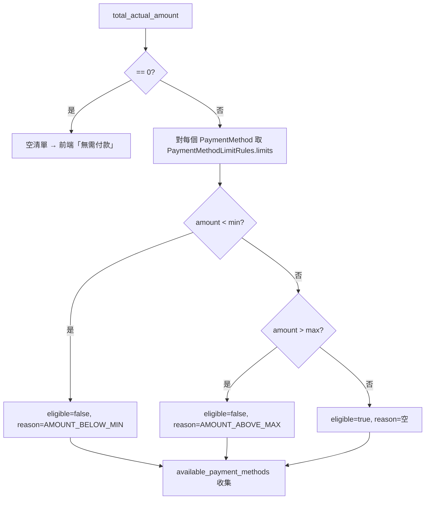
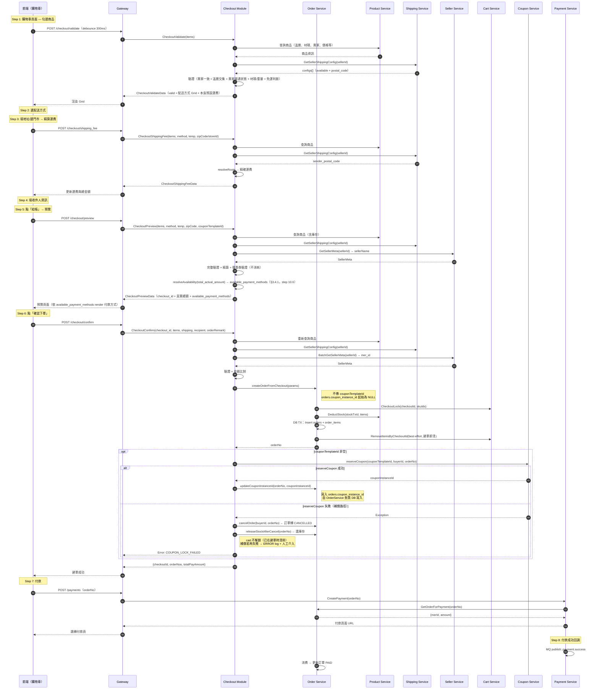

# 結帳模組（Checkout Module）詳細設計書

> ⚠️ **錯誤處理慣例**：本設計書內所有 sequence diagram 之 gRPC client 呼叫，error path 統一依 [`Java gRPC 錯誤處理規範.md §7.2.1`](../開發規範/Java%20gRPC%20%E9%8C%AF%E8%AA%A4%E8%99%95%E7%90%86%E8%A6%8F%E7%AF%84.md#721-%E6%AC%8A%E5%A8%81%E6%99%82%E5%BA%8F%E5%9C%96%E6%89%80%E6%9C%89%E8%A8%AD%E8%A8%88%E6%9B%B8%E5%BC%95%E7%94%A8%E6%AD%A4%E5%9C%96%E4%B8%8D%E5%86%8D%E5%80%8B%E5%88%A5%E7%B9%AA%E8%A3%BD)。個別 diagram 僅繪製 happy path，error 分支不重複繪製。Client 禁止 `if (resp.code != 0) throw`、禁止 `throw new RuntimeException`，一律 `GrpcClientErrorTranslator.translate(e, XxxBusinessException::new)`。
>
> **錯誤管道（完整鏈路）**：
>
> ```
> client → catch StatusRuntimeException → GrpcClientErrorTranslator.translate(e, OrderBusinessException::new)
>        → CheckoutService.preview/confirm 內 catch 視情境 wrap 為 COUPON_LOCK_FAILED 等業務碼
>        → OrderGrpcService catch-all 透過 GrpcErrorHandler 統一處理
> ```
>
> ⚠️ `CheckoutService.preview` 的 catch-all（`catch (Exception e) → COUPON_LOCK_FAILED`）是刻意的
> wrapping，不要當成漏寫的例外處理移除。

## 1. 模組概述

### 1.1 模組定位

結帳模組（Checkout Module）位於 Order Service 內部，**不是獨立微服務**，負責「購物車 → 訂單」的轉換邏輯。採 Modular Monolith 架構，未來若邏輯膨脹可拆為獨立微服務，對外介面不變。

```
order-service/
  └─ src/main/java/io/github/will413028/hawkr/order/
      ├─ checkout/                       ← 結帳模組（本文件範疇）
      │   ├─ CheckoutService.java        // 結帳主流程：preview + confirm
      │   ├─ CheckoutValidator.java      // 防禦性驗證（溫層、材積、賣家一致性）
      │   ├─ client/                     // 外部服務 gRPC Client
      │   │   ├─ CheckoutCouponGrpcClient.java
      │   │   ├─ SellerGrpcClient.java
      │   │   └─ ProductGrpcClient.java
      │   └─ ShippingFeeCacheClient.java  // 運費費率本地快取
      ├─ grpc/OrderGrpcService.java
      ├─ service/OrderService.java
      └─ ...
```

### 1.2 4 支 API 總覽

| API | 觸發時機 | 職責 | 性質 |
|-----|---------|------|------|
| **Validate** | 勾選/取消/改數量 | 溫層交集、材積檢查、預設運費 Grid | 輕量、可頻繁呼叫 |
| **ShippingFee** | 選配送方式 + 填地址/選門市 | 精確運費計算（委派 Shipping Service 費率） | 輕量、即時更新 |
| **Preview** | 點「結帳」 | 完整驗證（含庫存）+ 精算（最新價格 + 精確運費 + 優惠券）| 完整驗證 |
| **Confirm** | 點「確認下單」 | 重新驗證 + 建立訂單 → 回傳付款資訊 | 寫入操作 |

### 1.3 核心原則

1. **一次結帳、一次付款、一筆訂單**（Phase 1）
2. **checkout_id 串聯與 TTL**：Preview 產生 UUID，存入 Redis（TTL 30 分鐘含金額快照），Confirm 驗證後刪除（一次性使用）
3. **後端主導驗證、前端純渲染**：所有驗證由後端 `CheckoutValidate` API 即時完成
4. **先建單再付款**：Confirm 建立訂單後回傳付款資訊，前端再接續付款流程
5. **運費計算委派 Shipping Service**：運費費率由 Shipping Service DB 統一管理，Order Service 透過 gRPC `GetShippingFeeConfigs` 快取至本地

### 1.4 前後端責任分工

| 驗證項目 | 前端 | 後端（Checkout Module） |
|---------|------|----------------------|
| 同一賣家限制 | 渲染後端結果 | **主要**：CheckoutValidate |
| 溫層相容性 | 渲染後端結果 | **主要**：計算溫層交集 |
| 材積/重量限制 | 渲染後端結果 | **主要**：最短邊堆疊法 |
| 可用配送方式 | 渲染後端選項 | **主要**：根據溫層 + 物流限制篩選 |
| 價格/庫存驗證 | 顯示即時價格 | **主要**：以查詢結果為準 |
| 運費計算 | — | **主要**：委派 Shipping Service 費率 |
| 優惠券驗證 | 渲染後端結果 | **主要**：呼叫 Coupon Service |

### 1.5 範圍界定

| Phase | 範圍 | 說明 |
|-------|------|------|
| **Phase 1（當前）** | 單一賣家結帳 | 建立 1 筆訂單 |

### 1.6 技術假設

- Preview / Confirm 的 items 由前端直接傳入（skuId + quantity + productId），後端向 Product Service 查詢真實價格
- SKU 重量/尺寸由 Product Service 提供
- 配送溫層由 SKU 單一欄位 `temperature`（AMBIENT / CHILLED / FROZEN）決定
- 運送方式由商品主表 `product.shipping_method`（JSONB 陣列）提供，不含溫層、不含運費金額
- **運費費率由 Shipping Service DB `shipping_fee_tiers` 統一管理**，Order Service 透過 gRPC 快取至本地 `ShippingFeeCacheClient`

---

## 2. 結帳流程總覽

### 2.1 4 步驟互動流程

```
購物車頁面
│
├─ ① 勾選/取消/改數量 ──→ POST /checkout/validate（debounce 300ms）
│   → 後端驗證（賣家一致性、溫層交集、材積/重量）
│   → 回傳：可否結帳 + 可用配送方式 Grid（預設運費，本島→本島基準）
│   → 前端渲染 Grid（radio button 供買家選擇）
│
├─ ② 選配送方式（radio button）
│
├─ ③ 填地址/選門市 ──→ POST /checkout/shipping_fee
│   → Request 帶：items + 已選配送方式 + 收件人郵遞區號/門市代號
│   → 後端：郵遞區號 → 推導運費路線 → 計算精確運費
│   → 回傳：更新後的運費 + 預估總額 + 運費路線
│
├─ ④ 填收件人資訊
│
├─ ⑤ 點「結帳」──→ POST /checkout/preview
│   → 後端完整驗證（含庫存）+ 精算（最新價格 + 精確運費 + 優惠券）
│   → 回傳：結帳預覽（真實總額、checkout_id）
│
結帳預覽頁面（唯讀確認）
│
├─ ⑥ 選付款方式 + 點「確認下單」──→ POST /checkout/confirm
│   → 後端重新驗證 + 建立訂單 + 鎖定庫存
│   → 回傳：{ checkoutId, orderNos, totalPayAmount }
│
├─ ⑦ 前端根據付款方式接續付款
│   ├─ PayUni → POST /payments → 跳轉付款頁
│   └─ Apple Pay → 呼叫 SDK
```

> **Validate vs ShippingFee 差別**：Validate 回傳 `DOMESTIC`（本島→本島）預設費用供 Grid 展示。ShippingFee 根據收件人郵遞區號 + 賣家地址推導實際運費路線，計算精確運費。

### 2.2 API 觸發時機

| 事件 | 前端行為 |
|------|---------|
| Checkbox 勾選/取消 | debounce 後呼叫 CheckoutValidate |
| 數量變更 | debounce 後呼叫 CheckoutValidate |
| 全部取消勾選 | 不呼叫 API，直接清空結果 |
| 選配送方式 + 填完地址/選門市 | 呼叫 CheckoutShippingFee |
| 切換配送方式 / 更改收件地址 | 重新呼叫 CheckoutShippingFee |

### 2.3 Debounce 策略

- 建議 300ms debounce，每次觸發取消前次未完成請求
- 呼叫期間前端顯示 loading（如 skeleton）

---

## 3. 對外介面定義

### 3.1 Gateway HTTP → gRPC 映射

| Gateway HTTP Endpoint | Method | gRPC 方法 |
|----------------------|--------|-----------|
| `/api/v1/app/checkout/validate` | POST | `CheckoutValidate` |
| `/api/v1/app/checkout/shipping_fee` | POST | `CheckoutShippingFee` |
| `/api/v1/app/checkout/preview` | POST | `CheckoutPreview` |
| `/api/v1/app/checkout/confirm` | POST | `CheckoutConfirm` |

### 3.2 CheckoutValidate（即時驗證）

購物車頁面每次勾選/取消/數量變更時呼叫。不產生 checkout_id、不檢查庫存。回傳可用配送方式 Grid 與**預設運費（本島→本島基準）**。

> **自買防護（short-circuit，業務規則）**：在輕量驗證最前段執行。任一 item 的賣家 store 經單體 seller 模組的 `ResolvePrincipals` 解析出的登入 principal == `buyerId` → 整個 validate 失敗，回 `code=4015`（`SELF_PURCHASE_NOT_ALLOWED`）+ `message`「不可購買自己上架的商品」+ 空 `data`。**不**進入 `errors` 陣列（與其他 cross-cutting 錯誤分離），與 cart-service `AddItem` 端 `6006` 互為早晚兩道防線。詳見 §4.1 步驟 3。

```protobuf
message CheckoutValidateRequest {
  int64 buyer_id = 1;
  repeated CheckoutItem items = 2;
}

message CheckoutValidateResponse {
  int32 code = 1;
  string message = 2;
  CheckoutValidateData data = 3;
}

message CheckoutValidateData {
  bool valid = 1;
  repeated string delivery_temp_intersection = 2;
  repeated AvailableShippingOption available_shipping_options = 3;
  repeated CheckoutValidationError errors = 4;
  repeated UnavailableItem unavailable_items = 5;  // **新增**：row 級不可購買清單。非空 → valid=false。errors 僅承載整單級錯誤
}

message CheckoutValidationError {
  string error_code = 1;
  string error_message = 2;
}

message UnavailableItem {
  string sku_id = 1;          // SKU ID（數字字串）
  string sku_name = 2;        // 商品名稱（來源：cart_items.sku_name_snapshot；商品已 lookup 失敗時前端可 fallback「商品已下架」）
  string reason = 3;          // CartItemUnavailableReason value（見 [代碼管理（CodeMeta）/業務類型碼.md#cartitemunavailablereason](../代碼管理（CodeMeta）/業務類型碼.md#cartitemunavailablereason)）
  string requested_qty = 4;   // 買家本次勾選量（數字字串，承載原 InsufficientStockItem.requested_qty 語意）
  string available_qty = 5;   // 即時可購買量（數字字串）；reason=INSUFFICIENT_STOCK 時 0 < available_qty < requested_qty；reason=OUT_OF_STOCK 時 "0"；reason=DELISTED / LOOKUP_FAILED 時空字串
}
```

**errors 拆分原則**（**契約治理**）：

| 層級 | 載體 | 對應錯誤 |
|---|---|---|
| **整單級**（不指向特定 SKU） | `errors[]` | `DIFFERENT_SELLER` / `TEMP_ZONE_INCOMPATIBLE` / `ALL_SHIPPING_EXCEEDED` / `INVALID_ITEM`（SKU 結構性異常）|
| **row 級**（指向特定 SKU 不可購買） | `unavailable_items[]` | 全走 `CartItemUnavailableReason`（`DELISTED` / `OUT_OF_STOCK` / `INSUFFICIENT_STOCK` / `LOOKUP_FAILED`）|

🔴 **row 級「商品不可購買」一律走 `unavailable_items[]`**，`errors` 內**不得**出現 `PRODUCT_UNAVAILABLE` error_code。

**errors 表**：

| error_code | 說明 |
|-----------|------|
| `DIFFERENT_SELLER` | 不同賣家（整單級）|
| `TEMP_ZONE_INCOMPATIBLE` | 溫層交集為空（整單級）|
| `ALL_SHIPPING_EXCEEDED` | 所有配送方式超限（整單級）|
| `INVALID_ITEM` | SKU 結構性異常（productId 不存在 / 重量為負等資料錯誤；非「下架 / 缺貨」語意）|

#### 回應範例（驗證通過）

```json
{
  "code": 0,
  "message": "success",
  "data": {
    "valid": true,
    "deliveryTempIntersection": ["AMBIENT", "CHILLED"],
    "availableShippingOptions": [
      {
        "shippingMethod": "TAQBIN",
        "deliveryTemp": "AMBIENT",
        "label": "黑貓宅急便（常溫）",
        "fee": "0",
        "feePayer": "SELLER",
        "freeShippingThreshold": "800",
        "freeShippingEligible": true
      },
      {
        "shippingMethod": "TAQBIN",
        "deliveryTemp": "CHILLED",
        "label": "黑貓宅急便（冷藏）",
        "fee": "200",
        "feePayer": "BUYER",
        "freeShippingThreshold": "0",
        "freeShippingEligible": false
      }
    ],
    "errors": [],
    "unavailableItems": []
  }
}
```

#### 回應範例（含 row 級不可購買 — DELISTED + INSUFFICIENT_STOCK 混合）

```json
{
  "code": 0,
  "message": "success",
  "data": {
    "valid": false,
    "deliveryTempIntersection": [],
    "availableShippingOptions": [],
    "errors": [],
    "unavailableItems": [
      {
        "skuId": "10001",
        "skuName": "有機蘋果（特大）",
        "reason": "DELISTED",
        "requestedQty": "2",
        "availableQty": ""
      },
      {
        "skuId": "10005",
        "skuName": "草莓禮盒",
        "reason": "INSUFFICIENT_STOCK",
        "requestedQty": "5",
        "availableQty": "3"
      }
    ]
  }
}
```

> envelope `code=0`：Validate 為輕量查詢，無論 unavailable 是否非空 top-level 都回 0；`valid=false` + `unavailableItems` 表達失敗。**前端依 `reason` 區分 badge 文案**（DELISTED「已下架」、OUT_OF_STOCK「已售完」、INSUFFICIENT_STOCK「庫存不足，僅剩 N」、LOOKUP_FAILED「暫時無法確認」）。

### 3.3 CheckoutShippingFee（運費精算）

選好配送方式、填入收件地址/選擇門市後呼叫。根據收件人郵遞區號推導運費路線，計算精確運費。

```protobuf
message CheckoutShippingFeeRequest {
  int64 buyer_id = 1;
  repeated CheckoutItem items = 2;
  string shipping_method = 3;
  string delivery_temp = 4;
  string receiver_zip_code = 5;
  string cvs_store_id = 6;
}

message CheckoutShippingFeeResponse {
  int32 code = 1;
  string message = 2;
  CheckoutShippingFeeData data = 3;
}

message CheckoutShippingFeeData {
  string shipping_method = 1;
  string delivery_temp = 2;
  string shipping_route = 3;
  string shipping_fee = 4;
  string fee_payer = 5;
  bool tentative_free_shipping_eligible = 6;  // **語意變更**：基於商品實際成交單價的「暫定免運判定」（未套優惠券）。原欄位名 `free_shipping_eligible` 重命名以強調「暫定」性質——CheckoutShippingFee 階段使用者尚未選擇優惠券，最終免運資格須等 CheckoutPreview 階段重新判定（§4.7）
  string free_shipping_threshold = 7;
  string order_subtotal = 8;        // 基於實際成交單價彙總（特價優先），與 CheckoutPreview 一致
  string estimated_total = 9;
}
```

**運費路線推導**：
- 宅配：`ShippingAreaResolver.resolveRoute(setting.sender_postal_code, receiverZipCode)` → ShippingRoute
- 店到店：固定 `DOMESTIC`（統一價，不分區域）
- 🔴 **Uber 即時配送（`3003`）：不走這條路線推導**（66 §6.1.2b）。
  它的運費來自 **Uber Create Quote 的即時報價**，寄件點來自 **Uber 專屬門市映射 ＋ 凍結快照**，
  ⇒ 🔴 **3003 必須在 `getSenderPostalCode()` ／ traditional ShippingRoute 需求之前明確分流**。
  ⚠️ **沒有分流的後果是靜默的**：`seller_shipment_settings` 依設計**不會有** Uber 的列
  （`shipping_type` CHECK 只收 `3651`／`3652`、`mer_id` 為 `NOT NULL`）⇒ 該欄恆空
  ⇒ 結帳在 Uber 資格閘門**之前**就拋 `4010 SELLER_SHIPPING_INCOMPLETE`，
  而文案「賣家物流設定不完整，請聯繫賣家」指向一個**沒有任何設定可補**的賣家。

> **運費計算委派 Shipping Service**：實際費率由 Shipping Service DB `shipping_fee_tiers` 管理，Order Service 透過 `ShippingFeeCacheClient` 本地快取查找。快取採 lazy load + 5 分鐘 TTL + Resilience4j Circuit Breaker（詳見 §4.9 與 `21 §3.2`）。

### 3.4 CheckoutPreview（結帳預覽）

完整驗證（含庫存）+ 精算所有金額（含優惠券）。產生 checkout_id 存入 Redis。

```protobuf
message CheckoutPreviewRequest {
  int64 buyer_id = 1;
  repeated CheckoutItem items = 2;
  string shipping_method = 3;
  string delivery_temp = 4;
  string receiver_zip_code = 5;
  string cvs_store_id = 6;
  string coupon_template_id = 7;             // 使用者選擇的優惠券**模板** ID（非 instance）
  bool consolidated = 8;                     // **新增**：是否為和單（多賣家走代理商代收）。default false = 單賣家走 seller mer_id；true = 取 env PAYUNI_AGENT_MER_ID（§4.x 和單與 paymentMerId 決策）
}

message CheckoutItem {
  string sku_id = 1;
  string quantity = 2;
  string product_id = 3;
}

message CheckoutPreviewResponse {
  int32 code = 1;
  string message = 2;
  CheckoutPreviewData data = 3;
}

message CheckoutPreviewData {
  string checkout_id = 1;
  repeated OrderGroupPreview order_groups = 2;
  string total_original_amount = 3;
  string total_shipping_fee = 4;
  string total_discount = 5;
  string total_actual_amount = 6;
  string payment_mer_id = 7;                 // **新增**：本次交易付款對應的 PayUni MerID（top-level，因為「一次交易 = 一個 merId」）。consolidated=false 取 seller.payuni_mer_id；consolidated=true 取 env PAYUNI_AGENT_MER_ID。前端 Web/Mobile 用此值帶入 Google Pay SDK `tokenizationSpecification.parameters.gatewayMerchantId`
  repeated UnavailableItem unavailable_items = 8;  // **新增**：row 級不可購買清單。非空 → code 非 0（4006 結帳已過期除外）+ 前端跳「請先返回購物車移除以下商品」dialog
  repeated AvailablePaymentMethod available_payment_methods = 9;  // **新增**：依 total_actual_amount 算出的各付款方式可用性（§3.4.1）。前端據此 render 付款方式（禁用 + 理由），不自行用金額判斷。total_actual_amount==0（零元）時為空清單 → 前端顯示「無需付款」
}

// **新增**：付款方式可用性（依訂單金額對 PayUni 各方式合法區間判定）。§3.4.1
message AvailablePaymentMethod {
  string payment_type = 1;        // PaymentMethod value（2001/2002/2003/2004）
  bool   eligible = 2;            // 金額是否落在該方式合法區間
  string ineligible_reason = 3;   // PaymentMethodIneligibleReason value（2101 未達下限 / 2102 超過上限）；eligible=true 時為空字串
}

message OrderGroupPreview {
  string group_index = 1;
  string store_id = 2;
  string seller_name = 3;
  string shipping_method = 4;
  string delivery_temp = 5;
  string shipping_label = 6;
  string shipping_fee = 7;
  string shipping_fee_payer = 8;
  bool free_shipping_eligible = 9;          // **最終免運判定**（基於 unit_price × qty − share_discount）
  repeated CheckoutItemPreview items = 10;
  string subtotal_original_amount = 11;     // 該 group 實際成交小計（Σ unit_price × qty）
  string discount_amount = 12;
  bool tentative_free_shipping_eligible = 13; // **新增**：未套優惠券前的暫定免運判定（基於 unit_price × qty）。前端比對 `tentative_free_shipping_eligible != free_shipping_eligible` 即可提示「使用此優惠券將失去免運資格」
}

message AvailableShippingOption {
  string shipping_method = 1;
  string delivery_temp = 2;
  string label = 3;
  string fee = 4;
  string fee_payer = 5;
  string free_shipping_threshold = 6;
  bool tentative_free_shipping_eligible = 7;  // **語意變更**：暫定免運判定（未套優惠券）。原欄位 `free_shipping_eligible` 重命名
}

message CheckoutItemPreview {
  string sku_id = 1;
  string product_id = 2;
  string sku_name = 3;
  string quantity = 4;
  string price = 5;             // **語意變更**：實際成交單價（有特價=sale_price，否則=list_price）
  string subtotal = 6;           // = price × quantity（即 unit_price × quantity）
  string stock_qty = 7;          // **語意保留**：純顯示用（如「僅剩 N」hint）；**禁止**前端用此欄位 client-side 判定「不可購買」— 一律以 `unavailable_items` 為準（伺服端 source of truth）
  string temperature = 8;
  string list_price = 9;         // **新增**：原價快照（永遠 = SKU.price）
  string sale_price = 10;        // **新增**：特價（無特價=空字串）；前端可比對 list_price 與 sale_price 顯示「省 $XX」
  string share_discount = 11;    // **新增**：該品項分攤的優惠券折扣（折扣後免運判定使用）
  string actual_pay_amount = 12; // **新增**：該品項最終實付（= subtotal − share_discount），即下單後 OrderItem.actual_pay_amount 預估值
}
```

#### 3.4.1 付款方式可用性政策（availablePaymentMethods）

**前提**：PayUni 對各付款方式有硬性金額合法區間（見 [05-支付服務設計書 §2A.2](../詳細設計書/05-支付服務（Payment%20Service）詳細設計書.md)）。🔴 **前端不得自行寫死付款方式清單**——那樣使用者會選到不符金額的方式，直到下單／付款才被 L1（8026）／L2（8021）拒絕，而且只看得到泛用錯誤。

**決策**：可用性由**後端依 `total_actual_amount` 算好**回傳 `available_payment_methods`，前端只負責 render（**禁用 + 顯示理由**，非隱藏），**前端不得自行用金額判斷、不得硬編碼限制值**。限制值唯一真實來源 = `common-core` `PaymentMethodLimitRules`（§2A.2）。

**`available_payment_methods` 放 top-level 而非 per-group**：付款是「一次 `CreatePayment` 打整車 `total_actual_amount`」、L2 驗的也是該訂單金額 ⇒ 依 `total_actual_amount` 算於 top-level 即正確，**不需 per-group 交集**。

**判定規則**（`PaymentMethodLimitRules.resolveAvailability(amount)` 純函式，跨 order/payment 共用）：

> 區間採**閉區間**（與 `PaymentMethodLimitRules.isWithinRange` 的 `amount >= min && amount <= max` 一致）；下表各列互斥不重疊，端點歸屬明確。

| `total_actual_amount` | 信用卡 / Apple Pay / Google Pay (2001/2002/2003) | ATM (2004) | 前端呈現 |
|---|---|---|---|
| `amount == 0` | —（空清單） | —（空清單） | 隱藏付款方式，顯示「無需付款」狀態（零元路徑，不走 PayUni） |
| `1 ≤ amount ≤ 14` | eligible | `AMOUNT_BELOW_MIN`(2101) | ATM 禁用 + 理由 label（ATM 下限 = 15） |
| `15 ≤ amount ≤ 49,999` | eligible | eligible | 全部可選（49,999 含端點 eligible） |
| `50,000 ≤ amount ≤ 199,999` | eligible | `AMOUNT_ABOVE_MAX`(2102) | ATM 禁用 + 理由 label（ATM 上限 = 49,999） |
| `amount ≥ 200,000` | `AMOUNT_ABOVE_MAX`(2102) | `AMOUNT_ABOVE_MAX`(2102) | 全部禁用 + 禁用「確認下單」鈕 + 引導減量/分批（信用卡上限 = 單筆訂單上限 = 199,999，含端點 eligible） |

> 註：信用卡/Apple/Google Pay 的上限（199,999，含端點）= 訂單建立上限 `ORDER_MAX_AMOUNT`，故 `amount ≤ 199,999` 時三者恆 eligible；`amount ≥ 200,000` 時整單在 L1（confirm 8026）會被擋，前端禁用確認鈕僅為提早回饋的 UX 層。



**前端 render 契約**（web + buyer 一致，§1.4 前後端責任分工延伸）：
1. **金額 gating（禁用與否）以 `available_payment_methods` 為準**；前端不得自行用金額判斷、不得寫死 15/49,999/199,999。
2. **device 能力（顯示與否）為前端職責**：Apple Pay / Google Pay 在不支援的裝置上**隱藏**（既有行為，符合 wallet guideline）。最終可選 = `後端 eligible` AND `device 支援`。**兩層分離**：device 決定「顯示與否」、eligible 決定「禁用與否」；ineligible_reason 只承載金額理由，不混 device 理由。
3. **理由文案 SSOT = `PaymentMethodIneligibleReason` 的 label**（通用、不帶具體數字）；前端用 CodeMeta 生成的 enum label render，不自行拼接金額字串。
4. **gating 綁同一份 preview response**：每次金額 / 優惠券 / 配送變動導致重新 `CheckoutPreview` 時，`available_payment_methods` 隨 `total_actual_amount` 一起更新；前端不得用舊 preview 的 gating 配新一輪金額。
5. **L1（8026）/ L2（8021）仍為最終權威**：前端 gating 僅 UX 層，**不得**因有 gating 而移除 8021/8026 錯誤處理（preview→confirm 之間理論上仍可能 drift）。

> 再次付款（pending 訂單重付）為第二個付款方式選擇 surface，不走 CheckoutPreview，改由 `GetOrder` 的 `OrderDetailView.available_payment_methods` 提供，規則相同。詳見 [03-訂單微服務設計書 §4.2.1](../詳細設計書/03-訂單微服務（Order%20Service）詳細設計書.md)。

**影響檔案清單**：

| 檔案 | 變更 |
|------|------|
| `api/proto/order/order.proto` | 新增 `message AvailablePaymentMethod`；`CheckoutPreviewData` 加 `available_payment_methods = 9`；`OrderDetailView` 加 `available_payment_methods = 62` |
| `services/java/shared/common-core/.../code/helper/PaymentMethodLimitRules.java` | 新增純函式 `resolveAvailability(long amount)`（回 `List<AvailabilityResult>`，含 eligible + ineligibleReason）；不動既有限制資料 |
| `services/java/shared/common-core/.../code/PaymentMethodIneligibleReason.java` | `generate.sh` 由 `業務類型碼.md` 產出（勿手改） |
| `services/java/order-service/.../checkout/CheckoutService.java` | `preview` step 10.6 呼叫 `resolveAvailability` 並 set 進 `CheckoutPreviewData`（零元 → 空清單） |
| `services/java/order-service/.../grpc/converter/OrderProtoConverter.java` | **不改**（避免污染共用 caller，見 [03 §4.2.1](../詳細設計書/03-訂單微服務（Order%20Service）詳細設計書.md)） |
| `gateway/internal/handler/checkout.go` | `CheckoutPreviewDataResponse` DTO 加 `availablePaymentMethods` + Swagger |

### 3.5 CheckoutConfirm（確認結帳 → 建單）

重新驗證 + 建立訂單。支援 `order_remark`（field 14，買家留言給賣家）。

```protobuf
message CheckoutConfirmRequest {
  int64 buyer_id = 1;
  string checkout_id = 2;
  repeated CheckoutItem items = 3;
  string shipping_method = 4;
  string delivery_temp = 5;
  string receiver_zip_code = 6;
  string recipient_name = 7;
  string recipient_phone = 8;
  string shipping_address = 9;
  string shipping_note = 10;
  string cvs_store_id = 11;
  string cvs_store_name = 12;
  string coupon_template_id = 13;             // 使用者選擇的優惠券**模板** ID（建單後 reserveCoupon 才換成 instance）
  string order_remark = 14;                // 訂單備註（選填，買家留言給賣家，最長 500 字）
}

message CheckoutConfirmResponse {
  int32 code = 1;
  string message = 2;
  CheckoutConfirmData data = 3;
  CheckoutPriceChangedDetail price_changed = 4;
}

message CheckoutConfirmData {
  string checkout_id = 1;
  repeated string order_nos = 2;
  string total_pay_amount = 3;
  repeated UnavailableItem unavailable_items = 4;  // **語意統一**：取代舊 InsufficientStockItem，row 級不可購買 / 庫存不足清單。reason=INSUFFICIENT_STOCK 時帶 available_qty 等同舊欄位
}

message CheckoutPriceChangedDetail {
  string old_total_amount = 1;
  string new_total_amount = 2;
  string change_reasons = 3;
  string new_subtotal = 4;
  string new_shipping_fee = 5;
  string new_discount = 6;
}
```

> **merId 安全設計**：merId 不暴露給前端。Confirm 時由後端從 Seller Service 取得後存入 orders 表。

**收件人資訊驗證規則**：

| 欄位 | 宅配（TAQBIN） | 店到店 |
|------|--------------|--------|
| recipient_name | 必填 | 必填 |
| recipient_phone | 必填 | 必填 |
| shipping_address | 必填 | 選填 |
| shipping_note | 選填 | 選填 |
| order_remark | 選填 | 選填 |
| cvs_store_id | — | 必填 |
| cvs_store_name | — | 必填 |

### 3.6 依賴的外部服務

| 服務 | RPC | 用途 | 使用階段 |
|------|-----|------|---------|
| Product Service | **BatchGetProductForCheckout**（取代既有 `GetPublicProduct` / `BatchGetProducts`）| SKU 資訊（price、stock_qty、temperature、weight、dimension、shipping_method、store_id、**is_active**），**接受 inactive product 不拋例外**。詳見 [02 §5.5.2](../詳細設計書/02-產品微服務（Product%20Service）詳細設計書.md#552-結帳鏈路批次商品查詢-batchgetproductforcheckout) | Validate / Preview / Confirm 全部 |
| Shipping Service | GetSellerShippingConfig | 賣家開通狀態 + 寄件 postal_code | Validate/ShippingFee/Preview/Confirm |
| Shipping Service | GetShippingFeeConfigs | 費率表（本地快取） | 啟動時 + 每小時 |
| Seller Service | BatchGetSellerMeta | mer_id + seller_name | Confirm |
| Coupon Service | ValidateCoupon | 優惠券驗證 + 折扣計算 | Preview/Confirm |
| Coupon Service | ConsumeCoupon | 優惠券核銷 | Confirm |

---

## 4. 業務流程詳細設計

### 4.1 CheckoutValidate 流程（購物車勾選時）

```
1. 基本驗證（items 非空、skuId/quantity/productId 格式）
2. 商品解析（resolveItems）— 帶異常防護
   → 查詢 Product Service：temperature, weight, unit, length/width/height_cm
   → 取得 shipping_method[], store_id, status, price
   → 重量/單位轉換（空值防護：weight="0"/unit="" 時跳過）
   → 異常 → valid=false + INVALID_ITEM
3. **自買防護（short-circuit）**：任一 item 的賣家 store principal（單體 seller 模組的 `ResolvePrincipals`）== `buyerId`
   → 拋 OrderBusinessException(SELF_PURCHASE_NOT_ALLOWED)（4015）
   → 不進入後續驗證，不填 errors / unavailable_items
   → **設計取捨**：自買防護先於 unavailable 短路。Phase 1 接受「修自買後才看到 unavailable」兩階段 UX，不擴大 self-purchase 重構 scope
4. **可購買性收集（§4.14 狀態優先級）**
   → 對每個 resolved item 呼叫 `ProductPurchasabilityRules.evaluate(isActive, stockQty, quantity)`
   → 任一 reason ≠ "" → 加入 unavailable_items[]，**不 short-circuit**（一次顯示完整錯誤清單）
5. 驗證（CheckoutValidator 輕量模式整單級）
   a. 賣家一致性（Phase 1）→ errors[DIFFERENT_SELLER]（整單級，🔴 **會 short-circuit**——本節原記「不 short-circuit」，與程式碼字面相反：`CheckoutValidator.validate` 在 `errors.add("DIFFERENT_SELLER")` 的下一行就 `return new ValidationResult(false, Set.of(), List.of(), errors, 0)`，之後的溫層、(method,temp) 交集、材積與可用選項**全部不執行**。同節的 `TEMP_ZONE_INCOMPATIBLE`、`ALL_SHIPPING_EXCEEDED` 也都 short-circuit，三者行為一致，只有本行寫反了）
   b. 溫層相容性：SKU.temperature → compatibleTemps() → 取交集 → 空 → errors[TEMP_ZONE_INCOMPATIBLE]
   c. 可用配送方式（生成 Grid）：
      → 展開 method × temp 組合
      → 最短邊堆疊法計算材積（§4.6）
      → 排除超限組合
      → 查詢 ShippingFeeTier（route=DOMESTIC）取得預設運費
      → 逐商品免運判定（§4.7）
   d. 所有配送方式皆超限 → errors[ALL_SHIPPING_EXCEEDED]
6. 賣家啟用狀態過濾
   → GetSellerShippingConfig → 取得已啟用配送方式
   → 過濾步驟 5c 結果，移除未啟用的
   → 查詢失敗 / 回應非零碼 → fail-close，拋 `SERVICE_UNAVAILABLE`（不降級）
7. 組裝回傳
   → valid = unavailable_items.isEmpty() && errors.isEmpty()
   → **top-level `code` 永遠為 0**（envelope success），失敗訊息透過 valid=false + unavailable_items / errors 表達。與 Preview / Confirm 的「code=4001 + unavailable_items」不同（Validate 為輕量查詢、Preview / Confirm 為結帳鏈路寫入嘗試）
```

**4.1.1 順序強制**（與 §4.15 完全一致）：自買防護先 short-circuit（步驟 3），其餘 unavailable_items（步驟 4）+ 整單級 errors（步驟 5）**不 short-circuit**。買家若同時撞「跨賣家 + 下架商品」應一次看到兩種錯誤，不該為了修跨賣家後才看到下架（兩階段 UX）。

**4.1.2 商品解析使用 RPC**：步驟 2 走 `BatchGetProductForCheckout`（§3.6，接受 inactive），回 `ProductForCheckoutInfo`（is_active / stock_qty / weight / dimension / shipping_methods 全欄位），🔴 **不得**改用 `GetPublicProduct`：它對 inactive 會 throw `ProductNotFoundException`，`unavailable_items` 會因此永遠收集不到，而買家只看到一個泛用錯誤。

### 4.2 CheckoutShippingFee 流程

> **不做可購買性判定**：ShippingFee 只算運費，不重複攔截下架 / 缺貨（已由 §4.1 Validate 階段 cover）。保留使用既有 RPC（`GetProductSimple` / `BatchGetSkuCartInfo`，取 unit_price + list_price）— 不切換 `BatchGetProductForCheckout`，避免 hot path 多 round-trip。若買家越過 cart 反灰 + Validate 攔截硬打 ShippingFee 且商品已下架，會在 §4.3 Preview 階段才被 unavailable_items 兜底；ShippingFee 自身不額外擋。

```
1. 基本驗證（items/shipping_method/delivery_temp 非空）
2. 查詢 Product Service（取得 unit_price 即實際成交單價、list_price 即原價）
3. 查詢 Shipping Service → postal_code + 開通狀態（失敗不降級）
4. 驗證配送方式合法性
5. 推導運費路線 + 計算精確運費
   → 宅配：resolveRoute(sender_postal_code, receiver_zip_code)
   → 店到店：DOMESTIC
   → **暫定免運判定**（§4.7.2）：item.unit_price × quantity 對門檻（不扣優惠券）
6. 回傳（shipping_route + 精確運費 + 預估總額 + tentative_free_shipping_eligible）
```

### 4.3 CheckoutPreview 流程

```
1. 基本驗證
2. 批次查詢 Product Service — 走 BatchGetProductForCheckout（接受 inactive，§3.6）
2.5 自買防護（short-circuit）：任一 item 的賣家 store principal（resolvePrincipals）== buyerId
    → 拋 OrderBusinessException(SELF_PURCHASE_NOT_ALLOWED)（4015）
2.6 **可購買性收集（§4.14 狀態優先級）**
    → 對每個 item 呼叫 `ProductPurchasabilityRules.evaluate(isActive, stockQty, quantity)`
    → 任一 reason ≠ "" → 加入 unavailable_items[]，**不 short-circuit**
    → unavailable_items 非空 → 跳過後續金額計算 + Redis 寫入，直接組裝 response 回 code=4001（業務碼層級「row 級不可購買」）+ data.unavailable_items[]
3. 查詢 Shipping Service（失敗不降級）
4. 完整驗證（含庫存 + 賣家開通狀態）
5. 推導運費路線
6. 計算各商品小計：subtotal_per_item = unit_price × quantity
7. 套用優惠券（若 coupon_template_id 非空）
   → 呼叫 Coupon Service ValidateCoupon（折扣基礎 = total_subtotal）
   → 計算各商品 share_discount（§4.10 分攤公式）
   → Coupon Service 不可用 → 回傳錯誤（不降級）
8. **最終免運判定**（§4.7.2）：無條件免運（freeThreshold<=0）直接達標；門檻免運以 item.unit_price × quantity − item.share_discount 對門檻（§4.7.1 兩分支）
9. 計算精確運費（依 final_free_shipping_eligible 決定 0 或級距費率）
10. total_actual_amount = total_subtotal − discount + shipping_fee
10.5 **paymentMerId 決策**（§4.13 和單與 paymentMerId 決策）：
   → 若 request.consolidated=true：取 env `PAYUNI_AGENT_MER_ID`；env 為空 → 拋 INVALID_ARGUMENT
   → 若 request.consolidated=false：取 sellerMeta.payuni_mer_id（既有 SellerGrpcClient 呼叫已取得）
10.6 **付款方式可用性**（§3.4.1）：`available_payment_methods = PaymentMethodLimitRules.resolveAvailability(total_actual_amount)`
   → total_actual_amount==0 → 空清單（前端「無需付款」）；否則對每個 PaymentMethod 依上下限填 eligible + ineligible_reason
11. 生成 checkout_id（UUID）
12. 存入 Redis checkout:{checkoutId} = JSON 金額快照（含 tentative + final 免運狀態 + **paymentMerId**），TTL=30 分鐘
13. 回傳（含 tentative_free_shipping_eligible、free_shipping_eligible 兩欄供前端比對 + **payment_mer_id top-level**）
```

### 4.4 CheckoutConfirm 流程

```
1. 驗證參數 + checkout_id 必填
1.5 驗證 checkout_id（Redis GET+DEL，原子操作）
   → 不存在 → code=4006「結帳已過期」
2. 重新查詢商品 — 走 BatchGetProductForCheckout（接受 inactive，§3.6）
2.5 自買防護（short-circuit，與 Preview 一致最後安全網）：任一 item 的賣家 store principal（resolvePrincipals）== buyerId
    → 拋 OrderBusinessException(SELF_PURCHASE_NOT_ALLOWED)（4015）
2.6 **可購買性最終攔截（§4.14 狀態優先級）**
    → 對每個 item 呼叫 `ProductPurchasabilityRules.evaluate(isActive, stockQty, quantity)`
    → 任一 reason ≠ "" → 不建單，回 code=4001 + data.unavailable_items[]
    → cart 仍維持 LOCKED 狀態，由前端引導買家「返回購物車」後可看到反灰 row + 移除按鈕；TTL 過期由 §5.4.1 既有 unlock 補償機制處理
3. 查詢 Shipping Service + Seller Service（任一不可用 → 錯誤）
4. 推導運費路線 + 重新計算金額
5. 套用優惠券（重新驗證）
6. 計算最終金額
6.5 金額比對（Preview → Confirm 防護）
   → 與 Redis 快照逐項比對：subtotal/shippingFee/discount/totalAmount
   → 不一致 → code=4091 + 變動原因
6.6 **paymentMerId 來源**（§4.13）：
   → 直接從 Redis 快照取 `paymentMerId`（preview 階段已決策並寫入）
   → confirm **不重新決策**、不接受新的 consolidated 參數 → 避免 preview/confirm 結果 drift
7. 呼叫 `OrderService.createOrder()`
   → 傳入 items, 金額, 配送資訊, 收件人, checkout_id, **mer_id=snapshot.paymentMerId**, **discount_amount**, sender_city, sender_district, dimensionSum, order_remark
   → OrderEntity.mer_id 寫入即為 paymentMerId（單賣家 = seller.payuni_mer_id；和單 = 代理商 mer）
   → **不傳 coupon 任何 ID**：`orders.coupon_instance_id` 起始為 NULL（見 03 設計書 §3.1 不變式）
8. 建單成功後**由 CheckoutService**（非 OrderService）鎖定優惠券：
   - `couponInstanceId = CheckoutCouponGrpcClient.reserveCoupon(couponTemplateId, buyerId, orderNo)`
   - `OrderService.updateCouponInstanceId(orderNo, couponInstanceId)` ← 寫入 `orders.coupon_instance_id`
   - **權責分割**：CheckoutService 持有 templateId 並呼叫 coupon-service；OrderService 僅負責回寫已知 instanceId（不知 templateId 存在）
   - **失敗補償（強制路徑）**：
     - reserveCoupon 拋例外 → catch
     - `OrderService.cancelOrder(buyerId, orderNo)` ← 訂單轉 CANCELLED
     - `OrderService.releaseStockAfterCancel(orderNo)` ← 通知 product-service 還庫存
     - **cart 不解鎖**（建單即清策略，cart 已在 step 7 內被清除）
     - 補償若再失敗 → 記 ERROR log，由人工介入（不做無限重試）
     - 最終 throw `OrderBusinessException(COUPON_LOCK_FAILED)` 給 Gateway
9. 回傳 { checkout_id, order_nos, total_pay_amount }
```

### 4.5 驗證層級（CheckoutValidator）

| 模式 | 呼叫者 | 驗證項目 |
|------|--------|---------|
| **輕量模式** | Validate | 1-6 項（不查庫存） |
| **完整模式** | Preview / Confirm | 全部 8 項（含庫存 + 配送方式） |

**驗證項目**：

```
─── 輕量模式 ───
1. items 非空，skuId/quantity/productId 合法
2. 自買防護（short-circuit）：任一 item 的賣家 store principal（resolvePrincipals）== buyerId
   → 拋 OrderBusinessException(SELF_PURCHASE_NOT_ALLOWED)（4015）
3. **可購買性檢查（ProductPurchasabilityRules，不 short-circuit）** — row 級不可購買全部收進 unavailable_items[]
   → 判定鏈：LOOKUP_FAILED → DELISTED → OUT_OF_STOCK → INSUFFICIENT_STOCK（先命中者勝）
4. 賣家一致性（Phase 1）→ errors[DIFFERENT_SELLER]
5. 溫層相容性（交集非空）→ errors[TEMP_ZONE_INCOMPATIBLE]
6. 材積/重量限制（最短邊堆疊法）→ errors[ALL_SHIPPING_EXCEEDED]

─── 完整模式額外 ───
7. 配送方式合法性驗證
8. 庫存檢查（與步驟 3 INSUFFICIENT_STOCK 為同源；Preview / Confirm 階段重新打 BatchGetProductForCheckout 取得即時 stock_qty）
```

🔴 **禁止使用** `errors[PRODUCT_UNAVAILABLE]`：row 級不可購買一律走 `unavailable_items[]`。

### 4.6 材積/重量計算（最短邊堆疊法）

```
對每個 SKU：排序三邊 → short ≤ mid ≤ long

stackedShort = Σ (short × quantity)
maxMid       = max(各 SKU 的 mid)
maxLong      = max(各 SKU 的 long)

totalDimensionSum = stackedShort + maxMid + maxLong
maxSingleSide     = max(stackedShort, maxMid, maxLong)
totalWeightGram   = Σ (weight_gram × quantity)
```

> Proto 尺寸欄位為 string（含小數如 "25.00"），**必須用 `Double.parseDouble()` + `Math.round()` 取整**。

**物流商限制**（來源：Shipping Service DB `shipping_method_configs`）：

| 配送方式 | 溫層 | L+W+H 上限(cm) | 單邊上限(cm) | 重量上限(g) |
|---------|------|----------------|-------------|------------|
| SEVEN_ELEVEN_STORE_PICKUP | AMBIENT | 105 | 45 | 5,000 |
| SEVEN_ELEVEN_STORE_PICKUP | FROZEN | 90 | 0 | 10,000 |
| TAQBIN | AMBIENT | 150 | 0 | 20,000 |
| TAQBIN | CHILLED | 120 | 0 | 20,000 |
| TAQBIN | FROZEN | 120 | 0 | 20,000 |

### 4.7 免運邏輯（逐商品獨立判定）

1. `feePayer=SELLER` 是免運前提 — `feePayer=BUYER` 不具備免運資格
2. 每個商品獨立計算，不同商品金額不可合併
3. 任一商品達標 → 整筆配送免運
4. **依 `freeThreshold` 分兩種免運型態**：
   - **無條件免運**（`freeThreshold <= 0`，賣家未設門檻）：賣家無條件負擔該 SKU 運費，買家運費固定為 0，**不受 freeThreshold、優惠券或折扣後小計影響**（§4.7.0-A）
   - **門檻免運**（`freeThreshold > 0`，賣家設了門檻）：以「優惠券分攤後」的實付金額對門檻判定（折扣後判定，§4.7.0-B）

#### 4.7.0-A 無條件免運（feePayer=SELLER 未設門檻，規範性決策）

**規則**：`feePayer=SELLER` 且 `freeThreshold <= 0`（賣家上架勾「我負擔運費」但未設免運門檻，App 預設送 `freeThreshold='0'`）時，代表賣家**無條件負擔該 SKU 的運費**。買家運費固定為 0，**不依賴 `freeThreshold > 0`、不受優惠券或折扣後小計影響**。

理由見 [ADR：結帳免運判定與降級策略](../adr/2026-09-18-checkout-free-shipping-and-degradation.md)。

**與 ZERO_AMOUNT 流程的關係**：賣家負擔運費的商品，買家以全額優惠券折抵商品金額後，整筆 `total_actual_amount` 可為 0，自然觸發 ZERO_AMOUNT 流程（05 §2A.1，amount==0 直接 PAID）。無條件免運不受折扣後小計影響，因此不會有「折扣後小計 < 門檻」重新加回運費、阻斷 0 元訂單的情況。

**判定優先序**：無條件免運分支**先於**門檻判定 — 一旦 `feePayer=SELLER && freeThreshold <= 0` 即直接達標，不進入 §4.7.0-B 的折扣後計算。

#### 4.7.0-B 門檻免運：折扣後判定（規範性決策）

**規則**：`feePayer=SELLER` 且 `freeThreshold > 0` 時，免運門檻判定基於「**優惠券分攤後**」的單品實付金額，而非優惠券前的小計。**此決策不受 §4.7.0-A 影響、維持不變**。

業界先例、被否決的「折扣前判定」與接受的權衡，見 [ADR：結帳免運判定與降級策略](../adr/2026-09-18-checkout-free-shipping-and-degradation.md)。
⚠️ 買家使用優惠券可能因此失去免運資格 ⇒ 由 §4.7.2 的兩段判定（tentative ↔ final）讓前端在套用前提示。

#### 4.7.1 計算公式

```
for each item in items:
    if feePayer != ShippingFeePayer.SELLER.value(): 跳過

    if freeShippingThreshold <= 0:
        # 無條件免運（§4.7.0-A）：賣家負擔運費且未設門檻 → 直接達標，
        # 不扣優惠券、不比門檻、不受折扣後小計影響
        達標
        continue

    # 門檻免運（§4.7.0-B）折扣後判定：以實際成交單價 × 數量 − 該品項分攤的優惠券折扣 為門檻基礎
    item_actual = item.unit_price × item.quantity − item.share_discount
    if item_actual >= freeShippingThreshold: 達標

if 任一商品達標: 運費 = 0
else: 運費 = ShippingFeeTier 級距查找結果
```

> 注意：`item.unit_price` 為「實際成交單價」（有特價=sale_price，否則=list_price），不是商品原價。
> `item.share_discount` 為該品項分攤到的優惠券折扣（§4.10），無優惠券時為 0。
> **無條件免運案例**（`freeThreshold <= 0`）的 `tentative_free_shipping_eligible` 與 `free_shipping_eligible` 恒等為 true（不因優惠券翻轉），前端 §4.7.2 的「使用此券將失去免運資格」提示不會觸發。

#### 4.7.2 兩段判定（CheckoutShippingFee 與 CheckoutPreview）

由於 CheckoutShippingFee 階段使用者尚未選擇優惠券（依 §4.10 規範優惠券只在 Preview 才介入），免運判定須分兩階段：

| 階段 | 名稱 | 判定基礎 | 回應欄位 |
|------|------|----------|---------|
| CheckoutShippingFee | **暫定免運判定**（tentative） | `item.unit_price × quantity`（不扣優惠券） | `tentative_free_shipping_eligible` |
| CheckoutPreview | **最終免運判定**（final） | `item.unit_price × quantity − item.share_discount` | `free_shipping_eligible`（在 OrderGroupPreview 內），同時保留 `tentative_free_shipping_eligible` 供前端比對 |
| CheckoutConfirm | 重算最終免運 | 同 Preview | 與 Preview 快照比對（§4.11） |

> **無條件免運案例例外**：`freeThreshold <= 0`（§4.7.0-A）的商品，tentative 與 final 均恒等為 true，不套用上表計算公式、不受優惠券影響。

**前端 UX 規範**：
- ShippingFee 階段顯示「（依目前商品金額）符合免運門檻」並 disclaimer「使用優惠券後可能影響運費」；**無條件免運（`freeThreshold <= 0`）不顯示此 disclaimer**（優惠券不影響免運資格）
- Preview 階段若 `tentative != final`，顯示「使用此優惠券後將失去免運資格，運費 +$XX」提示（無條件免運恒等 true，不會觸發）
- Confirm 階段若免運狀態與 Preview 不一致 → 走金額比對機制（§4.11），要求買家重新預覽

#### 4.7.3 `feePayer` 值規範

**強制規範**：

1. `ProductSkuEntity.shippingMethod` JSONB 內 `feePayer` 欄位**必須儲存 `ShippingFeePayer.value()`**（`"3101"` = BUYER、`"3102"` = SELLER）
2. `CheckoutValidator` 與所有讀取點**必須使用 `ShippingFeePayer.X.value()` 比對**，禁止字面 `"BUYER"` / `"SELLER"`
3. 預設值統一為 `ShippingFeePayer.BUYER.value()`（`"3101"`）
4. 對應 SKU JSONB 內若仍有歷史 code 字面（`"BUYER"` / `"SELLER"`），需 V1 migration 同步遷移為 value

**修正背景**：[`CheckoutValidator.checkFreeShipping`](../../services/java/order-service/src/main/java/io/github/will413028/hawkr/order/checkout/CheckoutValidator.java) 原實作：

```java
String feePayer = "BUYER";                                  // 預設值用 code
if ("BUYER".equals(feePayer)) { feePayer = opt.feePayer(); }
if ("SELLER".equals(opt.feePayer()) && opt.freeThreshold() > 0) { ... }
```

但 `opt.feePayer()` 來自 [`ProductSkuEntity.shippingMethod` JSONB](../../services/java/product-service/src/main/java/io/github/will413028/hawkr/product/entity/ProductSkuEntity.java) 真實儲存的是 `ShippingFeePayer.value()`（`"3101"` / `"3102"`），所以 `"SELLER".equals(opt.feePayer())` **永遠 false**——所有商品的「逐商品免運判定」整段失效，沒有任何商品會被判達標 → 應免運的訂單也照收運費（金額計算錯誤）。

**修正後行為**（規範性測試案例）：
- **無條件免運**（§4.7.0-A）：SKU `feePayer="3102"` + `freeThreshold=0` → 無條件免運（0 元），且 `FreeShippingResult.feePayer == "3102"`；套全額優惠券折扣後**仍免運**（tentative == final == eligible）
- **無條件免運 + 0 元訂單**：50 元商品 `feePayer="3102"` + `freeThreshold=0` + 100 元現金券 → 商品折到 0、運費 0 → `total_actual_amount == 0` → 觸發 ZERO_AMOUNT（05 §2A.1）
- **門檻免運**（§4.7.0-B）：SKU `feePayer="3102"` + `freeThreshold=1000`，買家下單 1500 → 應免運（0 元），且 `FreeShippingResult.feePayer == "3102"`
- **門檻免運折扣後翻轉**：SKU `feePayer="3102"` + `freeThreshold=1000`，下單 1500 + 600 元券折扣後實付 900 < 1000 → 失去免運資格、照收運費（§4.7.0-B 維持不變）
- SKU `feePayer="3101"` → 不具免運資格，照收運費，`FreeShippingResult.feePayer == "3101"`
- 多商品中任一商品 `feePayer="3102"` 且達標（無條件或門檻達標）→ 整筆免運
- 預設值（無任何商品命中）`FreeShippingResult.feePayer == ShippingFeePayer.BUYER.value()` = `"3101"`

### 4.8 溫層相容性驗證

| SKU temperature | 可相容配送溫層 |
|----------------|--------------|
| AMBIENT | AMBIENT, CHILLED |
| CHILLED | CHILLED |
| FROZEN | FROZEN |

交集演算法：逐 SKU 取 compatibleTemps() 交集，空集 → TEMP_ZONE_INCOMPATIBLE。

### 4.9 運費計算架構

運費計算涉及三個資料來源：

| 資料來源 | 內容 | 存儲位置 |
|---------|------|---------|
| 賣家配送設定 | method, freeShippingThreshold, feePayer | `product.shipping_method`（JSONB） |
| 系統級運費級距 | method × temp × zone → 費率 | **Shipping Service DB `shipping_fee_tiers`** |
| 物流商限制 | method × temp → 材積/重量上限 | **Shipping Service DB `shipping_method_configs`** |

#### ShippingFeeCacheClient（本地快取，Lazy + Circuit Breaker）

| 項目 | 說明 |
|------|------|
| 初始化 | **無** `@PostConstruct`；首個請求觸發 lazy load |
| TTL | 5 分鐘自然過期；下個請求觸發 refresh |
| 容錯 | Resilience4j `@CircuitBreaker(name="shipping-fee-service")` 包覆 gRPC；CB open 走 stale cache fallback |
| API | `getConfig(method, temp)`、`lookupFee(method, temp, zone, dimensionSum)` |
| 失敗場景 | cache 為空 + CB open / gRPC fail → 拋 `SHIPPING_SERVICE_UNAVAILABLE` |

🔴 **不得改成 `@PostConstruct` 預熱或 `@Scheduled` 定期 refresh**：order-service 啟動快於 shipping-service，rolling update 期間 warm-up 會失敗，而重試窗口內買家結帳會拿到**誤導性**的 `ALL_SHIPPING_EXCEEDED`——一個指向「沒有可用配送方式」的錯誤，真因卻是依賴還沒起來。取捨見 [ADR：結帳免運判定與降級策略](../adr/2026-09-18-checkout-free-shipping-and-degradation.md)。

詳細策略與時序圖見 `21-運費計算模組（Shipping Fee Module）詳細設計書.md §3.2、§8.3`。

#### 運費路線（ShippingRoute → delivery_zone 映射）

| ShippingRoute | delivery_zone |
|--------------|---------------|
| DOMESTIC | DOMESTIC |
| TO_OFFSHORE | OFFSHORE |
| FROM_OFFSHORE | OFFSHORE |
| OFFSHORE_TO_OFFSHORE | INTER_ISLAND |

### 4.10 優惠券套用與折扣計算

| API 階段 | 優惠券行為 |
|---------|----------|
| Validate | 不處理 |
| ShippingFee | 不處理 |
| Preview | 驗證 + 計算折扣（不消耗） |
| Confirm | 重新驗證 + 消耗 |

**金額公式**：
```
total_subtotal = Σ (item.unit_price × item.quantity)              -- 實際成交小計（特價優先）
total_actual_amount = total_subtotal − discount_amount + shipping_fee（若買方負擔）
```

> ⚠️ **欄名與值不一致（現況 wire 契約）**：`total_original_amount`（CreateOrderRequest 與訂單明細回傳沿用此欄名）裝的是「**訂單實際成交小計**」（即 `total_subtotal`），**不是原價總和**——特價情境下「成交價 ≠ 原價」。`item.unit_price` 同理為實際成交單價（無特價＝list_price，有特價＝sale_price）。

**品項分攤**：
```
item.share_discount = round(discount_amount × (item.unit_price × item.quantity / total_subtotal))
尾差歸入最後一筆
```

> 注意：分攤分子使用 `item.unit_price × item.quantity`（即「實際成交小計」），不是「原價小計」。這與優惠券「基於成交價計算」（Q4 決策）一致。

**降級策略**：
- coupon_template_id 為空 → 跳過
- Coupon Service 不可用 → 回傳錯誤（不降級為 discount=0，避免用戶被收全額）

### 4.11 金額比對機制（Preview → Confirm 防護）

**Redis 快照**：
```
Key:   checkout:{checkoutId}
Value: JSON {
  "subtotal": 1000,                       // 實際成交小計（Σ unit_price × qty）
  "shippingFee": 100,
  "discount": 50,
  "totalAmount": 1050,
  "freeShippingEligible": false,          // 最終免運判定（折扣後）
  "tentativeFreeShippingEligible": true,  // 暫定免運判定（折扣前；供前端比對）
  "paymentMerId": "HAWK2685914682"        // Preview 階段決策的付款 MerID；Confirm 直接讀回不重新決策（§4.13.4）
}
TTL:   30 分鐘
```

**比對項目**：

| 比對項目 | 不一致時 change_reason |
|---------|----------------------|
| 商品小計（基於 unit_price） | PRODUCT_PRICE（特價變更也走此 reason） |
| 運費 | SHIPPING_FEE |
| 折扣 | COUPON_DISCOUNT 或 COUPON_INVALID |
| 最終免運判定 | FREE_SHIPPING_FLIPPED |

> **特價變動的情境**：Preview 時某 SKU 在特價、Confirm 時特價已被賣家撤回（或反之）→ Confirm 重算 `unit_price` 不同 → subtotal 比對失敗 → 回 4091 + `PRODUCT_PRICE`，前端走重新預覽流程。**訂單建立必定使用 Confirm 當下的最新 `unit_price`，不沿用 Preview 快照**。

前端收到 code=4091 時：顯示 Toast → 重新呼叫 Preview 刷新頁面 → 使用者確認後重新下單。

### 4.12 降級策略總覽

| API 階段 | Shipping Service 失敗 | Seller Service 失敗 | Coupon Service 失敗 |
|---------|---------------------|--------------------|--------------------|
| Validate | 查詢開通狀態失敗 → fail-close，拋 `SERVICE_UNAVAILABLE` | 不需要 | 不需要 |
| ShippingFee | 走 stale cache fallback（CB open + cache 非空） / cache 為空 → 回 `SHIPPING_SERVICE_UNAVAILABLE` | 不需要 | 不需要 |
| Preview | 同上 | 不需要 | 有券時回傳錯誤（不降級） |
| Confirm | 同上 | 回傳錯誤（不降級） | 有券時回傳錯誤（不降級） |

**Shipping Service 失敗的降級細節**：
- `ShippingFeeCacheClient` 採 Resilience4j `@CircuitBreaker(name="shipping-fee-service")`
- CB 連續失敗 ≥ 50%（sliding window 20、最小樣本 5）→ 開路 30 秒
- CB 開路期間：若本機 cache 非空 → 回傳 stale + log warn；cache 為空 → 拋 `SHIPPING_SERVICE_UNAVAILABLE`
- ⚠️ fail-open ＋ stale **只適用於運費查詢**；決定「能不能買」的判定（商品可購買狀態、賣家接單能力、庫存）一律 fail-closed，兩者不可互相類比。理由見 [ADR：結帳免運判定與降級策略](../adr/2026-09-18-checkout-free-shipping-and-degradation.md)

### 4.13 和單與 paymentMerId 決策（Web/Mobile Google Pay 動態 gatewayMerchantId 支援）

#### 4.13.1 背景

Web Google Pay SDK 在 `loadPaymentData()` 開 sheet 時必須塞入 `tokenizationSpecification.parameters.gatewayMerchantId`（PayUni 商店代號），否則 token 加密 metadata 不正確、後端送 PayUni `/api/google` 可能被拒。Apple Pay / 信用卡 / ATM 流程因 token 由後端取得或走 redirect，前端不需要 merId。

mobile Android Google Pay 同樣需要此值（pay 套件 `PaymentConfiguration` 內含 `gatewayMerchantId`）。

為支援未來多賣家「代理商代收」（單一交易 = 單一 merId，平台代理商統一收款後再分帳，PayUni 官方代理商 API 支援），preview API 需告訴前端「這筆交易付款對應的 PayUni MerID」。

#### 4.13.2 決策邏輯

| `request.consolidated` | `paymentMerId` 來源 | 適用場景 |
|---|---|---|
| `false`（預設） | `sellerMeta.payuni_mer_id`（既有 `SellerGrpcClient.getSellerMeta()`）| 單賣家 cart（目前 Phase 1） |
| `true` | env `PAYUNI_AGENT_MER_ID` | 多賣家代理商代收 |

決策只在 **preview** 階段執行；結果連同金額快照寫入 Redis `checkout:{checkoutId}`。**confirm 直接從 Redis 讀回，不重新決策、不接受新的 consolidated 參數**（避免 preview/confirm drift）。

#### 4.13.3 驗證

| 情境 | 行為 |
|---|---|
| `consolidated=true` 且 env `PAYUNI_AGENT_MER_ID` 為空 | 拋 `OrderBusinessException(INVALID_ARGUMENT)`，訊息「consolidated=true 但代理商 MerID 未設定」 |
| `consolidated=false`（或未傳）且 sellerMeta.payuni_mer_id 為空 | 既有的 seller 開通驗證會先擋下，這層不重複驗 |

#### 4.13.4 OrderEntity.mer_id 寫入

`OrderService.createOrder(... merId ...)` 寫入 `orders.mer_id` 欄位的值 = `snapshot.paymentMerId`，**取代既有「直接用 sellerMeta.getPayuniMerId()」邏輯**。

對後端付款流程影響：
- `PaymentApplicationService.handleGooglePayPayment / handleCreditCardPayment / handleApplePayPayment / handleAtmPayment` 等既有路徑全部從 `orders.mer_id` 取 merId 呼叫 PayUni，不需任何修改
- 後端**不**信任前端 createPayment request 的 merId 欄位（既有契約：`CreatePaymentRequest.java` 註解明寫 mer_id 由 OrderService 查詢）

#### 4.13.5 安全性：merId 暴露至前端的風險分析

**結論**：可接受，無需額外防護。

| 風險路徑 | 結果 |
|---|---|
| 攻擊者篡改前端收到的 `paymentMerId` → 加密成不同 merchant 的 Google Pay token | backend createPayment 仍從 DB `order.mer_id` 讀，呼叫 PayUni 用 DB 那個值。PayUni 端 token-merchant 與 API call-merchant 不一致時的行為**待 sandbox 實證**（樂觀：reject = 攻擊者 DoS 自己；悲觀：PayUni 信 token = 攻擊者用自己的卡付給別人，無經濟誘因）|
| 重複用別人的 paymentMerId 自己付款 | 自己刷自己卡、錢進別人帳戶 — 攻擊者自殘 |

**防線（既有）**：
1. preview API 走 JWT（`/app/checkout/preview` 需登入）→ 一般攻擊者無法任意取得 merId mapping
2. PayUni MerID 等同 Stripe publishable key — 公開可枚舉、本身非機密
3. backend `CreatePaymentRequest` 設計明確不信前端 merId

**後續驗證任務**：dev TEST env 跑通 Google Pay 後，順手做 sandbox 實驗 — 故意送錯 merchant 的 token，觀察 PayUni `/api/google` 是 reject 還是 silent honor，更新本章節結論。

### 4.14 不可購買狀態優先級與判定（強制統一）

由 `common-core/utils/code/helper/ProductPurchasabilityRules.evaluate(boolean isActive, long stockQty, long requestedQty)` 統一實作，回傳 `Purchasability(boolean purchasable, String reason)`，跨服務（cart-service / order-service）共用，避免判定漂移。

**輸入來源（伺服端）**：
- `isActive` 來自 product-service `BatchGetProductForCheckout` response（接受 inactive，§3.6）
- `stockQty` 同源
- `requestedQty` 來自 cart_items.quantity（買家當下勾選量）

**判定鏈執行順序**（程式碼層面，先命中先回，**不為業務嚴重度排序**）：

| 順序 | 條件 | reason | 業務含意 |
|---|---|---|---|
| 1 | `ProductForCheckoutInfo == null`（cache miss / RPC 降級 / batch response 缺 key） | `LOOKUP_FAILED` | 系統暫時無法確認，前端文案「暫時無法確認，請稍後再試」|
| 2 | `isActive == false` | `DELISTED` | 商品已下架 / 軟刪除，買家須移除 |
| 3 | `stockQty <= 0` | `OUT_OF_STOCK` | 庫存為 0，賣家補貨後自動恢復 |
| 4 | `0 < stockQty < requestedQty` | `INSUFFICIENT_STOCK` | 庫存有但不夠勾選量 |
| —  | 其餘 | `""`（`purchasable=true`）| 可購買 |

> ⚠️ **執行順序 ≠ 業務嚴重度排序**：`LOOKUP_FAILED` 在判定鏈中先檢查是為了避免 NPE（lookup 失敗時其餘欄位無從判斷），但**業務嚴重度**上 `DELISTED` > `OUT_OF_STOCK` > `INSUFFICIENT_STOCK` > `LOOKUP_FAILED`（DELISTED 最不可逆）。詳見 [代碼管理（CodeMeta）/業務類型碼.md#cartitemunavailablereason](../代碼管理（CodeMeta）/業務類型碼.md#cartitemunavailablereason)。

**狀態優先級表（含 cart 視覺與三層 API 行為）**：

> **envelope code 約定**：Validate 為輕量查詢，無論 unavailable_items 是否非空，**top-level `code` 永遠為 0**（envelope success），失敗訊息由 `valid=false` + `data.unavailable_items` 表達。Preview / Confirm 為結帳鏈路寫入嘗試，遇 row 級不可購買時 envelope `code=4001`（廣義「商品不可購買」，前端依 `unavailable_items[].reason` 區分文案）。

| product 狀態 | sku stock | requested qty | cart UI | Validate | Preview | Confirm |
|---|---|---|---|---|---|---|
| ACTIVE | ≥ requested | * | 正常 row | code=0, valid=true | code=0, valid=true | code=0 建單成功 |
| ACTIVE | 0 | * | OUT_OF_STOCK 反灰 | code=0, valid=false, unavailable_items[OUT_OF_STOCK] | code=4001 + unavailable_items | code=4001 + unavailable_items |
| ACTIVE | 0 < stock < qty | * | INSUFFICIENT_STOCK 反灰 | code=0, valid=false, unavailable_items[INSUFFICIENT_STOCK, available_qty=stock] | code=4001 + unavailable_items | code=4001 + unavailable_items |
| INACTIVE / deleted_at | * | * | DELISTED 反灰（判定鏈先命中）| code=0, valid=false, unavailable_items[DELISTED] | code=4001 + unavailable_items | code=4001 + unavailable_items |
| 商品 lookup 失敗 | — | — | LOOKUP_FAILED 反灰（判定鏈最先命中）| code=0, valid=false, unavailable_items[LOOKUP_FAILED] | code=4001 + unavailable_items | code=4001 + unavailable_items |

### 4.15 不可購買與其他驗證項目的順序與一致性

**驗證順序**（強制統一，跨 Validate / Preview / Confirm）：

```
A. 基本參數 / checkout_id 驗證
B. 商品解析（BatchGetProductForCheckout，接受 inactive）
C. 自買防護（short-circuit，throw 4015）
D. 可購買性收集（ProductPurchasabilityRules）→ unavailable_items[]
   ⚠️ 不 short-circuit，繼續執行 E
E. 整單級驗證（errors[]：跨賣家 / 溫層 / 配送方式）
   ⚠️ 不 short-circuit，繼續執行 F
F. 配送資訊 / 運費 / 優惠券（Preview / Confirm 才走）
G. 組裝回傳：valid = unavailable_items.isEmpty() && errors.isEmpty()
```

**設計依據**：
- D + E 不 short-circuit 是為了讓買家**一次看完整錯誤清單**，避免「修跨賣家後才看到下架」這種兩階段 UX
- C 自買防護**維持 short-circuit**（throw 4015），不併入 `unavailable_items`。⚠️ 它與 D／E 的方向刻意相反；要改成整合見 issue #3526

**一致性、交易與補償**（[後端服務責任邊界規範](../開發規範/後端服務責任邊界規範.md)）：

| 項目 | 設計 |
|---|---|
| 可購買性 source of truth | product-service `BatchGetProductForCheckout` 即時查詢（無快取，§02 §5.5.2）|
| cart-service 視覺與 order-service 攔截判定漂移 | 由 `common-core/utils/code/helper/ProductPurchasabilityRules` 統一實作避免 |
| 補償任務 / reconciliation job | **不引入**。Validate / Preview / Confirm 三層即時攔截已足 |
| Lock window 內商品被下架 | Confirm 階段 unavailable_items 兜底；Lock 階段不重驗（見 04 §5.4 範圍說明）|
| 既有不對齊資料的回填 | 由開發者 SQL 處理（非 application code，[後端服務責任邊界規範](../開發規範/後端服務責任邊界規範.md)）|

---

## 5. 時序圖總覽

### 5.1 完整結帳流程



---

## 6. 一致性與補償設計

### 6.1 checkout_id 冪等

- CreateOrder 開頭檢查 `orders WHERE checkout_id = ? AND status != '80'（CANCELLED）`
- 找到 → 直接回傳已建訂單（防止前端連點）

### 6.2 Preview 金額快照

- Redis `checkout:{checkoutId}` = JSON 金額快照
- TTL 30 分鐘，Confirm 時 GET+DEL（原子操作，一次性使用）
- 過期或已使用 → code=4006

### 6.3 價格變動偵測

- Confirm 重算後與 Redis 快照逐項比對
- 不一致 → code=4091 + CheckoutPriceChangedDetail

### 6.4 購物車鎖定與清理

- Confirm 階段：CartService.CheckoutLock → DeductStock → 建單
- 建單成功後：RemoveItemsByCheckoutId（best-effort）+ CartCleanupRetryTask
- 任何步驟失敗：CheckoutUnlock 補償
- 最終防線：Cart Service `UnlockExpiredItemsJob` 每 5 分鐘自動解鎖

## 7. 環境配置

### 7.1 共用 Enum（common-core）

完整定義統一維護於 [代碼管理（CodeMeta）](../代碼管理%EF%BC%88CodeMeta%EF%BC%89/README.md)，以下僅列出本模組涉及的 Enum：

| Enum | 值 | 定義來源 |
|------|----|---------|
| ShippingMethod | TAQBIN / SEVEN_ELEVEN_STORE_PICKUP | [業務類型碼](../代碼管理%EF%BC%88CodeMeta%EF%BC%89/業務類型碼.md#ShippingMethod) |
| ShippingTemperature | AMBIENT / CHILLED / FROZEN | [業務類型碼](../代碼管理%EF%BC%88CodeMeta%EF%BC%89/業務類型碼.md#ShippingTemperature) |
| ShippingFeePayer | BUYER / SELLER | [業務類型碼](../代碼管理%EF%BC%88CodeMeta%EF%BC%89/業務類型碼.md#ShippingFeePayer) |
| WeightUnit | KG / CATTY / GRAM | [業務類型碼](../代碼管理%EF%BC%88CodeMeta%EF%BC%89/業務類型碼.md#WeightUnit) |
| ShippingArea | MAIN_ISLAND / OFFSHORE_ISLAND | [業務類型碼](../代碼管理%EF%BC%88CodeMeta%EF%BC%89/業務類型碼.md#ShippingArea) |
| ShippingRoute | DOMESTIC / TO_OFFSHORE / FROM_OFFSHORE / OFFSHORE_TO_OFFSHORE | [業務類型碼](../代碼管理%EF%BC%88CodeMeta%EF%BC%89/業務類型碼.md#ShippingRoute) |
| CartItemUnavailableReason | DELISTED / OUT_OF_STOCK / INSUFFICIENT_STOCK / LOOKUP_FAILED | [業務類型碼](../代碼管理%EF%BC%88CodeMeta%EF%BC%89/業務類型碼.md#CartItemUnavailableReason) |

### 7.2 ShippingTemperature 補充方法

```java
public EnumSet<ShippingTemperature> compatibleShippingTemps() {
    return switch (this) {
        case AMBIENT -> EnumSet.of(AMBIENT, CHILLED);
        case CHILLED -> EnumSet.of(CHILLED);
        case FROZEN  -> EnumSet.of(FROZEN);
    };
}
```

### 7.3 WeightUnit 補充方法

```java
public int toGram(int weight) {
    return switch (this) {
        case KG    -> weight * 1000;
        case CATTY -> weight * 600;
        case GRAM  -> weight;
    };
}
```

### 7.4 ShippingAreaResolver

```java
public class ShippingAreaResolver {
    private static final Set<String> OFFSHORE_ZIP_CODES = Set.of(
        "880","881","882","883","884","885",  // 澎湖
        "890","891","892","893","894","895","896",  // 金門
        "209","210","211","212",  // 馬祖
        "951","952",  // 綠島、蘭嶼
        "929"  // 小琉球
    );

    public static ShippingArea resolve(String zipCode) { ... }
    public static ShippingRoute resolveRoute(String senderZipCode, String receiverZipCode) { ... }
}
```

### 7.5 Redis 快取鍵

| Key | TTL | 用途 |
|-----|-----|------|
| `checkout:{checkoutId}` | 30 分鐘 | Preview 金額快照（含存在性檢查 + 金額比對） |

---
