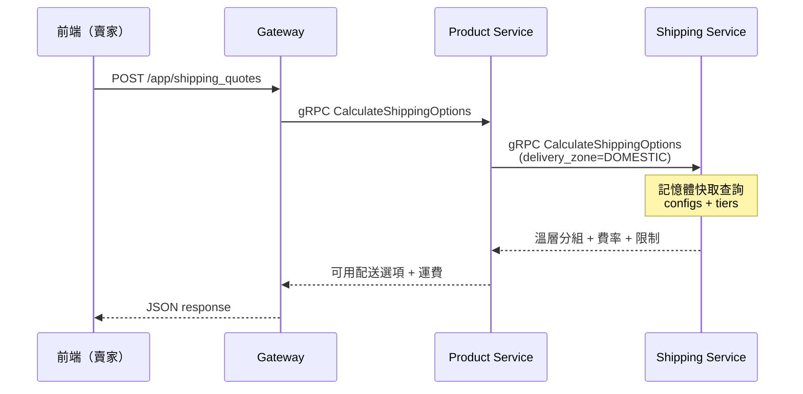
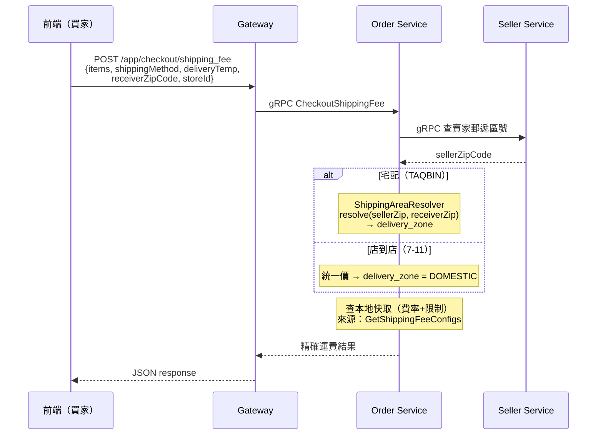
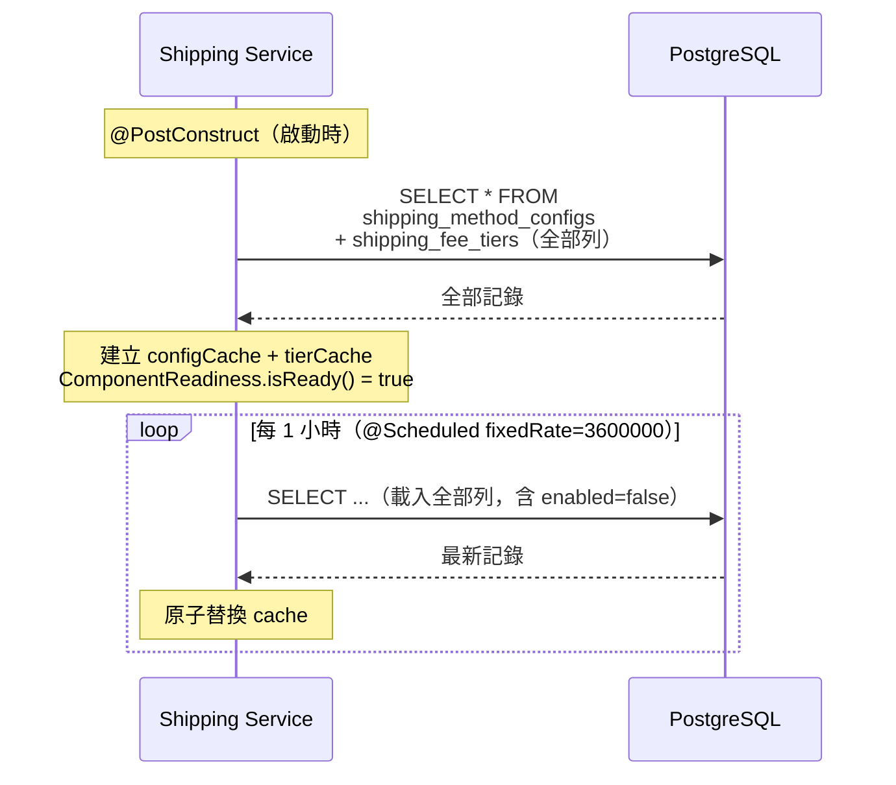
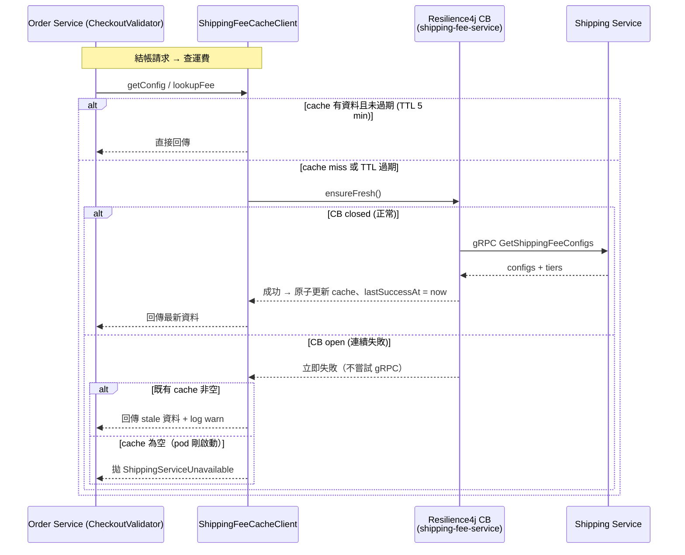

# 運費計算模組（Shipping Fee Module）詳細設計書

> **文件定位**：本文件為運費計算模組的**獨立設計書**，涵蓋 DB 費率表設計、快取策略、區域判斷邏輯、與結帳/商品模組的整合方式。
>
> **從以下設計書抽離**：
> - 結帳模組設計書 §4（運費計算）、§8（配送常數與運費定義）
> - 產品微服務設計書 §5.6（CalculateShippingOptions）
>
> **原則**：運費費率與物流限制**全部由 DB 管理**，不再 hardcode。費率變動時僅需更新 DB，無需改程式碼。

---

## 0. 模組概覽

### 0.1 定位

| 項目 | 說明 |
|------|------|
| 所屬服務 | Shipping Service（DB: `hawkr_shipping`） |
| 消費者 | Order Service（結帳運費計算）、Product Service（賣家建商品運費預覽） |
| 資料來源 | PayUni 合約費率（見附錄 A） |
| 快取 | 啟動時全量載入記憶體，TTL 1 小時自動重新整理 |

**本模組算的是「買家被收多少」（buyer shipping charge），不是別的金額**：

| 規格 | 內容 |
|---|---|
| `shipping_method_configs` 的列存在性 | 對每個 (method, temp) **恆有一列**；停用以 `enabled = false` 表達，**不是**不建列。查得到但 `enabled = false` ⇒ 回明確原因給使用者；查不到列 ⇒ 屬設定缺失，要告警 |
| Uber Direct（`3003`）例外 | **不走 `shipping_fee_tiers` 級距查表**，用 quote 即時價（見 [66 號](66-Uber%20Direct%20即時配送整合詳細設計書.md) §5.1.10）。因此 `3003` 在 `shipping_fee_tiers` 刻意無列 |
| 免運的成本歸屬**不由本模組決定** | 本模組算出 0 只代表「不向買家收」，**不代表沒有人負擔**。三型態：賣家主辦 ⇒ 成本仍由賣家；平台主辦 ⇒ 平台補貼那一部分；雙方共同 ⇒ `seller_subsidy` / `platform_subsidy` **各記一筆**。🔴 **不得從本模組的輸出推導負擔者** |
| 三個金額互不推導 | ① 買家被收多少（本模組）② 物流商實際成本（Uber 要到月結帳單才確定，含取消費／等待費／退回費／供應商調整）③ 平台向賣家收的物流服務費。🔴 **三者不得互相推導**——賣家主辦免運時 ① 為 0，而 ②③ 照樣發生。本模組**不承載** ②③，也不得被當成它們的來源 |
| 賣家最終負擔 | 實支實付五項式：物流商實際成本 ＋ 賣家負擔的收款通道手續費 − 平台補貼 ± 責任歸屬調整 ± 對帳調整；暫估先行、月結**雙向** true-up。🔴 **五項各自獨立記錄，不得合併成一個數字**，且與本模組的輸出沒有函數關係 |

### 0.2 核心設計原則

1. **費率 DB 化**：所有運費金額、材積/重量限制、撥款天期、代收手續費率均存於 DB
2. **單一來源**：費率資料僅存在於 Shipping Service DB，其他服務透過 gRPC 取得
3. **快取優先**：費率不常變動（一年數次），以記憶體快取為主，避免每次結帳查 DB
4. **三維費率**：`配送方式 × 溫層 × 配送區域` 決定費率級距
5. **成本價/零售價合一**：成本價 = 零售價（PayUni 合約費率直接轉嫁）

### 0.3 與其他模組的關係

```
Product Service                    Order Service (Checkout)
  賣家建商品運費預覽                   結帳運費計算
  ├─ 固定用 DOMESTIC                 ├─ Validate：DOMESTIC（預設基準）
  │                                  ├─ ShippingFee：實際區域計算
  │ gRPC CalculateShippingOptions    ├─ Preview：實際區域計算
  │           │                      └─ Confirm：實際區域計算
  │           │                           │
  │           │    gRPC GetShippingFeeConfigs（啟動時快取）
  │           │                           │
  │           └──────────┐  ┌─────────────┘
  │                      ▼  ▼
  │               Shipping Service（運費計算唯一來源）
  │               ├─ DB: shipping_method_configs（物流限制）
  │               ├─ DB: shipping_fee_tiers（費率級距）
  │               ├─ 記憶體快取（TTL 1 小時）
  │               └─ gRPC API:
  │                   ├─ GetShippingFeeConfigs（全量配置）
  │                   ├─ LookupShippingFee（單一運費查詢）
  │                   └─ CalculateShippingOptions（可用配送選項計算）
  │
  └─ 交叉參考：產品微服務設計書 §5.6
```

> **對外 HTTP 路徑由 Gateway 提供；運費計算一律經 shipping-service gRPC。**
> **交叉參考**：結帳模組設計書 §4、產品微服務設計書 §5.6

---

## 1. 配送區域（Delivery Zone）

### 1.1 三區域模型

費率表使用 **3 個配送區域**（非 4 個），因為 PayUni 對「本島→離島」與「離島→本島」收費相同：

| delivery_zone | 中文名稱 | 說明 |
|---------------|---------|------|
| `DOMESTIC` | 本島互寄 | 本島→本島（含小琉球、離島同縣互寄） |
| `OFFSHORE` | 寄離島 | 本島→離島 或 離島→本島（任一方向，同價） |
| `INTER_ISLAND` | 離島互寄 | 離島跨縣互寄（金門↔馬祖、澎湖↔綠島等） |

### 1.2 與 ShippingRoute（4 值）的對應

現有 `ShippingRoute` enum 有 4 個值，查費率時需 mapping：

| ShippingRoute | → | delivery_zone |
|---------------|---|---------------|
| `DOMESTIC` | → | `DOMESTIC` |
| `TO_OFFSHORE` | → | `OFFSHORE` |
| `FROM_OFFSHORE` | → | `OFFSHORE` |
| `OFFSHORE_TO_OFFSHORE` | → | `INTER_ISLAND` |

> `ShippingRoute` enum 保留不變（訂單記錄仍需區分方向），僅在查費率時做 mapping。

### 1.3 PayUni 離島定義（特殊規則）

依 PayUni 官方規則：

| 場景 | 計費區域 | 說明 |
|------|---------|------|
| 臺灣本島 → 小琉球 | `DOMESTIC` | 小琉球（屏東縣琉球鄉 929）算本島價 |
| 離島同縣互寄（金門→金門、馬祖→馬祖、澎湖→澎湖） | `DOMESTIC` | 同縣內互寄算本島價 |
| 本島 ↔ 馬祖/金門/澎湖/綠島 | `OFFSHORE` | 任一方向均算寄離島價 |
| 馬祖/金門/澎湖/綠島 跨縣互寄 | `INTER_ISLAND` | 四地互寄算離島互寄價 |

### 1.4 店到店區域判斷

店到店運費**不分區域**（統一價），因此：

- **不需要** `insularArea` 欄位
- 訂單 `shipping_area` 留空（或不填）
- 費率查找一律使用 `DOMESTIC`

> PayUni 超商地圖雖回傳 `insularArea`（I=本島, O=離島），本模組**不使用**它——店到店統一價。

---

## 2. DB 表定義

### 2.1 `shipping_method_configs`（配送方式設定）

每組 `(shipping_method, delivery_temp)` 一筆記錄，管理物流限制與營運參數。

```sql
CREATE TABLE IF NOT EXISTS shipping_method_configs (
    id                      BIGSERIAL    PRIMARY KEY,                -- 自增主鍵
    shipping_method         VARCHAR(50)  NOT NULL,                   -- 配送方式（TAQBIN / SEVEN_ELEVEN_STORE_PICKUP）
    delivery_temp           VARCHAR(20)  NOT NULL,                   -- 配送溫層（AMBIENT / CHILLED / FROZEN）
    max_dimension_sum_cm    INTEGER      NOT NULL DEFAULT 0,         -- 材積上限 L+W+H（cm），0 表示不限
    max_single_side_cm      INTEGER      NOT NULL DEFAULT 0,         -- 單邊（最長邊）上限（cm），0 表示不限
    max_weight_grams        BIGINT       NOT NULL DEFAULT 0,         -- 重量上限（公克），0 表示不限
    estimated_days          INTEGER      NOT NULL DEFAULT 0,         -- 預計到貨天數
    settlement_days         INTEGER      NOT NULL DEFAULT 0,         -- 撥款天期（D+N 的 N）
    commission_rate         NUMERIC(5,4) NOT NULL DEFAULT 0,         -- 代收手續費率（0.0050 = 0.5%，0.0100 = 1%）
    commission_min          BIGINT       NOT NULL DEFAULT 0,         -- 代收手續費最低金額（新台幣元）
    enabled                 BOOLEAN      NOT NULL DEFAULT true,      -- 是否啟用
    created_at              TIMESTAMPTZ  NOT NULL DEFAULT NOW(),     -- 建立時間
    updated_at              TIMESTAMPTZ  NOT NULL DEFAULT NOW(),     -- 更新時間

    CONSTRAINT uk_smc_method_temp UNIQUE (shipping_method, delivery_temp)
);

COMMENT ON TABLE shipping_method_configs IS '配送方式設定（物流限制與營運參數）';
COMMENT ON COLUMN shipping_method_configs.id IS '自增主鍵';
COMMENT ON COLUMN shipping_method_configs.shipping_method IS '配送方式代碼，對應 ShippingMethod enum（TAQBIN / SEVEN_ELEVEN_STORE_PICKUP）';
COMMENT ON COLUMN shipping_method_configs.delivery_temp IS '配送溫層代碼，對應 ShippingTemperature enum（AMBIENT / CHILLED / FROZEN）';
COMMENT ON COLUMN shipping_method_configs.max_dimension_sum_cm IS '材積上限，包裹 L+W+H 總和（公分），0 表示不限';
COMMENT ON COLUMN shipping_method_configs.max_single_side_cm IS '最長邊上限（公分），0 表示不限。7-11 店到店有 45cm 限制';
COMMENT ON COLUMN shipping_method_configs.max_weight_grams IS '重量上限（公克），0 表示不限';
COMMENT ON COLUMN shipping_method_configs.estimated_days IS '預計到貨天數';
COMMENT ON COLUMN shipping_method_configs.settlement_days IS '撥款天期，D+N 中的 N 值';
COMMENT ON COLUMN shipping_method_configs.commission_rate IS '代收手續費率，以小數表示（0.0050 = 0.5%，0.0100 = 1%）';
COMMENT ON COLUMN shipping_method_configs.commission_min IS '代收手續費最低金額（新台幣元），低於此值以此值計算';
COMMENT ON COLUMN shipping_method_configs.enabled IS '是否啟用，停用後該配送方式不可選';
COMMENT ON COLUMN shipping_method_configs.created_at IS '記錄建立時間';
COMMENT ON COLUMN shipping_method_configs.updated_at IS '記錄最後更新時間';
```

#### 初始資料

| shipping_method | delivery_temp | max_dim_sum | max_side | max_weight | est_days | settle | rate | min |
|----------------|---------------|-------------|----------|------------|----------|--------|------|-----|
| SEVEN_ELEVEN_STORE_PICKUP | AMBIENT | 105 | 45 | 5000 | 3 | 7 | 0.0050 | 1 |
| SEVEN_ELEVEN_STORE_PICKUP | FROZEN | 105 | 45 | 10000 | 3 | 7 | 0.0050 | 1 |
| TAQBIN | AMBIENT | 150 | 0 | 20000 | 2 | 15 | 0.0100 | 20 |
| TAQBIN | CHILLED | 120 | 0 | 20000 | 2 | 15 | 0.0100 | 20 |
| TAQBIN | FROZEN | 120 | 0 | 20000 | 2 | 15 | 0.0100 | 20 |

> 7-11 冷藏（CHILLED）不支援，不建記錄。程式邏輯：查不到 config = 該組合不可用。

### 2.2 `shipping_fee_tiers`（運費費率級距表）

每組 `(shipping_method, delivery_temp, delivery_zone, max_dimension_cm)` 一筆記錄。

```sql
CREATE TABLE IF NOT EXISTS shipping_fee_tiers (
    id                  BIGSERIAL    PRIMARY KEY,                -- 自增主鍵
    shipping_method     VARCHAR(50)  NOT NULL,                   -- 配送方式（TAQBIN / SEVEN_ELEVEN_STORE_PICKUP）
    delivery_temp       VARCHAR(20)  NOT NULL,                   -- 配送溫層（AMBIENT / CHILLED / FROZEN）
    delivery_zone       VARCHAR(30)  NOT NULL,                   -- 配送區域（DOMESTIC / OFFSHORE / INTER_ISLAND）
    max_dimension_cm    INTEGER      NOT NULL DEFAULT 0,         -- 材積上限（cm），0 表示統一價（不分材積級距）
    fee                 BIGINT       NOT NULL,                   -- 運費（新台幣元）
    enabled             BOOLEAN      NOT NULL DEFAULT true,      -- 是否啟用
    created_at          TIMESTAMPTZ  NOT NULL DEFAULT NOW(),     -- 建立時間
    updated_at          TIMESTAMPTZ  NOT NULL DEFAULT NOW(),     -- 更新時間

    CONSTRAINT uk_sft_method_temp_zone_dim UNIQUE (shipping_method, delivery_temp, delivery_zone, max_dimension_cm)
);

COMMENT ON TABLE shipping_fee_tiers IS '運費費率級距表，依配送方式×溫層×區域×材積查找運費';
COMMENT ON COLUMN shipping_fee_tiers.id IS '自增主鍵';
COMMENT ON COLUMN shipping_fee_tiers.shipping_method IS '配送方式代碼，對應 ShippingMethod enum';
COMMENT ON COLUMN shipping_fee_tiers.delivery_temp IS '配送溫層代碼，對應 ShippingTemperature enum';
COMMENT ON COLUMN shipping_fee_tiers.delivery_zone IS '配送區域（DOMESTIC=本島互寄 / OFFSHORE=寄離島 / INTER_ISLAND=離島互寄）';
COMMENT ON COLUMN shipping_fee_tiers.max_dimension_cm IS '材積上限 L+W+H（公分）。0 表示統一價（如店到店不分材積級距）';
COMMENT ON COLUMN shipping_fee_tiers.fee IS '運費金額（新台幣元）';
COMMENT ON COLUMN shipping_fee_tiers.enabled IS '是否啟用';
COMMENT ON COLUMN shipping_fee_tiers.created_at IS '記錄建立時間';
COMMENT ON COLUMN shipping_fee_tiers.updated_at IS '記錄最後更新時間';
```

#### 初始資料（共 32 筆）

**7-11 店到店**（不分區域，統一價，2 筆）：

| shipping_method | delivery_temp | delivery_zone | max_dim | fee |
|----------------|---------------|---------------|---------|-----|
| SEVEN_ELEVEN_STORE_PICKUP | AMBIENT | DOMESTIC | 0 | 65 |
| SEVEN_ELEVEN_STORE_PICKUP | FROZEN | DOMESTIC | 0 | 165 |

**黑貓常溫**（3 區域 × 4 級距 = 12 筆）：

| delivery_zone | ≤60cm | ≤90cm | ≤120cm | ≤150cm |
|---------------|-------|-------|--------|--------|
| DOMESTIC | 125 | 165 | 205 | 245 |
| OFFSHORE | 230 | 290 | 330 | 370 |
| INTER_ISLAND | 450 | 570 | 650 | 730 |

**黑貓冷藏**（3 區域 × 3 級距 = 9 筆）：

| delivery_zone | ≤60cm | ≤90cm | ≤120cm |
|---------------|-------|-------|--------|
| DOMESTIC | 160 | 225 | 290 |
| OFFSHORE | 270 | 350 | 410 |
| INTER_ISLAND | 530 | 690 | 810 |

**黑貓冷凍**（3 區域 × 3 級距 = 9 筆，與冷藏同費率，但**分開存**：兩個溫層各自一組列，不共用）：

| delivery_zone | ≤60cm | ≤90cm | ≤120cm |
|---------------|-------|-------|--------|
| DOMESTIC | 160 | 225 | 290 |
| OFFSHORE | 270 | 350 | 410 |
| INTER_ISLAND | 530 | 690 | 810 |

---

## 3. 快取策略

快取分為兩層，職責不同：

| 層次 | 位置 | 性質 | 冷啟動防線 |
|---|---|---|---|
| L1 同進程 DB cache（§3.1） | `shipping-service ShippingFeeService` | 服務本機 DB → memory | ComponentReadiness |
| L2 跨服務 gRPC cache（§3.2） | `order-service ShippingFeeCacheClient` | 透過 gRPC 查 shipping-service | Lazy + TTL + Circuit Breaker |

### 3.1 L1：shipping-service 同進程 DB cache

```
┌─────────────────────────────────────────────┐
│             Shipping Service                 │
│                                              │
│  DB ──(啟動時)──→ 記憶體快取 ──→ gRPC API     │
│        ↑                                     │
│        └──(每 1 小時 @Scheduled 重新載入)─┘   │
└─────────────────────────────────────────────┘
```

**Readiness 契約**：`ShippingFeeService` 實作 `ComponentReadiness`，`@PostConstruct` 完成首次載入後 `cacheLoaded` 翻 true。`shipping-service /actuator/health/readiness` 群組會把此 flag 納入評估，未 ready 時 K8s 不導入流量。詳見 `Java 微服務開發規範.md §8.7`。

### 3.2 L2：order-service 跨服務 gRPC cache

```
┌──────────────────────────────────────────────────────────┐
│                  Order Service                            │
│                                                           │
│  CheckoutValidator                                        │
│    └─→ ShippingFeeCacheClient.getConfig / lookupFee      │
│           ├─(cache hit + 未過期) → 直接回傳                 │
│           └─(miss / TTL 過期)                              │
│                ├─→ @CircuitBreaker(shipping-fee-service)  │
│                │     └─→ gRPC GetShippingFeeConfigs       │
│                │           ├─ 成功 → 更新本機 cache        │
│                │           └─ 失敗 → 走 stale cache fallback│
│                └─→ TTL = 5 分鐘                            │
└──────────────────────────────────────────────────────────┘
```

**快取行為（規格）**：
- **無 `@PostConstruct` warm-up**、**無 `@Scheduled` 排程刷新**：快取只由「首次請求 cold load ＋ TTL 自然 expire」維護。
- **首次請求觸發 cold load**：pod 啟動後第一個請求承擔一次 gRPC RTT；後續 5 分鐘走 cache。
- **Circuit Breaker fail-open 用 stale cache**：shipping-service 連續失敗 → CB 開路 → 拒絕新 gRPC 嘗試 → 用既有 cache 回傳（資料可能 stale 5～30 秒）；**cache 完全為空時才**回 `SHIPPING_SERVICE_UNAVAILABLE`。

> 取捨與被否決的方案見 ADR [`docs/adr/2026-09-18-shipping-fee-cache-no-warmup-no-scheduler.md`](../adr/2026-09-18-shipping-fee-cache-no-warmup-no-scheduler.md)。

### 3.3 快取結構

兩層使用相同 key 規格：

```java
// configs：key = "method:temp"  例："3001:3201"
Map<String, ShippingMethodConfigEntity> configCache;

// tiers：key = "method:temp:zone"  例："3001:3201:8101"
// value 按 max_dimension_cm 升序排列
Map<String, List<ShippingFeeTierEntity>> tierCache;
```

### 3.4 查找邏輯

```
lookupFee(method, temp, zone, dimensionSum):
  1. 取得 tierCache[method:temp:zone]（排序好的級距清單）
  2. 找第一個 tier 滿足 dimensionSum ≤ tier.maxDimensionCm（或 maxDimensionCm=0 表示統一價）
  3. 回傳 tier.fee
  4. 找不到 → null（超過最大級距，此配送方式不可用）
```

### 3.5 重新整理

| 層次 | 啟動載入 | 排程 refresh | 失敗處理 |
|---|---|---|---|
| L1 (`ShippingFeeService`) | `@PostConstruct`（同 DB tx 內，可靠） | `@Scheduled fixedRate=1h` | warn + 保留既有 cache |
| L2 (`ShippingFeeCacheClient`) | 無（lazy） | 無；TTL 5 min 過期觸發 | CB open → stale cache fallback |

---

## 4. gRPC API 設計

### 4.1 RPC 清單（shipping.proto）

```protobuf
// ==================== 運費計算（內部服務間呼叫）====================

// 取得全部運費配置（供 Order Service 本地快取）
rpc GetShippingFeeConfigs(GetShippingFeeConfigsRequest) returns (GetShippingFeeConfigsResponse);

// 查詢單一運費（指定 method × temp × zone × dimensionSum）
rpc LookupShippingFee(LookupShippingFeeRequest) returns (LookupShippingFeeResponse);

// 計算可用配送選項與運費（給定包裹尺寸重量，回傳所有可用配送方式）
rpc CalculateShippingOptions(CalculateShippingOptionsRequest) returns (CalculateShippingOptionsResponse);
```

### 4.2 Message 定義

```protobuf
// --- 取得全部運費配置 ---

message GetShippingFeeConfigsRequest {}

message GetShippingFeeConfigsResponse {
    int32 code = 1;
    string message = 2;
    repeated ShippingMethodConfigProto method_configs = 3;  // 配送方式設定清單
    repeated ShippingFeeTierProto fee_tiers = 4;            // 費率級距清單
}

message ShippingMethodConfigProto {
    string shipping_method = 1;         // 配送方式
    string delivery_temp = 2;           // 配送溫層
    string max_dimension_sum_cm = 3;    // 材積上限（cm）
    string max_single_side_cm = 4;      // 最長邊上限（cm）
    string max_weight_grams = 5;        // 重量上限（g）
    string estimated_days = 6;          // 預計到貨天數
    string settlement_days = 7;         // 撥款天期
    string commission_rate = 8;         // 代收手續費率
    string commission_min = 9;          // 代收手續費最低金額
}

message ShippingFeeTierProto {
    string shipping_method = 1;         // 配送方式
    string delivery_temp = 2;           // 配送溫層
    string delivery_zone = 3;           // 配送區域（DOMESTIC / OFFSHORE / INTER_ISLAND）
    string max_dimension_cm = 4;        // 材積上限（cm），"0" 表示統一價
    string fee = 5;                     // 運費（元）
}

// --- 查詢單一運費 ---

message LookupShippingFeeRequest {
    string shipping_method = 1;         // 配送方式
    string delivery_temp = 2;           // 配送溫層
    string delivery_zone = 3;           // 配送區域
    string dimension_sum = 4;           // 材積總和（cm，數字字串）
}

message LookupShippingFeeResponse {
    int32 code = 1;
    string message = 2;
    string fee = 3;                     // 運費（元，數字字串），不可用時為空
    string estimated_days = 4;          // 預計到貨天數
    string settlement_days = 5;         // 撥款天期
}
// --- 計算可用配送選項 ---

message CalculateShippingOptionsRequest {
    string length_cm = 1;           // 包裝長度（cm）
    string width_cm = 2;            // 包裝寬度（cm）
    string height_cm = 3;           // 包裝高度（cm）
    string weight_grams = 4;        // 重量（公克）
    string delivery_zone = 5;       // 配送區域（DOMESTIC / OFFSHORE / INTER_ISLAND），空字串預設 DOMESTIC
}

message CalculateShippingOptionsResponse {
    int32 code = 1;
    string message = 2;
    repeated ShippingOptionGroup temperature_groups = 3;  // 依溫層分組的配送選項
    string weight_grams = 4;        // 轉換後重量（g）
    string dimension_sum = 5;       // L+W+H 材積總和（cm）
    string longest_side = 6;        // 最長邊（cm）
}

message ShippingOptionGroup {
    string temperature = 1;                         // 溫層 Enum code（AMBIENT / CHILLED / FROZEN）
    string display_name = 2;                        // 溫層顯示名（常溫/冷藏/冷凍）
    repeated ShippingOptionDetail methods = 3;      // 可用配送方式
}

message ShippingOptionDetail {
    string shipping_method = 1;         // 配送方式 Enum code
    string display_name = 2;            // 配送方式顯示名
    string fee = 3;                     // 運費（元）
    string estimated_days = 4;          // 預計到貨天數
    string settlement_days = 5;         // 撥款天期
    string max_dimension_sum = 6;       // 材積上限 L+W+H（cm），"0" 表示無特定限制
    string max_longest_side = 7;        // 最長邊上限（cm），"0" 表示無特定限制
    string max_weight_grams = 8;        // 重量上限（g）
}
```

> **數字欄位全部用 `string`**（遵循 `docs/開發規範/Java 微服務開發規範.md` §2.1）。

### 4.3 呼叫方式

| 呼叫端 | RPC | 用途 | 頻率 |
|--------|-----|------|------|
| Order Service | `GetShippingFeeConfigs` | 取全量費率填 L2 快取（lazy，TTL 5 分鐘） | 低 |
| Product Service | `CalculateShippingOptions` | 賣家建商品運費預覽（固定 DOMESTIC） | 中 |
| — | `LookupShippingFee` | 單筆查詢：指定 method × temp × zone × dimensionSum 回單一費率 | — |

> **Order Service**：不做啟動 warm-up；第一個結帳請求 lazy 呼叫 `GetShippingFeeConfigs` 填 `ShippingFeeCacheClient` 本地快取，之後 5 分鐘內直接查本地快取（見 §3.2 / §3.5）。
> **Product Service**：不需快取，直接呼叫 `CalculateShippingOptions` 取得即時計算結果。

---

## 5. 結帳模組整合

### 5.1 結帳 API 的區域判斷規則

| API | delivery_zone | 說明 |
|-----|---------------|------|
| **Validate** | `DOMESTIC`（固定） | 預設基準費率，供 Grid 展示參考 |
| **ShippingFee** | 宅配：實際計算 / 店到店：`DOMESTIC` | 買家選好配送方式+溫層+地址後，精確計算運費 |
| **Preview** | 同 ShippingFee | 預覽訂單總額（含運費） |
| **Confirm** | 同 ShippingFee | 建立訂單 |

> **宅配區域判斷**：`receiverZipCode` → `ShippingAreaResolver` → `ShippingRoute` → `toDeliveryZone()`
> **店到店**：統一價，固定 `DOMESTIC`，訂單 `shipping_area` 留空
>
> **另外**：Product Service 的 `CalculateShippingOptions`（賣家建商品預覽）固定用 `DOMESTIC`，不在結帳流程中。

> **結帳 Proto / Gateway 不帶 `insular_area`**：店到店統一價，`receiver_zip_code`（宅配用）即足夠。

### 5.2 CheckoutService 運費路線推導

#### 5.2.1 運費路線推導

```java
private String resolveDeliveryZone(ShippingMethod method,
                                    String sellerZipCode,
                                    String receiverZipCode) {
    if (method == ShippingMethod.SEVEN_ELEVEN_STORE_PICKUP) {
        return "DOMESTIC"; // 店到店統一價
    }
    // 宅配：用郵遞區號推導
    ShippingRoute route = ShippingAreaResolver.resolveRoute(sellerZipCode, receiverZipCode);
    return toDeliveryZone(route);
}
```

#### 5.2.2 費率查詢

```java
// shippingFeeClient.lookupFee(method, temp, deliveryZone, dimensionSum)
// 資料來自 Order Service 本地快取（源頭為 shipping-service 的 shipping_fee_tiers 表）

// ShippingRoute → delivery_zone 轉換
private String toDeliveryZone(ShippingRoute route) {
    return switch (route) {
        case DOMESTIC -> "DOMESTIC";
        case TO_OFFSHORE, FROM_OFFSHORE -> "OFFSHORE";
        case OFFSHORE_TO_OFFSHORE -> "INTER_ISLAND";
    };
}
```

#### 5.4.4 限制查詢

```java
// shippingFeeClient.getConfig(method, temp)
// 資料來自 shipping-service 的 shipping_method_configs 表
// 回傳 null 表示該組合不可用（如 7-11 冷藏）
```

---

## 6. 產品服務整合

### 6.1 CalculateShippingOptions 職責分工

**運費計算邏輯集中在 Shipping Service**，Product Service 僅作為 gRPC 消費端。

| 項目 | 說明 |
|------|------|
| 計算邏輯 | Shipping Service `CalculateShippingOptions` RPC（`ShippingFeeService.calculateShippingOptions`） |
| 費率來源 | Shipping Service `shipping_fee_tiers` 表 + 記憶體快取 |
| 限制來源 | Shipping Service `shipping_method_configs` 表 |
| 區域 | 固定 `DOMESTIC` |

#### Product Service 呼叫方式

```java
// Product Service 中（ProductGrpcService.calculateShippingOptions）：
// shippingGrpcClient.calculateShippingOptions(length, width, height, weightGrams, "DOMESTIC")
```

- Proto 定義：`CalculateShippingOptionsRequest` / `CalculateShippingOptionsResponse`（product.proto）
- Gateway 路由：`POST /api/v1/app/shipping_quotes`
- Product gRPC Service 收到請求後**轉呼叫** Shipping Service gRPC，自身不做費率計算

> 詳見 `02-產品微服務（Product Service）詳細設計書 §5.6`

---

## 7. common-core 不得持有運費資料

運費費率、材積/重量限制、可用配送方式組合**一律不得放進 common-core**（含 Enum、常數、計算類別），唯一來源如下：

| 資料 | 唯一來源 | 取用方式 |
|------|---------|---------|
| 費率級距 | `shipping_fee_tiers` 表（shipping-service） | `ShippingFeeService.lookupFee` / gRPC `LookupShippingFee`、`GetShippingFeeConfigs` |
| 物流限制（材積/重量/撥款天期） | `shipping_method_configs` 表（shipping-service） | `ShippingFeeService.getConfig` / gRPC `GetShippingFeeConfigs` |
| 溫層分組與可用選項計算 | shipping-service 內部計算 | gRPC `CalculateShippingOptions` |

> common-core 只保留與費率無關的區域/單位/過濾工具：`ShippingAreaResolver`、`DeliveryZone`、`WeightConverter`、`SellerShippingFilter`（`utils/shipping/`），以及 `ShippingRoute`、`ShippingArea`（`utils/code/`）。

---

## 8. 時序圖

### 8.1 賣家建商品 — 運費預覽



### 8.2 結帳 — 運費計算（ShippingFee / Preview / Confirm）



> Preview 額外計算優惠券折扣，Confirm 額外建立訂單，運費計算流程與 ShippingFee 相同。

### 8.3 快取初始化與重新整理（雙層）

L1（shipping-service 同進程 DB cache）：



L2（order-service 跨服務 gRPC cache）：



**CB 配置**（order-service application.yml）：

```yaml
resilience4j:
  circuitbreaker:
    instances:
      shipping-fee-service:
        sliding-window-size: 20
        minimum-number-of-calls: 5
        failure-rate-threshold: 50
        wait-duration-in-open-state: 30s
        permitted-number-of-calls-in-half-open-state: 3
        automatic-transition-from-open-to-half-open-enabled: true
```

---

## 附錄 A：PayUni 最新費率表

> 資料來源：https://www.payuni.com.tw/fee

### A.1 超商物流 — 7-ELEVEN 店到店 C2C

| 項目 | 常溫 | 冷凍 |
|------|------|------|
| 寄件費 | 65 元/件 | 165 元/件 |
| 代收手續費 | 0.5%/筆（不足 1 元以 1 元計） | 0.5%/筆（不足 1 元以 1 元計） |
| 撥款天期 | D+7 | D+7 |
| 出貨期限 | 列印取號 D+6 天內至門市交寄 | 列印取號 D+6 天內至門市交寄 |

> 冷藏不支援店到店。

### A.2 黑貓宅配 — 常溫

| 材積(cm) | 寄本島 | 寄離島 | 離島互寄 |
|----------|--------|--------|----------|
| ≤60 | 125 | 230 | 450 |
| ≤90 | 165 | 290 | 570 |
| ≤120 | 205 | 330 | 650 |
| ≤150 | 245 | 370 | 730 |

### A.3 黑貓宅配 — 低溫（冷凍/冷藏共用）

| 材積(cm) | 寄本島 | 寄離島 | 離島互寄 |
|----------|--------|--------|----------|
| ≤60 | 160 | 270 | 530 |
| ≤90 | 225 | 350 | 690 |
| ≤120 | 290 | 410 | 810 |

### A.4 黑貓宅配 — 共通

| 項目 | 說明 |
|------|------|
| 代收手續費 | 1%/筆（不足 20 元以 20 元計） |
| 撥款天期 | D+15 |
| 到付未取費 | 10 元/件 |
| 重量上限 | 20 kg |
