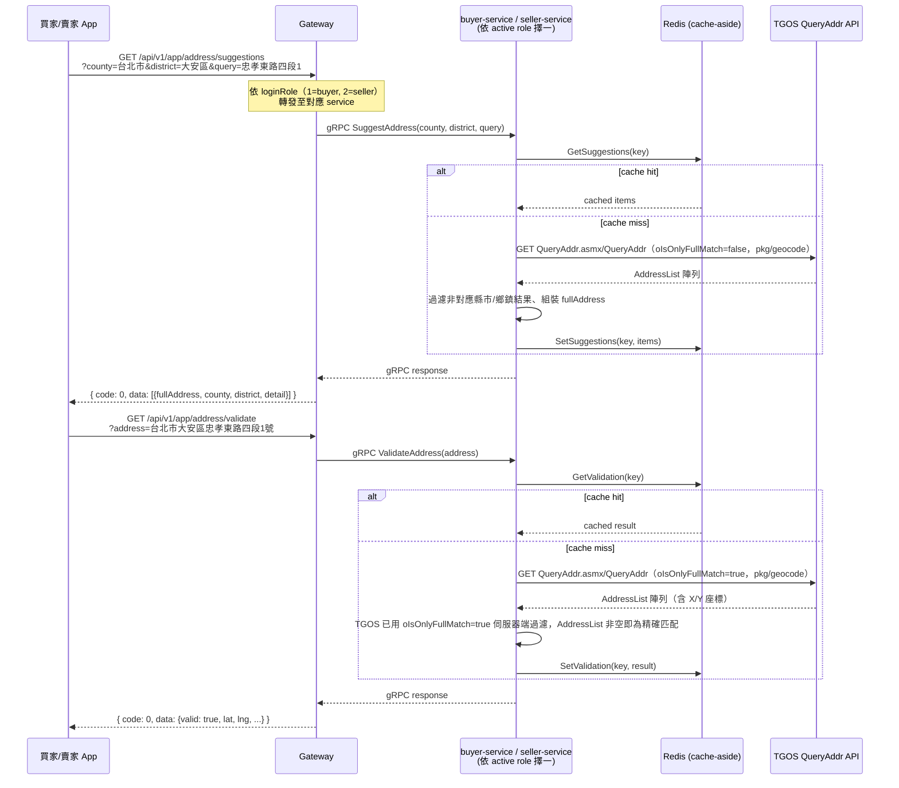
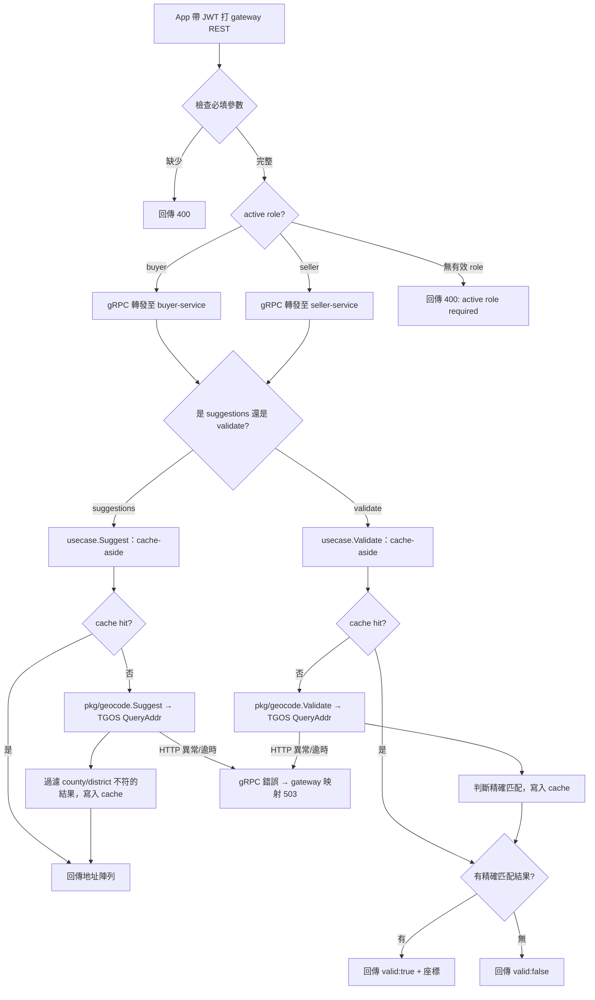

# 27 - 地址搜尋與驗證（Address Proxy）詳細設計書

> **實作位置**：`gateway/`（thin proxy）+ `pkg/geocode`（共用 TGOS ACL）+ `buyer-service` / `seller-service`（各自 usecase + cache + gRPC handler）

---

## 一、概述

買家收件地址與賣家門市地址設定頁面需要地址搜尋/驗證功能。Gateway 只做 REST→gRPC 轉發：依呼叫者的 active role（`loginRole`：1=buyer、2=seller）將 `GET /api/v1/app/address/suggestions`、`GET /api/v1/app/address/validate` 轉發至 buyer-service 或 seller-service 各自的 `SuggestAddress`/`ValidateAddress` gRPC rpc。

TGOS（內政部國土測繪中心）整合邏輯（HTTP 呼叫、ASMX/XML 信封解析）收斂在共用 library `pkg/geocode`（anti-corruption layer），由 buyer-service、seller-service 各自 wrap 一層 cache-aside usecase + gRPC handler 使用（比照既有 GCIS 統編查詢下放前例：`services/seller-service/internal/client/gcis`）。gateway 不持有 TGOS 憑證、不管 cache。

---

## 二、API 規格

### 2.1 地址模糊搜尋

```
GET /api/v1/app/address/suggestions
```

需登入（Bearer Token）。

**Request Parameters（Query String）**

| 參數 | 類型 | 必填 | 說明 |
|------|------|------|------|
| county | string | Y | 縣市，例如 `台北市` |
| district | string | Y | 鄉鎮市區，例如 `大安區` |
| query | string | Y | 路名+門牌關鍵字，例如 `忠孝東路四段1` |
| limit | string | N | 最多回傳筆數，預設 8，上限 20 |

**Response**

```json
{
  "code": 0,
  "message": "success",
  "data": [
    {
      "fullAddress": "台北市大安區忠孝東路四段1號",
      "county": "台北市",
      "district": "大安區",
      "detail": "忠孝東路四段1號",
      "lat": 0,
      "lng": 0
    }
  ]
}
```

> `lat`/`lng` 在 Suggestions 中固定為 0，座標需透過 `/validate` 另行取得。

### 2.2 地址嚴格驗證

```
GET /api/v1/app/address/validate
```

需登入（Bearer Token）。

**Request Parameters（Query String）**

| 參數 | 類型 | 必填 | 說明 |
|------|------|------|------|
| address | string | Y | 完整地址，例如 `台北市大安區忠孝東路四段1號` |

**Response（驗證通過）**

```json
{
  "code": 0,
  "message": "success",
  "data": {
    "valid": true,
    "fullAddress": "台北市大安區忠孝東路四段1號",
    "county": "台北市",
    "district": "大安區",
    "detail": "忠孝東路四段1號",
    "lat": 25.0418,
    "lng": 121.5440
  }
}
```

**Response（驗證失敗）**

```json
{
  "code": 0,
  "message": "success",
  "data": {
    "valid": false
  }
}
```

### 2.3 錯誤回應

| HTTP Status | code | 情境 |
|-------------|------|------|
| 400 | 400 | 缺少必填參數（county/district/query 或 address） |
| 503 | 503 | 上游 gRPC 逾時 / 不可用（`Unavailable`/`DeadlineExceeded`）或非預期錯誤；gateway 用 `response.GrpcErr` 統一映射，全檔案無 502 case |

---

## 三、時序圖



---

## 四、業務流程圖



---

## 五、環境變數

| 變數 | 說明 | 掛載對象 |
|------|------|--------|
| `TGOS_QUERYADDR_APPID`/`TGOS_QUERYADDR_APIKEY` | TGOS QueryAddr 憑證（k8s secret `hawkr-address`） | `buyer-service`、`seller-service`（各自讀取，非 gateway） |
| `TGOS_BASE_URL`/`TGOS_PROXY_CALLER_KEY_FILE` | egress-proxy 的 Cloud Run endpoint ＋ IAM 呼叫端 SA key 檔路徑 | `buyer-service`、`seller-service` |

> **TGOS 呼叫一律經共用出口層 `egress-proxy`**（固定出口 IP，治理見「固定 IP 出口與第三方轉發規範」§2）：
> `TGOS_BASE_URL` 指向 egress-proxy 的 Cloud Run URL，白名單路徑為 `/addrws/v40/QueryAddr.asmx/QueryAddr`，
> 呼叫端 SA 為 `tgos-proxy-caller`（IAM audience ＝ baseURL）。
> **不得為 TGOS 另建專屬 proxy 或另申請固定 IP**——第三方轉發一律收斂到 egress-proxy。

啟動時各 service 從 config 讀取 `TGOS_BASE_URL`/`TGOS_QUERYADDR_APPID`/`TGOS_QUERYADDR_APIKEY`/`TGOS_PROXY_CALLER_KEY_FILE`，四者皆為必要值；缺少任一者時**啟動期 fail fast**（service 直接 fatal，過不了 k8s health check），**不得延到 request-time 才回 503**——設定缺失要在部署當下就暴露，而不是等到第一個使用者查地址時。

---

## 六、實作位置

| 檔案 | 說明 |
|------|------|
| `pkg/geocode/tgos_client.go` | TGOS QueryAddr（透過 egress-proxy IAM 中繼）的 anti-corruption layer；`TGOSClient.Suggest()`/`TGOSClient.Validate()`，`http.Client{Timeout: 10*time.Second}`。無 process、無金鑰持有，供任何擁有地址 bounded context 的 service 共用 |
| `pkg/geocode/parse.go` | TGOS 回應 → domain `Suggestion`/`ValidationResult` 共用的門牌截取邏輯（`extractDetail`） |
| `services/buyer-service/internal/client/geocode/client.go` | wrap `pkg/geocode`，實作 `usecase.GeocodeClient` interface（比照 GCIS 的 `GcisClient` 模式） |
| `services/buyer-service/internal/usecase/address_geocode.go` | `AddressGeocodeUseCase`：cache-aside（`GeocodeCache` interface，fail-open）+ `Suggest`/`Validate` |
| `services/buyer-service/internal/grpc/handler.go` | `SuggestAddress`/`ValidateAddress` gRPC rpc |
| `services/seller-service/internal/client/geocode/client.go` | 同 buyer-service，各自獨立一份 wiring |
| `services/seller-service/internal/usecase/address_geocode.go` | 同上 |
| `services/seller-service/internal/grpc/handler.go` | `SuggestAddress`/`ValidateAddress` gRPC rpc |
| `gateway/internal/handler/address_geocode.go` | Thin proxy：依 `loginRole`（1=buyer, 2=seller）呼叫 `h.Buyer.SuggestAddress`/`ValidateAddress` 或 `h.Seller.SuggestAddress`/`ValidateAddress`，映射回 JSON envelope。不含任何第三方 provider 邏輯 |
| `gateway/internal/router/constants.go` | `AddressPath`、`AddressSuggestions`、`AddressValidate` 常數 |
| `gateway/internal/router/routes_address.go` | `registerAddressRoutes`，掛在 `app` group 下，套用 JWTAuth middleware |

### GeocodeClient / GeocodeCache Interface（各 service usecase 層定義）

```go
type GeocodeClient interface {
    Suggest(ctx context.Context, county, district, query string) ([]Suggestion, error)
    Validate(ctx context.Context, address string) (*GeocodeValidation, error)
}

type GeocodeCache interface {
    GetSuggestions(ctx context.Context, key string) ([]Suggestion, bool)
    SetSuggestions(ctx context.Context, key string, items []Suggestion)
    GetValidation(ctx context.Context, key string) (*GeocodeValidation, bool)
    SetValidation(ctx context.Context, key string, v *GeocodeValidation)
}
```

### pkg/geocode 實作重點

- `Suggest`：GET `QueryAddr.asmx/QueryAddr`（經 egress-proxy IAM 中繼），`oFuzzyType=2`/`oIsOnlyFullMatch=false`/`oReturnMaxCount=5`，回傳模糊比對候選（不限完全比對）
- `Validate`：同一 endpoint，`oFuzzyType=0`/`oIsOnlyFullMatch=true`/`oReturnMaxCount=1`；`oIsOnlyFullMatch=true` 讓 TGOS 伺服器端就過濾成只回傳完全比對，`AddressList` 為空即視為無效，不需要額外比對 location type 之類的欄位
