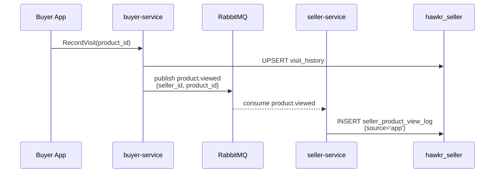
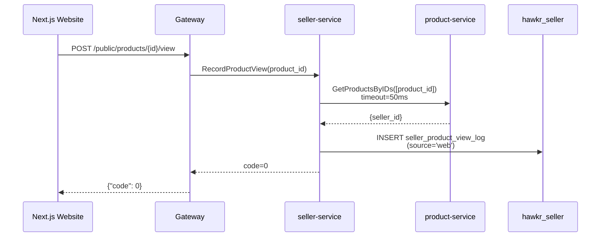
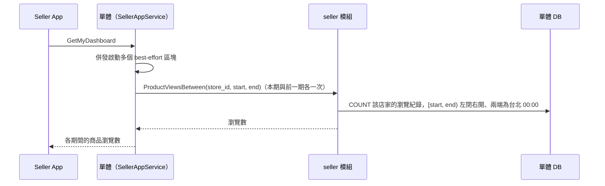

# 商品瀏覽統計（Product View Stats）詳細設計書

> A3b 7c（2026-10-02）：單體的 seller 模組改成只追加的原始事件 `seller.product_view_events` 加上 River 定期彙總成每日桶 `seller.product_views_daily`（`store_id`、台北日期），儀表板只讀彙總；週界線是台北時間週日 00:00；已登入買家的瀏覽由 buyer 的 `ProductViewed` 寫入原始事件，商品→店家在彙總時批次解析，不再以帳號 ID 為鍵；「總次數、不去重」的語意不變。下方的表、資料流與 seller-service 段落描述舊實作，seller-service 刪除時（A3b 步驟 11）改寫。

## 1. 概述

賣家 Dashboard 的 `page_view_count` ＝**賣家旗下所有商品的總瀏覽次數（不去重）**，涵蓋兩個來源：APP 已登入買家（既有 MQ `product.viewed` 事件）與網頁匿名訪客（公開打點 API）。

⚠️ **欄位名與語義刻意不對齊**：`page_view_count` 這個名字沿用自「商店訪客數」時期，語義已是「商品總瀏覽次數」。API schema 維持不變，顯示文案由 App／Website 各自負責——**不得**因為名字叫 `page_view`（或 `count` 像是唯一數）而改回去重邏輯。

| 項目 | 說明 |
|------|------|
| 主要服務 | `services/seller-service/`（Go） |
| 相關服務 | `gateway/`、`services/buyer-service/`（MQ 事件來源）、`services/java/product-service/`（seller_id 查詢） |
| DB | `hawkr_seller`（PostgreSQL） |
| 對外 API | `POST /api/v1/public/products/{id}/view` |
| gRPC | `RecordProductView`、`GetProductViewStats` |

---

## 2. Non-Goals

商品個別瀏覽數、去重統計、細分平台（iOS／Android／Web）、即時排行。

服務歸屬與儲存形式的選型理由見
[ADR：瀏覽統計歸 seller-service、以時間序列表儲存](../adr/2026-09-18-product-view-stats-ownership-and-storage.md)。

---

## 3. 資料庫設計

**Database**：`hawkr_seller`

### `seller_product_view_log`（時間序列，不去重）

| 欄位 | 類型 | 說明 |
|------|------|------|
| `id` | BIGINT PK | TSID |
| `seller_id` | BIGINT NOT NULL | 賣家 account_id |
| `product_id` | BIGINT NOT NULL | 被瀏覽的商品 ID |
| `source` | VARCHAR(10) NOT NULL | `app` 或 `web` |
| `viewed_at` | TIMESTAMPTZ NOT NULL DEFAULT NOW() | 瀏覽時間（UTC） |

```sql
CREATE INDEX idx_spvl_seller_viewed ON seller_product_view_log (seller_id, viewed_at DESC);
```

時間序列設計讓週環比查詢只需 `WHERE seller_id = ? AND viewed_at BETWEEN ? AND ?`，無需維護額外計數欄位。

**Volume 估算**：每日 10 萬次瀏覽 × 30 天 = 300 萬列，可接受。若流量大幅增長可加 Range Partition by month。

---

## 4. API 設計

### 4.1 HTTP REST API

#### `POST /api/v1/public/products/{id}/view`

- **Namespace**：`public`（匿名可存取，無需登入）
- **用途**：網頁端（Next.js）商品詳情頁 mount 時呼叫
- **Path Param**：`id` — 商品 ID（BIGINT 字串）
- **Request Body**：無
- **Response**：永遠 `{"code": 0}`（best-effort，失敗靜默忽略）

Gateway 收到後呼叫 seller-service gRPC `RecordProductView`；seller-service 再向 product-service 查詢 `seller_id`。

---

## 5. Proto 定義

```protobuf
// 記錄一次網頁端商品瀏覽（匿名，best-effort）
rpc RecordProductView(RecordProductViewRequest) returns (RecordProductViewResponse);

// 取得賣家旗下所有商品總瀏覽數與週環比（seller-service 的 RPC，目前沒有呼叫方；儀表板走單體的 ProductViewsBetween，見 §6.5）
rpc GetProductViewStats(GetProductViewStatsRequest) returns (ProductViewStatsResponse);

message RecordProductViewRequest {
    string product_id = 1;  // TSID 字串（型別對應見《Java 微服務開發規範》§2）
}

message RecordProductViewResponse {
    int32 code = 1;
    string message = 2;
}

message GetProductViewStatsRequest {
    int64 account_id = 1;
    int32 period_days = 2; // 環比天數（目前忽略，固定用日曆週）
}

message ProductViewStatsResponse {
    int32 code = 1;
    string message = 2;
    int64 view_count = 3;  // 本週商品總瀏覽次數
    int32 growth_pct = 4;  // 與上週相比的環比百分比
}
```

> `period_days` 欄位保留供未來擴充，目前實作固定使用日曆週邊界（週日 00:00 UTC 起算）。

---

## 6. 資料流

### 6.1 APP 瀏覽路徑（MQ）



### 6.2 網頁端瀏覽路徑（直接打點）



### 6.3 兩種路徑對比

| 項目 | APP 路徑 | 網頁路徑 |
|------|---------|---------|
| **觸發方** | Buyer App 呼叫 `POST /app/buyers/me/browse-history` | Next.js 商品詳情頁 `useEffect` |
| **是否需要登入** | 是（JWT，BUYER 權限） | 否（匿名） |
| **seller_id 來源** | buyer-service 在發 MQ 事件時直接帶入 payload | seller-service 從 product-service gRPC 查詢（50ms timeout） |
| **傳遞方式** | 非同步 MQ（`hawkr.content` exchange，`product.viewed`） | 同步 HTTP → gRPC |
| **seller-service 入口** | MQ consumer（`product_view_consumer.go`） | gRPC handler `RecordProductView` |
| **`source` 欄位值** | `app` | `web` |
| **失敗行為** | 靜默丟棄，不重試（analytics 可接受） | 靜默忽略，always `code=0` |
| **潛在遺漏原因** | buyer-service goroutine panic、MQ 連線中斷 | product-service 超時（>50ms）、product 不存在 |

### 6.5 Dashboard 查詢路徑



---

## 7. 各層實作

### 7.1 seller-service

| 檔案 | 職責 |
|------|------|
| `db/schema/schema.sql` | `seller_product_view_log` 表與 index（Atlas declarative schema，migration 由 `atlas migrate diff` 產生） |
| `db/queries/seller_product_view_log.sql` | sqlc 查詢（`InsertProductViewLog`、`GetProductViewCountBySeller`） |
| `internal/domain/product_view.go` | `ProductViewRepository` 介面 |
| `internal/repository/postgres/product_view_repository.go` | repository 實作 |
| `internal/usecase/product_view.go` | `ProductViewUseCase`：`RecordView`、`RecordViewByProductID`、`GetStats` |
| `internal/client/product/client.go` | 呼叫 product-service `GetProductsByIDs` 解析 `seller_id`（50ms timeout） |
| `internal/mq/product_view_consumer.go` | 訂閱 `hawkr.content` exchange / `product.viewed` routing key |
| `internal/grpc/handler.go` | `RecordProductView`、`GetProductViewStats` gRPC handler |

**`GetStats` 統計邏輯**：
- 本期：本週日 00:00 UTC → 現在
- 上期：上週日 00:00 UTC → 本週日 00:00 UTC
- `growth_pct = round((本期 - 上期) / max(上期, 1) * 100)`

**MQ Consumer 行為**：
- `SellerID` 或 `ProductID` 為 0 時靜默丟棄（warn log）
- 解析失敗時靜默丟棄（best-effort analytics，不重試）

**`RecordViewByProductID` 行為（網頁端路徑）**：
- 向 product-service 查詢 `seller_id`，timeout 50ms
- 查詢失敗或 product 不存在時靜默回傳 nil（best-effort）

### 7.2 Gateway

| 檔案 | 職責 |
|------|------|
| `internal/handler/product_view.go` | `RecordProductView` HTTP handler |
| `internal/router/routes_product.go` | `POST /public/products/:id/view` 路由（**無 auth middleware**，匿名可打） |
| `internal/grpc/seller_client.go` | `RecordProductView`、`GetProductViewStats` gRPC 呼叫 |
| `backend/internal/httpapi/seller/dashboard.go` | `GetMyDashboard` 的商品瀏覽區塊呼叫 `ProductViewsBetween`（`ProductViews` 介面，seller 模組實作） |

### 7.3 hawkr-website（Next.js）

商品詳情頁 component 的 `useEffect` 新增打點：

```ts
useEffect(() => {
  fetch(`/api/v1/public/products/${productId}/view`, { method: 'POST' })
    .catch(() => {}); // 靜默忽略
}, [productId]);
```

---

## 8. 責任邊界

- **buyer-service 不因本功能改動**：`VisitUseCase.Record` 每次呼叫（含重複瀏覽）都發 `product.viewed` MQ 事件，seller-service 只是多一個 consumer。
- **Gateway 不解析 `product → seller_id`**：網頁打點路徑由 seller-service 自行向 product-service 查，Gateway 只做路由。

---

## 9. 失敗行為與容量

| 情境 | 行為 |
|------|------|
| MQ 事件遺漏（goroutine panic） | **可接受**——本統計是 analytics 非交易資料，不做補償、不重送 |
| 網頁打點被爬蟲觸發 | 計數會失真。現行防線只有 Gateway 對 `/public/*` 的既有 rate limiting，**沒有** bot detection |
| product-service 呼叫超時（web 路徑） | 50ms timeout，逾時靜默忽略，不影響使用者體驗、不回錯給前端 |
| Dashboard 查詢 | 走 `(seller_id, viewed_at DESC)` index；30 天量級約 10 萬列／賣家 |

---

## 10. 部署契約

`seller_product_view_log` 表由 CI/CD（`deploy-k8s.yml` 的 `migrate` job）執行 `atlas migrate apply --env dev`（main 分支為 `--env prod`）建立，在服務 deploy 之前完成。

🔴 **禁止手動對 dev / prod 執行 `atlas migrate apply`**——繞過 CI/CD 會讓 `atlas.sum` 與實際 schema 分歧，之後每一次 migration 都會被 checksum 擋下。
