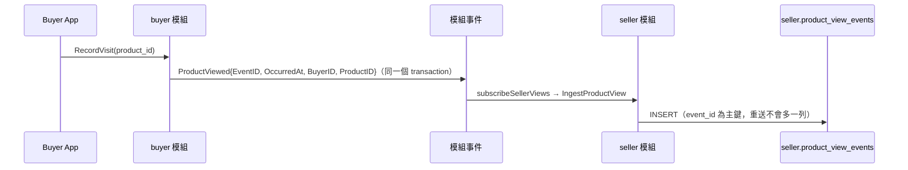
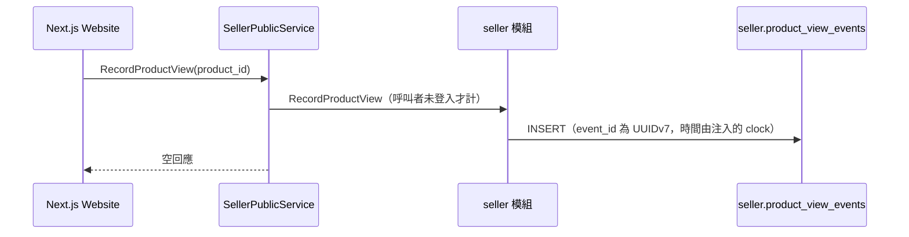

# 商品瀏覽統計（Product View Stats）詳細設計書

## 1. 概述

賣家 Dashboard 的商品瀏覽數 ＝**店家旗下所有商品的總瀏覽次數（不去重）**，涵蓋兩個來源：已登入買家（buyer 模組的 `ProductViewed` 事件）與網頁匿名訪客（公開打點 API）。

⚠️ **語義刻意是「總次數、不去重」**：不得因為欄位名稱或顯示文案像是唯一數而改成去重邏輯。顯示文案由 App／Website 各自負責。

| 項目 | 說明 |
|------|------|
| 擁有者 | 單體的 seller 模組（`internal/modules/seller/internal/views`） |
| 相關模組 | buyer 模組（登入買家的瀏覽事件來源）、`internal/httpapi/seller`（Dashboard 與公開打點的入口）、商品所屬店家的 port `ProductStores`（`cmd/hawkr` 接線，由 `internal/legacy/productservice` 實作） |
| DB | 單體 DB 的 `seller` schema：`product_view_events`、`product_views_daily` |
| 公開打點 API | Connect `hawkr.seller.v1alpha1.SellerPublicService/RecordProductView` |
| Dashboard 讀取 | Connect `SellerAppService/GetMyDashboard` 的商品瀏覽區塊 |

---

## 2. Non-Goals

商品個別瀏覽數、去重統計、細分來源（登入／匿名、iOS／Android／Web）、即時排行。

服務歸屬與儲存形式的選型理由見
[ADR：瀏覽統計歸 seller、以時間序列表儲存](../adr/2026-09-18-product-view-stats-ownership-and-storage.md)。

---

## 3. 資料庫設計

**Schema**：`seller`（權威定義與欄位註解在 `internal/modules/seller/db/schema.sql`）。

### `seller.product_view_events`（只追加的原始事件）

| 欄位 | 類型 | 說明 |
|------|------|------|
| `event_id` | UUID PK | UUIDv7，由產生端給；重送的事件不會多一列 |
| `product_id` | BIGINT NOT NULL | 被瀏覽的商品 ID（不建 FK，商品在 catalog），必須為正 |
| `occurred_at` | TIMESTAMPTZ NOT NULL | 瀏覽發生時間 |
| `store_id` | BIGINT | 彙總 job 解析出的店家；處理前為 NULL |
| `processed_at` | TIMESTAMPTZ | 彙總 job 處理的時間；處理前為 NULL |
| `outcome` | TEXT | `COUNTED`（已解析並記進每日彙總，`store_id` 必有）或 `UNRESOLVED`（商品不存在或沒有店家，不計入任何地方，不重試）；處理前為 NULL |

`store_id`、`processed_at`、`outcome` 三者同為 NULL 或同時有值，由 CHECK 保證。索引：`product_view_events_pending`（`occurred_at, event_id`，只含未處理）與 `product_view_events_processed`（`occurred_at`，只含已處理）。

### `seller.product_views_daily`（每日彙總，Dashboard 唯一讀取的表）

| 欄位 | 類型 | 說明 |
|------|------|------|
| `store_id` | BIGINT | 參照 `seller.stores` |
| `day` | DATE | 台北日曆日 |
| `views` | BIGINT | 該店該日的瀏覽總數，至少 1 |

主鍵 `(store_id, day)`；只留店家與日期，沒有商品、來源欄位。商品 port 解析出來的店家不在 `seller.stores` 時，該事件標成 `UNRESOLVED`，不卡住整批。

---

## 4. API 設計

### 4.1 公開打點

`SellerPublicService.RecordProductView(product_id)`：

- 匿名可存取；用途是網頁端商品詳情頁 mount 時呼叫。
- 只計訪客：呼叫者已登入（帳號或管理員）時回成功但不計數，登入買家的瀏覽由 buyer 的 `ProductViewed` 計入，避免重複計算，也不必讓 client 判斷登入狀態。
- `product_id` 必須是合法的商品 ID；商品是否存在不在請求內檢查，不存在的商品不回錯。
- 每個來源 IP 每分鐘最多 120 次（`internal/httpapi/ratelimit.go` 的 `tierProductView`），超過回 `resource_exhausted`（帶 RetryInfo）。
- 回應是空訊息。

### 4.2 Dashboard 讀取

`GetMyDashboard` 的商品瀏覽區塊呼叫 `seller.ProductViewsBetween(storeID, start, end)`，本期與前一期各一次：

- 本期是最近 7 個完整的台北日曆日（不含今天），前一期是它前面緊鄰的 7 日。
- 區間左閉右開 `[start, end)`，兩端必須是台北 00:00 且 `start` 早於 `end`，`storeID` 必須是正數，否則回 `InvalidInput`。
- 只讀每日彙總，最近一次彙總之後的瀏覽還沒計入。
- 不回百分比，比較的呈現在 client。
- 該區塊失敗、逾時只讓區塊不設（記 warn），不變成 0，也不讓 `GetMyDashboard` 失敗。

---

## 5. 資料流

### 5.1 登入買家路徑

### 5.2 匿名訪客路徑

兩條路徑的寫入端都只有一句 insert，**不在請求內解析商品所屬的店家**，也不呼叫任何外部服務。

### 5.3 彙總與清理（背景）

| Job | 排程 | 行為 |
|-----|------|------|
| `seller.product_views_rollup` | 每 5 分鐘、啟動即執行、unique | 依 `occurred_at, event_id` 讀一批（100 筆）未處理的事件；在 DB transaction 之外以 `ProductStores` port 一次批次解析去重後的商品（10 秒 deadline）；再於一個 transaction 內取共享 advisory lock、`FOR UPDATE SKIP LOCKED` 鎖住仍未處理的列，一句 SQL 內標記（`store_id`、`processed_at`、`outcome`）並以事件 `occurred_at` 的台北日曆日累加 `product_views_daily`。一次執行最多 50 批，積壓留給下一次。port 暫時性錯誤整個 job 回 error，這批沒有事件被標記，River 重試時只計一次 |
| `seller.product_views_purge` | 每小時 | 刪除已處理且 `occurred_at` 早於 now − 7 天的事件；未處理的不刪 |

`RebuildProductViews(fromDay, toDay)` 以已處理（`COUNTED`）事件儲存的 `store_id`，在一個 transaction 內先刪區間再重建，並取獨占 advisory lock（彙總 job 與清理不會插進來）；起日的台北 00:00 早於 now − 7 天回 `InvalidInput`。重算只涵蓋原始事件的保留期，更早的日子只剩彙總，無法重建。

---

## 6. 責任邊界

- **buyer 模組只發 `ProductViewed`**：事件不帶店家，請求路徑不解析商品；seller 與 buyer 互不 import，由 `cmd/hawkr` 的 `subscribeSellerViews` 轉接。
- **商品→店家的解析只在彙總 job**：經 `ProductStores` port，不在任何請求的關鍵路徑上；商品服務不通時瀏覽照樣成功，之後才被彙總。

---

## 7. 失敗行為與容量

| 情境 | 行為 |
|------|------|
| 匿名打點寫入失敗 | 回錯誤給 client；client 對打點 fire-and-forget、靜默忽略 |
| 打點被爬蟲觸發 | 計數會失真。現行防線只有每個來源 IP 的額度，**沒有** bot detection |
| 商品服務（`ProductStores`）暫時不可用 | 事件留在未處理，彙總 job 回 error 由 River 重試；Dashboard 數字延後，不丟事件 |
| 商品不存在、沒有店家或店家不在 `seller.stores` | 事件標 `UNRESOLVED`，不計入、不重試 |
| 事件重送（同一個 `event_id`） | 不會多一列 |
| Dashboard 查詢 | 只讀 `product_views_daily`，主鍵 `(store_id, day)`；列數隨店數乘天數成長 |
