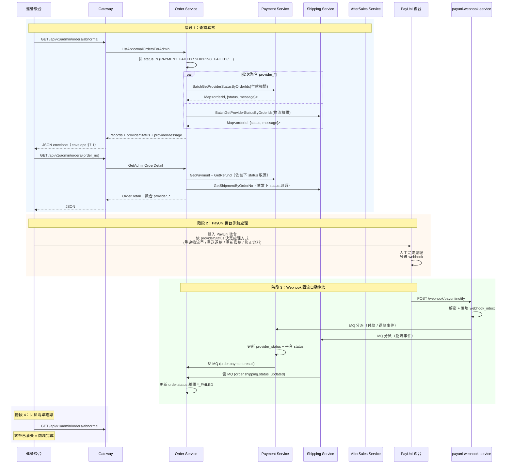
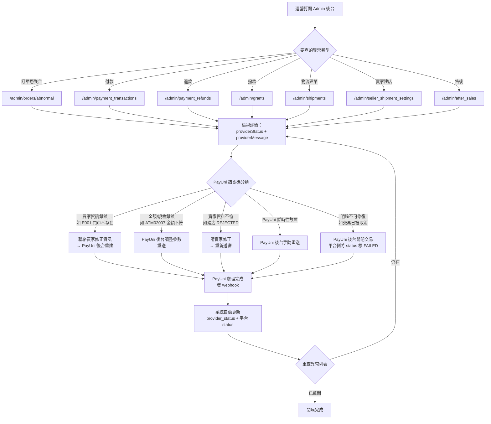

# Admin 異常訂單管理 API 詳細設計書

> 本文件定義運營後台（Admin）用的「PayUni 相關異常」查詢 API，跨 Payment / Shipping / AfterSales / Order 四個服務。
>
> **定位**：純查詢聚合層，不新增 DB 表、不新增業務動作。運營人員透過 Admin API 找到異常紀錄後，登入 PayUni 後台手動處理；PayUni webhook 回流時系統自動更新，異常紀錄從清單中消失 = 閉環完成。
>
> **強制依據**（優先順序）：
> 1. [PayUni 錯誤回應收斂規範](../開發規範/PayUni%20錯誤回應收斂規範.md)（三層語意 / 欄位命名 / 批次聚合）
> 2. [API 設計規範](../開發規範/API%20設計規範.md)（Namespace / DTO / Envelope）
> 3. [Gateway Swagger 註解規範](../開發規範/Gateway%20Swagger%20註解規範.md)（Gateway Swagger 規範）

---

## 1. 服務定位與範圍

### 1.1 業務問題

PayUni 對外的錯誤回應（付款 / 退款 / 撥款 / 物流建單 / 建店）有兩類處理方式：

| 類型 | 處理方式 |
|---|---|
| 瞬時故障（網路、timeout） | 同步 retry 一次即可恢復（規範 §8.1） |
| 持久性錯誤（買家資訊錯、商店未開通、PayUni 審核退件等） | **必須登入 PayUni 後台手動處理**，無法由我方系統自動修正 |

對第二類的持久性錯誤，系統需要：

1. **完整儲存** PayUni 原始狀態碼與訊息（`provider_status` / `provider_message`）
2. **提供 Admin 查詢介面**讓運營找得到這些異常紀錄
3. **不提供自動重試 / 手動強制成功 API**（權威入口是 PayUni 後台）
4. **PayUni webhook 回流後自動恢復**（既有機制）

本設計書專注第 2 點：Admin 查詢介面。

### 1.2 涵蓋範圍

| 服務 | 查詢對象 | 典型異常情境 |
|---|---|---|
| Payment | `payment_transactions` | 付款失敗 / 交易逾期 / 狀態衝突 |
| Payment | `payment_refunds` | 退款失敗 / 退款處理超時 |
| Payment | 撥款（`payment_transactions` 的 `grant_*` 欄位） | PayUni Grant API 失敗 |
| Shipping | `shipments` | 物流建單失敗（正向/退貨） |
| Shipping | `seller_shipment_settings` | 賣家建店被 PayUni 審核退件 |
| AfterSales | `aftersale_cases` + `refund_tasks` | 售後退款失敗 / 退貨物流失敗 |
| Order | `orders` | 訂單層聚合異常（上述各子服務的狀態反映到 order.status） |

### 1.3 非本文件責任範圍

| 項目 | 歸屬 |
|---|---|
| `provider_status` / `provider_message` 欄位寫入邏輯 | 規範 §4 + 各服務詳細設計書（05/06/09） |
| 批次聚合 gRPC 的 proto 定義（`BatchGetProviderStatusByOrderIds` 等） | 06 物流 / 05 支付詳細設計書（擁有者服務） |
| schema 變更（V1 migration） | 05/06/09 各自在主改造 phase 完成 |
| 手動重試 / 手動取消 / 強制成功 API | **不實作**。PayUni 後台為唯一權威入口 |
| 前端 Admin UI | 前端團隊負責；本文件僅定義 API 契約 |

> **釐清：異常記錄的 acknowledge / ignore 標記 ≠ 改寫業務狀態**。配送異常的 admin 標記端點（`POST /api/v1/admin/shipments/anomalies/{shipment_id}/{anomaly_type}/acknowledge|ignore`）屬 [06 §5.21](../詳細設計書/06-物流微服務（Shipping%20Service）詳細設計書.md#521-配送異常賣家通知) 的 `shipment_anomaly_acknowledgments`（純使用者操作記錄表）域，寫入的是「運營是否已看過/已忽略這筆異常」的互動記錄，**不改寫 shipment.status 或 order.status，不觸發任何業務流程**。因此它不違反本文件「不提供改寫業務狀態的動作端點」原則：
>
> - 本文件（29 號）維持**純查詢聚合層**定位，自身仍不新增任何改寫狀態的動作端點；
> - admin ack/ignore 端點掛在 `shipments/anomalies` 資源下、由 06 號設計書擁有（RPC `AcknowledgeShipmentAnomalyForAdmin` / `IgnoreShipmentAnomalyForAdmin`），非本文件的異常查詢端點；
> - 訂單卡在 `SHIPPING_ABNORMAL(35)` 的恢復由**物流貨態事件驅動**（PayUni 31→30 / 32→32），非人工改狀態端點，見 [03 號「物流推進守門單調前進與異常恢復」](../詳細設計書/03-訂單微服務（Order%20Service）詳細設計書.md#物流推進守門單調前進與異常恢復)。

---

## 2. 業務閉環

### 2.1 完整閉環時序圖



### 2.2 異常分類與運營處理決策樹



---

## 3. 三層語意對照（依規範 §1.2）

所有 Admin API 回應的欄位必須嚴格對應以下三層：

| 層 | 欄位命名 | Admin DTO 欄位 | 取源 |
|---|---|---|---|
| 平台層 | 無前綴（`status`） | `status`（CodeMeta value，字串） | 各聚合服務自身表 |
| Provider SoT 層 | `provider_*` | `providerStatus` / `providerMessage` | 擁有者服務（Payment / Shipping） |
| Provider Snapshot 層 | `payuni_*` | **不出現在 Admin API 的回應**；本文件 API 一律走 SoT 聚合 | N/A |

**強制**：Admin API 從不讀 snapshot 表（如 `refund_tasks.payuni_*`），一律從 SoT 讀取或透過批次 RPC 聚合，避免 drift。

---

## 4. API 總表

| # | 服務 | Method | 路徑 | RPC |
|---|---|---|---|---|
| P1 | Payment | GET | `/api/v1/admin/payment_transactions` | `ListPaymentTransactionsForAdmin` |
| P2 | Payment | GET | `/api/v1/admin/payment_transactions/:trade_no` | `GetPaymentTransactionForAdmin` |
| P3 | Payment | GET | `/api/v1/admin/payment_refunds` | `ListRefundsForAdmin` |
| P4 | Payment | GET | `/api/v1/admin/payment_refunds/:refund_no` | `GetRefundForAdmin` |
| P5 | Payment | GET | `/api/v1/admin/grants` | `ListGrantsForAdmin` |
| S1 | Shipping | GET | `/api/v1/admin/shipments` | `ListShipmentsForAdmin` |
| S2 | Shipping | GET | `/api/v1/admin/shipments/:id` | `GetShipmentForAdmin` |
| S3 | Shipping | GET | `/api/v1/admin/seller_shipment_settings` | `ListSellerShipmentSettingsForAdmin` |
| A1 | AfterSales | GET | `/api/v1/admin/after_sales` | `ListAfterSaleCasesForAdmin` |
| A2 | AfterSales | GET | `/api/v1/admin/after_sales/:case_no` | `GetAppealDetailForAdmin` |
| O1 | Order | GET | `/api/v1/admin/orders/abnormal` | `ListAbnormalOrdersForAdmin` |
| O2 | Order | GET | `/api/v1/admin/orders/:order_no` | `GetAdminOrderDetail` |

**權限**：全部 `/admin/*`，由 Gateway `requireAdmin()` + 各服務 gRPC `requireAccountType(ADMIN)` 雙層驗證。

---

## 5. 通用規範

### 5.1 列表 API 統一 Query Parameter

| 參數 | 型別 | 預設 | 說明 |
|---|---|---|---|
| `page` | string（整數字串） | `"1"` | 頁碼，從 1 開始 |
| `page_size` | string（整數字串） | `"20"` | 每頁筆數，最大 `"100"` |
| `abnormal_only` | string（`"true"` / `"false"`） | `"true"` | `true`：僅回異常（各 API 定義見 §6 ~ §9）；`false`：回全量（供 ops 支援查案） |
| `provider_status` | string | 無 | PayUni 原始碼 exact match（如 `"E001"`、`"REF02023"`） |
| `status` | string | 無 | 平台 CodeMeta value exact match（可多值，逗號分隔） |
| `created_from` | string（ISO 8601） | 無 | `created_at >= created_from` |
| `created_to` | string（ISO 8601） | 無 | `created_at < created_to` |
| `sort` | string | `updated_at_desc` | 合法值：`updated_at_desc` / `updated_at_asc` / `created_at_desc` / `created_at_asc` |

**命名約定**（[API 設計規範 §11](../開發規範/API%20設計規範.md)）：URL Query 一律 `snake_case`。

### 5.2 列表 API 回應格式（分頁 envelope）

```json
{
  "code": 0,
  "message": "success",
  "data": {
    "records": [...],
    "total": "123",
    "page": "1",
    "pageSize": "20"
  }
}
```

`total` / `page` / `pageSize` 為**整數字串**（規範 §2.3 + API 設計規範 §12）。

### 5.3 詳情 API 回應格式

```json
{
  "code": 0,
  "message": "success",
  "data": { ... }
}
```

### 5.4 錯誤回應格式

依 [API 設計規範 §12](../開發規範/API%20設計規範.md)：

```json
{ "code": 404, "message": "resource not found", "traceId": "a1b2c3" }
```

Gateway `message` 策略（強制）：成功固定 `"success"`；錯誤透傳微服務 `resp.Message`，不自訂覆寫。

### 5.5 批次聚合（列表 API 必遵守）

列表 API 若需補充 `providerStatus` / `providerMessage`，**必須**透過批次 gRPC（規範 §6.3），禁止 N+1：

1. 查自身表取得該頁 `records`
2. 依 `status` 分組決定向哪個 SoT 服務查
3. 每個 SoT 服務僅發 1 次 Batch RPC
4. 合併回應

詳見 §10「批次聚合 gRPC 依賴」。

### 5.6 時間欄位

統一使用 ISO 8601 (UTC)：`YYYY-MM-DDTHH:mm:ssZ`（[Java 微服務開發規範](../開發規範/Java%20微服務開發規範.md) §2.3）。

### 5.7 數字欄位

Proto `string`、Gateway HTTP JSON `string`（所有 ID、金額、狀態 code 值；[Java 微服務開發規範](../開發規範/Java%20微服務開發規範.md) §2.1）。

### 5.8 Swagger 要求

依 [Gateway Swagger 註解規範](../開發規範/Gateway%20Swagger%20註解規範.md)：
- Request / Response 必須為 exported Go struct，禁止 `object{...}` 行內
- DTO Enum 欄位 comment 註明合法值
- 所有 `@Param` 的數字欄位用 `string`
- 分頁回應用 `records`（禁 `list` / `items`）

---

## 6. Payment Service Admin API（P1 ~ P5）

### 6.1 路徑衝突檢查

P1～P5 是 Payment Service 在 `/api/v1/admin/*` 下的全部端點，無其他既有 Admin 路徑需要避開。

### 6.2 異常定義（`abnormal_only=true` 時的 filter）

| 資源 | 視為異常的條件 |
|---|---|
| `payment_transactions` | `status IN (FAILED, EXPIRED, CONFLICT)` **或** `rescue_action IS NOT NULL`（L2 rescue 觸發紀錄） |
| `payment_refunds` | `status = FAILED` **或** `status = PROCESSING AND updated_at < NOW() - INTERVAL '24 hours'`（處理超時） |
| `payment_transactions.grant_*` | `grant_status` 為 PayUni 回報的非成功值（撥款成功碼對應表以 05 設計書為準） |

> `CLOSED` / `CLOSED_BY_SWITCH` 屬正常業務流程（訂單取消 / 付款方式切換），**不**視為異常。

### 6.3 P1：列付款異常

**路徑**：`GET /api/v1/admin/payment_transactions`

**Query**（除 §5.1 共通外）：

| 參數 | 型別 | 說明 |
|---|---|---|
| `order_no` | string | 依訂單號過濾（exact） |
| `buyer_id` | string | 依買家過濾（exact），與 §8.3 / §9.3 慣例對齊 |
| `payment_type` | string | PaymentType value，多值逗號分隔 |

**Response DTO**（Gateway handler）：

```go
type AdminPaymentTransactionListResponse struct {
    Records  []AdminPaymentTransactionSummary `json:"records"`
    Total    string                            `json:"total"`
    Page     string                            `json:"page"`
    PageSize string                            `json:"pageSize"`
}

type AdminPaymentTransactionSummary struct {
    TradeNo          string `json:"tradeNo"`
    OrderNo          string `json:"orderNo"`
    AccountId        string `json:"accountId"`
    MerId            string `json:"merId"`
    Amount           string `json:"amount"`           // 新台幣元（整數字串）
    PaymentType      string `json:"paymentType"`      // PaymentType value
    Status           string `json:"status"`           // PaymentTransactionStatus value；合法值：0=INIT,1=PAID,2=FAILED,3=EXPIRED,4=CONFLICT,5=CLOSED,6=CLOSED_BY_SWITCH
    ProviderStatus   string `json:"providerStatus"`   // PayUni 原始碼（可空字串）
    ProviderMessage  string `json:"providerMessage"`  // PayUni 原始訊息（可空字串）
    ProviderTradeNo  string `json:"providerTradeNo"`
    CreatedAt        string `json:"createdAt"`        // ISO 8601
    UpdatedAt        string `json:"updatedAt"`        // ISO 8601
}
```

**gRPC RPC**：

```protobuf
// payment.proto 新增
service PaymentService {
    // ...（既有 RPC）

    // ==================== Admin API（§29） ====================
    rpc ListPaymentTransactionsForAdmin(ListPaymentTransactionsForAdminRequest) returns (ListPaymentTransactionsForAdminResponse);
}

message ListPaymentTransactionsForAdminRequest {
    int64 account_id = 1;              // Gateway 注入（admin）
    string page = 2;
    string page_size = 3;
    bool abnormal_only = 4;            // 預設 true
    string provider_status = 5;        // 可空
    string status = 6;                 // 多值逗號分隔
    string order_no = 7;
    string buyer_id = 8;               // Gateway 解析後填入的現任 buyer_id（REST query 參數 `?buyer_id=` 收的是登入 account_id，由 gateway resolver 解析後才填入本欄）
    string payment_type = 9;
    string created_from = 10;          // ISO 8601
    string created_to = 11;
    string sort = 12;                  // updated_at_desc 等
}

message ListPaymentTransactionsForAdminResponse {
    int32 code = 1;
    string message = 2;
    ListPaymentTransactionsForAdminData data = 3;
}

message ListPaymentTransactionsForAdminData {
    repeated AdminPaymentTransactionSummary records = 1;
    string total = 2;
    string page = 3;
    string page_size = 4;
}

message AdminPaymentTransactionSummary {
    string trade_no = 1;
    string order_no = 2;
    string account_id = 3;
    string mer_id = 4;
    string amount = 5;
    string payment_type = 6;
    string status = 7;
    string provider_status = 8;
    string provider_message = 9;
    string provider_trade_no = 10;
    string created_at = 11;
    string updated_at = 12;
}
```

### 6.4 P2：付款詳情

**路徑**：`GET /api/v1/admin/payment_transactions/:trade_no`

**Response DTO**：

```go
type AdminPaymentTransactionDetailResponse struct {
    TradeNo                 string `json:"tradeNo"`
    OrderNo                 string `json:"orderNo"`
    AccountId               string `json:"accountId"`
    MerId                   string `json:"merId"`
    Amount                  string `json:"amount"`
    PaymentType             string `json:"paymentType"`
    ProductName             string `json:"productName"`
    Status                  string `json:"status"`
    ProviderStatus          string `json:"providerStatus"`
    ProviderMessage         string `json:"providerMessage"`
    ProviderTradeNo         string `json:"providerTradeNo"`
    AtmBankCode             string `json:"atmBankCode,omitempty"`
    AtmVirtualAccount       string `json:"atmVirtualAccount,omitempty"`
    AtmExpireDate           string `json:"atmExpireDate,omitempty"`
    PayTime                 string `json:"payTime,omitempty"`
    ProviderCreateAt        string `json:"providerCreateAt,omitempty"`  // PayUni 端建立時間
    ProviderPaidAt          string `json:"providerPaidAt,omitempty"`    // PayUni 端付款時間
    ExpireAt                string `json:"expireAt,omitempty"`
    ClosedAt                string `json:"closedAt,omitempty"`
    // 撥款相關（依規範 §9.1 新增；撥款失敗時有值）
    GrantedAt               string `json:"grantedAt,omitempty"`
    GrantStatus             string `json:"grantStatus,omitempty"`
    GrantMessage            string `json:"grantMessage,omitempty"`
    // 重複付款相關（既有 §2A.6）
    IsDuplicate             string `json:"isDuplicate,omitempty"`
    DuplicateOfPaymentId    string `json:"duplicateOfPaymentId,omitempty"`
    DuplicateSequence       string `json:"duplicateSequence,omitempty"`
    // L2 rescue
    RescuedAt               string `json:"rescuedAt,omitempty"`
    RescueAction            string `json:"rescueAction,omitempty"`
    CreatedAt               string `json:"createdAt"`
    UpdatedAt               string `json:"updatedAt"`
}
```

**gRPC RPC**：

```protobuf
rpc GetPaymentTransactionForAdmin(GetPaymentTransactionForAdminRequest) returns (GetPaymentTransactionForAdminResponse);

message GetPaymentTransactionForAdminRequest {
    int64 account_id = 1;        // Gateway 注入（admin）
    string trade_no = 2;
}

message GetPaymentTransactionForAdminResponse {
    int32 code = 1;
    string message = 2;
    AdminPaymentTransactionDetail data = 3;
}

message AdminPaymentTransactionDetail {
    string trade_no = 1;
    string order_no = 2;
    string account_id = 3;
    string mer_id = 4;
    string amount = 5;
    string payment_type = 6;
    string product_name = 7;
    string status = 8;
    string provider_status = 9;
    string provider_message = 10;
    string provider_trade_no = 11;
    string atm_bank_code = 12;
    string atm_virtual_account = 13;
    string atm_expire_date = 14;
    string pay_time = 15;
    string provider_create_at = 16;
    string provider_paid_at = 17;
    string expire_at = 18;
    string closed_at = 19;
    string granted_at = 20;
    string grant_status = 21;
    string grant_message = 22;
    string is_duplicate = 23;
    string duplicate_of_payment_id = 24;
    string duplicate_sequence = 25;
    string rescued_at = 26;
    string rescue_action = 27;
    string created_at = 28;
    string updated_at = 29;
}
```

### 6.5 P3：列退款異常

**路徑**：`GET /api/v1/admin/payment_refunds`

**Query**（§5.1 共通 + 以下）：

| 參數 | 說明 |
|---|---|
| `trade_no` | 依原交易號過濾 |
| `order_no` | 依訂單號過濾 |

**Response DTO**：

```go
type AdminPaymentRefundListResponse struct {
    Records  []AdminPaymentRefundSummary `json:"records"`
    Total    string                       `json:"total"`
    Page     string                       `json:"page"`
    PageSize string                       `json:"pageSize"`
}

type AdminPaymentRefundSummary struct {
    RefundNo         string `json:"refundNo"`
    TradeNo          string `json:"tradeNo"`
    OrderNo          string `json:"orderNo"`
    Amount           string `json:"amount"`
    Status           string `json:"status"`           // RefundStatus value；合法值：0=REQUESTED,1=PROCESSING,2=SUCCEEDED,3=FAILED
    ProviderStatus   string `json:"providerStatus"`
    ProviderMessage  string `json:"providerMessage"`
    ProviderRefundNo string `json:"providerRefundNo"`
    Reason           string `json:"reason"`
    CompletedAt      string `json:"completedAt,omitempty"`
    CreatedAt        string `json:"createdAt"`
    UpdatedAt        string `json:"updatedAt"`
}
```

**gRPC RPC**：

```protobuf
rpc ListRefundsForAdmin(ListRefundsForAdminRequest) returns (ListRefundsForAdminResponse);

message ListRefundsForAdminRequest {
    int64 account_id = 1;
    string page = 2;
    string page_size = 3;
    bool abnormal_only = 4;
    string provider_status = 5;
    string status = 6;
    string trade_no = 7;
    string order_no = 8;
    string created_from = 9;
    string created_to = 10;
    string sort = 11;
}

message ListRefundsForAdminResponse {
    int32 code = 1;
    string message = 2;
    ListRefundsForAdminData data = 3;
}

message ListRefundsForAdminData {
    repeated AdminPaymentRefundSummary records = 1;
    string total = 2;
    string page = 3;
    string page_size = 4;
}

message AdminPaymentRefundSummary {
    string refund_no = 1;
    string trade_no = 2;
    string order_no = 3;
    string amount = 4;
    string status = 5;
    string provider_status = 6;
    string provider_message = 7;
    string provider_refund_no = 8;
    string reason = 9;
    string completed_at = 10;
    string created_at = 11;
    string updated_at = 12;
}
```

### 6.6 P4：退款詳情

**路徑**：`GET /api/v1/admin/payment_refunds/:refund_no`

**Response DTO**：`AdminPaymentRefundSummary` 同結構即可滿足詳情需求（本表欄位不多）。實作時直接 reuse；gRPC 仍獨立 RPC 以便未來擴充：

```protobuf
rpc GetRefundForAdmin(GetRefundForAdminRequest) returns (GetRefundForAdminResponse);

message GetRefundForAdminRequest {
    int64 account_id = 1;
    string refund_no = 2;
}

message GetRefundForAdminResponse {
    int32 code = 1;
    string message = 2;
    AdminPaymentRefundSummary data = 3;
}
```

### 6.7 P5：列撥款異常

**路徑**：`GET /api/v1/admin/grants`

**語意**：撥款（grant）為 `payment_transactions` 的子狀態（`grant_*` 欄位），獨立 endpoint 僅 filter 「撥款失敗」的 row 出來，避免運營從大量付款紀錄中過濾。

**Query**（§5.1 共通 + 以下）：

| 參數 | 說明 |
|---|---|
| `grant_status` | PayUni 撥款狀態 exact match |
| `order_no` | 依訂單號過濾 |
| `granted_from` / `granted_to` | `granted_at` 時間範圍（ISO 8601） |

**Response DTO**：

```go
type AdminGrantListResponse struct {
    Records  []AdminGrantSummary `json:"records"`
    Total    string              `json:"total"`
    Page     string              `json:"page"`
    PageSize string              `json:"pageSize"`
}

type AdminGrantSummary struct {
    TradeNo         string `json:"tradeNo"`
    OrderNo         string `json:"orderNo"`
    Amount          string `json:"amount"`
    GrantStatus     string `json:"grantStatus"`
    GrantMessage    string `json:"grantMessage"`
    GrantedAt       string `json:"grantedAt"`
    ProviderTradeNo string `json:"providerTradeNo"`
    CreatedAt       string `json:"createdAt"`
    UpdatedAt       string `json:"updatedAt"`
}
```

**gRPC RPC**：

```protobuf
rpc ListGrantsForAdmin(ListGrantsForAdminRequest) returns (ListGrantsForAdminResponse);

message ListGrantsForAdminRequest {
    int64 account_id = 1;
    string page = 2;
    string page_size = 3;
    bool abnormal_only = 4;           // true：grant_status 非成功；false：所有 grant_status 非空的 row
    string grant_status = 5;
    string order_no = 6;
    string granted_from = 7;
    string granted_to = 8;
    string sort = 9;
}

message ListGrantsForAdminResponse {
    int32 code = 1;
    string message = 2;
    ListGrantsForAdminData data = 3;
}

message ListGrantsForAdminData {
    repeated AdminGrantSummary records = 1;
    string total = 2;
    string page = 3;
    string page_size = 4;
}

message AdminGrantSummary {
    string trade_no = 1;
    string order_no = 2;
    string amount = 3;
    string grant_status = 4;
    string grant_message = 5;
    string granted_at = 6;
    string provider_trade_no = 7;
    string created_at = 8;
    string updated_at = 9;
}
```

> 撥款詳情沿用 P2（`GET /api/v1/admin/payment_transactions/:trade_no`），不獨立 endpoint。

---

## 7. Shipping Service Admin API（S1 ~ S3）

### 7.1 同 namespace 的其他 Shipping Admin 端點

| 路徑 | 用途 |
|---|---|
| `POST /api/v1/admin/holidays/import` | 節假日 CSV 匯入；與 S1～S3 路徑不衝突 |

### 7.2 異常定義

| 資源 | 視為異常的條件 |
|---|---|
| `shipments` | `status IN (CREATE_FAILED, ABNORMAL, ... 其他 *_FAILED / 異常群組)` **或** `provider_status` 為 PayUni 失敗碼 |
| `seller_shipment_settings` | `onboarding_status = REJECTED` **或** `provider_status` 為審查失敗碼 |

> 精確的異常狀態碼對照表以 06 設計書 §2.1（ShippingStatus）+ §2.3（OnboardingStatus）為準。Admin API 的 filter 僅要求 status CodeMeta value 正確，不硬編碼。

### 7.3 S1：列物流異常

**路徑**：`GET /api/v1/admin/shipments`

**Query**（§5.1 共通 + 以下）：

| 參數 | 說明 |
|---|---|
| `is_return` | `"true"` / `"false"`（預設不過濾） |
| `shipping_method` | `TAQBIN` / `SEVEN_ELEVEN_STORE_PICKUP` / `UBER_INSTANT` |
| `store_id` | 依賣家過濾 |
| `order_no` | 依訂單號過濾 |

**Response DTO**：

```go
type AdminShipmentListResponse struct {
    Records  []AdminShipmentSummary `json:"records"`
    Total    string                 `json:"total"`
    Page     string                 `json:"page"`
    PageSize string                 `json:"pageSize"`
}

type AdminShipmentSummary struct {
    ShipmentId       string `json:"shipmentId"`       // TSID 數字字串
    ShipmentNo       string `json:"shipmentNo"`
    OrderNo          string `json:"orderNo"`
    SellerAccountId  string `json:"sellerAccountId"`
    ShippingMethod   string `json:"shippingMethod"`
    IsReturn         string `json:"isReturn"`          // "true" / "false"
    Status           string `json:"status"`            // 平台 ShippingStatus value
    ProviderStatus   string `json:"providerStatus"`    // PayUni ShipStatus 原始值
    ProviderMessage  string `json:"providerMessage"`   // PayUni 原始訊息（規範 §9.2 改名後）
    ShipTradeNo      string `json:"shipTradeNo"`
    MerId            string `json:"merId"`
    CreatedAt        string `json:"createdAt"`
    UpdatedAt        string `json:"updatedAt"`
}
```

**gRPC RPC**：

```protobuf
// shipping.proto 新增
service ShippingService {
    // ...（既有 RPC）

    // ==================== Admin API（§29） ====================
    rpc ListShipmentsForAdmin(ListShipmentsForAdminRequest) returns (ListShipmentsForAdminResponse);
    rpc GetShipmentForAdmin(GetShipmentForAdminRequest) returns (GetShipmentForAdminResponse);
    rpc ListSellerShipmentSettingsForAdmin(ListSellerShipmentSettingsForAdminRequest) returns (ListSellerShipmentSettingsForAdminResponse);
}

message ListShipmentsForAdminRequest {
    int64 account_id = 1;
    string page = 2;
    string page_size = 3;
    bool abnormal_only = 4;
    string provider_status = 5;
    string status = 6;
    string is_return = 7;            // "" / "true" / "false"
    string shipping_method = 8;
    string store_id = 9;
    string order_no = 10;
    string created_from = 11;
    string created_to = 12;
    string sort = 13;
}

message ListShipmentsForAdminResponse {
    int32 code = 1;
    string message = 2;
    ListShipmentsForAdminData data = 3;
}

message ListShipmentsForAdminData {
    repeated AdminShipmentSummary records = 1;
    string total = 2;
    string page = 3;
    string page_size = 4;
}

message AdminShipmentSummary {
    string shipment_id = 1;
    string shipment_no = 2;
    string order_no = 3;
    string store_id = 4;
    string shipping_method = 5;
    string is_return = 6;
    string status = 7;
    string provider_status = 8;
    string provider_message = 9;
    string ship_trade_no = 10;
    string mer_id = 11;
    string created_at = 12;
    string updated_at = 13;
}
```

### 7.4 S2：物流詳情

**路徑**：`GET /api/v1/admin/shipments/:id`

**Response DTO**：

```go
type AdminShipmentDetailResponse struct {
    ShipmentId           string   `json:"shipmentId"`
    ShipmentNo           string   `json:"shipmentNo"`
    OrderNo              string   `json:"orderNo"`
    SellerAccountId      string   `json:"sellerAccountId"`
    BuyerAccountId       string   `json:"buyerAccountId"`
    ShippingMethod       string   `json:"shippingMethod"`
    IsReturn             string   `json:"isReturn"`
    Status               string   `json:"status"`
    ProviderStatus       string   `json:"providerStatus"`
    ProviderMessage      string   `json:"providerMessage"`
    ProviderStatusTime   string   `json:"providerStatusTime,omitempty"`
    ShipTradeNo          string   `json:"shipTradeNo"`
    MerId                string   `json:"merId"`
    ShipType             string   `json:"shipType,omitempty"`
    LgsType              string   `json:"lgsType,omitempty"`
    GoodsType            string   `json:"goodsType,omitempty"`
    Spec                 string   `json:"spec,omitempty"`
    TradeAmt             string   `json:"tradeAmt"`
    SenderName           string   `json:"senderName"`
    SenderPhone          string   `json:"senderPhone"`
    RecipientName        string   `json:"recipientName"`
    RecipientPhone       string   `json:"recipientPhone"`
    RecipientAddress     string   `json:"recipientAddress,omitempty"`
    StoreId              string   `json:"storeId,omitempty"`
    StoreName            string   `json:"storeName,omitempty"`
    PartnerId            string   `json:"partnerId,omitempty"`
    ValidationNo         string   `json:"validationNo,omitempty"`
    Odno                 string   `json:"odno,omitempty"`
    LabelPrintStatus     string   `json:"labelPrintStatus"`   // LabelPrintStatus value: "4101"~"4104"（取代舊 labelPrinted boolean，見 06 §2.4）
    TcatCallStatus       string   `json:"tcatCallStatus"`     // TcatCallStatus value: "4201"~"4204"
    TcatCallTime         string   `json:"tcatCallTime,omitempty"`
    LabelUrl             string   `json:"labelUrl,omitempty"`
    ShipmentPhotoUrls    []string `json:"shipmentPhotoUrls,omitempty"`
    LastReconciledAt     string   `json:"lastReconciledAt,omitempty"`
    CreatedAt            string   `json:"createdAt"`
    UpdatedAt            string   `json:"updatedAt,omitempty"`
}
```

**gRPC RPC**：

```protobuf
message GetShipmentForAdminRequest {
    int64 account_id = 1;
    string shipment_id = 2;           // TSID
}

message GetShipmentForAdminResponse {
    int32 code = 1;
    string message = 2;
    AdminShipmentDetail data = 3;
}

message AdminShipmentDetail {
    string shipment_id = 1;
    string shipment_no = 2;
    string order_no = 3;
    string store_id = 4;
    string buyer_id = 5;
    string shipping_method = 6;
    string is_return = 7;
    string status = 8;
    string provider_status = 9;
    string provider_message = 10;
    string provider_status_time = 11;
    string ship_trade_no = 12;
    string mer_id = 13;
    string ship_type = 14;
    string lgs_type = 15;
    string goods_type = 16;
    string spec = 17;
    string trade_amt = 18;
    string sender_name = 19;
    string sender_phone = 20;
    string recipient_name = 21;
    string recipient_phone = 22;
    string recipient_address = 23;
    string store_id = 24;
    string store_name = 25;
    string partner_id = 26;
    string validation_no = 27;
    string odno = 28;
    string label_print_status = 29;  // LabelPrintStatus value: "4101"~"4104"（取代舊 label_printed boolean，見 06 §2.4）
    string tcat_call_status = 30;    // TcatCallStatus value: "4201"~"4204"
    string tcat_call_time = 31;
    string label_url = 32;
    repeated string shipment_photo_urls = 33;    // **完整 CDN URL 陣列**，由 service 對每張照片呼叫 `CdnProperties.buildUrl(shipmentPhoto.objectKey)` 組裝（對齊 06 §3.1 `label_url` 寫入規範與 [`Java 微服務開發規範.md` §10.3](../開發規範/Java%20微服務開發規範.md)）。禁止僅回 objectKey
    string last_reconciled_at = 34;
    string created_at = 35;
    string updated_at = 36;
}
```

### 7.5 S3：列建店異常

**路徑**：`GET /api/v1/admin/seller_shipment_settings`

**Query**（§5.1 共通 + 以下）：

| 參數 | 說明 |
|---|---|
| `shipping_type` | `CVS_C2C` / `HOME_DELIVERY` |
| `onboarding_status` | OnboardingStatus value；多值逗號分隔 |
| `store_id` | 依賣家過濾 |

> `abnormal_only=true` 時預設 filter `onboarding_status = REJECTED`。

**Response DTO**：

```go
type AdminSellerShipmentSettingListResponse struct {
    Records  []AdminSellerShipmentSettingSummary `json:"records"`
    Total    string                               `json:"total"`
    Page     string                               `json:"page"`
    PageSize string                               `json:"pageSize"`
}

type AdminSellerShipmentSettingSummary struct {
    SettingId        string `json:"settingId"`         // TSID 數字字串
    SellerAccountId  string `json:"sellerAccountId"`
    ShippingType     string `json:"shippingType"`
    GoodsType        string `json:"goodsType,omitempty"`
    OnboardingStatus string `json:"onboardingStatus"`  // OnboardingStatus value
    ProviderStatus   string `json:"providerStatus"`    // PayUni SetStatus 原始值（規範 §9.2 改名後）
    ProviderMessage  string `json:"providerMessage"`   // PayUni 原始訊息（規範 §9.2 新增）
    MerId            string `json:"merId"`
    PartnerId        string `json:"partnerId,omitempty"`
    EshipId          string `json:"eshipId,omitempty"`
    PayuniSubmitStatus string `json:"payuniSubmitStatus"` // PayUniSubmitStatus value: "4301"~"4304"（取代舊 payuniSubmitted boolean，見 06 §2.4）
    Enabled          string `json:"enabled"`
    CreatedAt        string `json:"createdAt"`
    UpdatedAt        string `json:"updatedAt,omitempty"`
}
```

**gRPC RPC**：

```protobuf
message ListSellerShipmentSettingsForAdminRequest {
    int64 account_id = 1;
    string page = 2;
    string page_size = 3;
    bool abnormal_only = 4;
    string provider_status = 5;
    string onboarding_status = 6;
    string shipping_type = 7;
    string store_id = 8;
    string created_from = 9;
    string created_to = 10;
    string sort = 11;
}

message ListSellerShipmentSettingsForAdminResponse {
    int32 code = 1;
    string message = 2;
    ListSellerShipmentSettingsForAdminData data = 3;
}

message ListSellerShipmentSettingsForAdminData {
    repeated AdminSellerShipmentSettingSummary records = 1;
    string total = 2;
    string page = 3;
    string page_size = 4;
}

message AdminSellerShipmentSettingSummary {
    string setting_id = 1;
    string store_id = 2;
    string shipping_type = 3;
    string goods_type = 4;
    string onboarding_status = 5;
    string provider_status = 6;
    string provider_message = 7;
    string mer_id = 8;
    string partner_id = 9;
    string eship_id = 10;
    string payuni_submit_status = 11;  // PayUniSubmitStatus value: "4301"~"4304"（取代舊 payuni_submitted boolean，見 06 §2.4）
    string enabled = 12;
    string created_at = 13;
    string updated_at = 14;
}
```

---

## 8. AfterSales Service Admin API（A1 ~ A2）

### 8.1 同 namespace 的其他 AfterSales Admin 端點

| 路徑 | RPC | 用途 |
|---|---|---|
| `GET /api/v1/admin/after_sales/appeals` | `ListAppealsForAdmin` | 申訴列表（申訴專用）；與 A1 的 `/after_sales` 並存，路徑不衝突 |
| `POST /api/v1/admin/after_sales/:case_no/decide` | `DecideAppealForAdmin` | 申訴裁決 |
| `POST /api/v1/admin/after_sales/:case_no/retry_print_return_label` | `RetryPrintReturnLabel` | 人工重試 7-11 退貨列印（本系統唯一允許的人工介入 API） |

`GET /api/v1/admin/after_sales/:case_no`（`GetAppealDetailForAdmin`）即本書的 A2，允許任何 case，response 契約見 §8.4。

### 8.2 異常定義

| 條件 | 說明 |
|---|---|
| `aftersale_cases.status IN ('40')` AND `refund_tasks.status = FAILED` | 退款失敗 |
| `aftersale_cases.status IN ('25')` AND 對應 `shipments.status` 為失敗 | 退貨物流失敗 |
| `aftersale_cases.status = '20'` AND `return_shipping_method = '3002'` AND `partner_id IS NULL` AND `created_at < NOW() - INTERVAL '10 minutes'` | 7-11 退貨代碼長期未回填（§5.3.6 LABEL_RETRY_EXHAUSTED 情境） |

> Admin API 的 filter 透過 `abnormal_only=true` 統一處理以上三種異常；分別 filter 可用 `status` + 其他 query 參數。

### 8.3 A1：列售後異常

**路徑**：`GET /api/v1/admin/after_sales`

**Query**（§5.1 共通 + 以下）：

| 參數 | 說明 |
|---|---|
| `buyer_id` | 依買家過濾 |
| `store_id` | 依賣家過濾 |
| `order_no` | 依訂單號過濾 |

**Response DTO**：

```go
type AdminAfterSaleCaseListResponse struct {
    Records  []AdminAfterSaleCaseSummary `json:"records"`
    Total    string                      `json:"total"`
    Page     string                      `json:"page"`
    PageSize string                      `json:"pageSize"`
}

type AdminAfterSaleCaseSummary struct {
    CaseNo           string `json:"caseNo"`
    OrderNo          string `json:"orderNo"`
    BuyerAccountId   string `json:"buyerAccountId"`
    SellerAccountId  string `json:"sellerAccountId"`
    Status           string `json:"status"`            // AfterSaleCaseStatus value
    RefundableAmount string `json:"refundableAmount"`
    PaymentMethod    string `json:"paymentMethod"`
    ProviderStatus   string `json:"providerStatus"`    // 依 case.status 聚合自 Payment.payment_refunds 或 Shipping.shipments
    ProviderMessage  string `json:"providerMessage"`
    CreatedAt        string `json:"createdAt"`
    UpdatedAt        string `json:"updatedAt,omitempty"`
}
```

**依 status 決定 provider 取源**（規範 §6.2）：

| `case.status` | `providerStatus` 取源 |
|---|---|
| 40（REFUND_PROCESSING） + refund_tasks 失敗 | `Payment.BatchGetRefundProviderStatusByCaseIds` |
| 20/25（RETURN_PENDING / RETURN_SHIPPING） + 物流失敗 | `Shipping.BatchGetProviderStatusByOrderIds`（依 case.order_no, is_return=true） |
| 其他 | 空字串 |

**gRPC RPC**：

```protobuf
// aftersales.proto 新增
service AfterSalesService {
    // ...（既有 RPC）

    // ==================== Admin API（§29） ====================
    rpc ListAfterSaleCasesForAdmin(ListAfterSaleCasesForAdminRequest) returns (ListAfterSaleCasesForAdminResponse);
}

message ListAfterSaleCasesForAdminRequest {
    int64 account_id = 1;
    string page = 2;
    string page_size = 3;
    bool abnormal_only = 4;
    string provider_status = 5;
    string status = 6;
    string buyer_id = 7;
    string store_id = 8;
    string order_no = 9;
    string created_from = 10;
    string created_to = 11;
    string sort = 12;
}

message ListAfterSaleCasesForAdminResponse {
    int32 code = 1;
    string message = 2;
    ListAfterSaleCasesForAdminData data = 3;
}

message ListAfterSaleCasesForAdminData {
    repeated AdminAfterSaleCaseSummary records = 1;
    string total = 2;
    string page = 3;
    string page_size = 4;
}

message AdminAfterSaleCaseSummary {
    string case_no = 1;
    string order_no = 2;
    string buyer_id = 3;
    string store_id = 4;
    string status = 5;
    string refundable_amount = 6;
    string payment_method = 7;
    string provider_status = 8;
    string provider_message = 9;
    string created_at = 10;
    string updated_at = 11;
}
```

### 8.4 A2：售後詳情（擴展既有）

**路徑**：`GET /api/v1/admin/after_sales/:case_no`（既有，**不動路徑**）

**RPC**：`GetAppealDetailForAdmin`（**保留原名**，僅擴 response）

**擴展內容**：在既有 `caseDetail` + `arbitration` + `adminContext` 三層之外，新增 `providerContext` 層，承載 PayUni SoT 欄位：

```go
// 既有 response（不動）
type GetAppealDetailForAdminResponse struct {
    CaseDetail      AfterSaleCaseDetailResponse `json:"caseDetail"`
    Arbitration     ArbitrationResponse          `json:"arbitration"`
    AdminContext    AdminContextResponse         `json:"adminContext"`
    ProviderContext *AdminProviderContext        `json:"providerContext,omitempty"` // ★ 新增（§29）
}

// 新增結構
type AdminProviderContext struct {
    ProviderSource   string `json:"providerSource"`      // "PAYMENT_REFUND" / "SHIPPING" / ""
    ProviderStatus   string `json:"providerStatus"`
    ProviderMessage  string `json:"providerMessage"`
    ProviderRefundNo string `json:"providerRefundNo,omitempty"`  // 僅 PAYMENT_REFUND 有值
    ShipTradeNo      string `json:"shipTradeNo,omitempty"`       // 僅 SHIPPING 有值
}
```

**取源邏輯**（單筆查詢）：

> 詳情端走單筆 gRPC，不用批次。直接呼叫 Payment 既有 `GetRefund(refund_no)` 即可拿到完整 `RefundDetail`（含 `provider_status` / `provider_message` / `provider_refund_no`）。05 改造後 `payment_refunds.refund_no` = `case_no`（冪等鍵），可直接用 case_no 作為入參，無需 mapping。

```
if case.status == REFUND_PROCESSING AND refund_tasks.status = FAILED:
    呼叫 Payment.GetRefund(refund_no = case_no)
    取回 RefundDetail
    → providerSource = "PAYMENT_REFUND"
    → providerStatus = refund.provider_status
    → providerMessage = refund.provider_message
    → providerRefundNo = refund.provider_refund_no
elif case.status IN (RETURN_PENDING, RETURN_SHIPPING) AND 物流 status 為失敗:
    呼叫 Shipping.GetShipmentByOrderNo(case.order_no, is_return=true)
    → providerSource = "SHIPPING"
    → providerStatus = shipment.provider_status
    → providerMessage = shipment.provider_message
    → shipTradeNo = shipment.ship_trade_no
else:
    providerContext = null
```

> **備註 1**：AfterSaleCaseStatus 沒有 `REFUND_FAILED` 狀態；退款失敗時 case.status 仍為 `REFUND_PROCESSING (40)`，需疊加 `refund_tasks.status = FAILED` 共同判斷（見 §8.2）。
>
> **備註 2**：`refund_tasks.external_ref_id` 是 PayUni 退款交易編號，**非**我方 `payment_refunds.refund_no`；不可直接作為 Payment.GetRefund 的入參。正確入參是 `case_no`（見上文說明）。
>
> **備註 3**：若 Payment.GetRefund 回 `NOT_FOUND`（案件尚未建立退款任務），`providerContext = null`。

**gRPC Proto 變更**：

```protobuf
// 既有 message 擴充
message GetAppealDetailForAdminResponse {
    int32 code = 1;
    string message = 2;
    GetAppealDetailForAdminData data = 3;
}

message GetAppealDetailForAdminData {
    AfterSaleCaseDetailView case_detail = 1;   // 既有
    ArbitrationData arbitration = 2;            // 既有
    AdminContext admin_context = 3;             // 既有
    AdminProviderContext provider_context = 4;  // ★ 新增
}

message AdminProviderContext {
    string provider_source = 1;        // "PAYMENT_REFUND" / "SHIPPING" / ""
    string provider_status = 2;
    string provider_message = 3;
    string provider_refund_no = 4;
    string ship_trade_no = 5;
}
```

> **契約相容性**：新增 `provider_context` 欄位不破壞既有 caller（Proto 相容、DTO 為 pointer/omitempty）。既有前端 Admin 不讀即可忽略。

---

## 9. Order Service Admin API（O1 ~ O2）

### 9.1 同 namespace 的其他 Order Admin 端點

| 路徑 | RPC | 用途 |
|---|---|---|
| `GET /api/v1/admin/orders` | `SearchOrders` | 訂單搜尋（全量）；與 O1 的 `/orders/abnormal` 並存，路由註冊順序見 §12.3 |

`GET /api/v1/admin/orders/:order_no`（`GetAdminOrderDetail`）即本書的 O2，response 契約見 §9.4。

### 9.2 異常定義

`orders.status` 屬以下值者視為異常：

| 平台狀態 | 說明 |
|---|---|
| `PAYMENT_FAILED` | 付款失敗 |
| `SHIPPING_FAILED` / `SHIPPING_ABNORMAL` | 物流建單失敗 / PayUni 物流異常碼 |
| `RETURN_SHIPPING_FAILED` | 退貨物流失敗 |
| `REFUND_FAILED` | 退款失敗 |

具體 `OrderStatus` CodeMeta value 對照以 03 訂單設計書 §2.1 為準。

### 9.3 O1：列訂單異常

**路徑**：`GET /api/v1/admin/orders/abnormal`

> **路由順序**：Gin 靜態路由優先於 param 路由，`/orders/abnormal` 會在 `/orders/:order_no` 之前匹配。但註冊時**必須**將 `/orders/abnormal` 寫在 `/orders/:order_no` 之前以保證明確性。

**Query**（§5.1 共通 + 以下）：

| 參數 | 說明 |
|---|---|
| `buyer_id` | 依買家過濾 |
| `store_id` | 依賣家過濾 |
| `payment_method` | PaymentMethod value 過濾 |
| `shipping_method` | ShippingMethod value 過濾 |

**Response DTO**：

```go
type AdminAbnormalOrderListResponse struct {
    Records  []AdminAbnormalOrderSummary `json:"records"`
    Total    string                      `json:"total"`
    Page     string                      `json:"page"`
    PageSize string                      `json:"pageSize"`
}

type AdminAbnormalOrderSummary struct {
    OrderNo           string `json:"orderNo"`
    BuyerAccountId    string `json:"buyerAccountId"`
    SellerAccountId   string `json:"sellerAccountId"`
    Status            string `json:"status"`           // OrderStatus value
    TotalActualAmount string `json:"totalActualAmount"`
    PaymentMethod     string `json:"paymentMethod"`
    ShippingMethod    string `json:"shippingMethod"`
    ProviderStatus    string `json:"providerStatus"`   // 依 order.status 聚合自 Payment 或 Shipping
    ProviderMessage   string `json:"providerMessage"`
    ProviderSource    string `json:"providerSource"`   // CodeMeta ProviderSource：PAYMENT / PAYMENT_REFUND / SHIPPING；"" = 無第三方環節可對帳
    CreatedAt         string `json:"createdAt"`
    UpdatedAt         string `json:"updatedAt"`
}
```

**批次聚合邏輯**（規範 §6.2 + §6.3）：

```
orders = SELECT * FROM orders WHERE status IN (*_FAILED) 分頁
依 status 分組：
  - PAYMENT_FAILED → 聚合 payment_transactions → Payment.BatchGetProviderStatusByOrderIds
  - REFUND_FAILED → 聚合 payment_refunds → Payment.BatchGetRefundProviderStatusByOrderIds（新需求，見 §10）
  - SHIPPING_FAILED → 聚合 shipments(is_return=false) → Shipping.BatchGetProviderStatusByOrderIds
  - RETURN_SHIPPING_FAILED → 聚合 shipments(is_return=true) → Shipping.BatchGetProviderStatusByOrderIds
組裝 providerStatus / providerMessage / providerSource 回傳
```

**gRPC RPC**：

```protobuf
// order.proto 新增
service OrderService {
    // ...（既有 RPC）

    // ==================== Admin API（§29） ====================
    rpc ListAbnormalOrdersForAdmin(ListAbnormalOrdersForAdminRequest) returns (ListAbnormalOrdersForAdminResponse);
}

message ListAbnormalOrdersForAdminRequest {
    int64 account_id = 1;
    string page = 2;
    string page_size = 3;
    string provider_status = 4;
    string status = 5;
    string buyer_id = 6;
    string store_id = 7;
    string payment_method = 8;
    string shipping_method = 9;
    string created_from = 10;
    string created_to = 11;
    string sort = 12;
    // 不需要 abnormal_only：此 RPC 語意即為「異常列表」
}

message ListAbnormalOrdersForAdminResponse {
    int32 code = 1;
    string message = 2;
    ListAbnormalOrdersForAdminData data = 3;
}

message ListAbnormalOrdersForAdminData {
    repeated AdminAbnormalOrderSummary records = 1;
    string total = 2;
    string page = 3;
    string page_size = 4;
}

message AdminAbnormalOrderSummary {
    string order_no = 1;
    string buyer_id = 2;
    string store_id = 3;
    string status = 4;
    string total_actual_amount = 5;
    string payment_method = 6;
    string shipping_method = 7;
    string provider_status = 8;
    string provider_message = 9;
    string provider_source = 10;       // CodeMeta ProviderSource：PAYMENT / PAYMENT_REFUND / SHIPPING；"" = 無第三方環節可對帳
    string created_at = 11;
    string updated_at = 12;
}
```

### 9.4 O2：訂單詳情（擴展既有）

**路徑**：`GET /api/v1/admin/orders/:order_no`（既有，**不動路徑**）

**RPC**：`GetAdminOrderDetail`（**保留原名**，擴 response）

**兩層 provider 資訊並存**：

| 層 | 位置 | 可見範圍 | 內容 |
|---|---|---|---|
| 基本錯誤碼/訊息 | `OrderDetailView.provider_status` / `provider_message` | App 買家 / App 賣家 / Admin（三層皆可看） | 依規範 §6.2 聚合規則填入（PAYMENT_FAILED 取 payment_transactions、SHIPPING_FAILED 取 shipments、REFUND_FAILED 取 payment_refunds） |
| Admin 對帳明細 | `AdminProviderContext` | 僅 Admin | `provider_trade_no` / `provider_refund_no` / `ship_trade_no` 等對帳欄位 |

> `OrderDetailView.provider_status` / `provider_message` 由 **03 訂單設計書主改造**（規範 §9.4）負責新增，本設計書**引用**、不重複定義。`AdminProviderContext` 為疊加，承載 Admin 對帳需要的額外欄位。

**本設計書新增 proto**：

```protobuf
message AdminOrderDetailData {
    OrderDetailView order_info = 1;              // 既有；provider_status/message 由 03 主改造補
    repeated FinancialLogView logs = 2;           // 既有
    AdminProviderContext provider_context = 3;    // ★ 新增（Admin 對帳明細）
}

message AdminProviderContext {
    string provider_source = 1;        // CodeMeta ProviderSource：PAYMENT / PAYMENT_REFUND / SHIPPING；"" = 無第三方環節可對帳
    string provider_status = 2;        // 與 OrderDetailView 冗餘，方便 Admin 直讀
    string provider_message = 3;
    string provider_trade_no = 4;      // Payment 相關
    string provider_refund_no = 5;     // Refund 相關
    string ship_trade_no = 6;          // Shipping 相關
}
```

**Gateway DTO**：

```go
type GetAdminOrderDetailResponse struct {
    OrderInfo       OrderDetailViewResponse `json:"orderInfo"`
    Logs            []FinancialLogResponse  `json:"logs"`
    ProviderContext *AdminProviderContext   `json:"providerContext,omitempty"`
}
```

**取源邏輯**（單筆查詢）：

```
switch order.status {
    case PAYMENT_FAILED:
        呼叫 Payment.GetPayment(trade_no = order.transaction_id)
        → providerSource = "PAYMENT"
    case REFUND_FAILED:
        呼叫 Payment.GetRefundsByTradeNo(trade_no = order.transaction_id)
        取 created_at DESC 第一筆
        → providerSource = "PAYMENT_REFUND"
    case SHIPPING_FAILED:
        呼叫 Shipping.GetShipmentByOrderNo(order.order_no, is_return=false)
        → providerSource = "SHIPPING"
    // ProviderSource 的 CodeMeta 值域為 PAYMENT / PAYMENT_REFUND / SHIPPING 三值；
    // 無對應來源時 resolveProviderSource 回空字串。
    default:
        providerContext = null
}
```

> `Payment.GetRefundsByOrderNo` 不存在（既有 Payment RPC 只有 `GetRefundsByTradeNo`，見 05 §4.2）。`order.transaction_id` 即 Payment trade_no 快照，故以它為 key。

---

## 10. 批次聚合 gRPC 依賴

本設計書 §9.3（Order List）與 §8.3（AfterSales List）列表需要以下批次 RPC，**本設計書不定義 proto message**，僅列出依賴清單、共用 entry 結構與呼叫時機。Proto 定義由擁有者服務在其設計書中完成。

### 10.1 依賴清單

| RPC | 擁有者 | 設計書章節 | 用途 |
|---|---|---|---|
| `Shipping.BatchGetProviderStatusByOrderIds(orderIds[], isReturn)` | 06 物流微服務 | 06 設計書 §4.2 | Order List O1 聚合物流 provider_* |
| `Payment.BatchGetProviderStatusByOrderIds(orderIds[])` | 05 支付服務 | 05 設計書 | Order List O1 聚合付款 provider_* |
| `Payment.BatchGetRefundProviderStatusByOrderIds(orderIds[])` | 05 支付服務 | 同上 | Order List O1 聚合退款 provider_*（以 order_no 為 key） |
| `Payment.BatchGetRefundProviderStatusByCaseIds(caseIds[])` | 05 支付服務 | 同上 | AfterSales List A1 聚合退款 provider_*（以 case_no 為 key） |

> `ByOrderIds` 與 `ByCaseIds` **兩支並存**，服務不同 consumer（Order 端不一定有 case_no，AfterSales 端自然以 case_no 為主），不互相取代。

### 10.2 共用 Entry 結構

四支批次 RPC 的 response map value 統一為同一 entry 結構：

```protobuf
message ProviderStatusEntry {
    string provider_status = 1;    // PayUni 原始狀態碼（對應 SoT 表的 provider_status 欄位）
    string provider_message = 2;   // PayUni 原始訊息（對應 SoT 表的 provider_message 欄位）
}
```

> `ProviderStatusEntry` 由各擁有者服務（05 支付 / 06 物流）各自在自己 proto 內定義（proto 無 cross-file message 共用機制，兩邊結構相同）。

**Request / Response 形狀**（`ByOrderIds` 與 `ByCaseIds` 共用同一個 Response message）：

```protobuf
message BatchGetRefundProviderStatusByOrderIdsRequest {
    repeated string order_ids = 1;
}

message BatchGetRefundProviderStatusByCaseIdsRequest {
    repeated string case_ids = 1;
}

// 兩支 RPC 共用此 Response
message BatchGetRefundProviderStatusResponse {
    int32 code = 1;
    string message = 2;
    map<string, ProviderStatusEntry> entries = 3;   // key = order_id 或 case_id，依 RPC 類型
}
```

> Shipping `BatchGetProviderStatusByOrderIds` 有 `is_return bool` 參數（依正向 / 退貨物流分流）。

### 10.3 實作要求

1. **批次 key**：如上依賴表所列，Order 用 `order_id`、AfterSales 用 `case_id`。
2. **missing key 語意**：某 `order_id` / `case_id` 無對應 row → response `entries` map **省略該 key**（不回空字串）。呼叫方（Order/AfterSales 聚合層）需 defensive 處理。
3. **取最新一筆**：若一個 key 對應多筆記錄（如一個 order_id 有多次退款嘗試）→ 取 `ORDER BY created_at DESC LIMIT 1`。
4. **效能**：單次 batch RPC 支援最多 100 筆（對齊 `page_size` 上限）。
5. **權限**：內部 gRPC 呼叫，透過 `x-internal-service` metadata 自動跳過權限（[Java 微服務開發規範](../開發規範/Java%20微服務開發規範.md) §4.2）。

---

## 11. 契約來源

本書為純查詢聚合層，所引用的 schema 欄位與批次 RPC 契約由擁有者服務定義。下表列出每個章節的契約權威位置；契約有差異時以擁有者服務的設計書為準，本書隨之修訂。

| 本設計書章節 | 依賴內容 | 契約權威 |
|---|---|---|
| §6 Payment Admin API | `payment_transactions.grant_*` 三欄位 + `provider_status` / `provider_message` | 規範 §9.1 + 05 設計書 §3.7 |
| §6 Payment Admin API | `payment_refunds.provider_status` / `provider_message` | 同上 |
| §7 Shipping Admin API | `shipments.provider_message` | 規範 §9.2 + 06 設計書 §3.1 |
| §7 Shipping Admin API | `seller_shipment_settings.provider_status` / `provider_message` | 規範 §9.2 + 06 設計書 §3.4 |
| §8.4 AfterSales 詳情 | `refund_tasks.payuni_*`（僅供偵測「退款失敗」） | 規範 §9.3 + 09 設計書 §3.5 |
| §8.4 AfterSales 詳情 | `provider_context` 聚合自 Payment SoT（非 snapshot） | 規範 §6.2 |
| §9 Order Admin API | 聚合用批次 RPC | §10 |
| §9 Order Admin API | `orders.status` 的 `*_FAILED` 狀態值 | 03 設計書 §2.1 |
| §9.4 Order 詳情 | `OrderDetailView` 的 `provider_status` / `provider_message`（App / Admin 共用基本層） | 03 設計書（規範 §9.4） |

**錯誤碼**：本設計書**不新增**錯誤碼，Admin API 走既有 `NOT_FOUND` / `INVALID_ARGUMENT` / `PERMISSION_DENIED`。若實作時確有需要，依 [Java 微服務開發規範](../開發規範/Java%20微服務開發規範.md) §6 與 [代碼管理（CodeMeta）](../代碼管理（CodeMeta）/README.md) 流程新增。

---

## 12. 檔案清單

### 12.1 Proto

| 檔案 | 承載內容 |
|---|---|
| `api/proto/payment/payment.proto` | 5 支 Payment Admin RPC + 對應 message |
| `api/proto/shipping/shipping.proto` | 3 支 Shipping Admin RPC + 對應 message |
| `api/proto/aftersales/aftersales.proto` | 1 支 AfterSales Admin List RPC；`GetAppealDetailForAdminResponse` 的 data 含 provider 欄位 |
| `api/proto/order/order.proto` | 1 支 Order Admin List RPC；`AdminOrderDetailData` 含 `AdminProviderContext` |

**同步流程**（[Proto 管理規範](../開發規範/Proto%20管理規範.md) §3）：
```
sh scripts/gen-go-proto.sh
rsync -av --delete api/proto/ services/java/shared/java-proto/src/main/proto/
cd services/java/shared/java-proto && mvn clean install
```

### 12.2 Java 微服務

| 服務 | 檔案 | 職責 |
|---|---|---|
| payment-service | `grpc/PaymentAdminGrpcServiceImpl.java` | 5 支 Payment Admin RPC 的 gRPC 端點，與 `PaymentGrpcService` 分開以隔離 admin 邏輯 |
| payment-service | `service/PaymentAdminQueryService.java` | Admin 查詢與異常 filter |
| payment-service | `mapper/PaymentTransactionMapper.java` | admin filter 自訂 SQL |
| payment-service | `mapper/PaymentRefundMapper.java` | admin filter 自訂 SQL |
| shipping-service | `grpc/ShippingAdminGrpcServiceImpl.java` | 3 支 Shipping Admin RPC 的 gRPC 端點 |
| shipping-service | `service/ShippingAdminQueryService.java` | Admin 查詢與異常 filter |
| shipping-service | `mapper/ShipmentMapper.java` | admin filter 自訂 SQL |
| shipping-service | `mapper/SellerShipmentSettingMapper.java` | admin filter 自訂 SQL |
| aftersales-service | `grpc/AfterSalesGrpcService.java` | `ListAfterSaleCasesForAdmin`；`GetAppealDetailForAdmin` 的 response 含 provider 欄位 |
| aftersales-service | `service/AfterSaleAdminQueryService.java` | Admin 查詢與異常 filter |
| aftersales-service | `mapper/AfterSaleCaseMapper.java` | admin filter 自訂 SQL |
| order-service | `grpc/OrderAdminGrpcServiceImpl.java` | `ListAbnormalOrdersForAdmin`；`GetAdminOrderDetail` 的 response 含 provider 欄位 |
| order-service | `service/OrderAdminAggregationService.java` | 批次聚合 provider_*（呼叫 §10 的 batch RPC） |
| order-service | `mapper/OrderMapper.java` | admin filter 自訂 SQL |

### 12.3 Gateway

| 檔案 | 職責 |
|---|---|
| `gateway/internal/handler/admin_payment.go`（或既有 `payment.go`） | 5 個 Payment Admin handler（列付款 / 詳情 / 列退款 / 退款詳情 / 列撥款）。檔名依 gateway 既有慣例：既有 admin handler 已分散在 service-level 檔案時保持一致 |
| `gateway/internal/handler/admin_shipping.go`（或既有 `shipping.go`） | 3 個 Shipping Admin handler |
| `gateway/internal/handler/aftersales.go` | `ListAfterSaleCasesForAdmin` handler；`GetAppealDetailForAdmin` response 含 provider 欄位 |
| `gateway/internal/handler/admin_order.go`（或既有 `order.go`） | `ListAbnormalOrdersForAdmin` handler；`GetAdminOrderDetail` response 含 provider 欄位 |
| `gateway/internal/router/constants.go` | 路徑常數 |
| `gateway/internal/router/routes_admin.go` | 註冊本書所有 Admin routes；`/orders/abnormal` 的註冊順序必須先於 `/orders/:order_no` |
| `gateway/internal/grpc/*_client.go` | 各 service client 已存在，本書的 RPC 由既有 client 呼叫 |

---

## 13. Swagger 規範對齊

### 13.1 必要註解（[Gateway Swagger 註解規範](../開發規範/Gateway%20Swagger%20註解規範.md) §1）

每個 Admin handler 必須具備：

| 欄位 | 範例 |
|---|---|
| `@Summary` | `列付款異常交易` |
| `@Description` | `管理員查詢所有 PayUni 付款失敗 / 逾期 / 衝突的交易紀錄，含 PayUni 原始錯誤碼與訊息` |
| `@Tags` | `管理員-付款 (Admin-Payment)` |
| `@Accept` / `@Produce` | `json` |
| `@Security` | `BearerAuth` |
| `@Param page query string false "頁碼（整數字串）" default(1)` | — |
| `@Param abnormal_only query string false "僅列異常（預設 true）；合法值：true / false"` | — |
| `@Success 200 {object} AdminPaymentTransactionListResponse` | — |
| `@Failure 401 {object} ErrorResponse` | — |
| `@Router` | `/admin/payment_transactions [get]` |

### 13.2 DTO 規範（[Gateway Swagger 註解規範](../開發規範/Gateway%20Swagger%20註解規範.md) §4 / §5）

- 所有 Request / Response 必須為 exported Go struct（PascalCase）
- 禁止 `object{...}` 行內定義
- 所有數字參數的 `@Param` 使用 `string`
- DTO 中 Enum 欄位必須在 comment 註明合法值
- 分頁回應統一用 `records` / `total` / `page` / `pageSize`

### 13.3 生成文件

**僅維護 handler 註解**（契約 SSOT）。生成物 `gateway/docs/` 不入版控、由 CI 重生並同步 Apidog，**不得手寫編輯**；本地要查 wire 形狀可自行 `make swagger`（§16）。

### 13.4 Gateway Test Mock 同步（[Gateway Swagger 註解規範](../開發規範/Gateway%20Swagger%20註解規範.md) §6）

新增 gRPC RPC 時，對應 `*_test.go` 的 mock struct 必須同步新增 stub 方法：

| Mock | 新增 stub 方法 |
|---|---|
| `mockPaymentServiceClient` | `ListPaymentTransactionsForAdmin` / `GetPaymentTransactionForAdmin` / `ListRefundsForAdmin` / `GetRefundForAdmin` / `ListGrantsForAdmin` |
| `mockShippingServiceClient` | `ListShipmentsForAdmin` / `GetShipmentForAdmin` / `ListSellerShipmentSettingsForAdmin` |
| `mockAfterSalesServiceClient` | `ListAfterSaleCasesForAdmin` + `GetAppealDetailForAdmin` 擴 response |
| `mockOrderServiceClient` | `ListAbnormalOrdersForAdmin` + `GetAdminOrderDetail` 擴 response |

新增 mock stub 回傳 `nil, nil` 即可。驗證指令：`go test -count=1 ./internal/handler/`

---

## 14. 自我檢查清單

實作前 / Review 時確認：

- [ ] 所有路徑屬 `/api/v1/admin/*` namespace，權限 ADMIN（Gateway `requireAdmin` + gRPC `requireAccountType(ADMIN)` 雙層）
- [ ] URL Query 一律 `snake_case`、JSON Body 一律 `camelCase`
- [ ] 所有數字欄位（ID、金額、status value）proto 用 `string`，Go DTO 用 `string`
- [ ] 時間欄位 ISO 8601 UTC（`2026-04-24T10:30:00Z`）
- [ ] 列表回應用 `records` / `total` / `page` / `pageSize`（整數字串）
- [ ] 列表 API 使用批次 gRPC 聚合 provider_*，無 N+1
- [ ] 詳情 API 可單筆 gRPC，不強制 batch
- [ ] 聚合服務（Order / AfterSales）**不儲存** `provider_*` 欄位，一律走 SoT 查詢
- [ ] `providerStatus` / `providerMessage` 欄位命名符合規範 §2.1
- [ ] `provider_*` 與 `payuni_*` 不混用；Admin API 的 response 一律走 SoT（`provider_*`）
- [ ] 撥款欄位（`grantStatus` / `grantMessage` / `grantedAt`）在 Payment detail DTO 中可見
- [ ] Gateway Swagger 註解完整；Request / Response 為 exported struct
- [ ] Gateway test mock 已同步所有新 RPC
- [ ] 未新增「手動重試」/「手動取消」/「強制成功」類 API
- [ ] 未新增 DB 表 / DB 欄位（Admin 純查詢）
- [ ] 未新增錯誤碼（若需新增走 CodeMeta 流程）

---

## 附錄 A：本設計書引用的 Enum / CodeMeta

| Enum | 位置 | 用途 |
|---|---|---|
| `PaymentTransactionStatus` | `docs/代碼管理（CodeMeta）/業務狀態碼.md` | Payment Admin API 的 `status` filter / response |
| `RefundStatus` | 同上 | Payment Refund Admin API |
| `ShippingStatus` | 同上 | Shipping Admin API |
| `OnboardingStatus` | 同上 | Seller Shipment Setting Admin API |
| `AfterSaleCaseStatus` | 同上 | AfterSales Admin API |
| `OrderStatus` | 同上 | Order Admin API |
| `PaymentType` | `docs/代碼管理（CodeMeta）/業務類型碼.md` | Payment Admin API |
| `ShippingMethod` | 同上 | Shipping / Order Admin API |

**禁止**：在本設計書硬編碼 Enum value 數值。Filter 範例用 CodeMeta value 文字（`"0"`、`"40"` 等）；如需精確對照請引用 CodeMeta 對應文件。

---

## 附錄 B：與相關文件的交叉引用

| 本設計書章節 | 引用自 |
|---|---|
| §1 / §3 / §4 / §10 | `docs/開發規範/PayUni 錯誤回應收斂規範.md` |
| §5 / §13 | `docs/開發規範/API 設計規範.md` / `docs/開發規範/Gateway Swagger 註解規範.md` |
| §6 | `docs/詳細設計書/05-支付服務（Payment Service）詳細設計書.md` |
| §7 | `docs/詳細設計書/06-物流微服務（Shipping Service）詳細設計書.md` |
| §8 | `docs/詳細設計書/09-售後微服務（AfterSales Service）詳細設計書.md` |
| §9 | `docs/詳細設計書/03-訂單微服務（Order Service）詳細設計書.md` |
