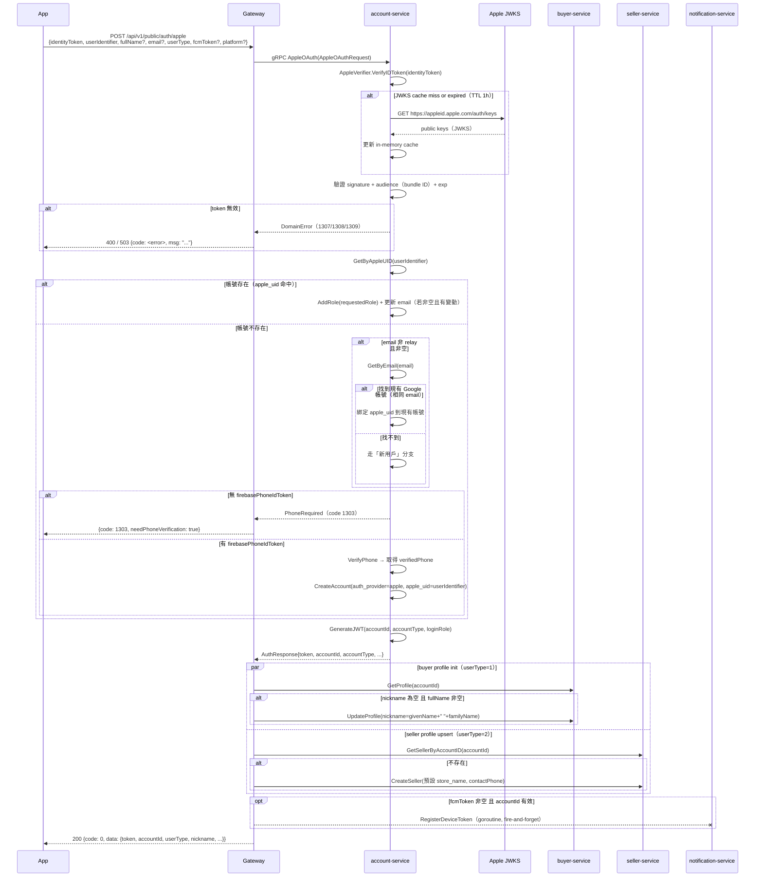
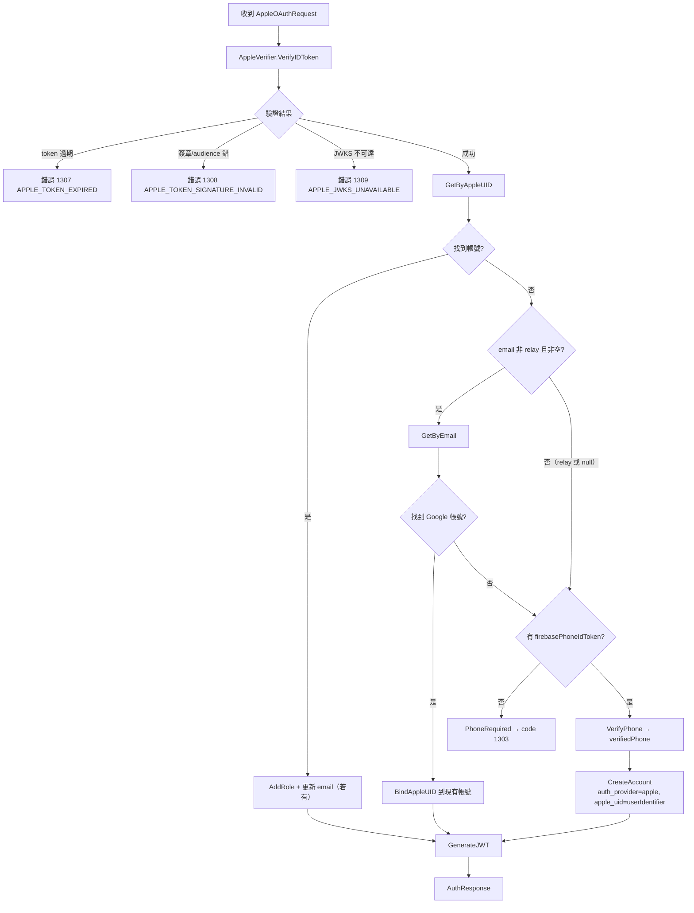

# Sign in with Apple 認證（Apple OAuth）詳細設計書

> **單體（遷移計畫 A2，2026-09-27 起）**：Apple 登入搬進單體的 identity 模組（`internal/modules/identity`，ID token 的驗證在模組的 `internal/oidc`、client secret 與撤銷在 `internal/apple`），對外是 `hawkr.identity.v1alpha1.IdentityPublicService.SignIn`。本文件的 account-service、gateway 的登入路由、JWT 與 refresh 只描述舊服務。刪除帳號時在同一個 transaction 排入 Apple token 的撤銷（App Store 審核準則 5.1.1(v)）；綁定管理（含解綁時撤銷）已刪除。與舊實作的差異見 identity 模組的 `CARRYOVER.md`。

> 買家 App 與賣家 App 的 Sign in with Apple 登入，符合 Apple App Store Guideline 4.8 要求

---

## 0. 文件元資訊 (Metadata)

| 項目 | 值 |
|---|---|
| 對應程式碼 | `services/account-service/internal/client/apple/`（JWKS verifier／client_secret 簽發／token 交換／revoke）、`services/account-service/internal/applerevoke/`（outbox worker）、`services/account-service/internal/usecase/apple_oauth.go`、`gateway/internal/handler/auth.go` |
| 相關 ADR | [2026-09-18-apple-oauth-verification-strategy](../adr/2026-09-18-apple-oauth-verification-strategy.md) |

---

## 1. 背景與目標

兩個 App 的第三方登入原本只有 Google OAuth。依 Apple App Store Guideline 4.8，提供任何第三方登入即必須**等價提供 Sign in with Apple**，否則送審必拒（上架硬阻擋）。

**能力範圍：**
- `POST /api/v1/public/auth/apple` 端點，行為與 Google 端點對齊
- account-service 的 `AppleOAuth` gRPC method ＋ `AppleOAuthUseCase`
- Apple JWT 以 Apple JWKS 驗證（**不依賴 Firebase**）
- `userIdentifier`（`sub`）是帳號主鍵，**不用 email**
- `authorizationCode` → Apple `refresh_token` 交換，並於帳號刪除時對 Apple 發 revoke

**不涵蓋：**
- Sign in with Apple for Web（目前只有兩個原生 App 需要）

---

## 1.1 兩條 Apple 路徑的分工

Apple 提供兩種後端機制，本系統**兩條都用**，依用途分工。選型理由見[相關 ADR](../adr/2026-09-18-apple-oauth-verification-strategy.md)。

| 用途 | 走哪一條 | 驗證／交換對象 |
|---|---|---|
| **登入** | JWKS 驗證 | `identityToken` |
| **帳號刪除時對 Apple 撤銷授權** | Token 交換 ＋ Revoke API | `authorizationCode` → `refresh_token` |

### 登入：JWKS 驗證

```
App  ──identityToken──▶  後端
後端 ──GET /auth/keys──▶  Apple JWKS endpoint
後端  用 RSA 公鑰驗簽章 + audience + exp
後端  信任 claims 中的 sub（userIdentifier）
```

| 項目 | 說明 |
|------|------|
| **驗證對象** | `identityToken`（App 端拿到的 JWT） |
| **需要的 Apple secret** | 無（只用公鑰，Apple 公開） |
| **網路呼叫** | GET `https://appleid.apple.com/auth/keys`（可 cache，TTL 1h，見 §9） |
| **能取得的資料** | `sub`（userIdentifier）、`email`、`exp`、`aud` |

**`identityToken` 有效期只有 10 分鐘。** 後端收到後只做一次驗證，後續用自己簽的 JWT 維持 session，**不依賴 Apple token 的有效性**。

### 帳號刪除：Token 交換 ＋ Revoke

```
App  ──authorizationCode──▶  後端
後端 ──POST /auth/token────▶  Apple Token endpoint
     ──client_id + client_secret（ES256 JWT）──▶
Apple ──▶  後端：refresh_token（加密保存）
帳號刪除時  後端 ──POST /auth/revoke──▶  Apple
```

| 項目 | 說明 |
|------|------|
| **交換對象** | `authorizationCode`（一次性，10 分鐘有效） |
| **需要的 Apple secret** | `client_secret`：以 ES256 私鑰（`.p8`）動態簽出，**有效期上限 6 個月，到期前必須輪替** |
| **保存什麼** | 只保存 `refresh_token`（加密）。`access_token` 不保存——本系統從不呼叫 Apple 的 userinfo API |
| **revoke 的執行方式** | **不在帳號刪除的同步路徑上**：寫進 `apple_revoke_outbox`，由 worker 非同步送出 |

**revoke worker 的失敗行為**（`internal/applerevoke/worker.go`）：退避重試 `2m → 4m → 8m → 16m`，第 5 次視為終局失敗（`MarkFailed`，不再排程）。每一輪落稽核事件 `apple.revoke.attempt`／`apple.revoke.success`／`apple.revoke.fail.terminal`。

⚠️ 帳號刪除**不因 revoke 失敗而 rollback**：帳號在我方已刪除，對 Apple 的撤銷是盡力而為並留稽核軌跡。

---

## 2. 架構總覽

```
Flutter App (Buyer / Seller)
        │
        ▼
  Gateway (Go/Gin, :9900)
        │
        ├──▶ account-service (:9941)   ← Apple JWT 驗證、帳號 upsert
        ├──▶ buyer-service   (:9943)   ← buyer profile init（nickname）
        ├──▶ seller-service  (:10021)  ← seller profile upsert
        └──▶ notification-service      ← FCM device token 註冊（fire-and-forget）

account-service
        └──▶ Apple JWKS Endpoint       ← HTTPS，in-memory cache TTL 1h
```

---

## 3. 時序圖



---

## 4. 業務流程圖



---

## 5. API 規格

### POST /api/v1/public/auth/apple

**Namespace：** `public`（匿名，無需 JWT）

**Request Body：**

| 欄位 | 型別 | 必填 | 說明 |
|------|------|------|------|
| `identityToken` | string | ✅ | Apple 回傳 JWT |
| `userIdentifier` | string | ✅ | Apple stable user ID（帳號主鍵） |
| `userType` | int | ✅ | 1=買家，2=賣家 |
| `email` | string | ❌ | 可為 relay（`@privaterelay.appleid.com`）或 null |
| `fullName.givenName` | string | ❌ | 第一次授權才有 |
| `fullName.familyName` | string | ❌ | 第一次授權才有 |
| `firebasePhoneIdToken` | string | ❌ | 新用戶手機驗證 token |
| `fcmToken` | string | ❌ | FCM 推播 token |
| `platform` | string | ❌ | `ios` / `android` |

> **fullName 寫入策略**：`givenName + " " + familyName`（trim）僅在 buyer profile 的 `nickname` 為空時寫入，不覆蓋已有值。兩者皆空則使用預設值「Hawkr 用戶」。

**成功回應（與 Google 完全對齊）：**

```json
// 買家
{
  "code": 0,
  "data": {
    "token": "eyJ...",
    "refreshToken": "eyJ...",
    "expiresIn": 604800,
    "accountId": 1234567890,
    "userType": 1,
    "nickname": "王小明",
    "avatar": "",
    "needs_onboarding": false
  }
}

// 賣家（多出 store 欄位）
{
  "code": 0,
  "data": {
    "token": "eyJ...",
    "refreshToken": "eyJ...",
    "expiresIn": 604800,
    "accountId": 1234567890,
    "userType": 2,
    "store_name": "Hawkr 賣家0912",
    "city": "",
    "district": "",
    "address_detail": "",
    "postal_code": "",
    "sellerName": "Hawkr 賣家0912",
    "mobile": "",
    "phone": "",
    "needs_onboarding": true
  }
}
```

**錯誤回應：**

| code | HTTP | 說明 |
|------|------|------|
| 400 | 400 | identityToken 或 userIdentifier 為必填 |
| 1303 | 200 | 新用戶需綁手機（`needPhoneVerification: true`） |
| 1307 | 400 | Apple identity token 已過期 |
| 1308 | 400 | Apple identity token 簽章 / audience 無效 |
| 1309 | 503 | Apple JWKS endpoint 不可達 |

---

## 6. Proto 定義

修改位置：`api/proto/account/account.proto`

```protobuf
// 新增 RPC（沿用現有 AuthResponse）
rpc AppleOAuth(AppleOAuthRequest) returns (AuthResponse);

// 新增 message
message AppleOAuthRequest {
    string identity_token          = 1;  // Apple JWT（必填）
    string apple_uid               = 2;  // userIdentifier，帳號主鍵（必填）
    int32  user_type               = 3;  // 1=buyer, 2=seller（必填）
    string firebase_phone_id_token = 4;  // 新用戶手機驗證
    string fcm_token               = 5;  // FCM token
    string platform                = 6;  // ios / android
    string email                   = 7;  // 可為 relay 或空
    string given_name              = 8;  // fullName.givenName
    string family_name             = 9;  // fullName.familyName
}
```

> `AuthResponse` 共用現有定義，本 RPC 不為它新增欄位。

修改 `.proto` 後的生成與同步流程見 [Proto 管理規範](../開發規範/Proto%20管理規範.md)（步驟會隨工具改變，不在此複述）。

---

## 7. DB 變更

服務：`services/account-service`

修改 Atlas schema 唯一真實來源（`db/schema/schema.sql`）：

```sql
-- 新增欄位（nullable，Atlas 自動產 ALTER TABLE ADD COLUMN）
apple_uid VARCHAR(255) NULL

-- 新增唯一索引（部分索引，排除軟刪除帳號）
CREATE UNIQUE INDEX idx_accounts_apple_uid
  ON accounts (apple_uid)
  WHERE apple_uid IS NOT NULL AND deleted_at IS NULL;
```

migration 由 `atlas migrate diff` 產生（流程見《DB Migration 相容性規範》）。

> 遠端套用一律由 CI/CD（`deploy-k8s.yml` 的 `migrate` job）執行，**禁止手動對 dev / prod 跑 `atlas migrate apply`**。

---

## 8. 錯誤碼

Apple 相關業務碼定義於 CodeMeta `錯誤碼.md` 的「Account 業務碼（1300~1399）」區塊（值與說明以該檔為權威，本書不複製碼表）：`APPLE_TOKEN_EXPIRED`、`APPLE_TOKEN_SIGNATURE_INVALID`、`APPLE_JWKS_UNAVAILABLE`。

**error mapping 契約**：`APPLE_JWKS_UNAVAILABLE` 對外回 **503**（外部依賴故障，客戶端可重試），其餘 Apple 錯誤碼一律回 **400**。

---

## 9. AppleVerifier 設計

位置：`services/account-service/internal/client/apple/verifier.go`

```
interface AppleVerifier {
    VerifyIDToken(ctx, identityToken string) (*AppleTokenInfo, error)
}

struct AppleTokenInfo {
    Subject string   // Apple userIdentifier
    Email   string   // 可為 relay 或空
}
```

**JWKS Cache 策略：**
- 首次驗證時 fetch `https://appleid.apple.com/auth/keys`
- in-memory cache，TTL 1 小時
- cache miss 或 `kid` 不在 cache 內 → 自動 re-fetch 一次
- fetch timeout 3 秒；失敗回 `APPLE_JWKS_UNAVAILABLE`（code 1309）
- 併發保護：用 `sync.RWMutex`，讀取鎖 / re-fetch 時寫入鎖

---

## 10. 實作位置

落點見 §0 的「對應程式碼」一列。本書不列逐檔清單——檔案清單住在 code，寫進文件就會腐化。

---

## 11. 測試重點

| 項目 | 說明 |
|------|------|
| AppleVerifier | mock HTTP transport：valid JWT、過期 JWT、wrong audience、kid 不存在觸發 re-fetch |
| AppleOAuthUseCase | mock AppleVerifier + AccountRepository：現有帳號、新用戶需手機驗證、email 合併（非 relay）、relay email 不合併 |
| Gateway handler | 主路徑 + 1303 流程 + JWKS 故障 503 |
