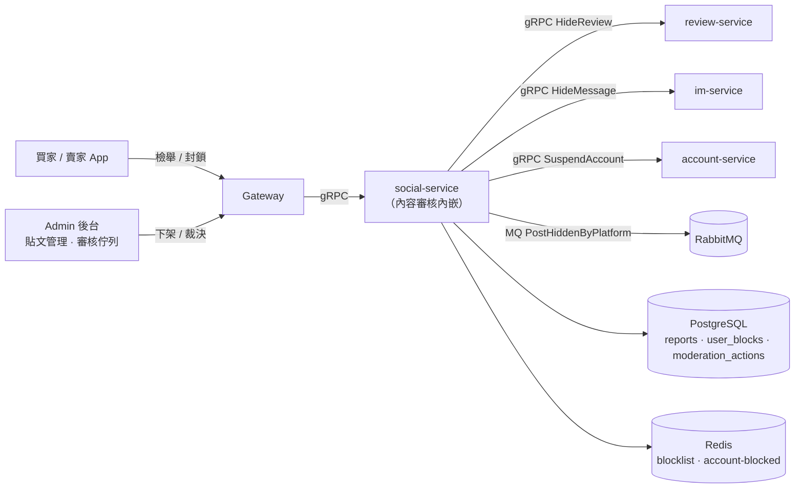
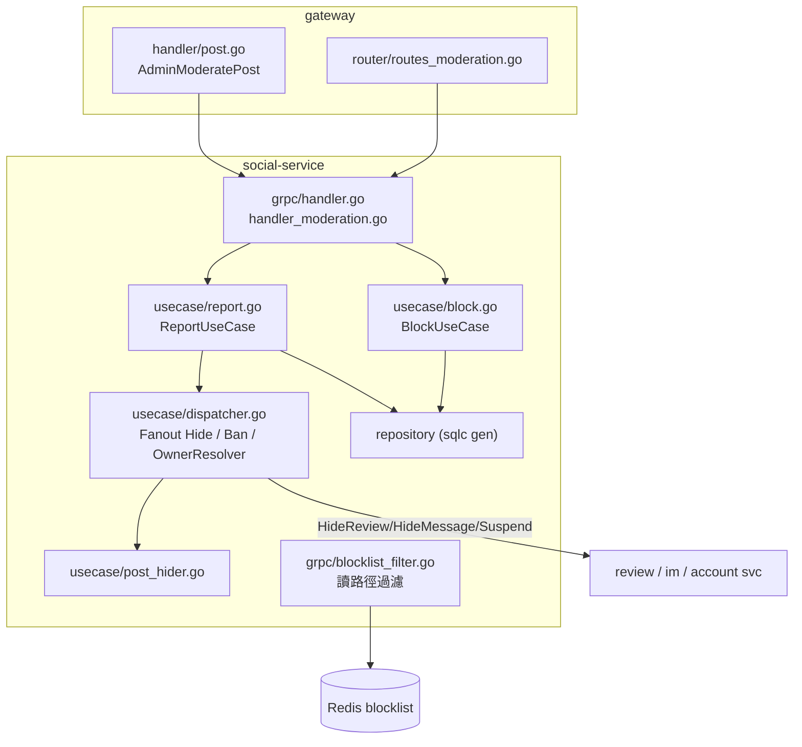
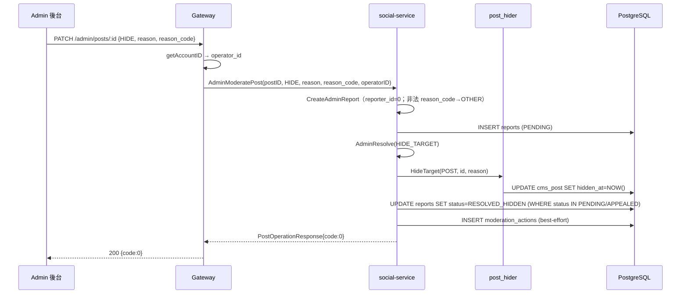
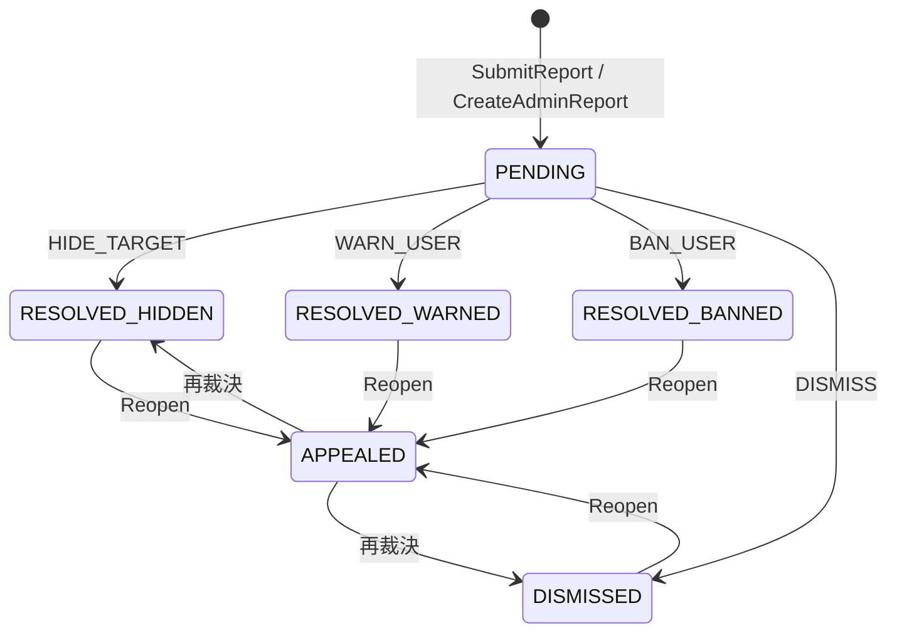

# 內容審核（檢舉 · 封鎖 · 平台下架）詳細設計書

## 0. 文件元資訊 (Metadata)

| 項目 | 值 |
|---|---|
| 維護者 | Will |
| 對應程式碼 | `services/social-service/internal/{usecase,grpc,domain}/`、`services/social-service/db/schema/schema.sql`、`gateway/internal/handler/post.go`、`gateway/internal/router/routes_{moderation,admin}.go` |
| 相關 ADR | [2026-09-18-content-moderation-consolidation](../adr/2026-09-18-content-moderation-consolidation.md) |
| 相關 doc | 32 號（商家治理與食安通報，姊妹但獨立 bounded context）、43 號（Review Service，跨服務隱藏）、14 號（IM，跨服務隱藏）、41 號（SSE，未用於本模組） |

---

## 1. 概述與目標 (Overview & Goals)

### 1.1 文件定位
描述 Hawkr 的**使用者生成內容（UGC）審核**：使用者檢舉、雙向封鎖、admin 裁決佇列、平台主動下架，以及貫穿其中的 `moderation_actions` 稽核軌跡。目標讀者為 social-service / gateway / admin 前端維護者。**不涵蓋**商家資格治理與食安通報（→ 32 號，獨立 bounded context，見 §1.4）。

### 1.2 服務一句話定位
內容審核**內嵌於 social-service**（非獨立微服務），對 6 種 UGC 目標提供「檢舉 → 佇列 → 裁決 → 隱藏/停權 → 稽核」的閉環，滿足 Apple App Store Guideline 1.2 對含 UGC App 的上架硬性要求。

### 1.3 設計目標 (Goals) 與 非目標 (Non-Goals)

| 類型 | 項目 |
|---|---|
| **Goal** | Apple Guideline 1.2 四要求全覆蓋：內容過濾、檢舉、封鎖使用者、24h 內處理 |
| **Goal** | 單一 `reports` 表支援 6 種 targetType（REVIEW/POST/POST_COMMENT/SELLER_FORUM/CHAT_MESSAGE/USER），統一裁決流程 |
| **Goal** | 一切下架（含 admin 直接下架）都留 `moderation_actions` 稽核軌跡，不得有繞過稽核的下架路徑 |
| **Goal** | BAN_USER 為真停權（account-service durable，OAuth 重登路徑亦擋），非僅快取 |
| **Non-Goal** | **不**做 DB-driven 字典 + admin CRUD；字典詞庫是共用 `go-pkg/moderation` 的硬編碼詞表 |
| **Non-Goal** | **不**接 ML moderation（如 OpenAI Moderation API） |
| **Non-Goal** | **不**做 SLA dashboard / breach 告警；24h SLA 由 admin 前端計算顯示 |
| **Non-Goal** | **不**做使用者申訴 UI（後端 `reopen`／`APPEALED` 狀態機已具，無 app 申訴入口） |
| **Non-Goal** | **不**發「審核結案」事件通知檢舉者；WARN_USER 不發站內信 |

### 1.4 與其他設計書／服務的關係
- **32 號（商家治理與食安通報）**：獨立 `violation_reports` schema。分工——本模組治理「**誰貼了違規內容**」（隱藏內容 / 停權作者，Apple 1.2 合規驅動）；32 號治理「**商家資格**」（法遵 / 食安 / 證照，影響上架資格，法規驅動）。兩者刻意**不合併**（對象、驅動法規、生命週期、reason 詞彙皆異）；理由見[相關 ADR](../adr/2026-09-18-content-moderation-consolidation.md) D2。
- **跨服務隱藏**：HIDE_TARGET 對 REVIEW / CHAT_MESSAGE 需呼叫 review-service（43 號）/ im-service（14 號）的 Hide RPC；POST / POST_COMMENT / SELLER_FORUM 為 social-service 本地。
- **停權**：BAN_USER 呼叫 account-service `SuspendAccount`（durable 停權，OAuth 重登路徑亦擋）。

---

## 2. 範圍與情境 (Context & Scope)

### 2.1 系統情境圖 (C4 Context)

### 2.2 邊界與責任

| | 涵蓋 (In-scope) | 不涵蓋 (Out-of-scope，由誰負責) |
|---|---|---|
| 責任 | 檢舉受理、24h 去重、rate limit、admin 裁決狀態機、雙向封鎖、平台下架、稽核軌跡 | 商家資格治理 → 32 號；停權帳號 durable 寫入 → account-service；REVIEW/CHAT 內容實體隱藏 → review/im-service；字典詞庫 → `go-pkg/moderation`（共用 module） |

### 2.3 角色與身份模型
- **buyer / seller**：檢舉、封鎖。身份來自 gateway JWT（`JWTAuth`），`reporter_id` / `blocker_id` 由 server 從已驗 token 取得，**不信任 client 欄位**。
- **admin**：裁決、下架。gateway `requireAdmin`（accountType code=4）把關；`operator_id` 由 `getAccountID(c)` 從 token 注入，非 client 傳入。
- **system**：admin 直接下架合成的 report 用 `reporter_id=0` sentinel（見 §8.1）。

---

## 3. 約束與前提 (Constraints & Assumptions)

| 類型 | 項目 |
|---|---|
| 技術約束 | PK 一律 TSID（`uc.tsid()`，禁 UUID / serial）；Go 服務 schema 走 **Atlas declarative**（`schema.sql` 為 SSOT，禁手寫 SQL / psql 手動套）；REST 回應走統一 Envelope `{code,message,data}`；前端可控 ID（report_id / post_id）一律 string 防 TSID 精度遺失 |
| 組織約束 | 單人 / 小團隊維運；上線前不留技術債；審核邏輯內嵌 social-service，不獨立成服務 |
| 既有系統約束 | Redis 無 HA（blocklist / account-blocked 快取 fail-open）；k3s + Traefik；審核依賴 review/im/account 三個上游 gRPC |
| **假設 (Assumptions)** | 檢舉量級低（rate limit 20/日/人，硬編碼即可）；字典詞庫變動不頻繁（硬編碼即可，失真時才評估 DB-driven 字典）；admin 人力足以 24h 內清 PENDING 佇列（故不設自動 SLA 告警） |

---

## 4. 架構 (Architecture)

### 4.1 解法總綱 (Solution Strategy)
單一 `reports` 表 + `status` 狀態機承載所有 targetType 的裁決；裁決副作用（隱藏 / 停權）透過 **fanout dispatcher** 依 targetType 分派到本地或跨服務 Hide/Suspend；每次裁決落一筆 append-only `moderation_actions`。**admin 直接下架（貼文管理頁）不走特例路徑**，而是「合成一筆 `reporter_id=0` 的 report → 立即 `AdminResolve(HIDE_TARGET)`」，讓主動下架與檢舉裁決共用同一狀態機與稽核軌跡。封鎖為 DB 持久 + Redis SET 快取，於**讀路徑**雙向過濾。

### 4.2 元件視圖 (C4 Component)

| 模組 | 責任 | 依賴 |
|---|---|---|
| `usecase/report.go` | 檢舉受理、裁決狀態機、稽核 | dispatcher, repository |
| `usecase/block.go` | 雙向封鎖 | repository, Redis blocklist |
| `usecase/dispatcher.go` | HIDE/BAN 副作用分派、`TargetOwnerResolver` snapshot owner | review/im/account client, hider |
| `usecase/post_hider.go` | 本地貼文隱藏 + MQ 通知賣家 | repository, MQ publisher |
| `grpc/blocklist_filter.go` | 讀路徑（post/comment/forum）雙向過濾 | Redis blocklist |

### 4.3 部署拓撲與 Port

| Port | 協定 | 用途 | 對外暴露 |
|---|---|---|---|
| 9916 | HTTP | health / metrics（social-service） | ClusterIP |
| 9917 | gRPC | 內部（gateway → social） | ClusterIP |

審核無獨立服務 / port，內嵌 social-service；部署走 `k8s/values/social-service.yaml`。

### 4.4 命名／契約規約
- `target_type ∈ {REVIEW, POST, POST_COMMENT, SELLER_FORUM, CHAT_MESSAGE, USER}`
- `reason_code` 的值域權威是 CodeMeta `ReportReasonCode`（`docs/代碼管理（CodeMeta）/業務類型碼.md`），前端讀生成檔；本書不複製碼表。DB 端另有 `chk_reports_reason_code` CHECK 同步約束
- `status ∈ {PENDING, RESOLVED_HIDDEN, RESOLVED_WARNED, RESOLVED_BANNED, DISMISSED, APPEALED}`
- `resolved_action / moderation action ∈ {HIDE_TARGET, WARN_USER, BAN_USER, DISMISS, REOPEN, AUTO_REJECT}`

---

## 5. 資料設計 (Data Design)

### 5.1 資料模型
schema：`services/social-service/db/schema/schema.sql`。PK 全 TSID。

**`reports`（通用 UGC 檢舉表）**

| 欄位 | 型別 | 說明 |
|---|---|---|
| id | BIGINT PK | TSID |
| reporter_id | BIGINT NOT NULL | 檢舉人；`0` = admin-direct sentinel |
| target_type | VARCHAR(30) NOT NULL | 6 種（CHECK） |
| target_id | BIGINT NOT NULL | 被檢舉物件 |
| target_owner_id | BIGINT | 內容作者，供處置歸屬與 90 天累犯統計 |
| reason_code | VARCHAR(30) NOT NULL | 8 碼（CHECK） |
| description | TEXT | 補充說明 |
| evidence | JSONB NOT NULL DEFAULT `'[]'` | 證據 URL 陣列（admin-direct 為 `[]`） |
| target_snapshot | JSONB | 檢舉當下內容快照 |
| status | VARCHAR(20) NOT NULL DEFAULT `PENDING` | 狀態機 |
| resolved_action / resolved_by / resolved_at | VARCHAR/BIGINT/TIMESTAMPTZ | 裁決結果 / admin / 時間 |
| create_time / update_time | TIMESTAMPTZ DEFAULT NOW() | |

CHECK 約束：`chk_reports_target_type`、`chk_reports_reason_code`、`chk_reports_status`。

**`user_blocks`（雙向封鎖）**：`id`(TSID)、`blocker_id`、`blocked_id`、`create_time`；`UNIQUE(blocker_id, blocked_id)`、`chk_user_blocks_not_self(blocker_id <> blocked_id)`。

**`moderation_actions`（append-only 稽核）**

| 欄位 | 型別 | 說明 |
|---|---|---|
| id | BIGINT PK | TSID |
| report_id | BIGINT | 關聯檢舉（nullable，系統動作可空） |
| admin_id | BIGINT | 操作者（nullable，系統動作空） |
| affected_user_id | BIGINT | 受影響**用戶**的 ID——**不是**被處置內容的 ID |
| action | VARCHAR(30) NOT NULL | HIDE_TARGET/WARN_USER/BAN_USER/DISMISS/REOPEN/AUTO_REJECT |
| note / attempted_content | TEXT | 備註 / 被字典擋的內容 |
| previous_state / new_state | JSONB | 處置前後狀態快照 |
| create_time | TIMESTAMPTZ | |

**下架語意分離**：`cms_post`、`cms_comment`、`cms_seller_forum` 皆有 `hidden_at` ＋ `hidden_reason`。`hidden_at` = 平台強制下架、`deleted_at` = 用戶自刪，兩者正交，查詢需雙重過濾。

> 無 DB 字典表——字典過濾在寫入路徑呼共用 `go-pkg/moderation`；封鎖過濾走 Redis + `user_blocks`，非 DB。

### 5.2 索引與查詢模式

| Index | 查詢路徑 |
|---|---|
| `idx_reports_status_create (status, create_time DESC)` | admin 待審佇列（PENDING 依時間） |
| `idx_reports_reporter_target (reporter_id, target_type, target_id, create_time DESC)` | 24h 重複檢舉去重（app 層冪等） |
| `idx_reports_target (target_type, target_id, create_time DESC)` | 單一物件被檢舉歷史 |
| `idx_user_blocks_blocked (blocked_id)` | 反向查「誰封鎖我」（mutual 判定） |
| `idx_moderation_actions_report / _admin / _user` | 依檢舉 / admin / 受影響用戶查稽核 |

### 5.3 序號／排序／一致性
無 seqId；排序依 `create_time DESC`。24h 去重與 rate limit 靠 app 層計數查詢（見 §7.3）走滑動窗，**不是** DB 唯一鍵——同一人對同一物件可在 24 小時後再次檢舉。

### 5.4 Schema 演進與遷移

schema 由 Atlas declarative 管理，`services/social-service/db/schema/schema.sql` 是 SSOT：改 `schema.sql` → `atlas migrate diff` 產生 migration → 遠端由 CI/CD 套用。**禁止手寫 migration SQL、禁止 psql 手動套。**

---

## 6. API 與介面契約 (API & Interface Contracts)

### 6.1 對外 REST（經 Gateway，統一 Envelope）

| 端 | Method | Path | 說明 |
|---|---|---|---|
| 買家 | POST | `/app/reports` | 泛型檢舉（6 targetType，evidence≤5） |
| 買家 | GET | `/app/reports/me` | 我的檢舉列表 |
| 買家 | POST / DELETE | `/app/blocks/:userId` | 封鎖 / 解封 |
| 買家 | GET | `/app/blocks` | 封鎖列表 |
| 買家 | POST | `/app/sellers/posts/:id/reports` | 貼文檢舉（legacy，已 delegate 到 SubmitReport） |
| admin | GET | `/admin/reports` | 審核佇列（status/target_type/reason_code 過濾，每筆補 90 天累犯數） |
| admin | GET | `/admin/reports/:id` | 檢舉詳情 |
| admin | POST | `/admin/reports/:id/resolve` | 裁決（action + note） |
| admin | POST | `/admin/reports/:id/reopen` | 重啟（→ APPEALED） |
| admin | GET | `/admin/posts` | 貼文管理列表（含檢舉數、最新檢舉原因） |
| admin | PATCH | `/admin/posts/:id` | 下架（HIDE，帶 reason + reason_code）/ 恢復（RESTORE） |

買家群組 `JWTAuth`；admin 群組 `JWTAuth + requireAdmin`（code=4）。錯誤業務碼：`9210`（內容含違規詞被過濾，於 post/comment/forum **寫入路徑**觸發）。封鎖自己為 `ErrCannotBlockSelf` → gRPC `InvalidArgument`（無專屬業務碼）。

### 6.2 gRPC（服務間，`api/proto/social/social.proto` `SocialService`；Go 實作型別 `ContentServer`）

| RPC | Req → Resp | 備註 |
|---|---|---|
| `SubmitReport` | `SubmitReportRequest` → `SubmitReportResponse{report_id,status}` | 泛型檢舉 |
| `ListMyReports` | | |
| `BlockUser` / `UnblockUser` / `ListBlocks` | | |
| `AdminListReports` / `AdminGetReport` | `Report`（含 `recent_action_count` 唯讀，90 天累犯） | |
| `AdminResolveReport` | `{report_id,admin_id,action,note}` | action 4 種 |
| `AdminReopenReport` | | → APPEALED |
| `AdminModeratePost` | `{post_id,action,reason,operator_id,reason_code}` → `PostOperationResponse` | 貼文管理下架；`reason_code` 空/非法 social 端 fallback OTHER |
| `ReportPost` | legacy，delegate 到 SubmitReport | 保留相容 |

### 6.3 非同步事件 (MQ)

| 項目 | 值 |
|---|---|
| Routing Key | `PublishPostHiddenByPlatform` |
| 觸發 | 平台下架貼文後通知賣家（帶 reason） |
| Payload | camelCase，ID string |
| 向後相容 | publisher 建立失敗 → 停用 content events 並 `Warn`，下架仍成功（fail-open） |

> 無「審核結案通知檢舉者」事件；無 moderation MQ consumer。

### 6.4 即時通道 (WS/SSE)
> N/A —— 內容審核不使用 WS/SSE（檢舉結果不即時推播）。

---

## 7. 執行時視圖 (Runtime View)

### 7.1 主要場景（happy path）
**Admin 從貼文管理下架**：admin 在 `/admin/posts` 選貼文、填分類（reason_code）+ 原因（reason），送 `PATCH /admin/posts/:id {action:HIDE}`。gateway 注入 `operator_id` → social `CreateAdminReport`（合成 `reporter_id=0` report）→ `AdminResolve(HIDE_TARGET)`（隱藏貼文 + 落狀態 + 寫稽核）。一次下架＝reports + moderation_actions 兩表各一筆。

### 7.2 時序圖

### 7.3 失效與重試

| 外部呼叫 | 逾時 / 重試 | 冪等 | 失敗降級 |
|---|---|---|---|
| 24h 去重查詢 | — | 命中回舊 report（天然冪等） | — |
| rate limit 查詢 | — | — | `CountByReporterSince ≥ 20/日` → `ResourceExhausted` |
| HIDE_TARGET 副作用 | 副作用**先於**狀態轉換 | `ErrNotFound`（內容已消失）視為達標仍轉 RESOLVED_HIDDEN；其他 error **不轉狀態**讓 admin 重試 | fail-safe（狀態與副作用不脫節） |
| BAN_USER → account Suspend | 任何 error 即中止 | account durable 為 SoT | 停權失敗則不落 RESOLVED_BANNED |
| moderation_actions 寫入 | **best-effort，無 logger** | — | 靜默丟棄、不 rollback（見 §11 風險） |
| TargetOwnerResolver | fail-open | — | resolve 失敗不阻擋裁決（owner_id=0） |
| MQ PostHiddenByPlatform | fail-open | — | 通知失敗不影響下架 |

### 7.4 並發與順序
單筆 report 的裁決靠 `AdminResolve` SQL 的 `WHERE status IN (PENDING, APPEALED)` 做樂觀併發控制——兩個 admin 同時裁決同一 report，第二個 UPDATE 影響 0 列 → `ErrAlreadyResolved`。副作用先行確保「已隱藏但未落狀態」可安全重試（重試時內容已消失走 `ErrNotFound` 放行）。

### 7.5 連線／狀態生命週期
report 狀態機：

`AdminResolve` 只接受 `PENDING` 或 `APPEALED`；`Reopen` 把終態轉回 `APPEALED`（不覆寫原 `resolved_by`，保留 history）。

---

## 8. 跨切面關注點 (Crosscutting Concerns)

### 8.1 安全與授權
- **authn**：買家 / admin 皆走 gateway `JWTAuth`；admin 額外 `requireAdmin`（accountType code=4）。
- **身份來源**：`reporter_id` / `blocker_id` / `operator_id` 一律 server 端從已驗 token 推導（`getAccountID`），**不信任 client 欄位**（防 IDOR）。
- **`reporter_id=0` sentinel**：admin 直接下架無真實檢舉人，用 0 沿用「0 = system / no-X」慣例。副作用：此類 report 不應計入貼文「檢舉數」（已於 admin `AdminListPosts` 以 `reporter_id != 0` 過濾）。
- **rate limit**：20 檢舉/日/人（硬編碼）。

### 8.2 可觀測性 (Observability)
- 僅 zap 結構化 log（各 admin RPC 失敗 `logger.Error`）。`/metrics`（promhttp，HTTP:9916）只暴露預設 Go／process 指標，本模組不註冊 custom metric、不開 trace span。
- **24h SLA 由 admin 前端計算顯示**（`ageHours > 24 && PENDING` → 紅標），後端不發 breach 告警。
- 🔴 **`moderation_actions` 的寫入是 best-effort、at-most-once**：稽核寫入失敗**不 rollback 主流程、也不記錄**。裁決本身仍然成立，稽核那一筆就此消失。實作者不得假設「有裁決就一定有對應的稽核列」。

### 8.3 錯誤處理與降級 (Failure Modes)
| 依賴掛掉 | 行為 |
|---|---|
| Redis（blocklist / account-blocked） | fail-open：封鎖過濾略過（寧可漏過濾也不阻斷讀取） |
| account-service（Suspend） | fail-closed：停權失敗則不落 RESOLVED_BANNED |
| review / im-service（跨服務 Hide） | 副作用失敗不轉狀態，admin 可重試 |
| MQ | fail-open：通知失敗不影響下架 |
| PostgreSQL | 核心流程 fail：檢舉 / 裁決不可用 |

### 8.4 一致性與冪等
- 檢舉：24h 滑動窗去重（`GetByReporterAndTarget`），重複檢舉回舊 record。
- 裁決：SQL 狀態過濾保證 at-most-once 生效。
- 稽核：at-most-once（best-effort，可能漏記，見 §11）。

### 8.5 設定與機密
- `config.go` 僅 env（APP_ENV、DB/Redis/RabbitMQ URL、gRPC:9917 / HTTP:9916、上游服務位址、OSS）。
- **無 moderation 專屬設定**：rate limit（20/日）硬編碼；字典詞庫在 `go-pkg/moderation`（外部 module，非 per-env）。

---

## 9. 品質需求與 NFR (Quality Requirements / SLO)

### 9.1 SLO / SLI

| 指標 (SLI) | 目標 (SLO) | 量測點 |
|---|---|---|
| 檢舉處理時效 | PENDING → 裁決 < 24h（Apple 1.2） | `create_time` → `resolved_at` |
| 停權生效延遲 | JWT 立即失效 | account Suspend ＋ Redis TTL 365d |

### 9.2 容量與規模
UGC 檢舉量級低，單 replica social-service 足夠；rate limit 20/日/人抑制濫用。scaling 觸發：若檢舉量大到 PENDING 佇列無法 24h 內清，先補 SLA 告警再談審核人力／自動化。

### 9.3 效能預算
裁決路徑非熱點；主要成本為副作用跨服務 gRPC（HIDE_TARGET / Suspend）。無特別預算。

---

## 10. 設計理由

架構收斂的方案比較、被否決的選項與理由見 [2026-09-18-content-moderation-consolidation](../adr/2026-09-18-content-moderation-consolidation.md)（收斂方式、與商家治理的邊界、BAN_USER 真停權、admin-direct 的 reason 驗證強度）。本節不複述理由。

---

## 11. 風險與技術債 (Risks & Tech Debt)

### 11.1 已知風險與技術債

| 項目 | 嚴重度 | 影響 | 追蹤 |
|---|---|---|---|
| `moderation_actions` 寫入 best-effort 且無 logger | 高 | 稽核軌跡可能靜默漏記（Apple 合規證據不全）；失敗語意見 §8.2 | #3513 |
| 無 integration / e2e 覆蓋 | 中 | SQL／CHECK／fanout dispatcher／字典攔截無覆蓋 | #3513 |
| 24h SLA 無後端告警 | 中 | 逾時只有開 admin 頁才看得到 | #3513 |
| `ReportPostRequest.reason_code` 的 proto 註解缺 `FRAUD` | 低 | 僅註解誤導；驗證以 `validReasonCodes` 為準 | #3513 |
| 字典詞庫硬編碼於 `go-pkg/moderation` | 低 | 改詞要發版 | #3513 |
| Redis 無 HA | 低 | blocklist fail-open 漏過濾（§8.3 已載為現行降級行為） | — |

---

## 12. 部署與維運 (Deployment & Operations)

### 12.1 環境與設定
內嵌 social-service，`k8s/values/social-service.yaml`（Helm）。env 見 §8.5。

### 12.2 遷移步驟
見 §5.4：Atlas declarative，改 `schema.sql` → `migrate diff` 產生 → 遠端由 CI/CD 套用。禁手寫 SQL、禁 psql 手動套。

### 12.3 健康檢查與優雅關閉
health endpoint 於 HTTP:9916；社群服務 SIGTERM → graceful shutdown。

### 12.4 Runbook
本模組無專屬 runbook。批次隱藏／停權的維運 SQL 屬一次性操作，不寫進 codebase（見《後端服務責任邊界規範》）。

---

## 13. 測試策略 (Test Strategy)

| 層級 | 覆蓋 | 關鍵場景 |
|---|---|---|
| unit | usecase（mock repo） | rate limit(20/日)、reason 白名單、24h 冪等、AdminResolve side-effect-first（`ErrNotFound`→仍 resolve／其他 error→可重試）、audit 寫對 owner、狀態機（Appealed precondition／Reopen）、`reporter_id=0` sentinel、90 天累犯數 |
| unit | grpc | `SubmitReport` rate limit → `ResourceExhausted` 錯誤碼映射；TSID 精度 |
| integration | testcontainers | DB CHECK 三條各自拒絕非法值、fanout dispatcher 對 6 種 targetType 各派到正確服務、字典攔截在寫入路徑生效 |
| e2e | — | 檢舉 → admin 裁決 → 目標被隱藏 → 稽核列存在；封鎖後雙向不可見 |

---

## 14. 術語表 (Glossary)

| 術語 | 定義 |
|---|---|
| targetType | 被檢舉物件類別（6 種），決定裁決副作用分派到哪個服務 |
| reason_code | 檢舉分類 canonical 8 碼；DB CHECK + code const 雙重約束 |
| admin-direct（reporter_id=0） | admin 從貼文管理直接下架合成的 report，無真實檢舉人 |
| moderation_actions | append-only 稽核，每次裁決 / 系統下架各一筆 |
| hidden_at vs deleted_at | 平台強制下架 vs 用戶自刪，正交 |
| side-effect-first | 裁決先跑副作用（隱藏 / 停權）再轉狀態，確保可安全重試 |
| SLA (24h) | Apple Guideline 1.2 要求 24h 內處理檢舉；由 admin 前端計算顯示，後端不告警 |
