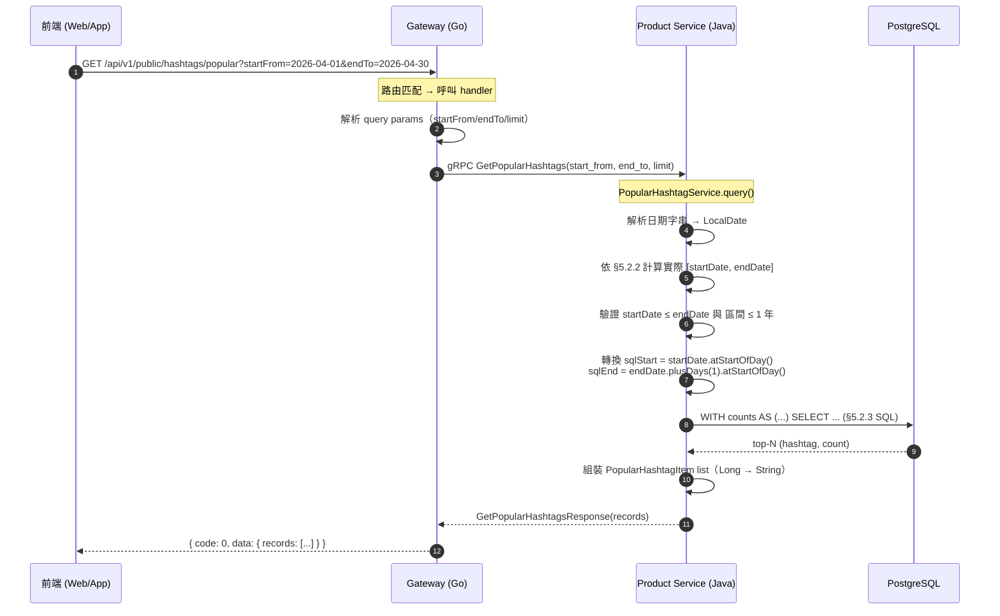
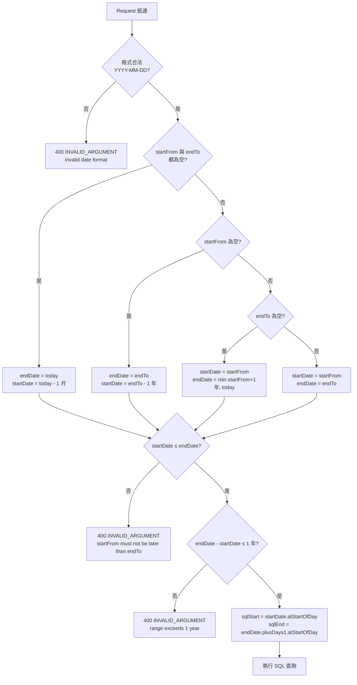

# 商品 Hashtag 模組（Product Hashtag）詳細設計書

> 對應程式碼：product-service `service/HashtagService`・`service/PopularHashtagService`・`repository/ProductHashtagRepository`・`grpc/ProductGrpcService`；`api/proto/product/product.proto`；gateway `internal/handler/product.go` 與 `internal/router`。
> schema 在 product-service 的 Flyway migration（`hashtag` / `product_hashtag` 兩表）。

---

> ⚠️ **錯誤處理慣例**：本設計書內所有 sequence diagram 之 gRPC client 呼叫，error path 統一依 [`Java gRPC 錯誤處理規範.md §7.2.1`](../開發規範/Java%20gRPC%20%E9%8C%AF%E8%AA%A4%E8%99%95%E7%90%86%E8%A6%8F%E7%AF%84.md#721-%E6%AC%8A%E5%A8%81%E6%99%82%E5%BA%8F%E5%9C%96%E6%89%80%E6%9C%89%E8%A8%AD%E8%A8%88%E6%9B%B8%E5%BC%95%E7%94%A8%E6%AD%A4%E5%9C%96%E4%B8%8D%E5%86%8D%E5%80%8B%E5%88%A5%E7%B9%AA%E8%A3%BD)。

---

## 1. 模組概述

### 1.1 模組定位

| 項目 | 說明 |
|------|------|
| 模組性質 | `product-service` **內部子模組**，無獨立部署 |
| 所屬服務 | `services/java/product-service/`（Java / Spring Boot） |
| 所屬 DB | `hawkr_product`（PostgreSQL） |
| Node ID Base | 200（與 product 共用同一 TSID generator） |
| 父設計書 | [02-產品微服務（Product Service）詳細設計書.md](02-產品微服務%EF%BC%88Product%20Service%EF%BC%89詳細設計書.md) |

> 本模組為 product-service 內子模組，**沒有獨立 gRPC service 或獨立部署單元**；DB schema、Entity、Repository、Service 與 gRPC handler 均住在 product-service codebase 內。02-產品微服務設計書對本模組相關章節（§3.7–§3.9、§4）以引用方式串接。

### 1.2 職責範圍

- Hashtag 主表（`hashtag`）與商品關聯表（`product_hashtag`）的 schema 設計與寫入規則
- Canonical / Display 雙 normalize pipeline
- 字元規則、長度上限、每商品 hashtag 上限驗證
- `hashtag.product_count` 全歷史 counter 同事務維護
- Hashtag 相關 RPC：自動補全（auto-complete）、熱門查詢（popular）
- 商品 RPC（Create / Update / List）對 hashtag 欄位的整合
- `searchable_text` 中 hashtag canonical 拼接規則（與 product 全文檢索整合）

### 1.3 非職責範圍

| 不負責 | 歸屬 |
|--------|------|
| 商品本體 CRUD | [02-產品微服務](02-產品微服務%EF%BC%88Product%20Service%EF%BC%89詳細設計書.md) |
| 商品搜尋（含 hashtag 篩選） | 02 §4 / §5（`GetProductList`） |
| Hashtag blocklist / 違禁字管理 | **不提供** |
| Hashtag follow / 訂閱 | **不提供** |
| Hashtag 跨服務同步（搜尋索引、推薦） | **不提供** |

### 1.4 名詞定義

| 名詞 | 說明 |
|------|------|
| Canonical name | `hashtag.name`，去除 `#` / NFC / lower 後的唯一識別字串，作為 hashtag 主鍵 |
| Display name | `product_hashtag.display_name`，per-binding 保留原大小寫的版本（NFC，**不** lower） |
| Per-binding display | 同一 canonical 在不同商品可有不同 display（IG 風格） |
| Counter（`hashtag.product_count`） | 該 hashtag 被多少 ACTIVE 商品引用的即時計數（單一寫入路徑同事務維護） |
| Popular | 「熱門查詢」：依使用者指定**日期區間**內 `product_hashtag.created_at` 落入區間的 distinct ACTIVE 商品數降冪排行（**不**等同於 `hashtag.product_count`） |

---

## 2. 資料庫設計

**Database**：`hawkr_product`

### 2.1 hashtag 主表

| 欄位名 | 欄位邏輯名 | 資料型態 | Nullable | PK | Default | 備註 |
|--------|-----------|---------|----------|-----|---------|------|
| id | hashtag ID | bigint | N | Y | | TSID（Node ID Base: 200） |
| name | canonical 名稱 | varchar(40) | N | | | 唯一識別；normalize 規則見 §3.1 |
| product_count | 引用計數 | integer | N | | 0 | denormalized；僅算 ACTIVE 且未刪除商品；同事務 row-lock 維護（單一寫入路徑為唯一真實來源；§4） |
| created_at | 建立時間 | TIMESTAMPTZ | N | | now() | |
| updated_at | 更新時間 | TIMESTAMPTZ | Y | | null | DB 觸發器自動寫入 |

**索引**：

| 索引名 | 定義 | 用途 |
|--------|------|------|
| `uk_hashtag_name` | UNIQUE (name) | canonical 唯一性保證 |
| `idx_hashtag_name_pattern` | (name varchar_pattern_ops) | `LIKE 'prefix%'` 走索引（PREFIX 模式 auto-complete） |
| `idx_hashtag_name_trgm` | GIN (name gin_trgm_ops) | CONTAIN 模式 auto-complete（IG 中間匹配） |
| `idx_hashtag_popular` | (product_count DESC, name) | **全歷史**熱門排序（auto-complete 顯示） |

### 2.2 product_hashtag 關聯表

| 欄位名 | 欄位邏輯名 | 資料型態 | Nullable | PK | Default | 備註 |
|--------|-----------|---------|----------|-----|---------|------|
| product_id | 商品 ID | bigint | N | Y（複合） | | FK → product(id) |
| hashtag_id | hashtag ID | bigint | N | Y（複合） | | FK → hashtag(id) |
| display_name | 顯示名稱 | varchar(40) | N | | | 賣家輸入時保留原大小寫的版本（trim + strip `#` + NFC，**不** lower）；商品詳情頁 chip 顯示用 |
| position | 排序位置 | smallint | N | | 0 | 賣家編輯時的順序（0 起算）；商品詳情 hashtag list 依此升序排列 |
| created_at | 建立時間 | TIMESTAMPTZ | N | | now() | **商品掛上此 hashtag 的時間**（§5.2 GetPopularHashtags 日期區間欄位） |

**主鍵**：`PRIMARY KEY (product_id, hashtag_id)` — 同一 hashtag 不可在同商品重複（去重由 §3.1 normalize 完成，DB 主鍵作為終局保險）。

**索引**：

| 索引名 | 定義 | 用途 |
|--------|------|------|
| `idx_product_hashtag_lookup` | (hashtag_id, product_id) | 「點 hashtag → 商品列表」精確匹配反查 |
| `idx_product_hashtag_created_at` | (created_at, hashtag_id) | 日期區間範圍掃描 + group by hashtag_id（§5.2 用） |
| 隱含索引 | 複合主鍵 (product_id, hashtag_id) | product → hashtag 列表查詢 |

> 兩表與上列索引皆定義於 `V1__init_product_schema.sql`。**V1 已永久凍結**（連空白都不得更動，否則破壞 Flyway checksum），本模組後續任何 schema 變更一律新增 `V{N+1}__*.sql`；禁止回頭改 V1、禁止 SSH 手動改遠端 `flyway_schema_history.checksum`。規則見 [《Java 微服務開發規範》§9.3 Flyway](../開發規範/Java%20微服務開發規範.md) 與 [38 號設計書](38-Flyway%20自動同步與%20DB%20自動初始化%EF%BC%88Flyway%20Auto%20Sync%20&%20DB%20Auto%20Init%EF%BC%89詳細設計書.md)。

### 2.3 寫入規則

- **新增綁定**：`INSERT INTO product_hashtag(product_id, hashtag_id, display_name, position) VALUES (...)`
- **移除綁定**：`DELETE FROM product_hashtag WHERE product_id = ? AND hashtag_id IN (...)`
- **更新既有綁定的 `display_name` / `position`**：**禁止使用 MyBatis-Plus `updateById`**（不支援複合主鍵），必須用自訂 SQL `UPDATE ... WHERE product_id = ? AND hashtag_id = ?`。Service 層對「kept」分支（同 canonical 改 case 或 position 變動）必須走此 UPDATE，否則 IG 風格 per-binding display 會失效。

---

## 3. 業務規則

### 3.1 normalize 規則

每次寫入分別跑 **canonical** 與 **display** 兩條 pipeline：

| Pipeline | 步驟 | 用途 |
|----------|------|------|
| canonical | trim → strip 開頭連續 `#` → Unicode NFC → ASCII 轉 lower（中文/全形字元不變）→ 對 normalize 後序列去重 | 寫入 `hashtag.name`、查重比對、`searchable_text` 拼接 |
| display | trim → strip 開頭連續 `#` → Unicode NFC（**保留**原大小寫）→ 依對應 canonical 去重（同 canonical 取輸入序首個 display） | 寫入 `product_hashtag.display_name` |

#### 3.1.1 對外契約：每 element = 單一已切分 token（強制）

product-service 對外 RPC `CreateProduct` / `UpdateProduct` 的 `hashtags: repeated string`，**每個 list element 必須是已切分完的單一 token**，內部 `HashtagInputValidator` 視 token 內含 `#` / 空白 / 標點為違規（拒收 `HASHTAG_INVALID_CHAR` 3015）。

**分隔符切分責任由 caller 自負**，包括：
- 賣家端（hawkr-website / hawkr_seller）UI 表單上 chip 元件本身就是分開的 input，自然每 chip = 1 token，送 list 即可
- product-import-service 從 CSV 收到單欄字串（如 `#當季#在地小農#有機` 或 `當季,在地,有機`）→ 由其 `CsvParseService.parseHashtags` / `ItemMutationService` 切分後再送 RPC（規則見 40 號 §11.3）

> 此契約保持 hashtag 模組長期 token 純粹性：normalize / validate / counter 邏輯都是 token 級別，引入 multi-token 字串會破壞此一致性。

### 3.2 字元規則

任一違反視為驗證失敗（錯誤碼見 §7）：

| 規則 | 說明 | 拒絕範例 |
|------|------|---------|
| 字元集 | 中文（含繁中）/ 英文 / 數字 | `台 灣`（含空白）、`#台灣!`（含標點）、`台灣🇹🇼`（含 emoji） |
| 長度（normalize 後） | 1 ≤ length ≤ 40（Unicode code point 計） | 空字串、超過 40 字元 |
| 每商品 hashtag 上限 | normalize 去重後 ≤ 10 個 | 11 個或以上 |

> 每商品上限 10 是 hashtag spam 的唯一防線；**不做**自動 spam 偵測（[後端服務責任邊界規範](../開發規範/後端服務責任邊界規範.md)）。

### 3.3 display 與 canonical 對應

- 同一 canonical（例 `taiwan`）可對應到不同商品的不同 display（商品 A 顯示 `Taiwan`、商品 B 顯示 `TAIWAN`、商品 C 顯示 `taiwan`）
- 商品詳情頁 chip 一律顯示**該商品自己的 display_name**（per-binding）
- Auto-complete 候選顯示 canonical（lower）— hashtag 主表沒有單一 display 來源
- **Popular 查詢顯示**：取該區間內**最多商品使用**的 display 版本（規則見 §5.2.3）
- 「點 hashtag → 列表」查詢 query 接受任意大小寫，server normalize 後以 canonical 比對

### 3.4 searchable_text 拼接與長度上限

詳見 02-產品微服務設計書 §3.6 / §3.9。本模組僅補充對應規則：

- **canonical name**（非 display）併入 `searchable_text`，理由：ILIKE 雖 case-insensitive，但以 lower 寫入可避免 trgm 索引上的 trigram 重複，索引大小最小化；查詢 keyword 同步 lower 化
- 拼接優先序：`name` → hashtag canonical → `sku_name` → 分類名 → `pure_description`（可截斷）

---

## 4. Counter 維護（`hashtag.product_count`）

### 4.1 觸發場景

同事務 row-lock，**單一寫入路徑為唯一真實來源**：

| 操作 | 呼叫方 | counter delta | 條件 |
|------|--------|--------------|------|
| `CreateProduct(status=DRAFT)` 帶 hashtag | Seller | 0 | DRAFT 不計入 |
| `CreateProduct(status=ACTIVE)` 帶 hashtag | Seller | 每個綁定 hashtag +1 | |
| `UpdateProduct` 改 hashtag 集合 | Seller | 移除的 -1、新增的 +1 | 僅當當前 status=ACTIVE 時 |
| `UpdateSellerProductStatus`：DRAFT/PENDING/INACTIVE → ACTIVE | Seller | 該 product 所有 hashtag +1 | 上架 |
| `UpdateSellerProductStatus`：ACTIVE → INACTIVE | Seller | 該 product 所有 hashtag -1 | 下架 |
| `UpdateProductStatus`：DRAFT/PENDING/INACTIVE → ACTIVE | Admin | 該 product 所有 hashtag +1 | Admin 上架 |
| `UpdateProductStatus`：ACTIVE → INACTIVE | Admin | 該 product 所有 hashtag -1 | Admin 下架 |
| `DeleteProduct`（軟刪）：當 status=ACTIVE | Seller / Admin | 該 product 所有 hashtag -1 | 軟刪同時釋放計數 |

### 4.2 並發保護

- 同事務以 `UPDATE hashtag SET product_count = product_count + ? WHERE id = ? AND (? > 0 OR product_count > 0)` 行鎖序列化；不依賴 application-level 鎖
- **防 underflow**（issue #1141）：UPDATE 帶下限守門 `AND (delta > 0 OR product_count > 0)`，counter 已為 0 時的減量直接 no-op（affected=0，caller 不依賴回傳值）；並加 DB 層 `chk_hashtag_product_count_nonneg CHECK (product_count >= 0)`（V5）。對齊 `product.favorite_count` 守門 + 非負約束模式。
- **死鎖防護**：當一筆 product 同時牽動多個 hashtag 的 counter 時（例：上下架、商品刪除），必須**按 `hashtag.id ASC` 排序後逐一 UPDATE**，避免 Tx1 鎖 A→B 與 Tx2 鎖 B→A 死鎖。實作層面使用 `List.sort(Comparator.naturalOrder())` 後迭代執行
- **與 Popular 查詢（§5.2）的互鎖性**：Popular 查詢為純 SELECT，PG MVCC 下與 counter UPDATE 互不阻塞。寫入熱點 hashtag 不會延遲 Popular 查詢，反之亦然

### 4.3 與 Popular 查詢的差異

| 概念 | 對應欄位 / 邏輯 | 涵蓋範圍 |
|------|---------------|---------|
| `hashtag.product_count` | denormalized counter | **全歷史**ACTIVE 商品引用數，供 auto-complete 排序 |
| Popular 查詢結果 | `COUNT(DISTINCT product_id)` 動態計算 | **指定日期區間內**`product_hashtag.created_at` 落入區間的 ACTIVE 商品數 |

**兩者語意不同，不可互相替代**。Popular 查詢**不讀**也**不寫**`hashtag.product_count`。

### 4.4 一致性與邊界（[後端服務責任邊界規範](../開發規範/後端服務責任邊界規範.md)）

**單一寫入路徑為唯一真實來源；不引入補償任務基礎設施。**

- 寫入路徑：§4.1 列出的 5 個 RPC，每個寫入點同事務內維護所有 counter
- **不做**：reconciliation job、async reflow runner、backfill CLI、`product_count` drift 偵測、sample 比對監測
- 既有資料補值由開發者直接 SQL 處理（DDL 後 backfill 由 ops 動作執行，不寫進 application code）

---

## 5. RPC 規格

### 5.1 SearchHashtags（auto-complete）

> Hashtag 自動補全。

| 項目 | 內容 |
|------|------|
| RPC | `SearchHashtags(SearchHashtagsRequest) returns (SearchHashtagsResponse)` |
| 呼叫方 | Gateway (Public / Seller) |
| 排序依據 | `idx_hashtag_popular` → `product_count DESC`（**全歷史**） |
| 過濾條件 | 僅回 `product_count > 0` 的 hashtag |

```protobuf
message SearchHashtagsRequest {
    string prefix = 1;            // 用戶輸入文字（任意大小寫，server normalize 後查詢）
    HashtagSearchMode mode = 2;   // 預設 PREFIX
    int32 limit = 3;              // 預設 10，最大 50；超過視為 50
}

message SearchHashtagsResponse {
    repeated HashtagItem items = 1;  // 僅含 product_count > 0；display_name 為空字串（由前端自行決定顯示）
}
```

### 5.2 GetPopularHashtags

#### 5.2.1 用途

公開 API，查詢「**指定日期區間內**被最多 ACTIVE 商品掛上的 hashtag 排行」。供前端首頁、Explore 頁等場景展示時段熱門 hashtag。

| 項目 | 內容 |
|------|------|
| RPC | `GetPopularHashtags(GetPopularHashtagsRequest) returns (GetPopularHashtagsResponse)` |
| 呼叫方 | Gateway (Public) |
| 權限 | 匿名可存取（OptionalJWTAuth） |
| 輸入粒度 | **日期**（YYYY-MM-DD，UTC，不含時分秒） |
| 排序依據 | 區間內 `COUNT(DISTINCT product_id) DESC`，同分時 `hashtag_id ASC`（穩定排序） |
| 過濾條件 | 僅計 `product.status = '4004' (ACTIVE)` 且 `product.deleted_at IS NULL` 的商品 |
| 預設 limit | 50（也是 max） |

#### 5.2.2 日期區間計算規則

輸入 `start_from` 與 `end_to` 皆**可選**，格式 `YYYY-MM-DD`（ISO 8601 date，UTC）：

**對外語意**：包含 `start_from` 整天起，至 `end_to` 整天止（**兩端日期皆 inclusive**）。

| 輸入組合 | 實際採用日期區間 `[startDate, endDate]` |
|---------|--------------------------------------|
| 兩者皆空 | `[today - 1 月, today]`（預設近 1 個月含今天） |
| 僅 `start_from` 給 | `[start_from, min(start_from + 1 年, today)]` |
| 僅 `end_to` 給 | `[end_to - 1 年, end_to]` |
| 兩者皆給且 `(end_to - start_from) ≤ 1 年` | `[start_from, end_to]` |
| 兩者皆給且 `(end_to - start_from) > 1 年` | **拒絕（INVALID_ARGUMENT，§7）** |
| 兩者皆給且 `start_from > end_to` | **拒絕（INVALID_ARGUMENT，§7）**（同日合法） |
| 任一格式非 `YYYY-MM-DD` | **拒絕（INVALID_ARGUMENT，§7）** |

**內部 SQL 邊界轉換**（左閉右開、避免日期 off-by-one）：

```
sqlStart = startDate.atStartOfDay()         // YYYY-MM-DD 00:00:00 UTC
sqlEnd   = endDate.plusDays(1).atStartOfDay() // (YYYY-MM-DD+1) 00:00:00 UTC
SQL WHERE ph.created_at >= :sqlStart AND ph.created_at < :sqlEnd
```

> **設計理由**：對使用者語意採「端對端 inclusive」（符合直覺）；SQL 端轉換成「下界 inclusive、上界 exclusive (next day 00:00)」（避免 `<= 23:59:59` 的 off-by-one）。LocalDate 在 Java 端做運算，避開時分秒。

**「今天 / 1 個月 / 1 年」定義**：

- 「今天」= `DateTimeUtils.todayUtc()`（基於 `nowUtc().toLocalDate()`，[《Java 微服務開發規範》§2.3 時間欄位](../開發規範/Java%20微服務開發規範.md)）
- 「1 個月」= `LocalDate.minusMonths(1)` / `plusMonths(1)`（日曆月）
- 「1 年」= `LocalDate.minusYears(1)` / `plusYears(1)`（日曆年）

> `DateTimeUtils.todayUtc()` 位於 `common-core`（包裝 `LocalDate.now(ZoneOffset.UTC)`，避免裸用）。

#### 5.2.3 查詢策略

採三段 CTE 結構，`:activeStatus` 由 Java 端帶入 `ProductStatus.ACTIVE.value()`（CodeMeta enum 的存取器是 `value()`，不是 `getValue()`；**禁止**在 SQL 內硬編碼 `'4004'`，見 [《Java 微服務開發規範》§6 Enum 與禁止硬編碼](../開發規範/Java%20微服務開發規範.md)）：

```sql
-- ① 區間內 top-N hashtag + 計數（必走 idx_product_hashtag_created_at）
WITH counts AS (
    SELECT ph.hashtag_id,
           COUNT(DISTINCT ph.product_id) AS cnt
    FROM product_hashtag ph
    JOIN product p ON p.id = ph.product_id
    WHERE ph.created_at >= :sqlStart
      AND ph.created_at <  :sqlEnd
      AND p.status      =  :activeStatus
      AND p.deleted_at  IS NULL
    GROUP BY ph.hashtag_id
    ORDER BY cnt DESC, ph.hashtag_id ASC
    LIMIT :limit
),

-- ② 對 top-N 的每個 hashtag_id，計算各 display_name 在區間內的出現次數
display_ranking AS (
    SELECT ph.hashtag_id,
           ph.display_name,
           COUNT(*)              AS dn_count,
           MAX(ph.created_at)    AS dn_latest
    FROM product_hashtag ph
    JOIN product p ON p.id = ph.product_id
    JOIN counts c  ON c.hashtag_id = ph.hashtag_id
    WHERE ph.created_at >= :sqlStart
      AND ph.created_at <  :sqlEnd
      AND p.status      =  :activeStatus
      AND p.deleted_at  IS NULL
    GROUP BY ph.hashtag_id, ph.display_name
),

-- ③ 每個 hashtag_id 取出現次數最多的 display；同分取最新 created_at
top_display AS (
    SELECT DISTINCT ON (hashtag_id) hashtag_id, display_name
    FROM display_ranking
    ORDER BY hashtag_id, dn_count DESC, dn_latest DESC
)

SELECT td.display_name AS hashtag,
       c.cnt           AS count
FROM counts c
JOIN top_display td USING (hashtag_id)
ORDER BY c.cnt DESC, c.hashtag_id ASC;
```

**display 選取規則**（§5.2.3 第 ②③ 步）：

1. 同 hashtag 在區間內最多 ACTIVE 商品使用的 `display_name`
2. 同分時取最新 `created_at` 的 display

#### 5.2.4 效能考量

| 場景 | 風險 | 緩解 |
|------|------|------|
| 1 年區間 + 全表掃描 | 中（隨資料量線性成長） | `idx_product_hashtag_created_at` 走 index range scan；1 年上限為硬上界 |
| 熱門 hashtag 千級 binding | 低 | Top-50 GROUP BY 在 PG hash agg 下 sub-second |
| display_name 變體爆炸 | 低 | 實務上同 canonical 變體 < 5 種，`display_ranking` GROUP BY 結果集小 |
| 不走快取 | 中 | 即時查詢，**不**做 Redis 快取、**不**做物化視圖 |

#### 5.2.5 Proto 定義

```protobuf
// GetPopularHashtags：依日期區間查詢熱門 hashtag
rpc GetPopularHashtags(GetPopularHashtagsRequest) returns (GetPopularHashtagsResponse);

message GetPopularHashtagsRequest {
    string start_from = 1;  // 日期字串 YYYY-MM-DD（如 "2026-04-01"），可空
    string end_to    = 2;   // 日期字串 YYYY-MM-DD，可空；空時依 §5.2.2 規則計算
    int32  limit     = 3;   // 1 ≤ limit ≤ 50；0 或未設視為 50；> 50 視為 50
}

message GetPopularHashtagsResponse {
    repeated PopularHashtagItem records = 1;
}

message PopularHashtagItem {
    string hashtag = 1;  // 該區間內被最多 ACTIVE 商品使用的原始大小寫版本（§5.2.3 ②③）
    string count   = 2;  // 該區間內掛上此 hashtag 的 distinct ACTIVE 商品數（數字字串，[《Java 微服務開發規範》§2.1](../開發規範/Java%20微服務開發規範.md)）
}
```

> **欄位設計取捨**：未回傳 `hashtag_id`、`canonical_name`、`product_count`（全歷史）等欄位，因前端用 `hashtag` 字串即可組「點擊 → `?hashtags=...&match=any`」查詢，server 端會 normalize 比對。

#### 5.2.6 Observability 契約

依 [《Java 微服務開發規範》§8 Observability](../開發規範/Java%20微服務開發規範.md)，必須使用 `ObsLogger`，event 命名 `ClassName.action.result`：

| Event 名稱 | 觸發點 | 內容 |
|-----------|--------|------|
| `PopularHashtagService.query.start` | RPC 入口 | `start_from`, `end_to`, `limit` |
| `PopularHashtagService.query.success` | SQL 回傳後 | `records_count`, `sql_duration_ms`, 解析後 `start_date`, `end_date` |
| `PopularHashtagService.query.invalid_argument` | 驗證失敗 | `reason`（date_format / range_order / range_exceeded），原始輸入 |

### 5.3 商品 RPC 對 hashtag 欄位的整合

> 摘要列出，完整 RPC 規格詳見 02-產品微服務設計書 §4.2。

| RPC | hashtag 相關行為 |
|-----|------------------|
| `CreateProduct` | `repeated string hashtags`（上限 10，server normalize） |
| `UpdateProduct` | `repeated string hashtags`（提供時全量取代；以 `update_hashtags` 旗標區分「省略 vs 空陣列」） |
| `GetProduct` / `GetPublicProduct` / `GetProductForAdmin` | 回傳 `repeated HashtagItem hashtags`（依 `position` 升序） |
| `GetProductList` | 支援 `repeated string hashtags` 篩選 + `HashtagMatchMode`（ANY / ALL） |
| `GetRelatedProducts` | hashtag 命中加權（同分類為主） |
| `SearchHashtags` | 見 §5.1 |
| `GetPopularHashtags` | 見 §5.2 |

### 5.4 共用 Proto Message / Enum

```protobuf
message HashtagItem {
    string name = 1;          // canonical 名稱（lower）；查詢與比對基準
    string display_name = 2;  // 顯示名稱（保留原大小寫）；auto-complete 場景填 ""
    string product_count = 3; // 引用數量（hashtag.product_count 全歷史即時值）
}

enum HashtagMatchMode {
    HASHTAG_MATCH_ANY = 0;  // 預設：命中任一 hashtag 即可（OR）
    HASHTAG_MATCH_ALL = 1;  // 必須全部命中（AND）
}

enum HashtagSearchMode {
    HASHTAG_SEARCH_PREFIX = 0;   // 前綴匹配（name LIKE 'prefix%'）
    HASHTAG_SEARCH_CONTAIN = 1;  // 包含匹配（trgm GIN，IG 風格）
}
```

> 🔴 **`HashtagItem.product_count` 的型別是 `string`**（[《Java 微服務開發規範》§2.1 數字欄位](../開發規範/Java%20微服務開發規範.md)：對外數字一律 string）。product-service 構建 `HashtagItem` 時以 `String.valueOf(longValue)` 填入，Gateway DTO 對應欄位亦為 string。該欄位出現在三個 surface，三處必須一致：
>
> | RPC / message | 出現位置 |
> |----------|---------|
> | `SearchHashtagsResponse.items[*].product_count` | 商品搜尋 / hashtag autocomplete |
> | `ProductDetail.hashtags[*].product_count` | 商品詳情頁 |
> | `ProductListItem.hashtags[*].product_count` | 商品列表頁 |

### 5.5 SearchHashtags vs GetPopularHashtags 對比

| 維度 | SearchHashtags | GetPopularHashtags |
|------|---------------|--------------------|
| 用途 | 輸入框 auto-complete | 探索頁熱門排行 |
| 觸發場景 | 使用者打字（每次按鍵） | 頁面初始載入 / 切換時段 |
| 必填輸入 | `prefix`（字串） | 無（皆可空） |
| 排序依據 | 全歷史 `hashtag.product_count` | **區間內**`COUNT(DISTINCT product_id)` |
| 時間維度 | 全歷史 | **日期區間**（可選，預設近 1 月） |
| 預設 limit | 10 | 50 |
| 最大 limit | 50 | 50 |
| 回傳欄位 | `HashtagItem`（canonical + display="" + product_count） | `PopularHashtagItem`（原始大小寫 hashtag + 區間 count） |
| 索引 | `idx_hashtag_popular` | `idx_product_hashtag_created_at`（新增） |

---

## 6. Gateway 端點規格

### 6.1 端點一覽

| HTTP 方法 | 路由 | 中間件 | gRPC 方法 | 說明 |
|----------|------|--------|----------|------|
| GET | `/api/v1/public/hashtags` | OptionalJWTAuth | SearchHashtags | Auto-complete（query: `prefix`, `mode`, `limit`） |
| GET | `/api/v1/app/hashtags` | JWTAuth + SELLER | SearchHashtags | 賣家編輯時 auto-complete |
| GET | `/api/v1/public/products` `?hashtags=...&match=any\|all` | OptionalJWTAuth | GetProductList | 商品列表（hashtag 精確篩選） |
| GET | `/api/v1/public/hashtags/popular` | OptionalJWTAuth | GetPopularHashtags | 日期區間熱門 hashtag 查詢 |

### 6.2 `/public/hashtags/popular` Query 參數

| 參數 | 型別 | 必填 | 預設 | 說明 |
|------|------|------|------|------|
| `startFrom` | string (`YYYY-MM-DD`) | N | — | 區間下界日期（包含當天） |
| `endTo` | string (`YYYY-MM-DD`) | N | — | 區間上界日期（包含當天） |
| `limit` | string (int) | N | 50 | 1 ≤ limit ≤ 50 |

**Request 範例**：

```
GET /api/v1/public/hashtags/popular?startFrom=2026-04-01&endTo=2026-04-30
GET /api/v1/public/hashtags/popular                       # 預設近 1 月（含今天）
GET /api/v1/public/hashtags/popular?endTo=2026-04-30      # 至 2026-04-30 回推 1 年
```

**Response 範例**（依 [API 設計規範](../開發規範/API%20設計規範.md) §統一回應格式）：

```json
{
  "code": 0,
  "message": "success",
  "data": {
    "records": [
      { "hashtag": "Organic",  "count": "80" },
      { "hashtag": "TAP",      "count": "65" },
      { "hashtag": "新鮮直送", "count": "42" }
    ]
  }
}
```

**錯誤回應範例**：

```json
{
  "code": 3,
  "message": "popular hashtag query range must not exceed 1 year",
  "traceId": "a1b2c3d4e5"
}
```

### 6.3 Swagger 註解（範例）

依 [Gateway Swagger 註解規範](../開發規範/Gateway%20Swagger%20註解規範.md)，新 handler 必須含完整 Swagger 註解：

```go
// GetPopularHashtags godoc
// @Summary      取得區間熱門 Hashtag
// @Description  依日期區間查詢熱門 hashtag 排行，依被掛上的 distinct ACTIVE 商品數降冪排序。
// @Description  區間最大 1 年；start_from / end_to 皆可空。
// @Tags         Hashtag (Hashtag)
// @Accept       json
// @Produce      json
// @Param        startFrom  query  string  false  "區間下界（YYYY-MM-DD，含當天）"
// @Param        endTo      query  string  false  "區間上界（YYYY-MM-DD，含當天）"
// @Param        limit      query  string  false  "回傳筆數上限（預設 50，最大 50）"
// @Success      200  {object}  GetPopularHashtagsResponse
// @Failure      400  {object}  ErrorResponse
// @Router       /public/hashtags/popular [get]
func (h *ProductHandler) GetPopularHashtags(c *gin.Context) { ... }
```

DTO 必須以 exported struct 表達（禁止行內 `object{...}`，[《Gateway Swagger 註解規範》](../開發規範/Gateway%20Swagger%20註解規範.md)）：

```go
type GetPopularHashtagsResponse struct {
    Code    int                  `json:"code"`
    Message string               `json:"message"`
    Data    PopularHashtagData   `json:"data"`
}

type PopularHashtagData struct {
    Records []PopularHashtagItem `json:"records"`
}

type PopularHashtagItem struct {
    Hashtag string `json:"hashtag"`
    Count   string `json:"count"` // 字串型別，[《Java 微服務開發規範》§2.1](../開發規範/Java%20微服務開發規範.md)
}
```

---

## 7. 錯誤處理

| 場景 | gRPC 狀態 | 訊息範例 |
|------|----------|---------|
| `start_from` / `end_to` 非 `YYYY-MM-DD` | `INVALID_ARGUMENT` (3) | `invalid date format: startFrom must be YYYY-MM-DD` |
| `start_from > end_to` | `INVALID_ARGUMENT` (3) | `startFrom must not be later than endTo` |
| `(end_to - start_from) > 1 年` | `INVALID_ARGUMENT` (3) | `popular hashtag query range must not exceed 1 year` |
| `limit` 為負數 | `INVALID_ARGUMENT` (3) | `limit must be between 1 and 50` |

不需新增業務碼（`bizcode`），統一用 gRPC `INVALID_ARGUMENT`。錯誤訊息文案由微服務端產生，Gateway 透傳（[《API 設計規範》](../開發規範/API%20設計規範.md) 的 Envelope 規則：失敗時 message 透傳微服務原文，Gateway 不覆寫）。

---

## 8. 時序圖

### 8.1 GetPopularHashtags（happy path）



---

## 9. 業務流程圖

### 9.1 日期區間解析（§5.2.2 規則）



---

## 10. 一致性、交易與補償（[後端服務責任邊界規範](../開發規範/後端服務責任邊界規範.md)邊界）

**單一寫入路徑為唯一真實來源；不引入補償任務基礎設施。**

| 項目 | 處理 |
|------|------|
| `hashtag.product_count` 維護 | §4 已述：寫入路徑同事務 row-lock，**不**做 reconciliation job |
| `product_hashtag.created_at` | DB `DEFAULT NOW()` + MetaObjectHandler 雙保險（[《Java 微服務開發規範》§11 時間戳管理](../開發規範/Java%20微服務開發規範.md)） |
| Popular 查詢一致性 | 即時讀，**不**快取，**不**預計算物化視圖 |
| Popular 查詢 vs counter 寫入 | PG MVCC 下互不阻塞（§4.2） |

**不做**：
- ❌ `HashtagCounterReconciliationJob` / `*ReconcileJob`
- ❌ `hashtag_drift_detection` `@Scheduled`
- ❌ Popular 物化視圖 + cron 刷新
- ❌ Hashtag use log 表（紀錄每次查詢用於熱度權重）

---

## 11. 與其他設計書的引用關係

| 設計書 | 引用方向 |
|--------|---------|
| [02-產品微服務](02-產品微服務%EF%BC%88Product%20Service%EF%BC%89詳細設計書.md) §3.7–§3.9、§4 | 02 引用本設計書（hashtag 詳細規格） |
| [API 設計規範](../開發規範/API%20設計規範.md) | 統一回應格式 / Envelope / namespace 規則 |
| [Java 微服務開發規範](../開發規範/Java%20微服務開發規範.md) | 型別對應、TSID、`DateTimeUtils` |
| [Gateway Swagger 註解規範](../開發規範/Gateway%20Swagger%20註解規範.md) | Gateway handler Swagger 註解 |
| [PostgreSQL 設計規範](../開發規範/PostgreSQL%20設計規範與最佳實踐.md) | TIMESTAMPTZ / 索引設計 |

