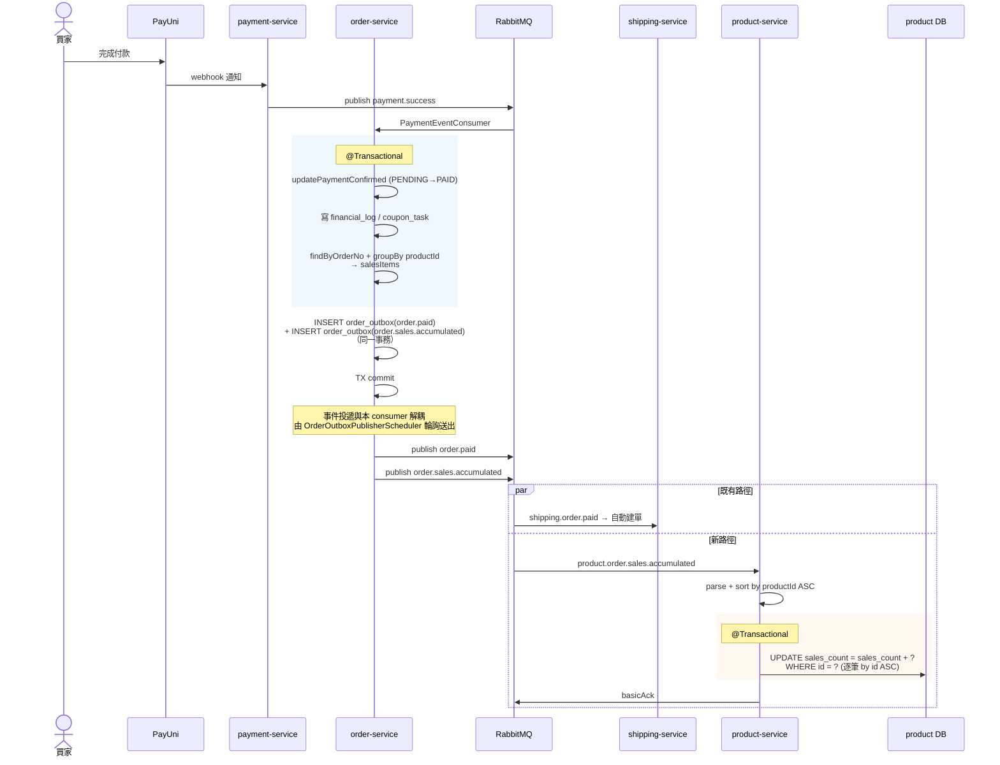
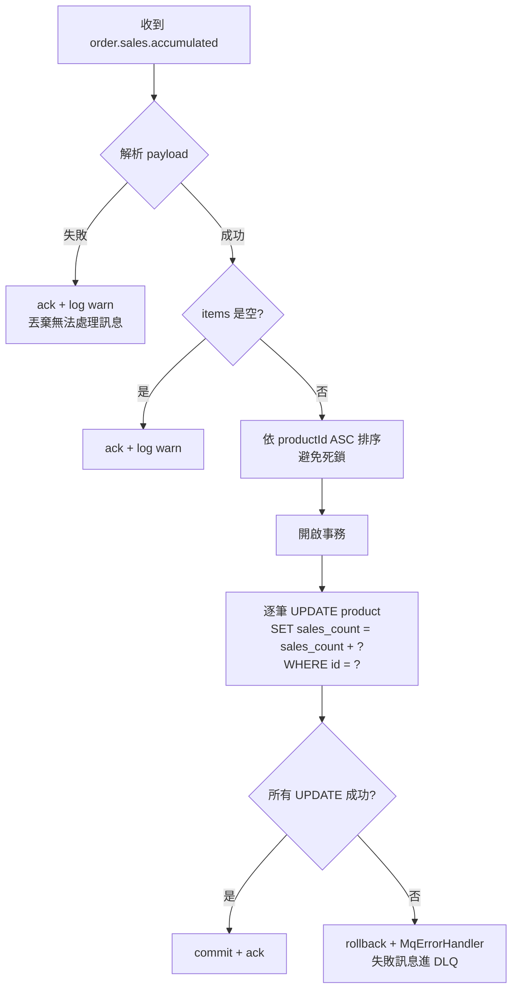

# 35-商品列表排序與銷量反正規化（Product Sort & Sales Count）詳細設計書

## 一、目標與範圍

### 1.1 目標

完整支援買家網站商品列表（`/api/v1/public/products`）5 種排序：

| Value | 意義 | 對應 SQL |
|-------|------|---------|
| `LATEST` | 最新上架 | `created_at DESC` |
| `PRICE_ASC` | 價格低到高 | `price_min ASC` |
| `PRICE_DESC` | 價格高到低 | `price_max DESC` |
| `RATING` | 評分最高 | `rating DESC NULLS LAST` |
| `SALES` | 銷量最高 | `sales_count DESC` |

「推薦」= 前端不送 `sort` 參數，後端 fallback 至 `LATEST`（向後相容；前端「推薦」按鈕等價於不送 sort）。

---

## 二、CodeMeta

### 2.1 業務類型碼 `ProductSort`

| 屬性 | 值 |
|------|-----|
| 介面 | `CodeMeta` |
| 前端可見 | Yes |
| 使用服務 | gateway, product |
| DB 儲存欄位 | 無（query string） |
| Value 形式 | 字串（同 ClientType / AppType / OrderCancelByRole 慣例，便於前端 switch） |

| Name | Code | Value | Label | Description |
|------|------|-------|-------|-------------|
| LATEST | LATEST | LATEST | 最新上架 | 依 `created_at DESC` |
| PRICE_ASC | PRICE_ASC | PRICE_ASC | 價格低到高 | 依 `price_min ASC` |
| PRICE_DESC | PRICE_DESC | PRICE_DESC | 價格高到低 | 依 `price_max DESC` |
| RATING | RATING | RATING | 評分最高 | 依 `rating DESC NULLS LAST` |
| SALES | SALES | SALES | 銷量最高 | 依 `sales_count DESC` |

### 2.2 內部技術碼 `OrderEventType`

| Name | Code | Value | Label | Description |
|------|------|-------|-------|-------------|
| ORDER_SALES_ACCUMULATED | ORDER_SALES_ACCUMULATED | order.sales.accumulated | 訂單銷量累計 | 付款成功時發出，product-service 累計商品銷量 |

### 2.3 流程要求

依 [CodeMeta 代碼管理](../代碼管理（CodeMeta）/README.md)：
1. 修改 `業務類型碼.md` 與 `內部技術碼.md`
2. 執行 `./docs/代碼管理（CodeMeta）/scripts/generate.sh --all`
3. **嚴禁**直接編輯生成檔

---

## 三、DB Schema

### 3.1 product 表 `sales_count`

```sql
sales_count BIGINT NOT NULL DEFAULT 0,
ALTER TABLE product ADD CONSTRAINT chk_product_sales_count_nonneg CHECK (sales_count >= 0);
```

語意：累計付款成功訂單中該商品的 quantity 加總。

退款不扣回，`sales_count` 為單向累計。寫入路徑 `SalesAccumulatedConsumer` 已過濾 `quantity > 0`；`chk_product_sales_count_nonneg` 為 DB 層防護（對齊 stock_qty / favorite_count 非負約束模式）。

### 3.2 Partial Index（只覆蓋 ACTIVE 商品）

實際查詢一律帶 `WHERE deleted_at IS NULL AND status = '4004'`，5 個 partial index 涵蓋所有 sort 鍵：

```sql
CREATE INDEX idx_product_active_created_at
  ON product (created_at DESC)
  WHERE deleted_at IS NULL AND status = '4004';

CREATE INDEX idx_product_active_price_min
  ON product (price_min ASC NULLS LAST)
  WHERE deleted_at IS NULL AND status = '4004';

CREATE INDEX idx_product_active_price_max
  ON product (price_max DESC NULLS LAST)
  WHERE deleted_at IS NULL AND status = '4004';

CREATE INDEX idx_product_active_rating
  ON product (rating DESC NULLS LAST, created_at DESC)
  WHERE deleted_at IS NULL AND status = '4004';

CREATE INDEX idx_product_active_sales
  ON product (sales_count DESC, created_at DESC)
  WHERE deleted_at IS NULL AND status = '4004';
```

帶 category 篩選時走既有 `idx_product_query_lv1/2`，不另建 sort × category 複合索引。

### 3.3 Migration 落點

`sales_count` 欄位與上述 5 個 partial index 已隨 `V1__init_product_schema.sql` 建立；非負 CHECK 走 `V5__add_nonneg_checks_hashtag_sales.sql`、消費冪等表走 `V11__add_sales_count_event_dedup.sql`。V1 已凍結為唯讀，後續任何 schema 變更一律新增 `V{N+1}`（見 [Java 微服務開發規範](../開發規範/Java%20微服務開發規範.md) §9.3）。

---

## 四、Proto 契約

`api/proto/product/product.proto`：

```proto
message GetProductListRequest {
    // ...
    string sort = 5;  // 排序方式 ProductSort Value（LATEST/PRICE_ASC/PRICE_DESC/RATING/SALES），空字串=LATEST
    // ...
}

message ProductListItem {
    // 數字字串，符合 Proto 對外數字一律 string 的規則
    string sales_count = 27;  // 已售件數（累計付款成功訂單的 quantity 加總）
}

message ProductDetail {
    string sales_count = N;  // 同上
}
```

本主題不定義 RPC，僅擴充欄位。

Proto 同步流程：
1. 修改 `api/proto/product/product.proto`
2. `sh scripts/gen-go-proto.sh`
3. `rsync -av --delete api/proto/ services/java/shared/java-proto/src/main/proto/`
4. `cd services/java/shared/java-proto && mvn clean install`

---

## 五、MQ 事件

### 5.1 事件

| Routing Key | Exchange | 業務時機 | 下游處理 |
|---|---|---|---|
| `order.sales.accumulated` | `hawkr.order` | 訂單付款成功 + 財務扣款**事務內寫 `order_outbox`**，由 `OrderOutboxPublisherScheduler` 投遞 | product-service 累計各商品 `sales_count` |

> 完整 producer / consumer / payload class / DLQ / idempotency 設計見
> [36-MQ 與事件總覽 §3.1 訂單領域](./36-MQ%20與事件總覽（MQ%20%26%20Event%20Catalog）.md#31-訂單領域order-domain)。

### 5.2 Producer / Consumer 職責

- **聚合在 publisher 端**：publisher 於事務內依 `productId` 加總 quantity 後發送，consumer 純粹寫入，不在 consumer 端二次聚合。
- **事務內寫 outbox**：付款成功事務內 INSERT `order_outbox`（與 `order.paid` 同一事務），由 `OrderOutboxPublisherScheduler` 投遞。Outbox 屬[後端服務責任邊界規範](../開發規範/後端服務責任邊界規範.md)「七、例外」第 2 項（保 MQ event 必發），不是補償任務基礎設施；語意見 [03 號 §3.12](03-訂單微服務（Order%20Service）詳細設計書.md#312-訂單事件發件匣-order_outbox事件可靠投遞載體)。

---

## 六、時序圖



---

## 七、Consumer 業務流程圖



---

## 八、Gateway

### 8.1 Handler sort 白名單驗證

`gateway/internal/handler/product.go::GetProductList` 在轉發前驗證，非法值回 400、不做靜默 fallback：

```go
sort := strings.TrimSpace(c.DefaultQuery("sort", ""))
if sort != "" && !isValidProductSort(sort) {
    response.BadRequest(c, "invalid sort value")
    return
}
```

> 合法值集合 `productSortAllowed` 定義於同一檔案，內容須與 common-core `ProductSort` enum 的 5 個 Value 一致。

### 8.2 Swagger 註解

```go
// @Param sort query string false "排序方式 ProductSort Value：LATEST=最新上架、PRICE_ASC=價格低到高、PRICE_DESC=價格高到低、RATING=評分最高、SALES=銷量最高（不送=LATEST）" Enums(LATEST, PRICE_ASC, PRICE_DESC, RATING, SALES)
```

Swagger 契約的 SSOT 是 handler annotation；`gateway/docs/` 為本地生成物、不入版控。

### 8.3 ProductItem DTO

```go
type ProductItem struct {
    // ...
    SalesCount string `json:"salesCount,omitempty"` // 累計已售件數（字串）
}
```

`GetProductList` / `GetProductDetailByID` / `GetProductInfoByID` / `GetRelatedProducts` 4 個 handler 的 mapping 皆須帶上 `p.SalesCount`。

---

## 九、SQL ORDER BY 規格

`ProductRepository.findPageByCondition` 的 ORDER BY：

```xml
ORDER BY
<if test="tokens != null and !tokens.isEmpty()">hit_count DESC,</if>
<choose>
    <when test="sort == 'PRICE_ASC'">p.price_min ASC NULLS LAST, p.id DESC</when>
    <when test="sort == 'PRICE_DESC'">p.price_max DESC NULLS LAST, p.id DESC</when>
    <when test="sort == 'RATING'">p.rating DESC NULLS LAST, p.created_at DESC, p.id DESC</when>
    <when test="sort == 'SALES'">p.sales_count DESC, p.created_at DESC, p.id DESC</when>
    <otherwise>p.created_at DESC, p.id DESC</otherwise>  <!-- LATEST 或空字串 -->
</choose>
```

要點：
- `hit_count` 為條件式，只有帶 keyword（`tokens` 非空）時才參與排序；無 keyword 時 `hit_count` 全 0，納入即為虛排
- 每個分支末端一律補 `p.id DESC` 作為 tie-breaker，避免 pagination 在同價／同銷量時重複或漏列
- 5 個 sort 值各自對應 §3.2 的 partial index

---

## 十、一致性、交易與補償

**單一寫入路徑為唯一真實來源；不引入補償任務基礎設施。**

| 寫入點 | 維護項目 |
|--------|---------|
| order-service `PaymentEventHandler.handlePendingPaymentOrder()` **事務內** | INSERT `order_outbox`（`order.sales.accumulated`），與 `order.paid` 同一事務 |
| product-service `SalesAccumulatedConsumer.onSalesAccumulated()` | UPDATE product.sales_count |

> **快取失效（#1426）**：`SalesAccumulatedConsumer` 於 `applyAll` 提交後（post-commit）同步 evict 受影響商品的 `prod:detail:*` 與 `prod:list:*`（逐 product 清 detail；反查 owner 後 `evictProductListForWriteBatch(owners)` 清 owner bucket + 公開聚合 bucket 0）—— `sales_count`（`salesCount`）同時出現在 `ProductDetail` 與 `ProductListItemDTO`（且為 `SALES` 排序依據），僅更新 DB 不清快取會讓 detail / list 陳舊至各自 TTL。evict 為 best-effort，失敗僅 `log.warn` 不阻斷 ack。

依[後端服務責任邊界規範](../開發規範/後端服務責任邊界規範.md) **不做**：
- `*ReconciliationJob` / `*ReconcileJob`
- `*BackfillCLI` / `*BackfillRunner`
- `reflow_task` / `resync_task` runner
- `@Scheduled` 跑「count 校對」「drift detection」

> `order_outbox` 不在此列：它保的是 MQ event 必發（規範「七、例外」第 2 項），非資料完整性監測。

---

## 十一、實作位置

| 模組 | 檔案 | 職責 |
|------|------|------|
| CodeMeta | `docs/代碼管理（CodeMeta）/業務類型碼.md` | `ProductSort` 碼表 SSOT |
| CodeMeta | `docs/代碼管理（CodeMeta）/內部技術碼.md` | `OrderEventType.ORDER_SALES_ACCUMULATED` |
| common-core | `services/java/shared/common-core/.../utils/code/ProductSort.java` | **generate.sh 產出，禁手改** |
| common-core | `services/java/shared/common-core/.../utils/code/OrderEventType.java` | **generate.sh 產出，禁手改** |
| common-core | `services/java/shared/common-core/.../mq/MqConstants.java` | routing key / queue / dlq 常數 |
| Proto | `api/proto/product/product.proto` | `sort` 參數與 `sales_count` 欄位契約 |
| order-service | `.../repository/OrderItemRepository.java` | `findByOrderNo` 供銷量聚合取項 |
| order-service | `.../mq/dto/OrderSalesAccumulatedPayload.java` | 事件 payload |
| order-service | `.../mq/PaymentEventHandler.java` | `handlePendingPaymentOrder` 事務內查 OrderItem、依 productId 聚合、INSERT `order_outbox` |
| product-service | `src/main/resources/db/migration/` | `sales_count` 欄位、5 個 partial index、非負 CHECK、消費冪等表 |
| product-service | `.../config/RabbitMqConfig.java` | queue / binding / DLQ 宣告 |
| product-service | `.../mq/SalesAccumulatedConsumer.java` | 消費事件、事務內累計、post-commit 清快取 |
| product-service | `.../repository/ProductRepository.java` | `incrementSalesCount(id, qty)` 與 §九 的 ORDER BY |
| product-service | `.../grpc/converter/...` | proto mapping 帶出 `sales_count` |
| gateway | `gateway/internal/handler/product.go` | sort 白名單、`ProductItem.SalesCount`、4 個 handler mapping、Swagger 註解 |

---

## 十二、Enum 引用

本服務使用的 CodeMeta（依 §1.2.1 規則僅列名稱 + 連結）：

| Enum | 連結 |
|------|------|
| ProductSort | [業務類型碼.md#ProductSort](../代碼管理（CodeMeta）/業務類型碼.md#ProductSort) |
| OrderEventType | [內部技術碼.md#OrderEventType](../代碼管理（CodeMeta）/內部技術碼.md#OrderEventType) |
| ProductStatus | [業務狀態碼.md#ProductStatus](../代碼管理（CodeMeta）/業務狀態碼.md#ProductStatus)（既有，用於 SQL `status = '4004'` partial index） |

---

## 十三、驗證計畫

1. **本地啟動**：`./dev.sh rebuild order-service product-service gateway`
2. **DB schema**：確認 `sales_count` 欄位 + 5 個 partial index 存在
3. **API 驗證**（透過 Gateway HTTP，依 memory `feedback_test_actual_user_path.md`）：
   - 5 個合法 sort 值各打一次，比對排序正確
   - 非法值（如 `latest` 小寫、`unknown`）回 400
   - 不送 sort → 視為 LATEST
4. **付款累計流程**：
   - 走 buyer 結帳 → 付款成功路徑
   - 確認 `order.sales.accumulated` 事件發出
   - product-service 收到 → DB `sales_count` 增加
5. **再次列商品**：付款後 `sort=SALES` 該商品排序上升
