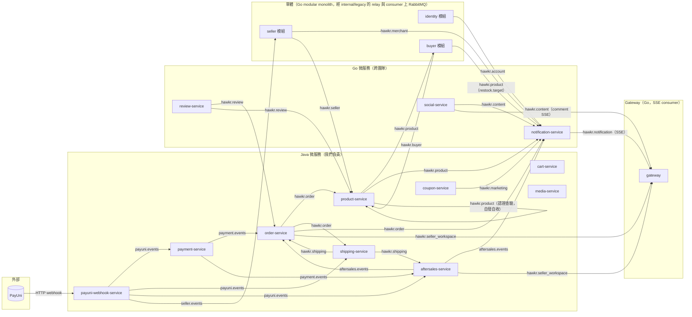
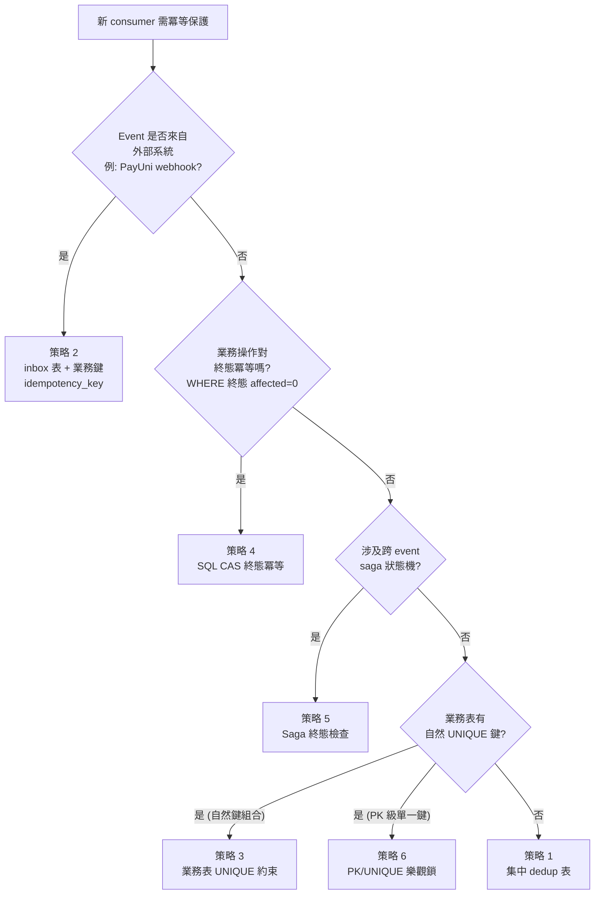

# MQ 與事件總覽（MQ & Event Catalog）詳細設計書

> **本文件為整個 hawkr 後端 MQ / Event 的唯一真實來源（Single Source of Truth）。**
>
> 所有 MQ Producer / Consumer / Exchange / Queue / Routing Key / Payload / DLQ / Idempotency 設計，皆以本文件為準。新增、修改、查詢 MQ 與事件時必須先參考本文件，並依 `docs/開發規範/MQ 與事件管理規範.md` 同步更新。
>
> 涵蓋範圍：所有後端服務（Java 9 個 + Go 11 個），含跨團隊契約。

---

## 一、總覽

### 1.1 文件定位

| 項目 | 說明 |
|------|------|
| **角色** | 集中管理規範文件，類似 CodeMeta 的 SSOT |
| **依據** | `docs/開發規範/MQ 與事件管理規範.md` 為流程規範；本文件為內容 SSOT |
| **更新時機** | 新增、修改、刪除任何 MQ Producer / Consumer / Exchange / Queue / Routing Key 時 |
| **contract 邊界** | 🔴 **routing key／exchange／queue／DLQ 一律以本書為準**：其他設計書（03／65／66／70 等）只**引用**本書對應章節，不得複製一份平行定義——複製出來的那份漂移時不會有任何東西報錯 |
| **不在範圍** | gRPC（屬同步通訊，見各服務設計書）、Redis Pub/Sub、Webhook HTTP（PayUni 入口見 §10 設計書） |

### 1.1.1 與其他服務設計書的關係（重要）

服務設計書（03 訂單、05 支付、06 物流、09 售後、10 PayUni Webhook、12/13 通知 …）**不再重複描述 MQ 細節**（payload、DLQ、idempotency、container factory 等），改為：

| 服務設計書應該保留 | 服務設計書應該移除 |
|--------------------|--------------------|
| 業務語意：「付款成功時觸發 Shipping 自動建單」（屬於業務流程） | Producer 程式碼位置、payload class 定義、序列化方式 |
| Routing key 名稱清單（讓讀者一眼看到該服務涉及哪些 event） | DLX / DLQ 配置、retry 策略、idempotency 表 |
| 連結至 36 號設計書對應 section | Consumer Class 名稱、binding 設定 |

服務設計書中描述 MQ 的章節應該以「連結 36 號設計書」結尾，例：

```markdown
> 完整 MQ 設計（producer / consumer / payload / DLQ / idempotency）見
> [36-MQ 與事件總覽 §3.x](./36-MQ%20與事件總覽（MQ%20%26%20Event%20Catalog）.md)
```

**原因**：避免設計書漂移（多處描述同一件事，改一處漏另一處）。與 CodeMeta `.md` SSOT 同樣模式。

### 1.2 系統 MQ 拓撲



### 1.3 數量口徑（查現況的位置）

> 這些數字每次加 consumer / 加事件都會變，寫死在本節必然過時。本表只記「該去哪裡數」，不留快照數字。

| 指標 | 現況查法 |
|------|---------|
| 總 Exchange（業務 + DLX） | `infra/mq/topology/topology.yaml` 的 `exchanges:` 區塊 —— broker 資源的唯一 owner（見《[MQ Topology 管理（Terraform）](../基礎建設/MQ%20Topology%20管理（Terraform）.md)》）。`.dlx` 一律手動列在 `exchanges:`（含 4 個原「§1.5 framework auto-wired」者，**2026-07-24 起不再由服務端宣告**，見 §2.2 註） |
| 總 Queue（業務 + DLQ + retry） | 同檔 `queues:` 區塊。⚠️ **不能直接數條目**：`retry:` / `dlq:` policy 會展開出 `{queue}.retry` / `{queue}.dlx` / `{queue}.dlq` 與對應 binding，這些在 YAML 上看不到 |
| DLQ 覆蓋率 | `topology.yaml` 中帶 `dlq:` 或 `retry:` policy 的業務 queue 佔比（同上，policy 即覆蓋） |
| 總 Routing Key（已使用） | 本書 §三 完整事件清單 |
| Producer 服務數 / 發送點 | 本書 §4.1（Java）、§4.2（Go） |
| Consumer 服務數 / Listener 方法 | 本書 §5.1（Java）、§5.2（Go；notification-service 為 per-exchange wildcard 訂閱 + template 動態分派，見 §5.2） |
| Idempotency 保護覆蓋率（consumer listener 角度） | 本書 §7.3 |
| Idempotency Conformance 覆蓋率（payload 角度，§7.4 contract `event_id` 必含口徑） | 逐 payload 檢查「有沒有 `event_id` 欄位且由 publisher 生成 UUID v4」：Java 看各 `*Payload` record、Go 看是否 embed `pkg/mq.BaseEvent` |

### 1.4 命名規範（強制）

| 物件 | 規範 | 範例 |
|------|------|------|
| Exchange 名稱 | `{domain}.events` 或 `hawkr.{domain}` | `payment.events`、`hawkr.order` |
| Exchange 類型 | Topic（預設）；DLX 也是 Topic（payment.webhook.dlx 例外為 Direct） | — |
| DLX 名稱 | `{exchange}.dlx` | `hawkr.order.dlx` |
| Queue 名稱 | `{consumer-service}.{event-source}.{action}` | `order.payment.result`、`product.order.cancelled` |
| DLQ 名稱 | `{queue-name}.dlq` | `order.payment.result.dlq` |
| Routing Key | `{domain}.{action}` 或 `{domain}.{action}.{result}`，全小寫，`_` 或 `.` 分隔 | `order.paid`、`shipment.processing.cleared` |
| Event Payload Class | `{Event}Payload` 或 `{Event}Event` | `OrderPaidPayload`、`CouponIssuedEvent` |
| Consumer Class | `{EventSource}{Topic}Consumer` | `PaymentEventConsumer` |
| Publisher Class | `{Domain}EventPublisher` | `OrderEventPublisher` |

**禁止**：
- ❌ 在程式碼中以字面值直接寫 routing key / exchange / queue 名稱（必須走 `MqConstants` / `pkg/mq` 常數）
- ❌ Java / Go 對同一邏輯領域使用不同 exchange 名稱（見 §九 已知不一致）
- ❌ 同 routing key 對應多個 publisher（每個 routing key 只能有一個發送方）。⚠️ **本條的粒度是 routing key，不是 exchange**：同一個 exchange 上可以有多個 publisher，只要每條 routing key 的發送方唯一即可——既有先例見 §2.1 的 `hawkr.product`（product-service ＋ 單體 buyer 模組）、`hawkr.seller_workspace`（order-service ＋ aftersales-service）、`hawkr.shipping`（shipping-service ＋ payment-service）

#### 1.4.1 圖片 / 頭像類 payload 欄位語意（49 號設計書 §6.3＋《多媒體與圖片 URL 規範》）

payload 圖片欄位分兩類，命名與消費端處理規則不同：

- **商品 / 評論 / 訂單照片等平台自有媒體**：值一律帶 `objectKey`，欄名必須誠實帶 `*Key` 語意（禁止 `*Url` 名存 key 值），顯示 URL 由消費端 `mediaurl.BuildURL` / `MediaUrlProperties.buildUrl` 組出。例：`review.created.imageKeys`、`product.restock(.target).imageKey`、`shipment.photo.updated.shipmentPhotoKeys`。
- **頭像 / 第三方外部圖類 passthrough 欄位**：值語意為「`objectKey` **或** 第三方外部完整 URL」（Google 頭像等外部圖是《多媒體與圖片 URL 規範》唯二例外之一，無 objectKey），故**不強制** `*Key` 命名——維持**中性名**（不加 `_url` / `_key` 後綴），消費端一律以 `mediaurl.BuildURL`（對完整 URL passthrough、對 objectKey 組裝）統一處理。此為刻意設計（accept-as-designed），非命名違規。現存屬此類的事件欄位：`product.viewed`、`chat.message.sent.sender_avatar`（歷史 `coupon.issued.coupon_image_url` 帶 `_url` 後綴為既有殘留，語意同此類 passthrough）。**例外收斂（49 §6.3/S3 批 2）**：`order.paid` / `order.cancelled.*` 的賣家頭像（賣家 logo，恆為 objectKey，非第三方外部圖）已由中性名 `seller_avatar` 改為 `*Key` 明名 `seller_avatar_key`。**例外收斂（49 §6.3/S3 批 3）**：shipping 出貨事件的 `seller_avatar`（`shipment.delivered` / `shipment.status.changed`／退貨變體，來源 `ShippingEventPayload.sellerAvatarKey`）與 `shipment.created.buyer_avatar`（來源 `ShipmentCreatedPayload.buyerAvatarKey`，均為 seller logo／buyer avatar objectKey，S9 cascade 自 seller/buyer）已改為 `seller_avatar_key` / `buyer_avatar_key`；**例外收斂（49 §6.3/S3 批 4）**：`post.created.seller_avatar`（來源 `PostCreatedEvent.SellerAvatarKey`，賣家 logo objectKey）與 `review.created.buyer_avatar`（來源 `ReviewCreatedEvent.BuyerAvatarKey`，買家頭像 objectKey/外部 URL passthrough）已改為 `seller_avatar_key` / `buyer_avatar_key`；**例外收斂（49 §6.1／hawkr-website#430 P4 批）**：`comment.created` / `comment.replied` 的 fat snapshot（`CommentSnapshot`，L3 camelCase 契約）中性名 `userAvatar` 已改為 `avatarKey`——它同時是 gateway 直接轉發的 SSE 對外欄位，而對外 JSON 的頭像欄一律 `avatarKey`（不帶 user/buyer/target 主體前綴），故此欄跟著對外契約走而非留在中性名清單。至此全平台 MQ avatar 欄位收斂完成。

### 1.5 Go `pkg/mq.ResilientConsumer` retry / DLQ 框架（訊息流語意）

> Java 側 DLX 透過 `@Bean Queue` + `arguments` 顯式宣告（《[MQ Topology 管理（Terraform）](../基礎建設/MQ%20Topology%20管理（Terraform）.md)》，2026-07-24 起 `@Bean` 只剩意圖宣告）。本節描述 Go 側 framework 的 retry / DLQ 機制。

> ⚠️ **2026-07-24 起本節描述的是「訊息流語意」，不是資源宣告方式。** broker 上的 exchange / queue / binding 一律由 Terraform 依 `infra/mq/topology/topology.yaml` 佈建，dev / prod 的服務走 passive declare（Go `MQ_PASSIVE_DECLARE=true`、Java `SPRING_RABBITMQ_DYNAMIC=false`），**framework 不再自行建立任何資源**。下表中 retry counter、republish 目的地、DLQ 直投與 nack fallback 等**執行期行為**維持不變；資源的**存在**則來自 `topology.yaml`：`{Queue}.retry`／`{Queue}.dlx`（皆 fanout exchange）、`{Queue}.dlq`（queue）與兩條空 routing key 的 binding 全部由 `retry:` policy 展開產生。權威見 `docs/基礎建設/MQ Topology 管理（Terraform）.md`。

| 機制 | 規範 |
|------|------|
| Retry exchange 名稱 | `{sub.Queue}.retry`（per-queue **fanout**，只綁自身 queue）。retry republish 打此 exchange 而非共用 topic exchange，避免同 (exchange, routing key) 綁定的其他 queue 每次重試都被 fan-out 放大（實測 shipment.delivered 2 queue × MaxRetries=3：舊行為 1→32；per-queue 後每 queue 1→1） |
| DLX exchange 名稱 | `{sub.Queue}.dlx`（per-queue **fanout**，只綁 `{sub.Queue}.dlq`；僅「顯式直投 DLQ 失敗」時的 fallback 路徑使用）。🔴 **per-queue 不得改回共用 `{sub.Exchange}.dlx`**——共用時 fallback 會交叉 fan-out 到 sibling DLQ |
| DLQ queue 名稱 | `{sub.Queue}.dlq`（沿用 §1.4 命名規範） |
| Max retries 預設 | `Subscription.MaxRetries = 3`（0 = 維持舊行為，不啟用 retry/DLX） |
| Retry counting | 讀訊息 header `x-mq-retry-count`（AMQP 091 無原生 retry counter；framework 於 republish 時 +1） |
| 失敗分類 | handler 回 `mq.Permanent(reason, err)` ＝**永久性失敗**（重試不會改變結果，如 payload 格式錯、參照實體 404）→ 不吃重試額度，立刻走 DLQ 行為並在死信帶 `x-mq-failure-class=permanent` 與 `x-mq-dead-letter-reason={reason}`。**未分類的 error 一律視為暫時性** |
| Retry 行為 | handler 回**未分類**的 error 且 counter < 上限 → republish 到 `{sub.Queue}.retry`（fanout 忽略 routing key 做路由，但原 routing key 保留於訊息供 handler 派發與後續 DLX fallback）→ Ack 原訊息 |
| DLQ 行為 | counter 達上限（或分類為 permanent）→ 顯式 publish 到 default exchange（`""`，routing key = `{sub.Queue}.dlq`）直投自身 DLQ、原 routing key 存 header `x-mq-original-routing-key`、分類存 `x-mq-failure-class`（`permanent` / `retry_exhausted`）→ Ack 原訊息；publish 失敗才 fallback `Nack(false, false)` 經 `{sub.Queue}.dlx`（per-queue fanout，只會進自己的 DLQ）。DLQ 端由 ops 介入處理 |
| 指標 | `mq_consume_total{queue,result}` 的 `result="dlq"` 涵蓋兩種死信（既有告警語意不變）；分類另計於 `mq_dead_letter_total{queue,class}`，讓「有東西壞了」與「這筆資料本來就不該存在」可以分開告警 |
| MaxRetries=0 的永久性失敗 | 該形狀沒有 framework 管理的 DLQ，但**絕不 requeue**（會讓毒訊息永久卡住 queue）→ `Nack(false, false)` 交回 broker，有 DLX 就進 DLX |
| Queue / exchange 佈建 | 由 `topology.yaml` 的 `retry: {max_attempts: N}` policy 展開產生：`{Queue}.dlq`、`{Queue}.retry`（fanout）、`{Queue}.dlx`（fanout）、`{Queue}.retry → {Queue}` 與 `{Queue}.dlx → {Queue}.dlq` 兩條 binding（皆空 routing key）。**禁止手寫這些衍生資源，也不要手寫 dead-letter arguments**（展開會覆蓋）。DLX 由 queue 名推導並自動產生，**不需要事先宣告 `{Exchange}.dlx`**。dev / prod 的 framework 只做 passive 查詢；local 未設 passive flag 時仍由 framework 自行 declare |

**Subscription 範本**：

```go
mq.NewResilientConsumer(amqpURL, []mq.Subscription{
    {
        Exchange:    mq.ExchangeProduct,
        Queue:       mq.QueueBuyerProductRestock,
        RoutingKeys: []string{mq.RoutingKeyProductRestock},
        Handler:     restockHandler,
        MaxRetries:  3,  // ← 推薦預設；0 維持舊行為（無 DLX）
    },
})
```

**升級破壞性（強制 SOP）**：

RabbitMQ 不支援 in-place 修改 queue arguments。改 args 在 `terraform plan` 上表現為 `must be replaced`（`actions = ["delete", "create"]`，先刪後建）→ **queue 內未消費的訊息一起消失**。passive declare 下服務不會自己把 queue 建回來，因此變更一律由 `topology.yaml` 驅動。

| 變更類型 | 對既有環境影響 |
|---|---|
| 新增 `retry: {max_attempts: N}` policy（原本無 retry/DLQ） | 新增衍生資源為 `create`；若同時改動既有 queue 的 `arguments` 則為 ⚠️ **破壞性** `replace` |
| 改變 `dlq.via` / DLX 指向（`x-dead-letter-exchange` value 變更） | ⚠️ **破壞性**：queue arguments 改變 → plan `must be replaced` |
| 改變 `Subscription.Exchange`（binding 來源變；DLX 由 queue 名推導故不受影響） | ⚠️ **破壞性**：等同換 binding 來源＋（若走 `dlq:`）改 `x-dead-letter-exchange` |
| 改 `MaxRetries` 數字（3 → 5） | ✅ **無破壞**：retry counter 在訊息 header，`topology.yaml` 的 `max_attempts` 不影響 queue arguments |
| 新增 `{queue}.retry` fanout exchange（policy 展開產生） | ✅ **無破壞**：只新增 exchange 與 binding，不觸碰既有 queue 的 arguments |
| 其他 Queue arguments 變更（TTL `x-message-ttl` / `x-max-length` / quorum queue 切換等） | ⚠️ **破壞性**：plan `must be replaced`，需走 `docs/開發規範/MQ 與事件管理規範.md` §3.3 SOP |
| 刪除 queue | ⚠️ **破壞性**：plan `destroy`，與 replace 在 CI destructive gate 眼中同級 |

**部署前必走步驟**：

1. 改 `infra/mq/topology/topology.yaml`（與程式碼同一個 PR），本機跑 `validate.py` + `unittest` + `scripts/mq-consumer-registration-check.py`
2. PR description 必填 `docs/開發規範/MQ 與事件管理規範.md` §3.3.2 checklist（受影響 queue 清單、預期新 args、兩份 plan 判讀結論、in-flight message 評估、執行窗口）
3. **人工讀 CI 貼在 PR 上的 dev + prod 兩份 plan**，搜 `must be replaced` / `destroy`，並以 plan 末尾 `Plan: X to add, Y to change, Z to destroy` 為準（step summary 貼的是 `tail -c 60000`，長 plan 前段會被截掉）——⚠️ PR 階段含 destroy **不會**讓 CI 變紅
4. 破壞性變更：merge 後 destructive gate 會擋下自動 apply，人工審 plan 後於低峰時段手動觸發（**`--ref` 必須與 `env` 對齊**）：

   ```bash
   gh workflow run mq-topology.yml --ref dev  -f env=dev  -f allow_destructive=true
   gh workflow run mq-topology.yml --ref main -f env=prod -f allow_destructive=true
   ```

   ⚠️ workflow 的 `checkout` 不指定 ref、`decide` job 也不驗 ref 與 env 是否一致——從 `main` 派 `env=dev` 會拿 **main 版 topology 去 apply dev**，dev-only 的 queue 全被 destroy，而 `allow_destructive=true` 正好關掉唯一的 gate。queue 含不可丟訊息 → 先走 `docs/開發規範/MQ 與事件管理規範.md` §3.3.5（暫停 producer → 消化至 `messages=0` → 才 apply）
5. 驗證以 **consumer 數**為判準（`consumers ≥ 1`）——queue 存在但沒 consumer，passive declare 不會報錯。**apply 完成不會讓已被 skip 的訂閱自癒**（`resilient.go` 只在啟動／reconnect 時 declare），需 `kubectl rollout restart deployment/<service>` 讓它重新接上——這是**讓已部署的配置生效**的維運動作，**不是**用 restart 取代 code 的 CI/CD 部署（沒有 rebuild image 的假部署仍然禁止）

**禁止**：SSH 進 dev / prod broker 手跑 `rabbitmqctl delete_queue`、或在本機對 dev / prod `terraform apply`。完整 SOP 見 `docs/開發規範/MQ 與事件管理規範.md` §3.3，佈建權威見 `docs/基礎建設/MQ Topology 管理（Terraform）.md`。

**驗收（local）**：

```bash
# 故意丟 malformed payload 觀察 retry → DLQ
docker exec hawkr-rabbitmq rabbitmqctl list_queues name messages \
  | grep -E "buyer.product.restock|\.dlq"
# 預期：主 queue messages=0，*.dlq messages=1（poison message 進 DLQ）
```

---

## 二、Exchange 清單

### 2.1 業務 Exchange

> **佈建的權威是 `infra/mq/topology/topology.yaml` 的 `exchanges:` 區塊，不是本表。**
> 本表列的是「有常數宣告的 exchange」，其中標 🔶 者**常數存在但 broker 未佈建**
> ——passive declare 之下，publish 到未佈建的 exchange 不會 crash，訊息直接消失。

| Exchange | 類型 | Publisher 服務 | 用途 | Java 常數 | Go 常數 |
|----------|------|---------------|------|-----------|---------|
| `hawkr.order` | Topic | order-service | 訂單事件 | `EXCHANGE_ORDER` | `ExchangeOrder` |
| `payment.events` | Topic | payment-service | 支付事件（**Java 端命名**） | `EXCHANGE_PAYMENT` | — |
| `hawkr.payment` | Topic | （Go 服務用） | 支付事件（**Go 端命名**，⚠️ 與 Java 不一致） | — | `ExchangePayment` |
| `hawkr.shipping` | Topic | shipping-service ＋ payment-service（Logistics Finance） | 物流事件；**責任判定事件（`fulfillment.responsibility.*`）由 payment-service 發布**（`fulfillment_exception_cases`／`fulfillment_case_resolutions` 兩張表由它擁有，判定落列與 outbox 必須同交易，見 §3.3.1） | `EXCHANGE_SHIPPING` | `ExchangeShipping` |
| `aftersales.events` | Topic | aftersales-service | 售後事件 | `EXCHANGE_AFTERSALES` | — |
| `payuni.events` | Topic | payuni-webhook-service | PayUni Webhook 解密後分發 | `EXCHANGE_PAYUNI_WEBHOOK` | — |
| `hawkr.marketing` | Topic | coupon-service | 行銷/優惠券事件 | `EXCHANGE_MARKETING` | `ExchangeMarketing` |
| `hawkr.review` | Topic | review-service（Go） | 評論事件 | `EXCHANGE_REVIEW` | `ExchangeReview` |
| `seller.events` | Topic | payuni-webhook-service | PayUni 代收代付商家事件分發 | `EXCHANGE_SELLER` | — |
| `hawkr.merchant` | Topic | 單體 seller 模組（`internal/legacy/sellerrelay`） | 商家認證事件 | — | `exchangeMerchant`（局部常數） |
| `hawkr.content` | Topic | social-service（Go） | 貼文 / 評論 / 按讚事件 | `EXCHANGE_CONTENT` | `ExchangeContent` |
| `hawkr.buyer` | Topic | 單體 buyer 模組（`internal/legacy/buyerrelay`） | 買家動作事件（收藏 / 取消收藏 / 追蹤 / 買家刪除） | `EXCHANGE_BUYER` | `ExchangeBuyer` |
| `hawkr.account` | Topic | 單體 identity 模組（`internal/legacy/accountservice`） | 帳號事件 | — | `ExchangeAccount` |
| `hawkr.delegation` | Topic | 單體 delegation 模組（`internal/legacy/delegationservice`） | 代行營運事件（§3.6j / 56 號設計書） | — | `ExchangeDelegation` |
| `hawkr.seller` | Topic | 單體 seller 模組（`internal/legacy/sellerrelay`） | 賣家生命週期事件（退場 / 停權 / 解除停權 / 資料變更 / 可曝光變化） | `EXCHANGE_SELLER_BIZ` | `ExchangeSeller` |
| `hawkr.notification` | Topic | notification-service（Go） | 通知派發內部 | `EXCHANGE_NOTIFICATION` | `ExchangeNotification` |
| 🔶 `hawkr.delayed` | Topic | （無 publisher） | 延遲訊息。**未佈建於 `topology.yaml`**，兩端皆只有常數宣告 | `EXCHANGE_DELAYED` | `ExchangeDelayed` |
| `hawkr.media` | Topic | media-service | 媒體事件（宣告但未實際使用） | `EXCHANGE_MEDIA` | `ExchangeMedia` |
| `hawkr.im` | Topic | im-service（Go） | IM 事件（宣告但未驗證使用） | `EXCHANGE_IM` | — |
| `hawkr.product.import` | Topic | product-import-service | 商品匯入精靈內部解耦 + 跨 Media GC 通知（見 [40 號設計書](40-商品匯入精靈服務（Product%20Import%20Service）詳細設計書.md)） | `EXCHANGE_PRODUCT_IMPORT` | — |
| `hawkr.product` | Topic | product-service（Java，補貨事件 ＋ 商品認證事件 producer）+ 單體 buyer 模組（per-subscriber fan-out re-publish）| 商品領域事件：補貨 transition + 個別買家補貨通知 fan-out target（§3.6h）+ **商品認證審核**（§3.6h.1，19 號設計書；product-service 在此 exchange 上同時是 producer 與 consumer） | `EXCHANGE_PRODUCT` | `ExchangeProduct` |
| `hawkr.seller_workspace` | Topic | order-service（Java）+ aftersales-service（Java）| 賣家工作區 realtime invalidation 事件（gateway SSE 唯一 consumer，§3.6i / 41 §四之二） | `EXCHANGE_SELLER_WORKSPACE` | `ExchangeSellerWorkspace` |
| `hawkr.invoice` | Topic | invoice-service（Go） | 電子發票生命週期事件（開立 / 作廢 / 折讓 / 申訴 / 稅務身分，§3.6k / 58 號設計書） | — | `ExchangeInvoice` |
| `procurement.events` | Topic | ai-service（Go） | 採購報價邀請通知事件（§3.6l / 55 號設計書）＋ RFQ 發布直投線的收件人 invite 事件（§3.6l.1 / 64 號設計書） | — | `ExchangeProcurement` |
| 🔶 `hawkr.recurring` | Topic | recurring-service（Go） | 定期配送訂閱契約／週期／授權生命週期（§3.6n / 67 號設計書）；**consumer 只有 notification-service**。67 落地時與服務同 PR 佈建 | — | `ExchangeRecurring` |

> **一個 exchange 有多個 publisher 不是違規**：§1.4 的硬規則是「同 **routing key** 對應多個 publisher」才禁止。本表已有三個多 publisher exchange——`hawkr.product`（product-service ＋ 單體 buyer 模組）、`hawkr.seller_workspace`（order-service ＋ aftersales-service）、`hawkr.shipping`（shipping-service ＋ payment-service）——三者的每條 routing key 發送方都唯一。判別步驟：拿該 exchange 的 routing key 清單去 §三，看有沒有**同一條 key 出現兩個 Producer**；沒有就合規，不要以「這個 exchange 有兩個服務在發」為由退件。

### 2.2 具名共用 DLX（Dead Letter Exchange）

> **兩種 DLX 形狀，不要混淆：**
> - **per-queue `{queue}.dlx`**（fanout，只綁自己的 `{queue}.dlq`）：由 `topology.yaml` 的
>   `retry:` policy **自動展開**，不出現在 `exchanges:` 區塊，**也不列在本表**。
> - **具名共用 DLX**（下表）：走 `dlq:` policy 的 queue 使用，**必須手動列在 `exchanges:`**，
>   漏列時 plan 乾淨、apply 才 404。
>
> 本表是 `topology.yaml` 的 `exchanges:` 區塊中 `.dlx` 結尾者。查法：
> `sed -n '/^exchanges:/,/^queues:/p' infra/mq/topology/topology.yaml | grep '\.dlx'`

| DLX | 類型 | 對應業務 Exchange |
|-----|------|------------------|
| `hawkr.order.dlx` | Topic | `hawkr.order` |
| `payment.events.dlx` | Topic | `payment.events`（Java 端支付事件 consume side） |
| `hawkr.payment.dlx` | Topic | `hawkr.payment`（Go 端支付事件 consume side） |
| `hawkr.shipping.dlx` | Topic | `hawkr.shipping` |
| `hawkr.product.dlx` | Topic | product 服務 consume side |
| `hawkr.product.import.dlx` | Topic | `hawkr.product.import` |
| `aftersales.events.dlx` | Topic | `aftersales.events` |
| `hawkr.coupon.dlx` | Topic | coupon-service consume side（`buyer.deleted` / `seller.suspended` / `seller.unsuspended` consumer） |
| `hawkr.cart.dlx` | Topic | cart-service consume side |
| `hawkr.media.dlx` | Topic | media-service consume side |
| `hawkr.notification.dlx` | Topic | `hawkr.notification` |
| `payment.webhook.dlx` | **Direct** | `payuni.events` 中 payment 相關事件 |
| `shipping.webhook.dlx` | Topic | `payuni.events` 中 shipping 相關事件 |

> 🔴 **新增走 `dlq:` policy 的 queue 時，對應的具名 DLX 必須同 PR 手寫進 `exchanges:`**
> ——`retry:` 的展開不會產生它。

---

## 三、完整事件清單

> 每個事件以「Routing Key」為主鍵。Producer 與 Consumer 在同表中對應。
>
> **Idempotency 欄位讀法**（2026-06-16 對齊 §7.4 Conformance Contract）：
> - **策略代號 1\~6**：對應 [§7.5 冪等策略選擇樹](#75-冪等策略選擇樹6-種)（1=集中 dedup 表 / 2=集中 inbox / 3=業務表 UNIQUE / 4=SQL CAS 終態 / 5=Saga 狀態機 / 6=PK·UNIQUE 樂觀鎖）
> - **Best-effort（無冪等保護，重複可容忍）**：明確標示 + 業務理由，多用於 notification 推播 / SSE 即時傳遞等容錯場景（依 [§7.5.3](#753-best-effort-例外原則)）
> - **N/A**：孤兒事件（無 consumer）/ 待規劃事件，無對應 consumer 端冪等實作
> - 多 consumer 場景以「consumer 名 → 策略」格式分項列出

### 3.1 訂單領域（Order Domain）

**Exchange**：`hawkr.order`

| Routing Key | Producer | Consumer | Payload Class | DLQ | Idempotency |
|-------------|----------|----------|---------------|-----|-------------|
| `order.paid` | order-service `OrderEventPublisher.publishOrderPaid` | shipping-service `OrderPaidConsumer.onOrderPaid`（🔴 **語意定版 2026-09-13：本 consumer 的處理止於 `FL-1`，不得由此觸發任何 provider 的 `FL-2`（派車／預約取件／實體交寄）**——`FL-2` 由賣家透過 `S-10` 發動，見 [65 §4.4.1a](65-物流履約平台（Fulfillment%20Platform）詳細設計書.md)。⚠️ **「止於 `FL-1`」不等於「只能寫本地資料」**：3001／3002 在此呼叫 PayUni `createHomeShipment`／`createCvsShipment` 取得物流單號，那是**既有且正確**的 `FL-1`；3003 因為 Uber 沒有「只建資料不派車」的 API，才只能建本地列。⚠️ 這條約束適用**所有** provider，但各 provider 的 `FL-1` 做多少事**本來就不一樣**） | `OrderPaidPayload`（outbox 派送時 enrich 的 seller/buyer meta 圖片欄位依 49 號設計書 §6.3 帶 objectKey＋`*Key` 欄位名，顯示 URL 由消費端組出） | ✅ shipping.order.paid.dlq | shipments.shipment_no IS NULL 樂觀鎖 |
| `order.paid` | 同上 | notification-service（Go，動態 binding 至 `notification.order.paid` queue，**僅買家**「訂單付款成功」推播） | 同上 | — | DB seed 配置 |
| `order.cancelled` | order-service **`order_outbox`（取消事務內 `OrderService.insertCancelledOutbox`，`OrderOutboxPublisherScheduler` 投遞）** ⚠️ **不是每一次取消都會發**：`insertCancelledOutbox` 在「查不到 `status=SUCCESS` 的扣庫存紀錄」時直接 return、不落 outbox ⇒ 本事件的實際語意是「**有庫存要歸還的**訂單取消了」 | product-service `OrderCancelledConsumer.onOrderCancelled` | `OrderCancelledPayload`（`sellerAvatar` 等圖片欄位依 49 號設計書 §6.3 帶 objectKey＋`*Key` 欄位名，顯示 URL 由消費端組出） | ✅ product.order.cancelled.dlq | `(stockTxId, RESTORE)` 複合鍵 |
| `order.completed` | order-service **`order_outbox`（同 tx 寫入，`OrderOutboxPublisherScheduler` 投遞）** | notification-service（Go，binding 至 `notification.order.events`）；**crm-service（Go，`crm.order.completed` queue，CRM 客戶消費統計 `total_spent` 累加）**；**單體 buyer 模組（`internal/legacy/buyerconsumer`，queue `hawkr.monolith.buyer.order.completed`，訂單結案後加速完成買家與店家兩側等待中的刪帳）**；🆕 **recurring-service（Go，`recurring.order.completed` queue，67 §6.5.2 — commerce `COMPLETED` → Cycle `COMPLETED`，缺它 Cycle 永停 `MATERIALIZED`）** | `OrderCompletedPayload` ⚠️ 缺 event_id（F2） | notification：—；crm / buyer：✅ `topology.yaml` `retry: {max_attempts: 3}` 展開出 queue-scoped `{queue}.dlx`（fanout）與 `{queue}.dlq`；`pkg/mq` 負責重試／直投語意（§1.5） | notification：Best-effort（推播容忍重複）；**crm：exactly-once effect——`crm_processed_orders` 表 tx 內 claim（`MarkOrderProcessed` rows==0 即不累加，策略 1 dedup 表），金額累加不容忍重複**；buyer：`IsPendingDeletion` guard 天然冪等（刪號完成後 status≠`pending_deletion`，重投遞為 no-op） |
| `payout.completed` | order-service `OrderEventPublisher.publishPayoutCompleted`（`GrantPaymentWorker` 撥款成功 emit；exchange `hawkr.order`） | notification-service（Go，動態 binding）+ gateway SSE（inbox.new） | `PayoutCompletedPayload`（snake_case wire，含 event_id UUID） | ❌ 無 DLQ | notification reference_id `payout_{order_no}`（UNIQUE，策略 3）|
| `order.delivered` | order-service **`order_outbox`**（`ShippingEventConsumer.deliveredInTx` 與送達 CAS 同事務寫入，`OrderOutboxPublisherScheduler` 投遞） | 🔴 **無有效消費端**（issue #3486）：訊息會進 notification-service 的 `notification.order` wildcard queue，但 `notification_templates` 無 `order.delivered` 列，**查表落空即丟棄**；其餘 `hawkr.order` 的 binding 皆為字面 routing key、不含本事件 | `OrderDeliveredPayload` | — | N/A（無有效消費端）|
| `order.receipt.confirmed` | order-service **`order_outbox`（同 tx 寫入，`OrderOutboxPublisherScheduler` 投遞）** | shipping-service `OrderReceiptConfirmedConsumer.onOrderReceiptConfirmed`（MANUAL ACK） | `OrderReceiptConfirmedPayload` | ✅ shipping.order.receipt.confirmed.dlq | mapper 冪等更新 |
| `order.sales.accumulated` | order-service **`order_outbox`**（`PaymentEventHandler.handlePendingPaymentOrder` 與 `order.paid` 同一事務寫入） | product-service `SalesAccumulatedConsumer.onSalesAccumulated` | `OrderSalesAccumulatedPayload` | ✅ product.order.sales.accumulated.dlq | publisher 端 group by productId |
| `order.shipment.create_requested` | order-service `OrderEventPublisher.publishShipmentCreateRequested`（Backstop 重試建單，見 03 §8.11） | shipping-service `ShipmentCreateRequestedConsumer` → `createShipmentFromOrder` | `{orderNo}` JSON | ✅ shipping.shipment.create_requested.dlq | createShipmentFromOrder 以 order_no 查重 |
| `order.shipment.creation_failed` | order-service `OrderEventPublisher.publishShipmentCreationFailed`（重試上限，見 03 §8.11） | aftersales-service `ShipmentCreationFailedConsumer` → `cancelShipmentBySystem(SHIPMENT_CREATE_TIMEOUT)` | `{orderNo,sellerAccountId,buyerAccountId}` JSON | ✅ aftersales.shipment.creation_failed.dlq | SellerCancelRequest 查重 |
| `order.refund.finalized` | order-service **`order_outbox`**（三個發布點皆在既有交易內：`AfterSalesRefundEventHandler.handleRefundCompleted`（僅 `duplicate == false` 分支）／`AutoRefundTxHandler.completeAutoRefund`／`AfterSalesEventConsumer.onCancelCompleted` 新抽的 tx handler） | invoice-service `invoice.order.refund.finalized`；🆕 **recurring-service（`recurring.order.refund.finalized` queue，67 §6.5.2 — 退款終態回收，寫 `refund_status`）** | `OrderRefundFinalizedPayload` | ✅ `invoice.order.refund.finalized.dlq`（由 `topology.yaml` `retry:` 展開） | **策略 2（invoice_inbox_events，鍵 `REFUND:{refund_ref}`，`refund_ref` = `financial_logs.external_txn_id`）**。⚠️ **禁止以 `event_id` 去重**——aftersales 的 `RefundSyncWorker` 每小時重發且每次換新 UUID |
| `order.cancelled` | order-service（重複展示，見上） | + notification-service（Go，binding 至 `notification.order.events`） | 同上 | — | Best-effort（無冪等保護，notification 推播容忍重複） |
| `order.cancelled` | order-service（重複展示，見上） | + 🆕 **recurring-service（`recurring.order.cancelled` queue，67 §6.5.2 — 訂單取消 ⇒ Cycle 連動 `CANCELLED` ＋ 退款判定）** | 同上 | ✅ `recurring.order.cancelled.dlq`（`retry:` 展開） | 67 §6.5.2：失敗處置一律 **retry 3 → DLQ，不得 ACK 丟棄** |
| `order.cancelled` | order-service（重複展示，見上） | + **invoice-service `invoice.order.cancelled` queue（`OrderCancelledConsumer`）** | `OrderCancelledPayload` ⚠️ **`buyer_id`／`store_id`／`notify_*_account_id` 是 `Long` ⇒ wire 上是 JSON 數字**，與同表 `order.refund.finalized`（16 個 component 全 `String`）相反；照另一支抄會讓 consumer 對每一則訊息 `json.Unmarshal` 失敗 | ✅ `invoice.order.cancelled.dlq`（由 `topology.yaml` `retry:` 展開） | **策略 2（`invoice_inbox_events`，鍵 `ORDER_CANCELLED:{order_no}`）**。用途是讓端點 8 對已取消的訂單不再回「付款完成後會立即開立發票」，**不碰 `invoice_documents`／`invoice_adjustments`**。🔴 handler 全程單交易（去重列＋業務寫入＋終態標記）⇒ 失敗時整批 rollback、重投真的會重跑、打滿 3 次**真的進 DLQ**——與同服務的 `invoice.order.paid`／`invoice.order.refund.finalized` 相反（那兩條的 DLQ 結構上恆為 0，失敗歸宿是 inbox 兜底掃描） |
| `review.created` | review-service（Go）`PublishReviewCreated` | order-service `ReviewEventConsumer.onReviewCreated`；**product-service `ReviewStatsConsumer`（商品 rating / review_count 聚合）** | `ReviewCreatedEvent`（擴充：`orderItemId` / `content` / `imageKeys`（objectKey 陣列，原 `imageUrls`，依 49 號設計書 §5.3） / `createdAt` 供 order 快照；seller 統計 `avgRating` / `totalCount`（單體 seller 不消費）；**商品層級 `productId` / `productAvgRating` / `productReviewCount`**） | order：❌ 無 DLQ；product：✅ `product.review.stats.dlq` | order：markReviewed 冪等 + `orders.review` most-recent-wins；product：**full-recompute 覆寫**（策略 4 變形：直接以 event 攜帶的權威重算值 UPDATE，無 CAS 終態檢查，天然冪等，無需 dedup 表） |
| `review.hidden` | review-service（Go）`PublishReviewHidden`（admin `HideReview` 隱藏評論後） | product-service `ReviewStatsConsumer`（重算商品 rating / review_count） | `ReviewHiddenEvent`（`reviewId` / `sellerAccountId` / `productId` / `avgRating` / `totalCount`（seller 級）/ `productAvgRating` / `productReviewCount`） | product：✅ `product.review.stats.dlq` | full-recompute 覆寫天然冪等（隱藏後排除 hidden 列重算聚合，反映於賣家 / 商品評分） |
| 🆕 `order.fulfillment.failed` | order-service（`order_outbox`；65 §6A.1.2 群 A） | aftersales-service（新 queue `aftersales.order.fulfillment.failed`，handler ＝ `SellerCancelService.cancelShipmentBySystem(orderNo, FULFILLMENT_FAILED)`）＋ notification-service（既有 `notification.order`，`'#'` 綁定 ⇒ **binding +0**） | `OrderFulfillmentFailedPayload` | ✅ aftersales.events.dlq | `order_no` ＋ 失敗原因 |
| 🆕 `order.receipt.disputed` | order-service（**B-5** 買家申訴，65 §6.1.2） | notification-service（既有 `notification.order`） | `OrderReceiptDisputedPayload` | ✅ | `order_no` ＋ `dispute_source` |

**Java 對應 Enum**：`OrderEventType`（[內部技術碼](../代碼管理（CodeMeta）/內部技術碼.md)）

> 🔴 **fail-closed 登記原則**：本表只登記**在 `topology.yaml` 有 queue 撐著**的 consumer。
> 沒有 queue 就沒有訂閱，登記了反而讓人以為已經接上（passive declare 之下不會有任何錯誤訊號）。

---

### 3.2 支付領域（Payment Domain）

**Exchange**：`payment.events`（Java MqConstants 標準）

| Routing Key | Producer | Consumer | Payload | DLQ | Idempotency |
|-------------|----------|----------|---------|-----|-------------|
| `payment.success` | payment-service **六發布點**經**兩收斂點**（A=`PaymentNotifyHandler`、B=`PaymentApplicationService.publishEvent`）→ `PaymentOutboxWriter.enqueueAndDispatch`（事務內 INSERT + afterCommit 即時 dispatch）→ `PaymentOutboxPublisher`（**transactional outbox + afterCommit 即時 + 排程器兜底 + publisher-confirm**） | order-service `PaymentEventConsumer.onPaymentEvent` | `PaymentSucceeded` (record) | ✅ order.payment.result.dlq | `payment_event_dedup` 表（`trade_no` 單欄） |
| `payment.failed` | 同 `payment.success`（六發布點 / 兩收斂點 / outbox + afterCommit + confirm） | 同上 | `PaymentFailed` | ✅ 同上 | 同上 |
| `payment.expired` | payment-service **`outbox_events`（同 tx `enqueueAndDispatch`）** | 同上（log info） | `PaymentExpired` | ✅ 同上 | 同上 |
| `payment.closed` | payment-service `PaymentEventPublisher.publish`（`PaymentCloseService`，事務內直發） | 同上 | `PaymentClosed` | ✅ 同上 | 同上 |
| `payment.conflict` | 同 `payment.success`（六發布點 / 兩收斂點 / outbox + afterCommit + confirm） | 同上 | `PaymentConflict` | ✅ 同上 | 同上 |
| `payment.rescue.refund_initiated` | payment-service **outbox**（reconcile 單筆 `PendingPaymentReconcileService`→`PaymentOutboxWriter.enqueueAndDispatch` 與 `markRescued` 同 tx；重複付款偵測 `DuplicatePaymentService` 同 tx INSERT `outbox_events`）→ `PaymentOutboxPublisher` | payment-service 自身 `RescueRefundConsumer.onRescueRefundInitiated` | `PaymentRescueRefundInitiated` | ✅ payment.rescue.refund.dlq | PayUni `refundNo = trade_no + "-rescue"` |
| `payment.rescue.refund_completed` | payment-service `RescueRefundConsumer.executeCreditRefund`（透過 outbox INSERT） | notification-service（Go，DB-driven binding `notification.payment.rescue.refund.completed` + seller silent） | Map（trade_no, order_id, **buyer_id**，mer_id, provider_trade_no, amount, payment_type, rescue_reason, refunded_at, occurred_at）；`buyer_id` 是唯一買家收件人欄位 | ❌ 無 DLQ（best-effort 通知，漏不致命） | markRescueRefunded WHERE status='1' 行鎖天然冪等（updated=0 不發） |
| `refund.succeeded` | payment-service `PaymentEventPublisher.publish` | order-service `RefundResultConsumer.onRefundResult` + aftersales-service `RefundResultConsumer.onRefundResult` | `RefundSucceeded` | ✅ order.refund.result.dlq + aftersales DLQ | aftersales: refund_tasks 終態檢查 |
| `refund.failed` | 同上 | 同上 | `RefundFailed` | ✅ 同上 | 同上 |

> 🔴 **ATM rescue「需人工」不發事件**：待辦狀態持久化於 `payment_transactions.rescue_action='8902'`（`REFUND_PENDING_MANUAL`），由 sql_exporter 計數 ＋ `PaymentRescueManualPending` 業務告警通知運維。**不要為它新增 routing key**——沒有 consumer 的事件只是把待辦藏進 broker。

> **投遞語意**：`payment.success` / `payment.failed` / `payment.conflict` 由**六個發布點**（三 notify 入口 + 三 in-tx 同步付款發布點）經**兩個天然收斂點**（A=`PaymentNotifyHandler`、B=`PaymentApplicationService.publishEvent`）統一走 `PaymentOutboxWriter.enqueueAndDispatch`：於「交易狀態落地（notify 另 + `payment_webhooks` 標記）」同事務內寫入 `outbox_events`（PENDING）並註冊 afterCommit dispatch。投遞由 **afterCommit 即時**（事務 commit 後同執行緒立即 publisher-confirm，正常路徑即時履約，callback 吞例外不 rethrow）+ `OutboxEventPublisherScheduler`（每 5s）**兜底**雙路徑完成，皆以 **publisher-confirm**（`ObsRabbitPublisher.publishConfirmed`）確認 broker ack 才標 SENT，達成「狀態已改 ⇒ 事件即時且至少一次必達」，同時根治 under-fulfillment（commit 後遺失）與 over-fulfillment（rollback 前已發）。下游 `trade_no` 單欄 dedup 吸收 at-least-once 重送。取消前另有 order-service `PaymentDeadlineScheduler` 反查付款 SoT 的縱深守門（[03 §8.5](03-訂單微服務（Order%20Service）詳細設計書.md#85-paymentdeadlinescheduler付款超時取消)）。`payment.closed` / `refund.*` 仍為事務內直發（`PaymentEventPublisher` 本體不改），未 outbox 化；**`payment.expired` 走同一條 outbox** —— 原因是 `ExpiredTransactionScheduler` 的 `updateToExpired` 為永久狀態轉換，publish 失敗即永久遺失且 `@Transactional` 在該處無保護作用（例外被同方法內的 catch 吞掉，不標 rollback-only），詳見 [05 §5.7](05-支付服務（Payment%20Service）詳細設計書.md)。完整機制見 [05 §5.10](05-支付服務（Payment%20Service）詳細設計書.md#510-事件發布機制)。

**Java 對應 Enum**：`PaymentEventType`

---

### 3.3 物流領域（Shipping Domain）

**Exchange**：`hawkr.shipping`

| Routing Key | Producer | Consumer | Payload | DLQ | Idempotency |
|-------------|----------|----------|---------|-----|-------------|
| `shipment.created`（🔴 **語意＝`FL-1` 已完成、賣家有事可做**；它**不代表**已向物流商發出履約承諾。<br/>🔴 **不變式（R4）：任何 provider 都不得在自己的 `FL-1` 完成之前發出本事件。** order-service 用它**首次**寫 `orders.shipping_status`，而建單兜底以 `shipping_status IS NULL` 判定「**Shipping 尚未接手這筆訂單的 fulfillment lifecycle**」（03 §8.11.1 Backstop Ownership Contract）⇒ **提早發出會讓兜底靜默失去對該 provider 的偵測能力**。<br/>⚠️ **2026-09-14 R5 修正措辭**：述詞讀的是「**有沒有投影**」，**不是**「`FL-1` 完成了沒」——`shipping_status` 非 `NULL` **不等於** `FL-1` 已完成（`991`／`990` 即反例，見 03 §8.11.1 Case E／F）。本不變式仍然成立且仍然只約束本事件：**本事件是第一次投影，它不得早於 `FL-1`**。⚠️ **這是本事件必須守住的不變式，不是可以假設的現況**：3001／3002 由 `createShipmentFromOrder` 的交易內順序達成（provider 呼叫排在 INSERT 與 publish 之前，且失敗殼不發本事件）；**3003 的現行實作尚未符合**——它在同一支方法內就呼叫了 `Create Delivery`，那是目標設計要移到 `S-10` 之後的部分，屬 Implementation Closure） | shipping-service `ShippingEventPublisher.publishShipmentCreated` | order-service `ShippingEventConsumer.onShipmentCreated` + notification-service（Go，動態 binding 至 `notification.order.placed` queue，**賣家**「買家已下單」推播；2026-05-31 由 `order.paid` 改綁，對齊「物流單已建立 = 賣家有事可做」時機） | `ShipmentCreatedPayload`（含 sellerAccountId / buyerAccountId / totalActualAmount充供 notification 渲染） | ✅ order.shipping.created.dlq | shipment_no 已存在則跳過 |
| `shipment.status.changed`（🔴 **語意＝Shipping 已接手並正在推進 fulfillment lifecycle**；order-service 用它把 `shipping_status` 投影回 `orders`，而 [03 §8.11.1](03-訂單微服務（Order%20Service）詳細設計書.md) 的 Backstop Ownership Contract 以「有沒有投影」決定 generic Order backstop 是否退出 ⇒ **異常態（`990`／`991`／`992`）也必須照常發出**，漏發會讓 Order 誤以為 Shipping 還沒接手而重新介入） | shipping-service `ShippingEventPublisher.publishShipmentStatusChanged` | order-service `ShippingEventConsumer.onShipmentStatusChanged` | `ShippingEventPayload` | ✅ order.shipping.status.dlq | 🔴 **無守衛，直接覆蓋更新**（`OrderRepository.updateShippingStatus`／`updateShippingStatusAndLabel` 的 `WHERE` 子句逐字都只有 `WHERE order_no = #{orderNo}`；javadoc 逐字「PayUni 狀態碼**不遞增**（91→92→21→31），**不可用數值比較防併發**。**直接覆蓋更新**」）。轉移合法性由上游 shipping-service 的 `ShipmentStatusMapper.isValidTransition` 守。<br/>⚠️ **本欄原寫「`shipping_status >= toStatus` 跳過」，那是舊實作的殘留描述**，與現行實碼不符。🔴 **它不是措辭問題**：照那句話推理會得出「`shipping_status` 為 `NULL` 時 `991` 進不來」的相反結論，而 03 §8.11.1 的 Case E 正押在這一格上 |
| `shipment.delivered` | shipping-service `ShippingEventPublisher.publishShipmentDelivered` | order-service `ShippingEventConsumer.onShipmentDelivered` + notification-service（Go，DB-driven template：買家 `shipment.delivered` + 賣家 `shipment.delivered.seller` 送達推播，賣家以 `target_user_field=seller_account_id` 定位收件人；該 key 承載的是賣家**登入 principal**，不是 `store_id`） | `ShippingEventPayload`（含 sellerAccountId＝解析後的賣家登入 principal，供 notification 賣家 `shipment.delivered.seller` 送達推播定位收件賣家） | ✅ order.shipping.delivered.dlq | status IN (10,20,30,32,35) 才更新（單調前進含 PAID 起點，見 03 §物流推進守門單調前進與異常恢復） |
| `shipment.label.updated` | shipping-service `ShippingEventPublisher.publishLabelUpdated` | order-service `ShippingEventConsumer.onLabelUpdated`（isReturn=false）+ aftersales-service `ShipmentLabelConsumer.onLabelUpdated`（isReturn=true） | `LabelUpdatedPayload` | ✅ aftersales 端 + ✅ order.shipping.label.dlq | partner_id IS NULL 樂觀鎖 |
| `shipment.photo.updated` | shipping-service `ShippingEventPublisher.publishShipmentPhotoUpdated` | order-service `ShippingEventConsumer.onShipmentPhotoUpdated` | `ShipmentPhotoPayload`（照片欄位改為 objectKey 陣列，`*Key` 語意，原 `*Url`；依 49 號設計書 §5.3） | ✅ order.shipping.photo.dlq | 照片覆蓋寫入（冪等） |
| `shipment.return.status_changed` | shipping-service `ShippingEventPublisher.publishReturnShipmentStatusChanged` | aftersales-service `ReturnShipmentStatusConsumer.onReturnStatusChanged` | `ShippingEventPayload` | ✅ aftersales.events.dlq | aftersale_cases.status 樂觀鎖 |
| `shipment.processing.timeout` | shipping-service `ShippingEventPublisher.publishProcessingTimeout` | aftersales-service `ProcessingTimeoutConsumer.onProcessingTimeout` | Map（orderNo, sellerAccountId, buyerAccountId） | ✅ aftersales.events.dlq | cancel state machine |
| `shipment.processing.cleared` | shipping-service `ShippingEventPublisher.publishProcessingCleared` | order-service `ShippingEventConsumer.onProcessingCleared` | Map（orderNo） | ✅ order.shipment.processing.cleared.dlq | processing_deadline 已 NULL 則跳過 |
| `shipment.anomaly.detected` | shipping-service `ShipmentAnomalyEventPublisher.publishAnomalyDetected`（由 `TcatCallStuckAlertScheduler` / `ShipmentLabelReconcileScheduler` / `ShipmentStatusReconcileScheduler` 共用） + aftersales-service `ShipmentLabelConsumer`（B-143 即時偵測點）/ `ReturnStuckAlertScheduler`（退貨 14 天無進展；**經 `ObsRabbitPublisher.publishConfirmed`，confirm 上限 5 秒**，回 `false` 即釋放 `return_stuck_alerted_at` 租約 ⇒ 隔日重發，見 [09 號 §8.5](./09-售後微服務（AfterSales%20Service）詳細設計書.md#85-多副本排程搶佔語意scheduler-claimissue-2294) L6） | notification-service DB-driven template（賣家 FCM + inbox，push_mode='visible'；推送節奏由 template 端依 `severity` 處理） | `ShipmentAnomalyDetectedPayload`（含 orderNo / sellerAccountId / buyerAccountId / anomalyType / severity / detectedAt） | ✅ `topology.yaml` `retry:` 展開的 `notification.shipment.anomaly.detected.dlq`（DLX=`hawkr.shipping.dlx` 手動宣告，§2.2 已列）；MaxRetries=3 超上限即直投該 DLQ（重試／直投語意見 §1.5）；DLQ 端 alert ops 介入 | `reference_id_template = '#{orderNo}\|#{anomalyType}'` 達 (orderNo, anomalyType) 對應 1 筆 inbox + 1 次 FCM；scheduler 每輪重複 publish 由 reference_id 自然去重。⚠️ **RETURN_STUCK 另有一條「confirm timeout ⇒ 訊息可能已送達但租約被釋放 ⇒ 隔日再發一次」的路徑**：payload 每次帶新的 `UUID`，**不是**可用 event id 去重的重放，跨日收斂完全依賴本欄的 `reference_id` |
| 🆕 `shipment.batch.opened` | shipping-service `B2cBatchService`（68 號） | notification-service（`notification.shipping` 的 `'#'` binding 已涵蓋 ⇒ **queue／binding 皆 +0**） | `ShipmentBatchPayload` | ✅ notification.shipping.dlq | `batch_id` ＋ 狀態 |
| 🆕 `shipment.batch.closed` | 同上 | 同上 | 同上 | ✅ | 同上 |
| 🆕 `shipment.batch.dispatched` | 同上 | 同上 | 同上 | ✅ | 同上 |
| 🆕 `shipment.batch.dc_received` | 同上 | 同上 | 同上 | ✅ | 同上 |
| 🆕 `shipment.batch.reconciling` | 同上 | notification ＋ ADM 佇列 | 同上 | ✅ | 同上 |
| 🆕 `shipment.batch.reconciled` | 同上 | notification | 同上 | ✅ | 同上 |
| 🆕 `fulfillment.seller.ready`（`N11`，65 §6A.1.2） | shipping-service `ShippingEventPublisher.publish`（`S-13 report_ready` 寫入 `shipments.seller_ready_at` 同交易） | order-service（🆕 queue `order.fulfillment.seller.ready`，賣家出貨 SLA 的「已處理」判定）＋ notification-service（既有 `notification.shipping` 的 `'#'` binding ⇒ **queue／binding 皆 +0**；買家：備貨完成、預計取件時間） | `FulfillmentSellerReadyPayload` | ✅ `order.fulfillment.seller.ready.dlq`（`dlq:` 形狀，via `hawkr.order.dlx` —— DLQ 跟著 consumer 服務，見 §6.2 註） | 策略 3：`{order_no}:SELLER_READY` |
| 🆕 `fulfillment.provider.courier_assigned`（`N12`） | shipping-service `ShippingEventPublisher.publish`（webhook normalize 後：`status = pickup` **AND** `courier != null`） | notification-service（既有 `notification.shipping` 的 `'#'` binding ⇒ **queue／binding 皆 +0**；買家 Push：外送員已指派＋ETA）＋ gateway SSE | `FulfillmentProviderCourierAssignedPayload` | ✅ `notification.shipping.dlq` | 策略 3：`{order_no}:{provider_delivery_ref}:COURIER_ASSIGNED` |
| 🆕 `fulfillment.provider.pickup_imminent`（`N13`） | 同上（`courier_imminent = true`） | notification-service（同上，**零 topology 改動**）；🔴 `seller_ready_at IS NULL` 時額外走 Seller high-priority ＋ ADM urgent | `FulfillmentProviderPickupImminentPayload` | ✅ `notification.shipping.dlq` | 策略 3：`{order_no}:{provider_delivery_ref}:IMMINENT` |
| 🆕 `fulfillment.provider.rematching`（`N14`） | 同上（進入 `PROVIDER_REMATCHING`：`status = pickup` AND `courier = null`，由回查偵測） | notification-service（同上；**買家＋賣家各一次**：正在重新安排外送員） | `FulfillmentProviderRematchingPayload` | ✅ `notification.shipping.dlq` | 策略 3：`{order_no}:{provider_delivery_ref}:REMATCH:{episode_seq}`（**`episode_seq` 不可省**：同一趟配送可能重配多次） |
| 🆕 `fulfillment.provider.rematch_recovered`（`N15`） | 同上（`courier` 恢復 non-null） | 🔴 **SSE ＋ ETA update only，不再 Push**（避免重配切換 spam）；notification-service 仍由 `'#'` binding 收到，由 template 端決定不推播 | `FulfillmentProviderRematchRecoveredPayload` | ✅ `notification.shipping.dlq` | 策略 3：`{order_no}:{provider_delivery_ref}:REMATCH_OK:{episode_seq}` |
| 🆕 `fulfillment.responsibility.finalized`（`N16`）<br/>🔴 **語意＝責任判定 financially final**（已不存在任何會改變 `refund_to_buyer` 的 pending review／dispute／未覆核 resolution），**不是**「有人做了判定」 | 🔴 **payment-service（Logistics Finance）**：既有 `outbox_events` ＋ `PaymentOutboxWriter`（afterCommit 即時投遞）＋ `OutboxEventPublisherScheduler`（5 秒兜底掃描）；判定落列與 outbox INSERT **同交易**（§3.3.1）。<br/>🔴 **exchange 必須是 outbox 列上的 explicit persisted 值**：`outbox_events` 需擴充 `exchange` 欄，本事件的列 `exchange='hawkr.shipping'`。`PaymentOutboxPublisher.publish` 讀該列的 `exchange` 欄；exchange 為 null／空白時 **fail-closed**（不投遞、標 FAILED，不得 fallback 到任何預設 exchange）。producer ＝ `ResponsibilityCaseService.finalizeResponsibility`，在同一交易內完成 `鎖 → CAS resolution → CAS case → INSERT outbox`。擴充內容與 fail-closed 語意見 §3.3.1 | order-service（queue `order.fulfillment.responsibility_finalized`，binding key `fulfillment.responsibility.finalized`，🔴 **`35 → 54` 與建撥款任務的唯一入口**）＋ payment-service Logistics Finance（queue `payment.fulfillment.responsibility_finalized`，同一 binding key，settlement counterparty resolved ⇒ 決定是否建 logistics receivable）＋ notification-service（既有 `notification.shipping` 的 `'#'` binding ⇒ **queue／binding 皆 +0**；買家：結果＋政策說明＋申訴管道） | `FulfillmentResponsibilityFinalizedPayload`（逐欄見 §3.3.1） | ✅ `order.fulfillment.responsibility_finalized.dlq`（via `hawkr.order.dlx`）＋ `payment.fulfillment.responsibility_finalized.dlq`（via `payment.events.dlx`）——皆 `dlq:` 形狀，**DLX 跟著 consumer 服務走，不是跟著來源 exchange**（§6.2 註）；notification 端 `notification.shipping.dlq` | L1 `event_id`；L2 **guarded finalization transition**（🔴 **不是去重鍵**——`outbox_events` 沒有 `idempotency_key` 欄也沒有對應 UNIQUE，逐層說明見 §3.3.1）；L3 order-service **策略 4（CAS 終態）**；L3 notification `reference_id` 必含 `case_no`／`resolution_id`（§3.3.1） |
| 🆕 `logistics.cost.incurred`<br/>🔴 **語意＝provider 這條 leg 已產生成本**，**不是**「送達完成」——送達／取件後取消／買家無法投遞／返程 leg 四種情形都算（70 §3.1.1）。🔴 **Cost Fact ≠ Responsibility Decision**：本事件**不攜帶** `responsibility_cause`，唯一的 responsibility authority 是 `N16`；兩個事實的 durable join 見 70 §3.1.4 | 🔴 **shipping-service**（domain ownership：「這趟配送 provider 成本多少」是 shipping domain fact，payment 不得自行估算）。🔴 **provider-neutral**——Uber 只是第一個 producer path | payment-service（Logistics Finance，🆕 queue `payment.logistics.cost_incurred`）：與既有責任案件 durable join ⇒ 決定是否建立 `logistics_receivable` | `LogisticsCostIncurredPayload`（🔴 **逐欄契約在 [70 §7.1](70-物流財務結算%EF%BC%88Logistics%20Settlement%20%26%20Receivable%EF%BC%89詳細設計書.md)**，id 與金額一律 `String`；`estimated_cost` 為**新台幣元整數**，provider 的 minor unit 不得滲透進 wire） | ✅ `payment.logistics.cost_incurred.dlq`（via `payment.events.dlx`——**DLX 跟著 consumer 服務走**，§6.2 註） | L1 `event_id`；L3 consumer ＝ **DB 唯一性**：`uq_logrecv_delivery_ref`（一條 leg 一筆應收）＋ `chk_logrecv_idem_anchor` 強制冪等鍵錨在 `logistics_receivable:{provider}:{provider_delivery_ref}`（🔴 **`shipment_id` 不能當冪等鍵——它可以是 null**） |
| 🆕 `fulfillment.responsibility.unresolved`（`N17`） | 🔴 **payment-service（Logistics Finance）**：`fulfillment_exception_cases` 建列與 `outbox_events` INSERT 同交易（表 owner 同上）。🔴 **exchange 前置與 `N16` 同一條**（`exchange='hawkr.shipping'`）。producer ＝ `ResponsibilityCaseService.openUnresolved`，在同一交易內完成建案與 outbox INSERT，🔴 走**不指名 conflict target** 的 `ON CONFLICT DO NOTHING`（G4）。見 §3.3.1「Outbox persisted exchange」，不在此重複 | notification-service（既有 `notification.shipping` 的 `'#'` binding ⇒ **queue／binding 皆 +0**；買家：「配送失敗，正在確認原因」＋預計回覆時間／賣家：同上＋請求提供佐證） | `FulfillmentResponsibilityUnresolvedPayload` | ✅ `notification.shipping.dlq` | 🔴 **這是 consumer 側去重，不是 producer 側 outbox 去重**（`outbox_events` 沒有 `idempotency_key` 欄也沒有對應 UNIQUE，與 `N16` 同一條）：L2 producer ＝ 建案的 `INSERT … ON CONFLICT DO NOTHING` 真的寫進一列那一次才 INSERT outbox（65 §6A.1.2）；L3 consumer ＝ **策略 3**，notification-service `notifications` 既有 `(user_id, user_type, event_type, reference_id)` UNIQUE，`reference_id` ＝ `{order_no}:{case_no}:UNRESOLVED`（買家與賣家各一筆由 `user_id`／`user_type` 分開，**不需**另加收件人後綴） |

##### 線 B 物流財務 routing key（同 exchange，自成一組）

`logistics.cost.incurred`（上表）＋ `logistics.receivable.settled` ＋ `logistics.receivable.unconfirmed`
三條**不掛在撥款事件底下**：當事人、憑證與對帳來源都與撥款不同（撥款＝平台付賣家貨款；
物流費＝平台向賣家收費）。逐條分錄見
[70 §3.8](70-物流財務結算%EF%BC%88Logistics%20Settlement%20%26%20Receivable%EF%BC%89詳細設計書.md)。

🔴 **`logistics.receivable.settled`／`.unconfirmed` 目前未登記於 `topology.yaml`**
（追蹤 issue #3485）。登記時必須**四面一次做完**——**定義見 §3.3.1「四面登記」**（唯一一份，
本書不另寫第二份）；這一族的 ② 是 [70 §7](70-物流財務結算%EF%BC%88Logistics%20Settlement%20%26%20Receivable%EF%BC%89詳細設計書.md)，
逐步操作流程見 §10.1。
只做其中一面的症狀是**訂閱靜默失效**：passive declare 之下查不到 queue 不 crash、不進 DLQ、不報錯。

**Java 對應 Enum**：`ShippingEventType`（9 個值）——
＝ 本節前 9 列（8 條有專屬 binding ＋ `shipment.anomaly.detected`）。`shipment.batch.*` 六條屬 68 號、`fulfillment.*` 七條屬 65 號，本 enum 暫不涵蓋。
⚠️ **`fulfillment.*` 七條需要自己的 EventType 碼值**（36 §7.4.1 要求 `event_type` 對齊 CodeMeta `內部技術碼.md`）——它們**不會**破壞下方那支雙向契約測試，因為該測試的掃描面逐字是「值以 `shipment.` 起頭的常數」，`fulfillment.` 前綴落在集合外。🔴 **反過來說，那支測試對 `fulfillment.*` 是零鑑別力**：新家族漏登記 `MqConstants` 常數不會轉紅，要靠 §3.3.1 的四面登記自檢。

🔴 **`Code` 與 `Value` 各自對應一個 `MqConstants` 常數家族，不是二選一**：
`ObsRabbitPublisher.publish(exchange, routingKey, body, eventType)` 的 **routing key 與 event type 是兩個獨立參數**
（實讀 `ShippingEventPublisher.publish`，`services/java/shipping-service/.../mq/ShippingEventPublisher.java`），
而 `MqConstants` 對這 9 條各備有一組：

| enum 欄 | 形狀 | 對應 `MqConstants` 家族 | 用在 `publish()` 的第幾個參數 |
|---|---|---|---|
| `Code` | `UPPER_SNAKE`（`SHIPMENT_STATUS_CHANGED`） | `EVENT_TYPE_SHIPMENT_*`（9 個） | 第 4 個（event type header） |
| `Value` | 點分式（`shipment.status.changed`） | `ROUTING_KEY_SHIPMENT_*`（9 個） | 第 2 個（routing key） |

🔴 **兩軸同時承載，不是二選一**：`code()` 給 event type header、`value()` 給 routing key。

**機械檢查**（CodeMeta 該 enum 的「機械檢查」欄逐字要求）：
`services/java/shared/common-core/src/test/java/io/github/will413028/hawkr/common/utils/code/ShippingEventTypeMqConstantsContractTest.java`
——以反射掃 `MqConstants`，斷言「值以 `shipment.` 起頭的常數」與本 enum 值域**雙向相等**，
並逐條驗 `Code` ↔ `EVENT_TYPE_*` 同名兄弟常數。缺一即紅。

🔴 **`shipment.anomaly.detected` 沒有專屬 queue**：它靠 `notification.shipping` 的 `'#'` binding 收，
DLQ 因此是 **`notification.shipping.dlq`**。

⚠️ **三條共用 `ShippingEventPayload` 的事件**（`shipment.status.changed`／`shipment.delivered`／
`shipment.return.status_changed`）的 payload 欄位為：`commerce_model`／`provider`／
`previous_status`／`occurred_at`（65 §6A.1.1）＋ `outcome_reason`
（值域 [`UberDeliveryOutcome`](../代碼管理（CodeMeta）/業務類型碼.md)，66 號要求）。
**擴充這三條的 payload 時不新增 routing key**——它們共用同一個 payload class。

#### 3.3.1 責任判定 final 事件契約（`fulfillment.responsibility.finalized`）

> 🔴 **本節是這條事件的 contract SSOT**。65 擁有「責任如何判定」的語意，03 擁有 Order 財務終態，
> **routing key／exchange／queue／DLQ／payload／版本／冪等一律以本節為準**，三者不得各自定義一份。

##### 契約總表

| 項 | 值 |
|---|---|
| Routing Key | `fulfillment.responsibility.finalized` |
| Exchange | `hawkr.shipping`。🔴 **它必須是 outbox 列上持久化的明示值，不得由 routing key 前綴推導**（hidden mapping 推錯時完全無聲）；投遞前置見下方「Publisher 機制」與「Outbox persisted exchange」 |
| DLX | 🔴 **逐 consumer 各自歸屬，不是本 exchange 的 `.dlx`**：order-service 端 `hawkr.order.dlx`、payment-service 端 `payment.events.dlx`（見下方「Queue ／ Consumer」與 §6.2 註）。`hawkr.shipping.dlx` **不參與本事件的 DLQ 路徑** |
| Producer | 🔴 **payment-service（Logistics Finance）** |
| Publisher 機制 | 既有 `outbox_events` ＋ `PaymentOutboxWriter`（事務內 INSERT，afterCommit 即時投遞）＋ `OutboxEventPublisherScheduler`（每 5 秒兜底掃描）；多副本搶佔閘門在 `PaymentOutboxPublisher.publish` 第一行。**不新增第二張 outbox table、不新增第二個 scheduler、不新增第二套 publisher**。<br/>🔴 **這條 outbox 承載多個 exchange**：`OutboxEventEntity` 有 `exchange` 欄、`PaymentOutboxPublisher.publish` 讀該欄、`OutboxEventFactory.newPendingEntity` 的 `exchange` 為**必填參數**（漏傳是編譯錯），null／空白 **fail-closed 不 fallback**。producer ＝ `ResponsibilityCaseService.finalizeResponsibility`。內容見下方「Outbox persisted exchange」 |
| Event version | `v1` |
| Payload class | `FulfillmentResponsibilityFinalizedPayload`（Java record，`@JsonNaming(SnakeCaseStrategy)` ＋ `@JsonIgnoreProperties(ignoreUnknown = true)`） |

**命名依據（§1.4）**：Routing Key 格式 `{domain}.{action}.{result}` ⇒ `fulfillment` ＋ `responsibility` ＋ `finalized`；
與同 exchange 的 `fulfillment.seller.ready`／`fulfillment.provider.*` 同族。

🔴 **`finalized` 的語意是「已不存在任何會改變 refund entitlement 的 pending review／dispute／
未覆核 resolution」，不是「有人做了判定」。** consumer 收到它就會把 Order 推進財務終態並建立撥款任務，
那是不可逆的錢 ⇒ **判定還可能被翻案時不得發本事件**（要發的是 `N17`
`fulfillment.responsibility.unresolved`）。

##### Producer 歸屬：必須是 payment-service

`fulfillment_exception_cases`／`fulfillment_case_resolutions` 兩張表由 **payment-service 擁有**
（`V9__add_logistics_finance_tables.sql` 在 payment-service，repository 在
`payment-service/src/main/java/io/github/will413028/hawkr/payment/logistics/repository/`）。
**shipping-service 無法在同一個交易內寫 payment-service 的表** ⇒ 依下方 atomic boundary 的要求，
producer 只能是 payment-service。`fulfillment.responsibility.unresolved`（`N17`）同理，producer 亦為 payment-service。

⚠️ **這讓 payment-service 成為 `hawkr.shipping` 上的第二個 publisher，那不是違規**：
§1.4 的硬規則是「同 **routing key** 對應多個 publisher」才禁止，不是禁止一個 exchange 有多個 publisher
（既有先例：`hawkr.product`、`hawkr.seller_workspace`）。
`hawkr.shipping` 上的每一條 routing key 仍然只有一個發送方——
`shipment.*`／`fulfillment.seller.ready`／`fulfillment.provider.*` 屬 shipping-service，
`fulfillment.responsibility.*` 屬 payment-service。§2.1 的 Publisher 欄已據此登記兩個服務。

##### Queue ／ Consumer

依 §1.4「Queue 名稱 ＝ `{consumer-service}.{event-source}.{action}`」：

| Consumer | Queue | DLQ | 用途 |
|---|---|---|---|
| **order-service** | `order.fulfillment.responsibility_finalized`（binding key `fulfillment.responsibility.finalized`） | `order.fulfillment.responsibility_finalized.dlq`（via `hawkr.order.dlx`） | 🔴 **驅動 `35 → 54` ＋ 建撥款任務的唯一入口**；非 `BUYER_CAUSED` 走既有全額退款 closure。實作 ＝ `order-service` `mq/ResponsibilityFinalizedConsumer` → `service/ResponsibilityFinalizedTxHandler`（2026-09-17） |
| **payment-service（Logistics Finance）** | `payment.fulfillment.responsibility_finalized`（同一 binding key） | `payment.fulfillment.responsibility_finalized.dlq`（via `payment.events.dlx`） | settlement counterparty 已 resolved ⇒ 決定該 leg 要不要有賣家應收。實作 ＝ `payment-service` `logistics/mq/ResponsibilityFinalizedConsumer` → `logistics/application/LogisticsCostFactJoinService.converge`（**單一實作，不得另立第二個判斷入口**）。<br/>🔴 **本事件只帶來 70 §3.1.1 連言的右半**（`counterparty = SELLER`）；左半 `provider cost incurred` 的載體是 `logistics.cost.incurred`。兩個事實由 **durable join**（70 §3.1.4，成本側載體 `logistics_cost_facts` / **V16**）收斂，**抵達順序不影響結果**：先到的一方只落自己那一半的事實，後到的一方才觸發建立應收。<br/>⚠️ 因此本 consumer **會**建立應收——當它發現成本事實已經在了。成本事實還沒到時它只落責任側、回 `AWAITING_COST_FACT`。<br/>成本側 producer ＝ `ShippingService.publishCostIncurredIfLegEnded`。 |
| **notification-service** | 既有 `notification.shipping`（`'#'` binding） | 既有 `notification.shipping.dlq` | 買家：結果 ＋ 政策說明 ＋ 申訴管道 |

##### Payload（L1 wire）

🔴 **wire key 一律 snake_case**（§7.4.1 的三層命名不變式；
同 exchange 的既有 `ShippingEventPayload` 也是 `@JsonNaming(SnakeCaseStrategy)`）。
下表「Java 欄位」一欄是 record 的 camelCase 欄名，**不是 wire 上的 key**。

| wire key（L1） | Java 欄位 | 型別 | 可 null | 說明 |
|---|---|---|---|---|
| `event_id` | `eventId` | String（UUID v4） | ❌ | §7.4.1 必含；L1 broker 重投去重 |
| `event_type` | `eventType` | String | ❌ | §7.4.1 必含；值對齊 CodeMeta `內部技術碼.md` 的 EventType |
| `event_version` | `eventVersion` | String | ❌ | `v1` |
| `occurred_at` | `occurredAt` | String（ISO 8601 UTC，帶 `Z`） | ❌ | 🔴 **finality 成立的業務時間**，不得用發送時間；與 DB audit time 不可互相冒充 |
| `trace_id` | `traceId` | String | ✅ | 觀測性透傳 |
| `correlation_id` | `correlationId` | String | ✅ | 觀測性透傳 |
| `order_no` | `orderNo` | String | ❌ | Order 軸錨點，consumer 的 CAS 依據 |
| `shipment_id` | `shipmentId` | **`String`**（TSID 十進位字串） | ✅ | 🔴 **wire 上是 quoted string 或 `null`，不得是 JSON 數字**（65 §6A.1.3 通則：新事件的 id 一律 `string`）。理由不是風格——notification-service 把 payload 解進 `map[string]interface{}`，`encoding/json` 對 `any` 用 **float64** ⇒ 超過 2^53 的 TSID 會被**靜默截斷**，而本事件的 consumer 正好包含它。<br/>🔴 **必須是 nullable**：取消可能發生在 shipment 建立之前，此時本欄為 `null`。**不得用 primitive 數值型別**——它會把「沒有」靜默寫成 `0`，而 `0` 看起來像合法 TSID。<br/>⚠️ consumer 端不得宣告成必填、也不得宣告成數值 |
| `shipping_method` | `shippingMethod` | String | ❌ | 碼值（`3003`…）；**provider-neutral**，本事件不限 Uber |
| `provider_delivery_ref` | `providerDeliveryRef` | String | ✅ | fulfillment leg 識別；無 provider leg 時為 `null` |
| `order_no`／`shipment_id`／`shipping_method` | — | — | — | 🔴 **三欄一律取自 `fulfillment_exception_cases` 建案當下凍結的那一列，不得由呼叫端各傳一次**。`order_no` 是 order-service `35→54` CAS 的錨 ⇒ 同一個 leg 的 `N16` 與 `N17` 若帶不同的 `order_no`，**Order 永遠停在 35 且無任何訊號**。 |
| `responsibility_cause` | `responsibilityCause` | String | ❌ | 🔴 **值的來源是 maker 的提案列**（`fulfillment_case_resolutions.proposed_responsibility_cause`，V13），不是覆核者當下輸入的值——覆核者只能 APPROVE／REJECT 這個成因（65 §6.4.2 A-4／A-5）。🔴 **只能是 4 個 resolved 值之一**（`BUYER_CAUSED`／`SELLER_CAUSED`／`PROVIDER_CAUSED`／`PLATFORM_CAUSED`，值域以 65 的 `ResponsibilityCause` 為準）；平台／系統原因一律歸 `PLATFORM_CAUSED`，🔴 **不存在 `SYSTEM_CAUSED`**；`ResponsibilityCause` 的第 5 個值 `RESPONSIBILITY_UNRESOLVED` **不會**出現在本事件——未 final 就不發 |
| `financially_final` | `financiallyFinal` | Boolean | ❌ | 🔴 恆為 `true`。保留此欄是為了讓 consumer 的契約測試**斷言得到它**，而不是靠「這個 routing key 應該只在 final 時發」的紀律 |
| `case_no` | `caseNo` | String | ❌ | 責任案件編號（`fulfillment_exception_cases.case_no`）——evidence reference |
| `resolution_id` | `resolutionId` | String | ❌ | `fulfillment_case_resolutions.id`（TSID，**字串**）——final decision 的可指認 reference |
| `resolved_at` | `resolvedAt` | String（ISO 8601 UTC） | ❌ | 判定 final 的時間 |

🔴 **不得把整包 evidence 塞進 payload**：事件只傳**足以指認 final decision 的 reference**
（`case_no` ＋ `resolution_id`），完整 evidence 由 consumer 需要時經既有查詢取得。

##### Idempotency（三層）

| 層 | 鍵 ／ 機制 |
|---|---|
| **L1 broker 重投** | `event_id`：同一筆 outbox 列的每次重送都攜同一個 `event_id` 與**同一份凍結的 payload bytes** ⇒ 重送完全一致，consumer 可據它去重 |
| **L2 業務重放（producer 側業務冪等）** | 🔴 **機制是 guarded finalization transition 本身，不是任何去重鍵**：只有 resolution `AWAITING_REVIEW → APPROVED` **且** case → `RESOLVED` 兩道 CAS 都真正成功的那一次 transaction 才 INSERT outbox；commit 之後的 retry 讀到 case／resolution 已是 final ⇒ **CAS `rows=0` ⇒ 不會 INSERT 第二筆**（同一交易的序列化要求見下方 Atomic Boundary 與 65 §5.5.2）。<br/>⚠️ **本欄先前寫的 `{order_no}:{case_no}:{resolution_id}` 是一個不存在的機械保證，已刪除**——`outbox_events` 沒有 `idempotency_key` 欄、也沒有對應 UNIQUE（`OutboxEventEntity` 欄位僅 `id`／`eventType`／`routingKey`／`payload`／`status`／`retryCount`／`nextRetryAt`／`sentAt`／`lastError`／`createdAt`）。`case_no`／`resolution_id` 仍是 **payload 欄位**（final decision 的可指認 reference），與去重無關。<br/>🔴 **也不得改用 `event_id` 當業務去重鍵**——既有教訓：重發時每次換新 UUID ⇒ 每小時對同一筆開一張新單 |
| **L3 order-service** | **策略 4（SQL CAS 終態）**：`UPDATE orders SET status='54' WHERE order_no=? AND status='35'`；`affected = 0` 即 no-op。🔴 **但不得因為 `affected = 0` 就跳過既有終態的驗證**（見下方 consumer 重送處置） |
| **L3 notification 去重** | 既有 `(user_id, user_type, event_type, reference_id)`。🔴 `reference_id` **必須含 `case_no` 或 `resolution_id`**，只填 `order_no` 會被 dedup index 靜默吞掉（同一張訂單先前的物流通知已占用該鍵） |

##### Atomic Boundary

**Producer 側（payment-service）——同一個交易：**

```
⓪ SELECT … FROM fulfillment_exception_cases WHERE id=? FOR UPDATE   -- guarded read：序列化同一張 case
① CAS：UPDATE fulfillment_case_resolutions SET status='APPROVED', reviewed_by_account_id=…, reviewed_at=…
       WHERE id=? AND status='AWAITING_REVIEW' AND resolution_type=<責任判定 resolution_type>
② CAS：UPDATE fulfillment_exception_cases  SET status='RESOLVED', resolution_code=<ResponsibilityCause>,
                                               resolved_at=…, resolved_by_account_id=…
       WHERE id=? AND status IN ('OPEN','IN_PROGRESS')
③ INSERT outbox_events（fulfillment.responsibility.finalized，exchange='hawkr.shipping'）
```

⇒ **⓪～③ 同一個交易**（65 §5.5.2 E0.1 的四件事）；投遞由既有 `PaymentOutboxWriter` afterCommit 即時履約、排程器兜底補投。

🔴 **⓪ 的 `FOR UPDATE` 不可省**：它把同一張 case 上的 proposal 與 finalization 序列化。少了它，兩個並行的 finalization 各自讀到同一份狀態、各自往下走，而**每一步單獨看都是成功的**。proposal 側的對稱守衛（拿到鎖之後才確認 case 仍 `∈ (OPEN, IN_PROGRESS)`，而不是先查再寫）見 65 §5.5.2 E0.1。
⚠️ **鎖的範圍是「同一張 case」不是「同一個 subject」**——跨 subject 的責任判定本來就該並行。

🔴 **① 的 `resolution_type` 述詞不可省**：`chk_fcr_type` 現行六值**沒有一個是責任判定**，而本段是這條事件的 contract——
少了它，任何型別的 resolution 走到 `APPROVED` 都會走到 ③ 發出本事件，而本事件的 `responsibility_cause`
**根本沒有值可填**（`resolution_code` 那時不是 `ResponsibilityCause`）。更糟的是它同時製造一條死路：
case 進了 `RESOLVED` 而「**責任** resolution `APPROVED`」永遠不成立 ⇒ Order 永久停在 `35`。
值域、型別↔category 綁定與完整失效鏈見 **65 §5.5.2 E0.2**（本書不重複定義）。

🔴 **①② 必須是 CAS（帶 allowed-from 述詞），不是無條件 UPDATE**：`rows=0` 代表狀態已被別人推進 ⇒ **整個交易 rollback**，不得當成「別人先做過了」就放行走到 ③——那會對同一張 case 發出第二筆 final 事件。這一組 CAS 同時就是上表 L2 的機制本體：只有它們真正成功的那一次交易才走得到 ③。

🔴 **不得改用 snapshot 判定**：「先掃一次、看這張 case 上還有沒有 `AWAITING_REVIEW` 的 resolution」或「看同一 subject 還有沒有其他 `OPEN` 案件」是 read-then-act——兩個並行交易會**同時讀到「沒有」**然後同時往下走，快照在讀完到寫入之間就過期了，而且不會有任何錯誤訊息。已由 65 §5.5.2 E0.1 明令廢除。

**Consumer 側（order-service）——同一個交易（`BUYER_CAUSED`）：**

```
① CAS：UPDATE orders SET status='54' WHERE order_no=? AND status='35'
② affected > 0 ⇒ INSERT grant_payment_tasks(PENDING)
③ 既有 emit（seller.order.updated 等，依 03 的「逐路徑掛 emit」）
```

⇒ **CAS 與建撥款任務同交易**。

🔴 **consumer 重送的處置**（`affected = 0` 時不得就地 ACK 了事）：

| 當下的 order 狀態 | 處置 |
|---|---|
| 已是 `54` | 正常重送 ⇒ idempotent no-op；**確認已有 `grant_payment_tasks` 後**結束 |
| 其他狀態（例如已被推到 `70`） | 🔴 **不得建立第二筆 payout task**；記 counter ＋ 建 exception case，**不得靜默 ACK** |

🔴 **絕對不得二次建立 payout task。**

##### `N17` Payload（L1 wire）

> 欄位集合 ＝ `N16` **減去全部 final-only 欄位**（`responsibility_cause`／`resolution_id`／`resolved_at`），
> 且 `financially_final` **恆 `false`**。Payload class ＝ `FulfillmentResponsibilityUnresolvedPayload`。

🔴 **本事件不得攜帶任何 financially-final 語意**：不帶 Bearer、不帶 settlement counterparty、
不帶退款或不退款的決定、不帶 resolved 的責任成因。「退不退」在此時**尚未決定**——
這正是 `N17` 不能複用 `N1`（模板逐字承諾「已停止履約並全額退款」）也不能複用 `N16`
（語意是「已經 financially final」）的理由。

| wire key（L1） | Java 欄位 | 型別 | 可 null | 說明 |
|---|---|---|---|---|
| `event_id` | `eventId` | String（UUID v4） | ❌ | §7.4.1 必含 |
| `event_type` | `eventType` | String | ❌ | `FULFILLMENT_RESPONSIBILITY_UNRESOLVED`。🔴 **碼值住在 `FulfillmentEventType`，不是 `ShippingEventType`**——`fulfillment.*` 是另一個 owner domain（65 附錄 C.4 逐字「不讓一個 enum 同時服務三個 owner」），且 `ShippingEventType` 的守門測試只掃 `shipment.` 前綴、看不到這些值 |
| `event_version` | `eventVersion` | String | ❌ | `v1` |
| `occurred_at` | `occurredAt` | String（ISO 8601 UTC，帶 `Z`） | ❌ | 🔴 **建案的業務時間**（來源端 `occurred_at`），不得用發送時間 |
| `trace_id` | `traceId` | String | ✅ | 觀測性透傳；空字串是正常值 |
| `correlation_id` | `correlationId` | String | ✅ | 同上 |
| `order_no` | `orderNo` | String | ❌ | Order 軸錨點 |
| `shipment_id` | `shipmentId` | **`String`**（TSID 十進位字串） | ✅ | 與 `N16` 同一個決定（見該表）：**quoted string 或 `null`，不得是 JSON 數字** |
| `shipping_method` | `shippingMethod` | String | ❌ | 碼值；provider-neutral |
| `provider_delivery_ref` | `providerDeliveryRef` | String | ✅ | fulfillment leg 識別 ＝ 責任案件的 `subject_ref` |
| `case_no` | `caseNo` | String | ❌ | 責任案件編號。🔴 notification 的 `reference_id` 必須含它，只填 `order_no` 會被 dedup index 靜默吞掉 |
| `financially_final` | `financiallyFinal` | Boolean | ❌ | 🔴 恆為 `false`。與 `N16` 保留該欄的理由對稱：讓 consumer 能**斷言**「這一則不是終局」，而不是靠 routing key 的紀律 |

⚠️ **刻意不帶的三類欄位**（逐條理由，避免日後被當成「漏了」補回去）：

| 不帶什麼 | 理由 |
|---|---|
| `category` | 恆為 `RESPONSIBILITY_UNRESOLVED`，與 routing key 同義 ⇒ 放進 payload 只會多一個可能與 routing key 不一致的來源 |
| `responsibility_cause` | 🔴 判定<b>尚未完成</b>。帶一個「未決」的成因值會讓 consumer 誤以為拿到了判定結果 |
| `notify_buyer_account_id`／`notify_seller_account_id` | 需要派送時 enrich 反解析，而本事件必須在業務交易內寫 outbox（**交易內零 gRPC**）。`N16` 同樣沒有它們 |

##### `N17` Atomic Boundary

**Producer 側（payment-service）——同一個交易：**

```
① INSERT INTO fulfillment_exception_cases (…) ON CONFLICT DO NOTHING   -- 🔴 不指名 conflict target
② rows = 1 ⇒ INSERT outbox_events（fulfillment.responsibility.unresolved，exchange='hawkr.shipping'）
   rows = 0 ⇒ 該 leg 已有責任案件（含已結案者）⇒ **不發第二筆事件**，回讀既有案件即可
```

🔴 **① 不得指名 conflict target**（65 §5.5.2 E0 的 **G4**）：責任判定案件同時受兩條唯一約束拘束——
`uq_exc_open_dedup`（dedup_key，僅未結案之間）與 `uq_exc_responsibility_subject`（subject，**lifetime**）。
指名 `(dedup_key) WHERE …` 的那一支只認得前者，撞到後者時**不會**走 `DO NOTHING` 而是拋 `23505`，
而 PostgreSQL 交易內任一句 SQL 失敗 ⇒ 整個交易 aborted（`25P02`）⇒ **建案交易 500**。
症狀不是「重複案件被安靜擋下」而是 500，且會被讀成「系統壞了」而不是「已經有案件了」。

##### 四面登記

> 🔴 **四面登記的唯一定義**（36／65／70 共用同一份清單，逐字如下；本節是這份定義的 SSOT）：
> ① **36 號 Event Catalog 條目**
> ② **擁有該事件的詳細設計書事件清單**（＋ 資源數量／pin 對帳，若適用）
> ③ **常數來源**：Java `MqConstants`／Go `pkg/mq`
> ④ **`infra/mq/topology/topology.yaml`**：queue／binding／`retry:`／DLQ
> 🔴 **四面必須在同一個 PR 內一次做完，缺一即靜默失效。**
> ⚠️ **consumer 註冊不是第五面**——它是 ③ 的使用端，由 `scripts/mq-consumer-registration-check.py` 與 ④ 雙向檢查。

下表是這四面在 `fulfillment.*` 這一族的具體內容：

| 面 | 本族的內容 |
|---|---|
| ① 36 號 Event Catalog 條目 | 本節：routing key／exchange／queue／DLQ／payload／版本／冪等 |
| ② 擁有該事件的詳細設計書事件清單 | 65 §6A：`N16`／`N17` 的 routing key、producer、consumer 與本節逐字一致；並同步更新 `infra/mq/tools/test_expand.py` 的資源數量 pin（先對帳增減量再改數字） |
| ③ 常數來源 | Java `MqConstants`（routing key ＋ event type 兩個常數家族，見 §3.3 的 `Code`／`Value` 說明）／Go `pkg/mq`；EventType 值先進 CodeMeta `內部技術碼.md` 再 `generate.sh`。🔴 **`fulfillment.*` 的 EventType 屬 `FulfillmentEventType`**，**不得**併進 `ShippingEventType`——後者的守門測試只掃 `shipment.` 前綴，併進去等於「值域被撐開、守門的測試卻看不到新成員」 |
| ④ `infra/mq/topology/topology.yaml` | 兩條新 queue ＋ 其 `dlq:` 條目 ＋ binding |

⚠️ **這四面之外還有一個投遞前置**：outbox 的 `exchange` 欄（下節）。四面全部登記完、topology 全部佈建好，只要 `exchange` 欄還沒落地，這條事件**一則都發不出來**——而四面的檢查沒有一項會因此轉紅。

🔴 **漏登記 topology 的症狀是「什麼都不會發生」**：dev／prod 服務端已切 passive declare
（Go `MQ_PASSIVE_DECLARE=true`／Java `SPRING_RABBITMQ_DYNAMIC=false`）⇒
查不到 queue **不 crash、不進 DLQ、不報錯**，該訂閱靜默失效。
唯一線索是 Go 端在連線／reconnect 當下印的一行 `skipping queue X (NOT consumed)`，之後全無聲。
⇒ **`35 → 54` 與撥款任務會整條不發生，而每一層看起來都是綠的。**

##### Outbox persisted exchange（本事件的投遞前置）

> 🔴 **generic enqueue 要求 active DB transaction**：
> `PaymentOutboxWriter.enqueue(...)` 在 factory construction／INSERT／任何副作用**之前**
> 檢查 `TransactionSynchronizationManager.isActualTransactionActive()`，為 false 即
> `IllegalStateException`（訊息：outbox enqueue requires an active transaction）。
> 這是本節「判定落列與 outbox INSERT **同交易**」那句話的機械形式——少了它，未來的 caller
> 忘記開交易時 outbox 列會**獨立落庫**，而失敗完全靜默：insert 成功、scheduler 照常撈到、
> 事件照常發出去，但它描述的那件事已經 rollback 掉了。
> ⚠️ 用 `isActualTransactionActive()` 而**不是** `isSynchronizationActive()`：後者可以在
> 沒有任何實際 DB 交易的情況下為 true ⇒ 拿它當閘門會放行真正危險的那一種情形。


> 🔴 **本小節是 `outbox_events` 上 exchange 這一欄的 contract 來源**——模型（explicit persisted exchange）、哪條 routing key 落哪個 exchange、fail-closed 語意，由本節定義。
> **payment-service 端的逐項實作 impact 清單與 rollout 順序另由 [65 §6A.1.2](65-物流履約平台（Fulfillment%20Platform）詳細設計書.md) 的「Outbox persisted exchange」段持有**——它與下表是同一件事的兩個視角（本節＝契約，65＝要改哪幾個 class）；[70 §3.8.1](70-物流財務結算%EF%BC%88Logistics%20Settlement%20%26%20Receivable%EF%BC%89詳細設計書.md) 只引用，兩份都不持有。
> 🔴 **兩邊都不得各自增列新的契約語意**（新的 exchange 值、新的 fail-closed 分支、新的 rollout 步驟）；改動任一方必須在**同一個 PR** 內回灌另一方，否則兩份副本會各自漂移而沒有任何東西會說出來。

模型：`outbox_events` 加一欄 `exchange varchar(64) NOT NULL DEFAULT 'payment.events'`。
既有 payment 事件（`payment.success`／`payment.failed`／`payment.conflict`／`payment.expired`／`payment.rescue.*`）落 `payment.events`；
🆕 `fulfillment.responsibility.finalized`／`fulfillment.responsibility.unresolved` 落 `hawkr.shipping`。

| # | 對象 | 變更 |
|---|---|---|
| 1 | migration | `ALTER TABLE outbox_events ADD COLUMN exchange varchar(64) NOT NULL DEFAULT 'payment.events'`；DEFAULT 讓既有列與尚未更新的 pod 同時成立（expand-contract）。另加 `CHECK (exchange ~ '\S')` 擋空字串與 whitespace-only。🔴 **刻意不用 `btrim(...) <> ''`**：`btrim` 預設只剝空格，tab／換行組成的值會穿過去，等於沒擋。migration 版號於施工當下依 payment-service 的 `db/migration` 目錄數值排序取號 |
| 2 | `OutboxEventEntity` | 新增 `exchange` 欄 |
| 3 | `OutboxEventFactory.newPendingEntity` | 新增 `exchange` 參數（它本來就是純函式、不綁 `PaymentDomainEvent`） |
| 4 | `PaymentOutboxPublisher.publish` | 改讀該欄，**移除** `MqConstants.EXCHANGE_PAYMENT` 常數引用 |
| 5 | `PaymentOutboxWriter` | 底層抽 generic enqueue（`exchange, eventType, routingKey, payloadJson`）；`enqueueAndDispatch(PaymentDomainEvent)` 保留為 payment-specific wrapper |
| 6 | `OutboxEventMapper` | **零改動**：`findPendingEvents` 是 `SELECT *` ＋ `@ResultMap` ⇒ 加欄自動帶出；`claimForDispatch`／`markSent`／`markFailedGuarded`／`markDeadGuarded` 皆為具名 UPDATE，不碰新欄 |
| 7 | `OutboxEventPublisherScheduler` | **零改動**（同一支排程、同一個 publisher） |
| 8 | 測試 | ① 兩種 exchange 各一條 round-trip ② `exchange` 為 null／空字串時 fail-closed 的斷言 ③ 欄位存在性對拍（`LogisticsSchemaContractTest` 風格） |

🔴 **fail-closed，不得 fallback**：`exchange` 為 null 或空字串時**不得**退回 `EXCHANGE_PAYMENT`，必須不投遞並標 `FAILED`。
fallback 會把「fulfillment 事件發錯 exchange」變成一個**完全靜默的成功**——訊息被接受、沒有 consumer、沒有錯誤。

🔴 **rollout 三步，不得併成一次部署**：**① migration ② publisher 改讀 `exchange` 欄且全部 pod 完成 rollout ③ 才啟用 fulfillment 事件的寫入路徑。**
`ADD COLUMN` 本身是相容的，但**舊版 pod 的 publisher 不讀這一欄**：若在 ② 完成前就寫入 `exchange='hawkr.shipping'` 的列，
舊 pod 仍會把它發到 `payment.events` ⇒ exchange 存在、routing key 無 binding ⇒ unroutable，
而 publisher-confirm 對 unroutable 只會 `markFailed` 一路重試到 `DEAD`。**沒有任何一層會說出「發錯 exchange」。**

🔴 **payment 業務 metric 必須留在 payment-specific wrapper**：現行 `PaymentOutboxWriter` 在 afterCommit 內遞增
`hawkr_payment_total`／`hawkr_payment_failed_total`，餵 `business-alerts.yml` 的 `PaymentFailureSpike`。
抽 generic enqueue 時若把該段一併搬過去，fulfillment 事件會進入分母 ⇒ **付款失敗率被稀釋、告警在最需要時不響**。
generic path 不得含任何 payment 業務 metric。

---

### 3.4 售後領域（AfterSales Domain）

**Exchange**：`aftersales.events`

| Routing Key | Producer | Consumer | Payload | DLQ | Idempotency |
|-------------|----------|----------|---------|-----|-------------|
| `aftersales.refund.awaiting_buyer_page` | aftersales-service `AfterSalesEventPublisherImpl.publishAwaitingBuyerRefundPage` | order-service `AfterSalesEventConsumer.onAwaitingBuyerRefundPage` + notification-service template（buyer visible）| Map（eventId, orderNo, caseNo, refundTaskId, notifyBuyerAccountId）（`notifyBuyerAccountId`：buyer_id 反解出的登入 account_id，供 notification-service 推播路由用） | ✅ order.aftersales.awaiting.buyer.page.dlq | order 端：策略 4（DB UPDATE 冪等）；notification 端：策略 3（reference_id_template） |
| `aftersales.refund.completed` | aftersales-service `AfterSalesEventPublisherImpl.publishRefundCompleted` | order-service `AfterSalesEventConsumer.onRefundCompleted`（**單一 consumer，ORD-02 雙 queue 收斂**：記帳事務先 commit、post-commit 再嘗試恢復倒數（失敗靜默 skip，03 §5.8.7 兜底）；`order.aftersales.countdown` queue **已移除**本事件 binding） | Map（eventId, caseNo, orderNo, **refundOutcome**, refundAmount, paymentMethod, externalRefId, actor, sellerAccountId, notifyBuyerAccountId）（`actor`：固定 `"system"`；`sellerAccountId`/`notifyBuyerAccountId`：store_id/buyer_id 反解出的登入 account_id，供 notification-service 推播路由用）<br>**`refundOutcome`**：必填，值為 [`AfterSalePlatformDecisionOutcome`](../代碼管理（CodeMeta）/業務類型碼.md) value（`FULL_REFUND` / `PARTIAL_REFUND`）：`FULL_REFUND` → `FULLY_REFUNDED(70)`；`PARTIAL_REFUND` → 進行中訂單（10~40）**不改狀態、僅於記帳事務內原子累加 `orders.refund_total_amount`**，僅已完成（50）訂單轉 `PARTIALLY_REFUNDED(60)`（[03 §5.7.1](./03-訂單微服務（Order%20Service）詳細設計書.md#571-退款狀態類事件既有)）；refund_amount 解析失敗 / PARTIAL 金額 ≤0 fail-loud 進 DLQ；publisher 為 null 拋例外、consumer 為 null / 未知值 / `REJECT_APPEAL` fail-loud 進 DLQ。 | ✅ order.aftersales.refund.completed.dlq | 策略 1（financial_log txnId 冪等）|
| `aftersales.cancel.completed` | aftersales-service `AfterSalesEventPublisherImpl.publishCancelCompleted` | order-service `AfterSalesEventConsumer.onCancelCompleted`（order 端後續發 `order.cancelled` 給 buyer notification，aftersales 層不另加 template）| Map（eventId, orderNo, cancelId） | ✅ order.aftersales.cancel.completed.dlq | 策略 4（DB UPDATE 冪等） |
| `aftersales.appeal.submitted` | aftersales-service `AfterSalesEventPublisherImpl.publishAppealSubmitted` | order `AfterSalesCountdownConsumer`（暫停倒數） | Map | ✅ order.aftersales.countdown.dlq | Best-effort（countdown 觸發；`AfterSalesCountdownConsumer` 永遠 ACK 不重試，由 worker 掃 `aftersale_cases.status` 兜底，重複觸發無資料損壞）|
| `aftersales.platform_decision.made` | aftersales-service `AfterSalesEventPublisherImpl.publishPlatformDecisionMade` | order `AfterSalesCountdownConsumer`（恢復倒數） | Map | ✅ order.aftersales.countdown.dlq | Best-effort（countdown 觸發；`AfterSalesCountdownConsumer` 永遠 ACK 不重試，由 worker 掃 `aftersale_cases.status` 兜底，重複觸發無資料損壞）|
| `aftersales.case.auto_rejected` | aftersales-service `AfterSalesEventPublisherImpl.publishCaseAutoRejected` | order `AfterSalesCountdownConsumer`（恢復倒數）+ notification-service template（buyer visible）| Map | ✅ order.aftersales.countdown.dlq | **出路 4（短 tx）：CAS `markAutoRejected` 與 publish 同在 `CaseAutoRejectService.autoReject` 既有的 `@Transactional` 內**（publish 從 worker 移進 service、改走**會傳遞失敗的 publish 變體** ⇒ publish 失敗即整個 tx rollback、狀態不轉、下一 tick 重跑重發）。**不走例外 B**：被移到 publish 之後的會是 `status='60'` 這個業務狀態轉換本身，換順序會變成「事件說了一件沒發生的事」（[09 §8.5](./09-售後微服務（AfterSales%20Service）詳細設計書.md#85-多副本排程搶佔語意scheduler-claimissue-2294)、[規範 §四](../開發規範/多副本排程搶佔規範.md)）。殘餘窗口＝publish 成功但 commit 失敗 ⇒ 下一 tick 重發，**窗口 = 一個 tick**。跨 pod 重複由 `AfterSalesCountdownConsumer` 永遠 ACK＋worker 掃 `aftersale_cases.status` 兜底與 notification `reference_id` 吸收 |
| `aftersales.case.auto_escalated` | aftersales-service `AfterSalesEventPublisherImpl.publishCaseAutoEscalated` | order `AfterSalesCountdownConsumer`（暫停倒數） | Map | ✅ order.aftersales.countdown.dlq | **出路 4（短 tx）：CAS `markAutoEscalated`（`auto_escalated=false→true`）與 publish 同在 `CaseEscalationService.escalate` 既有的 `@Transactional` 內**（publish 走會傳遞失敗的變體，失敗即 rollback、旗標不置、下一 tick 重跑重發）。**不走例外 B**：被移到後面的 `auto_escalated=true` 是業務旗標本身，非事後記錄。殘餘窗口 = 一個 tick。跨 pod 重複由 `AfterSalesCountdownConsumer` 永遠 ACK＋worker 掃 `aftersale_cases.status` 兜底吸收 |
| `aftersales.case.applied` | aftersales-service `AfterSalesEventPublisherImpl.publishCaseTransition` | order `AfterSalesCountdownConsumer`（暫停倒數） | Map | ✅ order.aftersales.countdown.dlq | Best-effort（countdown 觸發；`AfterSalesCountdownConsumer` 永遠 ACK 不重試，由 worker 掃 `aftersale_cases.status` 兜底，重複觸發無資料損壞）|
| `aftersales.case.return_approved` | 同上 | notification-service template（buyer visible「賣家同意退貨」+ seller silent，已存在 20260426180002 migration）| Map | — | notification 內部冪等 |
| `aftersales.case.refund_approved` | 同上 | notification-service template（buyer visible「賣家同意退款」+ seller silent，已存在）| Map | — | notification 內部冪等 |
| `aftersales.case.coupon_compensated` | 同上 | order `AfterSalesCountdownConsumer`（恢復倒數） | Map | ✅ order.aftersales.countdown.dlq | Best-effort（countdown 觸發；`AfterSalesCountdownConsumer` 永遠 ACK 不重試，由 worker 掃 `aftersale_cases.status` 兜底，重複觸發無資料損壞）|
| `aftersales.case.rejected` | 同上 | order `AfterSalesCountdownConsumer`（恢復倒數） | Map | ✅ order.aftersales.countdown.dlq | Best-effort（countdown 觸發；`AfterSalesCountdownConsumer` 永遠 ACK 不重試，由 worker 掃 `aftersale_cases.status` 兜底，重複觸發無資料損壞）|
| `aftersales.case.cancelled_by_buyer` | 同上 | order `AfterSalesCountdownConsumer`（恢復倒數） | Map | ✅ order.aftersales.countdown.dlq | Best-effort（countdown 觸發；`AfterSalesCountdownConsumer` 永遠 ACK 不重試，由 worker 掃 `aftersale_cases.status` 兜底，重複觸發無資料損壞）|
| **`aftersales.case.cancelled_by_confirm_receipt`** | **aftersales-service `AfterSaleCaseService.cancelActiveCaseOnConfirmReceipt`（order confirmReceipt 同步 RPC 觸發，A 桶 PENDING(0) → CANCELLED_BY_CONFIRM_RECEIPT(71)）** | **notification-service template（seller visible「買家確認收貨，售後申請已自動取消」）**；**不綁 order countdown consumer**（訂單於同次 confirmReceipt 完成，倒數已無意義）| Map（caseNo / orderNo / buyerAccountId / sellerAccountId） | — (notification best-effort；冪等 `reference_id_template`) | **mapper SQL CAS（status = '0' → '71'）；走 `publishCaseTransitionWithContext` → 同步補發 `seller.after_sale.updated`** |
| `aftersales.case.return_received` | 同上 | notification-service template（buyer / seller，2 templates） | Map | — | notification 內部冪等（`reference_id_template`）|
| **`aftersales.case.return_in_transit`** | **aftersales-service `ReturnShipmentStatusConsumer.handleInTransit`（PayUni 碼 31/92 → RETURN_SHIPPING(25)）** | **notification-service template（seller visible「買家已寄出退貨」）** | **Map（含 caseNo / orderNo / shippingMethod）** | — | **mapper SQL CAS（status='20'→'25'）；走 `publishCaseTransitionWithContext` → 同步補發 `seller.after_sale.updated`** |
| `aftersales.case.return_delivered` | aftersales-service `ReturnShipmentStatusConsumer.handleDelivered`（碼 11 觸發） | notification-service template（seller visible） | Map（含 shippingMethod / autoConfirmAt） | — | notification 內部冪等 |
| `aftersales.case.return_failed` | aftersales-service `ReturnShipmentStatusConsumer.handleAbnormal`（PayUni 碼 33/53/44）| notification-service template（buyer visible + seller visible）| Map | — | notification 內部冪等 |
| **`aftersales.case.return_at_store`** | **aftersales-service `ReturnShipmentStatusConsumer.handleStoreArrived`（碼 32 + method=3002）** | **notification-service template（seller visible，72h 提醒）** | **Map（含 caseNo / orderNo / shippingMethod / storePickupDeadlineAt）** | — | **mapper SQL CAS（status='25'→'26'）|
| **`aftersales.case.return_at_store_24h`** | **aftersales-service `ReturnTwentyFourHourWarnScheduler`** | **notification-service template（seller visible，24h 預警）** | **Map（含 caseNo / shippingMethod / storePickupDeadlineAt）** | — | **notification 端 `notifications_inbox_dedup_idx`（`reference_id = case_return_at_store_24h_#{case_no}`）；publish → 成功後才 stamp `warned_store_pickup_24h_at`（事後記錄非閘門，見 09 號 §5.3.10.5）** |
| **`aftersales.case.return_delivered_24h`** | **aftersales-service `ReturnTwentyFourHourWarnScheduler`** | **notification-service template（seller visible，24h 預警）** | **Map（含 caseNo / shippingMethod / autoConfirmAt）** | — | **notification 端 `notifications_inbox_dedup_idx`（`reference_id = case_return_delivered_24h_#{case_no}`）；publish → 成功後才 stamp `warned_confirm_receipt_24h_at`（事後記錄非閘門，見 09 號 §5.3.10.5）** |
| **`aftersales.case.auto_completed_store_pickup_timeout`** | **aftersales-service `StorePickupTimeoutScheduler`（72h 自動完成）** | **notification-service template（seller visible，自動完成通知）** | **Map（含 caseNo / autoCompleteReason=STORE_PICKUP_TIMEOUT）** | — | **mapper SQL CAS（status='26'）|
| **`aftersales.case.auto_completed_confirm_receipt_timeout`** | **aftersales-service `AutoConfirmReceiptScheduler`（48h 自動完成）** | **notification-service template（seller visible，自動完成通知）** | **Map（含 caseNo / autoCompleteReason=CONFIRM_RECEIPT_TIMEOUT）** | — | **mapper SQL CAS（status='27'）|
| **`aftersales.case.return_pending_24h`** | **aftersales-service `ReturnTwentyFourHourWarnScheduler`（待寄回剩 24h 分支）**| **notification-service template（buyer visible，D-1 預警「再不寄回將喪失退款資格」）** | **Map（含 caseNo / orderNo / buyerAccountId / sellerAccountId / shippingMethod / deadlineAt=ship_back_deadline_at）** | — (publish 走會傳遞失敗的變體；**失敗即不 stamp、下一 tick 重試**——重試是本策略的一部分，不是「無實際意義」；與 `return_at_store_24h` / `return_delivered_24h` 相同策略) | **notification 端 `notifications_inbox_dedup_idx`（`reference_id = case_return_pending_24h_#{case_no}`）；publish → 成功後才 stamp `warned_ship_back_24h_at`（事後記錄非閘門，見 09 號 §5.3.10.5）** |
| **`aftersales.case.auto_completed_return_pending_timeout`** | **aftersales-service `ReturnTimeoutWorker`（7 天待寄回逾時自動關案）**| **notification-service template（buyer visible「逾時未寄回，退款資格已解除」 + seller visible「案件已關閉，款項照常撥付」）** + **order-service `AfterSalesCountdownConsumer`（嘗試恢復倒數，反查 HasActiveCase）** | **Map（含 caseNo / orderNo / buyerAccountId / sellerAccountId / autoCompleteReason=RETURN_PENDING_TIMEOUT / deadlineAt=ship_back_deadline_at / shippingMethod）** | ✅ order.aftersales.countdown.dlq | **出路 4（短 tx）：CAS `markReturnPendingTimeoutAutoClosed`（`status='20' AND ship_back_deadline_at <= NOW()`）＋ audit ＋ publish 同在一個 `@Transactional` 短 tx 內**（`ReturnTimeoutWorker` 現況**連 service 層 tx 都沒有**，必須**新建一支 `@Transactional` service bean** 承載——不得在同 class private 方法上加註解，self-invocation 不經 proxy；publish 走會傳遞失敗的變體，失敗即 rollback、狀態不轉、下一 tick 重跑重發）。**不走例外 B**：被移到 publish 之後的會是 `status='33'` 這個業務狀態轉換本身，而 CAS `affected=0` 是設計上預期會發生的分支 ⇒ 換順序會變成「事件說了一件沒發生的事」（[09 §8.5](./09-售後微服務（AfterSales%20Service）詳細設計書.md#85-多副本排程搶佔語意scheduler-claimissue-2294)、[規範 §四](../開發規範/多副本排程搶佔規範.md)）。殘餘窗口 = 一個 tick。跨 pod 重複由 order `AfterSalesCountdownConsumer` 的 `HasActiveCase` 反查與 notification `reference_id` 吸收 |

**Java 對應 Enum**：`AfterSalesEventType`（21 值）— 詳見 [CodeMeta 內部技術碼](../代碼管理（CodeMeta）/內部技術碼.md)。

**2026-05-22 逆物流退貨政策修訂備註**：新增 6 個 routing key（含 1 個原有的 `return_delivered` 補上實際 producer 描述）。詳細狀態機與觸發邏輯見 [09 設計書 §5.3.4 / §5.3.10 / §5.3.14](./09-售後微服務（AfterSales%20Service）詳細設計書.md#534-物流狀態追蹤)。

**2026-06-15 待寄回逾時政策修訂備註**：新增 2 個 routing key（`aftersales.case.return_pending_24h` D-1 預警 / `aftersales.case.auto_completed_return_pending_timeout` 自動關案）+ 對應 CodeMeta `AfterSalesEventType` 2 個新值；同時 `AfterSaleCaseStatus` 新增 `AUTO_COMPLETED_RETURN_PENDING_TIMEOUT(33)`、`AfterSaleAuditAction` 新增 `RETURN_TIMEOUT_AUTO_CLOSED(8528)`、舊 `RETURN_TIMEOUT_ESCALATED(8520)` 標 Deprecated。詳細狀態機與觸發邏輯見 [09 設計書 §5.3.8 / §5.3.10.3 / §5.3.14 / §5.3.16](./09-售後微服務（AfterSales%20Service）詳細設計書.md#538-退貨買家未寄出逾時自動關案2026-06-15-政策修訂)。

---

### 3.5 PayUni Webhook 領域（PayUni Webhook Domain）

**Exchange**：`payuni.events`

| Routing Key | Producer | Consumer | Payload | DLQ | Idempotency |
|-------------|----------|----------|---------|-----|-------------|
| `payuni.payment.uop` | payuni-webhook-service `OutboxPublisher.publish` | payment-service `PayUniWebhookConsumer.onPayUniPaymentUop` | `PayUniWebhookEnvelope`（byte[] JSON） | ✅ payment.payuni.webhook.dlq | `payment_webhooks` 表 |
| `payuni.shipping.status` | 同上 | shipping-service `ShippingWebhookConsumer.onShippingWebhook` | 同上 | ✅ shipping.payuni.webhook.dlq | `shipping_webhook_dedup` 表 |
| `payuni.refund.notify` | 同上 | payment-service `PayUniRefundNotifyConsumer.onRefundNotify` | 同上 | ✅ payment.payuni.refund.notify.dlq | `payment_webhooks` 表 |
| `payuni.refund.accepted` | 同上 | payment-service `PayUniRefundAcceptedConsumer.onRefundAccepted` | 同上 | ✅ payment.payuni.refund.accepted.dlq | `payment_webhooks` 表 |
| `payuni.unknown.fallback` | 同上 | payment-service `UnknownPaymentFallbackConsumer.onUnknownFallback` + aftersales-service `UnknownRefundFallbackConsumer.onUnknownFallback` | 同上 | ✅ payment.payuni.unknown.fallback.dlq + aftersales.payuni.unknown.fallback.dlq | DB 樂觀鎖（保守失敗 stamp）|
| 🆕 `uber.shipping.status` | payuni-webhook-service 的 **uber slice**（同 image 同 values，非新服務；66 §3）：`UberWebhookController` → `UberWebhookReceiveService` → `outbox_events` → `OutboxPublisher.publish` | shipping-service `UberWebhookConsumer.onUberWebhook`，queue 🆕 `shipping.uber.webhook` | 🔴 **`ProviderWebhookEnvelope`（新型別，不是 `PayUniWebhookEnvelope`）** —— 見下方說明 | ✅ shipping.uber.webhook.dlq | ① ingress `webhook_inbox`（`uq_inbox_event`，擋 Uber 重送）② consumer `shipping_webhook_dedup`（擋 MQ at-least-once）|

> 🆕 2026-09-07（66 號）：Uber webhook 沿用本領域的 inbox/outbox 兩張表與同一條垂直切片形狀。
> 🔴 **三個連帶改動，缺一即靜默失效**：① `WebhookProvider` CodeMeta 新增 `UBER`（漏了 ⇒ 寫入被
> `CodeMetaValidator` 擋下）—— ✅ **已落地 2026-09-12，Value `8242`**；② `webhook_inbox.mer_id` 必須放寬成 nullable（**Uber 沒有 MerID，
> 現況 V1 是 `VARCHAR(32) NOT NULL` ⇒ 第一筆就 23502**）—— ✅ **已落地 2026-09-12，
> `V2__relax_webhook_inbox_for_multi_provider.sql`**；③ `webhook_type` 在 V1 的**行內註解**
> 逐字寫 `-- PayUniEventType value（8251-8254）`，而 **Uber 不擴充 PayUni EventType** ⇒ 那句註解不涵蓋 Uber。
> 🔴 **但它不是 `COMMENT ON COLUMN`，`V{N+1}` 的 `COMMENT ON COLUMN` 覆蓋不到它**：
> 實讀 `services/java/payuni-webhook-service/src/main/resources/db/migration/V1__init_webhook_tables.sql`，
> 該行是 SQL 的 `--` 行內註解（`webhook_type VARCHAR(50) NOT NULL, -- PayUniEventType value（8251-8254）`），
> **只存在於 migration 檔的文字裡，從未進入 `pg_description`**（全檔 `COMMENT` 零命中；
> 對照組：同檔查 `webhook_type` 有兩處命中 ⇒ 查詢有效）。
> ⇒ 正解是兩件事分開：**(a)** 資料庫端本來就沒有欄位註解，要有就在 `V{N+1}` 用 `COMMENT ON COLUMN` **新增**（不是覆蓋）
> —— ✅ 已於 `V2` 對 `provider`／`mer_id`／`webhook_type` 三欄新增註解；
> **(b)** V1 檔內那句過時文字**改不得**（Flyway V1 凍結，動一個空白就破 checksum），
> 它的更正寫在本節與 [10 號 §3](10-PayUni%20Webhook%20服務（payuni-webhook-service）詳細設計書.md)。
>
> 🔴 **`webhook_type` 的實際值域（V2 註解逐字）**：PayUni 為 `PayUniEventType` 的 Value（8251-8254）；
> Uber 為 webhook 的**原生 kind**（`event.delivery_status`／`event.courier_update`／
> `event.refund_request`／`event.shopping_progress`；body 連 JSON 都不是時寫 `unparseable`）。
> **本欄刻意不做跨 provider 的統一正規化** —— 正規化是 consumer 側 `InboundCapability` 的職責。
> 🔴 **exchange ＝ `payuni.events`**（Uber slice 與 PayUni 共用）。該 exchange 上**沒有任何 `#` 綁定**
> （`topology.yaml` 的八條 binding 全是明確 routing key）⇒ Uber 事件不會外溢到 PayUni 的 consumer。
> ⚠️ 命名債：exchange 叫 `payuni.events` 而承載的不只是 PayUni；
> 新增 provider 時的 SSOT 是 `MqConstants.ROUTING_KEY_UBER_SHIPPING_STATUS` 的 javadoc。
>
> 🔴 **payload 型別是 `ProviderWebhookEnvelope`，不是 `PayUniWebhookEnvelope`**。
> 後者在結構上承載不了 Uber：
> ① `PayUniWebhookEnvelope.payload` 的型別是 `Map<String,String>` ⇒ Uber 的巢狀物件
> （`courier`／`manifest`）與陣列（`related_deliveries`）**塞不進去**；
> ② 更致命的是 **raw bytes 在第一跳就遺失**，而 Uber 驗簽是 HMAC-SHA256 over raw body
> —— 先 parse 再 re-serialize 會因欄位順序不同而**偶發**失敗、測不出來、上線才炸（66 §6.3.1 陷阱 A2）。
> 新型別 `io.github.will413028.hawkr.common.mq.ProviderWebhookEnvelope` 的欄位：
> `provider`／`webhook_type`／`event_key`／`form_params`／**`raw_body_base64`**／`headers`／`received_at`
> （envelope 層一律 snake_case，同 §7.4）。`raw_body_base64` 走 base64 而非字串：JSON body 可含任意位元組，
> 經 `String` 來回會改變它，而驗簽對的就是那些位元組。
> ⚠️ `PayUniWebhookEnvelope` **完全未被修改** —— 它是付款與貨態兩條熱路徑的 wire 契約。
>
> ⚠️ **`headers` 是白名單不是全量轉發**：只轉 `x-uber-signature`／`x-postmates-signature`（API 總覽 §6.1 的兩個名字）。
> MQ 訊息會被持久化、被 log、被 re-drive，全量轉發等於把任意上游 header 寫進佇列（10 檔 §10.3）。
>
> ⚠️ **四種事件裡只有 `delivery_status` 進 MQ**（66 §6.3.2）：`courier_update` 每 20 秒一發，
> 全進 MQ ＝ 流量放大 14 倍而零 consumer 需要它（陷阱 A3）⇒ 只落 `webhook_inbox` 並標 IGNORED；
> `refund_request` **只落 inbox 並 log 到告警級，不自動建案**——錢的事不自動化
> （落點 `fulfillment_exception_cases` 雖然存在，本線不自動寫入它）；`shopping_progress` 我方未訂閱。
>
> 🔴 **ingress 回應只有 200 與 5xx**：Uber 僅對 `500/502/503/504` 與 timeout 重試，**4xx 不重試**
> ⇒ 回 4xx ＝ 該事件永久丟失。因此 `UberWebhookController` 不做入參驗證、不限定 `consumes`、
> 不得有 `@ExceptionHandler`；body 壞掉也要落 inbox（標 IGNORED）再回 200。

**入口 Inbox 機制**：`webhook_inbox` 表（UNIQUE on `provider, webhook_type, event_key`）→ T1 寫入 inbox（REQUIRES_NEW）+ T2 寫入 outbox（REQUIRES_NEW）→ `OutboxPublisherScheduler` 每 5 秒掃描發送。

**Java 對應 Enum**：`PayUniEventType`

---

### 3.6a 買家領域（Buyer Domain）

**Exchange**：`hawkr.buyer`

| Routing Key | Producer | Consumer | Payload Class | DLQ | Idempotency |
|-------------|----------|----------|---------------|-----|-------------|
| `buyer.favorite.added` | 單體 buyer 模組（`FavoriteAdded` 事件，同 transaction 發出，`internal/legacy/buyerrelay` 轉送）| product-service `FavoriteCountConsumer`（02 §5.14） | `FavoriteAddedEvent` (`eventId`, `eventType`, `productId`, `accountId`, `occurredAt`) | ✅ product.buyer.favorite.added.dlq | `favorite_count_event_dedup(event_id) PK` |
| `buyer.favorite.removed` | 單體 buyer 模組（`FavoriteRemoved` 事件；買家關閉時逐筆發出）| 同上 | `FavoriteRemovedEvent`（同上載荷） | ✅ product.buyer.favorite.removed.dlq | 同上 |
| `buyer.deleted` | 單體 buyer 模組（`BuyerDeleted` 事件，`CloseForDeletion` 關閉買家的同一個 transaction 發出，`internal/legacy/buyerrelay` 轉送；帳號可能仍存活於其他角色）| ① coupon-service `BuyerDeletedConsumer`（Java，queue `coupon.buyer.deleted`，批量作廢 owner 全部 UNUSED instance——自 `account.deleted` 遷入，2026-07-16）<br/>② im-service（queue `im.buyer.deleted`）<br/>③ social-service（queue `social.buyer.deleted`，soft-delete cms_comment / cms_seller_forum）<br/>④ notification-service（queue `notification.buyer.deleted`）<br/>⑤ **crm-service（queue `crm.buyer.deleted`，抹除 `crm_customers` 的 `nickname`／`phone` 個資快取）**| `BuyerDeletedEvent`（`pkg/mq/events.go`）| ✅ 各 queue 對應 `.dlq`（coupon 端 `coupon.buyer.deleted.dlq`；Go 端由 `topology.yaml` `retry:` 展開，§2.2 註） | coupon：`WHERE owner AND status='0'` 重跑 affected=0 天然冪等；im/social/notification：刪除 / soft-delete 類天然冪等；**crm：`UPDATE ... WHERE nickname <> '已刪除帳號' OR phone <> ''` 重跑 affected=0，天然冪等** |

**⑤ crm-service consumer 的設計要點**：

- **值**：`nickname` → `'已刪除帳號'`（與 `internal/legacy/buyerserver` 對舊系統呈現的已刪除買家名稱同一字串）、`phone` → `''`（欄位 `NOT NULL DEFAULT ''`）。墓碑字串是常數不是個資，寫它不違反刪除義務，同時讓賣家仍看得出「這筆訂單來自已註銷帳號」而不是一片空白。
- **時點**：本事件在買家關閉（`CloseForDeletion`）的**同一個 transaction** 發布，早於 buyer 模組 River 清理 PII 的時點。這是刻意的——買家還有進行中訂單時，buyer 模組停在 `PENDING_DELETION` 且**不發**本事件，所以收到事件時賣家對該買家已無操作需求。
- ⚠️ **不要與 `UpdateCustomerCache` 的空值語意混談**：那支在上游暫時給不出值時**刻意保留舊值**（避免賣家 keyword 搜尋失效，見該 query 的註解與它列的四個連動點）；本 consumer 處理的是「當事人已行使刪除權」，保留舊值即違規，因此無條件覆寫。
- **已知取捨**：抹除後賣家無法再用姓名關鍵字搜到該顧客。這是預期行為（個資合規優先於搜尋便利）。

**Go 對應常數**：`pkg/mq/exchanges.go` 的 `ExchangeBuyer = "hawkr.buyer"` + `RoutingKeyBuyerFavoriteAdded` / `RoutingKeyBuyerFavoriteRemoved`；payload struct 寫於 `pkg/mq/events.go`；單體的 `internal/legacy/buyerrelay` 以字面值組出相同形狀。

**Java consumer 對應 EventType**（內部技術碼）：`BUYER_FAVORITE_ADDED` / `BUYER_FAVORITE_REMOVED`（見 §8.1 與 [CodeMeta 內部技術碼](../代碼管理%EF%BC%88CodeMeta%EF%BC%89/內部技術碼.md)）。

**設計參考**：
- favorite 事件：`docs/modules/buyer.md` + [02-產品微服務（Product Service）詳細設計書](02-產品微服務（Product%20Service）詳細設計書.md) §5.14。
- `buyer.deleted` 的觸發：`docs/modules/buyer.md` 與 `docs/modules/accountdeletion.md`。
- coupon-service 消費邏輯：[07 號設計書 §5.19](07-優惠券微服務（Coupon%20Service）詳細設計書.md#519-買家刪除自動作廢-unused-couponbuyerdeletedconsumer)。
- coupon 作廢綁 `buyer.deleted`，不綁 `account.deleted`：`buyer.deleted` 在買家關閉時發（見 `docs/modules/buyer.md`）。同 pattern 見 §3.6f `seller.deleted`。

---

### 3.6c 帳號領域（Account Domain）

**Exchange**：`hawkr.account`

| Routing Key | Producer | Consumer | Payload Class | DLQ | Idempotency |
|-------------|----------|----------|---------------|-----|-------------|
| `account.deleted` | 單體 identity 模組（刪帳號時發 `AccountDeleted`，同一個 transaction 排入，`internal/legacy/accountservice` 送出）| ① im-service（queue `im.account.deleted`）<br/>② notification-service（queue `notification.account.deleted`）| `AccountDeletedEvent { eventId(BaseEvent), eventType=ACCOUNT_DELETED, accountId }`（`pkg/mq/events.go`）| ✅ 各 queue 對應 `.dlq`（Go 端由 `topology.yaml` `retry:` 展開，§2.2 註） | 各端刪除 / soft-delete / 引用釋放類操作天然冪等；無 dedup 表 |

**設計參考**：
- 刪帳觸發鏈：`docs/modules/accountdeletion.md`（買家與店家都結清後由 identity 刪帳號，發 `account.deleted`）
- coupon 作廢**不在本事件**：綁 `buyer.deleted`（§3.6a）

---

### 3.6f 賣家領域（Seller Domain）

**Exchange**：`hawkr.seller`

| Routing Key | Producer | Consumer | Payload Class | DLQ | Idempotency |
|-------------|----------|----------|---------------|-----|-------------|
| `seller.deleted` | 單體 seller 模組（`StoreRetired` 事件，店家退場（第一段清理）時發；關店可逆，`StoreClosed` 不轉送；`internal/legacy/sellerrelay` 轉送）| product-service `SellerDeletedConsumer`（queue `product.seller.deleted` → 批次把該賣家名下 ACTIVE 商品下架為 INACTIVE，連帶 hashtag 計數 / cache 失效，詳 02 §4.3）| `SellerDeletedEvent { eventId(BaseEvent), eventType=SELLER_DELETED, accountId }`（`pkg/mq/events.go`）| ✅ `product.seller.deleted.dlq`（product 端，經 `hawkr.product.dlx`）| product 端：只挑 `status=ACTIVE` 商品處理，重送選到 0 筆 → 0 副作用，自然冪等；無 dedup 表 |
| `seller.profile.changed` | 單體 seller 模組（`StoreProfileChanged` 事件：店名 / logo / 封面變更，`internal/legacy/sellerrelay` 轉送）| cart-service `SellerProfileChangedConsumer`（queue `cart.seller.profile.changed` → evict `seller:meta:{storeId}`，下次 GetCart miss 經 gRPC lazy 回填；詳 04 §3.2）| `SellerProfileChangedEvent { event_id, event_type=SELLER_PROFILE_CHANGED, store_id(string), occurred_at }`（`pkg/mq/events.go`，snake_case wire）| ✅ `cart.seller.profile.changed.dlq`（cart 端，經 cart 自有 `hawkr.cart.dlx`）| cart 端：evict（delete key）天然冪等，重放同 key 0 副作用；無 dedup 表 |
| `seller.suspended` | 單體 seller 模組（`StoreSuspended` 事件，停權措施生效時在同一個 transaction 內發出，`internal/legacy/sellerrelay` 轉送；`reasonCode` 與 `reasonLabel` 在轉送當下讀店家生效中的措施）| **多 consumer**：order `SellerSuspendedConsumer`（`order.seller.suspended` → 批次取消未付款單，03 §5.1a.2）、coupon `SellerSuspendedConsumer`（`coupon.seller.suspended` → 停用 ACTIVE 模板，07 §5.20）、notification（`notification.seller.suspension` → 通知賣家，12 §7.10）、im `SellerSuspendedConsumer`（強制斷 WS `DisconnectUser`，14 §6.5.4）| `SellerSuspendedEvent { eventId(BaseEvent), eventType=SELLER_SUSPENDED, suspensionId, accountId, reasonCode, reasonLabel }`（`pkg/mq/events.go`；`reasonCode` 為 CodeMeta SellerSuspensionReason **Value 數字碼**（`9601`/`9602`/`9603`），與 DB/domain/gRPC 全鏈路同形態——一次切換依據＝盤點坐實 consumer 對此值零依賴（im 僅 log、notification 模板只渲染 reasonLabel、product/order/coupon 不讀值判斷）；`reasonLabel` optional/omitempty，人類可讀 CodeMeta label，供 notification 字面代入模板渲染）| ✅ 各 consumer 端：`order.seller.suspended.dlq` / `dlq.coupon.seller.suspended`（各經該服務自有 DLX）| 各 consumer 自然冪等：coupon 只挑 ACTIVE、order 逐筆 CAS（已付款/已取消跳過）；重送 0 副作用，無 dedup 表 |
| `seller.unsuspended` | 單體 seller 模組（`StoreUnsuspended` 事件，`internal/legacy/sellerrelay` 轉送）| coupon `SellerUnsuspendedConsumer`（`coupon.seller.unsuspended` → 還原 `disabled_by_suspension=TRUE` 模板，07 §5.20）、notification（解除通知，12 §7.10）| `SellerUnsuspendedEvent { eventId(BaseEvent), eventType=SELLER_UNSUSPENDED, suspensionId, accountId }`（`pkg/mq/events.go`）| ✅ `dlq.coupon.seller.unsuspended` | coupon：`WHERE disabled_by_suspension=TRUE`；重放 0 副作用 |
| `seller.exposure.changed` | 單體 seller 模組（`StoreExposureChanged` 事件：店家可曝光翻轉時在寫入的 transaction 內發出，時間造成的變化（停權到期）由定期 job 比對後補發；`internal/legacy/sellerrelay` 轉送）| product-service `SellerExposureChangedConsumer`（queue `product.seller.exposure.changed`，記下每家店可不可曝光，`ProductPublicationPolicy` 讀取時把不可曝光的店的商品當成不公開）| `{ event_id, event_type=SELLER_EXPOSURE_CHANGED, version, timestamp, source, store_id, exposable, exposure_version }`（snake_case wire）| ✅ `product.seller.exposure.changed.dlq`（經 `hawkr.product.dlx`）| 事件依 `exposure_version` 排序，讀取端丟棄舊版本；重放同版本 0 副作用 |

**設計參考**：
- **Pricebook 追蹤清理**：同一 `SellerDeletedEvent.accountId` 由 `pricebook-service` 消費，queue `pricebook.seller.deleted` 綁定 `hawkr.seller` / `seller.deleted`。以 `account_id` 冪等刪除全部 `market_watch_target`；不得使用 `store_id` 或以 `account.deleted` 替代。無效 payload／DB 錯誤回傳 error，沿用 typed consumer `MaxRetries=3`，DLX `hawkr.seller.dlx`、DLQ `pricebook.seller.deleted.dlq`；queue 的 `retry: {max_attempts: 3}` 由 topology 展開，應用程式不另建 broker 資源。
- **NetworkPolicy／監控**：Pricebook 目前僅 ingress policy；既有 egress default-deny 只選 media／product-import，不涵蓋 Pricebook，因此 AMQP 出向無需新增 allow。沿用共用 `mq_consume_total`，低頻失敗以 `increase(...{queue="pricebook.seller.deleted",result=~"retry|dlq|requeue"}[10m]) > 0` 告警；DLQ 使用帶 queue label 的 `rabbitmq_detailed_queue_messages_ready`，不得改用無 queue label 的 aggregated metric。
- **部署順序**：Deploy (K8s) 呼叫共用 MQ Topology workflow，完成 schema／plan／destructive gate／apply 後才允許 consumer rollout。每次部署增加一次本環境 topology reconcile（與 image build 平行，僅 rollout 等待）；不再另由 push 重複 apply。PR 先審 dev + prod plan，**逐項確認沒有 replace／destroy**（改 queue arguments ＝ 先刪後建，未消費訊息一起消失）。

- `seller.deleted` 在店家退場時發，與帳號是否刪除無關；下游（product、social、im、notification、pricebook）此時才刪店家資料，不得以 `account.deleted` 替代。
- `seller.profile.changed`：cart 快取 `seller:meta` 24h TTL 僅作 safety net，賣家改店名 / logo 後靠本 event 主動 evict 消除最長 24h stale；選 event-driven 而非縮短 TTL / 每次即時 gRPC，換取「不對 cart 熱路徑 GetCart 加同步依賴」。cart-service 有自己的 DLX。`store_id` wire 為 string（TSID 精度，見 §7.4）。
- `seller.suspended` / `seller.unsuspended`（賣家停權 saga）：**必達語意**（下架/取消/停券為停權正確性連動，非 fail-and-forget）→ 單體 seller 模組在停權的 transaction 內發事件，relay 以 River job 送出（`event_id` 為唯一鍵，失敗重試不重複）；`suspensionId`（= `seller.suspension_periods` 的 `period_id`）綁定本次停權期間，coupon 據此還原本次停用的模板。整體方案見 46 號、32 號 §13。
- **Java consumer 對應 EventType**（內部技術碼）：`SELLER_DELETED` / `SELLER_PROFILE_CHANGED` / `SELLER_SUSPENDED` / `SELLER_UNSUSPENDED`（[CodeMeta SellerEventType](../代碼管理%EF%BC%88CodeMeta%EF%BC%89/內部技術碼.md#SellerEventType)）。

---

### 3.6 行銷領域（Marketing Domain）

**Exchange**：`hawkr.marketing`

| Routing Key | Producer | Consumer | Payload | DLQ | Idempotency |
|-------------|----------|----------|---------|-----|-------------|
| `coupon.issued` | coupon-service `CouponEventPublisher.publishCouponIssued`（走 `CouponEventType.COUPON_ISSUED.value()`） | notification-service（Go，DB seed 動態 binding） | `CouponIssuedEvent`（含 eventId UUID） | ❌ 無 DLQ | eventId UUID |
| `coupon.expiring` | coupon-service `CouponEventPublisher.publishCouponExpiring`（`CouponExpiringWarningJob` 每日掃描 fan-out，`CouponEventType.COUPON_EXPIRING.value()`） | notification-service（Go，動態 binding） | `CouponExpiringEvent`（snake_case wire，含 event_id UUID） | ❌ 無 DLQ | notification reference_id `expiring_{coupon_instance_id}_{date_key}`（UNIQUE，策略 3）|

---

### 3.6b 商品匯入領域（Product Import Domain）

**Exchange**：`hawkr.product.import`

| Routing Key | Producer | Consumer | Payload Class | DLQ | Idempotency |
|-------------|----------|----------|---------------|-----|-------------|
| `csv.parse` | product-import-service `CreateImportJob` API | product-import-service `CsvParseListener` | `CsvParseEvent { importJobId, accountId }` | ✅ `dlq.product.import.csv.parse` | `WHERE job.status = '9101'（CREATED）` |
| `html.fetch` | product-import-service csv.parse worker | product-import-service `HtmlFetchListener` | `HtmlFetchEvent { importItemId, importJobId, accountId, sourceUrl, commitRevision }` | ✅ `dlq.product.import.html.fetch` | `WHERE item.commit_revision = ?` |
| `asset.download` | product-import-service（多入口：csv.parse / html.fetch / UpdateImportItem / RetryImportItemAssets） | product-import-service `AssetDownloadListener` | `AssetDownloadEvent { importItemId, importJobId, accountId, assetId, sourceUrl, usage, commitRevision }` | ✅ `dlq.product.import.asset.download` | `WHERE asset.status IN ('9301'（PENDING）, '9304'（FAILED）) AND retry_count < 3` |
| `commit` | product-import-service `CommitImportJob` API | product-import-service `CommitItemListener` | `CommitItemEvent { importItemId, importJobId, accountId, commitRevision, targetStatus, idempotencyKey }` | ✅ `dlq.product.import.commit` | `product_import_commit_attempt.idempotency_key UNIQUE` |
| `gc.expire_job` | product-import-service `ProductImportGcJob` | **media-service `MediaImportGcListener`（跨服務）** | `ExpireJobEvent { importJobId }` | ✅ `dlq.media.product.import.gc.expire_job` | Media `WHERE status NOT IN (FINALIZED, EXPIRED)` |
| `job.parsed` | product-import-service `MediaCallbackListener` / `CallbackTimeoutGc`（最後一個 asset 完成時）| **notification-service（跨團隊）** | `ImportJobParsedEvent { eventId, importJobId, accountId, totalItems, readyItems, parseFailedItems, warningItems, parsedAt }` | ✅ `dlq.product.import.job.parsed` | Producer：`job.parsed_event_published_at` flag（DB 一旦寫入不再 publish）+ Consumer：eventId UUID |
| `job.commit_finished` | product-import-service `CommitItemListener`（job 由 COMMITTING 轉出時） | **notification-service（跨團隊）** | `ImportJobCommitFinishedEvent { eventId, importJobId, accountId, finalJobStatus, committedItems, commitFailedItems, skippedItems, finishedAt }` | ✅ `dlq.product.import.job.commit_finished` | Producer：每輪 commit 後刷新 `commit_finished_event_published_at` + Consumer：eventId UUID |

**Java consumer 對應 EventType**（內部技術碼）：`PRODUCT_IMPORT_CSV_PARSE` / `PRODUCT_IMPORT_HTML_FETCH` / `PRODUCT_IMPORT_ASSET_DOWNLOAD` / `PRODUCT_IMPORT_COMMIT` / `PRODUCT_IMPORT_GC_EXPIRE_JOB` / `PRODUCT_IMPORT_JOB_PARSED` / `PRODUCT_IMPORT_JOB_COMMIT_FINISHED`（本期新增，見 §8.1 與 [CodeMeta 內部技術碼](../代碼管理%EF%BC%88CodeMeta%EF%BC%89/內部技術碼.md)）。

**Retry 機制**：所有主 queue 採「failure → retry queue (x-message-ttl) → 回主 queue」模式（與既有 RabbitMQ classic delay pattern 一致）。

| Queue | Retry Queue (TTL) | DLQ 上限 |
|-------|------------------|---------|
| `product.import.csv.parse` | `.retry`（30s） | 3 |
| `product.import.html.fetch` | `.retry`（30s / 2min 兩階）| 3 |
| `product.import.asset.download` | `.retry`（5s / 30s / 2min 三階）| 3 |
| `product.import.commit` | `.retry`（10s） | 3 |
| `product.import.media.callback` | `.retry`（10s / 1min / 5min 三階）| 3 |
| `product.import.gc.expire_job` | 無 retry | 直入 DLQ |
| `product.import.job.parsed` | 無 retry | 直入 DLQ |
| `product.import.job.commit_finished` | 無 retry | 直入 DLQ |

**跨服務 / 跨團隊消費標註**：

| Routing Key | Producer | Consumer | 跨界類型 |
|-------------|----------|----------|---------|
| `gc.expire_job` | product-import | media | 跨服務內部（同團隊） |
| `job.parsed` | product-import | notification | 跨團隊外發（§3.7 也列） |
| `job.commit_finished` | product-import | notification | 跨團隊外發（§3.7 也列） |
| `import.asset.downloaded`（在 `hawkr.media` exchange，非本領域） | media | product-import | 跨服務內部，§3.8 也列 |

**設計參考**：[40 號設計書 §6](40-商品匯入精靈服務（Product%20Import%20Service）詳細設計書.md#6-訊息佇列設計) / [08 號設計書 §7.2a](08-多媒體微服務（Media%20Service）詳細設計書.md#72a-media-內部下載-worker-pool--callback-publisher)。

---

### 3.6d 社群領域（Social Domain）

**Exchange**：`hawkr.content`（Go 端獨用）

| Routing Key | Producer | Consumer | Payload Class | DLQ | Idempotency |
|-------------|----------|----------|---------------|-----|-------------|
| `post.created` | social-service `publisher.go::PublishPostCreated` | notification-service（DB-driven 動態 binding，對追蹤者推播） | `PostCreatedEvent` | ❌ 無 DLQ（best-effort） | notification 內部冪等 |
| `post.liked` | social-service `publisher.go::PublishPostLiked` | notification-service（對作者推播） | `PostLikedEvent` | ❌ | 同上 |
| `post.hidden_by_platform` | social-service `publisher.go::PublishPostHiddenByPlatform` | notification-service（對作者通知違規隱藏） | `PostHiddenByPlatformEvent` | ❌ | 同上 |
| `comment.created` | social-service `publisher.go::PublishCommentCreated`（**2026-06 補欄位 + fat 化**） | ① notification-service（對貼文作者推播）<br/>② gateway SSE consumer（推到所有訂閱該 post 的 client，見 [41 §三](41-Realtime%20SSE%20推播平台（Realtime%20SSE%20Push%20Platform）詳細設計書.md)） | `CommentCreatedEvent`（補 `clientRequestId` / `parentCommentId` + nested `comment: CommentDTO` 供 SSE fat event） | ❌（best-effort SSE 推送，client refresh 兜底） | notification 內部冪等；SSE 無需 |
| `comment.replied` | social-service `publisher.go::PublishCommentReplied`（**2026-06 補欄位 + fat 化**） | 同上 | `CommentRepliedEvent`（同上補欄位） | ❌ | 同上 |
| `comment.updated` | social-service `publisher.go::PublishCommentUpdated`（**2026-06 新增**） | gateway SSE consumer | `CommentUpdatedEvent { commentId, postId, content, updatedAt }` | ❌ | SSE 無需 |
| `comment.deleted` | social-service `publisher.go::PublishCommentDeleted`（**2026-06 新增**） | gateway SSE consumer | `CommentDeletedEvent { commentId, postId, parentCommentId }` | ❌ | SSE 無需 |
| `comment.like_changed` | social-service `publisher.go::PublishCommentLikeChanged` | ① notification-service（`payload_filter` 過濾 `action=LIKE` **＋ `commentAuthorType=seller`** 才推播）<br/>② gateway SSE consumer | `CommentLikeChangedEvent { commentId, postId, likeCount, action(LIKE/UNLIKE), userId, commentAuthorId, likerPrincipalId, likerName, commentAuthorType(buyer/seller) }`<br/>⚠️ `commentAuthorId` **不是單一身分空間**：賣家作者已解析成 `account_id`、買家作者維持 `buyer_id`（13 號 §12.1），消費端必須先看 `commentAuthorType` 才知道該往哪個收件匣查<br/>⚠️ `userId` 與 `likerPrincipalId` 是**同一位按讚者的兩個值**：`userId` 是未解析的 active-role surrogate（gateway SSE 給 buyer App 判斷 fromMe，不得解析）；`likerPrincipalId` 已解析成與 `commentAuthorId` 同身分空間的值（賣家→`account_id`、買家→`buyer_id`），notification-service 的自我通知抑制只能拿它比對，用 `userId` 會永遠比不中而讓賣家收到自己的按讚通知 | ❌ | SSE 無需；notification 內部冪等 |
| ~~`comment.liked`~~ | **2026-06 直接刪除**（無過渡期）；social-service publisher / pkg/mq const 同步移除 | — | — | — | — |
| `counter.delta` | social-service `publisher.go::PublishCounterDelta` | **social-service 自身**（`internal/worker/counter_delta.go`，queue `social.counter.delta`；自我消費，非跨服務） | `CounterDeltaEvent { entityType(post/comment), entityId, field(comment_count/like_count/reply_count), delta(+1/-1) }` | ✅ `social.counter.delta.dlq` | **非冪等**——RabbitMQ at-least-once 重送會造成重複計數；10 分鐘 reconciler（`internal/worker/counter_reconcile.go`，`ReconcileLikeCounts` / `ReconcileCommentCounts` / `ReconcileReplyCounts`）為最終兜底，不做 consumer 端 dedup |

> 🚨 **10 分鐘 reconciler 是《後端服務責任邊界規範》§二 的例外，標注於此**（§七 要求例外須於設計書明寫理由）。
>
> `services/social-service/internal/worker/counter_reconcile.go` 每 10 分鐘對四支計數做**全表重算**
> （`UPDATE cms_post SET like_count = (SELECT COUNT(*) …)`，SQL 自己的註解寫著
> `ponytail: full-table scan every tick`）。拿 §七 的四欄判準表逐欄對，**它有兩欄半落在禁止側**，
> 不要粉飾：
>
> | 特徵 | 判定 |
> |---|---|
> | 觸發 | ❌ 獨立 `@Scheduled` 週期性掃描 |
> | 資料結構 | ✅ 無 task 表、無 runner（走共用的 `outbox.Scheduler`） |
> | 目的 | ⚠️ 形狀是全表對齊，但目的是**使用者看得到的數字正確** |
> | 收斂 | ❌ 另寫 `UPDATE … FROM (SELECT COUNT(*))`，不復用 Incr/Decr 寫入路徑 |
>
> **例外的依據不是這張表，是 §七 的判定準則**：「這個基礎設施存在的目的是『業務正確性』還是
> 『資料完整性監測』？」——計數器直接顯示在貼文與留言上，MQ 掉一則就是使用者看到錯的數字，
> 屬前者。
>
> 🔴 **這支收斂工作是承重元件，不得刪除。** 本節上表的 `counter.delta` 明載**非冪等**
> （at-least-once 重送會重複計數，且不做 consumer 端 dedup）⇒ 它是該架構**唯一**的收斂路徑，
> 刪掉會真的丟計數。
> ⚠️ 它與 §八 刪掉的 `HashtagCounterReconciliationJob` **不是同一種東西**：後者被刪的理由是
> 「同事務 row-lock 已是真實來源」⇒ 那支 job 是多餘的，而這裡的前提不成立。
>
> **撤銷條件**：若計數器改回同事務維護，這支收斂工作立刻變成多餘，照 §八 前例刪除。
>
> 選型理由與被否決的方案見 [ADR 2026-09-18-mq-social-counter-async-delta](../adr/2026-09-18-mq-social-counter-async-delta.md)。

**Go 對應常數**：`pkg/mq/exchanges.go` 新增 `RoutingKeyCommentUpdated` / `RoutingKeyCommentDeleted` / `RoutingKeyCommentLikeChanged` / `RoutingKeyCounterDelta`；payload struct 寫於 `pkg/mq/events.go`。

> 🔴 **`post.created` 的 wire key 是 `store_id`**（`PostCreatedEvent.StoreID`），
> 值為 `cms_post.seller_id` 這個 **store surrogate，不是登入 `account_id`**。
> 消費端只有 notification-service 的 `post.created` template（`data_fields.sellerId.field`）
> ——**不接受 `seller_account_id` 這個舊 key**。

**對應 Enum**：`SocialEventType`（內部技術碼，10 個 value，`COMMENT_LIKED` 標 deprecated）。詳見 [CodeMeta 內部技術碼](../代碼管理（CodeMeta）/內部技術碼.md#socialeventtype)。

**設計參考**：[41 §三 / §六](41-Realtime%20SSE%20推播平台（Realtime%20SSE%20Push%20Platform）詳細設計書.md)。

---

### 3.6e 通知派發領域（Notification Dispatch Domain）

**Exchange**：`hawkr.notification`（**2026-06 首次啟用**，先前僅在 §2.1 宣告但無 producer）

| Routing Key | Producer | Consumer | Payload Class | DLQ | Idempotency |
|-------------|----------|----------|---------------|-----|-------------|
| `notification.inbox.new` | notification-service `template_handler.go::handleTemplate`（visible 模式 inbox 寫入成功後 publish；**首次成為 producer**） | gateway SSE consumer（推到該 user 訂閱者，僅 web） | `NotificationInboxNewEvent { userId, userType, item: InboxItemDTO, unreadCount }` | ❌（best-effort SSE 推送） | SSE 無需；inbox 寫入端冪等已由 `push_notifications` dedup 保證 |
| `notification.unread_changed` | notification-service `notification_inbox.go::MarkAsRead` / `MarkAllAsRead` / `Delete`（操作後 publish） | gateway SSE consumer | `NotificationUnreadChangedEvent { userId, userType, unreadCount }` | ❌ | SSE 無需 |

**Go 對應常數**：`pkg/mq/exchanges.go` 新增 `ExchangeNotification`（已有）+ `RoutingKeyNotificationInboxNew` / `RoutingKeyNotificationUnreadChanged`；payload struct 寫於 `pkg/mq/events.go`。

**對應 Enum**：`NotificationEventType`（內部技術碼，2026-06 新建）。詳見 [CodeMeta 內部技術碼](../代碼管理（CodeMeta）/內部技術碼.md#notificationeventtype)。

**範圍備註**：本領域 event 僅供 gateway 為 **web** 推送 SSE 用；mobile 端維持既有 FCM 通道，不訂閱本 channel（見 [41 §4.0](41-Realtime%20SSE%20推播平台（Realtime%20SSE%20Push%20Platform）詳細設計書.md)）。

**設計參考**：[41 §四 / §六](41-Realtime%20SSE%20推播平台（Realtime%20SSE%20Push%20Platform）詳細設計書.md) / [13 §3.7 §6](13-通知模板引擎與收件箱（Notification%20Template）詳細設計書.md)。

---

### 3.6h 商品領域（Product Domain）— 補貨通知 ＋ 商品認證審核

**Exchange**：`hawkr.product`

本領域現有兩組事件：**補貨通知**（本節）與**商品認證審核**（§3.6h.1）。

| Routing Key | Producer | Consumer | Payload Class / Schema | DLQ | Idempotency |
|-------------|----------|----------|------------------------|-----|-------------|
| `product.restock` | product-service `ProductEventPublisher.publishRestock`（02 §5.13b：StockService.cascadeProductStock + UpdateSellerProductStatus 偵測 0→可見 transition 後 spring afterCommit publish） | 單體 buyer 模組（`internal/legacy/buyerconsumer`，queue `hawkr.monolith.buyer.product.restock`，由 consumer 自己宣告、不在 topology；River job 分批 fan-out 給該 product 全部待通知訂閱者） | `ProductRestockPayload { eventId UUIDv4, eventType=PRODUCT_RESTOCK, productId, productName, imageKey, sellerAccountId, occurredAt }`（02 §5.13b.3；`imageKey`＝商品縮圖 objectKey，原 `imageUrl`，依 49 號設計書 §6.3/§8.6）| ✅ `hawkr.monolith.buyer.product.restock.dead`（永久錯誤，經 `hawkr.monolith.dead`） | River job 以上游 `event_id` 為唯一鍵，重送不重複排工作 |
| `product.restock.target` | 單體 buyer 模組（`FanOut` 每批最多 100 筆，刪除待通知關聯與發布事件同一個 transaction，`internal/legacy/buyerrelay` 轉送；每個訂閱者一條）| notification-service template-driven consumer（DB seed template，event_type=`product.restock.target`，target_user_field=`buyer_id`，category=`restock`，reference_id_template=`restock_#{subscriptionId}`） | `ProductRestockTargetPayload { eventId UUIDv4, eventType=PRODUCT_RESTOCK_TARGET, subscriptionId, buyer_id, productId, productName, imageKey, deepLink, occurredAt }`（39 §5.5a.3；`imageKey`＝商品縮圖 objectKey，原 `imageUrl`，依 49 號設計書 §6.3/§8.6）| ✅ `notification.product.restock.target.dlq` | notification-service `notifications` 表 UNIQUE `(user_id, user_type, event_type, reference_id)` 保 inbox 冪等（schema 既有）+ `push_notifications` dedup |

🔴 **買家收件人的 wire key 只有 `buyer_id`**（`payment.rescue.refund_completed` 與
`product.restock.target` 兩條）。**不接受任何 alias**（`buyerAccountId`／`buyer_account_id`）——
notification-service 在 `buyer_id` 缺漏或格式錯誤時 **fail-closed 不建通知**，
並記一筆 contract violation。

⚠️ 這條只約束**買家收件人**欄位。lifecycle 用的 `notify_buyer_account_id`
與 social／chat 的 dual-semantic 欄位是不同的東西，各自維持自己的契約。

**Java 對應 Enum**：`ProductEventType` — 詳見 [CodeMeta 內部技術碼](../代碼管理（CodeMeta）/內部技術碼.md#producteventtype)。

**Go 對應常數**：`pkg/mq/exchanges.go` 新增 `ExchangeProduct`；`pkg/mq/events.go` 新增 `RoutingKeyProductRestock` / `RoutingKeyProductRestockTarget` + payload struct。

**設計參考**：[02 §5.13b 補貨 transition 偵測與 product.restock event 發布](02-產品微服務（Product%20Service）詳細設計書.md) / `docs/modules/buyer.md`（補貨訂閱） / [12 §3.1 / §6.1 RESTOCK_AVAILABLE](12-通知微服務（Notification%20Service）詳細設計書.md)。

**Producer 設計重點**（一致性）：
- `product.restock` 發布走 spring `TransactionSynchronizationManager.registerSynchronization` afterCommit；無 tx context fallback eager publish + WARN log（02 §7.5b）
- `product.restock.target` 由 buyer 模組 `FanOut` 分批發布（每批 ≤ 100 筆，刪除待通知關聯與發布事件原子提交）；失敗由 River job 重試（`docs/modules/buyer.md` §補貨）
- 不引入 application-level outbox（§22 服務責任邊界）

---

#### 3.6h.1 商品認證審核（19 號設計書）

**Exchange**：同上 `hawkr.product`。

承載「商品認證由賣家宣稱改為申請—審核制」之後的四個事件：一個**觸發背景查驗**、三個**通知賣家審核結果**。
權威來源是 `product_certification_application` 表；`product.certifications` JSONB 降級為 **approved-only 公開投影**（19 號設計書）。

| Routing Key | Producer | Consumer | Payload Class / Schema | DLQ | Idempotency |
|-------------|----------|----------|------------------------|-----|-------------|
| `product.certification.verify.requested` | product-service `ProductEventPublisher`（申請建立後、於同一交易的 afterCommit hook 發出） | **product-service 自己**（queue `product.certification.verify`，Java manual-ack；以長 timeout 打政府開放資料 API，寫回 `gov_verify_state` / `gov_verify_payload` / `gov_verified_at`，符合自動核准條件則走與人工核准同一段實作） | `ProductCertificationVerifyRequestedPayload { eventId UUIDv4, eventType=PRODUCT_CERTIFICATION_VERIFY_REQUESTED, applicationId, productId, storeId, certificationType, certificateNo, requiresManualReview, occurredAt }`（所有 id 皆 **string**，TSID 精度） | ✅ `product.certification.verify.dlq` | **application 的 `version` CAS**：consumer 以「讀取當下的 version」回寫，`rowsAffected=0` ⇒ 期間已被人工裁決 ⇒ 放棄不重試（人工裁決優先）。重送同一事件在申請已離開 `SUBMITTED` 時自然 no-op |
| `product.certification.approved` | product-service `ProductEventPublisher`（核准交易 commit 後） | notification-service（既有 queue `notification.product`，`'#'` 綁定 → 模板 `product.certification.approved.seller`） | `ProductCertificationDecidedPayload { eventId UUIDv4, eventType=PRODUCT_CERTIFICATION_APPROVED, applicationId, productId, productName, storeId, sellerAccountId, certificationType, certificateNo, decidedBy(SYSTEM/ADMIN), occurredAt }` | ✅ `notification.product.dlq`（由 `topology.yaml` `retry:` policy 展開） | notification-service `notifications` 表 UNIQUE `(user_id, user_type, event_type, reference_id)`；`reference_id_template` 取 **`applicationId`**（一次裁決一則通知） |
| `product.certification.rejected` | 同上（駁回交易 commit 後） | 同上（模板 `product.certification.rejected.seller`） | 同上 ＋ `reasonCode` / `publicReason`（**不含 `internalNote`**） | ✅ 同上 | 同上 |
| `product.certification.revoked` | 同上（撤銷交易 commit 後） | 同上（模板 `product.certification.revoked.seller`） | 同上 ＋ `reasonCode` / `publicReason` | ✅ 同上 | 同上 |

**Java 對應 Enum**：`ProductEventType` 新增四個值（現有只有 `PRODUCT_RESTOCK` / `PRODUCT_RESTOCK_TARGET`） — 詳見 [CodeMeta 內部技術碼](../代碼管理（CodeMeta）/內部技術碼.md#producteventtype)。**先改 `.md` 再 `generate.sh --all`，禁止手改生成檔。**

**Go 對應常數**：無。四個 routing key 的 producer 與 consumer 都在 Java 側；notification-service（Go）以 `'#'` 綁定收，不需要 `pkg/mq` 常數。

---

🔴 **背景查驗 queue 必須登記 `infra/mq/topology/topology.yaml`，而且沒有任何 CI 擋得住漏登記。**

這是 product-service 第一個「**自己 publish、自己 consume**」的 queue：現有 8 條 product-service queue 全部消費**別人的** exchange（order／buyer／review／seller）。
服務端已 passive declare（`SPRING_RABBITMQ_DYNAMIC=false`，見《[MQ Topology 管理（Terraform）](../基礎建設/MQ%20Topology%20管理（Terraform）.md)》）⇒ **queue 不存在時不 crash、不進 DLQ、無告警**，唯一線索是連線當下的一行 log；
而 `static-gates.yml` 的「MQ consumer ↔ topology 登記一致性」step **只掃 Go**，Java 側漏登記只能靠人工 review。

**條目（格式對齊同服務既有八條 Java queue，全部走 `dlq: {via, routing_key}`）**：

```yaml
- name: product.certification.verify
  dlq:
    via: hawkr.product.dlx
    routing_key: product.certification.verify.dlq
  bindings:
  - exchange: hawkr.product
    key: product.certification.verify.requested
```

- ⚠️ **`retry:` 與 `dlq:` 互斥**（`infra/mq/tools/validate.py` 與 `expand.py` 皆明訂），只能擇一。
  Java manual-ack consumer 走 `dlq:`（`product.order.cancelled`／`product.review.stats`／`product.seller.*` 皆是此形式）；
  `retry: {max_attempts}` 是 Go `pkgmq.NewResilientConsumer` 的宣告式，本 queue **不適用**。
- 🔴 **`dlq.routing_key` 必須恰為 `{queue}.dlq`**。`dlq:` 未指定 `queue:` 時，`expand.py` 自動建立 DLQ 佇列 `{queue}.dlq` 並**以 `{queue}.dlq` 為 binding key** 綁上 `via`；
  而 `hawkr.product.dlx` 是 **topic** exchange ⇒ 把 `x-dead-letter-routing-key` 寫成別的字面（例如 `.dead`）會讓死信**沒有任何 binding 命中而被 broker 直接丟棄**。
  這個失效與漏登記同型：plan 乾淨、apply 成功、consumers ≥ 1，只有訊息無聲消失。
- ⚠️ `hawkr.product.dlx` 已存在（§2.2），**不需新增 exchange**（`{exchange}.dlx` 不會被自動展開，只有 `retry:` 才展 `{queue}.retry`）。
- push 前跑兩支唯讀驗證（**cwd 不同**）：`infra/mq/tools/validate.py` ＋ repo root 的 `scripts/mq-consumer-registration-check.py`。

**通知端不需動 topology**：`notification.product` 綁 `hawkr.product` 的 `'#'`，三個決定事件自動收得到。

⚠️ **`'#'` 也會把 `product.certification.verify.requested` 送進 `notification.product`，這是無害的**：
`template_handler.go` 對查不到模板的 `(exchange, routing_key)` 走 `logger.Debug` ＋ `return nil`（ack）⇒ 直接丟棄、不重試、不進 DLQ。
⚠️ 但同一個機制也代表**三個決定事件的模板列缺席時同樣無聲**（稽核上看不出差別）——驗收不得只看 `consumers ≥ 1`，必須端到端斷言 `notifications` 出現對應列（與 §3.6j 代行同一個坑）。

**另一個 binding 不會誤打**：同 exchange 的 `buyer.product.restock` 綁的是**精確 key** `product.restock`，四個新 routing key 都不命中。

**Producer 設計重點（一致性）**：
- 四個事件一律走既有 obs-aware publisher（`ProductEventPublisher` ＋ `obsRabbitPublisher.publish`），**不新建 publisher class**（[Java 微服務開發規範](../開發規範/Java%20微服務開發規範.md) §8）。
- 三個決定事件在**核准／駁回／撤銷交易 commit 之後**才發（交易內完成「狀態轉移 ＋ 舊項 SUPERSEDED ＋ 重建 approved-only 投影 ＋ 寫 audit event」），沿用 `product.restock` 的 afterCommit hook 形狀。
- `sellerAccountId` **必須 fail-closed 解析**：走會拋錯的單筆解析，**禁止**用失敗回空 Map 的批次版本——後者會發出缺收件人的 payload，通知靜默蒸發且事件已「成功」發出，重送救不回來（同 §3.6j P1-5 的教訓）。
- 🔴 **不得為了救「事件遺失／consumer 失敗」而新增掃 `gov_verify_state='PENDING'` 的排程 job**：那會同時踩《[後端服務責任邊界規範](../開發規範/後端服務責任邊界規範.md)》（禁 reconciliation job）與《[多副本排程搶佔規範](../開發規範/多副本排程搶佔規範.md)》。可靠性靠本 queue 既有的 retry/DLQ；historical（migration 建出的）列由 ADM 詳情頁的「重新查驗」按鈕人工觸發。
- 不引入 application-level outbox（《[後端服務責任邊界規範](../開發規範/後端服務責任邊界規範.md)》）。

**設計參考**：[19 農業認證申請與審核](19-農業認證驗證（Certification%20Verification）詳細設計書.md) / [13 通知模板引擎與收件箱](13-通知模板引擎與收件箱（Notification%20Template）詳細設計書.md) §4.1「商品認證」。

---

### 3.6i 賣家工作區領域（Seller Workspace Domain）

**Exchange**：`hawkr.seller_workspace`

承載「賣家網站訂單管理頁 realtime invalidation」事件。**唯一 consumer 是 gateway SSE**（推到賣家 `notification:user:{sellerId}` topic，僅 web）；無業務 consumer。

🔴 **兩個 payload 的 `sellerId` 身分空間是 `store_id` surrogate，不是登入 `account_id`。**
gateway 的訂閱 topic 由 `notification_inbox.go#resolveNotificationUserID` 建，該函式自
2026-08-30（commit `57cefff9f`）起對賣家回傳 **current store_id**；而發布 topic 由
`seller_workspace_channel.go#ResolveTopic` 直接讀 payload 的 `sellerId` 組成。
⇒ **兩端必須同空間**，否則對 `store_id != account_id` 的賣家 100% 送不到，且 Hub 以精確鍵
fan-out、查無訂閱者不產生任何錯誤或 log（2026-09-03 修復前即為此狀態：兩個 producer 都刻意
把 store_id 反解析成 account_id，理由寫在各自的 javadoc 裡，而那個理由在 2026-08-30 就失效了）。
新增第三個 producer 時，`sellerId` 一律直送 `store_id`，不要反解析。

| Routing Key | Producer | Consumer | Payload Class / Schema | DLQ | Idempotency |
|-------------|----------|----------|------------------------|-----|-------------|
| `seller.order.updated` | order-service `OrderEventPublisher.emitSellerOrderUpdated`，逐路徑掛於**全部 8 個 `orders.status` commit 點**：付款成功 / 逾時·異常取消 / 物流推進 / 送達 / 售後狀態推進 / 買家取消 / 確認收貨·自動完成 / **售後內部取消（`OrderGrpcService.cancelOrderInternal`）**；afterCommit 或 eager 由 emit 內建事務感知判斷。order-service 無 aftersales 那種統一 domain event 收斂點，故採逐路徑掛 + **03 §2.1 emit 對齊矩陣**作為防漏 checklist（見 41 §4b.6）。（賣家發貨 realtime 走物流推進路徑，**不在 order-service 的同步入口 emit**） | gateway SSE consumer（→ `notification:user:{sellerId}` → SSE `seller.order.updated`，僅 web 賣家中心） | `SellerOrderUpdatedPayload { eventId UUIDv4, sellerId, orderNo, source, previousStatus?, status?, shipmentStatus?, changedAt }`（camelCase） | ❌（best-effort SSE 推送，漏推由 `ready.bufferMiss` + 前端 REST 全刷兜底） | SSE 無需；前端以 250ms debounce 合併 + TanStack invalidation（重複 invalidation 冪等） |
| `seller.after_sale.updated` | aftersales-service `AfterSalesEventPublisherImpl` 統一 `publishCaseEvent(...)` helper：**所有改 case 狀態的 publisher 方法**（`publishCaseTransitionWithContext` / `publishPlatformDecisionMade` / `publishCaseAutoRejected` / `publishCaseAutoEscalated` / `publishAppealSubmitted` / `publishRefundCompleted`）一律經此 helper 同步補發，emit 結構性綁定「發 case 事件」而非個別方法（被拒後統一走申訴，**沒有 reopen 路徑**） | gateway SSE consumer（→ `notification:user:{sellerId}` → SSE `seller.after_sale.updated`，僅 web） | `SellerAfterSaleUpdatedPayload { eventId UUIDv4, sellerId, orderNo, afterSaleCaseNo, source, status?, changedAt }`（camelCase） | ❌（同上） | 同上 |

**Java 對應 Enum**：`SellerWorkspaceEventType.SELLER_ORDER_UPDATED` / `SELLER_AFTER_SALE_UPDATED`（內部技術碼）。

**Go 對應常數**：`pkg/mq/exchanges.go` 新增 `ExchangeSellerWorkspace` / `RoutingKeySellerOrderUpdated` / `RoutingKeySellerAfterSaleUpdated`；`pkg/mq/events.go` 新增 `SellerOrderUpdatedEvent` / `SellerAfterSaleUpdatedEvent` struct。

**設計重點（一致性）**：
- anomaly rollup **不開獨立事件**，併入 `seller.order.updated` 的 `source` 欄位（每次物流異常必伴隨 order 狀態變更 → 必發本事件）。理由見 41 §4b.3.1。
- 不開第二條 SSE stream，復用既有 `/app/notifications/stream` + topic `notification:user:{sellerId}` + batch `notification.batch`。
- best-effort publish（afterCommit），不引入 application-level outbox / reconciliation（《[後端服務責任邊界規範](../開發規範/後端服務責任邊界規範.md)》）。

**設計參考**：[41 §四之二 Channel：賣家工作區](41-Realtime%20SSE%20推播平台（Realtime%20SSE%20Push%20Platform）詳細設計書.md) / [03 訂單微服務](03-訂單微服務（Order%20Service）詳細設計書.md) / [09 售後微服務](09-售後微服務（AfterSales%20Service）詳細設計書.md)。

---

### 3.6j 代行營運領域（Delegated Operations Domain，56 號設計書）

**Exchange**：`hawkr.delegation`

承載「平台管理員代賣家完成一次寫入」的完成事件。**本領域目前只有這一個事件**：工作階段的建立 / 結束 / 撤銷**不發事件**（結束摘要是查詢，沒有 consumer；session 起訖不寫稽核表，沒有可依附的稽核列）。

| Routing Key | Producer | Consumer | Payload Class / Schema | DLQ | Idempotency |
|-------------|----------|----------|------------------------|-----|-------------|
| `delegation.operation.completed` | 單體 `delegation` 模組（稽核列轉 `SUCCEEDED` 時**同一 tx** 發出，僅 `result='SUCCEEDED'` 且 `notify_seller = true`；`ORDER_PII_REVEAL` 恆 `false` 故永不發出）| notification-service（queue `notification.delegation`，`#` 綁定 → 模板 `delegation.operation.completed.seller` → **站內訊息**：inbox ＋ App 推播，`push_mode='visible'`；**無 Email**，平台無寄信通道）| `DelegationOperationCompletedEvent { BaseEvent, audit_log_id, session_id, session_display_code, actor_admin_id, actor_display_name, target_store_id, target_seller_account_id, capability, action, action_label, risk_level, resource_type, resource_id, resource_name?, operation_reason?, case_reference?, occurred_at }`（`pkg/mq/events.go`，snake_case wire，**所有 id 皆為 string**——TSID 精度，int64 給 generic-map consumer 會 float64 截斷）| ✅ `notification.delegation.dlq`（經 `hawkr.delegation.dlx`，由 `topology.yaml` `retry:` 展開）| **`audit_log_id`**（consumer 建 `notifications` 列時填 `reference_id`，由既有 `UNIQUE (user_id, user_type, event_type, reference_id)` 承擔；⚠️ **不得以 `event_id` 去重**——dispatcher 重送同一列時 `event_id` 是新的 UUID，等於完全沒有去重）|

**Go 對應常數**：`pkg/mq/exchanges.go` 新增 `ExchangeDelegation` / `ExchangeDelegationDLX` / `RoutingKeyDelegationOperationCompleted`；`pkg/mq/events.go` 新增 `EventTypeDelegationOperationCompleted` 與 `DelegationOperationCompletedEvent` struct。CodeMeta 對照見 §8.1 `DelegationEventType`。

**payload 邊界**：禁止放入 credential / token / cookie / `before`／`after` 快照原文 / 任何未遮罩 PII。模板實際渲染的顯示值恰為三項：`action_label`／`resource_name`／`actor_display_name`。

**設計參考**：
- **為何開自己的 exchange**：見 [ADR 2026-09-18-mq-dedicated-exchange-per-domain](../adr/2026-09-18-mq-dedicated-exchange-per-domain.md)。
- **為何與稽核列轉 `SUCCEEDED` 在同一個 tx 發出**：代行寫入成功後的賣家通知屬「**一定要發出去**」的語意（賣家有權知道平台動過他的商店），事件發不出去時 confirm 整個回滾，稽核列停在 `PENDING`（`docs/modules/delegation.md` §6）。模組只搬運已確認的稽核事實，不修正任何業務資料、不回填、不比對。
- ⚠️ **模板列缺席是本鏈路最靜默的失敗**：`template_handler.go` 找不到模板時走 `logger.Debug` ＋ `return nil`（ack）⇒ 訊息**不進 DLQ、不重試、直接消失**，「查 DLQ 再 re-drive」對此情境完全無效（DLQ 是空的，稽核列卻顯示 `notified_at` 有值）。驗收不得只看 `consumers ≥ 1`，必須端到端斷言 `notifications` 出現對應列。
- ⚠️ **模板的 `target_user_field` 是 `target_seller_account_id` 不是 `target_store_id`**：payload 兩欄都在，而賣家收件匣讀取端對 `user_type != 'buyer'` 直接拿 `X-Account-Id` 當 `user_id`（不解析 store surrogate）⇒ **填錯不報錯**，首任店家（`store_id == account_id`）測起來全綠、re-key 過的店家永遠收不到且無告警。契約 gate 也擋不住（`target_store_id` 同樣在 `emitted_keys` 內）。日後 44 號 re-key ② 若把賣家收件匣改成以 `store_id` 讀取，本欄與該 resolver 必須同波修改。
- 全文與逐欄定版：[56 §6.3 非同步事件](56-ADM%20代行營運（Delegated%20Operations）詳細設計書.md) / [13 通知模板引擎與收件箱](13-通知模板引擎與收件箱（Notification%20Template）詳細設計書.md)。

---

### 3.6k 發票領域（Invoice Domain，58 號設計書）

**Exchange**：`hawkr.invoice`

承載電子發票（光貿 AMEGO）的生命週期事件。**本領域全部事件的 producer 只有 invoice-service（Go）**，
本領域的 consumer 只有 notification-service（queue `notification.invoice`，`'#'` 綁定，模板驅動）。

| Routing Key | Producer | Consumer | Payload Class / Schema | DLQ | Idempotency |
|-------------|----------|----------|------------------------|-----|-------------|
| `invoice.issued` | invoice-service `invoice_outbox_events` dispatcher | notification-service（`notification.invoice` → 模板 `invoice.issued.buyer` / `.seller`） | `InvoiceIssuedEvent`（`services/invoice-service/internal/mq/events.go`，snake_case wire，**所有 id 與金額皆為 string**） | ✅ `notification.invoice.dlq` | notification 端：**策略 3**（`notifications` 的 `UNIQUE (user_id, user_type, event_type, reference_id)`，`reference_id` = `notification_ref_id` = `INV:{invoice_document_id}`）|
| `invoice.issue_failed` | 同上 | 同上 | `InvoiceIssueFailedEvent` | ✅ | 同上（`INVOP:{operation_id}:{attempt_count}`）|
| `invoice.voided` / `invoice.allowance.issued` / `invoice.reissued` / `invoice.receipt.issued` | 同上 | 同上 | 見 58 §6.3.3.3 | ✅ | 同上 |
| `invoice.operation.review_required` | invoice-service（進入受控人工出口時，58 §8） | 同上 | `InvoiceOperationReviewRequiredEvent` | ✅ | 同上 |
| `invoice.complaint.created` / `.responded` / `.overdue` | invoice-service | 同上 | `InvoiceComplaint*Event` | ✅ | 同上（`INVCPL:{complaint_id}:{phase}`）|
| `invoice.seller_tax_profile.status_changed` | invoice-service | 同上 | `InvoiceSellerTaxProfileStatusChangedEvent` | ✅ | 同上 |
| `invoice.resolved_externally` | invoice-service（端點 62 賣家自報／端點 56 ADM 代錄，共用同一段 domain 邏輯，58 §7.2.4） | 同上（模板 `invoice.resolved_externally.buyer`，**只有買家向一列**） | `InvoiceResolvedExternallyEvent` | ✅ | 同上（`INVEXT:{invoice_document_id}`）|

**Go 對應常數**：`pkg/mq/exchanges.go` 新增 `ExchangeInvoice` / `ExchangeInvoiceDLX` ＋ **12** 個 `RoutingKeyInvoice*` ＋
2 個 `QueueInvoice*`；`pkg/mq/events.go` 新增 **12** 個 `EventTypeInvoice*`。事件 struct 放 invoice-service 本地
（唯一 consumer 走模板驅動、不反序列化成 typed struct）。CodeMeta 對照見 §八 `InvoiceEventType`。

**payload 邊界**：禁止放入載具識別碼、買受人統編、email、電話（只放 `has_carrier` / `has_buyer_tax_id` 兩個布林）；
禁止放入 `random_code`（發票隨機碼——`invoice_no + random_code` 即可在財政部平台查得全部內容，是**憑證**不是資料）；
禁止放入 AMEGO AppKey 或任何 provider credential。

**設計參考**：
- **為何開自己的 exchange**：見 [ADR 2026-09-18-mq-dedicated-exchange-per-domain](../adr/2026-09-18-mq-dedicated-exchange-per-domain.md)。
  🔴 **接線三項缺一則發票通知永遠不會送出**（notification map 一列 ＋ `topology.yaml` 一條 queue ＋ 一次服務重啟），
  唯一訊號是 notification-service 啟動時一行 ERROR log。
  ⚠️ 出向才適用：兩條入向 queue（`invoice.order.paid` / `invoice.order.refund.finalized`）綁的是
  `hawkr.order`，其 `.dlq` **必然**掛在 `hawkr.order.dlx` 上，無法也不該迴避。
- **為何與稽核列轉 `SUCCEEDED` 在同一個 tx 發出**：代行寫入成功後的賣家通知屬「**一定要發出去**」的語意（賣家有權知道平台動過他的商店），事件發不出去時 confirm 整個回滾，稽核列停在 `PENDING`（`docs/modules/delegation.md` §6）。模組只搬運已確認的稽核事實，不修正任何業務資料、不回填、不比對。
  短暫不可用時會靜默丟失。走《後端服務責任邊界規範》**例外 2**，與 `invoice_documents` 寫入同一個交易落
  `invoice_outbox_events`。
- **為何 consumer 不打 AMEGO**：`pkg/mq` 的重試是無退避的立即重投，把外部 HTTP 放進 handler 等於在 broker 上做
  無退避重打，而每次重打都可能真的開出一張發票。副作用一律留給 `pkg/outbox` 的 lease worker。
- ⚠️ **模板列缺席是本鏈路最靜默的失敗**：`template_handler.go` 找不到模板時走 `logger.Debug` ＋ `return nil`（ack）
  ⇒ 訊息**不進 DLQ、不重試、直接消失**。驗收不得只看 `consumers ≥ 1`，必須端到端斷言 `notifications` 出現對應列。
- 全文與逐欄定版：[58 §6.3 非同步事件](58-電子發票服務（Invoice%20Service）詳細設計書.md)。

---

### 3.6l 採購報價邀請領域（Procurement Domain）

**Exchange**：`procurement.events`

本領域現役的唯一一條線是 **RFQ publication 的 DIRECT lane 投遞**（見 §3.6l.1）。

🔴 **DIRECT lane 走自己的 typed outbox `procurement_rfq_publication_outbox`**，
不與任何其他 procurement outbox 共用——同一個 exchange 上的兩條線各自持有自己的 outbox 表，
退場其中一條時才能直接 DROP 而不必先搬資料。

**設計參考**：[64 Hawkr Agent 商務線](64-Hawkr%20Agent%20商務線（RFQ%20Publication、Seller%20Quote、Buyer%20Acceptance）詳細設計書.md) §2-6、
[13 通知模板引擎與收件箱](13-通知模板引擎與收件箱（Notification%20Template）詳細設計書.md)。

### 3.6l.1 RFQ 發布直投線（RFQ Publication Direct Delivery，64 號設計書）

**Exchange**：`procurement.events`（沿用 §3.6l 的既有 exchange 與 queue，**topology 不需改**）

本節是 RFQ 發布後對每位收件人建立的 invite
（`procurement_rfq_publication_invites` ＋ `procurement_rfq_publication_outbox`）。

🔴 **兩個 lane 都排投遞任務**，各發各的 routing key：
`PLATFORM` 發 `procurement.rfq_publication_invite.created`，
`EXTERNAL` 發 `procurement.rfq_publication_invite.external_created`。

| Routing Key | Producer | Consumer | Payload / Schema | DLQ | Idempotency |
|-------------|----------|----------|------------------|-----|-------------|
| `procurement.rfq_publication_invite.created` | ai-service `procurement_rfq_publication_outbox`（`event_type = RFQ_PUBLICATION_INVITE_CREATED`，execute 交易內逐位 PLATFORM 收件人各排一列；worker `internal/procurement/publicationoutbox`） | notification-service（queue `notification.procurement`，`#` 綁定 → template `procurement.rfq_publication_invite.created.seller`） | `{ inviteId, publicationId, storeId }`——**恰好三欄、全為 camelCase 字串化 TSID**（producer 端 `internal/procurement/commerce/publication_execute.go` 的 `inviteCreatedPayload`）。⚠️ 與 §3.6l 的 snake_case `store_id` **不同形狀，不可互抄** | ✅ `notification.procurement.dlq`（由 `topology.yaml` `retry:` 展開，勿手寫） | notification `UNIQUE (user_id, user_type, event_type, reference_id)`；**`reference_id = inviteId`** |
| `procurement.rfq_publication_invite.external_created` | ai-service `procurement_rfq_publication_outbox`（`event_type = RFQ_PUBLICATION_INVITE_EXTERNAL_CREATED`，execute 交易內逐位 EXTERNAL 收件人各排一列；worker `internal/procurement/publicationoutbox`） | notification-service（queue `notification.procurement`，`#` 綁定 → `withVendorInvite` 依 routing key 分流進 `newVendorInviteHandler`，見 `internal/worker/vendor_invite.go`／`di.go`）。⚠️ **本事件刻意不走 template engine**：consumer 直接呼叫單體 agent 模組的 `EnsureInvite`（legacy gRPC `EnsureVendorPortalInvite`）取回明文 email 與一次性 secret、組信、呼叫 `Mail.Send`，成功後呼叫 `MarkInviteSecretDelivered`（legacy gRPC `MarkVendorPortalInviteSecretDelivered`）。**不寫 `notifications` / `notifications_inbox`**——收件人是站外業者，沒有站內 inbox 可寫 | `{ inviteId, publicationId, prospectId, expiresAt }`——**恰好四欄、全為 camelCase**；`inviteId`／`publicationId`／`prospectId` 字串化 TSID，`expiresAt` 為 ISO 8601 UTC（producer 端 `internal/procurement/commerce/publication_execute.go` 的 `inviteExternalCreatedPayload`）。⚠️ 與 PLATFORM 那支的 `storeId` **不同形狀，不可互抄**——收件人是站外業者（prospect），沒有 store_id | ✅ `notification.procurement.dlq`（由 `topology.yaml` `retry:` 展開，勿手寫） | 非 notification `UNIQUE (user_id, user_type, event_type, reference_id)`——本事件不寫 `notifications` 列，該約束不適用。一次性由 agent 模組承擔：`uq_vpinv_rfq_recipient`（`vendor_portal_invites.rfq_recipient_id` 唯一）＋ `secret_delivered_at`——`EnsureInvite` 對已交付的邀請回 `AlreadyExists`，consumer 收到後 no-op ack（`codes.AlreadyExists` 分支） |

**為什麼 `reference_id` 必須綁 `inviteId`**：worker 的順序是「先發 MQ、後把 invite 轉 `SENT`」
（不可對調，理由見 `publicationoutbox/worker.go`）。`MarkDone` 失敗時那一列會重發，而**吸收重發的
機械保證就是** notification-service 的 `notifications_inbox_dedup_idx` 與
`push_notifications_dedup_idx`——兩者的鍵是 `(user_id, user_type, event_type, reference_id)`。
兩種綁錯法的後果不同，都沒有任何訊號（不進 DLQ、不重試、沒有 metric）：

- 綁 `#{publicationId}`（同一次發布的所有收件人共用一個值）⇒ **去重過頭**：同一場發布只有
  第一位賣家收得到通知，其餘全被吞掉。
- **留空 ⇒ 去重整個關掉**（不是退化成上一種）：`handleTemplate` 算出空字串，repository 的
  `nullableText`（`services/notification-service/internal/repository/postgres/nullable.go:5-10`）
  把 `""` 映成 SQL `NULL`，而兩道索引都是 **partial index**（`WHERE reference_id IS NOT NULL`），
  該列根本不在索引裡 ⇒ 每一次重發都寫成一則全新的通知。

**收件人**：template 的 `target_user_field` 是 **`storeId`**（camelCase，本線 payload 的鍵名），
值為 `sellers.store_id` 身分空間；notification inbox 寫入 `user_id = store_id`、`user_type = seller`。
不解析 `account_id`／`seller_account_id`。

🔴 **本線的 `refType`／`refId`／`schema_url` 一律 `NULL`**：13 號 §5.2 的 `refType` 是封閉值域，既有成員沒有一個描述得了
「RFQ 發布 invite」這個資源，而賣家回覆面（64 §4.4 的 `sellerResponseVersion`）尚未實作、沒有落地頁
可指。硬挑 `PROCUREMENT_QUOTE_INVITE`（那是 §3.6l 的報價單邀請，另一個資源）正是該值域要防的錯誤。
本列必須同時登記在 `template_contract_test.go` 的 `deliberatelyNoRefContract` **與 13 號 §5.2 的
`data.type` 對照表**——兩者缺一即靜默漂移，沒有任何腳本會拿 §5.2 去對 DB。
⚠️ 「沒有落地頁」**不是阻擋條件**（13 號 §5.2 逐字寫明，`DELEGATION` 與 `PROCUREMENT_QUOTE_INVITE`
現況即是）。要擴充值域只需改 13 號 §5.2 與 `refTypeDomain`，兩者都在本 repo；
**擴不擴充屬產品決定**，在它定案前本線維持 `NULL`。

**Go 對應常數**：`pkg/mq/exchanges.go` 的 `ExchangeProcurement`、`ExchangeProcurementDLX`、
`RoutingKeyProcurementRfqPublicationInviteCreated`。**本線沒有 CodeMeta EventType**：
`RFQ_PUBLICATION_INVITE_CREATED` 只存在於 ai-service 自己的
`procurement_rfq_publication_outbox.event_type`（值域由 `chk_prpo_event_type` 強制），
不過線、不跨服務、不跨語言，不屬 CodeMeta 的「共享值」範疇（CodeMeta README 開頭）。
本線的收件人投遞狀態值域另由 `ProcurementRfqInviteDeliveryState`（業務狀態碼）登記。

**設計參考**：[64 Hawkr Agent 商務線](64-Hawkr%20Agent%20商務線（RFQ%20Publication、Seller%20Quote、Buyer%20Acceptance）詳細設計書.md) §4.2／§4.3／§4.4、[13 通知模板引擎與收件箱](13-通知模板引擎與收件箱（Notification%20Template）詳細設計書.md)。

---

### 3.6n 定期配送領域（Recurring Delivery Domain，67 號設計書）

**Exchange**：`hawkr.recurring`（🔶 67 落地時與 recurring-service 同 PR 佈建）

🔴 **本領域的商流是 `SELLER_DIRECT`**（賣家自收、賣家開票、**明文禁止撥款**）
⇒ **不得**出現任何 settlement／payout／1% 相關事件。

> **共同 payload 欄（每列不重複寫）**：`event_id`／`occurred_at`(ISO8601 UTC)／`buyer_id`／`store_id`
> （`mandate.*` 三條無 `store_id`）。下表 Payload 欄只列該事件的**額外欄**（snake_case），全文見 67 §6.5.1。

| # | Routing Key | Producer | Consumer | Payload（額外欄） | DLQ | Idempotency |
|---|-------------|----------|----------|------------------|-----|-------------|
| 1 | `recurring.contract.activated` | recurring-service | notification-service（queue 🆕 `notification.recurring`，`'#'`） | `contract_id, plan_id, plan_version_no, first_cycle_id, first_scheduled_for` | ✅ notification.recurring.dlq | `contract_id` |
| 2 | `recurring.contract.paused` | 同上 | 同上 | `contract_id, resume_at(nullable), reason` | ✅ | `contract_id` ＋ `occurred_at`（可重複發生） |
| 3 | 🆕 `recurring.contract.resumed` | 同上 | 同上 | `contract_id, next_cycle_id` | ✅ | 同上 |
| 4 | `recurring.contract.cancelled` | 同上 | 同上 | `contract_id, effective, cancelled_by, refund_required` | ✅ | `contract_id` |
| 5 | 🆕 `recurring.contract.completed` | 同上（R-S5） | 同上 | `contract_id, total_cycles` | ✅ | `contract_id` |
| 6 | `recurring.contract.action_required` | 同上 | 同上 | `contract_id, cycle_id, reason_code, deadline_at` | ✅ | `contract_id` ＋ `occurred_at`（可重複發生） |
| 7 | `recurring.cycle.locked` | 同上（R-S2） | 同上 | `cycle_id, contract_id, scheduled_for, snapshot_hash, charge_cutoff_at` | ✅ | `cycle_id` |
| 8 | `recurring.cycle.charge_failed` | 同上（R-S3） | 同上 | `cycle_id, contract_id, attempt_no, failure_code, next_retry_at(nullable)` | ✅ | `cycle_id` ＋ **`attempt_no`** |
| 9 | `recurring.cycle.paid` | 同上 | 同上 | `cycle_id, contract_id, charged_amount(string), trade_no` | ✅ | `cycle_id` |
| 10 | `recurring.cycle.materialized` | 同上（R-S4） | 同上 | `cycle_id, contract_id, order_no` | ✅ | `cycle_id` |
| 11 | `recurring.cycle.skipped` | 同上 | 同上 | `cycle_id, contract_id, skipped_by` | ✅ | `cycle_id` |
| 12 | 🆕 `recurring.cycle.cancelled` | 同上 | 同上 | `cycle_id, contract_id, was_charged, refund_required, reason_code` | ✅ | `cycle_id` |
| 13 | 🆕 `recurring.cycle.rescheduled` | 同上 | 同上 | `cycle_id, contract_id, old_scheduled_for, new_scheduled_for` | ✅ | `cycle_id` ＋ **`new_scheduled_for`** |
| 14 | 🆕 `recurring.mandate.revoked` | 同上 | 同上 | `mandate_id, revoked_by, affected_contract_ids[]` | ✅ | `mandate_id` ＋ 該事件的時間欄 |
| 15 | 🆕 `recurring.mandate.expiring` | 同上（R-S7） | 同上 | `mandate_id, expires_at, affected_contract_ids[]` | ✅ | `mandate_id` ＋ `expires_at` |

**入向 3 條不新增 routing key**（綁既有 `hawkr.order`），但**新增 3 條 queue**：
`recurring.order.completed`（key `order.completed`）／`recurring.order.cancelled`（`order.cancelled`）／
`recurring.order.refund.finalized`（`order.refund.finalized`）
⇒ **§3.1 訂單領域那三列的 Consumer 欄已補 recurring-service**（`order.cancelled` 因該 key 在 §3.1 是分列展示，
另起一列登記，與既有 notification／invoice 兩列並排）；§5.2／§6.2 同步。
🔴 **失敗處置一律 retry 3 → DLQ，不得 ACK 丟棄**；三條入向的 payload 都不是 recurring-service 自己寫的
⇒ 契約測試 fixture 必須從 **producer 原始碼**（order outbox payload struct）解析，**禁止手寫**（走 `mq-wire-contract` 三方對拍）。

**對應 Enum**：`RecurringEventType`（Go 慣例：Code ＝ Value ＝ `UPPER_SNAKE`）。

---

### 3.7 跨團隊外發事件（Outbound to 其他團隊）

> 以下為我們服務 publish 出去、由 Go 服務 consume 的事件契約。這些是「跨服務 / 跨團隊契約」，修改需協調對方團隊。

| Routing Key | Producer 服務 | Consumer 服務（跨團隊） | 用途 |
|-------------|--------------|----------------------|------|
| `order.paid` | order-service | notification-service | 推播給買家「訂單已付款」（僅買家） |
| `shipment.created` | shipping-service | notification-service | 推播給賣家「買家已下單」（2026-05-31 由 `order.paid` 改綁；對齊「物流單已建立 = 賣家有事可做」時機，避免賣家收到推播卻打開 App 沒物流單可操作） |
| `order.delivered` | order-service | notification-service | 推播「商品送達」 |
| `aftersales.*` 各事件 | aftersales-service | notification-service | 售後相關推播 |
| `payment.rescue.refund_completed` | payment-service | notification-service | 推播「重複付款已自動退款」（B-2） |
| `coupon.issued` | coupon-service | notification-service | 推播「優惠券發放」 |
| `product.import.job.parsed` | product-import-service | notification-service | 推播給賣家「商品匯入已解析完成 N 筆請預覽」（CSV 解析 + 圖片下載皆完成時觸發，每個 job 只發一次） |
| `product.import.job.commit_finished` | product-import-service | notification-service | 推播給賣家「批次匯入完成 N 成功 M 失敗」（每輪 commit 完成都發） |
| `seller.review.result` | payuni-webhook-service | 單體 seller 模組（`internal/legacy/sellerconsumer`） | PayUni 代收代付商家狀態變更（AGENT_NOTIFY 單通道）|
| `payuni.refund.accepted` | payuni-webhook-service | payment-service `PayUniRefundAcceptedConsumer`（另見 §3.5） | — |

### 3.8 跨團隊內收事件（Inbound from 其他團隊）

> 以下為其他團隊 publish、我們 consume 的事件契約。

| Exchange / Routing Key | Producer（跨團隊） | Consumer（我們） | 用途 |
|-----------------------|--------------------|------------------|------|
| `hawkr.review` / `review.created` | review-service（Go） | order-service `ReviewEventConsumer` | 標記訂單已評論 + 反正規化**訂單層級**評論快照（取最近一筆商品評論，rating/content/imageKeys/createdAt）至 `orders.review`，供訂單詳情顯示（見 03 §評論快照） |
| `hawkr.review` / `review.created` | review-service（Go） | **product-service `ReviewStatsConsumer`** | 更新商品 `rating`（平均星等）+ `review_count`（評論數）反正規化欄位 |
| `hawkr.review` / `review.hidden` | review-service（Go） | product-service `ReviewStatsConsumer` | admin 隱藏評論後重算並覆寫商品聚合（排除 hidden 列） |
| `seller.review.result` | payuni-webhook-service（AGENT_NOTIFY 單通道） | 單體 seller 模組（`internal/legacy/sellerconsumer`，queue `hawkr.monolith.seller.review.result`，由 consumer 自己宣告、不在 topology；形狀不合的訊息進 `.dead`） | 賣家審核結果 |
| `hawkr.merchant` / `merchant.verification.*` | 單體 seller 模組（`internal/legacy/sellerrelay`） | notification-service（queue `notification.merchant`，`'#'` 綁定，模板驅動） | 商家認證結果 |
| `hawkr.media` / `import.asset.downloaded` | media-service | product-import-service `MediaCallbackListener` | Media 完成 import_asset 下載（async 結果回推）；Payload `MediaImportAssetDownloadedEvent` 由 `common-core` `io.github.will413028.hawkr.common.mq.events` 集中定義，兩端共用 SSOT；`resultStatus` 對齊 `ImportAssetMediaStatus.value()`（9402=UPLOADED / 9404=FAILED）；Import 端 inbox dedup（`product_import_media_callback_inbox.event_id`）；詳見 [08 號 §7.2a](08-多媒體微服務（Media%20Service）詳細設計書.md#72a-media-內部下載-worker-pool--callback-publisher) |

> **`review.created` payload 與快照語意**：payload 帶評論完整欄位（`review_id`、`order_no`、`order_item_id`、`buyer_id`、`store_id`（**2026-08-02 正名**：wire key 原為 `seller_account_id`，值從來就是 store surrogate 非登入 account_id；publisher `pkg/mq/events.go` + notification `reference_id_template` 同一 PR 原子改名。Java 側零消費此 key，不需 `@JsonAlias`）、`notify_seller_account_id`（**登入 account_id**，供 notification 推播定位收件人，與 `store_id` 為不同 id space）、`rating`、`content`、`image_keys`（objectKey 陣列，原 `imageUrls`，依 49 號設計書 §5.3）、`created_at`，以及既有的 seller 統計 `avg_rating`/`total_count` 與買家 `buyer_nickname`/`buyer_avatar_key`（原 `buyerAvatar`，49 §6.3/S3 批 4 收斂為 `*Key` 名帶 objectKey/外部 URL passthrough））。`orders.review` JSONB 快照欄位同步改為 `imageKeys`。評論記錄為 **order_item（商品）層級**（review-service `order_item_reviews`，一品項一筆，為 SSOT）；但前端訂單詳情「我的評價 / 商品評價」card 為**訂單層級單一**顯示，故 order-service 消費後取該訂單**最近一筆**商品評論，反正規化存於 `orders.review`（訂單層級，most-recent-wins：僅較新 `createdAt` 覆寫），訂單詳情 API 於**頂層 `review`** 直接回傳本地快照，讀取零跨服務耦合。因本平台評論**不可修改、不可刪除**（review.proto 無 `UpdateReview` / `DeleteReview` RPC），訂單層級快照欄位寫入後永不變更 → 為**凍結快照**，**不需** `review.updated` / `review.deleted` 事件維護（符合《後端服務責任邊界規範》單一寫入路徑、不引入補償基礎設施）。

> **兩個讀模型、兩種一致性語意**：`review.created` / `review.hidden` 服務於語意不同的兩類下游讀模型，務必區分：
> 1. **訂單層級評論快照**（`orders.review`，order-service）—— 屬「交易雙方對該筆訂單的評價紀錄」，most-recent-wins **凍結快照**，admin `HideReview`（內容審核）**不連動**訂單詳情視圖（隱藏只作用於公開商品評論頁與聚合，不抹除買賣雙方對自身交易的紀錄）。
> 2. **聚合反正規化欄位**（product `rating` / `review_count`）—— 屬「對外公開展示的統計聚合」，必須反映**當前可見評論集合**。因此 `HideReview` 隱藏評論後，可見集合改變 → 必須重算聚合，由 review-service 發 `review.hidden`（攜帶排除 hidden 列後重算的 seller / product 統計），product-service full-recompute 覆寫。`review.created` / `review.hidden` 帶的統計均為 review-service 於同流程內查 `order_item_reviews`（`deleted_at IS NULL AND hidden_at IS NULL`）權威重算之值，consumer 直接覆寫，天然冪等。

`review.created` 新增的 seller / product 統計與快照欄位皆為向後相容（JSON additive），既有 order / notification consumer 不受影響（order 只讀 `rating` / `content` 快照欄位、notification 只讀 `avgRating` / `totalCount` placeholder）。詳見 `03-訂單微服務（Order Service）詳細設計書` §6.1 / §8.9 與 `02-產品微服務（Product Service）詳細設計書` §5.14a。

---

## 四、Producer 完整清單

> 每筆 Producer 含「class.method (path:line) → exchange + routing key」。

### 4.1 Java Producer

#### Order Service（9 個發送方法名，1 個 publisher class）

> 計數口徑：**4 支 `publishXxx` ＋ `emitSellerOrderUpdated` ＝ 5 個方法名**
> （`emitSellerOrderUpdated` 有兩個 overload，按簽章算則為 6）。

| Method | 檔案位置 | Routing Key | Payload Class |
|--------|---------|-------------|---------------|
| `publishOrderPaid` | `services/java/order-service/src/main/java/io/github/will413028/hawkr/order/mq/OrderEventPublisher.java` | `order.paid` | `OrderPaidPayload` |
| `publishPayoutCompleted` | 同上 class | `payout.completed` | `PayoutCompletedPayload` |
| `publishShipmentCreateRequested` | 同上 class | `order.shipment.create_requested` | `OrderShipmentBackstopPayload` |
| `publishShipmentCreationFailed` | 同上 class | `order.shipment.creation_failed` | `OrderShipmentBackstopPayload` |
| `emitSellerOrderUpdated`（exchange `hawkr.seller_workspace`；所有 order 狀態 commit 點呼叫，見 41 §4b.6）| `OrderEventPublisher.java`（**兩個 overload**：無 `storeId` / 帶 `storeId`；afterCommit / eager）| `seller.order.updated` | `SellerOrderUpdatedPayload` |

> 🔴 **`order.cancelled`／`order.completed`／`order.receipt.confirmed`／`order.delivered`／
> `order.sales.accumulated` 五個事件走 `order_outbox`，本類沒有也不得有對應的 publisher 方法**
> ——在本類加回去等於退回「狀態已轉、事件 best-effort 直發、失敗被吞」的缺陷。
> ⇒ **要在 order-service 新增事件時，先問「它的前置寫入是不是永久轉換」**：是 ⇒ 寫 `order_outbox`（[03 號 §3.12](./03-訂單微服務（Order%20Service）詳細設計書.md#312-訂單事件發件匣-order_outbox事件可靠投遞載體)），不要在本類加方法。

#### Payment Service（兩條路徑）

| 路徑 | Publisher Class | 檔案位置 | 模式 |
|------|----------------|---------|------|
| 直接發送 | `PaymentEventPublisher.publish(PaymentDomainEvent)` | `services/java/payment-service/src/main/java/io/github/will413028/hawkr/payment/infrastructure/mq/PaymentEventPublisher.java` | best-effort（不在 @Transactional 內） |
| 通用發送 | `PaymentEventPublisher.publishToExchange(exchange, routingKey, payloadJson, eventType)` | 同上 class | best-effort |
| **Outbox 統一寫入 + 即時投遞** | `PaymentOutboxWriter.enqueueAndDispatch(PaymentDomainEvent)`（收斂點 A/B 共用） | `PaymentOutboxWriter.java` | 事務內 INSERT `outbox_events`(PENDING) + afterCommit 即時 dispatch |
| **Outbox 發送** | `PaymentOutboxPublisher.publish(OutboxEventEntity)` | `PaymentOutboxPublisher.java` | afterCommit 即時（正常路徑）+ 排程器（`OutboxEventPublisherScheduler`）兜底 + publisher-confirm + 指數退避 |

**支援的 routing keys**（共 9 個）：見 §3.2

#### Shipping Service（8 個發送方法，1 個 publisher class）

| Method | 檔案位置 | Routing Key | Payload Class |
|--------|---------|-------------|---------------|
| `publishShipmentCreated` | `ShippingEventPublisher.java` | `shipment.created` | `ShipmentCreatedPayload` |
| `publishShipmentStatusChanged` | 同上 class | `shipment.status.changed` | `ShippingEventPayload` |
| `publishReturnShipmentStatusChanged` | 同上 class | `shipment.return.status_changed` | `ShippingEventPayload` |
| `publishShipmentDelivered` | 同上 class | `shipment.delivered` | `ShippingEventPayload` |
| `publishShipmentPhotoUpdated` | 同上 class | `shipment.photo.updated` | `ShipmentPhotoPayload` |
| `publishLabelUpdated` | 同上 class | `shipment.label.updated` | `LabelUpdatedPayload` |
| `publishProcessingCleared` | 同上 class | `shipment.processing.cleared` | Map |
| `publishProcessingTimeout` | 同上 class | `shipment.processing.timeout` | Map |

#### AfterSales Service（15 個方法名／16 個簽章，1 個 publisher class）

> **`tryPublishXxx` ＝「會傳遞失敗」的變體**（回 `boolean`，broker 未 ack／不可路由即回 `false`），供**出路 4 / 例外 B** 的呼叫點使用；`publishXxx` 是既有的 **best-effort**（吞掉所有例外），供 API 路徑使用。**兩者刻意並存**——理由見 [09 號 §8.5](./09-售後微服務（AfterSales%20Service）詳細設計書.md#85-多副本排程搶佔語意scheduler-claimissue-2294)（全面改契約會讓 API 路徑在 MQ 故障時整批 fail-closed）。

| Method | 檔案位置 | Routing Key |
|--------|---------|-------------|
| `publishAwaitingBuyerRefundPage` ／ `tryPublishAwaitingBuyerRefundPage` | `AfterSalesEventPublisherImpl.java` | `aftersales.refund.awaiting_buyer_page` |
| `publishCancelCompleted` ／ **`tryPublishCancelCompleted`** | 同上 class | `aftersales.cancel.completed` |
| `publishRefundCompleted` ／ **`tryPublishRefundCompleted`** | 同上 class | `aftersales.refund.completed` |
| `publishAppealSubmitted` | 同上 class | `aftersales.appeal.submitted` |
| `publishCaseAutoRejected` ／ `tryPublishCaseAutoRejected` | 同上 class | `aftersales.case.auto_rejected` |
| `publishCaseAutoEscalated` ／ `tryPublishCaseAutoEscalated` | 同上 class | `aftersales.case.auto_escalated` |
| `publishCaseTransition` | 同上 class | 動態（case transition routing key，含 `aftersales.case.return_pending_24h` / `aftersales.case.auto_completed_return_pending_timeout`；含 `aftersales.case.return_in_transit`） |
| `publishCaseTransitionWithContext` ／ `tryPublishCaseTransitionWithContext`（**兩個 overload**：帶／不帶預解的 `EventPrincipals`，後者為**零 gRPC** 版供 tx 內使用） | 同上 class | 動態（同上）；**並經統一 `publishCaseEvent` helper 加發 `seller.after_sale.updated`**（exchange `hawkr.seller_workspace`，涵蓋全部 case 流轉） |
| `publishPlatformDecisionMade` | 同上 class | `aftersales.platform_decision.made` |

> 🔴 **`publishCaseEvent(` helper 是「發 case 事件 ⇒ 同時 emit `seller.after_sale.updated`」的結構性綁定**：`publishCaseEvent(routingKey, payload, eventType, sellerAccountId, orderNo, caseNo)` helper——先發 domain event 到 `aftersales.events`，再呼叫 `emitSellerAfterSaleUpdated(...)`。所有「會改 case 狀態」的 publisher 方法（`publishCaseTransitionWithContext` / `publishPlatformDecisionMade` / `publishCaseAutoRejected` / `publishCaseAutoEscalated` / `publishAppealSubmitted` / `publishRefundCompleted`）一律經此 helper，emit 結構性綁定「發 case 事件」而非個別方法，杜絕新增轉換又漏推。其中：
> - `publishRefundCompleted` 新增 `storeId` 參數（`RefundTaskEntity` 不帶 store，caller 以 `AfterSaleCaseMapper.findStoreIdByCaseNo(caseNo)` scalar projection 查補）。
> - `handleInTransit`（20→25）走 `publishCaseTransitionWithContext(CASE_RETURN_IN_TRANSIT)`，同時取得 realtime emit + notification template（賣家「買家已寄出退貨」）。
> - `publishAwaitingBuyerRefundPage` / `publishCancelCompleted` **不**屬 case 狀態變更（ATM 中間態 / 訂單取消），維持不 emit。

> **待寄回逾時自動關案 + D-1 預警**：兩個 routing key 走既有 `publishCaseTransition`（動態）/ `publishCaseTransitionWithContext` 發送機制。Scheduler 直接呼叫：
> - `ReturnTwentyFourHourWarnScheduler.scanShipBackWarn()` → `eventPublisher.publishCaseTransitionWithContext(CASE_RETURN_PENDING_24H)` → routing key `aftersales.case.return_pending_24h`
> - `ReturnTimeoutWorker.checkReturnTimeout()` → `eventPublisher.publishCaseTransitionWithContext(CASE_AUTO_COMPLETED_RETURN_PENDING_TIMEOUT)` → routing key `aftersales.case.auto_completed_return_pending_timeout`

#### Coupon Service（1 個發送方法）

| Method | 檔案位置 | Routing Key | 備註 |
|--------|---------|-------------|------|
| `publishCouponIssued` | `services/java/coupon-service/src/main/java/io/github/will413028/hawkr/coupon/event/CouponEventPublisher.java` | `coupon.issued` | 🟠 routing key 硬編碼 `private static final String ROUTING_KEY_COUPON_ISSUED = "coupon.issued"`，未走 `MqConstants` |

#### PayUni Webhook Service（1 個 publisher class，Outbox 模式）

| Method | 檔案位置 | 模式 |
|--------|---------|------|
| `OutboxPublisher.publish(OutboxEvent)` | `services/java/payuni-webhook-service/src/main/java/io/github/will413028/hawkr/webhook/infrastructure/mq/OutboxPublisher.java` | 排程器（`OutboxPublisherScheduler` 每 5s）+ 指數退避（5s, 15s, 45s, 135s, 405s，5 次後標 DEAD） |

**支援的 exchanges**：`payuni.events`、`seller.events`（後者用於 AGENT_NOTIFY 單通道 `seller.review.result`）

#### Product Service（5 個發送方法，1 個 publisher class，**2026-06 首次成為 producer**）

| Method | 檔案位置 | Routing Key | Payload Class | 觸發來源 |
|--------|---------|-------------|---------------|---------|
| `publishRestock` | `services/java/product-service/src/main/java/io/github/will413028/hawkr/product/mq/ProductEventPublisher.java`（新增） | `product.restock` | `ProductRestockPayload`（02 §5.13b.3） | `StockService.cascadeProductStock` reflow 後 detect 0→可見 transition；`ProductService.updateSellerProductStatus` / `updateProductStatus` 4003→4004 + stock>0；皆走 spring afterCommit hook |
| `publishCertificationVerifyRequested` | 同上 class | `product.certification.verify.requested` | `ProductCertificationVerifyRequestedPayload`（§3.6h.1） | `ProductCertificationApplicationService` 建立 `SUBMITTED` 申請後，同交易 afterCommit hook |
| `publishCertificationApproved` | 同上 class | `product.certification.approved` | `ProductCertificationDecidedPayload`（§3.6h.1） | 核准交易 commit 後（人工 ＋ 背景查驗自動核准共用同一段實作）。⚠️ **同步快取命中的即刻核准不發**，理由見 13 號 §4.1「商品認證」 |
| `publishCertificationRejected` | 同上 class | `product.certification.rejected` | 同上 ＋ `reasonCode`／`publicReason` | ADM 駁回交易 commit 後 |
| `publishCertificationRevoked` | 同上 class | `product.certification.revoked` | 同上 | ADM 撤銷（`APPROVED → REVOKED`）交易 commit 後 |

### 4.2 Go Producer

| 服務 | Publisher | Exchange | Routing Keys |
|------|-----------|----------|--------------|
| 單體 `seller` 模組 | `internal/legacy/sellerrelay`（事件在 transaction 內排 River job，worker 轉成 RabbitMQ 訊息）| `hawkr.merchant` | `merchant.verification.approved` / `merchant.verification.rejected` / `merchant.verification.pending_info` / `merchant.verification.forwarded`（2026-07 新增，通知模板「平台審核通過」，18 §5.7.1）/ **`merchant.verification.under_review`（通知模板「補件已收到」，18 §5.7.1）** |
| 單體 `seller` 模組 | 同上 | `hawkr.seller` | `seller.deleted` / `seller.suspended` / `seller.unsuspended` / `seller.profile.changed` / `seller.exposure.changed` |
| review-service | `publisher.go` | `hawkr.review` | `review.created` / **`review.hidden`** |
| social-service | `publisher.go` | `hawkr.content` | 9 個事件：PostCreated / PostLiked / PostHiddenByPlatform / CommentCreated（補欄位 + fat 化）/ CommentReplied（補欄位 + fat 化）/ **CommentUpdated**（新）/ **CommentDeleted**（新）/ **CommentLikeChanged**（新，取代 CommentLiked，無過渡期）/ **CounterDelta**（新，2026-07-31，非同步 comment_count/like_count/reply_count 維護，見 §3.6d） |
| notification-service | `internal/mq/publisher.go`（**2026-06 新增 publisher**，首次成為 producer） | `hawkr.notification` | `notification.inbox.new` / `notification.unread_changed`（供 gateway SSE 推 web，見 §3.6e） |
| 單體 `buyer` 模組 | `internal/legacy/buyerrelay` | `hawkr.content` | `product.viewed` / `follow.added` |
| 單體 `buyer` 模組 | 同上 | `hawkr.buyer` | `buyer.favorite.added` / `buyer.favorite.removed` / `buyer.deleted` |
| 單體 `buyer` 模組 | 同上（`FanOut` 每批的事件）| `hawkr.product` | `product.restock.target`（per-subscriber，payload 含 subscriptionId 供 inbox 端冪等）|
| 單體 `identity` 模組 | `internal/legacy/accountservice` | `hawkr.account` | `account.deleted` |
| 單體 `delegation` 模組 | confirm 同 tx 發出（§3.6j）| `hawkr.delegation` | `delegation.operation.completed` |
| ai-service | `internal/procurement/publicationoutbox`（`procurement_rfq_publication_outbox` + `pkg/outbox.Worker`；payload **原樣**送出，不解碼再重編碼） | `procurement.events` | `procurement.rfq_publication_invite.created` / `procurement.rfq_publication_invite.external_created`（RFQ 發布直投線，PLATFORM／EXTERNAL 兩個 lane 皆排投遞，Vendor Portal E1 起，§3.6l.1） |
| 🔶 recurring-service | 契約／週期／授權事件 publisher（67 §6.5.1） | `hawkr.recurring` | 15 條 `recurring.contract.*` / `recurring.cycle.*` / `recurring.mandate.*`（逐條見 §3.6n） |

### 4.3 Gateway

✅ **無 Producer**（Gateway 為純 HTTP 轉發層；2026-06 新增 SSE Consumer 角色，見 §5.2）

---

## 五、Consumer 完整清單

### 5.1 Java Consumer（22 個 Consumer class，28 個 Listener 方法）

#### Order Service（6 個 Consumer class，11 個 Listener 方法）

| Consumer Class | Listener Method | 監聽 Queue | Ack | Idempotency |
|----------------|----------------|------------|-----|-------------|
| `PaymentEventConsumer` | `onPaymentEvent` | `order.payment.result` | MANUAL | `payment_event_dedup` |
| `RefundResultConsumer` | `onRefundResult` | `order.refund.result` | MANUAL | 僅 log，無業務邏輯 |
| `ReviewEventConsumer` | `onReviewCreated` | `order.review.created` | MANUAL | UPDATE 冪等 |
| `AfterSalesCountdownConsumer` | `onCountdownEvent` | `order.aftersales.countdown` | MANUAL（**永遠 ACK，不重試**） | 無 dedup，由 worker 兜底 |
| `ShippingEventConsumer` | `onShipmentCreated` | `order.shipping.created` | MANUAL | shipment_no IS NULL |
| ↑ 同 class | `onShipmentStatusChanged` | `order.shipping.status` | MANUAL | 各推進分支單調前進守門（含 PAID 起點 + 35 恢復），見 03 §物流推進守門單調前進與異常恢復 |
| ↑ 同 class | `onLabelUpdated` | `order.shipping.label` | MANUAL | partner_id IS NULL |
| ↑ 同 class | `onShipmentDelivered` | `order.shipping.delivered` | MANUAL | status IN (10,20,30,32,35) 才更新（單調前進含 PAID 起點，見 03 §物流推進守門單調前進與異常恢復） |
| ↑ 同 class | `onShipmentPhotoUpdated` | `order.shipping.photo` | MANUAL | 照片覆蓋（冪等） |
| ↑ 同 class | `onProcessingCleared` | `order.shipment.processing.cleared` | MANUAL | processing_deadline IS NULL 跳過 |
| `AfterSalesEventConsumer` | `onRefundCompleted` | `order.aftersales.refund.completed` | MANUAL | financial_log txnId（記帳事務 + post-commit 倒數恢復，ORD-02 收斂，`order.aftersales.countdown` 不再 binding 本事件） |
| ↑ 同 class | `onCancelCompleted` | `order.aftersales.cancel.completed` | MANUAL | 策略 4（DB UPDATE 冪等） |
| ↑ 同 class | `onAwaitingBuyerRefundPage` | `order.aftersales.awaiting.buyer.page` | MANUAL | 策略 4（DB UPDATE 冪等） |

#### Payment Service（5 個 Consumer class）

| Consumer Class | Listener Method | 監聽 Queue | Ack | Idempotency |
|----------------|----------------|------------|-----|-------------|
| `PayUniWebhookConsumer` | `onPayUniPaymentUop` | `payment.payuni.webhook` | MANUAL | `payment_webhooks` 表 |
| `PayUniRefundAcceptedConsumer` | `onRefundAccepted` | `payment.payuni.refund.accepted` | MANUAL | `payment_webhooks` 表 |
| `PayUniRefundNotifyConsumer` | `onRefundNotify` | `payment.payuni.refund.notify` | MANUAL | `payment_webhooks` 表 |
| `UnknownPaymentFallbackConsumer` | `onUnknownFallback` | `payment.payuni.unknown.fallback` | MANUAL | DB 樂觀鎖（保守 stamp） |
| `RescueRefundConsumer` | `onRescueRefundInitiated` | `payment.rescue.refund.queue` | MANUAL | PayUni 端去重（refundNo） |

#### Shipping Service（4 個 Consumer class）

| Consumer Class | Listener Method | 監聽 Queue | Ack | Idempotency |
|----------------|----------------|------------|-----|-------------|
| `ShippingWebhookConsumer` | `onShippingWebhook` | `shipping.payuni.webhook` | MANUAL | `shipping_webhook_dedup` 表 |
| 🆕 `UberWebhookConsumer`（66 §6.4.1） | `onUberWebhook` | `shipping.uber.webhook` | MANUAL | `shipping_webhook_dedup` 表（去重鍵由 adapter `InboundCapability.dedupKey` 產生；🔴 跨 provider 必須不撞——PayUni 的一律以 `merId` 開頭、Uber 的是 provider event id）|
| `OrderPaidConsumer` | `onOrderPaid` | `shipping.order.paid` | MANUAL | shipment_no IS NULL |
| `OrderReceiptConfirmedConsumer` | `onOrderReceiptConfirmed` | `shipping.order.receipt.confirmed` | **AUTO**（無 DLQ，異常僅 log） | mapper 冪等 |

#### Product Service（5 個 Consumer class）

| Consumer Class | Listener Method | 監聽 Queue | Ack | Idempotency |
|----------------|----------------|------------|-----|-------------|
| `SalesAccumulatedConsumer` | `onSalesAccumulated` | `product.order.sales.accumulated` | MANUAL | publisher 端 group by |
| `OrderCancelledConsumer` | `onOrderCancelled` | `product.order.cancelled` | MANUAL | `(stockTxId, RESTORE)` |
| `FavoriteCountConsumer` | `onFavoriteAdded` | `product.buyer.favorite.added` | MANUAL | `favorite_count_event_dedup(event_id) PK` |
| ↑ 同 class | `onFavoriteRemoved` | `product.buyer.favorite.removed` | MANUAL | 同上 |
| `ReviewStatsConsumer` | `onReviewStatsChanged` | `product.review.stats`（bind `review.created` + `review.hidden`）| MANUAL | full-recompute 覆寫天然冪等（無需 dedup 表，event 帶權威重算 `productAvgRating` / `productReviewCount` 直接覆寫 product 列） |
| `CertificationVerifyConsumer` | `onCertificationVerifyRequested` | `product.certification.verify`（bind **自家 exchange** `hawkr.product` 的 `product.certification.verify.requested`）| MANUAL | application `version` CAS（讀取當下的 version 回寫；`rowsAffected=0` ⇒ 期間已被人工裁決 ⇒ 放棄不重試）。**無 dedup 表**：申請離開 `SUBMITTED` 後重送自然 no-op |

#### AfterSales Service（5 個 Consumer class）

| Consumer Class | Listener Method | 監聽 Queue | Ack | Idempotency |
|----------------|----------------|------------|-----|-------------|
| `UnknownRefundFallbackConsumer` | `onUnknownFallback` | `aftersales.payuni.unknown.fallback` | MANUAL | WHERE status IN (5,15) 樂觀鎖 |
| `ProcessingTimeoutConsumer` | `onProcessingTimeout` | `aftersales.shipment.processing.timeout` | MANUAL | cancel state machine |
| `ReturnShipmentStatusConsumer` | `onReturnStatusChanged` | `aftersales.shipping.return.status` | MANUAL | aftersale_cases.status 樂觀鎖 |
| `ShipmentLabelConsumer` | `onLabelUpdated` | `aftersales.shipping.label` | MANUAL | partner_id IS NULL |
| `RefundResultConsumer` | `onRefundResult` | `aftersales.payment.refund.result` | MANUAL | refund_tasks 終態檢查 |

### 5.2 Go Consumer

> 🔴 **跨服務 consumer 的契約測試 fixture 必須從 producer 原始碼解析，禁止手寫。**
> 入向 payload 的形狀不是自己決定的——手寫一份「我覺得對方會發成這樣」的 fixture
> 等於自己跟自己對，必然全綠。先例：`services/invoice-service/internal/mq/producer_contract_test.go`。
>
> 🔴 **判定「某條 notification 事件有沒有人消費」要同時滿足兩個條件**，缺一即為孤兒：
> ① 該 exchange 登記在 `internal/worker/consumer.go` 的 `notificationQueueByExchange`；
> ② `notification_templates` 有對應 `(exchange, routing_key)` 的 **enabled** row。
> ⚠️ **不能只 grep consumer 程式碼，也不能只看 `topology.yaml` 的 binding**
> ——每個來源 exchange 只有一條 `#` wildcard queue，binding 一律命中。
> 缺 ① 在 boot 時 log error（`buildDynamicSubscriptions` 逐 template 檢查）；
> 缺 ② 則是查表落空後**靜默丟棄**。

| 服務 | Consumer | 監聽 Queue / Exchange | 用途 |
|------|----------|---------------------|------|
| notification-service | `internal/worker/consumer.go` | **每來源 exchange 一條 queue**。🔴 **清單的權威是 code 內的 `notificationQueueByExchange` map，本書不寫死條數**（`#` 萬用綁定）。67 落地時 `hawkr.recurring` → `notification.recurring` 與服務同 PR 加一條。🔴 **新增 exchange 必須在同一個 PR 補這個 map 一條**——該 map 的註解逐字如此要求；漏了只記一行 warn，**服務照常起來而那條訂閱不存在**；dispatch 依 `(exchange, routing_key)` 查 `notification_templates` | 多事件推播 |
| 單體 `seller` 模組 | `internal/legacy/sellerconsumer` | `seller.events` / `seller.review.result`（queue `hawkr.monolith.seller.review.result`，consumer 自己宣告、不在 topology） | 處理 PayUni 代收代付商家通知（AGENT_NOTIFY 單通道）|
| product-service（Java） | `ReviewStatsConsumer.java` | `hawkr.review` / queue `product.review.stats`（bind `review.created` + `review.hidden`） | 覆寫商品 `rating` + `review_count` 反正規化欄位 |
| social-service | `internal/worker/di.go` `subscriptions()` | `hawkr.buyer` → `social.buyer.deleted`（`buyer.deleted`）／`hawkr.seller` → `social.seller.deleted`（`seller.deleted`）／`hawkr.content` → `social.counter.delta`（`counter.delta`） | 帳號／賣家刪除的貼文與留言軟刪；計數 delta 收斂 |
| **social-service** | `internal/worker/counter_delta.go`（自身消費） | exchange `hawkr.content` / routing key `counter.delta` / queue `social.counter.delta`（durable, DLX `hawkr.content.dlx` / DLQ `social.counter.delta.dlq`） | 非同步套用 post/comment 的 comment_count / like_count / reply_count +1/-1；非冪等，10 分鐘 reconciler 兜底（見 §3.6d） |
| **gateway** | `internal/mq/consumer.go` | 動態 broadcast queue `gateway.sse.<pod-hostname>`（auto-delete, durable=false）<br/>bind 多個 routing key：`hawkr.content:comment.#` + `hawkr.notification:notification.inbox.new` + `hawkr.notification:notification.unread_changed` + `hawkr.seller_workspace:seller.order.updated` + `hawkr.seller_workspace:seller.after_sale.updated`| SSE Hub fan-out — 訊息抵達 → registry dispatch → topic-based push 給該 pod 持有的 SSE connection（見 [41 §五](41-Realtime%20SSE%20推播平台（Realtime%20SSE%20Push%20Platform）詳細設計書.md)） |
| **單體 `buyer` 模組** | `internal/legacy/buyerconsumer` | `hawkr.product` / `product.restock` → queue `hawkr.monolith.buyer.product.restock`；`hawkr.order` / `order.completed` → queue `hawkr.monolith.buyer.order.completed`（兩條皆由 consumer 自己宣告、不在 topology；永久錯誤進 `{queue}.dead`） | 補貨事件 fan-out（以 `event_id` 去重的 River job，`FanOut` 分批發布 `product.restock.target`）；訂單結案後加速完成買家與店家兩側等待中的刪帳 |
| 🆕 **recurring-service** | 跨軸觀察者（67 §6.5.2） | exchange `hawkr.order` ×3：queue `recurring.order.completed`（key `order.completed`）／`recurring.order.cancelled`（`order.cancelled`）／`recurring.order.refund.finalized`（`order.refund.finalized`）；皆 `retry: {max_attempts: 3}`、DLX `hawkr.order.dlx` | commerce 軸 → Cycle 軸連動。🔴 **失敗處置一律 retry 3 → DLQ，不得 ACK 丟棄**；payload 同樣非自己所寫 ⇒ fixture 從 producer 原始碼解析 |

**procurement consumer**：notification-service `internal/worker/consumer.go` 以 `procurement.events` 的 `#` binding 消費 `notification.procurement`，再由 `(exchange, routing_key)` 查 `notification_templates`。§3.6l 的兩個 quote-invite seller template 與 §3.6l.1 的 `procurement.rfq_publication_invite.created.seller` 均以 `store_id` 建立 inbox row。⚠️ **`#` 綁定代表新 routing key 不需要改 topology，但也代表沒有模板的 key 走 `logger.Debug` ＋ ACK 靜默丟棄**（不進 DLQ、不重試、沒有 metric）——新增 producer 事件時，模板列必須與 producer 同一波落地。

**notification-service 動態 binding**（部分樣本，從 seed SQL 觀察）：

| Exchange | Routing Key | Queue Name |
|----------|-------------|------------|
| `hawkr.order` | `order.paid` | `notification.order.paid`（buyer）|
| `hawkr.shipping` | `shipment.created` | `notification.order.placed`（seller）|
| `payment.events` | `payment.rescue.refund_completed` | `notification.payment.rescue.refund.completed`（buyer + seller silent） |
| `hawkr.product` | `product.restock.target` | `notification.product`（buyer 補貨通知；reference_id_template=`restock_#{subscriptionId}` 保 inbox 端冪等）|
| `hawkr.product` | `product.certification.approved` / `.rejected` / `.revoked` | `notification.product`（賣家商品認證審核結果；三支 seller 模板見 [13 §4.1「商品認證」](13-通知模板引擎與收件箱（Notification%20Template）詳細設計書.md)；reference_id_template=`product_cert_#{applicationId}`）|
| ... | ... | ... |

> ⚠️ **queue 名以 `topology.yaml` 為準**：notification-service 是「**每來源 exchange 一條 queue**」，`hawkr.product` 對應的是 **`notification.product`**（`'#'` 綁定、`retry: {max_attempts: 3}`，DLQ 由 policy 展開為 `notification.product.dlq`）。
> 🔴 **不要為單一 routing key 另立 queue 名**（例如 `notification.product.restock.target`）——notification-service 不是那個形狀，那樣的 queue 在 `topology.yaml` 裡不會存在，訂閱會靜默失效。

完整清單見：`services/notification-service/db/seed/*.sql`

---

## 六、DLQ 設定

### 6.1 DLQ 覆蓋規則與查法

🔴 **每一條業務 queue 都必須有 DLQ**：走 `retry: {max_attempts: N}`（展開 per-queue
`{queue}.dlx` ＋ `{queue}.dlq`）或 `dlq: {via, queue, routing_key}`（掛具名共用 DLX），二擇一。

**覆蓋率查法**（不寫死數字——寫死必然過期，而過期的數字會讓人以為查過了）：

```bash
# 業務 queue 總數（排除 .dlq / .retry 衍生資源）
grep '^- name:' infra/mq/topology/topology.yaml | grep -vE '\.(dlq|retry|dlx)$' | wc -l
# 帶 policy 的 queue
grep -cE '^\s+(retry|dlq):' infra/mq/topology/topology.yaml
```

> ⚠️ **`@Bean Queue`（Java）與 `pkg/mq` 的 `Subscription`（Go）都只是意圖宣告**
> （dev／prod 已切 passive declare）。「有 DLQ」的實際成立條件是**該 queue 與其 DLQ 已登記於
> `topology.yaml`**，不是 code 裡宣告了什麼。

### 6.2 DLQ 名稱對照

> 🔴 **DLQ 歸屬跟著 consumer 服務，不是跟著事件來源 exchange**——否則一個服務的毒訊息會落進另一個服務的 DLQ，值班的人看錯 queue。
> 正例（`topology.yaml` 同名條目）：`aftersales.payment.refund.result` 綁的是 `payment.events`，DLQ 仍走 `aftersales.events.dlx`；`aftersales.payuni.unknown.fallback` 綁 `payuni.events`，同樣走 `aftersales.events.dlx`。
> `fulfillment.*` 的 queue 據此歸屬：`order.fulfillment.*` → `hawkr.order.dlx`、`payment.fulfillment.*` → `payment.events.dlx`，**不是** `hawkr.shipping.dlx`（來源 exchange 不決定 DLX）。
> ⚠️ 下表確實有反向先例（`order.payment.result`／`order.refund.result` 綁 `payment.events` 卻 via `hawkr.payment.dlx`）——那是早期遺留，**不得拿來當新 queue 的樣板**。

| 業務 Queue | DLX | DLQ |
|-----------|-----|-----|
| `order.payment.result` | `hawkr.payment.dlx` | `order.payment.result.dlq` |
| `order.refund.result` | `hawkr.payment.dlx` | `order.refund.result.dlq` |
| `payment.payuni.webhook` | `payment.webhook.dlx` (**Direct**) | `payment.payuni.webhook.dlq` |
| `payment.payuni.refund.notify` | `payment.webhook.dlx` | `payment.payuni.refund.notify.dlq` |
| `payment.payuni.refund.accepted` | `payment.webhook.dlx` | `payment.payuni.refund.accepted.dlq` |
| `payment.payuni.unknown.fallback` | `payment.webhook.dlx` | `payment.payuni.unknown.fallback.dlq` |
| `payment.rescue.refund.queue` | `hawkr.payment.dlx` | `payment.rescue.refund.dlq` |
| `shipping.payuni.webhook` | `shipping.webhook.dlx` | `shipping.payuni.webhook.dlq` |
| `shipping.order.paid` | `shipping.webhook.dlx` | `shipping.order.paid.dlq` |
| `product.order.cancelled` | `hawkr.product.dlx` | `product.order.cancelled.dlq` |
| `product.order.sales.accumulated` | `hawkr.product.dlx` | `product.order.sales.accumulated.dlq` |
| **aftersales-service 5 個 queue** | `aftersales.events.dlx` | 統一 `aftersales.events.dlq`（routing key=`dlq`）|
| `buyer.product.restock` | `hawkr.product.dlx` | `buyer.product.restock.dlq`（**2026-06 新增 #942**） |
| `notification.product` | `hawkr.product.dlx` | `notification.product.dlq`（由 `topology.yaml` `retry:` policy 展開，勿手寫）🔴 **notification 的 queue 一律 per-exchange，不得 per-routing-key**（見 §5.2 註）|
| `product.certification.verify` | `hawkr.product.dlx` | `product.certification.verify.dlq`（§3.6h.1；Java manual-ack 走 `dlq: {via, routing_key}`，`routing_key` 必須恰為 `{queue}.dlq`）|
| `notification.delegation` | `hawkr.delegation.dlx` | `notification.delegation.dlq`（56 §6.3 / §3.6j；由 `topology.yaml` `retry:` policy 展開，勿手寫）|
| `notification.procurement` | `procurement.events.dlx` | `notification.procurement.dlq`（由 `topology.yaml` `retry:` policy 展開，勿手寫；§3.6l ＋ §3.6l.1 共用同一組 queue／DLQ）|
| `aftersales.order.fulfillment.failed` | `aftersales.events.dlx` | 併入既有共用 `aftersales.events.dlq`（routing key=`dlq`）。🔴 Java 家族用 `dlq: {via, queue, routing_key}` 形狀，不是 `retry:` |
| 🆕 `notification.recurring` | `hawkr.recurring.dlx` | `notification.recurring.dlq`（`retry:` 展開，勿手寫；67 §6.5.3 / §3.6n）|
| 🆕 `recurring.order.completed` | `hawkr.order.dlx` | `recurring.order.completed.dlq`（同上）|
| 🆕 `recurring.order.cancelled` | `hawkr.order.dlx` | `recurring.order.cancelled.dlq`（同上）|
| 🆕 `recurring.order.refund.finalized` | `hawkr.order.dlx` | `recurring.order.refund.finalized.dlq`（同上）|

---

## 七、Idempotency 機制清單

### 7.1 集中 Inbox 表

| 表名 | 服務 | 用途 | 唯一約束 |
|------|------|------|---------|
| `webhook_inbox` | payuni-webhook-service | **多 provider 共用**的 webhook 入口去重（PayUni ＋ 🆕 Uber，66 §5.1.6 決議不新建 `uber_webhook_inbox`）| `(provider, webhook_type, event_key)` ⚠️ `mer_id` 自 `V2` 起 nullable —— Uber 沒有 MerID，**不得塞 sentinel** |
| `payment_webhooks` | payment-service | PayUni payment/refund webhook inbox | `idempotency_key`（handler 提取） |
| `shipping_webhook_dedup` | shipping-service | PayUni 物流 webhook 去重 | `event_key = MerID:ShipTradeNo:ApiType/ShipStatus` |
| `payment_event_dedup` | order-service | 支付事件 dedup | `transaction_id`（payment 的 trade_no） |
| `favorite_count_event_dedup` | product-service | buyer.favorite.added/removed 計數冪等（02 §3.5.1 / §5.14）| `event_id`（buyer publisher 生成 UUID v4） |

### 7.2 Outbox 表

| 表名 | 服務 | 用途 | 排程器 |
|------|------|------|--------|
| `outbox_events` | payuni-webhook-service | webhook 事件可靠投遞（PayUni 解密後 ＋ 🆕 Uber 原始位元組信封）；`aggregate_type` 存 provider 碼值 | `OutboxPublisherScheduler` 每 5s |
| `outbox_events` | payment-service | 付款結果事件（`payment.success`/`failed`/`conflict`，六發布點經兩收斂點統一走 `PaymentOutboxWriter.enqueueAndDispatch`）+ rescue（`payment.rescue.refund_initiated`/`refund_completed`）可靠投遞；付款結果與 reconcile 單筆 rescue（`PaymentOutboxWriter`）走 afterCommit 即時 + publisher-confirm，重複付款偵測 rescue 與 `refund_completed`（純 outbox INSERT）走排程器 + publisher-confirm | afterCommit 即時（付款結果 / reconcile 單筆 rescue）+ `OutboxEventPublisherScheduler` 每 5s 兜底 |

**重試策略**（兩張 `outbox_events`）：指數退避 5s → 15s → 45s → 135s → 405s（共 5 次），超過則標記 `DEAD`（需人工介入）。

### 7.3 Idempotency 覆蓋率

**逐事件的策略標註以 §三 各領域表的 `Idempotency` 欄為準**（不在本節另存一份數字，那份必然漂移）。

規則：**關鍵金流路徑（payment／refund／webhook）必須 100% 有明示的冪等策略**（§7.5 的 1\~6 擇一）；
其他路徑至少依 DB 樂觀鎖（status 比較）做最小保護。
**best-effort 只在 §7.5.3 列出的場景成立，且必須寫出業務理由。**

### 7.4 Idempotency Conformance Contract（規範性）

> 本節定義 hawkr 後端 MQ event payload 與 consumer 端冪等保護的**規範性契約**（conformance contract）。framework 本身**不強制**統一冪等實作策略（5 種策略各有業務語意，硬塞 dedup table 會破壞 SQL 自然冪等與業務 saga 終態檢查場景），但**強制** event payload 必含可作為冪等 key 的識別欄位，並以選擇樹（§7.5）引導 consumer 端策略選擇。

#### 7.4.1 Event Payload 必含欄位（contract）

所有跨服務 event payload **必含**下列三個 metadata 欄位：

| 欄位 | 型別 | 值規範 | JSON 命名 | Java 命名 | Go 命名（含 tag） |
|------|------|--------|----------|----------|-------------------|
| `event_id` | string (UUID v4) | publisher 端 `UUID.randomUUID().toString()` / `uuid.NewString()` 生成；不可空字串 | `event_id` (snake_case) | `String eventId` | `EventID string` + tag `json:"event_id"` |
| `event_type` | string | 對齊 CodeMeta `內部技術碼.md` 對應 EventType enum value（例 `ORDER_PAID` / `PRODUCT_RESTOCK`）| `event_type` (snake_case) | `String eventType` | `EventType` + tag `json:"event_type"` |
| `occurred_at` | string (ISO 8601 UTC) | publisher 端 `DateTimeUtils.formatIso8601(DateTimeUtils.nowUtc())` / Go `timeutil.FormatISO8601(time.Now().UTC())`；帶 `Z` 尾 | `occurred_at` (snake_case) | `String occurredAt` | `OccurredAt string` + tag `json:"occurred_at"` |

**業務欄位**：除上述三個 metadata，payload 的其他業務欄位（如 `order_no` / `product_id` / `seller_account_id`）**一律 snake_case JSON**。剩餘的 camelCase 遺留（`pkg/mq` 業務欄位、payment `RefundSucceeded`／`RefundFailed`、product／coupon Java payload、im-service `ChatMessageSentEvent` 等）依 §7.6.4 的遷移守則按事件鏈收斂。

**三層命名不變式（強制，guardrail 斷言方向）**：

| 層 | 範圍 | 命名 | 說明 |
|----|------|------|------|
| L1 wire | MQ event payload JSON key | **snake_case** | 本節定案；template `target_user_field` / `#{placeholder}` / `data_fields.field` 值 / `payload_filter` key 讀的都是這層 |
| L2 FCM data | template `data_fields` 的**左鍵**（fcm_key）與 FCM data payload key | **camelCase** | App 前端契約（`refId` / `orderNo` / `_personalize` 等），**禁止**隨 L1 遷移改動；遷移只改 `data_fields` 右側 `field` 值 |
| L3 前端 SSE | Gateway realtime channel 推給 web 前端的 SSE payload | **camelCase** | 前端契約；Gateway **禁止** raw passthrough L1 wire struct（必須經 SSE DTO 轉換層隔離），否則 L1 遷移即破壞前端 |

#### 7.4.2 Publisher 責任

| 項目 | 必須 |
|------|------|
| 生成 `event_id` UUID v4 | ✅ publisher 端 `UUID.randomUUID().toString()` / `uuid.NewString()`，**禁止**留空、禁止由 consumer 端反推 |
| 填入 `event_type` 對應 CodeMeta 值 | ✅ |
| 填入 `occurred_at` ISO 8601 UTC | ✅ |
| 經過 `obsRabbitPublisher`（Java）/ `pkgmq.NewPublisher`（Go） | ✅ |
| 透過 spring `afterCommit` hook 或 outbox 確保事務一致性（業務寫入路徑 publish event 場景） | ✅（《[後端服務責任邊界規範](../開發規範/後端服務責任邊界規範.md)》）|

#### 7.4.3 Consumer 責任

| 項目 | 必須 |
|------|------|
| 套用一種冪等策略（§7.5 六種之一） | ✅ |
| 在 §三 完整事件清單表的 Idempotency 欄**標明所採策略類型代號（1\~6）+ 機制描述** | ✅ |
| 對於 best-effort 推送（推播 / SSE 等可容忍重複的場景）需顯式標「Best-effort（無冪等保護，重複可容忍）+ 業務理由」 | ✅ |
| **禁止**「沉默無冪等保護」（payload 含 `event_id` 但 consumer 端不引用、不檢查、亦無 SQL CAS / 樂觀鎖 / 業務終態檢查兜底） | ✅ |

#### 7.4.4 Cross-language 一致性

跨語言 publish ↔ consume 路徑（Java publish → Go consume，或 Go publish → Java consume）必須保證 JSON serialize / deserialize 對齊。常見對齊機制：

| Java side | Go side |
|----------|---------|
| `@JsonNaming(PropertyNamingStrategies.SnakeCaseStrategy.class)` class-level | `json:"event_id"` per-field tag |
| 或 `@JsonProperty("event_id")` per-field | 同上 |
| 或 `@JsonAlias({"eventId", "event_id"})` 過渡期容錯 | 同上 |

#### 7.4.5 不強制統一冪等實作策略

6 種策略（dedup table / inbox + idempotency_key / 業務表 UNIQUE / SQL CAS 終態自然冪等 / Saga 狀態機 / PK・UNIQUE 樂觀鎖；詳 §7.5）**各有業務語意**：

- coupon-service `BuyerDeletedConsumer` 用 SQL CAS `WHERE owner_buyer_id=? AND status='0'` 重跑 0 row affected → 天然冪等，**無需 dedup table**
- aftersales-service `RefundResultConsumer` 用 `refund_tasks` 終態檢查 → 跨多 event 的業務 saga 守護，**用 dedup 反而破壞 saga 語意**
- shipping-service `OrderPaidConsumer` 用 `shipments.shipment_no IS NULL` 樂觀鎖 → DB UNIQUE 自然守護，**重跑 conflict failed 即冪等**

🔴 **沒有 framework 級的共用 dedup store，也不要為了統一而建一個**：§7.5 的六種策略各自綁著它所在的業務語意，硬塞一層共用 dedup 會破壞 SQL 自然冪等與 saga 終態檢查。

---

### 7.5 冪等策略選擇樹（6 種）

> Consumer 端依下表選擇冪等策略，並在 §三 完整事件清單表的 Idempotency 欄標明所選策略代號（1\~6）+ 機制簡述。

#### 7.5.1 策略總覽

| # | 策略 | 一句話 | 適用場景 | DB schema 範本 | 範例 |
|---|------|--------|---------|---------------|------|
| **1** | **集中 dedup 表（EventID UUID）** | 寫入專用 dedup 表 PK=event_id，INSERT 衝突 = 已處理 | 跨服務 event + consumer 端不關心 payload 業務鍵組合 + publisher 端能生成 UUID | `CREATE TABLE xxx_event_dedup (event_id UUID PRIMARY KEY, processed_at TIMESTAMPTZ DEFAULT NOW())` | product-service `favorite_count_event_dedup` |
| **2** | **集中 inbox 表（業務鍵 idempotency_key）** | 寫入專用 inbox 表 UNIQUE=業務鍵 | 來自外部系統（如 PayUni）的 webhook，event_id 不存在，需從 payload 組業務鍵作 idempotency_key | `UNIQUE (provider, webhook_type, event_key)` 或 `UNIQUE (idempotency_key)` | payment-service `payment_webhooks`、shipping-service `shipping_webhook_dedup`、payuni-webhook `webhook_inbox` |
| **3** | **業務表 UNIQUE 約束（含 reference_id template）** | 業務表自身有自然鍵組成 UNIQUE，INSERT 衝突 = 已處理 | 業務表本身有自然唯一性可表達 event 一次性 | `UNIQUE (user_id, user_type, event_type, reference_id)` | notification-service `notifications` UNIQUE、payuni-webhook 的 inbox UNIQUE |
| **4** | **SQL CAS / 終態自然冪等（WHERE 終態 affected=0）** | 業務 UPDATE 帶條件，重跑 affected=0 自動跳過 | 業務操作本身對終態冪等（重跑 0 副作用） | `UPDATE x SET status=? WHERE id=? AND status=?` | coupon-service `BuyerDeletedConsumer`、product-service `SellerDeletedConsumer`、aftersales mapper SQL CAS。⚠️ **order-service 對 `shipment.status.changed` 不屬本 pattern**（它是無守衛直接覆蓋，見 §3.3 該事件的冪等欄） |
| **5** | **Saga 狀態機終態檢查（業務 state machine）** | Consumer 進入前檢查業務狀態機，已達終態則 ACK 不處理 | 跨多 event 的 saga 流程保護 | 業務 entity 狀態欄位 + state machine | aftersales `RefundResultConsumer` 檢查 `refund_tasks` 終態 |
| **6** | **PK / UNIQUE 樂觀鎖（重跑 conflict failed）** | 業務表插入時 PK / UNIQUE 衝突自動 fail，consumer 端 catch 並視為冪等 | 業務 entity 有自然唯一鍵且首次寫入 race 條件存在 | `INSERT ... ON CONFLICT DO NOTHING` 或 `WHERE pk IS NULL` 樂觀鎖 | shipping-service `OrderPaidConsumer`（shipment_no IS NULL）、order-service `onLabelUpdated`（partner_id IS NULL）|

#### 7.5.2 選擇樹



#### 7.5.3 Best-effort 例外原則

下列場景**可不採任何策略**，但**必須**在 §三 Idempotency 欄顯式標「Best-effort（無冪等保護，重複可容忍）+ 業務理由」：

| 場景 | 重複可容忍理由 |
|------|----------------|
| SSE 即時推送（comment.* / notification.inbox.new / notification.unread_changed） | UI client refresh 兜底，重複推送只造成 UI 短暫閃爍，無資料損壞 |
| FCM 推播（一般通知類，非交易類） | 推播平台本身 best-effort，使用者收到重複 push 體感低 |
| 統計累計（best-effort goroutine） | 統計值即時性可容忍，後續 reconciliation 對齊（但 reconciliation **不**寫入 codebase，由 ops SQL 處理；《[後端服務責任邊界規範](../開發規範/後端服務責任邊界規範.md)》）|

**禁止**事項：金流（payment / refund）/ 庫存（stock）/ 訂單狀態（order status）/ 物流（shipping）類 event **不可** best-effort，必須選策略 1\~6 之一。

**邊界說明**：本禁令針對 event 的「主寫入路徑」（如 payment 狀態變更、stock 扣減、order 狀態流轉、shipment 狀態同步）。若同一 event 觸發多 consumer，主寫入 consumer 必須採策略 1\~6，**附屬通知 consumer**（notification 推播 / SSE 等補充通道）可單獨採 best-effort。例如 §3.2 `payment.rescue.refund_completed`：payment-service 自身 `markRescueRefunded WHERE status='1'` 走策略 4 SQL CAS（主寫入），notification 推播為附屬通道走 best-effort，兩者不衝突。

---

### 7.6 跨語言 publish ↔ consume 路徑

下列每一條的 publisher 與 consumer 分屬不同語言 ⇒ **JSON naming 必須雙端同時對齊**
（守則見 §7.6.4-1：一條鏈的 publisher 與全部 consumer 同 PR 一次對齊）。

| Producer | Producer Language | Routing Key | Consumer | Consumer Language |
|----------|-----------|-----------|----------|-----------|
| review-service | Go | `review.created` | order-service `ReviewEventConsumer` | Java |
| 單體 buyer 模組 | Go | `buyer.deleted` | coupon-service `BuyerDeletedConsumer` | Java |
| 單體 seller 模組 | Go | `seller.deleted` | product-service `SellerDeletedConsumer` | Java |
| 單體 seller 模組 | Go | `seller.profile.changed` | cart-service `SellerProfileChangedConsumer` | Java |
| 單體 buyer 模組 | Go | `buyer.favorite.added` / `buyer.favorite.removed` | product-service `FavoriteCountConsumer` | Java |
| order-service | Java | `order.paid` / `order.completed` / `order.delivered` 等 | notification-service | Go |
| shipping-service | Java | `shipment.created` 等 | notification-service | Go |
| payment-service | Java | `payment.rescue.refund_completed` 等 | notification-service | Go |
| aftersales-service | Java | `aftersales.case.*` 等 | notification-service | Go |
| coupon-service | Java | `coupon.issued` | notification-service | Go |
| product-service | Java | `product.restock` | 單體 buyer 模組 `buyerconsumer` | Go |
| 單體 buyer 模組 | Go | `product.restock.target` | notification-service | Go |

#### 7.6.4 事件命名遷移守則與契約 Guardrail

> 本節是**現行強制規範**：任何一條事件鏈要改 payload 欄位命名時，照本節施工。
> 「按語言／按端」切批會讓 publisher 與 consumer（Java `path()` 字串、Go json tag、
> notification template、gateway SSE）落在不同 PR，而每一個對齊窗口都會**靜默**打爆一類通知
> ——不是錯誤，是訊息被當 invalid 丟棄。

**遷移守則（強制）**：

1. **按事件鏈切批**：一條鏈 = publisher + 全部 consumer（Java `path()` 字串 / Go struct tag / notification template rows / gateway SSE resolver）**同 PR 一次對齊**（§7.6 跨語言路徑表的批次化落實）。
2. **過渡策略**：pre-launch 以「同鏈 big-bang + 部署時 `rabbitmqctl list_queues` 驗 queue depth 0」為主；確有不可清 backlog 的鏈才用 `@JsonAlias` 雙鍵過渡，且必須排定 cleanup PR 移除（不留 fallback 債）。
3. **template migration 禁裸字面 REPLACE**：`REPLACE('#{x}',...)` 看不到 `#{x|default}` 這種帶預設值的形式，
   `WHERE routing_key IN (...)` 則漏掉沒被列進去的 row ⇒ 兩者都會讓一部分 template 靜默停在舊命名。
   template 變更必過契約測試（下述 guardrail）驗證後才可 merge。
4. **guardrail 驗證欄位全集**：`target_user_field`、`title_template` / `body_template` / `image_key_template`（原 `image_url_template`，模板一律填 objectKey 佔位、渲染端組 URL，49 號設計書 §5.3） / `reference_id_template` 的 `#{placeholder}`（含 `#{x|default}`）、`data_fields.field` 值、`payload_filter` key + 值命中 variant。**`reference_id_template` 漏遷的失敗模式最毒**：missing key 字面保留 → reference 退化常數 → UNIQUE 冪等靜默吞掉第二則起所有通知。

**契約 Guardrail（CI 契約測試，詳細設計見 13 號設計書）**：

- **Golden payload fixtures**：每個 event_type 一份 `tests/contract/golden/<event_type>/*.json`，由**實際 serializer**（Java `payload()` / Jackson、Go struct marshal）經 make target 生成，禁手寫；publisher 端單元測試斷言序列化輸出與 golden 一致。
- **Template 契約測試**：notification-service 測試以 ephemeral PG（testcontainers）套 baseline + migrations 得到真實 template rows，逐 row 驗證上述欄位全集的 read-key 均能在對應 golden payload 解析；含 consumer-side decode 斷言（golden unmarshal 進 consumer struct 必填欄位非零值）。
- **PR-time required workflow**：新建 contract-tests workflow（paths filter：`pkg/mq/**`、Java `**/mq/**`、`services/notification-service/db/**`、golden 目錄），PR 階段擋 merge（現行 Go test 僅 merge 後跑、Java test CI 不跑，guardrail 必須前移）。
- **定性**：hermetic 比對 repo 內 artifacts，非 runtime drift-detection（《[後端服務責任邊界規範](../開發規範/後端服務責任邊界規範.md)》合規）；CI **禁止**連 dev/prod DB 對帳，環境對帳屬一次性維運 SQL。

**Template SSOT 政策（2026-07-03 定案）**：`notification_templates` 變更唯一入口 = Atlas migration。既有 `db/seed/*.sql` 收斂為 canonical baseline migration（ON CONFLICT 冪等，空 DB 可初始化、既有 DB 可對齊）；admin API 降唯讀（移除 `CreateTemplate` / `UpdateTemplate`，保留 Reload / List / Get / UpdateEnabled / Preview / TestSend），詳見 13 號設計書 §10。

---

## 八、CodeMeta Enum 對照

### 8.1 現有 Event Type Enum

| Enum | 位置 | 涵蓋 Routing Keys |
|------|------|------------------|
| `PaymentEventType` | `services/java/shared/common-core/.../utils/code/PaymentEventType.java` | 10 個 payment.* / refund.* / payment.rescue.* |
| `OrderEventType` | 同上目錄 | **10 個值 / 其中 9 個 `order.*`**（第 10 值 `PAYOUT_COMPLETED` 的 routing key 是 `payout.completed`，不是 `order.*`）|
| `PayUniEventType` | 同上目錄 | 6 個 payuni.* |
| `CouponEventType` | 同上目錄 | 1 個 `coupon.issued` |
| `AfterSalesEventType` | 同上目錄 | 21 個 `aftersales.*` routing keys（**完全取代** `MqConstants.ROUTING_KEY_AFTERSALES_*`）|
| `BuyerEventType` | 同上目錄 | 買家領域 MQ 事件 Enum，含 `BUYER_FAVORITE_ADDED` / `BUYER_FAVORITE_REMOVED` 兩值，供 product-service `FavoriteCountConsumer` 寫入 `favorite_count_event_dedup.event_type` 用 |
| `SellerEventType` | 同上目錄 | `SELLER_DELETED`（賣家自助刪除 → product 下架）|
| `ProductEventType` | 同上目錄（[內部技術碼](../代碼管理%EF%BC%88CodeMeta%EF%BC%89/內部技術碼.md#producteventtype)）| **6 個**，exchange `hawkr.product`：補貨 2 個（`PRODUCT_RESTOCK` / `PRODUCT_RESTOCK_TARGET`，§3.6h）＋ **商品認證 4 個**（`PRODUCT_CERTIFICATION_VERIFY_REQUESTED` / `_APPROVED` / `_REJECTED` / `_REVOKED`，§3.6h.1）。|
| `SellerWorkspaceEventType` | 同上目錄 | 2 個（`SELLER_ORDER_UPDATED` / `SELLER_AFTER_SALE_UPDATED`），exchange `hawkr.seller_workspace`，gateway SSE 賣家工作區 realtime（§3.6i）|
| `DelegationEventType` | 同上目錄（[內部技術碼](../代碼管理%EF%BC%88CodeMeta%EF%BC%89/內部技術碼.md#DelegationEventType)）| 1 個 `DELEGATION_OPERATION_COMPLETED`（routing key `delegation.operation.completed`），exchange `hawkr.delegation`（56 號設計書，§3.6j）|
| `InvoiceEventType` | 同上目錄（[內部技術碼](../代碼管理%EF%BC%88CodeMeta%EF%BC%89/內部技術碼.md#InvoiceEventType)）| 12 個 `invoice.*`（routing key 點分式、event_type UPPER_SNAKE），exchange `hawkr.invoice`（58 號設計書，§3.6k）|
| `ShippingEventType` | 同上目錄（[內部技術碼](../代碼管理%EF%BC%88CodeMeta%EF%BC%89/內部技術碼.md#shippingeventtype)）| **9 個 `shipment.*`**，exchange `hawkr.shipping`（65 附錄 C.4，§3.3）。`Value` ＝點分式 routing key（對應 `MqConstants.ROUTING_KEY_SHIPMENT_*`）、`Code` ＝ `UPPER_SNAKE`（對應 `EVENT_TYPE_SHIPMENT_*`），兩軸同時承載。⚠️ 值域邊界錨在**契約**（routing key ＋ exchange）不錨在 topology binding ⇒ 只靠 `#` 收的 `shipment.anomaly.detected` **仍屬本領域**；而 `order.shipment.create_requested` / `order.shipment.creation_failed`（`hawkr.order`，見 `OrderEventType`）與 `payuni.shipping.status`（`payuni.events`）**不在**值域內 |

### 8.2 尚未建立的 Event Type Enum

| Enum | 應涵蓋 Routing Keys | 慣例 |
|------|--------------------|------|
| `RecurringEventType` | 15 個 `recurring.contract.*` / `recurring.cycle.*` / `recurring.mandate.*`（§3.6n） | Go 領域慣例：`Code` ＝ `Value` ＝ `UPPER_SNAKE`，routing key 另寫在 `pkg/mq/exchanges.go`，與 `InvoiceEventType`／`BuyerEventType`／`SocialEventType` 一致（67 §6.5.5） |

🔴 **落碼與 producer／consumer 服務同一波**（`recurring-service` 目前不存在），
且一律 `./generate.sh --all`（§8.3）——自己判斷「這個 enum 前端看不看得到」會與 CI 的逐位元對拍不一致。

### 8.3 CodeMeta SSOT 流程

依《[Java 微服務開發規範](../開發規範/Java%20微服務開發規範.md)》§6 與 [CodeMeta README](../代碼管理（CodeMeta）/README.md)：
1. 修改 `docs/代碼管理（CodeMeta）/內部技術碼.md`
2. 執行 `cd docs/代碼管理（CodeMeta）/scripts && ./generate.sh --all`
   （🔴 **一律 `--all`**：CI 的 `CodeMeta drift diff` 跑的就是 `--all` 並逐位元對拍）
3. **同一個 PR 內 commit 四份前端拷貝**（pre-commit 的 `codemeta-copies` 會擋，修法它會印出來）
4. **嚴禁手動修改生成的 Enum 檔案**

---

## 九、跨語言 Exchange 命名對照

> 本章一律以**程式碼與 migration 的實際狀態**為準；與其他章節牴觸時以本章為準，並回頭修那一章。
> ⚠️ 加項目時附可驗證的落點（`檔案:方法` 或 migration 檔名），不要只寫結論。

| 邏輯領域 | Java `MqConstants` | Go `pkg/mq` | 說明 |
|----------|-----------------|-----------|---------|
| Payment | `payment.events` | `hawkr.payment` | 🔴 **兩個名字是兩個不同的 exchange，不是別名**。實際流量全在 `payment.events`（payment-service publish、order／aftersales binding）；`hawkr.payment` 只有 Go 端的常數宣告、零 publisher 零 subscriber（issue #3487） |
| Order | `hawkr.order` | `hawkr.order` | 一致 |
| Shipping | `hawkr.shipping` | `hawkr.shipping` | 一致 |
| Marketing | `hawkr.marketing` | `hawkr.marketing` | 一致 |
| Review | `hawkr.review` | `hawkr.review` | 一致 |
| Content | （未定義） | `hawkr.content` | Go 端獨用：單體 buyer 模組 publish `product.viewed`，notification-service consume |
| Merchant | （未定義） | `hawkr.merchant`（局部常數） | Go 端獨用：單體 seller 模組 publish `merchant.verification.*` |

🔴 **新增 exchange 時兩端命名必須一致**——同一個邏輯領域出現兩個字面值，
就會像 Payment 這一列一樣產生一個沒有人使用、卻看起來很正常的常數。

## 十、新增、修改、刪除流程

完整流程見 `docs/開發規範/MQ 與事件管理規範.md`。簡述：

### 10.1 新增 Event 標準流程

1. **更新本文件**（§三 加入新事件條目）
2. **更新 CodeMeta 內部技術碼**（若新增 routing key）→ `generate.sh --all` ＋ 同 PR commit 四份前端拷貝
3. **更新 `MqConstants`**（自動由 generate.sh 產出，禁止手動）
4. **Publisher 端**：使用 `MqConstants` 常數 + `obsRabbitPublisher.publish`
5. **Consumer 端**（同事務 or 其他服務）：
   - `RabbitMqConfig` 加 `@Bean Queue` + `@Bean Binding`（意圖宣告；passive declare 下不再實際佈建）
   - **同一個 PR 加 `infra/mq/topology/topology.yaml` 條目**——broker 資源的唯一佈建來源。漏登記 = 服務正常啟動但**該訂閱失效**（不進 DLQ；Go 端僅啟動時印一行 `[MQ][ERROR] skipping queue`，Java 端行為待坐實）。DLQ / retry 以 `dlq:` / `retry:` policy 宣告，`.dlq` / `.retry` 由展開規則產生，**禁止手寫**。寫法見 `infra/mq/README.md`，權威見 `docs/基礎建設/MQ Topology 管理（Terraform）.md`
   - Listener 用 `manualAckContainerFactory`
   - 加 idempotency 保護（若關鍵路徑）
   - 加 DLQ 配置（若關鍵路徑）
6. **同步更新對應服務的詳細設計書 §事件章節**
7. **本地測試**：含模擬重複訊息驗證冪等性

### 10.2 修改 Event 標準流程

| 變更類型 | 是否允許 | 流程 |
|---------|---------|------|
| Payload 新增欄位（向後相容） | ✅ | 更新本文件 + 對應設計書 |
| Payload 刪除/改型別欄位 | ❌ 禁止 | 需新版本 routing key（如 `order.paid.v2`） |
| Routing Key 改名 | ❌ 禁止 | 需保留舊 routing key 為過渡 |
| Exchange 改名 | ❌ 禁止 | 跨服務契約 |

### 10.3 刪除 Event 標準流程

1. 確認所有 consumer 已停止監聽
2. 確認 publisher 已停止發送（grep 全專案）
3. 從本文件移除條目
4. 從 CodeMeta `.md` 移除（執行 `generate.sh`）
5. 從對應設計書移除
6. **從 `infra/mq/topology/topology.yaml` 移除對應 queue 條目**（`retry:` / `dlq:` 展開出的 `.retry` / `.dlq` 會一併消失，不必手動列出），並走 `docs/開發規範/MQ 與事件管理規範.md` §3.3 完成 destructive apply：plan 出現 `destroy` → CI destructive gate 擋下 → 人工審 plan 後於低峰時段 `gh workflow run mq-topology.yml --ref <dev|main> -f env=<dev|prod> -f allow_destructive=true`（`--ref` 必須與 `env` 對齊）。**禁止在 console / SSH 手動刪除 dev 或 prod 的實體 queue**

---

## 十一、Observability 與監控

### 11.1 強制使用

依《[Java 微服務開發規範](../開發規範/Java%20微服務開發規範.md)》§8（Observability）：
- Publisher：`obsRabbitPublisher.publish(exchange, routingKey, payloadBytes, event)`
- Consumer：`@RabbitListener` + ObsLogger（trace / correlation 自動注入）
- **禁止**手寫 RabbitMQ headers

### 11.2 監控指標（建議）

| 指標 | 目的 |
|------|------|
| `mq.publish.count` per exchange/routing_key | 發送量 |
| `mq.consume.count` per queue | 消費量 |
| `mq.consume.duration` p99 per queue | 消費延遲 |
| `mq.dlq.depth` per dlq | DLQ 堆積告警 |
| `mq.outbox.pending` per outbox table | Outbox 堆積告警 |

### 11.3 環境隔離（《[MQ 與事件管理規範](../開發規範/MQ%20與事件管理規範.md)》§7.1）

| 環境 | RabbitMQ Instance | vhost |
|------|------------------|-------|
| Local | 本地 OrbStack `127.0.0.1` | `/` |
| Dev | 獨立 instance | 獨立 vhost |
| Stage | 獨立 instance | 獨立 vhost |

⚠️ **禁止** Dev 與 Stage 共用 RabbitMQ（歷史教訓：消費競爭導致訊息搶奪）。

---

## 附錄 A：MqConstants 完整對照

詳見 `services/java/shared/common-core/src/main/java/io/github/will413028/hawkr/common/mq/MqConstants.java`。

## 附錄 B：Go pkg/mq 完整對照

詳見 `pkg/mq/exchanges.go`。

## 附錄 C：相關設計書交叉引用

| 設計書 | MQ 涵蓋章節 |
|--------|------------|
| 03 訂單微服務 | §1.3 技術棧、§2.1 狀態轉移、§2.5 冪等原則 |
| 05 支付服務 | §1.4 架構、§2 狀態機、§2A.6 Outbox |
| 06 物流微服務 | §1.4 架構、§2 狀態機 |
| 09 售後微服務 | §1.4 系統架構、§2.1 狀態機、§5.9 / §5.10 |
| 10 PayUni Webhook 服務 | §2 Inbox/Outbox、§4 事件分發、§4.5 Dedup Commitment |
| 12 通知微服務 | §2.2 事件驅動、§5 RabbitMQ Consumer、§7 各 Handler |
| 13 通知模板引擎 | §4 MQ 事件與模板對照 |
| 32 商家治理 | §2.5 事件設計、§4.3 Admin UI + MQ |
| 35 商品銷量反正規化 | §2.1 設計（order.sales.accumulated）|

## 附錄 D：相關規範

- `docs/開發規範/MQ 與事件管理規範.md` — 流程規範與審查清單
- `docs/開發規範/Java 微服務開發規範.md` §8 — Observability 規範
- `docs/開發規範/Java 微服務開發規範.md` §6 ＋ `docs/代碼管理（CodeMeta）/README.md` — CodeMeta SSOT 流程
