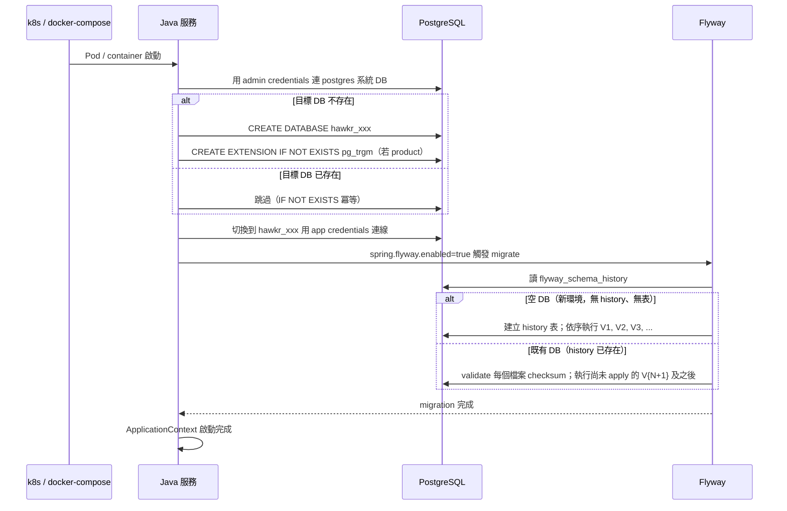
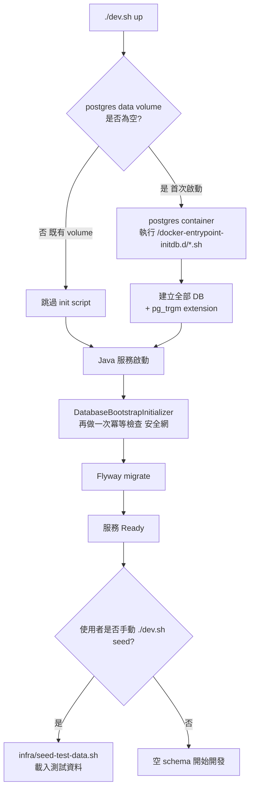

# Flyway 自動同步與 DB 自動初始化（Flyway Auto Sync & DB Auto Init）

> **本文件為 DB schema 演進與環境初始化的最高規範**。新增/修改 Flyway migration 與 DB bootstrap 流程時，先在本文件對齊規則，確認後再實作程式碼。
> 規範速查層見 [Java 微服務開發規範 §9.3](../開發規範/Java%20微服務開發規範.md)。

---

## 1. 概述

### 1.1 目的

讓所有 Java 微服務具備：

1. **改 DDL 即部署即自動同步** — 開發者僅需新增 `V{N+1}__xxx.sql`，部署後 Flyway 自動套用，無需任何人工 DB 操作。
2. **新環境部署零手動初始化** — 新 VM 第一次部署時，DB 與 extension 由服務自身在啟動階段自動建立，無需事前 `CREATE DATABASE`。
3. **既有環境零資料影響** — bootstrap 與 migration 機制本身只動 `flyway_schema_history` metadata 與 schema，不觸碰任何業務資料。

### 1.2 涵蓋範圍

| 範圍 | 內容 |
|------|------|
| **全部 Java 微服務** | 清單以 `ls services/java/` 為準（不在此複述，避免腐化） |
| **2 種環境** | 本地（OrbStack docker-compose）/ k3s（Dev VM）。無 stage 環境 |
| **PostgreSQL** | 本地 `hawkr-postgres` container；k3s 透過 ExternalName Service 連 Infra VM (`${INFRA_HOST}`) 上的自架 PG |
| **DB admin 角色** | `dbadmin`（superuser）。Bootstrap 與 Flyway 共用同一組 credentials，未來如要降權再另外規劃 |

### 1.3 設計原則

| 原則 | 說明 |
|------|------|
| **V1 凍結，後續一律 V2+** | 已合併的 V1__init_*.sql 視為唯讀基線。所有 schema 變更走遞增 V2/V3/V4... |
| **冪等 bootstrap** | DB 建立、extension 安裝皆 `IF NOT EXISTS`；對既有環境完全無作用 |
| **無人工 SOP** | 沒有任何 checksum 對齊流程可走：改已套用的 migration 是「禁止」，不是「需要配合某個流程」 |
| **Seed 隔離** | `infra/seed-data/*.sql` 永遠不進 Flyway 流程，僅本地透過人類觸發；CI/CD 物理上不引用 |
| **既有資料零影響** | bootstrap 與 Flyway metadata 操作不變更業務 table；業務資料修正只能走顯式的 `data` migration 或一次性維運 SQL（§7） |

---

## 2. 整體流程

### 2.1 服務啟動流程（部署即同步）



### 2.2 新環境部署判定流程

```mermaid
flowchart TD
    A[新 VM 部署服務] --> B{PG 是否存在?}
    B -->|否| C[Infra VM 上自架 PG\n人類負責安裝]
    B -->|是| D[服務啟動]
    C --> D
    D --> E[DatabaseBootstrapInitializer\n用 admin 連 postgres 系統 DB]
    E --> F{目標 DB 存在?}
    F -->|否| G[CREATE DATABASE\n+ CREATE EXTENSION]
    F -->|是| H[跳過]
    G --> I[Spring Datasource 連目標 DB]
    H --> I
    I --> J[Flyway migrate]
    J --> K{flyway_schema_history\n是否存在?}
    K -->|否，且 DB 內無業務表| L[建立 history 表\n從 V1 開始跑]
    K -->|否，但已有業務表\n非預期情境| L2[baseline-on-migrate=true\n建立 baseline V0\n之後跑 V1+]
    K -->|是| M[validate 既有 checksum\n讀已 apply 版本]
    L --> N[執行 V1, V2, ...]
    L2 --> N
    M --> O[執行 V{maxApplied+1} 及之後]
    N --> P[服務 Ready]
    O --> P
```

### 2.3 本地開發流程



---

## 3. 詳細設計

### 3.1 V1 凍結與 V2+ 規則

| 規則 | 說明 |
|------|------|
| **V1 凍結** | 每個服務的 `V1__init_*.sql` 是唯讀基線，**禁止任何修改**（含格式、空白、註解——改動任一字元即破壞 checksum，該服務在所有既有環境啟動失敗） |
| **V2+ 漸進** | 新增欄位、新增表、新增索引、修改型別 → 全部以 `V{N+1}__{verb}_{target}.sql` 新增 |
| **檔案不可改** | 已 commit 的 V2、V3、... 與 V1 同等視為唯讀。修錯了補 V{N+1} 修正，不回頭改 |
| **out-of-order=false** | 維持預設，不允許跳號補上中間版本 |
| **破壞性 DDL 標紅** | `DROP TABLE` / `DROP COLUMN` / `ALTER COLUMN TYPE` 縮小型別 必須在 PR 描述標紅 + 設計書註明 + `pg_dump` 備份 |

### 3.2 Migration 命名規範

格式：`V{N}__{verb}_{target}.sql`

| Verb | 用途 | 範例 |
|------|------|------|
| `add` | 加欄位 | `V2__add_payment_deadline_to_orders.sql` |
| `create` | 建表 / 建索引 / 建 view | `V3__create_table_product_hashtag.sql`、`V6__create_index_on_product_search_text.sql` |
| `drop` | 刪欄位 / 刪表 / 刪索引（破壞性） | `V5__drop_column_legacy_status_from_product.sql` |
| `alter` | 改型別 / 改約束 | `V4__alter_column_amount_to_bigint_on_payment.sql` |
| `rename` | 改名 | `V8__rename_column_old_status_to_status_on_order.sql` |
| `data` | 一次性資料修正（極少用，需在檔頭註解寫理由 + 影響 row 數） | `V7__data_fix_orphan_order_items.sql` |

禁止：
- `V2__update.sql` / `V2__fix.sql` / `V2__misc.sql`（無意義或聚合名稱）
- `V2.1__xxx.sql` / `V2a__xxx.sql`（非整數版本）
- 一個 V{N} 內混合無關變更（拆成多支 V{N}、V{N+1}）

### 3.3 本地 postgres-init 腳本

**沿用既有 `scripts/init-databases.sh`**，已透過 `docker-compose-local.yml` line 29 掛載至 `/docker-entrypoint-initdb.d/init-databases.sh`：

```yaml
volumes:
  - postgres_data:/var/lib/postgresql/data
  - ./scripts/init-databases.sh:/docker-entrypoint-initdb.d/init-databases.sh:ro
```

該腳本負責：
- 建立全部 Hawkr DB（Java 與 Go 服務皆含）
- 依 `EXTENSIONS` dict 建立各 DB 需要的 extension，現含 `hawkr_content` 與 `hawkr_product` 的 `pg_trgm`

**新服務需要 extension 時**：加進 `scripts/init-databases.sh` 的 `EXTENSIONS` dict，**不要**寫進任何 migration。

**特性**：PostgreSQL 官方 image 只在 data volume 為空時執行此目錄內腳本。對既有環境完全無作用，**零資料風險**。

### 3.4 DatabaseBootstrapInitializer

**位置**：`services/java/shared/common-core/src/main/java/io/github/will413028/hawkr/common/db/DatabaseBootstrapInitializer.java`

**職責**：在 Spring DataSource 初始化之前，用 admin credentials 連 `postgres` 系統 DB，確保目標 DB 與必要 extension 存在。

**配置**：

```yaml
hawkr:
  db:
    bootstrap:
      enabled: ${DB_BOOTSTRAP_ENABLED:true}
      admin-url: jdbc:postgresql://${DB_HOST}:${DB_PORT}/postgres
      admin-user: ${DB_ADMIN_USER:${DB_USER}}        # 預設 fallback 到 app user
      admin-password: ${DB_ADMIN_PASSWORD:${DB_PASSWORD}}
      target-database: ${DB_NAME}
      extensions:                                     # 可選，部分服務需要
        - name: pg_trgm
          enabled: ${DB_EXT_PG_TRGM:false}
```

**生命週期**（精確）：
- 使用 `@AutoConfiguration(before = DataSourceAutoConfiguration.class)` 註冊
- 內含 `InitializingBean` 或靜態 `@PostConstruct`，於 DataSource bean 被建立**之前**取得獨立 JDBC connection 連 `postgres` 系統 DB
- 完成 bootstrap 後關閉 admin connection，由 Spring 繼續走 DataSource → Flyway → JPA 流程
- 失敗 fail-fast：log + 拋例外，停止啟動，禁止靜默 fallback
- 全程 log 用 `ObsLogger`，event 命名 `DatabaseBootstrap.{action}.{result}`，例如 `DatabaseBootstrap.createDatabase.success` / `DatabaseBootstrap.createExtension.skipped`

**安全考量**：

| 項目 | 處理 |
|------|------|
| Admin credentials | 本案 user 確認 `dbadmin` superuser 即可，預設 fallback 到 `DB_USER` / `DB_PASSWORD`。未來若要降權，再切到獨立 `hawkr_bootstrap` 角色 |
| k8s secret | 直接複用既有 `DB_USER` / `DB_PASSWORD` secret，無需新增 |
| SQL injection | DB 名稱來自配置（非使用者輸入），但仍以白名單字元（`[a-z_]+`）校驗 |

### 3.5 Extension 處理

| 環境 | 處理 |
|------|------|
| 本地 | `postgres-init` script 用 `POSTGRES_USER`（superuser）執行 `CREATE EXTENSION` |
| k3s | `DatabaseBootstrapInitializer` 在連目標 DB 後執行 `CREATE EXTENSION IF NOT EXISTS pg_trgm`（用 admin credentials） |
| migration 內 | **禁止**出現 `CREATE EXTENSION`。extension 的建立點只有上面兩處（本地 init script／bootstrap initializer）——寫進 migration 會讓非 superuser 的環境套用失敗 |

### 3.6 Seed 隔離

| 規則 | 說明 |
|------|------|
| `infra/seed-data/*.sql` **不可** 移入 `services/*/src/main/resources/db/migration/` | Flyway 永遠看不到 seed |
| `./infra/seed-test-data.sh` **僅人類觸發** | CI/CD pipeline、k8s manifest、helm values 皆禁止引用 |
| 本地 `./dev.sh up` 結尾**不自動跑 seed** | 維持「seed 是 opt-in」原則。需要時跑 `./dev.sh seed`（若無此命令，新增） |
| Dev VM / k3s 永遠不會有 seed 資料 | 物理隔離 |

### 3.7 FLYWAY_ENABLED 配置

| 設定點 | 值 |
|------|------|
| 每個 `services/java/*/src/main/resources/application.yml` | `enabled: ${FLYWAY_ENABLED:true}`——預設開啟，不得改成 default false |
| 每個 `k8s/values/*-service.yaml` | 明示 `FLYWAY_ENABLED: "true"`，不依賴預設值 |
| `baseline-on-migrate` | `true` |
| `baseline-version` | `0` |

新增 Java 服務時四項一次到位；遺漏 k8s values 的那一項會讓該服務在叢集上靜默不 migrate。

---

## 4. 驗收程序

### 4.1 本地清 volume 全鏈路驗證

```bash
# ⚠️ 必須直接對 docker compose 下 -v：./dev.sh down 不轉傳參數，
#    寫成 `./dev.sh down -v` 會被吃掉，volume 其實沒清（看起來清了、資料還在）
docker compose -f docker-compose-local.yml down -v   # 清掉 postgres data volume
./dev.sh up             # 觀察 postgres init script 是否執行
# 預期：全部 DB 自動建好；pg_trgm 在 content 與 product DB
# 預期：全部 Java 服務啟動成功，Flyway 各自從 V1 跑到最新版
```

### 4.2 Dev VM 上的 migration 驗收

**禁止**為驗證而 commit 假 migration（dummy column）——會在 dev / prod DB 留下垃圾欄位。驗收一律搭在**真實需要**的那支 migration 上：

1. 本地新增該 `V{N+1}__xxx.sql`，觀察 Flyway log
2. 跑該服務測試 ＋ 影響面評估
3. push → CI/CD → Dev VM 上 Pod 重啟
4. 確認四項：服務啟動成功（無 checksum mismatch）／DB 出現新 schema 變更／`flyway_schema_history` 多一筆 `V{N+1}`／全程無人工 SQL 與人工重啟

### 4.3 全新環境部署驗收

1. 建一個新 DB user ＋ 空 PG namespace
2. helm install 全部 Java 服務
3. 確認 `DatabaseBootstrapInitializer` 建好每個 DB 與需要的 extension
4. 確認 Flyway 從 V1 完整跑到最新版
5. 確認所有服務 Ready

---

## 5. 風險與緩解

| 風險 | 緩解 |
|------|------|
| **DatabaseBootstrapInitializer 早於 DataSource 拋例外導致服務啟動 race** | 設定為 `ApplicationContextInitializer` 階段執行，先於任何 DataSource bean；失敗立即 fail-fast |
| **開發者修改已套用的 V1~V{N}** | 《Java 微服務開發規範》§9.3 條文 ＋ 自我檢查清單條目；本設計書明示「修改已套用 migration 立即破壞所有環境」 |
| **破壞性 V{N} 誤刪資料** | PR 描述標紅 ＋ 強制 `pg_dump` 備份 ＋ Code Review 必檢 |
| **seed 不小心被誤觸發到 dev** | 物理隔離：`infra/seed-data/` 與 `seed-test-data.sh` 完全不在 CI/CD pipeline 引用範圍；helm 不引用；k8s manifest 不引用 |
| **DB admin credentials 外洩** | 本案維持與 app credentials 同源（superuser）。未來若降權，新增獨立 secret `DB_ADMIN_PASSWORD`，與 `DB_PASSWORD` 分開管理 |

---

## 6. 一致性、交易與補償

**單一寫入路徑為唯一真實來源；不引入補償任務基礎設施。**

| 寫入點 | 維護內容 |
|--------|---------|
| `DatabaseBootstrapInitializer` 啟動階段 | `CREATE DATABASE IF NOT EXISTS` + `CREATE EXTENSION IF NOT EXISTS` |
| Flyway migrate 階段 | DDL schema 變更（V2+） |

**不做**：
- 不做 DB schema reconciliation job
- 不做 sample 比對 / drift 偵測（屬 DB observability 層級，不在 application）
- 不做 backfill CLI（既有資料補值由開發者直接 SQL 處理）

既有資料維護（少數需要時）由開發者以一次性 SQL 完成，**不寫入 application code、不留在 codebase**（見《後端服務責任邊界規範》）。

---

## 7. 開發者新增 V2+ 的標準流程

```
1. 在對應服務 src/main/resources/db/migration/ 加 V{N+1}__{verb}_{target}.sql
2. 本地驗證：
   2.1 ./dev.sh restart {service}
       （禁止改用本地 mvn spring-boot:run / IDE 裸跑：那會與容器內同名服務同時存在，
        RabbitMQ round-robin 會把訊息分流到兩個實例，測試結果不可信。
        見《Java 微服務開發規範》§13.1 服務實例唯一性）
   2.2 觀察 Flyway log 顯示 "Migrating schema 'public' to version {N+1}"
   2.3 docker exec hawkr-postgres psql -U dbadmin -d hawkr_{service} \
       -c "SELECT * FROM flyway_schema_history ORDER BY installed_rank DESC LIMIT 3;"
       確認 V{N+1} 紀錄入帳
3. 跑該服務測試 + 受影響 RPC 測試
4. 破壞性 DDL：PR 描述標紅 ＋ 受影響的 DB 預先 pg_dump
5. push → CI/CD → Dev VM 啟動時自動 migrate
6. 部署完成觀察服務 log，確認 Flyway migration 成功
```

**禁止**：
- ❌ 修改既有 V1~V{N} 任一檔案
- ❌ 跳號版本（V{N+2} 不能在 V{N+1} 之前合併）
- ❌ 把 seed 寫進 migration
- ❌ 一次 commit 包含多個非相關 V2+（拆 PR）
