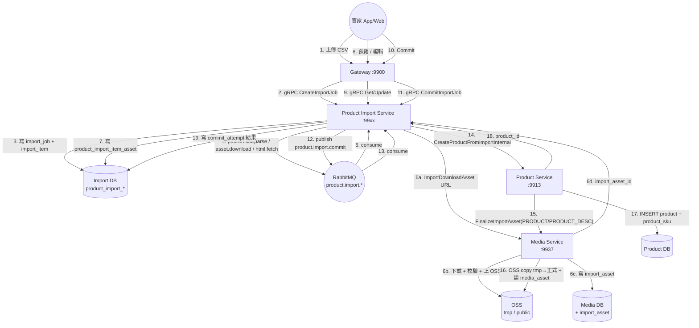
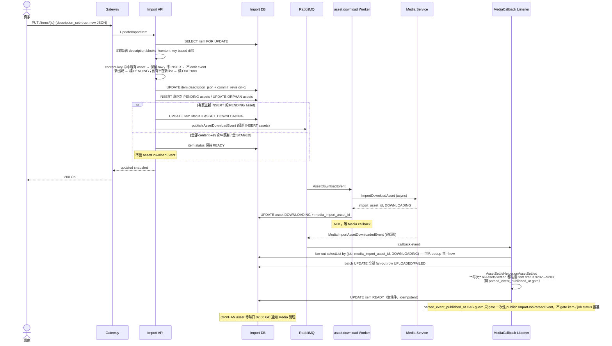
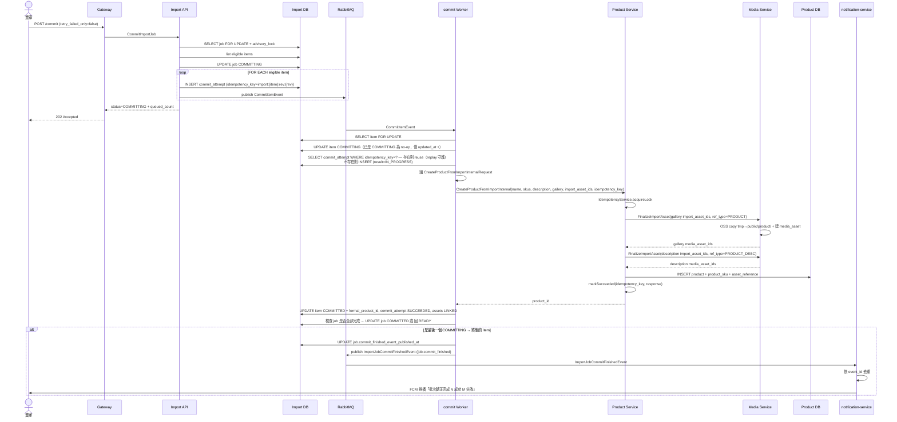
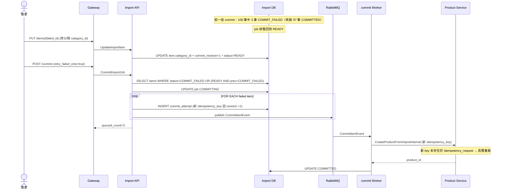
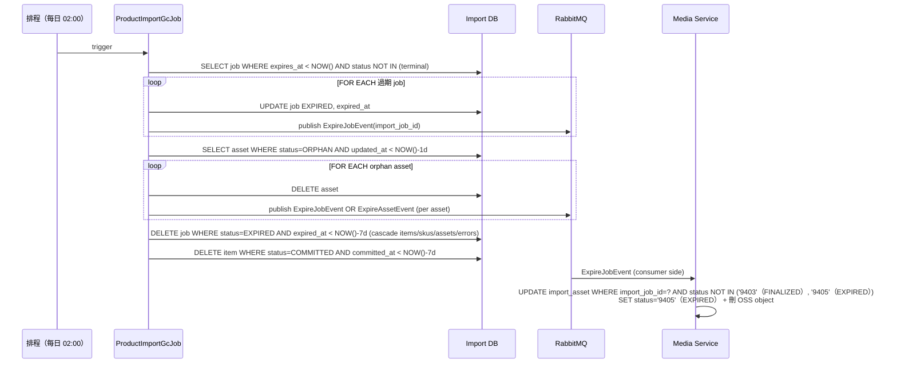

# Product Import Service 詳細設計書

---


> ⚠️ **錯誤處理慣例**：本設計書內所有 sequence diagram 之 gRPC client 呼叫，error path 統一依 [`Java gRPC 錯誤處理規範.md §7.2.1`](../開發規範/Java%20gRPC%20%E9%8C%AF%E8%AA%A4%E8%99%95%E7%90%86%E8%A6%8F%E7%AF%84.md#721-%E6%AC%8A%E5%A8%81%E6%99%82%E5%BA%8F%E5%9C%96%E6%89%80%E6%9C%89%E8%A8%AD%E8%A8%88%E6%9B%B8%E5%BC%95%E7%94%A8%E6%AD%A4%E5%9C%96%E4%B8%8D%E5%86%8D%E5%80%8B%E5%88%A5%E7%B9%AA%E8%A3%BD)。個別 diagram 僅繪製 happy path，error 分支不重複繪製。Client 禁止 `if (resp.code != 0) throw`、禁止 `throw new RuntimeException`，一律 `GrpcClientErrorTranslator.translate(e, XxxBusinessException::new)`。

## 1. 服務概述與責任邊界

### 1.1 服務職責

- **唯一職責**：作為賣家**批次匯入商品**的暫存資料管理與轉正協調服務
- **核心功能**：
    - 接收 CSV 上傳、解析、欄位驗證、商品群組（`product_key`）聚合
    - 商品描述 **HTML → blocks JSON** 轉換（含 inline 樣式拆解、不支援元素降級）
    - 協調 **Media Service** 下載外部 URL 圖片並建立 import_asset
    - 暫存商品（ImportItem）的列表、預覽、編輯、移除、恢復、重試
    - 賣家確認後逐筆呼叫 **Product Service** 內部 RPC 正式轉正
    - import_job 級別生命週期管理：過期標記、級聯清理 import 端與 Media 端資產
    - 透過 RabbitMQ 解耦解析 / 下載 / 轉正三個重型工作，避免阻塞 API
- **不負責**：
    - 正式商品 CRUD（屬 Product Service §02）
    - R2 操作、圖片下載/校驗/壓縮（屬 Media Service §08）
    - 分類體系維護（屬 Product Service §02）
    - 運費規則、配送驗證（屬 Shipping Service §06、§22）
    - 賣家身份驗證、認證狀態（屬 Gateway / Account）

### 1.2 上游 / 下游依賴

**上游依賴（Product Import Service 呼叫）：**

| 服務 | 通訊 | 呼叫的 RPC | 用途 |
|------|------|-----------|------|
| Media Service | gRPC | `ImportDownloadAsset` | 外部 URL 圖片下載 + 建立 import_asset（無 TTL JWT） |
| Media Service | gRPC | `FinalizeImportAsset` | 轉正階段：把 import_asset 搬到正式 PRODUCT / PRODUCT_DESC refType |
| Product Service | gRPC | `CreateProductFromImportInternal` | 轉正階段：把暫存商品建立為正式商品 |
| Product Service | gRPC | `ValidateLeafCategoryInternal` | CSV 解析階段驗證 `category_id` 是否為合法葉節點（**Product Service 既無此 RPC，本設計書要求新增**，見 02 號設計書修訂） |
| Product Service | gRPC | `VerifyCertification` | 驗證 certification 號碼是否合法（傳 enum **value**=3701 而非 name=ORGANIC）。⚠️ **本服務無直接呼叫端**：認證驗證一律經 `ValidateProductDraft` 內的 `ProductPublishValidator.validateCertifications`，該處**不得發起外部呼叫**，只讀查驗快取（§11.3a） |
| Product Service | gRPC | `BatchCheckSellerProductNames` | CSV 解析 + 賣家編輯時批次偵測商品名稱是否與賣家既有商品重複（**Product Service 既無此 RPC，本設計書要求新增**，見 02 號設計書修訂） |
| Shipping Service | gRPC | `ListSellerShippingMethods` | CSV 解析時取賣家可用配送方式（含 onboarding_status + enabled），用於降級判定 |

**下游消費（其他服務消費本服務的事件）：**

- 無 — Product Import Service **不發任何業務事件給其他微服務**。所有 MQ topic 純內部 worker 解耦使用。

**本服務消費的 MQ 事件**（內部 worker，詳見 §6）：

| Queue | 用途 |
|-------|------|
| `product.import.csv.parse` | CSV 上傳後（L2 通過）排入解析 |
| `product.import.html.fetch` | 描述以 URL 形式提供時 fetch HTML（auto-detect by URL prefix） |
| `product.import.asset.download` | 圖片下載任務（呼叫 Media `ImportDownloadAsset`） |
| `product.import.commit` | 賣家觸發 commit 後逐筆轉正任務 |
| `product.import.media.callback`（跨服務消費 `hawkr.media` exchange `import.asset.downloaded`）| Media 端 async 下載完成的結果回推 |

### 1.3 非職責範圍

- **不直接寫 Product DB**：所有正式商品建立透過 `CreateProductFromImportInternal` 由 Product Service 主導
- **不直接操作 R2 / Image Gateway**：所有圖片資產生命週期屬 Media Service（儲存後端詳見 49 號設計書）
- **不發業務事件給其他微服務**：轉正成功後由 Product Service 內部負責後續事件（quotient 一致與[後端服務責任邊界規範](../開發規範/後端服務責任邊界規範.md)）
- **不做資料補償 / drift 偵測 / reconciliation job**（見[後端服務責任邊界規範](../開發規範/後端服務責任邊界規範.md)）：賣家工具的容錯由前端流程與賣家手動操作保證，後端不引入背景修補
- **不做運費 / 庫存 / 物流預驗**：暫存商品在「未轉正」狀態時不參與這些檢查；轉正後由 Product / Shipping 各自負責
- **不維持與既有 web `products-import` 前端的相容性**：前端 `hawkr-website/features/seller-center/products-import/` 一律對接本服務

### 1.4 系統架構圖



### 1.5 名詞定義

| 名詞 | 說明 |
|------|------|
| ImportJob | 一次 CSV 匯入任務，對應 `product_import_job` 一筆。一般生命週期 7 天（參數化）；`CSV_INVALID` 狀態獨立 TTL 3 天（避免廢 job 永久佔配額），到期自動 EXPIRED |
| ImportItem | ImportJob 內的單一暫存商品，對應 `product_import_item` 一筆。同 `product_key` 的 CSV row 聚合為 1 個 ImportItem |
| ImportItemSku | ImportItem 下的 SKU，對應 `product_import_item_sku`。1 個 row = 1 個 SKU，由 `product_key` 群組 |
| ImportAsset | Media Service 端「給 Import 用」的圖片暫存資產，對應 Media 新增的 `import_asset` 表。**無 TTL JWT**，純 UUID 識別，隨 ImportJob 過期級聯清理 |
| ProductPreview | ImportItem 對外回應中的「與正式商品展示 DTO 相容」段落，前端可重用商品卡 / 詳情頁元件渲染 |
| SourceUrl | 賣家在 CSV 提供的外部 URL（圖片或 description HTML），由本服務經 SSRF 守則校驗後委派 Media 下載 |
| Idempotency Key | 各 RPC 的冪等識別。CSV 上傳用 `SHA256(file) + store_id`；圖片下載用 `SHA256(url) + import_job_id`；commit 轉正用 `import_item_id:rev:{commit_revision}` |
| commit_revision | ImportItem 上的單調遞增整數，每次賣家編輯後 +1。轉正時帶入 idempotency key 避免 Product Service 端 hash mismatch |
| target_status | 賣家選擇的「轉正後初始商品狀態」（Commit 後預計 status），合法值：`ACTIVE` / `DRAFT` / `PENDING_REVIEW`。**不接受 INACTIVE**。**注意**：item.status = COMMITTED 後，前端應改顯 `formal_product_status`（即時查 product-service）取代 target_status 顯示，避免「賣家在商品管理頁改了上下架，但匯入精靈顯示舊值」的歧義（見 §2.2 前端配合規範） |
| formal_product_status | 對應 ImportItemBrief.formal_product_status；item.status = COMMITTED 後，由 `ListImportItems` 對該頁 COMMITTED items batch RPC 查 product-service `GetProductsBriefInternal(formal_product_ids[])` 即時取得；**不落地反正規化**（見 §3.5 落地策略） |
| 儲存（暫存編輯） vs Commit（併入正式商品） | 業務語意嚴格區分：**儲存**透過 `UpdateImportItem` 落 `product_import_item` 暫存資料，永遠可存（即使含 ERROR），且即使欄位值沒有實質變動也必須重跑 `ValidateProductDraft(IMPORT_UPDATE)` 後重算 `blocking_error_count` / warning；**Commit**透過 `CommitImportJob` 走 ValidateProductDraft final guard 後寫入正式 `product` 表（02 號設計書），不可逆。前端編輯頁的「儲存 / 儲存並下一條」按鈕**只觸發儲存**；commit 動作集中在列表頁「批量勾選 + Commit」按鈕（含 ERROR item 自動剔除，見 §4.2.5 批量規則）|
| Validator 三時機點 | ProductPublishValidator（02 號）統一驗證規則，本服務在 §5.2 parse / §5.5 save / §5.7 commit final guard 三個時機點呼叫 `ValidateProductDraft`（context 區分），確保 csv 路徑不能繞過任何上架檢核。Draft snapshot 構建來源見 §4.3a |
| product_key | CSV 內的群組欄位，每 row 必填；同值的 row 聚合為同一 ImportItem 的多個 SKU |
| Layer 1（L1） | CreateImportJob / ReuploadImportJobCsv 入口的**同步檔案結構驗證**（編碼/size/header/row 數）；失敗時不建立 / 不更新 job |
| Layer 2（L2） | INSERT job 後的**同步純記憶體內容驗證**（必填/enum/數字/連動）；L2 失敗 → job.status=CSV_INVALID + validation_errors 落 DB |
| CSV_INVALID | L2 失敗的 job 狀態，等待賣家重傳 CSV（PUT /jobs/{id}/csv），無重傳次數上限；CSV_INVALID 占 active job 配額與檔名鎖 |
| blocking_error_count | ImportItem 反正規化欄位，等於該 item 對應的 `product_import_item_error WHERE severity=ERROR` 筆數；commit eligible filter 用此判定（=0 才可 commit） |
| 降級（Degradation） | 部分內容不符合政策時自動取消啟用該部分（如 shipping × dimension 超限 → 停用該配送方式），記為 warning 不擋 commit |
| 三類錯誤分級 | A=可修+不修不可 commit（ERROR）；B=不可修（在 L1/L2 已 reject，不會落到 item 級）；C=可修+不修也可 commit（WARNING/降級） |
| 重名分類 | `DUPLICATE_NAME_IN_JOB`（同 job 內多 product_key 同名）→ 必須改名；`DUPLICATE_NAME_VS_EXISTING`（與賣家既有商品同名）→ 可勾選 `allow_duplicate_name` 確認 |

### 1.6 角色與權限邊界

| 呼叫來源 | 呼叫方式 | 可用 RPC | 權限機制 |
|----------|----------|----------|----------|
| Gateway（前端 APP / Web，賣家 JWT） | gRPC（經 JWT 驗證） | `CreateImportJob`、`ReuploadImportJobCsv`、`GetImportJob`、`ListImportJobs`、`ListImportItems`、`GetImportItem`、`GetImportItemPreview`、`GetImportJobPreviewListing`、`UpdateImportItem`、`RemoveImportItems`、`RestoreImportItems`、`RetryImportItemAssets`、`BatchUpdateItemsShipping`、`BatchUpdateItemsTargetStatus`、`BatchUpdateItemsCategory`、`CommitImportJob`、`CancelImportJob` | `GrpcAuthContext.requireAccountType(SELLER)`；所有 DB query 強制 `WHERE store_id = ?` |
| 其他微服務 | — | 無 | 本服務**不對其他微服務開放任何 RPC**（純賣家工具） |
| 排程任務（本服務內部） | — | `ProductImportGcJob` | 每日 02:00 跑過期清理（避開 Media GC 03:00）+ 每 5 分鐘 callback timeout 短週期掃描 |
| RabbitMQ Consumer（本服務內部 + 1 跨服務） | MQ Listener | 內部 4 queue + Media callback queue（見 §6） | 內部 worker，無對外身份概念 |

**安全守則**：

- 所有 import_job / import_item / import_asset 都帶 `store_id`，**禁止跨賣家查詢**
- Gateway 以 `sellerid` resolver 把 JWT `x-account-id` 解析為現任 `store_id` 後注入 request；服務端比對 ImportJob 的 `store_id`，不一致回 `404 Not Found`（不洩漏 ImportJob 存在）
- 賣家未通過實名認證（cert-gate）不可建立 ImportJob——由 Gateway 上游檢查

---

## 2. 狀態模型與業務規則

本服務有 **4 個獨立狀態機**：

1. ImportJob 狀態機（job 級）
2. ImportItem 狀態機（item 級）
3. ImportAssetLocal 狀態機（Import 端 `product_import_item_asset.status`）
4. ImportAssetMedia 狀態機（Media 端 `import_asset.status`，定義於本服務但屬 Media DB）

所有狀態更新均遵守「白名單狀態轉移」+ 樂觀鎖（`version` 欄位）。

### 2.1 ImportJob 狀態機

| Code | Status | 說明 |
|------|--------|------|
| 9101 | CREATED | metadata 建立完成（CSV 已落 OSS）；本狀態為 L2 同步驗證執行中的瞬間態，正常情況 < 1 秒 |
| 9102 | PARSING | CSV 解析中（背景 worker 處理中） |
| 9103 | PARSE_FAILED | 整檔解析失敗（worker 內 RPC 鏈斷掉等系統錯誤，並非個別 row 內容錯），**終態**；row 級錯誤不會到此狀態（已在 L2 或 worker 內被識別為個別 item ERROR） |
| 9104 | READY | 解析完成，賣家可預覽、編輯、commit；個別 item 可能仍在下載或有 blocking_error 待修 |
| 9105 | COMMITTING | 賣家觸發 commit，本 job 鎖定不接受編輯 |
| 9106 | COMMITTED | 所有 eligible item 都 COMMITTED，**終態** |
| 9107 | EXPIRED | 過期，**終態**；GC 觸發級聯清理。一般狀態 TTL 7d；CSV_INVALID 獨立 TTL 3d |
| 9108 | CANCELLED | 賣家中止，**終態**；級聯通知 Media 清 import_asset |
| 9111 | CSV_INVALID | L2 同步驗證失敗，等賣家重傳 CSV（PUT /jobs/{id}/csv 對既有 job 換 CSV）；重傳次數無上限，但只有此狀態允許重傳 |

**轉移矩陣（白名單）：**

| From ＼ To | 9101 | 9102 | 9103 | 9104 | 9105 | 9106 | 9107 | 9108 | 9111 |
|------------|------|------|------|------|------|------|------|------|------|
| CREATED (9101)    | - | ◯ | - | - | - | - | ◯ | ◯ | ◯ |
| PARSING (9102)    | - | - | ◯ | ◯ | - | - | ◯ | ◯ | - |
| READY (9104)      | - | - | - | - | ◯ | - | ◯ | ◯ | - |
| COMMITTING (9105) | - | - | - | ◯ | - | ◯ | - | - | - |
| CSV_INVALID (9111)| ◯ | - | - | - | - | - | ◯ | ◯ | ◯ |
| PARSE_FAILED (9103) | - | - | - | - | - | - | ◯ | - | - |
| COMMITTED (9106)  | 終態 |
| EXPIRED (9107)    | 終態 |
| CANCELLED (9108)  | 終態 |

**關鍵業務規則：**

- **CREATED → CSV_INVALID**：INSERT job 後 L2 sync 跑出 fail → 同事務 UPDATE 為 CSV_INVALID + 寫 validation_errors
- **CREATED → PARSING**：L2 sync pass → 同事務 UPDATE + publish CsvParseEvent
- **CSV_INVALID → CREATED**：賣家重傳 CSV（PUT /jobs/{id}/csv）內部短暫經此態回到 L2 流程；對賣家不可見
- **CSV_INVALID → CSV_INVALID**：重傳後 L2 仍 fail；validation_errors 覆寫，無重傳次數上限
- **CSV_INVALID 配額**：占用 active job 配額與檔名鎖，避免賣家堆積廢 job；不取消就 3 天到期 EXPIRED 自動釋放
- **COMMITTING → READY**：該批 commit worker 全部結束後，若仍有未轉正的 READY item（例如該批只 commit 勾選項目）或 COMMIT_FAILED item，job 回到 READY 讓賣家可繼續 commit / 編輯後 retry；只有無 READY / COMMIT_FAILED 殘留時才 → COMMITTED
- **READY → CANCELLED**：賣家可隨時中止；中止後 Media 端 import_asset 標 EXPIRED 由 Media GC 清
- **CREATED → EXPIRED**：CSV 上傳但未開始解析（罕見，例如 worker 全掛），過期仍直接清
- **COMMITTED 後不可 CANCELLED**：已正式建立的商品不在本服務職責內，賣家需到 Product 管理頁下架

### 2.2 ImportItem 狀態機

> ⚠️ **無 PARSE_FAILED**：item-level row-structure error 在 L1/L2 階段已整檔 reject，不會建立 item entity；所有 row-level「業務規則」錯誤（缺長寬高、cert 驗證失敗、shipping 全降級、重名衝突等）走「READY + blocking_error_count > 0」路徑，賣家可編輯修復。Item 狀態機共 **7 個狀態**。

| Code | Status | 說明 |
|------|--------|------|
| 9201 | PARSED | CSV row 解析完成，等待圖片下載排程 |
| 9202 | ASSET_DOWNLOADING | gallery / description 圖片下載中 |
| 9203 | READY | 圖片下載完成（含部分 FAILED 但允許繼續，由 warning 標示）；含 blocking_error_count > 0 的 item 也是 READY，但 commit eligible filter 會排除 |
| 9205 | REMOVED | 賣家手動移除（暫時隱藏，可 RestoreImportItems） |
| 9206 | COMMITTING | 在 commit 中（本 item 由 commit worker 處理中） |
| 9207 | COMMITTED | 成功轉正，**終態**，immutable |
| 9208 | COMMIT_FAILED | 轉正失敗（可 retry 或編輯後 retry） |

**轉移矩陣（白名單）：**

| From ＼ To | 9201 | 9202 | 9203 | 9205 | 9206 | 9207 | 9208 |
|------------|------|------|------|------|------|------|------|
| PARSED (9201)            | - | ◯ | - | ◯ | - | - | - |
| ASSET_DOWNLOADING (9202) | - | - | ◯ | ◯ | - | - | - |
| READY (9203)             | - | ◯ | - | ◯ | ◯ | - | - |
| REMOVED (9205)           | - | - | ◯ | - | - | - | - |
| COMMITTING (9206)        | - | - | - | - | - | ◯ | ◯ |
| COMMIT_FAILED (9208)     | - | ◯ | ◯ | - | ◯ | - | - |
| COMMITTED (9207)         | 終態 |

**關鍵業務規則：**

- **READY ↔ ASSET_DOWNLOADING**：賣家編輯 description 或圖片 URL 觸發重下載時退回 ASSET_DOWNLOADING
- **READY + blocking_error_count = 0**：commit eligible，賣家可勾選 commit
- **READY + blocking_error_count > 0**：UI 顯示「需修正」，不可勾選 commit；賣家編輯欄位修錯誤後再驗 → 0 時可 commit
- **COMMIT_FAILED → ASSET_DOWNLOADING/READY**：賣家編輯 item（修分類、改 SKU、補圖）後 commit_revision +1，重新驗證 + 重新下載（如有變動）→ READY
- **REMOVED 不影響 ImportJob 狀態**：REMOVED 的 item 不參與 commit；item 個別計數仍納入「總筆數 / 已選 N 筆」UI 顯示
- **無 PARSE_FAILED**：見章首註記。需修正 row 結構錯誤的場景只有「L1/L2 reject 整檔重傳」一條路
- **Commit 後 item 唯讀（強制）**：item.status = COMMITTED 為**終態 + immutable**，對應業務語意「已併入正式商品」。下列 RPC 對 COMMITTED item 一律拒絕：
  - `UpdateImportItem` → 回 `FAILED_PRECONDITION` `IMPORT_ITEM_ALREADY_COMMITTED`
  - `RemoveImportItems` → 同上（含批次中即使部分為 COMMITTED 也應將該 id 從本次 batch 剔除並在 response 標明）
  - `RetryImportItemAssets` → 同上（COMMITTED 不需再下載 asset）
  - `BatchUpdateItemsShipping` / `BatchUpdateItemsTargetStatus` / `BatchUpdateItemsCategory` → 同上
- **Commit 後詳細 / 預覽不可讀（強制）**：item.status = COMMITTED 後，`GetImportItem` / `GetImportItemPreview` 對該 item 回 `NOT_FOUND`，避免賣家透過 URL 進入已轉正的暫存編輯或預覽資料。列表 `ListImportItems` 仍保留 COMMITTED row 供歷史追蹤與顯示正式商品狀態；`GetImportJobPreviewListing` 永遠排除 COMMITTED item。
- **前端配合（UI 規範）**：COMMITTED item 在列表 / 詳情頁**不顯示「編輯」「移除」「重試」按鈕**，改顯示「已併入正式商品（目前狀態：上架中 / 下架 / 草稿）」+ 連結到正式商品（用 `formal_product_id` + `formal_product_status` + `formal_product_status_label`，見 §4.2.6 ImportItemBrief 欄位定義）
- **正式商品狀態變動不回灌 import 端**：賣家 commit 後在「商品管理」上下架，import 端的 ImportItem 狀態維持 COMMITTED，只在 ListImportItems 即時查 product-service 取 `formal_product_status` 給前端顯示（避免 cron 同步 / 反正規化）

### 2.3 ImportAssetLocal 狀態機（Import 端 `product_import_item_asset.status`）

| Code | Status | 說明 |
|------|--------|------|
| 9301 | PENDING | 剛建立，尚未推 MQ 排下載 |
| 9302 | DOWNLOADING | 已推 MQ，Media 處理中 |
| 9303 | UPLOADED | Media 回報下載成功，import_asset_id 已綁定 |
| 9304 | FAILED | 下載失敗（記 failure_reason，可重試） |
| 9305 | LINKED | commit 階段 FinalizeImportAsset 完成 + Product Service 寫入引用，**終態** |
| 9306 | ORPHAN | 賣家編輯後舊圖被取代，等 GC 清理（會通知 Media 釋放對應 import_asset） |

**轉移矩陣：**

| From ＼ To | 9301 | 9302 | 9303 | 9304 | 9305 | 9306 |
|------------|------|------|------|------|------|------|
| PENDING (9301)     | - | ◯ | - | - | - | ◯ |
| DOWNLOADING (9302) | - | - | ◯ | ◯ | - | ◯ |
| UPLOADED (9303)    | - | ◯ | - | - | ◯ | ◯ |
| FAILED (9304)      | - | ◯ | - | - | - | ◯ |
| LINKED (9305)      | 終態 |
| ORPHAN (9306)      | 終態（等 GC） |

**關鍵業務規則：**

- **重試**：FAILED → DOWNLOADING（賣家觸發 `RetryImportItemAssets` 或編輯後自動重排）
- **編輯取代**：賣家改 image URL 時舊 asset 直接 → ORPHAN，新 URL 走 PENDING 流程
- **dedup 落地**：同 import_job 內同 URL（正規化後 hash）共用同一筆 asset 記錄，不重複建立

### 2.4 ImportAssetMedia 狀態機（Media 端 `import_asset.status`）

> 本表屬 Media DB，但狀態機在本設計書定義（協同 08 號設計書修訂）。

| Code | Status | 說明 |
|------|--------|------|
| 9401 | DOWNLOADING | Media 正在 fetch 外部 URL |
| 9402 | UPLOADED | 已落 OSS tmp 路徑 |
| 9403 | FINALIZED | `FinalizeImportAsset` 完成，物件已搬到正式 refType 路徑、`media_asset` 已建立 |
| 9404 | FAILED | 下載失敗（含 SSRF 拒絕、size 超限、timeout、404 等） |
| 9405 | EXPIRED | ImportJob 過期或 CANCELLED 觸發清理；OSS object 已刪 |

**轉移矩陣：**

| From ＼ To | 9401 | 9402 | 9403 | 9404 | 9405 |
|------------|------|------|------|------|------|
| DOWNLOADING (9401) | - | ◯ | - | ◯ | ◯ |
| UPLOADED (9402)    | - | - | ◯ | - | ◯ |
| FAILED (9404)      | - | - | - | - | ◯ |
| FINALIZED (9403)   | 終態 |
| EXPIRED (9405)     | 終態 |

**關鍵業務規則：**

- **FINALIZED 後 import_asset 仍保留**：紀錄用，與 `media_asset` 透過 foreign key 連結；不可級聯刪除（避免遺失審計線索）
- **EXPIRED 不刪 DB row**：只刪 OSS object + 標 EXPIRED，DB 保留 30 天供審計，之後由 Media GC 第二輪清理
- **DOWNLOADING → EXPIRED**：罕見情境（ImportJob CANCELLED 時還在下載中）；Worker 收到 cancel 訊號後讓正在跑的 stream abort，狀態落 EXPIRED

### 2.5 狀態更新落地規範

**樂觀鎖 + 白名單條件更新（共通模式）：**

```sql
UPDATE product_import_job
SET status = #{newStatus}, version = version + 1, updated_at = NOW()
WHERE id = #{id}
  AND status = #{expectedFromStatus}
  AND version = #{expectedVersion};
-- 影響筆數 = 0 → 拋 OptimisticLockException
```

**禁止裸 UPDATE**：所有狀態變更必須帶 `expectedFromStatus` 與 `version`，避免並發踩腳。

**終態保護**：

- 在 DB 層加 CHECK：終態（COMMITTED / EXPIRED / CANCELLED / PARSE_FAILED）的 row 拒絕 UPDATE 任何欄位
- 應用層額外驗證：service 進入更新前先讀當前狀態，若為終態直接回 `409 Conflict`

**事務邊界**：

- 單一 import_item 的狀態 + 其下 sku/asset/error 子表變更 + `blocking_error_count` 反正規化必須**同事務**完成
- 跨 item 操作（批次 remove / restore / 批次套用運送 / 批次套用 target_status / 批次套用分類）使用單 SQL `UPDATE ... WHERE id IN (...)` 不分 N 個事務
- ImportJob 級 COMMITTING 鎖：用 PostgreSQL advisory lock `pg_advisory_xact_lock(import_job_id)` 確保同 job 同時只有一個 commit worker 在跑
- L2 結果 + status 落地必須同事務：避免「INSERT job 但 L2 結果丟失」的中間態洩漏到 API 觀察者
- **★ CSV 上傳到 R2 必須在事務外，且排在所有會拋錯的檢查之後**（`CreateImportJob` / `ReuploadImportJobCsv` 同規）：
  R2 不參與 DB 事務。順序固定為 parse/L2 先跑 → 上傳 → `TransactionTemplate` 內 INSERT/UPDATE + publish，
  **落庫失敗即補償刪除剛上傳的物件**。上傳若排在會拋錯的檢查之前，parse 失敗拋 `INVALID_ARGUMENT` → rollback ⇒
  **R2 留下一個沒有 `product_import_job` 列的 CSV**，而 §7 GC 是照 job 列刪物件的，掃不到它。
- **★ 重傳（`ReuploadImportJobCsv`）的舊物件只能在新 key 落庫成功之後才刪**：
  刪除若排在 UPDATE 之前，一旦後續失敗 rollback，`source_object_key` 仍指著已被刪除的舊物件（DB 死指標）。

**Tx 載體規定（強制）**：

- 短 tx 落地（§5.5 階段 3 / §5.5a–c 批次操作 / §5.7 commit final guard）**必須以 `TransactionTemplate.execute(...)` 程式式包覆**，禁止用 `@Transactional` annotation 於同 class private/protected 方法、或從同 class 內部 `this.method(...)` 直接 call 的 method 上。Spring AOP CGLIB proxy 不攔截 self-invocation → annotation 失效 → 任何 mid-flight throw 不會 rollback，造成 DELETE 已執行 / INSERT 未補的破壞性副作用（如 SKU reconciliation 中途拋 `INVALID_ARGUMENT` 留下空 SKU row）
- public 方法由 gRPC handler 從外部 call 才可保留 `@Transactional`（透過 proxy 攔截）
- 違規檢核：本服務及未來新增 service 不得出現 `@Transactional protected` 或同 class 內 `this.fooTx(...)` 模式

**RPC 重驗證原則（防長交易）**：

- `UpdateImportItem` / 批次操作觸發的 RPC 重驗證（`ValidateLeafCategoryInternal` / `ValidateProductDraft`（含認證，無外部呼叫，§11.3a） / `BatchCheckSellerProductNames`）**必須在 DB tx 外執行**，拿到結果後再開短 tx 落地
- 不可在同一 DB tx 內 hold RPC（避免長交易鎖住 row、影響並發）
- pattern：`RPC 結果 → 短 tx：UPDATE entity + INSERT/DELETE error rows + UPDATE blocking_error_count`

**MQ event 邊界**：

- 進入 ASSET_DOWNLOADING / COMMITTING 之前的狀態變更**必須先落 DB 再發 MQ**，避免 worker 拿到 event 但 DB 還沒看到（Spring Tx synchronization `afterCommit` callback）
- DLQ 反向流程：worker 處理失敗超過 retry 上限後，狀態回退到 FAILED，**不發補償 event**（見[後端服務責任邊界規範](../開發規範/後端服務責任邊界規範.md) — 不引入補償基礎設施）

**ImportJob / ImportItem 狀態推進觸發點（必含實作）**：

| 觸發點 | 同事務動作 |
|---|---|
| `MediaCallbackListener.applyCallback` 在 `allAssetsSettled`（assetsPending=0 + assetsDownloading=0）<br>（**Tx 載體**：實作為 `applyCallbackBody` private method 由 listener `onMediaCallback` 用 `TransactionTemplate` 包覆，見下方 `applyCallbackBody` 列） | **每次 settled 都跑（idempotent）**：(1) item `9202 ASSET_DOWNLOADING → 9203 READY`，WHERE import_job_id = ? AND status = '9202'；blocking_error_count > 0 的 item 仍維持 READY，由 `needs_fix` / counters 呈現「需修正」且不可 commit；(2) job `9102 PARSING → 9104 READY`（WHERE status='9102'，已 READY 為 no-op）。<br>**僅當 `parsed_event_published_at IS NULL` 時額外**：(3) `parsed_event_published_at = NOW()`；(4) publish `ImportJobParsedEvent`。<br>⚠️ **強制分流**：`parsed_event_published_at` CAS guard **只 gate 一次性 publish event**，**禁止**用來 gate item.status / job.status 推進 — 否則編輯後重下載完成時 item 卡 9202 永遠不推進 |
| `ItemMutationService.restoreItems` | UPDATE item SET status = '9201' / '9203'（依 blocking_error_count）, `removed_at = NULL`, version++ — **必須用 UpdateWrapper 顯式 `.set("removed_at", null)` 而非 entity setRemovedAt(null) + updateById**（MyBatis-Plus `updateById` 預設 FieldStrategy.NOT_NULL 會忽略 null 欄位，造成 status 推進但 removed_at 殘留，eligible filter 仍排除該 item） |
| `ItemMutationService.applyTx`（UpdateImportItem） | **必須以 `TransactionTemplate.execute(...)` 包覆**（對應 §2.5 Tx 載體規定），禁止 `@Transactional` 標於同 class self-invocation method。**error wipe scope**：只清「本次 update 會重新計算的 error type」（`DUPLICATE_NAME_VS_EXISTING`），其他 error（SKU 級 SHIPPING / WEIGHT_DIM 等）由 CSV parse / SKU 編輯路徑各自維護，**禁止整列 wipe**。`blocking_error_count` 重算：DB 上現存 ERROR 級且 type ≠ DUPLICATE_NAME_VS_EXISTING 的 count + 本次 update 新加入的 duplicate-name blocking。`skus_set=true` 代表 authoritative full list，但空清單不得被當成「刪除所有 SKU」靜默接受；必須以 `INVALID_ARGUMENT` 拒絕，真正刪到 0 SKU 需由明確 SKU delete 操作觸發並仍由 validator 產生 blocking error。 |
| `ItemMutationService.runValidateProductDraftForItems`（UpdateImportItem / BatchUpdate* 後） | 對受影響 item 以 DB current snapshot 呼叫 `ValidateProductDraft(IMPORT_UPDATE)`，同事務 wipe `source=VALIDATE_PRODUCT_DRAFT` 舊 row、insert 新 violations、重算 `blocking_error_count` / `warning_count`。此步驟是儲存與批次操作的共同尾端，不可只在 commit final guard 執行。 |
| `CommitItemService.markCommittingBody` / `applySuccessBody` / `applyValidationDriftBody` / `applyFailureBody` / `maybeFinalizeJobBody`（CommitItemListener / commit worker） | **必須以 `TransactionTemplate.execute(...)` 包覆**（對應 §2.5 Tx 載體規定），禁止 `@Transactional` 標於同 class self-invocation method。`commitOne` 主流程依序開 5 段短 tx：markCommitting（item COMMITTING + attempt INSERT/reuse）→ 跑 final guard RPC（tx 外）→ applySuccess / applyValidationDrift / applyFailure 三選一收尾（item 終態 + attempt 終態 + asset LINKED）→ maybeFinalizeJob（job 終態 + commit_finished_event 一次性 publish）。任一段 mid-flight throw 必須 rollback 該段所有 DB 寫入；段間互不影響，由 caller 控管推進順序與 stale-revision guard。 |
| `MediaCallbackListener`（Media callback fan-out） | **必須以 `TransactionTemplate.execute(...)` 包覆**（對應 §2.5）。同事務含：**inbox dedup `insertIfAbsent`（claim）** + per-asset UPDATE（DOWNLOADING → UPLOADED / FAILED）+ `AssetSettleHelper.onAssetSettled`（item 9202→9203、job 9102→9104、CAS guard publish `ImportJobParsedEvent`）。🚨 **dedup INSERT 必須在同一個事務內**（失敗語意見 [§5.4.2](#542-結果回收mediacallbacklistener)）——放在 tx 外先行自動提交的話，body rollback 後重投必被自己的 dedup 擋掉，asset 永停 `DOWNLOADING`。`channel.basicAck` 仍在 tx **外**（MQ 協議操作不入交易）。 |
| `ProductImportGcJob.tierAExpireJobsBody` / `tierBOrphanAssetsBody` / `tierCExpiredCleanupBody` / `tierDCommittedItemsCleanupBody` / `tierEInboxCleanupBody`（daily GC） | 各 tier **必須各自以 `TransactionTemplate.execute(...)` 包覆**（對應 §2.5）。tier 之間獨立短 tx，單一 tier 失敗不阻擋下一個 tier（外層 `runDailyGc` try/catch 維持「整體 daily GC 全跑完才退場」語意）。 |
| `CsvParseService.persistOneItemBody`（CsvParseListener / csv.parse worker） | **必須以 `TransactionTemplate(REQUIRES_NEW).execute(...)` 包覆**（對應 §2.5）。per-item 短 tx 隔離：item INSERT + skus INSERT + assets INSERT + errors INSERT + item.status UPDATE 必須同事務。partial 失敗 rollback 後 listener 可 replay；既有 row 由 `rebuildPersistResultFromExisting` reuse（§5.2）。 |
| `CsvParseService.persistDraftViolationsBody` / `finalizeJobBody` / `markJobParseFailedBody` / `HtmlFetchService.persistDescriptionBody` / `recordFetchFailureBody` | **必須以 `TransactionTemplate.execute(...)` 包覆**（對應 §2.5），禁止 `@Transactional` annotation。各 body 為 self-invoke 短 tx，mid-flight throw 必須 rollback。 |

---

## 3. 資料庫設計

本服務有獨立 DB（建議名稱 `hawkr_product_import`），共 **6 張表**全部歸屬本服務。另需要：

- **Media DB 新增 1 張表**：`import_asset`（屬 Media Service，DDL 列於本節）
- **Product DB 既有表新增 2 個欄位**：`product.import_job_id` / `product.import_item_id`（屬 Product Service，DDL 列於本節）

所有 schema 遵守 [PostgreSQL 設計規範與最佳實踐](../開發規範/PostgreSQL%20設計規範與最佳實踐.md)：

- 時間欄位用 `TIMESTAMPTZ`（值語意 UTC）
- 主鍵 TSID（對外暴露表）或 BIGSERIAL（內部日誌/錯誤表）
- JSONB 內容 key 一律 camelCase
- 反正規化欄位（如 `cat_l1_name`）由寫入路徑同事務維護
- 樂觀鎖：所有狀態流轉表帶 `version` 欄位

### 3.1 product_import_job

匯入任務主表。一筆 = 一次 CSV 上傳。

```sql
CREATE TABLE product_import_job (
    id                BIGINT       PRIMARY KEY,                       -- TSID
    store_id          BIGINT       NOT NULL,                          -- 賣家 store surrogate
    status            VARCHAR(20)  NOT NULL,                          -- ImportJobStatus value (9101~9108)
    source_filename   VARCHAR(255) NOT NULL,                          -- 賣家上傳檔名（純記錄）
    source_object_key VARCHAR(500) NOT NULL,                          -- OSS 原始 CSV 路徑（tmp 區）
    source_file_size  BIGINT       NOT NULL,                          -- 檔案 size (byte)
    source_file_hash  VARCHAR(64)  NOT NULL,                          -- SHA256 hex，用於 dedup
    total_rows        INTEGER,                                        -- 解析後 row 數（PARSING 之後寫入）
    total_items       INTEGER,                                        -- 解析後 product_key 群組數
    parse_error       TEXT,                                           -- PARSE_FAILED 時的錯誤摘要
    target_status     VARCHAR(20)  NOT NULL DEFAULT 'ACTIVE',         -- 轉正初始 ProductStatus (ACTIVE/DRAFT/PENDING_REVIEW)
    expires_at        TIMESTAMPTZ  NOT NULL,                          -- 過期時間（一般狀態 created_at + 7d；CSV_INVALID 進入時改寫為 created_at + 3d）
    committed_at      TIMESTAMPTZ,                                    -- COMMITTED 達成時間
    cancelled_at      TIMESTAMPTZ,                                    -- CANCELLED 時間
    parsed_event_published_at         TIMESTAMPTZ,                    -- ImportJobParsedEvent 發送時間（job 第一次完成解析+下載；只發一次）
    commit_finished_event_published_at TIMESTAMPTZ,                   -- ImportJobCommitFinishedEvent 最近一次發送時間（每輪 commit 完成都會刷新）
    commit_finished_event_id          VARCHAR(64),                    -- 對應最近一次 commit_finished event 的 UUID（給 notification 端 dedup 參照）
    validation_errors JSONB,                                          -- L2 失敗時的明細 [{csv_line, field, error_type, message, raw_value}]；CSV_INVALID 狀態才有值
    version           INTEGER      NOT NULL DEFAULT 0,                -- 樂觀鎖
    created_at        TIMESTAMPTZ  NOT NULL DEFAULT NOW(),
    updated_at        TIMESTAMPTZ  NOT NULL DEFAULT NOW(),
    gc_lease_until    TIMESTAMPTZ,                                    -- GC tierA（過期任務）的租約到期時間；NULL 或 <= NOW() 表示可搶佔（§8.5）
    CONSTRAINT chk_pij_status     CHECK (status IN ('9101','9102','9103','9104','9105','9106','9107','9108','9111')),
    CONSTRAINT chk_pij_target_status CHECK (target_status IN ('ACTIVE','DRAFT','PENDING_REVIEW'))
);

CREATE INDEX idx_pij_store_status           ON product_import_job (store_id, status, created_at DESC);
CREATE INDEX idx_pij_store_hash             ON product_import_job (store_id, source_file_hash);  -- CSV dedup
CREATE INDEX idx_pij_expires_at_for_gc      ON product_import_job (expires_at, gc_lease_until) WHERE status NOT IN ('9106','9107','9108','9103');
CREATE INDEX idx_pij_store_filename_active  ON product_import_job (store_id, source_filename)
    WHERE status IN ('9101','9102','9104','9105','9111');           -- filename 鎖檢查用（active set）
```

| 欄位 | 說明 |
|------|------|
| `source_file_hash` | `SHA256(file_content)` hex。同 `store_id` 24h 內遇相同 hash → 回傳既有 import_job_id（CSV dedup） |
| `source_filename` | 賣家上傳檔名；用於 filename 鎖檢查（同 account 下 active jobs 不可同檔名） |
| `target_status` | 賣家在 commit 時選擇；存 ProductStatus 的 value (`ACTIVE`/`DRAFT`/`PENDING_REVIEW`) |
| `expires_at` | 一般狀態為 `created_at + 7d`；進入 CSV_INVALID 時改寫為 `created_at + 3d`（透過環境變數 `PRODUCT_IMPORT_CSV_INVALID_TTL_DAYS` 調整） |
| `validation_errors` | L2 失敗時填；CSV_INVALID → 重傳 → 新 L2 結果覆寫；非 CSV_INVALID 狀態應為 NULL |
| 終態欄位 (`committed_at` / `cancelled_at`) | 對應狀態達成時寫入；其他狀態為 NULL |
| `parsed_event_published_at` | 一次性 flag：**僅 gate ImportJobParsedEvent publish 不重發**。MediaCallbackListener / AssetSettleHelper 同事務 CAS `WHERE IS NULL` UPDATE 為 NOW() 才 publish；後續編輯重下載 settled 不重發 event。⚠️ **不可**用此 flag gate item.status / job.status 推進（每次 settled 必須 idempotent UPDATE），否則編輯場景 item 卡 ASSET_DOWNLOADING 不會推進 |
| `commit_finished_event_published_at` / `commit_finished_event_id` | 每輪 commit 完成寫入新值；notification 端依 `commit_finished_event_id` (UUID) 去重 |

### 3.2 product_import_item

暫存商品主表。一筆 = 一個 `product_key` 群組（= 未來一個正式 product）。

```sql
CREATE TABLE product_import_item (
    id                  BIGINT       PRIMARY KEY,                     -- TSID
    import_job_id       BIGINT       NOT NULL REFERENCES product_import_job(id),
    store_id            BIGINT       NOT NULL,                        -- 冗餘，方便獨立查詢
    product_key         VARCHAR(64)  NOT NULL,                        -- CSV 內賣家自訂群組 key
    status              VARCHAR(20)  NOT NULL,                        -- ImportItemStatus value (9201/9202/9203/9205/9206/9207/9208；無 9204)
    commit_revision     INTEGER      NOT NULL DEFAULT 0,              -- 賣家每次有效編輯 +1，用於 idempotency key
    -- ===== 商品本體（與 ProductService.CreateProductFromImportInternal 欄位對齊）=====
    name                VARCHAR(80)  NOT NULL,
    category_id         BIGINT,                                       -- 葉節點，由 ValidateLeafCategoryInternal 驗證
    origin              VARCHAR(100),
    target_status       VARCHAR(20),                                  -- 覆蓋 job 級 target_status（NULL = 繼承 job）
    description_json    JSONB,                                        -- 經 HTML→JSON 轉換後的 blocks（schema 同 ProductDescription）
    hashtags            JSONB,                                        -- string[]，上限 10
    certifications      JSONB,                                        -- [{name, certNo}]，name 為 CertificationType value
    -- ===== 預覽用欄位（reflow，由寫入路徑同事務維護） =====
    cat_l1_id           BIGINT,
    cat_l1_name         VARCHAR(50),
    cat_l2_id           BIGINT,
    cat_l2_name         VARCHAR(50),
    cat_l3_name         VARCHAR(50),                                  -- = category 葉節點 name
    -- ===== 解析來源追溯 =====
    first_csv_line      INTEGER      NOT NULL,                        -- 該 product_key 在 CSV 首次出現行號
    sku_count           INTEGER      NOT NULL DEFAULT 0,              -- 該 product_key 在 CSV 中 row 數量 = SKU 數
    warning_count       INTEGER      NOT NULL DEFAULT 0,              -- 解析/下載中產生的 warning 數（不阻擋）
    blocking_error_count INTEGER     NOT NULL DEFAULT 0,              -- severity=ERROR 的 product_import_item_error 筆數；commit eligible 需 = 0
    -- ===== 重名偵測 =====
    allow_duplicate_name BOOLEAN     NOT NULL DEFAULT FALSE,          -- 賣家明確勾選「允許與既有商品同名」
    duplicate_existing_product_id BIGINT,                             -- 重名的既有 product.id（UI 顯示對照用）
    -- ===== 終態欄位 =====
    formal_product_id   BIGINT,                                       -- COMMITTED 後寫入，對應 product.id
    commit_failed_reason TEXT,                                        -- COMMIT_FAILED 原因（Product Service 回傳）
    removed_at          TIMESTAMPTZ,                                  -- REMOVED 時間
    committed_at        TIMESTAMPTZ,                                  -- COMMITTED 時間
    version             INTEGER      NOT NULL DEFAULT 0,
    created_at          TIMESTAMPTZ  NOT NULL DEFAULT NOW(),
    updated_at          TIMESTAMPTZ  NOT NULL DEFAULT NOW(),
    CONSTRAINT uk_pii_job_key  UNIQUE (import_job_id, product_key),
    CONSTRAINT chk_pii_status  CHECK (status IN ('9201','9202','9203','9205','9206','9207','9208'))
);

CREATE INDEX idx_pii_job_status              ON product_import_item (import_job_id, status);
CREATE INDEX idx_pii_store_created           ON product_import_item (store_id, created_at DESC);
CREATE INDEX idx_pii_formal_product          ON product_import_item (formal_product_id) WHERE formal_product_id IS NOT NULL;
CREATE INDEX idx_pii_job_needs_fix           ON product_import_item (import_job_id, blocking_error_count)
    WHERE blocking_error_count > 0;                                  -- 列出「需修正」item 用
CREATE INDEX idx_pii_job_duplicate_existing  ON product_import_item (import_job_id, duplicate_existing_product_id)
    WHERE duplicate_existing_product_id IS NOT NULL;                 -- 列出「與既有重名」item 用
```

| 欄位 | 說明 |
|------|------|
| `product_key` | 唯一性 `(import_job_id, product_key)`；同 CSV 內可有多 row 同 product_key（=多 SKU），但跨 job 隔離 |
| `commit_revision` | 用於建構 idempotency_key（見 §4.7）；每次賣家**有效編輯**（內容真有變動）才 +1，避免賣家 spam 編輯造成 key 爆炸 |
| `description_json` | 結構嚴格遵守既有 `ProductDescription.blocks[]`（version + blocks 陣列），由 §12 HTML→JSON 轉換器產出 |
| `certifications` | JSONB 陣列，每個 element `{name, certNo}`；name 為 `CertificationType` **enum value**（`3701`=ORGANIC、`3702`=TAP、`3703`=CAS、`3704`=HACCP、`3705`=ISO、`3706`=GMP；enum value 規範見 [Java 微服務開發規範](../開發規範/Java%20微服務開發規範.md) §6 與 [CodeMeta](../代碼管理（CodeMeta）/README.md)）。CSV 輸入用 enum NAME 為人類可讀，由 `CodeMetaNormalizer.certificationTypeToValue` 在寫入邊界統一轉成 value 落地。 |
| `cat_l*_name` | 反正規化欄位，CSV 解析時呼叫 `ValidateLeafCategoryInternal` 取得後同事務寫入；賣家編輯 `category_id` 時必須同事務重算 |
| `blocking_error_count` | 反正規化欄位 = `COUNT(*) FROM product_import_item_error WHERE item_id=? AND severity='ERROR'`；寫入 error 時同事務 +1，刪除/編輯化解 ERROR 時 -1；commit eligible filter 用 `= 0` |
| `allow_duplicate_name` | 賣家在編輯介面勾選「允許與既有商品同名」後 set true，同事務化解 `DUPLICATE_NAME_VS_EXISTING` ERROR |
| `duplicate_existing_product_id` | 重名偵測時填入既有商品 product.id（UI 顯示對照）；只用於 `DUPLICATE_NAME_VS_EXISTING` 情境 |

### 3.3 product_import_item_sku

暫存 SKU 表。每 CSV row 一筆。

```sql
CREATE TABLE product_import_item_sku (
    id              BIGINT       PRIMARY KEY,                         -- TSID
    import_item_id  BIGINT       NOT NULL REFERENCES product_import_item(id) ON DELETE CASCADE,
    csv_line        INTEGER      NOT NULL,                            -- 該 SKU 對應 CSV 行號（賣家 UI 顯示用）
    sku_name        VARCHAR(80),
    price           BIGINT       NOT NULL,                            -- 元（與 Product 對齊）
    sale_price      BIGINT,
    stock_qty       INTEGER      NOT NULL,
    weight          NUMERIC(10,2),
    unit            VARCHAR(20)  NOT NULL,                            -- WeightUnit enum value（3301/3302/3303；對應 KG/CATTY/GRAM）
    length_cm       NUMERIC(8,2),
    width_cm        NUMERIC(8,2),
    height_cm       NUMERIC(8,2),
    shipping_methods JSONB       NOT NULL,                            -- [{method, temperature, freeThreshold, feePayer}]；temperature 為 ShippingTemperature enum value（3201/3202/3203）
    sort_order      INTEGER      NOT NULL DEFAULT 0,                  -- 同 item 內排序（依 CSV 出現順序）
    created_at      TIMESTAMPTZ  NOT NULL DEFAULT NOW(),
    updated_at      TIMESTAMPTZ  NOT NULL DEFAULT NOW(),
    CONSTRAINT chk_piisku_unit  CHECK (unit IN ('3301','3302','3303')),
    CONSTRAINT chk_piisku_price CHECK (price > 0),
    CONSTRAINT chk_piisku_stock CHECK (stock_qty >= 0),
    CONSTRAINT chk_piisku_sale  CHECK (sale_price IS NULL OR (sale_price > 0 AND sale_price < price))
);

CREATE INDEX idx_piisku_item_sort ON product_import_item_sku (import_item_id, sort_order);
```

`shipping_methods` JSONB 範例（DB 與跨服務 gRPC 一律存 enum value；temperature `3201`=AMBIENT、`3202`=CHILLED、`3203`=FROZEN）：
```json
[
  {"method": "TAQBIN", "temperature": "3202", "freeThreshold": "999", "feePayer": "SELLER"},
  {"method": "SEVEN_ELEVEN_STORE_PICKUP", "temperature": "3201", "freeThreshold": "", "feePayer": "BUYER"}
]
```

### 3.4 product_import_item_asset

暫存圖片資產表，覆蓋兩個用途：商品主圖（gallery）與描述內嵌圖（description）。
**圖片來源支援兩種**（與正式 ProductForm 對齊）：
- **URL**：賣家在 CSV / 編輯時提供的外部 URL → 經 SSRF + Media `ImportDownloadAsset` 下載到 OSS tmp
- **STAGED**：賣家在編輯頁本地上傳檔案 → 走既有 Media 直傳 OSS（拿到 `stagedToken`）→ 編輯時送 `stagedToken`，本服務直接綁定既有 OSS object（無需 download worker，直接 status=READY）

```sql
CREATE TABLE product_import_item_asset (
    id                 BIGINT       PRIMARY KEY,                      -- TSID
    import_item_id     BIGINT       NOT NULL REFERENCES product_import_item(id) ON DELETE CASCADE,
    import_job_id      BIGINT       NOT NULL,                         -- 冗餘，方便 GC scan
    usage              VARCHAR(20)  NOT NULL,                         -- GALLERY | DESCRIPTION
    sort_order         INTEGER      NOT NULL DEFAULT 0,               -- gallery 時為 1~5，description 時為 block_index 順序
    block_index        INTEGER,                                       -- DESCRIPTION 用，標記回填到第幾個 image block
    source_type        VARCHAR(20)  NOT NULL,                         -- URL | STAGED；前者走下載 worker，後者直接綁定 OSS tmp object
    source_url         VARCHAR(2000),                                 -- URL 時必填；STAGED 時 NULL
    source_url_hash    VARCHAR(64),                                   -- URL 時必填（SHA256(normalized_url)，同 job 內 Media 端 dedup 共用 download）；STAGED 時 NULL
    staged_token       TEXT,                                          -- STAGED 時必填，對應 Media OSS tmp 上傳取得的 token（V4 由 VARCHAR(64) 放寬為 TEXT，可容 JWT 格式 token）；URL 時 NULL
    status             VARCHAR(20)  NOT NULL,                         -- ImportAssetLocalStatus value (9301~9306)
    media_import_asset_id VARCHAR(64),                                -- Media 端 import_asset.id（UUID）
    object_key         VARCHAR(500),                                  -- Media 回報的 OSS tmp 路徑
    preview_url        VARCHAR(1000),                                 -- Media 回報的預覽 URL（簽名）
    failure_reason     VARCHAR(80),                                   -- FAILED 時的原因碼（SSRF_BLOCKED / SIZE_EXCEEDED / TIMEOUT / NOT_FOUND / UNSUPPORTED_TYPE / FETCH_ERROR / STAGED_TOKEN_INVALID）
    failure_detail     TEXT,                                          -- 詳細訊息
    retry_count        INTEGER      NOT NULL DEFAULT 0,
    finalized_asset_id BIGINT,                                        -- LINKED 後對應 media_asset.id
    version            INTEGER      NOT NULL DEFAULT 0,
    created_at         TIMESTAMPTZ  NOT NULL DEFAULT NOW(),
    updated_at         TIMESTAMPTZ  NOT NULL DEFAULT NOW(),
    CONSTRAINT chk_piia_usage      CHECK (usage IN ('GALLERY','DESCRIPTION')),
    CONSTRAINT chk_piia_status     CHECK (status IN ('9301','9302','9303','9304','9305','9306')),
    CONSTRAINT chk_piia_source     CHECK (source_type IN ('URL','STAGED')),
    CONSTRAINT chk_piia_source_url CHECK (
        (source_type = 'URL'    AND source_url IS NOT NULL AND source_url_hash IS NOT NULL AND staged_token IS NULL)
     OR (source_type = 'STAGED' AND staged_token IS NOT NULL AND source_url IS NULL AND source_url_hash IS NULL)
    )
);

CREATE INDEX idx_piia_item             ON product_import_item_asset (import_item_id, usage, sort_order);
CREATE INDEX idx_piia_job_status       ON product_import_item_asset (import_job_id, status);
CREATE INDEX idx_piia_dedup            ON product_import_item_asset (import_job_id, source_url_hash)
    WHERE source_url_hash IS NOT NULL;
CREATE INDEX idx_piia_media_dedup_callback ON product_import_item_asset (import_job_id, media_import_asset_id, status)
    WHERE status = '9302';                                  -- callback fan-out 收件人查詢專用（§5.4.2 step 2）
CREATE INDEX idx_piia_orphan_gc        ON product_import_item_asset (status, updated_at) WHERE status = '9306';
```

| 欄位 | 說明 |
|------|------|
| `usage` | `GALLERY`（商品主圖 1~5）或 `DESCRIPTION`（description blocks 內嵌圖） |
| `block_index` | DESCRIPTION 時必填，標記 description.blocks 內第幾個 image block；GALLERY 時 NULL |
| `source_type` | `URL`（走下載 worker）或 `STAGED`（直接綁定 Media OSS tmp 既有 object，無需 download） |
| `source_url` / `source_url_hash` | 僅 `source_type=URL` 時填；hash 同 job 內**僅供 Media 端 download dedup**（Media `import_asset` `uk_ia_dedup` UNIQUE 在 `(store_id, import_job_id, source_url_hash)` 確保同 URL 全 job 只下載一次）。本表 `product_import_item_asset` 仍**每 item / 每 block 一筆 row**（schema FK `import_item_id NOT NULL` ON DELETE CASCADE，無法跨 item 共用 row），多筆 row 共用同一個 `media_import_asset_id` |
| `staged_token` | 僅 `source_type=STAGED` 時填；TYPE 為 TEXT，對應 Media 既有「直傳 OSS tmp」流程取得的 token（可能為 JWT 格式 ≥ 64 字元）；本服務直接呼叫 Media `BindStagedAsset`（新增 RPC）取 import_asset_id + object_key |
| `failure_reason` | 受限 enum；新增 `STAGED_TOKEN_INVALID`（token 過期 / 不存在 / 不屬於該賣家） |
| `media_import_asset_id` | Media 端 `import_asset` 表的 UUID 主鍵；多筆 product_import_item_asset row 可共用同一個 media_import_asset_id（dedup 後實際下載結果） |

> **注意**：
> - `source_url_hash` dedup 僅落在 `source_type=URL` 場景，落在 **Media 端**（避免重複下載）；STAGED 不 dedup（同一賣家連續上傳兩次 = 兩筆獨立 asset）
> - 本表 `product_import_item_asset` 不做 row-level dedup（每 (import_item_id, source_url) 一筆 row）；觀察到「2 items × 2 URLs = 4 rows」屬正確行為，dedup 在 Media `import_asset` UUID 層

### 3.5 product_import_item_error

Row-level 解析錯誤與校驗錯誤明細。

```sql
CREATE TABLE product_import_item_error (
    id              BIGSERIAL    PRIMARY KEY,
    import_item_id  BIGINT       REFERENCES product_import_item(id) ON DELETE CASCADE,
    import_job_id   BIGINT       NOT NULL,
    csv_line        INTEGER,                                          -- 來源 CSV 行號（可為 NULL，例如 product-level 一致性錯誤）
    error_type      VARCHAR(40)  NOT NULL,                            -- REQUIRED_MISSING / ENUM_INVALID / NUMERIC_INVALID / PRODUCT_FIELD_INCONSISTENT / IMAGE_DOWNLOAD_FAILED / HTML_PARSE_WARNING / CATEGORY_INVALID / GALLERY_TRUNCATED_EXCEEDS_LIMIT / VALIDATION_DRIFT / ...
    severity        VARCHAR(10)  NOT NULL,                            -- ERROR | WARNING
    field           VARCHAR(80),                                      -- 對應 CSV 欄位名或內部欄位
    message         VARCHAR(500) NOT NULL,                            -- 給賣家看的訊息（繁體中文）
    raw_value       TEXT,                                             -- 原始值（用於 debug，可截斷）
    -- 新增：來源 source，用於 ValidateProductDraft wipe scope（§4.3a / §5.5 / §5.7）
    source          VARCHAR(32)  NOT NULL DEFAULT 'L2_VALIDATOR',     -- L2_VALIDATOR | VALIDATE_PRODUCT_DRAFT | HTML_PARSE | CERT_VERIFY | SHIPPING_DOWNGRADE
    -- 新增：既有同名商品資訊（僅 error_type IN ('DUPLICATE_NAME_VS_EXISTING') 時填值；其餘為 NULL）
    existing_product_id            BIGINT,
    existing_product_name          VARCHAR(255),
    existing_product_status_label  VARCHAR(50),
    created_at      TIMESTAMPTZ  NOT NULL DEFAULT NOW(),
    CONSTRAINT chk_piie_severity CHECK (severity IN ('ERROR','WARNING')),
    CONSTRAINT chk_piie_source   CHECK (source IN ('L2_VALIDATOR','VALIDATE_PRODUCT_DRAFT','HTML_PARSE','CERT_VERIFY','SHIPPING_DOWNGRADE'))
);

CREATE INDEX idx_piie_item     ON product_import_item_error (import_item_id, severity);
CREATE INDEX idx_piie_job_type ON product_import_item_error (import_job_id, error_type);
CREATE INDEX idx_piie_source   ON product_import_item_error (import_item_id, source);  -- 加速 §5.5 / §5.7 wipe scope
```

**存放策略明文**：

- `existing_product_*` 三欄**落地反正規化**到 `product_import_item_error`（**不是** `product_import_item`）：只在 `DUPLICATE_NAME_VS_EXISTING` 場景有值；`ListImportItems` 列表頁只回 `has_duplicate_existing` flag，item 詳情讀對應 error rows 時隨 errors 一起回。
- `formal_product_status` / `formal_product_status_label` **不落地**：`ListImportItems` 對 status=COMMITTED 的 item 以 batch RPC 查 product-service `GetProductsBriefInternal(formal_product_ids[])`，同一頁一次查完。**禁止**把正式商品 status 回灌 import 端（那會需要 cross-service 雙寫與 reconciliation job，違反[後端服務責任邊界規範](../開發規範/後端服務責任邊界規範.md)）。

> `product_import_item_error` 用 BIGSERIAL 主鍵：純內部日誌表，無對外暴露，不參與業務邏輯流轉。

### 3.6 product_import_commit_attempt

每次 commit 嘗試的結果記錄（含 retry）。

```sql
CREATE TABLE product_import_commit_attempt (
    id              BIGSERIAL    PRIMARY KEY,
    import_item_id  BIGINT       NOT NULL REFERENCES product_import_item(id) ON DELETE CASCADE,
    import_job_id   BIGINT       NOT NULL,
    revision        INTEGER      NOT NULL,                            -- 對應 product_import_item.commit_revision
    idempotency_key VARCHAR(120) NOT NULL,                            -- 實際傳給 Product Service 的 key
    started_at      TIMESTAMPTZ  NOT NULL DEFAULT NOW(),
    finished_at     TIMESTAMPTZ,
    result          VARCHAR(20)  NOT NULL,                            -- IN_PROGRESS | SUCCEEDED | FAILED
    formal_product_id BIGINT,                                         -- SUCCEEDED 時寫入
    failure_reason  TEXT,                                             -- FAILED 時寫入
    grpc_code       INTEGER,                                          -- FAILED 時 Product Service 回的 GrpcResponseCode
    CONSTRAINT chk_pica_result CHECK (result IN ('IN_PROGRESS','SUCCEEDED','FAILED')),
    CONSTRAINT uk_pica_idempotency UNIQUE (idempotency_key)
);

CREATE INDEX idx_pica_item   ON product_import_commit_attempt (import_item_id, started_at DESC);
CREATE INDEX idx_pica_job    ON product_import_commit_attempt (import_job_id, result);
```

每個 (import_item_id, revision) 對應一筆 attempt 記錄（commit_revision 改變才會產生新 attempt）。

**started_at 落地規則**：DDL 有 `DEFAULT NOW()` 安全網，但 MyBatis-Plus INSERT 會把 entity field（即使 null）寫進 column list，導致 DEFAULT 不會 kick in 而違反 NOT NULL。`CommitItemService.markCommitting` **必須顯式** `attempt.setStartedAt(DateTimeUtils.nowUtc())`；`MetaObjectHandler` 只填通用 createdAt / updatedAt，不涵蓋業務時間戳（對齊 [Java 微服務開發規範](../開發規範/Java%20微服務開發規範.md) §11.2「DB DEFAULT 不萬能」）。

### 3.6a product_import_media_callback_inbox

Media `media.import.asset.downloaded` callback event 的 inbox 表，純粹做事件去重。

```sql
CREATE TABLE product_import_media_callback_inbox (
    event_id       VARCHAR(64)  PRIMARY KEY,                    -- 由 Media 端產生的 UUID
    import_asset_id VARCHAR(64) NOT NULL,                       -- Media 端 import_asset.id（冗餘，方便 debug）
    result_status  VARCHAR(20)  NOT NULL,                       -- 對齊 ImportAssetMediaStatus.value()：9402=UPLOADED / 9404=FAILED
    processed_at   TIMESTAMPTZ  NOT NULL DEFAULT NOW()
);

CREATE INDEX idx_pimci_processed ON product_import_media_callback_inbox (processed_at DESC);
```

**用途**：

- Listener 開頭 `INSERT INTO inbox VALUES (...) ON CONFLICT DO NOTHING`，影響筆數 = 0 表示重複事件 → 直接 ACK 跳過
- 保留 14 天供審計與「為什麼這個 asset 卡住」追溯
- 由 `ProductImportGcJob` 第 N 層清理 `processed_at < NOW() - 14d` 的 row

本表是**輕量 inbox**（單表 PK 去重），語意僅為「同一事件送達兩次不重複處理」；callback 漏單由 §5.9 超時兜底接住（asset.status=DOWNLOADING 超 30 分鐘強制 FAILED）。

### 3.7 import_asset（Media DB，本服務跨服務影響）

> ⚠️ **此表屬 Media Service**，DDL 在此宣告以利對齊；實際遷移檔放 Media Service 的 V{N+1}__add_import_asset.sql。

```sql
CREATE TABLE import_asset (
    id                  VARCHAR(64) PRIMARY KEY,                      -- UUID (不用 TSID，與既有 upload_session UUID 慣例一致)
    store_id            BIGINT      NOT NULL,
    import_job_id       BIGINT      NOT NULL,                         -- 來源 ImportJob（純記錄，不 FK 跨 DB）
    import_item_id      BIGINT      NOT NULL,                         -- 同上
    callback_correlation_id BIGINT  NOT NULL,                         -- Import 端 product_import_item_asset.id；callback 時 echo 回去
    source_url          VARCHAR(2000) NOT NULL,
    source_url_hash     VARCHAR(64) NOT NULL,
    ref_type            VARCHAR(40) NOT NULL,                         -- PRODUCT_IMPORT_PREVIEW | PRODUCT_IMPORT_PREVIEW_DESC
    status              VARCHAR(20) NOT NULL,                         -- ImportAssetMediaStatus value (9401~9405)
    object_key          VARCHAR(500),                                 -- OSS tmp 路徑（UPLOADED 後寫入）
    content_type        VARCHAR(50),
    file_size           BIGINT,
    preview_url         VARCHAR(1000),                                -- 簽名預覽 URL
    finalized_asset_id  BIGINT,                                       -- FINALIZED 後對應 media_asset.id
    finalized_object_key VARCHAR(500),                                -- FINALIZED 後正式路徑
    finalized_ref_type  VARCHAR(40),                                  -- FINALIZED 後實際 refType（PRODUCT or PRODUCT_DESC）
    failure_reason      VARCHAR(80),
    failure_detail      TEXT,
    expires_at          TIMESTAMPTZ NOT NULL,                         -- 對應 ImportJob.expires_at + buffer 1d
    finalized_at        TIMESTAMPTZ,
    expired_at          TIMESTAMPTZ,
    version             INTEGER     NOT NULL DEFAULT 0,
    created_at          TIMESTAMPTZ NOT NULL DEFAULT NOW(),
    updated_at          TIMESTAMPTZ NOT NULL DEFAULT NOW(),
    CONSTRAINT chk_ia_status   CHECK (status IN ('9401','9402','9403','9404','9405')),
    CONSTRAINT chk_ia_ref_type CHECK (ref_type IN ('7116' /* PRODUCT_IMPORT_PREVIEW */,'7117' /* PRODUCT_IMPORT_PREVIEW_DESC */)),
    CONSTRAINT uk_ia_dedup     UNIQUE (store_id, import_job_id, source_url_hash)
);

CREATE INDEX idx_ia_job          ON import_asset (import_job_id, status);
CREATE INDEX idx_ia_gc_expired   ON import_asset (status, expires_at) WHERE status NOT IN ('9403','9405');
CREATE INDEX idx_ia_finalized    ON import_asset (finalized_asset_id) WHERE finalized_asset_id IS NOT NULL;
```

| 欄位 | 說明 |
|------|------|
| `id` | UUID（與既有 upload_session 慣例對齊）；對應 §3.4 `media_import_asset_id` |
| `expires_at` | `ImportJob.expires_at + 1d`（多 1 天 buffer 確保 commit 流程窗口） |
| `finalized_*` 三欄位 | FINALIZED 後寫入，供審計與 follow-up；不刪原 row |
| `uk_ia_dedup` | 同 `(store_id, import_job_id, source_url_hash)` 確保不重複下載 |

### 3.8 Product DB 既有表新增欄位

> ⚠️ 屬 Product Service，DDL 在此宣告以利對齊；實際遷移檔放 Product Service 的 V{N+1}__add_product_import_origin.sql。

```sql
ALTER TABLE product
    ADD COLUMN import_job_id  BIGINT,
    ADD COLUMN import_item_id BIGINT;

CREATE INDEX idx_product_import_origin ON product (import_job_id, import_item_id)
    WHERE import_job_id IS NOT NULL;
```

| 欄位 | 說明 |
|------|------|
| `import_job_id` | NULLABLE — 一般賣家上架為 NULL；經本服務轉正才寫入 |
| `import_item_id` | 同上；用於審計追溯「這個正式商品是從哪 CSV 來的」 |

### 3.9 跨表關係與生命週期同步

```
product_import_job (1) ─┬─ (N) product_import_item ─┬─ (N) product_import_item_sku
                        │                            ├─ (N) product_import_item_asset ─┬─ (1) Media: import_asset
                        │                            ├─ (N) product_import_item_error
                        │                            └─ (N) product_import_commit_attempt
                        │
                        └─ EXPIRED/CANCELLED → 觸發 GC
                              ├─ DELETE product_import_item_sku / asset / error / commit_attempt
                              ├─ DELETE product_import_item
                              ├─ DELETE product_import_job
                              └─ 通知 Media: UPDATE import_asset SET status='9405', expired_at=NOW(), object_key=NULL
                                              （Media GC 再行刪 OSS object）
```

**FK 設計**：

- 本服務內部表用 `ON DELETE CASCADE`（job → item → sku/asset/error/commit_attempt）
- 跨服務（Import → Media `import_asset`、Import → Product `product`）**禁用 FK**（PostgreSQL FK 不可跨 DB；跨服務一律透過 gRPC 互動）

**COMMITTED 後保留期**：

- import_item.status = COMMITTED 後保留 7 天，供賣家「我這筆商品從哪 CSV 來」回查
- 7 天後 GC 刪 import_item，但 `product.import_job_id` / `product.import_item_id` 永久保留（純歷史記錄）

### 3.10 索引設計總覽

| 表 | 索引名 | 用途 |
|----|--------|------|
| product_import_job | idx_pij_store_status | 列出賣家所有任務（依狀態 + 時間） |
| product_import_job | idx_pij_store_hash | CSV 上傳 dedup 查詢 |
| product_import_job | idx_pij_store_filename_active | active set 內的檔名鎖檢查 |
| product_import_job | idx_pij_expires_at_for_gc | GC 掃過期 job（含 `gc_lease_until` 搶佔述詞，§8.5） |
| product_import_item | idx_pii_job_status | job 內列 item（依狀態） |
| product_import_item | idx_pii_store_created | 賣家所有 item 總覽 |
| product_import_item | idx_pii_formal_product | 反查正式商品溯源 |
| product_import_item_sku | idx_piisku_item_sort | item 內 SKU 排序 |
| product_import_item_asset | idx_piia_item | item 的圖片清單 |
| product_import_item_asset | idx_piia_job_status | job 內依狀態掃 asset |
| product_import_item_asset | idx_piia_dedup | 同 job 內 `source_url_hash` 存在性檢查 |
| product_import_item_asset | idx_piia_media_dedup_callback | callback fan-out 收件人查詢（§5.4.2 step 2） |
| product_import_item_asset | idx_piia_orphan_gc | GC 掃 ORPHAN 資產 |
| product_import_item_error | idx_piie_item | item 錯誤明細 |
| product_import_commit_attempt | idx_pica_item | item 的 commit 嘗試歷史 |
| import_asset (Media) | idx_ia_gc_expired | Media GC 掃過期 |

### 3.11 反正規化欄位寫入規則（對齊[後端服務責任邊界規範](../開發規範/後端服務責任邊界規範.md)）

| 欄位 | 寫入時機 | 維護路徑 |
|------|---------|---------|
| `product_import_item.cat_l*_id / cat_l*_name` | CSV 解析時、賣家編輯 `category_id` 時 | 同事務內呼叫 `ValidateLeafCategoryInternal` 取回，寫入當前 item |
| `product_import_item.sku_count` | CSV 解析後寫入 + 賣家編輯 sku 時 trigger 更新 | 同事務維護 |
| `product_import_item.warning_count` | 解析 / 下載階段每次產生 warning 時 +1 | 同事務 |
| `product_import_job.total_rows / total_items` | PARSING → READY 時一次寫入 | 同事務 |

**禁止**：reconciliation job 重算反正規化欄位（見[後端服務責任邊界規範](../開發規範/後端服務責任邊界規範.md)）。任何欄位不一致都應在寫入路徑修，不靠補償重算。

**`price_min` / `price_max` 不做反正規化**：`ImportItemBrief.price_min` / `price_max`（§4.2.6）為**列表查詢即時 JOIN 計算**（對 `product_import_item_sku` LATERAL JOIN 取 MIN/MAX），**不得在 `product_import_item` 表落地**（落地即與 SKU 表漂移；列表每頁 ≤ 20 筆、CSV ≤ 500 row、每 item SKU 數 < 20，即時 JOIN 成本可接受）。

---

## 4. 對外 / 對內介面定義

### 4.1 Gateway 對外 REST 映射

所有 endpoint 限定賣家身份，命名遵守 [API 設計規範](../開發規範/API%20設計規範.md) §2.2（snake_case 資源路徑、`/api/v1/app/*` namespace、Resource + Action 風格）。

| Method | Path | 對應 gRPC RPC | Swagger DTO |
|--------|------|---------------|-------------|
| `POST` | `/api/v1/app/product_import_jobs` | `CreateImportJob`（multipart/form-data 上傳 CSV，含 L1+L2 同步驗證） | `CreateImportJobRequest` / `CreateImportJobResponse` |
| `PUT`  | `/api/v1/app/product_import_jobs/{import_job_id}/csv` | `ReuploadImportJobCsv`（CSV_INVALID 狀態重傳 CSV，重跑 L1+L2） | `ReuploadImportJobCsvRequest` / `ReuploadImportJobCsvResponse` |
| `GET`  | `/api/v1/app/product_import_jobs` | `ListImportJobs` | `ListImportJobsResponse` |
| `GET`  | `/api/v1/app/product_import_jobs/{import_job_id}` | `GetImportJob`（CSV_INVALID 時含 validation_errors） | `GetImportJobResponse` |
| `GET`  | `/api/v1/app/product_import_jobs/{import_job_id}/preview_listing` | `GetImportJobPreviewListing`（商城模擬列表，scope by job） | `GetImportJobPreviewListingResponse` |
| `POST` | `/api/v1/app/product_import_jobs/{import_job_id}/cancel` | `CancelImportJob` | `CancelImportJobResponse` |
| `POST` | `/api/v1/app/product_import_jobs/{import_job_id}/commit` | `CommitImportJob` | `CommitImportJobRequest` / `CommitImportJobResponse` |
| `GET`  | `/api/v1/app/product_import_jobs/{import_job_id}/items` | `ListImportItems`（filter：status / hasError / needsFix） | `ListImportItemsResponse` |
| `GET`  | `/api/v1/app/product_import_jobs/{import_job_id}/items/{import_item_id}` | `GetImportItem` | `GetImportItemResponse` |
| `GET`  | `/api/v1/app/product_import_jobs/{import_job_id}/items/{import_item_id}/preview` | `GetImportItemPreview`（單品商城模擬詳情） | `GetImportItemPreviewResponse` |
| `PUT`  | `/api/v1/app/product_import_jobs/{import_job_id}/items/{import_item_id}` | `UpdateImportItem`（含 allow_duplicate_name flag） | `UpdateImportItemRequest` / `UpdateImportItemResponse` |
| `POST` | `/api/v1/app/product_import_jobs/{import_job_id}/items/remove` | `RemoveImportItems`（批次） | `RemoveImportItemsRequest` |
| `POST` | `/api/v1/app/product_import_jobs/{import_job_id}/items/restore` | `RestoreImportItems`（批次） | `RestoreImportItemsRequest` |
| `POST` | `/api/v1/app/product_import_jobs/{import_job_id}/items/retry_assets` | `RetryImportItemAssets`（重試 FAILED 圖片） | `RetryImportItemAssetsRequest` |
| `POST` | `/api/v1/app/product_import_jobs/{import_job_id}/items/batch_update_shipping` | `BatchUpdateItemsShipping`（批次設定運送，覆寫所選 items 所有 SKU） | `BatchUpdateItemsShippingRequest` |
| `POST` | `/api/v1/app/product_import_jobs/{import_job_id}/items/batch_update_target_status` | `BatchUpdateItemsTargetStatus`（批次套用上架狀態） | `BatchUpdateItemsTargetStatusRequest` |
| `POST` | `/api/v1/app/product_import_jobs/{import_job_id}/items/batch_update_category` | `BatchUpdateItemsCategory`（批次套用商品類別，含二次確認語意） | `BatchUpdateItemsCategoryRequest` |
| `GET`  | `/api/v1/app/product_import_jobs/{import_job_id}/category_confirmation_tokens` | `GetCategoryConfirmationToken`（前端打開分類選擇 modal 時取，給 `BatchUpdateItemsCategory` 用） | `GetCategoryConfirmationTokenResponse` |

**Gateway 端注意事項**：

- CSV 上傳走 `multipart/form-data`，欄位名 `file`；Gateway 把 multipart binary 透傳成 gRPC `bytes content` + `filename`
- 所有 endpoint 必須 `@Security BearerAuth`
- Swagger DTO 必須是 exported struct（禁 `object{...}` 行內），分頁回應用 `records`
- Gateway message 透傳微服務 `resp.Message`（見 [API 設計規範](../開發規範/API%20設計規範.md)）
- **gRPC code → HTTP 映射補完**：service 層 `Status.ABORTED`（樂觀鎖衝突 / 同事務衝突）→ HTTP 409；`Status.RESOURCE_EXHAUSTED`（並發 job 數 / quota 上限）→ HTTP 429。Gateway 必須透傳 `status.Message()` 給賣家而非通用「service unavailable」；對應實作位置 `gateway/internal/response/response.go GrpcErr`

> ⚠️ **JSON wire format = camelCase**（per [API 設計規範](../開發規範/API%20設計規範.md)「JSON body camelCase」）
>
> - **Proto / DB / Java service 內部**以 snake_case 定義（per Proto / PostgreSQL 規範）
> - **Gateway HTTP marshaling 後一律 camelCase**，以 [`gateway/internal/handler/seller_product_import.go`](../../gateway/internal/handler/seller_product_import.go) 內各 struct 的 `json:` tag 為**唯一權威**
> - 對照範例：Proto `import_job_id` → HTTP `importJobId`；`gallery_images_set` → `galleryImagesSet`；`source_url` → `sourceUrl`；`staged_token` → `stagedToken`；`confirmation_token` → `confirmationToken`；`validation_errors` → `validationErrors`
> - **URL 路徑 / query parameter 仍 snake_case**（per API 設計規範）：`/product_import_jobs/{import_job_id}`、`?category_id=...`
> - 文件 / issue / 設計討論時若需引用具體 JSON 範例，**一律使用 camelCase** —— 以 snake_case 舉例會讓前端照著實作出錯誤的 payload。

### 4.2 gRPC Proto（ProductImportService）

**Proto 檔位置**：`api/proto/product_import/product_import.proto`

```protobuf
syntax = "proto3";
package hawkr.product_import;
option go_package = "github.com/Will413028/hawkr/go-pkg/proto/product_import";
option java_package = "io.github.will413028.hawkr.productimport.grpc";
option java_multiple_files = true;

import "common/code.proto";

service ProductImportService {
    // ===== Job 級 =====
    rpc CreateImportJob               (CreateImportJobRequest)               returns (CreateImportJobResponse);
    rpc ReuploadImportJobCsv          (ReuploadImportJobCsvRequest)          returns (ReuploadImportJobCsvResponse);
    rpc ListImportJobs                (ListImportJobsRequest)                returns (ListImportJobsResponse);
    rpc GetImportJob                  (GetImportJobRequest)                  returns (GetImportJobResponse);
    rpc GetImportJobPreviewListing    (GetImportJobPreviewListingRequest)    returns (GetImportJobPreviewListingResponse);
    rpc CancelImportJob               (CancelImportJobRequest)               returns (CancelImportJobResponse);
    rpc CommitImportJob               (CommitImportJobRequest)               returns (CommitImportJobResponse);

    // ===== Item 級 =====
    rpc ListImportItems               (ListImportItemsRequest)               returns (ListImportItemsResponse);
    rpc GetImportItem                 (GetImportItemRequest)                 returns (GetImportItemResponse);
    rpc GetImportItemPreview          (GetImportItemPreviewRequest)          returns (GetImportItemPreviewResponse);
    rpc UpdateImportItem              (UpdateImportItemRequest)              returns (UpdateImportItemResponse);
    rpc RemoveImportItems             (RemoveImportItemsRequest)             returns (RemoveImportItemsResponse);
    rpc RestoreImportItems            (RestoreImportItemsRequest)            returns (RestoreImportItemsResponse);
    rpc RetryImportItemAssets         (RetryImportItemAssetsRequest)         returns (RetryImportItemAssetsResponse);

    // ===== 批次操作 =====
    rpc BatchUpdateItemsShipping      (BatchUpdateItemsShippingRequest)      returns (BatchUpdateItemsShippingResponse);
    rpc BatchUpdateItemsTargetStatus  (BatchUpdateItemsTargetStatusRequest)  returns (BatchUpdateItemsTargetStatusResponse);
    rpc BatchUpdateItemsCategory      (BatchUpdateItemsCategoryRequest)      returns (BatchUpdateItemsCategoryResponse);
    rpc GetCategoryConfirmationToken  (GetCategoryConfirmationTokenRequest)  returns (GetCategoryConfirmationTokenResponse);
}
```

#### 4.2.1 CreateImportJob

**處理順序**（依 §5.1 詳細流程）：

1. 同事務內：rate-limit + filename conflict check（per-account advisory lock）
2. L1 sync 驗證（檔案結構 / 編碼 / size / header / row 數）→ fail 回 400 不建 job
3. SHA256 dedup check（24h 內同 hash）→ hit 直接回既有 job
4. INSERT job (status=CREATED)
5. L2 sync 驗證（純記憶體 必填/enum/數字/連動）→
   - fail：UPDATE status=CSV_INVALID + 寫 validation_errors，回 200 + status=CSV_INVALID
   - pass：UPDATE status=PARSING + publish CsvParseEvent，回 200 + status=PARSING

```protobuf
message CreateImportJobRequest {
    string idempotency_key = 1;             // 賣家端產生（建議 UUID）+ 內部 fallback SHA256(content)+account
    int64 store_id = 2;                   // Gateway JWT 注入
    string filename = 3;                    // 原始檔名（純記錄 + 鎖檢查）
    bytes content = 4;                      // CSV binary（直接帶；上限由 9.2 配置）
    string target_status = 5;               // ACTIVE | DRAFT | PENDING_REVIEW（job 級預設，item 可覆蓋）
}

message CreateImportJobResponse {
    int32 code = 1;
    string message = 2;
    string import_job_id = 3;               // 數字字串。即便 status=CSV_INVALID 也有 job_id
    string status = 4;                      // PARSING（L2 pass） | CSV_INVALID（L2 fail） | dedup 命中時為既有 job 當前 status
    bool dedup_hit = 5;                     // true 表示同 hash 已存在，回傳既有 job
    repeated ValidationError validation_errors = 6;  // CSV_INVALID 時填，列出 L2 抓到的所有錯誤
}

message ValidationError {
    string csv_line = 1;                    // 行號，0 表示 file-level 錯誤
    string field = 2;                       // 對應 CSV 欄位名；可空
    string error_type = 3;                  // ImportItemErrorType value
    string message = 4;                     // 賣家可讀訊息（繁中）
    string raw_value = 5;                   // 原始值（debug 用，可截斷）
}
```

**L1 fail 不會走 INSERT，直接回 400**（典型 file-structure 錯誤）：

```json
{
  "code": 4001,
  "message": "CSV 檔案結構錯誤",
  "validationErrors": [
    { "csvLine": "0", "field": "header", "errorType": "MISSING_HEADER", "message": "缺必填欄位 sku_price" },
    { "csvLine": "0", "field": "encoding", "errorType": "ENCODING_NOT_UTF8", "message": "檔案編碼非 UTF-8" }
  ]
}
```

**L2 fail 回 200 + status=CSV_INVALID**（賣家在任務列表可看到此 job）。

#### 4.2.1a ReuploadImportJobCsv

**處理順序**：

1. SELECT job FOR UPDATE WHERE id=? AND store_id=? AND status='9111'（CSV_INVALID）→ 否則 409
2. SHA256 dedup check 跳過（重傳本來就是內容變更）
3. L1 sync 驗證 → fail 回 400，job 不變
4. 替換 OSS object（舊 object 排程 delete）
5. UPDATE job source_filename / source_object_key / source_file_size / source_file_hash
6. L2 sync 驗證 →
   - fail：UPDATE validation_errors（覆寫），status 維持 CSV_INVALID，回 200 + 新 errors
   - pass：UPDATE status=PARSING + publish CsvParseEvent，回 200 + status=PARSING

```protobuf
message ReuploadImportJobCsvRequest {
    int64 store_id = 1;                   // Gateway JWT 注入
    string import_job_id = 2;
    string filename = 3;
    bytes content = 4;
}

message ReuploadImportJobCsvResponse {
    int32 code = 1;
    string message = 2;
    string import_job_id = 3;
    string status = 4;                      // PARSING（L2 pass） | CSV_INVALID（仍 fail）
    repeated ValidationError validation_errors = 5;
}
```

#### 4.2.2 ListImportJobs

```protobuf
message ListImportJobsRequest {
    int64 store_id = 1;
    repeated string status = 2;             // 多值過濾；空 = 不過濾
    string page = 3;                        // 數字字串
    string page_size = 4;                   // 數字字串
}

message ListImportJobsResponse {
    int32 code = 1;
    string message = 2;
    repeated ImportJobBrief records = 3;
    string total = 4;                       // 數字字串
    string page = 5;
    string page_size = 6;
}

message ImportJobBrief {
    string import_job_id = 1;
    string status = 2;                      // ImportJobStatus value
    string source_filename = 3;
    string total_items = 4;
    string committed_count = 5;
    string failed_count = 6;
    string pending_count = 7;
    string created_at = 8;                  // ISO 8601 UTC
    string expires_at = 9;
}
```

#### 4.2.3 GetImportJob

```protobuf
message GetImportJobRequest {
    int64 store_id = 1;
    string import_job_id = 2;
}

message GetImportJobResponse {
    int32 code = 1;
    string message = 2;
    ImportJobDetail data = 3;
}

message ImportJobDetail {
    string import_job_id = 1;
    string status = 2;
    string source_filename = 3;
    string total_rows = 4;
    string total_items = 5;
    ImportJobCounters counters = 6;
    string target_status = 7;
    string parse_error = 8;                 // PARSE_FAILED 時的訊息（job-level worker 級失敗）
    string created_at = 9;
    string updated_at = 10;
    string expires_at = 11;
    string committed_at = 12;
    string cancelled_at = 13;
    ImportJobProgress progress = 14;
    repeated ValidationError validation_errors = 15;  // CSV_INVALID 時填，與 §4.2.1 ValidationError 同結構
}

// item 級計數（每個值都是「目前 status 落在該值的 item 數」快照）
message ImportJobCounters {
    // Item 維度（無 items_parse_failed —— item-level PARSE_FAILED 已移除）
    string items_total = 1;                 // = ImportJobDetail.total_items（冗餘方便前端）
    string items_parsed = 2;                // status=PARSED
    string items_asset_downloading = 3;     // status=ASSET_DOWNLOADING
    string items_ready = 4;                 // status=READY（含 blocking_error_count > 0）
    string items_needs_fix = 5;             // status ∈ {READY, COMMIT_FAILED, PARSED} AND blocking_error_count > 0（commit 前需修）
    string items_removed = 6;               // status=REMOVED
    string items_committing = 7;            // status=COMMITTING
    string items_committed = 8;             // status=COMMITTED
    string items_commit_failed = 9;         // status=COMMIT_FAILED
    string items_with_warnings = 10;        // warning_count > 0 的 item 數
    string items_duplicate_existing = 11;   // duplicate_existing_product_id IS NOT NULL（與既有商品重名）

    // Asset 維度（不含 REMOVED 的 item 之 asset）
    string assets_total = 20;
    string assets_pending = 21;             // status=PENDING
    string assets_downloading = 22;         // status=DOWNLOADING（Media 處理中）
    string assets_uploaded = 23;            // status=UPLOADED
    string assets_failed = 24;              // status=FAILED
    string assets_linked = 25;              // status=LINKED（commit 已完成）
}

// 端到端進度（server 計算，前端可直接用；也可依 counters 自行計算）
message ImportJobProgress {
    // 整體進度（0~100 整數），依當前 job.status 套用不同公式
    string overall_percentage = 1;

    // 分階段細粒度
    string parse_percentage = 2;            // 0 表示尚未解析，100 表示 CSV 解析完成
    string asset_download_percentage = 3;   // = assets_uploaded + assets_failed 占 assets_total 的比例
    string commit_percentage = 4;           // = items_committed 占 (eligible_for_commit) 的比例

    // 完成判定（給前端直接用）
    bool parse_completed = 5;
    bool asset_download_completed = 6;
    bool commit_completed = 7;
}
```

**`overall_percentage` 計算規則**（server 端 `ImportJobProgressCalculator`）：

| job.status | overall_percentage 公式 |
|------------|------------------------|
| CREATED | `0`（L1+L2 同步驗證中的瞬間態） |
| CSV_INVALID | `0`（等賣家重傳，UI 應顯示「需修正後重傳 CSV」而非進度條） |
| PARSING | `5`（固定起點，避免長時間 0% 視覺停滯） |
| PARSE_FAILED | `100`（終態，視為「結束」但顯示錯誤） |
| READY | `5 + parse_percentage_weight(5) + asset_download_percentage * 0.85` → 最高 95% |
| COMMITTING | `95 + commit_percentage * 0.05` |
| COMMITTED | `100` |
| EXPIRED / CANCELLED | `100`（終態） |

**權重依據**：CSV 解析占耗時極小（< 1%）；asset 下載通常是最長階段（占 80~90%）；commit 階段呼叫 Product Service 雖每 item 約 1~2 秒但量少（占 5%）。

#### 4.2.4 CancelImportJob

```protobuf
message CancelImportJobRequest {
    int64 store_id = 1;
    string import_job_id = 2;
}

message CancelImportJobResponse {
    int32 code = 1;
    string message = 2;
    string status = 3;                      // 應為 CANCELLED
}
```

#### 4.2.5 CommitImportJob

```protobuf
message CommitImportJobRequest {
    int64 store_id = 1;
    string import_job_id = 2;
    bool retry_failed_only = 3;             // true = 只重試 COMMIT_FAILED 的 item
    repeated string include_item_ids = 4;   // 可選：只 commit 指定 items（空 = 全部 READY/COMMIT_FAILED）
}

message CommitImportJobResponse {
    int32 code = 1;
    string message = 2;
    string status = 3;                      // job 狀態；QUEUED/PARTIAL_SUCCESS 時為 COMMITTING，ALL_SKIPPED 時維持原狀態
    string queued_count = 4;                // 排入 commit queue 的 item 數
    repeated string skipped_item_ids = 5;   // 被自動剔除的 item id（含 ERROR 或非 eligible）
    repeated CommitSkipReason skip_reasons = 6;  // 與 skipped_item_ids 1:1 對應
    CommitOutcome commit_outcome = 7;       // QUEUED / PARTIAL_SUCCESS / ALL_SKIPPED
}

enum CommitOutcome {
    COMMIT_OUTCOME_UNSPECIFIED = 0;
    QUEUED = 1;                             // 至少 1 筆排入 commit queue，且無 skipped
    PARTIAL_SUCCESS = 2;                    // 至少 1 筆排入 commit queue，且有 skipped
    ALL_SKIPPED = 3;                        // 0 筆排入 commit queue，全部回 skipped 明細
}

message CommitSkipReason {
    string import_item_id = 1;
    string reason_code = 2;     // BLOCKING_ERROR / ALREADY_COMMITTED / REMOVED / NOT_READY
    string reason_message = 3;  // 中文短描述（用於 UI toast）
}
```

**批量規則（強制）**：
- Commit 採 **partial-success**：含 `blocking_error_count > 0`（ERROR 未修正）的 item 從本次 batch **自動剔除**並列入 `skipped_item_ids` + `skip_reasons`（reason_code=`BLOCKING_ERROR`），其餘 eligible item 繼續排入 commit queue
- `include_item_ids` 為空 → 預設「所有 status ∈ {READY, COMMIT_FAILED} 且 blocking_error_count = 0」全 commit；非空 → 只 commit 指定 item，但仍套用上述 eligibility filter（含 ERROR 的指定 item 同樣被剔除）
- 全部 item 都被剔除（`queued_count = 0`） → 回成功 envelope，`commit_outcome = ALL_SKIPPED`，body 帶 `skipped_item_ids` + `skip_reasons`，job 狀態不變；這是可預期的批量結果，不走 gRPC exception，避免結構化 skip 明細丟失
- COMMITTED item 永不參與 batch（屬唯讀，見 §2.2）；REMOVED item 同樣不參與

#### 4.2.6 ListImportItems / GetImportItem

```protobuf
message ListImportItemsRequest {
    int64 store_id = 1;
    string import_job_id = 2;
    repeated string status = 3;
    bool only_with_errors = 4;
    bool include_removed = 5;               // 預設 false
    string page = 6;
    string page_size = 7;
}

message ListImportItemsResponse {
    int32 code = 1;
    string message = 2;
    repeated ImportItemBrief records = 3;
    string total = 4;
    string page = 5;
    string page_size = 6;
}

message ImportItemBrief {
    string import_item_id = 1;
    string product_key = 2;
    string status = 3;
    string name = 4;
    string cat_l3_name = 5;
    string sku_count = 6;
    string price_min = 7;                   // 列表查詢時對 product_import_item_sku LATERAL JOIN 取 MIN(price)；無 SKU 時為空
    string price_max = 8;                   // 同上，MAX(price)
    string first_image_url = 9;             // 第一張 gallery 圖預覽 URL（NULL 時為占位）
    string blocking_error_count = 10;       // = product_import_item.blocking_error_count
    string warning_count = 11;
    string commit_failed_reason = 12;
    string formal_product_id = 13;          // COMMITTED 時有值
    bool needs_fix = 14;                    // = blocking_error_count > 0；前端可直接用
    bool has_duplicate_existing = 15;       // = duplicate_existing_product_id "IS NOT NULL"；UI 提示用
    string commit_revision = 16;            // 顯示「賣家編輯了幾次」用，**不可**作為 expectedVersion 來源
    string version = 17;                    // = product_import_item.version 樂觀鎖值；前端編輯時必須帶回 expected_version；新建 item 初始 "0"
    string category_id = 18;                // 葉節點 id（數字字串）；前端編輯頁 form load 時 categoryId state 唯一來源；未有值（CSV 解析尚未通過 ValidateLeafCategoryInternal）時為空字串
    // === 同名既有商品資訊（has_duplicate_existing = true 時填值；本服務於 csv parse / update 時 batch 查 product-service GetProductsBriefInternal 拿到）===
    string existing_product_id = 19;          // 既有同名商品 id（與 duplicate_existing_product_id 對應；數字字串）
    string existing_product_name = 20;        // 既有同名商品 name（用於前端 DuplicateNameWarning 渲染）
    string existing_product_status_label = 21; // 既有同名商品 status 中文標籤（上架中 / 下架 / 草稿 / 待審核）
    // === 已 COMMITTED 後正式商品的目前狀態（status = COMMITTED 時 ListImportItems 即時查 product-service 取得；非 COMMITTED 時為空字串）===
    string formal_product_status = 22;        // 正式商品 status code（對應 ProductStatus enum value）
    string formal_product_status_label = 23;  // 正式商品 status 中文標籤
}

> ⚠️ **`version` vs `commit_revision` 區別**（避免 contract mismatch）：
> - `version`（@Version 樂觀鎖）：新 item 初始 **0**；每次 UPDATE 後 +1；**唯一**可作 `UpdateImportItemRequest.expected_version` 的來源
> - `commit_revision`（commit 嘗試編號）：新 item 初始 **1**；每次 commit 失敗 retry 時 +1；僅用於 UI 顯示「賣家編輯了幾次」
> - **前端錯把 `commit_revision` 當 `expected_version` 送 → 永遠 409 OPTIMISTIC_LOCK_FAILED**。前端必須從 `brief.version` 取值。

> ⚠️ **`category_id` 必須與 `cat_l3_name` 成對暴露**：
> - `cat_l3_name`：顯示用反正規化名稱
> - `category_id`：編輯頁 form load 時 `categoryId` state 的**唯一來源**
> - **brief 漏帶 `category_id` → 前端編輯頁送 `categoryIdSet=true` 但 `categoryId=""`** → backend 拋「category invalid」。brief / detail 全鏈路（DB SELECT → Projection → Proto → Java setter → Gateway response & converter）必須暴露 `category_id`，前端從 `brief.categoryId` 取值。

message GetImportItemRequest {
    int64 store_id = 1;
    string import_job_id = 2;
    string import_item_id = 3;
}

message GetImportItemResponse {
    int32 code = 1;
    string message = 2;
    ImportItemDetail data = 3;
}

message ImportItemDetail {
    ImportItemBrief brief = 1;
    string description_json = 2;            // JSON 字串
    repeated ImportItemSkuDto skus = 3;
    repeated ImportItemAssetDto gallery_assets = 4;     // usage=GALLERY，sort_order 排序
    repeated ImportItemAssetDto description_assets = 5; // usage=DESCRIPTION
    repeated ImportItemErrorDto errors = 6;
    repeated ImportItemErrorDto warnings = 7;
    string commit_revision = 8;
    string origin = 9;
    repeated string hashtags = 10;
    repeated CertificationDto certifications = 11;
    string target_status = 12;
}

message ImportItemSkuDto {
    string sku_id = 1;
    string csv_line = 2;
    string sku_name = 3;
    string price = 4;
    string sale_price = 5;
    string stock_qty = 6;
    string weight = 7;
    string unit = 8;
    string length_cm = 9;
    string width_cm = 10;
    string height_cm = 11;
    repeated ShippingMethodDto shipping_methods = 12;
}

message ShippingMethodDto {
    string method = 1;
    string temperature = 2;
}

message ImportItemAssetDto {
    string asset_id = 1;
    string usage = 2;
    string sort_order = 3;
    string block_index = 4;
    string source_url = 5;
    string status = 6;
    string preview_url = 7;
    string failure_reason = 8;
    string failure_detail = 9;
    string retry_count = 10;
}

message ImportItemErrorDto {
    string error_type = 1;
    string severity = 2;
    string field = 3;
    string message = 4;
    string csv_line = 5;
}

message CertificationDto {
    string name = 1;                        // CertificationType value
    string cert_no = 2;
}
```

#### 4.2.7 GetImportItemPreview

回應採「外層 import metadata + 內層 `preview_data` 與正式 Product 展示 DTO 相容」結構（依 [API 設計規範](../開發規範/API%20設計規範.md)）。

```protobuf
message GetImportItemPreviewRequest {
    int64 store_id = 1;
    string import_job_id = 2;
    string import_item_id = 3;
}

message GetImportItemPreviewResponse {
    int32 code = 1;
    string message = 2;
    ImportItemPreview data = 3;
}

message ImportItemPreview {
    // 外層 metadata
    string import_job_id = 1;
    string import_item_id = 2;
    string import_status = 3;
    repeated ImportItemErrorDto validation_errors = 4;
    repeated ImportItemErrorDto warnings = 5;
    string formal_product_id = 6;            // COMMITTED 時有值

    // 內層 preview_data：與 ProductDetail（GetProduct 回應）契約欄位相容
    ProductDetailPresentation preview_data = 7;
}

// 對齊 ProductService.GetProduct.ProductDetail 的展示欄位
// 不直接 import Product proto，避免領域耦合
message ProductDetailPresentation {
    string id = 1;                          // 預覽時為空字串
    string name = 2;
    string rating = 3;                      // 預覽固定 "0"
    string status = 4;                      // 預覽為空，COMMITTED 後寫 product.status
    string category_id = 5;
    string origin = 6;
    string description = 7;                 // JSON 字串
    repeated GalleryItem gallery = 8;
    repeated CertificationDto certifications = 9;
    string price_min = 10;                  // = MIN(skus[].price)，server 端即時計算
    string price_max = 11;                  // = MAX(skus[].price)，同上
    repeated ImportItemSkuDto skus = 12;
    string cat_l1_id = 13;
    string cat_l1_name = 14;
    string cat_l2_id = 15;
    string cat_l2_name = 16;
    string cat_l3_id = 17;
    string cat_l3_name = 18;
}

message GalleryItem {
    string url = 1;
    string sort_order = 2;
}
```

> ⚠️ `ProductDetailPresentation` 是本服務內部 message，欄位需與 Product Service `ProductDetail` 對外契約保持同步；任何 Product 端契約變更應一併修本服務（與 36 號 MQ 總覽同理，跨服務契約變動有 review 義務）。

#### 4.2.7a GetImportJobPreviewListing

**用途**：商城模擬列表（以買家視角預覽**此次匯入**會在賣場列表呈現的樣子）。Scope by job，**不混入賣家其他既有商品也不混其他 job**。

```protobuf
message GetImportJobPreviewListingRequest {
    int64 store_id = 1;
    string import_job_id = 2;
    string page = 3;                        // 預設 1
    string page_size = 4;                   // 預設 20
    bool include_pending = 5;               // 預設 false；true 才顯示 ASSET_DOWNLOADING 的 item
}

message GetImportJobPreviewListingResponse {
    int32 code = 1;
    string message = 2;
    GetImportJobPreviewListingData data = 3;
}

message GetImportJobPreviewListingData {
    string import_job_id = 1;
    string total_eligible = 2;              // READY + COMMIT_FAILED + blocking_error_count=0
    string total_needs_fix = 3;             // 提示用：另有 N 筆需修正才能上架
    string total_pending = 4;               // 提示用：另有 M 筆下載中
    string total_removed = 5;
    repeated ImportItemPreviewListingRecord records = 6;
    string total = 7;
    string page = 8;
    string page_size = 9;
}

message ImportItemPreviewListingRecord {
    string import_item_id = 1;
    string import_status = 2;
    ProductListPresentation preview_data = 3;  // 與買家列表 ProductListItem 對齊
}

// 對齊 ProductService.GetProductList.ProductListItem 的展示欄位
message ProductListPresentation {
    string id = 1;                          // 預覽時為空
    string name = 2;
    string rating = 3;                      // 固定 "0"
    string category_id = 4;
    string category_name = 5;               // = cat_l3_name
    string origin = 6;
    repeated GalleryItem gallery = 7;
    string price_min = 8;                   // = MIN(skus[].price)，server 端即時計算
    string price_max = 9;                   // = MAX(skus[].price)，同上
    string review_count = 10;               // 固定 "0"
    string sku_count = 11;
    string image_url = 12;                  // first_image_url
}
```

**排序與篩選規則**：

- 固定按 `first_csv_line ASC`（CSV 上傳原順序），**不提供 sort/filter 參數**
- 預設只回 `status IN (READY, COMMIT_FAILED) AND blocking_error_count = 0` 的 item
- `include_pending=true` 才加入 `status=ASSET_DOWNLOADING` 的 item（圖片可能未下載完）
- REMOVED / PARSE_FAILED（不存在） / COMMITTED 一律不出現

#### 4.2.8 UpdateImportItem

```protobuf
message UpdateImportItemRequest {
    int64 store_id = 1;
    string import_job_id = 2;
    string import_item_id = 3;
    string expected_version = 4;             // 樂觀鎖（數字字串）

    // 以下欄位採 *_set 模式：has_xxx_set=true 表示要更新該欄位，避免空字串覆蓋
    bool name_set = 10;       string name = 11;
    bool category_id_set = 12; string category_id = 13;
    bool origin_set = 14;     string origin = 15;
    bool target_status_set = 16; string target_status = 17;
    bool description_set = 18; string description = 19;        // 編輯後的 JSON（ProductDescription.blocks[]，含 text/image 兩種 block；image block 可含 source_url 或 staged_token 二擇一）
    bool hashtags_set = 20;   repeated string hashtags = 21;
    bool certifications_set = 22; repeated CertificationDto certifications = 23;
    bool gallery_images_set = 24; repeated ImportItemImageInput gallery_images = 25;  // ⚠️ set=true 時必須送完整 list（full-replacement）。後端做 content-key（source_url / staged_token）diff：命中既有 asset 保留 row 不重下載；不在 list 中的既有 asset 標 ORPHAN
    bool skus_set = 26;       repeated UpdateSkuInput skus = 27;                       // ⚠️ set=true 時必須送完整 SKU list（full-replacement）。後端做 reconcile：input 沒帶到的既有 sku_id 視為刪除；只送「要修改的 SKU」會誤刪未送出者
    bool allow_duplicate_name_set = 28; bool allow_duplicate_name = 29;  // 賣家勾選「允許與既有商品同名」
}

// 圖片輸入單元 — source_url / staged_token 二擇一（同一筆不可兩者皆填或皆空）
// 對齊既有 Product Service `handler.CreateProductImageInput` 的 staged_token 約定（lib/products/seller-repo.ts: ProductImageInput）
message ImportItemImageInput {
    string source_url   = 1;   // 賣家貼 URL（外部來源），本服務走 Media ImportDownloadAsset 下載
    string staged_token = 2;   // 賣家本地上傳取得（前端走 Media 直傳 OSS tmp），本服務走 Media BindStagedAsset 綁定既有 object
}

message UpdateSkuInput {
    string sku_id = 1;                       // 若空 = 新增；非空 = 更新
    string sku_name = 2;
    string price = 3;
    string sale_price = 4;
    string stock_qty = 5;
    string weight = 6;
    string unit = 7;
    string length_cm = 8;
    string width_cm = 9;
    string height_cm = 10;
    repeated ShippingMethodDto shipping_methods = 11;
    bool delete = 12;                        // true = 刪除此 SKU
}

message UpdateImportItemResponse {
    int32 code = 1;
    string message = 2;
    ImportItemDetail data = 3;               // 回傳更新後快照
}
```

**入口邊界 CodeMeta 校驗（依 §11.1a strict）**：

| 欄位 | Enum | strict helper |
|---|---|---|
| `UpdateSkuInput.unit` | `WeightUnit` | `CodeMetaNormalizer.requireValidWeightUnit(unit, "sku.unit")` |
| `UpdateSkuInput.shipping_methods[].temperature` | `ShippingTemperature` | `CodeMetaNormalizer.requireValidShippingTemperature(temperature, "sku.shipping_methods.temperature")` |
| `CertificationDto.name` | `CertificationType` | `CodeMetaNormalizer.requireValidCertificationType(name, "certifications.name")` |

invalid 拋 `INVALID_ARGUMENT` 含原始值，賣家立即收到 HTTP 400；blank（null / 空字串）視同未填，保留既有行為（unit 留 null、cert 該 entry 整個跳過）。本 bug 修補只改「non-blank 但 invalid」靜默存 null 的問題。

**LayerJob ERROR 同事務 wipe + 重驗（強制）**：

UpdateImportItem 對應的欄位更新後，**applyTx 必須同事務**完成下表行為，否則賣家修正後 `blocking_error_count` 仍含 stale row，commit 仍被擋。

| 觸發 set 旗標 | wipe error_type | 重驗動作 | 備註 |
|---|---|---|---|
| `name_set` | `DUPLICATE_NAME_VS_EXISTING` | `BatchCheckSellerProductNames`（tx 外已查，applyTx 同事務寫 error row） | 既有行為，保留 |
| `category_id_set` | `CATEGORY_INVALID` | `ValidateLeafCategoryInternal`（tx 外已查，applyTx 同事務 wipe + 若 invalid 則重寫 error） | 訊息分流：`category_id` blank → `categoryId is required when categoryIdSet=true`；`validateLeafCategory` 回 invalid → `category invalid: <reason>` |
| `certifications_set` | `CERT_VERIFY_FAILED`、`CERT_VERIFY_PENDING`、`CERT_FORMAT_INVALID`、`CERT_ENUM_INVALID`、`CERT_NO_MISSING` | 走 `ValidateProductDraft`（applyTx 同事務 wipe + 寫新 error）；**不再另外直呼 `VerifyCertification`** | `ProductPublishValidator.validate()` 無條件呼叫 `validateCertifications`；`ValidateProductDraft` 的呼叫端為 `CsvParseService` / `ItemMutationService` / `CommitItemService` 三處。validator **不得發起任何外部呼叫**（§11.3a），只讀查驗快取 ⇒ `CERT_VERIFY_PENDING` 在本路徑不產生（碼值保留供本欄 wipe 清單與既有 error 列相容），`CERT_VERIFY_FAILED` 為 warning |
| `skus_set` 觸碰 dimension / weight / shipping_methods | 全部 7 個 `SHIPPING_*`：`SHIPPING_AT_LEAST_ONE_REQUIRED`、`SHIPPING_DIMENSION_MISSING`、`SHIPPING_WEIGHT_EXCEEDED`、`SHIPPING_DIMENSION_EXCEEDED`、`SHIPPING_TEMP_INCOMPATIBLE`、`SHIPPING_NOT_ENABLED`、`SHIPPING_ALL_DOWNGRADED` | 走 `ValidateProductDraft` 重驗（`SHIPPING_ALL_DOWNGRADED` 另有 local 判定：`sku.shippingMethods` empty = 全降級） | wipe 必須涵蓋兩條路徑：`applyTx` 的 `skusSet` 區塊與 `batchUpdateShipping`，兩者其後皆須接重驗 |

**強制**：必須對「本次 update 觸碰的欄位類型」wipe 對應 error 並重驗。**禁止**整列 wipe（會把無關 ERROR 清掉，賣家只改 name 卻把 SKU 級 blocking errors 異常清零）。**禁止**只 wipe 不重驗（會造成原本 invalid 的值通過 commit）。

`blocking_error_count` 重算規則：本次寫入完成後，SELECT 該 item 上 severity=ERROR 的 row 數 + 本次新加入的 blocking duplicate-name → 寫入 `item.blocking_error_count`。

實作位置：`ItemMutationService.applyTx`（refactor 抽 `LayerJobRevalidator` helper 共用）。

#### 4.2.9 RemoveImportItems / RestoreImportItems

```protobuf
message RemoveImportItemsRequest {
    int64 store_id = 1;
    string import_job_id = 2;
    repeated string import_item_ids = 3;
}

message RemoveImportItemsResponse {
    int32 code = 1;
    string message = 2;
    string affected_count = 3;
}

// RestoreImportItems 結構同 RemoveImportItems（不再重複）
```

#### 4.2.10 RetryImportItemAssets

```protobuf
message RetryImportItemAssetsRequest {
    int64 store_id = 1;
    string import_job_id = 2;
    string import_item_id = 3;
    repeated string asset_ids = 4;            // 空 = 重試所有 FAILED 資產
}

message RetryImportItemAssetsResponse {
    int32 code = 1;
    string message = 2;
    string queued_count = 3;
}
```

#### 4.2.11 BatchUpdateItemsShipping

**用途**：批次設定運送（覆寫所選 items 內**所有 SKU** 的 shipping_methods）。賣家編輯介面顯示「將套用至 N 個商品 / M 個 SKU」二次確認。

```protobuf
message BatchUpdateItemsShippingRequest {
    int64 store_id = 1;
    string import_job_id = 2;
    repeated string import_item_ids = 3;     // 空陣列 + apply_all=true 時 = 全 job eligible items
    bool apply_all = 4;                       // 「全 job 套用」按鈕走這個
    repeated ShippingMethodInput shipping_methods = 5;
}

message ShippingMethodInput {
    string type = 1;                          // ShippingMethod value (TAQBIN / SEVEN_ELEVEN_STORE_PICKUP / UBER_INSTANT)
    string temperature = 2;                   // ShippingTemperature value (AMBIENT / CHILLED / FROZEN)
    string free_threshold = 3;                // 空 = 不免運；"0" = 永遠免運；正整數 = 滿 X 元免運
}

message BatchUpdateItemsShippingResponse {
    int32 code = 1;
    string message = 2;
    string affected_items = 3;
    string affected_skus = 4;
}
```

**處理流程**：

1. **入口邊界校驗（依 §11.1a strict）**：對每筆 `shipping_methods[]` 的 `temperature` 用 `CodeMetaNormalizer.requireValidShippingTemperature(...)` 即時驗 → invalid 拋 `INVALID_ARGUMENT`（賣家當下收到 HTTP 400 + 含原始值的訊息）；空字串視同未填，跳過該筆
2. **tx 外**：呼叫 `shipping.ListSellerShippingMethods` 驗證輸入的 type 都已開通；不通過直接 reject
3. **tx 外**：套用 shipping × dimension/weight/temp 政策（local matrix，common-core helper）；若 input 整批因政策被降級到無可用 type 則 reject
4. **短 tx**：UPDATE 所選 items 的 SKU shipping_methods（覆寫）+ commit_revision++ + 重算 blocking_error_count（重算 `SHIPPING_ALL_DOWNGRADED` 等 ERROR 是否解除/新增）

**fee_payer 推導規則**（CSV 與批次共用）：

- `free_threshold` 有值（含 "0"）→ shipping_method.fee_payer = `SELLER`
- `free_threshold` 空 → shipping_method.fee_payer = `BUYER`

#### 4.2.12 BatchUpdateItemsTargetStatus

```protobuf
message BatchUpdateItemsTargetStatusRequest {
    int64 store_id = 1;
    string import_job_id = 2;
    repeated string import_item_ids = 3;
    bool apply_all = 4;
    string target_status = 5;                 // ACTIVE | DRAFT | PENDING_REVIEW（不接受 INACTIVE）
}

message BatchUpdateItemsTargetStatusResponse {
    int32 code = 1;
    string message = 2;
    string affected_items = 3;
}
```

#### 4.2.13 BatchUpdateItemsCategory

**用途**：批次套用商品類別（含**強制二次確認**語意，前端 modal 顯示完整分類路徑後賣家再點確認）。

```protobuf
message BatchUpdateItemsCategoryRequest {
    int64 store_id = 1;
    string import_job_id = 2;
    repeated string import_item_ids = 3;
    bool apply_all = 4;
    string category_id = 5;                   // 葉節點 id
    string confirmation_token = 6;            // 二次確認 token（前端在 modal 渲染分類路徑時取得）
}

message BatchUpdateItemsCategoryResponse {
    int32 code = 1;
    string message = 2;
    string affected_items = 3;
    string cat_l1_id = 4;
    string cat_l1_name = 5;
    string cat_l2_id = 6;
    string cat_l2_name = 7;
    string cat_l3_id = 8;
    string cat_l3_name = 9;
}
```

**處理流程**：

1. **tx 外**：呼叫 `product.ValidateLeafCategoryInternal` 驗證 category_id；取得 cat_l1/l2 反正規化資料
2. **tx 外**：校驗 `confirmation_token`（後端發給前端的短期 token，前端 modal 渲染時取，5 分鐘有效；防誤觸）
3. **短 tx**：UPDATE 所選 items 的 category_id / cat_l1_id/name / cat_l2_id/name / cat_l3_name + commit_revision++

> `confirmation_token` 生成與校驗：前端在打開分類選擇 modal 時呼叫 `GetCategoryConfirmationToken`（見 §4.2.13a）取得 token；提交 `BatchUpdateItemsCategory` 時帶回 `confirmation_token` 欄位。**避免賣家不小心點到批次按鈕就批量改分類**。

#### 4.2.13a GetCategoryConfirmationToken

**用途**：發給前端「分類二次確認 token」。前端打開分類選擇 modal、渲染完分類路徑後呼叫；提交批次操作時必須帶回。Server 端 token 落 Redis、TTL 5 分鐘、單次使用。

```protobuf
message GetCategoryConfirmationTokenRequest {
    int64 store_id = 1;                   // Gateway JWT 注入
    string import_job_id = 2;
    string category_id = 3;                 // 葉節點 id
}

message GetCategoryConfirmationTokenResponse {
    int32 code = 1;
    string message = 2;
    string confirmation_token = 3;          // 不透明字串（UUID v4）；前端原樣帶回 BatchUpdateItemsCategory
    string expires_at = 4;                  // ISO 8601 UTC（token TTL = 5 分鐘）
    string cat_l1_id = 5;                   // 反正規化資料供 modal 渲染分類路徑
    string cat_l1_name = 6;
    string cat_l2_id = 7;
    string cat_l2_name = 8;
    string cat_l3_id = 9;
    string cat_l3_name = 10;
}
```

**處理流程**：

1. 校驗 job.status=READY 且 store_id 匹配（否則 `PRODUCT_IMPORT_JOB_WRONG_STATUS` / `PRODUCT_IMPORT_JOB_NOT_FOUND`）
2. 呼叫 `product.ValidateLeafCategoryInternal(category_id)` → 取 `cat_l1/l2` 反正規化資料
   - 失敗 → `PRODUCT_IMPORT_CATEGORY_INVALID`
3. 產生 UUID v4 作為 `confirmation_token`
4. Redis SETEX key=`product-import:cat-token:{import_job_id}:{token}` value=`{category_id}:{storeId}` TTL=`PRODUCT_IMPORT_CONFIRMATION_TOKEN_TTL_SECONDS`（預設 300s）
5. 回傳 token + 反正規化資料

**`BatchUpdateItemsCategory` 校驗 token**：依 §4.2.13 處理流程步驟 1.3，server 端 `GETDEL` Redis key（單次使用），命中且 value 內 category_id 一致才通過；否則 `PRODUCT_IMPORT_CONFIRMATION_TOKEN_INVALID`。

### 4.3 依賴的外部 gRPC

| 服務 | RPC | 性質 | 用途 | 來源契約 |
|------|-----|------|------|---------|
| Media Service | `ImportDownloadAsset` | **Async**（立刻回 DOWNLOADING） | 派工：建立 import_asset 並啟動下載（URL 來源）；結果由 Media callback event 回推 | 08 §7.2 / §7.2a |
| Media Service | `BindStagedAsset` | Sync | **STAGED 來源**：賣家本地上傳已經把檔案直傳到 Media OSS tmp（取得 stagedToken），本服務以 token + 賣家 `store_id` 呼叫此 RPC，Media 校驗 token 有效（屬該賣家、未過期、未綁定其他 product/import）後，建立 import_asset（status=READY 直接到位）並回傳 import_asset_id + object_key + preview_url；無需 download worker | 08 §7.2b |
| Media Service | `FinalizeImportAsset` | Sync | commit 階段：import_asset → 正式 PRODUCT / PRODUCT_DESC media_asset | 08 §7.3 |
| Product Service | `ValidateLeafCategoryInternal` | Sync | 驗證 category_id 為合法葉節點，回傳 cat_l1/l2 反正規化欄位 | 02 §9.1 |
| Product Service | `CreateProductFromImportInternal` | Sync | 暫存商品轉正為正式 product + product_sku | 02 §9.2 |
| Product Service | `VerifyCertification`（既有） | Sync | 驗證 certification 號碼合法（**注意傳 enum value=3701 而非 name=ORGANIC** 以避開 02 既知 bug）。⚠️ **本服務目前沒有呼叫端**——認證驗證走 `ValidateProductDraft`；保留本列是因為 client stub 仍在，若日後要直呼須先讀 §11.3a 的斷路器警告 | 既有 02 §4.2.x |
| Product Service | `BatchCheckSellerProductNames` | Sync | 批次偵測商品名稱是否與賣家既有商品重複 | 02 §9.x（新增） |
| Product Service | `GetProductsBriefInternal`（**新增**） | Sync | batch 查多個 product 的 `(id, name, status, status_label)` 用於：(1) parse / update 時把同名既有商品資訊（existing_product_name / status_label）寫入 `product_import_item_error`；(2) `ListImportItems` 對 COMMITTED item 即時拉 `formal_product_status` / `formal_product_status_label` | 02 §9.x（新增） |
| Product Service | `ValidateProductDraft`（**新增；BE-6 核心**） | Sync | 「商品上架完整檢核」單一真實來源；接收 `ProductDraft`（name / category / gallery / skus / shipping / certifications / description / target_status）回傳 `ValidationResult{violations[], status}`，由 `ProductPublishValidator` 內部執行（同 `ProductImportService.doCreate` 走的同一條規則鏈，避免 csv 路徑繞過上架檢核）。三時機點呼叫：§5.2 parse / §5.5 update / §5.7 commit final guard。violations 欄位結構與 `product_import_item_error` 對齊（field / code / severity / message / raw_value） | 02 §9.x（新增；本設計書 §4.3a 詳細介面） |
| Shipping Service | `ListSellerShippingMethods`（既有） | Sync | 取賣家可用配送方式（onboarding_status + enabled）；csv.parse 一次取後 in-memory cache 整個 job 解析期間 | 既有 shipping.proto |

**Async ImportDownloadAsset 契約**：

- 呼叫端傳 url + idempotency_key → Media `(store_id, import_job_id, source_url_hash)` dedup：
  - 首次 INSERT → `INSERT import_asset(status=DOWNLOADING)` + enqueue 內部下載任務 → 回 `import_asset_id + status=DOWNLOADING`
  - dedup 命中且 Media 仍 DOWNLOADING → 回 `import_asset_id + status=DOWNLOADING`
  - dedup 命中且 Media 已 settled → 回 `import_asset_id + status ∈ {UPLOADED, FAILED, FINALIZED, EXPIRED}` + settled metadata（`object_key` / `preview_url` / `failure_reason` / `failure_detail`，依 status 填）
- 真實下載由 Media 內部 worker pool 執行
- 結果回收**雙路徑**：
  - **callback 路徑**（§5.4.2）：完成後 Media publish `media.import.asset.downloaded` event 到 `hawkr.media` exchange；本服務 `MediaCallbackListener` 收事件後 fan-out 更新對應 `product_import_item_asset` 狀態
  - **同步 settle 路徑**（§5.4.1 step 4）：dedup 命中且 Media 已 settled 時，caller `AssetDownloadService.download` 依 RPC echo 直接 settle 自己 row，不依賴 callback（解決「dispatch 落在 callback 之後」的 race window）
- 兩路徑共用 §5.5a `AssetSettleHelper` 推進 item / job status
- Timeout 兜底：本服務 GC 對 `asset.status=DOWNLOADING` 且 `updated_at < NOW() - 30min` 強制標 FAILED（防 callback 漏單 + 系統極端狀態兜底）

### 4.3b GetProductsBriefInternal 跨服務介面（與 02 號設計書同步新增）

**動機**：`ListImportItems` / `GetImportItemDetail` 對 COMMITTED item 即時拉正式商品的狀態（§3.5 落地策略，不反正規化）。

```protobuf
service ProductService {
    rpc GetProductsBriefInternal(GetProductsBriefInternalRequest) returns (GetProductsBriefInternalResponse);  // 內部 RPC（x-internal-service 識別）
}

message GetProductsBriefInternalRequest {
    repeated string product_ids = 1;       // 數字字串清單；上限 200（單次 batch 上限）
    int64 caller_store_id = 2;             // 呼叫端賣家 store_id（審計 log 用，不影響回傳）
}

message GetProductsBriefInternalResponse {
    int32 code = 1;
    string message = 2;
    repeated ProductBriefInternal records = 3;  // 查不到的 id 不出現（不回 NotFound 整批拒絕）
}

message ProductBriefInternal {
    string product_id = 1;                 // 數字字串
    string name = 2;
    string status = 3;                     // ProductStatus enum value（4001 草稿／4002 審核中／4003 未上架／4004 已上架）
    string status_label = 4;               // 上述 status 的中文標籤
    string publication_state = 5;          // ProductPublicationState（4011~4014）；4014 REMOVED = 已軟刪
}
```

**Caller 策略**：本 RPC 供 import 端顯示路徑 hydrate 正式商品狀態，呼叫端是 `ItemQueryService` 的兩條顯示路徑
（`listItems` 批次、`getItemDetail` 單筆）。同名重複偵測（`DUPLICATE_NAME_VS_EXISTING`）走的
是另一支 RPC `BatchCheckSellerProductNames`，與本支無關，
本支的查詢語意改動不會影響重複判定。

#### `publication_state` 的必要性與三種語意的分離

本 RPC 必須讓下列**三種情況彼此可分辨**；壓成同一個空字串會讓賣家看到「狀態列整行消失、而『開啟正式商品』按鈕仍在」，點下去得到 `404 / 3023 商品已永久移除`：

| 情況 | 表達方式 |
|---|---|
| 正式商品存在 | `status` ＋ `publication_state` 皆有值 |
| 正式商品已被軟刪 | 出現在結果集，帶 `publication_state = 4014` |
| 對 product-service 的 RPC 失敗 | DTO 的 `formalProductStatusUnavailable` |

⚠️ **不得用「把 `status` 塞成 4014」表達軟刪**：`ProductStatus` 值域只有 4001~4004，其 `INACTIVE`
的定義寫明「本欄只答**能不能賣**，是否曾公開由 `ProductPublicationState` 表達」——兩個 enum 刻意正交。
塞 4014 會讓 product-service 端的 `ProductStatus.isValidValue` 判 false ⇒ `status_label` 變空字串。

⇒ 發布生命週期由**獨立欄位** `publication_state` 承載，底層查詢一律用**不濾 `deleted_at`** 的
`findPublicationBriefByIdsIncludingDeleted`（與 ADM 認證路徑共用）。

**RPC 失敗與查無此商品必須分開**：`batchFetchCommittedProductsBrief` **不得**以 `Map.of()` 同時表達
兩者，須回傳明確的失敗訊號；DTO 以 `formalProductStatusUnavailable` 表達「我方查不到」，
與「商品已移除」是兩件事。

### 4.3a ValidateProductDraft 跨服務介面（BE-6 核心，與 02 號設計書同步新增）

**契約要求**：csv 匯入的「上架行為」必須完全對齊正常商品上架，**禁止** csv 路徑特權檢核（那會造成規則 drift 與後門）。驗證邏輯一律由 product-service 的 `ProductPublishValidator` 承載並以 `ValidateProductDraft` RPC 對外，三個時機點（parse / save / commit final guard）共用同一份規則。

**Proto 介面（屬 product.proto，本設計書定義契約由 02 號實作）**：

```protobuf
service ProductService {
    // ...既有 RPC...
    rpc ValidateProductDraft(ValidateProductDraftRequest) returns (ValidateProductDraftResponse);  // 內部 RPC（x-internal-service 識別）
}

message ValidateProductDraftRequest {
    int64 store_id = 1;                         // 賣家 store_id（由 product-import-service 解析後傳入，內部 RPC 免身份驗證）
    ProductDraft draft = 2;
    // 上下文 hint，validator 用來決定哪些規則放寬（例如 csv parse 時 staged_token 還沒 bind，asset 檢核會 skip）
    enum ValidationContext {
        UNSPECIFIED = 0;
        CSV_PARSE = 1;        // §5.2 場景：staged_token 還沒驗、asset 還在 PENDING
        IMPORT_UPDATE = 2;    // §5.5 場景：賣家編輯後 save
        IMPORT_COMMIT = 3;    // §5.7 場景：final guard
        PUBLISH = 4;          // 正常商品上架 / 編輯（給 product-service 自己 internal 用）
    }
    ValidationContext context = 3;
}

message ProductDraft {
    string name = 1;
    string category_id = 2;
    string origin = 3;
    repeated GalleryItem gallery = 4;           // 圖片清單（已 finalize 或 staged_token 已 bind 後的 import_asset_id）
    repeated ProductSku skus = 5;
    repeated string certifications = 6;
    repeated string hashtags = 7;
    bytes description_json = 8;                 // ProductDescription protobuf serialized bytes；來源是 HTML→JSON blocks 再轉 ProductDescription proto，禁止直接塞 JSON UTF-8 bytes
    string target_status = 9;                   // ACTIVE / DRAFT
    repeated string shipping_methods = 10;      // 全 sku 取聯集（validator 內部展開）
}

message ValidateProductDraftResponse {
    int32 code = 1;
    string message = 2;
    repeated Violation violations = 3;
    bool has_blocking_error = 4;                // = violations 中存在 severity=ERROR
}

message Violation {
    string field = 1;                           // 對應 product_import_item_error.field（如 "gallery_images" / "name" / "skus[0].price"）
    string code = 2;                            // 對應 product_import_item_error.error_type（如 "GALLERY_EXCEEDS_LIMIT" / "SHIPPING_NOT_ENABLED"）
    string severity = 3;                        // ERROR / WARNING（對應 product_import_item_error.severity）
    string message = 4;                         // 已翻譯中文訊息
    string raw_value = 5;                       // 違規欄位原值（如 "12"、"uber"）
}
```

**ProductPublishValidator 規則目錄（從 ProductImportService.doCreate 抽出 + 補新 rule）**：

| Field | Code | Severity | Context 套用 |
|---|---|---|---|
| name | `NAME_REQUIRED` | ERROR | 全部 |
| name | `NAME_LENGTH_EXCEEDS` | ERROR | 全部（上限 80） |
| category_id | `CATEGORY_NOT_LEAF` | ERROR | 全部 |
| category_id | `CATEGORY_NOT_FOUND` | ERROR | 全部 |
| gallery_images | `GALLERY_REQUIRED` | ERROR | 全部（至少 1 張） |
| gallery_images | `GALLERY_EXCEEDS_LIMIT` | ERROR | IMPORT_UPDATE / IMPORT_COMMIT / PUBLISH（**CSV_PARSE 不觸發**：parse 階段已自行截前 9 並補 WARNING `GALLERY_TRUNCATED_EXCEEDS_LIMIT`，送進 validator 時保證 ≤ 9。常數 `ProductPublishConstants.MAX_GALLERY_IMAGES`）|
| skus | `SKUS_REQUIRED` | ERROR | 全部（至少 1） |
| skus | `SKUS_EXCEEDS_LIMIT` | ERROR | 全部（上限對齊 02 號） |
| skus[i].price | `PRICE_INVALID` | ERROR | 全部 |
| skus[i].shipping_methods | `SHIPPING_NOT_ENABLED` | ERROR | 全部（檢賣家 onboarding + enabled） |
| skus[i].shipping_methods | `SHIPPING_DIM_WEIGHT_TEMP_DOWNGRADED` | WARNING | 全部 |
| certifications[i].name | `CERT_ENUM_INVALID` | **WARNING** | 全部 |
| certifications[i].cert_no | `CERT_VERIFY_FAILED` | **WARNING** | 全部 |
| certifications[i] | `CERT_VERIFY_PENDING` | — | **本路徑不產生**：validator 不發外部呼叫，沒有 timeout／IO 例外可觸發。碼值保留（§4.2.8 wipe 清單與既有 error row 相容）|
| description_json | `DESC_BLOCK_INVALID` | ERROR | 全部（block type 僅 `text` / `image` / `table` / `list`；text 驗 `runs`（inline-run 模型，缺時 fallback `content`）；table 驗 `tableJson`（列≤50 / 欄≤10 / cell≤200 / ≤20KB）；list 驗 `listJson`（項目≤50 / 單項≤200 / ≤20KB）；run text 禁 HTML、href 僅 http(s)。對齊 02 §3.6 的 table / list block 定義）|
| gallery_images[i] | `ASSET_NOT_READY` | ERROR | IMPORT_COMMIT（commit final guard 時 asset 必須 UPLOADED；parse / update 時放寬） |
| target_status | `TARGET_STATUS_INVALID` | ERROR | 全部（空值 / 非合法 ProductStatus enum value / INACTIVE） |

**Validator 抽出後對 02 號（product-service）的影響**：

- `ProductImportService.doCreate` 重構為「step 1: 呼 `ProductPublishValidator.validate(draft, context=PUBLISH/IMPORT_COMMIT)` → step 2: 若 no blocking error 才寫 DB」
- 正常商品上架 / 編輯 API（HTTP 進 Gateway）也應呼此 validator（context=PUBLISH），確保兩條入口共用同一份規則（避免 web 端 bypass）
- `ProductPublishValidator` 位置：`services/java/product-service/src/main/java/io/github/will413028/hawkr/product/service/validator/ProductPublishValidator.java`

**Draft / commit proto 描述傳遞（inline-run 欄位不遺失，強制）**：

> `description_json` 內 text block 內容存於 `runs`（inline-run 模型，非 legacy `content`）、table 存 `tableJson`、list 存 `listJson`（§12.3 / §12.3a / §12.3b）。構建送往 product-service 的 proto `DescriptionBlock` 時**必須帶上 `runs` / `table_json` / `list_json`**，否則：(1) validator 收到空 runs / 缺 table_json / list_json → 對 table / list 判 `DESC_BLOCK_INVALID`（type 合法但內容空）；(2) commit 建立的正式商品描述丟失 inline 樣式與 table / list 結構（text block 變空）。

| 時機 | 建 proto 位置 | 規則 |
|---|---|---|
| Draft 驗證（三時機共用） | `ProductDraftBuilder.applyInlineRunFields`（product-import） | 由 block loop 對每個 block 套 `runs` / `tableJson` / `listJson` |
| Commit 建商品 | `CommitItemService.buildRequest`（product-import） | 共用同一 `ProductDraftBuilder.applyInlineRunFields`，確保驗證與實建一致 |
| Proto → DTO → Entity | `ProductProtoConverter`（product-service，既有） | 已正確讀 `runs` / `tableJson` / `listJson`，無需改 |

**Draft snapshot 構建來源（三時機點明文化，避免實作歧義）**：

| Context | Draft 來源 | 備註 |
|---|---|---|
| `CSV_PARSE`（§5.2 step g） | csv.parse worker 解析 csv row 後的 in-memory `ProductDraft`（含已截斷至 9 張的 gallery、assets 為 PENDING/URL 樣態）| 此 context validator 放寬 `ASSET_NOT_READY` 檢核（gallery 圖尚未 UPLOADED 是預期狀態）；GALLERY_EXCEEDS_LIMIT 不會觸發（parse 已截斷）|
| `IMPORT_UPDATE`（§5.5 step 2.7） | 套用本次 PUT request input 後的 in-memory snapshot（不是 DB 當前值），由 `ItemMutationService.buildDraftAfterUpdate(item, input)` 構建 | 賣家儲存後能即時看到「修改後是否還有 ERROR」；validator 仍放寬 `ASSET_NOT_READY` |
| `IMPORT_COMMIT`（§5.7 step 4.5） | DB 當前 row（item + sku + asset 全 SELECT），由 `CommitItemService.buildDraftFromDb(itemId)` 構建 | Final guard 用 DB 真實值（不採 request body），確保 commit 階段檢的就是即將寫進 product 表的內容；validator 嚴格檢 `ASSET_NOT_READY`（commit 時所有 asset 必須 UPLOADED）|
| `PUBLISH`（02 號 product-service 自己用） | 正式商品 API request body（HTTP 上架 / 編輯）| 嚴格檢全規則 |

**ValidateProductDraft 結果寫入 `product_import_item_error` 的 wipe scope（強制）**：

> 避免「賣家修正後 commit 失敗，舊 violations 與新 violations 重疊計入 blocking_error_count」。

| 時機點 | Wipe 規則 |
|---|---|
| §5.2 parse 落地 | parse 是 INSERT-only（新 item），無需 wipe |
| §5.5 save 落地 step 3.3 | 在 `DELETE 已不再產生的 product_import_item_error` 既有邏輯上，**擴大 wipe 範圍**：清除「source=`VALIDATE_PRODUCT_DRAFT` OR error_type ∈ {ValidateProductDraft 產出的 code set}」的舊 row，再 INSERT 本次 validator violations。`product_import_item_error.source` 區分來源，值域見 [§3.5](#35-product_import_item_error)（5 值，`chk_piie_source` 為權威） |
| §5.7 commit final guard 失敗 | 同 §5.5 wipe 規則,先 DELETE source=`VALIDATE_PRODUCT_DRAFT` 的舊 row 再 INSERT 本次 violations；同事務內 UPDATE `blocking_error_count = (SELECT COUNT(*) FROM product_import_item_error WHERE import_item_id=? AND severity='ERROR')` 重算 |

**RPC 呼叫原則**：

- 全部走 `GrpcStubFactory.blocking("...")` 取 client，自動帶 `x-internal-service` metadata
- 錯誤處理依 [Java gRPC 錯誤處理規範](../開發規範/Java%20gRPC%20錯誤處理規範.md)：`GrpcClientErrorTranslator.translate(...)`，禁止 `if (resp.code != 0) throw`
- **UpdateImportItem 與批次操作的 RPC 重驗證必須在 DB tx 外執行**（見 §2.5 / §8.1）：先拿 RPC 結果，再開短 tx 落地

### 4.4 MQ 發布事件（總覽）

> 依 [36 號 §1.1.1](36-MQ%20與事件總覽（MQ%20&%20Event%20Catalog）.md)「服務設計書不重複描述 MQ payload / DLQ / idempotency 細節」原則，本節僅列 routing key 名稱與 Producer 觸發點；**完整 payload、DLQ、idempotency 機制集中在 §6 與附錄 C**，避免雙文件漂移。

| Exchange | Routing Key | Producer 觸發點 | Consumer | 性質 |
|----------|------------|---------------|----------|------|
| `hawkr.product.import` | `csv.parse` | `CreateImportJob` / `ReuploadImportJobCsv` API L2 pass 後 | 本服務 worker | 內部 |
| `hawkr.product.import` | `html.fetch` | csv.parse worker（description 為 URL 時） | 本服務 worker | 內部 |
| `hawkr.product.import` | `asset.download` | csv.parse / html.fetch worker / `UpdateImportItem` / `RetryImportItemAssets` | 本服務 worker | 內部 |
| `hawkr.product.import` | `commit` | `CommitImportJob` API（per eligible item 一筆） | 本服務 worker | 內部 |
| `hawkr.product.import` | `gc.expire_job` | `ProductImportGcJob` | **Media Service**（跨服務） | 跨服務 |
| `hawkr.product.import` | `job.parsed` | `MediaCallbackListener` / `CallbackTimeoutGc`（最後一個 asset 完成時） | **notification-service**（跨團隊，FCM 推播） | 跨團隊 |
| `hawkr.product.import` | `job.commit_finished` | commit worker（job 由 COMMITTING 轉出時） | **notification-service**（跨團隊，FCM 推播） | 跨團隊 |

**EventType enum 名稱**（CodeMeta `內部技術碼.md`，定義見附錄 B.3）：`PRODUCT_IMPORT_CSV_PARSE` / `PRODUCT_IMPORT_HTML_FETCH` / `PRODUCT_IMPORT_ASSET_DOWNLOAD` / `PRODUCT_IMPORT_COMMIT` / `PRODUCT_IMPORT_GC_EXPIRE_JOB` / `PRODUCT_IMPORT_JOB_PARSED` / `PRODUCT_IMPORT_JOB_COMMIT_FINISHED`。

**完整 Payload Java record 定義**：見 §6.5 與附錄 C（同步於 36 號 §3.6b）。

### 4.5 MQ 消費事件（總覽）

本服務 consumer 範圍：

| Exchange | Routing Key | Producer | Consumer | 性質 |
|----------|------------|----------|----------|------|
| `hawkr.product.import` | `csv.parse` / `html.fetch` / `asset.download` / `commit` | 本服務 | 本服務 worker | 內部解耦 |
| `hawkr.media` | `import.asset.downloaded` | **Media Service**（跨服務） | 本服務 `MediaCallbackListener` | 跨服務 callback |

**Payload + Listener 規範**：詳見 §6.4 / §6.5 與附錄 C；本節不重複定義以避免漂移。

**Idempotency 摘要**：跨服務 callback 以 `eventId` 為 PK 落在 `product_import_media_callback_inbox` 表 `INSERT ... ON CONFLICT DO NOTHING` 去重；同 eventId 第二次到直接 ACK 跳過。詳見 §6.3 業務冪等保證表。

### 4.6 錯誤碼定義

依 [錯誤碼.md](../代碼管理（CodeMeta）/錯誤碼.md) 規範，本服務新增業務碼於 product-import 區塊（code 由 CodeMeta `generate.sh` 分配）：

| Enum Name | 場景 | gRPC Status |
|-----------|------|-------------|
| `PRODUCT_IMPORT_JOB_NOT_FOUND` | 查不到 job（含跨賣家） | `NOT_FOUND` |
| `PRODUCT_IMPORT_ITEM_NOT_FOUND` | 查不到 item | `NOT_FOUND` |
| `PRODUCT_IMPORT_FILE_TOO_LARGE` | CSV 超過上限 | `INVALID_ARGUMENT` |
| `PRODUCT_IMPORT_FILE_TOO_MANY_ROWS` | CSV row 超過上限 | `INVALID_ARGUMENT` |
| `PRODUCT_IMPORT_FILE_ENCODING_UNSUPPORTED` | 非 UTF-8 編碼 | `INVALID_ARGUMENT` |
| `PRODUCT_IMPORT_FILE_HEADER_INVALID` | header 缺必要欄位 | `INVALID_ARGUMENT` |
| `PRODUCT_IMPORT_RATE_LIMITED` | 賣家活躍 job ≥ 5 或每日 ≥ 10 | `RESOURCE_EXHAUSTED` |
| `PRODUCT_IMPORT_FILENAME_CONFLICT` | 同 account 內 active set 已有同 source_filename | `FAILED_PRECONDITION` |
| `PRODUCT_IMPORT_JOB_WRONG_STATUS` | 當前 status 不允許此操作（覆蓋既有 `_TERMINATED` / `_COMMITTING` / `_COMMITTED_IMMUTABLE` 等情境） | `FAILED_PRECONDITION` |
| `PRODUCT_IMPORT_ITEM_WRONG_STATUS` | item.status 不允許編輯（COMMITTED / COMMITTING） | `FAILED_PRECONDITION` |
| `PRODUCT_IMPORT_ITEM_ALREADY_COMMITTED`（**新增**） | UpdateImportItem / RemoveImportItems / RetryImportItemAssets / BatchUpdate* 對 COMMITTED item 操作（屬唯讀，見 §2.2） | `FAILED_PRECONDITION` |
| `PRODUCT_IMPORT_OPTIMISTIC_LOCK_FAILED` | 樂觀鎖衝突 | `ABORTED` |
| `PRODUCT_IMPORT_NO_ELIGIBLE_ITEMS` | 批次操作找不到可處理 item（CommitImportJob 的 all-skipped 另以 `commit_outcome=ALL_SKIPPED` 回 body） | `FAILED_PRECONDITION` |
| `PRODUCT_IMPORT_CATEGORY_INVALID` | category_id 非合法葉節點 | `INVALID_ARGUMENT` |
| `PRODUCT_IMPORT_CONFIRMATION_TOKEN_INVALID` | BatchUpdateItemsCategory 二次確認 token 無效 / 過期 | `INVALID_ARGUMENT` |

**WARNING / ERROR 寫入 `product_import_item_error` 的 error_type 新增**（不需獨立 gRPC 碼）：

| Error Type | Severity | 來源 |
|---|---|---|
| `GALLERY_TRUNCATED_EXCEEDS_LIMIT` | WARNING | §5.2 step 5.2 f：csv 圖片數 > 9 截前 9 |
| `VALIDATION_DRIFT` | ERROR | §5.7 commit final guard：parse / save 時通過但 commit 時 ValidateProductDraft 失敗 |
| 其他 ValidateProductDraft violations | 對齊 §4.3a 規則表 | §5.2 / §5.5 / §5.7 三時機點呼叫 |

對應 `bizcode` Go 端常數同步生成（見 [CodeMeta](../代碼管理（CodeMeta）/README.md) 規定）。

**錯誤訊息對外顯示（catalog 覆蓋率）**：所有 `ImportItemErrorType` value 必須在
`ImportErrorMessageCatalog` 至少有一條 **code-only fallback**（`put(null, "CODE", "中文")`），
確保 validator / CSV parse 任一來源送回 (field, code) 時不會把「skus」「skus[0].price」這類技術
欄位名或英文錯誤碼外洩給賣家。`ImportErrorMessageCatalogTest.everyImportItemErrorTypeHasCodeOnlyCatalogEntry`
以 enum-driven 斷言對全 `ImportItemErrorType` 強制 coverage，新 type 漏補 catalog 即 test 失敗，
**禁止繞過**。豁免清單僅限 `HTML_PARSE_WARNING` / `GALLERY_TRUNCATED_EXCEEDS_LIMIT` /
`VALIDATION_DRIFT`（validator 自帶完整中文 message）。

### 4.7 冪等鍵與重試語意

| 操作 | Idempotency Key | TTL | 失敗 retry 行為 |
|------|----------------|------|---------------|
| `CreateImportJob` | 賣家傳的 `idempotency_key`；fallback `SHA256(file_content) + store_id` | 24h | dedup 命中時直接回現有 job_id |
| `ImportDownloadAsset`（呼叫 Media） | `SHA256(normalized_url) + import_job_id` | 隨 ImportJob TTL | Media 端 `UNIQUE (store_id, import_job_id, source_url_hash)` 保證 |
| `FinalizeImportAsset`（呼叫 Media） | `import_asset_id`（即 Media 端 UUID） | 永久（asset row 存在期間） | 重複呼叫回相同 finalized_asset_id |
| `CreateProductFromImportInternal`（呼叫 Product） | `import_item_id:rev:{commit_revision}` | 24h（Product Service IdempotencyService 預設） | Product 端 SUCCEEDED 回 cached；FAILED 自動刪除，允許 retry |
| `CommitImportJob` Gateway API | 由 client 帶（建議 `import_job_id:commit_v{N}`），server fallback 為當前 commit_revision 組合 | — | retry_failed_only=true 時只重試 COMMIT_FAILED |

**Commit revision 機制**（避免 Product Service IdempotencyService hash mismatch）：

```
1. 賣家 commit → 對每個 eligible item，組 key = "import:{item_id}:rev:{commit_revision}"
2. Product Service IdempotencyService 對該 key + request body 計算 hash
3. 若同 key 再進：
   - hash 一致 + 之前 SUCCEEDED → 回 cached product_id
   - hash 一致 + 之前 FAILED → 刪除舊記錄，允許 retry
   - hash 不一致 → 拋 IdempotencyConflictException
4. 賣家編輯 item 後 commit_revision +1 → key 變新，bypass 既有 idempotency 記錄
```

> 實作位置：product-service `IdempotencyService.acquireLock`

---

## 5. 業務流程詳細設計

### 5.1 上傳 CSV（CreateImportJob）

**Entry**：`POST /api/v1/app/product_import_jobs`（multipart）

```
1. Gateway 接收 multipart，JWT 校驗賣家身份
2. Gateway 透傳 binary 到 gRPC CreateImportJob(content, filename, target_status, store_id)
3. ImportJobService.create()：
   3.0 進入 advisory lock：pg_advisory_xact_lock(hashtext(store_id || ':product_import_job_create'))
       （per-account 排他鎖，防 active jobs 配額 + filename 鎖檢查的 race）
   3.1 檢查 rate limit（順序不可調，先檢查 active 再檢查 daily — daily 額度 ≥ active 額度時不會誤殺）
       → 賣家 active jobs ≥ maxActiveJobsPerSeller（預設 5）→ RESOURCE_EXHAUSTED「max active import jobs reached」
       → 賣家當日（UTC `CURRENT_DATE` 之後）累積已建 jobs ≥ maxDailyJobsPerSeller（預設 10）→ RESOURCE_EXHAUSTED「max daily import jobs reached」
       Gateway 將 RESOURCE_EXHAUSTED 翻為 HTTP 429（§4.1 規範），對應 `ProductImportJobMapper.countCreatedTodayByAccount(storeId)` 用 `created_at >= CURRENT_DATE` 過濾
   3.2 檢查 filename conflict
       → 同 account 內 active set (CREATED/PARSING/READY/COMMITTING/CSV_INVALID) 已有同 source_filename
       → PRODUCT_IMPORT_FILENAME_CONFLICT 409
   3.3 Layer 1 同步驗證（純 in-memory，依 §11.3）
       → file size > 2 MB → PRODUCT_IMPORT_FILE_TOO_LARGE
       → content-type 非 text/csv|text/plain → INVALID_FILE_TYPE
       → UTF-8 decode fail → PRODUCT_IMPORT_FILE_ENCODING_UNSUPPORTED
       → header 缺必填欄位 → PRODUCT_IMPORT_FILE_HEADER_INVALID（列出所有缺欄位）
       → row 數 > 500 → PRODUCT_IMPORT_FILE_TOO_MANY_ROWS
       → 任何 L1 fail：回 400 + validation_errors（不 INSERT job）
   3.4 計算 SHA256(content)
   3.5 SHA256 dedup check
       → (store_id, source_file_hash) 24h 內已存在
         **且** 既有 job.status ∈ {CREATED, PARSING, READY, COMMITTING, CSV_INVALID}
         → 回 dedup_hit=true + 既有 import_job_id（不建新 job，前端導向既有任務詳情頁）
       → 既有 job.status ∈ {CANCELLED, EXPIRED, COMMITTED} → 視為已結束，允許建立新 job
       （COMMITTED 代表這份 csv 已完成使命，賣家可再次匯入做另一批；CANCELLED / EXPIRED 已死亡無需 dedup）
   3.6 上傳 CSV 到 OSS tmp 路徑
       → 失敗 → INTERNAL（DB 不留 row）
   3.7 INSERT product_import_job (status=CREATED, source_file_*, expires_at=now+7d)
   3.8 Layer 2 同步驗證（純 in-memory，依 §11.3）
       → fail：UPDATE status='9111'（CSV_INVALID） + expires_at=now+3d + validation_errors JSONB
              回 200 + status=CSV_INVALID + validation_errors
       → pass：UPDATE status='9102'（PARSING） + publish CsvParseEvent（afterCommit）
              回 200 + status=PARSING
4. 整個 3.7~3.8 在同一 DB tx 內；advisory lock 隨 tx 結束釋放
```

**事務邊界**：3.7 + 3.8 + publish CsvParseEvent 須**同事務**（避免「DB 有 row 但 MQ 沒推」）。MQ publish 用 Spring Tx synchronization `afterCommit` callback 確保 commit 後才發 event。

**並發保護**：

- `pg_advisory_xact_lock(hashtext(store_id || ':product_import_job_create'))` 保證同賣家同時只有一個 create / reupload 通過
- SHA256 dedup 的 `(store_id, source_file_hash)` 沒有 partial unique（PG 不支援 mutable predicate），靠 advisory lock 保證「先 SELECT 後 INSERT」原子
- filename conflict 的檢查也用同一個 advisory lock 罩住

### 5.1a CSV 重傳（ReuploadImportJobCsv）

**Entry**：`PUT /api/v1/app/product_import_jobs/{import_job_id}/csv`（multipart）

```
1. Gateway 接收 multipart + import_job_id，JWT 校驗賣家
2. Gateway 透傳到 gRPC ReuploadImportJobCsv
3. ImportJobService.reuploadCsv()：
   3.0 進入 advisory lock：pg_advisory_xact_lock(hashtext(store_id || ':product_import_job_create'))
   3.1 SELECT job FOR UPDATE WHERE id=? AND store_id=?
       → 不存在 → 404 PRODUCT_IMPORT_JOB_NOT_FOUND
       → status ≠ CSV_INVALID → 409 PRODUCT_IMPORT_JOB_WRONG_STATUS
   3.2 Layer 1 同步驗證（同 §5.1.3.3）
       → fail：回 400，job 不變
   3.3 若 filename 改變 → 檢查 filename conflict（同 §5.1.3.2，排除本 job 自己）
   3.4 上傳新 CSV 到 OSS tmp 路徑 + 排程舊 object delete
       → 失敗 → INTERNAL
   3.5 UPDATE job: source_filename / source_object_key / source_file_size / source_file_hash
   3.6 Layer 2 同步驗證
       → fail：UPDATE validation_errors（覆寫），status 維持 CSV_INVALID
              回 200 + status=CSV_INVALID + 新 validation_errors
       → pass：UPDATE status=PARSING + expires_at=created_at+7d（重回一般 TTL）+ publish CsvParseEvent（afterCommit）
              回 200 + status=PARSING
4. 整個 3.5~3.6 在同一 DB tx 內
```

**重傳次數無上限**：只有 status 限制（必須 CSV_INVALID），不限次數。賣家可反覆修 CSV 重傳直到 L2 pass 為止；若覺得修不好可走 `CancelImportJob` 取消。

### 5.2 CSV 解析（csv.parse worker）

**Listener**：`@RabbitListener(queues = "product.import.csv.parse", containerFactory = "manualAckContainerFactory")`

> 進入此 worker 的 job 已**通過 L2 同步驗證**，故 row 結構性錯誤不會在此出現。本 worker 主要做 RPC-required 與耗時邏輯。

```
0. 接 CsvParseEvent (importJobId, storeId)
1. 取 job FOR UPDATE，狀態必須是 PARSING；其他直接 ack 跳過（重入安全）
2. 從 OSS 下載 CSV content（已過 L1+L2）
3. CsvParser.parse(content)（已 L2 通過，純解析成 in-memory rows + product_key 聚合）
4. tx 外預先呼叫一次性 RPC：
   4.1 ShippingClient.ListSellerShippingMethods(storeId) → 賣家可用 method set（含 enabled/onboarding_status）
   4.2 ProductClient.BatchCheckSellerProductNames(storeId, unique_names[]) → 既有重名 map
   4.3 ProductClient.ValidateLeafCategoryInternal(category_id) → 對每個 unique category 取 cat_l1/l2 反正規化資料（cache）
5. 對每個 product_key（per item 一個短 tx）：
   5.1 驗證同 product_key 內 product-level 欄位一致性
       → 不一致 → 記 warning（取首列），不擋
   5.2 對 row-level 業務規則做驗證 + 降級（依 §11.3 + §11.5 分類）：
       a) ValidateLeafCategoryInternal 取的 cat_l1/l2 → 若 category_id 不在 cache → ERROR CATEGORY_INVALID
       b) shipping enabled / dimension / weight / temp policy → 降級 warning；全降級 → ERROR SHIPPING_ALL_DOWNGRADED
       c) cert 驗證（**併入下方 g) 的 ValidateProductDraft；本步驟不得獨立打 RPC、不得發起任何外部呼叫**）
          → 查驗結果只讀 Redis 結構化查驗快取（§11.3a）
          → 快取命中「查無／已失效」→ **warning** CERT_VERIFY_FAILED（文案「已轉送人工審核」，不擋 commit）
          → 快取未命中 → 不產生 violation，交由商品認證申請流程排背景查驗（19 號設計書）
       d) 重名 vs 既有 → ERROR DUPLICATE_NAME_VS_EXISTING（含 duplicate_existing_product_id；同事務 batch 查 product-service `GetProductsBriefInternal` 拿到 existing_product_name / existing_product_status_label 寫入 product_import_item_error）
       e) 重名 in-job（多 product_key 同名）→ ERROR DUPLICATE_NAME_IN_JOB
       f) **gallery 圖片數 > 9 → 截前 9 張保留 + WARNING `GALLERY_TRUNCATED_EXCEEDS_LIMIT` `gallery_images`**
          （**對齊正常上架的圖片上限 9**，由 ProductPublishValidator 統一規則；import-service 採截斷而非 reject 以容錯 csv 批次資料，警告賣家後續可在編輯頁加回前面遺漏的圖）
       g) **呼叫 product-service `ValidateProductDraft(draft)` 做「商品上架完整檢核」**（雙時機點驗證的 parse 時機；同 §5.5 update 與 §5.7 commit final guard 用同一份 validator）
          → violations severity=ERROR → 寫入 product_import_item_error（field / code / message 同 validator 回傳）
          → violations severity=WARNING → 同上但 severity=WARNING
          → 此規則涵蓋 csv 不能繞過的所有上架檢核（gallery 上限、shipping 啟用、sku 上下限、必填欄位等）
   5.3 解析 description（auto-detect by URL prefix，依 §11.5）：
       → ^https?:// → 暫時不下載，記下 url，待 publish HtmlFetchEvent
       → 其他 → 走 §12 HTML→JSON 轉換器（含 warning 降級）
   5.4 INSERT product_import_item（含反正規化 cat_l*_name、blocking_error_count、duplicate_existing_product_id）
       + INSERT product_import_item_sku
       + INSERT product_import_item_error（每筆 ERROR / WARNING）
       同事務
6. 對每個有 gallery URL 的 item：
   6.1 對每張 URL 過 SSRF 守則（§10）
       → 拒絕 → INSERT asset row status=FAILED, failure_reason=SSRF_BLOCKED + warning
       → 通過 → INSERT asset row status=PENDING（每張圖 / 每 slot 一筆獨立 row，保留 commit 階段 gallery slot 對應）

   > **不在 ProductImport 端做 row dedup**：commit 階段 `assets WHERE import_item_id` 按 sort_order 對應 product 的 gallery slot；若同 URL 跨 item 或跨 slot 共用 row → 其他 item / slot 沒有 gallery 圖。
   > 同 URL 的 **下載去重在 Media 端** 處理（08 號設計書 §7.2 step 1：`(account, job, sourceUrlHash)` dedup），ProductImport 多個 row 共用同一個 `media_import_asset_id`；callback 來時 ProductImport 走 **fan-out** 找所有同 `media_import_asset_id` 的 row（§5.5）。
   > `idx_piia_dedup ON (import_job_id, source_url_hash)` 供 `ProductImportItemAssetMapper` 的「同 job 內該 hash 是否已存在」查詢使用，**不是** row-level dedup 的依據。
7. UPDATE job status = READY, total_rows, total_items（同事務）
8. 對所有 status=PENDING 的 asset publish AssetDownloadEvent
9. 對所有 description 為 URL 的 item publish HtmlFetchEvent
10. ACK
```

**失敗策略**：

- Worker 處理過程 throw → 不 ack，RabbitMQ requeue
- Requeue 上限 3 次，第 4 次進 DLQ；DLQ 處理由人工介入
- 系統級失敗（外部 RPC 鏈全掛 + retry 3 次）→ UPDATE job.status = PARSE_FAILED（job 級終態，賣家只能 cancel 重建）

**Idempotency（per-item replay-safe）**：

> ⚠️ `job.status=PARSING` **並不**等同 idempotency 機制 — `PARSING` 同時涵蓋「listener 尚未開始」與「listener 進行中」兩種語意，無法區分。真正的 replay 守護在 `persistOneItem` 內部。

per-item 寫入路徑的 replay 守護由 `CsvParseService.persistOneItem` 開頭 `selectOne(import_job_id, product_key)` pre-check 提供（與 §5.4 `CommitItemService.markCommitting` 同模式）：

1. `selectOne` 命中 → 該 item 之前已**完整 commit**（REQUIRES_NEW per-item tx 是 atomic，item + skus + assets + errors + 終態 status 同事務 in 或全 rollback）→ reuse existing row，**不重 INSERT**
2. reuse 時必須補派 worker 端尚未拿到的 event：
   - `AssetDownloadEvent`：SELECT `product_import_item_asset` WHERE `import_item_id=existing.id AND status='9301'(PENDING)` → 用 DB 的 `source_url` + `assetId` 重建 event
   - `HtmlFetchEvent`：`existing.descriptionJson IS NULL` AND in-memory `first.description()` 為 URL → 用 in-memory URL 重建 event（parseAndPersist 整個重跑，rows 仍可用）。此處 `existing.descriptionJson` 為當下 REQUIRES_NEW tx 內的 fresh SELECT；即使與 html.fetch worker 寫回發生極短 race（duplicate emit），HtmlFetchListener 端以 `commitRevision` 守衛 dedup（§5.3 step 1）→ duplicate emit 安全 bounded
3. log 用 `CsvParseService.persistOneItem.replay_reuse` 與 `CommitItemService.markCommitting.replay` 同 naming

**事務分割**：每個 product_key 在 §5 步驟 5 內為獨立短 tx（REQUIRES_NEW，atomic per-item）；外部 RPC（§5 步驟 4）全在 tx 外完成 cache 後使用，避免長交易。

### 5.3 HTML→JSON 轉換（html.fetch worker）

**Listener**：`@RabbitListener(queues = "product.import.html.fetch", ...)`

```
0. 接 HtmlFetchEvent (importItemId, sourceUrl, commitRevision)
1. 取 item，校驗 commitRevision 仍是當前值（若已被編輯則跳過，避免覆蓋新資料）
2. 對 sourceUrl 套 SSRF 守則（§10）
   → 拒絕 → 走 step 3 失敗分支（同事務建 FAILED DESCRIPTION sentinel asset）
3. SafeFetch.fetchHtml(sourceUrl)
   → 失敗（含 step 2 pre-flight SSRF reject、in-flight cross-domain redirect、timeout 等任一）
     → INSERT product_import_item_asset (usage=DESCRIPTION, source_type=URL, source_url=sourceUrl,
        status=FAILED (9304), failure_reason=SSRF_BLOCKED|PROTOCOL_NOT_ALLOWED|FETCH_ERROR,
        failure_detail=exception message 前 500 字)
     → ack（賣家編輯介面可看到「描述 URL 因 X 無法抓取」） 
4. HtmlToBlocksConverter.convert(html) → ProductDescriptionDto + List<ExtractedImage>
5. 同事務內：
   5.1 對每個 ExtractedImage：
       - 過 SSRF 守則
       - INSERT product_import_item_asset (usage=DESCRIPTION, block_index, source_url, status=PENDING) — 每張獨立 row 保留 block 對應
       - 把 description.blocks 對應 image block 的 staged_token 暫填為 "PENDING_{asset_id}"
   5.2 UPDATE item.description_json = 轉換後 JSON
6. publish AssetDownloadEvent 給每個新 asset
7. ACK

> 同 URL 的下載去重在 Media 端做（08 號 §7.2），callback 走 §5.5 fan-out。ProductImport 端 description block 對應位置必須保留獨立 row。
```

**HTML fetch 不得在 csv.parse worker 內 inline 執行**：它是不可預測的重型 IO（可能 30s+ 才回），inline 會讓單一 row 卡住整批 CSV 解析，且失敗會污染主解析流程的 DLQ。

### 5.4 圖片下載（async，asset.download worker + Media callback）

本流程分**兩段非同步**：(a) 派工 worker 呼叫 Media RPC、(b) Media callback listener 處理結果。

#### 5.4.1 派工：asset.download worker

**Listener**：`@RabbitListener(queues = "product.import.asset.download", containerFactory = "manualAckContainerFactory")`

```
0. 接 AssetDownloadEvent (assetId, sourceUrl, importJobId, storeId, usage, commitRevision)
1. 取 asset FOR UPDATE，狀態必須 PENDING 或 FAILED 且 retry_count < 3
   → 否則 ack 跳過（idempotent）
2. 對 sourceUrl 套 SSRF 守則（雖然 csv.parse / html.fetch 已過一次，這裡是 defense-in-depth）
   → 拒絕 → asset.status=FAILED, failure_reason=SSRF_BLOCKED, item 不變, ack
3. 呼叫 Media ImportDownloadAsset RPC（async 契約）
   入參：ref_type, source_url, store_id, import_job_id, import_item_id,
        idempotency_key=SHA256(url)+job_id,
        callback_correlation_id=product_import_item_asset.id  (Media 在 callback event 內 echo 回來)
   - ref_type 必須傳 `AssetReferenceType.value()`（數字字串："7116"=PRODUCT_IMPORT_PREVIEW、"7117"=PRODUCT_IMPORT_PREVIEW_DESC），
     Media 端用 `CodeMetaValidator.requireValidValue` 比對 value 欄位；傳 code 字面值（"PRODUCT_IMPORT_PREVIEW"）會被驗證拒絕
   → 失敗（gRPC StatusException）→ asset.status=FAILED, retry_count+1, failure_reason 對應 enum, ack
   → 失敗（Media bizError：response.code != GrpcResponseCode.SUCCESS）→ asset.status=FAILED, retry_count+1,
     failure_reason=resp.failureReason（fallback "MEDIA_DISPATCH_FAILED"）, failure_detail="media code=...", ack
     （deterministic 入參錯誤不走 MQ retry queue，避免相同參數無窮重打；改由賣家編輯 item 或 RetryImportItemAssets 重設）
   → 成功 → 依 response.status 分支（08 號 §7.2 dedup 命中時 echo 既有 row 終態 metadata）
4. UPDATE asset (同事務) — 依 response.status 分流：
   通用：media_import_asset_id = response.import_asset_id; retry_count += 1
   case response.status = DOWNLOADING（首次 INSERT，或 dedup 命中且 Media 端仍下載中）：
     - status = DOWNLOADING（等 callback fan-out 收斂）
   case response.status = UPLOADED / FINALIZED（dedup 命中且 Media 已下載完成）：
     - status = UPLOADED
     - object_key = response.object_key
     - preview_url = response.preview_url
     - 走 §5.5a「Asset settled 後續處理」共用 helper（推進 item.status / job.status / publish JobParsedEvent）
   case response.status = FAILED（dedup 命中且 Media 已下載失敗）：
     - status = FAILED
     - failure_reason = response.failure_reason
     - failure_detail = response.failure_detail
     - 走 §5.5a 共用 helper
   case response.status = EXPIRED（dedup 命中且 Media row 已過期）：
     - status = FAILED
     - failure_reason = CALLBACK_TIMEOUT（重用「終態 + 賣家可 retry」語意）
     - 走 §5.5a 共用 helper
5. UPDATE item.status (同事務)：
   - 若 step 4 走 DOWNLOADING：PARSED → ASSET_DOWNLOADING（item 第一次有 asset 進入下載）
   - 若 step 4 走 UPLOADED / FAILED：由 §5.5a helper 統一處理（與 callback 路徑共用），不在此 step 直推
6. ACK（worker thread 立刻釋放，不等下載完成）
```

**dedup 命中且已 settled 的同步收斂（Race B）**：

> Media 端對同 `(account, job, source_url)` 只 INSERT 一個 `import_asset`，callback 只 fire 一次。當第 2 個 caller（同 URL 跨 product_key）完成 RPC 時，若 callback 已 ACK 並 inbox 已 dedup（即「dispatch 落在 callback 之後」的 race window），第 2 個 caller 無法靠 callback fan-out 收斂自己的 row → row 永卡 DOWNLOADING。
>
> 解法：dedup 命中且 Media 已 settled（UPLOADED / FAILED）時，RPC response echo 完整 settled metadata（08 號 §7.2），caller 直接同步 settle 自己 row，不依賴 callback。callback fan-out（§5.4.2）只負責「首位 caller INSERT row 後仍 DOWNLOADING」的場景。兩路徑共用 §5.5a helper，行為一致無分歧。

#### 5.4.2 結果回收：MediaCallbackListener

**Listener**：`@RabbitListener(queues = "product.import.media.callback", containerFactory = "manualAckContainerFactory")`

訂閱 `hawkr.media` exchange，routing key `import.asset.downloaded`（由 Media 端 §08 §7.x publish）。

```
0. 接 MediaImportAssetDownloadedEvent (eventId, importAssetId, productImportItemAssetId, resultStatus, objectKey, previewUrl, failureReason, ...)
   ── 以下 1~4 全部在同一個 TransactionTemplate 短事務內 ──
1. INSERT INTO product_import_media_callback_inbox (event_id, ...) ON CONFLICT DO NOTHING
   → 影響筆數 = 0 → 已處理過 → 事務內回傳「重複」→ ACK 跳過
2. **Fan-out 收件人列表**：selectList WHERE (import_job_id = event.importJobId AND media_import_asset_id = event.importAssetId AND status = DOWNLOADING)
   - 必須走 fan-out，原因見「Fan-out 機制」段
   - 若 list 為空 → 罕見（已被 GC 強制 FAILED / 賣家編輯換 URL）→ ACK 跳過
3. 對 list 內每一個 asset row（同事務、批次 UPDATE）：
   - status = UPLOADED if resultStatus == UPLOADED else FAILED
   - object_key, preview_url（UPLOADED 時填，所有同 media_import_asset_id 的 row 共用同一 OSS object_key）
   - failure_reason, failure_detail（FAILED 時填）
4. fan-out UPDATE 完成後 → 走 §5.5a `AssetSettleHelper`（與 §5.4.1 step 4 同步 settle 路徑共用，行為一致）
   - helper 內檢查 job 是否 allAssetsSettled（assetsPending=0 AND assetsDownloading=0）
   - 是 → 一次性 publish ImportJobParsedEvent（`parsed_event_published_at IS NULL` CAS guard）
   - 推進 item.status：ASSET_DOWNLOADING → READY；blocking_error_count > 0 由 needs_fix 呈現
   - 推進 job.status：PARSING → READY
   ── 事務結束（1~4 同生共死）──
5. ACK（在事務外；不論處理或重複跳過皆 ACK）
```

> 🚨 **step 1 的 dedup INSERT 必須與 step 2~4 同事務**
>
> dedup INSERT 若先行自動提交（放在 tx 外），會造成永久卡死：
> - `MqErrorHandler` 的重投是「ack 原訊息 ＋ **原樣 republish**」⇒ 重投的訊息帶著**同一個 `event_id`**。
> - 於是 body 失敗 → tx rollback（asset 仍 `DOWNLOADING`）→ 重投 → `insertIfAbsent` 影響筆數 = 0（dedup 已在前一次投遞時自動提交）→ **ack skip** ⇒ **asset 永遠停在 `DOWNLOADING`、job 永遠不完成、且零錯誤訊號**。
> - 唯一的兜底是 §5.9.1 的 callback timeout（30 分鐘後強制標 `FAILED`）——那是把「應該成功」變成「賣家看到失敗」，不是修復。
>
> **判準（[規範 §四](../開發規範/多副本排程搶佔規範.md)的 consumer 側形態）**：dedup／inbox 是這條路徑的 **claim**，claim 與實際工作必須同生共死。dedup 先提交 ＝ 把 row 推出候選集合（重投不再被處理）而工作沒做 ＝ 永久旗標。
> ⚠️ **`channel.basicAck` 仍必須在事務外**：它是 MQ 協議操作，包進交易會讓 commit 失敗回滾一個已經送出的 ack（§8.1 / 09 號 §8.1.1 同一條）。

**Fan-out 機制 + 同步 settle 雙路徑共存**（必須）：

> Media 端 `ImportAssetService.importDownloadAsset` 以 `(account, job, sourceUrlHash)` dedup（08 號 §7.2 step 1），同 URL 只 INSERT 一筆 import_asset row，`callback_correlation_id` 只記第一個 caller 的 `product_import_item_asset.id`。其他 caller 透過 dedup response 共用同一個 `import_asset_id`，但 callback 只 fire 一次。

**兩條 race window 同時存在**（解法不同，必須同時治理）：

| Race | 觸發場景 | 解法 |
|---|---|---|
| **A. 多 caller dispatch 落在 callback 之前** | callback fire 時所有 dedup 共用的 row 都已 status=DOWNLOADING + media_id 已 set | **Fan-out**：以 `(import_job_id, media_import_asset_id, status=DOWNLOADING)` 找全部 row 批次 UPDATE（§5.4.2 step 2-3） |
| **B. 部分 caller dispatch 落在 callback 之後** | callback 已 ACK + inbox 已 dedup；第 2/3 個 caller 才完成 RPC dispatch；Media RPC echo settled metadata 但 caller 若忽略 echo → row 永卡 DOWNLOADING | **同步 settle**：caller side `AssetDownloadService.download` 依 `response.status` 分流，echo 為 UPLOADED/FAILED 時直接 settle 自己 row（§5.4.1 step 4），不依賴 callback |

兩路徑共用 §5.5a「Asset settled 後續處理 helper」，行為一致（推進 item.status / job.status / publish JobParsedEvent 邏輯統一），不分歧。

**Race A 補強**：fan-out 後對沒命中的 PENDING row 不另外 sweep — 那些 row 此時 `media_import_asset_id` 仍是 NULL（還沒 dispatch），fan-out 條件無法定位；它們會在自己 RPC dispatch 階段透過 Race B 同步 settle 路徑收斂。

fan-out 查詢走 `idx_piia_media_dedup_callback`（partial index，`WHERE status='9302'`；DDL 見 [§3.4](#34-product_import_item_asset)）。

**RPC retry 策略**：

- 步驟 3 RPC 失敗（Media 端 5xx，gRPC StatusException）→ DLQ requeue：3 次，間距 5s / 30s / 2min（指數退避）
- 步驟 3 Media bizError（response.code != SUCCESS）為 deterministic 入參錯誤（ref_type / source_url 不合法等），**不走 MQ retry**，直接持久化 FAILED + retry_count++（避免相同參數無窮重打 Media）
- retry_count >= 3 → status=FAILED 終態
- 賣家可透過 RetryImportItemAssets API 重設 retry_count 並重新派工

**Callback 漏單兜底**：見 §5.9 `ProductImportGcJob` — asset.status=DOWNLOADING 且 `updated_at < NOW() - 30min` → 強制標 FAILED + failure_reason=`CALLBACK_TIMEOUT`。

**圖片下載一律非同步**：單批規模可達 500 row × 5+ 圖（2500+ 張外部 URL），同步模型會讓 worker thread pool 被 IO 等待綁死。本服務的 worker thread 只負責「派工 + 接收 callback」，真實下載走 Media 內部的 worker pool。進度 UI 依 §4.2 `ImportJobCounters.assets_uploaded` 即時計算「下載中 N/M」。

#### 5.4.3 Asset settled 後續處理共用 helper（§5.5a）

> 同步 settle（§5.4.1 step 4 的 UPLOADED/FAILED 分支）與 callback fan-out（§5.4.2）共用此 helper，行為一致無分歧。

**位置**：`io.github.will413028.hawkr.productimport.helper.AssetSettleHelper`

**契約**：在 settle 個別 asset row（status: DOWNLOADING → UPLOADED / FAILED）**之後**，由 caller 同一個 `@Transactional` 內呼叫：

```
input: jobId (Long)
side-effect:
  1. progressCalculator.counters(jobId) 取得 assets / items 計數
  2. 若 allAssetsSettled (assetsPending=0 AND assetsDownloading=0)：
     2.1 推進 item.status：ASSET_DOWNLOADING → READY；blocking_error_count > 0 由 needs_fix 呈現
     2.2 推進 job.status：PARSING → READY
     2.3 UPDATE product_import_job SET parsed_event_published_at = NOW() WHERE id = jobId AND parsed_event_published_at IS NULL
         affected = 0 → 已 publish 過，return（一次性 guard；status 推進不可被 guard）
     2.4 publish ImportJobParsedEvent（routing key job.parsed）
  否則：return（其他 asset 還未 settled，等下一次觸發）
```

🔴 **同步 settle 與 callback fan-out 必須共用同一個 helper**：兩條路徑都會「settle 個別 asset → 觸發 job-level 完成度檢查」，行為不得分歧。**「一次性 publish guard」（`parsed_event_published_at IS NULL`）必須兩路徑共用** —— 各自持有一份會讓同一個 job 被兩條路徑各 publish 一次（雙發）。

**呼叫方**：

| 呼叫方 | 觸發時點 |
|---|---|
| `AssetDownloadService.download()` UPLOADED/FAILED 分支 | RPC dedup 命中且 Media 已 settled（§5.4.1 step 4） |
| `MediaCallbackListener.applyCallback()` | callback fan-out 完成後（§5.4.2 step 4-5） |

### 5.5 賣家編輯（UpdateImportItem）

**Entry**：`PUT /api/v1/app/product_import_jobs/{import_job_id}/items/{import_item_id}`

> 重點：**RPC 重驗證必須在 DB tx 外執行**（依 §2.5 / §8.1）。先取得所有 RPC 結果再開短 tx 落地，避免長交易鎖 row。

**階段 1 — 預讀（tx 外）**：

```
1.1 SELECT item + skus + assets（純讀，不鎖）→ 校驗 status 可編輯（PARSED/READY/COMMIT_FAILED；其他 → 409 PRODUCT_IMPORT_ITEM_WRONG_STATUS）
1.2 偵測哪些欄位真有變動（與當前比對）
    判定方式：computeFingerprint(item-level fields + skus[] + assets[]) 與套用 input 後的 fingerprint 比對
    item-level fingerprint 涵蓋：name / origin / target_status / category_id / certifications / hashtags / description_json / allow_duplicate_name
    sku fingerprint 涵蓋：sku_name / price / sale_price / stock_qty / weight / unit / length_cm / width_cm / height_cm / shipping_methods / sort_order
    asset fingerprint 涵蓋：usage / sort_order / block_index / source_type / source_url / staged_token
    → 全無變動 → 直接回 200 + 原 snapshot（**commit_revision 不變、不 INSERT 新 attempt、不 publish event**）
    → 有變動 → 進階段 2 RPC 重驗證；commit_revision +1 落地
```

**gallery noop 深度防禦**：即使 input 的 `gallery_images_set=true`（前端 dirty 判定觸發），後端仍須比對 input gallery 的 content-key set 與 snapshot 既有非 ORPHAN gallery 的 content-key set，若兩 set 完全相同（同 key、同順序、無新 staged_token）即視為 gallery 無實質變動，與其餘 item-level / sku 欄位一同走 noop。

此檢查獨立於前端 dirty 判定，防止前端把 `preview_url`（CDN 加速顯示用）誤當 identity 送回，導致既有 asset 被視為新圖 → INSERT 新 row + emit `AssetDownloadEvent` → status 回退 `ASSET_DOWNLOADING`。content-key 規則沿用 §3.6：STAGED → `staged_token`；URL → `sha256(source_url)`。

**前端 gallery payload identity 契約**（給 web / buyer / seller adapter 遵守）：`UpdateImportItem` request 的 `gallery_images[].source_url` **必須**送 backend 回傳的 `ImportItemAsset.sourceUrl`（CSV 原始 URL 或 `BindStagedAsset` 完成後落地的 URL），**禁止**送 `previewUrl`（CDN 加速顯示用，不是 identity）。dirty 判定也必須以 `sourceUrl` 為比對欄位。違反此契約會讓既有 asset 全部判為新圖（content-key sha256 mismatch）→ 賣家儲存後 status 退回「圖片下載中」。

**階段 2 — RPC 重驗證（tx 外）**：

```
2.1 若 category_id 變 → ValidateLeafCategoryInternal（拿回新 cat_l1/l2）
2.2 若 certifications 變 → 走 ValidateProductDraft 重驗（只讀查驗快取、不打政府 API，§11.3a）
2.3 若 name 變 → BatchCheckSellerProductNames(store_id, [新 name])
                + 在 job 內 SELECT 其他 item 看是否有同名（in-job 重名偵測）
2.4 若 shipping 或 dimensions 變 → 重跑 shipping × dim/weight/temp 政策（local helper）
2.5 若 gallery_images 或 description image block 含新 staged_token →
    對每個新 staged_token 呼叫 Media `BindStagedAsset`（sync RPC）
    - ref_type 必須傳 `AssetReferenceType.value()`（數字字串："7116"=PRODUCT_IMPORT_PREVIEW），
      Media 端用 `CodeMetaValidator.requireValidValue` 比對 value 欄位
    - 必須檢查 response.code：code != SUCCESS 視同 gRPC StatusException 處理（避免靜默落入空 import_asset_id），
      由 catch 區塊統一拋 INVALID_ARGUMENT 回 gateway
    → 成功 → 拿回 (import_asset_id, object_key, preview_url)
    → token 不合法 / 過期 / 非該賣家 → 階段 3 落入新 asset 時 status=FAILED + failure_reason=STAGED_TOKEN_INVALID（算 warning 不擋送出，UI 即時 retry）
2.6 預先計算：
    - 新 error 集合（DUPLICATE_NAME_* / CERT_VERIFY_FAILED / SHIPPING_ALL_DOWNGRADED 等）
    - 新 warning 集合
    - 新 blocking_error_count
2.7 **呼叫 product-service `ValidateProductDraft(draft)`**（雙時機點驗證的 save 時機；同 §5.2 parse 與 §5.7 commit final guard 同 validator）
    - draft 用「套用本次 input 後的 item snapshot」（不是 DB 當前值，這樣賣家儲存看得到「修改後是否還有 ERROR」）
    - 把 ValidationResult.violations 併入新 error/warning 集合（去重邏輯：同 (field, code) 取最新）
    - 此 step 確保 csv 不能繞過任何上架檢核；賣家在編輯頁就能看到並修
    - **儲存不阻擋**（即使含 ERROR 仍允許儲存，重算 blocking_error_count 寫回）；阻擋發生在 §5.7 commit 階段
```

**階段 3 — 短 tx 落地**：

> 實作必須用 `TransactionTemplate.execute(status -> applyTxBody(...))` 程式式包覆。**不可**用 `@Transactional` 標在 `applyTxBody` 上由同 class 的 `update(...)` `this.applyTxBody(...)` call — Spring AOP CGLIB proxy 不攔截 self-invocation，annotation 失效後 mid-flight throw（樂觀鎖、SKU validator strict 拋 INVALID_ARGUMENT、CodeMetaNormalizer 拒 unit）不會 rollback，會留下「DELETE 已執行 / INSERT 未補」的破壞性副作用（如 SKU reconciliation 中途拋導致空 SKU row 永久留存）。對應 §2.5 Tx 載體規定。

```
3.1 SELECT item FOR UPDATE WHERE id=? AND version=expected_version
    → 樂觀鎖失敗 → 409 OPTIMISTIC_LOCK_FAILED（賣家重整 retry）
3.2 套用變動到 item 主欄位（含 allow_duplicate_name flag、duplicate_existing_product_id）
3.3 DELETE 已不再產生的 product_import_item_error；INSERT 新的 error 記錄
3.4 UPDATE item.blocking_error_count = 階段 2 算出的值
3.5 若 description_set=true：
    - 新 description.blocks 與舊比對（**content-key based**，非整列 wipe）
    - content-key：image block 用 (source_url) 或 (staged_token)；text block 整段內容雜湊
    - 新出現的 image block：
        - 含 source_url → INSERT asset (source_type=URL, status=PENDING)
        - 含 staged_token（階段 2.5 已驗過）→ INSERT asset (source_type=STAGED, status=READY；media_import_asset_id / object_key / preview_url 直填)
    - content-key 在新舊 list 皆出現 → **保留既有 asset row**（更新 block_index / sort_order），**不 INSERT、不 emit AssetDownloadEvent**
    - 舊有但新沒有的 image block → 對應 asset.status=ORPHAN
3.6 若 gallery_images_set=true：
    - **content-key based diff**（同 3.5）：key 為 `staged_token`（STAGED 來源）或 `source_url_hash`（URL 來源）
    - 新出現 → INSERT asset（URL=PENDING / STAGED=READY 同 3.5）
    - 既有 asset 的 content-key 仍在 input list 中 → **保留既有 row、更新 sort_order**，**不重新 INSERT、不重發下載 event**
    - 既有 asset 的 content-key 不在 input list 中 → asset.status=ORPHAN
3.7 若 skus_set=true（**input.skus 為 authoritative full list**）：
    - input 中 `sku_id` 為空 → INSERT 新 SKU
    - input 中 `sku_id` 非空 + `delete=true` → DELETE 該 SKU
    - input 中 `sku_id` 非空 + `delete=false` → UPDATE 該 SKU（updateById）
    - **既有 SKU 不在 input.sku_id list 中 → 視為刪除**（reconcile；行為對齊 3.6 gallery）
    - `item.sku_count` = 處理後實際保留的 SKU row 數（input.skus 排除 delete=true 與 reconcile 刪除後的計數），**禁止**直接用 input.skus.size
3.8 commit_revision += 1
3.9 item.status：
    - 若 3.5 / 3.6 / 3.7 真正 **新插入** 了 source_type=URL 的 asset（PENDING）→ ASSET_DOWNLOADING
    - 全 STAGED 或無「真正新 PENDING」asset（包含 content-key 匹配既有 asset 的情境）→ READY（STAGED 寫入即已 READY，不退回 DOWNLOADING）
    - **強制**：assetEvents 集合**只包含 3.5 / 3.6 真正 INSERT 的新 PENDING asset**，content-key 命中既有的不算
```

**階段 4 — afterCommit**：

```
4.1 對所有新 PENDING asset publish AssetDownloadEvent（同 5.4 流程）
4.2 回 200 + updated snapshot
```

**allow_duplicate_name 化解 DUPLICATE_NAME_VS_EXISTING 的特殊規則**：

- request 帶 `allow_duplicate_name_set=true, allow_duplicate_name=true` → 同事務從 error 表移除 `DUPLICATE_NAME_VS_EXISTING` 並 blocking_error_count -= 1
- request 改了 name 且新 name 不再重名 → 自然不會新增此 ERROR
- request 改了 name 但仍重名 + 未 set allow → 重新偵測會再 INSERT 此 ERROR

**ORPHAN asset 處理**：

- 不立即通知 Media 釋放（避免賣家「悔改」想恢復）
- 由 ProductImportGcJob 每日掃 ORPHAN > 1d 的 asset，呼叫 Media `ExpireImportAsset`（Media 端轉 EXPIRED，刪 OSS object）

### 5.5a 批次設定運送（BatchUpdateItemsShipping）

> 階段 2 短 tx 落地必須以 `TransactionTemplate.execute(...)` 包覆，對應 §2.5 Tx 載體規定。禁止 `@Transactional` 標於同 class self-invocation method。

```
階段 1 — RPC 預驗證（tx 外）：
  1.1 SELECT job → 校驗 status=READY（COMMITTING 不可批次）
  1.2 列出 target items（id IN ids 或 apply_all=true → 列出所有 status IN (READY, COMMIT_FAILED) AND NOT removed）
      → 0 個 → PRODUCT_IMPORT_NO_ELIGIBLE_ITEMS
  1.3 呼叫 ShippingClient.ListSellerShippingMethods(storeId)
      → 輸入的 type 任一未開通 → reject SHIPPING_NOT_ENABLED
  1.4 套用 shipping × dimension/weight/temp 政策（per item / per SKU）：
      → 全部 SKU 都會被降級到無可用 type → reject SHIPPING_ALL_DOWNGRADED_BY_BATCH

階段 2 — 短 tx 落地：
  2.1 UPDATE product_import_item_sku SET shipping_methods=新陣列 WHERE import_item_id IN (...)
      （per SKU 套政策過濾後的有效 method 子集；fee_payer 由 free_threshold 推導）
  2.2 UPDATE product_import_item SET commit_revision=commit_revision+1 WHERE id IN (...)
  2.3 重算 blocking_error_count（DELETE/INSERT SHIPPING_ALL_DOWNGRADED / SHIPPING_NOT_ENABLED 等 ERROR）

階段 3 — 回 affected_items / affected_skus
```

### 5.5b 批次套用 target_status（BatchUpdateItemsTargetStatus）

> 階段 2 短 tx 落地必須以 `TransactionTemplate.execute(...)` 包覆，對應 §2.5 Tx 載體規定。

```
階段 1 — 預驗證（tx 外）：
  1.1 SELECT job → 校驗 status=READY
  1.2 列出 target items
  1.3 校驗 target_status ∈ {ACTIVE, DRAFT, PENDING_REVIEW}

階段 2 — 短 tx：
  2.1 UPDATE product_import_item SET target_status=?, commit_revision=commit_revision+1 WHERE id IN (...)
```

### 5.5c 批次套用商品類別（BatchUpdateItemsCategory）

> 階段 2 短 tx 落地必須以 `TransactionTemplate.execute(...)` 包覆，對應 §2.5 Tx 載體規定。`wipeAndPersistDraftViolations` 等 tx 內部 helper 一律以 private method 形式被 callback 內部 call，**不標** `@Transactional`（避免 self-invocation 失效假象）。

```
階段 1 — RPC 預驗證 + 二次確認 token（tx 外）：
  1.1 SELECT job → 校驗 status=READY
  1.2 列出 target items
  1.3 校驗 confirmation_token（Redis 存 5 min；防誤觸）
      → invalid / expired → CONFIRMATION_TOKEN_INVALID
  1.4 呼叫 ProductClient.ValidateLeafCategoryInternal(category_id) → cat_l1/l2 反正規化資料
      → invalid → CATEGORY_INVALID

階段 2 — 短 tx：
  2.1 UPDATE product_import_item
      SET category_id=?, cat_l1_id=?, cat_l1_name=?, cat_l2_id=?, cat_l2_name=?, cat_l3_name=?,
          commit_revision=commit_revision+1
      WHERE id IN (...)
  2.2 deleteCategoryErrors(affectedItemIds)
      → DELETE FROM product_import_item_error
        WHERE import_item_id IN (...) AND error_type IN
          ('CATEGORY_INVALID', 'CATEGORY_NOT_FOUND', 'CATEGORY_NOT_LEAF')
      （source-agnostic；同時涵蓋 CSV parse 的 source=L2_VALIDATOR 與
       ProductPublishValidator 的 source=VALIDATE_PRODUCT_DRAFT 兩條來源）
  2.3 runValidateProductDraftForItems(affectedItemIds)
      → wipeAndPersistDraftViolations 內 recalcValidationCounts 同步 warning_count + blocking_error_count
```

> **§4.3a wipe 範圍**：`update`（categoryIdSet 路徑）與 `batchUpdateCategory` 共用 `deleteCategoryErrors`
> helper。**禁止**只清 `CATEGORY_INVALID` 一個 error_type — 會漏掉 ProductPublishValidator 寫入的
> `CATEGORY_NOT_FOUND` / `CATEGORY_NOT_LEAF`，造成「分類已套用但 brief.blocking_error_count > 0」
> 的 UI 假象（即便後續 ValidateProductDraft 重跑會用 source 清，UI 在 tx 中讀到的瞬時狀態仍會錯）。

### 5.5d 商城模擬列表（GetImportJobPreviewListing）

```
1. SELECT job → 校驗 store_id
2. WHERE clause：
   - status IN (READY, COMMIT_FAILED) AND blocking_error_count = 0
   - 或加入 ASSET_DOWNLOADING（if include_pending=true）
   - 排除 REMOVED、COMMITTED
3. ORDER BY first_csv_line ASC（CSV 原順序）
4. paginate
5. 對每筆組 ProductListPresentation（id 為空，rating="0"，review_count="0"）
6. 回應另外帶 total_eligible / total_needs_fix / total_pending / total_removed counters
   給前端做 banner 提示「另有 N 筆需修正 / M 筆下載中」
```

### 5.6 賣家中止（CancelImportJob）

**Entry**：`POST /api/v1/app/product_import_jobs/{import_job_id}/cancel`

```
1. 校驗 job.status ∈ {CREATED, CSV_INVALID, PARSING, READY}（COMMITTING 不可中止；其他終態回錯）
2. UPDATE job status = CANCELLED, cancelled_at = NOW()
3. 同事務內 UPDATE 所有非終態 item.status：
   - PARSED/ASSET_DOWNLOADING/READY → 不動（留歷史）
   - 進行中 commit 的 item？不可能因為步驟 1 擋住
4. 同事務內 UPDATE 所有非終態 asset.status → ORPHAN
5. publish CancelJobEvent（內部 only）→ GC worker 立刻清理（不等每日 02:00）
6. ACK
```

**COMMITTING 不可中止**：該狀態下已開始呼叫 Product Service，部分 item 可能已 COMMITTED（正式商品已建立），中止會留下「部分商品已上架、部分未上架」的狀態。要中止必須等 COMMITTING 結束（轉回 READY 或 COMMITTED）。

### 5.7 Commit 轉正（CommitImportJob + commit worker）

**Entry**：`POST /api/v1/app/product_import_jobs/{import_job_id}/commit`

```
1. 取 job FOR UPDATE，狀態必須 READY
2. pg_advisory_xact_lock(import_job_id) 防同 job 並發 commit
3. 列出 candidates：job 內非 REMOVED items；若 include_item_ids 非空則限指定 id
4. 逐筆分類 eligible / skipped：
   - COMMITTED → skipped reason=ALREADY_COMMITTED
   - COMMITTING → skipped reason=NOT_READY
   - retry_failed_only=true 且 status != COMMIT_FAILED → skipped reason=NOT_READY
   - retry_failed_only=false 且 status 不在 READY / COMMIT_FAILED → skipped reason=NOT_READY
   - blocking_error_count > 0 → skipped reason=BLOCKING_ERROR
5. 若 eligible.size == 0 → 回成功 envelope，`queued_count=0`，`commit_outcome=ALL_SKIPPED`，body 帶 `skipped_item_ids` + `skip_reasons`，job 狀態不變
6. UPDATE job status = COMMITTING
7. 對每個 eligible item：
   7.1 INSERT product_import_commit_attempt (revision=item.commit_revision,
                                              idempotency_key="import:{item_id}:rev:{revision}",
                                              result=IN_PROGRESS)
   7.2 publish CommitItemEvent（每個 item 一個）
8. 回 status=COMMITTING + queued_count + `commit_outcome`（有 skipped 為 PARTIAL_SUCCESS，無 skipped 為 QUEUED）
9. （同事務 commit）
```

**commit worker（per item）**：

```
0. 接 CommitItemEvent (importItemId, idempotencyKey, targetStatus)
1. 取 item FOR UPDATE，校驗 status 仍可 commit（READY / COMMIT_FAILED / **COMMITTING — 容許 replay 重入**）
   → 否則記 commit_attempt result=FAILED reason=ITEM_STATE_CHANGED, ack
2. UPDATE item.status = COMMITTING（若已是 COMMITTING 為 no-op，updateById 不會改 status，僅 updated_at +）
2a. INSERT product_import_commit_attempt **idempotent**（先 SELECT idempotency_key 是否存在；存在則 reuse 不 INSERT）
    避免 replay 同 idempotency_key 撞 UNIQUE 約束（`uk_pica_idempotency`）拋例外 → 整個 commit 流程被中斷 → item.status 卡 COMMITTING 沒推進 COMMITTED
3. 取 item 完整資料 + skus + 已 UPLOADED 的 assets
4. 構建 CreateProductFromImportInternalRequest
   - name, category_id, origin, description（含 description_assets 的 media_import_asset_id 塞回 blocks）
   - gallery: GalleryItem{media_import_asset_id, sort_order}
   - target_status: item.target_status ?? job.target_status
   - certifications, hashtags
   - skus: 完整 SKU 列表
   - import_job_id, import_item_id（供 product 表反追溯）
   - idempotency_key = 上面那串
4.5 **Final guard：呼叫 Product Service `ValidateProductDraft(draft, context=IMPORT_COMMIT)`**（同 §5.2 / §5.5 用的同一份 validator，context 差異見 §4.3a「Draft snapshot 構建來源」表）
    Draft 構建來源：DB 當前 row（item + sku + asset 全 SELECT），由 `CommitItemService.buildDraftFromDb(itemId)` 構建
    → violations 含 severity=ERROR → 視為 commit 失敗
      （同事務）
      a) DELETE `product_import_item_error` WHERE `import_item_id=? AND source='VALIDATE_PRODUCT_DRAFT'`（清舊 ValidateProductDraft violations）
      b) INSERT 本次 violations 到 `product_import_item_error`（source='VALIDATE_PRODUCT_DRAFT'，含 severity / field / error_type / message / raw_value）
      c) UPDATE `item.blocking_error_count = (SELECT COUNT(*) FROM product_import_item_error WHERE import_item_id=? AND severity='ERROR')` 重算
      d) UPDATE `item.status=COMMIT_FAILED, commit_failed_reason="VALIDATION_DRIFT: {violations[0].message}"`
      e) UPDATE commit_attempt.result=FAILED, grpc_code=FAILED_PRECONDITION, failure_reason="VALIDATION_DRIFT"
      → 跳過第 5 步直接 ACK
    → violations 全 WARNING 或無 violations → 繼續第 5 步
    （此 guard 用於攔截「parse 後規則變更」場景，例：賣家在編輯期間另一個 tab 停用了某 shipping method、或 product-service ValidateProductDraft 規則更新後既有 item 不再合規）
5. 呼叫 Product Service CreateProductFromImportInternal
   → 檢查回應的 `code` 與 `product_id`：
       - `code == GrpcResponseCode.SUCCESS (0)` 且 `product_id` 非空 → 成功分支
       - 其他 code（INVALID_PARAM / CATEGORY_NOT_FOUND / CONFLICT …）或 product_id 為空
         → 失敗分支（grpc_code = resp.code、failure_reason = resp.message）
       - 拋 StatusRuntimeException（transport / 未捕例外）→ 失敗分支
   ⚠️ Product Service `createProductFromImportInternal` 對於 business error
       採 `onNext(code=...) + onCompleted()` 形式回應（與該 service 跨 endpoint 一致契約），
       **不會**拋 StatusRuntimeException — 必須讀 `resp.code` 才能正確判定，
       否則會把失敗誤標為 SUCCEEDED（formal_product_id=NULL、product DB 沒落 row、
       commit_attempt.result=SUCCEEDED）造成靜默失敗。
6. 成功分支（同事務）：
   6.1 UPDATE item.status = COMMITTED, formal_product_id, committed_at
   6.2 UPDATE 所有 LINKED asset
   6.3 UPDATE commit_attempt.result = SUCCEEDED
7. 失敗分支（同事務）：
   7.1 UPDATE item.status = COMMIT_FAILED, commit_failed_reason
   7.2 UPDATE commit_attempt.result = FAILED, grpc_code, failure_reason
8. 同 job 內該批所有 COMMITTING item 完成後（最後一個 worker 在 ack 前檢查）：
   - 無 READY / COMMIT_FAILED 殘留 → UPDATE job.status = COMMITTED, committed_at
   - 仍有 READY（例如該批只 commit 勾選項目）或任一 COMMIT_FAILED → UPDATE job.status = READY（賣家可繼續 commit / 編輯後 retry）
   8.1 不論 job → COMMITTED 或回退 READY，都 publish ImportJobCommitFinishedEvent
       payload: { eventId=UUID, importJobId, storeId, finalJobStatus, committedItems, commitFailedItems, skippedItems, finishedAt }
       routing key: `product.import.job.commit_finished`
       由 notification-service 消費後發 FCM 推播給賣家
       同事務內以 job 級 idempotent flag `commit_finished_event_published_at` 防重複發
       （retry 同一批 commit 時不重發；下一批 commit 完成才會再發新 eventId）
9. ACK
```

**`FinalizeImportAsset` 的呼叫端是 Product Service，不是本服務**：它是 Media 內部 RPC，由 Product Service 在 `CreateProductFromImportInternal` 內部呼叫（與既有 `processDescriptionImages` 的 finalize 同一條路徑）。本服務只負責告知 Product Service 各 `import_asset_id` 的用途，**不得直接 Finalize** —— 那會讓 Product DB 與 Media DB 的落地時序脫鉤。

**推播通知設計**（FCM via notification-service）：

| 通知時機 | Event | notification-service 推播文案（建議） |
|---------|-------|-----------------------------------|
| job 第一次進入 READY（解析+下載完成） | `ImportJobParsedEvent`（routing key `job.parsed`） | 「您的商品匯入已解析完成 N 筆商品請進入賣家中心預覽並確認上架」 |
| job 從 COMMITTING 轉出（不論 COMMITTED 或回 READY） | `ImportJobCommitFinishedEvent`（routing key `job.commit_finished`） | COMMITTED：「批次匯入完成 N 筆商品已正式上架」<br/>READY（部分失敗）：「批次匯入完成 N 筆成功 M 筆失敗請於賣家中心檢視」 |

notification-service 端的 consumer / 推播樣板需由通知團隊實作；本服務責任止於 publish 事件 + 保證內容 idempotent。

### 5.8 重試（RetryImportItemAssets）

```
1. 校驗 item 可編輯
2. 列出指定 asset_ids（或 item 內所有 status=FAILED 的）
3. UPDATE asset.status = PENDING, retry_count = 0
   （重設讓 worker 重新走 3 次自動 retry 預算；SSRF 仍由 SafeFetcher 阻擋，無「攻擊外站」風險）
4. publish AssetDownloadEvent
5. UPDATE item.status = ASSET_DOWNLOADING（若有任一 PENDING）
6. 回 queued_count
```

賣家手動觸發 RetryImportItemAssets 時 retry_count 重設為 0；對外站攻擊風險由 §10 SSRF + Media 端 per-IP rate limit 阻擋，retry 機制本身不需限賣家手動次數。同樣，賣家若要換 URL 也可走 UpdateImportItem（舊 asset → ORPHAN，新 URL → 新 asset 從 retry_count=0 開始）。

### 5.9 過期清理與 callback 兜底（ProductImportGcJob）

**排程**：每日 02:00（避開 Media GC 03:00）外加每 5 分鐘的 callback timeout 掃描（短週期任務）。

#### 5.9.1 callback timeout 兜底（每 5 分鐘，獨立 short-cycle job）

```
A0. 掃 asset.status=DOWNLOADING AND updated_at < NOW() - 30min
    → claim（lease CAS，見 §5.9.3）
    → 強制 UPDATE asset.status=FAILED, failure_reason=CALLBACK_TIMEOUT
    → 檢查 item，若 item 內 asset 全部終態 → 推進 item 至 READY
    → checkAndPublishParsed：若所有 item 都不再 ASSET_DOWNLOADING
      → 【專屬 REQUIRES_NEW 短交易】parsed_event_published_at CAS ＋ publish ImportJobParsedEvent
        （publish 失敗即重拋 → 該短交易 rollback → CAS 撤銷 → 事件仍可被補發）
```

> 🚨 **`checkAndPublishParsed` 的「CAS ＋ publish」必須包在專屬短交易內**
>
> `product_import_job.parsed_event_published_at` 是**永久旗標**（CAS 述詞是 `IS NULL`，寫進 `NOW()` 之後永遠回不來）。
> 若 CAS 先提交、publish 才發，publish 失敗時旗標已落地而事件沒送出 ⇒ **`product_import.job.parsed` 永久不發**；
> 而 [後端服務責任邊界規範](../開發規範/後端服務責任邊界規範.md)禁止寫 reconciliation job ⇒ **無任何救濟路徑**。
> ⇒ 依[規範 §四 出路 4](../開發規範/多副本排程搶佔規範.md)：`ProductImportGcJob` 持有**第三個** `TransactionTemplate`（`publishTxTemplate`，`PROPAGATION_REQUIRES_NEW`），只包「CAS ＋ 一次 publish」，publish 失敗即重拋讓它 rollback。`AssetSettleHelper.onAssetSettled` 是同 repo 的同形實作。
> ⚠️ **`REQUIRES_NEW` 是強制的**：`checkAndPublishParsed` 同時被 §5.9.1（無外層交易）與 §5.9.2 tierA（body 已被 `txTemplate` 包著）呼叫，用 `REQUIRES_NEW` 才能保證它在**任何**呼叫脈絡下都是自己的短交易。⚠️ **不得共用 `txTemplate`（批次交易）或 `claimTxTemplate`（tierA claim）** —— 三者傳播行為與用途各異。
> **呼叫端負責 catch**：`runCallbackTimeoutGc` 逐 asset 迴圈內 `try/catch`，本筆的 CAS rollback、其餘 asset 繼續處理（一筆 publish 失敗不得中斷整批 GC）。
>
> 🚨 **claim ／ asset ／ item 的狀態推進不得一起包進這個交易。**
> 包進來的話，`claimStaleDownloadingAsset` 的 row lock 會**橫跨一次 AMQP publish**；而 `spring.task.scheduling.pool.size` 預設為 1 ⇒ 另一個 pod 的排程執行緒會被卡在這段 I/O 上，全服務排程一起停（與 §8.5「tierA 的 claim 必須走獨立交易」同一條理由）。
> ⇒ **由此產生的失敗語意（實作者必須知道）**：publish 失敗時 asset 已是 `FAILED`、item/job 已推進，而 `parsed_event_published_at` 回到 `NULL`。此時**GC 路徑本身不會重新觸發**（那些 asset 已離開 `DOWNLOADING` 候選集合），補發只能靠 `AssetSettleHelper` 路徑（同 job 還有其他 asset 之後 settle 時）。

**30 分鐘的上界依據**：Media 端 `ImportDownloadAsset` RPC 上限 35s ＋ DLQ retry 三輪（5s/30s/120s）約 3 分鐘，加上 callback queue 處理與網路延遲後仍遠低於 30 分鐘。

**掃描週期必須獨立於每日大 GC**：30 分鐘 timeout ＋ 5 分鐘掃一次 ⇒ 最壞情況賣家等 35 分鐘即可看到 FAILED 標記；併入 02:00 大 GC 會讓漏單的賣家卡到隔日。

#### 5.9.2 過期清理（每日 02:00）

```
A. 過期 job（expires_at < NOW() AND status NOT IN [COMMITTED, EXPIRED, CANCELLED, PARSE_FAILED]）
   1. FOR EACH job（含 CSV_INVALID 過 3 天的）：
      1.1 UPDATE job.status = EXPIRED, expired_at
      1.2 UPDATE 所有 item.status 非終態的 → REMOVED
      1.3 publish ExpireJobEvent → 通知 Media 端標 import_asset 為 EXPIRED 並清 OSS

B. ORPHAN asset（status=ORPHAN AND updated_at < NOW() - 1d）
   1. publish ExpireJobEvent（per asset，或聚合）→ Media 釋放對應 import_asset
   2. DELETE asset row（同事務）

C. EXPIRED job 滿 7d → DELETE job + cascade item/sku/asset/error/commit_attempt

D. COMMITTED item 滿 7d → DELETE item + cascade（commit_attempt 隨 item cascade）

E. product_import_media_callback_inbox 滿 14d → DELETE
```

**GC 行為規定**：

- ORPHAN asset 一律 `DELETE`，**不得**為它新增終態
- 通知 Media 一律走 MQ event，**不得**改用 sync gRPC（GC 不得卡在 Media 的回應時間上）
- callback timeout 兜底走**獨立排程**，不得併入每日大 GC（否則漏單的賣家會卡到隔日）
- `CALLBACK_TIMEOUT` 屬 `ImportAssetFailureReason` 值域（SSOT 在 CodeMeta `業務類型碼.md`）

> 即使 callback timeout 後賣家想重新觸發下載，可呼叫 `RetryImportItemAssets` API；GC 兜底機制不阻擋 retry 路徑。

#### 5.9.3 多副本搶佔語意

**規範全文**：[開發規範／多副本排程搶佔規範](../開發規範/多副本排程搶佔規範.md)。

**不變式**：§5.9.1 的 callback timeout 兜底與 §5.9.2 的 tier A（過期 job）都是「批次讀候選 → 逐筆改狀態 → 可能 publish MQ」，**兩者都必須有搶佔閘門**。缺閘門時多副本下兩個 pod 會對同一批各跑一次：狀態轉換本身被 CAS 擋住（第二個 pod affected=0），但 §5.9.1 的 `checkAndPublishParsed` 與 §5.9.2 的 `ExpireJobEvent` **會被發兩次**（前提與逐條套用結果見 [§8.5](#85-多副本排程搶佔語意scheduler-claim)）。

**閘門位置：兩處各在「改狀態＋publish」之前插一道 lease 閘門。兩條路徑的租約欄與長度不同，逐條套用結果（含 tierA）以 [§8.5](#85-多副本排程搶佔語意scheduler-claim) 為準。**

**⚠️ 下表只描述 §5.9.1 的 callback-timeout 路徑**；§5.9.2 的 **tierA 不適用本表**，它必須新增專屬租約欄 `product_import_job.gc_lease_until`（`V10`，租約 60 分）——見 [§8.5](#85-多副本排程搶佔語意scheduler-claim)。**照本表實作 tierA ＝ 造出 §8.5 明令禁止的永久旗標。**

| 項目 | 內容（僅 §5.9.1 callback-timeout 路徑） |
|---|---|
| 閘門 SQL | `claimStaleDownloadingAsset`：`UPDATE product_import_item_asset SET updated_at = #{claimedAt} WHERE id = #{id} AND status = '9302'（DOWNLOADING） AND updated_at < #{cutoff}`，`affected=0` → skip。⚠️ `claimedAt` 是**每一筆各自取**的 `nowUtc()`（不是 SQL 的 `NOW()`、也不是 tick 起點），見 [§8.5 租約基準](#85-多副本排程搶佔語意scheduler-claim) |
| 租約欄 | **既有的 `updated_at`**（本表的候選述詞本來就用它當退避基準）⇒ **本路徑零 migration**（tierA 另有 `V10`，見 §8.5） |
| 租約長度 | 有效租約 = `callbackTimeoutMinutes`（預設 30 分）——claim 把 `updated_at` 推到 **claim 當下**，該列即退出候選集合一個 `callbackTimeoutMinutes` |
| 候選窗口寬度 | **∞**（`updated_at < NOW() − callbackTimeoutMinutes` 只有下界）⇒ 合格（[規範 §三](../開發規範/多副本排程搶佔規範.md)） |
| 順序 | **原本的 `DOWNLOADING → FAILED` 狀態推進與 publish 順序完全不變**，只是前面多一道閘門 |

- ⚠️ **`updated_at` 在本路徑可直接當租約欄，是因為候選述詞本來就以它為退避基準**；這與 aftersales `refund_tasks` 的情況相反 —— 那裡 `updated_at` 由 `MetaObjectHandler` 統一維護、會被無關寫入重置，**不可挪用**（[09 號 §8.5](./09-售後微服務（AfterSales%20Service）詳細設計書.md#85-多副本排程搶佔語意scheduler-claim)）。**兩者不可互相套用結論。**
- ⚠️ **這是冷卻租約不是「已處理」旗標**：pod 在 claim 與 publish 之間崩潰時，該 row 於一個租約後自動回到候選集合。
- **與 Tx 載體規定的關係**：claim 必須跨 pod **立即可見**，所以它一律以「自動提交的獨立 UPDATE」的語意執行，**不搭** §2.5 規定的批次 `TransactionTemplate.execute(...)`（[規範 §一 ②](../開發規範/多副本排程搶佔規範.md)）。兩條路徑的**載體不同**：
  - **§5.9.1 callback-timeout**：`runCallbackTimeoutGc` 本身就沒有外層交易 ⇒ claim 直接是自動提交的單句 UPDATE，無需額外載體。
  - **§5.9.2 tierA**：tier body 被 `txTemplate.executeWithoutResult(...)` 包著 ⇒ claim 必須走 `ProductImportGcJob` 持有的**第二個** `TransactionTemplate`（`PROPAGATION_REQUIRES_NEW`，經 `claimInOwnTransaction(...)`）。見 [§8.5](#85-多副本排程搶佔語意scheduler-claim)。
- **不引入補償任務基礎設施**：搶佔閘門一律內建在既有寫入路徑上，**不得**新增 reconciliation job / backfill runner（[後端服務責任邊界規範](../開發規範/後端服務責任邊界規範.md)）。

---

## 6. 訊息佇列設計

依 [MQ 與事件管理規範](../開發規範/MQ%20與事件管理規範.md)、[Java 微服務開發規範](../開發規範/Java%20微服務開發規範.md) §8 與 36 號 MQ 與事件總覽，所有 routing key / exchange / queue / EventType 必須無字面值硬編碼，全部走 `MqConstants` + CodeMeta `內部技術碼.md`。

### 6.1 Exchange / Queue / Binding 總覽

**主 Exchange**：`hawkr.product.import`（topic，本服務 owner）

**消費的外部 Exchange**：`hawkr.media`（topic，Media owner，本服務 consume `import.asset.downloaded`）

| Queue | Exchange | Routing Key | Producer | Consumer | 用途 |
|-------|----------|------------|----------|----------|------|
| `product.import.csv.parse` | hawkr.product.import | `csv.parse` | `CreateImportJob` (API) | Import Worker | CSV 解析 |
| `product.import.html.fetch` | hawkr.product.import | `html.fetch` | csv.parse worker | Import Worker | description URL → HTML→JSON |
| `product.import.asset.download` | hawkr.product.import | `asset.download` | csv.parse / html.fetch / Edit / Retry | Import Worker | 派工：呼叫 Media `ImportDownloadAsset`（async） |
| `product.import.commit` | hawkr.product.import | `commit` | `CommitImportJob` (API) | Import Worker | 逐 item commit |
| `product.import.gc.expire_job` | hawkr.product.import | `gc.expire_job` | `ProductImportGcJob` | **Media Worker**（跨服務） | 通知 Media 對應 import_asset 標 EXPIRED 並清 OSS |
| `product.import.job.parsed` | hawkr.product.import | `job.parsed` | MediaCallbackListener / TimeoutGc | **notification-service**（跨團隊） | 推播：「您的商品匯入解析完成」 |
| `product.import.job.commit_finished` | hawkr.product.import | `job.commit_finished` | commit worker | **notification-service**（跨團隊） | 推播：「批次轉正完成」 |
| `product.import.media.callback` | **hawkr.media** | `import.asset.downloaded` | **Media Service**（跨服務） | Import Worker `MediaCallbackListener` | 接收 Media 下載結果回推 |

> ⚠️ **三條跨服務 / 跨團隊邊界**：
> 1. `gc.expire_job`：本服務 publish → Media consume
> 2. `job.parsed` / `job.commit_finished`：本服務 publish → notification-service（Go）consume，需通知團隊新增推播 listener 與樣板
> 3. `import.asset.downloaded`：Media publish → 本服務 consume（本服務 `RabbitMqConfig` 必須宣告對應 `@Bean Queue + Binding` 訂閱 `hawkr.media` exchange）

### 6.2 DLQ 設計

每個 queue 都對應一個 DLQ + retry queue，採「failure → retry queue (TTL delay) → 回主 queue」模式。

| 主 Queue | Retry Queue (x-message-ttl) | DLQ |
|----------|----------------------------|-----|
| `product.import.csv.parse` | `.retry`（30s） | `dlq.product.import.csv.parse` |
| `product.import.html.fetch` | `.retry`（30s, 2min 兩階） | `dlq.product.import.html.fetch` |
| `product.import.asset.download` | `.retry`（5s, 30s, 2min 三階） | `dlq.product.import.asset.download` |
| `product.import.commit` | `.retry`（10s） | `dlq.product.import.commit` |
| `product.import.media.callback` | `.retry`（10s, 1min, 5min 三階） | `dlq.product.import.media.callback` |
| `product.import.gc.expire_job` | 無 retry，失敗直入 DLQ | `dlq.media.product.import.gc.expire_job`（DLQ 由 Media 服務宣告 `@Bean Queue`，consumer 在 Media 端） |
| `product.import.job.parsed` | 無 retry，失敗直入 DLQ | `dlq.product.import.job.parsed` |
| `product.import.job.commit_finished` | 無 retry，失敗直入 DLQ | `dlq.product.import.job.commit_finished` |

**Retry 次數上限**：

- `csv.parse` / `html.fetch` / `commit` / `media.callback`：上限 3 次
- `asset.download`：上限 3 次（與 §5.4 worker 內 retry_count 一致）
- 超過上限的 message 進 DLQ，**不做自動補償**（見[後端服務責任邊界規範](../開發規範/後端服務責任邊界規範.md)）；由 metrics 告警 + 人工介入

**DLQ 處理 SOP**（運維）：

1. DLQ 累積觸發告警 → 人查 metrics + log 找根因
2. 根因修復後，用 RabbitMQ Management UI 把 DLQ message 重發到主 queue
3. 或：賣家手動 `RetryImportItemAssets` / `CommitImportJob retry_failed_only=true` 觸發新 message（不依賴 DLQ requeue）

### 6.3 業務冪等保證

| Event | 冪等 key | 落地檢查 |
|-------|---------|---------|
| `CsvParseEvent` | `import_job_id` | worker 開頭 `WHERE status = CREATED` 確保 |
| `HtmlFetchEvent` | `import_item_id + commit_revision` | worker 開頭校驗 commit_revision 仍是當前；不一致跳過 |
| `AssetDownloadEvent` | `asset_id + revision`（asset 級 revision 用 retry_count + commit_revision 組合） | worker 開頭 `WHERE status IN (PENDING, FAILED) AND retry_count < 3` |
| `CommitItemEvent` | `idempotency_key`（即 `import:{item_id}:rev:{rev}`） | UNIQUE constraint 在 `product_import_commit_attempt.idempotency_key` |
| `gc.expire_job`（Media 端消費） | `import_job_id` | Media 端 idempotent UPDATE：`WHERE import_job_id = ? AND status NOT IN (FINALIZED, EXPIRED)` |
| `MediaImportAssetDownloadedEvent`（本服務消費 Media 推送） | `event_id`（UUID） | `INSERT INTO product_import_media_callback_inbox ON CONFLICT DO NOTHING` → 重複事件跳過 |
| `ImportJobParsedEvent`（notification 消費） | `event_id`（UUID） | 本服務以 `job.parsed_event_published_at` 一旦寫入即不再 publish；notification 端依 event_id 去重 |
| `ImportJobCommitFinishedEvent`（notification 消費） | `event_id`（UUID） | 本服務每輪 commit 完成發一次新 event_id；notification 端依 event_id 去重 |

### 6.4 Listener 規範（[Java 微服務開發規範](../開發規範/Java%20微服務開發規範.md) §8）

所有 `@RabbitListener` **強制**：

- 使用 `containerFactory = "manualAckContainerFactory"`
- payload 為 typed Record class（禁 `Map`）
- log 用 `ObsLogger.forClass(...)`，event 命名 `ClassName.action.result`
- 對應 `RabbitMqConfig` 必有 `@Bean Queue` + `@Bean Binding` + `@Bean DLQ Queue` + `@Bean Retry Queue`

範例：

```java
@Bean
public Queue csvParseQueue() {
    return QueueBuilder.durable(MqConstants.QUEUE_PRODUCT_IMPORT_CSV_PARSE)
        .withArgument("x-dead-letter-exchange", "")
        .withArgument("x-dead-letter-routing-key", MqConstants.QUEUE_PRODUCT_IMPORT_CSV_PARSE_DLQ)
        .build();
}

@Bean
public Queue csvParseRetryQueue() {
    return QueueBuilder.durable(MqConstants.QUEUE_PRODUCT_IMPORT_CSV_PARSE_RETRY)
        .withArgument("x-message-ttl", 30_000)
        .withArgument("x-dead-letter-exchange", MqConstants.EXCHANGE_PRODUCT_IMPORT)
        .withArgument("x-dead-letter-routing-key", MqConstants.RK_PRODUCT_IMPORT_CSV_PARSE)
        .build();
}

@Bean
public Binding csvParseBinding(Queue csvParseQueue, TopicExchange productImportExchange) {
    return BindingBuilder.bind(csvParseQueue).to(productImportExchange)
        .with(MqConstants.RK_PRODUCT_IMPORT_CSV_PARSE);
}
```

### 6.5 Publisher 規範

所有 publish 走 `obsRabbitPublisher.publish(exchange, routingKey, payloadBytes, eventType)`（見 [Java 微服務開發規範](../開發規範/Java%20微服務開發規範.md) §8.2）。

```java
import io.github.will413028.hawkr.common.utils.code.EventType;
// ...
private final ObsRabbitPublisher publisher;

void onJobCreated(Long importJobId, Long storeId) {
    CsvParseEvent event = new CsvParseEvent(importJobId, storeId);
    publisher.publish(
        MqConstants.EXCHANGE_PRODUCT_IMPORT,
        MqConstants.RK_PRODUCT_IMPORT_CSV_PARSE,
        objectMapper.writeValueAsBytes(event),
        EventType.PRODUCT_IMPORT_CSV_PARSE
    );
}
```

**MqConstants 新增**（`services/java/shared/common-core/src/main/java/io/github/will413028/hawkr/common/mq/MqConstants.java`）：

```java
// Exchange
public static final String EXCHANGE_PRODUCT_IMPORT = "hawkr.product.import";

// Routing Keys
public static final String RK_PRODUCT_IMPORT_CSV_PARSE         = "csv.parse";
public static final String RK_PRODUCT_IMPORT_HTML_FETCH        = "html.fetch";
public static final String RK_PRODUCT_IMPORT_ASSET_DOWNLOAD    = "asset.download";
public static final String RK_PRODUCT_IMPORT_COMMIT            = "commit";
public static final String RK_PRODUCT_IMPORT_GC_EXPIRE_JOB     = "gc.expire_job";
public static final String RK_PRODUCT_IMPORT_JOB_PARSED        = "job.parsed";
public static final String RK_PRODUCT_IMPORT_JOB_COMMIT_FINISHED = "job.commit_finished";

// Queues
public static final String QUEUE_PRODUCT_IMPORT_CSV_PARSE              = "product.import.csv.parse";
public static final String QUEUE_PRODUCT_IMPORT_CSV_PARSE_RETRY        = "product.import.csv.parse.retry";
public static final String QUEUE_PRODUCT_IMPORT_CSV_PARSE_DLQ          = "dlq.product.import.csv.parse";
// ... 同模式 for html.fetch / asset.download / commit / job.parsed / job.commit_finished
public static final String QUEUE_PRODUCT_IMPORT_MEDIA_CALLBACK         = "product.import.media.callback";
public static final String QUEUE_PRODUCT_IMPORT_MEDIA_CALLBACK_RETRY   = "product.import.media.callback.retry";
public static final String QUEUE_PRODUCT_IMPORT_MEDIA_CALLBACK_DLQ     = "dlq.product.import.media.callback";
// gc.expire_job DLQ 由 Media 端宣告：dlq.media.product.import.gc.expire_job（見 36 號 §3.6b）
```

### 6.5a Payload 定義（Java Record）

> 集中於此節，作為實作對齊來源；§4.4 / 4.5 / 附錄 C 不重複定義。所有 record 對齊 36 號 §3.6b 的 compact 形式。

```java
// 內部解耦 events
public record CsvParseEvent(Long importJobId, Long storeId) {}

public record HtmlFetchEvent(Long importItemId, Long importJobId, Long storeId,
                              String sourceUrl, Integer commitRevision) {}

public record AssetDownloadEvent(Long importItemId, Long importJobId, Long storeId,
                                  Long assetId,          // product_import_item_asset.id
                                  String sourceUrl,
                                  String usage,          // GALLERY | DESCRIPTION
                                  Integer commitRevision) {}

public record CommitItemEvent(Long importItemId, Long importJobId, Long storeId,
                               Integer commitRevision, String targetStatus,
                               String idempotencyKey) {}

// 跨服務 / 跨團隊 events
public record ExpireJobEvent(Long importJobId) {}

public record ImportJobParsedEvent(
    String eventId,                    // UUID，notification 端去重用
    Long importJobId,
    Long storeId,
    Integer totalItems,
    Integer readyItems,
    Integer parseFailedItems,
    Integer warningItems,              // 圖片下載部分失敗的 item 數（仍可 commit）
    String parsedAt                    // ISO 8601 UTC
) {}

public record ImportJobCommitFinishedEvent(
    String eventId,
    Long importJobId,
    Long storeId,
    String finalJobStatus,             // COMMITTED | READY（部分失敗回退）
    Integer committedItems,
    Integer commitFailedItems,
    Integer skippedItems,
    String finishedAt
) {}

// 跨服務消費（由 Media 端 publish，本服務 consume）
// SSOT 位於 common-core：io.github.will413028.hawkr.common.mq.events.MediaImportAssetDownloadedEvent
// 兩端共用同一 record，避免重複實作與 schema 漂移（Java 微服務開發規範 §15、MQ 與事件管理規範）。完整欄位定義見 08 號設計書 §7.2a。
```

### 6.6 環境隔離

對齊 [MQ 與事件管理規範](../開發規範/MQ%20與事件管理規範.md) §7.1：Local / dev / prod 必須使用獨立 RabbitMQ instance 或 vhost，**禁止共用**。本服務遵守既有 RabbitMQ 環境隔離規範，不額外定義。

### 6.7 36 號 MQ 總覽同步

本節新增的 1 exchange owner + 8 個 routing key（含 7 條本服務 owner、1 條跨服務 consume Media owner）+ 對應 retry queues + DLQ + 8 個 EventType 必須同步寫入 [36-MQ 與事件總覽](36-MQ%20與事件總覽（MQ%20&%20Event%20Catalog）.md) §三事件條目，含：

- Producer / Consumer
- Payload 結構
- DLQ 路徑
- Idempotency 機制
- 跨服務消費（`gc.expire_job` 被 Media 消費）標註

本服務事件的權威定義在 [36 號 MQ 與事件總覽](36-MQ%20與事件總覽（MQ%20&%20Event%20Catalog）.md)。

---

## 7. 時序圖總覽

所有時序圖僅繪製 happy path；error 分支依本書開頭錯誤處理慣例註記，不重複繪製。

### 7.1 CSV 上傳 → 解析 → async 下載 → READY → 推播

```mermaid
sequenceDiagram
    actor Seller as 賣家
    participant GW as Gateway
    participant API as Import API
    participant DB as Import DB
    participant MQ as RabbitMQ
    participant ParseW as csv.parse Worker
    participant HtmlW as html.fetch Worker
    participant DownW as asset.download Worker
    participant Media as Media Service
    participant MediaWP as Media Internal Worker Pool
    participant CbW as MediaCallback Listener
    participant Notif as notification-service
    participant ProdSvc as Product Service

    Seller->>GW: POST /product_import_jobs (CSV)
    GW->>API: CreateImportJob
    API->>API: advisory_lock + rate-limit + filename conflict
    API->>API: L1 sync (size / encoding / header / row count)
    API->>API: SHA256(content) dedup check
    API->>DB: INSERT import_job (CREATED)
    API->>API: L2 sync (in-memory content validation)
    API->>DB: UPDATE status=PARSING (same tx; L2 pass branch)
    API->>MQ: publish CsvParseEvent (afterCommit)
    API-->>GW: import_job_id + PARSING
    GW-->>Seller: 200 OK
    Note over API: 若 L2 fail：同 tx UPDATE status=CSV_INVALID + validation_errors，<br/>不 publish event，回 200 + CSV_INVALID（不在此圖繪製）

    MQ->>ParseW: CsvParseEvent
    ParseW->>DB: SELECT WHERE status=PARSING (job 級守衛)
    ParseW->>ParseW: parse CSV + 聚合 product_key
    loop FOR EACH item
        ParseW->>DB: SELECT product_import_item WHERE (jobId, productKey)
        alt 已存在(listener replay)
            ParseW->>DB: SELECT assets WHERE item_id AND status=PENDING
            ParseW->>ParseW: rebuild AssetDownloadEvent × M
            opt existing.descriptionJson IS NULL AND first.description() 為 URL
                ParseW->>ParseW: rebuild HtmlFetchEvent
            end
        else 新 item
            ParseW->>ProdSvc: ValidateLeafCategoryInternal
            ProdSvc-->>ParseW: cat_l1/l2
            ParseW->>DB: INSERT item(PARSED) + sku + gallery asset(PENDING)
        end
    end
    ParseW->>DB: UPDATE job status=READY
    Note over ParseW: 注：此時 READY 僅表示「解析完成 + 已派工下載」<br/>實際 item 仍處於 ASSET_DOWNLOADING<br/>下載完成才推播 job.parsed
    ParseW->>MQ: publish AssetDownloadEvent × N (gallery，含 replay rebuild)
    opt description_source=URL
        ParseW->>MQ: publish HtmlFetchEvent × N（含 replay rebuild）
    end
    Note over ParseW,HtmlW: replay 重派的 HtmlFetchEvent 即使與 worker 寫回 descriptionJson 發生 race，<br/>HtmlFetchListener 以 commitRevision 守衛 dedup（§5.3）

    MQ->>HtmlW: HtmlFetchEvent
    HtmlW->>HtmlW: SafeFetch.fetchHtml (SSRF)
    HtmlW->>HtmlW: HtmlToBlocksConverter
    HtmlW->>DB: UPDATE item.description_json + INSERT description asset(PENDING)
    HtmlW->>MQ: publish AssetDownloadEvent (description × M)

    MQ->>DownW: AssetDownloadEvent
    DownW->>Media: ImportDownloadAsset(url, ref_type, idempotency_key, callback_correlation_id)
    Media->>Media: SSRF check
    Media->>Media: INSERT import_asset(DOWNLOADING)
    Media->>MediaWP: enqueue download task
    Media-->>DownW: import_asset_id, status=DOWNLOADING (毫秒級回應)
    DownW->>DB: UPDATE asset status=DOWNLOADING + media_import_asset_id
    DownW->>DB: UPDATE item status=ASSET_DOWNLOADING
    Note over DownW: ACK，worker thread 釋放

    MediaWP->>MediaWP: HTTPS GET 外部 URL + 邊讀邊計 size
    MediaWP->>MediaWP: upload OSS tmp
    MediaWP->>MediaWP: UPDATE import_asset(UPLOADED) or (FAILED)
    MediaWP->>MQ: publish MediaImportAssetDownloadedEvent (hawkr.media exchange)

    MQ->>CbW: MediaImportAssetDownloadedEvent
    CbW->>DB: INSERT inbox(event_id) ON CONFLICT DO NOTHING
    CbW->>DB: selectList WHERE (import_job_id, media_import_asset_id, status=DOWNLOADING) — fan-out 收件人
    Note over CbW,DB: Media 端 dedup 同 URL 只 1 個 import_asset，<br/>ProductImport 端 N 個 row 共用，UPDATE 全部
    CbW->>DB: batch UPDATE 所有 fan-out row status=UPLOADED/FAILED + object_key + preview_url
    CbW->>DB: check 受影響 item 全部終態 → UPDATE item status=READY
    CbW->>DB: check 同 job 所有 item 不再 ASSET_DOWNLOADING + parsed_event 尚未發
    alt 是最後一個 ASSET_DOWNLOADING → READY 的 item
        CbW->>DB: UPDATE job.parsed_event_published_at = NOW()
        CbW->>MQ: publish ImportJobParsedEvent (job.parsed)
        MQ->>Notif: ImportJobParsedEvent
        Notif->>Notif: 依 event_id 去重
        Notif->>Seller: FCM 推播「商品匯入已解析完成 N 筆請預覽」
    end

    Seller->>GW: GET /product_import_jobs/{id}（隨時查進度）
    GW->>API: GetImportJob
    API->>DB: SELECT job + counters
    API->>API: 計算 ImportJobProgress（依 status + counters）
    API-->>GW: { status, counters, progress: { overall_percentage, asset_download_percentage, ... } }
    GW-->>Seller: 顯示進度
```

### 7.2 賣家編輯 description → 重轉 + async 重下載



### 7.3 Commit 轉正（含完成推播）



### 7.4 部分失敗重試



### 7.5 過期清理（ProductImportGcJob）



---

## 8. 一致性、交易與補償設計

### 8.1 本地交易邊界

| 操作 | 事務範圍 | 鎖機制 |
|------|---------|--------|
| CreateImportJob | L1+L2 → INSERT job (status=PARSING 或 CSV_INVALID) + validation_errors + publish MQ（afterCommit） | `pg_advisory_xact_lock(hashtext(store_id || ':product_import_job_create'))` 防 rate-limit / filename 鎖 race |
| ReuploadImportJobCsv | SELECT FOR UPDATE → L1 → 替換 OSS object → L2 → status 更新 + validation_errors 覆寫 | 同上 advisory_lock + row FOR UPDATE |
| csv.parse per item | tx 外做 ListSellerShippingMethods / BatchCheckSellerProductNames / ValidateLeafCategoryInternal / ValidateProductDraft（含認證，不打政府 API）；短 tx INSERT item + sku + asset + error + blocking_error_count | per-item 獨立短 tx |
| UpdateImportItem | **tx 外做所有 RPC 重驗證 + 計算新 blocking_error_count**；短 tx SELECT FOR UPDATE + 寫 entity + error 表變動 + blocking_error_count + commit_revision++ | item.version 樂觀鎖 |
| BatchUpdate*（shipping/target_status/category）| **tx 外做 RPC 預驗證**；短 tx UPDATE items + sku + error 表變動 + blocking_error_count + commit_revision++ | per-item 樂觀鎖（批次 row lock） |
| RemoveImportItems / RestoreImportItems | 批次 UPDATE items.status | 純隱藏，無需嚴格樂觀鎖 |
| CommitImportJob | UPDATE job COMMITTING + INSERT commit_attempts + publish MQ；eligible filter 加 `blocking_error_count = 0` | pg_advisory_xact_lock(import_job_id) 防同 job 並發 |
| commit Worker per item | UPDATE item + UPDATE commit_attempt + UPDATE job（last one）| item FOR UPDATE 行鎖 |
| CancelImportJob | UPDATE job + items + assets | job.version 樂觀鎖 + advisory_lock |

**RPC 在 tx 外原則的具體實作 pattern**：

```java
// 不可：
@Transactional
public void update(...) {
    Item item = repo.lockById(id);          // 開始持 row lock
    rpcClient.validateCategory(...);        // RPC 呼叫期間持 row lock（壞）
    repo.update(item);
}

// 應該：
public void update(...) {
    Item snapshot = repo.findById(id);      // 純讀
    var rpcResult = rpcClient.validateCategory(...);  // RPC 在 tx 外
    txTemplate.execute(() -> {
        Item locked = repo.lockById(id);    // 短 tx 內 lock
        // 套用 snapshot 與 rpcResult 算出的變動
        repo.update(locked);
    });
}
```

### 8.2 跨服務一致性策略

**Import → Media（圖片下載階段）**：

- 由 Import 端記錄 `media_import_asset_id`；若 Media 端不一致（例如 Import 顯示 UPLOADED 但 Media 沒記錄），下次 commit 時 FinalizeImportAsset 會回 NOT_FOUND → item COMMIT_FAILED
- 沒有反向修補機制——刻意（[後端服務責任邊界規範](../開發規範/後端服務責任邊界規範.md)：不引入 reconciliation）
- 若漂移影響賣家正常 commit，賣家可以編輯 item（換 URL 觸發重下載）→ 自動修復

**Import → Product（轉正階段）**：

- 由 Product Service `CreateProductFromImportInternal` 主導事務：
  - Product 端事務：FinalizeImportAsset + INSERT product + INSERT product_sku + INSERT asset_reference 全部同事務
  - Product 寫完才回 product_id 給 Import
- Import 收到 product_id 後寫 `item.formal_product_id`（Import 端事務）
- 若 Import 端事務失敗（網路超時），下次 retry 時 Product Service IdempotencyService 會回 cached product_id（不會雙建）

**Import → Media（過期清理階段）**：

- Import 標 job EXPIRED → publish `gc.expire_job` MQ event
- Media 端 listener idempotent 處理（`WHERE status NOT IN (FINALIZED, EXPIRED)`）
- 若 Media listener 故障，DLQ 累積 → metrics 告警 → 人工從 DLQ 重發

**圖片欄位**：本服務不持有任何圖片 URL，`import_asset.object_key` 全程即 objectKey，以 objectKey 為唯一真實來源（49 號設計書）；儲存後端為 Cloudflare R2。

### 8.3 Commit 階段的兩階段 finalize

| 階段 | 在哪個服務 | 失敗時行為 |
|------|----------|-----------|
| 1. FinalizeImportAsset(gallery) | Product 端事務內呼叫 Media | 失敗 → Product 事務 rollback → CreateProductFromImportInternal 回 FAILED → Import 標 item COMMIT_FAILED |
| 2. FinalizeImportAsset(description) | 同上，緊接 1 | 同上 |
| 3. INSERT product + product_sku + asset_reference | Product 本地事務 | 失敗 → rollback → 但 Media 端 import_asset 可能已 FINALIZED |
| 4. markSucceeded(idempotency_key) | Product 本地事務 | 同上 |

**問題：步驟 3/4 失敗時 Media 端 import_asset 可能已 FINALIZED**

實際分析：

- Media `FinalizeImportAsset` 內部：OSS copy + DELETE tmp + INSERT media_asset → 多步操作
- 若步驟 3 失敗，Media 端「已 FINALIZED 的 import_asset」對應的 media_asset 沒被 INSERT 到 asset_reference → 變成 orphan asset
- 由 Media 既有 `MediaGarbageCollectionJob`（每日 03:00）的「孤兒資產」清理路徑接住（7d 保留期，verify 來源 §11.3 of media-service app.yml）

**結論**：不需引入額外補償機制；既有 Media GC 涵蓋此漏縫。賣家層面只看到 item COMMIT_FAILED 可重試。

### 8.3a 重名 race 容忍策略

| 情境 | 處理 |
|------|------|
| csv.parse 偵測 name vs existing → OK；賣家 review 期間，賣家另在 Product 端用 CreateProduct 建了同名 → commit 時 race | 賣家 commit 後出現 2 個同名商品（既有 + import 新建） |
| 處置 | **commit 階段不重跑 RPC 校驗**；買家視角下可能短暫看到兩個同名商品，賣家可在 Product 管理頁手動下架其中一個 |

### 8.4 補償與人工修復策略

- **不引入 reconciliation job / reflow runner / backfill CLI**（見[後端服務責任邊界規範](../開發規範/後端服務責任邊界規範.md)）
- **DLQ 累積觸發告警 → 人查根因 → SQL 直接修 / DLQ message 重發**
- **賣家層面所有「不正常」現象都對應一個可在 UI 操作的修復路徑**：
  - Asset FAILED → RetryImportItemAssets
  - Item COMMIT_FAILED → 編輯 + commit retry
  - Description 圖部分壞 → 編輯 description 換 URL
- **人工修復 SQL 範本**（不入 codebase，需要時 ad-hoc 跑）：

```sql
-- 把卡在 COMMITTING 超過 1h 的 item 重置為 READY 讓賣家可重試
UPDATE product_import_item
SET status = '9203', updated_at = NOW()
WHERE status = '9206' AND updated_at < NOW() - INTERVAL '1 hour';

-- 把 Import 端 UPLOADED 但 Media 端找不到的 asset 標 FAILED 讓賣家可重試
-- (跨 DB 需先用 grpcurl 或人工查 Media 端確認)
UPDATE product_import_item_asset
SET status = '9304', failure_reason = 'MEDIA_DRIFT', updated_at = NOW()
WHERE id IN (...);
```


### 8.5 多副本排程搶佔語意（Scheduler Claim）

**規範全文**：[開發規範／多副本排程搶佔規範](../開發規範/多副本排程搶佔規範.md)。本節只列 product-import-service 的套用結果。

本服務的 GC（[§5.9](#59-過期清理與-callback-兜底productimportgcjob)）有兩條會產生**外溢副作用**（狀態轉換 ＋ 發 MQ）的路徑，**兩條都必須有合格的搶佔閘門**。

**副本數不變式**：調高本服務 `replicas` 之前，本節列出的每一條排程路徑都必須具備合格搶佔閘門（[規範規則 ⑧](../開發規範/多副本排程搶佔規範.md)）；現行副本數與查證方式見[規範 §〇](../開發規範/多副本排程搶佔規範.md)。⚠️ 單副本**不等於**單執行個體：rolling update 期間存在雙 pod 窗口（chart 預設 `maxUnavailable: 0` / `maxSurge: 1`），閘門在該窗口內即已生效。

#### 逐條套用結果

| 路徑 | 週期 | 候選述詞 | 副作用 | 閘門（租約欄 / 長度） | 候選窗口 | migration |
|---|---|---|---|---|---|---|
| `runCallbackTimeoutGc` | 每 5 分 | `status='9302'(DOWNLOADING) AND updated_at < now − callback-timeout-minutes(30)` | `DOWNLOADING→FAILED` ＋ item 狀態推進 ＋ `checkAndPublishParsed`（發 `product_import.job.parsed`） | **lease on 既有 `product_import_item_asset.updated_at`**（候選述詞自己就用了這個時間欄）／有效租約 = `callbackTimeoutMinutes` = **30 分** | **∞** | ❌ 零 schema 變更 |
| `tierAExpireJobsBody` | 每日 02:00 | `expires_at < now AND status NOT IN ('9106','9107','9108','9103')` | `status → EXPIRED` ＋ item 批次 `REMOVED` ＋ 發 `gc.expire_job` | **lease on `product_import_job.gc_lease_until`**（唯一會把該列推出候選集合的是 `status` 轉終態＝業務狀態轉換本身，不得當閘門）／**60 分鐘** | **∞** | ✅ `V10__add_product_import_gc_lease.sql` |
| `tierB`～`tierE` | 每日 02:00 | 各自的保留期述詞 | 純 DB 刪除（`deleteById` / bulk `delete`）；tierB 的 publish 在 delete **之前** | **不需租約**：重複執行第二次刪到 0 列、無外溢；tierB 的重複投遞由消費端冪等吸收 | — | ❌ |

#### 🚨 tierA 必須使用專屬租約欄（`status` 與 `expires_at` 皆不可挪用）

- **不能拿 `status` 當閘門**：`SET status='9107'(EXPIRED) WHERE ... status NOT IN 終態` 這種 CAS 看起來很嚴謹，但它是[規範 §二](../開發規範/多副本排程搶佔規範.md)第 4 步要擋的**永久旗標**：pod 在 CAS 與 publish 之間崩潰（**不是拋例外，是進程消失，沒有任何 catch 會跑**）⇒ 該列再也回不到候選集合 ⇒ **`gc.expire_job` 事件永久遺失且無告警**。
- **不能拿 `expires_at` 當租約**：它是**業務時戳**（「這個匯入任務何時失效」），往後推等於延長任務壽命。

⇒ 只能另加一個純租約欄。租約 **60 分**：下界＝單筆最壞耗時（一次 `updateById` ＋ 一次 item 批次 UPDATE ＋ 一次 MQ publish，皆本地／同叢集，秒級）；上界＝必須明顯小於 tierA 週期（每日 = 1440 分），否則 claim 之後崩潰的那一筆會**連著跳過下一次 daily GC**。

#### callback timeout 路徑的租約欄（零 migration）

候選述詞是 `status='9302'(DOWNLOADING) AND updated_at < cutoff` —— **候選述詞自己就用了一個時間欄**。把 `updated_at` 推到 **claim 當下**（不是未來某個時間）就讓該列退出候選集合 `callbackTimeoutMinutes`，到期自動回來。閘門之後的 `DOWNLOADING → FAILED` 業務轉換與 publish **順序不變**（那個轉換是狀態機本來就要推進的事，只是不能拿它當閘門 —— 這是全清單唯一真的有 `C-state` 成分的一筆）。

⚠️ **此處推進 `updated_at` 不違反 [09 §8.5](./09-售後微服務（AfterSales%20Service）詳細設計書.md) 對 `updated_at` 的禁令**：那條禁的是拿它當「事件已補發」的記號（語意錯配）；這裡它就是候選述詞本身的語意（「多久沒動過」）。
⚠️ claim 寫進去的必須是**當下**而不是未來時間 —— 寫 `now + 1 天` 會讓有效租約變成「1 天 + 30 分」，遠超 5 分鐘的排程週期。

#### 🚨 tierA 的 claim 必須走獨立的 `PROPAGATION_REQUIRES_NEW` 交易

tierA 的 body 由 `txTemplate.executeWithoutResult(...)` 包覆（§2.5 Tx 載體規定，self-invocation 不經 proxy）。**claim 不能搭這班車**：它是跨 pod 的搶佔閘門，語意上要求「寫下去的瞬間別的 pod 就看得到」。實作＝`ProductImportGcJob` 持有第二個 `TransactionTemplate`（`claimTxTemplate`，建構子設 `TransactionDefinition.PROPAGATION_REQUIRES_NEW`），claim 一律經 `claimInOwnTransaction(...)` 呼叫。

放回批次交易時，**互斥本身仍然成立**（另一個 pod 的 CAS 會卡在 row lock，待本 tx commit 後重評述詞得到 0 列），但有兩項代價：

1. 對方 pod 的**排程執行緒**被卡在本 pod **整批 500 筆**的交易壽命上，而 Spring `spring.task.scheduling.pool.size` 預設是 1 ⇒ 該服務所有排程一起停。
2. **tierA 特有、也最嚴重的一項**：批次交易 rollback 會把 claim 一起撤掉，**但該次掃描已經 publish 出去的 `gc.expire_job` 撤不回** ⇒ 事件說了一件（rollback 之後）沒發生的事，而該列回到候選集合後下一次掃描還會再發一次。claim 走獨立交易之後，rollback 不再動它，該列老實等租約到期。

⚠️ **不要共用 `txTemplate`**：兩者傳播行為不同，共用等於把 claim 放回批次交易。
⚠️ **`ProductImportGcJob` 一共持有三個 `TransactionTemplate`，三者不可互換**：`txTemplate`（daily GC 的批次交易，`REQUIRED`）／`claimTxTemplate`（tierA claim，`REQUIRES_NEW`）／`publishTxTemplate`（`checkAndPublishParsed` 的「CAS ＋ publish」出路 4 短交易，`REQUIRES_NEW`，見[§5.9.1](#591-callback-timeout-兜底每-5-分鐘獨立-short-cycle-job)）。後兩者雖然傳播行為相同，**用途與生命週期不同，刻意分開持有**以免日後有人把 publish 併進 claim 的交易（那會讓 row lock 橫跨 AMQP publish）。
⚠️ §5.9.1 的 callback-timeout 路徑**不需要**這個載體——`runCallbackTimeoutGc` 本來就沒有外層交易。
⚠️ **claim 的 commit 必須發生在 publish 之前**；把 claim 移回批次交易即違反本條。

#### 🚨 tierA claim 之後的 `updateById` 必須帶著新租約（否則 claim 被自己的下一句抵銷）

claim 只寫 `gc_lease_until`；緊接著的 `jobMapper.updateById(job)` 是**整列更新**，而 `job` 是 claim **之前**由 `findExpiredCandidates` 撈出來的快照 —— 它身上的 `gc_lease_until` 還是舊值（多半是 `NULL` 或已過期）⇒ 那一句會把剛寫進 DB 的租約覆蓋掉。因此 tierA 必須在 `updateById` 之前 `job.setGcLeaseUntil(leaseUntil)`（[規範 §三 第 7 點](../開發規範/多副本排程搶佔規範.md)）。

⚠️ **不得依賴「`status` 被 `NOT IN` 排除清單擋掉」來省略那一行 setter**：同一句把 `status` 推成 `EXPIRED('9107')`，而 `9107` 落在 `findExpiredCandidates` / `claimExpiredJobForGc` 的 `NOT IN ('9106','9107','9108','9103')` 排除清單裡，所以該列目前無論如何都會離開候選集合。**那是候選述詞的副作用，不是租約保證**：候選述詞一旦調整（例如要讓 `EXPIRED` 的列也能被重掃），缺少 setter 的那一行就是「租約憑空消失」，且不會有任何錯誤訊息。


#### MQ consumer 與「閘門先提交、副作用後發生」的兩處

除了排程器之外，「狀態閘門已提交、副作用失敗且無訊號」這一類同樣適用本節（通則見[規範 §四「本節不只適用於排程器」](../開發規範/多副本排程搶佔規範.md)）。本服務另有兩處，判定與要求逐條如下。

| # | 位置 | 閘門 | 副作用 | 失敗語意（缺閘門時） | 要求 | migration |
|---|---|---|---|---|---|---|
| **S1** | `MediaCallbackListener`（`product.import.media.callback`） | inbox dedup `insertIfAbsent(event_id)` —— 這條路徑的 **claim** | per-asset UPDATE ＋ `AssetSettleHelper.onAssetSettled`（含 publish `job.parsed`） | **永久旗標**：dedup 在 tx **外**自動提交，body rollback 後重投（`MqErrorHandler` 原樣 republish、**同一個 `event_id`**）被自己的 dedup 擋掉 ⇒ asset 永停 `DOWNLOADING`、零錯誤 | **dedup INSERT 併入同一個 `TransactionTemplate`**（[§5.4.2](#542-結果回收mediacallbacklistener)）；`basicAck` 維持 tx 外 | ❌ |
| **S2** | `ProductImportGcJob.checkAndPublishParsed`（被 §5.9.1 與 §5.9.2 tierA 共用） | `parsed_event_published_at IS NULL → NOW()` CAS | publish `product_import.job.parsed` | **永久旗標**：CAS 先提交、publish 失敗只記 `log.error` ⇒ 事件永久不發，且 §22 禁 reconciliation job ⇒ 無救濟 | **出路 4**：新增 `publishTxTemplate`（`REQUIRES_NEW`）只包「CAS ＋ publish」，失敗重拋即 rollback（[§5.9.1](#591-callback-timeout-兜底每-5-分鐘獨立-short-cycle-job)） | ❌ |

> ⚠️ **S1／S2 與上表兩條排程路徑是不同的缺陷，不要合併理解**：排程側要擋的是「兩個 pod 各做一次」（缺搶佔），S1／S2 要擋的是「**做了一半、而且回不來**」（閘門已提交、副作用沒發生）。**單副本下前者不會發生，S1／S2 照樣會發生**——它們與 `replicas` 無關。
>
> 🚨 **S2 的短交易不涵蓋狀態推進，這是刻意的，並帶有一條實作者必須知道的失敗語意**：claim／asset／item 的狀態推進**不得**一起包進那個短交易（包進去會讓 row lock 橫跨 AMQP publish，而排程執行緒池預設只有 1 條）。⇒ publish 失敗時 GC 路徑本身不會重新觸發，補發只能靠 `AssetSettleHelper` 路徑（見 [§5.9.1](#591-callback-timeout-兜底每-5-分鐘獨立-short-cycle-job)）。

#### 租約基準與行為退化

租約基準取在 **claim 當下、每一筆各自取**，不是 tick 起點：取 tick 起點 ⇒ 全批共用同一個到期時間 ⇒ 不變式退化成「**批次總耗時** < 租約」（tierA 一次撈 500 筆）；取 claim 當下 ⇒ 降為「**單筆**最壞耗時 < 租約」，與批量無關。

pod 在 claim 與 publish 之間崩潰，該事件延後**一個租約**才重送（現況是下一 tick 就重來）；**at-least-once 契約不變**。租約不是鎖，到期後可能與原持有者重疊 ⇒ 回到「重複一次」，下游冪等（`product_import_media_callback_inbox` 與消費端）仍是最終防線。

---

## 9. 環境配置

### 9.1 Port / Node ID

| 項目 | 值 | 備註 |
|------|---|------|
| HTTP Port | — | 由 Gateway 對外暴露，本服務**不直接暴露 HTTP** |
| gRPC Port | `9961` | 與既有微服務 port 無衝突（既有最大為 9951 coupon） |
| Node ID Base | `800` | 接續 aftersales（700）；分配表見 [Java 微服務開發規範](../開發規範/Java%20微服務開發規範.md) §3.2 |

> Node ID 分配表見 [Java 微服務開發規範](../開發規範/Java%20微服務開發規範.md) §3.2；本服務 `application.yml` 必須設定 `hawkr.tsid.node-id-base=800`。

### 9.2 環境變數與配置

`application.yml` 必要設定：

```yaml
hawkr:
  obs:
    service: product-import-service
  tsid:
    enabled: true
    node-id-base: 800
    pod-index: ${POD_INDEX:0}
  product-import:
    job-ttl-days: ${PRODUCT_IMPORT_JOB_TTL_DAYS:7}              # 一般 ImportJob 過期天數
    csv-invalid-ttl-days: ${PRODUCT_IMPORT_CSV_INVALID_TTL_DAYS:3}      # CSV_INVALID 狀態獨立 TTL（避免廢 job 永久佔配額）
    committed-retention-days: ${PRODUCT_IMPORT_COMMITTED_RETENTION_DAYS:7}  # COMMITTED item 保留天數
    expired-retention-days: ${PRODUCT_IMPORT_EXPIRED_RETENTION_DAYS:7}      # EXPIRED job 進 DELETE 前的保留天數
    orphan-asset-grace-hours: ${PRODUCT_IMPORT_ORPHAN_ASSET_GRACE_HOURS:24} # ORPHAN asset 等多久才 delete
    callback-inbox-retention-days: ${PRODUCT_IMPORT_CALLBACK_INBOX_RETENTION_DAYS:14}  # callback inbox 保留天數
    max-active-jobs-per-seller: ${PRODUCT_IMPORT_MAX_ACTIVE_JOBS_PER_SELLER:5}
    max-daily-jobs-per-seller: ${PRODUCT_IMPORT_MAX_DAILY_JOBS_PER_SELLER:10}
    csv:
      max-file-size-bytes: ${PRODUCT_IMPORT_CSV_MAX_FILE_SIZE_BYTES:2097152}   # 2 MB
      max-rows: ${PRODUCT_IMPORT_CSV_MAX_ROWS:500}
    asset:
      max-concurrent-downloads-per-job: ${PRODUCT_IMPORT_ASSET_MAX_CONCURRENT:8}
      callback-timeout-minutes: ${PRODUCT_IMPORT_ASSET_CALLBACK_TIMEOUT_MINUTES:30}  # async callback 漏單兜底
    confirmation-token:
      ttl-seconds: ${PRODUCT_IMPORT_CONFIRMATION_TOKEN_TTL_SECONDS:300}  # BatchUpdateItemsCategory 二次確認 token TTL（5 min）
    gc:
      enabled: ${PRODUCT_IMPORT_GC_ENABLED:true}
      cron-daily: "0 0 2 * * ?"
      cron-callback-timeout: "0 */5 * * * ?"  # 每 5 分鐘掃 callback timeout

spring:
  datasource:
    url: ${POSTGRES_URL}/hawkr_product_import
    # ... 同其他服務
```

**新增環境變數同步清單**（依 [開發工作流程](../開發規範/開發工作流程.md) §3 環境變數配置流程，所有 5 個位置必須更新）：

1. `.env*`（`.env`, `.env.dev`, `.env.local`, `.env.template`）
2. `docker-compose-local.yml`
3. `k8s/values/product-import-service.yaml`
4. SSH 到 Dev VM 手動更新 k3s configmap
5. 部署後驗證

### 9.3 安全規範

- **JWT 驗證**：Gateway 統一處理，本服務直接信任 `x-account-id` / `x-account-type`
- **內部 RPC 呼叫**：透過 `GrpcStubFactory` 自動帶 `x-internal-service`
- **SSRF 守則**：見 §10
- **CSV injection 防護**：見 §11.4
- **OSS object 訪問控制**：CSV 原檔上傳到私有 tmp bucket，僅本服務簽名 URL 可下載

### 9.4 排程任務清單

| Job 名稱 | Cron | 用途 |
|---------|------|------|
| `ProductImportGcJob` | `0 0 2 * * ?` | 過期 job / ORPHAN asset / 滿保留期 item 清理（§5.9） |
| `ProductImportRateLimitCleanupJob` | `0 0 0 * * ?` | 每日累積 rate-limit 計數重置（如用 DB 計數） |

---

## 10. SSRF 與外部 URL 安全規範

> 本節為**最高優先級安全規範**。任何接受賣家提供的 URL 進行後端 fetch 的程式碼路徑（圖片下載、HTML fetch）必須遵守此節。

### 10.1 守則

| # | 規則 | 細節 |
|---|------|------|
| 1 | **協定白名單** | 只接受 `https://`。拒絕 `http://`、`file://`、`ftp://`、`gopher://`、`dict://`、`data:`、`javascript:` |
| 2 | **DNS resolve 後 IP 黑名單** | resolve 後檢查 IPv4 / IPv6 是否落在私網 / loopback / link-local：<br/>• IPv4 私網：`10.0.0.0/8`, `172.16.0.0/12`, `192.168.0.0/16`<br/>• IPv4 loopback：`127.0.0.0/8`<br/>• IPv4 link-local：`169.254.0.0/16`（含 AWS metadata `169.254.169.254`）<br/>• IPv4 multicast / broadcast<br/>• IPv6 ULA：`fc00::/7`<br/>• IPv6 link-local：`fe80::/10`<br/>• IPv6 loopback：`::1` |
| 3 | **自家網域黑名單** | `*.example.com`、`*.internal`、`localhost`、k8s service hostnames |
| 4 | **DNS rebinding 防護** | resolve 鎖定 IP 後用 IP 直連，並透過 `Host:` header + SNI 走 HTTPS |
| 5 | **Redirect 限制** | 最多 3 跳；每跳重做協定 + IP + 網域檢查；禁跨域 redirect |
| 6 | **Size 邊讀邊計** | `Content-Length` 預檢（若 server 提供）+ 邊讀邊累加；超過上限**立刻 abort 連線**，不可全下完才檢查 |
| 7 | **Timeout** | connect 5s + read 30s |
| 8 | **TLS 驗證** | 不可關閉憑證驗證；不接受自簽 |
| 9 | **User-Agent** | 固定 `HawkrImportBot/1.0 (+https://example.com/bot)` |
| 10 | **同 IP rate limit** | 每外部 IP 每分鐘 60 req，避免被當 DDoS |
| 11 | **Content-Type 白名單** | 圖片：`image/jpeg`, `image/png`, `image/webp`；HTML：`text/html`, `application/xhtml+xml` |
| 12 | **size 上限** | 圖片：10 MB；HTML：5 MB |

### 10.2 common-core safefetch 模組

抽到 `services/java/shared/common-core/src/main/java/io/github/will413028/hawkr/common/safefetch/`，兩個 caller 共用：

- Media Service 的 `ImportDownloadAsset` 實作
- Product Import Service 的 html.fetch worker

**API 設計**：

```java
public interface SafeFetcher {
    /**
     * 對外部 URL 執行安全的 HTTP GET。
     * 所有 §10.1 守則由實作端強制檢查；違反時拋 SafeFetchException。
     */
    SafeFetchResponse fetch(SafeFetchRequest request);
}

public record SafeFetchRequest(
    String url,
    Set<String> allowedContentTypes,
    long maxSizeBytes,
    Duration connectTimeout,
    Duration readTimeout,
    String userAgent,
    String refererHostForHttpReferer  // 可選，部分外站要 Referer
) {}

public record SafeFetchResponse(
    byte[] content,
    String contentType,
    long actualSizeBytes,
    String finalUrl  // 跟完 redirect 後的最終 URL
) {}

public class SafeFetchException extends RuntimeException {
    public enum Reason {
        PROTOCOL_NOT_ALLOWED,
        IP_BLOCKED_PRIVATE,
        IP_BLOCKED_LOOPBACK,
        IP_BLOCKED_LINK_LOCAL,
        DOMAIN_BLOCKED_INTERNAL,
        REDIRECT_LIMIT_EXCEEDED,
        REDIRECT_CROSS_DOMAIN,
        SIZE_EXCEEDED,
        TIMEOUT_CONNECT,
        TIMEOUT_READ,
        TLS_VERIFY_FAILED,
        CONTENT_TYPE_NOT_ALLOWED,
        NOT_FOUND,
        FETCH_ERROR
    }
    private final Reason reason;
    // ...
}
```

### 10.3 黑名單測試集（單元測試必須涵蓋）

| Case | URL 範例 | 期望 |
|------|---------|------|
| http 協定 | `http://example.com/x.jpg` | PROTOCOL_NOT_ALLOWED |
| file 協定 | `file:///etc/passwd` | PROTOCOL_NOT_ALLOWED |
| localhost | `https://localhost/x.jpg` | DOMAIN_BLOCKED_INTERNAL |
| AWS metadata | `https://169.254.169.254/latest/meta-data/` | IP_BLOCKED_LINK_LOCAL |
| 10.x | `https://10.0.0.1/x.jpg` | IP_BLOCKED_PRIVATE |
| 自家網域 | `https://internal.example.com/admin` | DOMAIN_BLOCKED_INTERNAL |
| 大檔案 | `https://example.com/100mb.bin` | SIZE_EXCEEDED |
| DNS rebinding（resolve 到內網） | 動態 DNS test | IP_BLOCKED_PRIVATE |
| Redirect to file:// | `https://example.com/redirect` → `file:///` | PROTOCOL_NOT_ALLOWED |
| Redirect to 10.x | `https://example.com/redirect` → `http://10.0.0.1/` | IP_BLOCKED_PRIVATE |

### 10.4 影響檔案清單

- `services/java/shared/common-core/src/main/java/io/github/will413028/hawkr/common/safefetch/SafeFetcher.java`
- `services/java/shared/common-core/src/main/java/io/github/will413028/hawkr/common/safefetch/SafeFetcherImpl.java`
- `services/java/shared/common-core/src/main/java/io/github/will413028/hawkr/common/safefetch/SafeFetchAutoConfiguration.java`
- `services/java/shared/common-core/src/test/java/io/github/will413028/hawkr/common/safefetch/SafeFetcherTest.java`（黑箱測試）

---

## 11. CSV 欄位規範

### 11.1 欄位定義表（最終 **26 欄**）

「P」= product-level（同 `product_key` 內所有 row 應一致），「S」= SKU-level（每 row 獨立）。

| # | 欄位名（snake_case） | 層級 | 必填 | 格式 / 範例 | 對應後端欄位 |
|---|---------------------|------|------|------------|-------------|
| 1 | `product_key` | P | ✅ | 賣家自訂群組 key，例 `P001`；同 job 內唯一性決定商品邊界 | `product_import_item.product_key` |
| 2 | `product_name` | P | ✅ | 文字，2~80 字 | `product_import_item.name` |
| 3 | `category_id` | P | ✅ | 葉節點 id（數字字串），例 `3001` | `product_import_item.category_id` |
| 4 | `origin` | P | — | free text，例 `台灣` | `product_import_item.origin` |
| 5 | `description` | P | — | URL（http/https 開頭視為 URL）或 HTML 字串或純文字（auto-detect by URL prefix；HTML parser 對純文字也安全） | 經 §12 轉換後寫 `description_json` |
| 6 | `product_image_1` | P | ✅ | https URL；**封面圖，必填** | gallery[0] |
| 7~10 | `product_image_2`~`product_image_5` | P | — | https URL；可空 skip 不留空 slot | gallery[1..] |
| 11 | `certifications` | P | — | `ORGANIC:CERT001,TAP:CERT002`（半形逗號；enum:cert_no） | `product_import_item.certifications` |
| 12 | `hashtags` | P | — | 支援 `#` 前綴與半形逗號**混用**作為分隔符，例 `#當季#在地小農#有機` / `當季,在地小農,有機` / `#當季,#在地小農`；token 本身不得含 `#` 或空白（`#` 僅作分隔用途，split 後 strip）；每 token ≤ 40 字（Unicode code point）、上限 10 個。切分規則見 §11.3 hashtag 解析 | `product_import_item.hashtags`（JSONB string[]，**已切分完成的單 token list**） |
| 13 | `target_status` | P | — | `ACTIVE` \| `DRAFT` \| `PENDING_REVIEW`；不填繼承 job 級 | `product_import_item.target_status` |
| 14 | `sku_name` | S | — | 文字，例 `1kg裝` | `product_import_item_sku.sku_name` |
| 15 | `sku_price` | S | ✅ | 整數（元），> 0 | `product_import_item_sku.price` |
| 16 | `sku_sale_price` | S | — | 整數，0 < `sku_sale_price` < `sku_price` | `product_import_item_sku.sale_price` |
| 17 | `sku_stock_qty` | S | ✅ | 整數，≥ 0 | `product_import_item_sku.stock_qty` |
| 18 | `sku_weight` | S | ✅ | 數字（> 0） | `product_import_item_sku.weight` |
| 19 | `sku_unit` | S | ✅ | `KG` \| `CATTY` \| `GRAM` | `product_import_item_sku.unit` |
| 20 | `sku_length_cm` | S | ✅ | 數字（> 0） | `product_import_item_sku.length_cm` |
| 21 | `sku_width_cm` | S | ✅ | 數字（> 0） | `product_import_item_sku.width_cm` |
| 22 | `sku_height_cm` | S | ✅ | 數字（> 0） | `product_import_item_sku.height_cm` |
| 23 | `sku_shipping_taqbin` | S | ✅** | 空 / `AMBIENT` / `CHILLED` / `FROZEN` | `shipping_methods[].temperature` for type=TAQBIN |
| 24 | `sku_shipping_seven` | S | ✅** | 同上 | for type=SEVEN_ELEVEN_STORE_PICKUP |
| 25 | `sku_shipping_uber` | S | ✅** | 同上 | for type=UBER_INSTANT |
| 26 | `sku_free_threshold` | S | — | 空 / `0` / 正整數 | `shipping_methods[].free_threshold`（套用所有啟用的 type，共用） |

**符號說明**：

- `P` = product-level（同 product_key 內 row 應一致；不一致 → warning 取首列）
- `S` = SKU-level（每 row 獨立）
- ✅** = 第 23/24/25 欄至少 1 個必填有值；全空 → ERROR `SHIPPING_AT_LEAST_ONE_REQUIRED`

**`fee_payer` 推導規則**（無此 CSV 欄位）：

- `sku_free_threshold` 有值（含 `0`）→ shipping_methods[].fee_payer = `SELLER`（賣家做免運活動）
- `sku_free_threshold` 空 → shipping_methods[].fee_payer = `BUYER`（永遠不免運，買家付）

**CodeMeta NAME ↔ value 對應**（見 [Java 微服務開發規範](../開發規範/Java%20微服務開發規範.md) §6）：

CSV 為人類可讀採用 enum NAME（`KG` / `AMBIENT` / `ORGANIC`…），DB 與跨服務 gRPC 契約一律存 enum **value**。`CsvParseService.persistOneItem`（CSV 解析）與 `ItemMutationService.applyUpdates`（賣家編輯）在寫入邊界透過 `CodeMetaNormalizer.{weightUnitToValue,shippingTemperatureToValue,certificationTypeToValue}` 統一轉換。L2 validation 仍只接受 NAME（CSV 拒收 value，避免人類誤填）。

| CSV 欄位 | Enum | NAME（CSV）| value（DB & gRPC） |
|---|---|---|---|
| `sku_unit` | `WeightUnit` | `KG` / `CATTY` / `GRAM` | `3301` / `3302` / `3303` |
| `sku_shipping_*` | `ShippingTemperature` | `AMBIENT` / `CHILLED` / `FROZEN` | `3201` / `3202` / `3203` |
| `certifications`（冒號前） | `CertificationType` | `ORGANIC` / `TAP` / `CAS` / `HACCP` / `ISO` / `GMP` | `3701`~`3706` |

⚠️ DB 與跨服務契約一律存 **value**，CHECK constraint 亦以 value 為準；Product Service `CreateProductFromImportInternal` 端的 `CodeMetaValidator.requireValidValue` 直接拒收 NAME，殘留 NAME 的列會在 commit 階段 100% 失敗。

#### 11.1a 寫入邊界 strict 校驗（API 入口）

> [Java 微服務開發規範](../開發規範/Java%20微服務開發規範.md) §6.4 要求「所有對應 CodeMeta Enum 的輸入欄位，寫入 DB 前必須用 `CodeMetaValidator.validate(...)` 驗證」。本服務 API 寫入入口（`UpdateImportItem` / `BatchUpdateItemsShipping`）必須採 **strict** 模式：invalid 值即時拒收為 `INVALID_ARGUMENT`，不得 fallback 為 null 落地。

`CodeMetaNormalizer` 區分兩種變體：

| 變體 | 用途 | blank 行為 | non-blank invalid 行為 |
|---|---|---|---|
| **forgiving**（既有）`weightUnitToValue` / `shippingTemperatureToValue` / `certificationTypeToValue` | CSV 解析路徑（已由 L2 階段先過 `ENUM_INVALID` blocking error 攔下；helper 僅做 NAME→value 轉換） | 回 null | 回 null（caller 自擔風險） |
| **strict**（新增）`requireValidWeightUnit` / `requireValidShippingTemperature` / `requireValidCertificationType` | API 寫入邊界（`ItemMutationService` 全部 mutation 入口） | 回 null（caller 自行決定 blank 是否合法） | 拋 `Status.INVALID_ARGUMENT.withDescription("無效的 {fieldName}: {raw}，允許值: ...")` |

**規則**：

1. `ItemMutationService` 內所有把使用者輸入寫入 DB 的位置（`applyTx` 內 SKU `unit` / 在 SKU `shippingMethods.temperature` / `certifications[].name`、`batchUpdateShipping` 的 `temperature`），**一律用 strict 變體**
2. `CsvParseService.persistOneItem` 等 CSV 解析路徑仍用 forgiving 變體 — 因為 CSV 邊界的合理失敗處置為「產 `ImportItemErrorEntity` + `blockingCount++`」（對齊 §11.3 Layer 2 `ENUM_INVALID` 機制），不是 throw 400 中斷整檔 parse。L2 階段對 `unit` / `temperature` / `cert_name` 已產出對應 `ENUM_INVALID` error，invalid 值不會走進 normalizer —— **L2 是這條路徑唯一的攔截點**，新增 CSV 欄位時必須同步在 L2 加上對應的 enum 檢核，否則 invalid 值會靜默落成 null。

**錯誤訊息格式**：`無效的 {fieldName}: {raw}，允許值: {comma-separated values}（或對應 NAME: {comma-separated codes}）` — 讓賣家直接看到自己送的原始值與允許清單，避免 commit 階段才知道 + 訊息誤導為 null。

⚠️ **strict 邊界不可省略**：少了它，`BatchUpdateItemsShipping` 送非法 `temperature` 會回 200 且 DB 存 null，直到 commit 階段才拋 `無效的 sku.shipping_methods.temperature: null` —— 賣家看到的是 `null` 而不是自己送出的原始值，且失敗被延後到 commit。

### 11.2 範例 CSV

```csv
product_key,product_name,category_id,origin,description,product_image_1,product_image_2,product_image_3,product_image_4,product_image_5,certifications,hashtags,target_status,sku_name,sku_price,sku_sale_price,sku_stock_qty,sku_weight,sku_unit,sku_length_cm,sku_width_cm,sku_height_cm,sku_shipping_taqbin,sku_shipping_seven,sku_shipping_uber,sku_free_threshold
P001,台灣高麗菜,3001,台灣,"<p>產地直送，當日採收</p>",https://x.com/p1-1.jpg,https://x.com/p1-2.jpg,,,,"ORGANIC:CERT001","#在地,#當令",ACTIVE,500g裝,80,,100,500,GRAM,10,8,8,CHILLED,AMBIENT,,999
P001,台灣高麗菜,3001,台灣,"<p>產地直送，當日採收</p>",https://x.com/p1-1.jpg,https://x.com/p1-2.jpg,,,,"ORGANIC:CERT001","#在地,#當令",ACTIVE,1kg裝,150,140,80,1,KG,15,12,12,CHILLED,AMBIENT,,999
P002,有機番茄,3002,台灣,https://my-blog.com/tomato-desc.html,https://x.com/p2-1.jpg,,,,,,,"#有機",ACTIVE,500g盒,120,,50,500,GRAM,12,12,8,CHILLED,,,500
```

- P001 兩個 SKU（500g/1kg），啟用黑貓冷藏 + 7-11 常溫，滿 999 免運
- P002 一個 SKU，描述用外部 URL（auto-detect），只啟用黑貓冷藏，滿 500 免運

### 11.3 驗證規則（三層）

#### Layer 1 — 同步檔案結構驗證（CreateImportJob / ReuploadImportJobCsv 入口，純檔案級）

| 規則 | 違反處置 |
|------|---------|
| Content-Type ∈ `text/csv` / `text/plain` | 400 `INVALID_FILE_TYPE` |
| File size ≤ 2 MB | 400 `PRODUCT_IMPORT_FILE_TOO_LARGE` |
| UTF-8 decode（含 BOM）| 400 `PRODUCT_IMPORT_FILE_ENCODING_UNSUPPORTED` |
| CSV header 可解析 + 含所有必填欄位（1/2/3/6/15/17/18/19/20/21/22 + 23/24/25 至少 1 個 header）| 400 `PRODUCT_IMPORT_FILE_HEADER_INVALID`，**回應列出所有缺欄位** |
| Row 數 ≤ 500 | 400 `PRODUCT_IMPORT_FILE_TOO_MANY_ROWS` |

**L1 fail → 400 不建 job，賣家在上傳介面看到錯誤後重傳**。

#### Layer 2 — 同步純記憶體內容驗證（INSERT job 後立刻跑，純 in-memory）

| 規則 | 違反處置 | 阻擋級別 |
|------|---------|--------|
| 必填欄位非空（依 §11.1 ✅ 標記者） | error_type=`REQUIRED_MISSING` | **整檔 reject** → status=CSV_INVALID |
| enum 欄位（sku_unit / target_status / sku_shipping_*）合法值 | error_type=`ENUM_INVALID` | 同上 |
| 數字欄位（價格 / 庫存 / 重量 / 尺寸 / 免運門檻）可解析 + 範圍正確 | error_type=`NUMERIC_INVALID` | 同上 |
| `sku_sale_price` 不為空時 < `sku_price` | error_type=`SALE_PRICE_INVALID` | 同上 |
| `sku_free_threshold` 不為負數 | error_type=`NUMERIC_INVALID` | 同上 |
| 23/24/25 至少 1 個有值 | error_type=`SHIPPING_AT_LEAST_ONE_REQUIRED` | 同上 |
| `product_image_1` 為 https URL | error_type=`COVER_IMAGE_MISSING` 或 `URL_INVALID` | 同上 |
| `product_image_2~5` 若有值必須 https URL | error_type=`URL_INVALID` | 同上 |
| 同 product_key 內 product-level 欄位一致性 | error_type=`PRODUCT_FIELD_INCONSISTENT` | warning，取首列（不阻擋） |
| **hashtag 切分後 token 含不允許字元**（非中/英/數字）| error_type=`HASHTAG_INVALID_CHAR` | warning，跳過該 token（與 33 號 §3.2 一致）— 與 commit 階段 `HashtagInputValidator` 規則對齊，**避免 L2 過 commit 才壞** |
| **hashtag 切分後 token 為空**（normalize 完 0 字元）| error_type=`HASHTAG_EMPTY_AFTER_NORMALIZE` | warning，跳過該 token |

**hashtag 解析（§11.1 #12 對應的切分規則）**：

1. 取 CSV cell 原值，用正則 `[#,]+` split（接受 `#` 連寫、半形逗號、混用三種輸入風格）
2. 對每個 token：`trim` → 移除開頭連續 `#`（與 33 §3.1 normalize pipeline 一致）→ Unicode NFC
3. 過濾空 token
4. 依切分結果套用下方規則表

> 此切分規則實現 33 §3.1.1 的 caller split 責任契約 — product-import 端在送 RPC 前先 split，product-service `HashtagInputValidator` 仍以「每 element = 單 token」嚴格規則接收。

**L2 fail**：INSERT job (status=CSV_INVALID) + 寫 validation_errors JSONB + 回 200 + validation_errors。賣家在任務列表看到 CSV_INVALID job，點進去看錯誤，重傳 CSV。

#### Layer JOB — 背景 worker 驗證（含 RPC + 降級）

| 規則 | 違反處置 |
|------|---------|
| `category_id` 葉節點驗證（RPC `ValidateLeafCategoryInternal`） | error_type=`CATEGORY_INVALID` ERROR（賣家可改 category_id 修） |
| `certifications` 個別驗證（**走 `ValidateProductDraft`，只讀查驗快取、不打政府 API**）| 類型不合法 → `CERT_ENUM_INVALID` **warning**（跳過該筆認證）；快取命中「查無／已失效」→ `CERT_VERIFY_FAILED` **warning**（已轉送人工審核）。**兩者都不擋 commit**，見 §11.3a |
| shipping × dimension/weight/temp policy（local helper） | 降級停用該方式 → warning；全降級 → `SHIPPING_ALL_DOWNGRADED` ERROR |
| 賣家未開通 shipping type（RPC `ListSellerShippingMethods`）| 降級停用 → warning；全部停用 → `SHIPPING_ALL_DOWNGRADED` ERROR |
| 重名 vs 既有商品（RPC `BatchCheckSellerProductNames`） | `DUPLICATE_NAME_VS_EXISTING` ERROR（賣家可改 name 或勾選 allow_duplicate_name） |
| 重名 in-job（本 job 內多 product_key 同名） | `DUPLICATE_NAME_IN_JOB` ERROR（賣家必須改其中一個 name） |
| 圖片 URL SSRF 預檢 | warning `SHIPPING_NOT_ENABLED`（不阻擋 item，asset 級 FAILED） |
| 圖片下載失敗 | warning（不阻擋 item） |

**Layer JOB ERROR 落 blocking_error_count > 0**：item 仍進 READY，但 commit eligible filter 排除。賣家編輯 item 修錯誤後 blocking_error_count 歸 0 即可 commit。

#### 降級規則完整清單

| 觸發條件 | 降級行為 | warning enum |
|---------|--------|-----------|
| `sku_shipping_taqbin=有值` 但 `sku_weight > 20kg` | 停用 TAQBIN | `SHIPPING_WEIGHT_EXCEEDED` |
| `sku_shipping_seven=有值` 但 `length+width+height > 105cm` | 停用 SEVEN | `SHIPPING_DIMENSION_EXCEEDED` |
| `sku_shipping_uber=有值` 但 `sku_weight > 5kg` | 停用 UBER | `SHIPPING_WEIGHT_EXCEEDED` |
| 啟用的 type + temperature 組合不支援 | 停用該方式 | `SHIPPING_TEMP_INCOMPATIBLE` |
| 賣家未開通某 type | 停用該方式 | `SHIPPING_NOT_ENABLED` |
| 降級後 SKU 已無任何啟用的 type | **升 ERROR** | `SHIPPING_ALL_DOWNGRADED` |
| hashtag 個別 > 40 字（Unicode code point；與 33 §3.2 對齊） | 跳過該 hashtag | `HASHTAG_LENGTH_EXCEEDED` |
| hashtag 總數 > 10 | 取前 10 | `HASHTAG_COUNT_EXCEEDED` |
| cert 個別 enum 非法（格式 ENUM:CERT_NO 中 ENUM 不在合法集）| 跳過該 cert | `CERT_ENUM_INVALID` |
| cert_no 為空 | 跳過該 cert | `CERT_NO_MISSING` |
| cert 查驗快取命中「查無／已失效」 | 該筆認證照常寫入，轉人工審核 | `CERT_VERIFY_FAILED` |
| HTML 解析降級 | 詳見 §12.5 | `HTML_PARSE_WARNING` |
| 圖片下載失敗 | asset FAILED 不擋 item | `IMAGE_DOWNLOAD_FAILED` |
| product-level 欄位不一致 | 取首列 | `PRODUCT_FIELD_INCONSISTENT` |

### 11.3a 認證（certifications）在匯入路徑的三層行為

商品認證走「申請 → 政府自動查驗／ADM 人工審核 → 核准後才公開標章」（[19 農業認證申請與審核](19-農業認證驗證（Certification%20Verification）詳細設計書.md)）。
匯入路徑的認證處理分三層，**三層語意不同，不得互相推論**：

| 層 | 位置 | 觸發的碼 | 行為 |
|---|---|---|---|
| **L2 內容驗證**（CSV 上傳當下） | `L2ContentValidator` | `CERT_FORMAT_INVALID`／`CERT_ENUM_INVALID`／`CERT_NO_MISSING` | 三個全部走 `errors.add(...)` ⇒ `L2Result.passed = false` ⇒ `ImportJobService` 把**整份 job** 標成 `CSV_INVALID` 且不發 parse 事件。**200 列裡一格認證違規＝整份退回重傳** |
| **CSV 解析** | `CsvParseService.parseCertifications` | **無** | 格式不合（缺冒號）或 `certificationTypeToValue` 回 null 時一律 `continue`，不產生 violation |
| **上架檢核** | `ProductPublishValidator.validateCertifications` | `CERT_ENUM_INVALID`／`CERT_VERIFY_FAILED` | 兩者皆為 **warning**，不擋該 item 的 commit |

⚠️ **`CERT_FORMAT_INVALID` 的 SSOT description 是 `L2 / JOB` 而不是 `warning`**（附錄 B.2 `ImportItemErrorType`）；
只有 `CERT_ENUM_INVALID` 與 `CERT_NO_MISSING` 的 description 寫「warning，跳過該 cert」——
而在 L2 這一層它們一樣讓整份 job 退回，description 描述的是 JOB 層的語意。

⚠️ **L2 的 type 值域是 `CertificationType` 的 enum NAME，不是碼值**：
`L2ContentValidator.ALLOWED_CERT_TYPE = {ORGANIC, TAP, CAS, HACCP, ISO, GMP}`。
NAME→value（`3701`~`3706`）的轉換發生在解析層的 `CodeMetaNormalizer.certificationTypeToValue`（§11.1a／§11.3 的 NAME↔value 對照表）。
⇒ **不要把「type 必須是 3701–3706」套到 CSV wire 層**，照字面實作會擋掉全部合法 CSV。

#### 上架檢核層的兩個發出點

| 發出點 | 碼 | severity | 文案 |
|---|---|---|---|
| 認證類型不在合法集 | `CERT_ENUM_INVALID` | warning | 「認證代碼不在可選清單內，已自動略過該筆認證」（與 L2 對同一種違規的碼一致） |
| 查驗快取命中「查無／已失效」 | `CERT_VERIFY_FAILED` | warning | 「認證編號查驗未通過（<validity>），已轉送人工審核」 |

兩個碼各自語意單一且都是 warning ⇒ **不得出現「同一個碼兩種 severity」**。

🔴 **`validateCertifications` 不得對 `govCertificationService.verify()` 發同步呼叫。**
它跑在 **IMPORT_COMMIT／PUBLISH 等同步寫入路徑**上（`ProductImportService` 的 commit final guard ＋ `ProductGrpcService.validateProductDraft`）。
`verify()` 逾時或 IO 例外會寫 `gov:cert:circuit:{type}`（TTL 60s、per-type、**Redis 全域共享**）⇒
緊接著排出去的背景查驗落在那 60 秒窗口內會被短路成不可用 ⇒ **19 號的背景查驗被同步路徑自己封死**。

**判定來源**：只讀 Redis 的**結構化查驗快取**（19 號設計書定義的 key 前綴）。**不得**使用 `"1"/"0"` boolean key —— 那種結構無法區分「查無」與「已失效」。
- 命中「查無／已失效」→ warning `CERT_VERIFY_FAILED`
- 命中「有效」或**未命中** → 不產生 violation（未命中的那一筆由申請流程排背景查驗，狀態在申請表可查）
- ⇒ 同步路徑既無外部呼叫即無 timeout／IO 例外，**`CERT_VERIFY_PENDING` 在本路徑不產生，不得保留其 `catch` 分支**；但**碼值保留在 CodeMeta 不刪** —— `product_import_item_error` 既有列仍存著這個值，且它在 §4.2.8 `certifications_set` 的 wipe 清單內，刪碼會讓既有列變成無法翻譯的孤兒值（與 19 號同一處置）。

**匯入 commit 的認證由申請流程承接**：`CreateProductFromImportInternal` 寫入時**不得**直接 `setCertifications` 到公開投影，
而是為每一筆 `(type, certNo)` 建立申請（`source = PRODUCT_IMPORT`，狀態 `SUBMITTED`）；標章在核准前不會出現在任何公開 surface。

⚠️ 「認證查不到不擋 commit」這句話對 CSV 路徑**只在通過 L2 之後成立** —— L2 對認證違規仍是 job 級退回。

---

### 11.4a 三類錯誤分級對照（A/B/C）

依 §1.5 名詞定義的「三類錯誤分級」：

| 分級 | 涵蓋情境 | 落地位置 | 賣家修復路徑 |
|------|--------|--------|-----------|
| **B - 不可修（CRITICAL）** | L1 fail（編碼/header/size/row 數）+ L2 fail（必填/enum/數字/連動） | 整檔 reject 不建 item，或 status=CSV_INVALID job-level | 修 CSV 重傳 |
| **A - 可修 + 不修不可 commit** | Layer JOB 階段抓的 ERROR（CATEGORY_INVALID / SHIPPING_ALL_DOWNGRADED / DUPLICATE_NAME_* / etc.） | item.status=READY + blocking_error_count > 0 | UpdateImportItem 改對應欄位 |
| **C - 可修 + 不修也可 commit（降級）** | Layer JOB 階段的 warning（SHIPPING_WEIGHT_EXCEEDED 停用單一 type / HASHTAG_LENGTH_EXCEEDED / IMAGE_DOWNLOAD_FAILED / **CERT_ENUM_INVALID** / **CERT_VERIFY_FAILED** / etc.） | item.status=READY + warning_count > 0 | 視意願選擇修或不修 |

⚠️ **`CERT_VERIFY_FAILED` 屬 C 級**：查驗未通過不擋商品上架，而是照常建立商品 ＋ 把該筆認證轉成「待人工審核」的申請（標章在核准前不公開）。詳見 §11.3a。

### 11.4 失敗清單 CSV 匯出格式

提供賣家下載「失敗 row 清單 CSV」，方便修正後重傳。

```csv
原始_product_key,原始_csv_line,錯誤類型,錯誤欄位,錯誤訊息,原始值
P003,5,REQUIRED_MISSING,sku_price,sku_price 為必填欄位,
P003,5,ENUM_INVALID,sku_unit,sku_unit 必須是 KG/CATTY/GRAM 之一,公斤
P004,9,IMAGE_DOWNLOAD_FAILED,product_image_1,圖片下載失敗（NOT_FOUND）,https://x.com/404.jpg
```

**CSV injection 防護**（CWE-1236）：

- 每個 cell 開頭若為 `=`、`@`、`+`、`-` → **強制 prefix 半形單引號 `'`**
- 範例：`raw_value` 若是 `=SUM(A1:A10)`（Excel formula）→ 輸出為 `'=SUM(A1:A10)`
- 此規則由 export utility 統一處理，調用方無需額外擔心

### 11.5 description auto-detect 規則

無 `description_source` 欄位；server 端依 description 內容自動辨識：

| Description 值首特徵 | 處理 |
|------------------|------|
| 以 `http://` 或 `https://` 開頭（URL pattern）| 視為 URL，丟去 html.fetch worker fetch 後跑 HTML→JSON 轉換器 |
| 其他（含 HTML tag 或純文字）| 直接送 HTML→JSON 轉換器（純文字 = 0 個 tag → 單一 text block） |

**罕見邊角**：賣家內容是「https 是一種協定...」這種以 https 開頭的純文字 → 會被誤判為 URL 嘗試 fetch → fetch 失敗 → 記 warning，description 留空。賣家可在 UpdateImportItem 改寫描述。

---

## 12. HTML → blocks JSON 轉換規則

### 12.1 設計原則

| 原則 | 說明 |
|------|------|
| 線性扁平 | 我們的 schema 是線性 `blocks[]`，無樹狀；轉換把 DOM **flatten** 成 block 序列 |
| 不認的 tag 一律降級為 text | 取 innerText 當文字塊，不丟資訊 |
| 結構安全 sanitize | `<script>` / `<style>` / `<iframe>` / `<svg>` / `<form>` / `<object>` / `<embed>` 直接丟棄（XSS 防護） |
| 警告回報 | 每筆轉換產生 `warnings`，存到 `product_import_item_error` 表 `severity=WARNING` |
| 純文字驗證對齊 Product Service | text block 的 `content` 經 Product 既有 `validateDescriptionTextBlocks` 驗證（拒絕 HTML tag），轉換器必須確保不留任何 tag |

> 實作位置：product-service `ProductService.validateDescriptionTextBlocks`（對 text block 強制拒絕 HTML）。

### 12.2 元素映射表

| HTML | 處理 | 產出 |
|------|------|------|
| `<p>` / `<div>`（含 block 子節點則拆，否則自身一塊） / `<h1>~<h6>` / `<pre>` | 視為段落邊界 | text block |
| `<li>` | 由所屬 `<ul>` / `<ol>` 讀成 list block 的項目（見 §12.3b）；不再獨立展平為 text block | list item（非 block 邊界） |
| `<blockquote>` | 視為段落邊界，**impl 現況不另套引用樣式** | text block + warning：`unsupported_tag_degraded`（detail=`tag=blockquote, degraded=text`） |
| `<br>` | 軟換行；連續兩個 → 段落邊界。**impl 現況軟換行直接 append 空白**，原本段內換行 info 在文字流上會丟失（連續換行有段落邊界提示） | text block 拆分 + warning：`unsupported_tag_degraded`（detail=`tag=br, degraded=whitespace`） |
| `<b>` / `<strong>` | inline | 當前 run 套 `bold=true`（inline-run 模型，見 §12.3） |
| `<i>` / `<em>` | inline | 當前 run 套 `italic=true` |
| `<u>` / `<ins>` | inline | 當前 run 套 `underline=true`（四端皆渲染） |
| `<span style="color:#xxx">` / `<font color>` | inline | 當前 run 套 `color`（僅接受 `#RRGGBB`；其他格式如 `rgb()` / `hsl()` 拒絕，warning：color_format_invalid） |
| `<span style="font-size:Xpx">` | inline | **不轉 run**（run 無 fontSize；fontSize 為段落級，僅 `<h1>~<h6>` 用）；warning：`style_unsupported_flutter`（detail=`tag=span, dropped=font-size`） |
| `<h1>~<h6>` | block | text block，block `style` 映射至標題字級 px 字串（h1/h2 → `fontSize:"26px"` 大標；h3~h6 → `fontSize:"20px"` 小標）+ `fontWeight:700`（數字，段落級標題；對齊 02 §3.6「僅 26/20 離散值」） |
| `<picture>` | 取內含 ``（剝除 Shopee `@resize_wXXX` 後綴等已知 CDN suffix 模式） | image block |
| `` | 同上 | image block |
| `<a href="http(s)://...">` | inline | 當前 run 套 `href`（inline-run 連結，見 §12.3）；非 `http(s)` scheme 拒絕 href、僅留文字 + warning：hyperlink_scheme_rejected |
| `<table>` | 讀 `<tr>`/`<th>`/`<td>` 組表格結構 | `table` block（`table_json`；cell 內為 runs，見 §12.3a）；超上限截斷 + warning：table_truncated；合併格拆開 + warning：table_merged_cell_split |
| `<ul>` / `<ol>` | 讀 `<li>` 組清單結構（`<ol>`→ordered / `<ul>`→unordered） | `list` block（`list_json`；項目內為 runs，見 §12.3b）；巢狀清單攤平為單層 + warning `list_nested_flattened`；超上限截斷 + warning `list_truncated` |
| `<video>` / `<audio>` / `<iframe>` / `<embed>` | drop | warning：media_dropped |
| `<svg>` / `<canvas>` / `<script>` / `<style>` / `<form>` / `<object>` | drop（無 warning） | — |
| 未列出 tag（如 `<section>`, `<article>`, `<aside>`） | 取 innerText | text block |

### 12.3 樣式 inline run 拆解（inline-run 模型）

> 對齊 02 §3.6 inline-run 內容模型：一個 `text` block 內容為 `runs[]`，遇到 inline 樣式 / 連結切換時**在同一 block 內切 run**（不再拆成多個 block，保段落完整）。

```html
<p>正常 <b>粗體</b> 又回正常，詳見 <a href="https://x.com">官網</a></p>
```

→

```json
{
  "type": "text",
  "runs": [
    { "text": "正常 " },
    { "text": "粗體", "bold": true },
    { "text": " 又回正常，詳見 " },
    { "text": "官網", "href": "https://x.com" }
  ]
}
```

**轉換規則**：
- walk DOM 時維護「當前 inline 樣式堆疊」（bold / italic / underline / color / href）；進入 `<b>`/`<i>`/`<u>`/`<span color>`/`<a href>` 推入、離開彈出
- 每段連續文字依當前樣式堆疊產出一個 run；樣式切換 → 新 run
- 相鄰同樣式 run 可合併（optional，減少碎片）
- `href` 僅接受 `http(s)://` 絕對 URL；其他 scheme 只留文字 + warning `hyperlink_scheme_rejected`
- run `text` 仍為純文字、禁 HTML tag（對齊 Product `validateDescriptionBlocks`）

### 12.3a 表格轉換（`<table>` → table block）

> 對齊 02 §3.6 table block：`<table>` 不再展平為 text block，改讀成 `table` block。

- 讀 `<tr>`；`<td>` / `<th>` 皆為 cell。`withHeadings=true` **僅當首列含 `<th>`**；`<th>` 出現在非首列時仍轉 cell 但 `withHeadings` 維持 `false`（避免誤把非首列當標題）
- 每個 cell 內容走 §12.3 inline-run 拆解 → `{ "runs": [...] }`
- 輸出 block：`{ "type":"table", "table_json": "{\"withHeadings\":...,\"rows\":[[cell,...],...]}" }`
- **上限**（對齊 02 §3.6）：欄 > 10 / 列 > 50 → 截斷 + warning `table_truncated`；單 cell 純文字 > 200 字截斷；`table_json` > 20 KB → 截斷末列 + warning
- **合併儲存格**（colspan / rowspan）：拆開為獨立 cell（內容落左上、其餘補空）+ warning `table_merged_cell_split`
- 巢狀 `<table>`（cell 內再有 table）：內層展平為該 cell 的純文字 run + warning `table_nested_flattened`

### 12.3b 清單轉換（`<ul>` / `<ol>` → list block）

> 對齊 02 §3.6 list block：`<ul>` / `<ol>` 不再讓子 `<li>` 各自展平為 text block，改讀成單一 `list` block。

- **有序 / 無序**：`<ol>` → `ordered:true`（帶序號）、`<ul>` → `ordered:false`（帶項目符號）
- **項目**：依 document order 收集清單樹下所有 `<li>`；每個 `<li>` 內容走 §12.3 inline-run 拆解 → `{ "runs": [...] }`（保留項目內粗體 / 斜體 / 底線 / 顏色 / `http(s)` 連結）
- 輸出 block：`{ "type":"list", "list_json": "{\"ordered\":...,\"items\":[{\"runs\":[...]},...]}" }`（欄位契約與手動編輯 / 貼上一致，後端 opaque）
- **僅平坦清單（攤平）**（對齊 02 §3.6「巢狀不支援」）：巢狀 `<ul>` / `<ol>`（`<li>` 內再含子清單）→ 子清單的每個 `<li>` 攤平為**同一 list block 的獨立 item**（依 document order 接在後面），巢狀層級的 ordered / unordered 語意不保留（整塊以最外層清單的有序 / 無序為準）+ warning `list_nested_flattened`。父 `<li>` 自身文字（排除子清單內容）為一個 item；僅含子清單、無自身文字的 `<li>` 不產生空 item

  ```html
  <!-- 輸入 -->
  <ul>
    <li>父項目
      <ul><li>子項目 A</li><li>子項目 B</li></ul>
    </li>
    <li>另一項</li>
  </ul>
  ```
  → 攤平為 4 items（依 document order）：`父項目` / `子項目 A` / `子項目 B` / `另一項`，`ordered:false`（依最外層 `<ul>`）+ warning `list_nested_flattened`

- **上限**（對齊 02 §3.6）：
  - 項目 > 50 → 截斷末項 + warning `list_truncated`
  - `list_json` > 20 KB → 截斷末項 + warning `list_truncated`
  - 單項純文字 > 200 字 → **靜默截斷**（不發 warning，對齊 §12.3a table 單 cell 200 字截斷行為）
- 空清單（無有效 `<li>` 項目）→ 不產出 block

### 12.4 圖片元素抽取規則

1. **`<picture>` 取內 ``**（不取 `<source srcset>` — srcset 通常是縮圖）
2. **後綴剝除 patterns**（已知 CDN 處理後綴）：
   - `@resize_w\d+(_nl)?(\.webp)?`（Shopee）
   - `\?x-oss-process=...`（Aliyun OSS query）
   - `\?w=\d+&h=\d+`（一般 CDN width/height）
3. **`alt` 屬性**：丟棄（我們 schema 沒 alt 欄位）
4. **多次出現同 URL**：每個位置仍產出獨立 image block，後續 §3.4 / §5.4 派 download 時 Media 端依 `(store_id, import_job_id, source_url_hash)` UNIQUE 共用同一個 `import_asset` UUID（避免重複下載）；`product_import_item_asset` row 仍每位置一筆，不做 row-level dedup（schema FK 限制）

### 12.2a Block 序列產出規則（強制）

> 為避免「多段 HTML 全部塞進一個 text block」（喪失段落 / 標題語意），轉換器必須在進入下列 **block-level 邊界**時 flush 累積的文字成獨立 text block：
> `<p>` / `<div>` / `<h1>` ~ `<h6>` / `<blockquote>` / `<pre>` / `<table>` 內每個 `<td>` `<th>` / `<br><br>`（連續兩個視為段落邊界）。`<li>` 不在此列——由所屬 `<ul>` / `<ol>` 讀成 list block 項目（§12.3b），非 text block 邊界。
>
> **實作要求**：walk() 進入 block-level element 時先 flush 當前 textBuf 為 text block，遞迴處理子節點，遞迴回來再 flush 一次。`<h1>~<h6>` flush 時把 styleJson 設成 `{"fontSize": "26px" 或 "20px", "fontWeight": 700}`（h1/h2→26px、h3~h6→20px；對齊 web BlockTextStyle px 字串，見 §12.2 表）。

### 12.5a 警告持久化

§12.5 的 warning 必須在 `csv.parse` worker / `html.fetch` worker 內完成 HTML 轉換時，**寫入 `product_import_item_error` 表（severity=WARNING）**，賣家在編輯介面看得到。

實作位置：`HtmlToBlocksConverter.Result` 新增 `warnings: List<ConversionWarning>` 欄位（與 §12.6 介面對齊），caller 必須把 warning 用 `productImportItemErrorMapper.insert(...)` 落地（`error_type=HTML_PARSE_WARNING`，`field=description`，`raw_value`=warning detail 截斷 ≤ 500 字元）。


### 12.5 警告類型對照

下表列出**會產生**的 warning。`hyperlink_not_supported`、`table_flattened`、`font_size_out_of_range` 三個碼值**不再產生**（連結、表格已真支援；標題只映射 26px/20px，不 clamp 任意字級），碼值保留供既有 error 列翻譯，**不得重新指派**。

| warning enum | 中文訊息（給賣家） | 觸發條件 |
|--------------|-------------------|------|
| `style_unsupported_flutter` | 部分樣式（段內字級）未保留 | `<span font-size>` 降級（bold/italic/underline/color 為真支援，不觸發） |
| `hyperlink_scheme_rejected` | 連結網址格式不支援，僅保留文字 | 非 `http(s)` scheme |
| `table_truncated` | 表格超出上限（欄 10 / 列 50 / 20KB），已截斷 | 超出 table 上限 |
| `table_merged_cell_split` | 表格合併儲存格已拆開 | `colspan` / `rowspan` |
| `table_nested_flattened` | 巢狀表格已轉為純文字 | 表格內含表格 |
| `list_truncated` | 清單超出上限（項目 50 / 20KB），已截斷 | 超出 list 上限 |
| `list_nested_flattened` | 巢狀清單已攤平為單層 | 清單內含清單 |
| `media_dropped` | 已忽略影片 / 音訊 / 嵌入元素 | `<video>` / `<audio>` / `<iframe>` 等 |
| `unsupported_tag_degraded` | 已將 XX tag 降級為純文字 | 不在支援清單的 tag |
| `color_format_invalid` | 顏色格式 XX 不支援，已忽略 | 無法解析的顏色值 |

### 12.6 轉換器介面

```java
public interface HtmlToBlocksConverter {
    ConversionResult convert(String html);
}

public record ConversionResult(
    ProductDescriptionDto description,
    List<ExtractedImage> images,            // 抽取出來待下載的圖片
    List<ConversionWarning> warnings
) {}

public record ExtractedImage(
    int blockIndex,                          // description.blocks 內的位置
    String sourceUrl,                        // 已剝後綴的原始 URL
    String alt                               // 雖然丟棄，仍記錄供 debug
) {}

public record ConversionWarning(
    String warningEnum,                      // §12.5 的 enum 名稱
    String message,                          // 賣家可見訊息
    String detail                            // debug 用
) {}
```

實作位置：`services/product-import-service/src/main/java/io/github/will413028/hawkr/productimport/converter/HtmlToBlocksConverterImpl.java`

底層 HTML parser 採 **jsoup**（成熟、安全 sanitize 支援好）。

---

## 13. 觀察性與監控

依 [Java 微服務開發規範](../開發規範/Java%20微服務開發規範.md) §8 規範，本服務統一走 `observability-common`，**禁止**自宣告 OTel / Micrometer Tracing / logstash-logback-encoder 依賴。

### 13.1 Metrics

採 Micrometer + OTel exporter（由 `observability-common` 自動配置）。所有 metric 名稱 prefix `product_import_`。

#### 13.1.1 Counter

| Metric | Labels | 觸發點 |
|--------|--------|--------|
| `product_import_job_created_total` | `store_segment`（依 store_id mod 100 分桶以限 cardinality） | `CreateImportJob` 成功 |
| `product_import_job_status_transition_total` | `from_status`, `to_status` | 任何 job 狀態變更 |
| `product_import_item_status_transition_total` | `from_status`, `to_status` | 任何 item 狀態變更 |
| `product_import_csv_parse_errors_total` | `error_type`（對齊 `ImportItemErrorType` 7 種） | CSV 解析 / row 驗證錯誤產生時 |
| `product_import_asset_download_total` | `status`（UPLOADED/FAILED）, `failure_reason`（FAILED 時，對齊 `ImportAssetFailureReason`） | asset.download worker 處理完一筆 |
| `product_import_html_fetch_total` | `status`（UPLOADED/FAILED）, `failure_reason` | html.fetch worker 處理完一筆 |
| `product_import_commit_total` | `status`（COMMITTED/COMMIT_FAILED）, `failure_stage`（FINALIZE/PRODUCT_INSERT/IDEMPOTENCY/OTHER） | commit worker 處理完一筆 |
| `product_import_ssrf_blocked_total` | `reason`（PROTOCOL/IP_PRIVATE/IP_LOOPBACK/IP_LINK_LOCAL/DOMAIN/REDIRECT） | SafeFetcher 拒絕一次 |
| `product_import_rate_limit_blocked_total` | `limit_type`（active_jobs/daily_jobs） | 入口 rate-limit 拒絕 |
| `product_import_gc_deleted_total` | `entity_type`（job/item/asset/orphan_asset） | ProductImportGcJob 跑完 |

#### 13.1.2 Histogram

| Metric | 單位 | Buckets（建議） | 用途 |
|--------|------|---------------|------|
| `product_import_csv_parse_duration_seconds` | seconds | 0.1, 0.5, 1, 2, 5, 10, 30, 60 | CSV 解析端到端 |
| `product_import_asset_dispatch_duration_seconds` | seconds | 0.05, 0.1, 0.5, 1, 2 | asset.download worker 從接 event 到 RPC 回 DOWNLOADING（async 派工時間） |
| `product_import_asset_callback_latency_seconds` | seconds | 1, 5, 10, 30, 60, 300, 1800 | asset 從 DOWNLOADING → 收到 callback 的 wall-clock 時間（端到端下載延遲） |
| `product_import_html_fetch_duration_seconds` | seconds | 0.5, 1, 2, 5, 10, 30 | HTML fetch + 轉換 |
| `product_import_commit_item_duration_seconds` | seconds | 0.1, 0.5, 1, 2, 5, 10 | 單 item 轉正 |
| `product_import_csv_row_count` | row | 1, 10, 50, 100, 200, 500 | CSV 大小分布 |
| `product_import_item_sku_count` | sku | 1, 2, 5, 10, 20 | 同 product_key SKU 數分布 |
| `product_import_asset_file_size_bytes` | bytes | 100KB, 500KB, 1MB, 5MB, 10MB | 圖片 size 分布 |

#### 13.1.3 Gauge

| Metric | Labels | 用途 |
|--------|--------|------|
| `product_import_active_jobs` | — | 當前 status ∈ {CREATED, CSV_INVALID, PARSING, READY, COMMITTING} 的 job 數 |
| `product_import_csv_invalid_jobs` | — | 當前 status=CSV_INVALID 的 job 數（賣家「等修正」狀態） |
| `product_import_pending_assets` | — | 當前 status=PENDING 的 asset 數 |
| `product_import_downloading_assets` | — | 當前 status=DOWNLOADING 的 asset 數（async in-flight）|
| `product_import_committing_items` | — | 當前 status=COMMITTING 的 item 數（卡住可看出來） |
| `product_import_needs_fix_items` | — | 當前 status ∈ {READY, COMMIT_FAILED, PARSED} AND blocking_error_count > 0 的 item 數（賣家需修正） |
| `product_import_callback_inbox_size` | — | `product_import_media_callback_inbox` row 數（健康狀況指標） |

Gauge 採每分鐘掃表寫入（由 `@Scheduled` cron 觸發，不靠 listener 即時更新避免熱路徑成本）。

#### 13.1.4 異步特化 + L2 + 批次 + 重名

| Metric | 類型 | 用途 |
|--------|------|------|
| `product_import_asset_callback_timeout_forced_total` | counter | 5 分鐘掃描 forced 標 FAILED 的次數（callback 漏單偵測） |
| `product_import_asset_callback_duplicate_total` | counter | inbox dedup 觸發次數（Media 重複推送 / DLQ 重發頻率） |
| `product_import_asset_callback_stale_total` | counter | callback 帶回的 importAssetId 與當前 asset.media_import_asset_id 不符的次數（賣家編輯換 URL 後舊 callback 漂回） |
| `product_import_push_published_total` | counter, labels: `event_type` (parsed/commit_finished) | 推播事件發送計數 |
| `product_import_l2_validation_duration_seconds` | histogram | L2 同步驗證耗時（buckets: 0.05, 0.1, 0.5, 1, 2, 5） |
| `product_import_l2_validation_total` | counter, labels: `result` (pass/fail) | L2 通過 / 失敗計數 |
| `product_import_csv_reupload_total` | counter, labels: `result` (pass/fail) | CSV 重傳成功 / 失敗計數 |
| `product_import_filename_conflict_total` | counter | filename conflict 拒收計數 |
| `product_import_batch_update_total` | counter, labels: `type` (shipping/target_status/category), `apply_all` (true/false) | 批次操作次數 |
| `product_import_duplicate_name_detected_total` | counter, labels: `kind` (in_job/vs_existing) | 重名偵測命中次數 |
| `product_import_duplicate_name_confirmed_total` | counter | 賣家勾選 allow_duplicate_name 次數 |
| `product_import_cert_verify_total` | counter, labels: `result` (success/failed/timeout) | cert 驗證結果 |

### 13.2 告警閾值

| 嚴重度 | 告警 | 觸發條件 |
|--------|------|---------|
| **P1** | Commit 失敗率高 | `product_import_commit_total{status="COMMIT_FAILED"}` 佔比 > 10% 持續 5 分鐘 |
| **P1** | csv.parse worker 卡死 | `product.import.csv.parse` queue depth > 50 持續 10 分鐘 |
| **P1** | Callback 漏單 | `product_import_asset_callback_timeout_forced_total` 5 分鐘內 > 50（Media → Import 鏈路問題） |
| **P2** | Asset 下載失敗率高 | `product_import_asset_download_total{status="FAILED"}` 佔比 > 30% 持續 10 分鐘 |
| **P2** | Callback latency 過長 | `product_import_asset_callback_latency_seconds` p95 > 5 分鐘持續 10 分鐘 |
| **P2** | L2 耗時過長 | `product_import_l2_validation_duration_seconds` p95 > 5 秒持續 10 分鐘（影響賣家上傳體驗）|
| **P2** | SSRF 攻擊偵測 | `product_import_ssrf_blocked_total` 5 分鐘內 > 100 次 |
| **P2** | DLQ 累積 | 任一 DLQ 訊息數 > 10 |
| **P2** | downloading_assets 累積 | `product_import_downloading_assets` > 500 持續 30 分鐘 |
| **P2** | cert 驗證 timeout 持續 | `product_import_cert_verify_total{result="timeout"}` 占比 > 50% 持續 15 分鐘（政府平台問題）|
| **P3** | GC 沒跑 | `product_import_gc_deleted_total` 連續 2 天無新值 |
| **P3** | 賣家異常 rate-limit | 同 `store_id` 24h 內被 rate-limit 拒絕 > 20 次 |
| **P3** | filename conflict 比率高 | `product_import_filename_conflict_total / product_import_job_created_total` > 5%（賣家命名習慣不佳，UX 觀察用） |
| **P3** | Stale callback 比例高 | `product_import_asset_callback_stale_total / *_callback_*_total` > 5%（賣家頻繁編輯換 URL，UX 觀察用） |

### 13.3 Log 規範

依 [Java 微服務開發規範](../開發規範/Java%20微服務開發規範.md) §8.2 / §8.3 強制：

- Logger 用 `ObsLogger.forClass(...)`
- Event 命名 `ClassName.action.result`
- 禁用 `System.out` / `LoggerFactory.getLogger(...)` / `Slf4j` 直接調用

關鍵事件 log：

| Event Name | 觸發點 | 含欄位 |
|------------|-------|-------|
| `ImportJobService.create.success` | CreateImportJob 入口 | `import_job_id`, `store_id`, `source_file_hash`, `dedup_hit` |
| `ImportJobService.create.rate_limited` | rate-limit 拒絕 | `store_id`, `limit_type` |
| `CsvParser.parse.success` | csv.parse 完成 | `import_job_id`, `total_rows`, `total_items`, `parse_duration_ms` |
| `CsvParser.parse.failed` | csv.parse 整檔失敗 | `import_job_id`, `error_type`, `reason` |
| `AssetDownloader.fetch.success` | asset.download UPLOADED | `asset_id`, `import_job_id`, `source_host`, `file_size`, `duration_ms` |
| `AssetDownloader.fetch.failed` | asset.download FAILED | `asset_id`, `import_job_id`, `source_host`, `failure_reason`, `retry_count` |
| `HtmlFetcher.fetch.success` | html.fetch 完成 | `import_item_id`, `block_count`, `image_count`, `warning_count` |
| `ImportCommitter.commit.success` | 單 item COMMITTED | `import_item_id`, `import_job_id`, `formal_product_id`, `revision` |
| `ImportCommitter.commit.failed` | 單 item COMMIT_FAILED | `import_item_id`, `failure_stage`, `grpc_code`, `failure_reason` |
| `ProductImportGcJob.run.success` | 每日 GC 完成 | `expired_jobs`, `deleted_items`, `deleted_assets`, `orphan_assets_cleaned` |

**敏感欄位處理**：

- `source_url` 在 log 中可保留（外部公開資源不算敏感）
- `store_id` 不脫敏（內部識別）
- `description_html` 內容**不**寫進 log（過長 + 可能含個資）；只 log size 與 block_count

### 13.4 Trace（OTel）

依 `observability-common` 自動配置，無需本服務額外設定。預期 trace 完整鏈：

```
[Gateway] POST /product_import_jobs
  └─ [gRPC] CreateImportJob (Import API)
       └─ [DB] INSERT product_import_job
       └─ [MQ Publish] csv.parse
            └─ [MQ Consume] csv.parse worker
                 └─ [gRPC] ValidateLeafCategoryInternal (× N items)
                 └─ [DB] INSERT items / skus / assets
                 └─ [MQ Publish] asset.download (× N assets)
                      └─ [MQ Consume] asset.download worker
                           └─ [gRPC] Media.ImportDownloadAsset
                                └─ [SafeFetch] HTTPS GET 外部 URL
                                └─ [OSS] PutObject
```

**Span 命名規範**：`{service}.{operation}`，由 `observability-common` 自動套用。

**Trace baggage**：跨服務（Import → Media / Import → Product）已由 `GrpcAuthClientInterceptor` + `ObsRabbitPublisher` 自動傳遞 trace context，本服務無需手動處理。

### 13.5 健康檢查與 Readiness

由 `observability-common` 提供統一 actuator endpoints（`/actuator/health` / `/actuator/readiness` / `/actuator/prometheus`）。本服務無額外自訂健康檢查（DB 與 RabbitMQ 由 Spring Boot 自動偵測）。

---

## 14. 實作位置清單

> 本節依「擁有者」列出本服務涉及的程式碼位置。**各檔案的權威內容以該 owner 的規範或設計書為準**，本節只提供定位。

### 14.1 新建：Product Import Service（本服務）

服務根目錄：`services/java/product-import-service/`（新建 Maven module，併入 `services/java/pom.xml`）。

| 子目錄 / 檔案 | 用途 |
|---|---|
| `pom.xml` | 依賴 common-core / observability-common / proto-common；無 `protobuf-maven-plugin`（見 [Proto 管理規範](../開發規範/Proto%20管理規範.md)） |
| `src/main/resources/application.yml` | 對應 §9.2 完整配置；含 `hawkr.obs.service` / `hawkr.tsid.*` / `hawkr.product-import.*` |
| `src/main/resources/logback-spring.xml` | `<include resource="logback-obs-base.xml"/>`（見 [Java 微服務開發規範](../開發規範/Java%20微服務開發規範.md) §8.4） |
| `src/main/resources/db/migration/V1__init_product_import.sql` | §3.1 ~ §3.6a 全部本服務表（6 張）；自此凍結（見 [Java 微服務開發規範](../開發規範/Java%20微服務開發規範.md) §9.3） |
| `src/main/resources/db/migration/V2__add_staged_token_to_import_asset.sql` | §3.4 加 `source_type` / `staged_token` |
| `src/main/resources/db/migration/V3__normalize_codemeta_value.sql` | §3.3 / §3.4 sku.unit / shipping_methods.temperature / certifications.name 從 NAME 轉 value |
| `src/main/resources/db/migration/V4__widen_staged_token_to_text.sql` | §3.4 `staged_token` VARCHAR(64) → TEXT（容 JWT 格式） |
| `.../config/MyBatisConfig.java` | TypeHandler 註冊：DescriptionJsonTypeHandler / HashtagsTypeHandler / CertificationsTypeHandler / ShippingMethodsTypeHandler / ValidationErrorsTypeHandler（每種獨立，JSONB key camelCase） |
| `.../config/RabbitMqConfig.java` | 7 個本服務 queue + 對應 retry queue + DLQ + binding；外加 1 個 `hawkr.media` `import.asset.downloaded` queue + binding（§6.4） |
| `.../config/RedisConfig.java` | confirmation_token TTL Redis client（與其他服務一致） |
| `.../entity/*.java` | 6 個 Entity 對應 §3 表；`@TableId(IdType.INPUT)` + TSID（業務表）/ `IdType.AUTO`（內部表） |
| `.../mapper/*.java` | MyBatis-Plus mapper；partial projection 必須用 record（見 [Java 微服務開發規範](../開發規範/Java%20微服務開發規範.md) §9.2）。`ProductImportJobMapper` 須自訂 `countActiveByAccount` / `countCreatedTodayByAccount` / `countActiveByFilename` / `findRecentByHash` / `findExpiredCandidates` 五個 `@Select`；`ProductImportCommitAttemptMapper` 須自訂 `findLatestByItem`；其餘 mapper 依 §3 表結構自訂查詢 |
| `.../service/ImportJobService.java` | CreateImportJob / Reupload / List / Get / Cancel / Commit 入口 |
| `.../service/ImportItemService.java` | Get / List / Update / Remove / Restore / RetryAssets / batch operations |
| `.../service/CategoryConfirmationTokenService.java` | §4.2.13a GetCategoryConfirmationToken + Redis 落地與校驗 |
| `.../service/L1FileValidator.java` / `L2ContentValidator.java` / `LayerJobValidator.java` | 三層驗證器（§11.3） |
| `.../service/HtmlToBlocksConverterImpl.java` | §12 HTML → blocks JSON 轉換器 |
| `.../service/ImportJobProgressCalculator.java` | §4.2.3 overall_percentage 計算 |
| `.../helper/AssetSettleHelper.java` | §5.4.3 shared settle logic（同步 settle + callback fan-out 兩路徑共用：job 完成度判斷 + 一次性 publish JobParsedEvent + 推進 item / job status） |
| `.../worker/CsvParseListener.java` | `@RabbitListener` for `product.import.csv.parse`（§5.2） |
| `.../worker/HtmlFetchListener.java` | for `product.import.html.fetch`（§5.3） |
| `.../worker/AssetDownloadListener.java` | for `product.import.asset.download`（§5.4.1） |
| `.../worker/CommitItemListener.java` | for `product.import.commit`（§5.7） |
| `.../worker/MediaCallbackListener.java` | for `product.import.media.callback`（§5.4.2） |
| `.../worker/ProductImportGcJob.java` | `@Scheduled` 每日 02:00 + 每 5 分鐘 callback timeout（§5.9） |
| `.../grpc/ProductImportServiceImpl.java` | gRPC server impl，對應 §4.2 全 RPC |
| `.../grpc/client/MediaClient.java` / `ProductClient.java` / `ShippingClient.java` | 透過 `GrpcStubFactory.blocking(...)` 取 stub（見 [Java 微服務開發規範](../開發規範/Java%20微服務開發規範.md) §8.2） |
| `.../publisher/ProductImportEventPublisher.java` | 包裝 `obsRabbitPublisher.publish(...)`，禁字面值（見 [MQ 與事件管理規範](../開發規範/MQ%20與事件管理規範.md)） |
| `.../oss/ImportCsvStorage.java` | CSV 上傳 OSS tmp + 簽名 URL 取回 |
| `.../safefetch/...` | 引用 common-core 的 `SafeFetcher`（見 §14.4） |
| `src/test/...` | 單元 / 整合測試（見 §15） |

### 14.2 修改：Gateway

| 檔案 | 變更 |
|---|---|
| `gateway/internal/handler/seller/product_import.go`（新建） | 17 個 REST endpoint（§4.1）handler；multipart binary 透傳到 gRPC bytes |
| `gateway/internal/handler/seller/product_import_test.go`（新建） | handler 測試 + mock stub（見 [Gateway Swagger 註解規範](../開發規範/Gateway%20Swagger%20註解規範.md)） |
| `gateway/internal/router/router.go` | 註冊 `/api/v1/app/product_import_jobs/*` 路由 |
| `gateway/internal/client/product_import/client.go`（新建） | gRPC client wrapper（OTel stats handler 必裝） |
| `gateway/internal/dto/product_import/*.go`（新建） | Swagger DTO struct，exported（見 [Gateway Swagger 註解規範](../開發規範/Gateway%20Swagger%20註解規範.md)） |

### 14.3 修改：Product Service（02 號設計書配套）

| 檔案 | 變更 |
|---|---|
| `services/java/product-service/src/main/resources/db/migration/V{N+1}__add_product_import_origin.sql` | §3.8 ALTER `product` 加 `import_job_id` / `import_item_id` |
| `services/java/product-service/.../entity/ProductEntity.java` | 新增 `importJobId` / `importItemId` 欄位 |
| `.../grpc/ProductInternalServiceImpl.java` | 新增 `ValidateLeafCategoryInternal` / `CreateProductFromImportInternal` / `BatchCheckSellerProductNames` 三個 RPC |
| `.../service/CreateProductFromImportService.java`（新建） | 內部事務：FinalizeImportAsset(gallery) + FinalizeImportAsset(description) + INSERT product + product_sku + asset_reference |
| `api/proto/product/product.proto` | 新增 3 個 RPC + request/response message |

### 14.4 修改：Media Service（08 號設計書配套）

| 檔案 | 變更 |
|---|---|
| `services/java/media-service/src/main/resources/db/migration/V{N+1}__add_import_asset.sql` | §3.7 CREATE TABLE `import_asset` |
| `.../entity/ImportAssetEntity.java`（新建） | 對應 §3.7 |
| `.../grpc/MediaInternalServiceImpl.java` | 新增 `ImportDownloadAsset`（async）/ `FinalizeImportAsset` / `ExpireImportAsset` RPC |
| `.../service/ImportAssetWorkerPool.java`（新建） | 內部 worker pool 下載 + 推 callback event |
| `.../service/MediaImportGcListener.java`（新建） | consume `product.import.gc.expire_job` → 標 import_asset EXPIRED + 刪 OSS |
| `.../config/RabbitMqConfig.java` | 新增 callback exchange `hawkr.media` + `import.asset.downloaded` routing key publisher + `dlq.media.product.import.gc.expire_job` queue 宣告 |
| `api/proto/media/media.proto` | 新增 3 個 RPC |

### 14.5 修改：common-core（跨服務共用）

| 檔案 | 變更 |
|---|---|
| `services/java/shared/common-core/.../safefetch/SafeFetcher.java`（新建） | §10.2 interface（Media + Import 共用） |
| `services/java/shared/common-core/.../safefetch/SafeFetcherImpl.java`（新建） | §10.1 守則實作 |
| `services/java/shared/common-core/.../safefetch/SafeFetchAutoConfiguration.java`（新建） | Spring AutoConfiguration |
| `services/java/shared/common-core/.../safefetch/SafeFetcherTest.java`（新建） | §10.3 黑名單測試集 |
| `services/java/shared/common-core/.../mq/MqConstants.java` | §6.5 新增 Exchange / Routing Keys / Queue 常數 |
| `services/java/shared/common-core/.../utils/code/helper/` | 視需要加 `ImportItemStatusRules` 等 helper（**禁止**直接寫進 enum） |

### 14.6 修改：Proto（單一來源）

| 檔案 | 變更 |
|---|---|
| `api/proto/product_import/product_import.proto`（新建） | §4.2 全部 service + message |
| `api/proto/product/product.proto` | 新增 3 個 internal RPC（見 §14.3） |
| `api/proto/media/media.proto` | 新增 3 個 internal RPC（見 §14.4） |

**Proto 同步流程與驗證命令的權威在 [Proto 管理規範](../開發規範/Proto%20管理規範.md)**，本節不複製（複製必腐化）。

### 14.7 修改：CodeMeta Markdown SSOT（見 [CodeMeta](../代碼管理（CodeMeta）/README.md)）

> ⚠️ **必須先改 .md 再執行 `generate.sh`，禁止直接編輯生成檔**；流程與命令的權威在 [CodeMeta README](../代碼管理（CodeMeta）/README.md)。

| 檔案 | 變更 |
|---|---|
| `docs/代碼管理（CodeMeta）/業務狀態碼.md` | `ImportJobStatus` / `ImportItemStatus` / `ImportAssetLocalStatus` / `ImportAssetMediaStatus`（見附錄 B.1） |
| `docs/代碼管理（CodeMeta）/業務類型碼.md` | `ImportAssetUsage` / `ImportItemErrorType` / `ImportAssetFailureReason` / `DuplicateNameKind` / `HtmlConversionWarning`；`AssetReferenceType` 含 import 用途 2 列（見附錄 B.2 / B.4） |
| `docs/代碼管理（CodeMeta）/內部技術碼.md` | `ProductImportEventType`（7 項）（見附錄 B.3） |
| `docs/代碼管理（CodeMeta）/錯誤碼.md` | `Product Import 業務碼（1100~1199）`（14 項，見 §4.6） |

改完 `.md` 後一律執行 `generate.sh --all`（不得自行挑選 target；命令與前置條件見 [CodeMeta README](../代碼管理（CodeMeta）/README.md)）。

### 14.8 修改：相關文件索引與設計書

| 檔案 | 變更 |
|---|---|
| `docs/詳細設計書/02-產品微服務（Product Service）詳細設計書.md` | §9.x 新增 `ValidateLeafCategoryInternal` / `CreateProductFromImportInternal` / `BatchCheckSellerProductNames` RPC 區塊 |
| `docs/詳細設計書/08-多媒體微服務（Media Service）詳細設計書.md` | §7.2 / §7.3 新增 `ImportDownloadAsset` / `FinalizeImportAsset` / `ExpireImportAsset` 與 import_asset 表設計 |
| `docs/詳細設計書/36-MQ 與事件總覽（MQ & Event Catalog）.md` | §3.6b 的 product-import 區塊為本服務事件的權威定義 |

### 14.9 修改：CI/CD 與部署

| 檔案 | 變更 |
|---|---|
| `docker-compose-local.yml` | 新增 `hawkr-product-import-service` 服務（gRPC 9961） |
| `k8s/values/product-import-service.yaml`（新建） | deployment / service / configmap / secret 範本 |
| `.github/workflows/deploy-k8s.yml` | 加入 product-import-service 服務於 changed_services 偵測與 deploy job |
| Dev VM k3s configmap | 同步 §9.2 環境變數（SSH 部署當下） |
| `.env` / `.env.dev` / `.env.template` | 同步 §9.2 全部新增環境變數（5 個位置缺一不可，見 [開發工作流程](../開發規範/開發工作流程.md) §3） |

---

## 15. 測試策略

> 設計書品質要求之一。本節列出必覆蓋的測試範圍與本地驗證 SOP，未列入 = 不覆蓋。

### 15.1 單元測試（覆蓋必含）

| 範圍 | 測試類別 | 重點 case |
|---|---|---|
| ImportJob 狀態機 | `ImportJobStatusMachineTest` | 9101→9102 / 9102→9104 / 9111→9102 / 9104→9105→9106 / 9104→9105→9104（部分失敗回退）/ 終態（9106/9107/9108）UPDATE 拒絕；非白名單轉移拋 `OptimisticLockException` |
| ImportItem 狀態機 | `ImportItemStatusMachineTest` | 9201→9202→9203 / 9203→9202（編輯重下載）/ 9203→9206→9207 / 9206→9208→9202（修錯後重試）/ 9205↔9203（REMOVED ↔ RESTORE） |
| ImportAssetLocal 狀態機 | `ImportAssetLocalStatusMachineTest` | 9301→9302→9303 / 9302→9304→9302（retry）/ 9303→9306（編輯取代）/ 9303→9305（commit 後 LINKED） |
| L1 file validator | `L1FileValidatorTest` | 全 §11.3 Layer 1 規則：BOM UTF-8 / non-UTF-8 / size > 2 MB / row > 500 / 缺 header 欄位（單 / 多）/ MIME 非 text/csv |
| L2 content validator | `L2ContentValidatorTest` | 全 §11.3 Layer 2 規則：必填缺漏 / enum 非法 / 數字超界 / 售價 ≥ 原價 / shipping 0 個有值 / cover image 缺 / URL 非 https / product-level 不一致（warning）/ hashtag split `[#,]+`（`#` 連寫、逗號、混用三種輸入）/ HASHTAG_INVALID_CHAR（含空白/標點/emoji，warning 跳過）/ HASHTAG_EMPTY_AFTER_NORMALIZE（normalize 後空，warning 跳過）/ HASHTAG_LENGTH_EXCEEDED（> 40 字，warning 跳過）/ HASHTAG_COUNT_EXCEEDED（> 10 個，warning 取前 10） |
| Layer JOB validator | `LayerJobValidatorTest` | category invalid / shipping 全降級 / cert 驗證失敗 / cert timeout pending / 重名 in-job / 重名 vs existing；含 `allow_duplicate_name` 化解 vs_existing 路徑 |
| SafeFetcher SSRF | `SafeFetcherTest` | §10.3 全黑名單測試集（http / file / localhost / AWS metadata / 10.x / *.example.com / size exceeded / DNS rebinding / cross-domain redirect / file:// redirect） |
| HTML→blocks 轉換 | `HtmlToBlocksConverterTest` | §12.2 元素映射全覆蓋 / §12.3 inline run 拆解 / §12.3a 表格轉換 / §12.3b 清單轉換（`<ul>`→unordered / `<ol>`→ordered / 項目內連結 / 巢狀攤平 + `list_nested_flattened` / 超上限截斷 + `list_truncated` / 無清單回歸不受影響）/ §12.4 圖片後綴剝除 / §12.5 全 warning enum / `<script>` 完全 drop / 純文字 → 單一 text block / Shopee `@resize_w` suffix 剝除 |
| ImportJobProgressCalculator | `ImportJobProgressCalculatorTest` | §4.2.3 8 種 status 對應的 overall_percentage 公式 / asset_download_percentage 邊界（0 / 100）/ commit 階段 95→100 |
| CodeMeta validator | `CodeMetaValidatorIntegrationTest` | 對 `WeightUnit` / `ShippingMethod` / `ShippingTemperature` / `CertificationType` / `ProductStatus` enum 欄位的合法值驗證；非法值拋 `INVALID_ARGUMENT`（見 [Java 微服務開發規範](../開發規範/Java%20微服務開發規範.md) §6.4） |
| fee_payer 推導 | `FeePayerDerivationTest` | `free_threshold` 空 → BUYER / 有值（含 0）→ SELLER |
| 註解／migration 的 CodeMeta 值 | `CodeMetaCommentDriftTest` | 掃 `src/main` 下所有 `.java` / `.sql`，把書寫慣例 `'<四位數>'(<ENUM_NAME>)` 當一則可驗證的宣稱，與 Enum 實際 value 對拍。**存在理由**：本 repo 守禁硬編碼，狀態值一律 `XxxEnum.XXX.value()` 注入 ⇒ 字面值只出現在給人看的註解與 migration 說明裡，寫錯不會有編譯錯誤也不會有測試轉紅，但下一個人會照它施工，得到「零命中、排程靜默停擺」。實例：`DOWNLOADING` 曾被註解寫成 `'9303'`，而 `'9303'` 是 `UPLOADED`——意思正好相反 |
| tierA / callback-timeout 搶佔 | `ProductImportGcJobClaimTest` | §8.5：claim 回 0 不做副作用（不發 `gc.expire_job`）／claim 先於 publish（`InOrder`）／`tierALeaseIsBoundedBySchedulePeriod`（租約 ≪ 每日週期）／`tierALeaseBaselineIsPerItem`（第二筆嚴格晚於第一筆）／`callbackTimeoutClaimStampIsNow`（寫當下不寫未來）／`tierAClaimCommitsBeforePublish`（claim 在獨立交易內 commit，移回批次交易即轉紅）／`tierAUpdateByIdCarriesClaimedLease`（`updateById` 寫回的是新租約，不是查詢當下的舊值） |

### 15.2 整合測試（覆蓋必含）

| 範圍 | 測試類別 | 重點 case |
|---|---|---|
| CreateImportJob 端到端 | `CreateImportJobIntegrationTest` | L1 fail（400 不建 row）/ L2 fail（200 + CSV_INVALID + validation_errors 落 DB）/ L2 pass（200 + PARSING + publish CsvParseEvent）/ SHA256 dedup（24h hit）/ filename conflict（per-account advisory lock） |
| ReuploadImportJobCsv | `ReuploadCsvIntegrationTest` | status 非 CSV_INVALID → 409 / 重傳 N 次無上限 / L2 pass 後 expires_at 重置為 created_at+7d / 換 filename 再檢 filename conflict |
| csv.parse worker idempotency | `CsvParseWorkerIdempotencyTest` | 同 event_id 入 queue 兩次（模擬 DLQ 重發）→ 第二次 `WHERE status=PARSING` 為 false → ack 跳過、無重複 item INSERT |
| AssetDownload async + callback | `AssetDownloadAsyncTest` | 派工 RPC 立刻回 DOWNLOADING / callback 帶回 UPLOADED → item READY / callback inbox dedup（同 event_id 第二次 → ON CONFLICT DO NOTHING → ack）/ callback stale（importAssetId mismatch）→ 跳過不更新 / callback timeout 兜底（30 min UPDATE FAILED）|
| Commit 機制 | `CommitItemIntegrationTest` | `import:{item_id}:rev:{rev}` idempotency key unique；同 key 第二次入 → Product 端 `IdempotencyService` 回 cached product_id；revision +1 → 新 key → 真實重跑；部分失敗 job → READY；全成功 → COMMITTED |
| commit_revision 機制 | `CommitRevisionTest` | UpdateImportItem 真有變動才 +1（無變動不變）；新 revision → 新 idempotency key → bypass 舊記錄；同 revision 重入 → cached |
| BatchUpdateItemsCategory 二次確認 | `CategoryConfirmationTokenTest` | 未帶 token → INVALID / 過期 token → INVALID / 已用 token → INVALID（單次使用）/ token 對應的 category_id 與 request 不符 → INVALID |
| MQ DLQ 行為 | `MqDlqIntegrationTest` | csv.parse worker throw 三次後進 DLQ；DLQ 累積 → metric `product_import_dlq_size` 增加 |
| ProductImportGcJob | `ProductImportGcJobTest` | 過期 job → EXPIRED + publish ExpireJobEvent / ORPHAN asset > 1d → DELETE / COMMITTED item > 7d → DELETE / EXPIRED job > 7d → DELETE cascade |
| Hot-path smoke（賣家完整 flow） | `ProductImportSmokeTest` | 上傳合法 CSV → 解析 + 下載 → preview listing → commit → 驗證正式 product 已建立 + import_asset.status=FINALIZED + product.import_job_id 寫入 |

### 15.3 本地驗證 SOP（push 前必跑）

```bash
# 1. CodeMeta 同步（若有改 .md）
cd docs/代碼管理（CodeMeta）/scripts && ./generate.sh --java && ./generate.sh --go-errors
# 2. Proto 同步（若有改 .proto）
./scripts/gen-go-proto.sh
rsync -av api/proto/ services/java/shared/java-proto/src/main/proto/
(cd services/java/shared/java-proto && mvn -q clean install)
# 3. Java 全模組 build + test
(cd services/java && mvn -q -T1C clean install)
# 4. Go 全模組 test
go test ./...
(cd gateway && go build ./...)
# 5. 啟動本服務 + 配套 (product / media)
./dev.sh restart product-import-service product-service media-service
# 6. 跑 smoke（含本服務獨立 smoke + checkout hot path 驗證未動到主鏈路）
./infra/smoke-product-import.sh    # 新建（含上傳 → preview → commit）
./infra/smoke-checkout.sh           # 主鏈路 regression
```

**不可省略**：本地 Go test 全綠才能 push；結帳 hot path smoke strict（雖然本服務不在 hot path，但動到 product / media 共用 finalize 邏輯時必跑 checkout smoke）。

### 15.4 不在本地覆蓋範圍（明文化）

- 跨服務 MQ 環境隔離（見 [MQ 與事件管理規範](../開發規範/MQ%20與事件管理規範.md) §7.1）→ dev 環境驗證
- Apple Pay / PayUni 第三方串接 → N/A（本服務無）
- 真實 SSRF 攻擊 → 黑名單測試集涵蓋 simulated；真實滲透測試交安全團隊
- 賣家 FCM 推播實際送達 → 由 notification-service 端負責

---

## 16. 容量設計與擴充路徑

> 本表明列當前容量上限的依據與擴充路徑；上限是可調參數，不是永久決策。

### 16.1 當前上限與依據

| 限制 | 上限值 | 依據 |
|---|---|---|
| CSV 檔案大小 | **2 MB** | 26 欄 × 500 row × 平均 ~150 byte = ~2 MB；超此通常意味賣家試圖跑超出工具範圍的批次 |
| CSV row 數 | **500 row** | 對應 ~500 SKU（多 product_key 群組後通常 ≤ 200 商品）；單批處理 + 圖片下載總時長控制在 ~10 min 內 |
| 賣家 active job 數 | **5** | 防止賣家堆積廢 job 佔配額；CSV_INVALID 也算 active |
| 賣家每日新建 job 數 | **10** | 避免賣家重複試錯打爆 csv.parse worker；rate-limit 計數每日 0 時重置 |
| 同 job 並行下載 asset 數 | **8** | Media 端 worker pool 預算；過高會把外站站打到限流 |
| 圖片大小 | **10 MB** | 對應 §10.1 守則 #12；商品圖通常 < 2 MB，10 MB 已含 ample margin |
| HTML 大小 | **5 MB** | 同上 |
| confirmation_token TTL | **300s** | 賣家 modal 操作通常 < 1 min；5 min 給遲疑時間 + 防誤觸 |

### 16.2 未來擴充路徑

若賣家需求成長到需要支援更大批次：

| 場景 | 推薦做法 | 衝擊 |
|---|---|---|
| 單檔 > 2 MB / > 500 row（大賣家整檔重建） | **多段上傳 + streaming 解析**：CSV 分 N 段（每段 ≤ 2 MB），server 端 streaming parser（jackson-csv streaming mode）邊讀邊 INSERT；無須一次性 load 全檔 in-memory | API 改 `CreateImportJobChunk` + `FinalizeImportJob`；L1/L2 改為 incremental 驗證 |
| 同時多賣家 spike（大促前夕集中匯入） | 抽 csv.parse / asset.download worker 為**獨立 deployment**，依 metric `product_import_pending_assets` 做 HPA | 共用 RabbitMQ + DB 配額需擴；Media 端 worker pool 同步調 |
| 圖片下載總耗時 > 30 min（單 job 圖數 × 站點慢） | Media 端 `ImportDownloadAsset` worker pool 容量擴 + 同 IP rate limit 細粒度（per host） | 不動本服務介面 |
| 賣家想跨多 job 重用同圖（節省 quota） | 跨 job source_url_hash dedup（目前刻意僅同 job 內 dedup） | 需處理跨 job 生命週期糾纏；commit 階段 FinalizeImportAsset 需重設計（多 ref count） |

### 16.3 配額與 rate-limit 規則摘要

- **per-account active jobs limit**：在 `pg_advisory_xact_lock` 保護下檢查 active set 數量（CREATED / PARSING / READY / COMMITTING / CSV_INVALID）
- **per-account daily limit**：DB 計數（不依賴 Redis，避免額外組件依賴）；每日 0 時由 `ProductImportRateLimitCleanupJob` 重置
- **per-host SSRF rate limit**：sliding window，由 SafeFetcher 統一實作
- **超出**：回 `PRODUCT_IMPORT_RATE_LIMITED`（gRPC `RESOURCE_EXHAUSTED`）

### 16.4 維運可調參數（§9.2）

所有上限值對應 §9.2 環境變數，無需改 code 即可調整：

| 參數 | 預設 | 環境變數 |
|---|---|---|
| job TTL | 7 day | `PRODUCT_IMPORT_JOB_TTL_DAYS` |
| CSV_INVALID TTL | 3 day | `PRODUCT_IMPORT_CSV_INVALID_TTL_DAYS` |
| CSV max size | 2 MB | `PRODUCT_IMPORT_CSV_MAX_FILE_SIZE_BYTES` |
| CSV max rows | 500 | `PRODUCT_IMPORT_CSV_MAX_ROWS` |
| active jobs limit | 5 | `PRODUCT_IMPORT_MAX_ACTIVE_JOBS_PER_SELLER` |
| daily jobs limit | 10 | `PRODUCT_IMPORT_MAX_DAILY_JOBS_PER_SELLER` |
| asset 並發下載 | 8 | `PRODUCT_IMPORT_ASSET_MAX_CONCURRENT` |
| asset callback timeout | 30 min | `PRODUCT_IMPORT_ASSET_CALLBACK_TIMEOUT_MINUTES` |
| confirmation_token TTL | 300s | `PRODUCT_IMPORT_CONFIRMATION_TOKEN_TTL_SECONDS` |

---

## 附錄 A：本服務使用的 Enum

依「Enum 定義禁止重複」原則（見 [CodeMeta](../代碼管理（CodeMeta）/README.md)），本附錄**僅列出本服務使用的 Enum 名稱與來源**，不複製完整碼表。

### A.1 本服務新增的 Enum

| Enum 名稱 | 類別 | 定義位置 | 用途 |
|----------|------|---------|------|
| `ImportJobStatus` | 業務狀態碼 | [代碼管理（CodeMeta）/業務狀態碼.md](../代碼管理（CodeMeta）/業務狀態碼.md) | `product_import_job.status` |
| `ImportItemStatus` | 業務狀態碼 | 同上 | `product_import_item.status` |
| `ImportAssetLocalStatus` | 業務狀態碼 | 同上 | `product_import_item_asset.status` |
| `ImportAssetMediaStatus` | 業務狀態碼 | 同上 | `import_asset.status`（Media DB） |
| `ImportAssetUsage` | 業務類型碼 | [代碼管理（CodeMeta）/業務類型碼.md](../代碼管理（CodeMeta）/業務類型碼.md) | `product_import_item_asset.usage` (GALLERY / DESCRIPTION) |
| `ImportItemErrorType`（含 DUPLICATE_NAME_IN_JOB / DUPLICATE_NAME_VS_EXISTING / COVER_IMAGE_MISSING / SHIPPING_AT_LEAST_ONE_REQUIRED / SHIPPING_WEIGHT_EXCEEDED / SHIPPING_DIMENSION_EXCEEDED / SHIPPING_TEMP_INCOMPATIBLE / SHIPPING_ALL_DOWNGRADED / SHIPPING_NOT_ENABLED / SHIPPING_DIMENSION_MISSING / CERT_VERIFY_FAILED / CERT_VERIFY_PENDING / CERT_FORMAT_INVALID / CERT_ENUM_INVALID / CERT_NO_MISSING / HASHTAG_LENGTH_EXCEEDED / HASHTAG_COUNT_EXCEEDED 等） | 業務類型碼 | 同上 | `product_import_item_error.error_type` |
| `ImportAssetFailureReason`（含 CALLBACK_TIMEOUT） | 業務類型碼 | 同上 | `product_import_item_asset.failure_reason` |
| `HtmlConversionWarning` | 業務類型碼 | 同上 | §12.5 表 |
| `DuplicateNameKind`（IN_JOB / VS_EXISTING）| 業務類型碼 | 同上 | UI 顯示分類用，搭配 ImportItemErrorType.DUPLICATE_NAME_* |
| `ProductImportEventType`（7 項：CSV_PARSE / HTML_FETCH / ASSET_DOWNLOAD / COMMIT / GC_EXPIRE_JOB / JOB_PARSED / JOB_COMMIT_FINISHED） | 內部技術碼 | [代碼管理（CodeMeta）/內部技術碼.md](../代碼管理（CodeMeta）/內部技術碼.md) | MQ EventType |
| `MediaEventType`（1 項：MEDIA_IMPORT_ASSET_DOWNLOADED） | 內部技術碼 | 同上 | 本服務消費的跨服務 callback EventType |
| `PRODUCT_IMPORT_PREVIEW`, `PRODUCT_IMPORT_PREVIEW_DESC` | 業務類型碼（AssetReferenceType 擴充） | [代碼管理（CodeMeta）/業務類型碼.md](../代碼管理（CodeMeta）/業務類型碼.md) | Media `import_asset.ref_type` |
| `CSV_INVALID`（9111） | 業務狀態碼（ImportJobStatus 擴充） | 同上業務狀態碼.md | L2 失敗的 job 狀態 |

### A.2 本服務引用的既有 Enum

| Enum 名稱 | 來源 | 用途 |
|----------|------|------|
| `ProductStatus` | 業務狀態碼 | `target_status` 驗證（限定 ACTIVE/DRAFT/PENDING_REVIEW） |
| `WeightUnit` | 業務類型碼 | `sku_unit` 驗證 |
| `ShippingMethod` | 業務類型碼 | `sku_shipping_methods.method` 驗證 |
| `ShippingTemperature` | 業務類型碼 | `sku_shipping_methods.temperature` 驗證 |
| `CertificationType` | 業務類型碼 | `certifications.name` 驗證 |
| `AccountType` | 業務類型碼 | gRPC 權限驗證（SELLER） |

---

## 附錄 B：CodeMeta 對應總表

本附錄詳列本設計書要求新增的 CodeMeta 條目（依 [CodeMeta](../代碼管理（CodeMeta）/README.md) 必須先改 `.md` 再執行 `generate.sh`）。

### B.1 業務狀態碼.md 新增條目

#### ImportJobStatus

| Name | Code | Value | Label | Description |
|------|------|-------|-------|-------------|
| CREATED | 9101 | 9101 | 已建立 | L1+L2 同步驗證執行中的瞬間態（< 1 秒） |
| PARSING | 9102 | 9102 | 解析中 | csv.parse worker 處理中 |
| PARSE_FAILED | 9103 | 9103 | 解析失敗 | worker 級系統失敗（罕見，終態） |
| READY | 9104 | 9104 | 已就緒 | 解析完成，可預覽 / 編輯 / commit |
| COMMITTING | 9105 | 9105 | 轉正中 | commit 進行中，鎖定編輯 |
| COMMITTED | 9106 | 9106 | 已完成轉正 | 全部 eligible item 已 COMMITTED（終態） |
| EXPIRED | 9107 | 9107 | 已過期 | 過期清理（終態） |
| CANCELLED | 9108 | 9108 | 已中止 | 賣家中止（終態） |
| **CSV_INVALID** | **9111** | **9111** | **CSV 內容有誤** | L2 同步驗證失敗，等賣家重傳 CSV |

#### ImportItemStatus

| Name | Code | Value | Label | Description |
|------|------|-------|-------|-------------|
| PARSED | 9201 | 9201 | 已解析 | row 解析完成，等待圖片下載 |
| ASSET_DOWNLOADING | 9202 | 9202 | 下載中 | 圖片下載中 |
| READY | 9203 | 9203 | 已就緒 | 圖片下載完成；含 blocking_error_count>0 的需修才能 commit |
| REMOVED | 9205 | 9205 | 已移除 | 賣家手動移除，可恢復 |
| COMMITTING | 9206 | 9206 | 轉正中 | commit worker 處理中 |
| COMMITTED | 9207 | 9207 | 已轉正 | 已建立正式商品（終態） |
| COMMIT_FAILED | 9208 | 9208 | 轉正失敗 | 可重試 |

> **Code 9204 保留不用，不得重新指派**：item-level 不存在 PARSE_FAILED —— 結構錯誤在 L1/L2 整檔 reject 不建 item，業務錯誤走 READY + `blocking_error_count > 0`。

#### ImportAssetLocalStatus

| Name | Code | Value | Label | Description |
|------|------|-------|-------|-------------|
| PENDING | 9301 | 9301 | 待排程 | 剛建立 |
| DOWNLOADING | 9302 | 9302 | 下載中 | Media 處理中 |
| UPLOADED | 9303 | 9303 | 已上傳 | Media 回報下載成功 |
| FAILED | 9304 | 9304 | 下載失敗 | 可重試 |
| LINKED | 9305 | 9305 | 已綁定 | 轉正完成（終態） |
| ORPHAN | 9306 | 9306 | 待清理 | 賣家編輯後棄置 |

#### ImportAssetMediaStatus

| Name | Code | Value | Label | Description |
|------|------|-------|-------|-------------|
| DOWNLOADING | 9401 | 9401 | 下載中 | Media 正在 fetch URL |
| UPLOADED | 9402 | 9402 | 已上傳 | 已落 OSS tmp |
| FINALIZED | 9403 | 9403 | 已轉正 | 已搬到正式 refType 路徑（終態） |
| FAILED | 9404 | 9404 | 下載失敗 | （終態） |
| EXPIRED | 9405 | 9405 | 已過期 | OSS object 已刪（終態） |

### B.2 業務類型碼.md 新增條目

#### ImportAssetUsage

| Name | Code | Value | Label | Description |
|------|------|-------|-------|-------------|
| GALLERY | 9501 | GALLERY | 商品主圖 | product_image_1~5 |
| DESCRIPTION | 9502 | DESCRIPTION | 描述內嵌圖 | description.blocks 內 image block |

#### ImportItemErrorType

> ⚠️ **本表是 `業務類型碼.md` 的鏡像，Code / Value / Label / Description 的 SSOT 在那裡，不在本書**（改文字必須改 `.md` 再跑 `generate.sh --all`，禁止改生成檔）。
> ⚠️ **severity 不由這個 Enum 決定**：`ImportItemErrorType` 的建構子是 `(code, value, label, description)`，**沒有 severity 欄位**；description 裡的「ERROR」／「warning」只是說明文字。真正的 severity 由 `ProductPublishValidator` 的 `error()` / `warning()` 兩個 static helper 決定，阻擋判定在 `ValidationResult.hasBlockingError()`。本服務各碼的實際 severity 以 [§4.3 validator 錯誤表](#43-validateproductdraft-跨服務介面) 與 [§11.4a](#114a-三類錯誤分級對照abc) 為準。

| Name | Code | Value | Label |
|------|------|-------|-------|
| REQUIRED_MISSING | REQUIRED_MISSING | REQUIRED_MISSING | 必填欄位缺漏（L2） |
| ENUM_INVALID | ENUM_INVALID | ENUM_INVALID | enum 值非法（L2） |
| NUMERIC_INVALID | NUMERIC_INVALID | NUMERIC_INVALID | 數字格式非法（L2） |
| SALE_PRICE_INVALID | SALE_PRICE_INVALID | SALE_PRICE_INVALID | 特價超出範圍（L2） |
| PRODUCT_FIELD_INCONSISTENT | PRODUCT_FIELD_INCONSISTENT | PRODUCT_FIELD_INCONSISTENT | 同 product_key 內欄位不一致 |
| CATEGORY_INVALID | CATEGORY_INVALID | CATEGORY_INVALID | 分類非合法葉節點（JOB） |
| URL_INVALID | URL_INVALID | URL_INVALID | URL 格式錯誤（L2） |
| IMAGE_DOWNLOAD_FAILED | IMAGE_DOWNLOAD_FAILED | IMAGE_DOWNLOAD_FAILED | 圖片下載失敗（JOB） |
| HTML_PARSE_WARNING | HTML_PARSE_WARNING | HTML_PARSE_WARNING | HTML 轉換警告 |
| ENCODING_NOT_UTF8 | ENCODING_NOT_UTF8 | ENCODING_NOT_UTF8 | CSV 編碼非 UTF-8（L1） |
| COVER_IMAGE_MISSING | COVER_IMAGE_MISSING | COVER_IMAGE_MISSING | product_image_1（封面）缺（L2） |
| SHIPPING_AT_LEAST_ONE_REQUIRED | SHIPPING_AT_LEAST_ONE_REQUIRED | SHIPPING_AT_LEAST_ONE_REQUIRED | sku_shipping_taqbin/seven/uber 至少 1 個必填（L2） |
| SHIPPING_DIMENSION_MISSING | SHIPPING_DIMENSION_MISSING | SHIPPING_DIMENSION_MISSING | 缺長寬高無法驗證 shipping policy |
| SHIPPING_WEIGHT_EXCEEDED | SHIPPING_WEIGHT_EXCEEDED | SHIPPING_WEIGHT_EXCEEDED | shipping 因重量限制降級停用 |
| SHIPPING_DIMENSION_EXCEEDED | SHIPPING_DIMENSION_EXCEEDED | SHIPPING_DIMENSION_EXCEEDED | shipping 因尺寸限制降級停用 |
| SHIPPING_TEMP_INCOMPATIBLE | SHIPPING_TEMP_INCOMPATIBLE | SHIPPING_TEMP_INCOMPATIBLE | shipping 因 type+temp 不相容降級停用 |
| SHIPPING_NOT_ENABLED | SHIPPING_NOT_ENABLED | SHIPPING_NOT_ENABLED | 賣家未開通該 shipping type 降級停用 |
| SHIPPING_DIM_WEIGHT_TEMP_DOWNGRADED | SHIPPING_DIM_WEIGHT_TEMP_DOWNGRADED | SHIPPING_DIM_WEIGHT_TEMP_DOWNGRADED | shipping 因尺寸/重量/溫層降級（三類合一，由 shipping-service `ValidateProductShipping` 判定） |
| SHIPPING_ALL_DOWNGRADED | SHIPPING_ALL_DOWNGRADED | SHIPPING_ALL_DOWNGRADED | 全部 shipping 降級無可用 |
| DUPLICATE_NAME_IN_JOB | DUPLICATE_NAME_IN_JOB | DUPLICATE_NAME_IN_JOB | 同 job 內多 product_key 同名 |
| DUPLICATE_NAME_VS_EXISTING | DUPLICATE_NAME_VS_EXISTING | DUPLICATE_NAME_VS_EXISTING | 與賣家既有商品同名（可勾選 allow 跳過） |
| CERT_VERIFY_FAILED | CERT_VERIFY_FAILED | CERT_VERIFY_FAILED | cert 查驗未通過 |
| CERT_VERIFY_PENDING | CERT_VERIFY_PENDING | CERT_VERIFY_PENDING | cert 查驗 timeout（本服務路徑不產生，碼值保留供既有 error 列相容，見 §11.3a） |
| CERT_FORMAT_INVALID | CERT_FORMAT_INVALID | CERT_FORMAT_INVALID | certifications cell 格式錯誤（L2 / JOB） |
| CERT_ENUM_INVALID | CERT_ENUM_INVALID | CERT_ENUM_INVALID | cert ENUM 非合法值（跳過該 cert） |
| CERT_NO_MISSING | CERT_NO_MISSING | CERT_NO_MISSING | cert_no 為空（跳過該 cert） |
| HASHTAG_LENGTH_EXCEEDED | HASHTAG_LENGTH_EXCEEDED | HASHTAG_LENGTH_EXCEEDED | 個別 hashtag > 40 字（L2 warning，跳過；與 33 §3.2 對齊） |
| HASHTAG_COUNT_EXCEEDED | HASHTAG_COUNT_EXCEEDED | HASHTAG_COUNT_EXCEEDED | hashtag 總數 > 10（L2 warning，取前 10） |
| HASHTAG_INVALID_CHAR | HASHTAG_INVALID_CHAR | HASHTAG_INVALID_CHAR | hashtag 切分後 token 含不允許字元（L2 warning，跳過；與 product-service `HashtagInputValidator` 對齊） |
| HASHTAG_EMPTY_AFTER_NORMALIZE | HASHTAG_EMPTY_AFTER_NORMALIZE | HASHTAG_EMPTY_AFTER_NORMALIZE | hashtag 切分後 token normalize 完為空（L2 warning，跳過） |
| GALLERY_TRUNCATED_EXCEEDS_LIMIT | GALLERY_TRUNCATED_EXCEEDS_LIMIT | GALLERY_TRUNCATED_EXCEEDS_LIMIT | CSV 來源圖片 > 9 張，截前 9 張（§5.2 step 5.2.f） |
| GALLERY_REQUIRED | GALLERY_REQUIRED | GALLERY_REQUIRED | 商品圖至少需 1 張（`ProductPublishValidator`） |
| GALLERY_EXCEEDS_LIMIT | GALLERY_EXCEEDS_LIMIT | GALLERY_EXCEEDS_LIMIT | 商品圖超過 9 張上限（CSV_PARSE 不觸發） |
| NAME_REQUIRED | NAME_REQUIRED | NAME_REQUIRED | 商品名稱必填 |
| NAME_LENGTH_EXCEEDS | NAME_LENGTH_EXCEEDS | NAME_LENGTH_EXCEEDS | 商品名稱超過上限（80） |
| CATEGORY_NOT_LEAF | CATEGORY_NOT_LEAF | CATEGORY_NOT_LEAF | 分類非葉節點 |
| CATEGORY_NOT_FOUND | CATEGORY_NOT_FOUND | CATEGORY_NOT_FOUND | 分類不存在 |
| SKUS_REQUIRED | SKUS_REQUIRED | SKUS_REQUIRED | SKU 至少需 1 個 |
| SKUS_EXCEEDS_LIMIT | SKUS_EXCEEDS_LIMIT | SKUS_EXCEEDS_LIMIT | SKU 數超過上限 |
| PRICE_INVALID | PRICE_INVALID | PRICE_INVALID | SKU 價格不合法 |
| DESC_BLOCK_INVALID | DESC_BLOCK_INVALID | DESC_BLOCK_INVALID | description blocks 格式不合法 |
| ASSET_NOT_READY | ASSET_NOT_READY | ASSET_NOT_READY | 圖片資產尚未 UPLOADED（IMPORT_COMMIT 嚴格檢） |
| VALIDATION_DRIFT | VALIDATION_DRIFT | VALIDATION_DRIFT | parse / save 通過但 commit final guard 失敗（§5.7） |

#### ImportAssetFailureReason

| Name | Code | Value | Label |
|------|------|-------|-------|
| SSRF_BLOCKED | 9541 | SSRF_BLOCKED | URL 不符合安全規範 |
| PROTOCOL_NOT_ALLOWED | 9542 | PROTOCOL_NOT_ALLOWED | 協定不允許 |
| SIZE_EXCEEDED | 9543 | SIZE_EXCEEDED | 檔案過大 |
| TIMEOUT | 9544 | TIMEOUT | 連線逾時 |
| NOT_FOUND | 9545 | NOT_FOUND | 找不到資源（404） |
| UNSUPPORTED_TYPE | 9546 | UNSUPPORTED_TYPE | 不支援的檔案類型 |
| FETCH_ERROR | 9547 | FETCH_ERROR | 其他下載錯誤 |
| MEDIA_DRIFT | 9548 | MEDIA_DRIFT | Media 端找不到對應資源（人工修復用） |
| CALLBACK_TIMEOUT | 9549 | CALLBACK_TIMEOUT | Callback 逾時：asset.status=DOWNLOADING 超過 30 分鐘未收到 Media callback，由 §5.9 兜底掃描強制標 FAILED |

### B.3 內部技術碼.md 新增條目

#### ProductImportEventType（新增 Enum，7 項）

對齊既有 EventType 慣例（每個領域獨立一份 enum）。

| Name | Code | Value | Description |
|------|------|-------|-------------|
| PRODUCT_IMPORT_CSV_PARSE | PRODUCT_IMPORT_CSV_PARSE | PRODUCT_IMPORT_CSV_PARSE | CSV 解析事件 |
| PRODUCT_IMPORT_HTML_FETCH | PRODUCT_IMPORT_HTML_FETCH | PRODUCT_IMPORT_HTML_FETCH | HTML 拉取事件 |
| PRODUCT_IMPORT_ASSET_DOWNLOAD | PRODUCT_IMPORT_ASSET_DOWNLOAD | PRODUCT_IMPORT_ASSET_DOWNLOAD | 圖片下載派工事件 |
| PRODUCT_IMPORT_COMMIT | PRODUCT_IMPORT_COMMIT | PRODUCT_IMPORT_COMMIT | 轉正事件 |
| PRODUCT_IMPORT_GC_EXPIRE_JOB | PRODUCT_IMPORT_GC_EXPIRE_JOB | PRODUCT_IMPORT_GC_EXPIRE_JOB | 過期清理事件（跨 Media 消費） |
| PRODUCT_IMPORT_JOB_PARSED | PRODUCT_IMPORT_JOB_PARSED | PRODUCT_IMPORT_JOB_PARSED | 解析+下載完成推播事件（跨 notification） |
| PRODUCT_IMPORT_JOB_COMMIT_FINISHED | PRODUCT_IMPORT_JOB_COMMIT_FINISHED | PRODUCT_IMPORT_JOB_COMMIT_FINISHED | commit 完成推播事件（跨 notification） |

#### MediaEventType（由 Media Service owner，本服務僅消費）

> ⚠️ **此 Enum 的 owner 是 Media Service（08 號設計書）**，`內部技術碼.md` 的條目由該 owner 維護。本表僅列出本服務 `MediaCallbackListener` 消費端會用到的 1 個 EventType，**不是權威定義**。

| Name | Code | Value | Description |
|------|------|-------|-------------|
| MEDIA_IMPORT_ASSET_DOWNLOADED | MEDIA_IMPORT_ASSET_DOWNLOADED | MEDIA_IMPORT_ASSET_DOWNLOADED | Media 完成 import_asset 下載（UPLOADED 或 FAILED）的 callback；由 Import Service 端 `MediaCallbackListener` 消費 |

### B.4 業務類型碼.md 新增條目（AssetReferenceType 擴充）

於既有 `AssetReferenceType` enum 表追加 2 列：

| Name | Code | Value | Label | Description |
|------|------|-------|-------|-------------|
| PRODUCT_IMPORT_PREVIEW | PRODUCT_IMPORT_PREVIEW | 7116 | PRODUCT_IMPORT_PREVIEW | 商品匯入預覽主圖（暫存階段） |
| PRODUCT_IMPORT_PREVIEW_DESC | PRODUCT_IMPORT_PREVIEW_DESC | 7117 | PRODUCT_IMPORT_PREVIEW_DESC | 商品匯入預覽描述圖（暫存階段） |

> `ImportAssetFailureReason.CALLBACK_TIMEOUT` 已包含在 §B.2 `ImportAssetFailureReason` 完整表（code 9549，callback 漏單兜底用：asset.status=DOWNLOADING 超過 30 分鐘未收到 Media callback，由 §5.9 兜底掃描強制標 FAILED）。**本節不再重複列出**，避免雙重定義。

#### DuplicateNameKind（新增 Enum）

供前端區分重名類型（搭配 ImportItemErrorType.DUPLICATE_NAME_*）。Code 採數字以對齊既有業務類型碼慣例（無 DB 儲存欄位但仍走 CodeMeta SSOT）：

| Name | Code | Value | Label | Description |
|------|------|-------|-------|-------------|
| IN_JOB | 9611 | IN_JOB | 同 job 內重名 | 與 DUPLICATE_NAME_IN_JOB 配對；必須改名 |
| VS_EXISTING | 9612 | VS_EXISTING | 與既有商品重名 | 與 DUPLICATE_NAME_VS_EXISTING 配對；可勾選 allow |

### B.5 錯誤碼.md 新增條目

對應 §4.6 表，product-import 錯誤碼條目住在 [錯誤碼.md](../代碼管理（CodeMeta）/錯誤碼.md) 的 `product-import` 區塊（code ≥ 1000），由 CodeMeta `generate.sh --all` 生成 `GrpcResponseCode.java` 與 `pkg/errors/bizcode/bizcode.go`。

新增 / 變動條目：

| Enum Name | gRPC Status | 用途 |
|-----------|-------------|------|
| `PRODUCT_IMPORT_JOB_NOT_FOUND` | NOT_FOUND | |
| `PRODUCT_IMPORT_ITEM_NOT_FOUND` | NOT_FOUND | |
| `PRODUCT_IMPORT_FILE_TOO_LARGE` | INVALID_ARGUMENT | L1 |
| `PRODUCT_IMPORT_FILE_TOO_MANY_ROWS` | INVALID_ARGUMENT | L1 |
| `PRODUCT_IMPORT_FILE_ENCODING_UNSUPPORTED` | INVALID_ARGUMENT | L1 |
| `PRODUCT_IMPORT_FILE_HEADER_INVALID` | INVALID_ARGUMENT | L1 |
| `PRODUCT_IMPORT_RATE_LIMITED` | RESOURCE_EXHAUSTED | active jobs / daily limit |
| `PRODUCT_IMPORT_FILENAME_CONFLICT` | FAILED_PRECONDITION | 同 account 同檔名 active job |
| `PRODUCT_IMPORT_JOB_WRONG_STATUS` | FAILED_PRECONDITION | job 當前狀態不允許此操作 |
| `PRODUCT_IMPORT_ITEM_WRONG_STATUS` | FAILED_PRECONDITION | item 當前狀態不允許編輯（COMMITTED / COMMITTING） |
| `PRODUCT_IMPORT_OPTIMISTIC_LOCK_FAILED` | ABORTED | |
| `PRODUCT_IMPORT_NO_ELIGIBLE_ITEMS` | FAILED_PRECONDITION | 批次操作找不到可處理 item；commit all-skipped 改由 `commit_outcome=ALL_SKIPPED` 表達 |
| `PRODUCT_IMPORT_CATEGORY_INVALID` | INVALID_ARGUMENT | |
| `PRODUCT_IMPORT_CONFIRMATION_TOKEN_INVALID` | INVALID_ARGUMENT | BatchUpdateItemsCategory 二次確認 token 無效 / 過期 |

---

## 附錄 C：與 36 號 MQ 與事件總覽的對應

依 [MQ 與事件管理規範](../開發規範/MQ%20與事件管理規範.md)，本服務所有 MQ 設計的權威在 [36 號 §三](36-MQ%20與事件總覽（MQ%20&%20Event%20Catalog）.md)。本附錄只列對應關係，**事件契約本身以 36 號為準**；兩者不一致時以 36 號為準並回頭修正本附錄。

### C.1 Exchange 條目

| Exchange | 類型 | Owner | 用途 |
|----------|------|-------|------|
| `hawkr.product.import` | topic | product-import-service | 商品匯入精靈服務內部解耦 + 跨 Media GC 通知 + 跨 notification 推播 |

本服務另 consume `hawkr.media` exchange（Media owner）的 `import.asset.downloaded` routing key。

### C.2 事件條目（8 項）

| Routing Key | Exchange | Producer | Consumer | Payload | DLQ | Idempotency |
|------------|----------|----------|----------|---------|-----|-------------|
| `csv.parse` | hawkr.product.import | Import API (`CreateImportJob`) | Import Worker | `CsvParseEvent` | `dlq.product.import.csv.parse` | by job status |
| `html.fetch` | hawkr.product.import | csv.parse worker | Import Worker | `HtmlFetchEvent` | `dlq.product.import.html.fetch` | by item.commit_revision |
| `asset.download` | hawkr.product.import | csv.parse / html.fetch / Edit / Retry | Import Worker | `AssetDownloadEvent` | `dlq.product.import.asset.download` | by asset.status + retry_count |
| `commit` | hawkr.product.import | Import API (`CommitImportJob`) | Import Worker | `CommitItemEvent` | `dlq.product.import.commit` | by commit_attempt.idempotency_key UNIQUE |
| `gc.expire_job` | hawkr.product.import | ProductImportGcJob | **Media Worker（跨服務）** | `ExpireJobEvent` | `dlq.media.product.import.gc.expire_job`（與 36 號 §3.6b 對齊；DLQ 由 Media 端宣告） | by Media import_asset.status NOT IN (FINALIZED, EXPIRED) |
| `job.parsed` | hawkr.product.import | MediaCallbackListener / TimeoutGc | **notification-service（跨團隊）** | `ImportJobParsedEvent { eventId, importJobId, storeId, totalItems, readyItems, parseFailedItems, warningItems, parsedAt }` | `dlq.product.import.job.parsed` | by `job.parsed_event_published_at` flag + notification 端 eventId UUID |
| `job.commit_finished` | hawkr.product.import | commit worker | **notification-service（跨團隊）** | `ImportJobCommitFinishedEvent { eventId, importJobId, storeId, finalJobStatus, committedItems, commitFailedItems, skippedItems, finishedAt }` | `dlq.product.import.job.commit_finished` | by `job.commit_finished_event_published_at` flag（每輪 commit 後刷新）+ notification 端 eventId UUID |
| `import.asset.downloaded` | **hawkr.media** | **Media Service（跨服務）** | Import Worker `MediaCallbackListener` | `MediaImportAssetDownloadedEvent` | `dlq.product.import.media.callback` | by `product_import_media_callback_inbox.event_id` PK |

### C.3 跨服務 / 跨團隊邊界標註

於 36 號設計書 §3.6b（內部）與 §3.7（跨團隊外發）/ §3.8（跨團隊內收）分別寫入：

| Edge | 區塊 | 細節 |
|------|------|------|
| `gc.expire_job`（Import → Media）| §3.6b 內 + 跨服務標註 | 本服務 publish，Media consume |
| `import.asset.downloaded`（Media → Import）| §3.8 跨團隊內收事件 | Media 端為 Producer，本服務為 Consumer（Media 側 publish 實作見 08 號 §7.x） |
| `job.parsed`（Import → notification）| §3.7 跨團隊外發事件 | 本服務 publish，notification-service consume（推播樣板由 notification 側持有） |
| `job.commit_finished`（Import → notification）| §3.7 跨團隊外發事件 | 同上 |

---
