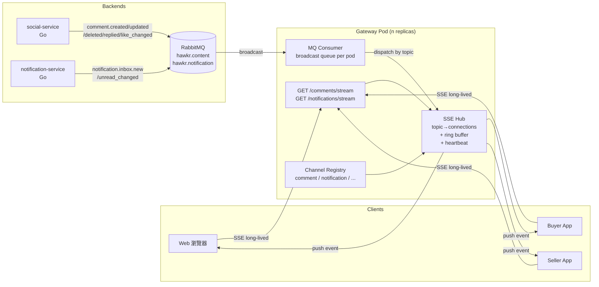
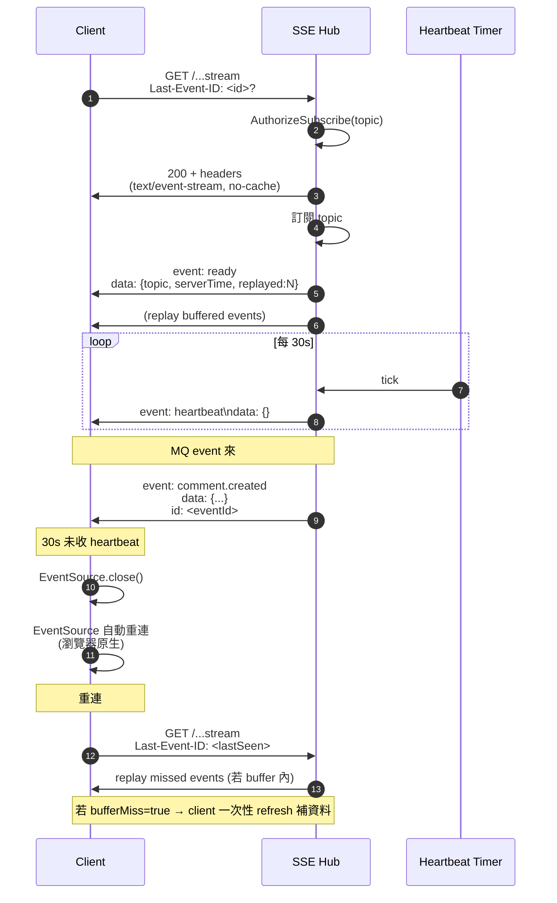
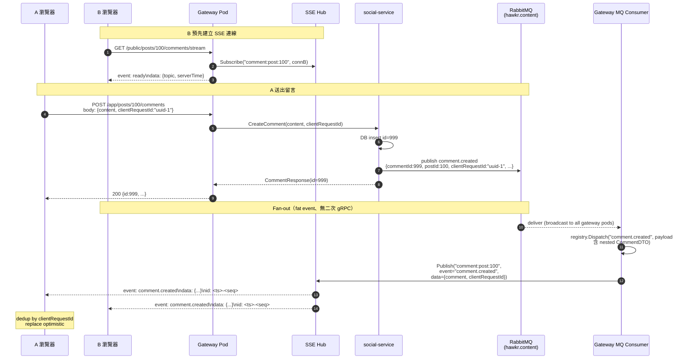
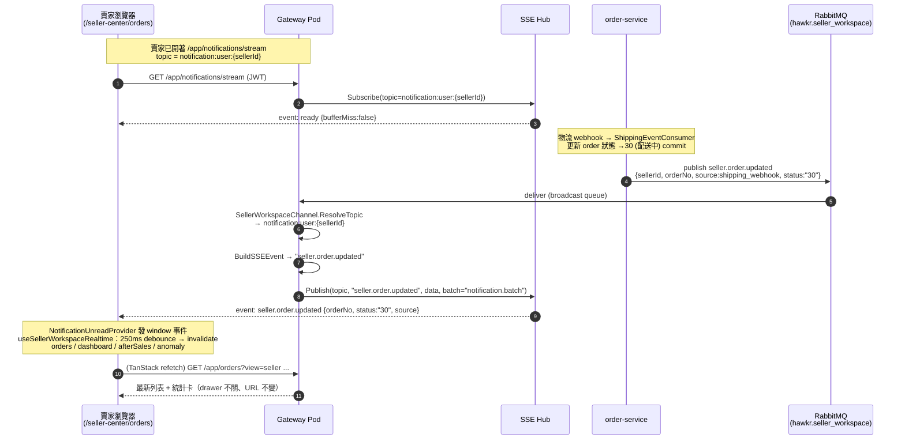
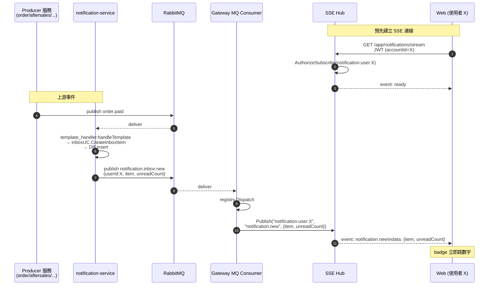
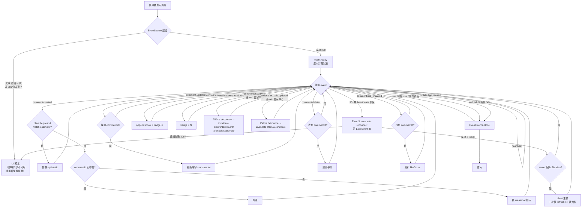
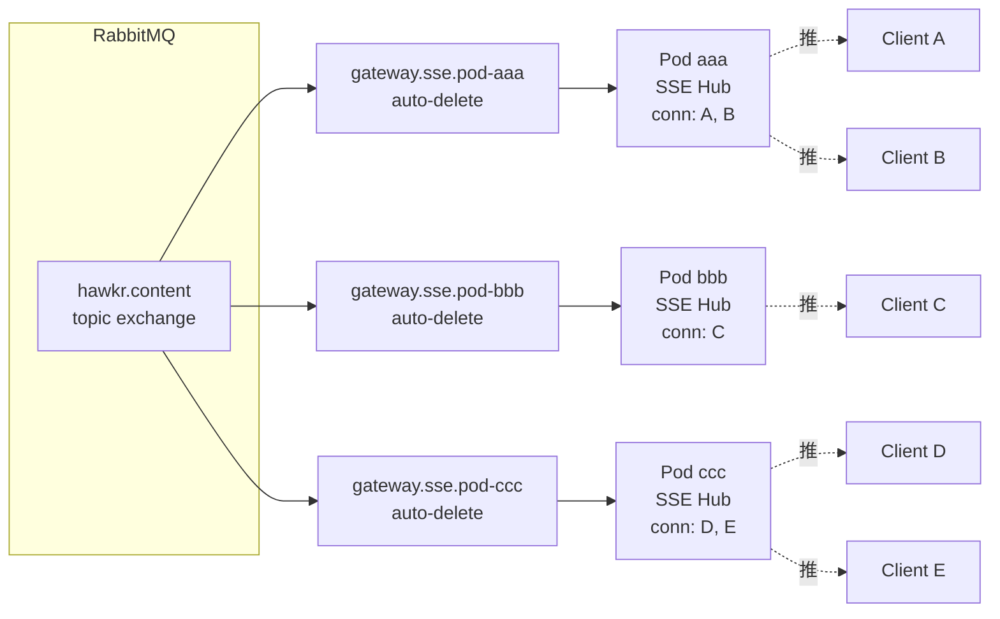

# 41 - Realtime SSE 推播平台（Realtime SSE Push Platform）詳細設計書

> 本文件定義 Gateway 上的 Server-Sent Events（SSE）推播平台架構，包含通用 Hub、MQ Consumer、Channel 註冊契約、Topic 命名規約，以及目前註冊的四個 Channel（留言、通知、賣家工作區、賣家生命週期）。
>
> 後續任何「server 主動推送到 client」的需求（如商品低庫存即時提醒賣家、訂單狀態即時跳動等）皆透過註冊新 Channel 接入本平台，禁止另起新長連線基礎設施。

---

## 一、總覽

### 1.1 文件定位

| 範疇 | 說明 |
|---|---|
| 本文件描述 | Gateway 上的 SSE 推播**平台架構**（通用 Hub / MQ Consumer / Channel 註冊機制）＋ 目前註冊的 4 個 Channel：留言（comment，§三）、通知（notification，§四）、賣家工作區（seller_workspace，§四之二）、賣家生命週期（seller_lifecycle，§四之三；side-effect，不推 SSE） |
| 本文件**不**描述 | 個別業務邏輯（留言 CRUD 見 social-service 既有實作；通知 inbox 與 FCM 推播見 [12 號](12-通知微服務（Notification%20Service）詳細設計書.md) / [13 號](13-通知模板引擎與收件箱（Notification%20Template）詳細設計書.md)） |
| web 通知的唯一推送路徑 | **SSE**。不得存在 30 秒輪詢，也不得把輪詢當 fallback（見 §4.7） |
| 不取代 | **行動端通知（buyer / seller）維持 FCM**：FCM 已覆蓋背景 banner + 前景 data-only refresh 雙通道，再加 SSE 推送重複度高且耗連線與電量。本平台 notification channel **僅 web 訂閱**。<br/>Chat WebSocket：已存在，雙向、長連、ticket auth，與 SSE 場景互補，不取代。 |

### 1.2 平台邊界

本平台只承載 **server → client 單向推送**：留言、通知、賣家工作區訂單狀態。

| 需求型態 | 走哪裡 |
|---|---|
| server → client 單向推送 | **本平台（SSE）** —— 所有此類需求一律集中在這裡，不另建基礎設施 |
| 雙向訊息（聊天、typing、presence） | IM WebSocket（14 號） |
| App 背景／殺死狀態推播 | FCM（12／13 號） |

選型理由與被否決的方案見 [ADR：Realtime 推播平台](../adr/2026-09-18-sse-push-platform-architecture.md)。

### 1.3 設計目標

| 目標 | 量化 / 規範 |
|---|---|
| 端到端延遲 | < 1 秒（MQ event publish → client 收到 SSE event） |
| 通用性 | 新增第三個 Channel 不需動 Hub / MQ Consumer 程式碼，只需註冊 Channel + Topic resolver |
| 多 Pod 友善 | Gateway N pod 部署無需共享狀態，每 pod 自治 |
| 匿名 / 登入皆可 | 每個 Channel 自選 auth 模型 |
| 不引入新基礎設施 | 不引入 Redis pub/sub、不引入 outbox 表、不引入 reconciliation job（符合[後端服務責任邊界規範](../開發規範/後端服務責任邊界規範.md)） |
| Best-effort 推送 | 訊息漏掉不重發，client 透過 `Last-Event-ID` + 必要時 refresh 兜底 |

### 1.4 與其他設計書關係

| 設計書 | 關係 |
|---|---|
| [01 Gateway](01-閘道微服務（Gateway）詳細設計書.md) | Gateway 加入「SSE Hub + MQ Consumer」新角色；01 加新章節指向本文件 |
| [12 Notification Service](12-通知微服務（Notification%20Service）詳細設計書.md) | notification-service 是本平台的 producer：publish `notification.inbox.new` / `notification.unread_changed` 供本平台訂閱 |
| [13 Notification Template](13-通知模板引擎與收件箱（Notification%20Template）詳細設計書.md) | inbox 寫入路徑（`template_handler.go::handleTemplate`）+ mark-read API 加 publish 邏輯 |
| [14 IM Service](14-即時通訊微服務（IM%20Service）詳細設計書.md) | 互補（WebSocket 對雙向；SSE 對單向） |
| [36 MQ Catalog](36-MQ%20與事件總覽（MQ%20&%20Event%20Catalog）.md) | 事件定義見 §3.6d 社群事件 / §3.6e 通知派發事件 |
| CodeMeta [內部技術碼](../代碼管理（CodeMeta）/內部技術碼.md) | `SocialEventType` / `NotificationEventType` enum |

---

## 二、架構設計

### 2.1 系統拓撲



### 2.2 元件責任分工

| 元件 | 責任 | 不負責 |
|---|---|---|
| **SSE Hub**（`gateway/internal/sse/`） | topic 訂閱管理、fan-out、heartbeat、ring buffer、連線生命週期 | 知道 channel 業務含義 |
| **Channel Registry**（`gateway/internal/realtime/`） | 註冊 channel：routing key → topic resolver → event name mapping | 訂閱管理 |
| **MQ Consumer**（`gateway/internal/mq/`） | 每 pod auto-delete broadcast queue、收 message → 查 registry → Hub publish | 業務邏輯 |
| **Stream Handler**（`gateway/internal/handler/post.go` / `notification_inbox.go`） | 解析 path + auth → 計算 topic → 呼叫 Hub.SubscribeAndServe | Hub 內部實作 |
| **Producer**（social-service / notification-service） | DB commit 後 best-effort publish MQ event | 任何 push 後續邏輯 |

### 2.3 Topic 命名規約

**格式**：`<channel>:<resource>:<id>`

| Channel | Topic pattern | 範例 |
|---|---|---|
| comment | `comment:post:{post_id}` | `comment:post:100` |
| notification | `notification:user:{account_id}` | `notification:user:2001` |
| （未來範例）低庫存 | `inventory:seller:{seller_id}` | `inventory:seller:1001` |

**規範**：
- 小寫、英數 + `:` + `_`，禁止 `/` / `.`
- 三段固定（channel / resource / id）；複合條件以 id 段組合（例：`comment:thread:100_999`）
- topic 字串長度 ≤ 128

### 2.4 Channel 註冊契約

每個 Channel 在啟動時向 Registry 註冊，實作 `realtime.Channel` 介面（**新增 channel 只需實作此介面，無需動 Hub / MQ Consumer**）：

| 方法 | 型別 | 說明 |
|---|---|---|
| `Name` | `string` | channel 名稱（如 `"comment"` / `"notification"`） |
| `RoutingKeys` | `[]string` | 要訂閱的 MQ routing key pattern（如 `["comment.#"]`） |
| `Exchange` | `string` | 來源 exchange（如 `"hawkr.content"`） |
| `ResolveTopic` | `func(routingKey, payload) (topic, bool)` | 從 MQ event 解析出要推送到的 SSE topic；回 `("", false)` 代表本則不推送 |
| `BuildSSEEvent` | `func(routingKey, payload) (eventName, dataBytes, err)` | 將 MQ payload 轉成 SSE event payload；回 `("", nil, nil)` 代表跳過不推送 |
| `BatchEventName` | `string` | batch 視窗累積 N>1 時的外層事件名；回 `""` 停用本 channel 的 batching（§5.7） |
| `AuthorizeSubscribe` | `func(ctx, topic, accountID) error` | 訂閱前的 auth check（comment 為匿名 always nil；notification 檢查 JWT 對應 user） |

環形 buffer 大小與 TTL **不是 per-channel 契約**，由 Hub 全域設定（`SSE_RING_BUFFER_SIZE` / `SSE_RING_BUFFER_TTL`，見 §5.3 與 §十五）。

**Channel 有兩種模式**，Registry 與 MQ consumer 對兩者一視同仁：

| 模式 | `ResolveTopic` | `AuthorizeSubscribe` | HTTP endpoint | 例 |
|---|---|---|---|---|
| **publish**（推 SSE） | 回得出 topic | 依 channel 規則放行 | 有 | comment、notification、seller_workspace |
| **side-effect**（consume-only） | **永遠回 `("", false)`** | **永不放行**（恆回 `ErrForbidden`） | **無** | seller_lifecycle（§四之三） |

side-effect channel 借用本契約只為了取得「gateway 每個 pod 都會收到的 broadcast」這個能力，其副作用寫在 `BuildSSEEvent`／`ResolveTopic` 之外的自有方法內，Hub 不會收到任何事件。

### 2.5 SSE 事件規約

**標準 SSE 框架**（[W3C EventSource 規範](https://html.spec.whatwg.org/multipage/server-sent-events.html)）：

```
event: <eventName>
data: <json string>
id: <epochMillis>-<seq>

```
（末尾兩個換行符）

**規範**：
| 欄位 | 規範 |
|---|---|
| `event` | 小寫 + `.` 分隔，例：`comment.created`、`notification.new`、`heartbeat`、`ready` |
| `data` | UTF-8 JSON 字串，**單行**（內含換行需 escape）；payload schema 由 channel 自訂 |
| `id` | `<epochMillis>-<seq>` 形式；client 斷線重連時瀏覽器自動帶 `Last-Event-ID` header；server 取得後從 ring buffer replay 大於該 id 的事件 |
| `retry` | 不主動發送；依瀏覽器預設（多為 3s）+ 客製 fallback 邏輯 |

**保留 event name**（全 channel 共用）：
| Event | 用途 |
|---|---|
| `ready` | 連線建立成功（data 含 serverTime / topic / 已 replay 事件數） |
| `heartbeat` | server 每 30s 送一次（data: `{}`），客戶端 30s 未收即視為斷線 |
| `error` | server 端錯誤（如 topic invalid），data 含 reason；通常後接斷線 |

---

## 三、Channel：留言（Comment）

### 3.1 業務目的

A 在貼文 P 留言（含建立、修改、刪除、按讚變更）→ 同時在看 P 的所有 viewer（含 A 自己跨 tab / 跨裝置）<1 秒內看到變更，不需手動 refresh。

### 3.2 訂閱粒度

**一個 SSE connection 訂閱一個 postId**。

| 場景 | 行為 |
|---|---|
| Web：PostDetailViewer snap pager 切換 active post | 切換前 close 舊 connection、open 新 connection |
| Buyer / Seller App：開 CommentsBottomSheet | 開啟時 connect、關閉 / 切換貼文時 close |
| Feed 列表滑動經過貼文 | **不**訂閱（避免每滑一格開關 SSE） |

🔴 **不支援單一連線動態訂閱多個 postId**：訂閱粒度恆為「一條連線一個 postId」，切換貼文一律關舊開新。

### 3.3 觸發源（MQ events）

| Routing Key | Exchange | Producer | 用途 |
|---|---|---|---|
| `comment.created` | `hawkr.content` | social-service `CommentUseCase.CreateComment`（top-level）| 新增留言 |
| `comment.replied` | 同上 | 同上（reply 分支） | 回覆留言 |
| `comment.updated` | 同上 | 同上 `UpdateComment` | 編輯留言 |
| `comment.deleted` | 同上 | 同上 `DeleteComment` | 刪除留言（soft delete） |
| `comment.like_changed` | 同上 | 同上 `ToggleLike` | 按讚 / 取消讚數變化 |

#### 3.3.1 Publish 規則(強制)

**Publisher 一律 publish,不論留言者與貼文作者關係。Self-author skip 判斷由下游 consumer 自行決定。**

| 路徑 | publish 規則 |
|---|---|
| social-service `CommentUseCase.*` 五個 publish point | 寫入 DB 成功 → 一律 publish 對應 routing key,**禁止**在 publisher 端加「commenter ≠ author」等 gate |
| notification-service consumer | `template_handler.go` 內依 `event_type` 取出 actor field(`commenterId` / `replierId` / `userId`)比對 target user → 相同 skip 寫 inbox 與 FCM(self-notification 規則屬 notification 業務邏輯) |
| gateway SSE consumer | 不過濾,所有 event 全推給對應 topic 的 viewer(含留言者自己跨 tab / 跨裝置 — §一.3 設計目標) |

🔴 **publisher 端加 self-skip gate 的後果**:賣家對自家貼文回覆時,**所有** viewer 的 SSE 都收不到該事件(不只賣家自己),直接違反 §一.3 的「同時在看 P 的所有 viewer <1 秒內看到變更」。self-notification 是 notification 端的業務規則,只能在該端過濾。

**禁止**:
- ❌ publisher 寫 `if post.SellerID != userID` 等 self-skip gate
- ❌ publisher 寫 `if commenterId == postAuthorId` skip
- ✅ consumer 自己決定是否根據業務邏輯 skip(notification 端可以;SSE 端不應該)

**Payload 策略：fat event**（payload 直接攜帶完整 `CommentDTO`）

| 決策面 | 採用 |
|---|---|
| Gateway 是否需要二次 gRPC 取完整 DTO | **否** — MQ payload 已含完整 `CommentDTO`，gateway 直接 dispatch 給 SSE。🔴 **不得**改成收到 event 後回打 social-service：N 個 gateway pod 會對每一筆 event 各打一次 RPC |
| payload 大小 | 留言 DTO < 4KB（含 content / 用戶資訊 / counter），單筆 event broadcast 成本可控 |
| `CommentCreatedEvent` / `CommentRepliedEvent` payload | 含 nested `comment: CommentDTO` ＋ `clientRequestId` ＋ `parentCommentId`；並保留 commenterId／Name／preview 等欄位供 notification consumer 使用 |

**新 event payload schema** 詳見 [§6.1](#61-comment-領域hawkrcontent)。

### 3.4 Topic resolver

```
ResolveTopic(routingKey, payload) → "comment:post:" + payload.postId
```

**所有 5 個 routing key** 均解析至同一 topic 規則。

### 3.5 SSE event payload（fat event，無 gRPC 二次查詢）

| SSE event name | 推送觸發 | data 內容（皆由 MQ payload 直接取得） |
|---|---|---|
| `comment.created` | `comment.created` MQ event | `{ comment: <完整 CommentDTO，不含 userId，含伺服器依這條連線算的 isMine>, clientRequestId: string? }` |
| `comment.replied` | `comment.replied` MQ event | 同上 |
| `comment.updated` | `comment.updated` MQ event | `{ commentId, postId, content, updatedAt }` |
| `comment.deleted` | `comment.deleted` MQ event | `{ commentId, postId, parentCommentId }` |
| `comment.like_changed` | `comment.like_changed` MQ event | `{ commentId, postId, likeCount, action: "LIKE"\|"UNLIKE", likedByViewer }`（likedByViewer：按讚者是不是這條連線的買家或店家身分；公開輸出不帶 userId，ADR `2026-10-17-social-actor-identity`） |
| `comment.batch` | per-topic 50ms 視窗 N > 1 個 event 合併（見 §5.7） | `{ events: [{ event, data }, ...] }` — 每筆元素含原 event name + 原 data |

**fat event 設計**：
- `CommentCreatedEvent` / `CommentRepliedEvent` MQ payload 直接含 nested `comment: CommentDTO`（social-service publish 時連 DTO 一起塞）
- Gateway 收 MQ event → 直接 dispatch 給 SSE Hub，**無 gRPC 二次查詢**
- Trade-off：MQ payload 變大（~3KB / event），broker bandwidth 上升；但避免 social-service 被多 pod 同時打 GetCommentById

### 3.6 Endpoint

| 屬性 | 值 |
|---|---|
| Path | `GET /api/v1/public/posts/{post_id}/comments/stream` |
| Auth | 匿名 OK（與 `/public/posts/{id}/comments` 一致） |
| Rate limit | per source IP 同時最多 5 條 SSE connection |
| Topic | `comment:post:{post_id}` |
| Heartbeat | 每 30s 一次 |
| Last-Event-ID replay | 支援，最近 200 事件或 5 分鐘 |

### 3.7 與 optimistic update 的 dedup

**問題**：A 自己 POST 留言 → client 樂觀加入「負 ID」留言；SSE 推回真實 commentId → 同一條留言出現兩次。

**解法（雙層 dedup）**：

1. **`clientRequestId` 主 dedup**：A POST `/app/posts/{id}/comments` body 帶 `clientRequestId: <uuid>`；social-service publish event 帶回該 id；client 收到 SSE event 後若 `byClientRequestId.has(id)` → 用 real comment 替換 optimistic。
2. **`commentId` 次 dedup**：保險邏輯 — 收 SSE event 時若 `comments.find(c => c.id === event.comment.id)` → 略過。

### 3.7.1 重試策略：retry 必須 reuse 同一 clientRequestId

**規範**：client 重試「同筆」失敗 POST 時**必須 reuse 同一個 clientRequestId**，禁止重新生成。

| 場景 | 行為 |
|---|---|
| 第一次 POST 網路 timeout → client 重試 | 帶**同**`clientRequestId` |
| 使用者重複按 send（非自動重試） | UI 應在第一次 POST 期間 disable button；若使用者主動再按等同新留言，**重新生成** clientRequestId |
| Server 端收到重複 `clientRequestId` | server 端**不做** idempotency check；避免重發由 client 負責 |

🔴 **retry 用新 id 的後果**：`clientRequestId` 是「樂觀更新 → SSE 確認」的 bridge，第二次 POST 的 SSE 回推會被前端當成新留言 append，使用者看到重複顯示。

---

## 四、Channel：通知（Notification）

> ⚠️ **本 channel 僅 web 訂閱**。Buyer / Seller App 維持既有 FCM（visible banner + silent data 雙通道，覆蓋背景 + 前景），不訂閱本 channel。理由見 §4.0。

### 4.0 訂閱端邊界

**notification channel 僅 web 訂閱**。Buyer / Seller App 不開本 channel，行動端通知走 FCM
（visible banner ＋ silent data 雙通道，涵蓋背景與前景）。理由見
[ADR：Realtime 推播平台](../adr/2026-09-18-sse-push-platform-architecture.md)。

### 4.1 業務目的（僅 web）

取代 web 端 `useUnreadPolling` 30s polling，達成：
- 通知 inbox 新增立即推到 web（badge 數字、新 row 顯示）
- 跨裝置 read 同步：行動端 mark-read（FCM data 觸發 → mobile call REST mark-read）→ notification-service publish `unread_changed` → web 立即 badge 同步
- web 通知體驗對齊行動端（不再有 30s 延遲）

### 4.2 訂閱粒度

**一個 SSE connection 訂閱一個 accountId（自己），僅 web 端**。

| 場景 | 行為 |
|---|---|
| Web：使用者登入後一直開著瀏覽器 | App shell 等級 connect，登出時 close |
| Web tab 切到背景 | 30 秒後 close；切回時 reconnect |
| Buyer / Seller App | **不**建立 notification SSE 連線（FCM 已覆蓋） |

### 4.3 觸發源（MQ events）

| Routing Key | Exchange | Producer | 用途 |
|---|---|---|---|
| `notification.inbox.new` | `hawkr.notification` | notification-service `template_handler.go::handleTemplate` 寫完 inbox 後 publish | 新 inbox 項目 |
| `notification.unread_changed` | 同上 | notification-service `notification_inbox.go::MarkAsRead` / `MarkAllAsRead` / `Delete` 後 publish | 未讀數變化 |

**設計重點**：
- **集中 publish 點**：所有 inbox 寫入走 `inboxUC.CreateInboxItem`；所有 read state 變更走 `notification_inbox.go` 三個 method。從這兩個函式各 publish 一次，**唯一寫入路徑唯一 publish 點**，符合[後端服務責任邊界規範](../開發規範/後端服務責任邊界規範.md)單一寫入路徑原則。
- **不寫 outbox**：commit 後 best-effort publish；失敗 log 但不重試；漏推由 client 重連 + refresh 兜底。

### 4.4 Topic resolver

```
notification.inbox.new       → "notification:user:" + payload.userId
notification.unread_changed  → "notification:user:" + payload.userId
```

### 4.5 SSE event payload

| SSE event name | 推送觸發 | data 內容 |
|---|---|---|
| `notification.new` | `notification.inbox.new` MQ | `{ item: <完整 InboxItem>, unreadCount: number }` |
| `notification.unread_changed` | `notification.unread_changed` MQ | `{ unreadCount: number }` |

**Gateway 不需要二次 gRPC**：notification-service publish 時 payload 已含完整 `InboxItem`（per-user 推送，無 fan-out 放大問題）。

### 4.6 Endpoint

| 屬性 | 值 |
|---|---|
| Path | `GET /api/v1/app/notifications/stream` |
| Auth | JWT（cookie 或 `Authorization: Bearer`）→ 取 `accountId` |
| Topic | `notification:user:{accountId}` |
| Authorize | `topic` 中的 accountId 必須與 JWT 的 accountId 相同 |
| Rate limit | per accountId 同時最多 3 條 SSE connection（web 多 tab；對齊 `SSE_MAX_CONN_PER_USER` 預設 3）|
| Heartbeat | 每 30s 一次 |
| Last-Event-ID replay | 支援，最近 200 事件或 5 分鐘 |
| 預期客戶端 | **僅 web**；mobile 走 FCM 不開此連線 |

### 4.7 與既有 polling 的取代策略（僅 web）

**web 通知沒有 polling 路徑**：不得存在 `useUnreadPolling` 這類輪詢，也不得把它當 fallback 加回來
（理由見 [ADR：Realtime 推播平台](../adr/2026-09-18-sse-push-platform-architecture.md)）。

**唯一推送路徑 = SSE**。失敗模式僅兩種：

| 失敗模式 | 處理 |
|---|---|
| 一般斷線 / 網路抖動 | EventSource 原生自動重連，帶 `Last-Event-ID` replay |
| Reconnect 後 `bufferMiss=true`（pod 重啟或斷線超過 ring buffer TTL） | client 觸發**一次性** `refresh()` 補資料 — 與 SSE 收到的事件流合併 |

**真的整段服務 down**：client UI 顯示「即時同步暫時不可用，請重新整理頁面」，由使用者 reload 解決；**不在 client 程式碼塞 polling 兜底**。

**Mobile 端不適用**：buyer / seller 既有 FCM 已覆蓋背景 + 前景，不訂閱 notification SSE。

---

## 四之二、Channel：賣家工作區（Seller Workspace）

> ⚠️ **本 channel 僅 web 賣家中心訂閱**。Buyer / Seller App 訂單狀態走既有 FCM + 進頁 refetch，不訂閱本 channel（理由同 §4.0）。

### 4b.1 業務目的（僅 web 賣家中心）

賣家網站「訂單管理」`/seller-center/orders` 頁面開著時，後端因 **PayUni webhook / 物流 webhook / 售後流程 / 系統排程** 改變 order / after-sale 狀態 → 前端**不需手動重整**即同步：

- 上方四張統計卡（待出貨 / 配送中 / 已完成 / 售後處理）數字即時更新
- 訂單列自動移到正確 tab（例：售後完成後不再停在配送中）
- 右側訂單詳情 drawer 開著時內容更新，**drawer 不關、URL 不變**
- 連續多筆狀態變更**不抖動統計卡、不閃空列表**（靠 batch 合併 + 前端 250ms debounce）

### 4b.2 關鍵設計：復用 notification stream，**不開第二條 stream**

> ⚠️ 本 channel **不新增 HTTP endpoint**，是 **publish-only channel**：事件解析到的 topic 與既有 notification channel **同一個** `notification:user:{accountId}`，因此事件落在賣家**已開著的** `/app/notifications/stream` 連線上。

| 項目 | 規格 | 失敗語意 |
|---|---|---|
| HTTP endpoint | **無**，不得新增 `/app/sellers/me/orders/stream` | 同一賣家多開 stream 會吃掉 per-user cap（§4.6 ＝ 3），第 3 條之後一律 429 |
| Topic | `notification:user:{sellerAccountId}`，**不得**改用獨立的 `order:seller:{id}` | 事件必須落在賣家**現有連線**上；換 topic 等於要求再開一條連線 |
| Batch wrapper | `notification.batch` | 與 notification 事件在同一個 `(topic, batchEventName)` 窗口合併，前端既有解包邏輯直接適用 |
| AuthorizeSubscribe | 恆回 `ErrForbidden`（本 channel 無 endpoint，實際永不被呼叫） | 訂閱授權由 notification channel 在 `/app/notifications/stream` 端處理（topic accountId == JWT accountId） |

**安全性**：topic = `notification:user:{sellerAccountId}`，賣家連線只授權自己的 accountId topic（§4.6 Authorize）→ 賣家只會收到自己訂單事件，**不外洩**。producer 帶 `sellerId` 供 gateway 解析 topic。

### 4b.3 觸發源（MQ events）

新 exchange `hawkr.seller_workspace`（Java `MqConstants.EXCHANGE_SELLER_WORKSPACE` / Go `pkgmq.ExchangeSellerWorkspace`）。**專屬 realtime invalidation 事件**，與領域 exchange（hawkr.order / aftersales.events）解耦，避免污染既有領域 consumer 路由。

| Routing Key | Producer | 觸發時機 |
|---|---|---|
| `seller.order.updated` | **order-service** `OrderEventPublisher.emitSellerOrderUpdated`（afterCommit / eager）| 所有 order 狀態變更 commit 後（見 §4b.6 convergence point 清單）|
| `seller.after_sale.updated` | **aftersales-service** `publishCaseTransitionWithContext`（既有單一 choke point 內加發）| 所有 after-sale case 狀態流轉後 |

### 4b.3.1 anomaly（物流異常 rollup）併入 `source`，不開獨立事件

🔴 **物流異常不發獨立事件**（不得新增 `seller.shipment_anomaly.updated`）：

- 每一次物流異常都伴隨 order 狀態變更（→ `SHIPPING_ABNORMAL(35)`，由 order-service `ShippingEventConsumer` 設定）→ 必發 `seller.order.updated`
- 異常解除同理會改 order 狀態 → 必發 `seller.order.updated`
- 因此不存在「獨立於 order 狀態變更」的 anomaly rollup producer，獨立事件會是沒有生產者的 orphan event（[後端服務責任邊界規範](../開發規範/後端服務責任邊界規範.md)／[MQ 與事件管理規範](../開發規範/MQ%20與事件管理規範.md)）

**前端做法**：收到 `seller.order.updated` 即一併 invalidate `shipmentAnomalies` / `shipmentAnomalyStats` 查詢（debounced，成本可控）。`source` 欄位供前端 / debug 判斷來源。

### 4b.4 Topic resolver

```
seller.order.updated       → "notification:user:" + payload.sellerId
seller.after_sale.updated  → "notification:user:" + payload.sellerId
```

> `sellerId` 缺失或 ≤ 0 → `ResolveTopic` 回 `("", false)`，registry skip（不推），記 debug log。

### 4b.5 SSE event payload（camelCase，對齊既有 SSE 慣例）

| SSE event name | 推送觸發 | data 內容 |
|---|---|---|
| `seller.order.updated` | `seller.order.updated` MQ | `{ eventId, sellerId, orderNo, source, previousStatus?, status?, shipmentStatus?, changedAt }` |
| `seller.after_sale.updated` | `seller.after_sale.updated` MQ | `{ eventId, sellerId, orderNo, afterSaleCaseNo, source, status?, changedAt }` |
| `notification.batch` | per-topic 50ms 窗口 N>1 合併（§5.7）| `{ events: [{ event, data }, ...] }`，內含元素可為 notification.* 與 seller.* 混合 |

**欄位語意**：

| 欄位 | 必填 | 型別（SSE 輸出） | 說明 |
|---|---|---|---|
| `eventId` | 是 | string | producer 生成 UUID v4；前端去重用（與 SSE `id:` 行的 hub seq 互補）|
| `sellerId` | 是 | string（§4 frontend-visible 數字字串）| stream scoped seller，gateway 解析 topic 用 |
| `orderNo` | 是 | string | 前端刷新單筆 drawer detail + seller order family |
| `source` | 是 | string | `payuni_webhook` / `shipping_webhook` / `after_sale` / `system` |
| `previousStatus` | 否 | string | 前一個 order status code（debug / tab 移動判斷）|
| `status` | 否 | string | 最新 order status code |
| `shipmentStatus` | 否 | string | 最新 shipment status code（物流來源時帶）|
| `afterSaleCaseNo` | 否（after_sale 事件必帶）| string | 售後案件號，刷新 seller after-sale detail/list |
| `changedAt` | 是 | string | 後端狀態 commit 時間，ISO 8601 UTC（`...Z`）|

> **命名固定為 camelCase**（對齊既有 `notification.new` / `comment.*` SSE payload + 前端 client 預期）。與 #1176「事件 payload 命名統一」對齊時以本 SSE camelCase 為準。

### 4b.6 order-service 狀態變更 convergence point

order-service 是**所有 order 狀態變更的唯一收斂點**（自身 service 方法 + 其 MQ consumer 套用外部事件）。下列每一點 commit 後皆呼叫 `emitSellerOrderUpdated`：

| # | 位置 | 狀態轉換 | source | @Transactional |
|---|---|---|---|---|
| 1 | `PaymentEventHandler.handlePendingPaymentOrder` | 10→20（付款成功）| `payuni_webhook` | 是（afterCommit）|
| 2 | `PaymentEventHandler.cancelExpiredOrderInTx`（呼叫者 `PaymentDeadlineScheduler.cancelSingleExpiredOrder`）| 10→50（逾時取消）| `system` | 是（afterCommit）|
| 3 | `PaymentEventHandler.cancelOrderIfPending` | 10→50（異常取消）| `system` | 是（afterCommit）|
| 4 | `ShippingEventConsumer.onShipmentStatusChanged` | →20/30/32/35（物流推進）| `shipping_webhook` | 否（eager after update）|
| 5 | `ShippingEventConsumer.onShipmentDelivered` | →40（送達）| `shipping_webhook` | 否（eager after update）|
| 6 | `OrderService.completeOrderInTx`（**共用 sink**：`AutoCompleteScheduler.autoCompleteDeliveredOrders` 自動完成 + `OrderService.confirmReceipt` 確認收貨皆走此）| 40→80（完成）| `system` | 是（afterCommit）|
| 7 | `OrderService.cancelOrder` | →50（買家/賣家取消）| `after_sale`/`system` | 是（afterCommit）|
| 8 | `AfterSalesEventConsumer.onRefundCompleted` | →60/70（退款後）| `after_sale` | 否（eager after update）|

> 🔴 **上表是封閉清單**：任何新增的 order status 寫入路徑（`OrderRepository.updateStatusIfMatchAny` / `updatePaymentConfirmed` / `cancelOrderByPaymentExpireCas` / `updateOrderDelivered` / `completeOrderInTx` cascade 等方法的新 caller）**必須同時補 emit 並登記進本表**——漏掉的那條路徑不會有任何錯誤訊號，只是賣家中心不會更新。
> - 第 6 點：`AutoCompleteScheduler` 與 `confirmReceipt` 共用 `completeOrderInTx` sink → afterCommit hook 在此**一處**加發即可，不需分別加。
> - afterCommit 機制複用 `ProductEventPublisher.publishRestockAfterCommit` 模式（`TransactionSynchronizationManager`：sync active → afterCommit hook；否則 eager publish）。

### 4b.7 Endpoint

**無新增 endpoint**。事件經既有 `GET /api/v1/app/notifications/stream`（§4.6 / §12.2）送達。前端在 notification stream 上多解析兩個 event name 即可。

### 4b.8 失敗處理（沿用既有 SSE semantics）

- 漏推（publish best-effort 失敗 / pod 重啟 buffer 失效）→ `ready.bufferMiss=true` → 前端一次性 REST 全刷（既有機制，§4.7 / §10）
- 不引入 application-level outbox / reconciliation（[後端服務責任邊界規範](../開發規範/後端服務責任邊界規範.md)）；下一次狀態變更或前端進頁 refetch 自然補上

### 4b.9 事件來源與補償邊界

單一寫入路徑（§4b.6 各 status commit 點 + aftersales 單一 choke point）為事件唯一來源；**不得**引入 reconciliation job / async reflow runner / backfill CLI / drift 偵測。遺失由 `ready.bufferMiss` + 前端 REST 全刷兜底。

---

## 四之三、Channel：賣家生命週期（Seller Lifecycle）

### 4c.1 業務目的

**這是 side-effect channel，不推送任何 SSE**（§2.4 兩種模式表）。它借用 Channel 契約取得
「gateway 每個 pod 都收得到 broadcast」這個能力，用來讓每個 pod 就地失效 `storeid.Resolver`
的快取。賣家換 stint（`seller.deleted` / `seller.onboarded`）之後，若某個 pod 的快取沒失效，
該 pod 會把 `account_id` 解析成**已退休的 store_id**，賣家面請求會落到錯的 store。

其資源模型與 re-key 規格由 44 號設計書承載；本平台只登記它使用了 Channel 契約。

### 4c.2 契約

| 項目 | 值 |
|---|---|
| `Name` | `seller_lifecycle` |
| `Exchange` | `hawkr.seller`（`pkgmq.ExchangeSeller`） |
| `RoutingKeys` | `seller.deleted`、`seller.onboarded` |
| `ResolveTopic` | 恆回 `("", false)` —— Hub 永遠不會收到事件 |
| `BatchEventName` | `""`（無 SSE 輸出，batching 無意義） |
| `AuthorizeSubscribe` | 恆回 `ErrForbidden` —— 本 channel 沒有 HTTP endpoint |
| 副作用 | 呼叫 `storeid.Resolver.Invalidate`（`DEL store:current:{accountId}`） |

### 4c.3 失敗語意

- **只消費 `accountId`**：`seller.deleted` 的舊 payload 沒有 `store_id`，而 `accountId` 新舊
  payload 都有，且快取鍵就以它為鍵。**不得**改成依賴 `store_id`，否則舊 payload 一律失效不了。
- **best-effort**：`Invalidate` 失敗只記 log，由快取自身的 60s TTL 兜底自癒。
- **天然冪等**：broadcast 讓每個 pod 各自 `DEL` 同一把共享 Redis key，重複執行無副作用，
  因此不需要 dedup。

---

## 五、Gateway SSE Hub 實作

### 5.0 啟動策略（MQ consumer 不阻塞 HTTP 服務）

**強制原則**：Gateway 啟動時 MQ consumer 與 HTTP/gRPC server 並行啟動，**MQ consumer 失敗不阻塞 HTTP 對外服務啟動**。

| 啟動順序 | 行為 |
|---|---|
| 1. HTTP / gRPC server | 同步啟動就緒，readiness probe 通過 |
| 2. SSE Hub | 同步啟動（純 in-memory，無外部依賴） |
| 3. MQ consumer | **async goroutine 啟動**；連 RabbitMQ 失敗 → log error + 指數退避重試（5s/15s/45s/...）；不退出 |
| 4. SSE endpoint 接到請求 | 連線即建立、可訂閱；MQ 還沒接上時無事件推送（heartbeat 照發），MQ 接上後事件正常 |

**理由**：避免「RabbitMQ 暫時不可用 → gateway HTTP API 全掛」的災難級故障。SSE 推送是 best-effort，MQ 暫時連不上時其他 HTTP API（含結帳這類 transactional surface）必須仍可服務。

**監控**：MQ consumer 連線狀態 expose 為 metric `gateway_sse_mq_consumer_connected{pod=...}` (0/1)。

### 5.1 模組目錄結構

```
gateway/internal/sse/                  通用 Hub（無業務感知）
  hub.go                  Hub 結構 + Subscribe / Unsubscribe / Publish
  connection.go           SSE connection wrapper（send chan, lastEventId, writer）
  stream.go               ServeSSE primitive（header / heartbeat / replay / lifecycle）
  ringbuffer.go           per-topic 環形 buffer + TTL 過期清理

gateway/internal/sse/ 另有 batch.go（批次推送窗口）與 capgroup.go（per-user / per-subject 連線額度）

gateway/internal/realtime/             Channel 註冊
  registry.go                 Channel 註冊統一入口；MQ Consumer 由此查 channel 處理
  di.go                       fx wiring：所有 channel 在此註冊進 Registry
  comment_channel.go          留言 channel
  notification_channel.go     通知 channel
  seller_workspace_channel.go 賣家工作區 channel
  seller_lifecycle_channel.go 賣家生命週期 channel（side-effect，不推 SSE，見 §四之三）

gateway/internal/mq/                   Gateway 的 MQ Consumer
  consumer.go             broadcast queue per pod；收 message → registry.Dispatch
```

### 5.2 Hub 內部資料結構

```
type Hub struct {
    mu          sync.RWMutex
    topics      map[string]*topicState   // topic → state
    buffers     map[string]*RingBuffer   // topic → 環形 buffer
    maxConnPerTopic int                  // hard cap
}

type topicState struct {
    conns map[*Connection]struct{}
}

type Connection struct {
    id          string        // uuid
    topic       string
    send        chan []byte   // buffered 32
    writer      http.ResponseWriter
    flusher     http.Flusher
    lastEventID string        // 從 client 帶來
    closedCh    chan struct{}
}
```

### 5.3 環形 buffer 與 Last-Event-ID replay

| 屬性 | 預設 | 說明 |
|---|---|---|
| 大小 | 200 events / topic | 超過從前面 drop |
| TTL | 5 分鐘 | 超過清理 |
| 寫入時機 | `Hub.Publish(topic, event)` | 同步寫入 buffer + 推送 conns |
| 過期清理機制 | **scheduled goroutine 每 60 秒掃過期** | lazy clean 會在低活動 topic 留 stale buffer，採 scheduled 統一回收；單 goroutine 順序掃過所有 topic |
| topic 退場 | 無 active connection 且 buffer 全空 / 全過期 → 從 Hub.topics 刪除 | 避免長尾 topic 累積記憶體 |
| Replay 時機 | client 連線時帶 `Last-Event-ID` header | 從 buffer 取 id > lastEventId 全部 events 推送（含原 event id），然後送 `ready` event |

**邊界**：
- Pod 重啟 → buffer 失效；client 重連時若 `Last-Event-ID` 找不到（或 pod 是新 pod）→ server 送 `ready` event 含 `bufferMiss: true` → client 觸發一次性 `refresh()` 補資料
- 跨 pod：A pod 收到 event → 寫自己 buffer + 推 self conns；B pod 也收到同 event → 寫自己 buffer + 推 self conns。每 pod 獨立。
- Client 切貼文後又切回（同一 SPA session）：client 端應 **per-postId in-memory cache lastEventId**（同 session 內保留 5 分鐘）；切回同一 post 帶 lastEventId 重連 → 不錯過離開期間事件。詳見 §13.1。

### 5.4 Heartbeat 與連線生命週期



| 配置 | 值 | 對照 |
|---|---|---|
| Heartbeat 間隔 | 30s | 對齊 [Chat WS](14-即時通訊微服務（IM%20Service）詳細設計書.md)（chat 是 50s ping）；SSE 更短因 nginx 預設 60s idle timeout |
| Client 等待 heartbeat timeout | 35s（從上次任意 event 起算） | 超過視為斷線 → close + 自行重連（web `lib/sse/client.ts` `DEFAULT_HEARTBEAT_TIMEOUT_MS`）。**必須嚴格大於 heartbeat 間隔**：兩者相等時 heartbeat 永遠剛好落在判定邊界上，任何抖動都會誤判斷線並觸發 800ms 重連迴圈。30s + 5s 寬限即為此而設 |
| Server 寫入 timeout | 2 × heartbeat 間隔（預設 60s） | 每次寫入前重設（`stream.go` `refreshWriteDeadline`）；寫不出去視為斷線、清理 conn |

### 5.5 連線數上限

| 維度 | 預設上限 | 處理 |
|---|---|---|
| per source IP（comment） | 5 | 滿座時回收該 IP 最舊的連線；回收額度用完才回 429 |
| per accountId（notification） | 3 | 滿座時回收該帳號最舊的連線；回收額度用完才回 429 |
| per pod 總連線 | 5000 | 超過回 503，client UI 顯示「即時同步不可用，請稍後重試」 |
| per topic 連線 | 5000 | 同上（避免單一爆款貼文壓垮 pod） |

#### 5.5.1 滿座回收策略與連線存活上限

SSE 是單向的：server 從頭到尾不從 client 讀任何位元組，**沒有任何存活訊號**。瀏覽器離開後只要中間層（Cloudflare／Traefik）還肯把 heartbeat 收下來，origin 端的 `ctx.Done()` 就不會觸發、`w.Write` 不會失敗、寫入 deadline 每次寫前又被重設——這條連線會一路佔著位子直到中間層自己斷開（實測 600 秒）。連線的實際壽命因此是由中間層決定的，origin 完全沒有上界。

缺的是「存活訊號」而不是「逾時設定」，所以純粹把逾時調短救不了；把上限調大更只是把症狀往後推。唯一能讓上限名副其實的做法，是讓新連線有辦法把最舊的位子收回來：

| 機制 | 觸發時機 | 作用 |
|---|---|---|
| 滿座回收最舊（`connGroup.admit`） | 有新連線進來時 | 讓「上一個頁面留下的殭屍」不會擋住當前頁面 |
| 連線存活上限（`SSE_MAX_CONN_LIFETIME`，GC 迴圈） | GC 迴圈每 `GCInterval`（固定 60s，未開放 env 覆寫）掃一次 | 唯一不需要有人來敲門就會發生的回收；使用者關掉所有分頁不再回來時靠它 |

**回收不放寬硬上限**：同時存活的連線數永遠 ≤ 上限。上限要擋的是「一個身分佔用無限資源」，那件事由上限本身保證，不是由「拒絕」保證。

**額度上限（`SSE_EVICT_WINDOW`）**：每個 key 每個時間窗最多回收 `2 × 上限` 次。若無此限制，真的想開超過上限條連線的客戶端（例如同時開 4 個分頁 = 4 條 > 3）會陷入互踢迴圈——被踢的那條 800ms 後重連、再踢掉別人，永無止境且客戶端永遠看不到 429、永遠不會收手。額度用完就回到 429，客戶端連兩次失敗後停止重試，系統收斂到穩定狀態。取 2 倍是因為最壞情況下一次頁面重新載入會發現每個位子都是殭屍（需要 `上限` 次回收），抓兩倍讓一個窗內連續重新載入兩次仍能完整復原。

**存活上限為什麼是 8 分鐘**：它不是拿來修上限的（那是回收邏輯負責），只是資源面的兜底。必須短於中間層的 600 秒，主導權才回到 origin；又必須明顯長於環形緩衝 TTL（5 分鐘），否則重連間隔逼近 TTL 就會開始出現 `bufferMiss`、讓前端做整頁刷新。

### 5.6 MQ Consumer：每 pod broadcast queue

| 屬性 | 值 |
|---|---|
| Queue 命名 | `gateway.sse.<pod-hostname>` |
| Durable | `false` |
| Auto-delete | `true`（pod 死自動清，pod 啟動自動建） |
| Exclusive | `false` |
| Bindings | 多個 (exchange, routing key) bind 至同 queue：`hawkr.content:comment.#` + `hawkr.notification:notification.inbox.new` + `hawkr.notification:notification.unread_changed` + `hawkr.seller_workspace:seller.order.updated` + `hawkr.seller_workspace:seller.after_sale.updated`（binding 由各 channel 的 `Exchange()` + `RoutingKeys()` 動態組合，見 `registry.BindingsByExchange()`）|
| Consumer | 同 pod 內 single goroutine + 內部 dispatch worker pool |
| Ack | `auto`（SSE push 是 best-effort，無需 manual ack；推送失敗 log 不重投） |

**多 pod 行為**：每 pod 各自有一個 queue 全部收到同樣訊息（exchange 是 topic + 每 pod 一 queue 等同 broadcast 行為）；每 pod 對自己的 SSE conn fan-out → 任一 client 只連到一個 pod、只收到一次推送。

### 5.7 Batch 推送（高頻 topic 合併）

**設計目的**：單一爆款貼文 1000 viewer × 10 留言/秒 = 10k push/s 對單 pod 過載；client 連續處理 N 個 DOM mutation 也卡 UI。

**機制**：per-topic 50ms 視窗合併同 topic 多個 event 成單一 SSE message。

| 屬性 | 值 |
|---|---|
| 視窗大小 | 50ms（環境變數 `SSE_BATCH_WINDOW_MS` 可調，預設 50） |
| 觸發合併條件 | 視窗內同 topic 累積 event 數 > 1 |
| Batch event 名 | `comment.batch`（comment channel）/ `notification.batch`（notification channel） |
| Batch data 結構 | `{ events: [{ event: "comment.created", data: {...}, id: "..." }, ...] }` 保留每筆原 event name + data + id |
| Last-Event-ID 行為 | batch event 自己的 id 用視窗內**最大** event id；replay 時把 batch 整包視為一筆 |
| Client 處理 | 收 batch → 依 events array 順序逐筆 dispatch 給 reducer |

**單筆 event 場景**：視窗內只 1 個 event 仍走原 event name（`comment.created` 等）**不包 batch**，client 簡單路徑佔多數場景。

**啟用條件**：所有 channel 預設啟用 batch；channel 註冊時可指定 `BatchEnabled = false` 跳過（如某 channel 事件本就低頻不需合併）。

**實作細節**：
- 每個 active topic 維護一個 50ms timer（lazy 創建，第一筆 event 進入時啟動）
- Timer 觸發：若累積 events.length == 1 → 直接送原 event；若 > 1 → 包成 batch event 送
- 累積上限：單視窗 events 超過 100 強制 flush（避免 batch 超大）

---

## 六、MQ Event 設計

### 6.1 Comment 領域（hawkr.content）

| Routing Key | Payload Struct（`pkg/mq/events.go`） |
|---|---|
| `comment.created` | `CommentCreatedEvent { commentId, postId, commenterId, commenterName, postAuthorId, postAuthorType, contentPreview, parentCommentId, clientRequestId, comment: CommentSnapshot }`（含完整 nested DTO） |
| `comment.replied` | `CommentRepliedEvent { commentId, postId, replyToUserId, replyToUserType, replierName, contentPreview, parentCommentId, clientRequestId, comment: CommentSnapshot }` |
| `comment.updated` | `CommentUpdatedEvent { commentId, postId, content, updatedAt }` |
| `comment.deleted` | `CommentDeletedEvent { commentId, postId, parentCommentId }` |
| `comment.like_changed` | `CommentLikeChangedEvent { commentId, postId, likeCount, action(LIKE/UNLIKE), userId, commentAuthorId }` |

> 按讚事件的唯一 routing key 是 `comment.like_changed`（涵蓋 LIKE 與 UNLIKE）；notification consumer 只對 `action == "LIKE"` 推播。

**`CommentSnapshot` struct（`pkg/mq/events.go`）**：

對應 `services/social-service/internal/repository/postgres/gen/models.go::CmsComment` 大部分欄位 + proto `CommentInfo`：

| 欄位 | Go 型別 | 對應 |
|---|---|---|
| `CommentID` | `int64` | `cms_comment.id` |
| `PostID` | `int64` | `cms_comment.post_id` |
| `UserID` | `int64` | `cms_comment.user_id` |
| `UserName` | `string` | `cms_comment.user_name` |
| `AvatarKey`（JSON `avatarKey`） | `string` | `cms_comment.user_avatar`（49 §6.7 S4：值為裸 objectKey，前端 `buildImageUrl` 組顯示 URL，發送端不組；欄名對齊對外頭像契約 `avatarKey`，不帶主體前綴） |
| `Role` | `int32` | `cms_comment.role` (1=buyer, 2=seller) |
| `Content` | `string` | `cms_comment.content` |
| `ParentID` | `int64` | `cms_comment.parent_id` (0=top-level) |
| `ReplyToID` | `int64` | `cms_comment.reply_to_id` |
| `ReplyToName` | `string` | `cms_comment.reply_to_name` |
| `LikeCount` | `int32` | `cms_comment.like_count` |
| `ReplyCount` | `int32` | `cms_comment.reply_count` |
| `CreatedAt` | `time.Time` | `cms_comment.create_time` |
| `UpdatedAt` | `time.Time` | `cms_comment.update_time` |

**注意**：不包含 `deleted_at` / `hidden_at` / `hidden_reason`（這些 row 走刪除 / hide 事件，不會出現在 created/replied event）。

### 6.2 Notification 領域（hawkr.notification）

| Routing Key | Payload Struct |
|---|---|
| `notification.inbox.new` | `NotificationInboxNewEvent { userId, userType, item: InboxItemDTO, unreadCount }` |
| `notification.unread_changed` | `NotificationUnreadChangedEvent { userId, userType, unreadCount }` |

notification-service 以 `pkg/mq` 的 publisher abstraction（`internal/mq/publisher.go`）發布這兩個 routing key。

### 6.2a 賣家工作區領域（hawkr.seller_workspace）

專屬 exchange，承載賣家工作區 realtime invalidation 事件，與領域 exchange 解耦（避免污染既有領域 consumer 的路由）。

| Routing Key | Payload Struct（`pkg/mq/events.go` + Java DTO 鏡像）|
|---|---|
| `seller.order.updated` | `SellerOrderUpdatedEvent { eventId, sellerId, orderNo, source, previousStatus?, status?, shipmentStatus?, changedAt }` |
| `seller.after_sale.updated` | `SellerAfterSaleUpdatedEvent { eventId, sellerId, orderNo, afterSaleCaseNo, source, status?, changedAt }` |

**Payload 命名**：camelCase（standalone struct，無 BaseEvent embedding，對齊 `ProductRestockEvent` 跨語言 Java↔Go 慣例）。`sellerId` Go 端為 `int64`（gateway 解析 topic），SSE 輸出序列化為 string。

**EventType（CodeMeta `內部技術碼.md` → `SellerWorkspaceEventType`，generate.sh --java）**：
- `SellerWorkspaceEventType.SELLER_ORDER_UPDATED`（value `SELLER_ORDER_UPDATED`，routing key `seller.order.updated`）
- `SellerWorkspaceEventType.SELLER_AFTER_SALE_UPDATED`（value `SELLER_AFTER_SALE_UPDATED`，routing key `seller.after_sale.updated`）

**Java 常數**：`MqConstants.EXCHANGE_SELLER_WORKSPACE = "hawkr.seller_workspace"`、`ROUTING_KEY_SELLER_ORDER_UPDATED`、`ROUTING_KEY_SELLER_AFTER_SALE_UPDATED`。
**Go 常數**：`pkgmq.ExchangeSellerWorkspace`、`RoutingKeySellerOrderUpdated`、`RoutingKeySellerAfterSaleUpdated`。

**Producer**：order-service（seller.order.updated）、aftersales-service（seller.after_sale.updated）。
**Consumer**：gateway SSE（唯一）→ topic `notification:user:{sellerId}` → SSE。**無業務 consumer**（純 realtime hint）。

---

## 七、流程圖

### 7.1 時序圖：A 留言 → B 即時收到



### 7.1b 時序圖：物流 webhook 改訂單狀態 → 賣家中心即時同步



### 7.2 時序圖：通知 inbox 寫入 → web SSE 推送



### 7.3 業務流程圖：完整 lifecycle



### 7.4 多 Gateway Pod fan-out



每 pod 一份 broadcast queue → 所有 pod 都收到事件 → 各自對自己的 conn fan-out。**無共享狀態**、**無 Redis pub/sub**。

---

## 八、安全與授權

### 8.1 Comment endpoint：匿名 + per-subject cap

| 規則 | 實作 |
|---|---|
| 不檢 JWT | handler 不掛 `JWTAuth` middleware |
| Per-subject cap 5 | `Hub.capKeyOf` 以 subject 為 key 計數（`connsBySubject`），滿了先回收最舊的連線讓位，回收額度用完才回 429（帶 `Retry-After` 與 `X-RateLimit-*`，見 [01 號 §3.2.9](01-閘道微服務（Gateway）詳細設計書.md)） |
| cap key 取得 | `middleware.RateLimitSubject(c)` —— **不是** `c.ClientIP()`。網頁 SSR／CI 一個出口位址背後是無限多個人，用位址當 key 會讓 5 條連線的額度被整個網頁共用（#2264）。裸 `c.ClientIP()` 已由 ruleguard `banClientIPForQuota` 機械禁止 |
| Per-topic cap 5000 | Hub.Subscribe 滿則回 503 |
| Post 不存在 | handler 接到請求時 → gRPC `social-service.GetPublicPost(postId)` 確認存在 → 不存在回 **404** 且不消耗連線；存在才進 Hub.Subscribe |
| Post 軟刪除（hidden_by_platform） | 同上 404；既有貼文 lifecycle 規則一致 |

### 8.2 Notification endpoint：JWT (cookie 或 Bearer)

| 規則 | 實作 |
|---|---|
| Auth middleware | 既有 `JWTAuth`（同時支援 cookie 與 `Authorization: Bearer`） |
| Authorize subscribe | topic 中 accountId 必須等於 JWT accountId（防 user X 訂閱 user Y） |
| Per-accountId cap 3 | 對應 web 同帳號開多 tab（mobile 不訂閱本 channel） |

### 8.3 CSWSH / Origin 防護

SSE 是純 HTTP GET、不像 WebSocket 需要 Origin 防護（CSWSH 主要針對 WS Upgrade）。SSE 受 Same-Origin Policy 保護（瀏覽器禁止 cross-origin EventSource 讀 body，除非 CORS 明確允許）。

| 設定 | 值 |
|---|---|
| CORS | 沿用 gateway 既有 CORS 規則（允許自家 web origin、行動端不受限因為非瀏覽器） |
| Cookie SameSite | 既有 JWT cookie 設定（Lax / None secure）皆可，與既有 chat WS / REST 一致 |

---

## 九、Scalability 與多 Pod 部署

### 9.1 Broadcast queue 設計

每 pod 自己的 auto-delete queue → pod scale up 自動新增、scale down 自動清。HPA 友善。

| HPA 級數 | RabbitMQ queue 數 | 預期 |
|---|---|---|
| dev | 1 pod = 1 queue | 正常 |
| prod 預期 | 1–5 pod = 1–5 queue | 監控 queue 數，>10 時告警 |

### 9.2 連線上限策略

| 維度 | 上限 | 超過行為 |
|---|---|---|
| per subject（comment，匿名） | 5 | 回收該 subject 最舊的連線；額度用完回 429（§5.5.1） |
| per accountId（notification，僅 web） | 3 | 回收該帳號最舊的連線；額度用完回 429（client UX 見下） |
| per pod | 5000 | 503，client UI 顯示「即時同步不可用」 |
| per topic | 5000 | 503（防爆款貼文） |

**per-accountId notification 的 UX 規範**：

一個帳號可用的位子是 3，而**每個分頁只佔 1 條**：整個分頁唯一的一條 `/app/notifications/stream` 由 `NotificationUnreadProvider` 持有，賣家工作區的即時同步（`useSellerWorkspaceRealtime`）只訂閱它分派的 window 事件、不另開連線。因此開到**第 4 個分頁**才會碰到上限，與開的是不是賣家訂單頁無關。

| 場景 | 行為 |
|---|---|
| 位子未滿 | SSE 正常訂閱、即時 badge 更新 |
| 位子已滿、額度未用完 | 新連線回收該帳號最舊的那條並正常訂閱；被回收的分頁收到 EOF 後自行重連（可能再回收更舊的一條）。使用者感知：舊分頁的即時同步可能短暫中斷後恢復 |
| 位子已滿、額度也用完 | 回 429。該連線不顯示 realtime 同步狀態；inbox 列表 REST 仍正常運作；UI 不阻擋使用者操作。**呼叫端必須把 `status` 呈現給使用者**（web `RealtimeSyncNotice`）——功能悄悄不見比壞掉報錯更糟，後者使用者會回報、前者不會 |
| 使用者關閉某個 tab | 位子釋放；若該分頁是被中間層代收 heartbeat 的殭屍，最遲在 `SSE_MAX_CONN_LIFETIME` 由 GC 回收 |
| 跨 tab 同步 unread count | 不靠 SSE 跨 tab（每 tab 各自 SSE）；同 user 多 tab 間 badge 短暫不一致由 mark-read 推 `notification.unread_changed` event 校齊（所有 tab 都收到，重新同步）|

### 9.3 訊息順序與 eventual consistency

| 場景 | 保證 |
|---|---|
| 同 routing key 同 pod | 順序保證（RabbitMQ topic + 單一 consumer goroutine） |
| 跨 pod | 不保證跨 pod 順序（每 pod 各自 consumer），client 依 `createdAt` 排序兜底 |
| Heartbeat 與 event 交錯 | server 寫入 serialized，client 端依序處理 |

### 9.4 監控指標

| 指標 | 名稱 | 告警閾值 |
|---|---|---|
| 當前連線數 | `gateway_sse_active_connections{channel=...}` | >4000/pod warn |
| 訊息推送速率 | `gateway_sse_messages_sent_total{channel=...}` | 用於 capacity planning |
| 訊息推送失敗 | `gateway_sse_send_errors_total{reason=...}` | >5% warn |
| MQ event 接收速率 | `gateway_sse_mq_received_total{routing_key=...}` | 急降警告 |
| Ring buffer 命中率 | `gateway_sse_replay_hits_total / replay_attempts_total` | <50% 表示 buffer 太小或 TTL 太短 |
| Heartbeat 失敗（client 端） | 前端埋點 `client.sse.heartbeat_timeout` | 看 dashboard |

---

## 十、錯誤處理與失敗模式

### 10.1 SSE 連線斷開

| 原因 | client 行為 | server 行為 |
|---|---|---|
| 網路抖動 | EventSource 自動重連（瀏覽器原生） | 偵測 conn closed → unsubscribe |
| Server pod 重啟 | reconnect 時 Last-Event-ID 在新 pod 無對應 buffer → `ready event: {bufferMiss: true}` → client 主動 refresh | 自然清理 |
| 30s 無 heartbeat | client `close()` + EventSource 自動重連；連續失敗 30s 顯示 UI 提示 | — |

### 10.2 MQ 暫時不可用

| 場景 | 處理 |
|---|---|
| social-service publish 失敗 | DB 已 commit，event 丟失；該筆留言不會 broadcast；viewer 下次 refresh 看得到。**不寫 outbox**（符合 §22） |
| Gateway MQ consumer 斷線 | pkg/mq 既有 retry / reconnect 邏輯；斷線期間訊息因 queue 是 auto-delete 會丟（pod 暫停消費的訊息會堆積在 queue 直到 pod 重連） |
| pod 過久不消費 | queue 堆積，可能 OOM RabbitMQ → 設 queue `x-max-length`（建議 10000）；超過丟最舊 |

### 10.3 Pod 重啟與環形 buffer 遺失

由 5.3 / 7.3 處理：client 重連帶 Last-Event-ID → server 找不到 → 通知 client → client 主動 refresh。**符合「不寫補償基礎設施」原則**：補資料的責任在 client 端 refresh，不在 server 端持久化。

### 10.4 失敗模式統一處理（不引入 polling）

**設計原則**：SSE 是唯一推送路徑，**不在 client 程式碼塞 polling 兜底**。失敗模式只走以下三條路：

| 條件 | 動作 |
|---|---|
| EventSource 自動重連成功 | 透明（瀏覽器原生機制 + Last-Event-ID 由 server replay） |
| Reconnect 成功 + `ready` event 含 `bufferMiss=true` | client 觸發**一次性** `refresh()` 補資料；refresh 完成後 SSE 流恢復正常 |
| 連續重連失敗達 30s 仍未連上 / 收到 429 cap / 收到 503 | UI 顯示「即時同步暫時不可用，請重新整理頁面」；不在背景持續打 REST |
| `navigator.onLine === false` | UI 顯示「離線中」；網路恢復後 EventSource 自然重連 |

🔴 **不得在 client 加 polling 兜底**（含「只在 SSE 斷線時 poll」這種條件式）：判準與被否決的理由見 [ADR：Realtime 推播平台](../adr/2026-09-18-sse-push-platform-architecture.md)。

---

## 十一、新增 Channel 的 SOP（可擴充契約）

> 本平台的邊界、為什麼內嵌 gateway、以及重新評估獨立 sse-service 的觸發條件，見
> [ADR：Realtime 推播平台](../adr/2026-09-18-sse-push-platform-architecture.md)。

### 11.1 設計檢核清單（規劃階段）

- [ ] 訂閱粒度確認（per-user / per-resource / per-subject）
- [ ] Topic 命名遵循 `<channel>:<resource>:<id>` 規約
- [ ] Auth 模型確認（匿名 / JWT / 其他）
- [ ] 觸發源 MQ event 已存在或需新增
- [ ] payload 大小評估（fan-out 後總 bytes 是否合理；否則改 gateway 二次 lookup pattern）
- [ ] 連線上限策略（per-id / per-pod）
- [ ] Last-Event-ID replay 需求（環形 buffer 預設 200 / 5min 是否合用）

### 11.2 程式碼新增點

1. 新增 `gateway/internal/realtime/<name>_channel.go` 實作 §2.4 契約
2. 新增 stream handler 於對應的 `gateway/internal/handler/<scope>.go`（路徑、auth middleware）
3. 在 `cmd/main.go` 啟動位置註冊 channel：`registry.Register(NewXxxChannel(...))`
4. （如需要）Producer 服務加新 MQ event publish

### 11.3 文件更新點

- [ ] 本設計書 §三 / §四 模式新增「Channel：xxx」章節
- [ ] §01 Gateway 設計書如需 endpoint 列出
- [ ] §36 MQ Catalog 對應 domain 章節加 event
- [ ] CodeMeta `內部技術碼.md` 加 EventType
- [ ] Swagger 註解（如新 endpoint）
- [ ] 前端三端整合提示詞（如需 client 端配合）

---

## 十二、API 規格

### 12.1 GET /api/v1/public/posts/{post_id}/comments/stream

| 屬性 | 值 |
|---|---|
| Method | GET |
| Path | `/api/v1/public/posts/{post_id}/comments/stream` |
| Auth | 匿名 |
| Headers (request) | `Last-Event-ID: <id>`（reconnect 時瀏覽器自動帶） |
| Headers (response) | `Content-Type: text/event-stream`<br/>`Cache-Control: no-cache`<br/>`Connection: keep-alive`<br/>`X-Accel-Buffering: no` |
| Rate limit | per subject 5 連線（subject 見 §8.1） |
| Status codes | 200（streaming） / 400（post_id invalid） / 429（cap） / 503（pod 滿） |

**event 一覽**：`ready` / `comment.created` / `comment.replied` / `comment.updated` / `comment.deleted` / `comment.like_changed` / `comment.batch`（高頻合併，見 §5.7）/ `heartbeat`

**範例 SSE 訊息**：

```
event: ready
data: {"topic":"comment:post:100","serverTime":"2026-06-08T10:00:00Z","bufferMiss":false}
id: 1717840800000-0

event: comment.created
data: {"comment":{"id":"999","postId":"100","content":"...","isMine":false,...},"clientRequestId":"uuid-1"}
id: 1717840801234-1

event: heartbeat
data: {}
id: 1717840831000-0

event: comment.deleted
data: {"commentId":"999","postId":"100","parentCommentId":"0"}
id: 1717840900000-1
```

### 12.2 GET /api/v1/app/notifications/stream

| 屬性 | 值 |
|---|---|
| Method | GET |
| Path | `/api/v1/app/notifications/stream` |
| Auth | JWT（cookie 或 `Authorization: Bearer`） |
| Headers (request) | `Last-Event-ID: <id>` |
| Headers (response) | 同 12.1 |
| Rate limit | per accountId 3 連線 |
| Status codes | 200 / 401（無 JWT） / 429 / 503 |

**event 一覽**：`ready` / `notification.new` / `notification.unread_changed` / **`seller.order.updated`** / **`seller.after_sale.updated`**（僅 web 賣家中心解析；見 §四之二）/ `notification.batch`（高頻合併，可混含 notification.* 與 seller.*，見 §5.7）/ `heartbeat`

**範例**：

```
event: ready
data: {"topic":"notification:user:2001","serverTime":"...","bufferMiss":false}
id: ...-0

event: notification.new
data: {"item":{"id":"...","type":"ORDER_PAID","title":"...","body":"...",...},"unreadCount":7}
id: ...-1

event: notification.unread_changed
data: {"unreadCount":6}
id: ...-2

event: seller.order.updated
data: {"eventId":"evt-uuid","sellerId":"2683382637","orderNo":"O839092430","source":"shipping_webhook","previousStatus":"20","status":"30","shipmentStatus":"210","changedAt":"2026-06-29T10:00:00Z"}
id: ...-3

event: seller.after_sale.updated
data: {"eventId":"evt-uuid2","sellerId":"2683382637","orderNo":"O839092430","afterSaleCaseNo":"A123456789","source":"after_sale","status":"30","changedAt":"2026-06-29T10:05:00Z"}
id: ...-4
```

> `seller.order.updated` / `seller.after_sale.updated` 僅 web 賣家中心 `/seller-center/orders` 解析；其他 web 頁面忽略（event name 不匹配）。

---

## 十三、前端整合指南

### 13.1 Web (Next.js / TypeScript) — hawkr-website

| 檔案 | 職責 |
|---|---|
| `lib/sse/client.ts` | 通用 SSE client（`EventSource` wrapper + Last-Event-ID 持久 + bufferMiss 觸發一次性 refresh + 連線失敗 UI state 暴露） |
| `lib/sse/useCommentStream.ts` | hook：輸入 postId，輸出 event handlers |
| `lib/sse/useNotificationStream.ts` | hook：輸入 accountId，輸出 event handlers |
| `lib/hooks/useSocial.ts::usePostComments` | 接 `useCommentStream`，整合 dedup（§3.7） |
| `lib/social/repo.ts::createComment` | body 帶 `clientRequestId: crypto.randomUUID()` |
| unread count | 唯一來源是 `lib/notifications/useUnreadCount.ts`（只持有計數狀態，不開連線；初次 mount 與 bufferMiss 走 REST 一次性 fetch）。🔴 **不得**存在 `useUnreadPolling` 這類輪詢 hook |
| `lib/notifications/unread-context.tsx` | `NotificationUnreadProvider` 持有整個分頁唯一的 `useNotificationStream` 連線並分派全部事件：`notification.new` / `notification.unread_changed` 交給 `useUnreadCount`；賣家事件與「可能漏事件」（`ready.bufferMiss`、重連預算用完）以 window 事件（`SELLER_WORKSPACE_EVENT`、`NOTIFICATION_STREAM_RESYNC_EVENT`）分派給延後掛載的訂閱者。連線狀態是獨立的 context，以 `useNotificationStreamStatus` 讀取 |
| 切換時機 | `PostDetailViewer` activeIndex 切換 → 切 SSE；登入後 App shell 訂閱 notification stream；登出時 close 全部 |
| 背景策略 | tab `visibilitychange === 'hidden'` 30 秒後 close；回前景 reconnect + 主動 refresh |
| **lastEventId per-post 同 session in-memory cache** | client 維護 `Map<postId, lastEventId>`，TTL 5 分鐘；同 session 內切走又切回同一 post → 帶該 postId 對應的 lastEventId 重連，server replay 補上離開期間事件；超過 5 分鐘 cache 過期視為新訂閱 |

**賣家工作區 realtime（僅 web 賣家中心）**：

| 檔案 | 職責 |
|---|---|
| `lib/sse/useNotificationStream.ts` | 多解析 `seller.order.updated` / `seller.after_sale.updated`（含 `notification.batch` 內），透過 callback 暴露給訂閱方；**復用同一條 notification 連線，不另開 stream** |
| `lib/hooks/useSellerWorkspaceRealtime.ts` | 訂閱 window 事件（不開連線）：收賣家事件 → 250ms debounce 合併 → `queryClient.invalidateQueries`：`seller.orders(...)` family、`seller.order(identity, orderNo, {view:'seller'})`、`seller.dashboard(identity)`、`seller.afterSales(...)`、`seller.shipmentAnomalies/Stats`；**不直接 patch local list**，保留 `keepPreviousData` |
| `features/seller-center/components/SellerCenterShell.tsx` | 外框掛一次 `useSellerWorkspaceRealtime()`，工作區內所有頁面共用；不動 layout / DOM 結構 |
| bufferMiss | `ready.bufferMiss=true`（或重連預算用完）→ provider 發 `NOTIFICATION_STREAM_RESYNC_EVENT`，訂閱者立即做一次完整 invalidation（REST 重讀）|
| SSE 不可用 | 顯示「即時同步暫停，請重新整理」狀態（既有 client unavailable state），**不**塞 polling |

### 13.2 Buyer / Seller App (Flutter) — 僅 Comment Stream

> ⚠️ **Buyer / Seller 只新增 comment SSE，notification 維持既有 FCM**。理由見 §4.0。

| 項目 | 職責 |
|---|---|
| 套件 | `pubspec.yaml` 的 SSE client 套件（`flutter_client_sse` 或自實作 Dio + `ResponseType.stream` parser） |
| `lib/core/sse/sse_client.dart` | 通用 SSE client（含 reconnect / Last-Event-ID） |
| `lib/features/social/data/comment_stream_service.dart` | Comment stream，含 `WidgetsBindingObserver` lifecycle 整合 |
| comment list provider | 整合 stream event → list update + dedup |
| comment POST | body 帶 `clientRequestId: const Uuid().v4()` |
| 觸發訂閱 | `PostDetailScreen.initState` 開連線、`dispose` 關連線（或 `CommentsBottomSheet` open/close） |
| Notification | **不動**，維持既有 FCM 處理（含 inbox refresh、unread count 從 FCM data 觸發 REST 取數）|

### 13.3 跟 optimistic update 合併

統一規則（三端適用）：

```
state = { items: [], byClientRequestId: Map }

POST /comments {content, clientRequestId} → 樂觀 push {id: -timestamp, clientRequestId, ...}
                                          → byClientRequestId.set(clientRequestId, -timestamp)
重試（同筆失敗 retry） → 必須 reuse 同 clientRequestId（見 §3.7.1）

SSE event comment.created {comment, clientRequestId}:
  if byClientRequestId.has(clientRequestId):
    replace item where id === byClientRequestId.get(clientRequestId)
    byClientRequestId.delete(clientRequestId)
  elif items.find(c => c.id === comment.id):
    skip (重複，含 created→deleted race 場景：先收到 deleted 又收到 created)
  else:
    insert by createdAt

SSE event comment.deleted {commentId}:
  items = items.filter(c => c.id !== commentId)
  （若刪除事件比 created 早到達，items 本來就無此 id，無副作用；後續 created 進來會 insert，
    這時設計選擇是：created 仍 insert（短暫顯示）→ 後續 server 端 deleted 再次推送會清掉；
    機率極低，可接受）

SSE event comment.batch:
  events.forEach(e => dispatch(e))  // 依序處理
```

### 13.4 失敗與恢復策略（無 polling 兜底）

| 平台 / Channel | 失敗時 | 恢復時 |
|---|---|---|
| Web Comment | UI 不顯示 fail 提示（留言頁本來就允許靜態瀏覽）；EventSource 自動重連 | reconnect + `bufferMiss=true` → 觸發一次性 `refresh()` 補資料 |
| Web Notification | App shell 出現「即時同步不可用」提示（連續 30s reconnect 仍失敗） | reconnect + 一次性 fetch unread count + inbox 首頁 |
| Mobile Comment | App resume 時主動 refresh 一次補資料 | EventSource 自動重連 + bufferMiss 一次性 refresh |
| Mobile Notification | **無 SSE，純 FCM**；不需 fallback | — |

---

## 十四、實作位置對照

### 14.1 後端檔案

| 模組 | 檔案 | 職責 |
|---|---|---|
| Proto | `api/proto/social/social.proto` | `CreateCommentRequest.client_request_id`（optional）。🔴 gateway **不得**新增 `GetCommentById` 之類的二次查詢 RPC —— fat event 已自帶完整 DTO |
| Go shared | `pkg/mq/events.go` | 五個 comment / notification event struct；`CommentCreatedEvent` / `CommentRepliedEvent` 含 nested `comment: CommentDTO` ＋ `clientRequestId` ＋ `parentCommentId` |
| Go shared | `pkg/mq/exchanges.go` | `RoutingKeyCommentUpdated` / `Deleted` / `LikeChanged` / `NotificationInboxNew` / `NotificationUnreadChanged` |
| social-service | `internal/grpc/handler.go` | `CreateComment` 從 Request 讀 `clientRequestId` 透傳 usecase |
| social-service | `internal/usecase/comment.go` | `CreateComment` / `CreateReply` / `UpdateComment` / `DeleteComment` / `ToggleLike` 五個 publish point（§3.3.1） |
| social-service | `internal/mq/publisher.go` | `PublishCommentCreated` / `Replied` / `Updated` / `Deleted` / `LikeChanged` |
| notification-service | `internal/mq/publisher.go` | 以 `pkg/mq.Publisher` 發布 `notification.inbox.new` / `notification.unread_changed` |
| notification-service | `internal/usecase/notification_inbox.go` | `MarkAsRead` / `MarkAllAsRead` / `Delete` 後 publish `notification.unread_changed` |
| notification-service | `internal/worker/template_handler.go` | `handleTemplate` visible 模式寫完 inbox 後 publish `notification.inbox.new`；`comment.like_changed` handler 過濾 `action=LIKE` |
| gateway | `internal/sse/hub.go` `connection.go` `stream.go` `ringbuffer.go` `batch.go` `capgroup.go` | 通用 Hub（含 batch timer、ring buffer GC goroutine、連線額度） |
| gateway | `internal/realtime/registry.go` ＋ 各 `*_channel.go` | Channel 註冊與各 channel 實作（§2.4） |
| gateway | `internal/mq/consumer.go` | per-pod broadcast queue；async 啟動不阻塞 HTTP（§5.0） |
| gateway | `internal/handler/post.go` | 加 `StreamPostComments` handler + post 404 check + Swagger；`CreatePostComment` 接受並透傳 `clientRequestId` body field |
| gateway | `internal/handler/notification_inbox.go` | 加 `StreamNotifications` handler + Swagger |
| gateway | `internal/router/routes_post.go` | 註冊 `/public/posts/:post_id/comments/stream` |
| gateway | `internal/router/routes_notification.go` | 註冊 `/app/notifications/stream` |
| gateway | `cmd/main.go` | HTTP/gRPC 先就緒 + async 啟動 SSE Hub + MQ consumer + register channels（§5.0） |
| k8s | `k8s/values/gateway.yaml` | 加 `RABBITMQ_URL` 環境變數 + `SSE_*` tunables |
| docker-compose | `docker-compose-local.yml` | gateway 服務注入 `RABBITMQ_URL` + `SSE_*` |
| env | `.env*` | 既有 `RABBITMQ_URL` 已有，確認 gateway 讀得到 |

#### 14.1b 賣家工作區 Channel 後端檔案

| 模組 | 檔案 | 職責 |
|---|---|---|
| Go shared | `pkg/mq/exchanges.go` | 加 `ExchangeSellerWorkspace` / `RoutingKeySellerOrderUpdated` / `RoutingKeySellerAfterSaleUpdated` |
| Go shared | `pkg/mq/events.go` | 加 `SellerOrderUpdatedEvent` / `SellerAfterSaleUpdatedEvent` struct（camelCase，standalone）|
| common-core | `mq/MqConstants.java` | 加 `EXCHANGE_SELLER_WORKSPACE` / `ROUTING_KEY_SELLER_ORDER_UPDATED` / `ROUTING_KEY_SELLER_AFTER_SALE_UPDATED` |
| CodeMeta | `docs/代碼管理（CodeMeta）/內部技術碼.md` | 新增 `SellerWorkspaceEventType`（`SELLER_ORDER_UPDATED` / `SELLER_AFTER_SALE_UPDATED`）→ `generate.sh --java` |
| order-service | `mq/dto/SellerOrderUpdatedPayload.java` | payload record（camelCase）|
| order-service | `mq/OrderEventPublisher.java` | `emitSellerOrderUpdated(...)`，afterCommit 沿用 `ProductEventPublisher.publishRestockAfterCommit` 模式 |
| order-service | `mq/PaymentEventHandler.java` `mq/ShippingEventConsumer.java` `mq/AfterSalesEventConsumer.java` `service/OrderService.java` `scheduler/OrderAutoComplete*` | 各 status commit 點呼叫 `emitSellerOrderUpdated`（§4b.6 清單）|
| aftersales-service | `mq/dto/SellerAfterSaleUpdatedPayload.java` ＋ publisher | payload record；在 `publishCaseTransitionWithContext` 這個唯一 choke point 發出 |
| gateway | `internal/realtime/seller_workspace_channel.go` | publish-only channel，topic 復用 `notification:user:{sellerId}`，batch `notification.batch` |
| gateway | `internal/realtime/di.go` | 註冊各 channel 進 Registry |

> **Idempotency Contract 豁免**：本 exchange 為 SSE fan-out 專用，唯一 consumer（gateway）無 dedup 需求，不走 36 §7.4 標準 snake_case Idempotency Conformance Contract；payload 採 camelCase 對齊 SSE 輸出格式（同 `ProductRestockEvent` 跨語言慣例）。

### 14.2 前端檔案（三端，由各端開發者依 §13 提示詞執行）

| 端 | Comment SSE | Notification SSE |
|---|---|---|
| hawkr-website（web） | `lib/sse/` + `lib/hooks/useSocial.ts` | `lib/notifications/`（useUnreadCount + unread-context）；**賣家工作區**：`lib/sse/useNotificationStream.ts` + `lib/hooks/useSellerWorkspaceRealtime.ts` + `features/seller-center/components/SellerCenterShell.tsx` |
| hawkr_buyer（Flutter） | `lib/core/sse/` + `lib/features/social/` | **不訂閱**（走 FCM） |
| hawkr_seller（Flutter） | `lib/core/sse/` + social 模組 | **不訂閱**（走 FCM） |

---

## 十五、配置與環境變數

| 變數 | 服務 | 預設 | 說明 |
|---|---|---|---|
| `RABBITMQ_URL` | gateway | `amqp://...` | gateway 的 SSE MQ consumer 連線；沿用既有專案 RABBITMQ_URL 配置 |
| `SSE_HEARTBEAT_INTERVAL` | gateway | `30s` | Heartbeat 間隔 |
| `SSE_RING_BUFFER_SIZE` | gateway | `200` | per-topic 環形 buffer 大小 |
| `SSE_RING_BUFFER_TTL` | gateway | `5m` | 環形 buffer TTL |
| `SSE_BATCH_WINDOW_MS` | gateway | `50` | 同 topic 事件合併視窗（毫秒，見 §5.7） |
| `SSE_MAX_CONN_PER_POD` | gateway | `5000` | per-pod 總連線上限 |
| `SSE_MAX_CONN_PER_SUBJECT` | gateway | `5` | per-subject（匿名 channel）連線上限。維度是 rate-limit subject（`v:<ip>` / `s:ssr` / `s:ci`，見 [01 號 §3.2.4](01-閘道微服務（Gateway）詳細設計書.md)）而非裸 client IP —— 網頁 SSR／CI 一個出口位址背後是無限多個人（#2264） |
| `SSE_MAX_CONN_PER_USER` | gateway | `3` | per-user（登入 channel）連線上限 |
| `SSE_MAX_CONN_LIFETIME` | gateway | `8m` | 單條連線在 server 端的最長存活時間，逾時由 GC 主動收掉、client 自行重連。**必須短於中間層的 stream timeout（實測 600s）**，主導權才在 origin；又必須明顯長於 `SSE_RING_BUFFER_TTL` 以免重連時 `bufferMiss` 觸發整頁刷新。`0` = 停用（§5.5.1） |
| `SSE_EVICT_WINDOW` | gateway | `30s` | 滿座回收的額度視窗；每個 cap key 每窗最多回收 `2 × 該 key 上限` 次，用完回到 429（§5.5.1） |

**部署同步**：依[開發工作流程](../開發規範/開發工作流程.md)的環境變數配置流程 5 步：`.env*` → `docker-compose-local.yml` → `k8s/values/gateway.yaml` → SSH dev VM 手動更新 → 驗證。

---

## 十六、觀測與監控

| 指標 | 類型 | 標籤 |
|---|---|---|
| `gateway_sse_active_connections` | gauge | `channel`, `pod` |
| `gateway_sse_messages_sent_total` | counter | `channel`, `event_name`, `pod` |
| `gateway_sse_send_errors_total` | counter | `channel`, `reason` |
| `gateway_sse_mq_received_total` | counter | `routing_key` |
| `gateway_sse_subscribe_total` | counter | `channel` |
| `gateway_sse_unsubscribe_total` | counter | `channel`, `reason`(close/timeout/over_cap) |
| `gateway_sse_replay_hits_total` | counter | `channel` |
| `gateway_sse_replay_misses_total` | counter | `channel` |
| `gateway_sse_ring_buffer_size` | gauge | `topic` |

**Log（ObsLogger event）**：
- `SSE.subscribe.ok` / `.denied`
- `SSE.publish.ok` / `.skipped`
- `SSE.connection.timeout`
- `SSE.mq.received` / `.dispatched`

---

## 十七、風險與緩解

| 風險 | 影響 | 緩解 |
|---|---|---|
| Gateway HPA 上限不當→queue 過多 | RabbitMQ 資源壓力 | queue auto-delete + 監控 queue 數，>20 告警 |
| 單一爆款貼文 1 萬同時觀看 | 單 pod fan-out CPU 滿載 | per-topic cap 5000，超過 503；同 topic 50ms batch 合併推送（見 §5.7） |
| Nginx / Cloudflare buffer SSE | 留言看似延遲 | `X-Accel-Buffering: no` header；確認 dev k3s ingress `proxy_buffering off` |
| Pod 重啟 lastEventId 失效 | 重連時 client 多一次 refresh | 已設計：`bufferMiss=true` 通知，client 主動 refresh |
| MQ event 漏推 | 該筆推送失敗 | best-effort，client refresh 兜底；不引入 outbox |
| `clientRequestId` dedup miss | 留言出現兩次 | 第二層 `commentId` dedup（§3.7） |
| 同 routing key 跨 pod 順序不一 | 留言短暫亂序 | client 依 `createdAt` 二分插入 |
| 匿名 SSE 被爬蟲濫用 | gateway 連線爆 | per-subject cap 5；per-pod cap 5000 |
| notification publish 失敗 | 該通知不會 SSE 推送（但 inbox 仍有） | log + 監控告警；下次 client refresh 看得到 |
| 連線完全失敗使用者看不到資料 | SSE 整段不可用時無 fallback 機制（這是設計決策，不引入 polling） | UI 顯示「即時同步不可用，請重新整理頁面」；reload 後若服務恢復就可繼續；服務真的長時間 down 是更上層運維問題 |
| Web 通知 SSE 多 tab 重複連線 | 一個帳號 N tab × 1 SSE | per-accountId cap 3；第 4+ tab 不訂閱（見 §9.2 UX 規範）|
| Mobile 端誤接 notification SSE | 重複推送、電量消耗 | 明文規範：buyer / seller 不實作 notification stream service（§13.2、§14.2 已標註）；CI / code-review 把關 |

---

## 附錄 A：SSE 協定速查

| 欄位 | 範例 | 說明 |
|---|---|---|
| `event:` | `event: comment.created` | 事件名 |
| `data:` | `data: {"x":1}` | JSON 字串，單行 |
| `id:` | `id: 1717840801234-1` | 事件 id；瀏覽器自動記憶，斷線重連送 `Last-Event-ID` |
| `retry:` | `retry: 3000` | client 重連間隔（ms） |
| 結束標記 | 兩個 `\n\n` | 一個事件 block 的結尾 |

`EventSource` 自動行為：
- 自動 GET 該 URL
- 自動帶 `Accept: text/event-stream`、`Cache-Control: no-cache`
- 自動斷線重連 + 帶 `Last-Event-ID`
- 限制：不支援自訂 header（含 Authorization），所以必須走 cookie 或 query string；自實作 fetch + ReadableStream 可繞過

---

## 附錄 B：相關設計書交叉引用

- [01 Gateway](01-閘道微服務（Gateway）詳細設計書.md) — Gateway 新角色
- [12 Notification Service](12-通知微服務（Notification%20Service）詳細設計書.md) — notification 變 producer
- [13 Notification Template](13-通知模板引擎與收件箱（Notification%20Template）詳細設計書.md) — inbox 寫入 publish 點
- [14 IM Service](14-即時通訊微服務（IM%20Service）詳細設計書.md) — WebSocket 比較
- [36 MQ Catalog](36-MQ%20與事件總覽（MQ%20&%20Event%20Catalog）.md) — event 登記
- [CodeMeta 內部技術碼](../代碼管理（CodeMeta）/內部技術碼.md) — EventType
- [Java 微服務開發規範 §8](../開發規範/Java%20微服務開發規範.md) — Observability
- [後端服務責任邊界規範](../開發規範/後端服務責任邊界規範.md) — 後端責任邊界
- [MQ 與事件管理規範](../開發規範/MQ%20與事件管理規範.md)／[36-MQ 與事件總覽](36-MQ%20與事件總覽（MQ%20%26%20Event%20Catalog）.md) — MQ 集中管理
