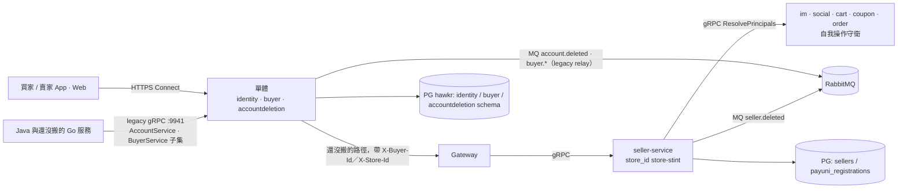
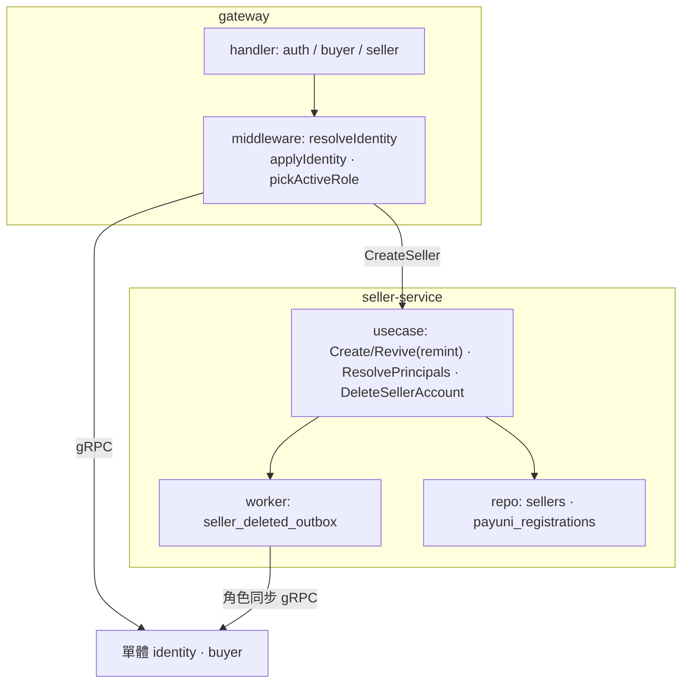
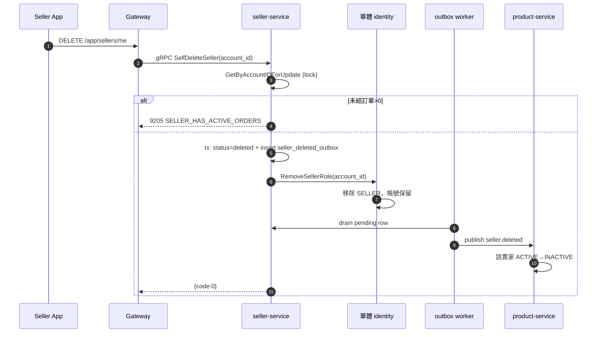
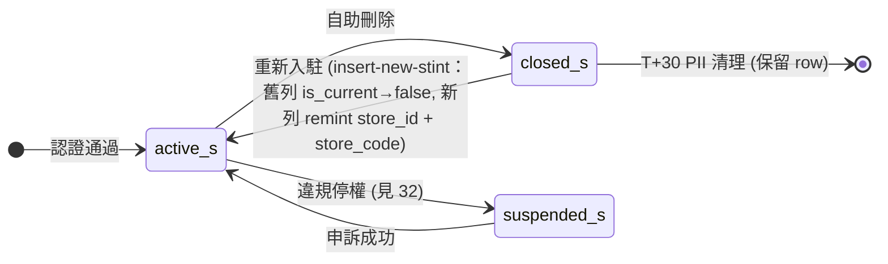

# 帳號與賣家買家身份模型（Account & Seller-Buyer Identity）詳細設計書

> 本文是仍在運作的系統的現行規格：seller-service（賣家身份 stint、`ResolvePrincipals`、賣家刪除與 outbox）、gateway 的身份解析，以及跨角色自我操作守衛（im、social、cart、coupon、order）。賣家身份的部分（§2.3 賣家列、§5、§7.1–§7.5、§8.4.1、§8.6）同時是 seller 模組（`internal/modules/seller`）的規格，seller 模組沒有自己的規格檔，等 seller 瘦身步驟搬走。
>
> 單體的帳號與買家不在本文：identity 見 `docs/modules/identity.md`，buyer 見 `docs/modules/buyer.md`，刪帳流程見 `docs/modules/accountdeletion.md`。seller-service、gateway 的身份解析與守衛服務搬進單體時，本文刪除。
>
> 登入憑證機制（OAuth token 驗證、web cookie session、JWT、VerifyPhone、LinkConfirm、token refresh）不在本文，見 [17 號](17-登入與帳號建立流程（Login%20&%20Account）詳細設計書.md)。

---

## 0. 文件元資訊 (Metadata)

| 項目 | 值 |
|---|---|
| 狀態 | `active` |
| 維護者 | Will |
| 對應程式碼 | `services/seller-service/`（`store_id` / incarnation / ResolvePrincipals）、`gateway/internal/{handler,middleware,buyerid,storeid}`（還沒搬的路徑的身份解析）、跨角色守衛 `services/im-service`、`services/social-service`、`services/java/{cart,coupon,order}-service` |
| 相關 doc | [17 登入與帳號建立流程](17-登入與帳號建立流程（Login%20&%20Account）詳細設計書.md)（登入憑證機制）、[18 賣家實名認證](18-賣家實名認證（Merchant%20Certification）詳細設計書.md)（PayUni MerID 綁定源頭）、[32 商家治理](32-商家治理與食安通報（Seller%20Governance%20&%20Food%20Safety）詳細設計書.md)（違規停權，非本文件的自助刪除）、[36 MQ 與事件總覽](36-MQ%20與事件總覽（MQ%20&%20Event%20Catalog）.md)；單體模組規格 `docs/modules/{identity,buyer,accountdeletion}.md` |

---

## 1. 概述與目標 (Overview & Goals)

### 1.1 文件定位

本文描述**賣家身份的資料模型與生命週期**，以及依賴它的 gateway 身份解析與跨角色守衛：賣家身份（`store_id`）如何建立、如何軟刪與重新入駐、以及在「同一個人同時是買家與賣家」時如何避免自己對自己下單／發券／私訊。目標讀者為後端全體。**不涵蓋**登入憑證機制（見 17）、實名認證細節（見 18）、單體 identity／buyer／accountdeletion 的行為（見上列模組規格）。

### 1.2 服務一句話定位

把「登入身份 `account_id`」與賣家身份 `store_id` 在資料層分離，使賣家刪店重開能取得全新的 PayUni 商店身份而不撞代理商一次性綁定上限。

### 1.3 設計目標 (Goals) 與 非目標 (Non-Goals)

| 類型 | 項目 |
|---|---|
| **Goal** | 賣家軟刪除（保留 row 供以 `store_id` 關聯的歷史），關閉 30 天後清 PII |
| **Goal** | 賣家刪店後重新開店 = 取得全新賣家身份（新 PayUni MerID），逃離 PayUni 代理商 `AGENT04017` 一次性 MerID 綁定上限 |
| **Goal** | 單人雙角色下，「不能對自己下單 / 發券 / 加購 / 私訊 / 封鎖」守衛仍正確 |
| **Non-Goal** | **不**引入 `store` 實體（一人多店 / 店鋪轉讓 / 多人共管）——見 [ADR 2026-06-29](../adr/2026-06-29-identity-defer-store-entity.md) |
| **Non-Goal** | **不**處理「雙角色賣家復活後舊商品仍出現在自己下架分頁」的商品可見性 |

### 1.4 與其他設計書／服務的關係

- **上游**：[17 登入流程](17-登入與帳號建立流程（Login%20&%20Account）詳細設計書.md) 負責憑證驗證與 session；本文承接其產出的 `account_id` 與角色（SELLER）。
- **下游**：[18 賣家實名認證](18-賣家實名認證（Merchant%20Certification）詳細設計書.md) 消費 `sellers.store_code` 推導 MerID；[36 MQ Catalog](36-MQ%20與事件總覽（MQ%20&%20Event%20Catalog）.md) 定義 `account.deleted` / `seller.deleted` 契約。
- **姊妹**：違規停權（治理 suspend）走 [32 商家治理](32-商家治理與食安通報（Seller%20Governance%20&%20Food%20Safety）詳細設計書.md)，與本文的**自助刪除**互斥；兩者的狀態在 §7.5。

---

## 2. 範圍與情境 (Context & Scope)

### 2.1 系統情境圖 (C4 Context)



### 2.2 邊界與責任

| | 涵蓋 (In-scope) | 不涵蓋 (Out-of-scope，由誰負責) |
|---|---|---|
| 單體 identity、buyer、accountdeletion | （不在本文） | 帳號、角色、買家與刪帳流程：`docs/modules/{identity,buyer,accountdeletion}.md` |
| seller-service | `store_id`、`store_code`、incarnation remint、PayUni MerID 推導、`ResolvePrincipals`、賣家軟刪 + outbox | 認證流程（見 18）、治理停權（見 32） |
| 守衛 5 服務 | 呼叫 `ResolvePrincipals` 做 resolve-to-principal 後比對 | 各自的下單 / 發券 / 私訊業務邏輯 |
| gateway | 還沒搬的路徑的身份解析（`buyerid`／`storeid` resolver）、`requireSeller`／`requireBuyer`／`requireAdmin`、下游 header 注入 | 憑證驗證（見 17） |

### 2.3 角色與身份模型

一個人（登入）→ 一個 principal → 各角色一個 aggregate。帳號（`account_id`）與買家（`buyer_id`）由單體擁有，規格見 `docs/modules/identity.md`、`docs/modules/buyer.md`；本文擁有賣家這一列：

| 身份 | 主鍵 | 生成 | 何時建立 | 與 `account_id` 的關係 |
|---|---|---|---|---|
| **seller** | `sellers.store_id` (BIGINT PK，TSID，`NEVER mutated`) ＋ `sellers.account_id`（非唯一） | **所有**新建 `store_id`（含首次 `CreateSeller` 與重新入駐）一律 mint 新 TSID；同一列另鑄 `store_code`（MerID 推導鍵，見 §5.1） | 賣家角色 grant / `CreateSeller` | **獨立**：`store_id ≠ account_id`，**不得假設兩值相等**。同一 `account_id` 可累積多筆歷史 stint，`is_current` 標記現行那筆 |

`account_id`、`buyer_id`、`store_id` 是三個不同的值，**不得假設任兩者相等**。角色只有 SELLER，由 seller 開店時授予、關店時移除；視角不是授權（role-as-claim，見 §8.1），不儲存。

---

## 3. 約束與前提 (Constraints & Assumptions)

| 類型 | 項目 |
|---|---|
| 技術約束 | Go 服務 schema 走 **Atlas**（declarative，`schema.sql` 為 SSOT，migration 由 `migrate diff` 生成）；回應走統一 **Envelope** `{code,message,data}`；前端可控業務 ID 一律 string 防 TSID/BIGINT 精度遺失 |
| 技術約束（例外） | PK 紅線為 TSID，但 `sellers.store_code` 是 seller-service 自有生成器（YY 年份 + 8 碼 `crypto/rand`，靠 `uq_sellers_store_code` + 最多 5 次撞號重試保證唯一）；`store_id` 才用 `pkg/tsid` |
| 外部約束 | PayUni 代理商 MerID `HAWK{store_code}` 為**一次性綁定**：同一 MerID 重複申請回 `AGENT04017`。這是 incarnation 存在的唯一 forcing function |
| 組織約束 | 單人 / 小團隊維運；**上線前不留技術債** |
| 既有系統約束 | Redis 無 HA（session / blacklist）；k3s + Traefik；RabbitMQ topic exchange |
| **假設 (Assumptions)** | (1) 一個 account 同時至多一個現行 seller stint（**1:1**，非多店）→ 失真則觸發 store 實體拆分（見 [ADR 2026-06-29](../adr/2026-06-29-identity-defer-store-entity.md)）。(2) `ResolvePrincipals` 與 `buyerid.Resolver`／`storeid.Resolver` 都在做**真實解析**：`buyer_id`／`store_id` 與 `account_id` 全面分離，任何依賴「兩值相等」的推導（含守衛比對、測試 fixture）都是錯的 |

---

## 4. 架構 (Architecture)

### 4.1 解法總綱 (Solution Strategy)

採 **distributed principal + per-role aggregate**（見 [ADR 2026-07-07](../adr/2026-07-07-identity-distributed-principal.md)）：

1. **登入身份維持純 principal**：`account_id` 語意不退化為「某角色下的人」。
2. **各角色服務自己持有 aggregate id**：賣家用 `store_id`，以 `account_id` 錨回 principal。`sellers.account_id` **非唯一**（同一 account 可累積多筆歷史 stint，`is_current` 標記現行那筆）。
3. **賣家 incarnation（insert-new-stint）**：重新入駐時在**同一 tx** 內 `RetireCurrentStint`（舊列 `is_current=false`）→ `Create` 新列（remint `store_id` TSID、另鑄新 `store_code`、`is_current=true`）。新 `store_code` 使 MerID `HAWK{new_store_code}` 是 PayUni 沒看過的值 → 逃 `AGENT04017`。`store_code` 撞號時整個 tx 重跑，最多 5 次（`uq_sellers_store_code`）。
4. **跨角色守衛 resolve-to-principal**：任何「不能對自己 X」的比對，先把 seller 端 id 經 `ResolvePrincipals` 還原成 principal，再與操作者 account_id 比對。買家端無對稱守衛需求（`buyerid.Resolver` 目的是身份解析轉發，非自我操作防護）。

### 4.2 元件視圖 (C4 Component)



| 模組/package | 責任 | 依賴 |
|---|---|---|
| `seller-service/internal/usecase` | `Create`（首次入駐與 insert-new-stint 重新入駐，remint `store_id` + `store_code`）、`ResolvePrincipals`、DeleteSellerAccount + outbox | sellers / payuni repo |
| `gateway/internal/middleware` | 身份解析、`pickActiveRole`、subset 防呆、下游 header 注入 | account/buyer/seller client |
| `gateway/internal/buyerid` | `Resolver.CurrentBuyerID`：呼叫者自己讀單體轉發帶的 `X-Buyer-Id`；查別的帳號呼叫單體 legacy `BuyerService.GetBuyerProfile`。沒有快取 | 單體的 legacy listener |

### 4.3 部署拓撲與 Port

| 服務 | HTTP | gRPC | 對外暴露 |
|---|---|---|---|
| gateway | 9900 | - | 對外唯一入口 |
| 單體 | 8080 | 9941（legacy：AccountService、BuyerService 的子集，只給還沒搬的服務） | 對外入口（Connect） |
| seller-service | 10021 | 10020 | ClusterIP |

> `ResolvePrincipals` 是 **seller-service 內部 gRPC**，被 im/social（Go）與 cart/coupon/order（Java）呼叫，不經 gateway、不對外。

### 4.4 命名／契約規約

| 契約 | 規則 | 出處 |
|---|---|---|
| PayUni MerID | `HAWK{store_code}` | `seller-service/internal/domain/payuni.go` `FormatMerID(storeCode)` |
| IM room id | `b{buyer_id}_s{store_id}`——兩者皆為**現行 stint 的 surrogate**，不得用 raw `account_id` 組 | `im-service .../usecase/message.go` `BuildRoomID` |
| MQ | exchange `hawkr.account` rk `account.deleted`；exchange `hawkr.seller` rk `seller.deleted` | §6.3 |
| 跨服務身份欄位 | 單體轉給 gateway 時帶 `X-Account-Id`（登入 principal）與已解析的 `X-Buyer-Id`、`X-Store-Id`；gateway 的 `buyerid`／`storeid` resolver 回答呼叫者自己時讀 header，再填入下游 gRPC 欄位 | §6.2、§8.3 |

⚠️ **`*AccountId` 這個名字不決定它裝什麼——判斷任一處一律看值不看名**：

| 值的來源 | 實際語意 | 命名是否正確 |
|---|---|---|
| `ResolvePrincipals` / `resolveAccountIdForStore` / `resolveNotifyBuyerAccountId` 的反解結果 | 登入 `account_id` | 正確 |
| 直接取自 `buyerId()` / `storeId()` | stint surrogate | **名字是債**，值是對的 |

現存的命名債（值正確、只會誤導讀的人）：payment `RescueRefundConsumer.serializeRescueCompletedPayload`
把 `buyer_id` surrogate 放進名為 `buyerAccountId` 的 wire key（因為 `notification_templates.target_user_field`
沿用該名）。
🔴 **改名必須 publisher ＋ `notification_templates` 同一批動**，否則 template 讀不到 key ＝ 靜默 0 投遞。
可繼續使用 `account_id` 的位置登記在 #2345；buyer 範圍的結論在 buyer 模組的 `CARRYOVER.md`。

---

## 5. 資料設計 (Data Design)

### 5.1 資料模型

帳號（`identity.accounts`）與買家（`buyer.buyers`）的表由單體擁有，見 `docs/modules/identity.md` §9 與 `internal/modules/buyer/db/schema.sql`。

**`sellers`（seller-service，可分離身份）**

| 欄位 | 型別 | 說明 |
|---|---|---|
| `store_id` | BIGINT **PK**（TSID） | **賣家 aggregate 身份**（stint surrogate）。穩定不變（`NEVER mutated`）；跨服務的賣家歸屬鍵一律用它 |
| `store_code` | BIGINT NOT NULL（`uq_sellers_store_code`） | **PayUni MerID 的推導鍵**：`HAWK{store_code}`（`domain.FormatMerID`）。YY 年份 + 8 碼 `crypto/rand`（`domain.GenerateStoreCode`），**非 TSID**；建立時撞號則整個交易重跑，最多 5 次。每個新 stint 各自鑄新值 ⇒ 重新入駐必得 PayUni 沒看過的 MerID |
| `account_id` | BIGINT（**非唯一**） | 登入 principal 的外鍵；同一 account 可有多筆 stint（`is_current` 標當前） |
| `is_current` | BOOLEAN NOT NULL | 每個 account 至多一筆 `true`（`uq_sellers_account_current`，見 5.2） |
| `status` | VARCHAR(20) | `active` / `closed`（自助刪除）/ `suspended`（admin 停權）/ `suspended_governance`（治理停權，見 32）。`chk_sellers_active_is_current`：`status='active'` 蘊含 `is_current` |
| `deleted_at` / `pii_cleared_at` / `payuni_account_unlinked_at` | TIMESTAMPTZ | 軟刪 + PII 清理標記 |
| `current_certification_id` | BIGINT | 認證關聯（見 18） |

> ⚠️ **`store_id`、`store_code`、`account_id` 是三個不同的值，不得互相代入**：對外的賣家歸屬鍵是 `store_id`，PayUni MerID 只認 `store_code`，登入 principal 是 `account_id`。

**`payuni_registrations`（seller-service）**

| 欄位 | 型別 | 說明 |
|---|---|---|
| `account_id` | BIGINT NOT NULL | **非 unique**（incarnation 後同一 account 可有舊+新兩列） |
| `store_id` | BIGINT **NOT NULL UNIQUE** | 該筆註冊屬於哪一個賣家 stint；一個 stint 至多一筆註冊 |
| `payuni_mer_id` | VARCHAR(50) | 實際送 PayUni 的 MerID，值為 `HAWK{該 stint 的 store_code}` |

### 5.2 索引與查詢模式

| Index | 查詢路徑 |
|---|---|
| `sellers_pkey` PRIMARY KEY(store_id) | `ResolvePrincipals` LEFT JOIN、所有以 `store_id` 為鍵的賣家查詢 |
| `uq_sellers_store_code` UNIQUE(store_code) | MerID 唯一性的 DB 防線；建立賣家時撞號重試（最多 5 次）靠它判定 |
| `uq_sellers_account_current` UNIQUE(account_id) **WHERE is_current** | 保證每個 account 至多一筆現行 stint；「找某人現在的店」走這條 |
| `payuni_registrations_store_id_key` UNIQUE(store_id) | 一個賣家 stint 至多一筆 PayUni 註冊；唯一性掛在 `store_id` **不在** `account_id`（同一 account 重新入駐後會有舊+新兩列） |

### 5.3 序號／排序／一致性

- `store_id` 用 `pkg/tsid`（42-bit ms + 22-bit random，時間排序）；`store_code` 用 `domain.GenerateStoreCode`（YY + 8 碼 `crypto/rand`），**兩者不同生成器，不可互換**。
- **重新入駐原子性**：seller `Create` 的重新入駐路徑整段跑在 `WithTx`——`GetByAccountIDForUpdate`（row lock 序列化併發入駐）→ `RetireCurrentStint` → `Create`（新 `store_id`、新 `store_code`）→ 寫 `seller.onboarded` outbox 列，同 tx 提交；外部 account-info 取號在 tx 外。`store_code` 撞號（`uq_sellers_store_code` 的 `ErrDuplicate`）時**整個交易重跑**，最多 5 次。

---

## 6. API 與介面契約 (API & Interface Contracts)

### 6.1 對外 REST（經 Gateway）

登入 / 建帳 endpoint 見 [17](17-登入與帳號建立流程（Login%20&%20Account）詳細設計書.md)。本文關切的賣家**生命週期** endpoint：

| Method + Path | 角色 | 說明 | 回應 |
|---|---|---|---|
| `DELETE /app/sellers/me` | Seller | 賣家自助刪除 | `{code:0}`；已在刪除中 9204；有未結訂單 9205 |

> 帳號刪除（Connect `IdentityAppService.DeleteAccount`）見 `docs/modules/accountdeletion.md`。Admin 面的帳號生命週期端點（`GET /admin/accounts`、`GET /admin/accounts/:id`、`POST /admin/accounts/:id/suspend`、`POST /admin/accounts/:id/unsuspend`、`DELETE /admin/accounts/:id`）SSOT 在 [17](17-登入與帳號建立流程（Login%20&%20Account）詳細設計書.md)「帳號停權與解除停權」。

### 6.2 gRPC（服務間）

| RPC | 服務 | 契約 |
|---|---|---|
| `RemoveRole(account_id, Role, source_id)` | account（單體 legacy） | seller-service 的 `RemoveSellerRole` 呼叫它；契約見 `docs/modules/identity.md` §3、§6 |
| `ResolvePrincipals(ResolvePrincipalsRequest{repeated int64 ids})` | seller | 回 `{int32 code, string message, map<int64,int64> principals, repeated int64 unresolved_ids}`；把存活的 `store_id` → principal `account_id`，已關閉或不存在的 id 不在 `principals`、只出現在 `unresolved_ids` |
| `SelfDeleteSeller(account_id)` | seller | 賣家軟刪主流程（§7） |
| `CreateSeller(...)` | seller | 賣家角色 grant 時建立 seller profile（觸發 onboarding） |

`ResolvePrincipals` 訊息（`api/proto/seller/seller.proto` 的 `message ResolvePrincipalsRequest` / `ResolvePrincipalsResponse`，Java mirror 同步）：欄位以 proto 為準。

> **精度例外**：`principals` map 的 value（account_id）**刻意保持 int64**（不字串化），因為此 RPC 純內部（im/social/cart/coupon/order → seller）、不經 gateway、無 JS `>2^53` 精度風險——已在 `scripts/proto/numeric-allowlist.txt` 標 §6.2 #3 例外。

### 6.3 非同步事件 (MQ)

| 項目 | `account.deleted` | `seller.deleted` |
|---|---|---|
| Exchange / RK | `hawkr.account` / `account.deleted` | `hawkr.seller` / `seller.deleted` |
| Payload | `{eventType, accountId}` | `{accountId}` |
| **發送條件** | 帳號刪除時（只經 accountdeletion）由單體的 legacy relay 發 | 賣家軟刪**無條件**發（不看 role 是否清空） |
| 冪等 key | accountId（consumer 皆冪等） | accountId |
| 可靠性 | best-effort（out-of-tx，失敗 Warn） | **transactional outbox**（同 tx 寫 pending row，worker drain，見 §7.3） |
| 消費端 | buyer 頭像 media 引用釋放 / im / seller / notification scrub PII（coupon 已遷至 `buyer.deleted`；social 由 `buyer.deleted`、`seller.deleted` 依身分種類清理，不消費本事件） | product ACTIVE→INACTIVE 下架 |

> **為何下架綁 `seller.deleted` 而非 `account.deleted`**：刪賣家角色時帳號仍在、不發 `account.deleted` → 商品不會下架；`seller.deleted` 無條件發，語意正確。

> **另有 `seller.profile.changed`（非本文件核心）**：seller-service 於 `UpdateProfile` / `UpdateLogo` / `UpdateCover` 成功後 best-effort emit（exchange `hawkr.seller`，payload `{event_id, event_type, store_id(string), occurred_at}`），cart-service consume 後 evict `seller:meta` 快取。屬**資料變更**類（非身份/刪除），故走 out-of-tx best-effort（非 outbox）；契約詳 [36 §3.6f](36-MQ%20與事件總覽（MQ%20&%20Event%20Catalog）.md) 與 [04 §3.2](04-購物車微服務（Cart%20Service）詳細設計書.md)。

### 6.4 即時通道 (WS/SSE)

> N/A — 本文件不擁有即時通道；IM WS 見 [14](14-即時通訊微服務（IM%20Service）詳細設計書.md)、SSE 見 [41](41-Realtime%20SSE%20推播平台（Realtime%20SSE%20Push%20Platform）詳細設計書.md)。

---

## 7. 執行時視圖 (Runtime View)

### 7.1 主要場景（happy path）：雙角色賣家刪店 → 重開（incarnation）

帳號有 SELLER 角色（每個帳號都是買家）。賣家在 App 內刪除賣家帳號：

1. `DELETE /app/sellers/me` → seller-service `GetByAccountIDForUpdate` 鎖列，檢查 `IsActive` 與未結訂單。
2. 同 tx：`UpdateStatus=deleted` + 寫 `seller_deleted_outbox` pending row。
3. tx 外：`RemoveSellerRole` → 單體 legacy `AccountService.RemoveRole`。移除 SELLER 不刪帳號（帳號活著就是買家）→ **account_id 不變**、不發 `account.deleted`。
4. outbox worker drain → 發 `seller.deleted` → product 下架該賣家全部 ACTIVE 商品。

日後同一帳號重新申請賣家：

5. seller `Create` 走重新入駐路徑：`GetByAccountIDForUpdate` 見 `closed` 列 → 同 tx `RetireCurrentStint`（舊列 `is_current=false`）→ `Create` 新列（**remint `store_id` TSID ＋ 鑄新 `store_code`**，`is_current=true`）→ 寫 `seller.onboarded` outbox 列。舊列與舊 `payuni_registrations` 列**保留**供稽核。
6. 認證通過 → `domain.FormatMerID(seller.StoreCode)` = `HAWK{new_store_code}` → PayUni 沒看過此 MerID → 綁定成功，逃 `AGENT04017`。

### 7.2 時序圖



### 7.3 失效與重試

| 外部呼叫 | 逾時 | 重試 / 冪等 | 失敗降級 |
|---|---|---|---|
| `RemoveSellerRole`（seller→account，同步） | 前台路徑：gRPC 預設；**outbox worker 路徑：10s**（`sdoRoleRemovalTimeout`，見 §8.6 的 🚨） | 立即回 error 給前端；本地已 `deleted` 時可重打（idempotent） | outbox worker 每分鐘順便重打尚未確認移除的 role → ≤1 分鐘自動收斂（**逾時後走 `bumpAttempt` 指數退避**，不再永久佔住 goroutine） |
| `seller.deleted` publish | — | transactional outbox：同 tx 寫 pending，worker drain（1min tick、backoff 1min×5 / 1h cap、`recover()` per-tick） | RabbitMQ 不通則 row 留 pending，恢復後補發（at-least-once + 冪等 consumer） |

| `ResolvePrincipals`（守衛→seller） | 5s（Go client） | — | **Go（im/social）fail-open**（回原 id）；**Java（cart/coupon/order）fail-closed**（throw → SERVICE_UNAVAILABLE），見 §8.3 |
| 單體轉發前解析 `buyer_id`（入口→buyer） | — | 唯讀、不補建 | **fail-closed**：查詢失敗回 503 不轉發；gateway 的 `buyerid.Resolver` 查別的帳號時 RPC 失敗同樣擋下，不讓原始 `account_id` 漏傳 |

### 7.4 並發與順序

- **復活競態**：`GetByAccountIDForUpdate` 取 `FOR UPDATE` row lock 序列化同一帳號的併發復活；active seller 直接回 `您已經是賣家`。

### 7.5 連線／狀態生命週期

賣家的狀態機（自助刪除 + 治理停權並列）。帳號與買家的生命週期見 `docs/modules/identity.md` §4、`docs/modules/buyer.md` §2 與 `docs/modules/accountdeletion.md`。



> **只有賣家走 insert-new-stint**：重新入駐另開新列、舊列保留（`is_current=false`），而且新列必須鑄新 `store_code`，否則新 MerID 會撞上舊綁定（`AGENT04017`）。買家與帳號同生命週期，不重新授予。
>
> ⚠️ **social-service 是唯一刻意不改鍵的下游**：`cms_comment.user_id` / `reports.reporter_id` / `user_blocks.blocker_id` 維持泛型命名，因為同一欄位可能裝賣家操作帶來的未 re-key 值，**不是單一 id space**。

---

## 8. 跨切面關注點 (Crosscutting Concerns)

### 8.1 安全與授權

- **role-as-claim**：授權一律按 `account_id` ownership 與角色（SELLER）；工作區提示（舊 REST 的 `X-Active-Role`）**不是授權輸入**（否則是 IDOR）。每個帳號都能用買家的方法，有 SELLER 的帳號在買家視角仍能用賣家的方法。
- **角色閘門**：單體的 Connect 方法依 service 檢查（buyer 的 App 方法只給帳號，管理員回 `permission_denied`）；還沒搬的路徑由 gateway 的 `requireSeller`/`requireBuyer`/`requireAdmin` 依合成的 `account_type` 判定。
- **視角不能提權**：舊 REST 的 `X-Active-Role` 提示 SELLER 但帳號沒有 SELLER 時，舊 gateway 收到的 `X-Login-Role` 是買家。
- **跨角色自我操作守衛**：見 §8.3；resolve-to-principal 讓雙角色的 seller 端與 buyer 端被認出是同一人。

### 8.2 可觀測性 (Observability)

| 訊號 | 內容 |
|---|---|
| metric | `seller_deleted_outbox` failed-counter |
| log | RemoveRole 失敗 Warn（帶 accountId） |
| trace | 沿用平台 OTel；跨服務 gRPC 帶 trace context |

### 8.3 錯誤處理與降級 (Failure Modes & Degradation)

`ResolvePrincipals` 的降級是本重構最關鍵的跨切面決策——**依守衛性質分 fail-open / fail-closed**：

| 守衛 | 服務 | 語言 | RPC 失敗 / code≠0 | 理由 |
|---|---|---|---|---|
| 自我私訊（room self-message） | im | Go | **fail-open**（回原 id，守衛放行） | UX 守衛，非防詐 |
| 自我封鎖（block-self，**兩端都 resolve**） | social | Go | **fail-open** | UX 守衛 |
| 自我加購（self-item） | cart | Java | **fail-closed**（throw → SERVICE_UNAVAILABLE） | 涉金流 / 反詐 |
| 自我發券（self-issue，僅 DESIGNATED） | coupon | Java | **fail-closed** | 反詐 |
| 自我下單（self-purchase, 4015） | order | Java | **fail-closed** | 反詐 |

> Java client 對 `code != 0` 也 throw（commit 58a53038），避免「拿到空 map → `getOrDefault` 退回原 id → 靜默比錯」。
>
> **部署順序硬依賴（runbook 風險）**：order/cart/coupon 現為 fail-closed，seller-service 必須**先**完整 rollout，否則結帳/加購/發券全回 SERVICE_UNAVAILABLE。cart-service 因此成為對 seller-service 的新 SPOF。

**買家側：還沒搬的路徑，gateway 的買家身份一律經 `h.BuyerID.CurrentBuyerID` 解析（呼叫者自己讀單體帶來的 `X-Buyer-Id`），不得直送 raw `account_id`**。三組呼叫點：`notification.go`（`upsertDeviceToken`/`RemoveDeviceToken`）、`notification_inbox.go`（5 個 handler：`ListNotifications`/`GetUnreadCount`/`MarkNotificationAsRead`/`MarkAllNotificationsAsRead`/`DeleteNotifications`）、`resolve_seller.go` 的 `chatWireIdentity`（`chat.go` 8 個呼叫點共用）。⚠️ 第三組是**買家**聊天身份解析的實際位置，但檔名只提到 seller，新增買家面 handler 時容易漏審。

其他依賴降級：DB 不可用 → 交易 rollback；MQ 不可用 → seller.deleted 留 outbox pending；Redis 掛 → session 走 L1 stale-if-error（見 17 §3）。

### 8.4 一致性與冪等

- `seller.deleted` **at-least-once**，consumer 皆冪等去重；`RemoveSellerRole` 冪等，無變化即 no-op。
- insert-new-stint 與關聯清理皆在單一 tx，失敗整段 rollback。

#### 8.4.1 角色授予的歸因與撤銷柵欄

**不變量：由 T 時刻的刪除所授權的撤銷，不得撤銷 T 之後才成立的授予。**

賣家角色的授予與撤銷跨兩個服務，且兩個方向的可靠性不同——授予是請求路徑上的同步呼叫，撤銷是 `seller_deleted_outbox` 的子步驟、退避重試最長數小時。撤銷因此可能在「刪除 → 重新入駐」之後才執行，把中間那次合法授予蓋掉；受害者是「有店、無角色」，被 `requireSeller` 擋在自己店外，且登入不再授予角色（見角色授予 ADR）所以沒有自癒路徑。

單一寫入路徑無法涵蓋這條跨服務落差，處理方式是把**因果來源**寫進授予、再讓撤銷指名同一個來源。帳號端的授予與撤銷語意（`account_roles.source_id` 的比對、被柵欄擋下時的回報）見 `docs/modules/identity.md` §3；seller-service 端：

| | 內容 |
|---|---|
| 歸因 | 授予帶該次入駐的 `sellers.store_id`（stint surrogate，重新入駐必為新值）。只有 SELLER 有這個柵欄；seller 模組在同一個 transaction 內授予與移除角色，不需要它 |
| 授予 | `BindSellerRole(account_id, store_id)` |
| 撤銷 | `RemoveSellerRole(account_id, ..., store_id)`，指名它所關閉的那個 stint |

**兩個子步驟的時間語意刻意相反**，這是本節最容易寫錯的地方：

- **發 MQ 事件＝edge-triggered**。事件陳述過去發生的事，payload 的 surrogate 必須是入列當時的快照；消費時重解析會與後續的重新入駐競態而改寫歷史。
- **角色同步＝進場 level-triggered、出場帶柵欄**。`seller.onboarded` 的授予子步驟在**執行當下**重讀帳號的當前 stint（`GetSellerByAccountID`，`is_current AND deleted_at IS NULL`），因此遲到的重試會授予給「現在真實存在的那次入駐」，查無當前 stint 則不授予；`seller.deleted` 的撤銷子步驟則指名它所關閉的那個 stint。

**授予點與順序**：`POST /app/sellers` **不由 gateway 授予角色**——授予必須指名 stint，而 stint surrogate 是在 seller-service 的建立交易內鑄造的，gateway 沒有任何時點拿得到。seller-service 於同一交易寫入 stint ＋ `seller.onboarded` outbox 列，交易後同步呼叫 `BindSeller`；**該同步呼叫只是延遲最佳化，保證來自 outbox 列的授予子步驟**——同步呼叫失敗只記 Warn，不得讓建店失敗。

### 8.6 多副本排程搶佔語意（Scheduler Claim）

**規範全文**：[開發規範／多副本排程搶佔規範](../開發規範/多副本排程搶佔規範.md)。本節列本文擁有的 outbox worker：`seller_deleted_outbox`（seller-service 的 `PayuniSyncWorker` 見 [18 號 §9](./18-賣家實名認證（Merchant%20Certification）詳細設計書.md)）。


**副本數前提（緊急度的判定輸入）**：`seller-service` 在 prod **是單副本**（`k8s/values/overlays/prod/common.yaml:4` 的 `replicas: 1`，per-service overlay 不覆蓋 `replicas`；prod 只有 `cart`／`gateway`／`order`／`payment`／`payuni-webhook` 五支被覆寫成 `2`，全清單與查證方式見[規範 §〇](../開發規範/多副本排程搶佔規範.md)）。⇒ 本節處理的是[規範規則 ⑧](../開發規範/多副本排程搶佔規範.md)的**擴容前置條件**，不是今天穩態下的重複；唯一的例外是 rolling update 期間的雙 pod 窗口（chart 預設 `maxUnavailable: 0` / `maxSurge: 1`）——**每次部署都發生**。

| | **`seller_deleted_outbox`（seller-service）** |
|---|---|
| 排程 | `SellerDeletedOutboxScheduler`，ticker **每 1 分鐘** |
| 候選述詞 | `status = 'pending' AND next_attempt_at <= $1 ORDER BY next_attempt_at LIMIT 50` |
| 副作用 | publish 生命週期事件 ＋ 單體的角色同步 gRPC——`seller.deleted` 走 **`RemoveSellerRole`**（另有 `HasActiveBuyer` 查詢，由單體的 legacy 回應），`seller.onboarded` 走 **`BindSellerRole`**（另有當前 stint 查詢，見 §8.4.1） |
| 搶佔閘門 | `ClaimSellerDeletedOutbox` |
| 租約欄 | **既有的 `next_attempt_at`**（不另加欄位） |
| 租約長度 | **3 分鐘**（= tick 1 分 × 3） |
| 候選窗口寬度 | **∞**（pending row 一直是候選，直到 `MarkDone` / `MarkFailed`） |

**閘門 SQL**：

```sql
UPDATE <outbox_table>
   SET next_attempt_at = sqlc.arg(lease_until)
 WHERE id = sqlc.arg(id)
   AND status = 'pending'                                -- 非 PK 述詞（規則 ⑦）
   AND next_attempt_at <= sqlc.arg(claimable_before);    -- 與候選述詞一致
```

`rows = 0` ⇒ **一個副作用都不做**。claim 放在 `event_published_at` / `role_removed_at` 兩個子步驟**之前**，因為這道閘門要蓋住**整列的處理**；那兩個欄位是斷點續傳的進度記號，**不是**跨副本的互斥。授予子步驟刻意沒有進度記號：它是 level-triggered 且冪等，重跑的代價是一次 RPC，不可能出錯（§8.4.1）。

**租約長度的上下界**：單筆最壞耗時是一次 MQ publish（毫秒）＋ `HasActiveBuyer`（3 秒）＋ `RemoveSellerRole`（**`sdoRoleRemovalTimeout` 10 秒**）≈ **13 秒** ⇒ 3 分鐘有一個數量級餘裕；候選窗口 ∞，兩個副作用的 error 都傳回 `bumpAttempt`。

- **租約基準逐筆各自取**（不是 tick 起點）：取 tick 起點 ⇒ 第 k 筆的有效租約 = `租約 − 前 k−1 筆的耗時`；seller 側**每筆兩次 gRPC 往返、`sdoFetchBatch = 50`**，一個批次內就會變成負數（[規範 §三 第 6 點](../開發規範/多副本排程搶佔規範.md)）。CAS 上界 `claimable_before` 維持 tick 起點——那個方向讓可搶佔集合更小，是保守的。

🚨 **`RemoveSellerRole` 的 10 秒 deadline 是租約下界能成立的前提，不是順手加的韌性**
沒有 deadline 時（繼承 scheduler 的 cancel-only background ctx），單體的 legacy 角色服務若是「**掛住**」而非「拒絕」，那個 goroutine **永不返回**，整條 outbox drain 永久停擺；而且**「租約長度 > 單筆最壞耗時」在最壞耗時無界時根本無從論證**。`sdoRoleRemovalTimeout = 10 * time.Second` 讓單筆最壞耗時有一個可寫下來的數字（≈13 秒），3 分鐘的下界才是可證明的。
⇒ **任何把新的無界呼叫加進這個迴圈的改動，都會同時打破韌性與租約下界的論證，必須連 deadline 一起補。**（同一條規則的 Java 版見[規範 §四 出路 4 的硬性邊界](../開發規範/多副本排程搶佔規範.md)。）

🚨 **候選查詢不得使用 `FOR UPDATE SKIP LOCKED`，它在這裡零保護**
`RunOnce` 在**自動提交**下執行（傳裸 ctx 直接拿 pool，沒有交易），SELECT 一回傳 row lock 就釋放 ⇒ 兩個副本拿到**同一批**、各自做一遍副作用（[規範 §一 ②](../開發規範/多副本排程搶佔規範.md)）。互斥**只能**靠上面的 claim 閘門，不得把 `SKIP LOCKED` 當第二道保險，也不得在 doc comment 裡宣稱它提供多副本安全。

**例外 B 不適用（不要拿它當捷徑）**：
1. **不是「結構上不可能」**：`next_attempt_at` 本身就是時間欄 ⇒ lease **零 schema 變更**就做得到，[規範 §四 例外 B 條件 1(a)](../開發規範/多副本排程搶佔規範.md) 直接不成立。
2. **不是「語意上只該發一次」**：設計是 **at-least-once 投遞**（重試上限 5 次、指數退避 `2^attempt × 1 分` 上限 1 小時、耗盡標 terminal `failed`），與條件 1(b) 講的「一次性事件、已經發出去就是終態」相反。

**行為退化**：pod 在 claim 與副作用之間崩潰 ⇒ 該筆延後**一個租約**（3 分）才重來。租約不是鎖：到期後可能與原持有者重疊 ⇒ 回到「重複一次」，下游冪等仍是最終防線（`RemoveSellerRole` 本身冪等、`seller.deleted` 的 consumer 皆冪等去重，見 §8.4）。**at-least-once 契約不變。**

---

## 9. 品質需求與 NFR (Quality Requirements / SLO)

### 9.1 SLO / SLI

| 指標 (SLI) | 目標 (SLO) | 量測點 |
|---|---|---|
| `seller.deleted` 投遞 | 最終一致（outbox） | outbox pending 積壓 + failed-counter |
| `ResolvePrincipals` 延遲 | < 5s（client timeout） | RPC round-trip |

### 9.2 容量與規模 (Capacity & Scaling)

- seller-service 是賣家資料的唯一寫入者，1:1 假設下無 sharding 需求。

### 9.3 效能預算

- `ResolvePrincipals` 為批次 RPC（一次多 id）+ 單一 LEFT JOIN，守衛必須一次送整批 id、不得逐筆呼叫。

---

## 10. 部署與維運 (Deployment & Operations)

### 10.1 環境與設定

- 單體與 seller-service；DB DSN、Redis、MQ 走既有 env。

### 10.2 部署順序

🔴 **部署順序硬依賴**：seller-service（含 `ResolvePrincipals`）**必須先於** order／cart／coupon 完成 rollout。
那三支對 `ResolvePrincipals` 是 fail-closed（§8.3），seller-service 未就緒時結帳／加購／發券會**全數**
回 `SERVICE_UNAVAILABLE`——cart-service 因此成為對 seller-service 的 SPOF。

### 10.3 健康檢查與優雅關閉

- 各服務沿用平台 health/readiness；`seller_deleted_outbox` worker per-tick `recover()` 防單次 panic 拖垮。

### 10.4 Runbook

- 卡住的 seller role 移除：outbox worker ≤1 分鐘自動重打 `RemoveSellerRole` 收斂；手動可重打 `DELETE /app/sellers/me`（idempotent）。
- PII 清理：seller 有 T+30 cron；buyer 的清理見 `docs/modules/buyer.md` §2。

---

## 11. 測試策略 (Test Strategy)

| 層級 | 覆蓋 | 關鍵場景 |
|---|---|---|
| unit | usecase | 賣家重新入駐鑄新 `store_id` **與新 `store_code`**（含 `store_code` 撞號時整個交易重跑）；`ResolvePrincipals` 對非 `store_id` 的 id echo-back |
| unit | 守衛 | im/social fail-open、cart/coupon/order fail-closed（RPC error + code≠0 兩路徑）；`buyerid.Resolver`／`storeid.Resolver` 讀 header 與查別的帳號、`ErrNoCurrentBuyer`／`ErrNoCurrentStore` 分類（含真實 gRPC wire path 迴歸測試）。🔴 **`storeid.Resolver` 只認真正的 gRPC `NotFound`，不得解析業務碼字串**——它呼叫的是專屬、無業務碼 envelope 的 `GetCurrentStoreID`（見 [ADR 2026-08-19](../adr/2026-08-19-identity-current-store-id-rpc.md)）。|
| integration | repo + DB | `uq_sellers_store_code` / `uq_sellers_account_current` invariant；`payuni_registrations` join on `store_id`；`GetPrincipalsByStoreIDs` LEFT JOIN；**testcontainers 真實 Postgres 併發測試**（insert-new-stint atomicity，pool pre-warm + 起跑訊號強制真實鎖競爭，斷言輸家拿到贏家的新 stint 而非未處理錯誤） |
| integration | outbox | `seller_deleted_outbox` 同 tx 寫入 + worker drain + 重試 |
| e2e | 端到端 | 雙角色刪賣家 → 重新入駐 → **新 MerID 與舊值不同**；賣家 insert-new-stint 端到端（新列 + 舊列 `is_current` 翻轉 + gateway 轉發新 surrogate） |

---

## 12. 術語表 (Glossary)

| 術語 | 定義 |
|---|---|
| principal | 登入身份，`accounts.account_id`；所有角色 aggregate 的錨點 |
| `store_id` | 賣家 aggregate 身份（`sellers` PK，TSID，`NEVER mutated`）；跨服務的賣家歸屬鍵 |
| `store_code` | `sellers` 的獨立欄位（`uq_sellers_store_code`），**MerID 的唯一推導鍵**；YY + 8 碼 `crypto/rand`，每個新 stint 各自鑄新值 |
| `buyer_id` | 買家 aggregate 身份（`buyers` PK，資料庫發號）；跨服務的買家歸屬鍵，一個帳號一生一個。**不得假設等於 `account_id`**；規格見 `docs/modules/buyer.md` |
| stint | 賣家的一段生命週期（active → closed）。重新入駐另開新 stint，同一 `account_id` 可累積多筆歷史 stint |
| `is_current` | `sellers` 的布林欄位，每個 `account_id` 至多一筆 true（`uq_sellers_account_current` partial unique index 保證）；insert-new-stint 時舊列翻 false、新列設 true |
| incarnation | 賣家刪店後重新入駐得到的那一段新 stint：新 `store_id` ＋ 新 `store_code` ⇒ 新 MerID |
| insert-new-stint | 賣家重新入駐時的手法：**新增一列**而非原地改寫，`RetireCurrentStint` + `Create` 包在同一 tx；舊列保留供稽核 |
| MerID | PayUni 代理商商店識別碼 `HAWK{store_code}`，一次性綁定（重複回 `AGENT04017`） |
| ResolvePrincipals | seller-service RPC，把 `store_id` → principal `account_id`；非 `store_id` 的 id 原樣回傳 |
| resolve-to-principal | 守衛比對前先把 seller 端 id 還原成 principal，使雙角色的兩端被認出同一人 |
| 視角（舊契約 `loginRole`） | 請求以買家或賣家看；Connect 沒有，只有舊 REST 的 `X-Active-Role` 提示，由 `internal/legacy` 推導成 `X-Login-Role`，非授權輸入（`docs/modules/identity.md` §6） |
| role-as-claim | 授權按 account_id ownership 與角色，不綁當前視角 |
