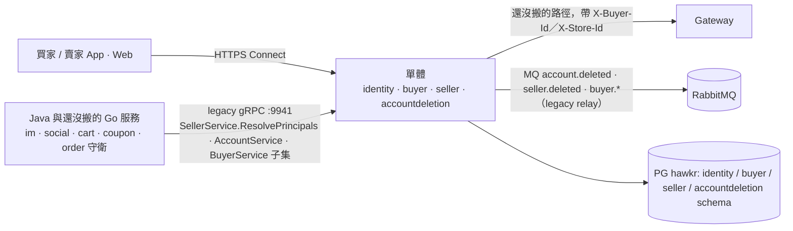

# 帳號與賣家買家身份模型（Account & Seller-Buyer Identity）詳細設計書

> 本檔是 gateway 的買家與店家身份解析，以及跨角色自我操作守衛（im、social、cart、coupon、order）的現行規格；這些服務搬進單體時刪除。
>
> 賣家身份（`store_id`、`store_code`、stint 的建立與生命週期、`ResolvePrincipals` 與 `GetCurrentStoreID`、`seller.deleted`）由單體的 seller 模組擁有，以 `docs/modules/seller.md` §2.1 為準。單體的帳號與買家不在本文：identity 見 `docs/modules/identity.md`，buyer 見 `docs/modules/buyer.md`，刪帳流程見 `docs/modules/accountdeletion.md`。登入與 session 見 `docs/modules/identity.md`。

---

## 0. 文件元資訊 (Metadata)

| 項目 | 值 |
|---|---|
| 狀態 | `active` |
| 維護者 | Will |
| 對應程式碼 | `gateway/internal/{middleware,buyerid,storeid}`（還沒搬的路徑的身份解析）、跨角色守衛 `services/im-service`、`services/social-service`、`services/java/{cart,coupon,order}-service` |
| 相關 doc | [36 MQ 與事件總覽](36-MQ%20與事件總覽（MQ%20&%20Event%20Catalog）.md)；單體模組規格 `docs/modules/{identity,buyer,accountdeletion,seller}.md` |

---

## 1. 概述與目標 (Overview & Goals)

### 1.1 文件定位

本文描述依賴賣家身份的 gateway 身份解析與跨角色守衛：在「同一個人同時是買家與賣家」時如何避免自己對自己下單／發券／私訊。目標讀者為後端全體。**不涵蓋**登入憑證機制（見 17）、賣家身份本身與 seller 模組的行為（見 `docs/modules/seller.md`）、單體 identity／buyer／accountdeletion 的行為（見上列模組規格）。

### 1.2 設計目標 (Goals) 與 非目標 (Non-Goals)

| 類型 | 項目 |
|---|---|
| **Goal** | 單人雙角色下，「不能對自己下單 / 發券 / 加購 / 私訊 / 封鎖」守衛仍正確 |
| **Non-Goal** | **不**引入 `store` 實體（一人多店 / 店鋪轉讓 / 多人共管）——見 [ADR 2026-06-29](../adr/2026-06-29-identity-defer-store-entity.md) |

### 1.3 與其他設計書／服務的關係

- **上游**：`docs/modules/identity.md` 負責憑證驗證與 session；本文承接其產出的 `account_id` 與角色（SELLER）。
- **賣家身份**：`docs/modules/seller.md` §2.1；停權由措施在讀取時推導，不是 stint 的狀態（`docs/modules/seller.md` §5）。
- **事件契約**：[36 MQ Catalog](36-MQ%20與事件總覽（MQ%20&%20Event%20Catalog）.md) 定義 `account.deleted` / `seller.deleted`。

---

## 2. 範圍與情境 (Context & Scope)

### 2.1 系統情境圖 (C4 Context)

### 2.2 邊界與責任

| | 涵蓋 (In-scope) | 不涵蓋 (Out-of-scope，由誰負責) |
|---|---|---|
| 單體 identity、buyer、accountdeletion | （不在本文） | 帳號、角色、買家與刪帳流程：`docs/modules/{identity,buyer,accountdeletion}.md` |
| 單體 seller 模組 | （不在本文） | 賣家身份與 legacy `ResolvePrincipals`、`GetCurrentStoreID`：`docs/modules/seller.md` |
| 守衛 5 服務 | 呼叫 `ResolvePrincipals` 做 resolve-to-principal 後比對 | 各自的下單 / 發券 / 私訊業務邏輯 |
| gateway | 還沒搬的路徑的身份解析（`buyerid`／`storeid` resolver）、`requireSeller` 能力檢查、下游 header 注入 | 憑證驗證（見 17） |

### 2.3 角色與身份模型

一個人（登入）→ 一個 principal → 各角色一個 aggregate。帳號（`account_id`）與買家（`buyer_id`）由單體擁有，規格見 `docs/modules/identity.md`、`docs/modules/buyer.md`；賣家（`store_id`）見 `docs/modules/seller.md` §2.1。

`account_id`、`buyer_id`、`store_id` 是三個不同的值，**不得假設任兩者相等**。角色只有 SELLER，由開店時授予、關店時移除；視角不是授權（role-as-claim，見 §8.1），不儲存。

---

## 3. 約束與前提 (Constraints & Assumptions)

| 類型 | 項目 |
|---|---|
| **假設 (Assumptions)** | (1) 一個 account 同時至多一個目前的 stint（**1:1**，非多店）→ 失真則觸發 store 實體拆分（見 [ADR 2026-06-29](../adr/2026-06-29-identity-defer-store-entity.md)）。(2) `ResolvePrincipals` 與 `buyerid.Resolver`／`storeid.Resolver` 都在做**真實解析**：`buyer_id`／`store_id` 與 `account_id` 全面分離，任何依賴「兩值相等」的推導（含守衛比對、測試 fixture）都是錯的 |

---

## 4. 架構 (Architecture)

### 4.1 解法總綱 (Solution Strategy)

採 **distributed principal + per-role aggregate**（見 [ADR 2026-07-07](../adr/2026-07-07-identity-distributed-principal.md)）：

1. **登入身份維持純 principal**：`account_id` 語意不退化為「某角色下的人」。
2. **各角色模組自己持有 aggregate id**：賣家用 `store_id`（`docs/modules/seller.md` §2.1），以 `account_id` 錨回 principal。
3. **跨角色守衛 resolve-to-principal**：任何「不能對自己 X」的比對，先把 seller 端 id 經 `ResolvePrincipals` 還原成 principal，再與操作者 account_id 比對。買家端無對稱守衛需求（`buyerid.Resolver` 目的是身份解析轉發，非自我操作防護）。

### 4.2 元件視圖 (C4 Component)

| 模組/package | 責任 | 依賴 |
|---|---|---|
| `internal/legacy/sellerserver` | legacy `SellerService` 的讀取方法，含 `ResolvePrincipals`、`GetCurrentStoreID`（契約見 `docs/modules/seller.md` §2.1） | seller 模組公開 API |
| `gateway/internal/middleware`（`InjectBuyerIDHeader`／`InjectStoreIDHeader`） | 反向代理路徑上解析營運鍵並注入 `x-buyer-id`／`x-store-id`，外部帶進來的同名 header 先刪 | `buyerid`／`storeid` resolver |
| `gateway/internal/buyerid`、`gateway/internal/storeid` | `Resolver.CurrentBuyerID`／`CurrentStoreID`：呼叫者自己時讀單體轉發帶的身份；查別的帳號時呼叫單體的 legacy 讀取。沒有快取 | 單體的 legacy listener |

### 4.3 部署拓撲與 Port

| 服務 | HTTP | gRPC | 對外暴露 |
|---|---|---|---|
| gateway | 9900 | - | 對外唯一入口 |
| 單體 | 8080 | 9941（legacy：AccountService、BuyerService、SellerService 的子集，只給還沒搬的服務） | 對外入口（Connect） |

> `ResolvePrincipals` 是單體 legacy listener 的內部 gRPC，被 im／social（Go）與 cart／coupon／order（Java）呼叫，不經 gateway、不對外。

### 4.4 命名／契約規約

| 契約 | 規則 | 出處 |
|---|---|---|
| IM room id | `b{buyer_id}_s{store_id}`——兩者皆為**現行 stint 的 surrogate**，不得用 raw `account_id` 組 | `im-service .../usecase/message.go` `BuildRoomID` |
| MQ | exchange `hawkr.account` rk `account.deleted`；exchange `hawkr.seller` rk `seller.deleted` | §6.3 |
| 跨服務身份欄位 | 單體轉給 gateway 時帶 `X-Account-Id`（登入 principal）與已解析的 `X-Buyer-Id`、`X-Store-Id`；gateway 的 `buyerid`／`storeid` resolver 回答呼叫者自己時讀 header，再填入下游 gRPC 欄位 | §6.2、§8.3 |

⚠️ **`*AccountId` 這個名字不決定它裝什麼——判斷任一處一律看值不看名**：

| 值的來源 | 實際語意 | 命名是否正確 |
|---|---|---|
| `ResolvePrincipals` / `resolveAccountIdForStore` / `resolveNotifyBuyerAccountId` 的反解結果 | 登入 `account_id` | 正確 |
| 直接取自 `buyerId()` / `storeId()` | stint surrogate | **名字是債**，值是對的 |

現存的命名債（值正確、只會誤導讀的人）：payment `RescueRefundConsumer.serializeRescueCompletedPayload`
把 `buyer_id` surrogate 放進名為 `buyerAccountId` 的 wire key（因為 `notification_templates.target_user_field`
沿用該名）。
🔴 **改名必須 publisher ＋ `notification_templates` 同一批動**，否則 template 讀不到 key ＝ 靜默 0 投遞。
可繼續使用 `account_id` 的位置登記在 #2345；buyer 範圍的結論在 buyer 模組的 `CARRYOVER.md`。

---

## 6. API 與介面契約 (API & Interface Contracts)

### 6.1 對外 API

登入與建帳見 `docs/modules/identity.md`；賣家關店的對外方法 `SellerAppService.CloseMyStore` 見 `docs/modules/seller.md` §2.1；帳號刪除見 `docs/modules/accountdeletion.md`。Admin 面的帳號生命週期端點 SSOT 在 `api/hawkr/admin/identity/v1alpha1/identity.proto`。

### 6.2 gRPC（服務間）

守衛服務呼叫單體 legacy `SellerService` 的 `ResolvePrincipals`（契約見 `docs/modules/seller.md` §2.1）；gateway 的 `storeid.Resolver` 呼叫 `GetCurrentStoreID`，只認 gRPC `NotFound`。

### 6.3 非同步事件 (MQ)

| 項目 | `account.deleted` | `seller.deleted` |
|---|---|---|
| Exchange / RK | `hawkr.account` / `account.deleted` | `hawkr.seller` / `seller.deleted` |
| 發送條件 | 帳號刪除時（只經 accountdeletion）由單體的 legacy relay 發 | stint 退場時（`docs/modules/seller.md` §2.1） |
| 冪等 key | accountId（consumer 皆冪等） | event_id |
| 消費端 | buyer 頭像 media 引用釋放 / im / seller / notification scrub PII（coupon 已遷至 `buyer.deleted`；social 由 `buyer.deleted`、`seller.deleted` 依身分種類清理，不消費本事件） | product 下架、social／im／notification 等刪除店家資料 |

下游店家資料的刪除綁 `seller.deleted` 而非 `account.deleted`：關店時帳號仍在、不發 `account.deleted`，`seller.deleted` 才是店家資料不可逆刪除的訊號。

### 6.4 即時通道 (WS/SSE)

> N/A — 本文件不擁有即時通道；IM WS 見 [14](14-即時通訊微服務（IM%20Service）詳細設計書.md)、SSE 見 [41](41-Realtime%20SSE%20推播平台（Realtime%20SSE%20Push%20Platform）詳細設計書.md)。

---

## 7. 執行時視圖 (Runtime View)

### 7.3 失效與重試

| 外部呼叫 | 逾時 | 重試 / 冪等 | 失敗降級 |
|---|---|---|---|
| `ResolvePrincipals`（守衛→單體） | 5s（Go client） | — | **Go（im/social）fail-open**（回原 id）；**Java（cart/coupon/order）fail-closed**（throw → SERVICE_UNAVAILABLE），見 §8.3 |
| 單體轉發前解析 `buyer_id`（入口→buyer） | — | 唯讀、不補建 | **fail-closed**：查詢失敗回 503 不轉發；gateway 的 `buyerid.Resolver` 查別的帳號時 RPC 失敗同樣擋下，不讓原始 `account_id` 漏傳 |

### 7.4 social-service 的鍵

social-service 是唯一刻意不改鍵的下游：`cms_comment.user_id` / `reports.reporter_id` / `user_blocks.blocker_id` 維持泛型命名，因為同一欄位可能裝賣家操作帶來的未 re-key 值，**不是單一 id space**。

---

## 8. 跨切面關注點 (Crosscutting Concerns)

### 8.1 安全與授權

- **role-as-claim**：授權一律按 `account_id` ownership 與角色（SELLER）；工作區提示（舊 REST 的 `X-Active-Role`）**不是授權輸入**（否則是 IDOR）。每個帳號都能用買家的方法，有 SELLER 的帳號在買家視角仍能用賣家的方法。
- **角色閘門**：單體的 Connect 方法依 service 檢查（buyer 的 App 方法只給帳號，管理員回 `permission_denied`）；還沒搬的路徑由 gateway 的 `requireSeller(cap)`（依入口帶的 `X-Seller-Capabilities` 檢查能力，沒有能力集合一律拒絕）與 `requireAdmin()` 判定。
- **視角不能提權**：舊 REST 的 `X-Active-Role` 提示 SELLER 但帳號沒有 SELLER 時，舊 gateway 收到的 `X-Login-Role` 是買家。
- **跨角色自我操作守衛**：見 §8.3；resolve-to-principal 讓雙角色的 seller 端與 buyer 端被認出是同一人。

### 8.2 可觀測性 (Observability)

| 訊號 | 內容 |
|---|---|
| log | 守衛的 `ResolvePrincipals` 失敗或 id 不被認得時 Warn（帶 store_id） |
| trace | 沿用平台 OTel；跨服務 gRPC 帶 trace context |

### 8.3 錯誤處理與降級 (Failure Modes & Degradation)

`ResolvePrincipals` 的降級是本重構最關鍵的跨切面決策——**依守衛性質分 fail-open / fail-closed**：

| 守衛 | 服務 | 語言 | RPC 失敗 / code≠0 | 理由 |
|---|---|---|---|---|
| 自我私訊（room self-message） | im | Go | **fail-open**（回原 id，守衛放行） | UX 守衛，非防詐 |
| 自我封鎖（block-self，**兩端都 resolve**） | social | Go | **fail-open** | UX 守衛 |
| 自我加購（self-item） | cart | Java | **fail-closed**（throw → SERVICE_UNAVAILABLE） | 涉金流 / 反詐 |
| 自我發券（self-issue，僅 DESIGNATED） | coupon | Java | **fail-closed** | 反詐 |
| 自我下單（self-purchase, 4015） | order | Java | **fail-closed** | 反詐 |

> Java client 對 `code != 0` 也 throw（commit 58a53038），避免「拿到空 map → `getOrDefault` 退回原 id → 靜默比錯」。
>
> **部署順序硬依賴（runbook 風險）**：order/cart/coupon 現為 fail-closed，單體的 legacy listener 必須**先**就緒，否則結帳/加購/發券全回 SERVICE_UNAVAILABLE。cart-service 因此成為對單體 legacy listener 的 SPOF。

**買家側：還沒搬的路徑，gateway 的買家身份一律經 `h.BuyerID.CurrentBuyerID` 解析（呼叫者自己讀單體帶來的 `X-Buyer-Id`），不得直送 raw `account_id`**。三組呼叫點：`notification.go`（`upsertDeviceToken`/`RemoveDeviceToken`）、`notification_inbox.go`（5 個 handler：`ListNotifications`/`GetUnreadCount`/`MarkNotificationAsRead`/`MarkAllNotificationsAsRead`/`DeleteNotifications`）、`resolve_seller.go` 的 `chatWireIdentity`（`chat.go` 8 個呼叫點共用）。⚠️ 第三組是**買家**聊天身份解析的實際位置，但檔名只提到 seller，新增買家面 handler 時容易漏審。

其他依賴降級：DB 不可用 → 交易 rollback；Redis 掛 → session 走 L1 stale-if-error（見 17 §3）。

### 8.4 一致性與冪等

- `seller.deleted` **at-least-once**，consumer 皆冪等去重。

---

## 9. 品質需求與 NFR (Quality Requirements / SLO)

### 9.1 SLO / SLI

| 指標 (SLI) | 目標 (SLO) | 量測點 |
|---|---|---|
| `ResolvePrincipals` 延遲 | < 5s（client timeout） | RPC round-trip |

### 9.3 效能預算

- `ResolvePrincipals` 為批次 RPC（一次多 id），守衛必須一次送整批 id、不得逐筆呼叫；批次上限為 `MaxBatchSize`。

---

## 10. 部署與維運 (Deployment & Operations)

### 10.1 環境與設定

- 守衛服務以環境變數指向單體的 legacy listener（例：im 的 `SELLER_SERVICE_ADDR`，預設 `127.0.0.1:9941`；cart 的 `SELLER_SERVICE_HOST`）。

### 10.2 部署順序

🔴 **部署順序硬依賴**：單體（含 legacy listener 的 `ResolvePrincipals`）**必須先於** order／cart／coupon 完成 rollout。那三支對 `ResolvePrincipals` 是 fail-closed（§8.3），單體未就緒時結帳／加購／發券會**全數**回 `SERVICE_UNAVAILABLE`。

---

## 11. 測試策略 (Test Strategy)

| 層級 | 覆蓋 | 關鍵場景 |
|---|---|---|
| unit | 守衛 | im/social fail-open、cart/coupon/order fail-closed（RPC error + code≠0 兩路徑）；`buyerid.Resolver`／`storeid.Resolver` 讀 header 與查別的帳號、`ErrNoCurrentBuyer`／`ErrNoCurrentStore` 分類（含真實 gRPC wire path 迴歸測試）。🔴 **`storeid.Resolver` 只認真正的 gRPC `NotFound`，不得解析業務碼字串** |

---

## 12. 術語表 (Glossary)

| 術語 | 定義 |
|---|---|
| principal | 登入身份，`accounts.account_id`；所有角色 aggregate 的錨點 |
| `store_id` | 賣家 aggregate 身份，見 `docs/modules/seller.md` §2.1 |
| `buyer_id` | 買家 aggregate 身份（`buyers` PK，資料庫發號）；跨服務的買家歸屬鍵，一個帳號一生一個。**不得假設等於 `account_id`**；規格見 `docs/modules/buyer.md` |
| ResolvePrincipals | 單體 legacy `SellerService` 的 RPC，把存活 stint 的 `store_id` → principal `account_id`（`docs/modules/seller.md` §2.1） |
| resolve-to-principal | 守衛比對前先把 seller 端 id 還原成 principal，使雙角色的兩端被認出同一人 |

| 視角（舊契約 `loginRole`） | 請求以買家或賣家看；Connect 沒有，只有舊 REST 的 `X-Active-Role` 提示，由 `internal/legacy` 推導成 `X-Login-Role`，非授權輸入（`docs/modules/identity.md` §6） |
| role-as-claim | 授權按 account_id ownership 與角色，不綁當前視角 |
