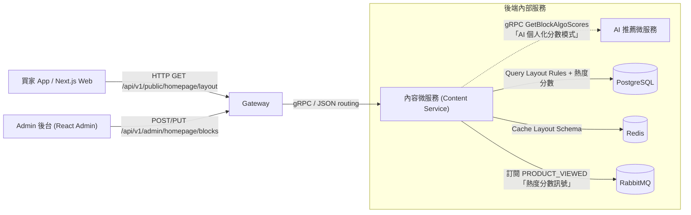
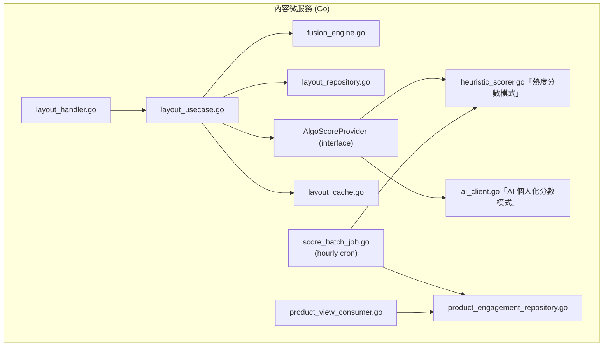
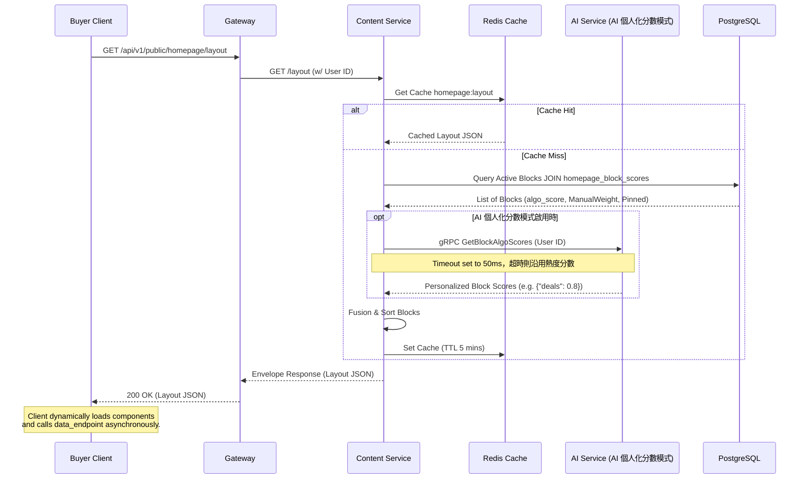

# 45-首頁區塊動態排序與營運干預（Homepage Dynamic Layout & Merchandising）詳細設計書

## 0. 文件元資訊 (Metadata)

| 項目 | 值 |
|---|---|
| 維護者 | Antigravity / Will |
| 對應程式碼 | `backend-payuni/services/content/...`（Go）<br/>`hawkr-website/features/home/...`（Next.js）<br/>`hawkr-admin/src/pages/homepage/...`（React Admin） |
| 相關 doc | [15-AI 微服務（AI Service）](15-AI%20微服務（AI%20Service）詳細設計書.md)<br/>[25-Banner 動作跳轉（Banner Action）](25-Banner%20動作跳轉（Banner%20Action）詳細設計書.md)<br/>[39-買家服務（Buyer Service）](39-買家服務（Buyer%20Service）詳細設計書.md)<br/>[ADR：首頁動態版面——結構／數據分離與排序融合](../adr/2026-09-18-homepage-dynamic-layout-ranking.md) |

---

## 1. 概述與目標 (Overview & Goals)

### 1.1 文件定位
本文件描述首頁「動態區塊排序與營運干預系統」的架構與詳細設計。涵蓋資料庫 Schema 設計、後端 Go 語言融合引擎 (Fusion Engine) 的排序計算公式、動態版面配置 API 契約、以及 Next.js 前端動態組件渲染規範與 Admin 後台的配置方式。

### 1.2 服務一句話定位
本模組隸屬於 Go `content` (內容) 微服務，負責為買家前台（App / Web）提供動態排序、時效控制、受眾篩選與手動置頂的動態首頁版面結構 API。

### 1.3 設計目標 (Goals) 與 非目標 (Non-Goals)

| 類型 | 項目 |
|---|---|
| **Goal** | 支援首頁區塊（如優惠專區、推薦、Banner、類別入口）的動態排序，無需前台重新部署。 |
| **Goal** | 支援演算法分數與營運人員手動控制（置頂、加權值）的權重融合排序。演算法分數有兩種來源模式：**熱度分數模式**（content-service 自建的全站聚合分數）與 **AI 個人化分數模式**（AI 服務提供的個人化分數），兩者共用同一套融合公式。 |
| **Goal** | 支援區塊的時效性控制（設定上線與下線時間）與受眾群組篩選（如：新客專屬區塊）。 |
| **Goal** | 提供高併發、極低延遲的首頁 Layout 查詢，後端處理耗時 (Latency) 需小於 20ms。 |
| **Goal** | 當 AI 個人化分數不可用（超時／錯誤）、或熱度分數批次作業失敗時，具備自動降級 (Fallback) 到 `ManualWeight` + 預設順序的機制。 |
| **Non-Goal** | 本 API **不**在同一個請求中回傳各區塊的具體商品詳情列表（商品資料由前端非同步向各業務 API 請求）。 |
| **Non-Goal** | 本文件不涵蓋各特定區塊內部內容的編輯邏輯（例如 Coupon 優惠券內容編輯、Banner 上傳等，這些由各自微服務管理）。 |

### 1.4 與其他設計書／服務的關係
*   **AI 微服務 (§15)**：AI 個人化分數模式下的分數來源。提供個人化的區塊點擊率 (CTR) 預估分數，於該模式啟用時取代自建熱度分數作為 Layout Engine 的動態基礎分數。
*   **Banner 動作跳轉 (§25)**：為首頁 Banner 區塊的項目配置跳轉與跳出控制。
*   **買家服務 (§39)**：買家 App/Web 呼叫 Gateway，轉發至本模組的 Layout API。

---

## 2. 範圍與情境 (Context & Scope)

### 2.1 系統情境圖 (C4 Context)



### 2.2 邊界與責任

| | 涵蓋 (In-scope) | 不涵蓋 (Out-of-scope，由誰負責) |
|---|---|---|
| **責任** | 1. 儲存首頁所有可用區塊的屬性與營運排序配置。<br/>2. 計算熱度分數（自建）；AI 個人化分數模式啟用時改用 AI 推薦分數；與手動置頂 (Pin)、加權 (Weight) 邏輯融合。<br/>3. 受眾及時間過濾。<br/>4. 前台版面 JSON 結構回傳與快取。 | 1. 各區塊底下的具體商品名單獲取（由商品/推薦服務提供）。<br/>2. 買家用戶畫像與行為收集（由 CRM/AI 服務負責，僅 AI 個人化分數模式需要）。 |

### 2.3 角色與身份模型
*   **Guest / Buyer (一般買家 / 訪客)**：無權限限制，可讀取首頁 Layout。熱度分數模式下所有買家看到同一份 Global 排序（熱度分數為全站聚合值，不分使用者）；AI 個人化分數模式啟用時，若請求攜帶 JWT 憑證，系統會識別 UserID 並改用 AI 服務的個人化分數排序，未帶憑證則沿用 Global 排序。
*   **Admin (平台營運人員)**：具備 `admin` 角色，可存取後台版面管理 API，配置各區塊的置頂、加權分數與上/下線時間。

---

## 3. 約束與前提 (Constraints & Assumptions)

| 類型 | 項目 |
|---|---|
| 技術約束 | 1. 所有主鍵 (PK) 必須使用 64-bit TSID (BIGINT)，禁止 UUID 或 Auto-increment。<br/>2. Go 服務 Schema 演進必須使用 Atlas 自動產生 migration 檔並進行管理。<br/>3. API 回應必須符合統一 Envelope 規範 `{code, message, data}`。<br/>4. 前端業務 ID 作為 JSON 傳輸時一律轉為 String，避免 JavaScript 發生 64-bit 整數精度遺失。 |
| 組織約束 | 採用小團隊敏捷開發，系統設計需考慮高內聚、低耦合，避免對 AI 服務的強相依（若 AI 服務異常不可影響主首頁渲染）。 |
| 性能約束 | 首頁 Layout API 必須在 Redis 設定快取，避免直接打擊 PostgreSQL；整體查詢延遲 P99 < 30ms。 |
| **假設 (Assumptions)** | 1. 首頁區塊總量通常小於 30 個，因此融合排序可在內存中以 `O(N log N)` 極速完成。<br/>2. 大多數時候使用 Global Caching，個人化快取僅在用戶登入且有明顯行為特徵時啟用。 |

---

## 4. 架構 (Architecture)

### 4.1 解法總綱 (Solution Strategy)
本系統採取**組件化動態佈局 (Component-Driven Dynamic Layout)** 策略。
1.  **結構化描述**：後端不渲染 HTML，而是返回結構化的 JSON 陣列，說明首頁有哪些 Block（例如 `type: "DEALS"`、`type: "PRODUCT_GRID"`）及各自的參數。
2.  **排序邏輯**：
    融合公式在兩種分數模式下皆適用（見 §5.3，決策理由見 [ADR：首頁動態版面——結構／數據分離與排序融合](../adr/2026-09-18-homepage-dynamic-layout-ranking.md)）：
    $$\text{FinalScore} = \text{AlgoScore} + \text{ManualWeight}$$
    若 `manual_position` 不為空，則該區塊繞過評分，直接被強制插入至指定的絕對位置（即 **Pin 功能**）。

    **AlgoScore 依區塊類型與分數模式而定**：
    *   **商品陳列型區塊**（10 個，§4.5 標註「✅ 演算法」）：
        *   **熱度分數模式（自建，預設）**：`AlgoScore` 為 content-service 批次計算的熱度分數，訊號為商品 7 日瀏覽數（加入銷量權重所需的事件來源見 §6.3），細節見 §5.1 `homepage_block_scores`。
        *   **AI 個人化分數模式**：`AlgoScore` 改為 AI 服務的個人化 CTR 分數，融合公式與 Pin/Weight 機制不變，只是來源從批次計算換成即時 gRPC 查詢。
    *   **行銷/內容策展型區塊**（4 個：`market_stage`、`seasonal_banner`、`recipe_ideas`、`featured_sellers`）：不參與熱度計算，`AlgoScore` 恆為 0，排序完全由 `sort_order` 與 `ManualWeight`/Pin 決定——這類內容本質是營運策展，不應被銷量/瀏覽數牽著走。

    兩種模式由 content-service 的 feature flag 決定（§4.2 `AlgoScoreProvider`）；AI 個人化分數模式下查詢失敗或逾時時，`AlgoScore` 回退至熱度分數模式的值（§7.3）。
3.  **前端動態工廠**：Next.js 前端維護一個 `COMPONENT_MAP`，將 `block_type` 映射到對應的 React 動態組件（並使用懶載入 `next/dynamic`），實現無縫的 UI 動態組件拼裝。

### 4.2 元件視圖 (C4 Component)



| 模組/package | 責任 | 依賴 |
|---|---|---|
| `handler/` | 解析 HTTP 請求，提供 `/api/v1/public/homepage/layout` 與 Admin API | `usecase` |
| `usecase/` | 業務流程控制：檢查 Cache、取得 AlgoScore、進行融合排序 | `repository`, `AlgoScoreProvider`, `fusion_engine`, `cache` |
| `fusion_engine/`| 純淨的排序融合算法，處理置頂 (Pin)、加權與條件過濾 | 無 |
| `repository/` | 執行 PostgreSQL 的讀寫操作（使用 Atlas 管理 Schema） | `database` |
| `AlgoScoreProvider`（介面） | 依 block_key 回傳 AlgoScore，兩種分數模式各一份實作，usecase 依 feature flag 切換 | 無 |
| `heuristic_scorer/`（熱度分數模式） | 熱度分數計算：讀 `product_engagement`，套 Bayesian 平滑與 top-K 平均，寫回 `homepage_block_scores` | `product_engagement_repository` |
| `product_engagement_repository/` | 讀寫 `homepage_product_engagement`（本地聚合表） | `database` |
| `product_view_consumer/` | 訂閱既有 `PRODUCT_VIEWED` 事件（與 seller-service 共用同一 exchange，新增一個 binding），累加至 `homepage_product_engagement` | `product_engagement_repository` |
| `score_batch_job/`（熱度分數模式） | Hourly cron，逐一呼叫 `heuristic_scorer` 重算 10 個商品陳列型區塊分數 | `heuristic_scorer` |
| `ai_client/`（AI 個人化分數模式） | gRPC 呼叫 AI 微服務取得個人化分數 | 無 |

### 4.3 部署拓撲與 Port

| Port | 協定 | 用途 | 對外暴露方式 |
|---|---|---|---|
| 9010 | HTTP | REST API (Layout) | 經 Gateway Ingress 對外公開 (80/443) |
| 9011 | gRPC | 服務間內部通信 (e.g. Admin 更新通知) | 僅內部 ClusterIP 存取 |

### 4.4 命名／契約規約
*   **區塊 Key (block_key)**：蛇形命名法 (snake_case)，例如：`hero_banner`、`deals`、`recommended_for_you`。
*   **組件類型 (block_type)**：大寫蛇形命名法，與前端組件一一對應，例如：`HERO_BANNER`、`DEALS`、`PRODUCT_GRID`。

### 4.5 區塊類型目錄 (Block Type Catalog)

以下為系統中所有已定義的區塊類型，前端 `COMPONENT_MAP` 與後端 DB 初始資料 (Seed Data) 必須與此表對齊：

#### 固定區塊（不參與動態排序）

| block_key | block_type | block_name | 前端組件 | 備註 |
|---|---|---|---|---|
| `search_bar` | `SEARCH_BAR` | 搜尋列 | `HomeCompactSearch` | 固定於頁面最頂部 |
| `category_nav` | `CATEGORY_NAV` | 分類導航 | `HomeCompactCategoryNav` | 固定於搜尋列下方 |

#### 動態區塊（可排序）

| block_key | block_type | block_name | 前端組件 | 資料來源 | 演算法適用（§4.1） |
|---|---|---|---|---|---|
| `market_stage` | `MARKET_STAGE` | 主打輪播 | `HomeCompactMarketStage` | `getCachedPublicPosts` + `getCachedMarketplace` | ❌ 內容策展，純人工 |
| `new_arrivals` | `NEW_ARRIVALS` | 新品上市 | `HomeCompactNewArrivals` | 商品池 offset 0 | ✅ 熱度分數 |
| `deals` | `DEALS` | 優惠專區 | `HomeCompactNewArrivals` | 商品池 `isOnSale` 過濾 | ✅ 熱度分數 |
| `origin_products` | `ORIGIN_PRODUCTS` | 產地專區 | `HomeCompactNewArrivals` | 商品池 `origin` 過濾 | ✅ 熱度分數 |
| `featured_sellers` | `FEATURED_SELLERS` | 推薦商家 | `HomeCompactMerchants` | `getCachedRecommendedSellers` | ❌ 內容策展，純人工 |
| `shelf_vegetables` | `DISCOVERY_SHELF` | 蔬菜專區 | `HomeCompactNewArrivals` | 關鍵字「蔬菜」過濾 | ✅ 熱度分數 |
| `shelf_fruits` | `DISCOVERY_SHELF` | 水果專區 | `HomeCompactNewArrivals` | 關鍵字「水果」過濾 | ✅ 熱度分數 |
| `seasonal_banner` | `SEASONAL_BANNER` | 季節 Banner | `HomeSeasonalBanner` | 靜態配置 / CMS | ❌ 內容策展，純人工 |
| `shelf_seafood` | `DISCOVERY_SHELF` | 海鮮專區 | `HomeCompactNewArrivals` | 關鍵字「海鮮」過濾 | ✅ 熱度分數 |
| `shelf_breakfast` | `DISCOVERY_SHELF` | 早餐專區 | `HomeCompactNewArrivals` | 關鍵字「早餐」過濾 | ✅ 熱度分數 |
| `recipe_ideas` | `RECIPE_IDEAS` | 食譜靈感 | `RecipeIdeasGrid` | `getCachedSeasonalRecipes` | ❌ 內容策展，純人工 |
| `shelf_meat` | `DISCOVERY_SHELF` | 肉品專區 | `HomeCompactNewArrivals` | 關鍵字「肉品」過濾 | ✅ 熱度分數 |
| `shelf_artisan` | `DISCOVERY_SHELF` | 職人加工 | `HomeCompactNewArrivals` | 關鍵字「加工」過濾 | ✅ 熱度分數 |
| `shelf_weekend` | `DISCOVERY_SHELF` | 週末餐桌 | `HomeCompactNewArrivals` | 關鍵字「週末」過濾 | ✅ 熱度分數 |

> `DISCOVERY_SHELF` 類型的區塊共用同一個前端組件 `HomeCompactNewArrivals`，但透過不同的 `block_key` 與後端配置的 `keywords` 參數來區分內容。
> 「演算法適用」共 10 個 ✅、4 個 ❌。❌ 的 4 個區塊本質是營運策展內容（故事性 Banner、精選小農、食譜、主打輪播），刻意不納入熱度計算，理由見 §4.1 與 ADR-04。

---

## 5. 資料設計 (Data Design)

### 5.1 資料模型

#### 首頁區塊配置表 `homepage_blocks`

```sql
CREATE TABLE homepage_blocks (
    id          BIGINT PRIMARY KEY,                     -- TSID (64-bit BIGINT)
    block_key   VARCHAR(50) UNIQUE NOT NULL,            -- 區塊唯一識別金鑰
    block_name  VARCHAR(100) NOT NULL,                  -- 區塊後台名稱描述
    block_type  VARCHAR(50) NOT NULL,                   -- 前端對應組件類型 (e.g. HERO_BANNER, DEALS)
    
    -- 基礎排序與控制
    sort_order  INT NOT NULL DEFAULT 0,                 -- 排序序號（越小越前面，拖拽排序後批次更新）
    is_active   BOOLEAN NOT NULL DEFAULT TRUE,          -- 是否啟用
    is_pinned   BOOLEAN NOT NULL DEFAULT FALSE,         -- 是否為固定區塊（不參與動態排序）
    status      VARCHAR(20) NOT NULL DEFAULT 'draft',   -- draft | published
    config      JSONB NOT NULL DEFAULT '{}',            -- 區塊專屬設定 (e.g. {"keywords": ["蔬菜"], "limit": 10})
    
    -- 排程控制
    start_time  TIMESTAMPTZ,                            -- 上線時間（NULL = 立即生效）
    end_time    TIMESTAMPTZ,                            -- 下線時間（NULL = 永久有效）
    
    -- 熱度演算法適用範圍與人工加權
    algo_eligible    BOOLEAN NOT NULL DEFAULT FALSE,    -- 是否參與熱度分數計算（僅 10 個商品陳列型區塊為 TRUE，見 §4.5）
    manual_weight    INT NOT NULL DEFAULT 0,            -- 營運手動加權分數（兩種分數模式皆適用）

    -- AI 個人化與受眾分流
    target_audience  VARCHAR(50) NOT NULL DEFAULT 'ALL',-- 受眾標籤: ALL, NEW_USER, VIP（AI 個人化分數模式）
    rule_conditions  JSONB NOT NULL DEFAULT '{}',       -- 額外規則（AI 個人化分數模式）
    
    created_at  TIMESTAMPTZ NOT NULL DEFAULT CURRENT_TIMESTAMP,
    updated_at  TIMESTAMPTZ NOT NULL DEFAULT CURRENT_TIMESTAMP
);

-- 發佈快照表：用於一鍵回滾
CREATE TABLE homepage_layout_snapshots (
    id           BIGINT PRIMARY KEY,                    -- TSID
    snapshot     JSONB NOT NULL,                        -- 發佈時的完整 blocks 排序快照
    published_by VARCHAR(100),                          -- 發佈者
    published_at TIMESTAMPTZ NOT NULL DEFAULT CURRENT_TIMESTAMP
);

-- 熱度分數表：與 homepage_blocks 分離，避免批次重算觸碰 homepage_blocks.updated_at
-- （§6.1 的置頂衝突防呆規則依賴 updated_at 代表「營運最後編輯時間」，不該被系統重算污染）
CREATE TABLE homepage_block_scores (
    block_key      VARCHAR(50) PRIMARY KEY REFERENCES homepage_blocks(block_key),
    algo_score     NUMERIC(10, 4) NOT NULL DEFAULT 0,  -- 熱度分數（Bayesian 平滑後的 top-K 平均）
    sample_size    INT NOT NULL DEFAULT 0,              -- 納入計算的商品數，供除錯與信心判斷
    raw_view_sum   BIGINT NOT NULL DEFAULT 0,            -- 原始 7 日瀏覽數總和（debug 用，不參與排序）
    computed_at    TIMESTAMPTZ NOT NULL DEFAULT CURRENT_TIMESTAMP
);

-- 商品互動聚合表：由 product_view_consumer 消費既有 PRODUCT_VIEWED 事件累加
-- 7 日滾動窗口本身即為時間衰減，不另外套指數衰減公式
CREATE TABLE homepage_product_engagement (
    product_id     BIGINT PRIMARY KEY,
    view_count_7d  INT NOT NULL DEFAULT 0,
    updated_at     TIMESTAMPTZ NOT NULL DEFAULT CURRENT_TIMESTAMP
);
```

### 5.2 索引與查詢模式

```sql
-- 用於買家端前台獲取所有啟用區塊的查詢索引
CREATE INDEX idx_homepage_blocks_query 
ON homepage_blocks (is_active, start_time, end_time) 
WHERE is_active = TRUE;
```

*   **查詢路徑**：`SELECT * FROM homepage_blocks WHERE is_active = true AND (start_time IS NULL OR start_time <= NOW()) AND (end_time IS NULL OR end_time >= NOW())`

### 5.3 序號／排序／一致性
1.  **Pin (置頂) 優先**：若區塊設有 `manual_position = N`，它會被強行安插在最終陣列的第 `N` 個位置（若多個區塊設有相同 Position，則以 `TSID` 降序決出順序，避免衝突）。
2.  **加權排序**：非置頂的動態區塊依 `FinalScore = AlgoScore + ManualWeight` 進行降序排列。
    *   `algo_eligible = FALSE` 的區塊：`AlgoScore` 恆為 0，實質等同純 `ManualWeight` 排序。
    *   `algo_eligible = TRUE` 的區塊：`AlgoScore` 讀自 `homepage_block_scores.algo_score`（熱度分數模式）或 AI 服務即時查詢（AI 個人化分數模式）；查無資料（新區塊尚未跑過批次）時視為 0，不影響服務可用性。
3.  **熱度分數計算**（`heuristic_scorer`，hourly cron）：
    *   Bayesian 平滑：`smoothed(p) = (view_count_7d(p) + C · global_avg_view_7d) / (1 + C)`，C 為平滑常數（預設 5），避免新商品因單次瀏覽即衝上高分。
    *   區塊分數：取該區塊商品池中 `view_count_7d` 前 K 名（預設 K=10）之 `smoothed(p)` 平均值，寫入 `homepage_block_scores.algo_score`。
    *   商品池的取得方式與前台渲染同一套 filter（見 §4.5「資料來源」欄），不另建索引。
4.  **防精度遺失**：ID 在轉為 JSON 時，Go struct 欄位需加上 `string` tag，例如：`ID int64 `json:"id,string"``。

### 5.4 Schema 演進與遷移
*   使用 **Atlas** 進行 Go 服務的聲明式 Schema 管理。
*   新增或刪除欄位必須向後相容。若需刪除欄位，應標記為 `DEPRECATED`，保留其在 Go struct 中的欄位，直到確認所有前端/服務漸已遷移，再另提 Migration 執行 Drop。

---

## 6. API 與介面契約 (API & Interface Contracts)

### 6.1 對外 REST（經 Gateway）

#### 獲取首頁動態排版配置 Layout
*   **方法/路徑**：`GET /api/v1/public/homepage/layout`
*   **請求參數**：無（從 Gateway JWT 中自動提取 UserID）
*   **回應格式 (統一 Envelope)**:

```json
{
  "code": 0,
  "message": "success",
  "data": {
    "blocks": [
      {
        "id": "1811409823479808",
        "block_key": "hero_banner",
        "block_type": "HERO_BANNER",
        "block_name": "今日主打星",
        "data_endpoint": "/api/v1/public/promotions/banners"
      },
      {
        "id": "1811409823479809",
        "block_key": "deals",
        "block_type": "DEALS",
        "block_name": "優惠專區",
        "data_endpoint": "/api/v1/public/products/deals"
      },
      {
        "id": "1811409823479810",
        "block_key": "recommend_for_you",
        "block_type": "PRODUCT_GRID",
        "block_name": "為您推薦",
        "data_endpoint": "/api/v1/public/recommendations/products"
      }
    ]
  }
}
```

#### Admin 後台版面管理 API

| 方法 | 路徑 | 用途 | 說明 |
|---|---|---|---|
| `GET` | `/api/v1/admin/homepage/blocks` | 取得所有區塊 | 含 draft 與 published 狀態；`algo_eligible = TRUE` 的區塊額外回傳 `algo_score`、`sample_size`、`computed_at`（來自 `homepage_block_scores`），供營運理解「為什麼這個區塊排第幾」 |
| `PUT` | `/api/v1/admin/homepage/blocks/:id` | 更新單一區塊設定 | 修改名稱、啟/停用、排程時間、config |
| `PUT` | `/api/v1/admin/homepage/blocks/reorder` | 批次更新排序 | 拖拽完成後送出整個排序陣列 `{"order": ["block_key_1", "block_key_2", ...]}` |
| `POST` | `/api/v1/admin/homepage/publish` | 發佈草稿 | 將當前 draft 設為 published，並建立 snapshot |
| `POST` | `/api/v1/admin/homepage/rollback` | 回滾至前一個已發佈版本 | 從 `homepage_layout_snapshots` 取最新快照還原 |
| `GET` | `/api/v1/admin/homepage/preview` | 預覽草稿版面 | 回傳 draft 狀態的 Layout JSON（供後台預覽使用） |

**Reorder Request 範例**：
```json
{
  "order": [
    "market_stage",
    "new_arrivals",
    "featured_sellers",
    "deals",
    "shelf_vegetables",
    "shelf_fruits"
  ]
}
```

**Publish Response 範例**：
```json
{
  "code": 0,
  "message": "success",
  "data": {
    "snapshot_id": "1811409823479900",
    "published_at": "2026-07-12T20:00:00+08:00",
    "block_count": 14
  }
}
```

### 6.2 gRPC（服務間）

> **AI 個人化分數啟用時**，content-service 以本節的 proto 向 AI 服務查詢 `AlgoScore`；
> **未啟用時** `AlgoScore` 取自 content-service 內部批次計算的 `homepage_block_scores`
> （§4.2 `heuristic_scorer`），不經 gRPC，因此沒有跨服務延遲風險。

#### 內容微服務呼叫 AI 微服務獲取區塊演算法分數
*   **Proto 定義**：
```protobuf
service AIService {
  rpc GetBlockAlgoScores (BlockScoreRequest) returns (BlockScoreResponse);
}

message BlockScoreRequest {
  string user_id = 1;
  repeated string block_keys = 2;
}

message BlockScoreResponse {
  // block_key -> score (0.0 到 1.0 的機率或權重值)
  map<string, double> scores = 1;
}
```

### 6.3 非同步事件 (MQ)
當 Admin 修改了首頁佈局設定後，內容服務會將 Redis Cache 清除。若有跨服務 Cache 需求，會發送 RabbitMQ 廣播事件：
*   **Exchange**：`content.layout.events`
*   **Routing Key**：`layout.invalidated`
*   **Payload**：`{ "event": "LAYOUT_CHANGED", "timestamp": 1783928192 }`

#### 熱度分數輸入：訂閱既有 `PRODUCT_VIEWED` 事件（消費端，非本模組發布）
content-service 新增一個 consumer binding，訂閱 seller-service 既有在用的同一個 `PRODUCT_VIEWED` 事件（`EventTypeProductViewed`，見 `pkg/mq/events.go`），不需要任何服務新增發布邏輯：
*   **Event Type**：`PRODUCT_VIEWED`
*   **消費者**：`content-service` 的 `product_view_consumer`（best-effort，處理失敗不重試，與 seller-service 既有消費邏輯一致）
*   **寫入**：累加至 `homepage_product_engagement.view_count_7d`（本地聚合表，§5.1）

> **銷量訊號要從哪個事件取**：`ORDER_COMPLETED` 只帶 `order_no` / `buyer_id` / `store_id`
> 等訂單層欄位，**不含商品明細**，接它拿不到 line-item。帶明細的是 order-service 的
> `order.sales.accumulated`（付款成功後發布，payload 含 `items[{product_id, quantity}]`，
> 目前由 product-service 消費累計 `sales_count`）——熱度分數要加入銷量權重時，
> content-service 要對這個 routing key 另加一個 consumer。

### 6.4 即時通道 (WS/SSE)
> N/A（本功能無即時雙向通信需求）

---

## 7. 執行時視圖 (Runtime View)

### 7.1 主要場景（Happy Path，熱度分數模式）
1.  買家開啟 App / Web。
2.  前端發送請求至 Gateway，轉發到 `content-service` 的 Layout API。
3.  `content-service` 檢查 Redis 中有無快取的 Layout，若有直接返回。
4.  Cache Miss 時，Layout Engine 查詢 DB 中所有啟用的 `homepage_blocks`，並 JOIN `homepage_block_scores` 取得已預先算好的熱度分數（純本地查詢，無跨服務呼叫）。
5.  融合引擎將分數與營運加權結合，套位置頂規則，產生最終 Layout。
6.  寫入 Redis 緩存，並回傳給買家前台。

> AI 個人化分數模式啟用時，步驟 4 改為額外非同步呼叫 AI 服務取得個人化 `AlgoScores`（見 §7.2 時序圖的 AI 分支），取代 `homepage_block_scores` 作為分數來源；批次熱度計算（§7.1.2）與其查詢路徑不受影響，是 AI 服務故障時的 fallback 來源。

### 7.1.1 Admin 發佈場景 (Publish Flow)
1.  營運在 Admin 後台拖拽調整區塊順序 → 呼叫 `PUT /reorder` → DB 中對應區塊的 `sort_order` 更新，`status` 保持 `draft`。
2.  營運點擊「預覽」→ 前端以 `GET /admin/homepage/preview` 取得 draft 版面 → 以模擬買家視角顯示。
3.  營運確認無誤後點擊「發佈」→ 後端呼叫 `POST /publish` → 系統執行以下原子操作：
    *   將所有區塊的 `status` 更新為 `published`
    *   將當前完整的排序快照寫入 `homepage_layout_snapshots` 表
    *   清除 Redis 中的 Layout Cache
4.  買家重新訪問首頁 → Cache Miss → 從 DB 取得最新 published 版面 → 寫入新 Cache。

### 7.1.2 熱度分數批次重算場景（Score Batch Flow）
與買家請求路徑完全解耦，不影響 Layout API 延遲：
1.  `score_batch_job` 每小時觸發一次（k8s CronJob 或服務內 `time.Ticker`）。
2.  對 10 個 `algo_eligible = TRUE` 的區塊，逐一取得其商品池（沿用前台同一套 filter）。
3.  查詢 `homepage_product_engagement` 取得池內商品的 `view_count_7d`，套 Bayesian 平滑與 top-K 平均（§5.3）。
4.  Upsert 寫入 `homepage_block_scores`（不觸碰 `homepage_blocks.updated_at`）。
5.  批次完成後**不主動清除 Layout Redis Cache**——分數變動採自然 TTL 過期生效（預設 5 分鐘），避免每小時的批次重算造成 Cache 全面失效與 DB 瞬間高壓。

### 7.2 時序圖



熱度分數本身由 §7.1.2 的批次作業離線算好、寫進 `homepage_block_scores`，上圖的請求路徑只做本地 JOIN，不在買家請求當下計算。

### 7.3 失效與重試
*   **熱度分數批次作業失敗**：`score_batch_job` 若該次執行失敗（例如查詢逾時），`homepage_block_scores` 維持上一次成功寫入的值，僅記錄 `WARN` 日誌，不重試、不影響買家請求路徑。新區塊從未成功跑過批次時，`algo_score` 視為 0，退化成純 `ManualWeight` 排序（Fail-Open，與既有 AI 降級精神一致）。
*   **AI 個人化分數超時/熔斷**：如果 AI 服務超時（設定 `50ms`）或拋出錯誤，`content-service` 必須捕獲此異常，改用熱度分數模式的 `homepage_block_scores.algo_score` 作為 fallback（而非直接歸零），排序品質優於直接退化成純手動排序。
*   **Redis 快取穿透防禦**：如果 DB 為空或查詢異常，快取一個空 Layout，TTL 設定為 10 秒，避免流量直接打垮 DB。

### 7.4 並發與順序
*   佈局引擎本身為無狀態，多個 goroutine 能並發處理 Layout 計算。
*   對於快取重構，可使用 `singleflight` 機制，確保在極大流量 Cache Miss 時，同一時間只有一個 goroutine 向 DB 與 AI 服務索取資料，其餘請求等待並共享結果，防止快取雪崩與資料庫被瞬間擊穿。

### 7.5 連線／狀態生命週期
> N/A（本模組為 REST HTTP API）

---

## 8. 跨切面關注點 (Crosscutting Concerns)

### 8.1 安全與授權
*   **前台 Layout API**：對外公開，不需要認證，但如果攜帶認證 Token，應解析 User ID 用於個人化排序。
*   **後台 Admin API**：嚴格限制只有具備 `ROLE_ADMIN` 的 JWT token 才能訪問（由 Gateway / Content-service Middleware 雙重驗證）。

### 8.2 可觀測性 (Observability)
*   **指標 (Metrics)**：
    *   `homepage_layout_request_total`：總請求次數。
    *   `homepage_layout_cache_hit_ratio`：Redis 快取命中率。
    *   `homepage_layout_ai_duration_seconds`：AI 服務響應耗時分布 (Histogram)，AI 個人化分數模式適用。
    *   `homepage_score_batch_duration_seconds`：熱度分數批次作業單次執行耗時。
    *   `homepage_score_batch_blocks_scored_total`：批次作業成功寫入分數的區塊數（應穩定為 10，低於此值代表部分區塊算分失敗）。
*   **日誌 (Logging)**：
    *   AI 服務超時降級：`WARN`，`"AI service timeout, fallback to heuristic score. Error: ..."`。
    *   熱度分數批次作業失敗：`WARN`，`"score batch job failed for block_key=%s, keeping stale score. Error: ..."`。

### 8.3 錯誤處理與降級 (Failure Modes)

| 依賴組件 | 異常狀況 | 系統行為與降級策略 |
|---|---|---|
| AI Service（AI 個人化分數模式） | 崩潰 / 慢查詢 | 熔斷超時設為 50ms，自動降級改用熱度分數模式的 `homepage_block_scores.algo_score`，前台無感知。 |
| 熱度分數批次作業 | 執行失敗 / 逾時 | 保留上次成功值，記 `WARN`，不重試；從未成功過的新區塊視為 `algo_score = 0`，退化成純 `ManualWeight` 排序。 |
| Redis | 連線中斷 | 直接穿透至 DB 查詢，印出 `ERROR` 日誌。限制 DB 查詢速率 (Rate Limit) 防護。 |
| PostgreSQL | DB 宕機 | 系統無法更新 Layout 結構，使用 Redis 記憶體中最後一份 Layout（若已過期則嘗試使用內置硬編碼保底 Layout）。 |
| Redis | 快取集體同時失效（雪崩） | 🔴 **寫入 Layout 快取時，TTL 必須加上 10～30 秒的隨機抖動（Jitter）**。沒有 jitter 時所有使用者的快取會在同一秒過期，瞬間全部穿透到 DB 與分數來源。 |

### 8.4 一致性與冪等
*   前台 Layout 查詢為冪等唯讀操作。
*   後台對 Layout 配置的修改（以 `block_key` 為辨識鍵）需為冪等性，更新配置時使用 optimistic locking 或 upsert 邏輯。

### 8.5 設定與機密
後端需配置以下環境變數：
*   `AI_SERVICE_GRPC_ADDR`：AI 推薦微服務之 gRPC 連線位址（AI 個人化分數模式）。
*   `AI_SERVICE_TIMEOUT_MS`：預設設為 `50`（AI 個人化分數模式）。
*   `LAYOUT_CACHE_TTL_SECONDS`：快取時間，預設設為 `300`。
*   `HOMEPAGE_SCORE_BATCH_INTERVAL_SECONDS`：熱度分數批次重算間隔，預設 `3600`。
*   `HOMEPAGE_SCORE_SMOOTHING_C`：Bayesian 平滑常數，預設 `5`。
*   `HOMEPAGE_SCORE_TOP_K`：區塊分數取樣的商品數上限，預設 `10`。

---

## 9. 品質需求與 NFR (Quality Requirements / SLO)

### 9.1 SLO / SLI

| 指標 (SLI) | 目標 (SLO) | 量測點 | 現況 |
|---|---|---|---|
| Layout API 響應時間 P95 | < 50ms | Gateway 出口處統計時間 | 未量測 |
| Layout API 可用性 | > 99.9% | Gateway 回傳非 5xx 狀態碼比例 | — |
| 快取有效率 | > 95% | Redis 讀取命中比例 | — |

### 9.2 容量與規模 (Capacity & Scaling)
由於 Layout API 回傳的資料量極小（約 2KB），瓶頸通常在於連線數。透過 Redis 快取與 `singleflight` 機制，單台 2C4G 的 Go Pod 預計可輕鬆支撐 5,000+ QPS。

### 9.3 效能預算

**請求路徑**（計入 Layout API P95）：
*   DB 查詢（含 JOIN `homepage_block_scores`）：< 5ms
*   AI 個人化分數 gRPC 調用：< 50ms (超過則超時)
*   融合算法計算：< 2ms

**批次路徑**（不計入請求路徑延遲，獨立預算）：
*   熱度分數批次作業：< 5 分鐘跑完全部 10 個區塊。

---

## 10. 設計決策

設計理由、考慮過的替代方案與否決理由見
[ADR：首頁動態版面——結構／數據分離與排序融合](../adr/2026-09-18-homepage-dynamic-layout-ranking.md)。

---

## 11. 已知限制

| 限制 | 影響 | 現行處置 |
|---|---|---|
| 無區塊級曝光／點擊埋點（只有商品詳情頁瀏覽事件） | 排序只能用熱度訊號，無法用點擊率回饋 | 熱度分數以 `homepage_product_engagement.view_count_7d` 為訊號（§5.1） |
| Layout 層無 A/B 分流機制 | 無法量測不同排序策略的實際效果差異 | 排序策略的調整靠營運觀察與 `ManualWeight` 人工介入 |

---

## 12. 部署與維運 (Deployment & Operations)

### 12.1 環境與設定
與 §8.5 中定義之變數一致，由 Helm chart 或 Kubernetes ConfigMap 在部署時注入。

### 12.2 遷移步驟
1.  使用 Atlas 生成並執行 `homepage_blocks`、`homepage_block_scores`、`homepage_product_engagement` 表結構 migration。
2.  部署 `content-service` 新版服務（含 `product_view_consumer` 新 binding 與 `score_batch_job`）。
3.  部署 `hawkr-website` 前端與 `hawkr-admin` 後台。
4.  首次部署後熱度分數表為空，`score_batch_job` 第一次執行前排序自然退化為純 `ManualWeight`（Fail-Open，不需手動介入）。

### 12.3 健康檢查與優雅關閉
*   使用 `/healthz` 與 `/readyz` 做 Kubernetes 的 Liveness/Readiness 探針。
*   Go 服務監聽 `SIGTERM` 信號，開啟優雅關閉邏輯，在 15 秒內 drain 既有連接。

### 12.4 Runbook
> N/A（本模組尚無自建 runbook）。若之後要寫，放 `docs/runbooks/`。

---

## 13. 測試策略 (Test Strategy)

| 層級 | 覆蓋 | 關鍵場景 |
|---|---|---|
| unit | fusion_engine | 驗證置頂 (Pinned)、權重累加、時效與受眾過濾邏輯是否正確。 |
| unit | heuristic_scorer | 驗證 Bayesian 平滑公式、top-K 選取、`sample_size` 過小時的邊界行為；驗證 `algo_eligible = FALSE` 的區塊恆回傳 0 分。 |
| integration | layout_repository | 驗證 PostgreSQL 連線與查詢；使用 testcontainers-go 驗證 Atlas 產出的 table schema 讀寫正常。 |
| integration | product_view_consumer | 驗證消費 `PRODUCT_VIEWED` 事件後 `homepage_product_engagement.view_count_7d` 正確累加，且與 seller-service 既有消費邏輯互不干擾（同一 exchange 多 binding）。 |
| e2e | front-to-back layout | 模擬用戶訪問首頁，驗證 API Gateway 能正常將 Layout API 透傳，且 Next.js 動態工廠解析 JSON 後能正常渲染對應組件。 |

---

## 14. 術語表 (Glossary)

| 術語 | 定義 |
|---|---|
| **Merchandising (營運干預)** | 在電商平台中，人工干預商品的陳列順序與曝光位置，以達到促銷或商業目標的行為。 |
| **Fail-Open (故障開放)** | 當某個非核心依賴組件掛掉時，系統選擇放行（採用預設配置或降級處理），而非拒絕服務。 |
| **熱度分數 (Heuristic / Trending Score)** | 熱度分數模式採用的非個人化（全站聚合）演算法分數，以商品瀏覽數等聚合訊號計算，用滾動時間窗口取代顯式時間衰減公式。與 Amazon Best-Seller Rank、Shopee 熱銷榜屬同一類做法。 |
| **Bayesian 平滑 (Bayesian Smoothing)** | 在樣本數過小時，將原始分數往全域平均值拉近的技巧，避免新商品因單次瀏覽/銷售即取得不成比例的高排名。 |
| **AlgoScoreProvider** | content-service 內定義的介面，熱度分數模式（`heuristic_scorer`）與 AI 個人化分數模式（`ai_client`）各自實作，usecase 層依 feature flag 切換實作，融合公式與呼叫方不受影響。 |
| **分數模式 (Score Mode)** | `AlgoScore` 的來源模式，共兩種：**熱度分數模式**（全站聚合、非個人化，由 content-service 批次計算）與 **AI 個人化分數模式**（依 UserID 個人化，由 AI 服務即時提供）。由 feature flag 選擇；AI 個人化分數模式失敗時 fallback 至熱度分數（§7.3）。融合公式與 Pin/ManualWeight 機制不隨模式改變。 |

---
